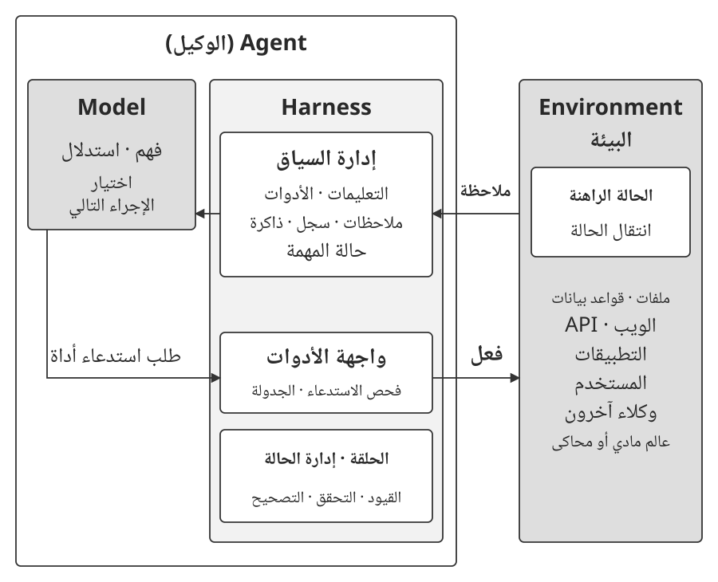
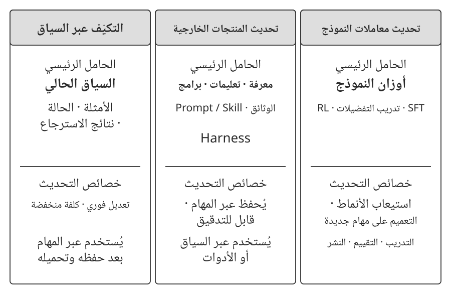
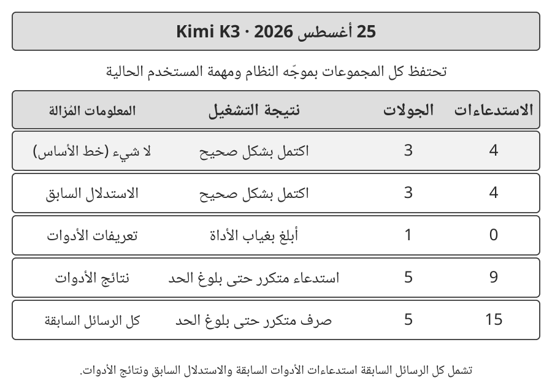
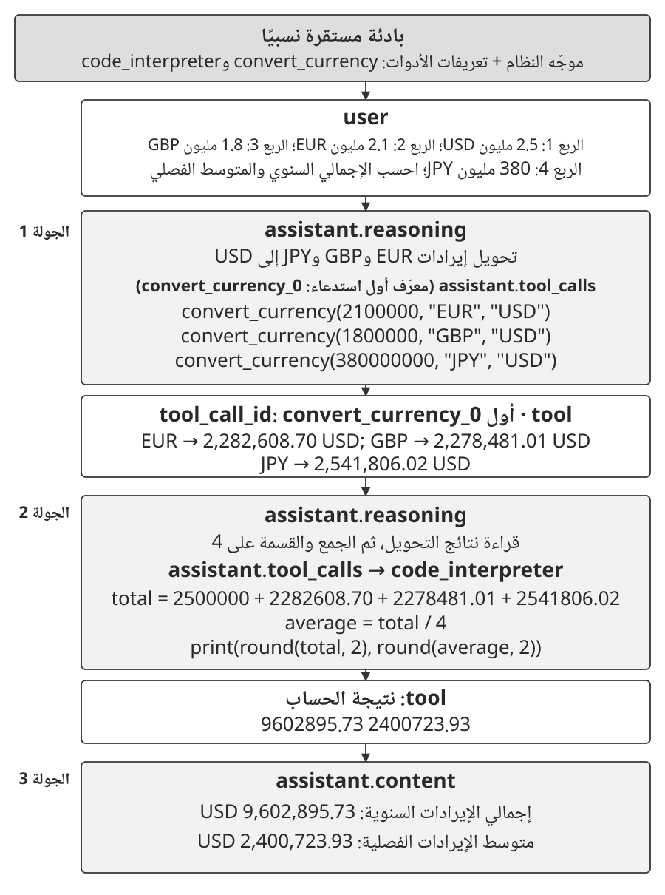
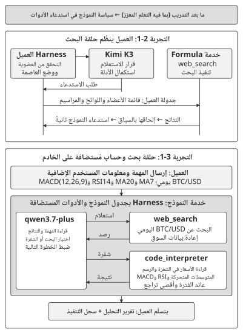
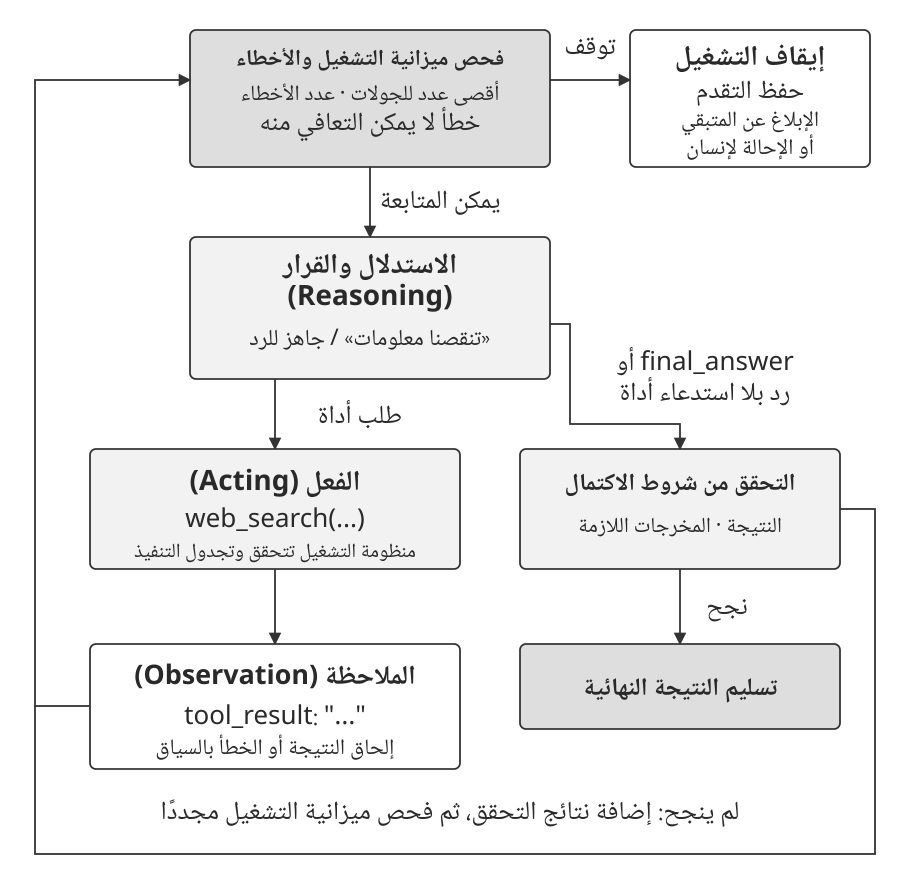
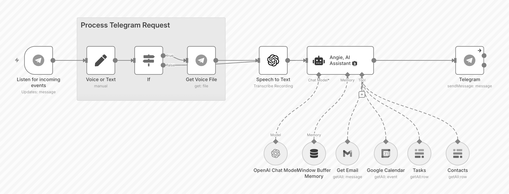

# الفصل الأول: مدخل إلى وكلاء الذكاء الاصطناعي

حين تستعين بخدمة Deep Research لدراسة موضوع ما، فإنها تبحث وتقرأ مرة بعد مرة، ثم تنظّم ما جمعته في تقرير. ويستطيع Manus تشغيل المتصفح لإنجاز مهام عبر الإنترنت، ويستطيع مساعد Doubao على الهاتف حجز التذاكر وإرسال الرسائل، ويستطيع Pine AI أن يتصل هاتفيًا نيابة عن المستخدم ويفاوض شركة الاتصالات على خفض فاتورته. هذه كلها تطبيقات لوكلاء الذكاء الاصطناعي (AI Agent).

وحين تطلب من Cursor إصلاح دالة، فإنه يعثر عليها ويعدّل الملف ثم يشغّل الاختبارات. فإذا ظل الاختبار فاشلًا صارت رسالة الخطأ أساس تعديله التالي، وإذا نجح صار لديه دليل يبلغك به النتيجة. يمكن أن يُكتب ترتيب الخطوات الثلاث، أي البحث والتعديل والاختبار، في برنامج مسبقًا، لكن تحديد السطر الذي يجب تعديله، والموضع الذي يُرجع إليه بعد الفشل، يتوقف على المعلومات التي تظهر أثناء التنفيذ. وهذه العملية، التي يُختار فيها الفعل بحسب الهدف ثم تُعدَّل الخطة بحسب النتيجة، تتكرر أيضًا في مهام البحث والتفاوض الهاتفي وغيرها.

## الوكيل الحديث = LLM + السياق + الأدوات

يلخّص هذا الكتاب العناصر الوظيفية الثلاثة للوكيل الحديث في صيغة واحدة: **الوكيل = LLM (النموذج اللغوي الكبير، Large Language Model) + السياق + الأدوات**.

- **النموذج اللغوي الكبير هو دماغ الوكيل**، فهو الذي يفهم المهمة ويخطط خطواتها ويختار الإجراءات. يمنح التدريب المسبق (Pre-training) النموذجَ قدرته اللغوية ومعرفته بالعالم، ثم يشكّل التدريب اللاحق (Post-training) سلوكه في اتباع التعليمات والاستدلال واستدعاء الأدوات. ويعرض الفصل الثامن أساليب التدريب اللاحق، مثل الضبط الدقيق تحت الإشراف والتعلم المعزز.
- **السياق هو أفق القرار الحالي للوكيل**، فهو يحوي المعلومات التي يحتاج إليها القرار الراهن، ومنها التعليمات، وتعريفات الأدوات، والملاحظات الواردة من البيئة، وذاكرة المستخدم، ومعرفة المجال، والرسائل السابقة، وحالة الوكيل نفسه، وتقدّم المهمة.
- **الأدوات هي حواس الوكيل وأطرافه**، فبها يحصل على المعلومات أو ينفّذ العمليات عبر الواجهات. وتضم منظومة الأدوات التعريفات وبروتوكولات الاستدعاء والمحوّلات، وتدعم عمليات الملاحظة كالبحث والقراءة والتقاط الشاشة، كما تدعم الكتابة وتنفيذ الشفرة وتفويض الوكلاء الفرعيين والتواصل مع المستخدم.

وقد تؤدي الأداة الواحدة أكثر من دور. فإذا قرأ النموذج ملفًا عبر سطر الأوامر، صار محتوى الملف المُعاد أساسًا لقراره التالي؛ وإذا شغّل برنامجًا عبر سطر الأوامر نفسه، فقد يغيّر حالة الملفات أو العمليات.

لنفترض أنك فتحت للتو طردًا وصلك، وتريد أن تسأل خدمة العملاء: «هل يمكنني إرجاع المنتج بعد فتح غلافه؟» يستطيع النظام أن يستخدم **التوليد المعزز بالاسترجاع** (Retrieval-Augmented Generation، RAG) ليبحث عن سياسة الإرجاع السارية في المتجر، ثم يطلب من النموذج أن يجيب استنادًا إلى بنودها.[^ch1-rag] وتتبّع استعلام واحد كهذا يكفي لتتضح مسؤولية كل جزء. فنص السياسة وفهرسه محفوظان في قاعدة معرفة خارجية؛ وأداة الاسترجاع تستخرج الفقرات ذات الصلة بالسؤال، ثم يضع البرنامج الذي يستدعي النموذج هذه الفقرات ومصادرها في الطلب الحالي. وحين يقرأ النموذج البند الخاص بفتح الغلاف يستطيع أن يشرحه؛ أما إذا كان البند يفرّق بين فئات المنتجات، فعليه أن يسألك أولًا عمّا اشتريته.

[^ch1-rag]: Patrick Lewis وآخرون، Retrieval-Augmented Generation for Knowledge-Intensive NLP Tasks، NeurIPS، 2020.

في استعلام الإرجاع هذا، يكون إطلاق البحث فعلًا يقوم به الوكيل، وتكون البنود المُعادة ملاحظةً يتلقاها من البيئة (Environment). ويتوقف ما يفعله بعد ذلك، أي أن يجيب أو يطرح سؤالًا إضافيًا، على ما ورد في البنود. وبهذا تتكوّن الحلقة المغلقة التي يتحدث عنها التعلم المعزز ونظرية التحكم، كما يبيّن الشكل 1-1.



ترسم الطبقة الخارجية من الشكل الحدّ الفاصل بين الوكيل والبيئة. فالملفات وقواعد البيانات وصفحات الويب والمستخدمون والوكلاء الآخرون، والعالم الفيزيائي أو المحاكى، كلها يمكن أن تكون بيئة يتفاعل معها الوكيل. أما الطبقة الداخلية فتبيّن تقسيم العمل في التنفيذ الإنتاجي: **يتولى النموذج (Model) الفهم والاستدلال واتخاذ القرار؛ وتقع منظومة التشغيل (Harness) داخل حدود الوكيل وخارج النموذج، فتنظّم السياق وواجهات الأدوات وحلقة التشغيل والحالة، وتطبّق التقييد والتحقق والتصحيح.** ويستطيع Harness أن ينشئ البيئة أو يعزلها أو يتوسط في الوصول إليها، أما محتوى الملفات وحالة العمليات وما شابهها فتتغير داخل البيئة بفعل الإجراءات.[^ch1-harness]

[^ch1-harness]: انظر مقال LangChain ‏«The Anatomy of an Agent Harness» ومقال Anthropic ‏«Effective harnesses for long-running agents». وتعدّ بعض التطبيقات الصندوقَ الرملي جزءًا من Harness؛ أما الشكل 1-1 فيرسم البيئة منفصلة لتسهيل تتبّع ما غيّره الفعل فعلًا.

لهذا يعتمد الكتاب تقسيمين متكاملين: **«LLM + السياق + الأدوات» يصف المكونات الوظيفية، و«Model + Harness» يصف التنفيذ الإنتاجي.** ينظّم Harness السياق ثم يقدّمه إلى النموذج، أما استدعاء الأدوات فيقرره النموذج، ويتحقق منه Harness ويجدوله، ثم يسلّمه إلى الأداة أو البيئة لتنفّذه. ويمكن لنظام بسيط أن يبدأ بتجميع السياق وجدولة الأدوات، ثم يستكمل تدريجيًا آليات التقييد والتحقق والتصحيح التي يحتاج إليها التشغيل الإنتاجي.

ومن كان مُلمًّا بالتعلم المعزز يمكنه أن يقرأ الجدول التالي من خلال ثلاثة أسئلة: من يقرر الخطوة التالية، وعلى أي أساس يقرر، وكيف ينفّذ ما قرره. وهو تشبيه تقريبي قائم على الوظيفة.

| الفهم الحدسي | العنصر الهندسي | المفهوم المقابل في التعلم المعزز | المعنى |
|-----------|-----------|----------------------------|----------------------------------------------|
| **الدماغ** | LLM | **السياسة** (Policy) | يقرر ما ينبغي فعله في الخطوة التالية بناءً على المعلومات الحالية |
| **أفق القرار الحالي** | السياق | **الملاحظات والتاريخ** | ينظّم المعلومات التي تعيدها البيئة مع التاريخ السابق ليصير أساسًا للقرار |
| **الحواس والأطراف** | الأدوات والمحوّلات | **واجهات الملاحظة والفعل** | تحدد كيفية قراءة معلومات البيئة وإصدار الأفعال، وصيغة الاستدعاء والنتيجة المُعادة |

### فضاء الملاحظة وفضاء الأفعال: الواجهة بين النموذج والعالم

**يصف فضاء الملاحظة (Observation Space) الملاحظات التي يمكن أن يتلقاها الوكيل، ويصف فضاء الأفعال (Action Space) الأفعال التي يمكن أن يصدرها.** يحمل السياق في كل استدعاء المعلوماتِ الملموسة، وتوفر الأدوات المتاحة واجهاتِ التفاعل مع البيئة. وإلى جانب الأدوات، قد تأتي الملاحظات من مدخلات المستخدم وإشعارات الأحداث وغيرها؛ أما نطاق الأفعال فتحدّه معاملات استدعاء الأدوات وصلاحياتها وبيئة تشغيلها مجتمعةً.

تخيّل عطلين مختلفين. في الأول، يستطيع النموذج أن يشرح كل بند من بنود الرسوم في الفاتورة، لكنه لا يستطيع الحصول على فاتورة هذا الشهر. فبعد أن يأذن المستخدم بقراءتها، لا بد من جلب الفاتورة وتقديمها إلى النموذج حتى يحكم على الرسم المتنازع عليه. وفي الثاني، يطلب المستخدم من المساعد تغيير باقته، وقد عثر المساعد على باقة مناسبة، غير أن واجهة الحساب لا تسمح إلا بالاستعلام. ولو قرأ الفاتورة مرة أخرى لما استطاع إجراء التغيير؛ فهو يحتاج إلى صلاحية التشغيل المناسبة. ومهمة Harness أن يضع المواد المقروءة في السياق، ويتسلّم الفعل الذي اختاره النموذج، ويفحص معاملاته وصلاحياته، ثم يجدول تنفيذه.

لذلك، **حين يكون النموذج الأساسي ثابتًا، يصبح ضبط فضاء الملاحظة وفضاء الأفعال وسيلة هندسية مهمة لتحسين أداء المهمة.** فإذا كان النموذج يغفل عن حقائق أساسية، أمكن إدخال البيانات ذات الصلة في السياق؛ وإذا كان كثيرًا ما يخلط بين أدوات متشابهة، أمكن دمج الواجهات المكررة أو تحميل الأدوات التي تحتاج إليها المهمة الحالية فقط.

أما مشاهدة الفيديو فتطرح المشكلة المعاكسة: الصورة متاحة طوال الوقت، لكن التغيرات التي تستحق إعادة الحكم قليلة. افترض أن المساعد ينتظر اكتمال رفع ملف؛ فإذا استدعى النموذج الرئيسي مع كل حركة لشريط التقدم أهدر كثيرًا من الحوسبة، وإذا نظر مرة كل عشر ثوانٍ فقد تفوته رسالة فشل تظهر وتختفي سريعًا. **ويرى المؤلف أن جعل فضاء الملاحظة متناثرًا (Sparse) مسألة أساسية في تصميم الوكلاء.** فيمكن للنظام أن يراقب البيئة باستمرار، ولا يرسل إلى النموذج الرئيسي إلا التغيرات التي قد تبدّل الفعل التالي، مصحوبةً بالسياق الضروري.

**Manus: الجمع بين البحث والبرمجة والتحكم في الحاسوب داخل مهمة واحدة.** يتقن Deep Research البحث والقراءة، ويستطيع وكيل البرمجة (Coding Agent) كتابة الشفرة وتشغيلها، ويستطيع وكيل التحكم في الحاسوب (Computer Use Agent) تشغيل الواجهات. وقد جمع Manus المتصفح ونظام الملفات وتنفيذ الشفرة وسطر الأوامر داخل صندوق رملي سحابي، فصار بوسع وكيل واحد أن يبحث عن المعلومات أولًا، ثم يعالج الملفات ويشغّل الشفرة، ثم يُتمّ العمليات عبر المتصفح. فالمتصفح وقراءة الملفات زادا المعلومات التي يمكن الحصول عليها، وتنفيذ الشفرة والأوامر زاد العمليات التي يمكن تركيبها. **ويرى المؤلف أن هذا الجمع اختراق مهم في الوكلاء العامّين: فالوكيل الواحد يستطيع أن يتجاوز حدود منتجات كانت منفصلة، ويصل جمع المعلومات ومعالجة البيانات وتنفيذ العمليات في مهمة متكاملة.**

**OpenClaw: مدّ الواجهة إلى الحياة الرقمية للمستخدم.** يستقبل OpenClaw المهام ويعيد النتائج عبر قنوات المراسلة، مثل WhatsApp وTelegram وSlack وDiscord وiMessage، ويستخدم Gateway يعمل على جهاز المستخدم ليصل بين قنوات المراسلة والنموذج والأدوات. وبعد إعداد الأدوات المناسبة والحصول على الإذن، يستطيع الوكيل معالجة الملفات المحلية، كما يستطيع الاتصال بخدمات سحابية مثل Google Drive وNotion. وهكذا تدخل المواد المبعثرة بين حسابات المستخدم وأجهزته في معالجة مهمة واحدة. كان Manus في بداياته يعمل أساسًا داخل صندوق رملي سحابي، وكان على المستخدم أن يرفع ملفاته إليه؛ ثم أضاف لاحقًا موصّل Google Drive وميزة My Computer لسطح المكتب، فاتسع نطاق وصوله إلى الملفات السحابية والموارد المحلية. ويدل هذا التطور على أن نمو قدرات المنتج كثيرًا ما يأتي من توسيع واجهات الملاحظة والفعل[^ch1-agent-products].

[^ch1-agent-products]: عن بنية المنتجات، انظر تعريف Manus الرسمي بالـ Sandbox، وتعريفه بـ Google Drive Connector، وتعريفه بـ My Computer، إلى جانب المستودع الرسمي لـ OpenClaw ووثائق أدواته. وتحدد الموصّلات وإعدادات الأدوات وأذونات المستخدم الموارد التي يمكن الوصول إليها فعلًا.

تختلف مهام المنتجات، لكن يمكن فهمها جميعًا من ثلاث جهات: أساس القرار، والعمليات المتاحة، واستراتيجية التنفيذ:

| منتج الوكيل | المعلومات الرئيسية في السياق | الأدوات والعمليات المتاحة | استراتيجية التنفيذ |
|----------------|----------------------|----------------------------|------------------------------|
| **وكلاء البرمجة مثل Cursor** | المتطلبات، ومقاطع الشفرة، وقوائم المجلدات، ومخرجات الطرفية | البحث في الشفرة، وقراءة الملفات وكتابتها، وتنفيذ الأوامر | فهم المتطلبات ← البحث عن الشفرة ذات الصلة ← تعديل الشفرة ← الاختبار والتحقق ← التصحيح والإصلاح |
| **وكلاء البحث مثل Deep Research** | نتائج البحث، ومحتوى صفحات الويب، وملخصات الأوراق العلمية واستشهاداتها | استعلامات البحث، وقراءة صفحات الويب، وتوليد التقارير | تعديل اتجاه البحث بحسب المعلومات المتوفرة، وتركيب تقرير متكامل تدريجيًا |
| **وكلاء التحكم في الحاسوب مثل Browser Use** | لقطات الشاشة، وشجرة DOM أو شجرة إمكانية الوصول، ونتائج العمليات | النقر، والكتابة، والتمرير، والتقاط الشاشة، وتنفيذ الشفرة | قراءة الواجهة ← تحديد العنصر المستهدف ← تنفيذ العملية ← التحقق من النتيجة |
| **وكلاء مساعد الهاتف مثل Doubao** | لقطات شاشة الهاتف، وحالة واجهة التطبيق، واستجابات النظام | النقر، والسحب، والكتابة، وفتح التطبيقات | فهم المتطلبات ← تحديد التطبيق المستهدف ← تنفيذ العملية ← تأكيد الإنجاز |
| **وكلاء المهام الشخصية مثل Pine AI وMeta Muse** | سجلات الحساب والفواتير وبيانات مزوّد الخدمة المقروءة بإذن | إجراء المكالمات، وإرسال البريد، وملء النماذج، والتأكيد مع المستخدم | جمع المعلومات ← وضع استراتيجية التفاوض ← الاتصال بمزوّد الخدمة ← التفاوض ← إبلاغ النتيجة |

**كيف يتحول تكليف ما إلى مهمة قابلة للتنفيذ؟** حين كان المؤلف يعمل على مساعد للمهام الشخصية في Pine، لاحظ أن المستخدمين كثيرًا ما يكتفون بذكر هدف واحد، مثل: «احجز لي تذكرة طيران لرحلة عمل، ولا أريد أن يتجاوز سعرها 1200 يوان». فعلى المساعد أولًا أن يستوضح التاريخ والوجهة وما يهم المستخدم أكثر من غيره في هذه الرحلة، ثم يجمع المعلومات الناقصة، ويتفق مع المستخدم على طريقة التنفيذ والشروط القابلة للتفاوض، وبعدها فقط يتصل بمزوّد الخدمة. وقد تعيد المستجدات التي تظهر أثناء التنفيذ المهمةَ إلى خطوة سابقة.

لنفترض أن أدنى سعر وجده موظف خدمة العملاء هو 1250 يوانًا. سيحكم النموذج على الموقف بالجمع بين المعرفة العامة وطبيعة هذه الرحلة وما يتذكره من عادات المستخدم. فإن كان المستخدم في رحلة عمل ويقبل عادةً دفع مبلغ إضافي قليل مقابل رحلة مناسبة، فقد يحجز Pine مباشرة؛ أما إن كانت رحلة عائلية، وكان المستخدم قد أبدى سابقًا اهتمامًا واضحًا بالتكلفة الإجمالية، فقد يُبلغه أولًا بالفرق ويطلب من الموظف البحث عن رحلات أخرى. وإذا أضاف المستخدم لاحقًا: «في المرة القادمة، إذا تجاوزت التذكرة الميزانية فاسألني أولًا»، فإن هذه الملاحظة تمنح القرار التالي أساسًا أدق من الخبرة العامة.

ولنأخذ موقفًا آخر: يقترح موظف خدمة العملاء في المصرف إرسال المستندات إلى منزل المستخدم، والمساعد يتذكر أن المستخدم مسافر خارج البلاد. هنا يلزم تغيير طريقة التسليم: فيستطيع المساعد أن يوضح للموظف في الحال صعوبة الاستلام، ويطلب إرسال المستندات بالبريد الإلكتروني. وفي مثال تخفيض الفاتورة، إذا وعد الموظف شفهيًا عبر الهاتف، يستطيع المساعد أن ينقل التزام الشركة بدقة؛ أما التأكد من أن المبلغ خُصم فعلًا، فيحتاج إلى فاتورة لاحقة بوصفها ملاحظة جديدة. قد يمتد فضاء أفعال المساعد إلى مكالمات هاتفية حقيقية، لكن استنتاجاته تظل مقيدة بفضاء الملاحظة.

ومن حيث طبيعة المهام الموكلة، سيتناول هذا الكتاب ثلاثة أنواع من التطبيقات: قضاء شؤون الحياة اليومية، والعمل المكتبي التعاوني، والاستكشاف العلمي. وقد يتولى المساعد الواحد مهام من أنواع مختلفة، والفرق بينها في من يمنحه الإذن، وما الذي يستطيع تغييره، ومن يتسلّم النتيجة في النهاية. ففي المكتب، إذا سلّم زميلٌ نتيجة تدقيق، فهل يمكن إغلاق تذكرة العمل؟ لنفترض أن مسؤول المشروع ذكر المساعد بالاسم في تذكرة عمل على Multica، وطلب منه تدقيق فرق في مبلغ واحد ضمن جدول الميزانية. هذا التعليق يطلق عملية التدقيق، لكن تذكرة العمل تبقى في عهدة مسؤولها الأصلي، وتظل حالتها على ما كانت عليه. يعيد المساعد المبلغين ومصدر كل منهما، فيجيب عن سؤال الزميل؛ أما صلاحية تقديم الميزانية كلها، فيقررها المسؤول في ضوء بقية البنود المعلّقة.[^ch1-multica]

ويمكن طرح السؤال نفسه على المهام العلمية: على أي أساس نحكم بأن تقدمًا قد تحقق؟ حين بحث AlphaEvolve من Google DeepMind عن خوارزميات لضرب المصفوفات، كان النموذج يقترح برامج مرشحة، ويشغّلها المقيِّم ليفحص صحة ناتج الضرب وعدد عمليات الضرب المستخدمة. ثم يواصل البحث اللاحق تحسين البرامج ذات الأداء الجيد. وأفاد فريق البحث بأن إحدى الخوارزميات تستطيع ضرب مصفوفتين مركّبتين من الحجم $4\times 4$ بـ 48 عملية ضرب قياسية. فعبارة «عدد أقل من عمليات الضرب» لها موضوع عدّ واضح، ويجب على الخوارزمية فوق ذلك أن تحسب ناتج الضرب الصحيح.[^ch1-alphaevolve]

[^ch1-multica]: Multica، ذكر الوكيل بالاسم في تعليقات تذاكر العمل. ويناقش الفصل العاشر كيف يُميَّز في التعاون بين طلب المساعدة العابر ونقل المسؤولية.

[^ch1-alphaevolve]: Google DeepMind، شرح بحث AlphaEvolve، مايو 2025. والمقصود بعدد عمليات الضرب هنا عدد عمليات الضرب القياسية في الخوارزمية، أما زمن التشغيل الفعلي فيتوقف أيضًا على التنفيذ والعتاد.

يتسم فضاء الأفعال في هذه الأنظمة بأنه **مفتوح**. فمن الصعب حصر عبارات البحث والنصوص المدخلة والشفرة المولّدة وتوليفات العمليات مسبقًا، ومع ذلك يظل كل فعل مقيدًا بالأدوات والمعاملات والصلاحيات وبيئة التشغيل. ولهذا السبب بالذات، ينبغي للخطة القابلة للتنفيذ أن تترك مجالًا لأن تغيّر الملاحظاتُ الجديدة الخطوةَ التالية.

### الأدوات: حواس الوكيل وأطرافه

تحوّل الأدوات قرارات النموذج إلى قراءة أو عمليات في البيئة الخارجية. فأدوات البحث والقراءة تجلب الملاحظات، وأدوات كتابة الملفات وتنفيذ الأوامر تُنفّذ الأفعال. ومن النتائج المُعادة يعرف النموذج أثر عمله، ثم يقرر أن يواصل أو يعيد المحاولة أو ينهي المهمة.

ويقسم الكتاب الأدوات إلى خمس فئات بحسب استخدامها الأساسي. وقد تجمع الواجهة الواحدة أكثر من استخدام، فالمكالمة الصوتية مثلًا تستطيع الحصول على المعلومات ونقل الطلبات في الوقت نفسه.

**أدوات الإدراك** مسؤولة عن الحصول على المعلومات: فمحركات البحث توفر مواد الويب، وأدوات قراءة الملفات تصل إلى المستندات المحلية، وواجهات API وقواعد البيانات توصل إلى الخدمات الخارجية وبيانات المؤسسة.

**أدوات التنفيذ** مسؤولة عن إجراء العمليات: تشغيل الشفرة، وتعديل الملفات، وتنفيذ أوامر النظام، واستدعاء واجهات API خارجية، فتحوّل القرار إلى واقع في البيئة.

**أدوات التعاون** تدعم تقسيم العمل والتنسيق: تفويض المهام المتخصصة إلى وكلاء فرعيين، وجمع النتائج، وتنسيق عمل عدة وكلاء. وحين يلزم إشراك إنسان في القرار، يستطيع النظام أن يطلب التأكيد عبر واجهة التواصل مع المستخدم.

**أدوات تحفيز الأحداث** تُدخل الأحداث الخارجية في مسار التشغيل. فبريد جديد، أو حلول موعد محدد، أو استدعاء Webhook، كلها قادرة على إطلاق مهمة. وتتولى محوّلات الأحداث تحويل هذه المدخلات إلى ملاحظات يمكن للوكيل معالجتها، ويتولى نظام الجدولة بدء التنفيذ أو استئنافه؛ ويمكن للمطور إعداد قواعد التحفيز، كما يمكن تسجيلها عبر استدعاء أداة مسموح به.

**أدوات التواصل مع المستخدم** مسؤولة عن إيصال المعلومات إلى المستخدم وجمع ملاحظاته، مثل إرسال رسالة نصية أو إجراء مكالمة صوتية أو إرسال بريد إلكتروني. وتُستخدم لإبلاغ التقدم وطلب التأكيد، ويمكنها أيضًا تنبيه المستخدم إلى أمور تحتاج إلى معالجة.

ويعرض الفصل الرابع تصميم هذه الفئات الخمس. فتعريف الواجهة يؤثر في قدرة النموذج على اختيار الأداة الصحيحة وتعبئة معاملاتها، وتحدد معالجة الأخطاء إمكان مواصلة العمل بعد الفشل، ويحدد ضبط الصلاحيات نطاق تأثير العملية. أما MCP (بروتوكول سياق النموذج، Model Context Protocol) فيوفر طريقة موحّدة لاكتشاف الأدوات واستدعائها، فيقلل عمل المواءمة بين الأنظمة المختلفة.

**استدعاء الأدوات** (Tool Calling) هو قدرة النموذج على تقديم طلب تنفيذ عملية بصيغة متفق عليها. ويستخدم استدعاء الدوال (Function Calling) الشائع اسم الأداة والمعاملات المهيكلة للتعبير عن الطلب. ويعتمد هذا الكتاب مصطلح «استدعاء الأدوات» في كل مواضعه.

لنأخذ الاستعلام عن طقس بكين مثالًا. يستطيع النموذج أن يكتب اسم المدينة، أما درجة الحرارة الفعلية فلا تظهر في السياق إلا بعد أن ينفّذ Harness الاستعلام. وفي ما يلي الرسائل الأربع لهذا الاستدعاء:

```text
第一步：声明工具                    第二步：模型决定调用
tools: [{                          assistant: {
  name: "get_weather",               tool_calls: [{
  parameters: {                        id: "call_1",
    city: "string"                     function: "get_weather",
  }                                    arguments: {city: "北京"}
}]                                   }]
                                   }

第三步：结果追加到上下文              第四步：模型基于结果回复
tool: {                            assistant: {
  tool_call_id: "call_1",              content: "北京今天 28°C，晴。"
  content: '{"temp":28,"sky":"晴"}'  }
}
```

هنا يربط `call_1` القيمة التي تعيدها الأداة بطلب الاستدعاء. ويشرح المطور طريقة استدعاء الأداة، ويكتب دالة الاستعلام عن الطقس، ثم يعيد نتيجة الاستعلام إلى النموذج، فيقرر النموذج هل يستدعي أداة، وأي أداة يستدعي، وما المعاملات التي يمررها. ويعرض الفصل الثاني بنية رسائل API بمزيد من التفصيل.

عند تصميم أداة، يمكن البدء بقدرة تكفي المهمة بالكاد. فالمهمة التي تقتصر على العمليات الحسابية الأربع تكفيها آلة حاسبة واضحة المعاملات؛ فإذا اتسعت لتشمل قراءة الجداول وتنظيف القيم المفقودة وحساب الإحصاءات ورسم المخططات، صار مفسّر شفرة Python المحدود أيسر في تركيب هذه الخطوات. وكلما اتسعت القدرة العامة لزم أن يواكبها العزل وإدارة الموارد: فتُشغَّل الشفرة في صندوق رملي، ويكون الوصول إلى الشبكة معطّلًا افتراضيًا، ويقتصر الوصول إلى الملفات على دليل عمل مصرّح به، وتُوضع حدود لزمن التنفيذ ووحدة المعالجة المركزية والذاكرة وحجم المخرجات.

ولتسجيل عملية تنفيذ واحدة تكفي أداة تسجيل واحدة. أما المهام التي تستمر ساعات أو أيامًا فيناسبها دليل عمل افتراضي خاضع للرقابة يحفظ الخطة والنتائج الوسيطة وسجلات التشغيل والمخرجات النهائية، ليواصل الوكيل عمله بين تشغيل وآخر. وينبغي أن يحدّ الدليلُ المسارات القابلة للقراءة والكتابة والسعة وأنواع الملفات، وأن يفحص ما إذا كان أي مسار يتجاوز حدود الإذن.

أما عمليات الدفع وحذف البيانات وإرسال البريد والنشر في الإنتاج فهي عالية المخاطر أو تخضع لقواعد أعمال صريحة، ويناسبها أن تُغلف في أدوات متخصصة واضحة المعاملات ومحدودة الصلاحيات وقابلة للتدقيق بالكامل، مع إضافة المعاينة والتأكيد البشري عند الحاجة. **فالقدرات الأساسية العامة تدعم التركيب والاستكشاف، والأدوات المتخصصة تُنفّذ قيود العمليات عالية المخاطر وقواعد الأعمال.**

### LLM: دماغ الوكيل

النموذج اللغوي الكبير هو قلب القرار في الوكيل. فحين يصله طلب، يتعرف أولًا على الهدف والقيود في كلام المستخدم، ثم يفكك المهمة المعقدة إلى خطوات قابلة للتنفيذ. وأثناء التنفيذ يحكم في الخطوة التالية: ماذا يفعل، وهل يستدعي أداة، وأي أداة يختار، وكيف يعبئ معاملاتها. وتقوم هذه القدرات على المعرفة والقدرة اللغوية المتراكمتين في التدريب المسبق، ثم يشكّلها التدريب اللاحق إلى سلوك قرار ملائم للمهمة. وسير العمل والوكيل المستقل كلاهما بحاجة إلى هذا النوع من الحكم، أما التنفيذ الفعلي فيتم عبر Harness والأدوات والبيئة.

والتخطيط والمحاكاة قبل الفعل يساعدان الوكيل على مقارنة الخيارات وتوقع النتائج وتقليل المحاولات غير المجدية. فيمكن للنموذج مثلًا أن يستخدم القواعد الرياضية للتحقق من خطوات الحساب، وأن يحلل الأعطال بالاعتماد على علاقات السبب والنتيجة، ثم يرتب العمليات وفق علاقات الاعتماد بينها. يقارن النموذج الخيارات في استدلاله أولًا، ثم يطلب من الأداة التنفيذ بعد أن يختار الفعل. وتستطيع أنظمة التعلم المعزز التقليدية أيضًا أن تنظّم استكشافها بالسياسة المتعلمة أو دالة القيمة أو نموذج البيئة أو خوارزميات التخطيط؛ ويتميز وكيل LLM بأنه يملك قبل بدء مهمة محددة معرفة واسعة وأنماطًا لحل المسائل اكتسبها من التدريب المسبق على نطاق واسع، ثم عزّز التدريب اللاحق طريقة استخدامه لهذه القدرات.

#### استدعاء الأدوات الأصيل في النموذج

يوجز الوسط التقني اتجاهًا متناميًا بعبارة «النموذج نفسه وكيل» (Model as Agent): فقد صار النموذج يتولى قدرًا متزايدًا من قرارات التخطيط واستدعاء الأدوات. فبالتدريب اللاحق، ولا سيما التعلم المعزز، يستطيع النموذج أن يتعلم متى يستدعي أداة، وأي أداة يختار، وما المعاملات التي يمررها، وكيف يواصل العمل بعد الحصول على النتيجة. ويقدم المطور الهدف والواجهات والقيود، أما النموذج فيرتب الخطوات التفصيلية بحسب تقدّم المهمة.

ويحتاج القرار المستقل للنموذج إلى دعم من Harness. فكلمة Harness تعني في أصلها اللجام وأدوات ربط الدابة، التي تنقل قوة الحصان إلى المركبة وتتحكم في اتجاهها. وفي الوكيل، ينظّم Harness قدرات النموذج في عملية مهمة قابلة للاستمرار، ويتولى إدارة السياق وواجهات الأدوات والتقييد والتحقق والتصحيح. ويعرض النصف الثاني من هذا الفصل هذه الوظائف الخمس واحدة بعد أخرى.

وكلما زادت العمليات التي يستطيع النموذج ترتيبها بنفسه اتسع نطاق ما قد يؤثر فيه الخطأ. ولهذا يحتاج النموذج وHarness إلى تحسين متزامن: فيرفع النموذج جودة التخطيط واختيار الأدوات، ويدير Harness الصلاحيات ويفحص النتائج ويعالج الإخفاقات. ويستطيع مزوّد النموذج أن يطوّر هذين الجانبين معًا، وهذا التكرار المتزامن يمنحه ميزة هندسية مهمة.

> **تطور قدرات النموذج وHarness**
>
> استعرض Rich Sutton في «الدرس المرير» (The Bitter Lesson) اتجاهًا طويل الأمد في أبحاث الذكاء الاصطناعي: أن أساليب البحث والتعلم القادرة على استغلال قدر أكبر من الحوسبة تتجاوز تدريجيًا الأساليب التي تعتمد على قدر كبير من التصميم البشري للمجال[^ch1-1]. وعلى هذا الخط، يمكن أن تتجسد القرارات التي كانت تضطلع بها إجراءات خارجية، مثل اختيار الأداة وترتيب الخطوات، داخل النموذج عبر التدريب.
>
> وموقف هذا الكتاب هو: **موافقة على الاتجاه، وواقعية في الوتيرة.** سيظل النموذج يتسلم أجزاء من مسؤوليات القرار داخل Harness، لكن جولة تدريب ونشر تستغرق وقتًا، بينما تتغير قواعد الأعمال وتفضيلات المستخدم باستمرار. كما يصعب حصر قيود العمل الواقعية كلها في معاملات النموذج دفعة واحدة. لذلك يسد Harness اليوم الفجوة في المواضع التي لا يضبطها النموذج بعد. **وحدود قدرة النموذج في هذه اللحظة هي بالضبط موضع قيمة Harness في هذه اللحظة.** وسيتغير هذا التقسيم مع تغير قدرات النموذج: فكل قدر من القرار يتقنه النموذج يستطيع Harness أن يقلل ما يقابله من تنسيق، وينتقل إلى مشكلة جديدة. أما فرض الصلاحيات واستمرار الحالة والتحقق من النتائج فيظل تنفيذها من اختصاص نظام التنفيذ.

[^ch1-1]: Sutton, Rich. The Bitter Lesson, 2019.

#### آليات تعلم الوكيل: من التكيف السياقي إلى التحديث المستدام

بعد أن تظهر رسالة خطأ من أداة، يتعلم الوكيل هذه المرة أن يبحث عن الملف في مسار آخر. فهل سيتذكر هذا الدرس غدًا في جلسة جديدة؟ بتتبع موضع تخزين هذه الخبرة في الشكل 1-2، يمكن التمييز بين ثلاثة أنواع مختلفة من التحديث.



**التكيف السياقي** (Context Adaptation) يحدث أثناء تنفيذ المهمة. فحين يقرأ النموذج أمثلة أو حالة مهمة أو نتائج استرجاع، يستطيع أن يعدّل سلوكه التالي. فإذا أعادت الأداة أن الملف غير موجود، أمكن للنموذج أن يبحث عن المسار من جديد ثم يواصل العمل. وهذا المسار سريع الاستجابة ومنخفض الكلفة، ويتوقف أثره على سعة نافذة السياق وطريقة تنظيم المعلومات. ولكي تُستخدم الخبرة في مهام لاحقة، يلزم حفظ المعلومات ذات الصلة وتقديمها إلى النموذج مرة أخرى. ويعرض الفصل الثاني طرق تنظيم السياق.

**المنتجات الخارجية** (Artifact) تستطيع حفظ الخبرة عبر المهام. فتُكتب الحقائق والخبرات في مستندات معرفة، وتُكتب الاستراتيجيات القابلة للتعبير باللغة في موجّه أو مهارة (Skill)، وتُكتب الإجراءات والقيود الحتمية في برامج أو منطق Harness. وهذه المنتجات سهلة التدقيق والمراجعة، وتشارك أثناء التشغيل في القرار والتنفيذ عبر السياق أو واجهات الأدوات. وتعرض الفصول من الثالث إلى الخامس الأسس المعرفية والبرمجية المقابلة، ويناقش الفصل التاسع كيف تُولَّد التحديثات وتُتحقق وتُنشر انطلاقًا من مسارات تشغيل خضعت للتقييم.

أما **معاملات النموذج** فتُحدَّث بالتدريب. فقدرات مثل فهم الصور الطبية، والأسلوب اللغوي، واستراتيجيات القرار الضمنية، تنطوي على أنماط كثيرة يصعب تدوينها قاعدةً قاعدة، ويمكن تعلمها من البيانات والملاحظات بالتدريب اللاحق. ويحتاج تحديث المعاملات إلى استثمار في التدريب والتقييم والنشر، وهدفه أن يستخدم النموذج ما تعلمه في مهام جديدة أيضًا. ويعرض الفصل الثامن هذه الأساليب.

ويمكن أن يُستخدم الإخفاق نفسه أولًا لتصحيح العملية الجارية، ثم يُنظَّم لاحقًا في وثيقة مشروع يراجعها الوكيل التالي. وإذا تكرر الخطأ نفسه في مشاريع كثيرة، أمكن استخدام هذه الحالات في التدريب أيضًا.

### السياق: أفق القرار الحالي للوكيل

حين يتخذ الإنسان قرارًا، يحتاج إلى أن ينظر في وقت واحد إلى تعليمات المهمة والمراجع وسجلات التواصل وأحدث البيانات. ويحتاج الوكيل إلى مجموعة معلومات مماثلة، وهي السياق. ويتحدد حجم المعلومات التي يتلقاها استدعاء LLM واحد بنافذة السياق، ويتولى Harness اختيار هذه المعلومات وتنظيمها. ومن منظور API، يتضمن التنفيذ الأساسي في هذا الكتاب خمس فئات من المعلومات:

- **موجّه النظام** (System Prompt): يبنيه المطور أو Harness، ويحدد هوية الوكيل وحدود مهمته وقواعد سلوكه. وتشكّل هندسة الموجّهات طريقة العمل بتعديل هذه التعليمات. ويمكن أن يبقى موجّه النظام مستقرًا نسبيًا خلال الجلسة، ويمكن أن يُضاف إليه بحسب إعدادات المنتج ما يستمر من ذاكرة المستخدم بين الجلسات، مثل التفضيلات والسلوك السابق والمعلومات الخلفية، أو أن تُحقن فيه حالة البيئة الراهنة. أما الصلاحيات الفعلية فينفّذها Harness وضوابط الوصول في البيئة. ويعرض الفصل الثالث ذاكرة المستخدم.
- **تعريفات الأدوات** (Tool Definitions): تُعلن أسماء الأدوات المتاحة ووظائفها وصيغة معاملاتها، فتساعد النموذج على اختيار العملية وبناء الطلب. وفي التنفيذ الأساسي لهذا الكتاب توضع تعريفات الأدوات مع موجّه النظام في مقدمة الطلب، فتكوّن بادئة (Prefix) مستقرة نسبيًا. وحين تكون الأدوات كثيرة، يمكن أيضًا تحميل المخطط الكامل (Schema) عند الحاجة مع الاحتفاظ بالبادئة القائمة؛ ويعرض الفصلان الثاني والرابع هذه الطريقة.
- **رسائل المستخدم** (User Messages): تحوي مهمة المستخدم ومدخلاته الإضافية، ويمكن أن ترافقها معرفة خارجية جُلبَت بـ RAG (التوليد المعزز بالاسترجاع، Retrieval-Augmented Generation)، مثل معلومات بعد تاريخ انتهاء بيانات التدريب أو مواد من مجال خاص. ويعرض الفصل الثالث الاسترجاع وتنظيم المعرفة.
- **رسائل النموذج** (Assistant Messages): تشمل النص الموجّه إلى المستخدم `content`، وطلبات استدعاء الأدوات `tool_calls`، ومعلومات الاستدلال التي توفرها الخدمة. ويستخدم هذا الكتاب `reasoning` اختصارًا لمعلومات الاستدلال؛ وقد تعيد الخدمات المختلفة محتوى الاستدلال، أو ملخصًا له، أو حالة غير شفافة تُستخدم للمتابعة. وعند استدعاء أداة يمكن أن تحوي الرسالة معلومات استدلال وطلبات استدعاء، وعند انتهاء المهمة يمكن أن تحوي معلومات استدلال ونصًا نهائيًا. وتحدد خدمة النموذج الحقول المحددة ومدى ظهورها.
- **نتائج تنفيذ الأدوات** (Tool Results): تحوي القيم المُعادة بعد التنفيذ أو الأخطاء أو الحالة، وتُلحق بتاريخ الرسائل لتكون أساس القرار التالي. وبها يحكم النموذج على نجاح العملية وما إذا كان يلزم تعديل، وتقل محاولاته المكررة في المهمة الجارية.

وفي كل استدعاء للنموذج، يرسل Harness إليه البادئة المستقرة نسبيًا (موجّه النظام وتعريفات الأدوات) مع تاريخ الرسائل المتنامي. وهكذا، حتى لو أعادت أداة تحويل العملة نتيجتها في الجولة السابقة، يظل النموذج في هذه الجولة قادرًا على قراءتها وهو يحسب الإجمالي.

ويمكن فحص أثر كل فئة من المعلومات في القرار بـ**تجربة الحذف** (Ablation Study): بتثبيت المهمة وظروف التشغيل، تُزال في كل مرة فئة واحدة من المعلومات، وتُقارن التغيرات في السلوك. تحتفظ التجربة 1-1 بموجّه النظام ومهمة المستخدم الحالية، فتثبّت الدور والقيود ومتطلبات المهمة، ثم تحذف على التوالي تعريفات الأدوات، ونتائج الأدوات، ومعلومات الاستدلال السابقة، والرسائل السابقة.

> **التجربة 1-1 ★★: الدور الحاسم للسياق**
>
> لنطلب من الوكيل أن يجمع الإيرادات الفصلية لشركة: الربع الأول 2.5 مليون دولار، والربع الثاني 2.1 مليون يورو، والربع الثالث 1.8 مليون جنيه إسترليني، والربع الرابع 380 مليون ين ياباني. وتشترط المهمة تحويل الإيرادات كلها إلى الدولار بأداة تحويل العملة، ثم حساب إجمالي الإيراد السنوي ومتوسط الإيراد الفصلي بأداة حساب، مع تقريب النتيجة إلى منزلتين عشريتين. وبهذا يحتاج النموذج إلى اختيار الأدوات وإلى تذكر الخطوات المنجزة والقيم المُعادة.
>
> يستخدم الإعداد خط أساس كاملًا وأربع مجموعات حذف، وتُشغَّل كل مجموعة خمس جولات كحد أقصى. فعند حذف معلومات الاستدلال السابقة يُسمح للنموذج في كل جولة بأن يستدل من جديد؛ وعند حذف تعريفات الأدوات لا يقدّم الطلب أي أدوات متاحة؛ وعند حذف نتائج الأدوات يبقى سجل الاستدعاء وتُخفى القيم المُعادة؛ وعند حذف الرسائل السابقة يبقى موجّه النظام وتعريفات الأدوات ومهمة المستخدم الحالية فقط. جرّب أن تتوقع أولًا: إذا لم يعرف النموذج إلا «أن سعر صرف الين قد استُعلم عنه سابقًا»، أو عرف «كم دولارًا تساوي 380 مليون ين»، فأي خطوة من الحساب يستطيع أن يبني على كل منهما؟ ويعرض الشكل 1-3 نتائج المجموعات الخمس.
>
> 
>
> في تشغيل Kimi K3 بتاريخ 25 أغسطس 2026، أنجز **خط الأساس الكامل** المهمة في ثلاث جولات وأربعة استدعاءات أدوات، فحصل على إجمالي إيراد سنوي قدره 9,602,895.73 دولارًا، ومتوسط إيراد فصلي قدره 2,400,723.93 دولارًا. وبعد **حذف معلومات الاستدلال السابقة** وصل أيضًا إلى النتيجة الصحيحة بالعدد نفسه من الجولات والاستدعاءات: فسجل الأدوات كان قد حفظ نتائج التحويل، ويستطيع النموذج أن يعيد بناء ما يحتاجه للحساب التالي منها.
>
> وبعد **حذف تعريفات الأدوات** لم يصدر النموذج أي استدعاء، وأبلغ بأن أدوات التحويل مفقودة. وبعد **حذف نتائج الأدوات** أطلق النموذج تسعة استدعاءات، ولم ينجز المهمة ضمن حد الجولات الخمس؛ إذ لا يستطيع سجل الاستدعاء أن يخبره بكم دولارًا أسفر التحويل. وبعد **حذف الرسائل السابقة** بلغ مجموع الاستدعاءات خمسة عشر استدعاءً، وأعاد التحويل مرارًا حتى استنفد ميزانية الجولات الخمس بدوره؛ فالعمل المنجز سابقًا لم يدخل في سياق الجولة التالية، فتعذر تراكم تقدّم المهمة.
>
> لنطرح السؤال نفسه على نموذج آخر. في 1 سبتمبر، وبعد حذف معلومات الاستدلال السابقة، استخدم DeepSeek V4 Flash أيضًا ثلاث جولات وأربعة استدعاءات أدوات، لكنه حصل على 9,600,000.00 دولارًا. فأين ذهب الفارق البالغ 2,895.73 دولارًا؟ في استدعاء التحويل الأول دليل على ذلك: إيراد الربع الثاني 2.1 مليون يورو، وقد كتب النموذج المبلغ `2.1` وهو ينوي الحساب «بالمليون». فوصل إلى الأداة 2.1 يورو، وبعد التحويل والتقريب إلى منزلتين عشريتين صارت النتيجة 2.28 دولارًا. ثم أدرج النموذج في الإجمالي 2.28 مليون دولار، فتضاعف خطأ التقريب في التحويل مليون مرة. وقد استخدم المبلغان الآخران الكتابة نفسها. وحتى لو طُبع الإجمالي النهائي بمنزلتين عشريتين، فإن ما ضاع بالتقريب سابقًا لا يعود.[^ch1-context-runs]
>
> وتوضح هذه المقارنة أثر كل نوع من المعلومات: فتعريفات الأدوات تتيح القدرة على الاستدعاء، ونتائج الأدوات توفر حقائق البيئة، والرسائل السابقة تحفظ تقدّم المهمة. أما قيمة معلومات الاستدلال السابقة فتتوقف على قدرة القرار الراهن على استعادة أساسه من سجلات أخرى.

[^ch1-context-runs]: يحفظ دليل `chapter1/context/validation/` في المستودع طلبات التشغيلين واستجاباته جولةً بجولة. وسجل أغسطس في `real_20260825T025409Z/evidence.json`، وسجل سبتمبر في `real_20260901T163146Z/evidence.json`.

### حلقة ReAct

**ReAct** (الاستدلال والفعل، Reasoning + Acting) تنفيذ نموذجي لهذه الحلقة، تنظّم الاستدلال والفعل بالتبادل[^ch1-react]. فالنموذج يحلل أولًا المعلومات الحالية، ثم يختار الفعل، ثم يعدّل خطته بحسب **الملاحظة** التي تعيدها الأداة. وفي الأمثلة التالية نستخدم حقل `reasoning` القصير للتعبير عن أساس القرار في كل جولة، ليتضح للقارئ الصلة بين الأفعال.

[^ch1-react]: Yao, Shunyu, et al. ReAct: Synergizing Reasoning and Acting in Language Models, ICLR 2023.

يسمى تسلسل القرارات والأفعال والملاحظات الذي يتراكم أثناء تنفيذ المهمة **المسار** (Trajectory). وتاريخ الرسائل طريقة لتسجيل المسار: فرسائل المستخدم تحفظ المهمة، ورسائل النموذج تحفظ القرارات وطلبات الاستدعاء، ورسائل الأدوات تحفظ نتائج التنفيذ. وقد يضم سجل التشغيل الكامل الوقت وحالة البيئة ونتائج التحقق، لاستخدامه في التصحيح والتقييم.

وفي التنفيذ الأساسي لهذا القسم، **سياق كل جولة = بادئة مستقرة نسبيًا + تاريخ الرسائل المتراكم**. فالبادئة تحوي موجّه النظام وتعريفات الأدوات، أما تاريخ الرسائل فينمو مع التفاعل. ويعرض الشكل 1-4 رسائل الجولات الثلاث في التجربة 1-1. انظر إلى طلبات التحويل الثلاثة في الجولة الأولى: أي نتيجة تقابل 2.1 مليون يورو في الربع الثاني؟



معرّف طلب اليورو هو `convert_currency_0`. يتحقق Harness من المعاملات وينفّذ الأداة، ثم يكتب المعرّف نفسه في حقل `tool_call_id` في رسالة الأداة. وبذلك يمكن العثور على النتيجة البالغة 2,282,608.70 دولارًا، ثم التحقق من استخدامها استخدامًا صحيحًا في جمع الجولة الثانية. ويمكن إعادة حساب هذا المبلغ: ففي جدول أسعار الصرف الثابت المستخدم في التجربة، يساوي الدولار الواحد 0.92 يورو، وبقسمة 2,100,000 على 0.92 وتقريب الناتج إلى منزلتين عشريتين نحصل على هذا الرقم. أما سعر الصرف العكسي 1.087 الذي تعيده الأداة فقد جرى تقريبه سابقًا، وضرب مبلغ اليورو فيه مباشرة يخطئ بنحو 91.30 دولارًا.[^ch1-context-runs]

ويمكن تمثيل حلقة التشغيل بشبه الكود التالي على نمط Python. فالنموذج يقرر الخطوة التالية، وHarness يجمع السياق ويتحقق من الاستدعاء ويجدوله، والأداة تنفّذ في البيئة وتعيد الملاحظة. وشرط الانتهاء هنا هو توقف النموذج عن طلب الأدوات؛ أما آليات التحقق والخروج في الأنظمة الإنتاجية فستأتي لاحقًا.

```python
history = [user_request]

repeat:
    context = stable_prefix + history
    decision = Model(context)
    history.append(decision)

    if decision has no tool call:
        return decision.answer

    for call in decision.tool_calls:  # 相互独立的调用可并行执行
        validated_call = Harness.validate(call)
        observation = Harness.dispatch(validated_call)
        history.append(observation)
```

وفي ما يلي مقاطع من الرسائل بترتيب تشغيل خط الأساس في أغسطس، مع الاحتفاظ بمعرّفات الاستدعاء وأسماء المعاملات الأصلية، أما نتائج التحويل فلا يُذكر منها إلا المبلغ والعملة، وقد اختُصرت شفرة الحساب. وعند قراءة الجولة الثانية، يمكن تتبع مصدر كل حد في صيغة الجمع: فإيرادات الفصول أربعة، فلماذا أعادت الأداة ثلاث نتائج تحويل فقط؟

```text
消息历史 = [
  {role: "user",
   content: "Q1 250万美元，Q2 210万欧元，Q3 180万英镑，Q4 3.8亿日元。用工具换算为美元，计算年度总收入和季度平均收入。"},

  # 第一轮：提出三个换汇请求
  {role: "assistant",
   reasoning: "先将 EUR、GBP、JPY 收入换算为 USD。",
   tool_calls: [
     {id: "convert_currency_0", name: "convert_currency",
      args: {amount: 2100000, from_currency: "EUR", to_currency: "USD"}},
     {id: "convert_currency_1", name: "convert_currency",
      args: {amount: 1800000, from_currency: "GBP", to_currency: "USD"}},
     {id: "convert_currency_2", name: "convert_currency",
      args: {amount: 380000000, from_currency: "JPY", to_currency: "USD"}}
   ]},
  {role: "tool", tool_call_id: "convert_currency_0", content: "2282608.70 USD"},
  {role: "tool", tool_call_id: "convert_currency_1", content: "2278481.01 USD"},
  {role: "tool", tool_call_id: "convert_currency_2", content: "2541806.02 USD"},

  # 第二轮：根据换汇结果计算
  {role: "assistant",
   reasoning: "第一季度原本就是美元，加上其余三笔换汇结果，求和后除以4。",
   tool_calls: [
     {id: "code_interpreter_3", name: "code_interpreter",
      args: {code: """
        total = 2500000 + 2282608.70 + 2278481.01 + 2541806.02
        average = total / 4
        print(round(total, 2), round(average, 2))
      """}}
   ]},
  {role: "tool", tool_call_id: "code_interpreter_3",
   content: "9602895.73 2400723.93"},

  # 第三轮：交付结果
  {role: "assistant",
   reasoning: "计算完成，按两位小数报告结果。",
   content: "年度总收入为9,602,895.73美元，季度平均收入为2,400,723.93美元。"}
]
```

إيراد الربع الأول البالغ 2.5 مليون دولار موجود أصلًا في رسالة المستخدم، فيمكن أن يدخل في الجمع مباشرة. أما المبالغ الثلاثة الأخرى فمأخوذة من نتائج الأدوات، وبقسمة مجموع المبالغ الأربعة على 4 يمكن التحقق من متوسط الإيراد الفصلي النهائي. وقد استُدعي النموذج ثلاث مرات ونُفّذت الأدوات أربع مرات: ففي الجولة الأولى طلب النموذج ثلاث عمليات تحويل مستقلة بعضها عن بعض في طلب واحد، وفي الثانية طلب تشغيل شفرة التجميع، وفي الثالثة أجاب المستخدم مباشرة.

وتسجيل عملية التنفيذ في مسار مهيكل يساعد المطور على تحسين النظام أيضًا. فبإمكانه أن يتتبع طلب المستخدم وقرار النموذج ومعاملات الاستدعاء ونتيجة الأداة ليحدد موضع الإخفاق؛ وبعد جمع عدة مسارات يستطيع أن يكتشف العمليات المتكررة أو يحسّن واجهات الأدوات أو يعدّل مسار القرار. ويمكن كتابة الخبرة التي اجتازت التقييم والتصفية في قاعدة معرفة، أو استخدامها بيانات للتدريب اللاحق لتحسين النموذج. وتعرض الفصول من السابع إلى التاسع التقييم والتدريب اللاحق والتطور المستدام على التوالي.

لم تستخدم مهمة تحويل العملة إلا استدعاءات قليلة. أما مهام البحث والتحليل فتحتاج عادةً إلى حلقات أطول، وتصادف نقص المعلومات وإخفاق الأدوات أكثر. وتبيّن التجربتان التاليتان كيف تتقدم هذه المهام خطوة خطوة، وما المسؤوليات التي تقع على العميل وما يقع على الخادم.

> **التجربة 1-2 ★: البحث متعدد الجولات وتعديل الاستعلامات في Kimi K3**
>
> تحتاج مهمة بحثية عادةً إلى عمليات استرجاع متعددة: إثبات الحقائق الأساسية أولًا، ثم تتبع الأدلة الناقصة، وأخيرًا تركيب النتائج. تطلب هذه التجربة من Kimi K3 أن يتحقق من عضوية دول في الآسيان ووضع عاصمة إندونيسيا. ويشترط السؤال أيضًا أن يواصل البحث بعد الاسترجاع الأول عن الحقائق التي لم تتأكد بعد.
>
> يستخدم Kimi K3 بنية خليط الخبراء (MoE، Mixture of Experts)، وفيها نحو 2.8 تريليون معامل، ويدعم الرؤية الأصلية ونافذة سياق بمليون رمز. ويمكن تشبيه بنية MoE بفريق من الخبراء: فعند معالجة كل رمز تختار آلية التوجيه بعض الخبراء فقط للمشاركة في الحساب، لضبط كلفة الحوسبة. ويتضمن تدريبه اللاحق تعلمًا معززًا لمهام عامة ومهام برمجة ومهام وكلاء، مع تركيز على تحسين التنفيذ الطويل[^ch1-k3].
>
> في هذا المسار، بحث النموذج أولًا في البيانات الرسمية لأعضاء الآسيان، ثم استكمل البحث عن قائمة الأعضاء وتواريخ الانضمام، ثم ضيّق الاستعلامات إلى الأنظمة والمراسيم الرئاسية والمواد القضائية المتعلقة بنقل العاصمة الإندونيسية. وانتهت المهمة بإجابة مهيكلة تحمل روابط مصادرها.
>
> وبتتبع هذه العملية يتضح تقسيم العمل بين ثلاثة أطراف. **النموذج** يقرر مضمون الاستعلام ومعاملات الاستدعاء والبحث التالي؛ و**Harness في العميل** يحصل على تعريفات الأدوات ويستدعي النموذج ويسلّم الطلب إلى Formula ويُلحق النتائج بالسياق؛ و**خدمة أدوات Formula** تنفّذ البحث في الشبكة وتعيد النتائج. وبهذا تدخل نتائج بحث الجولة السابقة في طلب الجولة التالية، ويستطيع النموذج أن يعدّل استعلاماته بناءً عليها[^ch1-2].
>
> ويمكن للتدريب أن يجعل سياسة استدعاء الأدوات جزءًا من معاملات النموذج، بينما يتولى نظام التنفيذ تنفيذ البحث وإعادة النتائج. وينطبق هذا التقسيم كذلك على أدوات مثل تنفيذ الشفرة: فالنموذج يقرر ما الذي يُشغَّل، وتوفر خدمة الأداة بيئة التنفيذ، وينظّم Harness الاستدعاء والتغذية الراجعة.

[^ch1-k3]: Kimi Team. Kimi K3: Open Frontier Intelligence, 2026. انظر التقرير التقني لبنية النموذج وطول السياق وأساليب التدريب اللاحق، ووثائق أدوات Kimi الرسمية لطريقة الوصول إلى الخدمة.

[^ch1-2]: الشكر للقارئ asdlem على إشارته في المسألة رقم 30 من المستودع المرافق إلى ضرورة شرح قرار استدعاء الأداة وآلية تنفيذها كلًّا على حدة.

> **التجربة 1-3 ★: حلقة البحث المُدارة في Responses API**
>
> كثيرًا ما يلزم بعد البحث إجراء حساب. فمثلًا، للعثور على أقرب زوج من العواصم، لا بد أولًا من الحصول على الإحداثيات، ثم تعداد أزواج المدن وحساب المسافات. تستخدم هذه التجربة `qwen3.7-plus` من Bailian، وتستدعي عبر Responses API أداتين مُدارتين على الخادم: `web_search` للحصول على المواد والمصادر، و`code_interpreter` لتشغيل Python داخل صندوق رملي وإتمام الحساب والرسم[^ch1-hosted].
>
> في المهمة الأولى، اختيرت في هذا التشغيل عواصم عشر دول هي بروناي وكمبوديا وإندونيسيا ولاوس وماليزيا وميانمار والفلبين وسنغافورة وتايلاند وفيتنام. وبعد البحث عن الإحداثيات، كتب النموذج شفرة تُعدّد $10\times9/2=45$ زوجًا من المدن، ويحسب المسافة الكبرى على نموذج كروي بنصف قطر أرضي قدره 6,371 كيلومترًا باستخدام صيغة Haversine. وبالإحداثيات المستخدمة في هذا التشغيل، كان أقرب زوج هو كوالالمبور وسنغافورة بمسافة تناهز 316 كيلومترًا. فالبحث يوفر المدخلات، والشفرة تنفّذ حسابًا قابلًا للتدقيق، ثم ينظّم النموذج المصادر والافتراضات والنتائج في إجابة.
>
> أما المهمة الثانية فهي: «ابحث عن اتجاه Bitcoin خلال الشهر الماضي وأجرِ تحليلًا فنيًا». وينص موجّه النظام على أنه عند غموض مصدر البيانات أو المؤشرات يلزم الاستيضاح من المستخدم أولًا. لذلك سأل النموذج عن مصدر البيانات ومؤشرات التحليل؛ وبعد أن أضاف المستخدم أسعار الإغلاق اليومية لزوج BTC/USD من CoinGecko، ومؤشرات MA7 وMA20 وRSI14 وMACD(12,26,9)، والعائد خلال الفترة، وأقصى تراجع، بدأ النموذج البحث والحساب.
>
> وبفتح إيصال تنفيذ الشفرة في هذا التشغيل يظهر تفصيل يسهل إغفاله. بعد أن تكرر انتهاء مهلة الوصول إلى واجهة الأسعار، أنشأ النموذج في آخر مقطع من شفرة Python واحدًا وثلاثين تاريخًا متتاليًا، ثم كتب واحدًا وثلاثين سعرًا في قائمة مباشرة. وقد حسبت الشفرة المؤشرات من هذه الأعداد، وحفظت الرسم في الصندوق الرملي. ويقول النموذج في تقريره إن الأسعار مأخوذة من مواد البحث. فالإيصال يوضح كيف حُسبت المؤشرات، لكن مصدر قائمة الأسعار يبقى غير واضح.
>
> وفي هاتين المهمتين، يُدار البحث وتنفيذ الشفرة على الخادم، ويقرر النموذج خطوته التالية بحسب النتائج المُعادة، ويتولى Harness على الخادم ربط الاستدعاءات. أما العميل فيرسل المهمة ويستقبل النتيجة، وعند ظهور سؤال استيضاحي يقدّم معلومات المستخدم الإضافية ليواصل السياق القائم. ويقارن الشكل 1-5 هذه البنية بحلقة العميل في التجربة 1-2، ويعرض خطوات بحث وحساب محددة لبيان التقسيمين.
>
> 

[^ch1-hosted]: انظر وثائق مفسّر الشفرة في Bailian لطريقة الوصول إلى الأدوات المُدارة. ويعتمد هذا الكتاب في نموذج التجربة وترتيب الاستدعاءات ونتائجها على سجل التشغيل المرافق.

> **تكملة حول الواجهات: استدعاء الأدوات بصيغة حرّة**
>
> يمكن أن تستخدم معاملات الأدوات نصًا حرّ الصيغة. فمثلًا، بعد أن تعلن OpenAI Responses API أداة مخصصة بـ `type: "custom"`، يستطيع النموذج أن يرسل شفرة Python أو استعلام SQL مباشرة، فيقلّ ما يلزم من معالجة التهريب عند وضع نص متعدد الأسطر داخل سلسلة JSON[^ch1-custom]. أما أدوات الدوال المعتادة فتتلقى معاملات مهيكلة وفق مخطط JSON.
>
> وصيغة المعاملات وموضع التنفيذ خياران مستقلان في التصميم. فالأداة المخصصة ذات الصيغة الحرة لا يزال الجانب التطبيقي هو الذي يستقبل مدخلاتها ويتحقق منها وينفّذها ويعيد نتيجتها؛ أما مفسّر الشفرة المُدار فيوفر الخادمُ صندوقه الرملي وحلقة تنفيذه.

[^ch1-custom]: OpenAI، Function calling، وفيه قسم Custom tools الذي يعرض المدخلات ذات الصيغة الحرة وإعادة نتائج الاستدعاء.

## هندسة منظومة التشغيل: القدرة التنافسية خارج النموذج

استخدم تطبيقان لخدمة العملاء النموذج نفسه، وكلاهما أجاب المستخدم بعبارة «تم ردّ المبلغ». لكن الأول لم يحفظ إلا هذه العبارة، أما الثاني فيستطيع أن يستخرج من خدمة الدفع مبلغ الردّ وحالة العملية. ولمعرفة أيّ ردّ تم فعلًا، يمكن التتبع من الإجابة إلى الوراء: ماذا نفّذت خدمة الدفع؟ وأي إيصال رآه النموذج قبل أن يجيب؟ وإذا انتهت مهلة الاستدعاء، فمن سجّل هذه العملية المعلّقة، وكيف قرر الخطوة التالية؟

أن يُولّد النموذج جملة، وأن يغيّر نظام الدفع حالةً، أمران يحتاج كل منهما إلى تحقق مستقل. فالنماذج اللغوية الكبيرة اليوم تتبع منهج الشبكات الترابطية في التعلم، فتتعلم من البيانات الاحتمالَ الشرطي للرموز، وتولّد الإجابة أو طلب الأداة تدريجيًا.[^ch1-connectionism] وحتى لو ولّد فك التشفير الجملة نفسها في كل مرة، فلا يمكن الاستنتاج من ذلك أن المال قد رُدّ. فعلى التطبيق أن يرسل طلب العملية إلى التنفيذ، ويسجّل نتيجة الأداة، ثم يعيدها إلى النموذج ليراجع الإجابة النهائية على أساسها. وتنظيم هذه الخطوات هو ما تتصدّى له هندسة منظومة التشغيل.

[^ch1-connectionism]: فريق الاستشارات في الذكاء الاصطناعي بمجلس الأكاديمية الصينية للعلوم، «الذكاء الاصطناعي يُمكّن البحث العلمي: منظومة تخصص الذكاء الاصطناعي»، دار نشر العلوم، 2026، ISBN 978-7-03-084786-7، الفصل الأول، القسم 1.1.

شرحنا سابقًا المكونات الوظيفية للوكيل بـ LLM والسياق والأدوات. أما حين يصل الأمر إلى الشفرة والخدمة، فيتخذ النموذج القرار بناءً على المدخلات، ويتولى Harness تنظيم المدخلات وجدولة استدعاءات الأدوات ومعالجة التغذية الراجعة، أما الأداة أو البيئة فتنفّذ العملية الفعلية. ويلخّص الكتاب هذا التقسيم في الصيغة التالية، ويجمع مسؤوليات Harness في خمس وظائف:

> **الوكيل = النموذج + Harness**
>
> **Harness = إدارة السياق + واجهات الأدوات + التقييد + التحقق + التصحيح**
>
> **الوكيل $\leftrightarrow$ البيئة**

تدعم إدارة السياق وواجهات الأدوات تشغيل الوكيل، وترفع وظائف التقييد والتحقق والتصحيح موثوقية التنفيذ. خذ وكيل ردّ المبالغ مثالًا: ينظّم Harness سياسة الردّ والطلب وسببه في السياق، ويستعلم عن الطلب ويبدأ الردّ عبر واجهة الأداة؛ ثم يفحص الصلاحيات وقواعد المبلغ قبل التنفيذ، ويستعلم عن حالة العملية بعده. وإذا انتهت مهلة الطلب، تحقق أولًا مما إذا كان الردّ قد تم فعلًا، ثم قرر بحسب خصائص العملية المتكررة الآمنة (Idempotency) أن يعيد المحاولة أو يعوّض أو يتراجع أو يحوّل الأمر إلى إنسان.

ويساعدنا هذا التقسيم كذلك على تحديد حدود النظام. فتعريفات الأدوات ومحوّلات الاستدعاء وصلاحيات الصندوق الرملي وآلية إعادة ضبطه تنتمي إلى Harness؛ أما الملفات والعمليات التي تتغير في الصندوق الرملي، وقواعد البيانات الخارجية، وصفحات الويب، والمستخدمون، والعالم الفيزيائي فتنتمي إلى البيئة. وحتى لو نُشرت بيئة المحاكاة في العملية نفسها التي يعمل فيها الوكيل، فإن كلًّا منهما يظل مسؤولًا عن جانب: تطور البيئة من جهة، والقرار والفعل من جهة أخرى.

| الوظيفة | المسؤولية ونقاط التصميم | مثال عملي | التفصيل |
| --- | --- | --- | --- |
| **السياق** (Context Management) | اختيار المعلومات اللازمة للقرار الحالي وتنظيمها، وحفظ تقدّم المهمة وأساساتها المهمة | موجّه النظام، وقاعدة المعرفة، وشريط حالة الوكيل، واستعلامات Sidecar الجانبية | الفصلان الثاني والثالث |
| **الأدوات** (Tools) | توفير واجهات الملاحظة والفعل؛ أسماء بديهية، ومعاملات مصحوبة بأمثلة، وقيم مُعادة وأخطاء واضحة | أدوات MCP، ومفسّر الشفرة، وأدوات البحث | الفصل الرابع |
| **التقييد** (Constrain) | فتح القدرات وفق مبدأ الحد الأدنى من الصلاحيات، وفحص العملية والمعاملات ونطاق الإذن قبل التنفيذ | نطاق الوصول إلى الملفات، والحد الأعلى لمبلغ الردّ، واعتماد استدعاء الأداة | الفصل الرابع |
| **التحقق** (Verify) | تدقيق العملية بقواعد قابلة للفحص ونتائج الأدوات وحالة البيئة، مع فحص مصدر البيانات وصلاحيتها | أدوات تحليل الشفرة (Linter)، وفحص الأنواع، والاختبارات، ومطابقة حالة العملية | الفصلان الخامس والسادس |
| **التصحيح** (Correct) | اختيار إعادة المحاولة أو المتابعة أو التعويض أو التراجع أو تدخل الإنسان بحسب نوع الخطأ، مع تحديد عدد مرات الاستعادة | إعادة المحاولة الصامتة، ومتابعة التوليد، والتحويل إلى إنسان بعد فتح القاطع | الفصلان الثاني والخامس |

ويمكن أن يبدأ التقييد بإغلاق القدرات الحساسة افتراضيًا: فالقدرات التي تمس موارد حساسة أو تُحدث آثارًا خارجية لا تُفتح إلا بإذن صريح، على غرار طلب تطبيق الهاتف الإذنَ لاستخدام الكاميرا أو الموقع. أما التحقق فيربط كلام النموذج بدليل قابل للفحص. فنجاح الردّ مثلًا يجب أن يؤكده وضع العملية في نظام المعاملات؛ وحين تعيد الأداة JSON يلزم فحص أنواع الحقول وقيمها ومصادرها. وقد يتأثر مخرَج النموذج ومحتوى الأدوات الخارجية بمعلومات خاطئة أو بحقن الموجّهات، لذا ينبغي أن يعمل منطق التحقق الموثوق داخل حدود تنفيذ مستقلة.

وتحتاج آلية التصحيح إلى الموازنة بين استعادة المهمة وتجربة المستخدم. فعند عطل عابر يمكن إعادة المحاولة تلقائيًا ضمن ميزانية محددة، تجنبًا لمقاطعة المستخدم مرارًا؛ أما إذا تعلق الأمر بآثار خارجية فيلزم التأكد من حالة التنفيذ أولًا. وعند الفشل المتكرر ينبغي إيقاف العملية المكررة، وبيان التقدم الحالي والأمور التي تحتاج إلى معالجة بشرية. وبإضافة هذه الوظائف الخمس إلى الحلقة السابقة نحصل على شبه الكود التالي:

```python
history = [user_request, Environment.observe()]

while Harness.within_budget():
    decision = Model(Harness.build_context(history))
    history.append(decision)

    if decision has no tool call:
        verdict = Harness.verify_completion(decision, Environment)
        if verdict.passed:
            return decision.answer
        history.append(verdict.feedback)
        continue

    for call in decision.tool_calls:
        permission = Harness.constrain(call)
        if permission.denied:
            history.append(permission.feedback)
            continue

        result = Harness.dispatch(call)
        verdict = Harness.verify(result, Environment)
        if not verdict.passed:
            result = Harness.correct(call, result, verdict)
        history.append(result)

return Harness.report_incomplete(history)
```

تضع هذه الحلقة التقييد قبل التنفيذ، والتحقق عند إعادة الأداة وعند انتهاء المهمة، ثم تعيد نتيجة التصحيح إلى السياق. ويعرض الفصل الثاني حلقة رسائل API، ويعرض الفصلان الرابع والخامس تنفيذ الأدوات والتحقق الآلي.

**بالانتقال من العرض التوضيحي إلى الإنتاج، ينتقل ثقل الهندسة من وصل السياق والأدوات إلى التقييد والتحقق والتصحيح.** فالعرض التوضيحي يمكن أن يُبرهن على القدرة بمهام قليلة تسير على ما يرام؛ أما المنتج فيجب أن يقدّم قيمة باستمرار مع تغيّر المدخلات وفشل الخدمات وطول مدة التشغيل. ولهذا تصبح الصلاحيات والحالة والتحقق والاستعادة محور الاستثمار الهندسي. ويقدم Claude Code مثالًا ملموسًا: فإلى جانب قراءة الملفات وكتابتها وتنفيذ الأوامر والبحث، يوفر قواعد للصلاحيات، وضغطًا للسياق، ونقاط حفظ للملفات. وتقرر قواعد الصلاحيات هل يلزم التأكيد بحسب نوع الأداة ونطاق العملية والنمط المختار؛ وتدعم نقاط الحفظ استعادة تعديلات الملفات المسجلة فيها[^ch1-claude-harness]. وفي النمط التلقائي يطلب Claude Code من مصنّف مستقل أن يراجع استدعاءات الأدوات. وهنا يظهر نوع من العمل يناسب نماذج الحكم المتخصصة مثل Jev: فالنموذج الرئيسي مطالب بالتفكير في كيفية إنجاز المهمة، أما النموذج المساعد فلا يلزمه إلا الإجابة عن سؤال محدود النطاق، مثل: «هل تتجاوز هذه العملية ما كلفني به المستخدم للتو؟» ويعرض الفصل الرابع كيف يُقسَّم هذا العمل باستخدام اعتماد الأدوات.

ومن هذه الآليات في المنتجات، يمكن استخلاص عدة أمور يلزم مراعاتها عند بناء Harness:

- **إدارة حالة العملية**: تسجيل الخطوة التي وصل إليها التنفيذ، والعمليات التي تمت، والنتائج التي لا تزال في انتظار التأكيد.
- **ضغط السياق**: الاحتفاظ بالحقائق المهمة والقيود والتقدم عند نمو المعلومات، لإفساح مجال للقرارات التالية.
- **تصنيف الصلاحيات**: التمييز بين عمليات القراءة والتعديل والاستدعاء الخارجي، وتطبيق القواعد بحسب المخاطر ونطاق الإذن.
- **قاطع الدائرة** (Circuit Breaker): إيقاف إعادة المحاولة بعد بلوغ عتبة معينة من الإخفاقات المتتالية، تجنبًا لاستهلاك الموارد أو توسيع الأثر بسبب العطل نفسه، على غرار قاطع التيار في الدوائر الكهربائية.
- **استعادة الأخطاء**: التقاط الاستثناءات، واختيار العودة إلى حالة مستقرة أو إعادة المحاولة أو تسليم الأمر إلى إنسان، بالاستعانة بنقاط الحفظ وحالة البيئة.

[^ch1-claude-harness]: وثائق Claude Code الرسمية: إعداد الصلاحيات، ونقاط الحفظ، والأوامر التفاعلية، وضغط السياق. ويحدد سجل الأدوات نطاق استعادة نقاط حفظ الملفات، أما الحالة في الخدمات الخارجية فتحتاج إلى آلية استعادة مناسبة.

### من هندسة الموجّهات إلى هندسة الرسوم التنفيذية: اتساع نطاق الاهتمام الهندسي

قبل تغيير الموجّه لمهمة فشلت، يمكن أولًا تحديد موضع الإخفاق. فإن أساء النموذج فهم قيد ما، فالأنسب أن تُراجَع التعليمات أولًا؛ وإن لم تصل الفاتورة كاملة إلى النموذج قط، فالأنسب أن يُراجَع تنظيم المعلومات؛ وإن انقطعت المهمة فضاعت الخطوات المنجزة، فلا بد من مراجعة آلية التشغيل. ومع امتداد المهام إلى تشغيل يستمر أيامًا وتعاون بين أعضاء متعددين، يصبح الاستمرار في التشغيل وبنية التنفيذ عاملين مؤثرين في النتيجة كذلك. وتوفر المنظورات الهندسية الخمسة التالية مدخلًا لتشخيص كل منها.

**هندسة الموجّهات** (Prompt Engineering) تهتم بصياغة التعليمات. فطريقة كتابة هدف المهمة وقيودها وأمثلتها تؤثر مباشرة في فهم النموذج للطلب وتوليده للنتيجة.

**هندسة السياق** (Context Engineering) تتجاوز ذلك إلى تنظيم كل المعلومات التي يستطيع النموذج رؤيتها، ومنها تعليمات النظام وتعريفات الأدوات وتاريخ المحادثة والمعرفة الخارجية. فالموجّه جزء منها فحسب، والاسترجاع والضغط وتنظيم الحالة تؤثر في القرار بالقدر نفسه.

**هندسة منظومة التشغيل** (Harness Engineering) تهتم بتشغيل النموذج وتفاعله مع البيئة. فهي تنظّم بناء السياق وجدولة الأدوات والصلاحيات والتحقق واستعادة الأخطاء في نظام قابل للتنفيذ، ليتمكن النموذج من إنجاز المهام بلا انقطاع.

**هندسة الحلقات** (Loop Engineering) تهتم بالتشغيل المستقل المستمر: بعد انتهاء جولة، من يكتشف العمل التالي، ومتى يُعاد التشغيل، ومتى يُتحقق من النتيجة، وبأي شرط يُحكم بأن المهمة اكتملت فعلًا. ويتناول الفصل العاشر هذا المنظور في سياق أنظمة التعاون متعدد الوكلاء.

**هندسة الرسوم التنفيذية** (Graph Engineering) تهتم بتركيب وحدات تنفيذ متعددة. فحلقات الوكلاء والبرامج الحتمية والموافقات البشرية يمكن أن تكون عُقدًا، وتحدد الحوافّ التوجيه وعلاقات الاعتماد، وتنتقل الحالة المهيكلة بين العُقد، وتُحفظ نقاط الحفظ عند الحدود المهمة. وقد استخدمت نقاشات ظهرت في عام 2026 هذا الاسم لتلخيص قضايا التنسيق هذه[^ch1-graph-engineering].

يحمل Harness إدارة السياق وحلقة المهمة الواحدة، ويمكن لآلية جدولة خارجية أن تبدأ المهام مرارًا؛ وقد يضم رسم التنفيذ حلقات وكلاء، كما قد تستدعي الحلقة الواحدة سير عمل على هيئة رسم لإنجاز مهمة فرعية.

**حين تكون النماذج المرشحة كلها قادرة على أداء المهمة، كثيرًا ما تحدد الممارسات الهندسية خارج النموذج الفرقَ بين المنتجات.** ويقدم تحسين LangChain على Terminal Bench 2.0 مثالًا ملموسًا: فمع تثبيت GPT-5.2-Codex، رفع تعديلُ Harness النتيجةَ من 52.8% إلى 66.5%، وانتقل الترتيب آنذاك من خارج المراكز الثلاثين إلى المراكز الخمسة الأولى. وشملت التحسينات الفحص الذاتي قبل الإنهاء، واكتشاف العمليات المكررة، واستكمال معلومات البيئة، وتوزيع ميزانية الاستدلال. وقد جاء هذا التحسن من تحليل أنماط الإخفاق في مسارات التشغيل، ثم تعديل Harness وتقييمه مرارًا على أساسه[^ch1-langchain-harness].

[^ch1-graph-engineering]: Josh C. Simmons، We Are Entering the Graph Engineering Phase، ‏4 يوليو 2026، ويناقش العُقد والاتصالات ذات الأنواع والحالة القابلة لنقاط الحفظ. وانظر الممارسات ذات الصلة في المواد الرسمية لـ LangGraph ومسارات عمل Microsoft Agent Framework وGoogle ADK.

[^ch1-langchain-harness]: Vivek Trivedy، Improving Deep Agents with harness engineering، ‏17 فبراير 2026. وتقابل النتائج والترتيب النموذجَ والمعيارَ وإعدادات الاختبار الواردة في المقال.

### المبادئ الأساسية لبناء وكلاء فعّالين

قبل الشروع في التصميم، يجدر النظر أولًا في الخطوة التي يريد المستخدم حقًا أن يتخلى عنها. أجرى المؤلف تجربة تسوّق: اختار المساعد عشر سلع، ولم تُعجب المشترية في البداية أيٌّ منها. كانت تريد في الأصل سلعة جميلة ورخيصة، ويُستحسن ألا تكون عليها تقييمات سلبية. وبعد أن تجولت بنفسها في Taobao وقارنت بين الخيارات، استقر رأيها تدريجيًا على الجانب الذي تقبل التنازل فيه، وانتهى اختيارها إلى سلعة من السلع العشر الأولى نفسها. فلو نُظر إلى الشراء النهائي وحده، لبدا أن التوصية الأولى كانت كافية. غير أنها حين رأت القائمة أول مرة لم تكن قد كوّنت بعد تفضيلات تكفي لاتخاذ القرار. فالمساعد يستطيع أن يساعدها في التحقق من المواصفات ومقارنة الأسعار، كما يستطيع أن يعرض الفروق الممثِّلة لتتجول هي وتختار بنفسها.

وإذا طُرح السؤال نفسه على الاعتراض على فاتورة، اختلفت الإجابة. فالمستخدم الذي يريد أن يفهم رسمًا ما قد يتخلى عن ذلك أصلًا لأنه سينتظر في الطابور ساعة؛ فإذا تولى المساعد الانتظار والتحقق عنه، وفّر له بالضبط الوقت الذي أراد توفيره. وهناك مهام لم يكن الشخص قادرًا على إنجازها وحده أصلًا، كأن يصنع شخص لا يعرف البرمجة أداة صغيرة يحتاج إليها بمساعدة المساعد. وعند تحديد نطاق التفويض، يمكن أن يُسأل المستخدم: لو تولى أحد العمل عنك، فأي خطوة تتمنى أن تُعفى منها أكثر من غيرها؟ وأي خطوة تريد أن تشارك فيها بنفسك لأنك تجني منها فائدة؟

وقد لخّصت Anthropic خبرتها في بناء وكلاء فعّالين في ثلاثة مبادئ: البساطة، والشفافية، والعناية بتصميم الواجهة بين الوكيل والأدوات[^ch1-anthropic-building-effective-agents].

**البساطة.** ابدأ بأبسط حل يمكنه إنجاز المهمة، ولا تُضف آليات جديدة إلا بعد أن يكشف التقييم مشكلات ثابتة. فالاستدعاء المباشر لـ API يسهّل غالبًا رؤية المدخلات والمخرجات وتدفق التحكم؛ وعند استخدام إطار عمل، ينبغي أن تبقى قادرًا على تتبّع كيفية تنظيمه للسياق واستدعائه للأدوات.

**الشفافية.** إذا أراد المطور أن يعرف سبب فشل عملية ردّ ما، فإنه يستطيع تتبّع سجل التنفيذ حتى يصل إلى إيصال واجهة الدفع. أما المستخدم فيهمه أن يعرف هل رُدّ المال، ومن يتولى الخطوة التالية. ويمكن تسجيل خطة المهمة وسجلات الأدوات والقرارات المهمة، ثم إطلاع المستخدم على التقدم والأمور التي تنتظر تأكيده.

**تصميم واجهات الأدوات تصميمًا جيدًا.** تؤكد ACI (واجهة الوكيل والحاسوب، Agent-Computer Interface) على تصميم الأدوات من منظور طريقة استخدام الوكيل لها: أن تكون الأسماء بديهية، وأن ترافق المعاملاتِ أمثلةٌ محددة، وأن تُسهّل القيم المُعادة القرارات اللاحقة، وأن تُضاف قيود قابلة للتنفيذ في المواضع المعرضة لسوء الاستخدام. وكلما كانت الواجهة أوضح، سهُل على النموذج تحويل مقصده إلى عملية صحيحة.

ويمكن هنا الإفادة من أسلوب **الوقاية من الخطأ** (Poka-yoke) في الصناعة. فالزاوية المقطوعة في شريحة SIM تساعد المستخدم على معرفة اتجاه تركيبها، وقفل باب الميكروويف يوقف التسخين حين يُفتح الباب. وفي تصميم الأدوات، يمكن استخدام قيم التعداد لحصر أنواع العمليات، والتحقق من المعاملات لفحص الصيغة، وضبط الصلاحيات لتحديد نطاق الأثر. فالنموذج يفهم الواجهة من تعريف الأداة والنتائج المُعادة، والوصف الغامض يتسبب في سوء استخدام متكرر عبر جولات الاستدعاء؛ أما الواجهة الواضحة وقيود التنفيذ فتقلل الأخطاء من منبعها.

[^ch1-anthropic-building-effective-agents]: Anthropic، Building effective agents، ديسمبر 2024.

ونعرض في ما يلي الموازنات التصميمية من ثلاث جهات: اختيار النموذج، وأنماط التنسيق، وضوابط الحماية والأمان. فاختيار النموذج يحدد قدرة القرار المتاحة، والتنسيق ينظّم مسار التنفيذ، وضوابط الحماية تُنزل التقييد والتحقق والتصحيح على العمليات المحددة.

### كيف تختار النموذج

**اختيار النموذج المناسب كثيرًا ما يكون أجدى من صقل الموجّهات مرة بعد مرة.** فالنموذج يحدد مدى تعقيد المهام التي يستطيع الوكيل فهمها، وهل يختار الأدوات الصحيحة، وكيف يتكيف بعد وقوع الخطأ. فإذا تأكدت من كفاية معلومات المهمة وتوفر الأدوات، ثم ظلت أخطاء التخطيط أو استخدام الأدوات تتكرر، فالأولى أن تقارن قدرات النماذج أولًا، ثم تقرر حجم الجهد الذي تبذله في الموجّهات والتنسيق.

**النماذج المغلقة تناسب الربط السريع عبر واجهات الخدمة.** وسلسلة GPT من OpenAI وسلسلة Claude من Anthropic أمثلة يناقشها هذا الكتاب. وعند التقييم ينبغي النظر في قدرة النموذج على المهمة، وفحص طريقة استدعاء الأدوات التي توفرها API، وسعة السياق، وحدود الخدمة، والتكلفة.

**النماذج مفتوحة الأوزان توفر مجالًا للنشر والتخصيص.** فنماذج مثل DeepSeek وKimi وGLM يمكن استخدامها في النشر الذاتي أو التدريب اللاحق وفق شروط ترخيص كل إصدار. والنشر الخاص يساعد على ضبط مسار البيانات، والضبط الدقيق يمكن أن يكيّف النموذج لمهام بعينها. **وفي الأعمال التي تكفيها قدرة النموذج ويستقر فيها حجم الاستدعاءات، وكذلك الأعمال التي تتطلب ضبطًا صارمًا لمسار البيانات، يبدأ المؤلف بتقييم الخيارات مفتوحة الأوزان.**

وتقدير المؤلف المبني على الخبرة، وقت كتابة هذا الكتاب، أن النماذج مفتوحة الأوزان قلّصت الفارق في سباق اللحاق إلى أقل من نصف عام.

**قيّم قدرات النموذج وواجهات المنتج وقواعد الاستخدام معًا.** فحين يقدَّم النموذج نفسه عبر منتج محادثة أو وكيل برمجة أو API، قد تختلف الأدوات القابلة للاستدعاء والصلاحيات وحدود التشغيل. أما الأعمال المتعلقة بالأمن السيبراني وتقطير النماذج واستخراجها والبيانات الخاصة والعمليات عالية المخاطر، فتحتاج إلى مراجعة قواعد استخدام الخدمة بندًا بندًا.

**في مهام الوكلاء متعددة الخطوات، يبدأ المؤلف بنموذج استدلالي.** فالتخطيط واختيار الأدوات والتحقق من النتائج والتعافي من الإخفاق كلها تحتاج إلى أحكام متصلة، واستثمار مزيد من حوسبة الاستدلال فيها يساعد عادةً على رفع جودة إنجاز المهمة. أما التصنيف في خطوة واحدة، أو تحويل الصيغ البسيط، أو النقر في موضع ثابت بهدف واضح في Computer Use، فقد يكفيه نموذج أخف.

**قِس السرعة على المهمة كاملة.** فالوكيل يجري عادةً جولات استدعاء متتالية، ويتراكم الوقت الذي يستغرقه النموذج في كل جولة ليصير جزءًا من زمن الاستجابة من الطرف إلى الطرف. فإذا احتاجت مهمة إلى عشرين جولة استدلال، وزادت كل جولة ثانيتين، زاد الزمن الكلي أربعين ثانية. ويدخل في هذا الزمن انتظار الرمز الأول وتوليد النموذج وتنفيذ الأدوات.

**افحص القدرات متعددة الوسائط بحسب صورة المدخلات.** فإذا كانت المهمة تتطلب فهم الصور أو الصوت أو الفيديو، فقيّم القدرات المعنية بمواد حقيقية من المهمة، مثل الكتابة الصغيرة في لقطة شاشة لواجهة، أو المقاطعة في الكلام، أو الحركة المتصلة في مقطع فيديو.

### أنماط التنسيق: سير العمل والاستقلالية

بعد تلقي طلب المستخدم، من يقرر الخطوة التالية؟ الاستدعاء الواحد للنموذج يناسب المهام التي تتوفر لها مواد كافية ومخرَج واضح؛ وحين تتكرر خطوات ثابتة، يستطيع البرنامج أن ينظّمها في سير عمل؛ وحين يلزم تغيير المسار بحسب ما ترده البيئة، يمكن ترك الاختيار للنموذج. وهذا التقسيم يحدد كيفية انتقال السياق بين الاستدعاءات، ومتى تُنفَّذ الأدوات.

لنأخذ «استخلاص ذكريات شخصية من مليون رسالة محادثة» مثالًا. قد يبدأ تصميم ما بتقسيم المحادثات، ثم يكلّف عدة وكلاء على التوالي باستخراج الحقائق، والتحقق من الأقوال الأصلية، وتمييز الأشخاص المذكورين في المحادثات، وتنظيم الذكريات، ثم يتولى وكيل آخر مراجعة نتائج الدمج. ويحتاج النظام أيضًا إلى رسم بياني يسجل العلاقات بين الحقائق، وإلى تسجيل المحادثات التي عولجت، وإلى حفظ كل نسخة من النتائج لقطةً للقراءة فقط. وكل آلية من هذه تحل مشكلة فعلية، لكن إدخالها كلها منذ البداية يزيد عبء نقل المعلومات ومزامنة الحالة وتحديد مواضع الخطأ. ومع ظهور حالات جديدة، إذا استمرت إضافة الفروع، تحولت تدريجيًا الأحكام الدلالية التي كان يمكن أن يتخذها النموذج في ضوء السياق إلى قواعد ثابتة يصعب صيانتها.

ونقطة البداية الأنسب أن يُمنح وكيلٌ ذو قدرة كافية هدفًا واضحًا وسياقًا ضروريًا وأدوات قابلة للتركيب، ويُترك ليتحقق من المواد ويقارن الأقوال ويعالج التعارضات؛ أما البرنامج فيفرض القواعد التي يجب أن تبقى صحيحة دائمًا، كالصلاحيات وحماية المواد الأصلية والنشر الذري. فإن كشف التقييم أن النظام يخطئ دائمًا في نوع معين من المهام، أُضيف عندئذ مدقق متخصص أو وكيل مستقل أو إجراء حتمي. **فتعقيد البنية ينبغي أن تدفعه قيود العمل والإخفاقات الفعلية.** وقد لخّص Manus هذه الموازنة بعبارة “Less structure, more intelligence.”.

#### نمط سير العمل: تنسيق محدد مسبقًا

**سير العمل** (Workflow) ينظّم النماذج والأدوات عبر مسارات شفرة محددة مسبقًا. فالمطور يحدد العُقد والوصلات وشروط التفرع، ويمكن داخل كل عقدة استخدام LLM لفهم المحتوى أو توليده. وعند اختلاف المدخلات يدخل النظام الفرع المناسب وفق الشروط التي حددها البرنامج.

ففي حجز تذاكر الطيران مثلًا، يمكن تصميم مسار عمل مبسّط من أربع عُقد:

1. **التحقق من هوية المستخدم**: التأكد من الحساب وصلاحيات العملية عبر خدمة الهوية.
2. **البحث عن الرحلة وتأكيدها**: الاستعلام عن الرحلات المتاحة، وطلب تأكيد المستخدم لخط الرحلة والسعر وقواعد الاسترداد والتعديل.
3. **إتمام الدفع**: معالجة رسوم الطلب عبر واجهة الدفع بعد إذن المستخدم.
4. **تأكيد الحجز**: إتمام إصدار التذكرة أو التأكيد وفق إجراءات المزوّد، وإرسال نتيجة الحجز إلى المستخدم.

يستطيع النموذج في عقدة البحث أن يحوّل الحاجة المعبَّر عنها باللغة الطبيعية إلى تاريخ ووجهة وشروط تصفية، أما البرنامج فيفحص حالة الهوية والسعر المعروض والإذن اللازمة لدخول عقدة الدفع. وقد تتطلب واجهة الحجز الفعلية حجز المقعد أولًا ثم الدفع أو إصدار التذكرة، فينبغي أن يرتب سير العمل الخطوات وفق اتفاق المزوّد، وأن يضع مسارات تعويض عند الإخفاق.

وميزة سير العمل **وضوح التحكم في العملية**: فالخطوات المهمة والفروع ونقاط الفحص كلها قابلة للمراجعة، ويستطيع المطور أن يفرض بالشفرة قواعد مثل «لا دفع قبل تأكيد المبلغ». كما يسهّل تحديد صلاحيات كل عقدة ونطاق وصولها إلى البيانات.

ولكي يعالج المسار الثابت الاستثناءات جيدًا، يحتاج المطور إلى تصميم الفروع المناسبة مسبقًا. فإذا غيّر المستخدم خط رحلته أثناء الدفع، أو أُلغيت رحلة ولزم إعادة المقارنة بين الخيارات، فلا يستطيع النظام إلا أن يسير في الفروع المصممة سلفًا، أو أن يسلّم التحكم إلى إنسان. وكلما كثرت الاستثناءات في المهمة ارتفعت كلفة صيانة هذه الفروع.

ومن أمثلة سير العمل الواضحة **تحويل النص إلى صورة**. فقد يقول المستخدم فحسب: «ارسم لي مشهدًا لعمل المبرمجين بعد تحقيق AGI». ويستطيع سير العمل أن يرتب عقدتين:

1. **إعادة كتابة الموجّه**: يوسّع LLM الطلب الفضفاض إلى الموضوع والمشهد والتكوين والإضاءة والأسلوب. فيتصور المشهد مثلًا «مبرمجًا يستريح على شاطئ البحر ويوجّه موظفين من الذكاء الاصطناعي عبر واجهة دماغ-حاسوب»، ثم يصوغه موجّهًا يناسب النموذج المستهدف.
2. **توليد الصورة**: تسليم الموجّه المنظّم إلى نموذج توليد الصور والحصول على الصورة.

وفي بعض مسارات عمل Stable Diffusion، اعتاد المطورون استخدام وسوم إنجليزية مفصولة بفواصل، وكلمات للجودة، وموجّهات سلبية. ويمكن لعقدة إعادة الكتابة أن توحّد هذه الصيغة، وأن تضيف تفاصيل التكوين. كما يستطيع Stable Diffusion أن يتلقى أوصافًا باللغة الطبيعية[^ch1-image-prompt]. فعقدة LLM هنا تنظّم حاجة المستخدم في صورة مدخلات تناسب نموذج الصور، وتضيف تفاصيل إبداعية، ويمكن عدّها **طبقة مواءمة** داخل Harness.

وحين تستطيع خدمة توليد الصور أن تفهم الحاجة المعبَّر عنها باللغة الطبيعية مباشرة، **يفضّل المؤلف أن يقدّم الوصف الأصلي كما هو، ويستغني عن استدعاء إعادة الكتابة الذي لا يضاف إلا لمواءمة صيغة المدخلات.** فكل إعادة كتابة تفتح فرصة إضافية لإغفال قيد أو تغييره. أما حين يحتاج الطلب الفضفاض إلى استكشاف التكوين، أو تحتاج سلسلة صور إلى أسلوب موحّد، فعندئذ تُوكل إلى عقدة إعادة الكتابة هذه المهام الإبداعية الواضحة.

[^ch1-image-prompt]: Stability AI، مرجع Stable Diffusion API، ويعرض مدخلات مثل الموجّه النصي والموجّه السلبي والأسلوب؛ وتعرض أمثلة التطبيقات الرسمية استخدام الأوصاف باللغة الطبيعية.

> **التجربة 1-4 ★: مقارنة بين سير عمل تحويل النص إلى صورة والتوليد المباشر**
>
> مرّر الطلب نفسه عبر مسارين. في **مسار سير العمل** يعيد Kimi K3 أولًا كتابة الموجّه، ثم يسلّمه إلى Tongyi Wanxiang لتوليد الصورة؛ وفي **مسار التوليد المباشر** يُقدَّم الطلب الأصلي إلى خدمة توليد الصور. وقد استخدم هذا التسجيل خدمتين للتوليد المباشر: نموذج الصور من Gemini، وGPT-Image 2.
>
> وتضم المقارنة نوعين من الطلبات. الطلبات المحددة تشمل مبرمجًا يعمل ساعات إضافية في عطلة نهاية الأسبوع، ونباتات خضراء على حافة نافذة في ضوء الصباح، وملصقًا لسماعات عازلة للضوضاء يحمل عبارة «في عزلة الليل المتأخر، صفاء أيضًا»؛ أما الطلبات الفضفاضة فتشمل مشهد عمل المبرمجين بعد تحقيق AGI، وصباح مدينة المستقبل.
>
> ففي ملصق السماعات مثلًا، أضافت عقدة إعادة الكتابة سماعات سوداء غير لامعة، وخلفية زرقاء بلون منتصف الليل، وإضاءة حافّة كضوء القمر، ومساحة فارغة، ووضعت في الوقت نفسه `text` في الموجّه السلبي، واقترحت إضافة العبارة الصينية في مرحلة لاحقة. وبهذا قسّم سير العمل مُخرَج الملصق الذي كان يُسلَّم دفعة واحدة إلى توليد صورة وتنضيد لاحق.

ومع تحسّن قدرات النماذج، يمكن تسليم جزء من أعمال المواءمة إلى النموذج أو واجهة الخدمة. فالضبط الدقيق على التعليمات ونماذج الاستدلال قللا الاعتماد على بعض أمثلة few-shot وتلميحات «لنفكر خطوة بخطوة»، والمخرجات المهيكلة واستدعاء الأدوات الأصيل قللا العمل اللازم لإصلاح الصيغ وتحمّل أخطاء تحليل JSON، أما قدرة نماذج الصور على فهم اللغة فبسّطت إعادة كتابة الموجّهات. **وبعد ترقية النموذج، ينبغي المبادرة إلى تنظيف شفرة المواءمة التي فقدت جدواها.** فخطوات ترجمة الصيغ والترقيع التي كانت ضرورية قد تصبح استدعاءات إضافية وتأخيرًا ومواضع جديدة للخطأ.

#### الوكيل المستقل: قرار ذاتي ديناميكي

**الوكيل المستقل** (Autonomous Agent) يختار الخطوة التالية بحسب تقدّم المهمة وما ترده البيئة، ويناسب المسائل التي يصعب حصر مسارات تنفيذها مسبقًا. فإذا قال المستخدم: «احجز لي تذكرة طيران إلى شنغهاي يوم الأربعاء القادم»، أمكن للوكيل أن يبحث عن الرحلات أولًا، فإن صادف طلبًا لتسجيل الدخول تحقق من الهوية ثم واصل البحث؛ وإن وجد أن أرخص خيار يتطلب توقفًا، سأل المستخدم هل يقبله، فإذا أجاب «رحلة مباشرة فقط» عدّل الشروط. فهو يقرر الخطوات التفصيلية ضمن نطاق الإذن، أما العمليات الحاسمة كالدفع فتبقى مقيدة بقواعد العمل.

وعند فشل استعلام، يستطيع النموذج أن يعدّل المعاملات ويعيد المحاولة، أو يجرّب طريقة استعلام أخرى، أو يطلب من المستخدم معلومات إضافية. ويسجّل Harness كل محاولة، ويحدد الوقت أو الموارد التي يمكن لهذه المهمة استخدامها.

تمر الحلقتان في الشكل 1-6 كلتاهما بفحص الميزانية. فالحلقة اليسرى تمثل إعادة الأداة لنتيجة، واليمنى تمثل نموذجًا يستعد للإنهاء ثم يتبين عند الاستلام أن شيئًا ما ناقص. فحين يستدعي النموذج أداة إخراج نهائية مثل `final_answer`، أو يعيد ردًا لا يتضمن استدعاء أدوات، يفحص Harness هل النتائج المطلوبة مكتملة. فإذا اجتاز التحقق سُلّمت النتيجة؛ وإن نقصت مخرجات ضرورية أخبر Harness النموذجَ بما ينقصه ليواصل التنفيذ. أما عند خطأ لا يمكن التعافي منه، أو تجاوز عدد الأخطاء الحد، أو بلوغ أقصى عدد من الجولات، فيُحفظ التقدم، ويُبلَّغ بالجزء غير المنجز أو يُحوَّل الأمر إلى إنسان.



وتناسب الحلقة المستقلة الحالات التي يتغير فيها عدد الخطوات بتغير المهمة، مثل وكيل برمجة يصلح مشكلات حقيقية في الشفرة، ووكيل Computer Use يشغّل الواجهات، ومهام البحث التي تكرر البحث والتحليل. ويقيس معيار SWE-bench قدرة إصلاح الشفرة بمشكلات من مستودعات برمجيات حقيقية. وفي مثل هذه المهام كثيرًا ما تتوقف الخطوة التالية على مخرجات الاختبار أو حالة الواجهة أو نتائج البحث التي وصلت للتو.

#### اختيار النمطين والمزج بينهما

يمكن الجمع بين سير العمل والوكيل المستقل: فيحدد البرنامج العمليات الأساسية وشروط التحقق والصلاحيات، ويعمل الوكيل المستقل داخل العُقد التي تحتاج إلى حكم مرن. فإذا تتبعت الخط المتصل في أعلى الشكل 1-7، ترى أن رسالة Telegram تمر أولًا بتحديد نوعها، وتُحوَّل الرسالة الصوتية إلى نص، ثم تعيد عقدة Telegram الرد في النهاية. وانظر إلى الخطوط المتقطعة أسفل عقدة AI Agent: فأدوات مثل Gmail وGoogle Calendar موصولة بهذه العقدة، والنموذج هو الذي يقرر أيها يستدعي بحسب محتوى الرسالة[^ch1-n8n].



وثمة طريقة أخرى: **أن يولّد الوكيل المستقل سير العمل أولًا، ثم يُنفَّذ سير العمل بعد فحصه**. فيصمم الوكيل البنية بحسب المهمة ويولّد شفرة التنسيق، ثم يتحقق نظام التنفيذ من الشفرة والصلاحيات والمدخلات قبل التنفيذ على المسار المولَّد. ومع البيانات أو الخطوات التي تتكرر معالجتها، يقلل هذا من كلفة استدعاء النموذج عند كل جدولة، ويحتفظ في الوقت نفسه بمرونة تصميم العملية ديناميكيًا عند بدء المهمة. ويناقش الفصل العاشر هذا الشكل بمزيد من التفصيل.

[^ch1-n8n]: n8n، وثائق عقدة AI Agent.

> **مرجع الأدوات: أطر عمل الوكلاء ومنصاتها**
>
> تختلف الأطر في مدى تغليفها لحلقة التشغيل وإدارة الحالة وربط الأدوات.[^ch1-frameworks]
>
> | الإطار أو المنصة | الوظيفة الأساسية | نمط التنسيق | أسلوب التطوير | الاستخدام النموذجي |
> | --- | --- | --- | --- | --- |
> | **Codex Harness** | بيئة تشغيل وكلاء قابلة للتكامل | حلقة مستقلة | تكامل عبر الشفرة والواجهات | وكلاء البرمجة، والوكلاء المضمّنون في المنتجات |
> | **Claude Agent SDK** | إعادة استخدام أدوات Claude Code وحلقة تشغيله | حلقة مستقلة | Python وTypeScript | مهام الشفرة، والمهام المعقدة كثيرة الأدوات |
> | **LangChain / LangGraph** | تكامل النماذج والأدوات، والتنسيق برسوم الحالة | سير عمل وحلقة مستقلة | الشفرة | المهام متعددة الخطوات، والحالة المستمرة والاستعادة |
> | **n8n** | منصة أتمتة مرئية | سير عمل وعُقد وكلاء | واجهة مرئية وعُقد شفرة | أتمتة الأعمال، وربط الخدمات |
> | **Dify** | منصة لتطوير تطبيقات LLM | سير عمل ومحادثة وعُقد وكلاء | واجهة مرئية وAPI | RAG، وقواعد المعرفة، وتطبيقات الأعمال |
> | **CrewAI** | فرق متعددة الوكلاء وتنسيق العمليات | Crews وFlows | الشفرة | توزيع الأدوار، والتعاون، وعمليات الأعمال |
> | **OpenClaw** | مساعد شخصي قابل للاستضافة الذاتية | حلقة مستقلة ومدفوع بالأحداث | الإعداد والتوسيع | المراسلة عبر منصات متعددة، والمهام الشخصية، وتكامل الأدوات |
> | **DeepSeek Harness** | بيئة تشغيل وكلاء قائمة على الإضافات | حلقات وإضافات قابلة للتركيب | الشفرة والإعداد | تخصيص آليات التشغيل، وتطوير الوكلاء وبحوثها |
> | **Pi** | حزمة أدوات مختصرة للوكلاء ووكلاء البرمجة | حلقة مستقلة وتوسيعات | الشفرة | الأدوات المخصصة، وحلقة التشغيل، ومساعدو البرمجة |
>
> لنأخذ Codex مثالًا: يستطيع المطور أن يكلّفه بالمهام مباشرة في تطبيق سطح المكتب أو سطر الأوامر أو المحرر. أما إذا أراد تضمين هذه القدرة في منتجه، فعليه أن يفكر في طريقة تشغيل بيئة التشغيل واستقبال الأحداث ومعالجة الاعتمادات. وهناك ثلاث طرق شائعة للربط: `codex exec` يناسب المهام غير التفاعلية في السكربتات وأنظمة CI؛ وCodex SDK يسهّل بدء المهام واستئنافها ومعالجة أحداثها داخل شفرة التطبيق؛ وapp-server يدعم الجلسات وتدفقات الأحداث وتفاعلات الاعتماد عبر اتصال JSON-RPC ثنائي الاتجاه، ويناسب بناء عملاء مخصصين[^ch1-codex-harness]. أما Claude Agent SDK فيتيح للتطبيقات أدوات Claude Code وحلقته وإدارة سياقه، ويستطيع المطور عبره إعداد الصلاحيات والجلسات والخطافات (Hooks).

[^ch1-codex-harness]: وثائق OpenAI الرسمية: Codex SDK، وCodex App Server.

[^ch1-frameworks]: انظر المواد الرسمية لقدرات كل إطار وواجهاته: Claude Agent SDK، وLangGraph، وعقدة Agent في Dify، وCrewAI، وOpenClaw، وDeepSeek Harness، وPi. أما عقدة Agent في n8n فقد سبقت الإشارة إلى مرجعها.

وبعد تحديد طريقة تقدّم المهمة، يبقى أن نفحص قابلية كل خطوة للتنفيذ، ومطابقتها للمتطلبات بعد التنفيذ. وضوابط الحماية التي نعرضها في ما يلي هي ما يُنزل التقييد والتحقق والتصحيح على هذه المواضع.

### ضوابط الحماية والأمان

**ضوابط الحماية** (Guardrails) تُنزل التقييد والتحقق والتصحيح على حدود النظام، وتُستخدم لضبط كشف المعلومات الحساسة، والعمليات المتجاوزة للصلاحيات، والمخرجات المخالفة لمتطلبات المنتج. ويبدأ التصميم بتحديد المخاطر في المهمة: ما البيانات التي سيقرؤها النموذج، وما الأدوات التي يستطيع استدعاءها، وما الأفعال التي تُحدث أثرًا خارجيًا، ثم توضع في هذه المواضع الفحوص والضوابط المناسبة.

ويجب أن يغطي تقييم ضوابط الحماية التمرير الخاطئ و**الرفض الخاطئ** معًا. فالأول يهتم بما إذا كانت الطلبات الخطرة تُمرَّر، والثاني يهتم بما إذا كانت المهام المسموح بها صراحةً تُمنع خطأً، مثل اختبارات الأمان المصرّح بها، أو أبحاث تقطير النماذج المتوافقة مع قواعد الخدمة.

#### أنواع ضوابط الحماية

يقسم هذا الكتاب ضوابط الحماية بحسب موضع عملها إلى **طبقة السياق وطبقة التنفيذ وطبقة البيانات**. والقيمة الهندسية لهذا التقسيم أنه يقلل تدريجيًا اعتماد الأمان على حكم النموذج: فالمعلومات الداخلة إلى السياق تعتمد على فحص مصدرها ومحتواها، والفعل الحقيقي يقيده بعد ذلك ما للتنفيذ من صلاحيات، والقراءة والكتابة النهائيتان تمران أيضًا بقواعد طبقة البيانات. وبتعاون الطبقات الثلاث، تبقى أمام المشكلة التي أفلتت من فحص واحد فرصة لأن تُكتشف عند حدّ لاحق.

**طبقة السياق** تهتم بما يقرؤه النموذج، وبكيفية التمييز بين مصادر المعلومات. ومن آلياتها الشائعة:

- **تصنيف الصلة**: تمييز الطلبات الخارجة عن مهمة المنتج، كأن يتلقى مساعد برمجي سؤالًا عن «ارتفاع مبنى إمباير ستيت»، فيقرر بحسب نطاق المنتج أن يجيب أو أن يوجّه المستخدم إلى العودة إلى المهمة.
- **تصنيف الأمان**: تمييز طلبات كسر الحماية (Jailbreak) التي تستدرج النموذج إلى مخالفة قواعد الأمان، وحقن الموجّهات (Prompt Injection) الذي يحاول تحويل بيانات المدخلات إلى تعليمات تحكّم. وقد يظهر حقن الموجّهات في مدخلات المستخدم، وقد يدخل السياق بطريق غير مباشر عبر صفحات الويب أو المستندات أو نتائج الأدوات.
- **مراجعة المحتوى**: فحص المحتوى الذي يمس موضوعات حساسة كالعنف والتمييز بحسب الغرض والقواعد، والتمييز بين المناقشة والتحليل والاستخدامات غير المسموح بها.
- **فحص القواعد ووسم المصادر**: تحديد طول المدخلات، وفحص صيغة الحقول، ووسم المصادر غير الموثوقة، والتمييز داخل السياق بين التعليمات والبيانات. أما استدعاءات قواعد البيانات فينبغي أن تعالج خطر حقن SQL بآليات في جانب التنفيذ، مثل الاستعلامات ذات المعاملات.

**ينبغي أن تُنفَّذ الفحوص الحرجة للأمان خارج سياق النموذج.** فإذا أثّر محتوى غير موثوق في حكم النموذج، فإن مطالبة النموذج نفسه بفحص نفسه في السياق نفسه تجعله يميل إلى الاستمرار في الانطلاق من المقدمات المتأثرة. ويساعد وسم المصادر والمصنّفات على تقليل هذه المشكلة، أما الصلاحيات المستقلة وفحوص التنفيذ فتحدّ من عواقبها الفعلية. ويعرض الفصل الثاني تنظيم السياق والحماية من حقن الموجّهات.

ويُظهر نظام **Constitutional Classifiers** (المصنّفات الدستورية) لدى Anthropic طريقة أخرى لتنظيم المصنّفات: تُستخدم قواعد مكتوبة باللغة الطبيعية لتوليد بيانات اصطناعية، تُدرَّب بها قدرة فحص المدخلات والمخرجات. وتحكم الأنظمة اللاحقة على السؤال والجواب معًا، فيفهم المصنّف المعنى في ضوء المحادثة؛ فعبارة تبدو عادية إذا قُرئت وحدها، مثل «منكّهات الطعام»، قد تشير فعليًا في سياقها إلى كواشف كيميائية. ولخفض كلفة الحوسبة، يفحص النظام أولًا بمسبار خفيف يقرأ التنشيطات الداخلية، ثم يحيل المحادثات المريبة إلى مجموعة مصنّفات أقوى لمراجعتها. فالمرحلة الأولى للتصفية، والحكم النهائي تُصدره مرحلة المراجعة، وهذا يساعد على الموازنة بين الكلفة ومعدل الرفض الخاطئ[^ch1-3].

[^ch1-3]: Anthropic، Next-generation Constitutional Classifiers، ‏9 يناير 2026؛ Cunningham et al.، Constitutional Classifiers++.

**طبقة التنفيذ** تهتم بما إذا كانت العمليات التي يقترحها النموذج ستسري فعلًا. فيمكن تقسيم استدعاءات الأدوات إلى مخاطر منخفضة ومتوسطة وعالية بحسب قابلية التراجع، ونطاق الصلاحيات، والأثر المالي، وحساسية البيانات، ثم فحصها ديناميكيًا في ضوء معاملاتها الفعلية. فقراءة مواد عامة وتعديل بيانات الحساب يحتاجان إلى ضوابط مختلفة، ويمكن أن تُضاف إلى العمليات عالية المخاطر مراجعة مستقلة أو تأكيد بشري.

وينبغي أن تنفّذ فحوصَ التنفيذ آلياتٌ لها حدود صلاحيات مستقلة، مثل عملية مراجعة موثوقة، وبيانات اعتماد بأدنى صلاحية، وصندوق رملي، واعتماد بشري. فحتى لو تأثر النموذج بمحتوى غير موثوق، يجب أن يمر الاستدعاء الفعلي بهذه الفحوص. والرد العائد إلى المستخدم فعلٌ أيضًا: فمرشّح PII (معلومات التعريف الشخصية) يستطيع فحص الحقول الحساسة مثل أرقام الهوية والهواتف، ويستطيع التحقق من المخرجات فحص مطابقة المحتوى لغرض المنتج ومتطلبات العلامة التجارية. ويعرض الفصل الرابع مخاطر الأدوات وصلاحيات التنفيذ.

**طبقة البيانات** تضبط مباشرة الوصول إلى الموارد وتعديلها. فسياسات الأمان على مستوى الصفوف في قاعدة البيانات تحدد السجلات التي يمكن للهوية الحالية الوصول إليها، والقيود والمدققات تفحص مشروعية الكتابة، والمناظير الخاضعة للرقابة والإجراءات المخزنة تحصر العمليات القابلة للتنفيذ، ويتولى زمن تشغيل موثوق ربط الهوية بسياق الوصول. وحين تمر القراءة والكتابة الفعليتان عبر هذه الآليات، وتكون بيانات اعتماد التشغيل نفسها محدودة الصلاحيات، فإن طبقة البيانات تظل قادرة على رفض القراءة والكتابة المتجاوزتين للصلاحية حتى لو أغفلت الشفرة المولّدة في الطبقات العليا هذا الفحص. ويشرح الفصل الخامس، على مثال البرمجيات المولّدة ديناميكيًا، كيف تُنزل حدود الثقة إلى هذه الطبقة.

#### التدخل البشري

**الإنسان في الحلقة** (human-in-the-loop، HITL) يعني أن يطلب النظام في بعض الخطوات حكم إنسان أو تولّيه. فالمساعد مثلًا يستطيع تدقيق الفاتورة بنفسه، ثم يرسل إلى المستخدم باقتين يلزمه الاختيار بينهما مع فرق السعر، وينفّذ بعد تلقي الرد. وكل استئذان إضافي يكلّف المستخدم قدرًا إضافيًا من الانتباه؛ ووضع هذه الوقفة من عدمه يتوقف على كلفة الاختيار الخاطئ، وعلى ما إذا كان المستخدم قد منح إذنًا واضحًا بما يكفي. وفي مراحل النشر الأولى، يمكن أن تساعد ملاحظات البشر الفريقَ على تمييز أنماط الإخفاق، واستكمال الحالات الطرفية، وتحسين التقييم. ويستطيع نظام خدمة العملاء تحويل المشكلة إلى موظف بشري، ويستطيع وكيل البرمجة إعادة المشكلات غير المحلولة والتعديلات الحالية إلى المطور.

وهناك حالتان تناسبان التدخل البشري خاصة: الأولى **تجاوز عتبة الإخفاق**، كأن يبلغ عدد المحاولات أو العمليات الحد الأقصى؛ والثانية **العمليات عالية المخاطر**، كالرد بمبالغ كبيرة أو الدفع أو تعديلات البيانات التي يصعب التراجع عنها. وينبغي أن تُكتب شروط التحفيز في قواعد التنفيذ، ليتمكن النظام من التوقف في الوقت المناسب وحفظ الحالة وتسليم المهمة.

وعند التسليم ينبغي تقديم الهدف الأصلي، والخطوات المنجزة، والنتائج الحالية، وسبب الإخفاق، والأمور التي تنتظر القرار. وإذا لم يكن المستخدم متصلًا مؤقتًا، فيمكن حفظ المهمة والانتظار، أو مواصلة العمل المستقل منخفض المخاطر وفق قواعد محددة مسبقًا؛ أما العمليات التي تحتاج إلى إذن فينبغي أن تبقى معلّقة. وبهذا يستطيع الإنسان بعد تسلّم المهمة أن يحكم مباشرة في الخطوة التالية، وتستطيع المهمة أن تُستأنف من الحالة المحفوظة.

### وظائف Harness الخمس وصلتها بفصول الكتاب

**«LLM + السياق + الأدوات» يصف المكونات الوظيفية، و«Model + Harness» يصف التنفيذ الإنتاجي.** فالأولى تبيّن من أين تأتي القدرة، والثانية تبيّن كيف يعمل النظام.

ويسرد الجدول التالي وظائف Harness التي تناقشها الفصول، والمخاطر المقابلة لها.

| وظيفة Harness | الفصول الرئيسية | المحتوى التقني | مواضع الاهتمام بالأمان والموثوقية |
| --- | --- | --- | --- |
| إدارة السياق | الفصل الثاني | هندسة الموجّهات، وشريط الحالة، وضغط السياق، ومهارات الوكيل (Agent Skills) | حقن الموجّهات، وتلوث السياق، وضياع التقدم |
| إدارة السياق (عبر الجلسات) | الفصل الثالث | ذاكرة المستخدم، وRAG، والفهارس المهيكلة، وAgentic RAG | كشف المعلومات الحساسة، والمصادر والخصوصية |
| واجهات الأدوات والتقييد | الفصل الرابع | تصنيف الأدوات، وضبط الصلاحيات، وMCP، والاكتشاف النشط للأدوات | العمليات الخاطئة، والوصول المتجاوز للصلاحيات، والعمليات غير القابلة للتراجع |
| التحقق | الفصلان الخامس والسابع | التطوير القائم على الاختبار، والقواعد المكتوبة شفرةً، وتقييم المخرجات | حدود الهوية والمسؤولية، والحكم الخاطئ على النتائج |
| التصحيح | الفصلان الثاني والخامس | إعادة بناء السياق، وإعادة المحاولة الآمنة، والتحقق من الحالة، والتراجع وتولي الإنسان | التنفيذ المكرر، وفشل الاستعادة، وانتشار الأخطاء |

ويوسّع الفصل السادس وسائط التفاعل وتوقيته، مثل الصور والصوت وتشغيل الواجهات والأحداث غير المتزامنة؛ وتحتاج هذه القدرات إلى سياق وواجهات أدوات تناسبها. ويقيس الفصل السابع أداء الوكيل بأكمله، ويحسّن الفصلان الثامن والتاسع القدرات بتحديث المعاملات والمنتجات الخارجية على التوالي، ويدرس الفصل العاشر كيف يتقاسم عدة وكلاء العمل ويتواصلون وينسقون.

ويسري الأمان في هذه الفصول كلها. فضوابط طبقة السياق وطبقة التنفيذ ينظّمها Harness في الأساس، أما ضبط الوصول في طبقة البيانات فيعمل في جانب البيئة. وسيبيّن كل فصل، في ضوء تقنياته المحددة، أين ينبغي وضع هذه الضوابط وكيف تتكامل.

وتُظهر حالة Anthropic للوكلاء طويلي التشغيل تكامل الوظائف الخمس: فـ**وكيل التهيئة** يعدّ البيئة ويفكك قائمة المهام، ثم يتقدم **وكيل التنفيذ** فيها بندًا بندًا، ويترك في نهاية كل جلسة سجلًا للتقدم ومخرجات يمكن البناء عليها. وتقرأ الجلسة الجديدة هذه السجلات وتواصل العمل، وتساعد الاختبارات وقائمة المهام النظامَ على معرفة الوظائف التي لم تكتمل بعد. وقد خففت هذه الترتيبات صعوبة التسليم بين السياقات ومشكلة إعلان الإنجاز قبل الأوان[^ch1-long-running]. ويبدأ الفصل الثاني بتنظيم السياق، ويناقش الفصل الخامس Harness الكامل لوكلاء البرمجة.

[^ch1-long-running]: Anthropic، Effective harnesses for long-running agents، ‏26 نوفمبر 2025.

## أنماط تصميم تسري في الكتاب كلّه

تخيّل وكيلًا مطلوبًا منه تحديث سياسة خدمة العملاء. يحتاج المراجع إلى العثور على النص الأصلي للبنود المعدّلة؛ ولا يحتاج النموذج أثناء التنفيذ إلا إلى رؤية فهرس السياسات أولًا؛ وبعد التحديث، يجب أن تظل النسخة القديمة قابلة للاسترجاع، وأن يُتحقق من الأسئلة التي كانت الإجابة عنها صحيحة سابقًا. وفي هذه المهمة الواحدة تظهر أنماط التصميم التالية.

**المقترِح والمراجِع (Proposer–Reviewer)** يوكل الإنتاج والحكم إلى دورين مستقلين. ففي مثال تحديث سياسة خدمة العملاء، يكتب وكيل مسودة التعديل، ويراجع وكيل آخر التغييرات مستعينًا بالبنود الأصلية. وتتوقف طريقة المراجعة على ما يُقدَّم إليها: فالعروض التقديمية تُراجَع بالنظر إلى نتيجة عرضها، والشفرة بمخرجات اختباراتها، واستدعاءات الأدوات بفحص معاملاتها. ويحتاج المراجع إلى فهم خلفية المهمة، وإلى الحكم انطلاقًا من سياق مستقل، تقليلًا لأثر استنتاجات المنتِج السابقة على المراجعة. فمراجعة النموذج لنفسه تميل إلى الاستمرار في الافتراضات السابقة، أما المراجعة المستقلة فتزيد فرص اكتشاف النقاط العمياء، بينما تظل حدود الصلاحيات والفحوص الحتمية مسؤولة عن تقييد التنفيذ. ويستخدمه الفصل الثالث لتحديث المعرفة، والفصل الرابع لمراجعة استدعاءات الأدوات، ويعرض فيه صيغة Sidecar للقراءة فقط؛ كما تستخدم هذا النمطَ حالاتُ العروض التقديمية والفيديو والسجلات في الفصل الخامس، وتقييم الواجهات في الفصل السابع، ومراجعة القواعد في الفصل التاسع، والتعاون بين الأنداد في الفصل العاشر.

**الكشف التدريجي (Progressive Disclosure)** يقدّم أولًا فهرسًا أو ملخصًا قابلًا للبحث، ثم يحمّل التفاصيل عند الحاجة. وبهذا يضبط كلفة السياق، ويساعد النموذج على تضييق نطاق الاختيار أولًا. ففي الفصل الثاني تبقي مهارات الوكيل (Agent Skills) بياناتها الوصفية مقيمة في السياق، ويُحمَّل متنها عند الطلب؛ ويتبع الأسلوبَ نفسه الاسترجاعُ الطبقي في الفصل الثالث، والاكتشاف النشط للأدوات والاقتطاع بالصفحات في الفصل الرابع، واكتشاف الوكلاء في الفصل العاشر.

**الإضافة فقط (Append-only)** يعبّر عن التغيير بإلحاق سجلات جديدة، فيحتفظ بالتاريخ لأغراض التخزين المؤقت وإعادة التشغيل والتدقيق. ففي الفصل الثاني، تساعد البادئة المستقرة على إعادة استخدام ذاكرة KV Cache؛ وكلما تقدّم موضع التغيير، زاد عادةً ما يتأثر به من الذاكرة المؤقتة اللاحقة. وتسجل الذاكرة الحدثية في الفصل الثالث تغيّرات الحالة بأحداث جديدة، ويضيف الفصل الرابع مخطط الأداة إلى السياق اللاحق عند الحاجة، مستفيدًا بدوره من فكرة الاحتفاظ بالبادئة القائمة؛ أما سجل الإدخال في الفصل السادس فيُلحق أحداثًا من مصادر شتى بسجل واحد، ليُستخدم في التوزيع وإعادة التشغيل والتشخيص. وحين يلزم ضغط الحالة أو تحديثها، يمكن توليد نسخة جديدة مع حفظ السجلات اللازمة للتتبع.

**مجموعة الحدود + مجموعة الاحتفاظ (Boundary Set + Retention Set)** تتحقق من التعديل من اتجاهين: فمجموعة تضم المشكلات المأمول إصلاحها هذه المرة، وأخرى تضم المهام التي كانت النسخة القديمة تؤديها صحيحة. فمثلًا، بعد إصلاح نوع من أخطاء معاملات الأدوات، يجب إعادة اختبار عينات هذه الأخطاء، والتحقق أيضًا من المهام التي كان النظام قادرًا على إنجازها سابقًا. فاختبار العينات المستهدفة وحدها قد يجعل فرط المطابقة لتلك العينات يبدو تقدمًا؛ واختبار القدرات القائمة وحدها قد يقود إلى قبول تعديل عديم الأثر. ويستخدم هذا النوع من المقارنة تقييمُ الانحدار في الفصل السابع، والفصل بين التدريب والتقييم في الفصل الثامن، والتحقق من التحديثات في الفصل التاسع، لفحص المكاسب والتراجعات معًا.

**أقل فرق ممكن + قابلية التراجع** يقتضي أن يكون نطاق كل تغيير واضحًا وله مصدر، وأن يمكن الرجوع إلى النسخة السابقة. فالتعديل بخطوات صغيرة يسهّل نسبة الأثر إلى تغيير محدد، كما يسهّل التراجع بعد الإخفاق. وتتبع هذه الفكرة تحديثاتُ المعرفة في الفصل الثالث، ورقع الشفرة في الفصل الخامس، وتحديثات الموجّهات والبرامج في الفصل التاسع. ولكل من السياق والمنتجات الخارجية ومعاملات النموذج طريقة استعادة تناسبه: فحفظ لقطة للمدخلات، أو إصدار للمنتج، أو نقطة حفظ للنموذج، يتيح استعادة الحالة المقابلة؛ أما الآثار الخارجية التي وقعت فعلًا فتحتاج إلى آلية تعويض لمعالجتها.

## ملخص الفصل

**تأتي قدرة الوكيل من تآزر LLM والسياق والأدوات.** وبالعودة إلى مثال تذكرة الطيران، فإن السعر البالغ 1250 يوانًا ملاحظةٌ قدمها موظف خدمة العملاء، والغرض من رحلة العمل وملاحظات المستخدم السابقة يكوّنان السياق الحالي، وعلى أساسهما يختار النموذج قبول السعر أو مواصلة الاستفسار. ويواصل المساعد التفاوض على السعر عبر الهاتف؛ أما أن يقول للمستخدم «تم حجز التذكرة»، فيلزمه أولًا أن يتلقى ما يؤكد نجاح الحجز.

**توسيع السياق والأدوات من أهم الوسائل الهندسية لرفع قدرة الوكيل.** فحين يكون النموذج ثابتًا، كثيرًا ما يجعل استكمالُ المواد الأساسية وتوفيرُ العمليات الضرورية مهامَّ كانت متعذرة قابلةً للإنجاز. وقد أظهرت حالتا Manus وOpenClaw هذا التوسع؛ وفي الوقت نفسه تحدد الأدوات والمعاملات والصلاحيات وبيئة التشغيل حدود الفعل.

**يؤثر تنظيم السياق في كل جولة من جولات القرار.** فالتنفيذ الأساسي يقدّم إلى النموذج بادئة مستقرة نسبيًا مع تاريخ رسائل متراكم. وفي تجربة الحذف، أعلمت تعريفاتُ الأدوات النموذجَ بالقدرات المتاحة، ووفّرت نتائجُ الأدوات الحقائق اللازمة للحساب، وحفظت الرسائلُ السابقة الخطوات المنجزة. وحين تكفي السجلات القائمة لاستعادة أساس القرار، يستطيع النموذج أن يواصل إنجاز المهمة حتى بعد حذف معلومات الاستدلال السابقة. وتصل ReAct بين الاستدلال والفعل والملاحظات الجديدة، فتتقدم المهمة خطوة بعد خطوة.

**Harness هو مفتاح تراكم القدرة التنافسية الهندسية لمنتجات الوكلاء.** فحين تلبي النماذج المرشحة كلها متطلبات القدرة الأساسية، تحدد إدارة السياق وواجهات الأدوات والتقييد والتحقق والتصحيح قدرةَ المنتج على تقديم قيمته باستمرار وموثوقية.

**ينبغي أن يبدأ التنسيق بحل بسيط، وأن يزداد تعقيده بحسب الحاجة.** فابدأ بتجربة الاستدعاء الواحد؛ وإذا احتجت إلى خطوات ثابتة متعددة فاستخدم سير العمل، وإذا احتجت إلى تعديل المسار بحسب التغذية الراجعة فأدخل الوكيل المستقل. ويمكن الجمع بين الثلاثة أيضًا.

ماذا لو بدأ المساعد معالجة طلبات لم يكن مخوّلًا بمعالجتها؟ ابدأ التشخيص على ثلاثة خطوط: مصدر البيانات، وصلاحيات الأدوات، وتغيّر الحالة. من أي سجلات رأى النموذج الطلب، ولماذا قبلت طبقة التنفيذ هذه العملية، وهل منعتها ضوابط الوصول في البيئة؟ وعند العمليات عالية المخاطر أو المتجاوزة للإذن، يستطيع المساعد أن يتوقف ويطلب تدخل إنسان. ولنفترض أن التشخيص كشف قاعدة إذن مكتوبة بصورة واسعة أكثر من اللازم، فيستطيع المقترِح أن يعدّل هذه القاعدة وحدها. ويكوّن المراجع مجموعة الحدود من الطلبات المتجاوزة للإذن، ومجموعة الاحتفاظ من الطلبات العادية، ليتحقق بعد التعديل من منع ما يجب منعه واستمرار تنفيذ ما يجب تنفيذه. ويمكن تحميل القواعد عند الحاجة، وينبغي أن تُلحق التعديلات بسجل التاريخ، لاستعادة النسخة القديمة عند اللزوم. وستتكرر هذه الممارسات في الفصول التالية.

ولنعد إلى مكالمة حجز التذكرة. حين يذكر الموظف سعر 1250 يوانًا، يحتاج المساعد إلى أن يرى في الوقت نفسه السعر وميزانية المستخدم والشروط التي اتُّفق عليها سابقًا. فإذا استمرت المكالمة نصف ساعة، فأي الرسائل ينبغي أن تبقى في الجولة التالية، وأي المعلومات يمكن حفظها جانبًا واسترجاعها عند الحاجة؟ يبدأ الفصل الثاني الإجابة عن هذا السؤال من المدخلات الفعلية لاستدعاء نموذج واحد. أما صلة الوكيل في التعلم المعزز بوكيل LLM هنا، فيتناولها الفصل الثامن بالتفصيل.

## أسئلة للتأمل

1. ★★ إذا لم يكن بوسعك أن تحسّن أولًا إلا واحدًا من النموذج أو السياق أو الأدوات، فكيف تحكم على الموضع الأجدر بالاستثمار؟ وأي نتائج تقييم قد تجعلك تغيّر اختيارك؟
2. ★★★ إذا افترضنا أن حجم الرسائل الجديدة في كل جولة متقارب، وأن النموذج يتلقى في كل جولة التاريخ الكامل السابق، فلماذا يزداد حجم المدخلات التراكمي مع عدد الجولات زيادة تقارب التربيعية؟ وأي التكاليف يغيّرها كل من التخزين المؤقت والضغط وتقليم التاريخ؟
3. ★★ يتولى النموذج قدرًا متزايدًا من قرارات استدعاء الأدوات، ويحتاج Harness أيضًا إلى دعم مهام أطول وأعقد. فكيف ستتغير مسؤوليات كل منهما؟ وأي الآليات يمكن تبسيطها، وأيها يحتاج إلى تعزيز؟
4. ★★ في التجربة، أدى غياب نتائج الأدوات إلى استدعاءات متكررة. فما الأسباب الأخرى التي قد تسبب حلقات مشابهة في نظام إنتاجي؟ وكيف تكتشفها وتتعافى منها وتضع شروطًا لإنهائها؟
5. ★ اختر منتج ذكاء اصطناعي تستخدمه يوميًا، واذكر المعلومات الرئيسية في سياقه، والعمليات المتاحة له، واستراتيجية تنفيذه. في أي مرحلة يكون أكثر عرضة للإخفاق؟ وكيف ستحسّنه؟
6. ★★ صمّم عملية لخدمة عملاء حجز تذاكر الطيران: أي الخطوات يناسبها سير العمل، وأيها يناسبها الوكيل المستقل؟ وإذا غيّر المستخدم خط رحلته فجأة، فكيف يتعاون الجزءان؟
7. ★★★ لأداة `delete_file` نفسها مخاطر مختلفة حين تحذف ملفًا مؤقتًا وحين تحذف ملف نظام حرجًا. فكيف تقيّم المخاطر ديناميكيًا في ضوء المعاملات ونطاق الموارد وقابلية الاستعادة؟
8. ★★ يسمح فضاء الأفعال المفتوح بمحتويات وتوليفات عمليات يصعب حصرها مسبقًا. ففي أي المهام يكون حصر الأفعال في عدد قليل من الخيارات المحددة سلفًا أنسب؟ وما المكاسب والتكاليف التي يجلبها هذا الحصر؟
9. ★★ حين يحتاج الوكيل إلى تأكيد بشري، قد يكون المستخدم غير متصل، أو بطيء الرد، أو غامض التعليمات. فما الحالات التي ينبغي أن يحفظها النظام، وأي الأعمال يمكنه مواصلتها، وأي العمليات يجب أن تنتظر؟
10. ★★★ اذكر أسلوبًا هندسيًا سيتبسط مع تقدم النماذج، واشرح المشكلة التي كان يحلها في الأصل، وكيف يظل مبدأ تصميم الأنظمة الكامن وراءه فاعلًا.
