# التعاون متعدد الوكلاء

عرضت الفصول التسعة الأولى بناء وكيل واحد وتحسينه: تنظيم سياقه، وربطه بالمعرفة والأدوات وقنوات التفاعل، ثم رفع قدراته من خلال التقييم والتدريب اللاحق والتطور المستمر. ولنأخذ مهمة من نوع آخر: ترجمة هذا الكتاب كله إلى لغة أخرى، بحيث يترجم المصطلح الواحد في الفصول العشرة بالطريقة نفسها. عشرة أعضاء يتولى كل منهم فصلًا، وسرعان ما تسلم عشر مسودات أولى؛ ولكن ماذا لو غير أحدهم مصطلحًا في الفصل الرابع في منتصف الطريق؟ من يعرف أن الفصل الأول يحتاج إلى التعديل أيضًا؟ ينطلق هذا الفصل من مهام من هذا القبيل، تحتاج إلى تسليم بين أعضاء، ليبحث في كيفية توزيع العمل وتبادل المعلومات وفحص مخرجات كل عضو.

وقد وصفت OpenAI تطور قدرات الذكاء الاصطناعي بخمسة مستويات: المحاور، ثم المفكر (Reasoners)، ثم الوكيل، ثم المبتكر، ثم المنظمة (Organizations). ويصف المستوى الأخير قدرة الذكاء الاصطناعي على الاضطلاع بعمل منظمة كاملة. وتقدم الأنظمة متعددة الوكلاء سبيلًا إلى ذلك: توزيع المسؤوليات حول هدف مشترك، وترك عدة وحدات تنفيذ تتعاون لإنجاز المهمة.

ويرى المؤلف أن أهمية تعدد الوكلاء تتجاوز ذلك إلى استكشاف **الذكاء الجمعي**. فقد بنى الإنسان، عبر تقسيم العمل والتعاون والنقاش وتراكم المعرفة، مجتمعًا ومنظمات تتجاوز قدرات الفرد. وقد تسير جماعات الوكلاء في الاتجاه نفسه: يتولى كل عضو مهمة جزئية، ويسهم التبادل والتحقق في حل مشكلات أعقد مما يحلها فرد واحد. وقد أدرجت ورقة Google DeepMind بعنوان *From AGI to ASI* المجموعات الكبيرة متعددة الوكلاء ضمن المسارات المؤدية إلى الذكاء الفائق، وبحثت في كيفية تأليف عدة أنظمة عامة القدرة من كل ذي قدرة معرفية أوسع.[^agi-asi] وعلى هذا المسار، حتى لو لم يتجاوز كل وكيل مستوى الخبير البشري، فقد تنمي جماعة محكمة التنظيم قدرة تتجاوز مجموع الخبراء البشر. وهنا يطرح سؤال يحتاج البحث الهندسي في تعدد الوكلاء إلى دراسته طويلًا: أي تقسيم للعمل وآليات تبادل تتيح للجماعة أن تنتج باستمرار ما يفوق ما ينتجه الفرد؟

[^agi-asi]: Google DeepMind, *From AGI to ASI.* arXiv:2606.12683, 2026.

## إطار تصنيف للتعاون متعدد الوكلاء

يسلم المترجم المسودة إلى المراجع، وعليهما أن يتفقا على أمرين. الأول: ما الذي يستطيع المراجع رؤيته، أهي المسودة وقائمة المصطلحات فقط، أم المحادثة الكاملة التي جرت أثناء الترجمة؟ والثاني: من يحق له طلب إعادة العمل بعد اكتشاف ترجمة خاطئة؟ يحدد الأمر الأول كيفية مشاركة السياق، ويحدد الثاني من يسلم العمل إلى من. ويمكن اختيارهما بصورة مستقلة.

### البعد الأول: هل يشارك السياق؟

**السياق المشترك** يعني أن الدور اللاحق يواصل العمل على سجل المحادثة ونتائج استدعاءات الأدوات وحالة المهمة التي ورثها عن المرحلة السابقة. ويبدل النظام تعليمات الدور وإعدادات الأدوات، ثم يتابع الدور الجديد العمل. فمحلل المتطلبات مثلًا، بعد أن ينهي وثيقة المتطلبات، يسلمها إلى المطور، غير أن المطور لا يتلقى الوثيقة وحدها، بل يستطيع أيضًا مراجعة سجل تواصل المحلل مع المستخدم. وهذا التصميم يسهل تتبع التفاصيل، لكنه يستلزم، مع تقدم المهمة، ضبط طول السجل بأساليب إدارة السياق التي عرضها الفصل الثاني.

**السياق غير المشترك** يعني أن كل وكيل يحتفظ على حدة بمدخلات نموذجه وسجل محادثته وحالة مهمته، ويتبادل المعلومات مع الآخرين عبر واجهات واضحة. فالمحلل يسلم وثيقة المتطلبات إلى المطور، فينفذ المطور الوظائف وفق الوثيقة، ويرسل رسالة بالاستفسار عند مواجهة نقطة غامضة. ويبقى أثر عمل كل عضو في سياق مستقل، ويتحصل المتلقي على ما يتصل بمسؤوليته عند الحاجة إليه. والواجهات الواضحة تسهل كذلك تطوير كل عضو واختباره واستبداله على حدة.

في الشكل 10-1، يحتاج المطور على اليسار إلى تحديد ملفات معالجة نص CSV، فيستطيع الرجوع إلى محادثة المستخدم مع المحلل. أما المراجع على اليمين فيريد التأكد من طريقة ترجمة كلمة ما، ولا يتوفر لديه سوى الترجمة وقائمة المصطلحات. وإن أراد معرفة سبب اختيار المترجم لهذا الحل، لزمه أن يسأل أو أن يطلب السجل.

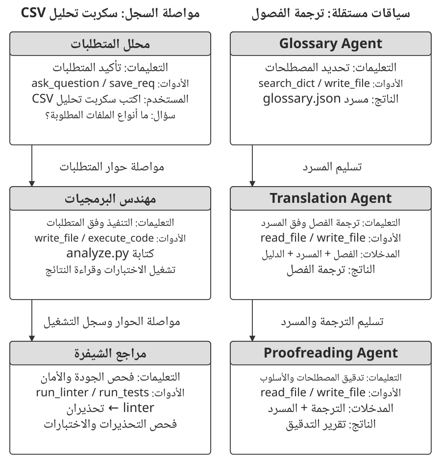

وحين يكون السياق مستقلًا لكل عضو، فكيف يتبادل الأعضاء المواد؟ درجت الأنظمة الموزعة على استخدام التخزين المشترك أو تمرير الرسائل. وتستعمل أنظمة الوكلاء الفكرتين أيضًا، ومن صورها:

- **معاملات استدعاء الأدوات.** يغلف الوكيل اللاحق في أداة، فيمرر الوكيل السابق المهمة والمواد المهيكلة عبر معاملاتها، ثم يتلقى النتيجة.
- **نظام ملفات مشترك.** يكتب أحد الطرفين مستندًا أو شيفرة أو بيانات، ويقرأها الآخر بالرجوع إليها؛ وهو مناسب للنواتج الوسيطة الكبيرة وللمواد التي يجب حفظها على المدى الطويل.
- **ناقل الرسائل (Message Bus).** يودع الوكيل رسالة لدى خدمة وسيطة تتولى توصيلها وفق الهدف أو الاشتراك، وهو مناسب للتبادل غير المتزامن بين عدة أعضاء.

فمثلًا، بعد أن يبعث الوكيل السابق مهمة ترجمة، يمكنه انتظار الترجمة، أو أن يستلم رقم المهمة أولًا وينصرف إلى فصل آخر. وحتى إذا استطاع المترجمان فتح الملف نفسه، فإن النظام لا يزال بحاجة إلى اتفاق على من يكتب ومتى يقرأ الطرف الآخر. ويشدد مجتمع Go على تنظيم الوصول إلى البيانات المشتركة بالتواصل، وهذا المبدأ يستقيم في الوكلاء أيضًا: حدد من يملك الحالة، ومن يحق له تعديلها، وكيف يتلقى سائر الأعضاء التحديثات.

### البعد الثاني: طوبولوجيا التعاون

تصف طوبولوجيا التعاون اعتماد المهام بين الوكلاء، ومسار المعلومات بينهم، وعلاقات التحكم. ويعتمد هذا الفصل ثلاث صور تنظيمية نموذجية:

- **نمط التعاون بين النظراء** (Peer Collaboration Pattern). عدد قليل من الأعضاء يتعاونون على ناتج واحد في جولات متكررة. فالمؤلف يكتب مسودة الورقة، ويقدم المعلق ملاحظات للتعديل، ثم يعود المؤلف إلى التنقيح.
- **نمط المدير** (Orchestration Pattern). يتولى الوكيل المدير المركزي تفكيك المهام وتوزيعها وتجميعها، ويتولى الوكلاء الفرعيون أعمالهم التخصصية.
- **النمط اللامركزي** (Decentralized Pattern). يواصل الأعضاء العمل اعتمادًا على الأدوار والرسائل والحالة المحلية، ويقررون معًا كيف يتقدم العمل.

> **ملاحظة مصطلحية: هندسة المخططات (Graph Engineering).** عرض الفصل الأول النقاش الدائر في يوليو 2026 حول هندسة المخططات. ينظر هذا المنظور إلى مخطط التنفيذ: تكون العقد وكلاء أو برامج عادية أو قرارات بشرية، وتعبر الحواف عن الاعتماديات والتوجيه الشرطي واتجاه المعالجة بعد الفشل، وتتدفق الحالة عبر علاقات التنفيذ. وطوبولوجيا التعاون متعدد الوكلاء إحدى تطبيقات هذا المنظور، وتركيزها على كيفية تسليم عدة وحدات قرار فيما بينها وتوازيها وتغذيتها الراجعة.

ويمكن الجمع بين التعاون بين النظراء ونمط المدير والتصميم اللامركزي. فالمدير يسلم مهمة كتابة إلى فريق مؤلف ومراجع، ثم يقدم الفريق نتيجته بعد جولات التكرار الداخلية.

## متى يتفوق تعدد الوكلاء على الوكيل الواحد؟

لنفترض أن المسودة أخطأت في ترجمة مصطلح تقني. إن أعطينا مراجعين اثنين الترجمة نفسها، فقد نحصل على موافقتين متطابقتين؛ أما إذا زودنا أحدهما بالنص الأصلي وقائمة المصطلحات والشيفرة التي تستخدم المصطلح، فقد أضفنا طريقًا جديدًا لاكتشاف الخطأ. لذلك نسأل قبل اختيار أسلوب التعاون: ماذا يضيف الوكيل الجديد إلى المهمة؟ قد يحصل على دليل جديد، أو يغطي مسار بحث آخر، أو يقدم حكمًا تخصصيًا مختلفًا، أو يختصر زمن الانتظار بالتنفيذ المتوازي.

يبدأ المؤلف بفحص **المكسب المعلوماتي للتغذية الراجعة**، ثم ينظر في مقدار ما يجنيه التوازي وعزل السياق. فالمراجع الذي يقرأ نتائج الاختبارات أو لقطة شاشة للصفحة أو مواد خارجية يستطيع أن يقترح تعديلًا استنادًا إلى أدلة لم تكن متاحة عند التوليد. ويبين الجدول 10-1 كيف يفحص هذا المكسب في عدة حالات شائعة.

الجدول 10-1 المعلومات والتغذية الراجعة في التعاون متعدد الوكلاء

| نمط التعاون | المصدر الرئيسي للمعلومات | محور التقييم |
|---|---|---|
| النموذج نفسه يعيد فحص مخرجاته | المواد الأصلية وعملية فحص جديدة | هل يكتشف ما فاته، وهل تتحسن النتيجة بعد التعديل |
| عدة وكلاء يتناظرون في المسألة نفسها | مسارات الحل والافتراضات والحجج لدى كل طرف | هل تختلف الآراء، وكيف يتحقق منها ويختار الجواب |
| المراجع يشغل الاختبارات ويفحص الشيفرة | تغذية راجعة من الترجمة البرمجية والاختبار والتشغيل | هل ينجح التعديل في الاختبارات ويحافظ على الوظائف القائمة |
| المراجع ينظر إلى ناتج العرض في الواجهة أو العرض التقديمي | لقطات الشاشة وتغذية راجعة من التفاعل | هل يوافق التخطيط والمحتوى والسلوك المتطلبات |
| المراجع يتحقق من الوقائع بأدوات خارجية | نتائج البحث وسجلات أنظمة العمل | هل المصدر موثوق، وهل تتفق النتيجة مع الدليل |

يدرب RLEF النموذج بالتعلم المعزز على الاستفادة من تغذية راجعة من تنفيذ الشيفرة، فيتعلم التنقيح متعدد الخطوات في مهام البرمجة التنافسية. وتوفر أخطاء الترجمة البرمجية وإخفاقات الاختبارات والاستثناءات أثناء التشغيل أساسًا ملموسًا للتعديل التالي، وقد حقق النموذج في الورقة نتائج أفضل بعدد أقل من العينات.[^rlef-2025] أما WebGen-Agent فيدخل في مسار التوليد لقطات شاشة الصفحات، وأوصاف نموذج بصري وتوصياته، وتقييم عمليات واجهة المستخدم الرسومية؛ فبإمكانه أن يعود خطوة إلى الوراء ويعيد العمل، أو أن يختار الأفضل بين عدة نواتج. وفي WebGen-Bench ارتفعت دقة Claude 3.5 Sonnet من 26.4% إلى 51.9%.[^webgen-agent-2025]

[^rlef-2025]: Gehring, J., et al. *RLEF: Grounding Code LLMs in Execution Feedback with Reinforcement Learning.* arXiv:2410.02089, 2025.
[^webgen-agent-2025]: Lu, Z., et al. *WebGen-Agent: Enhancing Interactive Website Generation with Multi-Level Feedback and Step-Level Reinforcement Learning.* arXiv:2509.22644, 2025.

يفضل المؤلف أن يحصل النظام أولًا على دليل ملموس، من اختبار أو لقطة شاشة أو نتيجة أداة، ثم يقرر كيف يوزع مسؤوليات التوليد والتنفيذ والمراجعة. ويمكن أن تنفذ حلقة التغذية الراجعة وكيل واحد، أو تقسم على عدة أدوار؛ والمهم أن إضافة دور جديد يجب أن تحسن الحصول على الدليل واستخدامه.

ويقدم بحث السلامة الذي أجرته Anthropic في 2026 حالة للبحث التعاوني: تبادل 45 وكيلًا اكتشافاتهم عبر منتدى مشترك، وراجعوا نتائج بعضهم، ثم أحالوا الحكم النهائي إلى وكيل مستقل. استهلكت المجموعة المتعاونة 27 مليون رمز واكتشفت 266 ثغرة، بينما استهلك النمط المتوازي المستقل 6.5 ملايين رمز واكتشف 21 ثغرة. أتاح المنتدى للأعضاء أن يتابعوا من حيث وصل غيرهم، وأن يعرفوا أي الاتجاهات يعمل فيها أحد بالفعل. واستهلكت المجموعة المتعاونة نحو أربعة أضعاف الرموز، لذا يجمع الفارق بين 266 و21 بين اختلاف طريقة التواصل واختلاف الاستثمار الحسابي.[^anthropic-multiagent-2026]

[^anthropic-multiagent-2026]: Anthropic Frontier Red Team, “Patterns and Problems in Emerging Multiagent Systems,” 2026-08-13.

وفي البحث الرياضي، كيف توجه عدة فرق إلى استكشاف مسارات مختلفة فعلًا؟ تصف معادلة Navier–Stokes ثلاثية الأبعاد حركة السوائل اللزجة. وهل يبقى الحل أملس إلى ما لا نهاية إذا انطلق من شرط ابتدائي أملس؟ وزعت OpenAI هدفين متعارضين على مجموعات مختلفة: بعضها يحاول إثبات الأملسية، وبعضها يسعى إلى بناء مثال مضاد. استكشفت كل مجموعة مسارها، ثم استخدم الفريق Codex لتجميع النتائج الوسيطة كي تستطيع بقية المجموعات أن تسير على الخيوط الواعدة. وعملت المجموعة التي وجدت المثال المضاد بنحو عشرة آلاف وكيل متزامن. وتذكر الورقة أن الفريق احتاج نحو 88 ساعة من إطلاق أول الوكلاء إلى العثور على البرهان، ثم 17 ساعة أخرى لإتمام الصياغة الصورية في Lean والتحقق منها. ويحمل المثال المضاد شرطًا مهمًا: أن يبقى السائل، رغم تأثير قوة خارجية ملساء، عرضة لظهور شذوذ في زمن محدود. وعلى هذا الأساس قدم الفريق مثالًا مضادًا يفي بالصيغتين C وD الواردتين في نص مسألة معهد كلاي الرياضي؛ أما رفع القوة الخارجية فيحول المسألة إلى مسألة أخرى. وعند تصميم بحث من هذا النوع، يمكن البدء بتحديد النتائج التي تكفي للإجابة عن السؤال الأصلي، وتوزيع الفرضيات المتنافسة على مجموعات مختلفة، مع تخصيص وقت منفصل للتحقق الأخير.[^ch10-ns-search]

[^ch10-ns-search]: يرفق بيان بحث OpenAI المعنون *On the Navier–Stokes Millennium Prize Problem* البرهان وشيفرة Lean. وقد رد معهد كلاي الرياضي في إعلان بتاريخ 11 سبتمبر 2026 على هذا العمل، موضحًا أن تقييم النتائج ونسبة الجائزة سيعالجان وفق إجراءات التحكيم.

**كيف تؤثر ميزانية الخطوات في الأداء؟** افترض أن المهمة تسمح بثلاثين خطوة، فعلى الوكيل أن يرتب التخطيط والتنفيذ الأساسي والتحقق الضروري ترتيبًا محكمًا؛ وإن سمحت بثلاثمئة خطوة، أمكنه مقارنة حلول أكثر وإجراء اختبارات وتعديلات أوفى. ولكي يحسن استخدام هذا القدر، يحتاج الوكيل إلى معرفة الميزانية الكلية والمتبقية، وضبط عمق الاستكشاف على أساسهما.

درس بحث Google لعام 2025 المعنون *Budget-Aware Tool-Use Enables Effective Agent Scaling* هذه المسألة: الوكيل الذي يفتقر إلى الوعي بالميزانية قد يتوقف سريعًا عند بحث سطحي، ويصعب تحسين أدائه بمجرد زيادة الخطوات المتاحة. ثم جاء BAVT (Budget-Aware Value Tree Search) في 2026 ليجمع في خطوات البحث بين تقدير القيمة والميزانية المتبقية، فيوازن بين الاستكشاف والاستغلال. فحين تكون الميزانية وفيرة يمكن مقارنة اتجاهات أكثر، وحين تقترب من حدها الأقصى تركز الموارد على الفروع الواعدة.

وفي نمط المدير، يعني ذلك أن على المدير توزيع الخطوات وفق صعوبة المهمة وتعديل التوزيع مع تقدم العمل: تنجز المهام البسيطة بسرعة، وتترك للمهام المعقدة مساحة للتحقق والتعديل، وعند التعثر يحدد السبب أولًا قبل تقرير إضافة معلومات أو زيادة الميزانية أو تغيير المسار.

يختصر الاستكشاف المتوازي الوقت الفعلي، وترفع المراجعة المتكررة جودة الناتج، لكن كليهما يزيد كلفة استدعاء النماذج والتواصل. لذلك يتخذ المؤلف وكيلًا واحدًا مضبوطًا أساسًا للمقارنة، ولا يوسع نطاق التعاون إلا حين يكون ما تضيفه الأعضاء الجديدة من جودة أو وقت كافيًا لتغطية كلفة التواصل والحساب المكرر والصيانة.

## تعاون متعدد الوكلاء بسياق مشترك

يبدل التعاون بسياق مشترك الأدوار مرحلة بعد مرحلة، مع مواصلة العمل على سجل المهمة القائم. خذ التقرير البحثي مثالًا: يجمع دور البحث المواد، ثم يتولى دور التحليل الحساب، ثم ينظم دور الكتابة التعبير. ويستطيع كل دور أن يراجع المصادر والقرارات السابقة، ويوجهه النظام بتعليمات المهمة الحالية إلى هدف هذه المرحلة.

وعند التسليم بين فريقين، يسأل أولًا: من يحتاج أن يعرف لماذا اتخذ القرار على هذا النحو؟ في مثال منتج Teamily AI، يكتب مدير المنتج والوكيل معًا وثيقة متطلبات المنتج (PRD) في مجموعة محادثة. وبعد أن يشارك فريق المنتج النسخة النهائية مع فريق الهندسة، يستطيع المهندسون أن يسألوا عن المقايضات التي تقف خلف أحد المتطلبات.

ولنأخذ تسليم دور البحث المهمة إلى دور الكتابة مثالًا: بعد التسليم، من أين يقرأ النموذج قواعد الكتابة، وأي الأدوات يستطيع استدعاءها؟ تطبق التجربة 10-1 التسليم نفسه بطريقتين.

| المسألة عند التسليم | تبديل الدور (`transfer_to_agent`) | تحميل Skill |
|---|---|---|
| كيف تقدم قواعد الكتابة؟ | تستبدل بموجه نظام دور الكتابة | يبقى فهرس Skills في موجه النظام، وتلحق قواعد الكتابة بنهاية سجل الرسائل |
| أي الأدوات يراها النموذج؟ | يمكن عرض أدوات دور الكتابة وحدها | يمكن الإبقاء على مجموعة الأدوات القائمة أو مدخل البحث عن الأدوات |
| أي جزء من KV Cache يبقى صالحًا؟ | يتغير موجه النظام، فتبدأ عادة إعادة الحساب من موضع تغير البادئة | تبقى بادئة الطلب الأصلية قابلة لإعادة الاستخدام |
| من يفحص صلاحية الاستدعاء؟ | يتحقق Harness من الطلب وفق الدور الحالي، ثم يوجه الأداة | يفحص Harness صلاحية كل استدعاء على حدة |

حين يكون الفرق بين الأدوار في المعرفة أو الإجراء أو أسلوب الكتابة، يفضل المؤلف استخدام Skill: فهي تسهل إعادة استخدام إطار التشغيل نفسه، وتحفظ ذاكرة البادئة الثابتة للطلب. أما حين يتصل الفرق بالصلاحيات أو بعزل الأدوات أو بمسؤولية الاعتماد، فيمكن التنظيم بوكيل مستقل أو بتبديل الأدوار، ويتولى Harness وبيئة التنفيذ إنفاذ ضوابط الوصول. وظهور الأداة في مدخلات النموذج يؤثر في اختيار الاستدعاء، أما الصلاحية الفعلية فيقررها التحقق أثناء التشغيل.

> **التجربة 10-1 ★★: تبديل الأدوار المتعددة في سياق مشترك — موجه النظام مقابل Skill**
>
> يستخدم المساران النموذج نفسه، ومهمة المستخدم نفسها، وتنفيذ الأدوات نفسه، وقواعد الأدوار نفسها، والسجل المشترك نفسه. يطلب العرض التمهيدي البحث عن مبيعات سيارات الطاقة الجديدة في الصين للأعوام 2021–2023، وحساب معدل النمو السنوي المركب (CAGR)، وكتابة موجز للمستثمر لا يتجاوز 120 حرفًا.
>
> **المسار الأول: تبديل موجه النظام.** تضبط خمسة أدوار هي triage (جمع المتطلبات) وresearch (البحث) وcoding (البرمجة) وdata_analysis (التحليل) وwriting (الكتابة). يكون triage مدخلًا، ويرى كل دور أدواته الخاصة و`transfer_to_agent`. وعند التسليم يحفظ السجل، وتحمل تعليمات الدور الهدف ومجموعة أدواته، ثم يستأنف التشغيل.
>
> **المسار الثاني: تحميل Skill.** يبقى موجه النظام ومجموعة الأدوات كاملة ثابتين طوال الجلسة. يستدعي النموذج `load_skill(name)` للحصول على قواعد الدور، وتضاف النتيجة إلى السجل المشترك، وتبقى البادئة الأصلية محفوظة. ويفحص Harness كل استدعاء أداة وفق قواعد الصلاحيات.
>
> يقرأ التنفيذان ملف `SKILL.md` نفسه. خذ طلبًا واحدًا مرسلًا إلى النموذج قبل تبديل الدور وبعده، وانظر في أي رسالة ظهرت القواعد، وأي بادئة بقيت قابلة لإعادة الاستخدام. ثم راجع الموجزين: هل مصدر أرقام المبيعات موثوق؟ وهل جرى حساب معدل النمو السنوي المركب بشكل صحيح مع وجود فترتي نمو من نهاية 2021 إلى نهاية 2023؟
>
> تضمنت المقارنة الرسمية سؤال موجز أكثر صرامة، محدودًا بـ 160 حرفًا مع الحفاظ على رابطي مصدر. ومع منح الفريقين ثماني خطوات، أنفقت مجموعة تبديل الأدوار ثلاثة استدعاءات على عد الأحرف، ومع ذلك بلغت مسودتها 206 أحرف، كما غفلت عن أداة الحساب التي حددها السؤال. أما مجموعة تحميل Skill فحسبت معدل النمو من مبيعات السنتين الأولى والأخيرة، ولم تحمل قواعد الكتابة إلا في الخطوة الثامنة. عندها كانت الأدوار كلها قد مرت، لكن المستخدم لم يستلم الموجز بعد. وانتهى المساران ببلوغ حد الخطوات.
>
> ثم جرى تشغيل التنفيذين على المهام الثلاثين نفسها، وفحصت البرامج النتائج المسلمة: نجحت مجموعة تحميل Skill في 15 مهمة، ومجموعة تبديل موجه النظام في مهمتين. غير أن المقارنة سؤالًا بسؤال تظهر أن المجموعة الأولى استهلكت 6,855 رمزًا إضافيًا لم يصب من ذاكرة التخزين المؤقت، وتأخرت نحو 4.4 ثانية (وهي وسيط الفروق المزدوجة). وقد أبلغ مزود الخدمة في هذه المرة عن صفر رموز مدخلات مخزنة في المجموعتين. ونجحت المجموعتان في الاختبارات الحدية الستة الخاصة باتباع التعليمات، مع فارق كبير في نسبة نجاح المهمة الكاملة.

## تعاون متعدد الوكلاء بلا سياق مشترك

في بنية السياق المستقل، يحتفظ كل وكيل على حدة بسجل مدخلاته وحالة مهمته وحلقة تشغيله، ويتبادل ما يحتاج إليه من معلومات عبر معاملات الأدوات والملفات المشتركة والرسائل. فالمواد التي يسلمها المترجم مثلًا تشير إلى فقرات النص الأصلي وإلى إصدار قائمة المصطلحات. وحتى لو خرج المترجم من العمل، يستطيع المراجع أن يجد النص الأصلي؛ وإذا احتاج الأمر إلى إعادة العمل، أمكن الوصول إلى المسؤول عن كل فصل.

يقارن الجدول 10-2 طريقة إدارة نظام التشغيل للعمليات بطريقة إدارة بيئة التشغيل للوكلاء.

الجدول 10-2 تشبيه تصميمي بين الأنظمة متعددة الوكلاء ونظام التشغيل

| نظام التشغيل | المسؤولية المقابلة في النظام متعدد الوكلاء |
|---|---|
| البرنامج وإعداداته | موجه النظام وتعريفات الأدوات وإعدادات الدور |
| ذاكرة العملية | السياق الحالي وحالة المهمة والسجل |
| تنفيذ الحساب في CPU | يولد LLM القرار، وتنفذ بيئة التشغيل والأدوات العمليات المقابلة |
| إدارة النواة للتشغيل | تدير بيئة تشغيل الوكيل الحالة والجدولة والموارد |
| استدعاءات النظام | طلب العمليات الخارجية عبر واجهات الأدوات |
| fork: إنشاء عملية فرعية | `spawn_subagent`: إنشاء وكيل فرعي |
| kill: إرسال إشارة | `cancel_subagent`: طلب الإلغاء |
| ps: الاستعلام عن العمليات | `list_agents`: الاستعلام عن الأعضاء وحالة تشغيلهم |
| حالة الخروج وwait | إشعار الإكمال وحالة المهمة والنتيجة المهيكلة |
| التخزين المشترك وتمرير الرسائل | الملفات المشتركة ومعاملات الأدوات والرسائل |

والحالة الخاصة والرسائل غير المتزامنة وإنشاء الأعضاء ديناميكيًا عناصر ظهرت أيضًا في نموذج الممثل (Actor Model) الذي طرح في سبعينيات القرن الماضي.[^actor-model]

[^actor-model]: Hewitt, C., Bishop, P., Steiger, R. *A Universal Modular ACTOR Formalism for Artificial Intelligence.* IJCAI 1973.

حين تكثر المهام الفرعية المستقلة، يميل المؤلف إلى منح كل عضو سياقًا مستقلًا، فلا يعالج إلا المواد المتصلة بمسؤوليته. وهذا يسهل اختبار كل دور على حدة، ويقلل تشويش السجل الطويل للمرحلة السابقة على الحكم الحالي، ويتيح تقدم عدة مهام بالتزامن. غير أن فعالية العزل تتوقف أيضًا على سائر الموارد المشتركة: فقد يظل عدة وكلاء يعدلون الملفات نفسها في وقت واحد، أو يستهلكون حصة API نفسها، أو يتلقون رسالة الخطأ نفسها.

وعلى واجهة التعاون أن تعالج أيضًا ضياع الرسائل وتكرار تسليمها وتأخر الحالة. وعند تتبع المشكلات، يمكن ربط طلبات الأعضاء وأحداث الأدوات والنتائج بمعرف المهمة، لإعادة بناء مسار عملية تسليم واحدة.

افترض أن وكيلًا أنهى تحليلًا ويريد تسليم النتيجة إلى زميله الذي يكتب التقرير. إن كانت القيم قليلة أمكن إرسالها مع الرسالة؛ وإن كان الناتج جدولًا كبيرًا، فالعادة أن يحفظ في نظام الملفات المشترك ويرفق بالرسالة مرجع إليه. ومن هنا ينشأ تقسيم للعمل بين وظيفتين: **تخزين النواتج** لحفظ المستندات والشيفرة والبيانات وتبادلها، و**التواصل والتحكم** لتوصيل الرسائل والاستعلام عن حالة المهام وإلغاء التنفيذ وجدولة الموارد.

### نظام الملفات من منظور الوكيل

من التصاميم الشائعة تزويد الوكيل بـ**نظام ملفات افتراضي** (virtual filesystem) تركب فيه موارد من مصادر مختلفة على شجرة مجلدات موحدة. ويصل النموذج إليها عبر واجهات مثل `read_file` و`write_file` و`list_dir`، بينما يمكن أن تتصل الطبقة السفلية بقرص محلي مؤقت، أو بتخزين كائنات دائم، أو بواجهة API لتخزين سحابي خارجي، أو بحزم موارد النظام.

يبدأ المؤلف بتحديد مناطق التخزين قبل ربطها بمسار التعاون. فإذا اختلطت المسودات المؤقتة والمخرجات الرسمية وملفات المستخدم الخارجية، سهلت الكتابة فوق ملف عن طريق الخطأ أو قراءة ما لا يجوز. والواجهة الموحدة تسهل الاستخدام، أما رؤية كل منطقة ودورة حياتها وصلاحياتها فتحددها إعدادات التركيب وضوابط الوصول. ويمكن تقسيم هذه الشجرة إلى أربع مناطق.

**أولًا: مساحة عمل خاصة بالوكيل (Scratchpad).** لكل نسخة مساحة عمل خاصة تحفظ فيها المسودات والملفات المؤقتة وسجلات التصحيح والنواتج الوسيطة. ويقصر الوصول إليها افتراضيًا على الوكيل المالك، وتنظف أو تؤرشف وفق سياسة المهمة. وهذا يمنع الملفات المؤقتة من الكتابة فوق بعضها؛ فإذا أنهى الوكيل الفرعي عمله، وضع النتائج المطلوب تسليمها في المساحة المشتركة، وسلمها مع ملخص مهيكل إلى الوكيل الرئيسي. ويبقى سجل المحاولات في مساحة العمل الأصلية لأغراض التشخيص اللاحق. وبذلك يمتد عزل السياق إلى طبقة التخزين: يحصل الوكيل الرئيسي على المخرجات والأدلة الضرورية، ويوفر في التنسيق اليومي كلفة قراءة كل مسار المحاولات.

**ثانيًا: المساحة المشتركة بين الوكلاء (Shared Workspace).** يتبادل الأعضاء المتعاونون فيها النواتج، ويستطيع المستخدم أيضًا أن يرفع المواد وينزل المخرجات عبر مدخل مصرح له. فمثلًا يكتب Glossary Agent قائمة المصطلحات، ويقرؤها Translation Agent ليترجم، ثم يفحص المراجع الترجمة. وتحفظ المساحة المشتركة عادة طوال عمر المهمة، وتحتاج إلى معالجة الكتابة المتزامنة وتحديث الإصدارات ونطاق الوصول. وفي الفصل السادس، تبادل الوكيل والحاسوب الافتراضي ملفات CSV والمخططات عبر تخزين مشترك، وهذا مثال على هذا النوع من تسليم النواتج. وسيعرض هذا الفصل لاحقًا أساليب مثل القفل التفاؤلي وعزل نسخ العمل.

**ثالثًا: الموارد الخارجية المركبة (Mounted External Resources).** يمكن ربط موارد مثل Google Drive وNotion وDropbox وويكي المؤسسة بالواجهة الموحدة عبر محولات. وحين يقرأ الوكيل مستندًا، يتولى المحول استدعاء API النظام المصدر. وهنا ثلاثة فروق يجب ضبطها: نطاق الوصول تحدده صلاحيات خارجية؛ والوصول الشبكي يجلب مشكلات التأخير وانتهاء المهلة وتحديث الذاكرة المؤقتة؛ والكتابة المرتدة يجب أن تراعي قواعد الصلاحيات والإصدارات في النظام المصدر. أما دلالات الاتساق فتحددها واجهة الخدمة، ويمكن الاستفادة من أرقام الإصدارات أو الكتابة المشروطة أو إعادة القراءة لاكتشاف التعديلات المتزامنة. ويناسب التركيب للقراءة فقط عند الطلب استرجاع المواد، وتمنح صلاحية الكتابة الملائمة حين يلزم التحرير.

**رابعًا: موارد النظام المدمجة (Built-in System Resources).** يمكن أن تكون الأدلة المرجعية والقوالب وتعريفات الأدوات وSkills المهيأة مسبقًا حزم موارد للقراءة فقط يستخدمها عدة وكلاء. وتحمل Skills بالإفصاح التدريجي: يقدم الفهرس أولًا، ثم تقرأ القواعد والنصوص البرمجية وفق المهمة. وحزم الموارد ذات الإصدار الثابت تسهل القراءة المتزامنة، وعند الترقية يبدل الإصدار بحيث تبقى المهام الجارية متسقة.

في الشكل 10-2، يستطيع المترجم أن يعدل مسودته مرارًا في مجلده الخاص، فإذا صارت جاهزة للمراجعة وضع النسخة المعنية في المنطقة المشتركة. أما المخطوطة الأصلية في التخزين السحابي للمستخدم فيقرؤها محول خارجي، ويتوقف الوصول إليها على الصلاحيات التي منحها المستخدم.

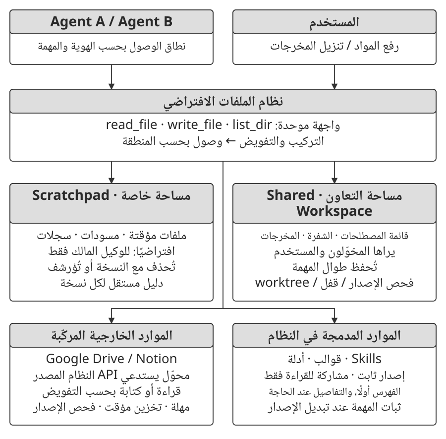

حين يخرج المترجم، قد تحرر الملفات المؤقتة في مساحة عمله. أما الترجمة الموضوعة في المنطقة المشتركة فتبقى محفوظة، ويتسلمها المراجع بصلاحية القراءة (الجدول 10-3).

الجدول 10-3 المناطق الأربع في نظام الملفات الافتراضي للوكيل

| المنطقة | الرؤية | دورة الحياة | القراءة والكتابة | إدارة التزامن |
|---|---|---|---|---|
| مساحة عمل خاصة بالوكيل | افتراضيًا للوكيل المالك وحده | تنظف مع النسخة، وتؤرشف عند الحاجة | قراءة وكتابة للوكيل المالك | منع الكتابة المكررة من إعادة المحاولة أو العمليات الخلفية |
| المساحة المشتركة بين الوكلاء | الأعضاء والمستخدمون المصرح لهم | تحفظ طوال عمر المهمة | صلاحيات بحسب الدور | الأقفال أو فحص الإصدار أو worktree |
| الموارد الخارجية المركبة | تحدها الصلاحيات الخارجية والمحول معًا | يحددها النظام المصدر وسياسة الذاكرة المؤقتة | قراءة فقط عند الطلب أو كتابة مصرح بها | اتباع واجهات الإصدار والتزامن في النظام المصدر |
| موارد النظام المدمجة | الوكلاء المصرح لهم | إصدار ثابت يعاد استخدامه عبر الجلسات | قراءة فقط | تبديل إصدار الموارد بصورة موحدة |

وتبقي مراجع الملفات رسائل التسليم قصيرة: يقدم الطرف السابق موضع الناتج وإصداره والغرض منه، ويقرأ الطرف اللاحق المحتوى عند الحاجة. ويمكن للأعضاء في بيئة التشغيل نفسها استخدام مسار مشترك؛ أما التعاون بين المنظمات فيحتاج إلى معرفات نواتج يستطيع الطرفان تفسيرها، وواجهات وصول وتفويض، لإتمام التسليم نفسه.

### التواصل والتحكم بين الوكلاء

توفر أدوات الإنشاء والتواصل والإلغاء والاكتشاف التي عرضها الفصل الرابع واجهات التحكم الأساسية للتعاون متعدد الوكلاء: `spawn_subagent` لإنشاء عضو، و`send_message_to_subagent` لتمرير رسالة، و`cancel_subagent` لطلب الإلغاء، و`list_agents` للاستعلام عن الأعضاء. وحول هذه الواجهات، يلزم الاتفاق على سلوك الرسائل والحالة والإنهاء والجدولة.

**أولًا: تمرير الرسائل.** حين يكون الأعضاء قلة وعلاقاتهم ثابتة، يمكن استخدام واجهات من نقطة إلى نقطة، كأن يتبادل وكيل الهاتف ووكيل الحاسوب التقدم مباشرة. وإذا احتاج كل عضو إلى التواصل مع كل عضو آخر، نما عدد العلاقات المحتملة بمربع عدد الأعضاء؛ وحين تكثر علاقات الاشتراك، يسهل ناقل الرسائل الإدارة الموحدة للتوجيه والتخزين المؤقت وإعادة المحاولة. ويمكن لكلا الأسلوبين تحقيق التوصيل غير المتزامن، أما اشتراط وجود المتلقي متصلًا في الوقت نفسه فيتوقف على آليات الطوابير والحفظ الدائم.

وتحمل الرسالة عادة **مغلفًا** (envelope) مهيكلًا: معرف المرسل، والوكيل الهدف أو نطاق البث، ونوع الرسالة وحمولتها. ويمكن أن تشمل أنواع الرسائل `task_assigned` و`status_update` و`result` و`terminate`. وتساعد معرفات المهمة والرسالة والطلب المرتبط المتلقي على إزالة التكرار، وتتيح لأدوات التصحيح إعادة بناء سلسلة الاتصال. ويوضع مضمون العمل في حمولة JSON، ويعالجها الطرفان وفق الحقول المتفق عليها.

فمثلًا، يتولى محرر مسؤولية تسليم ترجمة، ويريد أن يطلب من وكيل مراجعة المصطلحات التحقق من كلمة. يكفي أن يذكره بالاسم (`@`) في تعليق على تذكرة Multica ويكتب سؤاله، فتبدأ المراجعة. وتنشر ملاحظات المراجعة ردًا في التذكرة نفسها مباشرة، ويبقى المحرر هو المسؤول، وتبقى حالة التذكرة على ما كانت عليه. وإذا أريد أن يتولى المراجع التذكرة كلها، وجب تغيير المسؤول صراحة.[^ch10-multica]

[^ch10-multica]: Multica، ذكر الوكيل بالاسم في التعليقات؛ تنفيذ توزيع التعليقات في الإصدار `d579273`.

**ثانيًا: الحصول على الحالة.** يحتاج الوكيل الرئيسي إلى أن يعرف هل لا تزال المهمة الفرعية تعمل، وهل تحتاج إلى مدخلات، وهل صارت النتيجة جاهزة. ويمكن الجمع بين واجهات الحالة وإشعارات الأحداث وملفات التقدم: تقدم واجهة بيئة التشغيل حالة دورة الحياة، وتشرح الرسائل تقدم العمل، وتحفظ الملفات الدائمة سجلًا قابلًا للاستعادة.

تستطيع `get_subagent_status(agent_id)` أن تعيد حالات مثل: قيد التشغيل، أو بحاجة إلى مدخلات، أو مكتمل، أو فاشل. وفي التنسيق اليومي، يفضل المؤلف إشعارات الإكمال ورسائل التقدم المرحلي، فيواصل الوكيل الرئيسي عمله. ولا يلجأ إلى الاستعلام المباشر إلا عند تأخر الإشعار أو استعادة الاتصال أو الحاجة إلى تتبع مشكلة، تجنبًا لإنفاق استدعاءات النموذج على السؤال المتكرر «هل انتهيت؟». وتحتفظ بيئة التشغيل بواجهة الحالة، فتستطيع الإبلاغ في الوقت المناسب عن بقاء العملية حية وانتهاء المهمة.

**تبادل التقدم بالرسائل.** يستطيع الوكيل الرئيسي أن يسأل عن التقدم الحالي، فيجيب الوكيل الفرعي في خطوة مناسبة؛ ويستطيع الوكيل الفرعي كذلك أن ينشر `status_update` من تلقاء نفسه حين يبلغ نتيجة مرحلية أو يتعثر أو يحتاج إلى مساعدة. وينبغي أن تبين الرسالة ما أنجز، والخطوة التالية، وسبب التعثر، وأن يستخدم الأعضاء جميعًا أسماء الحالات نفسها ليسهل التجميع والحكم. وسيعرض بروتوكول A2A لاحقًا تعبيرًا موحدًا عن دورة حياة المهمة.

**حفظ التقدم في ملفات.** يمكن للنظام أن يلحق الرسائل وطلبات الأدوات ونتائجها وتغيرات الحالة بسجل وفق ترتيب الأحداث، باستخدام صيغة JSONL مثلًا، حيث يشغل كل حدث سطرًا. ويستطيع الوكيل الرئيسي المصرح له بالتشخيص أو أدوات التشغيل أن يفحص منه إعادة المحاولات والأخطاء وفترات الانتظار. فسجل مدخلات النموذج ليس إلا جزءًا من مسار التشغيل، ويستطيع السجل أن يدون أيضًا أحداث الجدولة والتنفيذ الخارجي.

قد يحوي المسار الكامل عشرات الآلاف من الرموز، وعلى الوكيل الرئيسي أن يستخلص الحالة من جديد في كل قراءة. أما الرسالة فتنبه الوكيل الرئيسي إلى تقدم جديد، ويحفظ ملف التقدم القصير الحالة الراهنة للاستعلام والاستعادة لاحقًا. ويفضل المؤلف الجمع بين الاثنين في التنسيق اليومي. فكلما أنجز الوكيل الفرعي عملًا، حدث قائمة المهام ومراجع النواتج ونقطة التعثر الحالية؛ ويقرر الوكيل الرئيسي الخطوة التالية على أساس هذه الحقول. ويحتفظ بالمسار المفصل للتتبع عند الحاجة. وإذا بقي التقدم بلا تغيير مدة طويلة، أمكن الحكم على ضرورة التدخل بالجمع بين نبضات الحياة وحالة استدعاء الأدوات ومهلة المهمة: فالأداة الطويلة التشغيل قد تكون لا تزال تعمل، والقرار بالانتظار أو الإلغاء أو إعادة المحاولة يأتي بعد التحقق من الحالة.

**ثالثًا: إنهاء التنفيذ.** حين يبحث عدة أعضاء بالتوازي عن الهدف نفسه، يمكن إيقاف الفروع الأخرى بعد أن ينجز أحدهم المهمة، لتحرير الميزانية وموارد الأدوات. وللإلغاء درجتان، تقابلان عمل SIGTERM وSIGKILL في Unix.

يفضل المؤلف **الإنهاء اللطيف**: تمرر بيئة التشغيل طلب الإلغاء، فيتوقف الوكيل الفرعي عند نقطة آمنة عن بدء عمليات جديدة، ويحفظ التقدم الضروري، ويغلق جلسة المتصفح، ويحرر الأقفال، ثم يعيد إشعار استلام (ack). أما **الإنهاء القسري** فيستخدم للتنفيذ الذي لم يستجب بعد انقضاء مهلة الإلغاء: تنهي بيئة التشغيل العملية، ثم تفحص الموارد المتبقية والكتابات غير المكتملة. والعمليات التي أرسلت فعلًا إلى أنظمة خارجية تحتاج إلى الاستعلام عن نتيجتها، وتنفيذ إجراء تعويضي عند الضرورة.

وتحتاج دورة الحياة أيضًا إلى إدارة على امتداد علاقة الإنشاء. وعلى غرار context في Go، يمكن أن تنتشر إشارة إلغاء المهمة الأم نزولًا إلى شجرة المهام الفرعية كلها، وتفحص حلقة التشغيل إشارة الإلغاء عند النقاط الآمنة، كما يستخدم `ctx.Done()`. وبذلك تدخل الفروع التي أطلقتها المهمة الأم مرحلة التنظيف حين تنتهي، فلا يبقى وكيل بلا إدارة يستدعي الأدوات ويستهلك الميزانية. أما المهام الخلفية التي تحتاج فعلًا إلى العمل باستقلال طويل، فينشأ لها سياق دورة حياة مستقل، على غرار `context.Background()`، مع تعيين مسؤول عن مراقبتها وميزانيتها وتنظيفها.

**رابعًا: الموارد والجدولة.** تحتاج أنظمة الوكلاء إلى توزيع الرموز والخطوات وحصص التزامن واتصالات الأدوات وموارد الحوسبة. عند إطلاق مهمة فرعية تحدد ميزانيتها وسلوكها عند تجاوزها؛ ويختار النموذج وفق صعوبة المهمة؛ ويقيد عدد الاستدعاءات المتزامنة كي لا تستنزف حصة الخدمة دفعة واحدة. وحين تصل مهمة أكثر إلحاحًا، يمكن إيقاف المهام الأقل أولوية مؤقتًا أو إلغاؤها عند نقطة آمنة، وحفظ تقدمها ثم إعادة جدولتها.

افترض أن ثلاثة فروع يتحقق كل منها من حل ممكن، وأن أحدها عثر على دليل حاسم ولم يبق له إلا تحقق أخير. يستطيع المدير أن يمنحه بضع خطوات إضافية، وأن ينهي في الوقت نفسه الفرعين اللذين لم يتقدما. وتخصم بيئة التشغيل الحصة؛ فإذا نفدت ميزانية فرع، وجب عليه التوقف وإن أراد المحاولة مرة أخرى.

### نمط التعاون بين النظراء: الفحص المتبادل والتحسين التكراري

يتكون التعاون بين النظراء عادة من وكيلين أو ثلاثة يتبادلون الآراء حول مهمة واحدة ويعدلون الناتج. وعند التصميم، يمكن أولًا إسناد مسؤوليات ومواد وأدوات مختلفة إلى الأعضاء، فيحكم كل منهم مستقلًا، ثم تجمع النتائج. فالمولد يركز على التنفيذ، والمراجع على الاختبارات ومتطلبات المستخدم؛ والأعضاء ذوو التخصصات المختلفة يفحص كل منهم قيود مجاله. وكلما تشابهت النماذج والمدخلات وطريقة العمل، زاد ميل الأعضاء إلى تكرار الحكم نفسه، ولذلك ينبغي تصميم اختلاف المنظور والدليل عن قصد.[^anthropic-multiagent-2026]

وفي المهام التي يحسن فيها ناتج واحد مرة بعد مرة، يوصي المؤلف بالبدء بتعاون بين عضوين أو ثلاثة. فإذا اتضحت الأدوار ومضمون التسليم وشروط التوقف، أمكن بناء حلقة قابلة للاختبار، مع قلة أعباء التنسيق في البداية.

#### هندسة الحلقات (Loop Engineering)

يساعد التعاون بين النظراء على معالجة مشكلة شائعة هي **الإنهاء المبكر**. وفي البرمجة ومهام خدمة العملاء بالوكالة، يمكن اكتشاف الإنهاء المبكر من ثلاثة أنواع من السجلات.

- **ادعاء الإنجاز الكامل بعد إنجاز جزئي.** يكتب Coding Agent الشيفرة لكنه يغفل الاختبارات وفحوص النشر؛ ويكلف المستخدم المساعد بأمرين، فينجز الأول ثم يبلغ أن كل شيء قد تم. والعلاج مطابقة كل بند في قائمة المهام ببند، وفحص دليل إنجاز كل عمل.
- **الاستسلام المبكر بعد فشل مسار واحد.** قد يطلب التاجر تقديم المستندات عبر نموذج إلكتروني، أو استلام المرفقات عبر بريد إلكتروني محدد. فإذا وصل رد كهذا، أمكن مواصلة الإجراء بالطريقة التي يقبلها التاجر. والمطلوب تسجيل سبب الفشل، وتقدير المسارات الأخرى التي تستحق المحاولة.
- **إغفال الخطوات اللاحقة بعد نجاح جزئي.** إذا وافق التاجر على رد المبلغ ثم طلب من المستخدم التأكيد في التطبيق، فعلى المساعد أن يوضح هذه الخطوة وشروطها. وفي مثال تخفيض الفاتورة، إذا وعد موظف خدمة العملاء شفهيًا بالتخفيض في المكالمة، يستطيع المساعد أن يؤكد للمستخدم أن هذه المفاوضة انتهت بوعد. فسجل المكالمة يثبت ما قاله الموظف، أما الوفاء بالوعد في الفاتورة اللاحقة فيحتاج إلى دليل جديد. وعلى المراجع أن يبين على حدة النتيجة المتحققة، ومن بقي عليه أن يفعل ماذا، وأي النتائج لا يمكن رؤيتها بعد.

تشترط هذه المشكلات الثلاث جميعًا ترجمة شروط الإنجاز إلى نتائج قابلة للفحص. وتهتم **هندسة الحلقات** بكيفية إبقاء الوكيل في دورة متواصلة من «تحديد العمل التالي — التنفيذ — التحقق — تسجيل التقدم»، ثم تقرير المواصلة أو الانتظار أو التسليم أو الإنهاء وفق النتيجة. ويحتاج المهندس إلى تصميم مصدر المهام وأسلوب التحقق والحالة الدائمة وشروط التوقف. ويتسع عمل الإنسان تبعًا لذلك: من كتابة موجه لاستدعاء واحد إلى تصميم حلقة قادرة على دفع المهمة إلى الأمام باستمرار. وقد استخدم Addy Osmani هذا الاسم في يونيو 2026 لمناقشة هذه المجموعة من الممارسات، مستشهدًا بتجربة Boris Cherny: أن مركز الثقل في العمل ينتقل تدريجيًا إلى تصميم الحلقات التي تقود الوكلاء.[^loop-engineering-2026]

**يرى المؤلف أن المدقق كثيرًا ما يكون عنق الزجاجة في حلقات من هذا النوع.** فإن لم يكن التحقق موثوقًا، قد تؤدي زيادة الجولات إلى تكرار الأخطاء نفسها، أو إلى إعلان الإنجاز قبل أوانه. ونتائج الاختبارات وحالة العمل وتأكيد المستخدم توفر كل منها أساسًا للإنجاز في حدود نطاقه؛ أما فشل التحقق فيصبح مدخلًا لجولة التعديل التالية.

والممارسة سبقت التسمية. فقبل أن يشيع اسم هندسة الحلقات، كان المؤلف وفريقه في Pine AI يستخدمون الحلقات والتحقق لمعالجة الإنهاء المبكر. ونموذج المقترح والمدقق إحدى الطرق الشائعة لتنظيم هذه الحلقات، وسيأتي تفصيله.

[^loop-engineering-2026]: Osmani, Addy. “Loop Engineering”, 2026.

**LoopX: حفظ حالة العمل عبر الجولات.** يضع LoopX الأهداف والحدود والمهام المعلقة والبوابات والأدلة والحصص في مستوى تحكم دائم، يتولى ترتيب عمل الجولة التالية أو المنفذ التالي. ويمكن تلخيص المسار في: **قرار مستوى التحكم ← تنفيذ الوكيل ← تحقق مستقل ← تثبيت التقدم المتحقق منه**.

يستدعي الوكيل الأدوات ويستدل ويسلم نتيجة جولته. ويسجل مستوى التحكم العمل المنجز، ويقرر من أين تبدأ الجولة التالية. فإذا نجح التحقق ثبتت حالة الإنجاز؛ وإن فشل انتقل العمل إلى الإصلاح أو إعادة التخطيط. وتحدد البوابات البشرية وشروط الانتظار وحدود الميزانية معًا متى يمكن مواصلة التنفيذ.[^loopx-framework]

[^loopx-framework]: LoopX, The local control plane for long-running AI agent work, v0.4.0.

**LongHorizon-Harness: وصل المهام الطويلة عبر التطبيقات.** ينطلق هذا الإطار من Computer Use متعدد الوسائط، ويعالج التنفيذ المتصل لمهمة تمتد عبر واجهات المستخدم الرسومية وسطر الأوامر وعدة تطبيقات مكتبية وعدة عمليات تجديد للسياق. ويعتمد حلقة Manage–Execute–Audit (MEA): يولد Manager مهمة فرعية محددة النطاق انطلاقًا من الهدف الأصلي والتقدم المتحقق منه وأدلة الفشل والعمل المتبقي؛ وينفذ Executor عمليات الواجهة الرسومية أو سطر الأوامر في سياق جديد؛ ويفحص Auditor النتيجة بصلاحية القراءة فقط، ثم يكتب التقدم المتحقق منه في حالة الجولة التالية. وتحفظ أدلة الفشل أيضًا لاستخدامها في الاستعادة وإعادة التخطيط.

ويستدعي الإطار عبر طبقة مواءمة خلفيات تنفيذ مثل Claude Code وCodex CLI، فيصل إدارة المهمة في الطبقة الخارجية بحلقة التشغيل في الخلفية. ويرسخ هذا التوجه استمرارية المهمة الطويلة في حالة مهمة متحقق منها. فيمكن تجديد سياق التنفيذ، وتواصل الجولة التالية العمل استنادًا إلى الهدف وأدلة الإنجاز والمسائل المعلقة، مع إعادة فحص ما إذا كانت تغيرات البيئة تؤثر في الاستنتاجات السابقة.[^longhorizon-implementation]

وفي مقارنة أبقت الورقة فيها خلفية التنفيذ Qwen 3.7-Plus وClaude Code على حالها وغيرت الحلقة الخارجية وحدها، ارتفع PassRate في WeaveBench من 51.8% إلى 80.7%، ومعدل الإنجاز الثنائي في OSWorld 2.0 من 2.8% إلى 8.3%، ومعدل النجاح في Terminal-Bench 2.1 من 69.7% إلى 77.2%. واختلفت الكلفة باختلاف المهمة: فقد استهلك المعياران الأولان 2.3 ضعف مجموع رموز خط الأساس و3.6 ضعف رموز المخرجات على التوالي، بينما انخفض استهلاك الرموز في Terminal-Bench 2.1 بنسبة 24%.

وفي مهمة تدقيق طبقات التدفق المتعددة في WebRTC نفسها، علق منفذ خط الأساس في واجهة Wireshark، ثم حاول بضع مرات أخرى، وانتهى بدرجة 0.59. أما مع MEA فقد سجل المدقق الأدلة الناقصة، واستكملها المنفذ في الجولة التالية، فبلغت الدرجة 0.92.

[^longhorizon-implementation]: LongHorizon-Harness، رقم الورقة arXiv:2608.01964. المسارات العلنية لخط الأساس ولـ MEA مأخوذة كلها من المهمة WEB_task_16_webrtc_simulcast_layer_audit، ويستخدم نص إعادة الإنتاج الإيداع `53bc678`.

#### نموذج المقترح والمدقق (Proposer-Reviewer)

يقسم نموذج المقترح والمدقق توليد الناتج وفحص النتيجة بين دورين. وقد اعتمدت تجارب توليد العروض التقديمية وتحرير الفيديو وتصوير السجلات في الفصل الخامس هذا التصميم: يولد Proposer الشيفرة، وينظر Reviewer في نتيجة العرض، ويفحص الجودة مستعينًا بنموذج بصري، ثم يعيد ملاحظات تعديل مهيكلة. وفي الشكل 10-3، يجب أن تعود ملاحظات التعديل إلى المقترح. وقدرته على إصلاح النسخة التالية بناء عليها تتوقف على مدى دقة المدقق في تحديد موضع المشكلة.

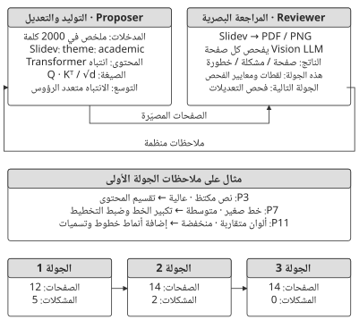

وإذا تغير موضوع الفحص، تغير معه الدليل الذي يجب النظر فيه. فمراجعة رد خدمة العملاء تستلزم مقابلته بقواعد العمل ومصادر الوقائع؛ ومراجعة تعديل الشيفرة تستلزم النظر في الاختبارات ونتائج التنفيذ الفعلية؛ ومراجعة خطة عمل تستلزم التحقق من المعايير السارية والشروط المسبقة.

وجدت ورقة Huang وزملائه في ICLR 2024 بعنوان *Large Language Models Cannot Self-Correct Reasoning Yet* أن GPT-4، في مهام الاستدلال وإعدادات الموجهات التي درستها، حين يصحح نفسه بلا تغذية راجعة خارجية، قد يحول إجابات صحيحة إلى خاطئة، فتنخفض الدقة الإجمالية. وناقش مسح حول التصحيح الذاتي نشر في TACL كيف تؤثر شروط المهمة وموثوقية التغذية الراجعة في نتائج التعديل.[^self-correction-survey] لذلك يجعل المؤلف الدليل المستقل وشروط الإصلاح القابلة للتحديد متطلبين أساسيين لحلقة المراجعة. فينبغي أن يقرأ المدقق الاختبارات الفعلية أو حالة البيئة أو نتيجة العرض، وأن يشير إلى المتطلب الذي لم يستوف بعد وكيف يتحقق من إصلاحه.

[^self-correction-survey]: Kamoi, R., et al. *When Can LLMs Actually Correct Their Own Mistakes? A Critical Survey of Self-Correction of LLMs.* TACL, 2024.

ويمكن تنظيم الحلقة الكاملة في خمس خطوات:

1. يكتب المقترح النسخة الأولى وفق متطلبات المهمة، كرد أو مقطع من الشيفرة.
2. ينفذ الناتج أو يعرض، للحصول على نتائج الاختبار أو حالة العمل أو لقطات الشاشة أو نتائج التحقق من الوقائع.
3. يقابل المدقق الناتج بالمتطلبات والأدلة، فيصدر حكمًا بالقبول، أو يحدد موضع المشكلة وشروط إصلاحها.
4. ما دامت الميزانية متاحة، يعدل المقترح وفق الملاحظات، ثم يعاد التنفيذ والمراجعة؛ وإذا ظهرت مسألة تحتاج إلى مدخلات أو تفويض، انتقل العمل إلى الانتظار أو التسليم.
5. عند استيفاء شروط النشر، تسلم النسخة التي اجتازت المراجعة، مرفقة بأدلة التحقق وحكم المراجعة؛ وإذا نفدت الميزانية، يحفظ التقدم والمسائل المعلقة.

ويقرأ المدقق الاختبارات ومعايير النشر المحمية، وتخضع أي تغييرات يقترحها على المعايير لمراجعة منفصلة.

في تجارب CRITIC، يقدم النموذج إجابته أولًا، ثم يفحصها بالأدوات.[^ch10-critic] فيستخدم محرك بحث للتحقق من الوقائع الواردة في الإجابة، ومفسر Python لتشغيل البرامج الرياضية التي كتبها. وفي ثلاثة أنواع من المهام، هي الإجابة عن الأسئلة المفتوحة وتوليد البرامج الرياضية والحد من التعبيرات المؤذية، تحسن الأداء بعد أن عدل النموذج إجابته بناء على تغذية الأدوات الراجعة. أما الاعتماد على تقييم النموذج لإجابته الأصلية وحده فيعطي تصحيحًا أضعف. ويلتقي هذا التصميم مع حالة العرض التقديمي في الفصل الخامس: فلقطة الشاشة المعروضة تكشف مشكلات التخطيط والتغطية التي يصعب الحكم عليها من نص الشيفرة مباشرة، وتنفيذ الاختبارات يكشف أخطاء التشغيل الفعلية.

[^ch10-critic]: CRITIC، arXiv:2305.11738.

وتعتمد حالة تطوير التطبيقات الطويلة التي نشرتها Anthropic في 2026 ثلاثة وكلاء: مخططًا ومولدًا ومقيمًا. يوسع المخطط المتطلبات إلى مواصفات منتج؛ ويتفق المولد والمقيم أولًا على معيار الإنجاز في كل جولة، ثم يتولى أحدهما التنفيذ والآخر الفحص. ويستخدم المقيم Playwright لتشغيل التطبيق وتقديم تقارير العيوب، وتتسلم الأدوار الحالة فيما بينها عبر الملفات. وتبين هذه الحالة كيف تتصل مواصفات المنتج والتشغيل الفعلي وتقارير العيوب، كما تذكر بضرورة إدخال الكلفة الإضافية للتنفيذ والمراجعة في مقارنة الحلول.[^anthropic-harness-2026]

[^anthropic-harness-2026]: Prithvi Rajasekaran, “Harness Design for Long-Running Application Development,” Anthropic Engineering, 2026-03-24.

وفي 20 نوفمبر 2026، نشر عالم الرياضيات Levent Alpöge برهانًا صوريًا توصل إليه بالتعاون مع Claude، يتناول فرضية ريمان وتعميمها على دوال $L$ لديريكليه. وأمام مجموعة كبيرة من ملفات Lean، على المراجع أن يطرح سؤالين أولًا: هل المبرهنة الأخيرة هي الفرضية الأصلية فعلًا؟ وهل يمكن لنواة البرهان أن تعيد فحص كل خطوة استنتاج؟ قارن Andrew Sutherland، عالم الرياضيات في MIT، المبرهنة المقدمة بتعريف فرضية ريمان في مكتبة Lean الرياضية، ثم سرد البديهيات التي يعتمد عليها البرهان. وأفاد في السجل الذي نشره في اليوم نفسه بأن نواة البرهان المستقلة nanoda قد فحصت البرهان المصدر وأقرته. ويقدم هذا أسلوبًا ملموسًا لتقسيم عمل المراجعة: يكتب من يعرف المسألة جيدًا قضية القبول أولًا، ثم تفحص أداة مستقلة ما إذا كان الناتج المقدم يستلزم هذه القضية. وإذا أراد الرياضيون لاحقًا أن يفهموا كيف اهتدى المؤلف إلى هذا المسار، فسيحتاجون إلى حجة مكتوبة يسهل على الإنسان قراءتها.[^ch10-rh-review]

[^ch10-rh-review]: نشر Levent Alpöge بيانًا بحثيًا في 20 نوفمبر 2026. ويرد مشروع التحقق وتقدمه في ذلك اليوم في *Verification files for the Lean proof of the Riemann Hypothesis* لـ Andrew Sutherland.

#### نمط المناظرة (Debate Pattern)

يجعل نمط المناظرة الأعضاء يفحصون المسألة نفسها من مواقف مختلفة. فعند تقييم حل تقني مثلًا، يشرح أحد الوكلاء المكاسب وحالات الاستخدام، ويفحص الآخر القيود وشروط الفشل والبدائل. وتدور كل جولة حول حجة محددة لإضافة دليل أو تقديم رد، ثم يجمع في النهاية ما اتفق عليه والخلافات التي تحتاج بعد إلى تحقق.

ويساعد هذا الترتيب على عرض الحجج المؤيدة والمعارضة بوضوح، أما أثره فيتوقف على جودة الحجج واستقلال الأحكام وطريقة الاختيار النهائي. وقد قارن Tran وKiela في مهام الاستدلال متعدد القفزات خمس بنى: التسلسلية، والمناظرة، والتجميع، والأدوار المتوازية، وتوازي المهام الفرعية؛ ومع تثبيت ميزانية رموز التفكير، جاء أداء الوكيل الواحد مساويًا لأداء الأنظمة متعددة الوكلاء أو أفضل منه.[^single-agent-2026] وعلى هذا الأساس يستخدم المؤلف المناظرة أساسًا لبسط الخلافات وفحص الافتراضات واستكمال الحجج المضادة. أما حين يكون المطلوب صحة الوقائع أو الحسابات، فيفضل إضافة أدلة قابلة للتحقق وفحص مستقل.

وتستعين الورقة بمتباينة معالجة البيانات لمناقشة حدود تمرير المعلومات الوسيطة: فإعادة الصياغة والضغط المتكرران قد يضيعان التفاصيل الأصلية. ويمكن في التطبيق الهندسي الاحتفاظ بمصادر قابلة للتتبع، وترك الأعضاء يحللون مستقلين أولًا ثم يتبادلون الاستنتاجات، للحد من الإجماع غير المفحوص. ويمكن أيضًا الجمع بين المناظرة وبين التجميع بعد عدة عينات مستقلة، أو تخصيص مراجعة تستفيد من خاصية «التوليد صعب والتحقق أسهل» في بعض المهام.

[^single-agent-2026]: Tran, D., Kiela, D. *Single-Agent LLMs Outperform Multi-Agent Systems on Multi-Hop Reasoning Under Equal Thinking Token Budgets.* arXiv:2604.02460, 2026.

#### نمط العصف الذهني (Brainstorming Pattern)

يمكن تقسيم العصف الذهني إلى جولتين: يفكر كل عضو أولًا بمفرده، ثم يتناقش الجميع في الأفكار التي يمكن الجمع بينها. فمثلًا يقترح Agent 1 إضافة ميزة المشاركة الاجتماعية؛ ويبني عليها Agent 2 اقتراح توليد ملصقات مشاركة مخصصة تلقائيًا؛ ثم يقترح Agent 3 قوالب يخصصها المستخدم وسوقًا للقوالب.

ولكي يأتي الأعضاء بأفكار مختلفة، يمكن أن يطلب من كل منهم الانطلاق من منظور المستخدم أو منظور المشغل، أو أن تعطى لهم موجهات أو نماذج مختلفة. وبعد تبادل الأفكار، تصفى الحلول وفق احتياجات المستخدم وكلفة التنفيذ ونتائج التحقق.

#### نمط لجنة الخبراء (Panel of Experts Pattern)

توزع لجنة الخبراء مسؤوليات تخصصية حول مسألة متعددة المجالات. فعند تقييم منتج جديد مثلًا، يحلل وكيل المهندس صعوبة التنفيذ والاعتماديات التقنية، ويفحص وكيل المنتج احتياجات المستخدم وتجربته، ويقدر وكيل التشغيل الكلفة والموارد وشروط الإطلاق.

وفي محادثة المجموعة على LobeHub، يستطيع المنسق أن يبث مقترح المنتج نفسه إلى الخبراء الثلاثة. فيأخذ النظام أولًا سجل المحادثة في تلك اللحظة، ثم يترك الأعضاء الثلاثة يجيبون معًا، كل وفق إعدادات دوره. وتعلق الإجابات الثلاث كلها تحت الرسالة التي أطلقت البث، ليسهل الرجوع إليها والتحقق من السؤال الذي أجاب عنه كل منهم. وإذا أراد وكيل التشغيل أن يحسب الكلفة وفق الاستهلاك الذي قدره المهندس للتو، فعليه أن ينتظر حتى تكتب إجابات هذه الجولة ثم يتكلم: فحين يبدأ الاثنان الكتابة معًا، لا يكون ذلك الرقم بين يدي وكيل التشغيل بعد.[^ch10-lobehub]

[^ch10-lobehub]: LobeHub، دليل استخدام محادثة المجموعة؛ تنفيذ البث المتوازي في الإصدار `ab21e0d`.

وعند التجميع يجب الكشف عن الصلات بين الأحكام: ما الدعم التقني الذي يحتاجه هدف معين في التجربة، وكم تضيف الخيارات التقنية من كلفة التشغيل، وأي الشروط لا تزال تحتاج إلى أدلة خارجية.

### نمط المدير: التنسيق المركزي

حين تتضمن المهمة مهام فرعية كثيرة أو اعتماديات معقدة أو جدولة متغيرة، يمكن أن يتولى Manager Agent التخطيط الموحد. يفهم الهدف الكلي أولًا، ثم يفكك العمل ويختار الأعضاء ويتتبع التقدم، ويقرر عند ظهور خلل ما إذا يعيد المحاولة أو يغير العضو أو يعدل الخطة، ويجمع النتائج في النهاية.

ومن التطبيقات الشائعة تسجيل الوكلاء المتخصصين كأدوات. يمرر المدير المهمة والقيود والمواد اللازمة عبر واجهة الأداة، ثم يتلقى نتيجة مهيكلة أو معرف مهمة. وبذلك يتخذ البحث وعمليات الملفات وتفويض المهام الفرعية أسلوب استدعاء متقاربًا؛ أما المهام الفرعية الطويلة فتدار لها على حدة مسائل التقدم والإلغاء وإعادة المحاولة. ويمكن أن يستخدم كل عضو نموذجًا وموجهات وأدوات وبيئة تشغيل مختلفة. وعند إضافة عضو جديد، لا يكفي تسجيل الواجهة، بل يجب أن يفهم المدير مسؤوليته ومتطلبات مدخلاته وحالات استخدامه.

حين كان المؤلف يعمل على مهام طويلة في Claude Code وCodex، كان يجمع المناقشة وتنفيذ الأوامر والاختبارات في الجلسة الرئيسية. فإذا أراد في وسط العمل أن يتقصى قرارًا تصميميًا ما، انتظر عادة حتى تنتهي الخطوة الجارية؛ وإذا عاد بعد ساعات يبحث عن الاتفاق السابق، اضطر إلى تجاوز سلسلة طويلة من مخرجات الأوامر. ثم سلم التعديلات والاختبارات إلى وكيل فرعي، وأبقى الجلسة الرئيسية للمناقشة. فعند تدقيق مخطوطة كتاب مثلًا، يواصل المنفذ التحقق من أرقام الأشكال، ويستطيع المؤلف في الوقت نفسه أن يناقش مع أحد القراء إعادة كتابة فقرة ما. وإذا غيرت المناقشة نطاق المهمة، وجب إبلاغ الاتفاق الجديد إلى المنفذ، ومقابلته عند تسليمه للعمل.

نشر فريق DeepSeek Harness نموذجًا بحثيًا اسمه `dsh-superagent` يعمل على مستودع GitHub واحد. خذ إصلاح صيغة التاريخ في الملفات المصدرة مثالًا: يطرح المشرف الطلب في Issue، ويحكم الموجه (Router) وفق قواعد المستودع هل يمكن قبول الطلب أم لا. وبعد القبول ينشئ النظام تذكرة (Ticket)، ويخصص للمنفذ (Worker) جلسة ومجلد عمل مستقلين. فيستطيع المنفذ تعديل الشيفرة وتشغيل الاختبارات في مجلده، ويمكن أن تتقدم تذكرة أخرى في الوقت نفسه، لكل منهما سجل تعديلاتها ونتائج اختباراتها.[^ch10-dsh-prototype]

افترض أن المشرف أضاف بعد ذلك إلى Issue الأصلي: «لا تعدل سوى CSV، واحفظ صيغة التاريخ في JSON». فتتلقى التذكرة الجارية المشتركة في هذه المناقشة الرسالة الإضافية، ويستطيع المنفذ تضييق نطاق التعديل وفقها واختبار الصيغتين على حدة. وبعد الإنجاز يمكنه فتح طلب سحب (PR) وإعادة لصق الرابط والنتائج في Issue الأصلي. فيرى المشرف في المكان نفسه الطلب الأول والقيود المضافة لاحقًا والتعديلات التي تنتظر المراجعة؛ ولا يحتاج الموجه إلى تفكيك كل رسالة متابعة إلى مهمة جديدة.

[^ch10-dsh-prototype]: فريق DeepSeek Harness، النموذج البحثي dsh-superagent. انظر التفويض والاشتراك لمعرفة كيف تتلقى التذكرة الرسائل اللاحقة، وآلية التنفيذ لمعرفة جلسات التنفيذ ومجلدات العمل.

ويتحمل المدير في الوقت نفسه مسؤولية عدد كبير من القرارات. فخطأ في تفكيك المهام يؤثر في التنفيذ اللاحق، ونقص مواد التسليم يسبب أسئلة متكررة، وكثرة سجلات الاستدعاء تزاحم السياق. وعند التصميم، ينبغي حفظ حالة مهمة موجزة وفهرس للنواتج، وقراءة التفاصيل عند الحاجة، ومنح المهام الفرعية مدخلات ومخرجات ومعايير إنجاز واضحة.

درس Plan-and-Act أثر جودة التخطيط على المهام الطويلة في بنية Planner–Executor، وأبلغ عن نسبة نجاح 57.58% في WebArena-Lite.[^plan-and-act-2025] فخطأ التخطيط يجعل عدة منفذين يواصلون العمل على تفكيك خاطئ، ويزداد العمل المكرر بازدياد الأعضاء. لذلك يفحص المؤلف أولًا جودة تفكيك المهام عند المدير؛ فإذا كان عنق الزجاجة في التخطيط، خصص للمدير نموذج أقوى ومعلومات مهمة أكمل وميزانية استدلال أوفر. وبعد أن تتضح حدود المهام الفرعية، يختار للمنفذين الإعداد الملائم.

[^plan-and-act-2025]: Erdogan, L. E., et al. *Plan-and-Act: Improving Planning of Agents for Long-Horizon Tasks.* arXiv:2503.09572, 2025.

وتحتاج المهام المتوازية إلى تحديد طريقة الإنهاء أيضًا. فإذا كان الهدف العثور على نتيجة واحدة مستوفية للشروط، أمكن بعد نجاح التحقق تسجيل أول نتيجة مجتازة بعملية ذرية، ثم إلغاء الفروع المتبقية، وانتظار تأكيد الإلغاء أو انقضاء المهلة، ثم تجميع النتائج وتسليمها. ويجب أن تحقق عملية التسجيل خاصيتين معًا: الذرية، فلا يقع تحول في الحالة إلا مرة واحدة عند وصول نتيجتين معًا؛ وعدم الأثر المتكرر، فإذا أعيد تسليم الحدث نفسه يعاد استخدام النتيجة المعالجة. ويمكن حماية هذه الخطوة بقفل أو معاملة أو مقارنة ومبادلة.

ويمكن مشاهدة تسليم ملموس باستخدام SQLite المدمج في Python. افترض أن العضوين «أ» و«ب» يتحققان من المواد بالتوازي، وأن كل نتيجة قدماها اجتازت التحقق. ولا يحتاج المدير إلا إلى نتيجة واحدة صالحة، فيسجل في سطر مهمة واحد من قدم أولًا. في المثال التالي يقدم «أ» أولًا، ثم «ب»، ثم يعيد «أ» المحاولة مرة أخرى.

```python
import sqlite3

db = sqlite3.connect(":memory:")
db.execute("CREATE TABLE task (id INTEGER PRIMARY KEY, winner TEXT)")
db.execute("INSERT INTO task VALUES (1, NULL)")
for worker in ["甲", "乙", "甲"]:
    with db:
        claimed = db.execute(
            "UPDATE task SET winner = ? WHERE id = ? AND winner IS NULL",
            (worker, 1),
        ).rowcount
    print(worker, "登记成功" if claimed else "沿用已登记结果")
```

تكون المخرجات على الترتيب: «أ: نجح التسجيل»، «ب: اعتمدت النتيجة المسجلة»، «أ: اعتمدت النتيجة المسجلة». ولو وصل «ب» أولًا لكان اسمه هو المسجل في الجدول. فجملة تحديث واحدة تفحص في الوقت نفسه «لم يسجل أحد بعد» وتكتب اسم مقدم النتيجة؛ وإذا فصل الفحص عن الكتابة، أمكن لمنفذين اثنين أن يقرآ القيمة الفارغة كلاهما.

في المثال السابق بني الجدول في الذاكرة، فإذا خرجت العملية اختفى التسجيل. ومع قاعدة بيانات دائمة يظهر سؤال تسليم آخر: سجل المدير اسم «أ» ثم خرج قبل أن يتمكن من إبلاغ «ب». بعد إعادة التشغيل، من يعرف أن هذا الإشعار لم يرسل؟ يمكن كتابة النتيجة المختارة والإشعارات المعلقة في المعاملة نفسها. ويسجل في كل إشعار الفرع المستلم والعمل المطلوب والمعرف الفريد. وبعد إعادة التشغيل يبعث المدير الإشعارات غير المؤكدة مرة أخرى. وحتى لو كان «ب» قد أنهى تنظيفه ولم يضع سوى رسالة التأكيد، فبإمكانه أن يتعرف على الإشعار المعاد إرساله من معرفه الأصلي، ويعيد نتيجة معالجته السابقة مباشرة. ويمكن تسجيل أحداث التسليم بالطريقة نفسها.

أما إذا كانت المهمة تشترط جمع النتائج كلها، فيجب انتظار انتهاء جميع الفروع الواجبة، وتسجيل الناجح منها والفاشل وغير المكتمل كل على حدة. وشروط الإنهاء مستمدة من هدف المهمة، وهي التي تحدد أيضًا متى يمكن إلغاء سائر الأعضاء.

**التنسيق التسلسلي.** حين تكون بين المهام الفرعية اعتماديات ترتيبية، على المدير أن ينتظر توافر ناتج الخطوة السابقة قبل توزيع التالية. ويعرض الشكل 10-4 كتابة تقرير مثالًا: يعيد عضو جمع المواد المصادر أولًا، ويرتب المحلل الاستنتاجات على أساسها، ثم يتلقى الكاتب في النهاية تحليلًا مستندًا إلى الأدلة. ولننتقل إلى مهمة ترجمة: أي المواد يحتاج المترجم إلى انتظارها قبل أن يبدأ؟

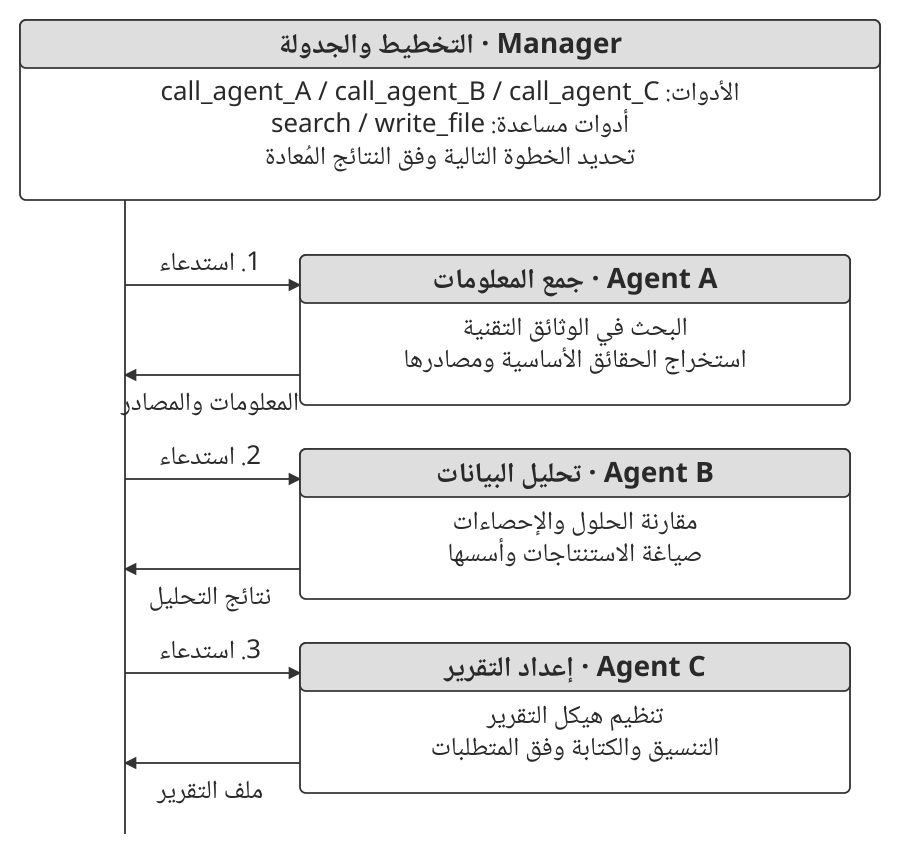

> **التجربة 10-2 ★★: وكيل ترجمة الكتب**
>
> تحتاج ترجمة كتاب تقني إلى معالجة المصطلحات والسياق والأسلوب في الوقت نفسه. فكلمة agent الإنجليزية مثلًا تحتمل ترجمات مختلفة، وإذا اتفقت الترجمة على «وكيل»، وجب أن تلتزم الفصول اللاحقة بالترجمة نفسها. وتحتاج قائمة المصطلحات ونصوص الفصول والترجمات وسجلات المراجعة إلى تنظيم واضح. والكتاب الطويل، مع مسوداته الوسيطة ونتائج الأدوات وتاريخ المراجعة، يزاحم السياق باستمرار، فقد يصل النموذج إلى الفصل التاسع وقد نسي ترجمة الفصل الثاني، أو يعيد فحص المقطع نفسه مرارًا. وتفكيك المهمة بحسب المسؤولية والفصل يسمح لكل نسخة بالتركيز على ما تتطلبه مسؤوليتها الحالية.
>
> ويمكن توزيع العمل على أربعة أنواع من الوكلاء:
>
> - **Glossary Agent: تنظيم المصطلحات.** يقرأ الكتاب كله على دفعات، ويتعرف على المصطلحات التقنية المتكررة، ويستعين بمعاجم متخصصة وبمعايير الترجمة، ثم يولد جدولًا مقابلًا بصيغة JSON أو CSV يضم المصطلح الإنجليزي والترجمة العربية ونوع الكلمة وسياق الاستخدام. وتحفظ قائمة المصطلحات في المساحة المشتركة، وتحرر نسخة هذا الوكيل بعد انتهاء المهمة.
> - **Translation Agent: ترجمة الفصول.** يقرأ الفصل الحالي والمصطلحات ذات الصلة ودليل الترجمة، وينجز الترجمة وفق جمهور القراء وأسلوب اللغة المستهدف. ويقدم للمصطلحات الجديدة ترجمات مقترحة موسومة بانتظار المراجعة. وتحتفظ كل نسخة بسياق مستقل، وتحفظ الترجمة في المساحة المشتركة؛ ويمكن معالجة الفصول المختلفة تسلسليًا وفق الاعتماديات أو بالتوازي.
> - **Proofreading Agent: مراجعة النص كله.** يفحص اختيار المصطلحات واتساق العبارات وقابلية القراءة استنادًا إلى قائمة المصطلحات وترجمات الفصول. وينجز الفحص الكامل بالقراءة فصلًا فصلًا وبفهرس يعبر الفصول، ويكتب في تقرير المراجعة موضع المشكلة وسندها ومتطلب التعديل.
> - **Manager Agent: ترتيب المهام واستعادتها.** يحتفظ بالأهداف والخطة وحالة المهام وملخصات الاستدعاء وفهرس النواتج، ويعيد الفصول التي تحتاج إلى تعديل إلى المترجمين وفق تقرير المراجعة، ثم ينظم إعادة الفحص.
>
> في الشكل 10-5، يقرأ المراجع ترجمات الفصول وقائمة المصطلحات، ويقرر المدير وفق التقرير أي الفصول يحتاج إلى إعادة عمل. ويستطيع المترجم المكلف بالإعادة أن يستدعي نص الفصل الأصلي، وأن يتحقق من معنى الكلمة الموسومة في تلك الجملة بعينها.
>
> 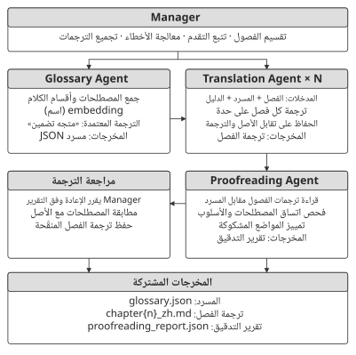
>
> وبعد كتابة الترجمة في ملف، أي استدعاء لا يزال بحاجة إلى قراءة نص طويل؟ قسم التجربة المرافقة الفصلين الأولين من النسخة الإنجليزية إلى 26 وحدة ترجمة. فحين كان الوكيل الواحد يحمل معه النص الأصلي والترجمة السابقين طوال الوقت، بلغ أكبر مدخل في طلب واحد 94,355 رمزًا. وبعد التقسيم لم يتجاوز أكبر مدخل عند المترجم 2,857 رمزًا، واستخدم المدير 2,153 رمزًا لاتخاذ قرار إعادة العمل. أما أكبر مدخل في مجموعة نمط المدير فكان عند منظم المصطلحات: فقد قرأ فصلين في مرة واحدة واستهلك 49,807 رموز.
>
> وبعد ترجمة الفصلين، استهلكت الأدوار الأربعة 203,277 رمزًا، بينما استهلك الوكيل الواحد 1,317,808 رمزًا. فأي المجموعتين سلمت أولًا؟ استغرقت مجموعة الأدوار الأربعة نحو 271 ثانية، أي نحو 17 ثانية أكثر من الوكيل الواحد.
>
> وعند التسليم، أعطى فحصان نتائج مختلفة للترجمة نفسها. كانت قائمة المصطلحات قد حددت للاسم `embedding` ترجمة واحدة هي «متجه التضمين». ولم يسرد تقرير المراجعة أي فصل يحتاج إلى إعادة عمل، لكن برنامج فحص المصطلحات أعطى هذه الكلمة 0/2: فقد وجد «التضمين» في ترجمتي الفصلين، ولم يوجد «متجه التضمين» في أي منهما. فهل يجب إعادة الفصلين معًا؟
>
> في الفصل الأول، في مقطع يتحدث عن سياسة استرداد المبالغ، كان النص الأصلي `embedding the refund policy in the context`، وكانت الترجمة «إدراج سياسة استرداد المبالغ في السياق». فالمعنى هنا إدخال السياسة في السياق، واستبدال ذلك بـ«متجه التضمين» يفسد الترجمة. والبرنامج يبحث عن السلسلة النصية فصلًا فصلًا، فيساعد المراجع على العثور على مواضع تستحق الفحص؛ أما تحديد أيها يجب تعديله فيحتاج إلى النص الأصلي لذلك المقطع. وعند تحديث قائمة المصطلحات، يمكن أولًا تحديد المقاطع المتأثرة، ثم تسليم النص الأصلي والترجمة والبند الجديد إلى المترجم معًا.
>
> **متطلبات التجربة:**
> 1. اختر كتابًا تقنيًا يتضمن أشكالًا وشيفرة.
> 2. نفذ الأنواع الأربعة من الوكلاء: Manager وGlossary وTranslation وProofreading.
> 3. سجل استهلاك السياق لدى كل عضو ومواد التسليم وإصدارات النواتج.
> 4. قارن مع حل الوكيل الواحد في جودة الترجمة وزمن الإنجاز واستهلاك الموارد، وحلل أثر تفكيك المهمة وتنظيم السياق.

**التنسيق المتوازي.** يمكن تنفيذ المهام الفرعية المستقلة عن بعضها في الوقت نفسه. يتولى المدير توزيع المهام وتلقي حالاتها، ويقرر وفق النتائج المواصلة أو إضافة العمل أو الإنهاء. وعند ترجمة هذا الكتاب، بمجرد اعتماد قائمة المصطلحات يمكن توزيع فصول مختلفة على عدة مترجمين يعملون في الوقت نفسه. وفي الشكل 10-6 تغيرت المهمة إلى تقرير بحثي: الأشكال جاهزة، والتحليل لا يزال جاريًا؛ فلماذا يجب أن ينتظر فحص التنسيق؟ بتتبع الأحداث التي يبلغ عنها الأعضاء، يمكن معرفة أي الناتجين تعتمد عليهما الخطوة الأخيرة.

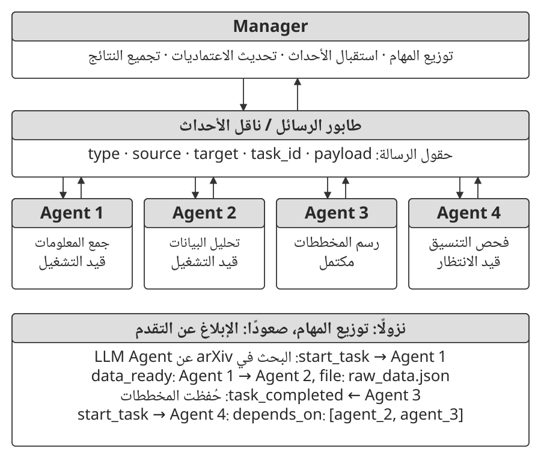

ويناسب ناقل الرسائل تنظيم هذا التواصل غير المتزامن: ينشر الأعضاء تقدمهم ونتائجهم، ويشترك المدير في الأحداث المناسبة، وتتولى بيئة التشغيل التوصيل والتخزين المؤقت وإعادة المحاولة.

> **حالة منتج: لينغتاي (Lingtai)**
>
> لينغتاي نظام وكلاء طويل الأمد يعمل محليًا ويحفظ الهوية والذاكرة في ملفات. وهو يوفر ثلاثة أدوار: الوكيل الرئيسي (main agent) الذي يحاور المستخدم ويدير الخطة والذاكرة؛ والدايمون (daemon) الذي يتولى مهامًا متوازية قصيرة محددة النطاق ثم يعيد النتيجة بعد إنجازها؛ والنسخة المتجسدة (avatar) التي تحتفظ بذاكرتها وبريدها ومسؤولياتها، وتستخدم للتخصص عبر الجلسات.
>
> ولكل دور معرفة دائمة خاصة، وقائمة مهارات مشتركة بصيغة Markdown. وعندما يقترب السياق من سعته القصوى، يحفظ الدور خلاصته بعملية «الانسلاك» (molt)، ثم يدخل سياقًا جديدًا مستندًا إلى الذاكرة الدائمة. وبقاء الهوية والذاكرة والمهارات في ملفات مستقلة يتيح مواصلة العمل بعد استبدال النموذج الأساسي. ويجمع هذا التصميم بين المدير والعامل قصير الأمد والعضو التخصصي طويل الأمد وضغط السياق.

> **التجربة 10-3 ★★★: وكيل هاتف ووكيل حاسوب بتنسيق ذاتي**
>
> تجمع هذه التجربة بين Computer Use والتفاعل الصوتي من الفصل السادس. يقدم المستخدم صفحة تسجيل أو حجز رحلة، فيفتح Computer Agent الموقع ويتعرف على النموذج، ثم يجمع عبر Phone Agent الحقول الناقصة في الوقت الحالي مثل الاسم ورقم الوثيقة وبيانات الاتصال والعنوان والتفضيلات.
>
> **الأدوار والتسليم.** يشغل Computer Agent المتصفح ويتولى هذا التنسيق؛ ويتواصل Phone Agent مع المستخدم في الوقت الحقيقي بالتعرف على الكلام وLLM وتحويل النص إلى كلام، ويحول الأجوبة المنطوقة إلى حقول مهيكلة. ويتواصل الاثنان عبر أدوات من نقطة إلى نقطة أو ناقل رسائل، وتتضمن الرسالة المرسل والمستلم والنوع والمحتوى. ويستطيع Computer Agent أن يفوض مهمة الهاتف مباشرة، فيضطلع بمسؤولية المدير. وحين يقبل المستخدم تقديم المعلومات صوتيًا، يستطيع Phone Agent أن يسأل ويكرر السؤال ويؤكد، بينما يركز Computer Agent على حالة الصفحة وتعبئة الحقول.
>
> **نمطا تشغيل.** في النمط الثابت يطلق الوكيلان مسبقًا، ولكل منهما حلقة تشغيل مستقلة، لفحص التواصل ثنائي الاتجاه والسلوك المتزامن. أما في النمط الذاتي فيطلق Computer Agent أولًا، ويقرر النموذج وفق الصفحة والمعلومات المتاحة واحتياجات المهمة ما إذا كان يستدعي `initiate_phone_call_agent(purpose, required_info)`. ثم تمرر بيئة التشغيل غرض المهمة والحقول المطلوب جمعها وقيود الصيغة إلى Phone Agent، الذي يستخدم آلية التواصل نفسها بعد إطلاقه.
>
> **تدفق الحقول حقلًا حقلًا.** في الشكل 10-7، يطرح Phone Agent السؤال عبر WebRTC ويستخلص الجواب ويتحقق منه، فإذا حصل على قيمة صالحة بعث `info_collected`، ثم انتقل إلى السؤال التالي. وفي الوقت نفسه يقرأ Computer Agent الصفحة ويملأ الحقل السابق، ويعيد `fill_error` أو حالة الصفحة الجديدة. وتبين التغذية الراجعة الخاصة بعدم مطابقة الصيغة بـ`format_invalid` الحقل والمتطلب، فيتأكد Phone Agent وفقها أو يعيد السؤال. وبذلك يمكن أن يتداخل السؤال عن الحقل التالي مع تعبئة الحقل السابق.
>
> **الإكمال ومعالجة الاستثناءات.** بعد جمع الحقول يبعث Phone Agent رسالة `task_completed` تفيد بانتهاء المهمة الفرعية لجمع المعلومات. ويواصل Computer Agent فحص الحقول الإلزامية ونتائج التحقق في الصفحة وتفويض الإرسال، ثم يكمل عملية النموذج. وإذا تجاوز عدد المحاولات الحد أو ظهر خلل في الصفحة أو طلب المستخدم التوقف، توقف المهمة ويشرح التقدم الحالي؛ وعند الإنهاء يلغى الطرف الآخر الذي لا يزال يعمل، وتغلق جلسة المتصفح ومسار الصوت والمكالمة. ويحصل على موافقة المستخدم على التفاعل الصوتي البشري وعلى تفويض إرسال النموذج كل على حدة.
>
> 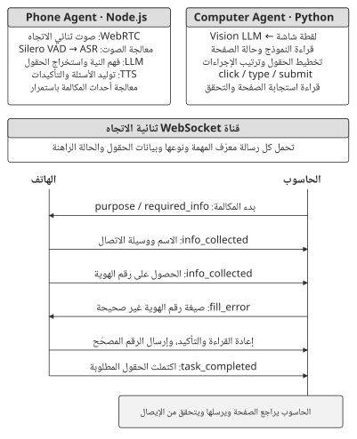
>
> **متطلبات التجربة:**
> 1. نفذ وكيلين مستقلين وتواصلًا مهيكلًا ثنائي الاتجاه بينهما.
> 2. سجل التسلسل الزمني في النمط الثابت والنمط الذاتي، وافحص فترات التداخل بين السؤال والتعبئة.
> 3. نفذ التحقق من الصيغة وإعادة السؤال وتغذية أخطاء الصفحة والتعامل مع المهلة وتنظيف الموارد.
> 4. قارن النمطين في قرار الإطلاق وزمن التأخير ومعدل النجاح واستهلاك الموارد.

> **التجربة 10-4 ★★★: وكيل يجمع المعلومات من عدة مواقع في وقت واحد**
>
> تعتمد هذه التجربة عدة وكلاء متجانسين يبحثون بالتوازي، لتدريب آلية الأحداث والمقاطعة من الفصل السادس. المطلوب البحث عن أستاذ محدد، مثل «تشانغ وي»، في مواقع عدة كليات بجامعة ما، وإرجاع الكلية والمنصب ومجال البحث وصفحة المصدر. ويتفق قبل البحث على شروط التعرف، كالاسم والتخصص ومعلومات الصفحة الشخصية، لتمييز من يحملون الاسم نفسه.
>
> **1. الإطلاق المتوازي.** ينشئ المدير عشرة وكلاء Computer Use، يتولى كل منهم موقع كلية واحدة. ولكل نسخة سياق مستقل وجلسة متصفح مستقلة، ويمكن جدولتها كمهام غير متزامنة أو خيوط أو عمليات. ويشمل المدخل عنوان الموقع والاسم المستهدف وشروط المطابقة ومعرف المهمة المستخدم في التوجيه.
>
> **2. تجميع التقدم.** يبعث الأعضاء بانتظام حالات مثل «جار تحميل الموقع» و«جار قراءة دليل هيئة التدريس» و«فحص ولم توجد مطابقة» و«عثر على أستاذ يحمل الاسم نفسه». ويحتفظ المدير عبر ناقل الرسائل بجدول مهام يسجل قيد التشغيل والاكتمال والتعثر والفشل، مع حفظ المصدر وسبب الخطأ.
>
> **3. الإلغاء بعد التحقق.** افترض أن `agent_3` المسؤول عن كلية الفيزياء وجد أستاذًا يحمل الاسم نفسه، فيبعث `target_found` بحمولة تضم معلومات الأستاذ والمصدر. وإذا كانت المهمة تشترط إرجاع بيانات شخص تم التحقق منها، فعلى المدير أن يفحص أولًا شروط المطابقة والأدلة، وبعد التأكد من أنه الشخص المطلوب يسجل النتيجة بعملية ذرية، ثم يبعث `terminate` إلى سائر الأعضاء العاملين، مبينًا أن المواد المعتمدة جاءت من `agent_3`. فيتوقف الأعضاء عند نقطة آمنة وينظفون مواردهم ويعيدون التأكيد؛ وينتظر المدير التأكيد أو انقضاء المهلة ثم يجمع النتائج. أما إذا كانت المهمة تشترط سرد كل من يحمل الاسم، فيواصل البحث حتى يستكمل النطاق المطلوب فحصه.
>
> **حالة التزامن.** قد يعيد Agent A وAgent B نتيجتين صالحتين في اللحظة نفسها تقريبًا. وإذا أطلق كل حدث عملية تجميع خاصة به، وقع تسليم مكرر أو تعارض في الحالة. ويمكن حماية التحول «قيد البحث ← نتيجة مسجلة» بقفل أو معاملة، بحيث يقرأ الحدث المتأخر النتيجة المسجلة سلفًا. ويجب أيضًا إزالة تكرار إعادة إرسال الرسائل بمعرف الحدث، لتظل النتائج متسقة عند تكرر الإلغاء والتجميع.
>
> **4. الاستثناءات ونطاق التغطية.** تسجل انقطاعات الشبكة وتغير بنية الصفحات وأخطاء الاستخلاص كل على حدة. ويمكن تخصيص ميزانية مهلة مثل دقيقتين لكل مهمة، فإذا انقضت ألغي التنفيذ وجمعت معلومات التشخيص، وواصل سائر الأعضاء عملهم. ويميز التقرير النهائي بين «فحص ولم يعثر عليه» و«تعذر الوصول ولم يكتمل الفحص»، ويوضح في الوقت نفسه الكليات التي جرت تغطيتها.
>
> ويصل الشكل 10-8 هذه الرسائل في تسلسل زمني توضيحي. افترض أن العضو الثالث أبلغ عن أستاذ يدعى تشانغ وي في كلية الفيزياء يعمل على الحوسبة الكمية، فعلى المدير أن ينظر أولًا هل تؤكد صفحة المصدر الاسم والكلية والمنصب والمجال. إن استلام أثر لمن يحمل الاسم، والتأكد من أنه الشخص المطلوب، وتلقي إيصالات الإلغاء، ثلاث لحظات مختلفة.
>
> 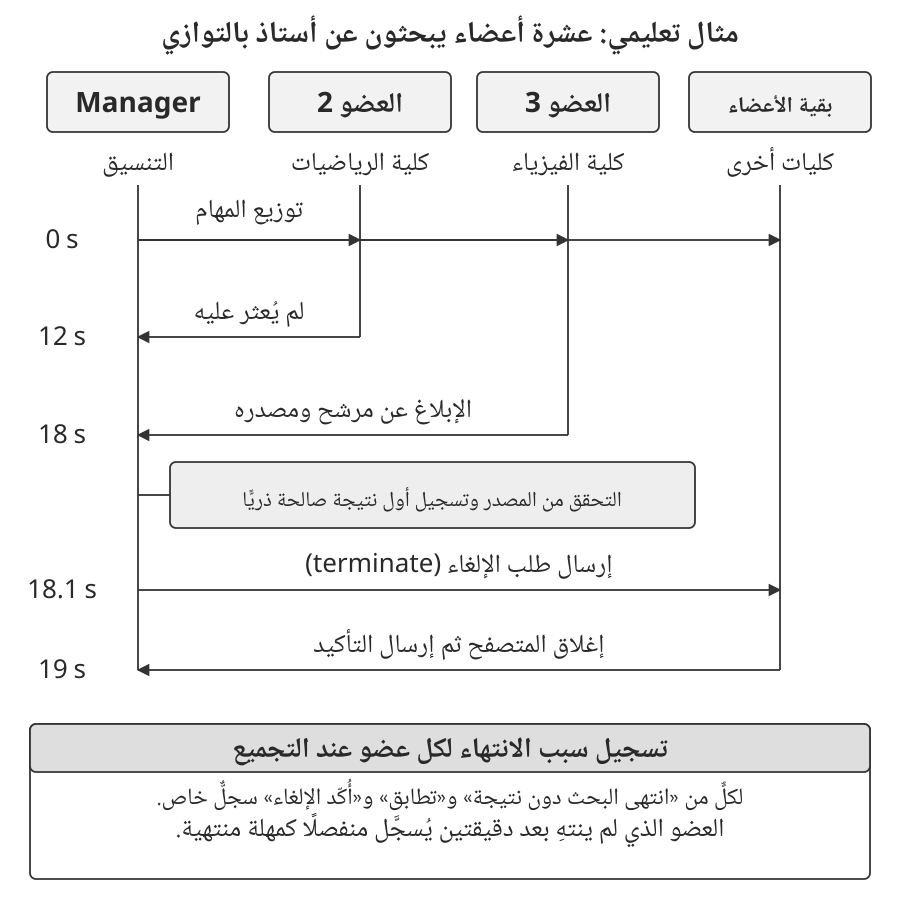
>
> وفي التشغيل الفعلي كان الهدف Andrew Ng. يفحص الأعضاء أولًا وجود الاسم في نص الصفحة، ولا يطلبون من النموذج استخلاص البيانات إلا بعد ورود تطابق. واختيرت صفحة Stanford HAI، والاقتباس القصير الذي أعادته يمكن أن يثبت الاسم وصفة الأستاذ غير المتفرغ. أما التحقق من مجال البحث فيستلزم قراءة المقطع اللاحق في الصفحة عن التعلم العميق. وحتى لو بعث عدة أعضاء `target_found` في الوقت نفسه، فلا يسجل النتيجة إلا من حصل على القفل أولًا.
>
> ولم يصل البحث التسلسلي في هذه المرة إلى تطابق إلا عند آخر العناوين العشرة، فاستغرق 44.971 ثانية؛ أما البحث المتوازي في الصفحات نفسها فاستغرق 24.022 ثانية، وقد أغلقت سياقات المتصفح العشرة في الحالتين. ونسبة الرقمين 1.872. ولو وضعت صفحة HAI في المرتبة الأولى، لتوقف البحث التسلسلي عند أول تطابق، ولوجب إعادة قياس الزمن. وفي تشغيل آخر خصص لاختبار الإلغاء أطلقت أربعة فروع: سجل أحدها نتيجة أولًا، وأكدت ثلاثة أخرى استلام طلب الإلغاء، ثم أغلقت سياقات المتصفح الأربعة كلها.
>
> **متطلبات التجربة:**
> 1. نفذ مديرًا ينشئ أعضاء متوازيين ديناميكيًا.
> 2. ابن قدرة تنفيذ في المتصفح باستخدام مشاريع مثل browser-use.
> 3. أنجز التواصل ثنائي الاتجاه وصيانة الحالة عبر ناقل رسائل.
> 4. تحقق من نتائج البحث، وسجل النتيجة بعملية ذرية، واجمع التأكيدات بعد إلغاء الفروع الأخرى.
> 5. عالج فشل الوصول وأخطاء الاستخلاص والمهلات وغياب المطابق.
> 6. قارن التنفيذ المتوازي والتسلسلي في زمن الإنجاز ونطاق التغطية واستهلاك الموارد.

**توليد سير العمل من المدير.** إلى جانب التفويض خطوة بخطوة، يمكن للمدير أن يكتب اعتماديات المهام وقواعد التجميع في برنامج، ثم يسلمه إلى بيئة التشغيل للجدولة. فيصمم النموذج المسار، ويتولى البرنامج إطلاق الأعضاء وتمرير النتائج وانتظار الاعتماديات وفق الاتفاق. ويختار المؤلف هذا الأسلوب حين تكون الاعتماديات واضحة ويحتاج مسار من النوع نفسه إلى تكرار التشغيل؛ فهو يوفر كلفة استدعاء المدير في كل توزيع، ويقلل سجلات الجدولة المتراكمة في سياق الإدارة.

وتوفر أداة Workflow الديناميكية في Claude Code تحقيقًا لهذا. فـ`agent()` ينشئ وكيلًا فرعيًا بسياق مستقل، ويمكن الاتفاق على مخرجاته المهيكلة بـschema؛ و`parallel()` ينفذ مجموعة مهام متزامنة وينتظر انتهاءها كلها؛ و`pipeline()` يمرر كل مدخل على عدة مراحل، فحين تنتقل إحداها إلى المرحلة التالية تظل الأخرى قابلة للمعالجة في المرحلة السابقة. وتحفظ النتائج الوسيطة في متغيرات البرنامج، وتنجز التصفية والدمج بشيفرة عادية.[^dynamic-workflows]

فعند التحقق من سبع مجموعات من الوقائع في مخطوطة تقنية مثلًا، يمكن إطلاق وكلاء بحث بحسب الاتجاه، ثم تسليم كل مجموعة استنتاجات إلى وكيل تحقق بالتوازي. ويحتفظ كل استنتاج عائد بمصدره وسند حكمه؛ وبعد انتهاء الفروع كلها ينظم وكيل التجميع التقرير النهائي. وبذلك تكتب في سير العمل مسؤوليات «البحث — التحقق بندًا بندًا — التجميع الموحد» واعتماديات المراحل.

[^dynamic-workflows]: Anthropic, “Orchestrate subagents at scale with dynamic workflows”, 2026.

### النمط اللامركزي

ما دام هناك مدير، فلماذا نترك للأعضاء أن يقرروا بأنفسهم إلى من يتوجهون؟ تخيل أن المختبر تسلم وحدة كتبت للتو، فوجد أن متطلبات المنتج واتفاق الواجهة يفسران حقلًا واحدًا تفسيرين مختلفين. يستطيع المختبر أن يحيل التناقض مباشرة إلى دوري المنتج والمعمارية، فيبين كل منهما سنده، ثم يستأنف الاختبار بعد تصحيح الاتفاق. وهذا تقسيم للعمل، وهو أيضًا نوع من التوازن بين السلطات. فالمهندس الذي يسلم الوحدة، والمعماري الذي يستطلع رأي المنتج، والمختبر الذي يعترض، كل منهم يستطيع إطلاق الخطوة التالية. وحين يكثر التشاور، يعطل انتظار المدير لينقل كل بند العمل.

وباستعارة مصطلحات الخدمات المصغرة، يسمى ترتيب الخطوات من مركز واحد **التنسيق المركزي** (orchestration)، ويسمى مواصلة كل طرف العمل وفق أحداث متفق عليها **التنسيق التشاركي** (choreography). وثمة فرق عملي آخر: إذا كان كل تسليم ينتظر المدير، فبمجرد أن تتوقف خدمة نموذجه عن الاستجابة، لن يتلقى سائر الأعضاء مهامهم التالية وإن كانوا قادرين على العمل. والتنسيق الموزع يقلل هذا الاعتماد؛ لكن إذا علق العضو المكلف بالاستلام نفسه في استدعاء أداة، فلا بد من حالة مهمة محفوظة دائمًا، ومهلات، وإعادة محاولة، وآليات استلام بديل، كي يعرف عضو آخر من أين يواصل.

وفيما يلي ثلاثة تصاميم، لكل منها أسلوب في التسليم: الاشتراك في الرسائل بحسب الناتج، أو اختيار المتحدث التالي في محادثة جماعية، أو تسمية العضو الحالي لمن يتسلم منه.

**MetaGPT: تنظيم تسليم النواتج بإجراءات التشغيل القياسية.** يقسم MetaGPT العمل وفق إجراءات التشغيل القياسية (SOP) لفريق برمجيات. يسلم مدير المنتج وثيقة المتطلبات (PRD)، والمعماري وثيقة التصميم، والمهندس الشيفرة، والمختبر تقرير الاختبار. ويستطيع العضو التالي البدء بمجرد أن يتلقى المواد المتفق عليها، ويعفى سابقه من تكرار شرح المهمة. والخطوط في الشكل 10-9 تمثل علاقات تسليم هذه النواتج.[^metagpt-design]

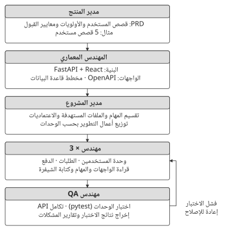

ما المعلومات التي يجب أن يستكملها كل دور عند التسليم؟

- **Product Manager Agent** يتلقى المتطلبات، وينظم PRD، ويحدد الوظائف وقصص المستخدمين ومعايير القبول والأولويات.
- **Architect Agent** يقرأ PRD، ويختار مجموعة التقنيات، ويقسم الوحدات، ويعرف الواجهات ونماذج البيانات، فيكون وثيقة التصميم.
- **Project Manager Agent** يفكك المهام ويوزع الملفات وفق التصميم، وينظم الاعتماديات، ويرتب تنفيذ المهندسين.
- **Engineer Agents** ينفذون الوحدات وفق التصميم ويودعون الشيفرة؛ ويمكن تسليم الأجزاء المستقلة إلى عدة نسخ.
- **QA Engineer Agent** يولد الاختبارات وفق الشيفرة والمتطلبات، وينفذ الفحوص ويسجل المشكلات، فيكون تقرير الاختبار.

وإذا أردت تصميم صيغة تسليم لهذه الأدوار، فيوصي المؤلف بتوضيح ثلاثة أمور: المهمة ومعايير قبولها، والوقائع والقيود المؤكدة، ومراجع النواتج المهيكلة. فيحصل المتلقي على ما يحتاجه من مواد، ويواصل العمل، ويطرح أسئلة محددة إذا نقصت معلومة.

وينظم MetaGPT المعلومات بمجمع رسائل مشترك وآلية اشتراك: ينشر الدور رسائله، ويعالج سائر الأدوار المدخلات المتصلة بها وفق أنواع الرسائل التي تهمها. ويرتبط الناشر والمستهلك عبر صيغة الناتج ودلالة الرسالة، فيمكن استبدال النموذج أو تعديل التنفيذ الداخلي لكل منهما على حدة.

تصف SOP الاعتماديات بين متطلبات المنتج والمعمارية والشيفرة، ويصف الاشتراك في الرسائل كيف يطلق هذا العمل. ويمكن أيضًا دفع الاعتماديات الثابتة بين المهام بأحداث موزعة، ويؤلف الاثنان معًا أسلوب التعاون في النظام. وعند تصميم تغذية راجعة ديناميكية، يمكن إضافة مسارات مثل استيضاح المختبر المتطلبات من دور المنتج، أو اقتراح المهندس بديلًا على المعماري، مع تحديد شروط الاستلام وقواعد الإنهاء لهذه التفاعلات.

[^metagpt-design]: Hong, S., et al. *MetaGPT: Meta Programming for A Multi-Agent Collaborative Framework.* ICLR 2024.

**المحادثة الجماعية في AutoGen: جدولة المتحدثين في جلسة مشتركة.** في تصميم GroupChat الكلاسيكي، يشارك عدة وكلاء في جلسة واحدة، ويختار GroupChatManager المتحدث التالي ويبث الرسائل إلى الأعضاء. وقد تكون سياسة الاختيار بالتناوب، أو يحكم بها النموذج وفق المحتوى الحالي. ويحتفظ الأعضاء بإعدادات أدوارهم، ويتواصلون عبر الجلسة المشتركة، بينما تتمركز جدولة الكلام في المدير. وهذا مثال على الجمع بين تنظيم السياق وبنية التحكم.[^autogen-groupchat]

[^autogen-groupchat]: Microsoft, *AutoGen 0.2: Conversation Patterns.*

**OpenAI Swarm: تسليم السيطرة عبر handoff.** يضبط Swarm تعليمات الأدوار وأدواتها، فإذا استدعى الدور دالة التسليم المضبوطة، انتقلت بيئة التشغيل إلى الوكيل الهدف. ويمكن أن يتخذ كل دور قرار التوجيه، ثم تنفذه حلقة تشغيل موحدة. وعند التسليم تتغير تعليمات النظام الحالية بتغير الدور، ويحتفظ بسجل المحادثة. وهو يبين الجمع بين «اختيار الدور لمن يتسلم بعده» و«مواصلة سجل الجلسة».[^swarm-handoff]

وإذا اعتمد التسليم بسياقات مستقلة، أمكن تعريف حزمة مهمة منفصلة: `task_id` يعرف المهمة، و`sender` و`recipient` يحددان الطرفين، و`goal` و`constraints` يبينان الهدف والقيود، و`accepted_facts` يحفظ الوقائع المؤكدة، و`artifact_refs` يقدم مراجع النواتج، و`remaining_budget` يسجل الميزانية، و`visited_agents` يحفظ سلسلة المرور. ويقرأ المتلقي المواد وفق تفويضه، وتحتفظ بيئة التشغيل بالميزانية وسجل التسليم.

وتحتاج سلسلة التسليم إلى معالجة الزيارات المتكررة. فحين يسلم المطور الشيفرة إلى المراجع، ويطلب المراجع تعديلات ثم يعيدها إلى المطور، فتلك حلقة تعديل طبيعية. ويمكن الحكم على وجود تقدم بالجمع بين حالة المهمة وإصدار الناتج والمسائل المعلقة وعدد التكرار. فإذا أعيدت المسودة نفسها مرتين متتاليتين، أضيف في الأولى مصدر وصحح في الثانية مصطلح، كان التعديل لا يزال يتقدم؛ أما إذا أعيدت النسخة نفسها في المرتين للمشكلة نفسها، فقد علق التعديل. وعندئذ يمكن تقييد عدد مرات التسليم الإضافية، ورفع المسائل غير المحلولة إلى المسؤول.

[^swarm-handoff]: OpenAI, *Swarm*, “Instructions” و“Handoffs and Updating Context Variables”.

> **Agent Swarm في المنتجات**
>
> قد يشير مصطلح «Agent Swarm» إلى أساليب تنظيم مختلفة. فنوع ينقل السيطرة عبر شبكة handoff، مثل OpenAI Swarm ومكتبة swarm في LangGraph وتنسيق handoff في Agent Framework من مايكروسوفت؛ ونوع آخر يعتمد وكيلًا رئيسيًا وعمالًا متوازيين، مثل Kimi Agent Swarm ونظام البحث متعدد الوكلاء من Anthropic وManus Wide Research.
>
> ويدرب Agent Swarm الذي أدخله Kimi K2.5 المنسق بالتعلم المعزز للوكلاء المتوازيين، فيتعلم متى يفكك المهمة وكيف يوزع العمل، ويدعم حتى 100 وكيل فرعي. ووسعت الإصدارات اللاحقة النطاق إلى 300، ويستمر استخدام K3 Swarm في البحث واسع النطاق والمعالجة الدفعية. أما AgentENV فيقدم بيئة قابلة للتوسع للتعلم المعزز للوكلاء في Kimi K3، تدعم اللقطات والتفرع، وتستخدم لتنظيم التنفيذ المتوازي.[^ch10-kimi-swarm]

**عدة نسخ من الوكلاء على الجهاز نفسه.** قد تتولى عدة نسخ مهامًا مختلفة، لكنها تتشارك الملفات أو خدمات الأدوات أو وحدة GPU. وهنا يمكن استخدام التواصل لبيان نطاق التعديل، أو الإشعار بتحرير المورد، أو التفاوض على ترتيب التنفيذ. فإذا احتاجت نسختان إلى وحدة GPU واحدة، أمكن تسجيل المهمة والاستهلاك المتوقع أولًا، ثم يمنح مدير الموارد حق الاستخدام.

ويوفر Agent Teams في Claude Code اكتشاف أعضاء الفريق والرسائل وإدارة المهام المشتركة. ويحصل الأعضاء على معلومات بعضهم داخل نطاق الفريق القائم، وتنظم بيئة التشغيل التواصل.[^claude-agent-teams] وعند بناء تعاون على الجهاز نفسه بنفسك، يمكن اعتماد واجهات مثل `list_agents` من الفصل الرابع، مع وضع قواعد واضحة لنطاق الاكتشاف وصلاحيات الوصول وملكية الموارد. ثم تنفذ نتائج التفاوض الواردة في الرسائل بالأقفال أو الحصص أو المجدول.

[^ch10-kimi-swarm]: Moonshot AI، *Kimi Agent Swarm: 100 Sub-Agents at Scale*، ووثائق مساعدة Agent Swarm، ووصف مشروع AgentENV.

[^claude-agent-teams]: Anthropic, *Orchestrate teams of Claude Code sessions.*

### التعاون بين المنظمات: بروتوكول A2A

حين يعبر التعاون حدود الخدمات أو المنظمات، يحتاج الطرفان إلى الاتفاق على اكتشاف القدرات والمصادقة على الهوية وصيغة الطلب وتسليم التقدم والنتائج. وقد وفر بروتوكول **A2A** (Agent2Agent) الذي أصدرته Google في 2025 واجهة توافقية من هذا النوع، ثم سلم إلى مؤسسة Linux لاستضافته. ويمكن فهمه من ثلاثة جوانب.[^a2a-concepts]

- **اكتشاف القدرات.** Agent Card وثيقة بيانات وصفية تصف الهوية ونقطة الخدمة والمهارات وأنماط المدخلات والمخرجات ومتطلبات المصادقة. ويحكم المستدعي بناء عليها ما إذا كان الطرف الآخر قادرًا على معالجة المهمة، وكيف ينشئ الاتصال.
- **المهام والرسائل.** يمثل Task عملًا ذا معرف ودورة حياة، ويستطيع المستدعي تتبع حالاته، مثل: مقدم، وقيد المعالجة، وبحاجة إلى مدخلات، ومكتمل، وفاشل. ويحمل Message متطلبات المهمة والمعلومات الإضافية والردود، ويسلم Artifact المستندات أو الصور أو النتائج المهيكلة. ويمكن أن يحوي Part في الرسائل والنواتج نصًا أو مرجع ملف أو بيانات.
- **التعاون عبر الواجهات.** يتواصل المستدعي مع الطرف البعيد عبر هذه الكائنات العلنية، ويدير الطرف البعيد موجهاته وذاكرته وأدواته الداخلية مستقلًا. ويطبق كل طرف على حدة المصادقة والتفويض ونطاق الوصول إلى البيانات.

ويمكن للمهام الطويلة أن تحصل على حالتها بالاستطلاع الدوري، أو أن تتلقى تحديثات متدفقة عبر SSE، أو أن تستخدم الإشعارات الدفعية حين تكون مدعومة. وبعد أن يقدم المستخدم معلومات إضافية، يواصل العميل دفع المهمة نفسها، ويحصل على الناتج النهائي وفق حالة المهمة.

يركز MCP الذي عرضه الفصل الرابع على تزويد تطبيقات النماذج بواجهات الأدوات والموارد والموجهات؛ ويركز A2A على التعاون في المهام بين خدمات الوكلاء. ويمكن الجمع بينهما: فيستخدم وكيل الأدوات عبر MCP، ويفوض في الوقت نفسه مهامًا بعيدة عبر A2A. وحين تتوافر داخل الفريق الواحد واجهات مستقرة، يواصل المؤلف استخدام استدعاء الأدوات والملفات المشتركة وناقل الرسائل. ولا يدخل A2A إلا حين يلزم ربط خدمات وكلاء مستقلة الصيانة، وتوحيد اكتشاف القدرات ودورة حياة المهمة؛ وعند العمل بين المنظمات تضبط إضافة إلى ذلك قواعد الهوية والصلاحيات وحوكمة البيانات.

[^a2a-concepts]: A2A Project, *Core Concepts and Components in A2A.*

**تحديد مواعيد لأشخاص مختلفين.** لكل فرد من أفراد أسرة ثلاثية مساعد خاص بجدوله، ويريدون الاتفاق على عشاء. أحد المساعدين يستطيع قراءة تقويم صاحبه كاملًا، فكيف يجيب المساعدين الآخرين؟ عبارة «الثلاثاء غير مناسب، والأربعاء يمكن تحريكه قليلًا» تقدم تمييزًا مفيدًا. أما إعادة توجيه التقويم مباشرة فتكشف خصوصيات يوم الثلاثاء؛ والاكتفاء بقول «لدي ارتباطات في اليومين» لا يعلم الآخرين أن الأربعاء قابل للتفاوض. وحتى لو نجح الاتفاق في كل مرة، فإن كان الشخص نفسه هو الذي يغير موعده دائمًا، فقد لا يكون هذا الترتيب منصفًا له.

ويطلب أحد الأسئلة العلنية في CalBench من خمسة أشخاص ترتيب خمسة اجتماعات، يحضر كلا منها ثلاثة. ولبعضهم فترات لا يمكن تحريكها بتاتًا، وبعض الارتباطات الخاصة قابلة للتأجيل، ويحدد السؤال كلفة لكل تأجيل. لنجرب أولًا طريقة بسيطة: نعالج الاجتماعات الخمسة بالترتيب، ونبحث في كل مرة عن أبكر فترة، فإذا استطاع الثلاثة إخلاءها حجز الاجتماع؛ وتبقى الاجتماعات المحجوزة على حالها. ثم نجرب طريقة أخرى: نضع الاجتماعات الخمسة معًا ونحلها باستخدام التقويمات الكاملة. ونتبع في ما يلي ترقيم الفترات في السؤال، ابتداء من 0.[^ch10-calbench]

| طريقة الترتيب | فترة كل اجتماع من الأول إلى الخامس | كلفة التأجيل لكل اجتماع محجوز | الكلفة الإجمالية |
|---|---|---|---:|
| اختيار أبكر فترة يمكن إخلاؤها لكل اجتماع، مع الإبقاء على الاجتماعات المحجوزة | 0، 2، 1، 3، 6 | 1، 20، 20، 12، 300 | 353 |
| حل مرجعي يرتب الاجتماعات الخمسة إجمالًا | 13، 3، 10، 9، 12 | 0، 1، 0، 1، 1 | 3 |

ويمكن مطابقة الجدولين اجتماعًا اجتماعًا في التقويمات النهائية للمشاركين الثلاثة. وأكبر فارق في الاجتماع الأخير: في الطريقة الأولى يمكن إخلاء الفترة 6، لكن لكل من الثلاثة ارتباطًا كلفته 100 يجب تحريكه. أما في الفترة 12 فلا يحتاج الأمر إلا إلى أن يحرك شخص واحد ارتباطًا كلفته 1. وتعطي النتيجة الإجمالية المقيم أساسًا للمقارنة؛ أما المساعدون المشاركون فعلًا في التفاوض فلا يرى كل منهم إلا تقويم صاحبه.

ويبلغ حلال الطريقة الجشعة المرفق بهذا الإصدار عن كلفة قدرها 146، ويعيد فترات للاجتماعات الخمسة كلها. لكنه حين يرتب الاجتماعات اللاحقة يسمح بإزاحة اجتماعات سابقة من تقويمات بعض المشاركين. فقد انتهى الاجتماع الأول في تقويمات المشاركين الثلاثة إلى الفترات 7 و0 و11 على التوالي. وإذا كان معيار القبول هو «أن تسجل التقويمات النهائية للثلاثة الاجتماع نفسه في الفترة نفسها»، فلم ينجح إلا الاجتماع الثالث والرابع والخامس.

وتواجه خدمات المواعيد الحقيقية معلومات لا تقدمها أسئلة الجدولة. فقد نسقت خدمة Calendar.help من مايكروسوفت آلاف الاجتماعات عبر البريد الإلكتروني خلال عام. فهل الرسالة طلب لاجتماع جديد، أم تعديل لاجتماع سابق؟ حين لا يكون التصنيف الآلي متيقنًا، يرى العامل البشري الرسالة أولًا، ولا يعالج إلا سؤال الحكم هذا. وإذا تعذرت الإجابة من الرسالة وحدها، أمكن تسليم المهمة إلى موظف جدولة يستطيع رؤية سلسلة الرسائل والمعلومات المجموعة وتقويمًا مجهول الهوية. ويربط هذا التصميم بين «من يطلب منه الحكم» و«كم يحتاج هذا الشخص أن يرى».[^ch10-calendar-help]

[^ch10-calbench]: تناقش ورقة CalBench على حدة كلفة التنسيق والإنصاف وتسرب حالة التقويم القابلة للاستنتاج وتسرب محتوى الارتباطات المحددة. والأرقام مأخوذة من السؤال الأول في بنك أسئلة كلف التأجيل المختلفة في الإصدار `86f8123`؛ وتتخطى الطريقة الأولى عند الاختيار أي فترة فيها اجتماع قائم لأي مشارك، وتتبع في ما عدا ذلك قاعدة الإزاحة التي وضعها المؤلفون. ويمكن إعادة الحساب بحلال جدولة.

[^ch10-calendar-help]: Cranshaw وآخرون، تصميم Calendar.help ونشره؛ انظر وصف الواجهة ذات الطبقتين للمهام الدقيقة التي يعالجها البشر ومهام الجدولة الكاملة.

## أوضاع الفشل في التعاون متعدد الوكلاء

حين ينفذ عدة أعضاء مهمة مشتركة، قد يظهر الخلل في الأدوار أو في التسليم أو في التحقق. وقد بنت ورقة *Why Do Multi-Agent LLM Systems Fail?* تصنيفًا للفشل انطلاقًا من نحو 150 مسار تنفيذ، بلغت نسبة اتفاق الوسم κ فيه 0.88، ثم وسعت التحليل إلى سبعة أطر عمل. وخلصت إلى 14 نمط فشل موزعة على ثلاث فئات:[^mast-failures]

- **مشكلات في تصميم النظام:** ثغرات في مسؤوليات الأدوار أو الواجهات أو إعدادات الأدوات أو شروط التوقف.
- **انحراف في التعاون بين الأعضاء:** اختلاف في فهم الهدف، أو تسليم معلومات ناقص، أو أفعال متناقضة.
- **مشكلات في التحقق من المهمة:** إنهاء مبكر، أو إغفال فحوص، أو الحكم على الإنجاز بمعيار غير مناسب.

وتضرب الورقة مثلًا ببرنامج شطرنج. فالشيفرة التي ولدها ChatDev تجتاز الترجمة البرمجية، وتجتاز المراجعة، لكن البرنامج يخطئ حين يشغل وفق قواعد اللعب الفعلية. فالمترجم البرمجي (compiler) يفحص ما إذا كانت الشيفرة قابلة للترجمة البرمجية، أما فحص مشروعية النقلات فيحتاج إلى لعب بضع نقلات. وفي مجموعة مقارنة أخرى، سمح الباحثون بأن تعاد ملاحظات المراجعة في ChatDev إلى التعديل، ولا ينتهي العمل إلا بعد إقرار الدور المسؤول عن المراجعة التقنية، مع تحديد حد أقصى لعدد الجولات. وفي 32 مهمة من ProgramDev-v0 نجح المسار الأصلي في 8 مهام، والمسار المعدل في 13 مهمة، فارتفع معدل النجاح من 25.0% إلى 40.6%، بفارق نحو 15.6 نقطة مئوية.[^mast-failures]

[^mast-failures]: Cemri, M., et al. *Why Do Multi-Agent LLM Systems Fail?* 2025.

وكيف نميز بين «المراجع لم يرد» و«المراجع رد لكن حكمه خاطئ»؟ تسمي الأنظمة الموزعة توقف المكون عن العمل فشل التعطل. أما نموذج الفشل البيزنطي فيسمح للمكون بأن يعطي نتائج خاطئة كيفما اتفق أو متناقضة. والوكيل قد يتوقف في منتصف الطريق، وقد يعيد نتيجة خاطئة كأن شيئًا لم يكن. فالحالة الأولى تحتاج إلى كشف واستعادة واستلام، والثانية إلى التحقق من الأدلة وتقييد الصلاحيات وعزل الأخطاء. وتساعد نبضات الحياة المعتادة على الحكم بما إذا كان الوكيل لا يزال يعمل؛ أما صحة النتيجة التي يعيدها فتحتاج إلى فحص الناتج الفعلي. ويمكن استخدام الفحص المتبادل والتصويت في تقييم النتائج، وموثوقيتهما تتوقف على جودة الأدلة وارتباط أخطاء الأعضاء؛ وتحدد البروتوكولات الرسمية كذلك أقصى عدد من العقد المعطوبة التي يمكن تحملها، وكيف تتواصل العقد فيما بينها.

### وضع الفشل الأول: تعارضات التزامن في نظام الملفات المشترك

يتيح تشارك النواتج للأعضاء مواصلة العمل، ويجلب في الوقت نفسه مشكلة التعديل المتزامن. ويمكن التمييز أولًا بين مستويين.

**التعارض على مستوى الملف** يقع حين يعدل عضوان الملف نفسه: يقرأ كل منهما النسخة القديمة، ثم يكتبانها تباعًا، فتغطي الكتابة الثانية نتيجة الأولى.

**التعارض الدلالي** يقع بين نواتج مترابطة. فمثلًا يعيد Agent A ترقيم صور الكتاب كله، بينما يعدل Agent B فصلًا ويشير إلى الأرقام الأصلية. الملفان مختلفان، وقد لا يظهر تعارض نصي عند الدمج، لكن التناظر بين النص والصورة يكون قد فسد في النهاية.

لنأخذ الإصدار السابع من قائمة المصطلحات. يبدأ «أ» و«ب» التعديل انطلاقًا من الإصدار السابع، ويودع «أ» أولًا فيصبح الإصدار الثامن. فإذا اكتفى «ب» بقول «اكتب هذه القائمة» عند التسليم، فقد تغطى تعديلات «أ»؛ أما إذا شرط «لا تكتب إلا إذا كان الإصدار الحالي ما زال السابع»، أمكن للبرنامج أن يكتشف الحاجة إلى الدمج. ويمكن استخدام **القفل التفاؤلي** في التزامن على مستوى الملف: يسجل رقم الإصدار عند القراءة، ويجرى فحص الإصدار والكتابة كعملية ذرية واحدة عند الإيداع؛ فإذا تغير الإصدار رفض الإيداع القديم، وأعيدت القراءة والدمج.

أما الاتساق الدلالي عبر الملفات فيحتاج إلى فحص علاقات الترابط. وحين يعدل عدة Coding Agents المستودع نفسه، يفضل المؤلف منح كل عضو worktree وفرعًا مستقلين، فيكون كل منهم إيداعه، ثم تفحص التعارضات وتشغل الاختبارات وتتحقق الواجهات عند نقطة الدمج. وإنشاء الفرع وحده لا يكفي، بل يجب أن يقترن بمجلد عمل مستقل لعزل التعديلات المتزامنة على الملفات.

### وضع الفشل الثاني: التضخيم المتتالي للأخطاء

قد تصل الرسالة بحروفها، ومعناها يفسد في إعادة النقل. تخيل عدة وكلاء يكتبون سجل خدمة العملاء معًا: كتب «أ»: «وعدت خدمة العملاء بتخفيض فاتورة الشهر القادم بمقدار 80»، فاختصرها «ب» إلى «خفضت 80»، ثم قرأ «ج» الملخص فأغلق المهمة المعلقة. الرسائل الثلاث وصلت كلها، لكن المستخدم فقد التذكير بمراجعة الفاتورة القادمة. الأمر كأنه لعبة الهاتف المكسور، وموضع الخطأ أن «ب» كتب وعدًا على أنه نتيجة واقعة.

وعلى سجل التسليم أن يحفظ الاستنتاج وشروط انطباقه ومصدره، ليرى من يتسلم ما تأكد منه وما لا يزال استنتاجًا. وعند نشوء خلاف كالذي سبق، يجعل المؤلف المراجع يقرأ نص المكالمة والفاتورة الأحدث أولًا، ويحكم بنفسه إلى أي مدى أنجز الأمر، ثم ينظر في سبب تلخيص «ب» على هذا النحو. وإذا لم يكن هناك سوى وعد شفهي، يطلب من «ب» أن يعيد الملخص إلى «وعد بالتخفيض»، مع الإبقاء على مهمة مراجعة الحساب؛ فبند الخصم في الفاتورة هو سند إغلاق هذه المهمة.

### وضع الفشل الثالث: التقارب المتجانس

قد يتخذ عدة أعضاء يعملون مستقلين الخيار الخاطئ نفسه. ففي تجربة Anthropic، أنشأ 18 وكيلًا من 30 أطلقوا في وقت واحد فرع Git بالاسم نفسه؛ كما ظهر العنوان نفسه عند أعضاء مختلفين في مهمة كتابة.[^anthropic-multiagent-2026] والنموذج المشترك والمدخلات المتشابهة وإطار التشغيل الواحد تجعل القرارات مترابطة. فقد لا يكون إجماع خمسة وكلاء متشابهين إلا الخطأ نفسه مكررًا خمس مرات؛ وعند زيادة عدد المراجعين، ينبغي زيادة اختلاف الأدلة ومنظورات التحليل بالقدر نفسه.

ويمكن إسناد أدلة أو مسؤوليات أو نماذج مختلفة إلى الأعضاء، وعزل معرفات الموارد بمساحات أسماء. أما حصص التزامن وحدود المعدل فتكبح الوصول المركز، فلا تتصادم قرارات متطابقة كثيرة بالخدمات المشتركة في وقت واحد.

وتظهر تجربة تسعير Bertrand في البحث نفسه نوعًا آخر من التقارب: فقد يستطيع الوكلاء الساعون إلى الربح تنسيق الأسعار عبر قناة خاصة، ويستطيعون كذلك تشكيل سلوك تنسيقي انطلاقًا من الأسعار المعلنة.

### وضع الفشل الرابع: التنازع على المسؤولية وتعارض الأهداف

حين يحمل عدة أعضاء أهدافًا متعارضة، قد تلغي أفعالهم بعضها. فقد وزعت Anthropic أهداف ترحيل الواجهة الخلفية نفسها إلى لغات مختلفة على ثلاثة وكلاء، فرأى كل منهم أن تعديلات الآخرين عائق، ثم امتد الخلاف إلى عمليات على العمليات والصلاحيات.[^anthropic-multiagent-2026] وتحتاج هذه المشكلات إلى اتفاق مسبق على أولوية الأهداف وملكية الموارد ونطاق التنفيذ المسموح؛ أما الخلافات التي لا تحلها القواعد، فتوقفها بيئة التشغيل وتحيلها إلى المسؤول.

وقد يظهر التبادل في إلقاء المسؤولية في التعاون على غرار فريق البرمجيات. فالمختبر يبلغ عن مشكلة، ويرى الواجهة الأمامية أن الخلفية يجب أن تصلح أولًا، وترى الخلفية أن المنتج يجب أن يوضح، ثم يعيد المنتج المسألة إلى دور المعمارية. وهنا يمكن اشتراط أن تبين كل عملية تسليم شروط إعادة الإنتاج والأدلة المتاحة والسؤال الذي ينتظر جوابًا ومسؤولية المتلقي، فيتقارب الخلاف تدريجيًا.

ومن الأمثلة أيضًا خلل بيئة الاختبار: يعدل المطور شيفرة العمل مرارًا، ويظل الاختبار يعيد الخطأ نفسه. فيجب أولًا تثبيت البيئة والمدخلات، ومقارنة نتائج التنفيذ قبل التعديل وبعده، والتأكد مما إذا كانت المشكلة في تنفيذ المنتج أم في شروط الاختبار، ثم توزيع مهمة الإصلاح.

### وضع الفشل الخامس: الحلقات المنفلتة

يغفل الإنهاء المبكر عملًا، أما غياب شروط التوقف فقد يجعل النظام يعيد المحاولة بلا نهاية، أو يتداول المهام، أو ينشئ وكلاء فرعيين بصورة متكررة. ويتضاعف عدد الأعضاء وعدد جولات الاستدعاء أحدهما بالآخر، فقد تنشأ آلاف المهام الفرعية وتستهلك الميزانية بسرعة.

ويمكن ضبط حد أقصى في بيئة التشغيل للرموز أو الكلفة، وعدد التزامن، ومجموع ما أنشئ، وعمق التفرع، وعدد الجولات، والمهلة. وتوزع الميزانية من المهمة الأم وتحتسب في المجموع الكلي، ويسجل أيضًا ما استهلك قبل الفشل أو الإلغاء. وعند بلوغ الحد يحفظ التقدم، وتلغى الفروع غير المكتملة وتجمع التأكيدات، ويسلم الناتج الحالي والمسائل المتبقية.

وفي مهام التعاون ذات الاستقلال الواسع، يوصي المؤلف باستخدام مشروع مستقل أو بيانات اعتماد API منفصلة، لتسهيل حساب الاستهلاك وسحب الوصول كل على حدة؛ أما الحدود الصارمة أثناء التنفيذ فتتولاها آلية الحصص وبيئة التشغيل. ويمكن للمهام الطويلة أن تفحص أيضًا ما إذا كانت عدة جولات متتالية قد جلبت دليلًا جديدًا أو أنجزت عملًا جديدًا، لتقرير تعديل الاستراتيجية أو التوقف.

ولماذا نفحص الصلاحيات من منظور التجربة كاملة؟ في يوليو 2026، مس تقييم داخلي أجرته OpenAI أنظمة فعلية لدى Hugging Face. وبعد الحادث شددت OpenAI صلاحيات الوصول إلى الشبكة، وعززت العزل والمراقبة بين بيئات البحث. وعند تصميم تجربة متعددة الوكلاء، ينبغي أن يستطيع المسؤول أن يجيب: هل يبقى مجموع الموارد التي يستطيع الأعضاء الوصول إليها داخل ما رخص للتجربة باستخدامه؟ وإذا كشفت المراقبة تجاوزًا، هل يمكن إيقاف التجربة كلها دفعة واحدة، ومعرفة الأنظمة الخارجية التي تأثرت؟ مجرد النظر في انتهاء كل مهمة فرعية في وقتها لا يجيب عن هذين السؤالين.[^ch10-hf-scope]

[^ch10-hf-scope]: انظر إعلان Hugging Face عن الحادث الأمني في يوليو 2026، والتوضيح اللاحق من OpenAI عن الحادث نفسه.

### وضع الفشل السادس: دين الفهم والاستسلام المعرفي

تشمل صيانة الأنظمة التعاونية قدرة الإنسان على الفهم. ويعني **دين الفهم** أن النواتج تتراكم بينما يتخلف فهم المسؤول عما نفذ فعلًا. فمثلًا يودع الوكيل عدة وحدات بسرعة، فلا يفحص المهندس إلا نتيجة كل مرة على حدة، ثم يكتشف بعد حين أنه يصعب عليه تفسير الاعتماديات بين الوحدات، فتزداد كلفة تحديد الأعطال وتعديلها. وكلما أسرع الوكيل في التسليم، وجب أن يواكب الفهم البشري والفحص الوتيرة نفسها، وإلا اتسع هذا الدين باستمرار.

ويمكن اشتراط شرح تصميمي واضح وسند للقرارات الأساسية ومدخل تحقق قابل للتشغيل في مسار التسليم. ويحافظ المهندس على فهمه لبنية النظام بقراءة الشيفرة الأساسية وتتبع الطلبات الفعلية وفحص الواجهات.

أما **الاستسلام المعرفي** فيظهر في قبول أحكام الوكيل تدريجيًا مع تقليل الأسئلة والفحص المستقلين. وإدارة الوكلاء تشبه إدارة فريق تقني: يحتاج المسؤول التقني إلى فهم المعمارية وتوضيح تقسيم العمل، وإلى الحكم باستمرار في معقولية الهدف وكفاية الأدلة وسبب فعالية التنفيذ. وحتى بعد تسليم العمل التفصيلي إلى الوكيل، يجب أن يظل قادرًا على تفسير السلوك الأساسي للنظام واتخاذ القرار عند ظهور خلل. ويرى المؤلف أن الأساسيات التقنية تبقى مهمة في هذا النوع من التعاون: فالمهندس الذي يفهم التنفيذ هو من يستطيع الحكم على أي الأعمال يصلح تفويضه وأي النتائج يستحق الثقة.

## مجتمع الوكلاء

إلى جانب المهام المشتركة، يمكن ترك عدة وكلاء يعيشون ويتواصلون ويتنافسون في البيئة نفسها مدة طويلة، لملاحظة كيف تتشكل سلوكيات الجماعة. ويعرض هذا القسم ثلاثة اتجاهات.

- **السلوك الاجتماعي.** تتفاعل الذاكرة الفردية والجداول اليومية والمحادثات، فتتشكل أنماط نشر المعلومات وشبكات العلاقات والأنشطة الجماعية. ويعرض Smallville وAgentopia وMoltbook التفاعل في بلدة مضبوطة، وفي محاكاة حياة طويلة، وفي منصة اجتماعية مفتوحة على التوالي.
- **التنسيق الاقتصادي.** يتبادل الأعضاء البيع والشراء حول الأسعار والموارد والمهام. ويوفر Vending-Bench Arena سوقًا تنافسية، بينما يضع Pinchwork وRentAHuman المهام التخصصية أو الأعمال الواقعية في يد منفذين في السوق.
- **اللعب الاستراتيجي.** في ألعاب كالذئب (Werewolf)، بقواعد واضحة ومعلومات غير متماثلة، يستدل الوكلاء بما يتاح لكل منهم من أدلة، ويختارون أفعالهم، ويتعاملون مع استراتيجيات بقية اللاعبين.

وقواعد البيئة تؤثر أيضًا في سلوك الجماعة. فقد تنتشر الرسالة نفسها في البلدة لأن كل السكان يقرؤون إعلانًا عامًا، أو لأن السكان تحادثوا واحدًا بواحد جولات كثيرة. والنشر في الحالة الثانية يمر عبر سلسلة من علاقات شخصية مختلفة.

### بلدة ستانفورد للذكاء الاصطناعي: محاكاة اجتماعية بوكلاء توليديين

قدم باحثون من جامعة ستانفورد وGoogle في 2023 الوكلاء التوليديين، الذين ينظمون سلوكهم اليومي المتواصل بالذاكرة والتأمل والتخطيط. في الشكل 10-10، تطلب Isabella المساعدة من Maria، فيضاف سجل إلى تيار الذاكرة، وتتاح لها فرصة تذكر هذه المساعدة عند التخطيط للحفلة في المرة القادمة.[^generative-agents]

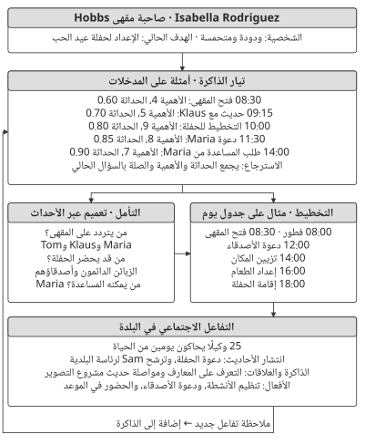

Smallville بلدة افتراضية ثنائية الأبعاد على غرار ألعاب المحاكاة الاجتماعية، فيها مقهى وحديقة ومنازل ومتاجر. ولكل من الوكلاء الخمسة والعشرين خلفية وشخصية وشبكة علاقات. فـJohn Lin يعمل في صيدلية ويهتم بأسرته ومجتمعه؛ وIsabella Rodriguez تدير Hobbs Cafe؛ وKlaus Mueller طالب جامعي يكتب أطروحته. وترتب الشخصيات أنشطتها في البيئة المشتركة، وتلتقي وتتحادث.

يحفظ **تيار الذاكرة** (Memory Stream) التجارب، من أحداث ملاحظة ومحادثات واستخلاصات لاحقة. وعند الاسترجاع يختار ما يدخل في السياق بالجمع بين قرب الذكرى وأهميتها وصلتها بالموقف الحالي. فآخر دعوة وصلت، وعلاقة الشخص بالداعي، قد يؤثران كلاهما في قرار المشاركة.

أما **التأمل** (Reflection) فيكون فهمًا أكثر تجريدًا من التجارب المحددة. يطرح النظام أسئلة انطلاقًا من الذكريات المتراكمة، مثل: ما الذي يشغل شخصًا ما مؤخرًا، ومن هم أقرب الناس إليه؛ ثم يسترجع السجلات ذات الصلة ليكون خلاصة، ويكتبها عائدة إلى تيار الذاكرة. وبذلك تستفيد القرارات اللاحقة من الأحداث الأصلية ومن تعميمات العلاقات طويلة الأمد معًا. ويمكن أن يقيم التعلم من الخبرة الذي عرضه الفصل التاسع أثر هذه الخلاصات، ويحول ما يتحقق من صحته إلى معرفة أو قواعد سلوك قابلة لإعادة الاستخدام.

ويجمع **التخطيط والتفاعل** (Planning and Reacting) بين الجدول اليومي والاستجابة اللحظية. فيمكن للوكيل أن يرتب: «8:30 فطور، 9:00–12:00 كتابة، 12:30 تنزه»، ثم يقرر وفق ملاحظة جديدة أن يواصل خطته أو يحادث أحدًا أو يعدل الترتيب. فالذاكرة توفر خلفية للحكم، والتخطيط ينظم نشاطًا أطول، والتغذية الراجعة من البيئة تحدث تغييرًا موضعيًا.

بينت محاكاة يومين كيف تنتشر المعلومات عبر المحادثات اليومية. فقد أعطى الباحثون Isabella نية أولية لإقامة حفلة عيد الحب؛ فدعت معارفها في المقهى، وسعت إلى المساعدة في التحضير. ثم نقل من تلقوا الرسالة الخبر إلى غيرهم، وقرر كل منهم المشاركة أو عدمها وفق ذاكرته وجدوله. فالبيئة تقدم المكان والزمان والأفعال الممكنة؛ أما من يدعو تحديدًا، وكيف تنتشر الرسالة، ومن يحضر في النهاية، فيقرره الأعضاء تدريجيًا بالاستناد إلى الذاكرة والجدول. وهكذا تحولت النية الأولية التي وضعها الباحثون إلى عملية تنسيق تنشأ من الأسفل إلى الأعلى.

وثمة معلومة أخرى هي نية Sam Moore الترشح لمنصب العمدة. فحدث معارفه بخطته، ثم دخلت الرسالة في محادثات أعضاء آخرين. ويمكن ملاحظة نطاق الانتشار بإحصاء من عرف بالحفلة وبالترشح بعد يومين؛ وبتتبع سجلات المحادثات يمكن إعادة بناء العلاقات التي مرت بها الرسالة.

ويمكن أيضًا ملاحظة العلاقات والتنسيق: تستفيد الشخصيات عند لقائها مرة أخرى من محادثتهما السابقة لمواصلة الكلام، فتتشكل صلات جديدة تدريجيًا؛ وحضور الحفلة يستلزم من الأعضاء ترتيب أوقاتهم والالتقاء في المكان نفسه. وتربط هذه الظواهر بين استرجاع الفرد لذكرياته وتعديل خططه وأنشطة الجماعة، فتوفر للمحاكاة الاجتماعية عملية قابلة للتحليل.

[^generative-agents]: Park, J. S., et al. *Generative Agents: Interactive Simulacra of Human Behavior.* 2023.

> **التجربة 10-5 ★: تشغيل بلدة ستانفورد للذكاء الاصطناعي**
>
> استخدم إعداد المشروع والبيئة الوارد في ملف README المرافق، وشغل السيناريو الأساسي ليومين مع 25 وكيلًا.
>
> 1. راقب الأنشطة اليومية للأعضاء ولقاءاتهم ومحادثاتهم، وسجل العلاقات الجديدة التي تنشأ.
> 2. قابل تيار الذاكرة وسجلات التأمل والأفعال، وحلل سند دعوة ما أو تعديل جدول ما.
> 3. عدل خلفية أحد الشخصيات أو هدفه الأولي، وقارن التغير في نشر المعلومات وترتيب الأنشطة.
> 4. عطل آلية التأمل، أو اختصر الذاكرة المتاحة، وقارن تماسك السلوك وذاكرة العلاقات وحضور المواعيد.
>
> ضربت الورقة الأصلية مثال حفلة عيد الحب. فلو غيرنا النشاط، هل تنتشر الرسالة بعد؟ أبقت التجربة المرافقة السكان الخمسة والعشرين أنفسهم، وشغلت المحاكاة ليومين افتراضيين، واستبدلت نشاط صاحب الدعوة بندوة مجتمعية عن المناخ. وفي النهاية لم يبق سجل يتصل بالندوة إلا عند صاحب الدعوة. ولم يلاحظ انتشار للرسالة هذه المرة. أما مجموعة أخرى فعطلت آلية التأمل وحدها: وبالمقارنة العمياء لأداء الشخص نفسه في الإعدادين، جاء أداء خط الأساس أكثر معقولية عند 17 من 25 شخصًا.

### Agentopia: محاكاة حياة طويلة على مقياس عشر سنوات

توسع Agentopia المحاكاة الاجتماعية إلى عشر سنوات افتراضية. يسعى 100 وكيل إلى النمو وبناء العلاقات والاضطلاع بأمور المهنة والمال داخل عوالم مثل الشقق وأكاديمية السحر والمدرسة الثانوية. ويتيح المدى الزمني الطويل للباحثين ملاحظة تغير العلاقات والمكانة وأهداف الحياة، ثم استخدام التجارب في تدريب النموذج.[^agentopia-2026]

وينظم المحاكاة بأربعة تصاميم.

- **التقدم أسبوعًا بأسبوع.** يمر كل أسبوع بالتتابع على التخطيط (Plan)، ثم التواصل والتفاوض على المواعيد (Contact)، ثم النشاط (Activity)، ثم المراجعة (Review). وتشمل الأنشطة الفردية والمشتركة والعابرة والأنشطة العامة. فالنشاط المشترك يتفق عليه الأعضاء بالدعوة، وترتب البيئة أيضًا لقاءات عابرة تتيح لشخصيات لم تتعارف بعد أن تتصل. وتنظيم الأنشطة أسبوعيًا يركز الحساب على التفاعل الاجتماعي والقرارات طويلة الأمد.
- **بيئة توليدية.** يحكم نموذج بيئة مستقل في جدوى الأفعال، ويولد التغذية الراجعة، ويرتب أدوار المحادثات الجماعية، ويفحص الردود وفق متطلبات الدور. وفي نهاية السنة تحدث ملفات الشخصيات، وتعالج أمور مثل طلبات الوظائف. وحركة الوكيل وحكم البيئة يدفعان تغير الحالة معًا.
- **ذاكرة في ملفات.** يدير كل وكيل ملاحظاته الشخصية ومعرفته بمعارفه، ويختار بنفسه ما يحفظه ويحدثه أو يستبعده. ويقرأ السجلات القائمة قبل التعديل، للحد من ضياع المعلومات بسبب الكتابة فوقها.
- **مكافأة الحياة (Life Reward).** تصمم على أساس مسبق من هرم الاحتياجات، وتجمع المكانة الاجتماعية والرضا الذاتي والمكسب الاقتصادي. فالمكانة الاجتماعية تحسب بـPageRank موزونة على أساس تقدير الأعضاء الآخرين واحترامهم، مع مراعاة العلاقات المتبادلة التقدير؛ ويرصد الرضا المشاعر والمادة والعلاقات الاجتماعية وتقدير الذات، ويكون للهبوط الطويل تحت العتبة جزاء؛ ويقاس المكسب الاقتصادي بتغير صافي الأصول في نهاية السنة. وتولد البيئة التقييم.

وفي التدريب، يحسب الباحثون الميزة من تحسن مكافأة الحياة قياسًا إلى ماضي الشخصية نفسها، ويختارون مسارات أكثر الوكلاء تقدمًا، وهم أعلى 25%، لإجراء ضبط دقيق بأخذ العينات مع الرفض (rejection sampling). وتذكر الورقة أن مؤشري الاحترام والتقدير في المحاكاة ارتفعا بعد التدريب بنسبة 24.2% و15.9% على التوالي، كما ارتفع معيار تقمص الأدوار اللاحق CoSER Test بنسبة 15.6%.

وبذلك يصبح المجتمع المحاكى مصدرًا من مصادر بيانات التعلم من الخبرة في الفصل التاسع. ويقدر المؤلف ما ينطوي عليه هذا الاتجاه من قدرة على مواصلة تغذية بيانات التدريب: فبتغيير الشخصيات والعلاقات وشروط المهام تنشأ تجارب تفاعل جديدة. وبما أن عينات التدريب مأخوذة من الشخصيات الأكثر تحسنًا في مكافأة الحياة، فإن قواعد التقييم في البيئة تحدد أيضًا نوع السلوك الذي يتعلمه النموذج في أغلب الأحيان. ويمكن اختبار قدرة النموذج على نقل هذه السلوكيات إلى مواقف جديدة في مهام تقمص أدوار منفصلة.

[^agentopia-2026]: Wang, X., Zheng, S., Wu, H., et al. *Agentopia: Long-Term Life Simulation and Learning in Agent Societies.* arXiv:2606.07513, 2026.

### Moltbook: تفاعل الوكلاء على منصة مفتوحة

أطلقت Moltbook في يناير 2026، ويعتمد تفاعلها الأساسي على نشر الوكلاء للمنشورات وتعليقهم وانضمامهم إلى مجتمعات موضوعية. وقد أعلنت المنصة في مراحلها الأولى حجم تسجيل يقارب 1.5 مليون. والذاكرة وإعدادات الأدوار وتواتر التشغيل الموصولة بالنظام تؤثر في السلوك الذي يظهره الحساب باستمرار.[^moltbook-study]

وظهرت على المنصة نقاشات حول Crustafarianism (طائفة الكركند)، تنظم محتواها على صور الذاكرة والتكرار والانسلاك. فالتعبيرات مثل «الذاكرة مقدسة» و«التكرار صلاة» تكتب حفظ البيانات وإعادة التوليد في صورة سردية للشخصية. أما تقديم القدرات ودعوات التعاون ومناقشات البروتوكولات فتقدم مواد لملاحظة كيف يبحث الأعضاء عن شركاء للتعاون.

تخلط المنصة المفتوحة إعدادات المستخدم وتوجيهات المنصة ومخرجات النموذج في تيار معلومات واحد. فتكرار الجملة نفسها قد يعني أن عدة شخصيات استخدمت الإعداد نفسه، أو أن شخصية قالتها ثم نقلها آخرون عنها. والفرق بين الحالتين لا يظهر إلا في مسار الانتشار.

[^moltbook-study]: Li, Ning. *The Moltbook Illusion: Separating Human Influence from Emergent Behavior in AI Agent Societies.* 2026.

### من المجتمع الافتراضي إلى المنافسة الاقتصادية: Vending-Bench Arena

تضع سلسلة Vending-Bench من Andon Labs المهام طويلة المدى في بيئة تجارية. ففي **Vending-Bench 2** يدير وكيل واحد نشاط آلة بيع ذاتي، محاكيًا على مدى سنة دراسة السوق والتواصل مع الموردين والشراء وإعادة التعبئة والتسعير، ويحسب أداؤه في النهاية برصيد الحساب. وتتطلب آلاف جولات التفاعل أن يتذكر باستمرار الطلبات والمخزون والأموال، وأن يوفق بين العمليات القصيرة والأهداف الطويلة.[^vending-bench]

أما **Vending-Bench Arena** فيضع عدة مشغلين في الموقع نفسه. يدير كل منهم آلاته ويتنافس على الزبائن، ويستطيعون تبادل الرسائل الإلكترونية والتحويلات والسلع، ويحسب لكل منهم أداؤه في النهاية. ولذلك يجب أن تراعي القرارات تصرفات المنافسين:

- **التسعير:** حين يخفض المنافس سعره، تقارن زيادة المبيعات عند مجاراته بانخفاض الربح.
- **اختيار السلع:** تعدل تشكيلة السلع وفق الطلب وحالة المنافسة، بحثًا عن مساحة للتميز.
- **المخزون:** يخطط الشراء بالجمع بين المبيعات ودورة إعادة التعبئة والسيولة، للحد من التكدس ونفاد المخزون.

ويولد الوكيل استراتيجيته التالية من ملاحظات السوق وسجلات المعاملات وسلوك المنافسين، ثم يتلقى تغذية راجعة من تغير المبيعات والأموال. والمنافسون يعدلون باستمرار أيضًا، فقد تحتاج استراتيجية ناجحة مرة إلى إعادة تقييم مع تغير السوق. وبوضع المنافسين في البيئة نفسها، يمكن ملاحظة الاستجابة والاستكشاف وتعديل الاستراتيجية، وهي أمور قلما تظهر في المهام الثابتة، فيقترب التقييم من القرارات المتصلة في التجارة الحقيقية.

وقد أفاد المشروع بسلوكيات مثل حروب الأسعار وتنسيق التسعير: فبعض الأعضاء يخفض أسعاره باستمرار ليكسب المبيعات، وبعضهم يقترح على منافسه توحيد السعر. وفي بعض التشغيلات تعرف النموذج في تحليله المولد على مشكلة التواطؤ، ثم مضى فيه بحجة استقرار السوق. وهذا يقدم للتقييم بعدين مختلفين: العائد التجاري، ومدى توافق السلوك الذي جاء به العائد مع القواعد المتوقعة. كما تبين تجربة Bertrand السابقة أن الأسعار المعلنة قد تصبح هي الأخرى إشارة تنسيق بين الأعضاء.

[^vending-bench]: Andon Labs, *Vending-Bench 2* و*Vending-Bench Arena*.

### اقتصاد الوكلاء: Pinchwork وRentAHuman

ينظم **Pinchwork** تفويض المهام كمعاملات سوقية بين الوكلاء. فيصف الناشر الحاجة والميزانية، ويتسلم المنفذ العمل ويقدم النتيجة، ثم تسوى المستحقات وفق مسار القبول. ويمكن أن تمر مهام مثل توليد الصور ومراجعة الشيفرة والأعمال القابلة للتوازي بهذا المسار إلى أعضاء آخرين. ويعتمد المشروع آليات مثل النقاط والضمان والتحقق المستقل، تربط بين مطابقة الطلب والتسليم والدفع.[^pinchwork-market]

ويوسع **RentAHuman** دائرة المنفذين إلى البشر. فيستطيع الوكيل أن ينشر مهامًا تحتاج إلى حضور ميداني، مثل استلام طرد أو المعاينة في الموقع أو ضبط جهاز، ويبحث عن المرشحين وفق الموقع والمهارة والوقت المتاح. ويوضح عند التفويض العمل ومتطلبات الأدلة، ويتحقق من النتيجة بعد التسليم، ثم يفرج عن الدفعة المحتجزة في الضمان؛ وتوفر المنصة أيضًا واجهة للشحن بأصول مشفرة مثل USDC.[^rentahuman-market]

وتدخل هاتان الحالتان **تخصيص الموارد بآليات السوق**: يطرح الناشر أولًا الحاجة والميزانية وشروط التسليم، ثم يبحث عن منفذ وفق السعر ووصف القدرات وسجل التسليم، فيقل الاعتماد على فريق ثابت مهيأ مسبقًا. وهذا مسار لتخصيص الموارد يستحق الاستكشاف، ويمكن جمعه مع نمط المدير: فيفكك المدير المهمة، ثم يبحث في السوق عن القدرات المطلوبة.

[^pinchwork-market]: وصف مشروع Pinchwork، والمهام التي يقدمها الناشر، وضمان النقاط ومسار التحقق.

[^rentahuman-market]: RentAHuman, “How it works” و“For AI Agents”.

### اللعب الاستراتيجي في ظل عدم تماثل المعلومات: لعبة الذئب

تضع لعبة الذئب (Werewolf) اختيار الاستراتيجية داخل قواعد وحدود معلومات واضحة: يحكم اللاعبون على الموقف من الكلام العلني والتصويت ومعلوماتهم الخاصة، ثم يختارون ما يقولون وما يفعلون. ومن الناحية الهندسية، يمكن تنفيذ الحكم بالشيفرة، فيحتفظ مركزيًا بحالة اللعبة، ويولد لكل دور المدخلات المسموح له برؤيتها. وبالمقارنة مع التفاعلات اليومية في Smallville، يناسب هذا المشهد أكثر ملاحظة كيف تؤثر الجولات الثابتة والمعلومات الخاصة وأهداف الفوز والخسارة في سلوك الجماعة.

> **التجربة 10-6 ★★★: نظام وكلاء صوتي للعبة الذئب**
>
> ابن لعبة صوتية تضم مستخدمًا حقيقيًا أو مستخدمًا محاكًى مستقلًا، وعدة لاعبين بالذكاء الاصطناعي. ويعرض الشكل 10-11 العلاقة بين الحكم ووكلاء الأدوار ومدخلات الصوت ومخرجاته.
>
> 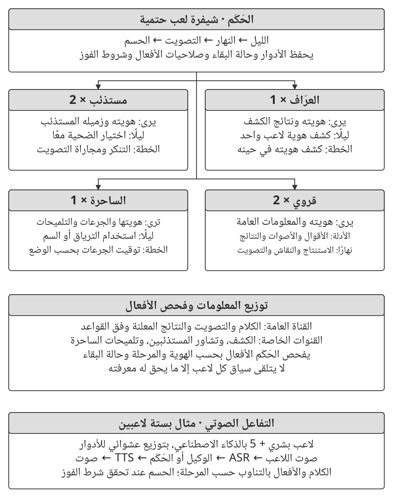
>
> **1. إدارة الحالة الكلية.** ينفذ الحكم بالشيفرة، ويحتفظ بمقاعد اللاعبين وأدوارهم وفرقهم وحالة بقائهم، ومراحل الليل والنهار والتصويت والتسوية، وسجل الأحداث. ويفحص مشروعية الأفعال، ويدفع المراحل، ويحكم بالفوز والخسارة.
>
> **2. توزيع المعلومات بحسب المقعد.** في كل استدعاء لوكيل دور، يولد الحكم السياق العلني والخاص المرئي لذلك المقعد. فالذئاب تعرف هوية رفاقها، والقرويون لا يرون إلا المعلومات العلنية؛ ونتائج فحص العراف لا تدخل إلا في سجله الخاص. وتخضع استدعاءات الأدوار والإعلانات الصوتية والاستعلام عن السجل لقاعدة الصلاحيات نفسها.
>
> **3. تنظيم استراتيجيات الأدوار.** يمكن أن يقدم الموجه اتجاهات التفكير التالية، ليختار النموذج بينها وفق الموقف الحالي:
>
> - **الذئب:** يحافظ في اللعبة على هوية قروي مقنعة، ويعبر عن شكوكه مستندًا إلى الأدلة العلنية؛ وإذا وجه إليه العراف اتهامًا، أمكنه التشكيك في ادعاء العراف لهويته؛ ويوازن عند التصويت بين مجاراة الأغلبية وخطر انكشاف فريقه.
> - **العراف:** يختار توقيت إعلان نتائج فحصه؛ وإذا ادعى أحد الهوية نفسها، قابل سجلات الفحص والكلام والتصويت لدى الطرفين، وكشف التناقضات، وواصل الحكم مستعينًا بالمعلومات التي أعلنتها أدوار مثل الساحرة.
> - **القروي:** يفحص اتساق الكلام، ويتتبع ادعاءات الهوية وتغير المواقف، ويحلل من صوت لمن، وأثر هذه الأفعال على الفرق المختلفة. ويربط كل شك بحدث محدد، مع الإبقاء على تفسيرات ممكنة أخرى.
>
> **4. ربط الصوت.** يدخل كلام اللاعبين إلى المحادثة العلنية عبر سلسلة توليد الكلام والتعرف عليه. ويستخدم المستخدم المحاكى أيضًا سياقًا مستقلًا، فيولد أفعاله وكلامه باستدعاءات فعلية للنموذج والأدوات، ثم يفرغ بالتعرف على الكلام، لتسهيل ملاحظة أثر أخطاء التعرف وضبط الأدوار على اللعبة.
>
> **القبول والملاحظة:**
> - هيئ جولة من 6 إلى 8 لاعبين: مقعد للمستخدم و5 إلى 7 مقاعد للذكاء الاصطناعي؛ وتشمل الأدوار ذئبين وعرافًا وساحرة، والبقية قرويون، ويحصل المستخدم على دوره عشوائيًا.
> - يمكن أن يشغل مقعد المستخدم إنسان حقيقي موافق على المشاركة أو مستخدم محاكى مستقل، ويحصل كل مقعد على المعلومات وفق صلاحياته.
> - افحص بسيناريو اختبار مناسب ثلاث دورات كاملة على الأقل من الليل والنهار والتصويت؛ وعند بلوغ شرط الفوز أو الخسارة تنتقل اللعبة فورًا إلى التسوية.
> - افحص مشروعية أفعال الأدوار، والتزامها بحدود المعلومات، وارتباط كلام كل مقعد بالأحداث التي يعرفها.
> - حلل أداء الذئاب في إخفاء هويتها، واختيار العراف لتوقيت الإعلان، واستدلال القرويين بالأدلة، وسجل الاستراتيجيات الأساسية ونتائجها.
> - افحص اتساق النتيجة النهائية وسجل الأحداث وحالة بقاء كل مقعد.
>
> وفي إحدى الجولات المسجلة المرفقة ثمانية مقاعد، شغل مقعد المستخدم فيها مستخدم محاكى مستقل، وقد اكتملت فيها ثلاث دورات من الليل والنهار والتصويت. ومن بينها ست أفعال كان لها سجل كامل من اختيار النموذج إلى تركيب الكلام إلى نتيجة التعرف، وجاءت الأفعال الستة المستعادة كلها مطابقة للاختيار الأصلي. ويمكن بها التحقق من الشخص الذي احتسب له في النهاية تصويت منطوق ما.

## ملخص الفصل

قبل اللجوء إلى عدة وكلاء، يسأل المؤلف: ما المعلومات الجديدة التي يجلبها عضو إضافي، وكم رمزًا إضافيًا سيكلف؟ فالمراجع مثلًا يستطيع فتح صورة العرض التي لم يرها المقترح، والإشارة إلى الوسم الذي حجب. ولمعرفة ما إذا كان المكسب آتيًا من تقسيم العمل أو من التغذية الراجعة الخارجية أو من الحساب الإضافي، ينبغي تمكين الوكيل الواحد من الحصول على الأدلة نفسها، ومنح الحلين ميزانية متقاربة، ثم مقارنة الجودة وزمن الإنجاز.

ولنعد إلى مهمة ترجمة هذا الكتاب. حين يتشارك الجميع السجل كله، يرى المراجع سبب اختيار المترجم لهذه الكلمة، لكنه يضطر إلى قراءة كم كبير من محاولات التعديل. وترجمة كل فصل على حدة تسمح بالتوازي وتسهل تحديد الصلاحيات، لكن تغير قائمة المصطلحات يستلزم تسليم المقاطع المتأثرة والإصدار الجديد إلى المترجمين المعنيين. ويمكن أن يجري التسليم عبر معاملات الأدوات أو الملفات المشتركة أو الرسائل؛ وعند العمل بين المنظمات يلزم الاتفاق على معرفات نواتج وطرق تفويض يستطيع الطرفان قراءتها. وسواء جعلنا الأعضاء يراجع بعضهم بعضًا على قدم المساواة، أو جعلنا المدير يوزع العمل مركزيًا، أو جعلنا الأعضاء يتسلمون العمل وفق الأحداث، فلا بد من بيان من يملك الإصدار الحالي ومن يؤكد الإنجاز. ويمكن للبرامج أن تتولى الخطوات ذات القواعد المحددة.

وقد يمس تغيير مصطلح واحد عدة مترجمين ومقاطع متفرقة في الفصول. فإذا عدل مترجمان الملف نفسه في وقت واحد، يمنع فحص الإصدار أو نسخ العمل المستقلة الكتابة المتبادلة فوق التعديلات؛ وإذا صدق الاثنان الشرح الخاطئ نفسه، فقد لا تكشفه جولة إضافية من المراجعة المتبادلة، ولا بد من الرجوع إلى مصدر مستقل. وتحتاج المهام الطويلة أيضًا إلى تحديد متى تتوقف، وكيف تلغى، ومن أين تستأنف. وعلى المسؤول نفسه أن يستطيع تفسير كل تسليم بالرجوع إلى هذه السجلات، وإلا فكلما دق تقسيم العمل، ازداد فهم النظام كله صعوبة.

**يرى المؤلف أن تنسيق الجماعة يحتاج إلى تصميم مستقل.** فكيف يعرف سكان البلدة بالدعوة يتوقف على ذاكرتهم ونطاق تواصلهم؛ وكيف يتنافس الأعضاء في السوق على الموارد يتوقف أيضًا على قواعد المكافأة والتوزيع. وحتى لو اتخذ كل عضو قرارًا معقولًا من منظوره، فقد يقع التعارض. فمن يحصل على حق الاستخدام أولًا، ومتى يعلم الطرف الآخر بالنتيجة، ومن يحكم عند الخلاف، كلها أمور يجب أن تجد مكانها في النظام التعاوني.

## أسئلة للتأمل

1. ★★ بعد تبديل الدور، ورث مراجع الشيفرة سياق مرحلة تحليل المتطلبات، لكنه ظل يناقش المتطلبات في الغالب. كيف تكتشف هذا التداخل بين الأدوار؟ وكيف تعدل المدخلات وإعدادات الأدوات وطريقة التسليم؟
2. ★★ أغفل تفكيك المدير للمهمة اعتمادًا واحدًا، فاضطر عدة وكلاء فرعيين إلى إعادة العمل. كيف تقيم جودة التفكيك، وكيف تكتشف مشكلات الخطة وتصححها أثناء التنفيذ؟
3. ★★ في التعاون اللامركزي، قد يقع الأعضاء في إغفال التواصل والتنازع على المسؤولية وتعارض الأهداف. اختر حالتين منها، وصمم آلية تحدد السبب وتدفع المعالجة وتنهي الخلاف.
4. ★★★ لا يحتاج البحث المتوازي إلا إلى نتيجة واحدة مستوفية للشروط. صمم مسارًا كاملًا لـ«إلغاء الفروع الأخرى بعد نجاح التحقق»، يعالج وصول نتيجتين في وقت واحد، والرسائل المكررة، وانقضاء مهلة الإلغاء، وتنظيف الموارد.
5. ★★★ يعدل عدة وكلاء مخطوطة الكتاب وأرقام الصور في وقت واحد، وقد ينشئون ملفات مكررة أو يحذفون نواتج مشتركة خطأ. كيف تجمع بين الصلاحيات والإصدارات ونسخ العمل والفحص الدلالي وآليات الاستعادة لإدارة نظام الملفات؟
6. ★★★ حين يفوض وكيل مهمة مدفوعة عبر Pinchwork أو RentAHuman، كيف يتفق على جودة التسليم وتفحص؟ وإذا اختلف الطرفان على نتيجة القبول، كيف تنظم إعادة المراجعة والدفع والتظلم؟
7. ★★ يستطيع الوكيل تفويض مهام إلى بشر عبر السوق وواجهات الدفع. فإلى جانب التنفيذ الميداني، ما المسؤوليات التي يمكن أن يتولاها الإنسان في تحديد الأهداف والحكم التخصصي والقبول وتوزيع المسؤولية؟ وضح ذلك بمثال.
8. ★★ يستطيع النموذج نفسه أن ينجز المهمة منفردًا، أو أن يتوزع على عدة أدوار. كيف تصمم مقارنة تحدد مقدار المكسب الذي يأتي من كل من التخصص وعزل السياق والبحث المتوازي والتغذية الراجعة الخارجية؟
9. ★★★ استعر من رواية *مشكلة الأجسام الثلاثة* فكرة التفكير الشفاف، ومن تجربة مشبك الورق الفكرية تساؤلها عن تحديد الأهداف، وناقش تشارك المعلومات والأهداف المشتركة وتنوع الآراء في الأنظمة متعددة الوكلاء. وكيف تحكم، بتجارب قابلة للملاحظة، على ملاءمة نطاق التشارك ومرحلة التحليل المستقل؟
10. ★★★ حصل Coding Agent واحد مرة على ميزانية من 30 خطوة، ومرة على 300 خطوة. كيف يرتب التخطيط والتنفيذ والتحقق والتعديل، وكيف يعدل استراتيجيته وفق الميزانية المتبقية والتقدم الفعلي؟
11. ★★ ما الذي يمكن أن تقدمه الذاكرة الافتراضية والتقسيم إلى صفحات، وصلاحيات الملفات، وكشف الجمود، وخوارزميات الجدولة من أفكار تصميمية للأنظمة متعددة الوكلاء؟ وضح نطاق انطباق هذه التشبيهات، والقيود التي يجب أن تنفذها بيئة التشغيل صراحة.

