# هندسة السياق

شبّه الفصل الأول السياق بـ«أفق القرار الحالي» للوكيل: فالنموذج يبني كل حكم يصدره على المعلومات التي تصله في تلك اللحظة. وتتولى **هندسة السياق** (Context Engineering) اختيار هذه المعلومات وتنظيمها وتحديثها، ومنها تعليمات النظام وتعريفات الأدوات وطلب المستخدم والرسائل السابقة وحالة المهمة. وقبل كل استدعاء للنموذج، تجمع منظومة التشغيل (Harness) خلفية المهمة وآخر ما بلغته في مدخلات واحدة. ويعرض الشكل 2-1 مكونات نافذة السياق بمحتوى ملموس.

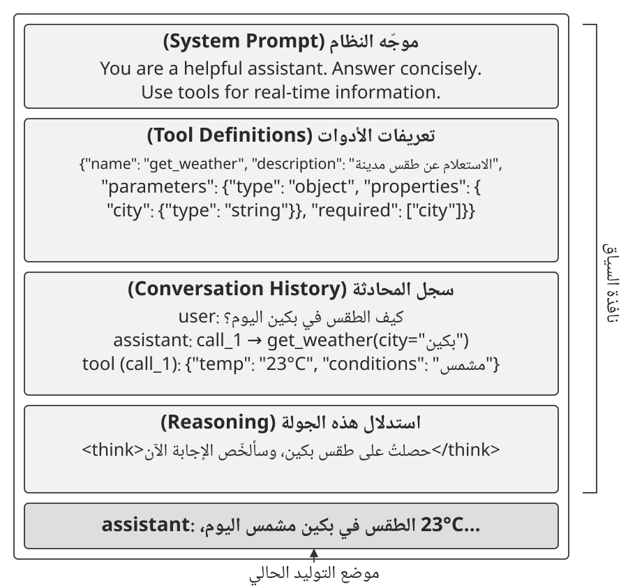

## السياق: توظيف قدرة النموذج في مهمة محددة

تخيّل مهندسًا متمرسًا انضم لتوه إلى فريق، وكانت أول مهمة أُسندت إليه «عدّل الإعدادات وفق أعرافنا». إنه يجيد البرمجة، لكنه لا يعرف بعد أي ملف هو المصدر الحقيقي للإعدادات، ولا أي الحقول يجوز تعديلها، ولا كيف يتحقق من صحة التعديل. وحتى لو سُلّمت إليه قاعدة الشفرة كاملة، فقد يعدّل الملف الخطأ. والوكيل حين يتسلم مشروعًا غريبًا عنه تنقصه هذه الخلفية نفسها.

لنأخذ طلب «ساعدني في إصلاح هذا الخطأ» مثالًا. يحتاج وكيل البرمجة (Coding Agent) عادةً إلى ثلاثة أنواع من الخلفية:

- **سياق الشفرة الحي**: بنية المجلدات، ومسؤوليات الوحدات، وهياكل البيانات الأساسية، وأعراف كتابة الشفرة. فإذا كان التعديل في ملف إعدادات مولَّد آليًا، فإنه سيُمحى عند التوليد التالي حتى لو نجح محليًا. ومعرفة الوحدة التي تولّد الملف هي ما يدل على الموضع الذي ينبغي تعديله.
- **أعراف سير العمل**: استراتيجية فروع Git، وأعراف الإيداع، وإجراءات مراجعة الشفرة، ومتطلبات CI/CD. ويرتّب الوكيل على أساسها التعديل والاختبار والإيداع، بينما ينفذ نظام التنفيذ هذه العمليات وفق الصلاحيات الممنوحة.
- **معلومات البيئة**: إعدادات التطوير، وطريقة الاتصال بقاعدة بيانات الاختبار، وطريقة نشر بيئة الاختبار، وطريقة إدارة مفاتيح API. وتساعده هذه المعلومات على اختيار بيئة التشغيل الصحيحة وفهم الفروق بين البيئة المحلية وبيئة الاختبار.

تقع شفرة المشروع وقاعدة بيانات الاختبار كلتاهما خارج سياق النموذج. ففي مثال الإعدادات المولَّدة آليًا، لا يعرف الوكيل من أين يبدأ التعديل إلا بعد أن يقرأ سكربت التوليد بأداة البحث. **جودة السياق هي التي تحدد هل يستطيع النموذج توظيف قدراته الموجودة في المشكلة الحالية.** **وفي المهام التي تعتمد على قدر كبير من معلومات الخلفية، قد يتفوق نموذج كافي القدرة معه سياق كامل ودقيق على نموذج أقوى تنقصه المواد اللازمة.**

**بناء فريق أصيل في الذكاء الاصطناعي يبدأ بتوثيق المعرفة الأساسية.** فإذا كان سبب اختيار قاعدة بيانات بعينها لا يتذكره إلا الموظفون القدامى، وكان تغيير قواعد العمل لم يُذكر إلا في محادثة خاصة، فإن الزميل الجديد والوكيل سيواجهان المشكلة نفسها عند تسلم العمل: تكشف الشفرة ما فعله الفريق، لكنها لا تكشف لماذا فعله على هذا النحو.

**الفرق الملائمة للعمل عن بعد كثيرًا ما تكون ملائمة للوكلاء أيضًا.** فمطورو نواة Linux يناقشون الرقع ويتبادلون ملاحظات المراجعة عبر القوائم البريدية، وتشرح وثائق سير التطوير كيف تُقدَّم الرقع وتُراجَع وتُدمَج[^ch2-linux]. وإذا صادف مشارك جديد تعديلًا غير متوقع، أمكنه أن يتتبع الرقعة حتى يصل إلى النقاش الذي دار حولها في حينه؛ وهذا السجل نفسه ينفع الوكيل حين يتحقق من الخلفية.

استمع المؤلف إلى مقابلة جياي ونغ (Jiayi Weng) في برنامج WhynotTV، ولخّص إحدى أفكاره على النحو الآتي: **البشر والنماذج كلاهما يعتمد على السياق (Context).** فالإنسان يستطيع أن يسأل زميلًا شارك في اتخاذ القرار، أما ما يستطيع النموذج قراءته من الخلفية فيتوقف على ما تركه الفريق من سجلات، وعلى ما وضعته منظومة التشغيل في هذا الطلب.[^ch2-weng]

[^ch2-linux]: الوثائق الرسمية لنواة Linux، How the development process works.

[^ch2-weng]: WhynotTV، «جياي ونغ: OpenAI وGPT والتعلم المعزز وInfra والتدريب اللاحق وTianshou وtuixue والمصادر المفتوحة وCMU وTsinghua»، Podcast #4.

تصف ورقة ReAct بصيغة رياضية كيف يشارك تاريخ التفاعل في اتخاذ القرار[^ch2-react]. ففي اللحظة $t$ يتلقى الوكيل من البيئة ملاحظة $o_t\in\mathcal{O}$، ويختار إجراءً $a_t\in\mathcal{A}$ وفق السياسة $\pi(a_t\mid c_t)$، حيث السياق هو:

$$
c_t=(o_1,a_1,\ldots,o_{t-1},a_{t-1},o_t)
$$

تبيّن هذه الصيغة أن **الخطوة التالية للوكيل تعتمد على تاريخ التفاعل حتى اللحظة الحالية.** فالملف الذي فحصه الوكيل، والخطأ الذي أعادته الأداة، كلاهما يؤثر في اختياره التالي. وفي وكيل مبني على LLM، يقدّم إدخال المستخدم ونتائج الأدوات الملاحظات، وتسجّل استدعاءات الأدوات والردود الموجهة إلى الخارج الإجراءات؛ أما تعليمات النظام وتعريفات الأدوات فتوضح قواعد المهمة والواجهات المتاحة.

يعتمد هذا الفصل في البداية أسلوب الطلبات عديمة الحالة: تجمع منظومة التشغيل في كل جولة الرسائل وتعريفات الأدوات، ثم تستدعي النموذج. ويسهّل التاريخ الكامل للرسائل الاحتفاظ بتقدم المهمة؛ ومع نمو هذا التاريخ، يمكن عبر الاسترجاع وتسجيل الحالة والضغط إبقاء المعلومات التي تحتاج إليها القرارات اللاحقة داخل النافذة. وتدور ترتيبات السياق وشريط الحالة وتقنيات الضغط كلها حول سؤال واحد: كيف نضع في $c_t$، داخل سياق محدود، المعلومات التي يحتاج إليها النموذج في هذه الخطوة؟

[^ch2-react]: Yao, Shunyu, et al.، ReAct: Synergizing Reasoning and Acting in Language Models، ICLR 2023.

## كيف يستدعي الوكيل النموذج الكبير: فهم بنية السياق في API

نبدأ بتحية بسيطة لنتعرف إلى صيغة الرسائل، ثم ننظر في كيف يؤدي سؤال «كم الساعة الآن في فانكوفر، وكيف الطقس؟» إلى استدعاءين للأدوات. يستخدم هذا القسم واجهة متوافقة مع Chat Completions، ونموذج Qwen3-0.6B يعمل محليًا، ثم يربط جولات الطلبات المتتالية بشفرة Python في الختام[^ch2-chat-api].

### أدوار الرسائل الأربعة في المثال

تحفظ **قائمة الرسائل** (`messages`) في الطلب معلومات التفاعل بترتيب وقوعها. وتُوسَم كل رسالة بـ**دور** (`role`) يبين مصدرها والغرض منها. ويستخدم هذا القسم أربعة أدوار:

- **system**: موجّه النظام. نستخدمه في هذا القسم لحمل ما يقدمه المطور من هوية وقواعد سلوك وقيود، ويوضع في مقدمة قائمة الرسائل. وتستخدم بعض واجهات النماذج الدور `developer` لحمل تعليمات المطور.
- **user**: رسالة المستخدم، وتحفظ المهمة والأسئلة اللاحقة والمتطلبات الإضافية.
- **assistant**: رد النموذج، ويشمل النص وطلبات استدعاء الأدوات. وحين تعاد هذه الرسائل إلى مدخلات الجولة التالية، يستطيع النموذج أن يقرأ ما سبق من إجاباته وطلباته.
- **tool**: نتيجة تنفيذ الأداة. فحين تتلقى منظومة التشغيل القيمة المعادة، تكتبها في رسالة أداة وتربطها بالاستدعاء المحدد عبر `tool_call_id`.

أما تعريفات الأدوات فتُمرَّر عبر الحقل `tools` في المستوى الأعلى من الطلب، وتسرد أسماء الأدوات المتاحة ووظائفها وصيغ معاملاتها.

يبني النموذج طلب الاستدعاء استنادًا إلى تعريفات الأدوات. أما هل يمكن تنفيذ العملية فعلًا، فأمر تقرره منظومة التشغيل وبيئة التشغيل.

[^ch2-chat-api]: OpenAI، مرجع Chat Completions API، ويشرح أدوار الرسائل وتعريفات الأدوات وحقول نتائج الاستدعاء؛ Qwen، Function Calling، ويشرح استدعاء الأدوات والقوالب في الخدمات المتوافقة.

### محادثة من جولة واحدة: أبسط استدعاء لواجهة API

لننظر أولًا في سؤال وجواب واحد. يسأل المستخدم «Hello, who are you?»، فترسل منظومة التشغيل تعليمات النظام مع سؤال المستخدم إلى النموذج، ثم تقرأ الرد. ويبين الشكل 2-2 التقابل بين الطلب والاستجابة.

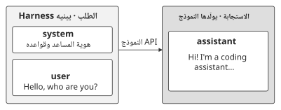

نكتب فيما يلي الطلب ورد المثال بصيغة واجهة النموذج المحلي، وتشير التعليقات في الشفرة إلى مصدر كل جزء:

```javascript
// منظومة التشغيل تبني الطلب
{
  "model": "Qwen3-0.6B",
  "messages": [
    {
      "role": "system",                           // تعليمات يقدّمها المطوّر
      "content": "You are a helpful coding assistant. Follow user instructions."
    },
    {
      "role": "user",                              // إدخال المستخدم
      "content": "Hello, who are you?"
    }
  ]
}
```

```javascript
// استجابة API
{
  "choices": [{
    "message": {
      "role": "assistant",                         // يولّده النموذج
      "content": "Hi! I'm a coding assistant. I can help you write code, debug issues, and explain technical concepts. How can I help?"
    }
  }]
}
```

يتضمن الطلب رسالة `system` ورسالة `user`، ويحفظ الحقل `choices[0].message` في الاستجابة رسالة `assistant` التي ولّدها النموذج. وفي الواجهة عديمة الحالة المعتمدة هنا، **تتولى منظومة التشغيل تزويد كل استدعاء بالسياق الذي يحتاج إليه**. فإذا أراد الطلب التالي أن يواصل هذه المحادثة، وجب أن يحمل معه التاريخ ذا الصلة.

### تفاعل متعدد الجولات مع استدعاء الأدوات: الحلقة الأساسية للوكيل

لننظر الآن في سؤال يحتاج إلى أدوات: «What's the current time and weather in Vancouver?». للإجابة عنه لا بد أولًا من معرفة الوقت والطقس هناك. ففي الشكل 2-3، تستدعي منظومة التشغيل النموذج أول مرة، فتحصل على طلبين لأداتين. ثم تستعلم من خدمة الوقت وخدمة الطقس كلٍّ على حدة، وتضيف النتيجتين إلى تاريخ الرسائل، وتستدعي النموذج مرة ثانية، وعندئذ فقط تحصل على الرد الموجه إلى المستخدم.

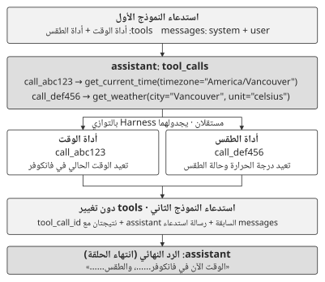

أي الأداتين تنفَّذ أولًا؟ تحتاج أداة الوقت إلى منطقة زمنية، وتحتاج أداة الطقس إلى مدينة ووحدة لدرجة الحرارة. لم يذكر المستخدم إلا فانكوفر، فملأ النموذج في المثال القيمتين `America/Vancouver` و`Vancouver` بناءً على ذلك، واختار الدرجة المئوية وحدةً للحرارة. ولا يحتاج الاستعلام عن الطقس إلى انتظار نتيجة أداة الوقت، فيمكن إرسال الاستعلامين في آن واحد.

**استدعاء API الأول — يرسل إطار الوكيل الطلب الأولي:**

```javascript
// استدعاء النموذج الأول: منظومة التشغيل تبني الطلب
{
  "model": "Qwen3-0.6B",
  "messages": [
    {
      "role": "system",                           // تعليمات يقدّمها المطوّر
      "content": "You are a helpful assistant. Use the provided tools to get real-time information when needed."
    },
    {
      "role": "user",                              // إدخال المستخدم
      "content": "What's the current time and weather in Vancouver?"
    }
  ],
  "tools": [                                       // أدوات يعرّفها المطوّر
    {
      "type": "function",
      "function": {
        "name": "get_current_time",
        "description": "Get the current date and time in a specific timezone",
        "parameters": {
          "type": "object",
          "properties": {
            "timezone": { "type": "string", "description": "Timezone name, e.g. America/Vancouver" }
          },
          "required": ["timezone"]
        }
      }
    },
    {
      "type": "function",
      "function": {
        "name": "get_weather",
        "description": "Get the current weather for a specific city",
        "parameters": {
          "type": "object",
          "properties": {
            "city": { "type": "string", "description": "City name" },
            "unit": { "type": "string", "enum": ["celsius", "fahrenheit"] }
          },
          "required": ["city", "unit"]
        }
      }
    }
  ]
}
```

يحدد المطور قائمة `tools` هذه مسبقًا، وتتضمن الاسم والوصف ومخطط المعاملات (schema). ويقدّم هذا المثال الأداتين نفسيهما في كل جولة، فيقرأ النموذج القائمة وسؤال المستخدم، ثم يختار الأداة التي يستدعيها ويملأ معاملاتها.

**يعيد النموذج طلبين لاستدعاء الأدوات:**

```javascript
// النموذج يعيد طلب استدعاء الأدوات
{
  "choices": [{
    "message": {
      "role": "assistant",                         // يولّده النموذج
      "content": null,                             // لا رد نصيًا في هذه الجولة
      "tool_calls": [                              // طلب استدعاء أداتين
        {
          "id": "call_abc123",
          "type": "function",
          "function": {
            "name": "get_current_time",
            "arguments": "{\"timezone\": \"America/Vancouver\"}"
          }
        },
        {
          "id": "call_def456",
          "type": "function",
          "function": {
            "name": "get_weather",
            "arguments": "{\"city\": \"Vancouver\", \"unit\": \"celsius\"}"
          }
        }
      ]
    }
  }]
}
```

يحتوي الحقل `tool_calls` في الاستجابة على طلبين، لكل منهما `id` خاص به واسم أداة ومعاملات. والحقل `arguments` سلسلة نصية مرمّزة بصيغة JSON، فعلى جهة التنفيذ أن تحللها أولًا، ثم تتحقق من الحقول وقيمها. **النموذج يقرر ما يستدعيه وما يمرره من معاملات؛ ومنظومة التشغيل تتولى التحقق والجدولة؛ وتنفيذ الأداة يتولى الوصول إلى خدمة الوقت أو الطقس.**

**ينفذ إطار الوكيل الأدوات، ثم يطلق استدعاء API الثاني:**

بعد أن تتحقق منظومة التشغيل من الطلبين، تجدول تنفيذ الأداتين، وتكتب القيم المعادة في رسائل `tool`، ثم تسلّم النموذج التاريخ السابق مع النتائج الجديدة:

```javascript
// استدعاء النموذج الثاني: إلحاق نتائج الأدوات
{
  "model": "Qwen3-0.6B",
  "messages": [
    {
      "role": "system",                           // رسالة محفوظة من الطلب الأول
      "content": "You are a helpful assistant. Use the provided tools to get real-time information when needed."
    },
    {
      "role": "user",                              // رسالة محفوظة من الطلب الأول
      "content": "What's the current time and weather in Vancouver?"
    },
    {
      "role": "assistant",                         // طلب الاستدعاء المحفوظ من الجولة السابقة
      "content": null,
      "tool_calls": [
        { "id": "call_abc123", "type": "function", "function": { "name": "get_current_time", "arguments": "{\"timezone\": \"America/Vancouver\"}" } },
        { "id": "call_def456", "type": "function", "function": { "name": "get_weather", "arguments": "{\"city\": \"Vancouver\", \"unit\": \"celsius\"}" } }
      ]
    },
    {
      "role": "tool",                              // منظومة التشغيل تكتب نتيجة تنفيذ الأداة
      "tool_call_id": "call_abc123",
      "content": "{\"timezone\": \"America/Vancouver\", \"datetime\": \"2025-09-13T05:18:47\", \"day_of_week\": \"Saturday\"}"
    },
    {
      "role": "tool",                              // منظومة التشغيل تكتب نتيجة تنفيذ الأداة
      "tool_call_id": "call_def456",
      "content": "{\"city\": \"Vancouver\", \"temperature\": 13.2, \"unit\": \"celsius\", \"conditions\": \"clear\", \"humidity\": 93}"
    }
  ],
  "tools": [ ... ]                                 // تعريفات الأدوات السابقة نفسها، محذوفة هنا
}
```

لنقرأ الطلب الثاني متتبعين `call_def456`: في رسالة `assistant` السابقة هو رقم الاستعلام عن طقس فانكوفر؛ وفي رسالة `tool` اللاحقة يعيد الرقمُ نفسه القيمتين 13.2 ℃ وصحو. وحتى لو عادت نتيجة الطقس قبل نتيجة الوقت، تستطيع منظومة التشغيل أن تطابق كل نتيجة مع طلبها. وفي هذه الجولة يقرأ النموذج في آن واحد سؤال المستخدم الأصلي، والاستعلامين اللذين أرسلهما هو، والبيانات التي أعادتها الأدوات. وبعد ذلك يستطيع أن يجيب المستخدم.

**يولّد النموذج الرد النهائي استنادًا إلى نتائج الأدوات:**

```javascript
// النموذج يولّد الرد النهائي
{
  "choices": [{
    "message": {
      "role": "assistant",                         // يولّده النموذج
      "content": "It's currently 5:18 AM on Saturday, September 13, 2025 in Vancouver.\n\nWeather: 13.2°C with clear skies and 93% humidity. It's quite cool this morning - you might want to grab a jacket."
    }
  }]
}
```

تقدم الاستجابة الثانية النص النهائي، والحقل `tool_calls` فارغ، فتنتهي حلقة المثال عند ذلك. وهذه العملية، أي «استدعاء النموذج ← تنفيذ الأدوات ← إعادة النتائج ← استدعاء النموذج مجددًا»، هي التجسيد الملموس في API لحلقة التشغيل التي عرضها الفصل الأول.

وإذا تابع المستخدم سائلًا «وماذا عن طوكيو؟»، أضافت منظومة التشغيل هذه الرسالة إلى آخر التاريخ واستدعت النموذج مجددًا. فيستطيع النموذج أن يستصحب خلفية المهمة، أي «الاستعلام عن الوقت الحالي والطقس»، ويولّد طلبات جديدة خاصة بطوكيو؛ وبعد عودة نتائج الأدوات يصوغ إجابة جديدة.

**كيف تعاد نتائج الأدوات عند استخدام Responses API؟** استخدمت التجربة المحلية السابقة واجهة متوافقة مع Chat Completions. أما إذا كنت تطور مشروعًا جديدًا على خدمة OpenAI، فالخيار الذي توصي به رسميًا هو Responses API. ولنبقَ مع مثال فانكوفر: يضع التطبيق سؤال المستخدم في الحقل `input` من الطلب، ويعلن في `tools` عن دالتي الوقت والطقس. ويكون الحقل `output` المعاد مجموعة من العناصر ذات الأنواع المحددة. فإذا ظهر فيها عنصرا `function_call`، قرأ التطبيق من كل منهما اسم الدالة ومعاملاتها و`call_id`، ونفذ كل أداة على حدة.[^ch2-responses-loop]

لنفترض أن رقم استدعاء دالة الطقس هو `call_weather`. عندئذ يمكن أن يتضمن `input` في الطلب التالي إيصالًا كهذا؛ وعلى دالة الوقت كذلك أن تعيد نتيجتها برقمها الخاص.

```json
{"type": "function_call_output", "call_id": "call_weather", "output": "{\"temperature\": 13.2, \"unit\": \"celsius\"}"}
```

يربط `call_id` الإيصال باستدعاء دالة بعينه. أما `previous_response_id` فيشير إلى استجابة النموذج السابقة، ليتيح للخدمة أن تواصل سياق تلك الجولة. فالرقمان يشيران إلى شيئين مختلفين. وعند اعتماد هذا الأسلوب في المواصلة، يظل على الجولة الحالية أن تقدم الأدوات التي ستستمر في استخدامها والحقل `instructions` في المستوى الأعلى؛ فالتعليمات العليا في الطلب السابق لا تُورَث تلقائيًا مع رقم الاستجابة. وقد يواصل النموذج طلب الأدوات، فعلى التطبيق أن يقرأ `output` التالي قبل أن يقرر إنهاء الحلقة. وقد استخدمت التجربة 1-3 في الفصل الأول بحثًا تستضيفه الخدمة نفسها؛ أما الدالتان المخصصتان هنا فينفذهما التطبيق فعلًا.

[^ch2-responses-loop]: OpenAI، الانتقال إلى Responses API، واستدعاء الدوال، وشرح معاملات إنشاء الاستجابة.

### تنفيذ الحلقة الأساسية للوكيل بالشفرة

يحفظ الاستدعاءان `messages.append` في الحلقة رد النموذج ونتيجة تنفيذ الأداة على الترتيب. والوقت ودرجة الحرارة كلاهما لفانكوفر؛ ولو بادلنا بين رقمي الاستدعاءين، لقرأ النموذج في الجولة التالية أن «الاستعلام عن الوقت» أعاد 13.2 درجة مئوية.

يتصل المثال بالخدمة المتوافقة عبر OpenAI Python SDK. والعنوان الافتراضي هو `http://localhost:8000/v1` على الجهاز المحلي، ويناسب خدمة محلية مشغّلة لا تتطلب مصادقة. وهذه القيم الافتراضية توافق واجهة vLLM الخلفية في التجربة 2-1. أما إذا استخدمت واجهة Ollama الخلفية في التجربة نفسها، فاضبط العنوان على `http://localhost:11434/v1`، وغيّر اسم النموذج إلى `qwen3:0.6b`. وعند الاتصال بخدمات أخرى، اضبط متغيري البيئة `LLM_BASE_URL` و`LLM_API_KEY` بحسب الحاجة، واجعل قيمة `model` أدناه مطابقة للاسم المنشور فعلًا. وتستخدم أداتا الوقت والطقس مؤقتًا البيانات الثابتة نفسها من المثال السابق، لتسهل مقارنة الرسائل؛ وعند ربطهما ببيانات حقيقية يُستبدل تنفيذهما.

```python
import json
import os

from openai import OpenAI

client = OpenAI(
    base_url=os.getenv("LLM_BASE_URL", "http://localhost:8000/v1"),
    api_key=os.getenv("LLM_API_KEY", "EMPTY"),
)

# تعريف الأدوات: الاسم والغرض وبنية المعاملات
tools = [
    {
        "type": "function",
        "function": {
            "name": "get_current_time",
            "description": "Get the current date and time in a specific timezone",
            "parameters": {
                "type": "object",
                "properties": {
                    "timezone": {"type": "string", "description": "Timezone name, e.g. America/Vancouver"}
                },
                "required": ["timezone"],
            },
        },
    },
    {
        "type": "function",
        "function": {
            "name": "get_weather",
            "description": "Get the current weather for a specific city",
            "parameters": {
                "type": "object",
                "properties": {
                    "city": {"type": "string", "description": "City name"},
                    "unit": {"type": "string", "enum": ["celsius", "fahrenheit"]},
                },
                "required": ["city", "unit"],
            },
        },
    },
]

# تستخدم أدوات المثال بيانات ثابتة، ومعاملاتها مطابقة لاستعلام فانكوفر السابق.
def execute_tool(name, arguments):
    args = json.loads(arguments)
    if name == "get_current_time" and args == {"timezone": "America/Vancouver"}:
        result = {
            "timezone": "America/Vancouver",
            "datetime": "2025-09-13T05:18:47",
            "day_of_week": "Saturday",
        }
    elif name == "get_weather" and args == {"city": "Vancouver", "unit": "celsius"}:
        result = {
            "city": "Vancouver", "temperature": 13.2,
            "unit": "celsius", "conditions": "clear", "humidity": 93,
        }
    else:
        result = {"error": "لا يوفر المثال إلا وقت فانكوفر وطقسها بالدرجة المئوية"}
    return json.dumps(result, ensure_ascii=False)

# الرسائل الأولية: التعليمات ومهمة المستخدم
messages = [
    {"role": "system", "content": "You are a helpful assistant. Use tools to get real-time information when needed."},
    {"role": "user", "content": "What's the current time and weather in Vancouver?"},
]

# حلقة التشغيل: ثماني جولات على الأكثر لاستدعاء النموذج
rounds = 0
while rounds < 8:
    rounds += 1
    response = client.chat.completions.create(
        model="Qwen3-0.6B", messages=messages, tools=tools
    )
    assistant_message = response.choices[0].message

    # حفظ رد النموذج، بما فيه طلبات الاستدعاء في هذه الجولة
    messages.append(assistant_message.model_dump(exclude_none=True))

    # ينتهي المثال حين يقدّم النموذج ردًا لا يتضمن استدعاء أدوات
    if not assistant_message.tool_calls:
        print(assistant_message.content)
        break

    # التنفيذ واحدًا تلو الآخر مع إلحاق النتائج؛ ويمكن جدولة الاستدعاءات المستقلة بالتوازي
    for tool_call in assistant_message.tool_calls:
        try:
            result = execute_tool(tool_call.function.name, tool_call.function.arguments)
        except json.JSONDecodeError:
            result = json.dumps({"error": "يجب أن تكون معاملات الأداة JSON صالحًا"})
        messages.append({
            "role": "tool",
            "tool_call_id": tool_call.id,
            "content": result,
        })
    # تستخدم الجولة التالية قائمة الرسائل بعد إلحاق النتائج
else:
    print("بلغ عدد الجولات الحد الأقصى ولم تكتمل المهمة.")
```

لنفترض أن النموذج طلب الوقت والطقس معًا في الجولة الأولى. تستعلم حلقة `for` هنا عن الوقت أولًا وتضيف النتيجة إلى `messages`، ثم تستعلم عن الطقس وتضيف النتيجة الثانية. ولا يعود البرنامج إلى بداية `while` ليرسل طلب النموذج الثاني إلا بعد تنفيذ الاستعلامين كليهما. وإذا بسطنا محتوى `messages` في هذه الخطوات، رأينا ما يتلقاه النموذج في كل مرة.

**الحالة الأولية (قبل الاستدعاء الأول):**
```text
messages = [
  { role: "system",  content: "You are a helpful assistant..." },     # كتبها المطوّر
  { role: "user",    content: "What's the current time and weather in Vancouver?" },  # إدخال المستخدم
]
```

**بعد استدعاء النموذج الأول واكتمال تنفيذ الأدوات:**
```text
messages = [
  { role: "system",    content: "..." },
  { role: "user",      content: "What's the current time..." },
  { role: "assistant", tool_calls: [get_current_time, get_weather] },  # طلب استدعاء يولّده النموذج
  { role: "tool",      tool_call_id: "call_abc123", content: "{time...}" },  # تكتبها منظومة التشغيل بعد تنفيذ الأداة
  { role: "tool",      tool_call_id: "call_def456", content: "{weather...}" },  # تكتبها منظومة التشغيل بعد تنفيذ الأداة
]
```

**بعد الاستدعاء الثاني (يعيد النموذج الرد النهائي وتنتهي الحلقة):**
```text
messages = [
  { role: "system",    content: "..." },
  { role: "user",      content: "What's the current time..." },
  { role: "assistant", tool_calls: [get_current_time, get_weather] },
  { role: "tool",      tool_call_id: "call_abc123", content: "{time...}" },
  { role: "tool",      tool_call_id: "call_def456", content: "{weather...}" },
  { role: "assistant", content: "It's currently Saturday, Sep 13, 2025 in Vancouver..." },  # الرد النهائي
]
```

### مكونات السياق من منظور API

يقسم الشكل 2-4 الطلب الواحد إلى جزأين: البادئة وتاريخ الرسائل. فحين أُرسل استعلام فانكوفر السابق لأول مرة، لم يكن في التاريخ إلا سؤال المستخدم والمحادثة التي سبقته. وبعد اكتمال الاستعلامين، أضيف إلى التاريخ استدعاءا الأدوات اللذان طلبهما النموذج ونتيجتا الأداتين.

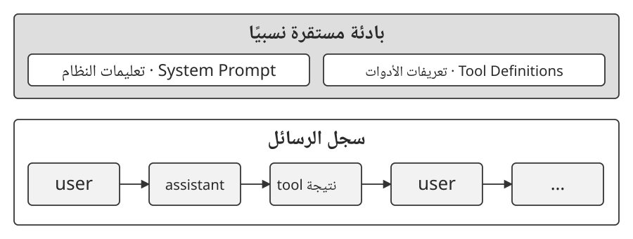

لذلك يمكن للجزء المشترك في بداية طلبين متتاليين أن يمتد إلى داخل تاريخ الرسائل. ومقدار ما يمكن للاستدعاء التالي أن يعيد استخدامه من الحسابات السابقة يتوقف على طول هذه البادئة.

تضع منظومة التشغيل أدناه تعليمات النظام وتعريفات الأدوات، وهي قليلة التغير، في المقدمة، ولا تضيف في كل جولة إلا الحالة الحالية في آخر الرسائل السابقة. وإذا طال التاريخ أكثر مما ينبغي، ضغطت الرسائل القديمة أولًا، ثم جمعت الطلب.

```python
stable_prefix = system_message
stable_tools = core_tool_schemas
history = load_message_history(session)
status_message = make_status_message(derive_current_state(history))

if estimated_tokens(stable_prefix, stable_tools, history, status_message) > budget:
    history = compress_old_evidence(
        history,
        preserve = [decisions, constraints, failures, citations]
    )

request.messages = [stable_prefix] + history + [status_message]
request.tools = stable_tools
response = call_model(request)
```

يحتفظ الضغط بالمعلومات التي يحتاج إليها العمل اللاحق، مثل القرارات والقيود والإخفاقات والمراجع، ويحافظ على الربط بين طلبات الاستدعاء ونتائج الأدوات. وإلى جانب ميزانية الطول، يمكن لتكرار المعلومات وتقادمها أن يستدعيا الضغط أيضًا، وسنعرض الاستراتيجيات بالتفصيل في النصف الثاني من هذا الفصل.

> **التجربة 2-1 ★: نشر خدمة LLM محلية واستدعاء الأدوات**
>
> تشغّل هذه التجربة نموذج Qwen3-0.6B محليًا، وتتابع مهمة «الاستعلام عن الوقت والطقس في فانكوفر» لترى كيف تمر الرسائل عبر النموذج والمحلل ومنفذ الأدوات. ويبين الشكل 2-5 توزيع العمل بين الخدمة المحلية والعميل: تحمّل جهة الخدمة النموذج وتعالج المدخلات وتولّد الردود، بينما يحتفظ العميل بتاريخ الرسائل ويجدول الأدوات ويعيد نتائجها.
>
> 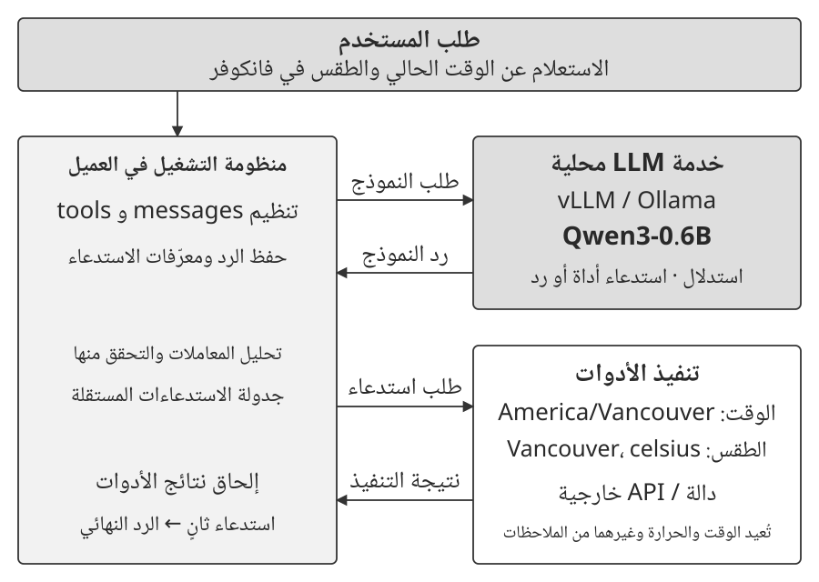
>
> **تتبّع أولًا مهمة كاملة.** يطلب النموذج في مخرجات جولة واحدة الاستعلام عن الوقت ودرجة الحرارة، ويملأ معاملات مثل `America/Vancouver` و`Vancouver` و`celsius`. وينفذ العميل الأداتين بالتوازي. يقدم الإيصال الأول الوقت المحلي 11:11:28، ويقدم الإيصال الثاني درجة الحرارة 17.9 °C. وبعد إعادة النتيجتين إلى النموذج، يذكر الوقت حتى الدقيقة، ويجيب بأن درجة الحرارة 17.9 °C، ثم ينهي هذه الحلقة. ويُظهر هذا التشغيل أن نموذجًا بستمئة مليون معامل قادر على اختيار الأداتين الصحيحتين لهذه المهمة، وملء معاملاتهما، والإجابة عن المستخدم بالقيم المعادة.
>
> **ثم انظر في التقابل بين المخرجات الخام وحقول API.** يستطيع وضع التفكير في Qwen3 أن يولّد محتوى استدلاليًا موسومًا بالعلامة `<think>`، بينما تستخدم طلبات الأدوات علامات الاستدعاء الخاصة بها. وبعد أن تحلل جهة الخدمة المخرجات، قد يتلقى العميل حقل `thinking` مستقلًا أو حقول استدعاء الأدوات. ويحدد قالب النموذج وبروتوكول الخدمة معًا كيف تُرتَّب أجزاء المخرجات وأيها يُحتفَظ به.
>
> **بعد ذلك لاحظ المعالجة المتدفقة.** تستطيع الواجهة أن تحدّث مع تدفق الأحداث حالات مثل «يفكر» و«يستدعي الأداة» و«يولّد الإجابة». وكثيرًا ما تصل معاملات الأداة في أجزاء متعددة، فيجب تجميعها في طلب كامل؛ وحين يؤكد البروتوكول انتهاء الاستدعاء، وتجتاز المعاملات والصلاحيات والاعتماديات الفحص، يستطيع نظام التنفيذ أن يبدأ الجدولة. ويمكن تنفيذ الأدوات المستقلة بعضها عن بعض بالتوازي، كما يمكنها أن تشكّل خط معالجة متتابعًا (pipeline) مع معالجة المخرجات اللاحقة.
>
> **وأخيرًا قارن السرعة والتخزين المؤقت.** في السجل الذي جرى تشغيله هذه المرة على حاسوب Mac بشريحة Apple، بلغ متوسط سرعة فك الترميز في مهام الأدوات نحو 107 رموز (token) في الثانية. والرمز هو الوحدة الأساسية التي يعالج بها النموذج النص، ويحدد المُرمِّز (tokenizer) طريقة التقطيع، فقد تقابل الكلمة الواحدة أو الحرف الصيني الواحد رمزًا واحدًا أو أكثر. وتعكس سرعة فك الترميز معدل الإخراج بعد بدء التوليد؛ أما مدة انتظار المستخدم فتتأثر أيضًا بزمن تأخر الرمز الأول وطول الاستدلال وزمن تنفيذ الأدوات.
>
> تستخدم مقارنة التخزين المؤقت البادئة الطويلة نفسها، وتختبر على التوالي طلبات تحافظ على البادئة وطلبات تعدّل بدايتها. ومن أصل خمسة أزواج في هذا التشغيل، كانت الطلبات المحافظة على البادئة أسرع في أربعة منها؛ وبلغ متوسط زمن تأخر الرمز الأول في المجموعتين نحو 1.30 ثانية و1.51 ثانية على الترتيب. وسيشرح القسم التالي الفرق الحسابي بين هذه الطلبات.
>
> وقد زادت هذه التجربة المؤلف تفاؤلًا بالوكلاء على الأجهزة الطرفية: فالنماذج الصغيرة صارت قادرة على إنجاز مهام استدعاء الأدوات هذه على أجهزة المستخدمين أنفسهم. **عصر الوكلاء على الأجهزة الطرفية أقرب مما يتوقعه كثيرون.**

## تصميم سياق ملائم لـ KV Cache

تتشارك الطلبات المتجاورة للوكيل عادةً قدرًا كبيرًا من المعلومات: تعليمات النظام، وتعريفات الأدوات، والتفاعلات التي وقعت من قبل. فإذا استطاع محرك الاستدلال أن يعيد استخدام نتائج الحساب الوسيطة لهذا المحتوى، أمكنه توجيه مزيد من الحساب إلى المعلومات الجديدة. ويحفظ **KV Cache** المفاتيح (Key) والقيم (Value) التي حُسبت في كل طبقة من طبقات الانتباه، لتستخدمها الرموز اللاحقة؛ أما **Prompt Cache** فيذهب أبعد من ذلك، فيعيد استخدام ذاكرة البادئات المؤقتة المستوفية للشروط عبر الطلبات المختلفة[^ch2-kv-basics].

لنأخذ وكيلًا لخدمة العملاء: لكي يعرف النموذج الوقت الحالي، أضاف المطور إلى بداية موجّه النظام السطر `Current time: {{now}}`، ويُحدَّث مع كل طلب. وتبقى قواعد العمل وتعريفات الأدوات التي تليه على حالها، لكن المدخلات الفعلية تبدأ في التغير من موضع الطابع الزمني. وفي الخدمات التي تعيد استخدام KV للبادئات المتطابقة، يؤدي ذلك إلى إعادة حساب الطابع الزمني وكل ما يليه، فيزيد زمن معالجة المدخلات وتكلفتها.

أما إذا كُتب الوقت في رسالة تُلحق بالنهاية، أو استُدعيت أداة الوقت عند الحاجة، فإن البادئة القائمة تُحفظ. فالترتيبان يقدمان معلومات متقاربة، لكن نطاق إعادة الحساب الذي يستدعيه كل منهما مختلف.

يمكن أن نحفظ أولًا ثلاث ممارسات، وستشرحها المبادئ والتجارب اللاحقة واحدة واحدة:

1. **حافظ على ثبات البادئة القابلة لإعادة الاستخدام.** اجعل محتوى تعليمات النظام وتعريفات الأدوات الشائعة وترتيبها محددًا ثابتًا.
2. **ألحِق التغيرات التي تحدث أثناء التشغيل بالجزء الأخير.** يمكن تقديم الوقت والرصيد وعدد الاستدعاءات وتقدم المهمة عبر رسائل جديدة أو نتائج أدوات. وينبغي أن تُوسَم أحدث حالة بلحظة سريانها، ليتمكن النموذج من معرفة السجل الذي ينطبق على القرار الحالي.
3. **نظّم الرسائل وفق بروتوكول النموذج.** استخدم الأدوار الصحيحة وأرقام الاستدعاء وصيغة نتائج الأدوات، ودع قالب الدردشة المناسب يولّد مدخلات النموذج. فالتخزين المؤقت يطابق البادئة بعد المعالجة وما يتصل بها من إعدادات، كما يحدد بروتوكول الرسائل كيف يميز النموذج التعليمات وطلبات المستخدم والقيم التي تعيدها الأدوات.

في نموذج الانتباه السببي المعتمد في هذا القسم، لا تؤدي إضافة رموز لاحقة إلى تغيير الحالات التي حُسبت للمواضع السابقة. وعند تعديل مدخلات قائمة، يجب إعادة حساب حالة أول موضع تغيّر وكل ما بعده؛ أما البادئة السابقة للتغيير فتظل قابلة لإعادة الاستخدام. وتحدد جهة الخدمة النطاق الفعلي للإصابة في الذاكرة المؤقتة أيضًا بحسب حجم كتل التخزين المؤقت ومدة الاحتفاظ وإعدادات التشغيل.

[^ch2-kv-basics]: Hugging Face، How caching works، ويشرح آلية حفظ K وV وإعادة استخدامهما طبقةً طبقة.

> **التجربة 2-2 ★: تصوير آلية الانتباه**
>
> لنبدأ بالجملة الصينية «كيف الطقس في بكين؟» لفهم عملية انتباه واحدة. ولتسهيل العرض، يقسم الشكل 2-6 هذه الجملة إلى أربع وحدات دلالية بترتيبها الصيني: «بكين» و«في» و«الطقس» و«كيف» (حيث تقابل «في» أداة الإضافة الصينية)؛ أما النموذج الفعلي فيقطّع المدخلات بالمُرمِّز. وعند معالجة موضع «كيف»، تحتاج طبقة الانتباه إلى تركيب التمثيل الحالي من المعلومات المتاحة. ويتولى Query وKey وValue على الترتيب أدوار الاستعلام والمطابقة وتجميع المعلومات.
>
> | المتجه | الدور | الفهم الحدسي في هذا المثال |
> | --- | --- | --- |
> | **Query (الاستعلام)** | متجه يستخدمه الموضع الحالي لمطابقة المواضع الأخرى | تحتاج «كيف» إلى العثور على المعلومات ذات الصلة في المحتوى السابق |
> | **Key (المفتاح)** | متجه يشارك به كل موضع في المطابقة | تقدم مواضع مثل «بكين» و«الطقس» تمثيلات قابلة للمطابقة |
> | **Value (القيمة)** | متجه معلومات يُجمَّع وفق الأوزان | تُدمج معلومات المكان والطقس في التمثيل الحالي بالنسب المناسبة |
>
> يمكن تصور Key على أنه وسم يُستخدم في البحث، وValue على أنه المحتوى المسترجع. وهذه المتجهات في النموذج كلها قيم عددية تُحسب من التمثيلات المخفية، ويشكّل التدريب طريقة مطابقتها.
>
> تجري العملية الواحدة في ثلاث خطوات. أولًا، يولّد الموضع الحالي Query؛ ثم يُضرب ضربًا نقطيًا في Key كل موضع، ويمر الناتج بالتحجيم والقناع السببي وsoftmax، فنحصل على أوزان انتباه مجموعها 1؛ وأخيرًا، نحسب مجموعًا مرجحًا لقيم Value بهذه الأوزان. والضرب النقطي هو ضرب مجموعتين من الأعداد عنصرًا بعنصر ثم جمع النواتج، أما softmax فيحول درجات المواضع المرئية إلى أوزان مطبَّعة. وتشارك Value كل موضع في التجميع بحسب وزنها، فتشكّل معًا مخرجات رأس الانتباه هذا.
>
> اقرأ السطر الأخير في الشكل 2-6 أفقيًا: يمنح موضع «كيف» كلمة «الطقس» وزنًا قدره 0.55. ويجب ضرب هذا العدد في Value موضع «الطقس»، ثم إضافة إسهامات المواضع الثلاثة الأخرى، لنحصل على مخرجات رأس الانتباه عند «كيف». وإذا انتقلت إلى سطر «الطقس»، فلماذا تظهر على يمينه علامة ×؟ لأن السلسلة لم تكن قد بلغت «كيف» عند حساب هذا الموضع.
>
> 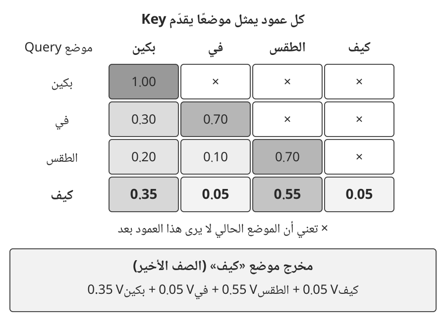
>
> إذا رتبنا أوزان كل المواضع في مصفوفة، حصلنا على **خريطة حرارية للانتباه**. يقابل كل سطر Query واحدًا، ويقابل كل عمود Key واحدًا، وتدل درجة اللون على مقدار الوزن. ويسمح القناع السببي للموضع الحالي بقراءة نفسه والمواضع التي تسبقه، وتشير علامة × في الشكل إلى المواضع المحجوبة، فوزنها بعد softmax صفر. وتنطبق هذه البنية على معالجة المدخلات وعلى التوليد اللاحق كليهما.
>
> ومن هنا يتضح الغرض من ذاكرة K وV المؤقتة: مع تقدم التوليد، تظل المواضع الجديدة تقرأ Key وValue للمواضع السابقة. وبعد حفظ هذه المتجهات، يستطيع الموضع الجديد أن يستخدمها مباشرة في المطابقة والتجميع، فيُستغنى عن إعادة الحساب للمواضع التاريخية.
>
> بعد فهم هذه الأوزان التوضيحية، ننتقل إلى Qwen3-0.6B لنرى توزيع الانتباه الذي يحسبه النموذج فعلًا. تسجل التجربة جملة قصيرة وسلسلة مولَّدة تتضمن استدلالًا وإجابة نهائية، وتقارن مصفوفات الانتباه في طبقات مختلفة. ويعرض الشكل 2-7 الطبقات 0 و13 و27: العمود الأيسر جملة قصيرة من تسعة رموز، والعمود الأيمن سلسلة مولَّدة تُحسب فيها مصفوفة 17 × 23، وقد وُسمت فيها نطاقات المواضع بحسب المدخلات والاستدلال والإجابة. ويعتمد التدرج الرمادي مقياسًا لوغاريتميًا، ليسهل رؤية أوزان الانتباه القوية والضعيفة معًا.
>
> 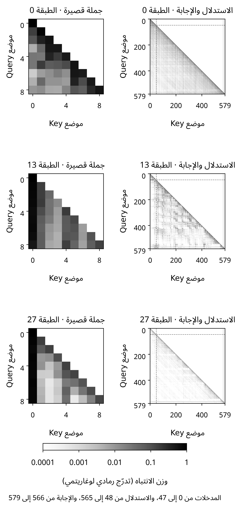
>
> يمكن تحليل الشكل عند قراءته على أربعة محاور:
>
> 1. **مصرف الانتباه (Attention Sink).** تمنح بعض الطبقات بداية السلسلة وزنًا كبيرًا، حتى لو كان الرمز الأول قليل الحمولة الدلالية. انظر إلى الجملة القصيرة في العمود الأيسر من الشكل 2-7. لقد أُخذ في كل رسم متوسط رؤوس الانتباه في الطبقة نفسها. فإذا حسبنا متوسط الأعداد التسعة في العمود الأول من المصفوفة، عرفنا متوسط الوزن الذي تمنحه المواضع التسعة للرمز الأول. وتبلغ هذه القيمة في الطبقات 0 و13 و27 على الترتيب 14.7% و73.9% و83.2%. أما في السلسلة المولَّدة الأطول في العمود الأيمن، فتصبح هذه القيمة في الطبقة 13 نحو 28.0%. ولأن softmax يشترط أن يكون مجموع أوزان المواضع 1، يستطيع النموذج أن يتعلم موضع استقبال مستقرًا نسبيًا؛ وقد خصصت دراسة StreamingLLM بحثًا لهذه الظاهرة ودورها في الاستدلال المتدفق[^ch2-attention-sinks].
> 2. **منطقة الاستدلال.** حدد نطاق التوليد المقابل لـ `<think>`، وتتبع هذه الأسطر لترى أي الموجّهات أو أوصاف الأدوات أو الاستدلالات السابقة حظيت باهتمام النموذج. فالمثلث ناتج عن القناع السببي، ودرجات اللون داخله وحدها هي التي تعكس الفروق بين أوزان المواضع.
> 3. **منطقة الإجابة.** حدد بعد ذلك نطاق توليد الإجابة النهائية، وقارن توزيع أوزانها بين المدخلات الأصلية والاستدلال السابق. ويساعد ذلك على تحديد المعلومات السابقة التي دخلت في تجميع الانتباه الحالي.
> 4. **فروق المواضع.** لاحظت دراسة «Lost in the Middle» في مهام الأسئلة والأجوبة ذات السياق الطويل واسترجاع أزواج المفتاح والقيمة أن المعلومات في المواضع الوسطى أصعب استثمارًا[^lost-in-the-middle]. ومن الناحية الهندسية يمكن البناء على ذلك بوضع القواعد الدائمة في المقدمة، ووضع الهدف الحالي والتقدم في النهاية.

[^ch2-attention-sinks]: Xiao et al.، Efficient Streaming Language Models with Attention Sinks، ICLR 2024.

[^lost-in-the-middle]: Liu et al.، Lost in the Middle: How Language Models Use Long Contexts، TACL 2024.

### من رسائل API إلى رموز النموذج: قالب الدردشة (Chat Template)

كانت أمثلة API السابقة مجموعة من الرسائل ذات الأدوار، أما المدخلات في خرائط الانتباه فسلسلة من الرموز. ويتولى **قالب الدردشة (Chat Template)** هذا التحويل: يضيف إلى الرسائل علامات الأدوار والحدود، وينظم أوصاف الأدوات والقيم المعادة وفق صيغة متفق عليها، ثم يسلّمها إلى المُرمِّز. قارن عمودي الشكل 2-8: لم يُرسَل في العمود الأيسر إلا تعليمات النظام وسؤال المستخدم، فمن أين جاءت `assistant` الإضافية في العمود الأيمن؟ إنها علامة البداية التي أضافها القالب للرد التالي. وسنحتاج إلى هذه العلامات لاحقًا حين نناقش استدعاء الأدوات والاحتفاظ بمعلومات الاستدلال وإصابة الذاكرة المؤقتة.

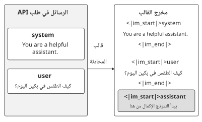

لكل من عائلات النماذج Qwen وLlama وGemma وغيرها قالب دردشة خاص بها. فإذا سُلّمت مجموعة رسائل API نفسها إلى نماذج مختلفة، فقد تختلف علامات الأدوار والحدود الناتجة عن التحويل. وفي واجهات API المستضافة تتولى جهة الخدمة التحويل عادةً، أما عند النشر الذاتي فيجب تزويد خدمة الاستدلال بقالب يطابق النموذج.

لنفترض أن المستخدم أرسل عبارة «فانكوفر 17.9 °C»، وأن أداة الطقس أعادت النص نفسه مصادفةً. إذا مررنا كل رسالة منهما على حدة بقالب Qwen3-0.6B، حصلنا على مقطعي المدخلات المبينين في الشكل 2-9. كلاهما يبدأ بـ `<|im_start|>user`، فأي علامة تبين أن النص جاء من أداة؟

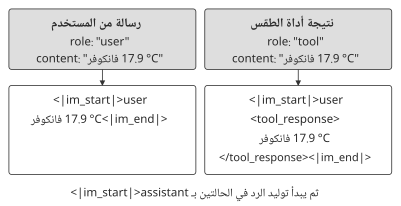

في العمود الأيمن زوج إضافي من وسوم `<tool_response>`. ويحدد القالب أيضًا، بحسب أدوار الرسائل، موضع أحدث سؤال طرحه المستخدم: ففي الجولات السابقة لهذا السؤال لا يُحتفظ إلا بمحتوى الإجابة؛ وبعده يمكن لتفاعلات الأدوات أن تحمل معلومات استدلال النموذج أيضًا[^ch2-qwen-template].

فلنفترض أن النموذج فحص ملفًا وما زال عليه أن يواصل التحليل. إذا أعيدت نتيجة الأداة بدور `tool`، استطاع القالب أن يتعرف إليها بوصفها تغذية راجعة من أداة ضمن المهمة الحالية؛ أما إذا كُتبت النتيجة نفسها رسالة `user` عادية، فقد يعدّها القالب استعلامًا جديدًا، فيتغير نطاق ما يُحتفظ به من الاستدلال السابق. والأمر أشبه بمواصلة حل مسألة تحتاج فيها إلى الإبقاء على مسودة الحساب: على منظومة التشغيل أن تحفظ حقول الاستدلال التي تشترطها الخدمة، وأن تواصل الاستدعاء ببنية رسائل صحيحة.

**مع الانتقال من الاستدلال في جولة واحدة إلى الوكلاء طويلي المدى، يصبح التفكير السابق شيئًا فشيئًا جزءًا من حالة المهمة التي يجب الحفاظ عليها.** كان قالب الدردشة في DeepSeek-R1 المبكر يحذف جزء التفكير من الإجابات السابقة ولا يبقي إلا الإجابة النهائية[^ch2-r1-template]؛ أما بروتوكول استدعاء الأدوات اللاحق في DeepSeek فيشترط إعادة معلومات الاستدلال. فبعد انتهاء سؤال وجواب، قد تكون الإجابة النهائية قد تضمنت ما تحتاج إليه الجولة التالية من معلومات؛ أما في منتصف مهمة أدوات، فقد لا يكون «لماذا نفحص هذا الملف» و«ما الفرضيات التي استُبعدت» مكتوبًا إلا في الاستدلال الوسيط. والاحتفاظ بهذه المعلومات يساعد الجولة التالية على مواصلة العمل على خط التفكير القائم.

**يحدد بروتوكول النموذج طريقة إعادة معلومات الاستدلال.** فعند الربط يجب التعامل في آن واحد مع `content` و`tool_calls` وحقول الاستدلال التي تقدمها الخدمة. وتعكس الحلول الآتية قواعد مواصلة مختلفة:

- **وضع التفكير في DeepSeek** يعيد الاستدلال عبر `reasoning_content`. ووفق بروتوكول استدعاء الأدوات فيه، إذا تضمن الطلب `tools`، وجب على الطلبات اللاحقة أن تعيد الاستدلال السابق كاملًا، بما في ذلك ردود النموذج التي لم تستدعِ أدوات؛ وغياب هذا الحقل يؤدي إلى الخطأ 400. أما طلبات الدردشة الصرفة التي لا تحمل `tools`، فتتجاهل الخدمة فيها الاستدلال السابق المعاد[^ch2-deepseek-thinking].
- **التفكير والتفاعل مع الأدوات في Kimi** يتطلبان كذلك إدارة الاستدلال وطلبات الأدوات ونتائجها داخل حلقة التشغيل. ففي مثال التفكير المتداخل في Kimi K2.5، يستطيع النموذج أن يواصل الاستدلال بين استدعاءات أدوات متعددة، ويحفظ العميل رسائل النموذج ويعيدها وفق بروتوكوله[^ch2-kimi-thinking].
- **التفكير المحفوظ في GLM** يمكن تفعيله عبر `thinking.clear_thinking: false`، ثم يُعاد `reasoning_content` كاملًا وبترتيبه الأصلي. وتختلف الإعدادات الافتراضية بين Coding Plan وواجهة API القياسية، فعلى العميل أن يختار الوضع المطلوب صراحةً[^ch2-glm-thinking].
- **كتلة التفكير (thinking block) في Claude** يجب حفظها مع توقيعها. والنماذج التي تدعم preserved thinking تتحقق أيضًا من مصدر الكتلة وبادئتها، وتفصيل القواعد في القسم اللاحق «التخزين المؤقت قيدًا معماريًا».

تؤثر هذه القواعد في استدعاءات الأدوات المتتالية، كما تؤثر في تبديل النموذج في منتصف العمل. فعند التبديل، يجب على طبقة المواءمة أن تحوّل طلبات الأدوات ونتائجها وحالة المهمة إلى الصيغة التي تقبلها الواجهة المستهدفة، ثم تعالج معلومات الاستدلال وفق قواعد النموذج المستهدف. وستتناول التجربة 5-1 في الفصل الخامس مواصلة المسار على هذا النحو.

**يحدد القالب أيضًا المدخلات التي يطابقها التخزين المؤقت.** فمحتوى الرسائل نفسه، إذا عولج بقوالب مختلفة أو بترتيب أدوات مختلف أو بطريقة تسلسل مختلفة، قد يُنتج بادئات رموز مختلفة. ولإعادة استخدام KV القائم، يجب الحفاظ على تطابق إعدادات النموذج ذات الصلة والبادئة.

[^ch2-qwen-template]: يحفظ ملف إعدادات المُرمِّز `tokenizer_config.json` في Qwen3-0.6B قالب الدردشة، ويتضمن منطق معالجة استعلامات المستخدم ومحتوى الاستدلال واستجابات الأدوات.

[^ch2-r1-template]: يحتفظ قالب الدردشة الرسمي في DeepSeek-R1، في الإجابات السابقة العادية، بالمحتوى الواقع بعد `</think>`؛ أما قواعد إعادة الاستدلال في استدعاءات الأدوات اللاحقة فتجدها في وثيقة Thinking Mode من DeepSeek.

[^ch2-deepseek-thinking]: DeepSeek، Thinking Mode.

[^ch2-kimi-thinking]: Moonshot AI، المستودع الرسمي لـ Kimi K2.5، قسم Interleaved Thinking and Multi-Step Tool Call.

[^ch2-glm-thinking]: Z.ai، Thinking Mode، ويشرح التفكير المتداخل والتفكير المحفوظ والإعدادات الافتراضية لكل نقطة وصول.

### مبادئ KV Cache وقيوده

عند معالجة النموذج لطلب ما، يبدأ بـ**الملء المسبق (prefill)** للمدخلات، فيحسب تمثيلات الرموز الموجودة، ثم ينتقل إلى **فك الترميز (decode)**، فيولّد الرموز اللاحقة واحدًا تلو الآخر. ويحفظ KV Cache أثناء فك الترميز قيم K وV للمواضع السابقة؛ أما التخزين المؤقت للبادئات عبر الطلبات فيعيد استخدام البادئة المتطابقة التي خلّفها الطلب السابق.

فلنفترض أن الوكيل بلغ الجولة السادسة وقد تراكم لديه 2,000 رمز من المدخلات. إذا كانت الخدمة لا تستخدم إلا KV Cache داخل الطلب الحالي، فعليها أن تعالج هذه الرموز الألفين كلها أولًا، ثم تستعين بالذاكرة المؤقتة لمواصلة التوليد. أما إذا كان في ذاكرة التخزين المؤقت عبر الطلبات مقطع بادئة متطابق منها، فإن الملء المسبق يستطيع أن يستأنف من الموضع الذي لم يُخزَّن بعد. ويبين الشكل 2-10 إعادة الاستخدام هذه عبر الطلبات.

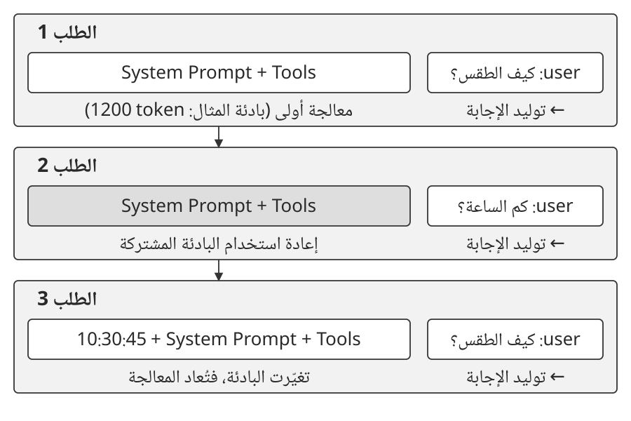

**لنتتبع نمو الذاكرة المؤقتة بأربعة رموز.** لنفترض أن المدخلات هي `[A, B, C, D]`. عند معالجة الموضع D، يطابق النموذج Query الخاص بـ D مع Key الخاص بكل من A وB وC وD، ثم يجمع قيم Value لها تجميعًا مرجحًا. وبعد المرور بحسابات الطبقات كلها، يُستخدم التمثيل النهائي لموضع D للتنبؤ بالرمز التالي E. وعندئذ تكون قيم K وV لكل الرموز من A إلى D في كل الطبقات قد حُفظت.

بعد الحصول على E بالمعاينة، تُرسَل E في الخطوة التالية إلى النموذج، فتُحسب Query وKey وValue الخاصة بها في كل طبقة. وتقرأ Query الخاصة بـ E الذاكرة المؤقتة السابقة وقيم K وV للموضع الحالي، ثم يتنبأ النموذج بالرمز السادس؛ وفي الوقت نفسه تُلحق قيم K وV الخاصة بـ E بالذاكرة المؤقتة. وهكذا يمكن في كل خطوة توليد استصحاب الحالات السابقة، والاقتصار على حساب حالات الرموز الجديدة في المدخلات.

ولو لم يُستخدم KV Cache مطلقًا، لوجب عند التنبؤ بـ E إعادة معالجة الرموز من A إلى D، وعند التنبؤ بالرمز السادس معالجة الرموز من A إلى E مرة أخرى. وإذا اقتصرنا على عدّ المواضع التي يُعاد فيها توليد K وV، فإن حجم العمل التراكمي ينمو على نحو $1+2+\cdots+N$. أما مع الذاكرة المؤقتة فيُعاد استخدام الحسابات الطبقية للمواضع التاريخية؛ لكن المواضع الجديدة تظل تقرأ قيم K وV المرئية. وفي فك الترميز القياسي بالانتباه الكامل، تزداد هذه القراءة والمطابقة خطيًا مع طول السياق، ولذلك يظل السياق الطويل يستهلك مزيدًا من ذاكرة الرسوميات وعرض نطاق الذاكرة.

**لماذا يؤثر تعديل المدخلات في الذاكرة المؤقتة اللاحقة؟** تعالج طبقات Transformer التمثيلات المخفية واحدة بعد أخرى، ولكل طبقة قيم K وV خاصة بها. فبعد أن يمر موضع ما بحساب الانتباه، يكون تمثيله قد استوعب معلومات المواضع السابقة، ثم يُمرَّر إلى الطبقة التالية. ولذلك، حين يتغير الرمز رقم $k$، ينتشر الأثر من ذلك الموضع إلى ما بعده وإلى الطبقات الأعلى.

وفي ظل النموذج نفسه وإعدادات الحساب نفسها، فإن المواضع السابقة لـ $k$ لا تعتمد إلا على مدخلات أقدم، فيمكن مواصلة إعادة استخدامها؛ أما ابتداءً من $k$ فيجب إعادة بناء الحالات المتأثرة. وتطابق الخدمات الفعلية البادئات عادةً بكتل التخزين المؤقت، فتتأثر حدود إعادة الحساب أيضًا بحجم الكتلة. وكلما وقع التحديث في موضع أسبق، زادت عادةً المدخلات التي يجب إعادة حسابها. ووضع التعليمات الثابتة في المقدمة وإلحاق الحالة الجديدة بالنهاية هو استثمار لعلاقة الاعتماد هذه.

> **التجربة 2-3 ★★: مقارنة أساليب إدارة السياق**
>
> تجعل هذه التجربة الوكيل ينجز المهمة نفسها مستخدمًا أدوات اكتشاف الملفات وقراءتها والبحث فيها، وتقارن خطًا أساسيًا يعتمد الإلحاق الثابت بخمسة تعديلات على السياق. يحافظ الخط الأساسي على ثبات التعليمات وترتيب الأدوات، ويلحق في كل جولة رسائل النموذج ونتائج الأدوات. أما المجموعات الأخرى فتغيّر على التوالي التعليمات أو الحالة أو ترتيب الأدوات أو صيغة التعبير عن التاريخ، لنلاحظ كيف تتغير إحصاءات التخزين المؤقت ومجرى المهمة.
>
> **موجّه النظام الديناميكي** يحدّث الوقت الحالي في تعليمات النظام في كل جولة. فقد تبقى بادئة مشتركة قبل موضع التغيير، أما المدخلات اللاحقة بدءًا من معلومة الوقت فتحتاج إلى إعادة مطابقة أو إعادة حساب. ويمكن إلحاق الوقت رسالةً جديدة، أو الحصول عليه عند الحاجة عبر أداة الوقت، لتبقى قواعد العمل الدائمة قابلة لإعادة الاستخدام.
>
> **إعدادات المستخدم الديناميكية** تحدّث عدد الاستدعاءات المتبقية أو رصيد الحساب في رسائل المقدمة. والحالة نفسها معلومة تحتاج إليها المهمة، فمحور التصميم هو موضع التحديث: إلحاق أحدث حالة بالنهاية مع وسمها بوقت سريانها يحفظ التقدم والبادئة معًا. وسيعتمد شريط حالة الوكيل لاحقًا طريقة التنظيم هذه.
>
> **إعادة ترتيب تعريفات الأدوات** تغيّر ترتيب قائمة الأدوات في كل جولة. فرغم أن الأسماء والمعاملات لم تتغير، فإن ترتيب الرموز بعد التسلسل قد تغير. افتح تقرير تشغيل Kimi K2.6، تجد أن `Hit%` في الخط الأساسي ومجموعة إعادة الترتيب كليهما 100%. فهل أعادت المجموعتان استخدام القدر نفسه من المدخلات حقًا؟ أدخل الخط الأساسي في ثلاث جولات 7,567 رمزًا، أصاب منها الذاكرة المؤقتة 768 رمزًا؛ وأدخلت مجموعة إعادة الترتيب في ثلاث جولات كذلك 7,568 رمزًا، لم يصب منها إلا 256. وبقسمة عدد الرموز المخزنة مؤقتًا على عدد رموز المدخلات، نحصل على قيمتي العمود `Cache%`: ‏10.1% و3.4%. أما العمود الآخر `Hit%` فيحسب الطلبات التي حُكم بإصابتها: سجل الخط الأساسي إصابتين، ولم تسجل مجموعة إعادة الترتيب إلا إصابة واحدة، وكان عدد الإخفاقات المسجلة في المجموعتين صفرًا. أما حال الإصابة في بقية الطلبات، فلا يمكن الحكم عليه من هذا السجل وحده. وتثبيت ترتيب الأدوات يجنّب البادئة التغير بلا داعٍ.
>
> **النافذة المنزلقة** لا تحتفظ إلا بالمقطع الأحدث من التاريخ. فلو احتُفظ بعشر جولات من التفاعل، فقد يعجز الوكيل في الجولة الخامسة عشرة عن قراءة محتوى ملف أساسي حصل عليه في الجولة الثانية. وإلى جانب تقصير البادئة المشتركة، يغيّر الاقتطاع الحقائق وتقدم المهمة التي يستطيع النموذج الوصول إليها. ويبدأ التنفيذ المرافق بآخر ست رسائل من التاريخ، ثم يضيف إلى الخلف طلبات الاستدعاء المقابلة لنتائج الأدوات. وقد أعادت مجموعة النافذة المنزلقة استخدام 1,510 رموز من أصل 2,224 رمزًا في المدخلات، فبلغت نسبة التخزين المؤقت 67.9%، وهي الأعلى بين المجموعات الست. لكن انظر في سجل الأدوات لمجموعة النافذة المنزلقة في التجربة 2-3: بحث النموذج عن الملفات ثلاث مرات، ثم قرأ ملفين، ولم يسلّم الملخص المؤلف من ثلاث جمل الذي طلبه المستخدم.
>
> **التنسيق النصي** يعيد كتابة التاريخ ذي الأدوار نصًا من قبيل `USER: ...` و`ASSISTANT: ...`. وهذا يغيّر حدود الرسائل وبنية الأدوات في القالب، فيحتاج النموذج إلى استعادة العلاقات الأصلية من المتن. وقد ولّدت المجموعة النصية في هذا التشغيل ردًا نهائيًا رغم ذلك، وحققت إصابات في الذاكرة المؤقتة. أما أدوار الرسائل وأرقام الاستدعاء وحقول نتائج الأدوات التي توفرها الواجهة، فتساعد على نقل هذه العلاقات بثبات.
>
> وحتى لو أعاد البرنامج بناء قائمة الرسائل، فما دامت البادئة المرسلة وإعدادات التخزين المؤقت متطابقة، تبقى لهذه البادئة فرصة لإعادة الاستخدام.
>
> وإذا أردت أن تعرف كم وُفّر على المستخدم من وقت الانتظار، فانظر أولًا أين يتوقف المؤقت. بلغ `ttft` في الجولة الأولى لمجموعة النافذة المنزلقة نحو 2.23 ثانية. ورغم أن البرنامج يسمي هذا الحقل TTFT (زمن تأخر الرمز الأول)، فإنه لا يوقف المؤقت إلا حين يعيد الطلب غير المتدفق الرد كاملًا.

### KV Cache وPrompt Cache: مستويان من التخزين المؤقت

يمكن التمييز بين هذين المستويين بلحظتين. فحين يولّد النموذج الرمز الثاني من رده، يستطيع أن يقرأ حالات المفاتيح والقيم للمواضع السابقة في الطلب نفسه، وهنا يُستخدم **KV Cache**. وبعد قليل يطرح المستخدم سؤالًا لاحقًا، فترسل منظومة التشغيل طلبًا جديدًا؛ ولا تستطيع الخدمة أن تقتصد في حساب جزء المدخلات المتطابق إلا إذا عثرت أولًا على البادئة المحفوظة من قبل، وهذا من شأن **Prompt Cache**. فالأول يفسر كيف يستمر التوليد الواحد، والثاني يتطلب إضافةً إلى ذلك آلية للحفظ والمطابقة عبر الطلبات.

وفي خدمات API يتأثر التخزين المؤقت أيضًا بالحد الأدنى لطول البادئة وحجم الكتلة ومدة الصلاحية وإعدادات النموذج ونطاق العزل بين المستأجرين. ويجب البحث عن البادئة القابلة لإعادة الاستخدام داخل نطاق التخزين المؤقت نفسه. فعلى سبيل المثال، تعزل Claude API الذاكرة المؤقتة بحسب المؤسسة ومساحة العمل؛ فإذا ظهر النص نفسه في نطاقي عزل مختلفين، أُنشئت لكل منهما ذاكرة مؤقتة مستقلة[^ch2-prompt-cache].

ويجب أن تُحسب التكلفة للكتابة والقراءة كلٍّ على حدة. ففي بعض نماذج Claude يبلغ سعر القراءة من الذاكرة المؤقتة عُشر سعر المدخلات العادية، بينما تترتب على الكتابة الأولى رسوم إضافية. وإذا استُخدمت البادئة نفسها مرارًا خلال مدة الصلاحية، لم تُدفع رسوم الكتابة إلا مرة واحدة، وتُحتسب الطلبات اللاحقة التي تصيب الذاكرة المؤقتة كلها بسعر القراءة.

[^ch2-prompt-cache]: Anthropic، Prompt caching، ويشرح مطابقة الذاكرة المؤقتة وعزلها ومدة صلاحيتها وتسعيرها.

### التخزين المؤقت قيدًا معماريًا

**في أنظمة الإنتاج، صار التخزين المؤقت قيدًا معماريًا.** فطريقة ترتيب الموجّهات، ونقطة انطلاق الوكيل الفرعي، وكيفية استئناف الجلسة، كلها تؤثر في مقدار الحساب الذي يمكن إعادة استخدامه. **ويجب ترتيب حدود التخزين المؤقت منذ بداية التصميم.** فتحديد ما يمكن مشاركته وما سيتغير من حالات أولًا، ثم تنظيم الموجّهات وبنية الجلسة على أساسه، يقلل إعادة الحساب المتكررة أثناء التشغيل. أما الانتظار حتى يصبح زمن التأخر والتكلفة في المهام طويلة المدى مشكلة قائمة ثم تعديل هذه البنى، فكثيرًا ما يجر معه تعديل إدارة الحالة والوكلاء الفرعيين واستئناف الجلسات.

**رتّب البادئة بحسب درجة الثبات.** يمكن وضع التعليمات وتعريفات الأدوات التي تتشاركها مهام متعددة في المقدمة، ثم إضافة بيانات المستخدم وحالة الجلسة والملاحظات الجديدة، مع تجميعها بحسب نطاق انطباقها. فمثلًا، إذا كان لنظام التشغيل خياران هما macOS وLinux، ولوضع التشغيل خياران هما العادي والتنقيح، وللغة خياران هما الصينية والإنجليزية، فإن هذه الشروط الثلاثة المستقلة تنتج حتى $2\times2\times2=8$ تركيبات من البادئات. ووضع الحقول الأكثر تغيرًا بعد الجزء المشترك يزيد فرص إعادة استخدام البادئة العامة. كما يجب أن يلتزم نطاق مشاركة الجزء العام بحدود المؤسسة ومساحة العمل والخصوصية التي تفرضها الخدمة.

**اختر للوكيل الفرعي نقطة انطلاق قابلة لإعادة الاستخدام.** إذا ورث الوكيل الفرعي خلفية مهمة الوكيل الأب، أمكنه أن يعيد استخدام البادئة المتطابقة بينهما، ثم يلحق بها مهمته الفرعية. ويحدد الموجّه وترتيب الأدوات والنموذج والإعدادات ذات الصلة معًا نطاق إعادة الاستخدام. أما الوكيل الفرعي الذي يحتاج إلى دور مستقل أو سياق معزول، فتُبنى مدخلاته بحسب مهمته، ثم يُنظر في الأجزاء العامة التي يصلح تشاركها.

**احفظ المحتوى الذي أُرسل فعلًا.** بعد ضغط مخرجات الأدوات الكبيرة في ملخص أو معاينة، ينبغي حفظ النسخة التي أُرسلت فعلًا إلى النموذج. فإعادة تشغيل هذا السجل عند استئناف الجلسة تعيد بناء سلسلة رسائل متطابقة؛ أما إعادة توليد الملخص عند كل استئناف فقد تُدخل صياغة جديدة وتغييرًا في البادئة. وعند تحديث الملخص يمكن إصدار نسخة جديدة، مع تحديد الموضع الذي سيُعاد منه بناء الذاكرة المؤقتة بعد ذلك.

**الاحتفاظ بالاستدلال يتطلب أيضًا استيفاء قيود البروتوكول.** يقدم preserved thinking في Claude مثالًا ملموسًا على هذه المسألة. فوثائقه تستخدم هذه الآلية لمنع التقطير: تتحقق الخدمة من توقيع thinking block والنموذج الذي ولّده وبادئته. وفي النماذج التي تدعم ربط البادئة، مثل Claude Fable 5.1 وClaude Opus 5.5، يشكّل الحقلان `system` و`tools` في المستوى الأعلى والرسائل السابقة للكتلة معًا نطاق التحقق؛ وتعديل أي محتوى فيه يُبطل هذه الكتلة وكتل التفكير اللاحقة[^ch2-preserved-thinking].

فإعادة كتابة وقت النظام في كل جولة، أو إعادة عرض معلومات البيئة في الرسالة الأولى، أو اقتطاع نتائج أدوات قديمة في مواضعها، كلها تغيّر البادئة التي ترتبط بها كتل الاستدلال اللاحقة. وعند إطلاق التحقق، قد تعيد API الخطأ 400، أو تتخلص من الكتل الباطلة وفق إعداد `prefix_mismatch_behavior` وتواصل معالجة الطلب. وفي الحالة الثانية يظل النموذج قادرًا على استخدام ما بقي من معلومات المهمة ونتائج الأدوات، لكن الاستدلال الباطل لا يشارك في مدخلات هذه المرة. والحسابات التي أُنشئت ابتداءً من 31 أغسطس 2026 يُفعَّل فيها التحقق من البادئة افتراضيًا، أما طريقة تفعيله في الحسابات الأقدم فمبينة في وثائق البروتوكول.

وعند الربط مع بروتوكولات من هذا النوع، يمكن الحفاظ على ثبات التعليمات العليا للجلسة ومجموعة أدواتها، وإلحاق تغيرات الحالة بالجزء الأخير. وإذا احتجت إلى تحديث التعليمات أو الأدوات في منتصف الجلسة، فاستخدم الواجهات التي توفرها الخدمة لذلك، مثل رسائل النظام داخل الجلسة وكتل تغيير الأدوات. كما يجب عند تقليم thinking block الحفاظ على مقطع متصل وفق الترتيب الأصلي: يمكن الحذف من البداية أو من النهاية أو حذف الكل؛ أما ترك فجوة في الوسط فيؤثر في الكتل اللاحقة، وما حُذف عمدًا من الكتل ينبغي أن يبقى محذوفًا.

وعند تبديل النموذج في منتصف العمل، تتحقق الخدمة أيضًا من قدرة النموذج المستهدف على قراءة كتل الاستدلال التي أنتجها النموذج الأصلي. وعلى العميل أن يحفظ التاريخ الأصلي ويترك للخدمة معالجته وفق قواعد التوافق؛ فإذا حذفه العميل بنفسه، تعذّرت استعادة هذه السجلات عند العودة لاحقًا إلى النموذج الأصلي.

[^ch2-preserved-thinking]: Anthropic، Preserved thinking، ويشرح النماذج وربط البادئة ومعالجة البطلان وقواعد تقليم كتل الاستدلال؛ وواجهات التحديث داخل الجلسة في Mid-conversation system messages and tool changes.

### امتداد بحثي: KV Cache قابل للتحرير والتركيب

> تعيد التصاميم السابقة كلها استخدام الحساب عبر مطابقة البادئة. ويأمل المؤلف أن يذهب أبعد من ذلك: هل يمكن تحرير المعلومات المحفوظة في KV وتركيبها مباشرةً، لتتكيف الذاكرة المؤقتة مع تغيرات السياق؟ لقد شبّه المؤلف هذه المعلومات في ورقة «Models Take Notes at Prefill» بـ«ملاحظات» يدونها النموذج[^ch2-2]: فبعد أن يمر الملء المسبق بحسابات الانتباه في طبقات متعددة، يكون أثر حقل ما قد دخل في تمثيلات المواضع اللاحقة. فقد يؤثر حقل مثل «مدينة المستخدم: بكين» في أحكام لاحقة تتعلق بالمكان؛ ولو استُبدلت قيم K وV لهذا الحقل وحده، فقد تظل الحالات اللاحقة محتفظة بالاستنتاجات المشتقة من المدينة القديمة.
>
> وقد ميزت الورقة عبر التدخل بين دور KV الخاص بالحقل نفسه ودور الحالات اللاحقة. ففي القرارات التي قيست، كان الإسهام المباشر لـ KV الحقل نفسه أقل من 1%، بينما كان الأثر الرئيسي محفوظًا في التمثيلات اللاحقة. وحول هذه «الملاحظات» التي تُترك في المواضع اللاحقة، يمكن استكشاف طريقتين لاستثمار الذاكرة المؤقتة.
>
> **التحرير (Editing)** يدفع الحساب اللاحق إلى تحديث الأحكام القائمة عبر تصحيح صريح للمعلومات. ووجدت الورقة أيضًا أنه في مهام نموذج 8B التي قيست، يستطيع تحرير الحقل وحده أن يستعيد القرار المستهدف عند وجود سلسلة تفكير صريحة، بتكلفة حسابية تقارب 1% من إعادة الحساب الكاملة؛ أما عند غياب هذا الاستدلال، فقد تظل الحالات اللاحقة القديمة تؤثر في القرار، فيصعب أن يؤتي تعديل الحقل أثره.
>
> **التركيب (Composition)** يصل ذاكرة مؤقتة لمهارة محسوبة مسبقًا بسياق جديد. وفي النماذج التي تعتمد ترميز الموضع الدوراني (RoPE)، يجب أولًا تعديل تمثيلات الموضع في الذاكرة المؤقتة، ثم إجراء الوصل. ويمكن تصور ذلك على أنه إعادة ترقيم صفحة ملاحظات موجودة لإلحاقها بمادة أخرى. وقد قارنت الورقة اثني عشر نموذجًا، فبلغ تشابه جيب التمام بين logits المخرجات في الوصل وفي إعادة الحساب الكاملة 0.90–0.999؛ كما يمكن معالجة إعادة تموضع الذاكرة المؤقتة والوصل نفسه خطيًا بحسب الطول، فتقل إعادة حساب الانتباه للسياق كله.
>
> ويمكن أيضًا الجمع بين إلحاق معلومات التصحيح والتخزين المؤقت القائم للبادئات. ففي المعيار المباشر لـ vLLM في الورقة، حافظ هذا الجمع على نحو 98.5% من معدل إصابة الذاكرة المؤقتة للبادئات، وبلغ زمن تأخر الرمز الأول عند p90 ما بين 1/398 و1/53 من الخط الأساسي.
>
> **يتفاءل المؤلف بهذا المسار البحثي، لأنه يَعِد بأن تحتفظ تحديثات السياق بقدر أكبر من الحسابات القائمة.** فالوكيل كثيرًا ما يحدّث حقول الذاكرة، ويضيف حالات، ويستبدل تعريفات الأدوات؛ فإذا أمكن تصحيح الحالات ذات الصلة ووصلها كما تُصحَّح الملاحظات، فقد تنخفض تكلفة الحفاظ على السياق الطويل انخفاضًا كبيرًا.

[^ch2-2]: Li, Bojie، Models Take Notes at Prefill: KV Cache Can Be Editable and Composable، 2026. وتعتمد تجارب التحرير والتركيب والتخزين المؤقت المباشر مهامَّ ومقاييس مختلفة، وتفصيل الإعدادات في الورقة.

### من آلية التخزين المؤقت إلى تصميم محتوى السياق

بعد فهم كيف يعيد التخزين المؤقت استخدام الحساب، علينا أن نقرر ما نضعه في مدخلات كل جولة، وكيف يُحدَّث هذا المحتوى. وينقسم ما يلي إلى ثلاثة أجزاء:

- **هندسة الموجّهات ومهارات الوكيل (Agent Skills)**: نصمم أولًا تعليمات النظام وتعريفات الأدوات، لنوضح الأهداف والقواعد وطرق العمل؛ ثم نحمّل المعرفة المتخصصة عند الحاجة عبر الإفصاح التدريجي. أما الحماية من حقن الموجّهات فتعنى بالمصدر وحدود التعليمات حين يدخل محتوى خارجي إلى السياق.
- **شريط حالة الوكيل**: يقدّم للنموذج حالات مثل تقدم المهمة وملخص ملاحظات البيئة وعدد الاستدعاءات، فيقلل كلفة استنتاجها من جديد من تاريخ طويل. وهو يشبه ما يعرضه الهاتف من وقت وشحن البطارية وحالة الشبكة، فيبقي وضع التشغيل الحالي ظاهرًا.
- **ضغط السياق**: يحتفظ مع نمو التاريخ بالمعلومات التي تحتاج إليها القرارات اللاحقة، ويحدد متى يُضغط السياق، وكيف يُنظَّم الملخص، وكيف تُعالَج إعادة حساب الذاكرة المؤقتة ومواصلة المهمة.

## هندسة الموجّهات: تحسين موجّه النظام

توجّه هندسة الموجّهات النموذج إلى إنجاز مهمة محددة عبر التعليمات وسير العمل والأمثلة. ويركز هذا القسم على **موجّه النظام (System Prompt)**: فهو أشبه بدليل الموظف، يوضح هوية الوكيل وأهدافه وقواعد سلوكه وسير عمله. وفي أمثلة API في هذا الفصل، يُقدَّم هذا المحتوى عبر رسالة `system`.

### النبرة والأسلوب: كيف يخاطب الوكيل المستخدم

ينبغي أن تتجسد متطلبات النبرة في صيغ تعبير محددة. فمثلًا، يمكن أن يُشترط في الأسئلة والأجوبة القصيرة «You MUST answer concisely with fewer than 4 lines»، أي أن يكون الجواب في أقل من أربعة أسطر. وحين تتعثر المهمة، يمكن أن يُشترط «keep your response to 1–2 sentences»، أي أن توضح جملة أو جملتان الحالة الراهنة والخطوة التالية، ليرى المستخدم مباشرة ما يحتاج إلى معالجته.

ويمكن استخدام التشديد بالأحرف الكبيرة، من قبيل «NEVER do X»، لإبراز المتطلبات الأساسية. لكن الأهم هو توضيح الحالات التي ينطبق عليها المطلب، والإجراء الذي ينبغي اتخاذه.

### الموجّهات المنظمة: ترتيب المستويات وحدود المحتوى

تساعد العناوين والقوائم والوسوم على تنظيم الموجّهات الطويلة. فعناوين Markdown تناسب التعبير عن الأقسام والخطوات، ووسوم XML تناسب الفصل بين كتل المحتوى ذات الأغراض المختلفة، كأن تُحاط معلومات مجلد العمل بالوسم `<working_directory>`. وينبغي أن يدل اسم الوسم مباشرة على غرض المحتوى، ليسهل على النموذج إدراك العلاقات بين الكتل.

ويمكن للموجّه الواحد أن يجمع بين الأسلوبين:

```text
# قواعد استخدام الأدوات

## عمليات الملفات
<file_operation>
- تحقّق من وجود المسار قبل قراءة الملف
- احفظ نسخة احتياطية قبل تعديل ملف قائم
</file_operation>

## طلبات الشبكة
<network_request>
- اضبط مهلة الانتظار على 30 ثانية
- أعد المحاولة 3 مرات على الأكثر عند الأعطال العابرة
- في الطلبات ذات الآثار الخارجية، تأكد من حالة التنفيذ قبل إعادة المحاولة
</network_request>
```

يوفر Markdown مستويات سهلة القراءة، بينما يحدد `<file_operation>` و`<network_request>` نطاق انطباق القواعد. فقاعدة «إعادة المحاولة 3 مرات على الأكثر» مثلًا لا تنطبق إلا على طلبات الشبكة، أما تعديل الملفات فيتبع مجموعة قواعد النسخ الاحتياطي السابقة.

### تنظيم القواعد بسير العمل

**حين تكون للمهمة مراحل واضحة، فالأولى تنظيم الموجّه بحسب سير العمل.** فلنأخذ استرداد الأموال مثالًا: يجب العثور على الطلب أولًا، ثم الحكم وفق سياسة الاسترداد هل يمكن رد هذا المبلغ. فإذا لم يُعثر على الطلب، يُطلب من المستخدم استكمال معلومات مثل رقم الطلب؛ وإذا استوفى الطلب الشروط، يُطلق الاسترداد. أما بعثرة القواعد نفسها في قائمة تضم مئة بند أو أكثر، فتعني أن على النموذج في كل خطوة أن يبحث من جديد عن البنود المنطبقة. وحين تُكتب شروط الإدخال وترتيب المعالجة ومخارج الحالات الاستثنائية في المرحلة المقابلة لها، يجد النموذج ما يستند إليه في معرفة موضعه الحالي وما ينبغي أن يفعله بعد ذلك.

نأخذ فيما يلي معالجة الملفات مثالًا، فنربط الفحص والتصنيف والمعالجة المسبقة والتنفيذ والتحقق في إجراء تشغيل قياسي (SOP) واحد:

```text
إجراء معالجة الملفات

الخطوة 1: الفحص
  تأكد من وجود الملف وإمكانية الوصول إليه
  الملف غير موجود ← سجّل الخطأ وأوقف المعالجة
  ↓
الخطوة 2: التصنيف
  حدّد النوع من الامتداد ومحتوى الملف معًا
  ↓
الخطوة 3: المعالجة المسبقة
  ملف إعدادات ← انسخه احتياطيًا أولًا
  ملف كبير (>1 MB) ← استخدم المعالجة المتدفقة
  ↓
الخطوة 4: التنفيذ
  نفّذ المعالجة المناسبة لنوع الملف
  ↓
الخطوة 5: التحقق
  افحص سلامة الملف بعد المعالجة
```

تحدد كل خطوة هدفًا جزئيًا، وتوضع القواعد المتصلة بها تحتها. فإذا لم يكن الملف موجودًا، يكون الخروج في مرحلة الفحص؛ وإذا احتاج ملف إعدادات إلى تعديل، تُحفظ نسخة احتياطية في مرحلة المعالجة المسبقة. أما تقدم التنفيذ فيُقدَّم إلى النموذج عبر تاريخ الرسائل أو سجل الحالة.

### تفصيل قواعد العمل: كتابة اتفاقات المنتج بوضوح

إلى أي فئة من الطلبات تنتمي بيانات طلب بعينها، وأي خدمة تنطبق عليها، وكم ينبغي أن يُدفع مقابلها؟ هذه أولًا اتفاقات عمل يجب أن يحددها فريقا المنتج والتشغيل. ثم يأتي تقسيم العمل في التنفيذ الهندسي: يخبر الموجّه النموذج بالحقول التي عليه الحصول عليها وبالخدمة التي يستعلم منها؛ وتتولى الأدوات وأنظمة العمل تنفيذ التسعير والقيود الحتمية.

لنأخذ وكيلًا يجري المكالمات نيابة عن المستخدم لخفض رسوم الاشتراك أو طلب استرداد الأموال. يريد الفريق أن يخفض عتبة التجربة بشعار «إن لم ننجح استرددت مالك»، وأن يضع في الوقت نفسه طريقة تسعير واضحة للمهام الخاصة. ويمكن تصميم ثلاثة أنواع من التسعير:

- **عمولة على المبلغ الموفَّر**: يخفض الوكيل فاتورة قائمة بالتفاوض، ويتقاضى نسبة معينة من المبلغ الموفَّر فعلًا، مثل 20%.
- **رسوم ثابتة بحسب الخدمة**: المهام الخدمية مثل حجز المطاعم تُسعَّر بحسب نوع المهمة أو درجة تعقيدها.
- **دفعة مقدمة للمهام الصعبة**: في المهام الصعبة التي تستوفي شروطًا معينة، تُوضَّح الرسوم المدفوعة مقدمًا وشرط عدم الاسترداد مسبقًا، ولا تُقبل المهمة إلا بعد تأكيد المستخدم.

أما صياغة «اختر نوع التسعير المناسب بحسب ظروف المهمة» فتترك غموضًا في التصنيف. فطلب «ساعدني في إرجاع الملابس التي اشتريتها الشهر الماضي» يتعلق باسترداد مبلغ مدفوع، وطلب «ساعدني في إلغاء اشتراك Netflix» يتعلق بوقف مدفوعات مستقبلية. وقد تُفهم النتيجتان بمعنى واسع على أنهما توفير للمال، لكن الفريق يستطيع أن يقصر العمولة على خفض فاتورة قائمة بالتفاوض، وأن يعتمد رسومًا ثابتة لاسترداد الأموال وإلغاء الخدمات جميعًا.

ويمكن للموجّه المقابل أن ينص على حدود الفئات مباشرة: «NEVER use percentage_based_one_time for refunds and service cancellations. Use fixed_fee instead.»، أي أن استرداد الأموال وإلغاء الخدمات يستخدمان `fixed_fee`، ولا ينطبق نمط العمولة إلا على خفض فاتورة قائمة بالتفاوض.

وعلى الفريق أيضًا أن يقدّر مدى الثقة في نجاح المهمة. فما الطلبات التي يقبلها التاجر، وهل يستوفي هذا المستخدم الشروط، وما المبالغ المحصلة في الفاتورة، وكيف جرت المهام المماثلة من قبل، كلها عوامل تؤثر في طريقة قبول المهمة. وإذا اعتمدت القواعد عتبات من قبيل «أعلى من 60% يدخل في نمط قابلية الاسترداد، وأقل من 30% لا يُقبل»، فيجب أيضًا توضيح طريقة معالجة المجال الأوسط والقيم الحدية.

ويجب أن يحدد حساب المبالغ الوحدة والأساس وترتيب التقريب. فمثلًا، تتراكم رسوم المكالمة بواقع 0.05 دولار للدقيقة، ويُقرَّب المجموع إلى أقرب دولار صحيح؛ ويُحسب المبلغ الموفَّر على أساس الفاتورة القائمة. فإذا كانت الفاتورة الحالية 150 دولارًا، وقد يرفعها التاجر في العام المقبل إلى 180 دولارًا، فإن الزيادة المحتملة التي تُجنَّب بالحفاظ على السعر الحالي يجب أن تعالج وفق معيار متفق عليه مسبقًا، ولا يجوز أن تُحسب تلقائيًا ضمن المبلغ الموفَّر من خفض الفاتورة القائمة.

ونصيحة المؤلف أن **يتولى مسؤول المنتج قيادة تصميم قواعد العمل**، وأن يحافظ على هذه التعريفات مستندًا إلى بيانات التشغيل الفعلي وآراء المستخدمين وخبرة التشغيل؛ ثم يجسدها المهندسون في الموجّهات ومعاملات الأدوات ومنطق التسعير وقواعد التحقق.

### أمثلة قليلة (Few-shot): توضيح السلوك المتوقع بالأمثلة

حين يصعب التعبير عن متطلبات المخرجات ببضع قواعد، **فتقديم مثالين أو ثلاثة عالية الجودة أكثر مباشرة من مواصلة تكديس الشروح المجردة.** ويُسمى هذا الأسلوب **الأمثلة القليلة (few-shot examples)**. فأسلوب كتابة معيّن، والتقارير المنظمة، ونبرة خدمة العملاء، كلها تناسب العرض في أزواج من المدخلات والمخرجات المتوقعة. ويستعين النموذج بهذه الأمثلة في السياق الحالي ليتعرف إلى النمط، ثم يطبقه على الطلبات الجديدة.

يمكن وضع الأمثلة في موجّه النظام، لتكون محتوى مشتركًا بين طلبات متعددة؛ كما يمكن تنظيمها في رسائل `user`/`assistant` توضيحية تُحمَّل عند بدء الجلسة. **وحين تتكرر معالجة نوع واحد من المهام، يفضّل المؤلف مجموعة أمثلة ثابتة منتقاة.** فالأمثلة الثابتة تحافظ كذلك على ثبات البادئة. أما إذا تباينت المهام كثيرًا وعجزت الأمثلة الثابتة عن تغطيتها، فعندئذ يُنظر في استرجاع الأمثلة بحسب المهمة. وعند اعتماد الاختيار الديناميكي، يمكن الإبقاء على التعليمات المشتركة أولًا، ثم إضافة الأمثلة المختارة في الجزء الأخير.

وبالاستمرار مع قواعد التسعير السابقة، يكفي مثالان لتوضيح الحد الذي يسهل الخلط عنده. فإذا طلب المستخدم من المساعد أن يتفاوض على خفض الرسوم الشهرية من 80 دولارًا إلى 60 دولارًا، أمكن احتساب عمولة على المبلغ الموفَّر؛ وإذا طلب منه إيقاف خدمة رسومها 80 دولارًا شهريًا، فإنها تُحتسب رسومًا ثابتة لإلغاء الخدمة.

### تصميم تعريفات الأدوات

تعريفات الأدوات هي دليل التشغيل للوكيل. فعلى النموذج أن يحكم من الاسم والوصف متى يستدعي الأداة، ثم يملأ الطلب وفق بنية المعاملات. والتعريف الواضح ينبغي أن يُعلم النموذج بما تستطيع الأداة إنجازه، والمدخلات التي تحتاج إليها، وما ستعيده، والشروط التي يجب استيفاؤها قبل استدعائها.

ويمكن كتابة هذه المعلومات بتفصيل كبير. فمثلًا، يمكن أن تشترط أداة البحث «استخدم أداة البحث المخصصة عند البحث في محتوى الملفات»؛ ويمكن أن تقدم أداة الوقت `timezone: "America/New_York"` لتبين الكتابة الفعلية للمعامل؛ ويمكن أن تنبه أداة القراءة إلى أن «القراءات المستقلة يمكن استدعاؤها دفعة واحدة»؛ أما أداة التحرير فينبغي أن توضح «اقرأ الملف المستهدف أولًا، ثم حرّره بناءً على محتواه الحالي». وتتناول هذه الأنواع الأربعة من الشروح على الترتيب حدود الاستخدام وصيغة المعاملات وكفاءة التنفيذ والاعتماد المسبق. وسيناقش الفصل الرابع تصميم واجهات الأدوات بمزيد من الأمثلة.

حين تكون الأدوات قليلة، يمكن تقديم تعريف `tools` كاملًا مع الطلب، والحفاظ في الجولات اللاحقة على ثبات الأسماء والمحتوى والترتيب. أما مع تزايد الأدوات، فإن التعريفات الكاملة تستهلك قدرًا كبيرًا من السياق، وتزيد عبء التمييز بين الأدوات المتشابهة على النموذج. وعندئذ يمكن اعتماد **التحميل عند الطلب**: يُعرَّف النموذج أولًا بالقدرات المتاحة، ثم يُسترجع المخطط (schema) الكامل للأدوات ذات الصلة ويُحمَّل عند الحاجة. وستعتمد المهارات (Skills) لاحقًا طريقة التنظيم نفسها: تقديم الفهرس أولًا، ثم تحميل التفاصيل.

تَسِم OpenAI Responses API الأدوات مؤجلة التحميل بـ `defer_loading: true`. وفي مسار البحث عن الأدوات الذي يديره العميل، يصدر النموذج `tool_search_call`، فيعيد العميل تعريفات الأدوات المختارة عبر `tool_search_output`؛ ويمكن أيضًا تقديم الأدوات الشائعة مباشرة واستخدامها مع الأدوات مؤجلة التحميل[^ch2-toolsearch-oai]. ويحمّل Claude Code أدوات MCP عند الطلب افتراضيًا في إعدادات النماذج والخدمات التي تدعم البحث عن الأدوات: فيقدم عند بدء الجلسة أسماء الأدوات وأوصاف الخوادم، ثم يحمّل التعريفات الكاملة بعد البحث. كما يوفر نمط العتبة، فيفعّل التحميل المؤجل حين تبلغ تعريفات الأدوات نسبة محددة من السياق[^ch2-toolsearch-cc]. أما قالب اكتشاف الأدوات في Apps/Connectors لدى Codex فيعتمد استرجاع BM25 على البيانات الوصفية للأدوات، ويقدم الأدوات المطابقة لاستدعاء النموذج التالي[^ch2-toolsearch-codex].

ويحتاج التحميل عند الطلب أيضًا إلى التوافق مع التخزين المؤقت للبادئات. ففي الواجهات التي تدعم إلحاق تعريفات الأدوات أثناء الجلسة، يبقى المحتوى القائم في موضعه، وتنضم التعريفات الجديدة إلى السياق اللاحق مع نتائج الاكتشاف. وفي الانتباه السببي، لا تعتمد قيم K وV لكل رمز إلا على الرمز نفسه وما قبله، ولذلك فإن المحتوى المضاف في النهاية يحفظ شروط إعادة استخدام البادئة السابقة. وتواصل الجولات اللاحقة إلحاق الرسائل بعد هذا التاريخ، وتبقى التعريفات المحمّلة في مواضعها الأصلية. لكن بعض الواجهات تضيف الأدوات الجديدة إلى مجموعة `tools` في بداية الطلب. وفي هذه الحالة، يجب إعادة حساب رسائل التاريخ الواقعة بعد التعريفات الجديدة، رغم أنها لم تُمس.

[^ch2-toolsearch-oai]: OpenAI، Tool search، وثائق Responses API.
[^ch2-toolsearch-cc]: Anthropic، Scale with MCP tool search، وثائق Claude Code.
[^ch2-toolsearch-codex]: OpenAI Codex، قالب اكتشاف الأدوات في Apps/Connectors.

> **التجربة 2-4 ★★: تجربة استئصال في هندسة الموجّهات**
>
> ما الدور الذي تؤديه النبرة وتنظيم المعلومات وأوصاف الأدوات في الموجّه الواحد؟ تجري هذه التجربة مقارنة مستعينة بمهام خدمة عملاء الطيران في τ-bench. يبني τ-bench سيناريوهات تفاعلية عبر محاكاة المستخدم وأدوات العمل وقواعده، ويفحص الحالة المستهدفة بعد انتهاء المهمة؛ والطيران والتجزئة مجالان من مجالات المهام فيه[^ch2-tau-bench].
>
> تستخدم هذه التجربة Kimi K3 نموذجًا للتنفيذ ونموذجًا لمحاكاة المستخدم، وتشغّل ستة إعدادات على المجموعة نفسها من عشر مهام لخدمة عملاء الطيران. يحتفظ الخط الأساسي بقواعد منظمة وأوصاف كاملة للأدوات ونبرة مهنية محايدة؛ أما الإعدادات الأخرى فتعدّل على التوالي النبرة، أو تبعثر تنظيم القواعد، أو تزيل أوصاف الأدوات، وتضاف مجموعة تجمع التعديلات معًا.
>
> **مقارنة النبرة** تحتفظ بقواعد المهمة وتغيّر طريقة التعبير. فأسلوب Trump يعتمد بلاغة مبالغة واثقة، مثل «سأحجز لك أفضل رحلة في التاريخ»؛ ويعتمد أسلوب Casual لهجة مرحة ورموزًا تعبيرية.
>
> **مقارنة تنظيم المعلومات** تحتفظ بمحتوى القواعد وتبعثر العناوين والترتيب.
>
> **مقارنة أوصاف الأدوات** تحتفظ بالأسماء وتواقيع الدوال وبنية المعاملات، وتزيل نصوص الأوصاف. فأسماء الأدوات ومخططاتها تحمل هي أيضًا معلومات، ويتوقف الأداء بعد إزالة الأوصاف على ما إذا كانت المعلومات المتبقية كافية لدعم المهمة الحالية.
>
> ومن المهام العشر في هذا التشغيل، اجتاز الخط الأساسي سبع مهام، واجتازت نبرتا Trump وCasual ستًا وتسعًا على الترتيب، واجتاز التنظيم المبعثر ثماني مهام، واجتازت إزالة الأوصاف تسعًا، واجتازت التعديلات المجتمعة ثماني مهام.

[^ch2-tau-bench]: Yao et al.، τ-bench: A Benchmark for Tool-Agent-User Interaction in Real-World Domains، 2024.

### حقن الموجّهات: التهديد الأساسي لأمن السياق

يحتاج الوكيل لإنجاز مهامه إلى قراءة صفحات الويب ورسائل البريد والوثائق والقيم التي تعيدها الأدوات. وقد يتسلل إلى هذا المحتوى تعليمات تحاول تغيير هدف المهمة. ويستغل **حقن الموجّهات** (Prompt Injection) دخول التعليمات والمواد المطلوب معالجتها معًا إلى سياق النموذج، فيغري النموذج بأن يتخذ محتوى من مصدر منخفض الثقة أساسًا لأفعاله. فمثلًا، يطلب المستخدم تلخيص صفحة ويب، بينما تطلب الصفحة من الوكيل أن يؤدي عملية لا علاقة لها بالتلخيص. وعلى النظام أن يحتفظ بهدف المهمة الذي حدده المستخدم، وأن يعامل مطالب الصفحة بوصفها محتوى ينبغي تحليله.

واستدعاء الأدوات ينقل هذا الانحراف إلى البيئة الخارجية. فالملخص الخاطئ قد يضلل المستخدم، أما تعديل الملفات وإرسال الرسائل والإفصاح عن البيانات دون تفويض فتغيّر حالة النظام مباشرة. وعند تحليل المخاطر، يمكن الفحص طبقة بعد طبقة على امتداد المسار «مدخل المحتوى ← تنظيم السياق ← قرار الاستدعاء ← التنفيذ الفعلي»: عبر أي أداة دخل المحتوى الخارجي، وهل حُفظت معلومات المصدر، وما العملية التي طلبها النموذج، وهل تسمح طبقة التنفيذ بهذه العملية[^ch2-injection-defense].

وعلى تنظيم السياق أولًا أن يحفظ حدود المصدر والصلاحيات:

- **وسم المصدر.** حين تدخل مواد خارجية إلى السياق، يُحتفظ بمصدرها، أكان صفحة ويب أم رسالة بريد أم وثيقة، ويُحاط المحتوى بحدود واضحة. فالوسم `<external_content source="webpage">...</external_content>` مثلًا يبين أن ما بداخله مادة من صفحة ويب. وتولّد منظومة التشغيل الوسم وخصائصه، ويوضع النص الخارجي في منطقة بيانات خاضعة للتحكم.
- **الأدوار المنظمة.** تُمرَّر قواعد النظام وطلبات المستخدم ونتائج الأدوات كلٌّ على حدة وفق اتفاق الواجهة. وتقابل نتائج الأدوات أرقام الاستدعاء، فيسهل تتبع مصدر المحتوى. وحين يُلخَّص المحتوى أو يُسلَّم إلى وكيل آخر، ينبغي أيضًا الحفاظ على علاقة المصدر هذه.
- **فحص المدخلات.** يُكشف المحتوى ذو الطابع التوجيهي الخارج عن المهمة، ويُنظَّف المحتوى غير ذي الصلة الذي تجلبه عملية التحليل. ويمكن للنموذج ولطبقة التنفيذ استخدام نتائج الفحص؛ أما الحكم بالتفويض فيظل قائمًا على طلب المستخدم وصلاحيات النظام.

والمهارات وحالة وقت التشغيل تحتاج كذلك إلى إدارة مصادرها. فعند تثبيت مهارة من طرف ثالث، ينبغي فحص تعليماتها والوثائق التي تستشهد بها والسكربتات المرفقة بها، والتأكد من أن العمليات التي تطلبها متسقة مع غرضها. ويجب أن يتولى نظام التنفيذ الحفاظ على تقدم المهمة والصلاحيات والعدادات في شريط الحالة؛ أما الحقائق المستخرجة من صفحات الويب فتحتفظ بوسم مصدرها الخارجي. وبهذا يظل النظام قادرًا على معرفة حدود الثقة الأصلية للمعلومات بعد تلخيصها أو تخزينها أو إعادة تحميلها.

وتتولى طبقة التنفيذ تطبيق هذه الحدود: فالصلاحيات تتحكم في نطاق الوصول إلى الأدوات، والصندوق الرملي يقيد نشاط الملفات والعمليات، والعمليات عالية الخطورة تُؤكَّد وفق القواعد. وحتى لو طلب النموذج استدعاءً يتجاوز صلاحياته، فعلى منظومة التشغيل والبيئة أن تعترضاه قبل التنفيذ. وسيتوسع الفصلان الرابع والخامس في هذه الآليات، بينما يناقش الفصل الثالث إدارة المصادر في المحتوى المسترجع والذاكرة طويلة المدى.

[^ch2-injection-defense]: Anthropic، How we contain Claude across products.

> **التجربة 2-5 ★★: تجربة الهجوم والدفاع في حقن الموجّهات**
>
> تفحص هذه التجربة كيف يحافظ النظام على هدف المهمة وصلاحيات العمليات بعد دخول محتوى خارجي إلى السياق. تستخدم التجربة بيانات مصطنعة في مساحة عمل معزولة، ولقراءة صفحات الويب وكتابة الملفات وإخراج الرسائل البريدية كلها سجلات قابلة للفحص.
>
> تغطي ثلاثة أنواع من السيناريوهات الطلبَ المباشر ومحتوى صفحات الويب والذاكرة العابرة للجلسات. يفحص سيناريو الطلب المباشر هل يلتزم النموذج بقواعد إخراج معلومات محمية مصطنعة؛ ويفحص سيناريو صفحة الويب هل تؤدي مهمة التلخيص إلى كتابة غير مفوضة؛ ويفحص سيناريو الذاكرة هل تؤثر المواد الخارجية، بعد تحولها إلى ذاكرة، في العمليات التي تجري في جلسة جديدة.
>
> تضيف أربع مجموعات من الإعدادات الدفاعات طبقة بعد طبقة: يتضمن الخط الأساسي قواعد أساسية لحماية المعلومات وتأكيد العمليات؛ وتضيف المجموعة الثانية تنبيهًا إلى حدود المصدر والتعليمات؛ وتذهب المجموعة الثالثة أبعد فتسم مصدر المحتوى الخارجي؛ وتضيف المجموعة الرابعة فحص التفويض في وقت التشغيل، فتتحقق من الصلاحيات عند كتابة الملفات وإرسال الرسائل البريدية.
>
> غطى تشغيل Kimi K3 هذه المرة ثلاثة أنواع من السيناريوهات وأربع مجموعات من الإعدادات، وكُررت كل تركيبة خمس مرات، أي ستون تشغيلًا في المجموع، ولم يبلغ أيٌّ منها هدف الهجوم المحدد مسبقًا.

## الموجّهات الديناميكية ومهارات الوكيل (Agent Skills)

إذا كان الوكيل يدعم في آن واحد استرداد الأموال وتعديل الشفرة وتنظيم الوثائق، وأرفق بكل طلب الأدلة الثلاثة كاملة، فإنه سيشغل النافذة عند معالجة عملية استرداد بأعراف شفرة وقواعد تنسيق لا صلة لها بها. فما الشروح التي ينبغي أن ترافق كل طلب، وما الذي يمكن أن ينتظر حتى يختار النموذج المهمة ثم يُحمَّل؟ هذا السؤال هو الذي يقودنا إلى الموجّهات الديناميكية والمهارات.

عند معالجة طلب استرداد، يستطيع النموذج أن يعثر أولًا في الفهرس على دليل الاسترداد، ويقرأه، ثم يقرر هل يحتاج إلى مراجعة جدول الأسعار الخاصة الذي يحيل إليه. ويطبق الشكل 2-11 الأسلوب نفسه على إعداد العروض التقديمية: يختار النموذج PPTX من الفهرس، ويقرأ سير عمل إنشاء عرض جديد، وعندها فقط يراجع دليل التحويل من HTML. أما إذا كانت المهمة تعديل عرض قائم، فيمكنه أن يسلك مسارًا آخر يقوده إلى مرجع XML.

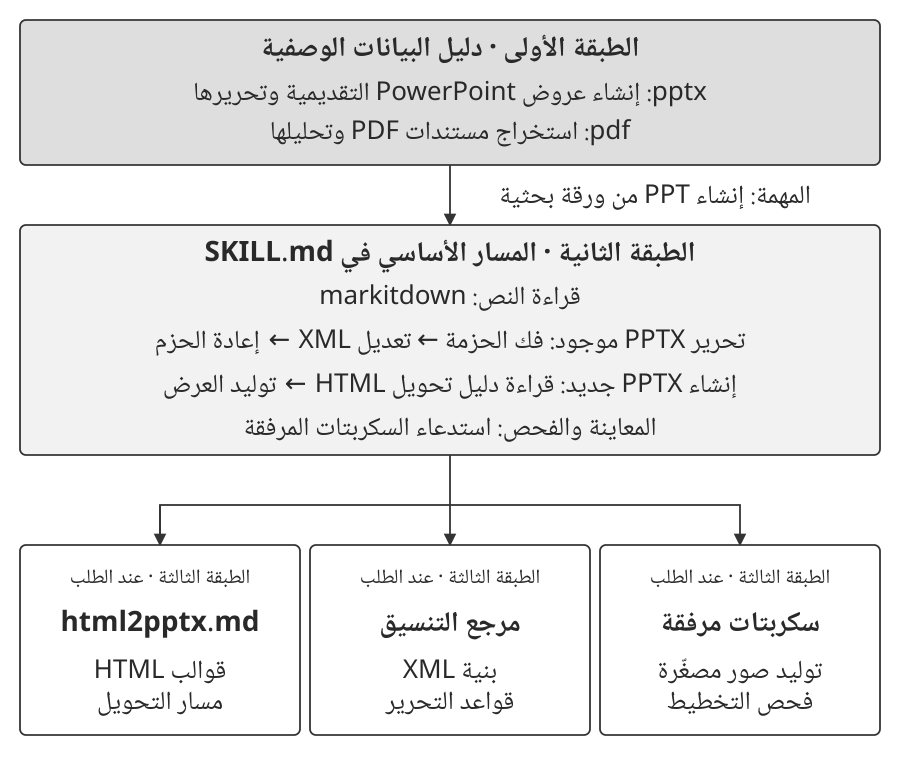

### المهارات: وحدات قابلة للتركيب للقدرات المتخصصة

تجمع **مهارات الوكيل (Agent Skills)** طريقة معالجة نوع من المهام ومراجعه وسكربتاته وقوالبه في حزمة قابلة لإعادة الاستخدام. فكما لا يحتاج الموظف الجديد إلى حفظ أدلة التشغيل في الشركة كلها يوم التحاقه بها، يستطيع النموذج ألا يقرأ الفصل المعني بتمعن إلا حين يباشر العمل. ويُسمى أسلوب التحميل هذا **الإفصاح التدريجي (Progressive Disclosure)**[^ch2-3].

لنعد إلى السلع العشر في الفصل الأول لنحكم أي المعلومات تستحق أن تُكتب في مهارة. لنفترض أن المستخدم يريد مقارنة السعر النهائي شاملًا الشحن، فيكفي أن تدخل التفاصيل وعنوان الاستلام الحالي في السياق الحالي. أما إذا كان الفريق يقارن الأسعار بين التجار مرارًا، فإن طريقة توحيد المواصفات، والتمييز بين سعر الوحدة وسعر المجموعة، والإشارة إلى أن تكلفة الشحن مجهولة، كلها يمكن تنظيمها في مهارة لمقارنة الأسعار. وفي المرة التالية، إذا أراد أحدهم مجرد الاطلاع على الطرز المتاحة، يبقى الفهرس ظاهرًا، ويمكن أن ينتظر مسار التحقق من الأسعار كاملًا حتى يحتاج المستخدم إلى مقارنة الأسعار.

**الطبقة الأولى هي البيانات الوصفية.** تصف كل مهارة نفسها في ملف `SKILL.md`، وفي بداية الملف ترويسة YAML (frontmatter) محاطة بـ `---`، تتضمن `name` و`description`. ويبدأ نظام التنفيذ بتنظيم الأسماء والأوصاف في فهرس، ليحكم النموذج أي المهارات تحتاج إليها المهمة الحالية. وتدير منظومة التشغيل ترتيب الفهرس وطريقة عرضه، ولا يُحمَّل المسار الكامل إلا بعد اختيار المهارة.

**يجب أن يُكتب وصف المهارة أولًا بوصفه شرط توجيه.** فالنموذج يقرر هل يستخدمها قبل أن يحمّل متنها، ولذلك ينبغي أن يبدأ `description` ببيان متى تنطبق المهارة ومتى يجب تجاوزها، ثم يلخص ما تستطيع فعله. فعبارة «help with backend» مثلًا واسعة أكثر مما ينبغي، إذ تكاد تطابق كل مهام الواجهة الخلفية؛ أما «كتابة اختبارات تكامل لواجهة HTTP قائمة، تغطي المصادقة والتحقق من المعاملات واستجابات الأخطاء» فتحدد نطاقًا واضحًا. وفي المهام التي يسهل الخلط بينها، يمكن إضافة شروط استبعاد، مثل «لا حاجة إلى استخدامها عند الاقتصار على مناقشة تصميم الواجهة».

**الطبقة الثانية هي المسار الأساسي.** بعد اختيار المهارة، يرسل نظام التنفيذ تعليماتها الكاملة إلى السياق. فإذا أدخل المستخدم صراحةً أمرًا من قبيل `/pptx`، استطاع العميل أن يبحث عن المهارة ويحمّلها مباشرة؛ أما إذا اختارها النموذج بنفسه، فإنه يحصل على محتواها عبر أداة المهارات أو أداة قراءة الملفات. فالطريقة الأولى توفر على النموذج خطوة إطلاق استدعاء التفعيل، والثانية تُبقي الاختيار والتحميل ضمن مسار التشغيل.

فلنأخذ مهارة PPTX التي تعتمدها تجارب هذا الكتاب مثالًا. تعرّف الشروح الأساسية فيها بعدة مسارات شائعة: استخراج نص العرض التقديمي بأداة markitdown من Microsoft، وفك ضغط ملف PPTX لفحص XML الذي يقوم عليه، واختيار سير عمل إنشاء عرض جديد أو تعديل عرض قائم. وبعد أن يقرأ النموذج هذه الطبقة من الشروح، يستطيع أن يقرر بحسب المهمة الحالية أي مادة يقرأ بعد ذلك وأي نوع من السكربتات يستدعي[^ch2-4].

**الطبقة الثالثة هي المواد التفصيلية.** تتوزع العمليات المعقدة على وثائق متخصصة، ويقدم الملف الرئيسي نقطة الدخول إليها. ففي النسخة التي يستخدمها هذا الكتاب، يشرح `html2pptx.md` كيف يُولَّد العرض التقديمي عبر HTML، وتكمل الوثائق المرجعية الأخرى تفاصيل التنسيق والتعديل. ويواصل الوكيل قراءة هذا المحتوى بحسب المهمة، ويستخدم السكربتات والمواد والقوالب المرفقة لإنجاز العمل.

[^ch2-3]: Anthropic، Equipping Agents for the Real World with Agent Skills، 2025؛ Agent Skills، How to add skills support to your agent.
[^ch2-4]: Anthropic، PPTX Skill. وتستخدم تجارب هذا الكتاب نسخة ثابتة تتضمن مسار التحويل من HTML، وتفصيل النسخة وطريقة التشغيل في ملف README للتجربة المرافقة.
[^ch2-codex-skills]: OpenAI، Build skills؛ وتنفيذ المهارات في المستودع العام لـ OpenAI Codex.
[^ch2-cc-skill-inject]: Claude Code، How Claude Code uses prompt caching، Invoking skills and commands؛ Agent Skills، How to add skills support to your agent، User-explicit activation.

### كيف تكتب مهارة قابلة للاستخدام

يجب أن تجيب المهارة القابلة للاستخدام عن أربعة أسئلة: ما المهام التي تنطبق عليها، وبأي ترتيب تُعالَج، وما الحالات التي تحتاج إلى تأكيد، وكيف يُحكم على اكتمال العمل. وعلى كاتبها أن ينظم خبرته في خطوات قابلة للتنفيذ، وأن يرفق الأحكام الأساسية بأمثلة.

فلنأخذ مهارة للكتابة مثالًا. يمكن الاستئناس بنهج Baoyu في تحسين الكتابة بالذكاء الاصطناعي انطلاقًا من عادات التعبير الشخصية[^ch2-baoyu-remove-ai-writing-flavor]، ثم تنظيم المحتوى في أربعة أجزاء:

- **الدور والقارئ**: توضيح الفئة المخدومة ونوع المهمة ومتطلبات النص النهائي.
- **المبادئ الأساسية**: كتابة ثلاثة إلى خمسة أحكام شائعة أولًا، يُرفق بكل منها مثال محدد للنص قبل إعادة الصياغة وبعدها.
- **الأخطاء الشائعة والحدود**: تسجيل مشكلات التعبير التي يكثر وقوعها، والأفعال التي تتجاوز الصلاحيات، والحالات الاستثنائية.
- **المراجع**: جمع قوائم المصطلحات والقوالب والنصوص النموذجية والشروح المتخصصة، ليُرجع إليها عند التنفيذ.

يمكن كتابة القواعد وفق صيغة «النطاق، والإجراء، والاستثناء، وطريقة التحقق». فقاعدة لاختصار الجمل الطويلة مثلًا ينبغي أن توضح الفقرات التي تنطبق عليها، وكيفية تقسيم الجملة، وكيفية التحقق بعد التقسيم من أن الشروط والاستنتاجات ما زالت كاملة.

وللبداية، اختر ثلاث مقالات إلى خمس من كتاباتك الأصلية التي ترضى عنها، واطلب من الوكيل أن يستخلص منها المفردات وتراكيب الجمل وترتيب الفقرات والنبرة، فيولّد نسخة أولى في نحو عشرين سطرًا. ثم استخدمها في موضوع جديد، وليعدّل المؤلف النص جملة جملة. وتقدم الفروق بين النص قبل التعديل وبعده تغذية راجعة أكثر تحديدًا: أي الكلمات زائدة، وأي الجمل تحتاج إلى تقسيم، وأين تنقص الحقائق، وأين ينبغي استعادة التفاصيل التقنية. ثم تُستخلص التعديلات المتكررة في قواعد، مع الاحتفاظ بالأمثلة المقابلة لها ونطاق انطباقها.

ويمكن أن ترفق بالمهارة أيضًا أدوات تنفيذ وقوالب. فمهارة PPTX مثلًا تجمع شروح التشغيل وسكربتات التحليل وسكربتات التوليد وموارد التخطيط في مكان واحد، فيستطيع النموذج أن يستدعي الموارد المناسبة متتبعًا الشروح. ويمكن اختبار كل مهارة وتحديثها وإدارة نسخها على نحو مستقل، كما يستطيع أعضاء الفريق أن يضيفوا خبراتهم باستمرار حول سير العمل نفسه. **وتكمن القيمة طويلة المدى للمهارات في أنها تتيح تراكم الخبرة المتخصصة على نحو موزع، ونشرها مستقلة، وإعادة استخدامها.** فحين يوسّع الفريق قدرات الوكيل، يستطيع كل عضو أن يحافظ على المهارات التي يتقنها، فتتشكل تدريجيًا منظومة حزم برمجية شبيهة بـ pip وnpm. ويمكن لهذه المهارات أن تتشارك آليات الاكتشاف والتحميل والتنفيذ التي يوفرها النظام الرئيسي.

**عند تصميم طريقة التفاعل، فالأولى اتباع الأنماط التي دُرّب عليها النموذج وكُيّف لها من قبل.** فتقسيم الأدوار، وصيغة نتائج الأدوات، وطريقة تحميل المهارات، كلها تؤثر في كيفية مواصلة النموذج للمهمة. والمسارات القياسية التي يقدمها المزوّدون تصلح نقطة انطلاق، وتخفف عن النموذج عبء استنتاج المعاني من جديد من صيغ غير مألوفة.

[^ch2-baoyu-remove-ai-writing-flavor]: Baoyu، «كفّوا عن استخدام الموجّهات لإزالة طابع الذكاء الاصطناعي، فالاتجاه نفسه خاطئ»، 2026-02-14.

### موضع المهارات في السياق

تنقسم تكلفة المهارات في السياق إلى جزأين: الفهرس والمتن. فالفهرس يتيح للنموذج اكتشاف القدرات المتاحة، والمتن يقدم سير العمل بعد اختيار المهارة. وتشترط المواصفة التحميل عند الطلب، أما دور الرسالة المحدد وطريقة التغليف والتحديث فتتولاها منظومة التشغيل في تنفيذها.

يضيف Claude Code تعليمات المهارة إلى الجلسة رسالةَ `user` في موضع الاستدعاء[^ch2-cc-skill-inject]. ويعرض الشكل 2-12 ترتيبًا للرسائل حين يطلق النموذج المهارة بنفسه: يصدر أولًا الاستدعاء `Skill(skill: "pptx")`، ويتلقى استجابة الأداة، ثم يقرأ متن المهارة الملحق. وعند استخدام أداة تفعيل مخصصة، يمكن لاستجابة الأداة أن تؤدي دور تأكيد الاستدعاء، بينما تحقن منظومة التشغيل المتن على حدة؛ وعند استخدام أداة قراءة ملفات عادية، يمكن أن يُضمَّن المتن مباشرة في نتيجة الأداة. أما إذا أدخل المستخدم `/pptx` صراحةً، فيستطيع العميل أن يبسط التعليمات مباشرة، موفرًا على النموذج خطوة إطلاق استدعاء التفعيل.

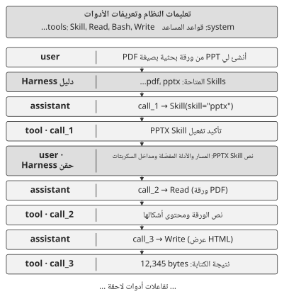{height=55%}

ويفصل تنفيذ المهارات في Codex كذلك بين تنظيم فهرس القدرات والتعليمات المختارة. ففي الشفرة المصدرية العامة، يدخل جزء من الفهرس في سياق `developer`، ويُقدَّم جزء آخر مع الجولة الحالية وبيئة التنفيذ؛ أما المهارة المختارة صراحةً فتُضاف عبر مقطع من سياق المستخدم. ويؤثر مصدر الفهرس وبيئات التنفيذ المتاحة في الترتيب المحدد[^ch2-codex-skills].

ويعرض الشكل 2-13 نمو الذاكرة المؤقتة عند التحميل عند الطلب، منطلقًا من طلب لم تُبنَ له بعد ذاكرة مؤقتة قابلة لإعادة الاستخدام. فدخول الفهرس إلى الطلب أول مرة يحتاج إلى معالجة، وتحميل المتن أول مرة يزيد الحساب أيضًا؛ وحين تحتفظ الطلبات اللاحقة بالبادئة نفسها، تصبح لهذا المحتوى فرصة القراءة من الذاكرة المؤقتة. وإلحاق المحتوى الجديد في موضع الاستدعاء يحافظ على ثبات الرسائل السابقة. أما الشروح المحمّلة فتبقى في التاريخ، وإذا احتاجت إلى تحديث عولجت وفق استراتيجية السياق في وقت التشغيل.

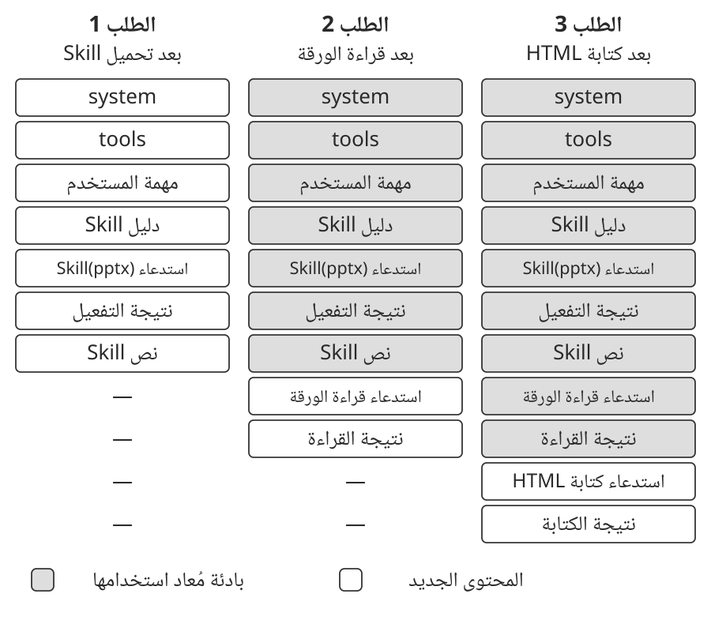

### العلاقة بين المهارات والأدوات

تقدم المهارة معرفة المهمة وسير العمل، بينما تتولى الأدوات القراءة والتنفيذ والحصول على النتائج. ويمكن للأدوات الأساسية السبع التي يعرضها الفصل الخامس أن تُركَّب مع مهارات مختلفة: فأداة قراءة الملفات نفسها تستطيع أن تقرأ دليل العروض التقديمية كما تقرأ أعراف الشفرة؛ ويستطيع المنفذ العام أن يشغّل السكربتات المناسبة. وبهذا يمكن توسيع القدرات المتخصصة عبر سير العمل والموارد، بينما تبقى مجموعة الأدوات الأساسية مستقرة نسبيًا.

ويمكن أيضًا استخدام الأدوات المخصصة مع المهارات. فالبحث عن الأدوات الذي سبق ذكره يتولى تقديم تعريفات الأدوات عند الطلب، بينما توضح المهارة متى تُستدعى الأداة وكيف تُركَّب الأدوات وكيف تُفحص النتائج. وكلاهما يحتاج إلى ضبط كمية المعلومات الدائمة، وإلى تخصيص موضع مناسب للمحتوى المحمّل حديثًا. وسيناقش الفصل الرابع المفاضلة بين المنفذ العام والأدوات المخصصة، ويتناول الفصل التاسع بتعمق أكبر هل تُحفظ الخبرة على هيئة معرفة أو تعليمات أو برامج أو معاملات للنموذج.

> **التجربة 2-6 ★★: توليد عرض تقديمي من ورقة بحثية باستخدام مهارات الوكيل**
>
> تتخذ هذه التجربة ورقة «Attention Is All You Need» مادةً لها، لتبين كيف يحمّل الوكيل عند الطلب سير العمل المتخصص في إعداد العروض التقديمية. والمهمة هي توليد عرض تقديمي من عشر إلى خمس عشرة شريحة من ملف PDF للورقة، يغطي خلفية المشكلة والطريقة والنتائج الأساسية والخلاصة، ويستعين بالأشكال والجداول الواردة في الورقة للشرح.
>
> اعتمد هذا التشغيل على Kimi Code ومهارة PPTX الرسمية من Anthropic. يعثر الوكيل أولًا على مهارة PPTX في الفهرس، ويقرأ شروح التشغيل فيها، ثم يواصل قراءة دليل التحويل من HTML، ويستدعي أداة التوليد المرافقة، وأخيرًا يفحص التخطيط عبر الصور المصغرة والعرض شريحةً شريحة. وكل مادة يقرؤها في كل خطوة تخدم العملية التالية، فيتكشف مسار الإعداد كاملًا تدريجيًا مع تقدم المهمة.
>
> جاء العرض النهائي في ثلاث عشرة شريحة، واستشهد بمخطط المعمارية في الورقة، وشكل آلية الانتباه، وجدول النتائج التجريبية، وشكل تصوير الانتباه.
>
> والفحص بعد التوليد جزء من سير عمل المهارة أيضًا. فقد ظهرت في هذا التشغيل مشكلات مثل غياب الأرقام السفلية، وخلل في علامات التعداد، وأخطاء في مسارات الإحالة إلى الأشكال، ومشكلات في دقة تسميات القيم العددية، فصححها الوكيل واحدة واحدة بناءً على نتائج العرض والفحص البنيوي. واجتاز الملف النهائي الفحص البنيوي، وأُعيد فتحه وعرضه باستخدام LibreOffice.

> **التجربة 2-7 ★★: إنشاء مهارة كتابة «لإزالة طابع الذكاء الاصطناعي» من نصوص نموذجية شخصية**
>
> يحوّل هذا التمرين خبرة الكتابة الشخصية إلى تعليمات قابلة لإعادة الاستخدام. أعِدّ ثلاث مقالات إلى خمس من كتاباتك الأصلية، واطلب من الوكيل أن يستخلص عادات التعبير فيها، ويولّد نسخة أولى من المهارة تتضمن شروط التفعيل وثلاثة مبادئ إلى خمسة مع الأمثلة المقابلة لها.
>
> اختر موضوعًا جديدًا واكتب فيه تجريبيًا، ثم ليعدّل المؤلف النص جملة جملة. وبالمقارنة بين النسختين، حدد المشكلات المتكررة، مثل المفردات الفضفاضة، والجمل المفرطة في الطول، وحذف العلاقات السببية، أو حذف أمثلة محددة يقوم عليها الفهم. ويمكن كتابة طرق التعديل المتكررة في المهارة.

## شريط حالة الوكيل: تعزيز إدارة مسار الوكيل بالمعلومات الوصفية

يلحّ المستخدم في السؤال: «هل يمكنك الاتصال مرة أخرى؟». يسجل الجانب الأيسر من الشكل 2-14 ثلاث مكالمات. في الأولى انتظر الوكيل 45 دقيقة دون أن يُرد عليه، ولم يتوصل إلا في الثالثة إلى سعر 59 دولارًا شهريًا. ووفق قواعد هذا المثال، تستهلك كل مكالمة حصة واحدة؛ فحتى لو لم يُرد إلا على مكالمتين، تكون الحصص الثلاث قد نفدت. وتستطيع منظومة التشغيل أن تنظم هذه العدادات وتقدم الإجراءات والأمور التي تنتظر التأكيد في ملخص يُحدَّث مع الرسائل، يُسمى **شريط حالة الوكيل (Agent Status Bar)**.

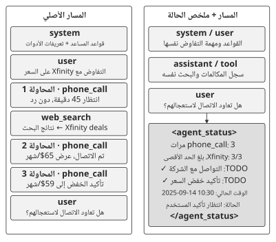

يضع الهاتف الوقت والبطارية والإشارة في أعلى الشاشة، فيعرف الإنسان الحالة الراهنة بنظرة واحدة. والملخص في الجانب الأيمن من الشكل يؤدي دورًا مشابهًا: فحين يقرأ المساعد «بُلغ الحد الأقصى» و«بانتظار تأكيد المستخدم»، يستطيع أن ينقل إلى المستخدم السعر المتفق عليه، ويطلب منه أن يقرر هل يقبله. ويمكن لمنظومة التشغيل أن ترفق الملخص عند إعادة نتيجة الأداة، كما يمكنها أن تلحق رسالة حالة مستقلة.

### من السجلات الخام إلى الحالة الصريحة

لنأخذ مهمة خدمة عملاء هاتفية: يشترط النظام ألا يتجاوز عدد الاتصالات بكل تاجر ثلاث مرات في المهمة الواحدة. وقد تتخلل المكالماتِ الثلاث عملياتُ بحث وقراءة مواد وأسئلة لاحقة من المستخدم. ولكي يقرر النموذج هل يواصل الاتصال، عليه أن يجمع من هذا التاريخ السجلات ذات الصلة، ويميز بين التجار، ويحسب العدد التراكمي.

ويستطيع نظام التنفيذ أن يحدّث العداد بعد كل استدعاء، ويعيد مباشرة «هذه المكالمة الثالثة لـ Xfinity، وقد بُلغ الحد الأقصى لهذه المهمة». فيستطيع القرار التالي أن يستخدم هذه النتيجة. فالبرنامج يحافظ على عدد الاستدعاءات، والنموذج يتولى أن يقرر في ضوء تقدم المهمة هل ينتظر، أو يبحث عن قنوات أخرى، أو يشرح للمستخدم الوضع الحالي؛ وفي الوقت نفسه تفحص طبقة التنفيذ طلبات الاتصال اللاحقة استنادًا إلى العداد.

والقيمة الهندسية هنا هي **التنظيم المسبق للحالات التي تحتاج إليها القرارات اللاحقة مرارًا**. فسجل المكالمات الكامل يظل مسؤولًا عن حفظ محتوى المحادثات ومجرى المعالجة، بينما يقدم شريط الحالة الإحصاءات والتقدم الذي تكثر الحاجة إليه في القرارات. **والإحصاءات التي تتكرر الحاجة إليها ينبغي أن تحافظ عليها الشفرة تراكميًا في المقام الأول.** فالعثور على سجل واحد في السياق، وحساب المجموع من السجلات كلها، عملان مختلفان. وحفظ المسار الخام لا يُنتج تلقائيًا جدولًا إحصائيًا دقيقًا جاهزًا للاستخدام في أي لحظة. أما مطالبة النموذج في كل مرة بإعادة المرور على السجلات وعدّها، فتستهلك رموز الاستدلال، وتزيد احتمال الإغفال والعد المكرر.

ويشبّه المؤلف السياق بمحرك استرجاع يحتاج إلى «طبقة تقطير» مرافقة: فالسجلات الخام تسهّل التتبع، والحالة المقطّرة تسهّل الاستخدام المباشر. فالعدادات والحدود وحالة إنجاز المهمة التي جرى التحقق منها يناسبها أن تحافظ عليها الشفرة؛ أما المعلومات التي تحتاج إلى حكم دلالي، فيمكن استخراجها بندًا بندًا أولًا، ثم تجميعها والتحقق منها. وبهذا يرى النموذج عند كل قرار الحالة الراهنة والأدلة اللازمة معًا.

ويزيد المسار الطويل أيضًا صعوبة العثور على المعلومات الأساسية. وجمع أحدث الأهداف والقيود والتقدم في الجزء الأخير يسهّل على النموذج العثور على المعلومات التي يحتاج إليها القرار الحالي.

> **التجربة 2-8 ★★: ملاحظة أثر شريط حالة الوكيل عبر تصوير الانتباه**
>
> تستخدم هذه التجربة Qwen3-0.6B، وتبني مسار استرداد في خدمة العملاء: اتصل الوكيل بـ Xfinity ثلاث مرات، وتخللت ذلك عمليات بحث على الويب، ثم سأل المستخدم: «هل يمكنك الاتصال مرة أخرى لاستعجالهم؟». وتقصر قواعد النظام الاتصال بكل تاجر على ثلاث مرات في المهمة الواحدة.
>
> تحتفظ مجموعتا المدخلات بالتاريخ نفسه وسؤال المستخدم نفسه. تستخدم المجموعة A المسار الخام مباشرة؛ وتضيف المجموعة B في النهاية الحالة الآتية:
>
> ```xml
> <agent_status>
> Current State:
> - Tool call summary: 'phone_call' has been invoked 3 times (Xfinity: 3 times)
> - Constraint check: Maximum calls to Xfinity reached (3/3)
> </agent_status>
> ```
>
> شُغّلت كل مجموعة ثلاث مرات. رفضت المجموعة A مواصلة الاتصال صراحةً مرتين، وصُنفت مرة واحدة ضمن المخرجات الأخرى؛ ورفضت المجموعة B مواصلة الاتصال صراحةً في المرات الثلاث. ولم تظهر في أي من المجموعتين مخرجات حُكم بأنها تواصل الاتصال مخالفةً للقواعد. ولإعادة إنتاج هذه المقارنة، ادخل إلى `chapter2/attention_visualization`، وشغّل `python run_status_bar_experiment.py --output runs/status-bar-reproduction`. وقد حُفظت مدخلات هذا التشغيل ونتائج كل مرة فيه في الملف `runs/exp2-7-qwen3-0.6b-20260730-v2/comparison.json` داخل مجلد التجربة.
>
> وتعرض خريطة الانتباه توزيع أوزان منطقة التوليد على المكالمات السابقة ونتائج البحث وسؤال المستخدم وشريط الحالة.

وقد درس المؤلف مع Noah Shi في بحث ContextDistill-Bench بتعمق أكبر فوائد تقطير الحالة مسبقًا[^ch2-8]. ففي استعلامات الحالة التي يغطيها هذا المعيار، تستطيع النماذج الأصغر أيضًا أن تبلغ دقة عالية بفضل الحالة الصريحة؛ بينما يمكن أن ينخفض مقدار التفكير وزمن التأخر وتكلفة الاستعلام في النماذج الرائدة بنحو رتبة عشرية واحدة. فمثلًا، انخفضت تكلفة كل ألف استعلام في Claude 4 Sonnet من نحو 35.46 دولارًا إلى 3.51 دولارات. **فهذا التصميم يحافظ على الحالة لحظة وقوع الأحداث، فيوفر كلفة المرور على التاريخ عند كل استعلام.** وبعد تثبيت حقول الملخص، لا يحتاج الاستعلام إلا إلى قراءة هذه الحقول القليلة، حتى لو واصل التاريخ نموه.

[^ch2-8]: Li, Bojie and Noah Shi. *Distill, Don't Retrieve: Inference-Time Context Distillation for LLM Agent Reasoning.* 2026.

### مكونات شريط حالة الوكيل

يتضمن شريط الحالة عادةً ثلاثة أنواع من المعلومات، تجيب على الترتيب عن الأسئلة: «ما المطلوب فعله؟» و«ما الذي حدث للتو؟» و«ما الحالة الراهنة؟».

**تخطيط المهمة** يسجل الأهداف والخطوات وحالة الإنجاز. ويمكن تقسيم المهمة المعقدة إلى قائمة مهام (TODO)، يحتفظ كل بند فيها بحالته وبعلاقات الاعتماد اللازمة. وحين يعالج النموذج الخطوة الحالية، يظل قادرًا على رؤية الطلب الأصلي والقيود الأساسية والعمل اللاحق؛ وبعد إتمام خطوة، تُحدَّث القائمة.

**المعلومات الجانبية للأحداث (Side-channel Information)** تكمل خلفية الحدث لحظة وقوعه، مثل الوقت والموقع الجغرافي والمدة المنقضية منذ آخر رد. وتُحفظ هذه البيانات الوصفية مع الحدث، فتساعد النموذج على فهم الترتيب الزمني والسياق الظرفي. فعبارة «لم يصلني رد بعد» نفسها قد تستدعي معالجة مختلفة إذا قيلت بعد دقيقتين من تقديم الطلب أو بعد يومين.

**ملخص ملاحظة الحالة الراهنة للبيئة** يقدم الوقت الحالي ومجلد العمل وعدد استدعاءات الأدوات وتنبيهات الحالات الشاذة. ودوره قريب من دور واجهة سطر الأوامر أو الواجهة الرسومية حين تعرض المجلد الحالي أو حالة التشغيل: أن يكون للعملية التالية أساس واضح. فتنبيه الاستدعاء المتكرر مثلًا يمكن أن يدفع النموذج إلى فحص سبب الفشل، والميزانية المتبقية تساعده على أن يقرر هل يواصل البحث.

وتبقى البيانات الوصفية للأحداث عادةً ثابتة بعد إلحاقها مع الحدث، أما تقدم المهمة وحالة البيئة فتتغير باستمرار. ويجب أن يُكتب كل نوع من النوعين في التاريخ وفق طريقة تحديثه الخاصة، وسنوضح ذلك فيما يلي من خلال بنية الرسائل.

### الموضع المحدد لشريط حالة الوكيل في السياق

في مثال هذا القسم، تلحق منظومة التشغيل في آخر الرسائل رسالة `user` لنقل ملخص الحالة. ودور `user` هنا هو دور الرسالة في واجهة API المختارة، أما محتوى الحالة فيولّده نظام التنفيذ، ويُبيَّن غرضه بالوسوم. وعند استخدام واجهات أخرى، يمكن أيضًا اعتماد كتل السياق التي تدعمها، أو تقديم الحالة مع نتيجة الأداة المقابلة. وعند اعتماد القالب الذي سبق ذكره، والذي يقتطع الاستدلال السابق بحسب استعلام المستخدم الحقيقي، يمكن تقديم حالة التشغيل مع نتيجة الأداة، ليواصل القالب الاحتفاظ بمعلومات الاستدلال بحسب المهمة الحالية.

تتبّع في الشكل 2-15 الطلب الأول الذي أوكله المستخدم، ثم انظر في أي جولة كُتبت أحدث حالة. فالاحتفاظ بالطلب الأصلي هو ما يتيح بعد انتهاء المكالمات مطابقة أمرين معًا: ما الذي يريد المستخدم إنجازه، وإلى أين وصل الإنجاز الآن.

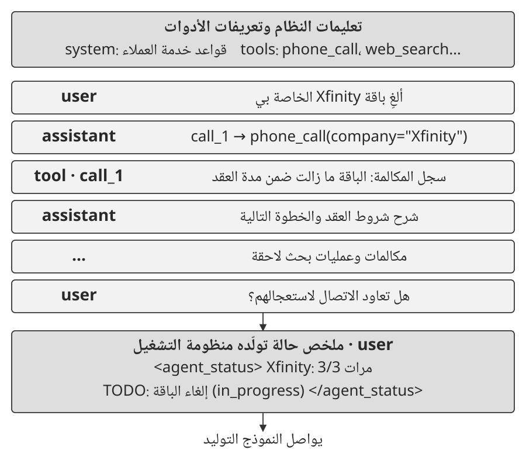

نكتب الترتيب الوارد في الشكل قائمةَ رسائل على النحو الآتي. ولتسهيل المقارنة، حذفنا الجولات المتكررة وبعض حقول الاستدعاء.

```text
messages: [
  { role: "system", content: "You are a customer service assistant..." }
  { role: "user", content: "Help me cancel my Xfinity plan" }
  { role: "assistant", tool_calls: [{ id: "call_1", ... }] }
  { role: "tool", tool_call_id: "call_1", content: "Call log..." }
  { role: "assistant", tool_calls: [{ id: "call_2", ... }] }
  { role: "tool", tool_call_id: "call_2", content: "Call log..." }
  ...بقية الجولات...
  { role: "user", content: "Can you call them again to follow up?" }
  { role: "user", content: "<agent_status>
      Current State:
      - phone_call invoked 3 times (Xfinity: 3/3 max)
      - Current time: 2025-09-14 10:30:45
      - TODO: [1] Cancel plan (in_progress)
    </agent_status>" }
]
```

تجمع الرسالة الأخيرة عدد الاستدعاءات والحد الأقصى والوقت وتقدم المهمة في مكان واحد. ويستطيع النموذج أن يستخدم هذه الحقول مباشرة، وأن يرجع في الوقت نفسه إلى السجلات المحددة عبر أرقام الاستدعاء السابقة.

وبعد إلحاق هذه الرسالة، تبقى سلسلة الرموز السابقة دون تغيير، فيظل الشرط الأساسي لإعادة استخدام البادئة متحققًا. أما كيفية معالجة الحالة القديمة في الجولة التالية، فتتطلب موازنة بين استهلاك السياق وتكلفة التخزين المؤقت.

### طريقتان لتحديث الحالة وكلفتهما على التخزين المؤقت

قد تُنجَز في الجولة التالية مهمة من قائمة TODO، وقد يُضاف استدعاء أداة آخر. فتحتاج منظومة التشغيل إلى تحديث الحالة، ولذلك طريقتان شائعتان.

**الاستبدال في كل جولة**: عند بناء الطلب الجديد، تُزال الحالة السابقة، وتضاف أحدث حالة في النهاية. فلا يحتفظ السياق إلا بنسخة واحدة من الحالة الراهنة، فيسهل على النموذج استخدامها. فمثلًا، كان الطلب السابق «وصف المهمة، الحالة A»، والطلب الحالي «وصف المهمة، نتيجة الأداة، الحالة B». يظل وصف المهمة قادرًا على إصابة الذاكرة المؤقتة؛ أما نتيجة الأداة فتُرسل أول مرة، فهي تحتاج إلى الحساب أصلًا. ولا تفقد الرسائل مطابقة بادئتها الأصلية بإزالة A إلا إذا كانت في الطلب السابق رسائل أخرى بعد الحالة A. ولا يرى النموذج في هذا الطلب إلا B. وإذا احتاج إلى الرجوع إلى A، أمكن استدعاء اللقطة الخاصة بتلك اللحظة من سجل التشغيل.

**الإلحاق الدائم**: تُحفظ سجلات الحالة القائمة، وتُلحق الحالة الجديدة في النهاية في كل مرة. فتبقى بادئة التاريخ ثابتة، ويسهل تتبع تغيرات الحالة. لكن الحالات القديمة تستهلك السياق تدريجيًا، فيجب تحديد الوقت أو رقم النسخة بوضوح، ليحكم النموذج على الوضع الراهن استنادًا إلى أحدث سجل. والطريقة التي يلحق بها Claude Code تنبيهات تغير الملفات بالجلسة تعكس هي أيضًا هذا النهج في التصميم.

فحين تكون الحالة قصيرة، وقد خُزّن بعدها قدر كبير من نتائج الأدوات، قد يكون الاحتفاظ بالحالة القديمة أوفر من إعادة حساب لاحقة طويلة؛ أما حين تكون الحالة طويلة وكثيرة التحديث، فإن الاستبدال يحد من تراكم الحالات السابقة.

ويمكن تقدير نقطة الفصل بنموذج تقريبي: لتكن كل حالة $S$ رمزًا، وليكن متوسط اللاحقة المخزنة مؤقتًا التي يجب إعادة حسابها بعد الحالة القديمة عند كل استبدال $R$ رمزًا (دون احتساب المحتوى المرسل أول مرة في هذه الجولة)، ولتُحقن الحالة $N$ مرة، وليكن سعر المدخلات المخزنة مؤقتًا $\alpha$ ضعفًا من سعر المدخلات العادية. وبإهمال التكاليف المشتركة بين الطريقتين، يكون $C_{\text{replace}} \approx (N-1)(1-\alpha)R$، و$C_{\text{append}} \approx \alpha S N(N-1)/2$. فإذا كان $N>1$، وكان $\alpha SN/2 < (1-\alpha)R$، كانت التكلفة المقدرة للإلحاق الدائم أقل؛ وفي الحالة المعاكسة يكون الاستبدال في كل جولة أوفر. وقد اتخذنا هنا سعر المدخلات العادية وحدةً للتكلفة: فما تدفعه طريقة الاستبدال زيادةً هو فرق السعر الناتج عن تحول اللاحقة من القراءة من الذاكرة المؤقتة إلى إعادة المعالجة، وما تدفعه طريقة الإلحاق زيادةً هو رسوم القراءة المتكررة للحالات السابقة.

ولنضرب مثالًا: تُحقن في كل مرة حالة من 100 رمز، ويجري الحقن 10 مرات في المجموع، وتُحتسب القراءة من الذاكرة المؤقتة بعُشر سعر المدخلات العادية. في طريقة الإلحاق، تقرأ الطلبات اللاحقة زيادةً 1 ثم 2 ثم ... حتى 9 حالات قديمة، فتعادل الرسوم الإضافية 450 رمزًا من المدخلات العادية. فإذا كان استبدال الحالة يؤدي إلى إعادة معالجة 1000 رمز مخزن مؤقتًا في المتوسط بعدها، فإن ما تكلفه الاستبدالات التسعة زيادةً يعادل 8100 رمز من المدخلات العادية، فيكون الإلحاق أوفر. أما إذا كانت الحالة القديمة في الأصل نهاية الذاكرة المؤقتة، ولم يكن بعدها أي محتوى مخزن مؤقتًا، فإن $R=0$ في المعادلة، ويوفر الاستبدال المباشر عندئذ ما يعادل كلفة هذه الرموز الـ 450.

> **التجربة 2-9 ★★: عدة تقنيات مفيدة لشريط حالة الوكيل**
>
> تنفذ هذه التجربة خمس تقنيات لشريط الحالة، يمكن تفعيل كل منها على حدة أو الجمع بينها. وتقدم كل تقنية نوعًا محددًا من المعلومات يساعد النموذج على تحديد خطوته التالية.
>
> **تتبع الطوابع الزمنية** يسجل وقت الحدث في رسائل المستخدم واستجابات الأدوات، مثل `[2025-09-14 10:30:45]`. ويُكتب الوقت في التاريخ مع الحدث، ويحتفظ بقيمته الأصلية في الجولات اللاحقة؛ أما الوقت الحالي فيُحدَّث مع رسائل الحالة الجديدة. وتوفر التجربة أيضًا محاكاة للوقت، لفحص قدرة النموذج على التمييز بين «ملف الأمس» و«تعديل اليوم»، وصحة فهمه لمدد الانتظار.
>
> **عداد استدعاءات الأدوات** يحفظ في قاموس العدد التراكمي لاستدعاءات كل أداة، ويوسم الاستجابة بـ `Tool call #3 for 'read_file'`. وبالجمع بين ذلك ومحتوى الخطأ، يستطيع النموذج أن يحكم هل يواصل المحاولة. فمثلًا، بعد فشل القراءة الأولى يفحص المسار، ثم يسرد محتوى المجلد؛ وبعد إخفاقات متعددة يبحث عن ملف بديل أو يشرح للمستخدم ما هو مفقود. وإذا احتجنا إلى تقييد عدد المحاولات، فعلى نظام التنفيذ أيضًا أن يطبق الحد الأقصى استنادًا إلى العداد.
>
> **إدارة قائمة TODO** توفر أداتين هما `rewrite_todo_list` و`update_todo_status`. ويتضمن كل بند معرّفًا فريدًا ومحتوى وطابعًا زمنيًا، وإحدى أربع حالات: `pending` و`in_progress` و`completed` و`cancelled`. وتجمع القائمة في مكان واحد «ما أُنجز وما بقي»، وهي قريبة من نهج Manus في إبقاء الهدف ظاهرًا عبر العرض المتكرر لخطة المهمة.
>
> **معلومات الخطأ التفصيلية** تقدم نوع الخطأ ووصفه، وJSON لمعاملات الاستدعاء، ومكدس الاستدعاءات، واقتراحات الإصلاح. فمثلًا، عند مواجهة `FileNotFoundError`، يمكن تنبيه النموذج إلى مراجعة اسم الملف والمجلد الحالي والمسار المطلق. فالمعاملات تساعد على تحديد المدخلات الخاطئة، ومكدس الاستدعاءات يساعد على العثور على موضع الفشل، واقتراحات الإصلاح تقدم اتجاه الفحص التالي. وقبل إعادة هذا المحتوى إلى النموذج، ينبغي تنظيفه من الحقول الحساسة كبيانات الاعتماد، وضبط طول المكدسات المسهبة.
>
> **إدراك حالة النظام** يقدم الوقت الحالي ومجلد العمل ونظام التشغيل وShell وإصدار Python. وتتعرف أداة الأوامر في التجربة على عمليات تغيير المجلد المستقلة، فتحدّث مجلد العمل الذي يحافظ عليه نظام التنفيذ، ثم تستخدمه في الاستدعاءات اللاحقة؛ أما تغيرات المجلد في العمليات الفرعية ضمن الأوامر المركبة فتتبع نطاق تنفيذ العملية المقابلة. وتساعد حقول البيئة النموذج أيضًا على اختيار الأدوات المتاحة، كأن يختار `apt` أو `brew` بحسب النظام الفعلي والبرمجيات المثبتة.
>
> وفي مقارنة Kimi K3 هذه المرة، كان لكل نوع من المهام خمس حالات. اجتاز إعداد الطوابع الزمنية والإعداد المركب خمس حالات كلٌّ منهما، واجتازت المجموعة الضابطة لكل منهما ثلاثًا؛ واجتازت مجموعتا التفعيل والتعطيل لعداد الأدوات وحالة النظام خمس حالات كلتاهما. واجتاز إعداد TODO صفرًا من الحالات، واجتازت مجموعته الضابطة حالة واحدة؛ واجتاز إعداد الأخطاء التفصيلية أربع حالات، واجتازت مجموعته الضابطة خمسًا.

**ينبغي أن تحافظ الشفرة على شريط الحالة قدر الإمكان.** فالنموذج يستخدم ما فيه من إحصاءات وقيود مباشرة، وعبارة خاطئة واحدة مثل «اتُّصل ثلاث مرات» قد تغيّر الأفعال اللاحقة. فالعدادات والوقت وانتقالات الحالة تُسند إلى البرنامج؛ وحين يُحتاج إلى فهم دلالي، يُطلب من النموذج أولًا الاستخراج بندًا بندًا، ثم تتولى الشفرة التجميع والتحقق، تجنبًا لمطالبة النموذج بإحصاء تاريخ طويل كاملًا دفعة واحدة. ويُحتفظ بعلاقات التقابل بين الأحداث الخام ونتائج الاستخراج والحالة النهائية، ليسهل اكتشاف العد المكرر والإغفال والخلط بين المصادر.

أما المعلومات التي يلخصها شريط الحالة، فيجب اختيارها مسبقًا. فعبارة «اتُّصل ثلاث مرات» مثلًا تكفي للحكم هل يمكن الاتصال مجددًا، لكنها لا تجيب عن سؤال «ما الذي وعد به موظف خدمة العملاء في المكالمة الثانية؟». ففي المهام اللاحقة التي لا تحتاج إلا إلى القيم الإحصائية، يمكن استبدال التاريخ بملخص الحالة وأرشفة السجلات الخام؛ وحين يُحتاج إلى مطابقة محتوى المحادثة، يُقرأ النص الأصلي عبر الفهرس. فتصميم حقول الملخص يحدد الأسئلة التي يمكن الإجابة عنها مباشرة، ويحدد كذلك متى يجب الرجوع إلى الأصل.

## استراتيجيات ضغط السياق

لنفترض أن مهمة تقصٍّ قرأت عشر صفحات ويب طويلة، ولم يعد في النافذة متسع إلا لمادتين أخريين. فلنسأل النموذج أولًا عما سيفعله في الجولة التالية: إذا كان سيقارن عرضَي سعر، فليحتفظ بالعرضين وشروط سريانهما ومصدرهما؛ وإذا كان سيراجع اقتباسات، فليحتفظ بالمواضع التي تتيح استعادة النص الأصلي. أما متون الصفحات التي فُحصت ولا صلة لها بالمهمة فيمكن أرشفتها، لإفساح المجال للمدخلات والمخرجات الجديدة. وهنا لا بد من حساب المساحة التي أُفسحت، ومن حساب آخر أيضًا: إذا احتيج لاحقًا إلى مادة حُذفت، فما الكلفة اللازمة لاستعادتها؟

### أغراض الضغط الثلاثة

**ضبط الطول والتكلفة.** فلنأخذ نافذة من 128K رمز مثالًا: قد تشغل صفحات الويب الطويلة والملفات الكبيرة جزءًا كبيرًا منها. وعلى منظومة التشغيل أن تحتفظ بميزانية للمدخلات اللاحقة ومخرجات النموذج والتفاعل مع الأدوات.

**تنظيم المعرفة التي تحتاج إليها القرارات اللاحقة.** فبضع عشرة جولة من البحث قد تذكر الحدث نفسه مرارًا، وقد تخلّف روايات متناقضة. وتنظيمها في صيغة مثل «تأكد A وB، وما زال C يفتقر إلى دليل» يتيح للنموذج أن يواصل العمل على المسائل التي لم تُحسم. وينبغي أن يحتفظ الملخص بالعلاقات بين الحقائق ومصادرها والمسائل المعلقة، ليكون للقرارات اللاحقة أساس واضح.

**دعم التقدم المستمر في المهام الطويلة.** فبعض النماذج، حين تظن أن النافذة توشك على النفاد، تسارع إلى إنهاء العمل قبل أوانه، وتُسمى هذه الظاهرة **قلق السياق (Context Anxiety)**. وقد وجدت Anthropic في اختبارات المهام الطويلة على Sonnet 4.5 أن هذا السلوك قد يظهر حتى بعد الضغط، فاعتمدت سجلات تسليم منظمة، تُستأنف بها المهمة بعد إعادة تعيين السياق[^ch2-7].

[^ch2-7]: Prithvi Rajasekaran، Harness design for long-running application development، Anthropic Engineering، 2026.

### تحويل نتائج الحساب المتكرر إلى معرفة قابلة للاستخدام

يحافظ شريط الحالة مسبقًا على العدادات والتقدم، أما الملخص فيذهب أبعد من ذلك فينظم الحقائق والعلاقات الواردة في النصوص الطويلة. وكلاهما ينظم مسبقًا المعلومات المتناثرة، لتتمكن القرارات اللاحقة من استخدامها مباشرة.

لننظر في مثال جولة تفقدية في متجر للحيوانات الأليفة:

> القفص 1: قطة سوداء. القفص 2: قطة بيضاء. القفص 3: قطة سوداء. القفص 4: قطة سوداء. القفص 5: قطة بيضاء.
> ... (100 قفص في المجموع، فيها 90 قطة سوداء و10 قطط بيضاء)

الإجابة عن سؤال «ما القطة الموجودة في القفص 37؟» تتطلب تحديد السجل المقابل؛ أما الإجابة عن «كم عدد القطط السوداء والبيضاء؟» فتتطلب تجميع السجلات كلها. وإذا كان المجموع سيُستخدم مرارًا لاحقًا، أمكن حسابه أولًا وحفظ «90 قطة سوداء و10 قطط بيضاء»، تجنبًا للعد من البداية في كل مرة. فالبرنامج يناسبه إجراء هذا التجميع الحتمي، بينما يستطيع النموذج أن يواصل الإجابة عن أسئلة العمل بناءً على النتائج الإحصائية.

وينبغي أن يُختار محتوى الملخص بحسب المهمة. فالاحتفاظ بمجموع نوعي القطط وحده يكفي للإجابة عن أسئلة العدد؛ أما الإجابة عن حال القفص 37 فتحتاج إلى سجل لكل قفص أو إلى فهرس مقابل.

وحتى لو بقي في النافذة متسع، فقد يؤثر السياق المفرط في الطول أو المختلط في استخدام المعلومات: فيغفل النموذج حقائق أساسية، أو يعيد معالجة مسائل حُسمت، أو يستخدم حالة متقادمة في القرار الحالي. ويُسمى هذا التراجع في الأداء الذي يظهر مع نمو السياق عادةً **تعفّن السياق (Context Rot)**. وهو يتجلى في تدهور أداء المهمة؛ أما حين يتجاوز الطلب حد السعة، فيحدث فيض النافذة.

**وحتى حين يبقى في النافذة متسع، ينبغي المبادرة إلى تنظيم المعرفة التي تكرر استخدامها.** فإذا أمكن تلخيص الأحكام الأساسية، ثم تُرك النموذج يبحث عنها مرة بعد مرة في تاريخ طويل، فإن ذلك يستهلك الحساب باستمرار ويزيد الإغفال. ففي مهام البحث يمكن حفظ الحقائق المؤكدة ومصادرها والأسئلة التي تنتظر التحقق؛ وفي مهام البرمجة يمكن حفظ القرارات المعمارية ونطاق التعديل ونتائج الاختبارات وأسباب الإخفاق.

وتؤثر الأمثلة الواردة في السياق أيضًا في طريقة معالجة النموذج للمسائل الجديدة. فقد انطلقت دراسة Dherin وزملائه من تركيب طبقات الانتباه وطبقات MLP في Transformer، فعبّرت عن حساب أمامي معين بوصفه تحديثًا منخفض الرتبة للأوزان مرتبطًا بالسياق، مقدمةً تفسيرًا نظريًا للتعلم داخل السياق[^ch2-6]. أما في الاستدلال الفعلي، فتبقى أوزان النموذج ثابتة، وتؤثر الأمثلة في المخرجات عبر المدخلات الحالية. فإذا أردنا إعادة استخدام هذه الخبرة في جلسات لاحقة، أمكن تنظيمها في ذاكرة أو أمثلة أو مهارة، ثم تحميلها بحسب المهمة؛ وسيناقش الفصل التاسع بتعمق أكبر طرق تراكم الخبرة.

[^ch2-6]: Benoit Dherin et al.، Learning without training: The implicit dynamics of in-context learning، 2025.

### المفاضلة بين الضغط وKV Cache

يحدث الضغط عادةً بين استدعاءين للنموذج. فتنظم منظومة التشغيل، بحسب الميزانية المتبقية وتقدم المهمة، الرسائل التي يحتاج إليها الطلب التالي، ثم ترسلها إلى النموذج. واستبدال التاريخ يغيّر البادئة، ولذلك يجب أن تُوازَن فائدة الضغط مع كلفة إعادة بناء الذاكرة المؤقتة.

أولًا، حافظ على ثبات تعليمات النظام وتعريفات الأدوات التي ما زالت صالحة. فهي تقع في المقدمة، ويستطيع ضغط التاريخ اللاحق أن يواصل إعادة استخدام هذا الجزء من البادئة. ثانيًا، اختر موضوع الضغط بدقة: فنتائج الأدوات الطويلة يمكن استبدالها بملخصات، والتفاعلات متعددة الجولات التي اكتملت يمكن دمجها في سجل مرحلي. والذاكرة المؤقتة السابقة لموضع الاستبدال تظل قابلة لإعادة الاستخدام، أما موضع الاستبدال وما بعده فيجب أن يُعالَج وفق البادئة الجديدة.

**ينبغي أن يجري ضغط التاريخ على دفعات قدر الإمكان، تجنبًا لإعادة كتابة المقطع نفسه من البادئة في كل جولة.** فبعد الضغط تقصر مدخلات كل جولة، لكن استدعاء الضغط وإعادة حساب اللاحقة يستهلكان الموارد أيضًا. ويمكن تحديد توقيت الإطلاق بالجمع بين نسبة إشغال النافذة وعدد الجولات اللاحقة المتوقعة ومرحلة المهمة: فالتنظيم الدفعي بعد ظهور نتائج أدوات طويلة متتابعة، وحفظ ملخص تسليم بعد إتمام مرحلة، كلاهما يقلل كلفة التعديل المتكرر للتاريخ. وعند الاحتفاظ بالجولات الأخيرة، ينبغي التحقق من أن استدعاءات الأدوات والقيم المعادة متزاوجة، وكتابة حالة العمليات غير المكتملة في الملخص.

وعند الضغط يجب أيضًا فحص بروتوكول إعادة معلومات الاستدلال. ففي بعض النماذج يرتبط thinking السابق بالبادئة التي وُلّد عندها. فإذا استُبدل التاريخ قبل هذه الكتل، فقد لا يطابق thinking المحتفظ به البادئة الجديدة. وعند اعتماد بروتوكول كهذا، يمكن تنظيم الجلسة في ملخص، وإزالة thinking القديم المتأثر، ليواصل النموذج الاستدلال من الملخص؛ كما يمكن استخدام آليات الضغط أو تحرير السياق التي تدعمها جهة الخدمة.

انظر أولًا إلى الملخص الفردي في الشكل 2-16: لم يتجاوز عدد الأحرف بعد المعالجة 10.9% من الأصل، ومع ذلك كان مجموع الرموز التي استهلكها الوكيل الرئيسي هو الأكبر بين المجموعات الست. ولتفسير كيف يصح هذان الرقمان معًا، يجب تتبع المواد التي ضُغطت، وعدد جولات الطلبات التي أُرسلت فيها هذه المواد إلى النموذج.

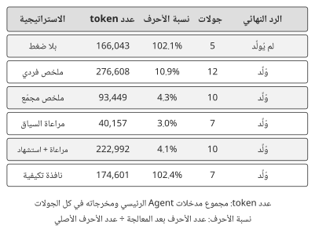

> **التجربة 2-10 ★★★: مقارنة استراتيجيات ضغط السياق**
>
> تستخدم هذه التجربة Kimi K3 لتقصي الأوضاع المهنية لمؤسسي OpenAI المشاركين. وتتطلب المهمة بناء قائمة الأشخاص تدريجيًا، والبحث عن مسيراتهم وتغيرات مناصبهم، ثم ربط الحقائق ذات الصلة بمصادرها. ولملاحظة الضغط ومعالجة الفيض، تضبط التجربة ميزانية السياق في جانب التطبيق على 128,000 رمز، وتحتفظ بخط أساسي بلا ضغط، ثم تقارن خمس طرق للمعالجة، وتُشغَّل كل منها 15 جولة على الأكثر[^ch2-compression-results].
>
> **الاستراتيجية الأولى: بلا ضغط.** تدخل نتائج البحث وقراءة الصفحات إلى التاريخ كاملة. احتُسب في سبعة استدعاءات للأدوات 367,246 حرفًا خامًا. وأطلق البرنامج الحماية في الجولة الخامسة وتوقف، وبلغ الاستهلاك التراكمي للوكيل الرئيسي 166,043 رمزًا. وكانت النسخة القديمة تطلق الحماية بمجموع رموز المدخلات في الطلبات المتعاقبة، ولذلك فإن الرقم 165,227 الوارد في رسالة الخطأ هو مدخلات تراكمية. فمثلًا، إذا أُرسل مقطع التاريخ نفسه مرة في كل طلب من ثلاثة طلبات، فإنه يُحتسب ثلاث مرات.
>
> **الاستراتيجية الثانية: الملخص الفردي.** يُولَّد لكل نتيجة بحث على حدة ملخص من فقرتين أو ثلاث، يحتفظ بالمحتوى الرئيسي لكل صفحة. ويسهل في هذا الأسلوب التنفيذ المتوازي والحفاظ على حدود الصفحات؛ لكن حين تروي صفحات متعددة الحدث نفسه، تظل المعلومات المكررة تدخل التاريخ. وقد ولّد هذا الإعداد الرد النهائي في اثنتي عشرة جولة، واستهلك الوكيل الرئيسي تراكميًا 276,608 رموز، وبلغت نسبة ضغط الأحرف 10.9%.
>
> **الاستراتيجية الثالثة: الملخص المجمّع.** تُدمج دفعة من نتائج البحث، ثم يُولَّد لها ملخص شامل، فيسهل تنظيم الحقائق المكررة والعلاقات بين المصادر المختلفة. وقد ولّد هذا الإعداد الرد النهائي في عشر جولات، واستهلك الوكيل الرئيسي تراكميًا 93,449 رمزًا، وبلغت نسبة ضغط الأحرف 4.3%.
>
> **الاستراتيجية الرابعة: الملخص المدرك للسياق.** يُقدَّم عند الضغط الاستعلام الحالي والمعلومات التي تحققت من قبل، كأن يُضاف إلى الموجّه `Given the search query: {query}` و`Current context: {context}`. فيحتفظ النموذج بناءً على ذلك بالحقائق المتصلة بالسؤال الحالي، ويقدّم سد الثغرات في الملخص القائم. وقد ولّد هذا الإعداد الرد النهائي في سبع جولات، واستهلك الوكيل الرئيسي تراكميًا 40,157 رمزًا، وبلغت نسبة ضغط الأحرف 3.0%. وفي إحدى عمليات الضغط نُظّم نحو مئة وخمسين ألف حرف في نحو ألفي حرف، مع الاحتفاظ بأسماء الأشخاص وتغيرات مناصبهم.
>
> **الاستراتيجية الخامسة: الملخص المدرك للسياق مع الإحالات.** يحتفظ الملخص المرتبط بالمهمة بروابط المصادر المقابلة للحقائق. وقد ولّد هذا الإعداد الرد النهائي في عشر جولات، واستهلك الوكيل الرئيسي تراكميًا 222,992 رمزًا. وبالتجميع وفق سجلات الأدوات، بلغت المواد بعد المعالجة 52,891 حرفًا، والنص الأصلي 1,295,044 حرفًا، وحاصل قسمتهما نحو 4.1%.
>
> **الاستراتيجية السادسة: النوافذ التكيفية.** تحتفظ بالمواد الخام في المرحلة الأولى، ثم تنظمها دفعة واحدة حين تبلغ المدخلات عتبة محددة. وتعتمد التجربة ثلاث آليات: إطلاق الضغط عند تجاوز 80% من الميزانية؛ وتجميع نتائج الأدوات التي لم تُضغط بعد ومعالجتها؛ ووسم النتائج المعالجة بـ `[COMPRESSED]` تجنبًا لتلخيصها مرة أخرى. ووفق ميزانية هذه التجربة البالغة 128,000 رمز، تكون عتبة الإطلاق 102,400 رمز. وقد ولّد هذا الإعداد الرد النهائي في سبع جولات، واستهلك الوكيل الرئيسي تراكميًا 174,601 رمز. وكانت السجلات التاريخية تطلق العتبة بالمدخلات التراكمية، ثم عُدّل البرنامج لاحقًا ليفحص حجم مدخلات أحدث طلب.
>
> يقارن الشكل 2-17 بين مدخلات الاستراتيجيات الست ومخرجاتها.
>
> 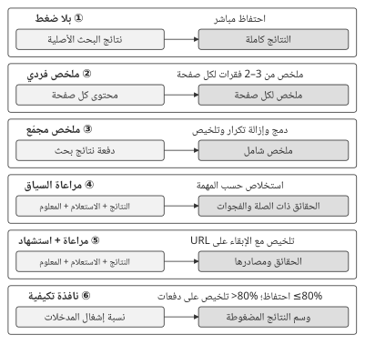
>
> وعند مقارنة أرقام الشكل 2-16، يجب التمييز بين ثلاث كميات: مدخلات الطلب الواحد تحدد هل بُلغت ميزانية النافذة، والرموز التراكمية تعكس الاستهلاك في الاستدعاءات متعددة الجولات، ونسبة ضغط الأحرف تصف النسبة بين طول المواد المحتسبة بعد المعالجة وطولها الأصلي. والاستهلاك التراكمي هنا مأخوذ من مدخلات طلبات الوكيل الرئيسي ومخرجاتها في كل الجولات، ولم تُضَف إلى هذا الحقل طلبات النموذج المستقلة التي ولّدت الملخصات.
>
> ولإعادة إنتاج التجربة، اضبط النموذج وخدمة البحث الحقيقية وفق الشروح المرافقة، ثم نفّذ في مجلد التجربة `python experiment.py -m kimi-k3 -n 15 -o results/reproduction.json`. واقرأ `metrics` لكل استراتيجية: أعد حساب نسبة الأحرف بـ `total_compressed_size / total_original_size`، ثم قارن `total_tokens` و`iterations`. والخط الأساسي بلا ضغط يضيف هو أيضًا إلى متون البحث تنسيقًا مثل العنوان وURL، ولذلك قد يزيد عدد الأحرف بعد المعالجة قليلًا على الأصل. ويكفي أن يتلقى برنامج التجربة ردًا نهائيًا ليعدّ المجموعة مكتملة. جرّب أن تبحث عن الشخص نفسه في الناتجين النهائيين: كتبت مجموعة الإحالات أن Pamela Vagata تعمل في Pebblebed، بينما كتب جدول التلخيص في مجموعة النوافذ أنها في Stripe. وقد ذكرت الإجابة الأولى موقع المؤسسة، لكنها لم تقدم رابط صفحة يمكن فتحه. فكلتا المجموعتين سلّمت جدول تلخيص، لكن بيانات الأشخاص التي قدمتاها متناقضة.

[^ch2-compression-results]: يحفظ ملف نتائج التجربة 2-10 `kimi_k3_real_20260718.json` الحقول الإحصائية لكل استراتيجية والإجابة النهائية والطوابع الزمنية، ويمكن منه إعادة حساب نسبة الأحرف مباشرة. واستخدم تشغيل 18 يوليو 2026 شرط الحماية القديم؛ أما مراجعة الشفرة في 22 يوليو (الإيداع `aea4d72`) فقد استبدلت بالمدخلات التراكمية مدخلات طلب الجولة الأخيرة.

### آلية الضغط الطبقي على مستوى الإنتاج

قد تحتاج مخرجات الأدوات إلى حفظ نصها الكامل مؤقتًا، ويمكن أرشفة الخطوات المكتملة، وينبغي أن تبقى القيود الحالية ظاهرة؛ والآليات الخمس الآتية يناسب كل منها تواترًا مختلفًا في الاستخدام ومدة مختلفة في الاحتفاظ.

1. **ضبط ميزانية نتائج الأدوات**. تُحفظ المخرجات الضخمة في تخزين خارجي، ويُحتفظ في السياق بمعاينة موجزة ومدخل للقراءة. ومتى دخلت المعاينة إلى التاريخ، ظل محتواها ثابتًا؛ وإذا احتيج إلى مزيد من التفاصيل، قُرئت المقاطع ذات الصلة وأُلحقت النتيجة.
2. **تنظيف المحتوى غير ذي الصلة**. يمكن تصفية أشرطة التنقل في صفحات الويب والتذييلات المكررة وما شابهها قبل أن تدخل النتائج إلى السياق. أما المحتوى الذي دخل التاريخ وتحتاج إلى حذفه، فتأكد أولًا هل ما زالت المهام والإحالات اللاحقة تعتمد عليه، ثم احسب كلفة التخزين المؤقت الناتجة عن تعديل التاريخ.
3. **تحرير السياق على مستوى API**. تستطيع الخدمات التي تدعم هذه القدرة تنظيف نتائج الأدوات القديمة وفق قواعد محددة. ويحتاج العميل إلى ضبط شروط الإطلاق ومعالجة معلومات التحرير التي تعيدها الخدمة. ويحدد اتفاق الواجهة نطاق التنظيف وسلوك التخزين المؤقت، ويحسن ربط هذه القدرة مع مراقبة ميزانية المدخلات.
4. **الملخص الأرشيفي**. يسجل بحسب الجولات أو مراحل المهمة الأهداف والعمليات والنتائج والأمور غير المنجزة، ويحتفظ بترتيب التنفيذ. ويمكن فهمه على أنه سجل تغييرات المهمة: يمكن الرجوع إليه لاحقًا لمعرفة في أي خطوة اتُّخذ قرار ما، وعلى أي أساس.
5. **الضغط الشامل للجلسة**. حين يعجز التنظيف الجزئي عن الوفاء بالميزانية، تُنظَّم الأهداف الحالية والقيود والحقائق المؤكدة والقرارات الأساسية والعمل التالي في ملخص تسليم. ويمكن تنظيم ملاحظات الجلسة القائمة أولًا، ثم تلخيص التاريخ كله. وإذا فشل الضغط مرات متتالية، يوقف حدّ أقصى للمحاولات أو آلية قاطعة الاستدعاءات المتكررة، وتُحفظ حالة قابلة للاستعادة، ثم يُختار تقليص المدخلات أو المعالجة البشرية.

ويمكن لهذه الآليات أن تتعاون في طبقات: فضبط المدخل يقلل المخرجات الضخمة دفعة واحدة، والتنظيم الجزئي يضبط النمو اليومي، والملخصات المرحلية والضغط الشامل يحفظان معلومات التسليم للمهام الطويلة.

وقد لاحظ المؤلف عند قراءة dsh-superagent تفصيلًا لافتًا: يمكن للأحداث ونتائج الأدوات أن تُرسل أولًا ملخصًا ومعرّف كائن (ID)، فإذا احتيج إلى التفاصيل قُرئت بهذا المعرّف. لنفترض أن الواجهة الخلفية أنهت تشغيل مجموعة من الاختبارات، واكتفت بإبلاغ الواجهة الأمامية «فشل اختباران». تستطيع الواجهة الأمامية أن تبلّغ عن التقدم، لكنها لا تستطيع الإجابة عن سؤال المستخدم التالي: «هل هما الاختباران نفسهما اللذان فشلا أمس؟». أما إذا أُرفق بالملخص معرّف سجل هذا التشغيل للاختبارات، فإن الواجهة الأمامية تستطيع أن تستعيد أسماء حالات الاختبار الفاشلة وتقارنها بسجل الأمس.

### مبادئ تصميم استراتيجيات الضغط

عند تقرير ما يُحتفظ به بعد الضغط، يمكن الفحص من الجوانب الأربعة الآتية. أما عملية تراكم الخبرة عبر المهام فسيتناولها الفصل التاسع.

- **توزيع المساحة بحسب قيمة المهمة**. فقائمة الأشخاص وعلاقات الهوية والأسئلة الحالية التي تنتظر التحقق ينبغي عادةً الاحتفاظ بها مباشرة؛ والأدلة الأساسية التي تدعم الاستنتاجات يُحتفظ بمصادرها وبالتفاصيل اللازمة منها؛ أما أشرطة التنقل والإعلانات والمحتوى المكرر فيمكن تنظيفها. وحين تكون الحقيقة موضع خلاف، فإن الاختلاف بين الأدلة نفسه معلومة مهمة.
- **الحفاظ على اكتمال المعنى**. ففي عبارة «غادر Sutskever شركة OpenAI في مايو 2024» يشكّل الشخص والزمن والفعل والمؤسسة معًا حقيقة واحدة. وينبغي عند الضغط الاحتفاظ بهذه العناصر، تجنبًا لأن يبقى منها مقطع يصعب تفسيره مثل «غادر Sutskever».
- **تنظيم المحتوى حول الأسئلة اللاحقة**. فـ«البحث عن قائمة المؤسسين» يتطلب تغطية كاملة للأشخاص، أما «فهم الخلفية الشخصية» فيتطلب المسيرة والتسلسل الزمني والمصادر. ويمكن أن تُولَّد من المادة نفسها ملخصات مختلفة لمهام مختلفة: فالاسترجاع يركز على التغطية، والتحليل يركز على العلاقات والأسس، والكتابة الإبداعية تحتاج أيضًا إلى الاحتفاظ بالتفاصيل والأمثلة المفيدة.
- **التحقق من قدرة الملخص على دعم التنفيذ**. فالملخص الدلالي يحتاج إلى فهم المهمة وإزالة التكرار وحفظ الشروط والاستثناءات. **والضغط الدلالي للمواد المعقدة ينبغي أن يُسند في المقام الأول إلى نموذج تقارب قدرته على الفهم قدرة النموذج الرئيسي.** فعلى من يتولى الضغط أن يحكم أي الشروط والاستثناءات والأدلة سيؤثر في العمل اللاحق؛ وإذا فُقدت هذه العناصر، فسيصعب على النموذج الرئيسي استعادتها مهما بلغت قوته.

والقرارات المعمارية المبكرة، وأسباب القيود، ومسارات الإخفاق، كلها عرضة للإغفال في التاريخ الطويل. **وينبغي في المهام الطويلة تحديث وثيقة التقدم دوريًا**، لحفظ «ما الذي تقرر، ولماذا تقرر على هذا النحو، وما الذي جرى التحقق منه، وما الخطوة التالية». ويمكن للموجّه (Prompt) أو المهارة أن يحدد توقيت التحديث، بينما تحمّل منظومة التشغيل السجل المقابل عند تسليم المهمة. ووثيقة كهذه تسهّل أيضًا على المنفذ والمراجع والوكلاء اللاحقين فهم العمل المنجز.

### عزل سياق الوكيل الفرعي

**في المهام ذات حدود التسليم الواضحة، والتي تنتج قدرًا كبيرًا من المواد الوسيطة، يفضّل المؤلف العزل عبر الوكيل الفرعي.** فالبحث الواسع يقرأ مواد كثيرة لا فائدة منها إلا في مرحلة الاستكشاف، وعزلها مسبقًا يقلل تشويشها المستمر على المهمة الرئيسية. يسلّم الوكيل الرئيسي المهمة إلى وكيل فرعي ذي سياق مستقل، فيقرأ الوكيل الفرعي النتائج الوسيطة، ثم يعيد الاستنتاجات ومواضع الأدلة والمسائل المعلقة. وبذلك لا يحتاج سياق الوكيل الرئيسي إلا إلى الاحتفاظ بالمعلومات التي تتطلبها القرارات اللاحقة.

فمثلًا، لـ«العثور على الدالة التي تعالج استدعاء الدفع الراجع»، قد يحتاج الوكيل الرئيسي إذا بحث بنفسه إلى قراءة بضعة عشر ملفًا. أما بعد تسليم المهمة إلى وكيل فرعي للبحث، فيمكن أن يُطلب منه إعادة اسم الدالة والوحدة التي تقع فيها ومواضع استدعائها وأساس حكمه. وقد يكون رده: «تتولى `handle_callback` في وحدة الدفع معالجة الاستدعاء الراجع، ولها موضعا استدعاء آخران»، مع إرفاق مراجع يمكن تحديد مواضعها. ويقرر الوكيل الرئيسي بناءً على هذه النتائج هل يواصل قراءة الشفرة ذات الصلة.

وينبغي أن يكون وصف المهمة كاملًا بما يكفي: ما الهدف، وما نطاق البحث، وما القيود التي يجب الالتزام بها، وما الصيغة المطلوبة للنتيجة، وكيف يُتصرف عند مواجهة الغموض. وإذا أُلحق طلب التفويض ونتيجته كلاهما بالتاريخ، ظلت البادئة الأصلية للوكيل الرئيسي قابلة لإعادة الاستخدام.

وسيناقش الفصل الرابع تصميم واجهة الوكيل الفرعي بوصفه أداة، ويتناول الفصل العاشر بتعمق أكبر توزيع السياق في الأنظمة متعددة الوكلاء.

## ملخص الفصل

بعد أن أنهى مساعد خدمة العملاء المكالمة الثالثة، كيف يواصل العمل؟ يحمل الطلب التالي إيصال الأداة الخاص بهذه المكالمة، ويقابله برقم الاستدعاء مع عملية الاتصال. ويحدّث شريط الحالة عدد المرات المستهلكة إلى ثلاث، ويسرد الشروط التي لم يُتفق عليها بعد. وتبقى قواعد النظام وتعريفات الأدوات في بادئة ثابتة، ولا تُحمَّل المهارة المناسبة إلا حين يُحتاج إلى إنجاز معاملة بعينها. وبهذا يكون لكل حقل مصدره، ويمكن أيضًا معرفة المحتوى الذي سيتغير مع الاستدعاء التالي.

وإذا طالت المكالمات وتزايدت نتائج الأدوات، أمكن تحديد طول النتائج، وتنظيم الأجزاء المنتهية في ملخص يحمل مصادره، أو تسليم الأعمال التي يمكن إنجازها مستقلة إلى وكيل فرعي، واسترجاع الاستنتاجات والأدلة وحدها.

وبعد انتهاء هذه المهمة، يمكن أرشفة عداد المكالمات الثلاث مع المهمة. لكن إذا أوصى المستخدم صراحةً «تواصل معي مستقبلًا بعد ظهر أيام العمل»، وبقيت هذه العبارة في ملخص المكالمة وحده، فقد لا يراها المساعد الذي يتسلم التكليف التالي أصلًا. فكيف نحفظ المعلومات ذات النفع طويل المدى، وكيف نستعيدها في المهمة المناسبة؟ يناقش الفصل الثالث ذاكرة المستخدم العابرة للمهام وقاعدة المعرفة المشتركة.

## أسئلة للتأمل

1. ★★★ اقرأ سجل تشغيل النافذة المنزلقة في التجربة 2-3: ماذا فعل كل استدعاء من استدعاءات الأدوات الخمسة؟ وللحكم هل نتج الاستدعاء المتكرر عن اقتطاع التاريخ، ما الذي يلزم تسجيله أيضًا، وما المقارنة التي يلزم إجراؤها؟ صمم طريقة اقتطاع تحتفظ بالحالة الأساسية، ووضّح أثرها في التخزين المؤقت للبادئة. السجل موجود في `chapter2/kv-cache/result_sliding_window_20260718_kimi_k2_6.json`.
2. ★★ يعالج قالب الدردشة (Chat Template) في Qwen3 التفكير السابق بحسب موضع آخر استعلام حقيقي للمستخدم. فإذا استمرت حلقة ReAct واحدة مئات الجولات، فكيف ستدير محتوى الاستدلال المتنامي؟ قارن بين اقتطاع التفكير السابق وإعادته وبروتوكولات ربط البادئة، ووضّح كيف ينبغي لمنظومة التشغيل أن تتكيف معها.
3. ★★ لنفترض أنك تريد ضغط مواد بحث تبلغ نحو مئة وخمسين ألف حرف إلى ألفي حرف، فأي الحقائق والعلاقات والمصادر ستحتفظ بها؟ وكيف تتحقق من أن الملخص كافٍ لدعم الأسئلة اللاحقة، وكيف تستعيد التفاصيل المحذوفة؟
4. ★★ أغفل عداد استدعاءات الأدوات استدعاءً واحدًا، فعرض شريط الحالة نتيجة لذلك عددًا خاطئًا للمرات المتبقية. صمم تسجيل الأحداث والتحقق التجميعي والفحص في طبقة التنفيذ، ووضّح كيف يُكتشف هذا التناقض ويُصلح.
5. ★★ قارنت التجربة 2-4 بين النبرة وتنظيم المعلومات وأوصاف الأدوات. فإذا كان موجّه النظام يُصان على المدى الطويل من قبل عدة أشخاص، فكيف ستدير نسخه، وتفحص التعارض بين قواعده، وتقيّم كل تعديل بمهام اختبار الانحدار؟
6. ★★★ تتضمن حالة متجر الحيوانات الأليفة الاسترجاع الفردي والإحصاء الكلي معًا. صمم السجلات الخام والملخص الإحصائي وتوجيه الاستعلامات، بحيث يستطيع النظام الإجابة عن هذين النوعين من الأسئلة بكفاءة، ووضّح متى يجب تحديث الملخص.
7. ★★★ مهارة موجودة في الفهرس، لكن النموذج لم يكتشف أنها تنطبق على المهمة الحالية. كيف ستتقصى المشكلة من أربعة جوانب: الوصف، وتنظيم الفهرس، والتفعيل الصريح، وعينات التقييم؟
8. ★★ حُمّلت المهارة بنجاح، لكن النموذج أغفل خطوة التحقق الواردة فيها. صمم تجربة مقارنة تميز بين المشكلات في التفعيل والفهم واستخدام الأدوات والحكم بالإنجاز، وقارن أداء النماذج المختلفة.
9. ★★★ يتضمن النظام عددًا كبيرًا من الأدوات، ومجموعة الأدوات تتغير كثيرًا. كيف سترتب مواضع التعريفات الثابتة وفهرس الأدوات ونتائج التحميل عند الطلب وحالة نظام التنفيذ؟ راعِ في الوقت نفسه دقة الاكتشاف وميزانية السياق وإصابة الذاكرة المؤقتة.
