# ذاكرة المستخدم وقاعدة المعرفة

إذا أخبر المستخدم مساعده في الأسبوع الماضي أنه يفضّل المقعد المجاور للنافذة، ثم اكتفى اليوم بقوله «احجز لي تذكرة أخرى إلى طوكيو»، فمن أين يستعيد هذا الطلب التفضيل السابق؟ وإذا غيّرت شركة الطيران أمس قواعد الأمتعة، فأين يبحث المساعد عن الشروط الجديدة؟ تناول الفصل السابق طريقة تنظيم السياق في مهمة واحدة، أما هذا الفصل فيتناول المكان الذي يُستعاد منه ما قاله المستخدم، والمكان الذي تُستقى منه القواعد الجديدة لشركة الطيران، والوقت المناسب لتحديث كل نوع من هذين النوعين من البيانات.

تنظّم **ذاكرة المستخدم** المعلومات حول مستخدم بعينه، فتسجّل تفضيلاته وعاداته واحتياجاته وتجاربه، ليواصل الوكيل في الجلسات اللاحقة خدمته بما يناسب حاله. أما **قاعدة المعرفة** فيتشاركها عدة مستخدمين ضمن نطاق محدد من الصلاحيات، ومن أمثلتها لوائح القطاع وإجراءات العمل في المؤسسة والوثائق التقنية. تساعد الأولى الوكيل على معرفة من يخدمه، وتزوّده الثانية بالمعرفة المتخصصة التي تتطلبها المهمة.

وكلتاهما تواجه السؤالين نفسيهما: كيف تُحفظ المعلومات، وكيف يُعثر عليها عند الحاجة؛ وكلتاهما تصطدم بتعارض الحقائق وتقادم المحتوى وإغفال الاسترجاع لبعض النتائج. ويمكن تطبيق تقنيات مثل الاسترجاع المتجهي والفهرسة المنظَّمة وضغط المعرفة على النظامين معًا. يبيّن الشكل 3-1 ترتيب هذا الفصل: نبدأ بتمثيل ذاكرة المستخدم وإدارتها، ثم نعرض التوليد المعزز بالاسترجاع (Retrieval-Augmented Generation, RAG)، وأخيرًا نطبّق أساليب الاسترجاع على الذاكرة الممتدة عبر الجلسات وعلى أشكال أعقد من تنظيم المعرفة.

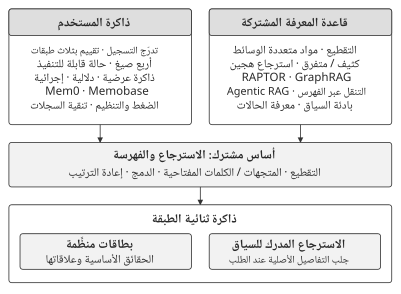

## نظام ذاكرة المستخدم

لنتأمل عبارة «سأكون خارج البلاد الأسبوع القادم، فأرسلوا مستندات البنك بالبريد الإلكتروني». ذكر المستخدم رحلة محددة المدة، وحدد خلالها طريقة استلام المستندات. فإذا طلب البنك إرسال المستندات بالبريد العادي، أمكن للمساعد أن يطلب تسليمها إلكترونيًا استنادًا إلى هذه العبارة؛ أما بعد انتهاء الرحلة، فإذا عاد الحديث إلى إرسال الرسائل، وجب النظر في الظروف القائمة حينها. ولو اكتفى النظام بحفظ «المستخدم لا يحب الرسائل الورقية»، لاسترجع هذه الذكرى لاحقًا لكنه طبّقها في غير نطاقها.

ولننظر في مثال تذاكر الطيران. إذا قال المستخدم «تلك التذكرة بـ 1250 في المرة الماضية كانت أغلى مما توقعت»، استطاع النظام على الأقل أن يحفظ عرض السعر ذاك، والميزانية حينها، وسياق السفر، وهذا التعليق. وحين يتكرر موقف مشابه، يتعامل النموذج بحذر أكبر مع العروض التي تتجاوز الميزانية. وإذا أضاف المستخدم صراحةً «في رحلات العائلة من الآن فصاعدًا اسألني أولًا»، فقد وضع شرطًا واضحًا للاستفسار في رحلات العائلة المقبلة. ومن هنا يمكن التمييز بين ثلاثة أنواع من المعلومات: ما قاله المستخدم فعلًا، والظروف التي قاله فيها، وما استنتجه النموذج من هذه التجربة.

ويمكن عند انتهاء الجلسة أن يُطلب من النموذج اللغوي الكبير (LLM) ترتيب هذه السجلات، وكتابة الحقائق ذات القيمة اللاحقة في مخزن دائم. وعند بدء مهمة جديدة، لا يُدخَل إلى السياق إلا ما يتصل بها وما يزال ساريًا.

فمثلًا، قدّم المستخدم المعلومات الآتية أثناء حجز رحلة طيران:

```text
User: Help me book a flight to Tokyo next Friday. I prefer window seats
      and I'm vegetarian, so I'll need a special meal.
Agent: I'll search for flights to Tokyo for next Friday...
       [calls flight_search tool, returns 3 options]
Agent: Here are your options. Based on your preference, I've filtered for
       window seat availability. Shall I book the ANA direct flight?
User: Yes, and use my United MileagePlus number 12345678.
```

وبعد انتهاء الجلسة، يستطيع مستخرِج الذاكرة أن يرتّب منها أربعة سجلات:

```text
Extracted memories:
- User prefers window seats (preference)
- User is vegetarian, needs special meals on flights (dietary restriction)
- User's United MileagePlus number: 12345678 (loyalty program)
- User has travel plans to Tokyo (recent activity)
```

ينطوي هذا المثال على ثلاث عمليات. **الاستخراج الانتقائي** يحتفظ بتفضيل المقعد ومتطلبات الطعام ورقم العضوية، ويستبعد التفاصيل العابرة مثل «أعاد البحث ثلاثة خيارات». و**التجريد** يحوّل تفضيل النافذة الذي عبّر عنه المستخدم صراحةً إلى قاعدة تنفع في الحجوزات اللاحقة. و**الهيكلة** تصنّف الحقائق في فئات تسهّل استرجاعها وتحديثها. وينبغي أن تُسجَّل لرحلة طوكيو أيضًا تاريخ المغادرة وحالتها الراهنة؛ فعبارة «الجمعة القادمة» يجب تحويلها إلى تاريخ بالرجوع إلى تاريخ الجلسة، وتُحدَّث الحالة بعد انتهاء الرحلة أو إلغائها. بهذا تُدار التفضيلات الدائمة والأنشطة القريبة كلٌّ بحسب مدة صلاحيته.

وتضرب وثائق المساعد الشخصي Today مثالًا على ذلك. يذكر المستخدم أنه يتدرب كل ثلاثاء وخميس استعدادًا لنصف ماراثون. وبعد ستة أسابيع، تُظهر بيانات النوم التي رُبطت بإذن من المستخدم أنه نام قليلًا جدًا في الليلة الماضية. فيجمع المساعد المعلومتين ويقترح نقل تمرين الفترات عالي الشدة المقرر في ذلك اليوم. فإلى متى يجب تذكّر كل منهما؟ خطة التدريب تنفع طوال فترة الاستعداد للسباق، أما سجل نوم الليلة الماضية فيجب أن يُحفظ مقرونًا بتاريخه. وحتى لو قبل المستخدم تأجيل هذه المرة، يبقى تمرين الخميس القادم على موعده الأصلي، ما لم يقل المستخدم إنه يريد التغيير من الآن فصاعدًا. ويفصل Today كذلك بين تقديم الاقتراح وتعديل التقويم في خطوتين، وتحتاج الخطوة الثانية إلى تأكيد المستخدم.[^ch3-today]

[^ch3-today]: يشرح فريق Today في «What Is Today» كيف تتكامل الذاكرة مع معلومات اليوم من خلال مثال التدريب على نصف الماراثون. ويشرح المؤسس في «Meet Today» آلية التأكيد التي تسبق تعديل التقويم.

### تقييم قدرات الذاكرة: إطار من ثلاثة مستويات

يضم المعيار العام **LoCoMo** (Long-term Conversational Memory، ذاكرة المحادثة طويلة المدى) محادثات طويلة يبلغ متوسطها نحو 300 جولة وتمتد حتى 35 جلسة، ويقيس قدرات الذاكرة عبر الإجابة عن الأسئلة وتلخيص الأحداث وتوليد الحوار متعدد الوسائط. وتنقسم الأسئلة إلى خمسة أنواع. فأسئلة القفزة الواحدة تجد إجابتها في جلسة واحدة، وأسئلة القفزات المتعددة تتطلب جمع خيوط من عدة جلسات، وأسئلة الاستدلال الزمني تتطلب فوق ذلك معرفة ترتيب وقوع الأحداث. أما أسئلة المعرفة المفتوحة فتتطلب ربط ما قاله المستخدم بمعرفة خارجية. وبالعودة إلى مثال الحجز، إذا لم يقل المستخدم إلا «سأذهب إلى طوكيو الأسبوع القادم»، فإن الإجابة عن سؤال «ما العملة المستخدمة في الوجهة؟» تتطلب تذكّر خيط طوكيو ومعرفة أن عملتها الين. وإذا سُئل عن رقم رحلة لم يذكره المستخدم قط، فعلى المساعد أن يبيّن أن المعلومات غير كافية. والقدرة على تمييز هذه الأسئلة التي لا سبيل إلى الإجابة عنها هي بالضبط ما تختبره الأسئلة العدائية.[^ch3-locomo]

[^ch3-locomo]: يعرّف القسم 4.1 من ورقة LoCoMo التي أعدّها Maharana وزملاؤه (arXiv:2402.17753) الأنواع الخمسة من الأسئلة. وتوفّر صفحة المشروع لدى المؤلفين البيانات وأمثلة من المحادثات.

وبالجمع بين هذه المعايير وتجارب منتجات الذاكرة، يلخّص المؤلف القدرات التي تستحق الاهتمام في ثماني قدرات:

- **الاحتفاظ بالمعلومات الشخصية**: حفظ المعلومات طويلة الأمد، كهوية المستخدم، واسترجاعها بدقة.
- **تتبّع التفضيلات**: تسجيل تفضيلات المستخدم وتحديثها كلما عبّر عنها من جديد صراحةً.
- **تبديل السياق**: مواصلة الخلفية ذات الصلة بعد الانتقال إلى موضوع آخر.
- **تحديث الذاكرة**: معالجة ما يضيفه المستخدم إلى الحقائق القائمة وما يصحّحه منها.
- **الاستمرارية عبر الجلسات**: استخدام المعلومات المحفوظة سابقًا في جلسة جديدة.
- **التفكير المركّب**: الربط بين عدة أجزاء من الذاكرة. فإذا ذكر المستخدم من قبل أن لديه حساسية من الفول السوداني، وجب استحضار ذلك عند الحديث عن المطبخ التايلاندي والتذكير بالتحقق من المكونات.
- **الوعي الزمني**: حفظ التواريخ، وتفسير الأزمنة النسبية، وحساب الفترات بين الأحداث.
- **حل التعارضات**: اكتشاف المعلومات غير المتسقة، والحكم بينها بالنظر إلى مصدرها وزمنها والجهة التي تنطبق عليها.

وانطلاقًا من المهام الفعلية للوكيل، يعتمد هذا الكتاب إطار تقييم من ثلاثة مستويات. تستخدمه التجربتان 3-1 و3-2 أولًا للمقارنة بين طرق تمثيل الذاكرة، ثم تستخدم التجربتان 3-9 و3-11 الإطار نفسه لتقييم أساليب الاسترجاع.

**المستوى الأول: الاستدعاء الأساسي.** حفظ المعلومات التي يقدّمها المستخدم مباشرةً بمعنى واضح، واسترجاعها بدقة. فإذا قال المستخدم «رقم عضويتي 12345»، وجب أن يُستعاد الرقم كاملًا عند حجز لاحق. ويختبر هذا المستوى أساسًا ما إذا كانت الحقائق تضيع أو تختلط أو تُحرَّف.

**المستوى الثاني: الاسترجاع عبر الجلسات.** جمع كل المعلومات ذات الصلة من جلسات تعود إلى فترات مختلفة وتتعلق بأطراف مختلفة، ثم تحديد من يعنيه الطلب الحالي وما السجلات التي يحتاجها. فالمستخدم الذي يملك سيارتين ويقول «احجز موعد صيانة لسيارتي» يجب أن يسترجع النظام معلومات سيارتيه أولًا ثم يستوضح المقصودة منهما. وعند الاستعلام عن حالة قرض، يجب التمييز بين العقد النافذ وعروض الأسعار التي استُفسر عنها سابقًا. وعند إلغاء «رحلة لوس أنجلوس»، يجب ربط تذاكر الطيران وحجز الفندق وغيرهما برحلة واحدة.

**المستوى الثالث: الخدمة الاستباقية.** اكتشاف الأمور المتصلة بالمهمة الحالية التي لم يذكرها المستخدم بندًا بندًا. فعند حجز رحلة دولية، يُستحضر جواز السفر المحفوظ قبل أشهر ويُتحقق من أن صلاحيته تفي بمتطلبات الرحلة؛ وعند تلف الهاتف، يُجمع ضمان الجهاز والضمان الإضافي لبطاقة الائتمان وتأمين شركة الاتصالات وتُعرض الحلول المتاحة؛ وعند إعداد الإقرار الضريبي، تُجمع من سجلات العام كله مستندات صفقات الأسهم ودخل العمل الحر وضريبة العقار.

> **التجربة 3-1 ★: تقييم نظام الذاكرة بالإطار ثلاثي المستويات**
>
> تضم مجموعة التقييم 20 حالة لكل مستوى، أي 60 حالة إجمالًا. حالات المستوى الأول في معظمها جلسة واحدة؛ أما حالات المستويين الثاني والثالث فتضم عدة جلسات تمتد عبر أوقات وأطراف مختلفة، لاختبار ربط الكيانات وتحديث المعلومات والتذكير الاستباقي.
>
> تُنفَّذ كل حالة على خطوتين. أولًا تُدخَل الجلسات واحدةً تلو الأخرى: يولّد النموذج الذاكرة من الجلسة الأولى، ثم لا يتلقى في كل مرة لاحقة إلا الذاكرة القائمة والجلسة الجديدة، فيولّد الذاكرة المحدَّثة. ومن هنا لا يعود النموذج قادرًا على قراءة نص الجلسات السابقة، فإذا أراد الإجابة عن شيء نوقش حينها لم يكن أمامه إلا ما كُتب في الذاكرة. وبعد معالجة كل الجلسات، يُطرح سؤال جديد ويُطلب من الوكيل الإجابة عنه استنادًا إلى الذاكرة.
>
> يعتمد التقييم أسلوب LLM-as-a-judge: يقارن نموذج تحكيم مستقل الإجابة بالإجابة المرجعية ومعايير التقييم، ويفحص الحقائق التي غطتها والأخطاء الواردة فيها. استُخدم في هذا التشغيل Doubao Seed 1.6 لتوليد الذاكرة والإجابات، ونموذج من Moonshot للتحكيم. ويرى المحكّم المحادثات الأصلية، بينما لا يرى النموذج المجيب إلا الذاكرة التي بقيت في النهاية.
>
> كيف تُقرأ بطاقة النتائج؟ لنفترض أن المستخدم يريد فقط استعادة رقم حساب خدمة الإنترنت المنزلي. في مجموعة الملاحظات المحسّنة، أعطى المساعد الرقم الصحيح، فمنحه المحكّم 4 درجات في الدقة والاستدعاء والاستدلال، ودرجة واحدة فقط في المبادرة، ومع ذلك اجتازت الحالة الاختبار. فشرط الاجتياز في البرنامج أن تنال كل واحدة من البنود الثلاثة الأولى 3 درجات على الأقل (من 4)، وألا يجد المحكّم حقيقة مهمة بلا سند أو مناقضة لكلام المستخدم. أما المبادرة فتدخل في الدرجة المركّبة، ولا يكشف عدد الحالات الناجحة وحده إلى أي حد بادر المساعد بتقديم العون.

### البنية الهرمية للذاكرة

للإجابة عن «أي رحلة حجزتُ في المرة الماضية؟» يجب العثور على حدث واحد؛ وللإجابة عن «أي مقعد أفضّل عند الحجز؟» يجب استرجاع تفضيل تراكم عبر تفاعلات عديدة. يتعلق السؤالان بالشخص نفسه، لكنهما يتطلبان دقة تسجيل وطريقة استرجاع مختلفتين.

**المسار (trajectory)** يسجّل أحداث تشغيل واحد للوكيل بترتيبها الزمني، بما فيها رسائل المستخدم وردود النموذج واستدعاءات الأدوات ونتائج تنفيذها. وعند اعتماد سجل أحداث يقبل الإلحاق فقط (append-only)، تُضاف الأحداث الجديدة إلى نهايته وتبقى السجلات الأصلية محفوظة للتتبّع. ويستطيع Harness أن ينتقي من المسار جزءًا من التاريخ، أو يستخرج منه الحالة، أو يولّد ملخصًا، ليبني السياق الذي يُرسل فعليًا إلى النموذج في كل جولة.

**ذاكرة المستخدم طويلة المدى** تحفظ المعلومات النافعة عبر الجلسات، كالتفضيلات والعلاقات بين الأشخاص وملخصات الأنشطة السابقة والحقائق المؤكدة، وتُحدَّد ملكيتها بمعرّف المستخدم ونحوه. وقد يُكمل تعبير جديد سجلًا قديمًا أو يصحّحه أو يحلّ محله، ولذلك تحتاج الذاكرة طويلة المدى إلى الدمج والتحديث. ويمكن أن تتم القراءة والصيانة باستدعاء صريح من الوكيل لأداة ما، أو أن يطلقها Harness عند تحميل الجلسة أو انتهائها أو أثناء الترتيب في الخلفية.

**حالة الأعمال** تصف المرحلة المنطقية التي بلغتها المهمة، مثل «يحتاج إلى توضيح» و«قيد المعالجة» و«بانتظار الدفع» و«مكتمل». ويستطيع البرنامج فحص هذه الحالات ليقرر أي حدث ينتظر بعد ذلك وأي إجراء ينفّذ. وسيتناول الفصل السادس إدارة الحالة في البنية القائمة على الأحداث بمزيد من التفصيل.

تتعاون هذه الأنواع الثلاثة من السجلات: يوفّر المسار أساس التنفيذ، وتوفّر الذاكرة طويلة المدى الخلفية الممتدة عبر الجلسات، وتبيّن حالة الأعمال المرحلة التي بلغتها المهمة الحالية. وسنركّز فيما يلي على تمثيل الذاكرة طويلة المدى وإدارتها واسترجاعها.

### أربعة أشكال لتخزين ذاكرة المستخدم

إذا كان المطلوب تعديل عنوان بريد إلكتروني فقط، فالأفضل أن يُعثر على ذلك البند مباشرةً؛ أما إذا أردنا معرفة سبب تغيير العنوان، فلا بد من قراءة مجرى الأحداث. يحفظ الجزء العلوي الأيسر من الشكل 3-2 البريد الإلكتروني والشركة والمنصب في بنود منفصلة، بينما يكتب الجزء العلوي الأيمن المنصب والفريق والمشروع معًا. ثم انظر إلى البطاقتين في الأسفل: إذا أردنا لاحقًا تحديث المنصب، أو تمييز من الذي زار طبيب القلب، فأي حقل نفحص في كل حالة؟

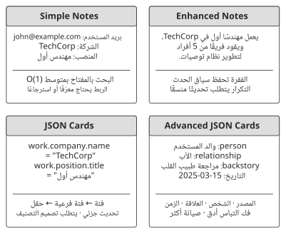

**Simple Notes** (الملاحظات البسيطة) تكتب كل ذكرى في صورة حقيقة قصيرة، مثل «بريد المستخدم: john@example.com». قراءة السجل الواحد وكتابته سهلة؛ وعند تحديد موضعه بمفتاح ثابت في جدول تجزئة، يكون متوسط التعقيد الزمني للبحث والتحديث عادةً O(1). أما البحث الدلالي في عدد كبير من الملاحظات فيتطلب بناء فهرس للاسترجاع. ويؤدي التقسيم المفرط كذلك إلى ضياع العلاقات: فعبارة «يعمل مهندسًا أول في TechCorp ومسؤولًا عن تطوير نظام التوصيات» إذا فُكّكت إلى ثلاثة سجلات منفصلة للشركة والمنصب والمشروع، لزم لاحقًا الحكم من جديد على ما إذا كانت تخص الوظيفة نفسها.

**Enhanced Notes** (الملاحظات المحسّنة) تحفظ الحقيقة وخلفيتها في فقرة كاملة، مثل: «يعمل المستخدم مهندس برمجيات أول في TechCorp، ويعمل في التعلم الآلي منذ ثلاث سنوات، ويقود حاليًا مشروعًا لنظام التوصيات بفريق من 5 أشخاص». فتبقى العلاقات بين الشركة والمنصب والخبرة والفريق محفوظة في فقرة واحدة. والثمن أن بعض الحقائق قد يتكرر في عدة فقرات؛ وإذا تغيّر المنصب، وجب العثور على كل الفقرات المتصلة به وتحديثها، تجنبًا لتعايش السجلات القديمة والجديدة.

**JSON Cards** (بطاقات JSON) تنظّم المعلومات وفق «الفئة ← الفئة الفرعية ← أزواج المفتاح والقيمة»، مثل `personal.contact.email` و`work.position.title`. وعند تعديل حقل المنصب يمكن الإبقاء على الحقول الأخرى مثل `work.company.name`، فهي تناسب التحديث الجزئي. وعند تصميم التصنيف ينبغي مراعاة المعلومات المتقاطعة: فعبارة «يطوّر مشاريع شخصية بلغة Python في عطلة نهاية الأسبوع» تتعلق في آن واحد بالوقت والتفضيل التقني والنشاط. ويمكن حفظها سجلَّ نشاط واحدًا مع عدة وسوم، أو ربط الفئات ذات الصلة بالإحالات، للحفاظ على هذه الصلات.

**Advanced JSON Cards** (بطاقات JSON المتقدمة) تضيف إلى الحقيقة خلفية مصدرها `backstory`، والشخص المعني `person`، وعلاقته بالمستخدم `relationship`، والطابع الزمني. وتساعد هذه الحقول النظام على معرفة لمن تعود المعلومة، ومتى عُرفت، وفي أي سياق تنطبق. فـ«الدكتور تشانغ» قد يكون طبيب أسنان المستخدم، وقد يكون طبيب القلب الذي يعالج والده؛ وحفظ الاسم مقرونًا بالمريض وصلة القرابة والتخصص يقلّل الالتباس.

وحين يقول المستخدم «رتّب الفحص السنوي لأفراد عائلتي»، يستطيع النظام تحديد أفراد العائلة عبر `person` و`relationship`، ثم قراءة التجارب ذات الصلة من `backstory`. وكلما ازدادت الحقول ثراءً، ازدادت العلاقات التي يجب التعامل معها عند الاستخراج والتحديث. ويوصي المؤلف بتخزين مختلط بحسب أهمية المعلومات وحاجتها إلى الربط: تُحفظ الشخصيات الرئيسية والعقود والتفضيلات الدائمة في Advanced JSON Cards مع الاحتفاظ بمصدرها وعلاقاتها، وتُحفظ الحقائق البسيطة الكثيرة قليلة الترابط في Simple Notes لخفض كلفة الاستخراج والصيانة. ويُربط النوعان بالمعرّفات أو الإحالات، فيُسترجعان معًا عند الحاجة.

> **التجربة 3-2 ★★: مقارنة بين أشكال الذاكرة الأربعة**
>
> يوفّر التنفيذ المرافق للأشكال الأربعة واجهة موحدة لتوليد الذاكرة وتحديثها واسترجاعها، ويقارن الإجابات النهائية على مجموعة الحالات الستين نفسها في التجربة 3-1.
>
> في هذا التشغيل، اجتازت Simple Notes وEnhanced Notes وJSON Cards وAdvanced JSON Cards على التوالي 48 و52 و51 و49 حالة. واجتازت Enhanced Notes في المستوى الثاني 16 حالة، وAdvanced JSON Cards ‏12 حالة؛ واجتاز كلاهما 19 حالة في المستوى الثالث. وباحتساب صيانة الذاكرة والإجابة والتحكيم، استهلكت Enhanced Notes نحو 990 ألف token، وAdvanced JSON Cards نحو 1.55 مليون token، وكان متوسط زمن استدعاءات النموذج في الأخيرة أطول أيضًا.
>
> لنأخذ سؤال اشتراكات البث في المستوى الثاني مثالًا. يريد المستخدم خفض نفقاته، فيسأل عن الخدمات التي يشترك فيها وكلفة كل منها. سردت مجموعة الملاحظات المحسّنة الرسوم الشهرية لـ Netflix وDisney+‎ وMax، وهي على التوالي 22.99 و19.99 و19.99 دولارًا. أما مجموعة بطاقات JSON المتقدمة فلم تذكر إلا سعر Max، وأضافت باقتين أرخص من Max. ومهما كانت النصيحة دقيقة، فإنها لا تعوّض الفاتورتين الأخريين.
>
> من أي تحديث بدأت المشكلة؟ بمراجعة الذاكرة التي حفظتها مجموعة البطاقات المتقدمة بعد كل جلسة، كانت Netflix ما تزال موجودة بعد الجلسة الأولى، ولم يبقَ بعد الجلسة الثانية إلا ما يتعلق بـ Disney+‎، ولم يبقَ بعد الجلسة الثالثة إلا Max. وحين طُرح السؤال، كان الاشتراكان الأولان قد اختفيا من الذاكرة.
### شكل متقدم لتمثيل المعرفة: الشفرة القابلة للتنفيذ

بعد حفظ الحقائق، تبقى الحاجة إلى تجميع الإحصاءات وفحص التعارضات وتحديد الخطوة التالية وفق قواعد العمل. وقد جرّب المؤلف في **User as Code** (UaC) تنظيم معلومات المستخدم في كائنات Python ذات أنواع محددة، وكتابة هذه العمليات في صورة دوال[^uac]. يستخرج النموذج الحقائق من المحادثة، وينفّذ البرنامج الحسابات المعرّفة بوضوح.

وفي مقارنة التواريخ وجمع المبالغ والقيود الصريحة لقواعد العمل، يفضّل المؤلف كتابة الحساب في دالة، لتعطي المجموعة نفسها من الحقائق نتائج قابلة للتكرار والاختبار. وبذلك يتفرغ النموذج لفهم المعنى، ويخف عنه عبء الحساب الذهني المتكرر ومراجعة القواعد في المحادثات الطويلة؛ كما يصبح فحص تمثيل الذاكرة واستخدامها ممكنًا في الشفرة نفسها.

يعتمد UaC مسارًا من مرحلتين: تُلحق الحقائق المستخرجة أولًا بسجل، ثم تُنشأ نقاط تحقق دورية يُعاد فيها بناء الحالة ذات الأنواع المحددة من السجل. يحتفظ السجل بمصدر الحقائق ومراحل تغيّرها، وتوفّر كائنات الحالة الحقول القابلة للاستعلام في الوقت الحاضر.

ولنأخذ جواز السفر وخطط السفر مثالًا، إذ يمكن تعريف الحالة على النحو الآتي:

```python
from dataclasses import dataclass
from datetime import date

@dataclass
class PassportInfo:
    number: str
    country: str
    expiry_date: date

@dataclass
class Trip:
    destination: str
    departure_date: date
    is_international: bool

@dataclass
class UserState:
    passport: PassportInfo
    trips: list[Trip]

state = UserState(
    passport=PassportInfo("AB1234567", "US", date(2025, 2, 18)),
    trips=[
        Trip("Tokyo", date(2025, 1, 15), True),
        Trip("Paris", date(2025, 6, 10), True),
    ],
)
```

**التجميع الإحصائي** يمرّ على السجلات مباشرةً. فمثلًا، لحساب عدد الرحلات الدولية المسجلة في عام 2025:

```python
count = sum(
    1 for trip in state.trips
    if trip.is_international and trip.departure_date.year == 2025
)
# count == 2
```

**فحص التعارض** يقارن مجموعتين من الحقول وفق قواعد محددة مسبقًا. ونأخذ فيما يلي مطابقة فئات الأدوية مثالًا، لنبيّن كيف تُرسل البنود التي تحتاج إلى مراجعة إضافية إلى طابور المعالجة:

```python
def find_allergy_matches(profile):
    matches = []
    for medication in profile.current_medications:
        for allergy in profile.allergies:
            if medication.drug_class == allergy.drug_class:
                matches.append((medication, allergy))
    return matches
```

تحتفظ كل مطابقة بسجل الدواء وسجل الحساسية المقابلين لها، فتستطيع المراحل اللاحقة مراجعتها استنادًا إليهما، ثم تقرر وفق قواعد المجال ما إذا كانت ستنبّه المستخدم أو تحيل الأمر إلى المراجعة أو تطلب معلومات إضافية.

**فحص القيود** يمكن أن يعمل تلقائيًا مع كل تحديث للحالة. فإذا اشترطت إحدى قواعد السفر أن تبقى لجواز السفر صلاحية 180 يومًا على الأقل عند المغادرة، أمكن تمرير عدد الأيام وسيطًا:

```python
def passport_alerts(state, required_days):
    alerts = []
    for trip in state.trips:
        if trip.is_international:
            days = (state.passport.expiry_date - trip.departure_date).days
            if days < required_days:
                alerts.append((trip.destination, days))
    return alerts

alerts = passport_alerts(state, required_days=180)
```

وبحساب الأيام الـ 180 في المثال، لا يبقى من صلاحية الجواز عند السفر إلى طوكيو إلا 34 يومًا، أما يوم المغادرة إلى باريس فيكون قد انتهت صلاحيته. وبعد أن يجدد المستخدم جوازه، يستطيع البرنامج إعادة حساب الرحلتين بالتاريخ الجديد.

[^uac]: Li, Bojie، User as Code: Executable Memory for Personalized Agents، 2026.

### الأسس المعرفية لذاكرة المستخدم

يميّز علم الإدراك بين أنواع مختلفة من الذاكرة بحسب محتواها وطريقة استخدامها. ويمكن لهذه المفاهيم أن تساعدنا أيضًا في تنظيم المعلومات طويلة المدى لدى الوكيل:

- **الذاكرة العرضية (episodic memory)** تحفظ أحداثًا بعينها مع زمنها والمشاركين فيها ومجرياتها. مثالها لدى الإنسان «تناولت العشاء مع زملائي في مطعم إيطالي يوم الأربعاء الماضي»؛ ويقابلها لدى الوكيل «يخطط المستخدم للسفر إلى طوكيو على رحلة ANA يوم الجمعة القادم»، مع تسجيل ما إذا نجح الحجز لاحقًا أو جرى تغيير موعده.
- **الذاكرة الدلالية (semantic memory)** تحفظ الحقائق والمفاهيم. مثالها لدى الإنسان «عاصمة إيطاليا روما»؛ ويقابلها لدى الوكيل «المستخدم نباتي» و«المستخدم يفضّل المقعد المجاور للنافذة». وقد تأتي هذه المعلومات من تصريح المستخدم، وقد تُستخلص من تجارب متعددة؛ وتسجيل المصدر يساعد على التمييز بين الحالتين.
- **الذاكرة الإجرائية (procedural memory)** تتعلق بالمهارات وتسلسل السلوك. مثالها لدى الإنسان ركوب الدراجة؛ ويمكن تشبيهها في هندسة الوكلاء بالإجراءات القابلة لإعادة الاستخدام، مثل «البحث عن رحلات مباشرة ← تأكيد تفضيل المقعد ← استخدام رقم المسافر الدائم ← طلب الوجبة».

ولنعد إلى سجل التسوق في الفصل الأول: عبارة «تصفّحت عشرة منتجات ثم اشترت واحدًا منها» تكفي لتسجيل حدث شراء واحد، لكنها لا تكفي للحكم على ما ستفضّله المستخدمة مستقبلًا. فربما أعجبها هذا الطراز، وربما اختارته فقط لأنه يصل في اليوم نفسه. فإذا قالت بعد ذلك «في هذا النوع من المشتريات، تحقق أولًا مما إذا كان التوصيل في اليوم نفسه ممكنًا»، أصبح لدينا تفضيل دائم له نطاق انطباق محدد. وعند التوصية بمنتجات مماثلة في المرة القادمة، يمكن البدء بفحص موعد التوصيل، كما يمكن أن يُشرح لها أن شرط التصفية هذا جاء من ملاحظتها تلك.

يضع الجدول 3-1 هذا التصنيف إلى جانب مستويات الذاكرة وأشكال التخزين السابقة، ويبيّن السؤال الذي يجيب عنه كل منها.

الجدول 3-1 ثلاثة جوانب لتصميم الذاكرة

| جانب التصميم | السؤال الذي يجيب عنه | الفئات |
| --- | --- | --- |
| مستوى السجل | ما الدور الذي تؤديه المعلومة؟ | المسار، ذاكرة المستخدم طويلة المدى، حالة الأعمال |
| شكل التخزين | بأي بنية تُمثَّل؟ | Simple Notes، Enhanced Notes، JSON Cards، Advanced JSON Cards |
| محتوى الذاكرة | أي نوع من المعلومات يُحفظ؟ | الذاكرة العرضية، الذاكرة الدلالية، الذاكرة الإجرائية |

فعبارة «المستخدم يفضّل المقعد المجاور للنافذة» مثلًا من الذاكرة الدلالية، ويمكن حفظها في الذاكرة طويلة المدى بصيغة Simple Notes؛ أما إجراء الحجز الكامل فمن الذاكرة الإجرائية، ويمكن حفظه في بطاقة تتضمن مصدره وشروط انطباقه.

### أمثلة من أطر الذاكرة

يقول المستخدم «صرت أفضّل المقعد المجاور للممر مؤخرًا»، بينما يرد في السجل القديم «يحب المقعد المجاور للنافذة». يستطيع النظام تحديث تفضيل المقعد عند الكتابة، ويستطيع كذلك حفظ التعبيرين معًا ثم الحكم عند الحجز القادم بأيهما ينطبق. وسننظر أولًا في المرحلة التي يعالج فيها Mem0 هذا النوع من التعارض، ثم في طريقة Memobase في تسجيل صورة المستخدم والأحداث المحددة كلٌّ على حدة.

**Mem0: نقل موضع معالجة التعارض.** يقارن المسار الوارد في ورقة 2025 وفي الإصدار v2 بين الحقائق القديمة والجديدة عند الكتابة، أما الإصدار اللاحق v3 فيعتمد إلحاق الحقائق والاسترجاع الهجين. ويقارن الشكل 3-3 بين هذين الترتيبين.

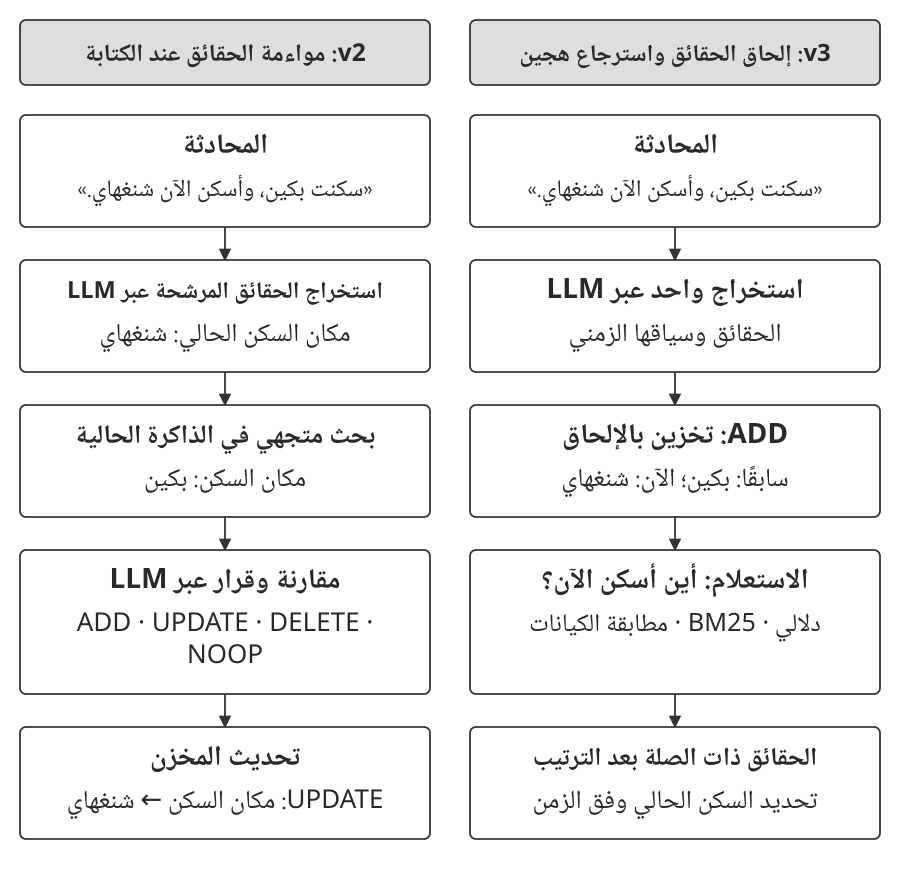

في المسار المبكر، يستخرج النموذج اللغوي الكبير أولًا الحقائق المرشحة من المحادثة، ثم يسترجع الذكريات القائمة القريبة منها، ويقرر تنفيذ **ADD** أو **UPDATE** أو **DELETE** أو **NOOP**. فإذا قال المستخدم أولًا «أسكن في بكين» ثم قال لاحقًا «انتقلت إلى شنغهاي»، أمكن للنظام تحديث مكان السكن الحالي إلى شنغهاي. وبهذا يسهل عند الاستعلام الحصول على حقائق مرتبة؛ أما عند الصيانة فيجب التعرف بدقة على التصحيحات والتغيرات الزمنية واختلاف الأشخاص المعنيين، وحفظ أساس كل تحديث للرجوع إليه إذا اكتُشف خطأ. واقترحت الورقة أيضًا صيغة للذاكرة البيانية باسم **Mem0-g**، تعبّر عن المعرفة المترابطة بالكيانات والعلاقات[^ch3-mem0-paper].

جعل الإصدار v3 الاستخراج التلقائي استدعاءً واحدًا للنموذج اللغوي الكبير، لا يُلحق إلا سجلات **ADD**. فيمكن الإبقاء على معلومتي بكين وشنغهاي مع خلفيتهما الزمنية، ثم يُحكم عند الاستعلام بالاستعانة بالسياق على مكان السكن الحالي. ويجمع الاسترجاع بين التشابه الدلالي وكلمات BM25 المفتاحية ومطابقة الكيانات؛ ويمكن كذلك استخراج الإجراءات التي تأكد إنجازها في صورة حقائق. ويذكر دليل الترحيل أن نتيجة LoCoMo ارتفعت من 71.4 إلى 91.6، ونتيجة LongMemEval من 67.8 إلى 93.4. ويستخدم هذا الإصدار مفتوح المصدر ربط الكيانات في الاسترجاع الداخلي، وقد أزال واجهة التخزين البياني الخارجي وقيمة الإرجاع `relations`؛ أما الذاكرة البيانية فتوفّرها المنصة المستضافة[^ch3-mem0-migration].

يُظهر هذا التطور أن نظام الذاكرة يستطيع نقل الحكم في التعارضات من مرحلة الكتابة إلى مرحلة القراءة. فإذا دمج النظام عند الكتابة تجربتي شخصين خطأً، أو عدّ معلومة إضافية تصحيحًا، فقد تظل الإجابات اللاحقة تعتمد على حالة حالية خاطئة. أما الحفظ بالإلحاق فيتيح للأدلة القديمة والجديدة أن تشارك في الحكم، ويقلّل استدعاءات النموذج التي تتطلبها القرارات المتتالية عند الكتابة. وفي ذاكرة المستخدم التي تتغير كثيرًا ويصعب الحكم على تعارضاتها في حينها، يميل المؤلف إلى حفظ الحقائق مع زمنها ومصدرها أولًا، ثم استخلاص الحالة السارية عند الإجابة عن سؤال بعينه.

[^ch3-mem0-paper]: Chhikara وآخرون، Mem0: Building Production-Ready AI Agents with Scalable Long-Term Memory، 2025.

[^ch3-mem0-migration]: Mem0، Open Source: Migrating to the New Memory Algorithm.

**Memobase: صورة المستخدم وذاكرة الأحداث.** ينظّم Memobase المعلومات طويلة المدى في جزأين. **صورة المستخدم (profile)** تحفظ السمات الأكثر ثباتًا مصنفة في موضوعات وموضوعات فرعية، مثل الاسم تحت `basic_info`، والاهتمامات تحت `interest`، والمنصب تحت `work`. ويستطيع المطوّر تهيئة الخانات المطلوب استخراجها، فيتحكم في نطاق الصورة ودقة تفاصيلها. و**ذاكرة الأحداث (event memory)** تسجّل تجارب المستخدم مع أزمنتها، ليتمكن النظام من الإجابة عن أسئلة مثل «متى ناقشنا الميزانية آخر مرة؟».

يضع Memobase المحادثات الجديدة أولًا في مخزن مؤقت، ويعالجها دفعةً واحدة حين يبلغ المخزن حجمًا محددًا، أو حين تبقى الجلسة خاملة مدة معينة، ويمكن كذلك تشغيل المعالجة صراحةً عند انتهاء الجلسة. فتشترك رسائل متعددة في عملية ترتيب واحدة، ويقرأ الاستعلام الصورة والأحداث المولّدة مسبقًا. ويقلّل التحديث غير المتزامن وقت انتظار التفاعل الحالي لاستخراج الذاكرة؛ وإذا احتيج إلى استخدام أحدث الحقائق فورًا، أمكن انتظار اكتمال المعالجة الجارية[^ch3-memobase].

[^ch3-memobase]: Memobase، الوصف الرسمي للمشروع، ويشمل حقول الصورة وذاكرة الأحداث والمخزن المؤقت وواجهة التحديث المتزامن.

وإذا كان على المساعد أن يتذكر مجريات الحجز السابق، وأن يعرف في الوقت نفسه تفضيل المستخدم للمقاعد وإجراءات استرداد التذاكر، فيمكنه أن يحفظ الأحداث والحقائق والإجراءات كلًّا على حدة كما في الشكل 3-4. ثم يضع في الذاكرة العاملة عند كل مهمة ما يحتاجه منها.

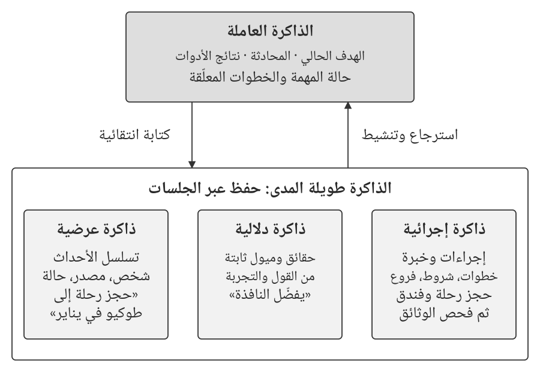

تحتفظ الذاكرة العرضية بتسلسلات الأحداث مع بيانات وصفية مثل الطوابع الزمنية والعلامات الانفعالية ومعرّفات المهام، ويمكنها الجمع بين الاسترجاع بالزمن والاسترجاع بالموضوع. فعبارة «آخر مرة ناقشنا الميزانية» مثلًا تحتاج إلى مطابقة الموضوع وترتيب زمني معًا. وتحفظ الذاكرة الدلالية الحقائق والتفضيلات المستخرجة من الأحداث، وتحفظ الذاكرة الإجرائية الإجراءات المتكررة الاستخدام.

**الذاكرة العاملة (working memory)** تنظّم الهدف الحالي وحالة المهمة والمعلومات ذات الصلة التي استُرجعت. ينتقي Harness محتواها من المسار ومن المخزن طويل المدى ويحمّله في السياق الحالي؛ أما الحقائق الجديدة التي تنتج عن المهمة فتُرتَّب ثم تُكتب في الذاكرة طويلة المدى. يسجّل المسار كيف جرت الأمور، وتركّز الذاكرة العاملة المعلومات اللازمة للقرار التالي، ويرتبط الاثنان بمعرّفات الأحداث ومصادرها.

وعند قراءة ذاكرة المستخدم باستخدام RAG، يُعثر أولًا بحسب الطلب الحالي على مجموعة من الذكريات المحتمل ارتباطها به، ثم يُقرَّر ما يدخل منها الذاكرة العاملة. لنفترض أن المساعد يساعد المستخدم اليوم على اختيار مقعد، فوجد الاسترجاع عبارتين: «في رحلات العمل أحب المقعد المجاور للنافذة»، و«أصيبت ركبتي في المرة الماضية، فاختر لي مقعدًا بجوار الممر في رحلة العودة». كلتاهما وثيقة الصلة باختيار المقعد، لكن الثانية لم تضع شرطًا إلا لرحلة العودة تلك. وإعادة الترتيب بحسب الصلة، حتى لو وضعتها في المرتبة الأولى، لا تجيب عن سؤال ما إذا كانت تنطبق اليوم.

في هذه الحالة، يرى المؤلف أن استخدام نموذج حكم من قبيل Jev لتصفية الذكريات المرشحة أجدى. فتُقدَّم إليه الرحلة الحالية وطلب المستخدم الراهن، ومع كل ذكرى نصها الأصلي وتاريخها وشروط انطباقها، ليحكم على كل منها بأنها «تنطبق هذه المرة» أو «للاستئناس فقط» أو «أساسها غير كافٍ». فإذا كانت رحلة اليوم رحلة عمل أيضًا، أمكن اعتماد الأولى أساسًا لاختيار المقعد؛ وإذا كان المستخدم قد قال للتو إن ركبته لم تُشفَ بعد، فالثانية جديرة بأن يُسأل عنها.

### آليات ضغط الذاكرة وترتيبها

قد يذكر مستخدم يحجز تذاكر الطيران كثيرًا كلمة «النافذة» عشر مرات. ولعل تسعًا منها تكرار لحديث عن حجز واحد؛ فإذا عُدّ عدد مرات الذكر مقياسًا مباشرًا لقوة التفضيل، تضخّم وزن حادثة واحدة. لذلك يُبدأ عند الترتيب بتمييز المصدر والحدث، ثم تُدمج السجلات المكررة، ويُفحص ما إذا كان هناك تصحيح أحدث، وفي النهاية فقط يُقرَّر أي الأنماط صالح للاستخدام في المهام المقبلة. فإذا ورد قول مثل «كان ذلك المقعد المجاور للنافذة في المرة الماضية جيدًا»، أمكن تكليف نموذج حكم من قبيل Jev بقراءة هذه العبارة والحجز المتصل بها، ليحكم فقط على ما إذا كانت «استرجاعًا للرحلة السابقة» أو «طلبًا لهذه المرة» أو «تعبيرًا عن تفضيل دائم». وإذا لم يُعثر على حجز مطابق، أو احتملت العبارة أكثر من تفسير معقول، حُفظ النص الأصلي إلى أن يُتحقق منه عند الحجز. وبحكم موضعي كهذا يمكن تجنب احتساب التجربة نفسها مرارًا على أنها دليل جديد.

1. **انتقاء ما يحتاج إلى ترتيب.** يمكن اتخاذ تكرار الوصول وزمن التسجيل والعلامات الانفعالية وتفرّد المعلومة إشاراتٍ للترتيب. فالسجل الذي أُنشئ قبل ثلاثة أيام، ووُصل إليه خمس مرات، وعلامته الانفعالية قوية ولا تكرار له، أجدر بأن يُحفظ مستقلًا؛ أما السجل الذي أُنشئ قبل تسعين يومًا، ولم يُوصل إليه إلا مرة واحدة، وهو شديد التكرار مع ثلاثة سجلات أخرى، فيمكن تقديمه للدمج مع السجلات المتصلة به. ويستطيع النظام أن ينتقي أولًا بالدرجات السجلات التي تحتاج إلى ترتيب، ثم يقرر وفق قواعد العمل ضغطها أو دمجها أو حذفها. أما القيود الدائمة والعقود النافذة فيجب الإبقاء عليها حتى نهاية مدة سريانها، حتى لو قلّ الوصول إليها.
2. **التجميع وتوليد الملخصات.** تُجمع السجلات المتشابهة في مجموعات، ويُحتفظ بمحتواها المشترك في ملخص واحد. فمحادثات الطقس المتكررة مثلًا يمكن تلخيصها في «يسأل المستخدم عن الطقس كثيرًا، ويهتم خاصةً بالأمطار». وتُؤرشف التواريخ المحددة والاستفسارات الأصلية، ويُربط الملخص بالسجلات الأصلية لتسهيل الرجوع إليها لاحقًا.
3. **استخلاص الأنماط والإجراءات.** يُستخلص من سجلات تسوق متعددة نمط مثل «يفضّل المنتجات ذات القيمة الجيدة مقابل السعر، ويهتم بتقييمات المستخدمين»، أو تُستخلص خطوات اختيار المنتجات.

### حماية الخصوصية: إخفاء البيانات الحساسة في السجلات

كثيرًا ما تتضمن ذاكرة المستخدم بيانات الهوية ووسائل الاتصال ومعلومات الحسابات. وعلى النظام أن يحدد بحسب المهمة الحقول التي تدخل مُدخلات النموذج، وبحسب احتياجات التشغيل المحتوى الذي يدخل السجلات. ويمكن إخفاء البيانات الحساسة قبل كتابة السجل، باستبدال المقاطع الحساسة بوسوم تدل على نوعها أو بعناصر نائبة ثابتة، مع الإبقاء على البنية اللازمة لتشخيص المشكلات.

> **التجربة 3-3 ★★: إخفاء البيانات الحساسة في السجلات بنموذج محلي**
>
> تستدعي هذه التجربة النموذج المحلي Qwen3-0.6B عبر Ollama، للتعرف على المقاطع الحساسة في السجلات على الجهاز نفسه. يناسب النموذج الصغير النشر على أجهزة المستهلكين، ويمكن كذلك التبديل إلى أحجام مثل 1.7B و4B للمقارنة بين جودة التعرف وزمن المعالجة. وإذا وجب أن تبقى السجلات الأصلية محلية، فيجب أن يتم التعرف والاستبدال على الجهاز أيضًا، ثم تُسلَّم النتيجة المُخفاة إلى الخدمات اللاحقة.
>
> تشمل مواد الاختبار أرقامًا منظمة مثل أرقام الهوية الوطنية وأرقام البطاقات المصرفية، ومحتوى شبه منظم مثل العناوين، ومعلومات حساسة تتسرب في اللغة الطبيعية مثل كلمات المرور. يعيد النموذج وفق JSON Schema نوع المعلومة وموضعها في النص ودرجة الثقة، ويستبدل البرنامج النص الأصلي بناءً على ذلك. وتستخدم المجموعة الضابطة التعابير النمطية؛ أما المجموعة الهجينة فتطبّق مطابقة التعابير النمطية أولًا، ثم تترك للنموذج معالجة النص المتبقي.
>
> لننظر أولًا في سجلين. يحتوي الأول على رقم هوية ورقم هاتف محمول، فلم تُخفِ التعابير النمطية إلا رقم الهاتف، فكان الاستدعاء $1/2$. وفي الثاني، عثرت التعابير النمطية على رقم الضمان الاجتماعي الأمريكي ورقم البطاقة المصرفية كليهما، لكنها أخفت أيضًا رقم تذكرة دعم مشابهًا لهما في الصيغة. فمن المواضع الثلاثة التي حددتها، لم يكن يحتاج إلى الإخفاء إلا اثنان، فكانت الدقة $2/3$. ولو اقتصر الفحص على بقاء القيم الحساسة في السجل، لاجتاز السجل الثاني الاختبار؛ ولا يتبيّن ضياع الخيط إلا حين يستخدم موظف خدمة العملاء هذا السجل للبحث عن التذكرة.
>
> وبحساب الاستدعاء لكل سجل من العينات الاثنتي عشرة ثم أخذ المتوسط، بلغ نحو 50% للتعابير النمطية، و69% للنموذج، و78% للحل الهجين. وبعد الاستبدال وإحصاء كل سجل، تركت الحلول الثلاثة على التوالي 9 و3 و2 من القيم الحساسة. أما المفاضلة بينها فتتوقف أيضًا على زمن المعالجة: فعلى هذا الجهاز استغرقت التعابير النمطية نحو 0.1 ملّي ثانية للسجل في المتوسط، بينما اقترب كل من النموذج والحل الهجين من 3 ثوانٍ. وعندما تكثر السجلات، يمكن البدء بالتعابير النمطية للحقول ثابتة الصيغة، وترك النموذج لفحص المقاطع التي يتطلب الحكم عليها مراعاة السياق.

ومع تزايد السجلات، تصبح الخطوة التالية العثور من بين آلاف المعلومات على ما تحتاجه المهمة الحالية. وتقنية RAG التي نعرضها فيما يلي صالحة لقواعد المعرفة المشتركة ولاسترجاع ذاكرة المستخدم على حد سواء.
## أساسيات RAG: بناء مسار استحصال المعرفة للوكيل

عدّل متجر سياسة الاسترداد لديه، ثم جاء مستخدم يسأل: «اشتريت منتجًا في الشهر الماضي، فكيف أطلب استرداد ثمنه الآن؟». لكي تكون الإجابة صحيحة، يجب أولًا العثور على البنود التي تنطبق على هذا الطلب، ثم شرح الشروط والخطوات بوضوح. ويربط **التوليد المعزز بالاسترجاع** (Retrieval-Augmented Generation, RAG) هاتين الخطوتين، فيتيح للنموذج استخدام الوثائق الداخلية للمتجر، والسياسات التي لم تُنشر إلا بعد انتهاء تدريبه.

لنبدأ بحالة لا توجد فيها إلا نسخة واحدة من السياسة. نستعلم فيما يلي عن إجراءات الاسترداد في المتجر نفسه بواجهة مبسطة، ونلاحظ كيف تدخل نتائج الاسترجاع في إجابة النموذج:

```python
query = "退款流程"
results = retriever.search(query, top_k=2)
# results = [
#   "退款政策：订单签收后7天内可申请全额退款，需提供订单号。退款将在3–5个工作日内到账。",
#   "退款操作：进入‘我的订单’，选择订单，点击‘申请退款’。"
# ]
answer = llm.generate(system="你是客服助手。", context=results, question=query)
# 回答包含申请期限、所需信息、操作步骤和到账时间。
```

قارن الشكل 3-5 بنتيجتي الاسترجاع في الشفرة: خطوات طلب الاسترداد مأخوذة من «إجراءات الاسترداد»، أما أن وصول المبلغ يستغرق 3–5 أيام عمل فمأخوذ من «سياسة الاسترداد». فلو لم يبقَ من نتائج الاسترجاع إلا خطوات الإجراء، فهل يبقى لدى النموذج ما يستند إليه ليخبر المستخدم متى يصله المبلغ؟ هذا السؤال يتعلق بطريقة تقطيع الدليل.

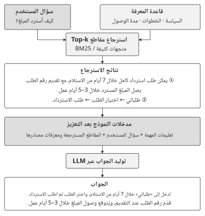

### تقطيع المستندات (Chunking)

لنفترض أن دليل خدمة ما بعد البيع يذكر أولًا «يمكن الإرجاع خلال سبعة أيام»، ثم يبيّن في الفقرة التالية المنتجات المستثناة. فإذا استُرجعت الجملة الأولى وحدها، فقد يَعِد النظام باسترداد ثمن المنتجات المستثناة أيضًا؛ وإذا جُعل الدليل كله وحدة استرجاع واحدة، اختلطت فيه التركيب والإعداد واستكشاف الأعطال، فصعب على المتجه أن يُبرز موضوع الاسترداد. و**التقطيع (chunking)** هو اختيار حجم يقع بين هذين الطرفين، بحيث تكفي القطعة الواحدة لشرح شروطها بنفسها، ويسهل على سؤال محدد أن يعثر عليها. ويجب كذلك أن يفي طول القطعة بحدود مُدخلات نموذج التضمين، وأن يترك في السياق متسعًا للتوليد اللاحق.

وهناك ثلاث طرق شائعة.

**التقطيع بحجم ثابت** يقسم النص بعدد الـ token، كأن تكون كل قطعة 512 token، مع تداخل بين القطع المتجاورة بمقدار 50～100 token. ويتيح التداخل للمحتوى القريب من الحدود فرصة الظهور كاملًا في قطعة أخرى. وهذه الطريقة تسهّل التحكم في طول القطع؛ لكن نقطة القطع قد تقع داخل فقرة أو شفرة أو جدول.

**التقطيع التعاودي أو المراعي للبنية** يقسم النص أولًا عند الحدود الطبيعية كالأقسام والفقرات، فإذا صادف جزءًا طويلًا جدًا قسمه بوحدات أصغر كالجمل. ويمكن لعناوين Markdown وعناصر HTML أن تقدّم مؤشرات على البنية. كما يمكن تطبيق قواعد معالجة خاصة على كتل الشفرة والجداول والنصوص المرتبطة بالعناوين. وفي الوثائق التقنية واضحة البنية، يوصي المؤلف بالبدء بهذه الطريقة: فالاستفادة من الأقسام والفقرات القائمة ثم تقسيم الأجزاء الطويلة جدًا تحافظ عادةً على اكتمال المعنى أكثر من القطع المباشر.

**التقطيع الدلالي** يحسب تشابه التضمين بين الجمل أو مجموعات الجمل المتجاورة، ويقطع عند المواضع التي يتغير فيها الموضوع تغيرًا واضحًا. وهو يزيد حسابات التضمين، لكنه يتيح فرصة إبقاء الموضوع الواحد في قطعة واحدة.

لنفترض أن المسترجِع لم يُعد إلا جملة واحدة: «نمت إيرادات الشركة بنسبة 3%». أي شركة؟ وأي ربع سنة؟ لقد عُثر على الرقم الصحيح، لكن ما يلزم للإجابة عن السؤال موجود في الفقرة السابقة. وإذا وُضع التقرير المالي كله في قطعة واحدة، حُفظ الربع واسم الشركة، لكن الاستعلام عن الإيرادات سيجلب معه فقرات التوظيف وشراء المعدات أيضًا. وستتشارك هذه المحتويات متجهًا واحدًا، فلا يعود موضوع الإيرادات بارزًا فيه بالقدر الكافي. وعند اختيار حجم القطع عمليًا، يمكن البدء بتجربة 256～1024 token لكل قطعة، مع تداخل بين القطع المتجاورة بنسبة 10%～20%.

ويمكن حفظ البيانات الوصفية، كالعنوان والمصدر والزمن، مع المقاطع. وسيضيف الاسترجاع المراعي للسياق الذي نعرضه لاحقًا إلى كل مقطع خلفيته في النص الأصلي، ليساعد على تفسير الإحالات والنطاق عند استرجاع المقطع منفردًا.

### التضمين الكثيف: تمثيل النص بالمتجهات

**التضمين (embedding)** يحوّل الكلمات أو الجمل أو قطع النص إلى متجهات عددية، مثل `[0.2, -0.5, 0.8, ...]`. ويُدرَّب نموذج الاسترجاع بحيث يكون تشابه الاستعلامات والمستندات المترابطة في فضاء المتجهات مرتفعًا. وتعني صفة «الكثيف» أن معظم أبعاد المتجه تحمل قيمًا غير صفرية تمثّل معلومات النص مجتمعةً؛ أما التمثيل المتفرق الذي سنعرضه لاحقًا فلا تحمل قيمًا غير صفرية إلا أبعاد قليلة منه.

يمكن تخيّل فضاء المتجهات خريطةً عالية الأبعاد: لكل مقطع نصي موضع فيها، والاسترجاع هو البحث فيها عن المحتوى القريب من الاستعلام. ومن المقاييس الشائعة **تشابه جيب التمام (cosine similarity)**:

$$
\operatorname{cos}(A,B)=\frac{A\cdot B}{\|A\|\,\|B\|}
$$

حاصل الضرب النقطي $A\cdot B$ يضرب الأبعاد المتقابلة ثم يجمع النواتج، والطول $\|A\|$ هو الجذر التربيعي لمجموع مربعات الأبعاد. وبعد القسمة على الطولين، لا تعكس النتيجة إلا العلاقة بين الاتجاهين. وللمتجهات غير الصفرية تقع قيمة جيب التمام في المدى $[-1,1]$، وكلما اقتربت من 1 كان الاتجاهان أكثر اتفاقًا. وتستخدم بعض نماذج الاسترجاع حاصل الضرب النقطي أو المسافة الإقليدية. وحين يُطبَّع المتجهان إلى طول الوحدة، يصبح حاصل الضرب النقطي مساويًا لتشابه جيب التمام.

> **حساب يدوي: تشابه جيب التمام لثلاث جمل**
>
> نمثّل بثلاثة متجهات توضيحية العبارات: «كيف تربّي قطة» $A=(0.9,0.5,0.1)$، و«دليل العناية بالقطط» $B=(0.8,0.6,0.1)$، و«استراتيجيات الاستثمار في الأسهم» $C=(0.1,0.1,0.9)$.
>
> $A\cdot B=0.9\times0.8+0.5\times0.6+0.1\times0.1=1.03$. وطولا المتجهين $\sqrt{1.07}$ و$\sqrt{1.01}$، فيكون التشابه نحو **0.991**.
>
> $A\cdot C=0.9\times0.1+0.5\times0.1+0.1\times0.9=0.23$، وطول $C$ هو $\sqrt{0.83}$، فيكون التشابه نحو **0.244**. ففي هذه المجموعة من المتجهات، يكون استعلام تربية القطط أقرب إلى دليل العناية بها.

وتستخدم النماذج الفعلية عادةً تمثيلات من مئات إلى آلاف الأبعاد.

#### من Word2Vec إلى مراعاة السياق

يبدأ الشكل 3-6 من متجهات الكلمات الثابتة. يتعلم **Word2Vec** متجهًا ثابتًا لكل كلمة استنادًا إلى تواردها المشترك مع غيرها. ويمكن لبعض العلاقات أن تظهر في العمليات على المتجهات، كالمثال الشهير «ملك − رجل + امرأة ≈ ملكة». وحدود التمثيل الثابت واضحة أيضًا: فكلمة `bank` تستخدم متجه الكلمة نفسه في `river bank` (ضفة النهر) وفي `investment bank` (بنك الاستثمار).

ويحصي **GloVe** مرات التوارد المشترك بين الكلمات في المدوّنة كلها، ثم يتعلم متجهات الكلمات عبر هدف المربعات الصغرى الموزونة. يركّز Word2Vec على مهمة التنبؤ ضمن نافذة محلية، بينما يُدخل GloVe إحصاءات التوارد الشاملة في التدريب مباشرةً؛ وكلاهما يتعلم تمثيلًا ثابتًا للمفردات[^ch3-glove].

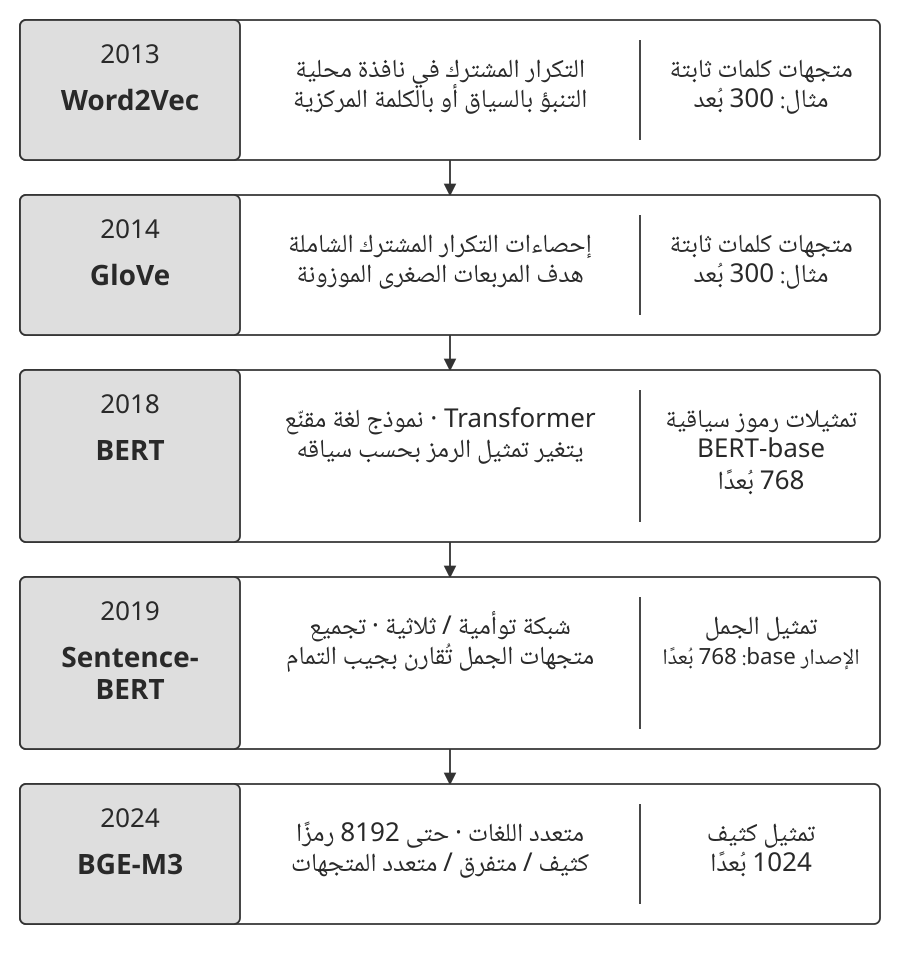

ومع النماذج السياقية من قبيل **BERT**، صار تمثيل الوحدة اللغوية (token) نفسها يتغير بتغير الجملة. فبفضل الانتباه الذاتي، يستطيع النموذج أن يحسب لكلمة «تفاحة» في جملتين تمثيلين مختلفين، اعتمادًا على قرائن مثل «أطلقت منتجًا جديدًا» و«اشتريت كيلوغرامًا». أما نماذج التضمين المستخدمة في الاسترجاع فتحتاج كذلك إلى تجميع تمثيلات الوحدات في متجه للاستعلام أو للمستند، وإلى تدريب مناسب يجعل المتجهين قابلين للمقارنة.

ويجمع **Sentence-BERT** بين BERT والتجميع (pooling) وبنى الشبكات التوأمية أو الثلاثية، ليدرّب متجهات جمل قابلة للمقارنة المباشرة. فيمكن ترميز المستندات مسبقًا وتخزينها في الفهرس، وعند وصول الاستعلام لا يُرمَّز إلا هو، ثم يُحسب تشابه المتجهات. ويوفّر الترميز المسبق كلفة إعادة حساب تمثيلات المستندات كلها مع كل استعلام[^ch3-sbert].

ويوفّر **BGE-M3** في آن واحد تمثيلات استرجاع كثيفة ومتفرقة ومتعددة المتجهات، ويدعم لغات متعددة ومُدخلات أطول؛ ويستخدم هذا القسم تمثيله الكثيف لشرح الاسترجاع بمتجه واحد[^ch3-bge-m3]. ويؤثر الطول الذي يقبله النموذج في خطة التقطيع: فالحد النموذجي في BERT الأصلي 512 token، بينما يدعم BGE-M3 حتى 8192 token.

[^ch3-bge-m3]: تعرض ورقة M3-Embedding التي أعدّها Chen وزملاؤه (arXiv:2402.03216) كيف تُدرَّب تمثيلات الاسترجاع الثلاثة تدريبًا مشتركًا. وانظر أيضًا وصف نموذج BGE-M3 لدى BAAI، بما فيه طرق التمثيل والأبعاد وطول المُدخلات وطريقة الاستخدام.

> **التجربة 3-4 ★★: مقارنة بين فهرسين للجار الأقرب التقريبي**
>
> بعد بناء متجهات المستندات، نحتاج إلى العثور بسرعة على المتجهات القريبة من الاستعلام. يعطي الحساب واحدًا واحدًا الجيران الأقرب بدقة، لكن مع ازدياد حجم البيانات تقايض فهارس **الجار الأقرب التقريبي** (Approximate Nearest Neighbor, ANN) خسارة مضبوطة في الاستدعاء بسرعة الاستعلام. تقارن هذه التجربة بين ANNOY وHNSW على مجموعة واحدة من التضمينات الحقيقية والاستعلامات نفسها، وتتخذ نتائج البحث الدقيق مرجعًا. فإذا أعطى البحث الدقيق لاستعلام ما عشرة جيران أقرب، وضمّت النتائج العشر التي أعادها الفهرس التقريبي ثمانية منها، كان Recall@10 لهذا الاستعلام 0.8. ويقيس هذا الرقم مقدار ما يحتفظ به الفهرس من الجيران الأقرب الدقيقين.
>
> يستخدم ANNOY عدة أشجار إسقاط عشوائي لتضييق نطاق المرشحين؛ ويستخدم HNSW رسمًا بيانيًا هرميًا للجوار، فيقترب بسرعة من المنطقة المستهدفة في الطبقات العليا المتفرقة، ثم ينزل إلى الطبقات السفلى الأكثف ليبحث فيها. ويبيّن الشكل 3-7 البنية الهرمية لـ HNSW.
>
> 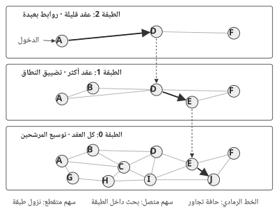
>
> الجدول 3-2 المفاضلات التنفيذية بين ANNOY وHNSW
>
> | جانب المقارنة | ANNOY | HNSW (بمثال hnswlib) |
> | --- | --- | --- |
> | بنية الفهرس | عدة أشجار إسقاط عشوائي | رسم بياني هرمي للجوار |
> | كلفة البناء | تتغير بعدد الأشجار وعدد المتجهات وأبعادها | تتغير بحجم الجوار ونطاق البحث أثناء البناء وحجم البيانات |
> | الذاكرة والملفات | يدعم الفهرس الثابت الربط بالذاكرة والمشاركة بين العمليات | يحفظ المتجهات وعلاقات الجوار في الرسم، ويؤثر حجم الجوار في الكلفة |
> | التحديث التزايدي | إضافة عناصر بعد بناء الفهرس تتطلب إعادة البناء | يدعم الإضافة والتحديث ووسم الحذف، مع الحاجة إلى إدارة السعة |
> | الاستدعاء والسرعة | يُضبطان بعدد الأشجار وميزانية البحث عند الاستعلام | يُضبطان بمعاملات البناء ونطاق البحث عند الاستعلام |
> | سيناريو الاستخدام | فهرس ثابت يسهل توزيعه ومشاركته | فهرس ديناميكي يستقبل الكتابة والاستعلام باستمرار |
>
> بنى هذا التشغيل القاعدة أولًا من 240 مقطعًا نصيًا. ولعشرين استعلامًا متطابقة، عثر الفهرسان كلاهما على الجيران العشرة الأوائل التي أعطاها البحث الدقيق. وعند البناء الأول، استغرق بناء ANNOY في حاوية Linux نحو 13 ملّي ثانية، وبناء HNSW في البيئة المحلية نحو 78 ملّي ثانية؛ وبلغ حجم الفهرسين المحفوظين نحو 1.40 MB و1.02 MB على التوالي. ثم أُضيفت المقاطع الستون المتبقية، فأعاد ANNOY بناء الفهرس، بينما أدرج HNSW المتجهات الجديدة مباشرةً. وصار في القاعدة حينها 300 مقطع، وقد يتغير الجيران الأقرب السابقون تبعًا لذلك. وبعد إعادة البحث الدقيق على القاعدة الجديدة، بقي متوسط الاستدعاء في الفهرسين 100%.

[^ch3-ann]: يشرح وصف مشروع Annoy لدى Spotify كيفية بناء فهرس للقراءة فقط، وتحميله بالربط بالذاكرة، وضبط عدد العقد التي تُفحص عند الاستعلام بالمعامل `search_k`. ويقدّم قسم واجهة Python في وصف مشروع hnswlib الدالة `add_items` لإضافة المتجهات، والدالة `set_ef` لضبط نطاق الاستعلام.

**يُختار الفهرس بحسب طريقة تحديث المعرفة.** فعندما تُنشر المدوّنة دوريًا على دفعات، وتتشارك عمليات متعددة فهرسًا واحدًا للقراءة فقط، يميل المؤلف إلى ANNOY أولًا؛ وعندما تصل مستندات جديدة باستمرار وتلزم الإضافة الفورية، يُقدَّم HNSW. يحدد نموذج التضمين التمثيل الدلالي، ويحدد الفهرس ما إذا كان استخدام هذه التمثيلات ممكنًا بزمن استجابة وكلفة تحديث مناسبين، ومعًا يحددان فاعلية خدمة الاسترجاع.

ويمكن ملاحظة تغير الاستدعاء وزمن الاستجابة بضبط عدد الأشجار وميزانية البحث في ANNOY، أو حجم الجوار ونطاق البحث في HNSW[^ch3-ann]. فاستدعاء الفهرس يقيس ما إذا عُثر على الجيران المستهدفين؛ أما قدرة هؤلاء الجيران على الإجابة عن سؤال المستخدم فتتوقف على تمثيل التضمين ومحتوى الوثائق.
### التمثيل المتفرق: من الكلمات المفتاحية إلى تقدير الصلة

**التمثيل المتفرق** يستخدم متجهات عالية الأبعاد لا يحمل منها قيمًا غير صفرية إلا عدد قليل من الأبعاد. ويتخذ الاسترجاع التقليدي بالكلمات المفتاحية المصطلحات أبعادًا، ويعطيها أوزانًا بحسب الكلمات الواردة في المستند. وأساسه **نموذج حقيبة الكلمات** (Bag of Words, BoW): يحفظ الكلمات وعدد مرات ورودها ويتجاهل ترتيبها. ولذلك يكون لعبارتي «القط يطارد الكلب» و«الكلب يطارد القط» تمثيل واحد في حقيبة الكلمات.

ويناسب هذا التمثيل مطابقة الأسماء والأرقام والمصطلحات التقنية. ونبدأ فيما يلي بـ TF-IDF، لنبيّن كيف يتحول تكرار الكلمة وتكرارها في المستندات إلى درجة للترتيب.

#### من TF-IDF إلى BM25

**TF-IDF** (Term Frequency–Inverse Document Frequency، تكرار المصطلح ومعكوس تكرار المستندات) يجمع إشارتين: عدد مرات ورود الكلمة في المستند الحالي، ومدى شيوعها في المدوّنة كلها. لنفترض أن 60 مقالًا من 100 تحتوي على كلمة «نموذج»، وأن 3 مقالات فقط تحتوي على كلمة «تقطير»؛ فعند الاستعلام عن «تقطير النموذج» تكون كلمة «تقطير» أقدر على التمييز.

ومن صيغه الأساسية:

$$\operatorname{TF\!\text{-}\!IDF}(t,d)=\operatorname{TF}(t,d)\times\operatorname{IDF}(t),\qquad \operatorname{IDF}(t)=\ln\frac{N}{\operatorname{DF}(t)}$$

يدل $\operatorname{TF}(t,d)$ على عدد مرات ورود الكلمة $t$ في المستند $d$، و$\operatorname{DF}(t)$ على عدد المستندات التي تحتوي على هذه الكلمة، و$N$ على العدد الكلي للمستندات. ووفق هذه الصيغة، تكون مساهمة الكلمة في الدرجة إذا وردت عشر مرات ضعف مساهمتها إذا وردت خمس مرات؛ وقد ينال المستند الطويل درجة أعلى لمجرد أن كلماته أكثر. ولـ TF-IDF صيغ متعددة للتطبيع، أما BM25 الذي نعرضه فيما يلي فيعالج هذين الأثرين بتشبع تكرار الكلمة وتطبيع الطول.

**BM25** يجمع مساهمات كلمات الاستعلام:

$$\operatorname{Score}(Q,D)=\sum_i\operatorname{IDF}_{\mathrm{BM25}}(q_i)\cdot\frac{\operatorname{TF}(q_i,D)(k_1+1)}{\operatorname{TF}(q_i,D)+k_1\left(1-b+b\frac{|D|}{\operatorname{avgdl}}\right)}$$

حيث $q_i$ كلمة من الاستعلام، و$|D|$ طول المستند، و$\operatorname{avgdl}$ متوسط طول المستندات. ويتحكم $k_1$ في درجة تشبع تكرار الكلمة؛ ويتحكم $b$ في شدة تطبيع الطول، فإذا كان 0 أُلغي هذا التصحيح. ويفصل الشكل 3-8 حساب هذه الحدود. نثبّت أولًا طول المستند، ونزيد ورود كلمة الاستعلام من مرة إلى ثلاث مرات، لنرى كم تضيف كل مرة إضافية إلى الدرجة؛ ثم نثبّت تكرار الكلمة ونضاعف طول المستند وحده. ويقارن الصف الأخير مدى شيوع كلمتين في مجموعة المستندات.

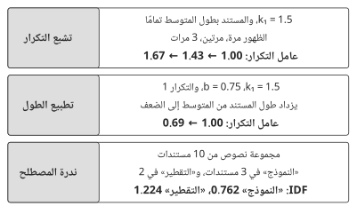

في الصف الأول من الشكل، رفع الورود الثاني معامل التكرار بنحو 0.43، أما الورود الثالث فلم يرفعه إلا بنحو 0.24، وهذا هو تشبع تكرار الكلمة. وفي الصف الثاني، ترد الكلمة نفسها مرة واحدة في الحالتين، لكنها أقل بروزًا في المستند الأطول، فيخفض تصحيح الطول معامل تكرارها. ولا تكتمل مساهمة الكلمة في الدرجة الكلية إلا بعد ضربها في IDF.

وبقي في الصيغة السابقة حدٌّ يجب تحديده: لماذا تكون الكلمة النادرة في الغالب أنفع من الكلمة الشائعة إذا وردت كلتاهما ثلاث مرات؟ يستخدم هذا القسم معكوس تكرار المستندات الآتي لوزن الكلمات:

$$\operatorname{IDF}_{\mathrm{BM25}}(t)=\ln\frac{N-\operatorname{DF}(t)+0.5}{\operatorname{DF}(t)+0.5}$$

يمثّل البسط عدد المستندات التي لا تحتوي على الكلمة، والمقام عدد المستندات التي تحتوي عليها، ويُضاف إلى كل منهما 0.5 للتنعيم، حتى يبقى الحساب ممكنًا حين يكون تكرار المستندات 0 أو $N$. فتنال الكلمات النادرة وزنًا أعلى؛ أما إذا احتوى أكثر من نصف المستندات على الكلمة، فإن هذه الصيغة تعطي قيمة سالبة. ويجعل التنفيذ المرافق الحد الأدنى للوزن الفعلي في التقدير $10^{-6}$، مع الاحتفاظ بالقيمة الأصلية للفحص.

> **التجربة 3-5 ★★: بناء محرك بحث BM25 من الصفر**
>
> تنجز هذه التجربة بالترتيب تقسيم النص إلى كلمات، ومعالجة الكلمات الشائعة، والفهرس المقلوب، والتقدير. وتتيح معالجة الكلمات الشائعة استبعاد الكلمات عالية التكرار مثل «الـ» و«في». أما **الفهرس المقلوب** فيسجّل لكل كلمة المستندات التي ترد فيها وتكرارها في كل منها؛ وهو يشبه فهرس المصطلحات في آخر الكتاب، فالبحث عن «TCP» يدلّك على الصفحات 45 و112 و203، ثم تقرأ المحتوى في تلك المواضع.
>
> لنحسب يدويًا استعلامًا عن «تقطير النموذج». لنفترض أن المدوّنة تضم 10 مستندات بمتوسط طول 250 كلمة، وأن $k_1=1.5$ و$b=0.75$. ترد كلمة «نموذج» في 3 مستندات، فيكون IDF لها نحو 0.762؛ وترد كلمة «تقطير» في مستندين، فيكون IDF لها نحو 1.224. ويسرد الجدول الآتي لكل كلمة المستندات التي وردت فيها وتكرارها وطول المستند. وبالتعويض بهذه القيم في الصيغة، تُحسب مساهمة كل كلمة في درجة المستند.
>
> | كلمة الاستعلام | المستند | التكرار TF | طول المستند | مساهمة BM25 |
> | --- | --- | ---: | ---: | ---: |
> | نموذج | doc_1 | 5 | 200 | 1.52 |
> | نموذج | doc_3 | 2 | 500 | 0.82 |
> | نموذج | doc_7 | 8 | 150 | 1.68 |
> | تقطير | doc_1 | 3 | 200 | 2.15 |
> | تقطير | doc_5 | 1 | 250 | 1.22 |
>
> مجموع مساهمتي الكلمتين في doc_1 نحو 3.67، فيكون الترتيب **doc_1 (3.67) > doc_7 (1.68) > doc_5 (1.22) > doc_3 (0.82)**. ففي doc_1 يقل تكرار «تقطير» عن تكرار «نموذج»، لكنها أندر، فكانت مساهمتها النهائية أكبر؛ كما أن مطابقة الكلمتين معًا رفعت الدرجة الكلية أكثر.
>
> لنبحث الآن عن `cat` في المدوّنة الإنجليزية للتجربة المرافقة. يستخدم المقالان القصيران الموسومان بأنهما ذوا صلة الكلمتين `kitten` و`feline`، فلا توجد `cat` في الفهرس المقلوب، وتكون قائمة المرشحين فارغة. ومهما رفعنا أوزان التكرار السابقة، فلن يوجد مستند واحد يمكن تقديره. أما إذا بحثنا بكلمات من هذين المقالين، فسنرى كلًّا منهما يدخل قائمة المرشحين.

### الاسترجاع الهجين: دمج نتائج المسارين ثم إعادة الترتيب

من الصعب في بعض الأسئلة حصر المترادفات مسبقًا. ففي التجربة 3-6 سؤال عن «كيفية استرداد مساحة الكومة غير المستخدمة تلقائيًا»، بينما كُتب المقال المستهدف بعبارة «تعفي الإدارة التلقائية للذاكرة المطوّرَ من تحرير الكائنات يدويًا». لا يشترك الاستعلام الإنجليزي والمقال في أي مصطلح، فلم يُعِد الاسترجاع بالكلمات المفتاحية أي مقال، بينما وضع الاسترجاع المتجهي المقال المستهدف في المرتبة الأولى. أما عند الاستعلام عن الطراز XR-7003، فقد عثر الاسترجاع بالكلمات المفتاحية على الطراز المقصود مباشرةً، في حين سرد الاسترجاع المتجهي معه عدة طرز متقاربة.

يبحث **الاسترجاع الهجين** أولًا عن الفقرات ذات الصلة بالكلمات المفتاحية وبالمتجهات كلٌّ على حدة، ثم يقرر أي الفقرات يستحق أن يُقدَّم إلى النموذج. وحين تضم قاعدة المعرفة معرّفات دقيقة وأوصافًا باللغة الطبيعية معًا، يوصي المؤلف بجعله نقطة البداية. تتبّع XR-7003 في الشكل 3-9: وضعه المساران كلاهما في المرتبة الأولى، فنال عند الدمج مساهمتين في الترتيب. وغيّرت إعادة الترتيب صاحب المرتبة الثانية، لكن الطراز الذي يراه المستخدم أولًا بقي صحيحًا.

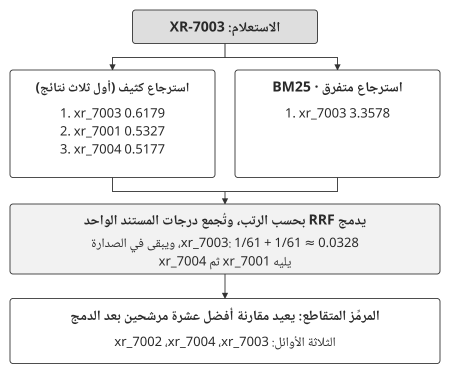

المرحلة الأولى هي **الاسترجاع المتوازي**: يُرسل الاستعلام إلى المحركين الكثيف والمتفرق، فيعيد كل منهما مجموعة من المستندات المحتمل ارتباطها به. ويمكن أن يستخدم المساران النص الأصلي نفسه، أو أن يعالج كل منهما النص مسبقًا بحسب متطلبات نموذجه.

المرحلة الثانية هي **دمج النتائج**: يُوحَّد المستند نفسه الوارد في نتائج المسارين، ثم يُرتَّب الجميع ترتيبًا موحدًا. ولأن مقياس تشابه جيب التمام يختلف عن مقياس BM25، فإن جمع الدرجتين مباشرةً يجعل المسار ذا القيم الأكبر يطغى على النتيجة. ومن الحلول معايرة الدرجات أو تطبيعها أولًا ثم جمعها بأوزان؛ ومنها **الدمج بمقلوب الرتبة** (Reciprocal Rank Fusion, RRF)، الذي يحسب الدرجة من رتب كل مسار:

$$\operatorname{RRF}(d)=\sum_{j:\,d\in R_j}\frac{1}{k+\operatorname{rank}_j(d)}$$

$R_j$ هي نتائج المسار $j$، وتبدأ الرتب من 1، وإذا لم يظهر المستند في أحد المسارين كانت مساهمة ذلك المسار صفرًا. ويُختار ثابت التنعيم $k$ عادةً 60؛ وكلما كبر صغرت الفروق في الدرجات بين الرتب الأولى. ويسهّل RRF الجمع بين طرق تقدير مختلفة، لكنه لا يحتفظ إلا بالرتب، فإذا أريد الاستفادة من تفاوت القوة في الدرجات الأصلية لزمت طرق أخرى.

لنحسب مثالًا لاسترجاع بمسارين. يسأل المستخدم «متى يصل المبلغ المسترد؟»، فيحتل المستند (أ) المرتبة الأولى في الاسترجاع بالكلمات المفتاحية، ولا يظهر في مقدمة نتائج الاسترجاع المتجهي؛ ويحتل المستند (ب) المرتبة الثانية في المسارين. وبأخذ $k=60$، ينال (أ) الدرجة $1/61$، أي نحو 0.0164؛ وينال (ب) الدرجة $1/62+1/62$، أي نحو 0.0323. فيتقدم (ب) على (أ) بعد الدمج. ولا تدل هذه النتيجة إلا على أن مساري الاسترجاع كليهما عثرا على (ب). أما معرفة ما إذا كان (ب) يجيب فعلًا عن موعد وصول المبلغ، فتتطلب النظر فيما إذا كان يتحدث عن «كيفية طلب الاسترداد» أو عن «موعد وصول المبلغ المسترد».

ويمكن في المرحلة الثالثة إضافة **إعادة الترتيب العصبية**. يأخذ النظام المستندات المتقدمة في الترتيب بعد الدمج، كأول 50 مستندًا مثلًا، ويطلب من نموذج إعادة الترتيب أن يقدّر مدى صلة كل منها بالاستعلام. وتستطيع إعادة الترتيب تغيير ترتيب هذه المستندات الخمسين. أما إذا لم يُنتقَ المستند النافع فعلًا أصلًا، فلا بد من العودة إلى المراحل السابقة لتحسين الاسترجاع.

والنموذج الشائع هنا هو **المرمِّز التقاطعي (cross-encoder)**: يُدخَل الاستعلام والمستند المرشح معًا، فيتفاعل الجزءان داخل النموذج، ويُخرج درجة للصلة. أما **المرمِّز الثنائي (bi-encoder)** في مرحلة الاسترجاع، فيرمّز الاستعلام والمستند كلًّا على حدة، فيمكن حساب متجهات المستندات مسبقًا، ولا يُجرى عند الاستعلام إلا البحث المتجهي. الأول يناسب الترتيب الدقيق لعدد قليل من المستندات، والثاني يناسب الفرز الأولي في عدد كبير منها. ويمكن تشبيه ذلك بفرز السير الذاتية ثم إجراء المقابلات: يُضيَّق النطاق أولًا بالسمات المتاحة، ثم تُجرى مقارنة معمقة حول متطلبات محددة. ومن النماذج الصالحة لهذه المرحلة BGE Reranker v2 M3[^ch3-reranker].

[^ch3-reranker]: BAAI، وصف نموذج BGE Reranker v2 M3، ويعرض مُدخلات الاستعلام والمستند وتقدير الصلة.

وحين تدخل المواد ذات الصلة مجموعة المرشحين لكنها تأتي كثيرًا بعد مواد لا صلة لها، يبدأ المؤلف بتقييم إعادة الترتيب بالمرمِّز التقاطعي. فهو يقرأ السؤال والمستند معًا، فيستطيع أن يقارن مباشرةً بين الشروط والقيود والتفاصيل الواردة في المستند ومتطلبات السؤال. ويسرد الجدول 3-3 ثلاثة مقاييس شائعة.

الجدول 3-3 ثلاثة مقاييس لجودة الاسترجاع

| المقياس | طريقة الحساب ودلالته |
| --- | --- |
| recall@k (الاستدعاء) | عدد المستندات ذات الصلة في أول k نتيجة مقسومًا على عدد كل المستندات ذات الصلة بالاستعلام، ويقيس مقدار ما استُعيد من المحتوى ذي الصلة؛ وفي مجموعة الاختبار يؤخذ عادةً متوسطه على الاستعلامات |
| MRR (متوسط مقلوب الرتبة) | يؤخذ لكل استعلام مقلوب رتبة أول مستند ذي صلة، ثم يُحسب المتوسط؛ فالمرتبة الأولى تساوي 1، والعاشرة 0.1، وعدم العثور يساوي 0 |
| nDCG@k (الكسب التراكمي المخصوم المطبَّع) | يمنح النتائج درجات بحسب درجة صلتها، ويخصم من الرتب المتأخرة، ثم يقسم على درجة الترتيب المثالي، ويقيس جودة ترتيب أول k نتيجة إجمالًا |

ويمكن أيضًا تسجيل **معدل الإصابة**: كم استعلامًا استُعيد له مستند واحد على الأقل ذو صلة ضمن أول k نتيجة؟ فلنفترض أن سؤالًا يحتاج إلى ثلاث وثائق، ولم تُستعَد منها في أول عشرين نتيجة إلا اثنتان. هذا الاستعلام قد أصاب، فلا يُحسب ضمن حالات الفشل «التي لم تصب إطلاقًا»، لكن recall@20 له لا يتجاوز $2/3$، وبقي $1/3$ من الوثائق لم يُعثر عليه. وإذا لم يكن لكل سؤال إلا مستند مستهدف واحد، نال السؤال الذي استُعيد مستنده درجة 1، ونال السؤال الذي فاته مستنده درجة 0. وبأخذ المتوسط على نتائج الاسترجاع نفسها، يصبح معدل الإصابة مساويًا لمتوسط الاستدعاء.

> **التجربة 3-6 ★★: مقارنة بين الاسترجاع المتفرق والكثيف والدمج وإعادة الترتيب**
>
> تقارن هذه التجربة خمسة إعدادات على الاستعلامات الاثني عشر الموسومة نفسها: الاسترجاع المتفرق، والاسترجاع الكثيف، ودمج RRF، والدمج الموزون، وإعادة الترتيب بعد الدمج. وتغطي الاستعلامات التشابه الدلالي والأسماء الدقيقة وتعدد اللغات والشفرات التقنية، ومنها سؤالان يسألان بالإنجليزية والصينية عن كيفية تحويل النبات ضوء الشمس إلى غذاء. يُستخدم Qwen3-Embedding-0.6B نموذجًا كثيفًا، والمرمِّز التقاطعي MS MARCO MiniLM لإعادة الترتيب، ويأخذ كل مسار استرجاع 10 مستندات على الأكثر، ويعالج نموذج إعادة الترتيب ما لا يزيد على 10 مستندات من مقدمة ترتيب RRF. ولا يُنظر في الاستدعاء وnDCG إلا إلى أول 3 مستندات في الترتيب النهائي، أما MRR فيبحث في القائمة المعادة عن أول مستند ذي صلة.
>
> افتح أولًا الترتيب لكل سؤال في سجل تشغيل التجربة 3-6، وقارن نتائج الاسترجاع لسؤالي التمثيل الضوئي. في السؤال الإنجليزي بقي المستند المستهدف في المرتبة الأولى. أما السؤال الصيني فأعاد أولًا مستندين عن لغات البرمجة والبراكين، ولم يأتِ الحديث عن التمثيل الضوئي إلا في المستند الثالث. ولكل سؤال مستند واحد فقط موسوم بأنه ذو صلة، وقد عُثر عليه في المراتب الثلاث الأولى في السؤالين، فكان recall@3 لكل منهما 1. لكن أول مستند ذي صلة في السؤال الصيني جاء في المرتبة الثالثة، فلم يتجاوز مقلوب رتبته $1/3$. ووفق طريقة التقدير في هذه التجربة، يكون كسب المرتبة الثالثة $1/\log_2(3+1)=0.5$، وكسب المرتبة الأولى 1، فيكون nDCG@3 للسؤال الصيني 0.5.
>
> لننظر الآن في الأسئلة الاثني عشر كلها. بعد إعادة الترتيب، تراجع المستند المستهدف من الأولى إلى الثانية في سؤال آخر عن استرداد ذاكرة الكومة، إلى جانب سؤال التمثيل الضوئي الصيني. وحافظت الأسئلة العشرة الباقية على المرتبة الأولى، فكان MRR بعد إعادة الترتيب $(10+1/2+1/3)/12\approx0.903$. وللمقارنة، كان MRR للاسترجاع الكثيف ولـ RRF كليهما 1. وكان nDCG@3 لكليهما 1 أيضًا، وانخفض بعد إعادة الترتيب إلى نحو 0.928. ولا يكشف متوسط الاستدعاء وحده عن هذه التغيرات في الرتب: فقد كان recall@3 للاسترجاع المتفرق 0.833، وللمجموعات الأربع الأخرى 1.
>
> لنفترض أننا نريد الآن اختيار إعداد لهذه المجموعة من الأسئلة، فماذا جلب الوقت الذي أنفقته إعادة الترتيب؟ على هذا المعالج المركزي، استغرق RRF من بدء الاسترجاع إلى إعطاء الترتيب نحو 194 ملّي ثانية للسؤال في المتوسط؛ وبعد إضافة إعادة الترتيب صار نحو 237 ملّي ثانية. والملّي ثواني الثلاث والأربعون الإضافية تقريبًا لم تستعد أي مستند مستهدف إضافي، بل أخّرت الإجابة الصحيحة في سؤالين.
## تنظيم المعرفة واسترجاعها

تحدد طريقة تنظيم المعرفة ما يتضمنه كل مدخل، ويحدد المسترجِع ما يُستعاد من هذه المداخل. فالفقرات في الأدلة التقنية والوثائق القانونية والأوراق البحثية مترابطة بتسلسل الأقسام والاعتماد بين المفاهيم والإحالات بين الوثائق. والحفاظ على هذه البنى يتيح للاستعلام الوصول إلى الأدلة المحددة وإلى الخلاصات الأعلى مستوى في آن واحد.

يتناول هذا القسم بالترتيب عدة طرق للتنظيم: يبني RAPTOR وGraphRAG فهارس هرمية أو فهارس للعلاقات؛ وينظّم OpenViking موارد السياق في أدلة؛ ويحافظ التحديث التزايدي والترتيب الدوري على حداثة المعرفة؛ ويتيح RAG الوكيلي للوكيل مواصلة الاسترجاع بناءً على النتائج التي حصل عليها؛ ويضيف الاسترجاع المراعي للسياق الخلفيةَ إلى المقاطع؛ وأخيرًا تُستخرج من مجموعات البيانات معرفة قابلة لإعادة الاستخدام. وتعمل هذه الطرق على التمثيل والفهرسة والتحديث والاستعلام كلٌّ في موضعه، ويمكن كذلك الجمع بينها في ذاكرة المستخدم.

لننظر أولًا في مثالين لفهم الفجوة بين المعلومات التي يحتاجها الاستعلام والسجلات الأصلية.

**المثال الأول: عدّ القطط السوداء والبيضاء.** في الفصل السابق، عدّ البرنامج الأقفاص المئة كلها، فوجد 90 قطة سوداء و10 قطط بيضاء. أما هذه المرة فلا نطلب من المسترجِع إلا أول 20 سجلًا. لنفترض أن 18 منها أعطت معلومات صالحة عن اللون، منها 15 قطة سوداء و3 قطط بيضاء. فنسبة 83.3% (15/18) المحسوبة هي نسبة القطط السوداء في هذه الدفعة من السجلات الصالحة؛ أما نسبة القطط السوداء في المتجر كله فهي 90% (90/100). فالمسترجِع ينتقي السجلات بحسب صلتها، ولم يأخذ عينة ممثِّلة للمتجر كله.

وإذا كثر السؤال عن النسبة في المتجر كله، أمكن إحصاء الأقفاص كلها مسبقًا، وحفظ عدد القطط السوداء والبيضاء، مع بيان نطاق الإحصاء وزمن تحديثه. فإذا تغيرت القطط في الأقفاص، حُدّثت التفاصيل المقابلة وأُعيد حساب المجموع. أما من يسأل عما في القفص رقم 37، فلا بد من الرجوع إلى ذلك السجل التفصيلي.

**المثال الثاني: هل تستحق الممرضة الخصم الذي ناله الطبيب؟** لنأخذ موقفًا تعليميًا مبنيًا على استفسارات عروض Xfinity: في تذاكر الدعم، اجتاز المحارب القديم John التحقق، ونالت الطبيبة Sarah الخصم، وأُبلغ المعلم Mike بأنه لا يستوفي الشروط. وكل تذكرة تسجّل نتيجة معالجة واحدة. فإذا جاءت ممرضة تسأل عما إذا كانت تستحق الخصم، فإن الاكتفاء باسترجاع التذاكر المشابهة يصطدم بثلاث مشكلات.

- **تقارب المهنتين لا يعني استحقاق العرض نفسه.** كلمتا «ممرضة» و«طبيبة» متقاربتان دلاليًا، فقد يتقدم سجل Sarah في الترتيب؛ لكن انطباق العرض يتوقف على ما تنص عليه شروط الحملة بشأن من يحق له التقديم وما الإثباتات المطلوبة.
- **التذاكر المفردة لا تسرد كل شروط الانطباق.** اجتياز شخص ما التحقق لا يبيّن مباشرةً إلا نتيجته هو في ظروفه حينها؛ وزيادة عدد النتائج المسترجعة لا تضمن العثور على فئات أو استثناءات لم تظهر من قبل.
- **نطاق المواد غير واضح.** قد تأتي التذاكر من حملات مختلفة أو أوقات مختلفة. فيجب أولًا تحديد السجلات التي تنطبق، والأسس التي تنقص من السياسات.

ويمكن عند الفهرسة ربط تذاكر الحملة الواحدة ببعضها، ثم الرجوع إلى الشروط الرسمية المقابلة، وترتيب الفئات المشمولة والاستثناءات وزمن السريان ومصدر الشروط في بطاقة قاعدة. فإذا كانت الشروط في هذا الموقف التعليمي تشمل صراحةً العسكريين العاملين والمحاربين القدامى والعاملين المرخَّصين في الطب والتمريض، وتستثني فئة المعلمين، حُفظت هذه الشروط بندًا بندًا؛ أما دخول الممرضين في نطاق العاملين في الطب والتمريض فتحسمه الشروط أيضًا. وتبقى التذاكر محفوظة، لتفسير مجريات المعالجة الفعلية واكتشاف الفروق في التطبيق.

يجسّد هذان المثالان حاجتين مختلفتين إلى المعلومات: عدّ القطط يتطلب إحصاء أقفاص المتجر كله، والحكم على من يستحق الخصم يتطلب الرجوع إلى الشروط والاستثناءات كاملةً. وفي هذا النوع من الاستعلامات، يرى المؤلف تقديم الإحصاء وترتيب القواعد إلى مرحلة بناء القاعدة. فالاكتفاء بزيادة المقاطع المسترجعة قد يُبقي النموذج عاجزًا عن رؤية نطاق الإحصاء كاملًا أو الشروط التي تحسم قبول هذا الطلب. أما بناء ملخصات إحصائية وبطاقات قواعد وعلاقات مصدرية حول المهمة، فيتيح للاسترجاع أن يحصل دفعة واحدة على معلومات تكفي لدعم الحكم، مع إمكان الرجوع إلى المواد الأصلية.

### الفهرسة المنظَّمة: بناء التسلسل الهرمي والروابط

عند قراءة تقرير طويل، كثيرًا ما توجد إجابة سؤال «أي خانة يجب ملؤها في طلب الصيانة؟» في فقرة واحدة من النص الأصلي؛ أما سؤال «لماذا تتكرر بعض أنواع الأعطال؟» فيتطلب عبور عدة أقسام. وإذا أردنا تلبية هذين النوعين من الاستعلامات، أمكن عند بناء القاعدة توليد ملخصات، أو بناء تسلسل هرمي، أو استخراج الكيانات والعلاقات. ويكوّن RAPTOR الذي نعرضه فيما يلي تسلسلًا هرميًا بالتلخيص التعاودي، بينما ينظّم GraphRAG المواد بعلاقات الكيانات وملخصات المجتمعات.

يبدأ **RAPTOR** (Recursive Abstractive Processing for Tree-Organized Retrieval) من قطع النص، فيرمّز كل قطعة في متجه، ويجمعها في عدة مجموعات بحسب تشابهها، ثم يولّد ملخصًا لكل مجموعة. وبمعاملة الملخصات دفعةً جديدة من قطع النص وتكرار هذه الخطوات، نحصل على الشجرة المبيّنة في الشكل 3-10. فإذا تتبعنا الأسهم صعودًا من قطع النص 3 و4 و5، وجدناها تولّد معًا الملخص B؛ وفي المستوى الأعلى، تجتمع ملخصات المجموعات A وB وC في ملخص شامل.[^ch3-raptor]

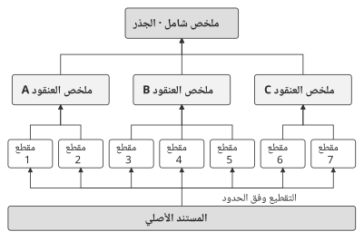

فعبارة «يدعم SSE2 تنفيذ عمليات SIMD الصحيحة في سجلات XMM ذات 128 بت» وعبارة «أضاف SSE4.2 تعليمات مقارنة السلاسل النصية» مثلًا يمكن أن تندرجا في ملخص «تطور مجموعات تعليمات x86 SIMD». فتطابق الأسئلة التفصيلية القطع في المستوى الأدنى، وتطابق الأسئلة العامة الملخصات في المستويات العليا. ويمكن للاستعلام أن يتعمق مستوى بعد مستوى، أو أن يسترجع العقد من كل المستويات معًا ثم ينتقي المجموعة الأوثق صلة.

[^ch3-raptor]: Sarthi وآخرون، RAPTOR: Recursive Abstractive Processing for Tree-Organized Retrieval، 2024.

**GraphRAG** ينظّم المعرفة بالكيانات والعلاقات وملخصات المجتمعات. ويسجّل العلاقة الواحدة في ثلاثية «فاعل—علاقة—مفعول»، مثل (الصين، عاصمتها، بكين) أو (تشانغ سان، يعمل في، Tencent). ويكفي أن يذكر سجلان الكيان نفسه حتى يمكن وصلهما في الرسم البياني. وفي الشكل 3-11 طبيبان كلاهما من عائلة تشانغ. فإذا سأل المستخدم «ما عنوان المستشفى الذي يعمل فيه طبيب أسناني؟»، فأي علاقة يجب أن يتتبعها النظام؟

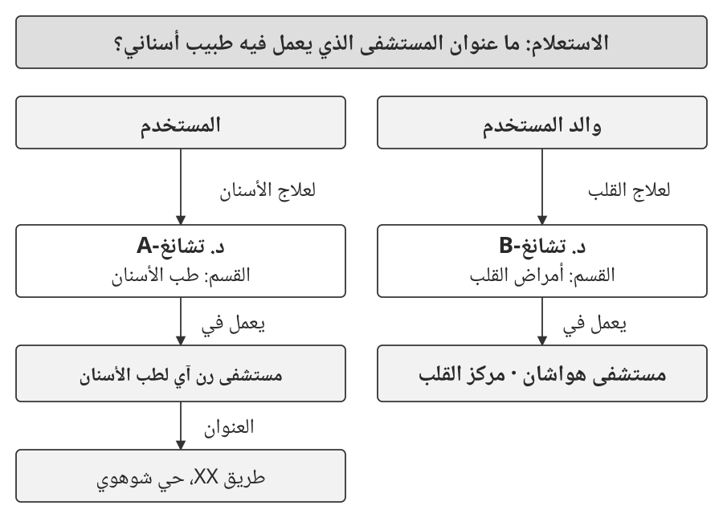

1. **التمييز بين الكيانات المتشابهة الأسماء عند بناء الرسم البياني.** أحد الطبيبين يعالج أسنان المستخدم في مستشفى رن آي لطب الأسنان، والآخر يعالج قلب والد المستخدم في مستشفى هواشان. وعند استخراج الكيانات ودمج السجلات، يستطيع النظام بناءً على هذه القرائن أن يعطي كل طبيب معرّفًا مختلفًا. وللحقلين `person` و`relationship` المذكورين سابقًا دور مشابه. فالحكم على ما إذا كانت `bank` في الجملة تعني ضفة النهر أو المصرف هو إزالة لغموض المعنى، والحكم على أي الطبيبين يقصده السجل هو إزالة لغموض الكيان.
2. **الاسترجاع بتتبع سلاسل العلاقات عند الاستعلام.** بالانطلاق من المستخدم وتتبع «المستخدم ← الطبيب ← المستشفى ← العنوان» خطوة بخطوة، يمكن وصل المعلومات الموزعة على عدة سجلات في إجابة واحدة.

يستخرج مسار الفهرسة في GraphRAG من Microsoft الكيانات والعلاقات أولًا من وحدات النص، ثم يكتشف المجتمعات ليحدد مجموعات الكيانات شديدة الترابط، فيولّد تسلسلًا هرميًا للمجتمعات وملخصاتها. وعند الاستعلام عن كيان معين، يجمع البحث المحلي بين المعلومات المرتبطة به والنص الأصلي؛ وعند الاستعلام عن موضوعات المدوّنة كلها، يستخدم البحث الشامل ملخصات المجتمعات لتنظيم الإجابة[^ch3-graphrag].

[^ch3-graphrag]: Microsoft GraphRAG، نظرة عامة على الفهرسة والاستعلام، والبحث المحلي والبحث الشامل.

ويجب أن يتسع تمثيل العلاقات كذلك للشروط والزمن. فعبارة «إذا استمر المطر الأسبوع القادم، فسألغي الذهاب إلى الشاطئ وأذهب إلى المتحف بدلًا منه» تتضمن شرطًا وزمن سريان وإجراءً بديلًا. ولو لم يُستخرج منها إلا (المستخدم، لديه خطة، رحلة إلى الشاطئ) و(المستخدم، لديه خطة بديلة، رحلة إلى المتحف)، لضاع شرط التبديل. ويمكن الإبقاء على الجملة الأصلية كاملةً، وتمثيل قيد «إذا أمطرت الأسبوع القادم» بعقدة شرط أو عقدة حدث أو حقول منظَّمة، مع جعل العلاقة تحيل إلى النص الأصلي.

وفي ذاكرة المستخدم، يوصي المؤلف أكثر بـ **تكامل اللغة الطبيعية والفهرسة المنظَّمة في طبقات**: تُحفظ العبارة كاملةً باللغة الطبيعية، وتسجّل البيانات الوصفية الشخص المعني والزمن والمصدر، ثم يُبنى فهرس بياني للمحتوى الذي يحتاج إلى الربط كثيرًا.

> **التجربة 3-7 ★★★: مقارنة بين الملخصات الهرمية وفهرسة العلاقات**
>
> تختار هذه التجربة 14 صفحة من دليل بنية Intel تتعلق بـ SSE وAVX وإدارة الحالة، وتبني عليها تنفيذين تعليميين. يولّد فرع الملخصات الهرمية أولًا ملخصًا لكل صفحة، ثم يجمعها في ثلاث مجموعات، ويولّد ملخصات المجموعات والملخص الجذري؛ ويستخرج فرع فهرسة العلاقات الكيانات والعلاقات، ثم يولّد ملخصات المجتمعات. ويستخدم الفرعان المواد نفسها والأسئلة الثمانية نفسها، للمقارنة بين تفاصيل المفاهيم والاستدلال على العلاقات.
>
> عند الاستعلام بـ «اشرح بيئة البرمجة في SSE»، تستطيع الملخصات الهرمية أن تطابق النظرة العامة على SSE وتفاصيل السجلات معًا. ويسترجع هذا التنفيذ العقد من كل المستويات معًا، ويختار الخمس الأوثق صلة. أما فرع العلاقات فيوسّع الجوار انطلاقًا من الكيانات ذات الصلة، وينظّم السياق مستعينًا بملخصات المجتمعات. وبتتبع علاقات مثل «SSE ← سجلات XMM ← العمليات العشرية ← ADDPS»، يمكن ربط المفاهيم بتعليمات محددة.
>
> والسؤال الأعقد هو «إذا أعلن المعالج دعمه لـ AVX، فهل يستطيع البرنامج استخدام AVX؟». فهو يتطلب ربط قدرات المعالج بإدارة الحالة في نظام التشغيل: فحص علامتي AVX وOSXSAVE في CPUID، ثم قراءة XCR0 للتأكد من تفعيل حالتي XMM وYMM كلتيهما. وتلميح نقطتي الطرفين الذي يُعطى لبرنامج الاسترجاع البياني في هذا السؤال هو CPUID وYMM. فيجد البرنامج أقصر مسار يصل بينهما، مرورًا بـ XSAVE وCR4.OSXSAVE وXCR0، ثم يسلّم المسار إلى النموذج ليجيب.
>
> وبلغ متوسط تغطية صفحات المصدر في الأسئلة الثمانية نحو 95.8% في الفرعين كليهما.

يوصي المؤلف بإتقان التقطيع والاسترجاع الهجين أولًا، ثم بناء الفهارس المنظَّمة حين تتكرر الحاجة إلى التركيب عبر الوثائق واستعلامات العلاقات. فتحديد موضع فقرة من سياسة الاسترداد يكفيه عادةً التقطيع والاسترجاع الهجين؛ أما المقارنة بين SSE وAVX، أو الانتقال من البنية العامة إلى تعليمات محددة، فيحتاجان أكثر إلى الملخصات العابرة للفقرات وفهرسة العلاقات.

### نموذج نظام الملفات: تنظيم المعرفة ببنية الأدلة

ينظّم **OpenViking** الذكريات والموارد والمهارات في نظام ملفات افتراضي. ويُشار إلى كل مدخل بعنوان URI من نوع `viking://`، فيستطيع الوكيل تصفّح الأدلة وقراءة النظرات العامة، ثم الوصول إلى المحتوى الذي يحتاجه[^ch3-openviking-uri]. وبحسب الغرض من المعلومات، يمكن فهم الأدلة على أنها ثلاث مجموعات: الموارد الخارجية، وبيانات المستخدم، ومهارات الوكيل وخبراته. ويزيد معرّفا المستخدم والوكيل في تحديد مجال الأسماء الخاص بكل منهما.

| المحتوى | الاستخدام النموذجي |
| --- | --- |
| Resources | المواد الخارجية كالوثائق التقنية ومستودعات الشفرة وصفحات الويب |
| User memories | تفضيلات مستخدم بعينه وعاداته وتجاربه |
| Skills وAgent memories | الإجراءات القابلة لإعادة الاستخدام، وسجلات المهام، والخبرات التي تنتظر التحقق |

يوفّر عنوان URI طريقة موحدة لتحديد المواقع، وتتولى الخدمة إدارة التخزين الفعلي والفهرسة. وتتيح واجهة الأدلة للوكيل تصفّح الموضوعات مستوى بعد مستوى، كما تتيح حصر البحث الدلالي في الشجرة الفرعية ذات الصلة. ويمكن أن تتكامل في الخدمة الواحدة طريقة الوصول الشبيهة بنظام الملفات وتخزين المحتوى والفهرسة المتجهية.

[^ch3-openviking-uri]: OpenViking، Viking URI وبنية النظام.

يقسم OpenViking المحتوى إلى ثلاثة مستويات **L0 وL1 وL2**: فـ L0 ملخص قصير يساعد على الحكم السريع بما إذا كان الدليل ذا صلة؛ وL1 نظرة عامة على الدليل تبيّن محتواه الرئيسي ومداخل التصفح؛ وL2 هو النص الذي يحتاج إلى قراءة تفصيلية. ويُحفظ الملخص والنظرة العامة على مستوى الدليل في `.abstract.md` و`.overview.md` على التوالي. وميزانية توليد نصيهما 256 و4000 حرف على التوالي[^ch3-openviking-layers].

ويمكن للاستعلام أن يقرأ الملخص أولًا لتحديد الموضع، ثم النظرة العامة لاختيار الملف، ثم يحمّل النص الأصلي في النهاية. وهذا يتصل بالإفصاح التدريجي في المهارات (Skills) الذي تناوله الفصل الثاني: الدليل الخفيف يدعم الاكتشاف، والمحتوى الكامل يُحمَّل بحسب حاجة المهمة. وحين تلزم قيم دقيقة أو شروط أو الصياغة الأصلية، يجب مواصلة استرجاع النص المقابل.

[^ch3-openviking-layers]: OpenViking، Context Layers (L0/L1/L2). المستويان L0 وL1 تمثيلان مولّدان على مستوى الدليل؛ أما L2 فقد يكون الملف الأصلي أو النص بعد تحليله.

وللمعرفة التي يحتاج البشر والوكلاء إلى صيانتها معًا، يميل المؤلف إلى إدارتها بـ **نصوص Markdown المجردة مع التحكم في الإصدارات**. فيستطيع البشر قراءة المعرفة وتحريرها وتصحيحها مباشرةً، ويستطيع الوكيل استخدام واجهة الملفات نفسها، فيقترح التحديثات في فرع عمل، ثم تُنشر بعد المراجعة. ويحفظ التحكم في الإصدارات الفروق في كل تعديل، ويتيح التراجع عن التحديثات الخاطئة. وعند انتهاء الجلسة، تدخل تفضيلات المستخدم في ذاكرة ذلك المستخدم، وتدخل مجريات العمل في سجل المهمة. وبعد تقييم النتائج والاستخلاص عبر المسارات والتحقق اللاحق، يمكن أن تتحول سجلات المهام إلى الخبرات التي يتناولها الفصل التاسع.

وعند تنظيم المعرفة بنظام الملفات، لا بد في الوقت نفسه من **بناء روابط وفهارس بين المداخل المترابطة**. فمجموعة ملفات لا يحيل بعضها إلى بعض لا يمكن إعادة اكتشاف صلاتها إلا بالمسح الكامل للنص أو بالاسترجاع الدلالي؛ وكلما كثرت الملفات، صعب على الوكيل أن يواصل التقصّي انطلاقًا مما عثر عليه. وتوفّر الروابط مسارات واضحة للبحث، كأن تشير سياسة الاسترداد إلى بنود الاستثناء، ويشير ملخص العقد إلى سجل التوقيع، ويشير مدخل الشخص إلى الأحداث المتصلة به. وتبيّن صفحة المدخل الموضوعات الرئيسية، وتوفّر صفحة الفهرس وسائل التنقل، وتدعم الإحالات المتبادلة بين المداخل البحث الأفقي. ويشبه هذا الأسلوب تنظيم مداخل الموسوعات، ويستطيع حفظ جزء من العلاقات بطريقة خفيفة نسبيًا.

ويمكن كذلك عند بناء القاعدة بيان المداخل التي يمكن استخدامها معًا، والخطط التي لا يُختار منها في المعالجة الواحدة إلا خطة واحدة. فعندما تعالج خدمة العملاء طلب إلغاء طلبية، يجب أن يلتزم الرد على العميل بقواعد الصياغة وقواعد الخصوصية معًا، فيمكن وضع الوثيقتين في السياق معًا. أما إذا أعدّ المستودع خطتين لإلغاء الشحن، فيجب أن يبيّن الفهرس بوضوح شروط انطباق كل منهما. فللطرد نفسه، يُلغى أمر الإخراج إذا لم يغادر المستودع بعد، ويُطلب اعتراضه إذا كان قد سُلِّم لشركة الشحن. وحين لا تتضمن تذكرة الدعم إلا عبارة «يُرجى إلغاء الطلبية»، يجب على الوكيل أن يتحقق أولًا من حالة الطرد، ثم يحمّل الخطة المنطبقة.

ويجب أن تُدرج صيانة الروابط في مسار التحديث: فقبل إضافة مدخل جديد تُسترجع السجلات القائمة، ليُقرَّر الدمج أو الإنشاء؛ وبعد الكتابة تُضاف الإحالات ذات الصلة، ويُحدَّث فهرس الدليل الذي ينتمي إليه المدخل. تستطيع الروابط أن تقود القارئ إلى البنود، أما انطباق البند على الطلبية التي بين يديه فيتوقف على تاريخ سريانه.

### كيف ينبغي تحديث المعرفة

قد تُعدَّل سياسة ما اليوم، فيسأل المستخدم غدًا «ماذا أفعل الآن؟»، وقد يسأل «لماذا عولجت طلبيتي الشهر الماضي على ذلك النحو؟». ولو اكتفينا باستبدال البنود الجديدة بالقديمة، لفقد السؤال الثاني أساسه في ذلك الوقت. فـ **التحديث التزايدي** يكتب الأدلة الجديدة في حينها، و**الترتيب الدوري** يكتشف بعد ذلك على نطاق أوسع التكرار والتعارض والتغيرات في البنية؛ ويجب في المسارين الاحتفاظ بالإصدارات والإحالات إلى الأدلة والفحص قبل النشر، حتى يمكن اختيار الفترة المنطبقة بحسب السؤال.

#### التحديث التزايدي لذاكرة المستخدم وقاعدة المعرفة

يوصي المؤلف بما يلي: **عامِل قاعدة المعرفة معاملة مستودع الشفرة، وعامِل كل تغيير في المعرفة معاملة طلب سحب (Pull Request, PR).** فيجب أن يكون لكل تحديث نطاق تعديل واضح، وأن تُرفق به الأدلة التي تدعم التعديل ليفحصها المراجع. ويمكن إدراج وثائق Markdown وملفات القواعد والحالة القابلة للتنفيذ في User as Code كلها في هذا المسار. ويساعد سجل الإصدارات القائمين على الصيانة على رؤية التغيرات وتتبّع أسبابها والاستعادة بعد نشر خاطئ.

وباتباع نمط **المقترِح والمدقق** (proposer-reviewer) من الفصل الأول، يمكن أن يجري التحديث على النحو الآتي:

1. **المقترِح يولّد التغيير.** يقرأ Proposer Agent الأدلة الجديدة، ويسترجع المعرفة القائمة، فيحدد المداخل المضافة أو المصحّحة أو المتقادمة، ويقترح في فرع العمل تعديلًا واضح النطاق. ويصون معه الروابط وفهارس الأدلة والمعلومات الزمنية والإحالات إلى الأدلة.
2. **المدقق يتحقق باستقلال.** يقارن Reviewer Agent المحتوى قبل التعديل وبعده بالأدلة الأصلية، فيتحقق من أن لكل قول جديد مصدرًا، ومن اكتمال شروط الانطباق، ومن اتساق الأقوال في الملفات المختلفة، ومما إذا كانت الفقرات المحذوفة تتضمن معلومات ما تزال نافعة. وإذا وجد مشكلة، حدّد المدخل المعني وأساس اعتراضه، وبيّن ما يجب إضافته أو استعادته أو تصحيحه.
3. **التكرار واتخاذ القرار.** يعدّل المقترِح بحسب الملاحظات، ويعيد المدقق التحقق. فإذا أُجيز التعديل دخل مسار الدمج؛ وإذا بلغ الحد الأقصى للجولات أو للكلفة وبقي الخلاف قائمًا، تُرك التعديل في فرع العمل وطُلبت مراجعة بشرية.
4. **الفحص والنشر.** تُفحص الصيغة والروابط والبيانات الوصفية ووسوم الصلاحيات تلقائيًا؛ ويجب أن تجتاز المعرفة القابلة للتنفيذ كذلك فحص الأنواع والاختبارات ذات الصلة. وبعد الدمج، يُعاد بناء القطع والملخصات والفهارس المتجهية المتأثرة انطلاقًا من إصدار محدد من المعرفة، ثم يُنشر إصدار الخدمة.

ويقابل هذا المسار ثلاث طبقات من البيانات. **طبقة الأدلة الأصلية** تحفظ المحادثات ومسارات التنفيذ ووثائق العمل ونتائج الأدوات؛ و**طبقة المعرفة** تحفظ النصوص أو الشفرة المستخلصة القابلة للمراجعة؛ و**طبقة الخدمة** تحفظ الفهارس المولّدة من إصدار معين للمعرفة. ويربط سجل التغييرات بين معرّفات الأدلة وإصدارات المعرفة وملاحظات المراجعة والقرار النهائي، فيستطيع القائمون على الصيانة أن يتتبعوا سبب كتابة معرفة ما وزمن سريانها. وتُؤرشف الأدلة الأصلية وفق سياسة الاحتفاظ، أما الفهارس فيمكن إعادة توليدها من إصدارات المعرفة. فالذاكرة القائمة على الإلحاق التي عرضناها سابقًا تناسب حفظ الحقائق القديمة والجديدة مع مصادرها؛ أما مسار المراجعة هنا فيتولى ترتيب هذه الأدلة في إصدارات من المعرفة صالحة للاستخدام. وإذا صادف الاستعلام تعارضًا لم يُحسم بعد، بقي ممكنًا الرجوع إلى الأدلة والحكم في ضوء شروط المهمة.

وفي هذا التصميم، **ينبغي أن يكون كل من المقترِح والمدقق وكيلًا قادرًا على استدعاء الأدوات ومواصلة الاستعلام.** فقد يحتاج المقترِح إلى البحث في عدة سجلات حتى يعثر على المداخل المتأثرة؛ وقد يحتاج المدقق كذلك إلى تتبع الإحالات ومواصلة الاستعلام أو مقارنة الإصدارات أو تنفيذ الفحوص. وتمكّنهما أدوات البحث في الملفات واسترجاع الأدلة وعرض الفروق والاختبار من معالجة هذه الخطوات اللاحقة، ويستطيع أي Coding Agent يمتلك هذه القدرات أن يتولى هذا العمل.

ويجب أن يغطي نطاق الاسترجاع لديهما المعرفة التي يمسّها التغيير الحالي والأدلة الأصلية، مع التقيد بصلاحيات المستخدم والمستأجر والمهمة. وتُؤرشف مسارات المراجعة ونتائج الأدوات المستشهد بها والملاحظات معًا، ليمكن لاحقًا فحص ما تحقق منه المدقق فعلًا.

وفي اختيار النماذج، يوصي المؤلف بتقديم الجمع بين نماذج متقاربة القدرات من عائلات مختلفة، مثل Claude وGPT، أو DeepSeek وKimi. فاختلاف بيانات التدريب وعادات الاستدلال قد يفضي إلى أحكام مختلفة. ويجب أن يسترجع المدقق الأدلة باستقلال، وأن يتحقق من الأقوال والشروط الواردة في التعديل. ويجب أن تفرض بيئة التشغيل الصلاحيات: فالمقترِح يكتب في فرع العمل، والمدقق يقرأ الأدلة ويقدّم استنتاجاته، وخدمة الدمج والنشر وحدها تملك صلاحية تحديث المستودع الرئيسي والفهارس العاملة.

#### الترتيب الدوري لذاكرة المستخدم وقاعدة المعرفة

بعد تحديثات موضعية متعددة، قد تتوزع الحقيقة الواحدة على عدة ملفات، وقد تتعايش الصياغات القديمة والجديدة. ويفحص الترتيب الدوري هذه المشكلات المتراكمة انطلاقًا من الأدلة أو الزمن أو الموضوع. وهو يشترك في طريقة العمل مع المراجعة الدورية التي يتناولها الفصل التاسع: تتراكم الأدلة الجديدة في الواجهة، وتُرتَّب مجتمعةً في الخلفية، لتتكون سجلات صالحة للمهام اللاحقة.

ويشمل الترتيب ثلاث مهام.

1. **إزالة التكرار والدمج وتعديل البنية.** تُحدَّد المداخل المكررة أو المتقادمة أو المجزأة أكثر من اللازم، فيُدمج المحتوى المترابط، وتُقسَّم الملفات الكبيرة جدًا، وتُحدَّث الروابط وصفحات المدخل وصفحات الفهرس. وعند حذف صياغة قديمة من الخدمة، تُسجَّل علاقة الاستبدال وأساسها الأصلي.
2. **الرجوع إلى المواد الأصلية.** إذا اقتصرت كل جولة ترتيب على إعادة صياغة ملخص الجولة السابقة، انتقلت الثغرات وسوء الفهم المبكرة من جولة إلى أخرى. ولذلك يجب مقارنة الملخصات بالمحادثات ومسارات التنفيذ ووثائق العمل ومخرجات الأدوات، للتحقق مما إذا كانت قد أغفلت حقائق أساسية، أو أسقطت نفيًا أو زمنًا أو شرطًا، أو كتبت تخمينًا في صورة استنتاج قاطع. ويمكن معالجة قواعد المعرفة الكبيرة على دفعات بحسب الدليل أو الزمن أو الموضوع، مع قائمة تغطية تسجّل ما فُحص وما ينتظر الفحص وما هو محل خلاف، حتى يكتمل فحص القاعدة كلها.
3. **معالجة التعارضات ونطاق الانطباق.** تُقارَن مصادر السجلات المتناقضة، وزمنها، والأشخاص المعنيون، والمنطقة، والمهمة، والشروط المسبقة. فإذا كانت كل معلومة تنطبق على سيناريو مختلف، استُكمل نطاق كل منهما؛ وإذا كانت الأدلة الجديدة تحل صراحةً محل القاعدة القديمة، حُفظت العلاقة بين الإصدارين؛ وإذا كان الأساس غير كافٍ، سُجّلت البنود التي تنتظر التأكيد والأدلة التي يجب استكمالها.

وتُقدَّم نتائج الترتيب هي الأخرى تغييرات خاضعة للمراجعة. ويمكن تقسيم إعادة التنظيم الكبيرة إلى عدة طلبات PR بحسب الدليل أو الموضوع، تتشارك خطة الترتيب وقائمة التغطية؛ وبعد إجازة التغييرات المترابطة تُعاد بناء الفهارس المشتقة، وتُعاد تجربة حالات نموذجية من الاسترجاع والأسئلة والأجوبة، للتحقق من أن المعرفة التي كان يُعثر عليها سابقًا ما تزال متاحة. ويمكن أن يُطلق الترتيب دوريًا، أسبوعيًا أو شهريًا مثلًا، أو أن تُحدَّد له عتبات بحسب عدد المداخل الجديدة أو عدد التعارضات أو تغيرات جودة الاسترجاع.

**سحب المحتوى المنتهي الصلاحية.** يجب أن تحتفظ القطع والملخصات بالإصدار وزمن السريان وزمن انتهاء الصلاحية. فإذا حلت سياسة جديدة محل القديمة، استبعدت استعلامات العمل الحالية الإصدارات المنتهية؛ أما الاستعلامات التاريخية فتقرأ القواعد المقابلة للزمن المستهدف. وبهذا يمكن استخدام أحدث المعرفة، وتفسير نتائج المعالجة السابقة أيضًا.

**الصلاحيات وعزل المستأجرين.** يجب أن تتم تصفية الصلاحيات في طبقة الاسترجاع: فتحدد خدمة الاسترجاع أولًا نطاق الوثائق المتاح للاستعلام بحسب هوية المستدعي، ثم تبحث فيه عن المواد ذات الصلة. فإذا أُدخلت مواد خاصة بمستخدم آخر في السياق، فقد يسرّبها النموذج في إجابته أو عند استدعاء الأدوات. ويجب أن ترث النصوص الأصلية والملخصات وحواف العلاقات والنتائج المخزنة مؤقتًا نطاق الوصول المناسب، حتى لا تتسرب معلومات مستخدم أو مستأجر آخر عبر المحتوى المشتق. ويمكن للخدمة أن تعتمد فهارس مستقلة أو فهرسًا مشتركًا قادرًا على فرض التصفية، والمهم أن يُطبَّق قيد الصلاحيات على كل استعلام.
### RAG الوكيلي: الوكيل يتحكم في عملية الاسترجاع

لنسأل أولًا: هل يكفي استرجاع واحد؟ فسؤال مثل «ما رقم هاتف خدمة ما بعد البيع؟» يجد إجابته في الغالب في دليل خدمة واحد ساري المفعول، ويوصي المؤلف في مثله بالمسار البسيط: استرجاع واحد ثم توليد. أما إذا سأل المستخدم «هل يمكن استبدال الطراز الذي اشتريته وفق شروط الضمان السارية الشهر الماضي؟»، فإن الاسترجاع الأول لا يعثر إلا على سلسلة المنتج، ولا يكفي للحكم على شروط الاستبدال في الشهر الماضي. وإذا أُتيح الاسترجاع أداةً، استطاع الوكيل أن يستخدم الخيوط التي أعادها الاسترجاع السابق ليصوغ الاستعلام التالي. ويُسمى هذا الأسلوب الذي يقرر فيه الوكيل ما إذا كان سيستكمل البحث وعمّا يبحث بعد ذلك **RAG الوكيلي (Agentic RAG)**. وبالنظر إلى الشكل 3-12، نجد أن بيانات المنتج التي أعادها الاسترجاع الأول متطابقة تمامًا في المسارين. فما الخيط الإضافي الذي استخدمه المسار الأيمن ليصل إلى البنود التي كانت سارية حينها؟

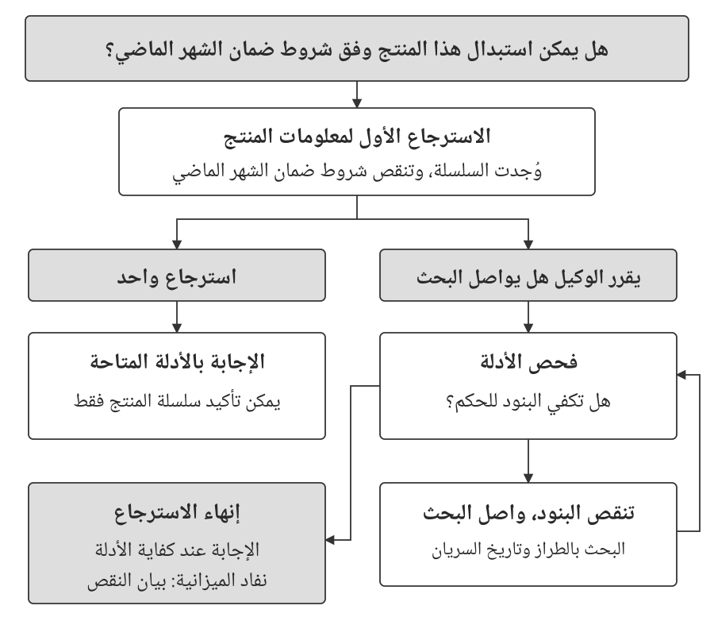

لنأخذ ReAct مثالًا: يحلل النموذج السؤال أولًا ويختار الاستعلام، ثم يستدعي `knowledge_base_search`؛ وبعد أن تعيد الأداة الملاحظة، يحكم النموذج على كفاية الأدلة. فإذا نقصت شروط أو أطراف ذات صلة، أعاد صياغة الاستعلام وواصل الاسترجاع؛ وإذا اكتملت المواد، ولّد الإجابة مستندًا إلى المصادر. ويتولى Harness صيانة السجل واستدعاءات الأدوات والميزانية، فينهي البحث أو ينتقل إلى الاستيضاح عند بلوغ الحدود.

ثم انظر إلى الشكل 3-13. حتى لو استُبدل بالفهرس المتجهي في الواجهة الخلفية لقاعدة المعرفة رسمٌ بياني للعلاقات، يستطيع النموذج أن يواصل طلب البحث عبر واجهة الأداة نفسها. فإذا تضمنت إحدى الوثائق المعادة فقرة فيها تعليمات، فهل يجوز للنموذج أن ينفّذها؟

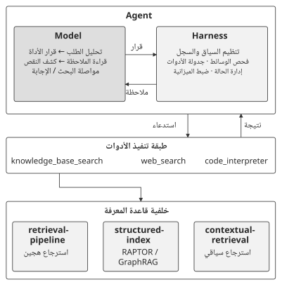

**حدود الثقة في المحتوى المسترجع.** قد تتضمن الوثائق الخارجية نصوصًا تحاول تغيير سلوك النموذج، وقد تُضاف إليها حقائق خاطئة قبل إدخالها القاعدة. الحالة الأولى من حقن الأوامر غير المباشر، والثانية من تسميم قاعدة المعرفة. ومعالجتهما تتطلب إدارة مصدر المحتوى وصلاحيات التنفيذ معًا: تحمل نتائج الاسترجاع مصدرها وإصدارها وموضع الاستشهاد، وتُستخدم دليلًا للإجابة؛ أما الإجراءات مثل تحويل الأموال والحذف وإرسال الرسائل إلى الخارج، فيتحقق منها Harness وبيئة التنفيذ بناءً على تفويض المستخدم. وتزيد مراجعة الإدخال وتتبّع المصدر والتحقق من الحقائق في الحد من انتشار المعرفة الخاطئة. وهنا تعمل وسوم المصدر التي عرضها الفصل الثاني وقيود الأدوات في الفصل الرابع معًا.

> **التجربة 3-8 ★★: مقارنة بين الاسترجاع الواحد والاسترجاع متعدد الجولات**
>
> تستخدم هذه التجربة مادة قانونية صينية واحدة ومسترجِع BM25 واحدًا والنموذج نفسه، لتقارن بين نمطين على سبعة أسئلة: يبحث خط الأساس مرة واحدة بالسؤال الأصلي، ويسمح النمط الوكيلي للنموذج بتعديل الاستعلام وتنفيذ أربع عمليات بحث على الأكثر.
>
> في استعلام مثل «ما أحكام الدفاع الشرعي؟»، يكفي الاسترجاع المباشر للحصول على النصوص الرئيسية. أما المثال الأعقد فهو «كيف تُقدَّر العقوبة على من تسبب بإهماله وهو سكران في إصابة شخص إصابة بالغة، وله سابقة سرقة؟». فهو يتعلق في آن واحد بالفعل الحالي وحالة السكر والسجل السابق، ويتطلب الاسترجاع تحديد موضع المواد المتعلقة بكل منها على حدة، ثم فحص شروط الانطباق.
>
> بحث التشغيل الفعلي بالترتيب عن «سكر إهمال إصابة بالغة سابقة سرقة تقدير العقوبة» و«سكر جريمة تقدير العقوبة» و«سابقة سرقة أثرها في العقوبة قانون العقوبات» و«سابقة أثرها في العقوبة قانون العقوبات». ثم اقترح النموذج بعد ذلك «العود إثباته قانون العقوبات»، لكن ميزانية البحث كانت قد نفدت، فأعاد Harness رسالة تفيد بنفاد الميزانية.
>
> وفي الأسئلة المعقدة الأربعة التي حددتها التجربة، ارتفعت تغطية المواد القانونية المستهدفة من نحو 8% إلى 92%، وزاد متوسط عدد عمليات البحث من مرة واحدة إلى 3.5 مرات، وارتفع متوسط زمن مرحلة الإجابة من نحو 8 ثوانٍ إلى 66 ثانية. أما الأسئلة البسيطة الثلاثة فبلغت تغطية الأدلة فيها 100%، ولم تبحث المجموعتان فيها إلا مرة واحدة.

ويمكن استخدام حلقة الاسترجاع نفسها مع سجل المستخدم. ونعود فيما يلي إلى مجموعة التقييم ثلاثية المستويات في التجربة 3-1، لنلاحظ كيف يستعيد الوكيل الحقائق من السجلات الممتدة عبر الجلسات، ويميّز بين الأطراف، ويعالج التحديثات.

> **التجربة 3-9 ★★: قراءة ذاكرة المستخدم بالاسترجاع الوكيلي**
>
> تتخذ هذه التجربة سجل المحادثات كاملًا قاعدةً للمعرفة، فتقطّعه بنوافذ ثم تبني له فهرسًا، وتقدّم للوكيل الأداة `search_user_memory`. ويمكن ضبط حجم النافذة؛ ففي هذا التشغيل تضم كل قطعة ثماني جولات من المحادثة، وتتداخل القطع المتجاورة بجولتين، ويُحفظ معها معرّف الجلسة والزمن والبيانات الوصفية للعمل. ويُنفَّذ الاستعلام ثلاث مرات على الأكثر، ويستعيد كل منها أربعة مقاطع.
>
> في الاستدعاء الأساسي يمكن البحث حول حقل واضح، مثل «ما رقم حسابي الجاري؟». أما الأسئلة الممتدة عبر الجلسات فتتطلب كذلك التحقق من اكتمال الأطراف: فالمستخدم يملك Honda Accord وTesla Model 3 معًا، وعند السؤال عن ترتيبات خدمة السيارة يجب أن يميّز النظام بين السيارتين وحالة موعد كل منهما.
>
> ويمكن بناءً على ذلك تصميم مسار للاسترجاع: البحث أولًا في سجلات السيارات والخدمة؛ ثم الاستعلام عن ترتيبات Tesla بعد العثور على خيط يدل على السيارة الأخرى؛ وأخيرًا بيان الموعد القائم لسيارة Honda، والتأكد مما إذا كان المستخدم ما يزال يحتاج إلى حجز موعد لسيارة Tesla. أما السجل الفعلي لهذا التشغيل فلم ينفّذ إلا الاستعلام `scheduled car services`، فتركزت إجابة مجموعة الاسترجاع العادي على Honda وأغفلت Tesla.
>
> وثمة صعوبة من نوع آخر مصدرها التعديلات المتتالية. ففي حالة التحويل المالي، أعدّت الزوجة الترتيب، ثم عدّل الزوج المبلغ والتاريخ، ثم عدّلته الزوجة مرة أخرى. وبعد استعادة السجلات، يجب إعادة بناء التغيرات بحسب الزمن والطرف وحالة التأكيد، للعثور على التعليمات السارية في النهاية. ومع أن التقطيع الحالي يحفظ المعلومات الزمنية، فقد يفوت الاسترجاع تعديلًا حاسمًا، ولذلك يمكن المضي أبعد بإضافة خلفية الحدث إلى المقاطع.
>
> ومن هذه الحالات الستين، بحثت 18 حالة مرة واحدة، و6 حالات مرتين، واستنفدت 36 حالة المرات الثلاث. واجتازت مجموعة الاسترجاع بالتقطيع العادي 47 حالة: 19 في الاستدعاء الأساسي، و15 في الاسترجاع عبر الجلسات، و13 في الخدمة الاستباقية. ويواصل القسم التالي المقارنة على الحالات نفسها بين بادئات السياق والذاكرة المنظَّمة، ويحلل ما يضيفه كل منهما من معلومات.

### الاسترجاع المراعي للسياق: إضافة الخلفية إلى المقاطع

لنعد إلى ذلك التقرير المالي. لكي نبحث عن أداء شركة ACME في الربع الثاني من عام 2025، يتضمن الاستعلام اسم الشركة والسنة، لكن المقطع الذي ورد فيه «نمت إيرادات الشركة بنسبة 3%» يخلو بالذات من هاتين الكلمتين. فإلى جانب تكبير القطع، يمكن الإبقاء على هذا النص القصير وإضافة الخلفية الناقصة قبله. فـ **الاسترجاع المراعي للسياق (Contextual Retrieval)** يولّد عند بناء الفهرس بادئة قصيرة تشرح خلفية المقطع، ثم يستخدم البادئة والنص الأصلي معًا في الاسترجاع[^ch3-1]. ويبيّن الشكل 3-14 هذه المعالجة.

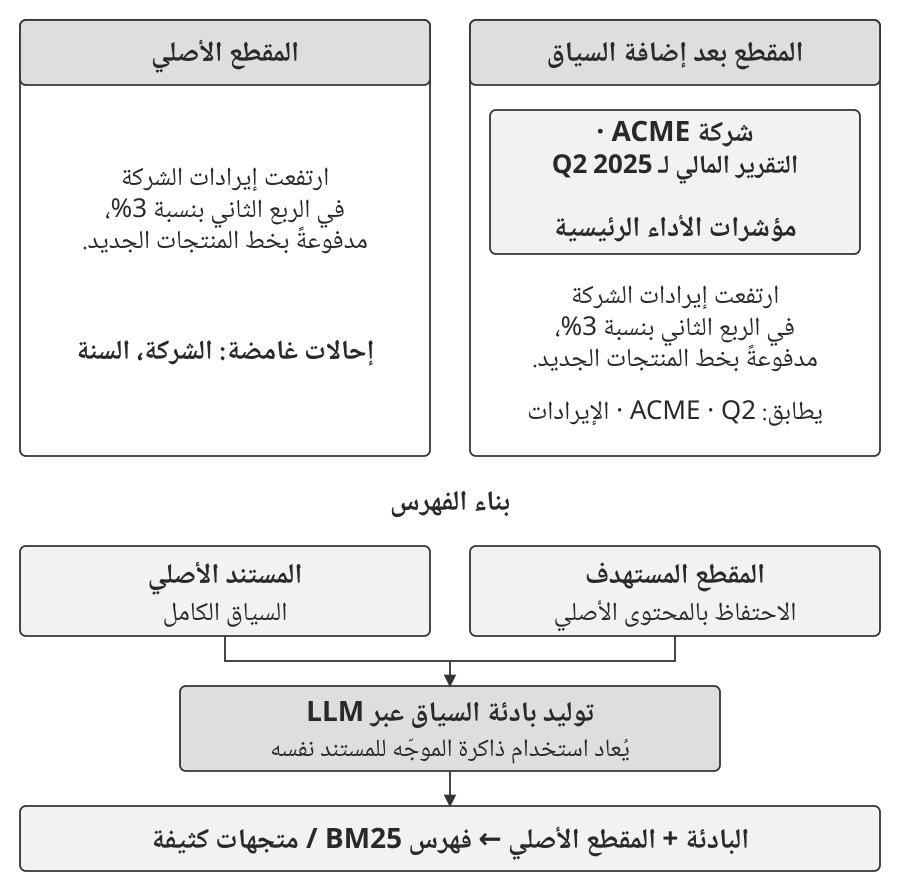

فيمكن للبادئة مثلًا أن تبيّن أن «هذه الفقرة مأخوذة من قسم مؤشرات الأداء الرئيسية في تقرير شركة ACME للربع الثاني من عام 2025». وعند التوليد يُقدَّم للنموذج النص الأصلي والقطعة المستهدفة معًا، ليضيف ما له أساس ثابت من الإحالات والزمن ومعلومات القسم. وبذلك يحصل BM25 على مصطلحات قابلة للمطابقة كاسم الشركة والربع، ويستطيع التضمين الكثيف أيضًا أن يمثّل المقطع في ضوء هذه الخلفية.

ويمكن الجمع بينه وبين الضغط المراعي للسياق في الفصل الثاني: ففي مرحلة الفهرسة تُضاف الخلفية إلى قطع المعرفة لزيادة فرص اكتشاف المعلومات ذات الصلة؛ وفي مرحلة التشغيل يُرتَّب السجل المسترجع بحسب المهمة الحالية للتحكم في طول المُدخلات. فالأول يهتم بقابلية المقطع للاسترجاع، والثاني يهتم بالمعلومات التي يحتاجها القرار الحالي وبالميزانية.

[^ch3-1]: Anthropic، Introducing Contextual Retrieval، سبتمبر 2024.

> **التجربة 3-10 ★★: مقارنة بين القطع الأصلية والقطع المعزَّزة بالسياق**
>
> تبني هذه التجربة لمجموعة المواد نفسها فهرسين: يستخدم أحدهما المقاطع الأصلية، ويضيف الآخر بادئات يولّدها النموذج. ومع ثبات الاستعلامات ووسوم الأهداف، تُقارَن نتائج BM25 والاسترجاع الكثيف والاسترجاع الهجين كلٌّ على حدة.
>
> وبالعودة إلى مثال التقرير المالي، عند الاستعلام بـ «نمو إيرادات شركة ACME مؤخرًا» يمكن فحص ما إذا كان المقطع المطابق يتضمن الشركة المستهدفة والفترة وبيانات النمو معًا. فعبارة «نمو الإيرادات» وحدها قد تطابق شركات أخرى؛ أما بعد إضافة البادئة فيشارك اسم الشركة والزمن في الترتيب.
>
> في الاستعلامات الخمسة عشر لهذا التشغيل، وبعد إضافة البادئات، ارتفع recall@1 في BM25 من 0.60 إلى 0.80، وفي الاسترجاع الكثيف من نحو 0.867 إلى 0.933؛ وبقي recall@3 لهما على 0.867 و1.0 على التوالي. وارتفع recall@5 في الاسترجاع الهجين من 14/15 إلى 15/15. فأي سؤال هو الذي استُعيد إضافيًا؟ إنه الاستعلام عن صلاحيات اللجنة الدائمة للمجلس الوطني لنواب الشعب، إذ سرد المقطع المستهدف الصلاحيات لكنه افتقر إلى الفاعل. وبعد إضافة البادئة، رفعه BM25 من المرتبة 16 إلى المرتبة 12، فبقي خارج النتائج الخمس الأولى؛ ورفعه الاسترجاع الهجين من المرتبة 6 إلى المرتبة 5، فدخل النتائج الخمس الأولى. وبالرجوع إلى النص الأصلي، نجد أن المقطع الأول يسرد الصلاحيات من البند (1) إلى البند (4)، وأن المقطع الخامس يتابع من البند (4) إلى البند (22). والتقدير لا يفحص إلا دخول المقطع الخامس الموسوم، أما سرد الصلاحيات كاملةً فيتطلب وصل المقطعين.
>
> ويضيف توليد البادئات استدعاءات في مرحلة الفهرسة. وعند توليد الخلفية لعدة قطع من المستند نفسه، يمكن إعادة استخدام التخزين المؤقت لبادئة المستند. وقد قدّرت Anthropic في تقريرها لعام 2024، على أساس قطع من 800 token ومستندات من 8000 token وطول محدد للتلقين، أن كلفة المعالجة لمرة واحدة تبلغ نحو 1.02 دولار لكل مليون token من المستندات.
>
> وفي ذلك التقرير، خفّض التضمين السياقي مع BM25 معدل فشل الاسترجاع في أول 20 نتيجة من 5.7% إلى 2.9%، أي بانخفاض نسبي قدره نحو 49%؛ وبعد إضافة إعادة الترتيب انخفض إلى 1.9%، أي بانخفاض نسبي قدره نحو 67%. ومعدل الفشل المعتمد في التقرير هو $1-\mathrm{recall@20}$.

وفي مستودعات الوثائق التي تُستعلم كثيرًا ومحتواها مستقر نسبيًا، يوصي المؤلف بتقديم استكمال خلفية المقاطع عند بناء الفهرس، فمعالجة واحدة تخدم استعلامات لاحقة كثيرة. فإذا ضاع اسم الشركة أو صاحب الحدث أو الزمن عند التقطيع، فإن مجرد زيادة عدد النتائج المسترجعة قد يجلب دفعة من المقاطع غامضة الإحالة. أما استكمال هذه الخيوط عند توليد البادئات فيتيح للاسترجاع اللاحق أن يستخدمها في تحديد موضع المواد.

> **التجربة 3-11 ★★★: تعزيز الذاكرة ببادئات السياق والبطاقات المنظَّمة**
>
> عبارة «حسنًا، احجز هذا» في المحادثة تحتاج إلى ربطها بالمنتج أو الرحلة التي سبق ذكرها. فإذا كان النص الأصلي يناقش تذكرة طيران باتجاه واحد من شنغهاي إلى سياتل بسعر 500 دولار، أمكن للبادئة أن تضيف هذه الخلفية، مع الاحتفاظ بالجلسة والزمن اللذين جرى فيهما التأكيد.
>
> تضيف هذه التجربة إلى التقطيع العادي إعدادين: مجموعة بادئات السياق، ومجموعة الذاكرة ثنائية الطبقة التي تحمّل كذلك Advanced JSON Cards. يولّد النموذج أولًا سلسلة عمليات البحث استنادًا إلى الفهرس العادي، ثم تُستخدم مجموعة الاستعلامات نفسها على الفهرسين؛ وتستخدم المجموعة ثنائية الطبقة نتائج الاسترجاع المعزَّز نفسها، وتضيف إليها البطاقات المنظَّمة.
>
> في حالة التحويل المالي، تبيّن البادئات على التوالي أن Patricia بدأت التحويل، وأن James عدّل الترتيب، وأن Patricia عدّلته مرة أخرى، فتساعد على تحديد ترتيب الأحداث. والحالة النهائية في السجلات الأصلية 95,000 دولار في 1 أكتوبر، وقد حلت محل الترتيبات السابقة. وفي هذا التشغيل عثرت المجموعات الثلاث كلها على هذه الحالة بصورة صحيحة.
>
> وتستطيع البنية ثنائية الطبقة أيضًا دعم الربط الاستباقي. فالبطاقات تحفظ الحقائق الرئيسية مثل «رحلة طوكيو» و«صلاحية جواز السفر»، وتُسترجع المحادثات التفصيلية عند الحاجة. فإذا أخذنا رحلة من 15 إلى 22 يناير وجواز سفر تنتهي صلاحيته في 18 فبراير مثالًا، أمكن للنظام أن يكتشف أولًا تقارب التاريخين، ثم يستعلم عن سجلات التجديد ومتطلبات الرحلة، وأخيرًا يذكّر المستخدم بالتحقق من الاستعدادات التي لم تكتمل. وفي حالة السفر هذه، اجتازت إجابات المجموعات الثلاث كلها التحكيم؛ وإنما ظهر الفرق بين البطاقات والاسترجاع أساسًا في حالة السيارات والحالات الممتدة عبر الجلسات المذكورة أدناه.
>
> ومن الحالات الستين كلها، اجتاز الاسترجاع العادي وبادئات السياق والذاكرة ثنائية الطبقة على التوالي 47 و52 و57 حالة. وزادت حالات الخدمة الاستباقية التي اجتازتها مجموعة البادئات من 13 إلى 18؛ واجتازت المجموعة ثنائية الطبقة الحالات العشرين كلها في مستوى الاسترجاع عبر الجلسات، و18 حالة كذلك في مستوى الخدمة الاستباقية. ففي حالة السيارات، أضافت البطاقات معلومات السيارة الثانية، فساعدت الإجابة على تغطية الطرف الذي أُغفل سابقًا. ولننظر في أحد مواضع التراجع: سأل المستخدم عن نطاق تغطية أضرار المياه في عقاراته، فذكرت المجموعة العادية المنزل الذي يسكنه والمنزل المؤجر، بينما أغفلت مجموعة البادئات المنزل المؤجر. وتُظهر المقارنة سؤالًا بسؤال أن مجموعة البادئات أجابت إجابة صحيحة عن 8 أسئلة زيادةً على المجموعة العادية، لكنها خسرت 3 أسئلة كانت تجيب عنها إجابة صحيحة من قبل.

**حين تلزم الخدمة الاستباقية، يقدّم المؤلف البنية ثنائية الطبقة: حقائق رئيسية مقيمة في السياق، وسجلات تفصيلية تُسترجع عند الحاجة.** فبالاسترجاع وحده يحتاج النموذج في الغالب إلى معرفة ما يجب أن يسأل عنه قبل أن يعثر على السجلات المتصلة به؛ ولهذا يسهل أن يُغفل جواز السفر أو السيارة أو العلاقات العائلية التي لم تدخل مجال رؤيته بعد. أما وضع عدد قليل من الحقائق الرئيسية في السياق مسبقًا، فيساعد النموذج على اكتشاف الروابط وصياغة الاستعلامات، ثم استعادة التفاصيل الأصلية. وعند اختيار المعلومات المقيمة، يجب مراعاة العلاقات بين الأشخاص والقيود الحالية والأمور التي لم تُنجز؛ أما نتائج الاسترجاع فتحتفظ بالمصدر والزمن وأساس التغيير.

### استخراج المعرفة من مجموعات البيانات: من الحالات إلى التمثيل المنظَّم

يمكن أن تأتي المعرفة أيضًا من ترتيب أعداد كبيرة من الحالات. ففي الأحكام القضائية وتذاكر خدمة العملاء وسجلات الصيانة، تتوزع معلومات نافعة كثيرة في ثنايا السرد التفصيلي. وحين تتطلب المهمة استخلاص أنماط من حالات كثيرة، أو مقارنة النتائج، أو تحديد ما يجب السؤال عنه، يوصي المؤلف باستخراج حقول موحدة أولًا، ثم إجراء الإحصاء وترتيب النماذج الأولية. فاستعادة بضع حالات مشابهة لا تكشف التوزيع في مجموعة البيانات كلها؛ أما بعد توحيد الحقول، فيمكن إجراء الإحصاء على الدفعة كلها من السجلات، وتقديم نظرة عامة للاستعلامات اللاحقة عن الحالات الفردية.

ويمكن تقسيم هذه العملية إلى خطوتين. **استخراج المعرفة** يحوّل الأوصاف الأصلية إلى سجلات منظَّمة، ويحدد معاني الحقول وقيمها ومصادرها؛ و**تحليل الأنماط** يستعين بعد ذلك بالإحصاء والتجميع للبحث عن الحالات المتشابهة وسماتها المشتركة. ويبيّن الشكل 3-15 المسار من استخراج الحالات وترميز السمات إلى استرجاع النماذج الأولية.

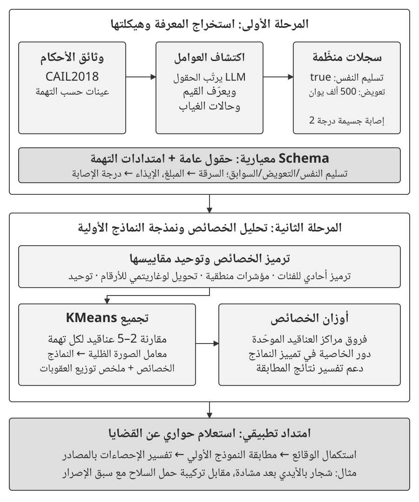

> **التجربة 3-12 ★★★: استخراج العوامل والنماذج الأولية من القضايا القضائية**
>
> تستخدم هذه التجربة مواد القضايا الجنائية في CAIL2018، وتختار عينات من ثلاث فئات هي السرقة والإيذاء العمد والاحتيال، لبناء مسار تعليمي من «اكتشاف العوامل ← استخراج الحقول ← التجميع ← تفسير النماذج الأولية»[^ch3-cail]. يؤخذ من كل فئة 120 سجلًا للنمذجة، ويُحتجز 20 سجلًا آخر، فتتكون 360 عينة للنمذجة و60 عينة محتجزة.
>
> **اكتشاف الحقول وترتيبها.** يقرأ النموذج عينات النمذجة على دفعات أولًا، ويقترح العوامل التي قد تكون نافعة، ثم يدمجها في Schema معيارية. يحفظ الجزء العام الحقول التي تستحق الاهتمام في عدة تهم، مثل تسليم النفس والتعويض؛ ويحفظ الجزء الموسَّع المعلومات المتعلقة بتهمة بعينها، مثل المبلغ موضوع القضية أو حالة الإصابة. وأسفر الترتيب في هذا التشغيل عن 16 حقلًا عامًا، وثلاث مجموعات موسَّعة تضم 12 و12 و11 حقلًا على التوالي. ويجب أيضًا تعريف قيم كل حقل وحالة غيابه، لضمان اتساق الاستخراج.
>
> **ترميز الحقول في متجهات.** يمكن ترميز الحقول الفئوية بالترميز الأحادي الساخن (one-hot): فإذا أخذنا فئات السرقة والسلب والاحتيال مثالًا توضيحيًا، رُمّزت على التوالي `[1,0,0]` و`[0,1,0]` و`[0,0,1]`، ولا يدل كل موضع إلا على الانتماء إلى الفئة المقابلة أو عدمه. أما استخدام 1 و2 و3 فيُدخل في بعض الخوارزميات ترتيبًا ومسافات بين الفئات. ويمكن تمثيل الحالتين المؤكدتين في حقول مثل «هل سلّم نفسه؟» و«هل عوّض؟» بـ 1 و0؛ أما الحالات التي لم يذكرها النص الأصلي فيجب معالجتها على حدة، حتى لا يُعدّ الغياب نفيًا تلقائيًا.
>
> وللقيم العددية غير السالبة واسعة المدى كالمبالغ، يضغط هذا التنفيذ المقياس أولًا بـ $\ln(1+x)$، ثم يُدخلها في التوحيد القياسي. وإذا سمح حقل بظهور عدة فئات معًا، كأن يتضمن السجل عدة تدابير، أمكن تخصيص مؤشر لكل فئة، فيتكون ترميز متعدد الساخن (multi-hot).
>
> **بناء النماذج الأولية للقضايا.** تُوحَّد السمات المرمَّزة قياسيًا، ثم تُجمَّع لكل تهمة على حدة. ويقارن هذا التنفيذ بين عنقودين وخمسة عناقيد، ويختار التقسيم بمعامل الصورة الظلية (silhouette)، فتتكون في النهاية 11 نموذجًا أوليًا. ويحفظ كل نموذج أولي عدد العينات والسمات الرئيسية، ووسيط مدة العقوبة في العينات وربيعاتها ومداها. فيمكن مثلًا المقارنة، حول سبب النزاع وطريقة ارتكاب الفعل ونتيجة الإصابة، بين توليفات سمات مختلفة كالشجار باليدين بعد مشادة كلامية والفعل المدبَّر مع حمل سلاح؛ أما التقسيم الفعلي فتحدده نتائج الاستخراج والتجميع معًا.
>
> **تفسير السمات ونتائج المطابقة.** يحسب البرنامج أوزان السمات في التمييز بين النماذج الأولية من الفروق بين المراكز الموحَّدة للعناقيد. أما مطابقة النماذج الأولية فتسقط الحالة الجديدة على فضاء السمات نفسه، وتستعيد الملخص الإحصائي للمجموعة القريبة وأسسه، ليستعين بها النموذج في صياغة التفسير.
>
> اختير في هذا التشغيل 12 سجلًا من العينات المحتجزة الستين لتوليد تفسيرات لها، ثم سُلّمت إلى نموذج تحكيم مستقل. لننظر أولًا في إحدى عينات السرقة: النموذج الأولي الذي طابقته لا يضم إلا سجل نمذجة واحدًا، ومدة العقوبة فيه 4 أشهر، فكانت القيمة الدنيا والوسيط والقيمة العليا كلها 4. وأورد المولِّد هذا الرقم بأمانة، وأشار إلى أنه لا يوجد للاستئناس إلا سجل واحد. فمنح المحكّم بند «مطابقة الأرقام للنموذج الأولي» 4 درجات (الدرجة الكاملة)، بينما كان الوسم الفعلي للعينة المحتجزة 8 أشهر.
>
> وإذا استُخدم استرجاع النماذج الأولية في المحادثة، أمكن السؤال أولًا عن الحقائق الناقصة التي قد تؤثر في المطابقة، ثم إعادة الاسترجاع بناءً على الإجابات.

[^ch3-cail]: CAIL2018، مشروع مجموعة البيانات الرسمي. تأخذ التجربة المرافقة عينات من المواد العامة، وتستخدم تقسيمًا داخليًا للعينات في النمذجة والتقييم.

ومن الحالات إلى النماذج الأولية، تكتسب قاعدة المعرفة طبقة إضافية من التمثيل الإحصائي القابل للاسترجاع. فالنص الأصلي يقدّم الأدلة، والحقول تدعم الحساب، والنماذج الأولية تلخص السمات المشتركة للعينات المتشابهة؛ ولا بد من الحفاظ على التقابل بين الثلاثة حتى يمكن الرجوع والتصحيح عند اكتشاف أخطاء في الاستخراج أو انحياز في العينات.

### استكشاف الحدود: الذاكرة متعددة الوسائط والذاكرة البارامترية

تخيّل أن المستخدم يشير إلى صورة رفعها سابقًا ويقول «أريد هذا اللون تحديدًا». فإذا لم يحفظ النظام حينها إلا عبارة «معطف أزرق»، فقد يعجز في المرة القادمة عن التمييز بين درجتين من الأزرق. وكذلك يضيع جزء من التفاصيل عند تحويل نبرة الصوت أو العلاقات المكانية في الرسوم البيانية إلى نص. ولإتاحة فرصة استعادة هذه المعلومات في الاستعلامات المقبلة، يمكن حفظ المواد الأصلية، أو حفظ تمثيلات قابلة لاستخدام النموذج، أو المضي أبعد بدراسة الذاكرة الدائمة داخل النموذج.

**المسار الأول: تكامل المواد الأصلية مع الفهرسة النصية.** ففي مهمة ترتيب ألبوم صور بتفويض من المستخدم مثلًا، يمكن قص المناطق الجزئية كوجوه الأشخاص وحفظها، والإحالة إلى الصور في مداخل Markdown، مع تسجيل زمن التصوير والمشهد ووسوم الأشخاص التي قدّمها المستخدم. وعند الاسترجاع، يُعثر أولًا بحسب الوصف على بضع صور محتملة الصلة، ثم تُقرأ الصورة الأصلية أو المنطقة المقصوصة لمقارنة تفاصيل المظهر. ويمكن كذلك ربط المقاطع الصوتية بزمنها ومصدرها ونصها المكتوب، وإعادة تشغيل الصوت الأصلي عند الحاجة. فالنص يوفّر المدخل، والمواد الأصلية تحتفظ بالتفاصيل التي يصعب تلخيصها بالكلمات.

**المسار الثاني: تخزين التضمينات وتحميلها عند الحاجة.** يستطيع المرمِّز البصري أو الصوتي تحويل المواد إلى متجهات تُخزَّن في فهرس، لاستخدامها في الاسترجاع بالتشابه. فيمكن مثلًا ترميز المناطق الجزئية من الصور أو المقاطع الصوتية، وربط كل منها بمدخل الذاكرة المقابل. وإذا كان النموذج يدعم طبقة إسقاط مدرَّبة وواجهة للذاكرة، أمكن أيضًا حجز مجموعة من الخانات في السياق لتحميل هذه المتجهات المتصلة، ليصل إليها النموذج عبر الانتباه. والمشكلة التي يجب حلها هنا هي مواءمة تمثيلات المرمِّز مع التمثيلات الداخلية للنموذج اللغوي.

وقد قسّمت دراسة أولية أجراها المؤلف مع Noah Shi هذه المشكلة إلى خطوتين. في صورة جماعية شخصان، ويسأل المستخدم «هل الواقف بجوار النافذة هو الشخص الذي رأيناه في المرة الماضية؟». فيجب أولًا تحديد الشخص الذي يقصده المستخدم بناءً على «بجوار النافذة»، ثم مقارنة صورة هذا الشخص بالعينة المحفوظة سابقًا. فإذا أخطأت الخطوة الأولى في اختيار الشخص، فإن دقة التعرف في الخطوة الثانية لن تمنع الإجابة عن سؤال آخر. كما أبقت الورقة الحقائق التي يمكن نسخها بدقة، كالأسماء، في الذاكرة النصية، ليكون لكل نوع من المعلومات طريقة استخدام تناسبه.[^ch3-perceptmem]

[^ch3-perceptmem]: Li Bojie وNoah Shi، Parametric Multimodal User Memory؛ ويضم المشروع المرافق `19PINE-AI/multimodal-user-memory` التنفيذ وتجارب PerceptMem. وسؤال الصورة الجماعية مثال تعليمي.

**المسار الثالث: الذاكرة الدائمة داخل النموذج.** تدريب LoRA لكل مستخدم طريقة لكتابة الحقائق الشخصية في النموذج. والسؤال المباشر «أين يسكن المستخدم؟» يختلف في متطلباته من الذاكرة عن تخطيط رحلة بناءً على عنوان السكن: فالأول يقرأ الحقيقة، والثاني يتطلب فوق ذلك استخدامها في استدلال لاحق. وإذا اقتصر التدريب على استرجاع الحقائق نصًا، فقد يتذكر النموذج الإجابة، لكنه لا يبادر إلى استخدامها في المهام المعقدة. ولذلك يجب أن تتضمن عينات التدريب الأسئلة المباشرة والمهام التي تعتمد على هذه الحقائق معًا.

وتكتب دراسة المؤلف **User as Engram** الحقائق النصية في جدول الذاكرة المحلي لنموذج Engram، ويتعلم مهايئ مشترك كيفية استخدام هذه الحقائق في الاستدلال[^engram]. ويتولى البحث في N-gram بمفاتيح التجزئة تحديد موضع البنود في الجدول، وتنقل آلية البوابات المحتوى المستعاد إلى النموذج؛ ويحفظ كل مستخدم بنوده المحلية، بينما يمكن مشاركة جزء الاستدلال. وقد قارنت الورقة في تجاربها على الحقائق النصية بين الاستدعاء المباشر والاستدلال غير المباشر، وبيّنت كيف يمكن إدارة محتوى ذاكرة كل مستخدم وقدرة الاستدلال المشتركة كلٍّ على حدة.

[^engram]: Li, Bojie، User as Engram: Internalizing Per-User Memory as Local Parametric Edits، 2026.

وتوسيع هذا المسار ليشمل الوسائط المتعددة يتطلب كذلك تصميم آليات العنونة والكتابة والقراءة لتمثيلات الصور والصوت.

## ملخص الفصل

لنعد إلى طلب الحجز في مطلع الفصل. عبارة «أفضّل المقعد المجاور للنافذة» جاءت من هذا المستخدم، أما «كم قطعة من الأمتعة يمكنني حملها» فيجب البحث عنها في بنود شركة الطيران السارية في تاريخ السفر. ولو حُفظت المعلومتان كلتاهما جملةً واحدة، لسهل أن يضيع أهم فرق بينهما: على من تنطبق الأولى، ومنذ متى تسري الثانية. فإذا حُفظ المصدر والزمن وشروط الانطباق عند التخزين، صار هناك أساس عند الاسترجاع للحكم على صلاحية استخدامها هذه المرة. فالحقيقة المفردة تناسبها ملاحظة قصيرة؛ وحين يلزم بيان العلاقات بين الأشخاص أو الاحتفاظ بمجرى الأحداث، يمكن استخدام البطاقات أو فقرات النص الأصلي؛ أما التواريخ والكميات فيمكن حفظها في حقول ذات أنواع محددة يتولى البرنامج حسابها.

فإذا أخطأ المساعد في حد الأمتعة، فلنتحقق أولًا مما إذا كانت البنود السارية قد أُدخلت القاعدة، ثم في أي مقطع قُطّعت، وهل عثر عليها المسترجِع، وفي أي مرتبة جاءت بعد إعادة الترتيب، وأخيرًا ما المواد التي حصل عليها النموذج. وحين تكثر النصوص الأصلية، يمكن إبقاء نظرة عامة منظَّمة في السياق واسترجاع التفاصيل عند الحاجة. فملخصات الأقسام تساعد على العثور على الموضوعات، وفهارس العلاقات تساعد على تتبّع الروابط؛ وإذا فقد المقطع إحالاته، أمكن استكمال خلفية مصدره؛ وإذا بقيت الأدلة ناقصة بعد استرجاع واحد، استطاع الوكيل أن يغيّر الاستعلام ويواصل البحث.

وبعد أن تعلن شركة الطيران قواعد جديدة، يمكن إجراء تحديث محدود النطاق أولًا، مع الاحتفاظ بتواريخ سريان البنود القديمة والجديدة ومصادرها؛ أما ما يتراكم من مداخل مكررة وتعارضات وتغيرات في البنية فيُرتَّب دوريًا. يقدّم المقترِح التعديل، ويتحقق المدقق من الأدلة، وبعد الإجازة يُعاد بناء فهارس الخدمة. وبوجود سجل الإصدارات، يمكن إعادة تشغيل الأسئلة التي أُجيب عنها خطأً من قبل، ومعرفة الوثيقة التي استندت إليها الإجابة القديمة حينها. أما كيفية مراكمة الخبرة من نتائج التنفيذ، فسيتناولها الفصل التاسع بالتفصيل.

والعثور على أن المسموح به قطعتان من الأمتعة المشحونة لا يجيب إلا عن سؤال «هل تسمح القواعد بذلك؟». أما لكي يضيف المساعد الأمتعة إلى الطلبية نيابةً عن المستخدم، فعليه أن يعرف أي أداة يمكنه استدعاؤها، وما المعاملات التي تحتاجها، وأي إيصال يدل على إتمام العملية. وهذه نقطة انطلاق الفصل التالي.

## أسئلة للتأمل

1. ★★ يقول المستخدم: «في 1 مايو أنتقل من A إلى B، ومن 10 إلى 20 مايو أقيم في الفندق C، وخلال هذه الفترة أرسلوا الفواتير بالبريد الإلكتروني». ففي 15 مايو، كيف ينبغي للمساعد أن يجيب عن عنوان المنزل ومكان الإقامة المؤقت وطريقة تسليم الفواتير؟ صمّم قواعد للتسجيل والاستعلام، وبيّن كيف تعالج تصحيح الأخطاء الكتابية أو العناوين المتعارضة.
2. ★★ حين تتضمن الوثائق الأصلية معلومات متناقضة، قد تكتب بادئات السياق الخطأ في الفهرس معها. كيف تحفظ المصدر والإصدار والبنود غير المؤكدة، وكيف تستخدم هذه المعلومات في مرحلتي الاسترجاع والتوليد؟
3. ★★ بعد تحويل الرسوم البيانية إلى نص، ما العلاقات المكانية التي يسهل أن تضيع؟ اضرب أمثلة بجدول أو مخطط بنية أو رسم خطي، وصمّم حلًا يتكامل فيه استرجاع الصورة الأصلية والتمثيل المنظَّم والفهرس النصي.
4. ★★★ مع تحسن النماذج وقدرات السياق الطويل، أي الأعمال في مسارات التقطيع والفهرسة والاسترجاع قد يُعهد بها إلى النموذج؟ حلّل ذلك في ضوء ما يناقشه Rich Sutton في «الدرس المرير» عن البحث والتعلم، وصمّم تجربة تقارن بين إدخال المواد كاملةً والاسترجاع عند الحاجة، مع فحص جودة المهمة وكلفة الحوسبة وقيود الصلاحيات.
5. ★★★ إذا كان النموذج قد أتقن قدرًا كبيرًا من المعرفة المتخصصة، فماذا ينبغي أن تحفظ قاعدة المعرفة الخارجية؟ ناقش كلًّا من المعارف العامة، والقواعد التي تتحدث باستمرار، والمواد الخاصة، والأدلة التي تتطلب تتبعًا دقيقًا.
6. ★ ما الاستعلامات التي تدعمها الملخصات متعددة المستويات في RAPTOR، وما التي تدعمها الكيانات والعلاقات وملخصات المجتمعات في GraphRAG؟ اضرب مثالًا لكل من النظرة العامة والتفاصيل الموضعية والربط متعدد القفزات، وبيّن الأدلة التي يجب فحصها.
7. ★★ كيف تتكامل الأدلة والروابط والفهارس المتجهية في تنظيم المعرفة؟ صمّم قاعدة معرفة يصونها البشر والوكلاء معًا، وبيّن موضع كل من التنقل والبحث الدلالي وتحديث الإصدارات وتصفية الصلاحيات.
8. ★★★ بعد استخراج الحقول من الحالات وتجميعها، كيف تحكم على جدوى النماذج الأولية؟ ميّز بين أهمية سمات التجميع والقدرة على التنبؤ بالنتائج والتفسير السببي، وصمّم مسارًا للتقييم على عينات محتجزة وللمراجعة من الخبراء.
9. ★★★ صمّم مسارًا للتحديث التزايدي والترتيب الدوري لمستودع ذاكرة مستخدم مبني على Markdown. إذا استخدم المدقق والمقترِح النموذج نفسه، ولم يرَ المدقق إلا المقاطع التي انتقاها المقترِح، فما الأخطاء التي يسهل أن تفوته؟ اقترح تحسينات من ثلاث جهات: تغطية الأدلة، وصلاحيات الأدوات، وتقييم المراجعة.

[^ch3-glove]: Pennington وآخرون، GloVe: Global Vectors for Word Representation، 2014.

[^ch3-sbert]: Reimers وGurevych، Sentence-BERT: Sentence Embeddings using Siamese BERT-Networks، 2019.
