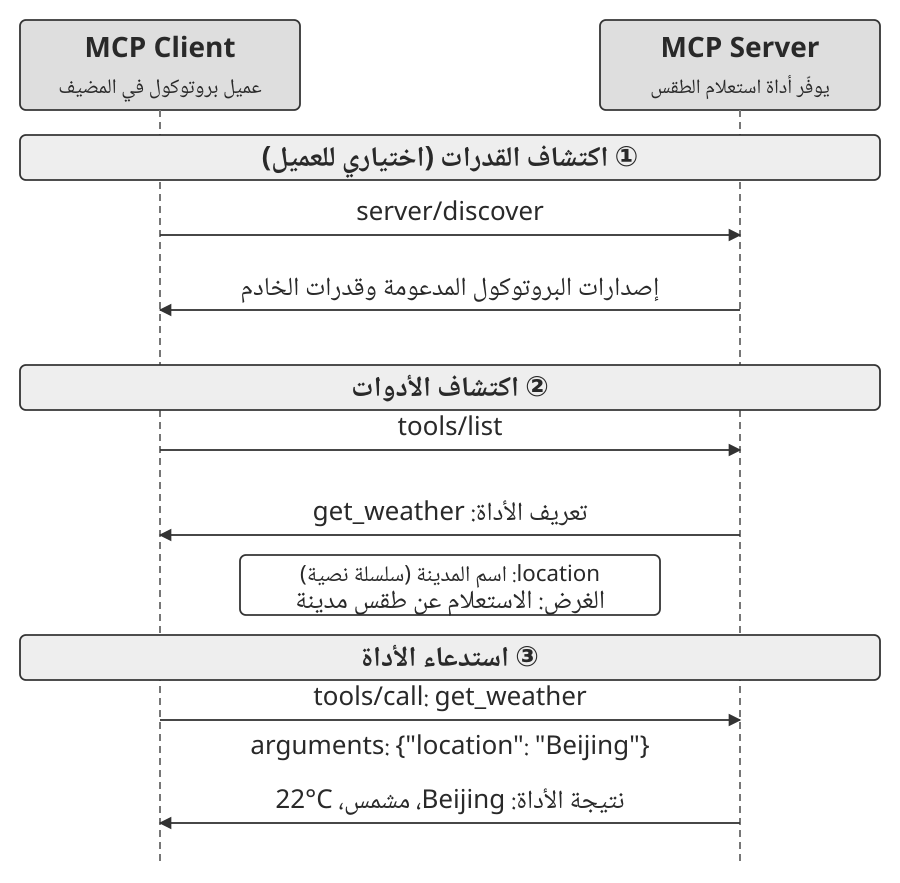
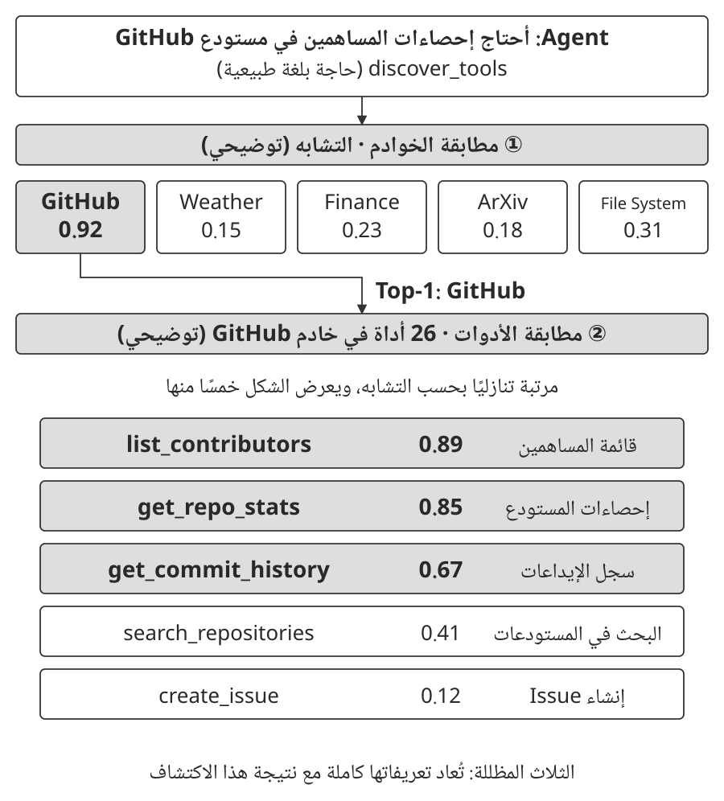
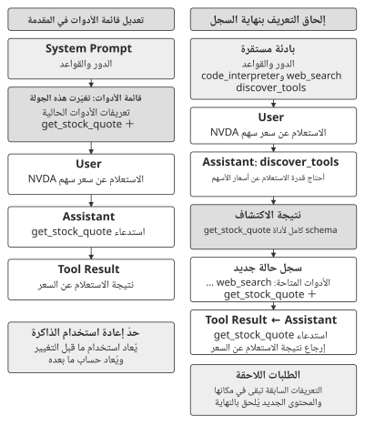
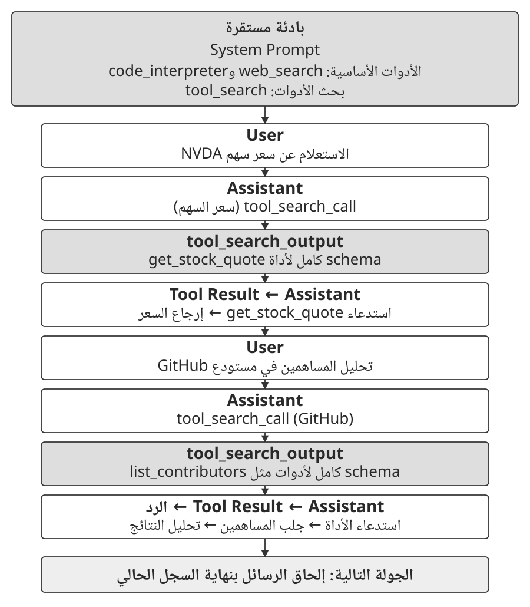

# الأدوات

في فيلم الخيال العلمي *Her*، تتولى المساعدة الذكية Samantha ترتيب البريد الإلكتروني، والمساعدة في كتابة الردود، ومتابعة شؤون النشر، والتنقل بين قنوات التواصل المختلفة. ومساعد من هذا النوع يحتاج إلى تحويل فهمه للغة إلى عمليات على أنظمة خارجية. ويُنجز الوكيل هذه التفاعلات عبر **الأدوات (Tools)**؛ فهي «حواسه ويداه وقدماه»، تمدّه بالملاحظات وتنفذ عنه الإجراءات. والوكلاء العامّون الذين يتناولهم هذا الكتاب، مثل Manus وOpenClaw، يحتاجون هم أيضًا إلى الأدوات للوصول إلى العالم الرقمي.

لنفترض أن المستخدم قال: «استخرج مواعيد التسليم المذكورة في رسائل العملاء، ورتّبها في جدول وأرسله إليّ». يستطيع النموذج أن يقرر أي رسالة يبحث فيها، لكن قراءة نصها الأصلي تتطلب الوصول إلى صندوق البريد، وإرسال الجدول يتطلب استدعاء واجهة الإرسال. فكيف ينبغي تصميم هذه الأدوات؟ وكيف يعثر عليها النموذج حين يحتاج إليها؟ يميز هذا الفصل أولًا بين خمس فئات من الأدوات، ثم يناقش وصف الأدوات وربطها واكتشافها، وينتهي بتصميم واجهات الإدراك والتنفيذ والتعاون كلٍّ على حدة. أما إطلاق الأحداث والتواصل مع المستخدم، وما يرتبط بهما من تحديد وقت إيقاظ الوكيل وكيفية نقل الرسائل عبر القنوات المختلفة، فيُرجأ تفصيلهما إلى الفصل السادس.

## تصنيف الأدوات

لنأخذ البحث في البريد مثالًا: يختار النموذج الخطوة التالية، وتتحقق منظومة التشغيل (Harness) من المعاملات والصلاحيات ثم ترسل الطلب، وتتولى خدمة البريد قراءة البيانات وكتابتها فعليًا. وقد صنّف الفصل الأول الأدوات بحسب الغرض إلى أدوات الإدراك والتنفيذ والتعاون والتواصل مع المستخدم وإطلاق الأحداث. والفئات الأربع الأولى يستدعيها الوكيل بمبادرة منه، أما أدوات إطلاق الأحداث فتتيح للأحداث الخارجية أن توقظ الوكيل هي أيضًا (الجدول 4-1).

الجدول 4-1 اتجاه الاستدعاء والغرض الرئيسي للفئات الخمس من الأدوات

| نوع الأداة | اتجاه الاستدعاء | الغرض الرئيسي |
| --- | --- | --- |
| أدوات الإدراك | استدعاء بمبادرة من الوكيل | الحصول على المعلومات الخارجية |
| أدوات التنفيذ | استدعاء بمبادرة من الوكيل | إجراء الحسابات أو تعديل الحالة الخارجية |
| أدوات التعاون | استدعاء بمبادرة من الوكيل | تفويض المهام وتبادل الرسائل وتنسيق العمل مع وكلاء آخرين أو مع البشر |
| أدوات التواصل مع المستخدم | استدعاء بمبادرة من الوكيل | الرد على المستخدم وعرض النتائج أو إرسال التنبيهات |
| أدوات إطلاق الأحداث | يهيئها المطور أو يسجلها الوكيل، ويطلقها حدث خارجي | إيقاظ الوكيل عند وقوع حدث محدد |

**أدوات الإدراك** تمكّن الوكيل من الحصول على المعلومات الخارجية، ومن أمثلتها البحث في الويب `web_search`، والبحث في قاعدة المعرفة `knowledge_base_search`، وقراءة صفحات الويب `fetch_url`، والبحث في أسماء الملفات `find_file`، والبحث في محتوى الملفات `grep_file`، وقراءة الملفات `read_file`.

**أدوات التنفيذ** تمكّن الوكيل من إجراء الحسابات أو تغيير الحالة الخارجية، ومن أمثلتها سطر الأوامر `shell_exec`، ومفسّر الشفرة `code_interpreter`، وكتابة الملفات `write_file`، وتعديل الملفات `edit_file`، وإرسال البريد الإلكتروني `send_email`. والمنفّذ العام الواحد قد يُستخدم لحسابات لا تتجاوز القراءة، وقد يُستخدم كذلك لتعديل البيانات.

**أدوات التعاون** تدعم تفويض المهام وتبادل الرسائل، ومن أمثلتها إنشاء وكيل فرعي `spawn_subagent`، وإرسال رسالة إليه `send_message_to_subagent`، وإلغاؤه `cancel_subagent`، واكتشاف الوكلاء المتاحين `list_agents`. فالمهام المستقلة يمكن معالجتها بالتوازي، كالبحث في سِيَر عدد من المؤسسين المشاركين لـ OpenAI كلٌّ على حدة؛ ويمكن أيضًا إسناد مهام مختلفة إلى وكلاء هُيّئ كل منهم بنموذج وأدوات وموجّهات (Prompts) وسياق مختلفة. وسيتعمق الفصل العاشر في بُنى تقسيم العمل والتعاون.

**أدوات التواصل مع المستخدم** تنقل المعلومات إلى المستخدم، ومن أمثلتها الرد على الرسالة `reply_to_user`، وإرسال بطاقة منظمة `send_card_to_user`، وإرسال تنبيه `send_user_notification`. وحين يمتد التفاعل إلى قنوات متعددة أو يحتاج إلى إشعارات في الخلفية، يستطيع النظام أن يغلّف إرسال الرسائل في استدعاء صريح لأداة، فيدير المستلمين والمحتوى وحالة التسليم إدارة موحدة.

**أدوات إطلاق الأحداث** تربط الأحداث الخارجية بتشغيل الوكيل، ومن أمثلتها المؤقت `set_timer`، ومراقبة المهام الخلفية `monitor_shell`، والاتصال بمصادر الأحداث `connect_channel`. وتمر العملية بخطوتين: عند التسجيل يهيئ المطور الأحداث المطلوبة مسبقًا، أو يعلن الوكيل عنها عبر استدعاء مأذون به؛ وعند وقوع الحدث يتلقى نظام الجدولة رد النداء (Callback) أو رسالة الحدث، فيوقظ الوكيل لمعالجته. وهكذا يمكن أن يصبح وصول بريد جديد، أو تنبيه من النظام، أو تذكير مجدول، أو اكتمال مهمة في الخلفية، مدخلًا جديدًا للتشغيل.

ولنعد إلى مهمة البريد التي بدأنا بها: فتح الرسالة الأصلية لاستخراج موعد التسليم إدراك؛ وإنشاء الجدول المجمّع وحفظه يغيّر مساحة العمل، فهو تنفيذ؛ وتسليم الجدول إلى صاحب الطلب تواصل مع المستخدم. ولا يدخل إطلاق الأحداث إلا إذا استأنف النظام العمل تلقائيًا عند وصول رسالة العميل التالية. وقد تتولى خدمة بريد واحدة هذه المهام كلها. والقرار التالي هو مدى دقة الأدوات التي نسلّمها للنموذج: هل ندعه يبحث في البريد ويقرأ النص ويعثر على المرفقات كلٌّ في خطوة مستقلة، أم نجمع له الخطوات التي تتكرر متتابعة في أداة واحدة؟

## المبادئ العامة لتصميم الأدوات

كان الأسلوب الشائع في المراحل الأولى لربط الأدوات هو تغليف كل نقطة نهاية في واجهة برمجة التطبيقات (API) مباشرة. وهذا الأسلوب سريع في الربط، لكنه ينتج في الغالب مجموعة من الواجهات المجزّأة تجزئة دقيقة؛ فقد يضطر الوكيل لإنجاز مهمة واحدة إلى البحث عن الكائنات مرارًا، وقراءة خصائصها، والتحقق من الشروط، ثم استدعاء واجهة التنفيذ. وعند تصميم الأدوات يمكن دمج هذه العمليات حول المهام الشائعة، كأن نصل البحث عن جهة الاتصال بإرسال الرسالة، أو نجعل البحث في السجلات يعيد الأسطر المطابقة مع سياقها مباشرة[^ch4-tool-design].

**ينبغي أن تُصمَّم الأدوات حول المهمة التي يريد الوكيل إنجازها.** ويُسمى هذا النهج في تصميم الواجهات انطلاقًا من طريقة استخدام الوكيل لها **ACI** (Agent-Computer Interface، أي واجهة التفاعل بين الوكيل والحاسوب). فإذا كان HCI يهتم بكيفية تفاعل الإنسان مع الحاسوب، فإن ACI يهتم بكيفية اختيار النموذج للعمليات، وبنائه للمعاملات، وفهمه للتغذية الراجعة، وتصحيحه للأخطاء.

[^ch4-tool-design]: Anthropic، *Writing effective tools for AI agents—using AI agents*، 2025.

### شكل التعبير عن القدرات: الأدوات المخصصة والمنفّذات العامة والمهارات

إذا أردنا أن نسند «نشر تطبيق» إلى النموذج، فيمكننا تصميم ثلاث واجهات تشغيل. الأولى تكشف أداة واحدة هي `deploy_app` وتنجز الخدمة الخطوات كلها؛ والثانية تكشف البناء والتحزيم والنشر كلًّا على حدة، ويقرر النموذج متى يستدعي الخطوة التالية؛ والثالثة تكتب الخطوات في مهارة (Skill)، ويتركها للنموذج لينفذها في الطرفية. فإذا فشل البناء، فإن الواجهة الأولى تعتمد على نتيجة الأداة لتخبر النموذج بالخطوة التي وقع فيها الخطأ، أما الأخريان فتستطيعان تسليم خطأ هذا البناء إلى النموذج مباشرة.

- **الأدوات المخصصة** تقدم واجهة منظمة لعمليات محددة. يحدد المطور مخطط المعاملات (Schema) وقواعد التحقق ومنطق التنفيذ وصيغة المخرجات، فيسهل اختبار كل أداة والإذن بها على حدة؛ وحين يدخل تعريف الأداة إلى السياق، فإن ما يشغله يتوقف على طول حقوله ووصفه وأمثلته.
- **المنفّذات العامة والمهارات** تعمل معًا: توفر الطرفية أو مفسّر الشفرة القدرة على التنفيذ، وتشرح المهارة سير العمل وشروط الاستخدام وطريقة التشغيل. ويستطيع المضيف أن يحمّل الاسم والنبذة أولًا، ثم يقرأ الشرح الكامل والموارد المرتبطة به بعد اختيار المهارة.

فقد تشرح مهارة النشر مثلًا الخطوات بالترتيب: بناء المشروع بالأمر `npm run build`، ثم تحزيم الصورة بالأمر `docker build -t app:latest .`، ثم تطبيق الموارد المعرّفة في ملف البيان على العنقود الحالي بالأمر `kubectl apply -f deploy.yaml`. وينفذ الوكيل هذه الخطوات عبر أداة الطرفية، مستخدمًا مدخل التنفيذ نفسه في كل مرة.

كيف تُنفَّذ الأداة، ومتى يقرأ النموذج وصفها، مسألتان منفصلتان. فمئات الأدوات المخصصة يمكن أن يُعرض منها فهرس فقط، وتُحمَّل مخططاتها عند الطلب؛ وعدد قليل من المهارات يمكن أن يبقى فهرسه مقيمًا في السياق، ثم يضاف البحث حين يكبر العدد. فاختيار الواجهة المخصصة أو المنفّذ العام يؤثر في طريقة تمرير المعاملات وصيانة الشفرة؛ أما اختيار تقديم كل شيء دفعة واحدة أو التحميل عند الطلب، فيؤثر في الأدوات التي يراها النموذج في هذه الخطوة. وسيناقش قسم «ماذا تفعل حين تكثر الأدوات» لاحقًا استراتيجيات الكشف.

**يوصي المؤلف بتقديم الأدوات العامة أولًا، ثم إضافة الواجهات المخصصة بحسب متطلبات الصلاحيات والمعاملات والأداء.** فإذا هيّأنا `code_interpreter` في بيئة معزولة مزودة بمكتبات SymPy وNumPy وpandas، استطاع الوكيل أن يكتب شفرة Python تنجز العمليات الحسابية الأربع، والحساب الرمزي، ومعالجة المصفوفات، وتحليل البيانات. وبهذا يُستثمر ما لدى النموذج من قدرة على توليد الشفرة استثمارًا كاملًا: فمفسّر واحد يحمل خوارزميات كثيرة، ويستطيع أن يجمع المكتبات الموجودة لمعالجة مشكلات جديدة لم تكن في الحسبان. يتولى النموذج توليد الشفرة، وتتولى بيئة التشغيل تنفيذها، مع تقييد الوصول إلى الملفات والشبكة والموارد.

وحتى عند استخدام الأدوات المخصصة، يوصي المؤلف بأن تُدمج أولًا العمليات المتقاربة وظيفيًا والتي تُستخدم معًا في الغالب. فإذا كانت الواجهات مفرطة في الدقة، اضطر النموذج إلى تذكر أسماء أكثر وتوزيع أدوار أكثر، واحتاج إلى استدعاءات أكثر لإنجاز المهمة نفسها. والمعياران الأساسيان للدمج هما **تشابه الوظائف** و**درجة تداخل سيناريوهات الاستخدام**. فالأدوات `extract_pdf_text` و`extract_docx_content` و`extract_pptx_content` كلها تستقبل مستندًا وتستخرج نصه، ويمكن دمجها في أداة واحدة هي `read_document` تميّز الصيغة عبر المعامل `file_type`. وعندئذ لا يحتاج النموذج إلا إلى اختيار مدخل موحد، ويمكن للصيغ الجديدة أن تستخدم بنية المعاملات والمخرجات نفسها.

وتلائم الواجهات المخصصة على وجه الخصوص الحالات الأربع الآتية.

1. **الحاجة إلى صلاحيات دقيقة وإلى التدقيق.** يمكن تغليف الكتابة في قاعدة بيانات الإنتاج في عملية محددة النطاق، تتحقق فيها الخدمة من صلاحيات المستخدم والجدول المستهدف والحقول المسموح بتغييرها، وتسجل مسوّغ العملية.
2. **الحاجة إلى إخفاء فروق المنصات.** يمكن تنفيذ عمليات مثل grep وfind عبر shell، لكن أداة البحث المخصصة في الملفات توحّد المعاملات والتغذية الراجعة بين macOS وWindows وLinux، كأن تعيد دائمًا اسم الملف ورقم السطر والمقطع المطابق.
3. **تكرار العملية بكثرة.** يمكن أن تُقدَّم للعمليات كثيرة التكرار مداخل قصيرة وثابتة، فتقل كلفة توليد السكربتات وشرح سير العمل مرة بعد مرة.
4. **تعقيد العلاقات بين المعاملات.** الكائنات المتداخلة، والاعتماد بين الحقول، والقيود المعقدة على القيم، كلها يناسبها التعبير عنها بالمخطط مع التحقق من قواعد العمل معًا.

**كلما تعقدت المعاملات، ازدادت أهمية طريقة تمريرها.** تصف استدعاءات الأدوات المنظمة مدخلاتها عادة بـ JSON Schema، وتدعم بعض خدمات النماذج التوليد المقيّد الذي يجعل المعاملات مستوفية لقواعد المخطط المدعومة. أما بنية المخرجات فتحددها واجهة الأداة، ثم يسلّم المضيف النتيجة إلى النموذج. وفيما عدا التحقق من الأنواع والصيغ، تبقى منظومة التشغيل وخدمة الأداة مسؤولتين عن فحص الصلاحيات، ووجود الكائن، واستيفاء الحقول المتعددة لشروط العمل.

ويمكن أن تشرح المهارة طريقة استدعاء أداة مخصصة، ويمكن أن ترشد الوكيل إلى استخدام واجهة سطر الأوامر (CLI). والطريقة الثانية تتطلب من النموذج أن يتعامل في الوقت نفسه مع صياغة سطر الأوامر وعلامات الاقتباس والتهريب، وقواعدها تختلف من shell إلى آخر. وكلما تعقدت المعاملات، كثرت التفاصيل التي يجب على النموذج أن يحسن التعامل معها. وعند مواجهة معاملات متداخلة معقدة، يمكن كتابتها أولًا في ملف JSON ثم جعل الأمر يقرأ هذا الملف، فيقل التهريب متعدد الطبقات، ويمكن التحقق من المحتوى قبل التنفيذ.

**المهارات تسهّل على المختصين في مجال العمل كتابتها وتعديلها بأنفسهم.** فمن يعرف العمل جيدًا يستطيع أن يكتب الخطوات بنفسه، أو أن يبدأ من شرح صاغه الوكيل ويعدّله. فإذا تغير ترتيب سير العمل، أو صارت خطوة ما خاصة ببعض العملاء، أو احتاج الأمر إلى مثال آخر، كفى تعديل نص الشرح، دون حاجة إلى تعديل شفرة الأداة أو إعادة نشر الواجهة. ووفق مواصفة Agent Skills، تتبع البيانات الوصفية في `SKILL.md` صيغة محددة، ويُكتب المتن بـ Markdown، ويمكن أن تُرفق به سكربتات ووثائق مرجعية وموارد أخرى[^ch4-skill-format].

[^ch4-skill-format]: Agent Skills، مواصفة الصيغة، وتشمل البيانات الوصفية والمتن والموارد المرفقة والتحميل التدريجي.

وعند اختيار شكل القدرة، يمكن الموازنة بين أربعة أبعاد.

- **الأمان والصلاحيات**: الواجهات المخصصة تسهّل تحديد نطاق العمليات؛ أما المنفّذات العامة فتُضبط قدرتها على التنفيذ عبر البيئة المعزولة وبيانات الاعتماد وصلاحيات الموارد.
- **تعقيد المعاملات**: البنى المعقدة يناسبها المخطط مع التحقق من قواعد العمل؛ أما العمليات البسيطة فيمكن تمرير معاملاتها مباشرة عبر CLI.
- **وتيرة التغيير**: سير العمل الذي يتغير كثيرًا يُكتب أولًا في مهارة، فيستطيع المختصون تعديل الشرح والأمثلة مباشرة؛ أما العمليات الأساسية المستقرة كثيرة الاستخدام فتُغلَّف بعد ذلك في أدوات أو سكربتات.
- **قدرة النموذج**: إذا كان النموذج قادرًا على توليد الشفرة والتعامل مع سطر الأوامر بموثوقية، فالأولى أن يُترك ليجمع القدرات عبر المهارات والمنفّذات العامة، فيقل عدد الأدوات المخصصة؛ وإذا كان النموذج أضعف ويكثر خطؤه في المعاملات المعقدة، فلتتحمل الواجهات المنظمة قدرًا أكبر من القيود.

**ويمكن للشفرة أيضًا أن تنسّق استدعاءات متعددة للأدوات.** فعند جلب عدد من صفحات الويب واستخراج حقول منها، يستطيع النموذج أن يولد سكربتًا ينجز التكرار والتصفية والتجميع. ويبقى النص الكامل للصفحات في متغيرات بيئة التنفيذ، ولا يعود إلى السياق إلا الحقول المختارة والإحصاءات. وتتولى الشروط والحلقات ومعالجة الاستثناءات في البرنامج وصل الخطوات بعضها ببعض، ويحلل النموذج النتائج المجمّعة مباشرة. ففي المهام التي تتضح خطواتها، كالجلب والتصفية والإحصاء على دفعات، يفضّل المؤلف ربط الخطوات بالشفرة، فتقل الجولات التي يستدعي فيها النموذج الأدوات واحدة واحدة ويقرأ النتائج الوسيطة. وكلما كثرت النتائج الوسيطة وقلّت الحقول المعادة، كان ما يوفره هذا الترتيب من السياق أكبر. وسيتعمق الفصل الخامس في هذا النوع من التنسيق بالشفرة.

وتُسمى هذه الواجهات عادة **Code Mode**. ففي خادم MCP الخاص بـ Cloudflare مثلًا، يكتب النموذج أولًا برنامج استعلام عبر `search()` ليعثر في وصف OpenAPI على نقاط النهاية والمعاملات التي يحتاج إليها، ثم يرسل عبر `execute()` شفرة JavaScript تستدعي هذه النقاط. فإذا أراد سرد سجلات DNS المستوفية لشروط معينة، استطاع البرنامج أن يستعلم صفحة بعد صفحة ويصفّي النتائج، ولا يعيد إلا السجلات المطابقة. فالخطوة الأولى توفر كلفة وضع دليل الواجهة كاملًا في السياق، والثانية توفر جولات إعادة نتائج كل صفحة إلى النموذج. أما المناطق التي تستطيع هوية التنفيذ قراءتها، وهل يحق لها تعديل السجلات، فما زال ذلك يتقرر بتفويض من الخادم.[^ch4-code-mode]

[^ch4-code-mode]: Cloudflare، تنفيذ MCP لـ Code Mode؛ وقد ناقش Armin Ronacher، متخذًا Pi 1.0 مثالًا، تقسيم الأدوار بين الأدوات التي توفرها منظومة التشغيل وبيئة التنفيذ.

### وصف الأدوات: الغرض والمعاملات والتغذية الراجعة

عند كتابة وصف لأداة، يمكن أن نتخيل أولًا الطلب الذي يُرجَّح أن يقود إلى إساءة استخدامها. فإذا قال المستخدم: «اعثر على البنود التي تذكر غرامة الإخلال بالعقد»، فإن البحث في أسماء الملفات لن يعيد إلا الملفات المطابقة أسماؤها؛ وحتى إذا حصل النموذج على مسار ملف، فلا يزال عليه أن يقرأ متنه. ووصف الأداة ينبغي أن يمكّن النموذج من أن يحدد على أساسه الواجهة التي يختارها، وما يجب أن يقدمه عند الاستدعاء، والأسئلة التي تكفي النتيجة للإجابة عنها.

**بيّن متى تُستخدم الأداة.** يمكن أن يُكتب وصف البحث في الويب هكذا: «استخدمها حين تحتاج إلى معلومات آنية أو إلى البحث عن حقائق مجهولة»، فيستطيع النموذج أن يطابق بين حاجة المستخدم وغرض الأداة. أما إذا اقتصر الوصف على «البحث عن المحتوى ذي الصلة»، فسيضطر النموذج إلى تخمين نطاق البحث وشروط الاستخدام بنفسه.

**حدّد المدخلات ونطاق البحث.** فأداة البحث في أسماء الملفات مثلًا يمكن أن تذكر: «تطابق بحسب اسم الملف ومساره؛ للبحث عن نص داخل الملفات استخدم `grep_file`». وتوضيح تقسيم العمل بين الأدوات المتجاورة يساعد النموذج على اختيار المدخل الصحيح من الاستدعاء الأول. **وفي رأي المؤلف، كثيرًا ما يكون تحديد الحالات الحدية أهم من سرد الوظائف.** فما المدخلات التي تقبلها الأداة، وأي نطاق تبحث فيه، وكيف تتصرف عند النتيجة الفارغة أو الخطأ، كل ذلك يؤثر مباشرة في قرار النموذج التالي.

**اشرح المعاملات بالقاعدة والمثال معًا.** فالمعامل `timestamp` يمكن أن يوصف بأنه «بصيغة RFC3339، مثل `2024-03-15T14:30:00Z`». فالنموذج حين يعالج مهمة معقدة يحتاج في آن واحد إلى اختيار الأداة، واستخراج المعلومات من المسار السابق، والموازنة بين الخطوات اللاحقة، وما صيغة المعاملات إلا تفصيل واحد من ذلك كله. والسلسلة الكاملة تقدم صيغة يمكن الرجوع إليها مباشرة، فيبني النموذج المعامل على منوالها، وتقل فرص الخطأ الناتج عن إعادة تفسير المصطلح.

وبالمثل، يمكن أن يوصف المعامل `phone` هكذا: «رقم الهاتف بصيغة الترقيم الدولي E.164، يبدأ بـ `+` ثم رمز الدولة ثم الرقم، ولا يحتوي بقيته إلا على أرقام، دون مسافات أو فواصل. مثل `+8613888888888` (الصين) أو `+12025551234` (الولايات المتحدة)».

**بيّن بنية المخرجات وكلفة التنفيذ.** فعبارة مثل «تعيد مصفوفة JSON، يحتوي كل عنصر فيها على ثلاثة حقول هي `title` و`url` و`snippet`» تسهّل على النموذج استخراج العنوان والمصدر والملخص. والأدوات التي يطول تنفيذها يمكن أن يُذكر في وصفها التأخير المتوقع في بيئة القياس والمدخل البديل، مثل: «قد تستغرق قراءة صفحة الويب كاملة من 5 إلى 10 ثوانٍ؛ وإذا كنت تحتاج إلى البيانات الوصفية فقط فاستدعِ `get_page_metadata`».

ويمكن كذلك إرفاق ما بين مثال واحد وخمسة أمثلة استدعاء جرى التحقق منها، تغطي الحد الأدنى من المعاملات، والتوليفات الشائعة، والشروط المعقدة. فـ JSON Schema يعبّر عن الأنواع والحقول الإلزامية ونطاقات القيم وبعض صور الاعتماد بين الحقول[^ch4-json-schema]؛ أما الأمثلة فتُظهر كيف تُطبَّق هذه القواعد على مهمة محددة، مثل: هل يُعبَّر عن الطابع الزمني بالثواني أم بالمللي ثانية، وكيف تتداخل شروط التصفية، وأي الحقول الاختيارية يظهر معًا في العادة. وفي اختبار داخلي للمعاملات المعقدة أعلنت عنه Anthropic في عام 2025، ارتفعت الدقة من 72% إلى 90% بعد إضافة أمثلة استدعاء الأدوات[^ch4-tool-examples].

[^ch4-json-schema]: JSON Schema، أنواع الكائنات والقيود على الخصائص. ونطاق كلمات المخطط المفتاحية التي تدعمها واجهة النموذج تحدده الخدمة المعنية.

[^ch4-tool-examples]: Anthropic، *Introducing advanced tool use on the Claude Developer Platform*، 24 نوفمبر 2025، قسم Tool Use Examples.

وحين يكثر خطأ الوكيل في اختيار الأداة، يوصي المؤلف بأن **يُفحص وصف الأدوات أولًا**: هل تحمل عدة أدوات أسماء متقاربة؟ وهل نطاق البحث واضح؟ وهل تفتقر المعاملات إلى أمثلة؟ وتنطبق هذه الطريقة كذلك على اسم المهارة ونبذتها وشرح تشغيلها.

### أمانة تمرير المعاملات

يطلب النموذج استبدال مقطع من النص الأصلي، فيرد طرف التنفيذ بأنه «لم يُعثر عليه». وقبل أن نطلب من النموذج إعادة الصياغة، علينا أن نسأل أولًا: هل تلقى الطرفان سلسلة المحارف نفسها؟ فالاستدعاء يمر بالتحليل والتسلسل والوكلاء الوسطاء والتغليف في بيئة التشغيل، وكل طبقة من هذه قد تغير المحتوى. و**أمانة المعاملات (Parameter Fidelity)** تقتضي أن تكون القيمة التي يراها طرف التنفيذ مساوية في معناها للقيمة التي أرسلها النموذج؛ فالتهريب الذي يفرضه البروتوكول قد يغير شكل النقل، لكن علامات الاقتباس وفواصل الأسطر يجب أن تبقى كما هي بعد فك الترميز.

ولنأخذ مثالًا مشكلة تحويل علامات الاقتباس المنحنية في أحد إصدارات Cursor في مطلع عام 2026. كانت أداة الاستبدال تستقبل `old_string` و`new_string`، وتعدّل الملف بالمطابقة التامة. وأعادت أداة القراءة علامتي الاقتباس الصينيتين المنحنيتين `“` و`”`، المقابلتين لـ `\u201c` و`\u201d`؛ فوضع النموذج النص الأصلي في `old_string`، لكن عملية تمرير المعاملات حوّلتهما إلى علامة الاقتباس الإنجليزية المستقيمة `"`. فبقي النص الأصلي في الملف دون تغيير، وأعادت أداة الاستبدال نتيجة «لا توجد مطابقة». ومهما أعاد النموذج القراءة ونسخ النص الأصلي من جديد، فإنه يواجه الفشل نفسه.

ويتأثر اتجاه الكتابة كذلك. فالنموذج يطلب كتابة علامات اقتباس منحنية، لكن الملف يُحفظ في النهاية بعلامات مستقيمة. وحين يقرأ النموذج الملف بعد ذلك، يرى محتوى مختلفًا عما أراد كتابته، فقد يحاول تصحيحه من جديد؛ وما دام التحويل يحدث، فإن كل إعادة محاولة تكرر الخطأ نفسه.

ومن المشكلات الأخرى **حقن المعاملات الصامت**. فأداة bash في إحدى بيئات التطوير المتكاملة (IDE) كانت تضيف تلقائيًا إلى `git commit` معاملًا يضع علامة تدل على أن الإيداع صادر عن الذكاء الاصطناعي. ولم تكن الإصدارات القديمة من Git تتعرف على هذا المعامل، فكان الإيداع يفشل بخطأ. والنموذج لا يرى إلا الأمر الذي ولّده بنفسه، فقد يظل يعدّل رسالة الإيداع أو معاملات أخرى، دون أن يصل أبدًا إلى المصدر الحقيقي للعطل.

وعند تشخيص هذا النوع من المشكلات، توضع المعاملات التي ولّدها النموذج، والمعاملات بعد تمريرها، والطلب المنفَّذ فعليًا، والنتيجة المعادة، جنبًا إلى جنب للمقارنة. وإذا كانت الواجهة توحّد الترميز أو تضيف معاملات للتنفيذ، فيجب أن تُكتب قواعد التحويل بوضوح، وأن تُعاد القيم المستخدمة فعليًا. ففي أدوات المطابقة التامة، قد تكفي مسافة زائدة، أو فاصل سطر ناقص، أو علامة اقتباس متغيرة، لإفشال المطابقة. ولا يستطيع النموذج أن يصحح استدعاءه التالي إلا إذا عرف ما تلقاه طرف التنفيذ فعلًا.

## النظام البيئي للأدوات: MCP ومراكز المهارات

تستخدم واجهات النماذج وأطر عمل الوكلاء المختلفة طرقها الخاصة في تعريف الأدوات، مثل function calling وtool use وتجريد Tool في LangChain. فإذا أرادت خدمة خارجية واحدة أن تتوافق مع هذه الواجهات والأطر واحدة واحدة، اضطرت إلى معالجة الوصف والمعاملات وصيغة النتائج مرة بعد مرة. وقد أطلقت Anthropic في نوفمبر 2024 **بروتوكول سياق النموذج (Model Context Protocol، MCP)**، فقدّم بروتوكولًا موحدًا لوصول تطبيقات النماذج إلى الأدوات والبيانات[^ch4-mcp-origin].

ولفهم MCP يحسن أن نبدأ بأدواره الثلاثة: المضيف والعميل والخادم. **المضيف (host)** هو تطبيق الوكيل أو بيئة التطوير المتكاملة، ويتولى التفاعل مع النموذج وتنظيم السياق وإدارة الصلاحيات؛ و**عميل MCP** داخل المضيف يتولى رسائل البروتوكول؛ أما **خادم MCP** فيقدم الأدوات والموارد وقوالب الموجّهات، ويمكن أن يعمل عملية محلية أو أن يُنشر خدمةً بعيدة[^ch4-mcp-architecture].

**تعريف الأدوات واستدعاؤها.** يحصل العميل على الأدوات المتاحة عبر `tools/list`، ويمكن أن تُعاد القائمة مقسّمة على صفحات. وتتضمن كل أداة اسمًا ووصفًا و`inputSchema`؛ ويمكن للنتائج المنظمة أن تحدد صيغتها عبر `outputSchema`. وبعد أن يختار النموذج الأداة ويولّد المعاملات، يتحقق المضيف منها، ويرسل العميل `tools/call`، فينفذ الخادم الاستدعاء ويعيد النتيجة. والمضيف هو الذي يقرر أي التعريفات والنتائج يوضع في سياق النموذج[^ch4-mcp-tools].

في الشكل 4-1، بعد أن يحصل العميل على اسم أداة الطقس ومعاملاتها، لا يزال عليه أن يرسل استدعاءً آخر حتى يعرف حالة الطقس في بكين. ويعتمد التنفيذ المرافق للكتاب إصدار MCP 2026-07-28، فيحمل كل طلب إصدار البروتوكول ومعلومات العميل وقدراته، ويستطيع العميل أيضًا أن يستدعي أولًا `server/discover` ليتعرف على الإصدارات والقدرات التي يدعمها الخادم. أما الإصدارات المبكرة فكانت تنشئ الجلسة بمصافحة `initialize`، ولذلك يلزم عند الاتصال اختيار طريقة التفاعل بحسب الإصدارات التي يدعمها الطرفان[^ch4-mcp-versioning].

وإذا تعذر الحصول على الطقس، فإن الشكل 4-1 يقدم نقطتي انطلاق مختلفتين للتشخيص. فإذا اتصل المضيف بالخادم واستدعى `tools/list` ولم يجد أداة الطقس، فينبغي التحقق من الأدوات التي نشرها الخادم، ومن أن العميل قرأ القائمة المقسمة على صفحات حتى نهايتها. أما إذا اختار النموذج الأداة الصحيحة وأبلغ الخادم عن غياب اسم المدينة، فينبغي البحث في سجل الاستدعاء عن `arguments`، والتأكد من أن اسم الحقل هو `location` كما يتطلب تعريف الأداة.

**طرق النقل.** تمرر طريقة stdio رسائل JSON-RPC عبر الدخل القياسي والخرج القياسي لعملية فرعية محلية. أما Streamable HTTP فترسل الطلبات عبر HTTP، ويمكن أن تكون الاستجابة JSON، أو أن تُعاد تدريجيًا عبر تدفق SSE. وقد حلّت Streamable HTTP محل مخطط النقل المبكر HTTP+SSE، مع استمرار استخدام SSE طريقةً للاستجابة المتدفقة[^ch4-mcp-transports].

**الموارد وقوالب الموجّهات.** تقدم الموارد (resources) بيانات قابلة للقراءة، مثل محتوى الملفات وسجلات قواعد البيانات؛ ويستطيع المضيف أن يسردها ويقرأها بحسب URI ويختار منها ما يتصل بالمهمة. أما قوالب الموجّهات (prompts) فتقدم قوالب رسائل أو مهام قابلة لإعادة الاستخدام، يختار منها المستخدم والعميل. ولما كانت الأدوات قادرة هي أيضًا على البحث والقراءة، فإن هذه العناصر الأولية الثلاثة تتقاسم العمل بحسب واجهة التفاعل: الأدوات مدخل للاستدعاء، والموارد مدخل للبيانات، وقوالب الموجّهات مدخل للمهام[^ch4-mcp-primitives].

والقيمة الجوهرية لـ MCP أنه يجعل تنفيذًا واحدًا للأداة يخدم منتجات وكلاء متعددة. فالبروتوكول الموحد يتيح للخادم الواحد أن يُعاد استخدامه في المضيفات المتوافقة، مثل Cursor وClaude Desktop وOpenClaw، ويتيح للمطورين أن يصرفوا جهدًا أكبر إلى القدرة نفسها وجودة تغذيتها الراجعة. ويتولى المضيف تحويل تعريفات الأدوات في البروتوكول إلى واجهات يستطيع النموذج استخدامها.

**مراكز المهارات (Skill Hub) تتيح اكتشاف حزم القدرات وتوزيعها.** تتضمن المهارة عادة ملف `SKILL.md`، ويمكن أن تُرفق بها سكربتات ومراجع. وتساعد منصات التوزيع المستخدمين على البحث عن هذه الملفات وتثبيتها وتحديثها. فقد أطلقت Vercel في يناير 2026 المنصة skills.sh، التي تقدم فهرسًا للمهارات وأداة لتثبيتها؛ كما يقدم ClawHub في منظومة OpenClaw البحث عن المهارات وإدارة إصداراتها[^ch4-skills-sh][^ch4-clawhub]. وبعد التثبيت، يقرأ المضيف الاسم والنبذة والشرح الكامل بحسب استراتيجية التحميل التي يتبعها. ويستطيع MCP أيضًا عبر أحد امتداداته أن يتيح اكتشاف المهارات وقراءتها، فتتكامل حزم القدرات مع بروتوكول الاتصال[^ch4-skills-over-mcp].

**الربط وتحميل السياق يُداران كلٌّ على حدة.** بعد أن يحصل عميل MCP على قائمة الأدوات، يمكنه أن يقدمها كاملة إلى النموذج، أو أن يحتفظ أولًا بفهرس ويحمّل التعريفات عند الطلب. وبالمثل، يمكن أن تُعرض للمهارة أولًا قيمتا `name` و`description`، ثم يُقرأ متنها بعد اختيارها. فقائمة الأدوات المسموح بها تحدد القدرات المتاحة، والتحميل المؤجل يحدد التعريفات المرئية في اللحظة الحالية.

**عند ربط قدرات من طرف ثالث، افحص ما تقدمه وما تنفذه فعليًا كلًّا على حدة.** فالوصف والمحتوى المعاد والشفرة المرفقة تصدر عن جهات مختلفة، وقد تختلف نطاقات التفويض أيضًا. وفي حالة MCP مثلًا، يمكن فحص ثلاثة أنواع من المشكلات كلٍّ على حدة.

1. **تسميم وصف الأدوات.** قد يحمل الوصف متطلبات تشغيلية لا علاقة لها بغرض الأداة، تستدرج النموذج إلى تجاوز المهمة الحالية. وهذا من قبيل حقن الموجّهات: محتوى من مصدر خارجي يحاول تغيير سلوك النموذج.
2. **تعديل الخادم أو اعتمادياته.** قد تغيّر ترقية الخادم سلوك الأداة، وقد يؤدي تحديث الاعتماديات أو اختراق الخدمة البعيدة إلى تلويث النتائج المعادة.
3. **الالتباس بين الأدوات المتماثلة الأسماء.** قد تقدم خوادم مختلفة أدوات بالاسم نفسه أو بأسماء متشابهة، فيخطئ النموذج أو طبقة التوجيه في اختيار الهدف. وعلى المضيف أن يحافظ على الربط بين هوية الخادم واسم الأداة، وأن يعرض المصدر، وأن يتحقق من الهدف عند الجدولة.

وقبل الربط يُراجَع الوصف والتنفيذ، ويُثبَّت إصدار ما يمكن التحكم في نشره، ويُعاد الفحص عند كل ترقية؛ ويستخدم كل خادم بيانات اعتماد بأدنى صلاحيات تتناسب مع المهمة. وإذا كانت الخدمة البعيدة تديرها جهة أخرى، فينبغي أيضًا مراقبة التغيرات في تعريفات الأدوات وسلوكها.

ويمكن أيضًا في وقت التشغيل استخدام Sidecar الذي سيأتي ذكره لاحقًا، لمراجعة الاستدعاءات المنظمة وما يلزم من مسوّغات المهمة مراجعةً مستقلة. وينبغي كذلك معاملة المسارات والنصوص والعناوين المستهدفة في معاملات الاستدعاء على أنها بيانات تحتاج إلى فحص. وتقرر نتيجة المراجعة وقواعد الصلاحيات الحتمية معًا ما إذا كان الاستدعاء سيُنفَّذ. وسيعرض الفصل الخامس «الثلاثي القاتل» الذي صاغه Simon Willison، لتحليل المخاطر الناشئة عن اجتماع البيانات الخاصة والمدخلات الخارجية والاتصال بالخارج.

وللسكربتات المرفقة بالمهارات، وخوادم MCP المحلية، والخدمات البعيدة، لكلٍّ منها موضع تنفيذ ونطاق صلاحيات خاص. وتشمل المراجعة مصدر الشفرة، وبيئة التشغيل، وصلاحيات الملفات والشبكة، ومسار انتقال بيانات الاعتماد؛ وإذا كانت الخطوات المقدَّمة من مصدر خارجي توجّه إلى تنزيل برامج أخرى أو تشغيلها، فينبغي إدراجها في سلسلة الفحص هذه أيضًا. ويمكن أن يقدم فحص المنصات قرائن مساعدة، أما عزل التشغيل وأدنى الصلاحيات ومراجعة التغييرات فهي التي تتحكم مباشرة في التنفيذ الفعلي.

[^ch4-mcp-origin]: Anthropic، *Introducing the Model Context Protocol*، 25 نوفمبر 2024.
[^ch4-mcp-architecture]: مواصفة MCP بإصدار 2026-07-28، قسما البنية ونظرة عامة على البروتوكول.
[^ch4-mcp-tools]: MCP، Tools، ويشمل قائمة الأدوات ومخططي المدخلات والمخرجات ونتائج الاستدعاء.
[^ch4-mcp-versioning]: MCP، *Versioning and Compatibility*، ويشرح البيانات الوصفية المرافقة لكل طلب، واكتشاف القدرات، وطريقة التوافق مع المصافحة في الإصدارات القديمة.
[^ch4-mcp-transports]: MCP، نظرة عامة على النقل ومواصفة النقل بإصدار 2025-11-25، وتشرح الأخيرة حلول Streamable HTTP محل مخطط HTTP+SSE المبكر.
[^ch4-mcp-primitives]: MCP، قسما Resources وPrompts.
[^ch4-skills-sh]: Vercel، *Introducing skills, the open agent skills ecosystem*، 20 يناير 2026.
[^ch4-clawhub]: OpenClaw، دليل استخدام ClawHub.

## ماذا تفعل حين تكثر الأدوات: التنظيم الهرمي والاكتشاف النشط للأدوات

حين يزداد عدد الأدوات من بضع عشرة أداة إلى المئات والآلاف، يحتاج النموذج إلى العثور على القدرة المناسبة، وإلى فهم الفروق بين الواجهات المتقاربة في آن واحد. فالتعريفات الكاملة تشغل السياق؛ وإذا كانت التعريفات في بادئة الموجّه، فقد تؤدي إضافة الأدوات أو إزالتها أو إعادة ترتيبها إلى تقصير البادئة التي يمكن إعادة استخدامها من ذاكرة التخزين المؤقت. وكلما كثرت الأدوات المتقاربة في الأسماء والأغراض، زاد احتمال أن يخطئ النموذج المدخل أو يغفل قدرة لازمة. ولذلك ينبغي أن يكون التحميل عند الطلب هو الأصل في مكتبات الأدوات الكبيرة، مع تصميم جيد لفهارس التصنيف وواجهات الاكتشاف، حتى يعثر النموذج أولًا على الأدوات المتصلة بالمهمة الحالية، ثم يختار منها واحدة بحسب غرض كل منها.

ويمكن تشبيه اكتشاف الأدوات بتصفح دليل مرتب بحسب المهام. فالفهرس يخبر النموذج أولًا بالباب الذي يبحث فيه؛ وإذا ظهرت أثناء التنفيذ حاجة جديدة، عاد ليبحث من جديد؛ وبعد أن يختار قدرة ما، يقرأ معاملاتها وترتيب عملياتها وأمثلتها. وفيما يلي يعالج كلٌّ من فهرس الفئات والبحث النشط والمهارات واحدة من هذه المسائل الثلاث، ويمكن تقديم الأدوات المخصصة والمنفّذات العامة إلى النموذج عبر هذه المداخل كلها.

### التنظيم الهرمي والتحميل عند الطلب

**قدّم الفهرس أولًا، وحمّل التعريفات عند الحاجة.** قد يشغل فهرس الأدوات قدرًا كبيرًا من السياق. وقد ضربت Anthropic مثالًا على ذلك: خمسة خوادم MCP، منها GitHub وSlack، تقدم مجتمعة 58 أداة، وتشغل تعريفاتها الكاملة نحو 55 ألف رمز (Token)[^ch4-tool-search-eval]. ويدير Cursor هذه الأوصاف بفهرس من الملفات، فلا يقدم السياق الأولي إلا معلومات موجزة كأسماء الأدوات، ويرجع الوكيل إلى التعريفات الكاملة بحسب المهمة. وفي اختبار A/B أعلنه Cursor في يناير 2026، خفّضت هذه الطريقة إجمالي استهلاك الوكيل للرموز بنسبة 46.9% في المهام التي استدعت أدوات MCP فعلًا؛ ويتفاوت مقدار التوفير بحسب عدد خوادم MCP المربوطة[^ch4-cursor-discovery].

أما التصميم المبكر لـ Pi فكان يفضّل أدوات CLI المرفقة بملف README، فيقرأ الوكيل طريقة الاستخدام عند الحاجة، ثم يستدعي القدرة عبر سطر الأوامر[^ch4-pi-no-mcp]. وطبّق الامتداد المجتمعي `pi-mcp-adapter` فكرة مماثلة على MCP: إذ يقدم للنموذج افتراضيًا أداة وسيطة واحدة بنحو 200 رمز، فيبحث النموذج عن الأدوات، ثم يطّلع على تعريفاتها، ثم يرسل الاستدعاء؛ ويؤجَّل تشغيل الخادم حتى أول استدعاء. وأضاف الإصدار 0.99 اللاحق من Pi دعمًا مدمجًا لـ MCP يعتمد هو أيضًا آلية الاكتشاف عند الطلب[^ch4-pi-mcp-adapter]. وهذه التنفيذات تفصل بين ربط البروتوكول وتحميل السياق: فالطرف الخلفي يتصل بخدمات MCP، والطرف الأمامي يساعد النموذج على العثور على القدرة المطلوبة عبر فهرس موجز أو واجهة وسيطة.

[^ch4-cursor-discovery]: Cursor، *Dynamic context discovery*، 6 يناير 2026.
[^ch4-pi-no-mcp]: Mario Zechner، *What if you don’t need MCP at all?*، 2 نوفمبر 2025، ويعرض فكرة التصميم القائمة على CLI وقراءة الوثائق عند الطلب.
[^ch4-pi-mcp-adapter]: pi-mcp-adapter، ملف README للمشروع: الأداة الوسيطة، والتشغيل المؤجل، والمقارنة مع دعم MCP المدمج في Pi.

**نظّم فهرس الأدوات بحسب المهام.** حين يكثر عدد الأدوات، يمكن تجميعها بحسب طريقة الحصول على المعلومات، فيحدد النموذج الفئة أولًا ثم يختار الواجهة المحددة:

- **أدوات البحث**: تبحث عن موضع المعلومات انطلاقًا من قرائن، مثل البحث في الويب، والبحث في قاعدة المعرفة، والبحث في الملفات.
- **أدوات القراءة**: تجلب المحتوى من موضع معروف، مثل قراءة صفحة ويب أو مستند أو سجل محدد.
- **أدوات التحليل**: تستخرج المعلومات من المحتوى غير المنظم، مثل التعرف الضوئي على الحروف (OCR) في الصور، وتحليل الفيديو، وتفريغ الصوت نصيًا.
- **أدوات الاستعلام**: تصل إلى البيانات المنظمة بحسب الحقول والشروط، مثل واجهة الطقس، وواجهة الأسهم، والاستعلام من قواعد البيانات.

ولنأخذ مثال «معرفة البيانات التي استخدمتها ورقة بحثية ما»: يعيد البحث أولًا أوراقًا مرشحة وعناوينها، ثم تجلب أداة القراءة النص الأصلي من العنوان، ثم تساعد أداة التحليل على تحديد موضع الجداول. فإذا وضعت الخطوة الأولى ورقة أخرى تحمل العنوان نفسه في الصدارة، فإن الإجابة ستكون خاطئة حتى لو قُرئ الجدول بعد ذلك بدقة.

**ضيّق نطاق الأدوات بالاسترجاع أولًا.** يستطيع المضيف، انطلاقًا من وصف المهمة، أن يجري بحثًا بالكلمات المفتاحية أو بحثًا دلاليًا في أسماء الأدوات ونبذها وشروح معاملاتها، ولا يسلّم النموذج إلا تعريفات الأدوات المطابقة. فإذا كانت الأدوات المعادة أقل من اللازم، فقد تفوت الواجهة اللازمة للخطوة التالية؛ وإذا كانت أكثر من اللازم، شغلت السياق وصعّبت الاختيار. ويمكن أن يجري البحث الأول على أساس طلب المستخدم، ثم تُستكمل الأدوات لاحقًا بحسب تقدم المهمة.

### الاكتشاف النشط للأدوات بقدرة النموذج الذاتية

كثيرًا ما تتضح حاجة المهام المعقدة إلى الأدوات تدريجيًا مع تقدم التنفيذ. فمهمة مثل «Debug the file» قد تحتاج أولًا إلى قراءة الملف، ثم إلى البحث في الاعتماديات، وتشغيل الاختبارات، وتحليل الأخطاء. والاكتفاء ببحث واحد عند بدء المهمة يجعل من السهل أن تفوت القدرات المطلوبة لاحقًا.

**دع الوكيل يطلب ما يحتاج إليه حين يحتاج إليه.** يتيح MCP-Zero للنموذج أن يولّد أثناء التنفيذ طلبات قدرات منظمة، كأن يحدد GitHub في الحقل `server`، ويصف في الحقل `tool` «البحث في المستودعات وإعادة بياناتها الوصفية». فيطابق النظام الخادم أولًا، ثم يطابق الأدوات داخله، ويضيف التعريفات المختارة إلى السياق؛ وإذا لم تكن الأدوات المعادة كافية للمهمة، استطاع النموذج أن يعدّل طلبه ويواصل البحث. وتضم مجموعة البيانات MCP-tools التي بنتها الورقة 308 خوادم و2797 أداة؛ وفي اختبار مجموعة الأدوات الكاملة لـ APIBank، انخفضت كلفة موجّهات الأدوات بنحو 98% في إعداد الجولة الواحدة وإعداد الجولات المتعددة كليهما[^mcp-zero-2025].

ويمكن في التطبيقات الهندسية أيضًا الإبقاء على أدوات أساسية مثل `web_search` و`code_interpreter`، ثم إضافة واجهة للبحث عن الأدوات. فيصف النموذج القدرة التي تنقصه، وتعيد واجهة البحث تعريفات بضع أدوات مطابقة، فيختار النموذج منها واحدة ويستدعيها. وتعتمد أداة Tool Search Tool من Anthropic طريقة الاكتشاف عند الطلب هذه: تُحمَّل الأدوات الشائعة مباشرة، ويؤجَّل تحميل البقية عبر `defer_loading`. وفي تقييم MCP داخلي أعلنته Anthropic، ارتفعت دقة Opus 4 بعد تفعيل البحث عن الأدوات من 49% إلى 74%[^ch4-tool-search-eval].

[^mcp-zero-2025]: Xiang Fei وXiawu Zheng وHao Feng، *MCP-Zero: Proactive Toolchain Construction for LLM Agents from Scratch*، 2025. ونسبة الانخفاض البالغة نحو 98% مأخوذة من إعداد مجموعة الأدوات الكاملة لـ APIBank، انظر الجدول 1 في الورقة.
[^ch4-tool-search-eval]: Anthropic، *Introducing advanced tool use on the Claude Developer Platform*، 24 نوفمبر 2025، قسم Tool Search Tool.

**ابحث عن الخادم أولًا، ثم عن الأداة.** يقدم خادم MCP في العادة مجموعة من الأدوات تدور حول منصة أو نشاط واحد. وفي مثال الشكل 4-2، يُختار خادم GitHub أولًا بحسب وصف القدرة، ثم تُنتقى من أدواته ثلاث أدوات مرشحة. وقد تتوزع العمليات المتماثلة الأسماء على منصات مختلفة، فتستبعد الخطوة الأولى طائفة من المرشحين غير المعنيين. لكن إذا فاتت هذه الخطوة الخادم الصحيح، فلن تعوّضه المقارنة الدقيقة بين الأدوات في الخطوة التالية.

وعند استخدام الاسترجاع المتجهي، يمكن حساب تضمينات (Embeddings) أوصاف الخوادم والأدوات مسبقًا، وتحديثها تدريجيًا عند تغير الفهرس. وينبغي فحص جودة المطابقة في كل طبقة: فإذا انخفض تشابه الخوادم أو الأدوات المرشحة عن عتبة محددة، أعيدت النتيجة «لم يُعثر على أداة مناسبة»، ليضيف الوكيل شروطًا أو يعيد صياغة حاجته ثم يحاول من جديد. أما المهام التي يمكن إنجازها بالمنفّذات العامة، فيمكن أيضًا تنفيذها بتوليف الأدوات الأساسية؛ وستُناقش طرق إنشاء الأدوات الجديدة وحفظها في الفصل التاسع.

**اجعل التحميل الديناميكي متوافقًا مع KV Cache.** يؤثر موضع تعريفات الأدوات في إعادة استخدام البادئة. فإذا عُدّلت قائمة الأدوات في بداية الطلب كلما اكتُشفت أداة جديدة، تغيرت البادئة بعد التسلسل، ولم يعد ممكنًا إعادة استخدام ذاكرة التخزين المؤقت إلا حتى أول موضع تغيّر. والفرق بين العمودين الأيسر والأيمن في الشكل 4-3 هو الموضع الذي تظهر فيه الأداة الجديدة لأول مرة. ففي العمود الأيمن يبقى موجّه النظام والأدوات الأساسية وواجهة البحث ثابتة، وتُلحق تعريفات الأدوات الجديدة بالسجل مع نتائج الاكتشاف؛ وتحافظ الطلبات اللاحقة على مواضع التعريفات الموجودة، وتواصل إلحاق الرسائل.

وكلٌّ من `tool_search` و`defer_loading` و`tool_search_output` في OpenAI، و`tool_reference` في Anthropic، وقد عرضها الفصل الثاني، يدعم تحميل تعريفات الأدوات عند الطلب. ويمكن لشريط الحالة أن يحتفظ على حدة بقائمة موجزة بأسماء الأدوات المتاحة، تساعد النموذج على الإلمام بقدراته الحالية.

ويسجّل الشكل 4-4 عمليتي اكتشاف للأدوات. فحين يبدأ النموذج تحليل المساهمين في GitHub، تكون تعريفات الأدوات التي استُخدمت سابقًا للاستعلام عن سعر السهم ما زالت في موضعها.

ويتطلب هذا التصميم أن يكون النموذج قادرًا على فهم تعريفات الأدوات التي حُمّلت حديثًا أثناء الجلسة، وأن يملأ المعاملات ويرسل الاستدعاءات بناءً عليها. وتعرض التجربة 4-1 مجموعة المهام نفسها على طريقتين لتحميل الأدوات، وتقارن حجم التعريفات التي تُدخلها كل منهما إلى السياق.

> **التجربة 4-1 ★★★: الاكتشاف النشط للأدوات**
>
> كيف يقلل اكتشاف الأدوات نص التعريفات الذي يواجهه النموذج في كل مرة؟ تستخدم هذه التجربة النموذج Qwen3-4B، وتقارن بين التحميل الكامل والاكتشاف النشط على مجموعة خوادم MCP واحدة تضم 127 أداة. وتعالج كل مجموعة ثلاث مهام: الاستعلام عن سعر سهم Apple والأخبار المتعلقة به؛ والبحث عن الأوراق المتعلقة بـ transformer وتنزيل الثلاث الأولى منها؛ والحصول على إحصاءات المساهمين في مستودع GitHub ورسم مخطط بياني لها. وتحتاج هذه المهام على الترتيب إلى قدرات المال والبحث، والبحث عن الأوراق وتنزيلها، والاستعلام عن البيانات وتنفيذ الشفرة.
>
> **التحميل الكامل**: توضع المخططات الكاملة لجميع الأدوات في موجّه النظام. ويتضمن سجل التشغيل المرافق بتاريخ 25 أغسطس 2026 مجموع 127 أداة، ويبلغ الفهرس كله 50,597 رمزًا بحسب المقسّم (o200k) نفسه.
>
> **الاكتشاف النشط**: لا يحتفظ موجّه النظام إلا بـ `web_search` و`code_interpreter` و`discover_tools`. وحين يواجه النموذج نقصًا في القدرات، يصف حاجته باللغة الطبيعية، مثل: «أحتاج إلى قدرة على الاستعلام عن أسعار الأسهم». فتسترجع `discover_tools` خمس أدوات مرشحة بحسب التشابه المتجهي، وتُلحق تعريفاتها الكاملة بسجل المحادثة، وتحدّث أسماء الأدوات المتاحة في شريط الحالة. ثم يختار النموذج الأداة ويواصل إنجاز المهمة.
>
> **نتائج التشغيل**: بترتيب المهام المذكورة، ألحقت مجموعة الاكتشاف النشط تعريفات أدوات بلغت 3,939 و1,853 و2,632 رمزًا على التوالي. واختارت المجموعتان كلتاهما القدرات التي تحتاج إليها كل مهمة، وتولّت طبقة مواءمة التنفيذ ملء معاملات المهمة، والتنزيل على دفعات، وتوليد شفرة الرسم، فاجتازت المجموعتان في النهاية فحص استدعاء الأدوات وفحص المخرجات.
>
> وحين نرى أن تعريفات الأدوات قد قصرت، يبقى علينا أن نسأل: هل أحسن النموذج الاختيار لأنه قرأ أقل، أم لأن الأدوات التي يسهل الخلط بينها قد قلّت؟ فالمجموعتان الأصليتان اختلفتا أيضًا في طريقة التصفية، وموضع الرسائل، وشريط الحالة، وموجّه الاكتشاف، وعدد جولات الاستدعاء. أما تجربة الاختيار أحادي الخطوة المرافقة (`selection_ablation.py`) فتضيّق السؤال إلى «أي أداة تُختار في الخطوة الأولى». فنُبقي أولًا على المرشحين أنفسهم، ونضيف نص حشو إلى رسالة النظام، لنرى هل يتغير الاختيار حين تطول المدخلات. ثم نُبقي على هؤلاء المرشحين، ونضيف عددًا مكافئًا من الأدوات المشتتة، مع تقليل نص الحشو، بحيث تبلغ مدخلات المجموعتين 6,144 رمزًا. وبذلك تبقى الأداة الصحيحة ضمن مجموعة المرشحين الأصلية، ويمكن أن ندرس بمعزل عن غيره أثر إضافة بضعة عناصر مشتتة.
>
> وعند سحب الأدوات عشوائيًا، قد لا تكون الواجهة المطلوبة في الخطوة الأولى ضمن القائمة أصلًا. ولا يُعد النموذج مخطئًا في الاختيار إلا إذا كانت الأداة موجودة في القائمة واختار غيرها.
>
> وفي السجل التفصيلي لمهمة الاستعلام عن السهم، طرح المستخدم في الحقيقة سؤالين: كم تغيّر سعر السهم؟ وما الأخبار التي تفسر هذا التغير؟ عثرت جولة البحث الأولى على خمس أدوات، فاختار النموذج الأداة الثالثة في الترتيب `yfinance_quote`. وكان السعر المعروض 310.34 دولارًا، بارتفاع نحو 0.32% عن سعر الإغلاق السابق البالغ 309.35 دولارًا، فيمكن التحقق من إجابة السؤال الأول مباشرة. أما السؤال الثاني فاستُخدمت له أداة `web_search` الموجودة أصلًا في الفهرس الأولي. فأعادت خمس نتائج بحث، تسرد ملخصاتها حركة السوق في الغالب، ولا تقدم حدثًا محددًا يفسر ارتفاع ذلك اليوم. وقد اختير النوعان اللازمان من الأدوات كلاهما، فنالت تغطية القدرات الدرجة الكاملة؛ لكن المستخدم إذا أراد معرفة سبب الارتفاع، فعليه أن يواصل البحث عن تقارير مؤرخة.

### المهارات: تحويل اكتشاف الأدوات إلى «مراجعة عند الطلب»

عرض الفصل الثاني الكشف التدريجي (Progressive Disclosure) في المهارات. ومن منظور تصميم الأدوات، فإنه ينظّم طريقة استخدام القدرات في مجموعة من المواد التي يمكن الرجوع إليها عند الطلب: يختار النموذج أولًا مهارة بحسب نبذتها، ثم يقرأ خطوات التشغيل، ثم يستدعي الأدوات أو ينفذ السكربتات بحسب حاجة المهمة.

**يمر الكشف التدريجي بثلاث خطوات.** عند بدء التشغيل تُحمَّل قيمتا `name` و`description` لكل مهارة، فيعرف النموذج القدرات المتاحة والمهام التي يلائمها كل منها؛ وبعد الاختيار يُقرأ ملف `SKILL.md` كاملًا؛ وأثناء التنفيذ يُرجع إلى الوثائق أو القوالب أو السكربتات المشار إليها فيه[^ch4-skill-format]. فعند معالجة ملف PDF مثلًا، يُحدَّد أولًا هل المطلوب استخراج النص أم ملء نموذج، ثم يُقرأ الشرح المقابل. وبهذا تبقى التفاصيل اللازمة للتشغيل محفوظة في حزمة القدرة، وتدخل السياق تدريجيًا مع تقدم المهمة. أما الكلفة الإجمالية للفهرس فتتوقف على عدد المهارات وطول نبذها.

ويشبه هذا طريقة الرجوع إلى كتاب مرجعي: ننظر في الفهرس أولًا، ثم ننتقل إلى المدخل المعني، ونواصل الرجوع إلى الأمثلة كلما واجهتنا مسألة محددة. وفي مكتبات القدرات الصغيرة نسبيًا، التي تتألف أساسًا من خطوات التشغيل والمراجع، يفضّل المؤلف فهرس المهارات مع قراءة الملفات. فهذه الطريقة تستثمر قدرة النموذج على قراءة الوثائق واستدعاء الأدوات العامة، ولا تتطلب في البداية إلا صيانة النبذ والإحالات وشروح التشغيل، فتغني عن خدمة مستقلة للبحث عن الأدوات. وحين تتسع مكتبة القدرات ويصعب تصفح الفهرس، يضاف البحث بالكلمات المفتاحية أو البحث الدلالي.

ويمكن كذلك تحميل الأدوات المخصصة عند الطلب. إذ يستطيع المضيف أن يجمع بين نطاقات أسماء الخوادم وقوائم السماح وأدوات البحث ليقرر التعريفات التي تراها المهمة الحالية، ثم يضيفها إلى السياق عبر واجهة البحث عن الأدوات. أما المهارات فتضع الخطوات والأمثلة والمراجع في بنية ملفات واحدة، فيسهل على مؤلفيها كتابتها وصيانتها.

إذا كان شرح ملء نموذج PDF نفسه يُستخدم مرارًا في جلسات كثيرة، فهل يمكن أن يُعاد استخدام حساب النموذج عند قراءة هذا الشرح أيضًا؟ لنميّز أولًا بين حالتين. ففي الجلسة نفسها، إذا أُلحق الشرح الجديد بنهاية السياق، فإن البادئة المطابقة السابقة قد تصيب ذاكرة التخزين المؤقت. أما في جلسة أخرى، فحتى إذا تطابق نص الشرح تمامًا، فإن طلب المستخدم والمواد التي تسبقه وموضعه تكون قد تغيرت في العادة، فلا تستطيع ذاكرة التخزين المؤقت العادية للبادئة أن تعيد استخدام ذلك الحساب مباشرة. وتحاول أبحاث KV Cache القابلة للتركيب، التي عرضها الفصل الثاني، أن تحسب هذا المحتوى مسبقًا بمعزل عن غيره، ثم تعدّل ترميز الموضع الدوّار (RoPE) وتدمجه في السياق الجديد. ويزداد حجم الحساب اللازم لإعادة تحديد المواضع والدمج خطيًا مع طول المقطع.

ويمكن أن يتقاسم MCP ومراكز المهارات مهمة التوزيع أيضًا. فمراكز المهارات تتولى البحث عن حزم القدرات وتثبيتها وتحديثها؛ وامتداد المهارات في MCP يتيح للعميل أن يكتشف المهارات التي يقدمها الخادم ويقرأها[^ch4-skills-over-mcp]. فالمعرفة التشغيلية نفسها يمكن أن تُحمَّل عبر حزمة قدرات محلية، ويمكن أن تقدمها خدمة MCP تدعم هذا الامتداد.

[^ch4-skills-over-mcp]: Model Context Protocol، *Skills Over MCP Charter*، ويحدد مسؤوليات امتداد Skills في الاكتشاف والتوزيع والقراءة.

وبعد العثور على الأداة، ما الذي ينبغي أن يُعاد إلى النموذج حتى يكون مفيدًا؟ ولنعد مرة أخرى إلى رسائل العملاء: فإعادة اسم الملف وحدها تكفي لتحديد موضع الرسالة الأصلية، لكن التحقق من موعد التسليم يتطلب قراءة الجملة الأصلية نفسها. ومن هذا الفرق يبدأ تصميم أدوات الإدراك.

## أدوات الإدراك

لنفترض أن المستخدم يريد التحقق من المبلغ الإجمالي في تقرير ما. تعيد أداة البحث مقتطفًا من نتيجة مطابقة، وهو يكفي للعثور على التقرير، لكنه لا يكشف بالضرورة عن وحدة المبالغ المستخدمة. فإذا تتبّع النموذج المقتطف حتى الجدول الأصلي، ورأى أسماء الأعمدة والوحدات وسطر الإجمالي، توافرت له شروط التحقق. وعند تصميم أدوات الإدراك تبرز هنا مسألتان مترابطتان: ما المواد التي ينبغي إعادتها هذه المرة؟ وإذا لم تكفِ هذه المواد، فمن أين يستطيع النموذج أن يواصل القراءة؟

فقد يعيد بحث واحد عشرات الآلاف من المحارف، وقد يبلغ ملف PDF واحد مئات الصفحات. ويمكن الاستعانة بـ **الضغط الواعي بالسياق** الذي عرضه الفصل الثاني، فحين تتجاوز المخرجات عتبة محددة، يُستخرج منها ما يتصل بالسؤال الحالي. فإذا اتُّخذت 10000 محرف نقطةً للتفعيل مثلًا، أعيد ملخص مع الاحتفاظ بمدخل لقراءة النتيجة الأصلية، حتى يستطيع النموذج مواصلة التحقق من الاقتباسات أو الجداول أو التفاصيل.

**اعرض نتائج البحث أولًا، ثم اقرأ النص الكامل للنتيجة التي يختارها النموذج.** ينبغي أن تتضمن القائمة المعادة العنوان والموضع ومقتطفًا موجزًا، تساعد الوكيل على تقدير النتائج الجديرة بالقراءة. وإذا كثرت النتائج، يُستخدم التقسيم على صفحات أو المؤشر (`cursor`): فتُعاد افتراضيًا النتائج الأولى، مع بيان طريقة جلب الصفحة التالية؛ وإذا أمكن الحصول على العدد الإجمالي أُعيد كذلك. ويستطيع النموذج بحسب الأدلة المتوافرة لديه أن يقرر مواصلة التصفح، أو أن يفتح إحدى النتائج ليقرأ نصها الأصلي.

**اقرأ الملفات الكبيرة مقطعًا مقطعًا، وبيّن النطاق عند الاقتطاع.** ينبغي أن تدعم واجهة القراءة معاملات مثل `offset` و`limit`، وأن توضح هل وحدتها السطر أم البايت أم السجل. فتُعيد مثلًا: «عُرضت الأسطر من 1 إلى 200 من أصل 5000 سطر»، مع ذكر المعاملات اللازمة لمواصلة القراءة. فمعلومات النطاق تساعد الوكيل على الحكم بأن المحتوى الحالي كامل أو غير كامل، وتسهّل الرجوع إلى المواضع. أما الاقتطاع الصامت فيوهم النموذج بأنه أتم القراءة، فيحكم بأن «ما لم يظهر في هذا المقطع» «غير موجود في المادة كلها». وإذا حُذف جزء من الوسط، فينبغي بيان موضع الحذف وطريقة قراءة المحتوى المتبقي.

**استثمر عمليات القراءة فقط في تنظيم التخزين المؤقت والتزامن.** فالوصول إلى بيانات العمل للقراءة فقط يسمح في العادة بإعادة استخدام النتائج، ويسهّل التنفيذ المتوازي، كقراءة خمسة ملفات في وقت واحد أو إجراء ثلاث عمليات بحث مستقلة. ويجب أن يتضمن مفتاح التخزين المؤقت معاملات الاستعلام وهوية المستخدم ونطاق التفويض؛ كما ينبغي تحديد مدة صلاحية مناسبة (TTL) للطقس وأسعار الأسهم ونتائج البحث. ويحتاج التزامن في القراءة إلى ضبط المعدل، ومراعاة أثر تحديث البيانات الخارجية: فالمهام التي تحتاج إلى رؤية متسقة يمكنها أن تنسّق بين القراءات المتعددة باللقطات أو أرقام الإصدارات أو أوقات الجمع.

**اختر صيغة المخرجات متعددة الوسائط بحسب المهمة.** يمكن تسليم لقطات الشاشة والرسوم البيانية والمستندات الممسوحة مباشرة إلى نموذج يدعم المدخلات البصرية، ويمكن أيضًا استخراج نصها أولًا بأدوات مثل OCR وتحليل المستندات. فاستخراج النص يسهّل البحث والاقتباس والضغط؛ أما الاحتفاظ بالصورة فيساعد على فهم تخطيط الصفحة، والعلاقة بين صفوف الجدول وأعمدته، ومواضع العناصر في الواجهة. وعند معالجة محتوى يغلب عليه النص، يمكن إعادة نتيجة الاستخراج أولًا؛ أما حين يتعلق الأمر بواجهات المستخدم أو الجداول المعقدة أو التصاميم، فينبغي تمكين النموذج من رؤية الصورة المقابلة. ويمكن كذلك الجمع بين الصيغتين.

وتستطيع أدوات الإدراك أيضًا أن تحوّل ما تميزه عين القارئ إلى ملاحظات قابلة للتحقق. فقد وضع باحثو Coscientist ثلاث عينات لونية، حمراء وصفراء وزرقاء، في ثلاثة مواضع معروفة من صفيحة الآبار، وطلبوا من المساعد أن يحدد البئر الذي يحوي كل لون. فأعاد جهاز قراءة الصفائح بيانات الامتصاص عند كل طول موجي، واستخدم المساعد Python لتحديد قمم الامتصاص. وما حصل عليه حتى هذه المرحلة هو التقابل بين الأطوال الموجية ومواضع الآبار، أما تسمية لون كل بئر فتتطلب تفسير هذه القمم. وقد سجّلت الورقة تفصيلًا لافتًا: فلم يتعرف المساعد على العينات الثلاث تعرفًا صحيحًا إلا بعد أن نبّهه الباحثون إلى أن يأخذ في الحسبان كيفية امتصاص الألوان المختلفة للضوء.[^ch4-coscientist-colours]

[^ch4-coscientist-colours]: Boiko وآخرون، *Autonomous chemical research with large language models*، Nature، 2023. وترتيب التجربة مبين في الشكل 4 من الورقة وفي التنفيذ المبسط الذي نشره المؤلفون.

> **التجربة 4-2 ★★: خادم MCP لأدوات الإدراك**
>
> تربط هذه التجربة قدرات الحصول على المعلومات الشائعة بخادم MCP واحد، وتنظم الواجهات بحسب خمسة سيناريوهات:
>
> - **البحث والجلب**: البحث في الويب، والبحث في قاعدة المعرفة المحلية، وتنزيل الملفات.
> - **الفهم متعدد الوسائط**: قراءة صفحات الويب، واستخراج مستندات PDF وWord وPPT، والتعرف الضوئي على الحروف في الصور وتحليلها بصريًا، وتفريغ الصوت والفيديو وتحليلهما.
> - **نظام الملفات**: قراءة الملفات، والبحث في محتواها، وتصفح المجلدات؛ ويقدم الخادم كذلك عمليات النسخ والنقل والحذف، وتُدار صلاحياتها بوصفها أدوات تنفيذ.
> - **مصادر البيانات العامة**: الطقس، وأسعار الأسهم، وأسعار الصرف، وWikipedia، وأوراق arXiv.
> - **مصادر البيانات الخاصة**: قراءة التقويم ومحتوى Notion بتفويض من المستخدم.
>
> غطّى هذا التشغيل السيناريوهات الأربعة الأولى. ولننظر أولًا في قراءة المستندات: فتحت الأداة ملف PDF من صفحة واحدة، وأعادت عدد الصفحات والنص المستخرج، ويمكن مقارنته بالصفحة الأصلية. ثم لننظر في الاستعلام من التقويم: فقد أعاد هو أيضًا استجابة MCP لا تشير طبقتها الخارجية إلى أي خطأ (قيمة علامة الخطأ false)، لكن داخلها مكتوب `success: false` و`missing_credentials`. وبناءً على ذلك يستطيع المساعد أن يخبر المستخدم بأنه «لم يحصل بعد على تفويض بقراءة التقويم»؛ أما إذا أجاب بأنه «لا توجد مواعيد في ذلك اليوم»، فقد عدّ طلبًا لم يُنفَّذ نتيجةً للاستعلام. وتوقف الاستعلام من Notion هو أيضًا عند خطوة تهيئة بيانات الاعتماد.

### الإدراك متعدد الوسائط

لنطرح على ملف PDF واحد يحتوي على رسوم بيانية سؤالين: «ما الحل الذي أوصى به المؤلف في الخاتمة؟» و«أي المنحنيات تجاوز العتبة أولًا؟». السؤال الأول يمكن غالبًا البحث عن جوابه في النص المستخرج، أما الثاني فيحتاج أيضًا إلى مفتاح الرسم والإحداثيات والعلاقات المكانية بين المنحنيات. وفي التعامل مع الصور والصوت والفيديو وملفات PDF، يمكن تسليمها مباشرة إلى نموذج رئيسي يدعم هذه الوسائط، أو تحويلها إلى نص أولًا، أو ترك النموذج يستدعي أدوات التحليل متعدد الوسائط عند الحاجة.

#### المعالجة الأصيلة متعددة الوسائط

**المعالجة الأصيلة متعددة الوسائط** تتيح للنموذج الرئيسي أن يستفيد مباشرة من المدخلات البصرية أو الصوتية وغيرها عند الإجابة عن الأسئلة. وفي النماذج اللغوية البصرية مثل Qwen-VL وLLaVA، تتضمن البنية النموذجية مرمّزًا بصريًا ووحدة ربط ونموذجًا لغويًا: يستخرج المرمّز البصري السمات من الصورة، وتحوّل وحدة الربط هذه السمات إلى تمثيل يستطيع النموذج اللغوي استقباله، ثم تشارك مع التعليمات النصية في الاستدلال[^ch4-vlm-architecture].

وعند استخدام **Vision Transformer (ViT)**، تُقسَّم الصورة إلى رقع (Patches)، وتُرمَّز كل رقعة لتكوّن سمات بصرية. ثم يستقبل النموذج هذه السمات عبر وسائل ربط مثل الإسقاط وإعادة أخذ العينات، ويعالج بآلية الانتباه العلاقة بين محتوى الصورة والسؤال النصي. فللإجابة عن سؤال مثل «ما الرقم في الركن الأيمن السفلي من الجدول؟»، يحتاج النموذج إلى الاستفادة من النص والموضع وبنية الجدول معًا.

وحين تتطلب المهمة التحقق المتكرر من العلاقات بين التخطيط والرسوم البيانية والنصوص، يفضّل المؤلف أن يطّلع النموذج الرئيسي المتمتع بالقدرة المناسبة على المواد الأصلية مباشرة. فاستمرار مشاركة المعلومات البصرية في الاستدلال اللاحق يقلل فرص ضياع التفاصيل عبر النقل المتكرر بالوصف.

أما ملفات PDF فتُحلَّل في العادة أولًا في طبقة معالجة المدخلات، أو تُعرض صفحاتها صورًا ثم تُسلَّم إلى النموذج. والاحتفاظ بصور الصفحات يساعد على تحليل التخطيط والرسوم البيانية والتقابل بين النص والصور؛ أما المستندات الطويلة فتحتاج إلى ضبط عدد الصفحات ودقة الصور وطريقة التقطيع، حتى تدخل التفاصيل التي تحتاج إليها المهمة في النطاق الذي يستطيع النموذج معالجته.

[^ch4-vlm-architecture]: Bai وآخرون، *Qwen-VL: A Versatile Vision-Language Model for Understanding, Localization, Text Reading, and Beyond*، 2023؛ وLiu وآخرون، *Improved Baselines with Visual Instruction Tuning*، 2023، ويعرض كلٌّ منهما المرمّز البصري وبنية ربطه بالنموذج اللغوي.

#### الاستخراج إلى نص

**الاستخراج إلى نص (Extract to Text)** يقسم المعالجة إلى خطوتين: يُحصَل أولًا على النص بأدوات تحليل المستندات أو OCR أو تفريغ الصوت، ثم يتولى النموذج اللغوي البحث والتلخيص والإجابة عن الأسئلة. وتستطيع النماذج النصية مثل GLM 5.2 وDeepSeek V4 Flash أن تعالج عبر هذا المسار المعلومات النصية في المستندات والصوت والفيديو[^ch4-text-models].

وفي ملفات PDF التي يغلب عليها النص، يكون استخراج النص مباشرة في العادة أكثر إيجازًا من إدخال لقطات الصفحات واحدة واحدة، كما يسهّل البحث والاقتباس. فعدد الرموز في المدخلات المصورة يتأثر بدقة الصورة وطريقة التقطيع وطريقة ترميز النموذج؛ أما حجم المدخلات النصية فيتوقف على المحتوى المستخرج وطريقة التقسيم إلى رموز.

ويجب أن تحتفظ نتيجة الاستخراج بالعلاقات التي تعتمد عليها المهمة. فقد يتعرف OCR العادي على الأرقام في الرسم، لكنه يفقد التقابل بين الأرقام وتسميات المحاور؛ وقد تؤدي قراءة الطبقة النصية من PDF وحدها إلى إغفال الرسوم البيانية المضمّنة في الصور. ويمكن لتحليل التخطيط وتحليل الجداول أن يحفظا ترتيب الفقرات، أو بنية الصفوف والأعمدة، أو علامات المواضع.

[^ch4-text-models]: Z.AI، وثائق نموذج GLM-5.2، ونمط مدخلاته نصي؛ وDeepSeek، بطاقة نموذج DeepSeek-V4-Flash، وتعرض نموذج توليد النصوص وطريقة استخدامه.

#### التحليل متعدد الوسائط بوصفه أداة

**التحليل متعدد الوسائط بوصفه أداة** يتيح للنموذج الرئيسي أن يستدعي قدرات تحليل الصور أو الصوت أو المستندات بحسب السؤال الحالي. فالأدوات `analyze_image` و`analyze_pdf` و`analyze_audio` مثلًا تستقبل مرجعًا إلى الملف وسؤالًا باللغة الطبيعية، وتعيد نتيجة التحليل. ويتولى النموذج الرئيسي تقرير متى يستدعي الأداة، وما الذي يسأل عنه، وكيف يستفيد من النتيجة؛ أما النموذج داخل الأداة فيتفرغ لمعالجة الوسيط المعني.

وحين لا يدعم النموذج الرئيسي إلا النص، وتعتمد المهمة على تفاصيل بصرية، يفضّل المؤلف إضافة هذا النوع من أدوات التحليل.

فقد يقرأ الوكيل متن التقرير أولًا، فيجد أن إيرادات الربع التي يسأل عنها المستخدم لا تظهر إلا في رسم بياني، فيستدعي أداة تحليل الصور ويسأل: «كم بلغت إيرادات كل ربع؟». وبعد أن تعيد الأداة القيم والأرباع المقابلة لها، يواصل النموذج الرئيسي حساب النمو أو الفروق. ولا يحتاج سياق النموذج الرئيسي إلا إلى الاحتفاظ بالسؤال ونتيجة التحليل، وتتولى الأداة معالجة الصورة الأصلية.

> **التجربة 4-3 ★★: استخراج المعلومات متعددة الوسائط: تحليل مقارن لثلاثة أنماط تقنية**
>
> تستخدم هذه التجربة رسمًا بيانيًا بالأعمدة لإيرادات الأرباع، وتقريرًا بصيغة PDF يتضمن هذا الرسم، لمقارنة ثلاث طرق لنقل المعلومات. وإيرادات الأرباع الأربعة في الرسم هي على التوالي 120 مليون و150 مليون و95 مليون و180 مليون دولار؛ أما متن التقرير فلا يصف إلا اتجاه التغير. ويُطرح على كلٍّ من الصورة وملف PDF سؤالان: «أي الأرباع حقق أعلى إيراد، وكم بلغ بالتحديد؟» و«أي الأرباع حقق أدنى إيراد، وكم بلغ، وبكم يزيد عليه الربع الرابع؟».
>
> في طريقة **النظر المباشر إلى الصورة**، تُسلَّم الصورة الأصلية أو صورة صفحة PDF إلى النموذج مع السؤال. وفي طريقة **الاستخراج إلى نص**، يُجاب بالاعتماد على نتيجة OCR ونتيجة استخراج نص PDF كلٍّ على حدة. وفي طريقة **استدعاء الأداة عند الطلب**، يقرأ النموذج النص المستخرج أولًا، فإذا وجد أن القيم أو التقابلات غير كافية، استدعى `inspect_visual` لينظر في الصورة الأصلية، ثم صاغ إجابته. وتستخدم المسارات الثلاثة نموذج Doubao نفسه، لمقارنة أثر طريقة نقل المعلومات في الإجابة.
>
> في هذا التشغيل، أجابت طريقتا النظر المباشر إلى الصورة واستدعاء الأداة عند الطلب إجابة صحيحة في التوليفات الأربع من «المادة والسؤال»؛ أما مجموعة الاستخراج إلى نص فلم تُجب إجابة كاملة الصحة في أي منها. ومن بين الإجابات واحدة يسهل أن تُعدّ صحيحة: فالنموذج الذي لم يقرأ إلا نتيجة OCR للصورة أجاب بأن «الربع الأول هو الأدنى بـ 95 مليون دولار، ويزيد عليه الربع الرابع بـ 85 مليون دولار». فالمبلغ والفرق صحيحان، لكن الربع خاطئ. وبالرجوع إلى النص الذي تلقاه النموذج، نجد أن المبالغ فوق الأعمدة اختلطت بتدريجات المحور الرأسي، وجاءت تسميات الأرباع منفصلة في السطر الأخير؛ فحتى لو استُخرج الرقمان من هذا النص، يبقى من غير المعروف أي ربع يقابل أي عمود. ولم يُنسب مبلغ 95 مليون دولار إلى الربع الثالث إلا بعد أن رجعت الأداة البصرية إلى الصورة الأصلية.
>
> وحين استُبدل بالصورة ملفُّ PDF الذي يتضمنها، تغيّر سبب الخطأ. فمتن PDF يذكر تراجعًا في منتصف العام وارتدادًا في الربع الأخير، والمبالغ الدقيقة كلها موجودة في الصورة المضمّنة. وعند السؤال عن أعلى إيراد، أشار النموذج الذي لم يقرأ إلا المتن إلى الربع الرابع، وأوضح أنه لا يستطيع تقديم قيمة دقيقة. والخطوة التالية الأجدى في هذه الحالة هي تسليم الصفحة التي يقع فيها الرسم إلى الأداة البصرية.
>
> ويضيف استدعاء الأداة البصرية عند الطلب جولة إضافية من السؤال وإعادة النتيجة، وقد ازداد التأخير في هذا التشغيل تبعًا لذلك.

## أدوات التنفيذ

تتيح أدوات التنفيذ للوكيل أن يكتب الملفات، ويشغّل البرامج، ويعدّل الأنظمة الخارجية. وإذا كان تركيز أدوات الإدراك على الحصول على المعلومات المفيدة، فإن أدوات التنفيذ عليها أيضًا أن تدير التغييرات التي تحدثها العمليات. وعند تصميمها لا بد من الإجابة عن ثلاثة أسئلة في آن واحد: هل تتوافق هذه العملية مع التفويض الممنوح للمهمة؟ وكيف يُقيَّد نطاق التنفيذ؟ وكيف تُؤكَّد النتيجة بعد الانتهاء؟ فالأخطاء مثل حذف ملف خطأً، أو توقف الخدمة، أو تكرار الإرسال، كلها مرتبطة بهذه الحدود.

ولنأخذ مثال «تعديل عنوان الاستلام في طلب قائم»: العثور على العنوان الجديد الذي قدمه المستخدم، وإرسال التعديل، وقراءة العنوان الجديد من الطلب مرة أخرى، ثلاث لحظات يمكن ملاحظتها. فإذا انقطع الاتصال بعد الإرسال، فكل ما يعرفه العميل أنه لم يتلقَّ إيصالًا بعد، ولا يستطيع أن يستنتج من ذلك أن الخادم لم يكتب التعديل. وعند الاستئناف يمكن الاستعلام أولًا عن الحالة الحالية للطلب، ثم تقرير ما إذا كانت إعادة المحاولة لازمة. وإذا ظهر العنوان القديم عند القراءة، فلا بد من التحقق أيضًا مما إذا كانت الخدمة قد تتأخر في التحديث؛ وإذا كان لعملية الإرسال معرّف طلب (request ID)، فالأولى التحقق بواسطته من حالة ذلك التعديل بعينه. أما إعادة الإرسال اعتمادًا على قراءة واحدة، فقد تؤدي إلى تنفيذ العملية نفسها مرتين.

وأحيانًا يحتاج اكتشاف أمر يستحق الإنجاز، والشروع في إنجازه، إلى نوعين مختلفين من الصلاحيات. فعند إطلاق **dots**، روت OpenAI تجربة أحد المستخدمين الأوائل: لاحظ الـ dot الخاص به أنه نسي إصدار فاتورة لإحدى المجلات، فأعد الفاتورة، ولم يرسلها إلا بعد موافقته. ووفق وصف المنتج، يستطيع الـ dot حين لا يكلفه المستخدم بعمل جديد أن يبحث بمبادرة منه عن قرائن في التطبيقات المتصلة؛ والأدوات في هذه المرحلة للقراءة فقط، فلا تستطيع إرسال الرسائل، ولا تعديل محتوى التطبيقات، ولا تشغيل المتصفح.[^ch4-dots]

[^ch4-dots]: OpenAI، *Introducing dots*، صدر في 29 سبتمبر 2026، وحالة الفاتورة وقيد القراءة فقط على البحث الاستباقي في الخلفية مذكوران في بيان الإطلاق.

**افحص المعاملات والصلاحيات على طبقات.**

أولًا يُفحص الدخل. فينبغي لأداة الملفات أن تحلل المسار المستهدف، وتتأكد من أن الموضع الذي يجري الوصول إليه فعلًا يقع ضمن النطاق المسموح به، وأن تعالج الحالات التي قد تغير الموضع المستهدف كالروابط الرمزية؛ وينبغي لأداة الأوامر أن تميز بين البرنامج والمعاملات والسكربتات التي تحتاج إلى تفسير؛ وينبغي للواجهات الخارجية أن تتحقق من أنواع الحقول وصيغها ونطاقات قيمها. وإذا كانت المعاملات غير صالحة، أُعيد الحقل المعني وسبب الخطأ بالتحديد، ليصححها النموذج ويعيد إرسالها.

ثانيًا تُفحص الصلاحيات. فالوصول إلى الملفات ينبغي أن يُقيَّد نطاق القراءة والكتابة فيه، والعمليات تعمل بهوية مقيدة، والواجهات الخارجية تستخدم التفويض وبيانات الاعتماد المقابلة للمهمة. وتتولى الحصص وحدود المعدل تقييد استخدام الموارد. ويمكن لقائمة الأوامر المحظورة أن تعترض الأنماط الخطرة المعروفة، أما تحليل الأوامر ومراجعة النموذج فيساعدان على فهم معنى العملية؛ وتتولى صلاحيات نظام الملفات والشبكة والعمليات في الطبقات الدنيا تقييد نطاق الأثر الفعلي. وسيتعمق الفصل الخامس في كيفية الجمع بين هذه الآليات.

**المقترح والمراجع: فحص مستقل لخطة العمل ونتيجة التنفيذ.**

يمكن أيضًا تطبيق **نمط المقترح والمراجع (Proposer–Reviewer)** الذي عرضه الفصل الأول على أدوات التنفيذ: فالمقترح يولّد خطة العمل، والمراجع يفحصها في ضوء هدف المهمة والتفويض ومعايير القبول. وبحسب توقيت الفحص، يمكن التمييز بين الموافقة المسبقة والتحقق البعدي.

**الموافقة المسبقة** تجري قبل إرسال العملية. فقبل إرسال بريد إلكتروني مثلًا، يتحقق المراجع من أن المستلمين والمتن والمرفقات ونطاق الإرسال توافق ما طلبه المستخدم؛ وقبل تعديل إعدادات حرجة، يتحقق من البيئة المستهدفة ومضمون التغيير وخطة الاستعادة. وتقرر منظومة التشغيل بناءً على نتيجة المراجعة أن تنفذ العملية، أو تطلب تعديلها، أو تحيلها إلى معالجة بشرية.

ويميل المؤلف في المراجعات المعقدة إلى اختيار نماذج متقاربة في القدرة مختلفة في خلفية التدريب، كأن تتبادل سلسلتا GPT وClaude الفحص، أو تراجع سلسلتا Kimi وDeepSeek كلٌّ منهما الأخرى. فتقارب القدرة يمكّن المراجع من فهم الخطط المعقدة، واختلاف خلفية التدريب يتيح فرصة لتقليل النقاط العمياء المشتركة. فالنماذج من العائلة نفسها قد تتبنى افتراضات متشابهة، فتتجاوز المراجعتان المسألة نفسها؛ وإذا اتسع الفارق في القدرة كثيرًا، فقد يعجز المراجع عن رؤية الأخطاء الجوهرية في الخطة. ومهمة المراجعة هي التي تحدد القدرة المطلوبة: ففهم الخطط المعقدة يتطلب قدرة استدلال قوية، أما فحص الحقول البسيطة وفق قواعد واضحة فيمكن أن يتولاه نموذج أصغر.

وينبغي أن يعتمد الطرفان هدف المهمة نفسه وحدود التفويض نفسها ومعايير القبول نفسها، وأن يحصلا على الأدلة اللازمة للحكم. ويمكن للموجّهات أن توزع المسؤوليات: فيتولى المقترح تنظيم العمل، ويركز المراجع على فحص المخاطر والنواقص والالتزام بالقواعد.

وعند الرفض، يُضاف السبب المحدد إلى المسار بوصفه نتيجة للأداة، مثل: «المستلمون خارج النطاق المؤكد، يرجى مراجعة قائمة الإرسال». فيستطيع النموذج أن يعدّل خطته بناءً على ذلك؛ وإذا تكرر الرفض أو لم يكن التفويض واضحًا، أحيل الأمر إلى المستخدم ليحكم فيه. أما عمليات مثل تحصيل الرسوم، وإرسال البريد، وتعديل الإعدادات الحرجة، وإنشاء الموارد الخارجية، فيمكن تحديد مستويات الموافقة عليها بحسب نطاق تأثيرها؛ والعمليات الروتينية الواضحة النطاق القابلة للاستعادة يمكن أن تُعالج بقواعد مهيأة سلفًا.

**التحقق البعدي** يفحص المخرجات وحالة النظام بعد التنفيذ. ويوصي المؤلف بأن يُغيَّر أسلوب الفحص أولًا، فيفحص المراجع نتيجة التشغيل أو العرض النهائي مباشرة. فإعادة قراءة الشفرة نفسها مرارًا تجعل المراجع يواصل تبني الافتراضات التي وُلدت بها؛ أما الانتقال إلى مخرج مرئي قابل للتشغيل فيكشف أخطاء لا تظهر على سطح الشفرة. فبعد توليد مستند بالشفرة مثلًا، تُعرض الصفحة ويُفحص تنسيقها؛ وبعد تعديل الإعدادات، يُشغَّل البرنامج في بيئة معزولة للتحقق من أن الإعدادات أخذت مفعولها؛ وبعد كتابة البيانات، يُقرأ السجل المستهدف من جديد للتحقق من محتواه. وسيعرض الفصل الخامس هذه الحلقة من خلال العروض التقديمية: يولّد المقترح الشفرة، ويفحص المراجع لقطة العرض، ثم يعيد بيان المواضع التي تحتاج إلى تعديل.

**Sidecar: وحدة فحص تعمل بمحاذاة الحلقة الرئيسية.**

يستعير Sidecar تشبيه «العربة الجانبية» من بنية الخدمات المصغرة، ويشير إلى وحدة مساعدة تعمل بمحاذاة الوكيل الرئيسي وتتولى مهمة متخصصة. فحين يُستخدم للفحص الأمني، يراجع الإجراء المحدد قبل تنفيذ الاستدعاء؛ وحين يُستخدم لمعالجة السياق، يمكنه أيضًا أن ينتقي الذاكرة أو يضغط نتائج الأدوات بالتوازي.

يقرر الوضع التلقائي (Auto Mode) في Claude Code آليًا ما إذا كان يمكن تمرير استدعاء أداة ما. وفي التنفيذ الذي أعلنته Anthropic في مارس 2026، تعالج قواعد السماح المعتادة جزءًا من الاستدعاءات أولًا، ويُحال الباقي إلى مصنّف قائم على نموذج؛ فيصدر المصنّف حكمًا سريعًا أولًا، ثم يحلل الاستدعاءات التي اعترضها تحليلًا أعمق. وهو يقرأ رسائل المستخدم واستدعاءات الأدوات، ويستبعد النص التفسيري للنموذج الرئيسي ومحتوى ما تعيده الأدوات، حتى يدور حكمه حول نية المستخدم والإجراء الفعلي[^ch4-auto-mode].

وعند تصميم وحدة فحص خاصة بك، يمكن أن تكون مدخلاتها اسم الأداة والمورد المستهدف والمعاملات ونوع العملية والتفويض المعني. فقبل حذف ملف مثلًا، يُتحقق من أن الهدف يقع ضمن النطاق المسموح به، وأنه من المخرجات المقرر تنظيفها، وما إذا كان يحتاج إلى تأكيد إضافي.

ويمكن أن يجري الفحص بالتوازي مع توليد النموذج الرئيسي للمحتوى اللاحق أو تحديث الواجهة، لتقليص الانتظار الإضافي؛ أما الاستدعاء الخاضع للفحص فيجب أن ينتظر الإذن. فقد يطلب المستخدم مثلًا «ألقِ نظرة على الإعدادات»، بينما يستعد النموذج الرئيسي لكتابة الملف. وقد يكون المسار مشروعًا تمامًا، لكن معنى العملية تحوّل من الاطلاع إلى التعديل. وعند تصميم هذا النوع من الفحص، يمكن الاستعانة بنموذج حكم من قبيل Jev ليقارن بين كلام المستخدم الأصلي ومعاملات الأداة، فيميز بين «موافق للطلب» و«متجاوز للطلب» و«يحتاج إلى مزيد من التأكيد». ونتيجة التصنيف تُستخدم في مسار الموافقة، أما صلاحيات الوصول إلى الملفات فتبقى طبقة التنفيذ تفحصها في كل مرة.

[^ch4-auto-mode]: Anthropic، *How we built Claude Code auto mode: a safer way to skip permissions*، 25 مارس 2026، ويعرض طبقات الصلاحيات ومصنّف الاستدعاءات وطريقة عزل المدخلات.

يصف نمط المقترح والمراجع تقسيم المسؤوليات، ويصف Sidecar علاقة التشغيل بين الوحدة المساعدة والحلقة الرئيسية. فيمكن أن يتولى Sidecar دور المراجع، ويمكن أن ينجز Sidecar مهامَّ أخرى. ويقارن الجدول 4-2 بينهما من خلال الاستخدامات النموذجية التي يناقشها هذا القسم.

الجدول 4-2 مقارنة بين نمط المقترح والمراجع وآلية Sidecar

| البُعد | المقترح والمراجع | Sidecar |
| --- | --- | --- |
| الوظيفة الرئيسية | فحص مستقل للمقترح أو النتيجة | تولّي مهمة متخصصة بمحاذاة الحلقة الرئيسية |
| توقيت التشغيل | موافقة قبل الإجراء، أو تحقق بعده | يُطلق عند الحاجة، ويمكن أن يعمل بالتوازي مع الحلقة الرئيسية |
| موضوع الفحص | الخطة والعملية ونتيجتها | استدعاءات الأدوات والذاكرة ومخرجات الأدوات وغيرها |
| تنظيم المدخلات | معايير مهمة مشتركة، مع تقديم الأدلة اللازمة للحكم المستقل | اختيار الحقول والسياق اللازمة بحسب المسؤولية |
| التطبيقات النموذجية | الموافقة على العمليات الحرجة، وفحص جودة المستندات، والتحقق من الإعدادات | بوابة الاستدعاءات، وانتقاء الذاكرة، وتلخيص المخرجات |

وحين يُستخدم Sidecar لتكملة السياق، يمكنه أثناء معالجة النموذج الرئيسي للخطوة الحالية أن ينتقي ذكريات المستخدم ذات الصلة، أو يلخص مخرجات الأدوات الطويلة، أو يستعلم عن البيانات التي ستحتاج إليها الخطوات اللاحقة. وتتلقى الحلقة الرئيسية النتائج في الموضع المناسب، فيقل الانتظار المتسلسل.

**التحقق التلقائي وحلقة التغذية الراجعة.**

**يوصي المؤلف بأن يُدمج التحقق في مسار الأداة كلما أمكن التحقق من نتيجة العملية تلقائيًا.** فبعد أن تكتب `write_file` الشفرة مثلًا، يمكنها أن تستدعي مدقق الصياغة أو linter بحسب اللغة، وأن تنظم التشخيصات في موضع الملف ورقم السطر ونوع الخطأ والشرح، وتعيدها مع حالة الكتابة. فإذا رأى الوكيل عبارة «السطر 10: المتغير `result` غير معرّف»، استطاع أن يحدد موضع المشكلة ويصححها.

وينبغي أن تبلّغ الأداة عن حالة العملية وحالة التحقق كلٍّ على حدة: فقد يكون الملف قد كُتب، بينما يفشل الفحص. ففحص الصياغة يكشف الشفرة التي يتعذر تحليلها، والفحص الساكن يكشف أيضًا بعض المشكلات في الأسماء أو الأنواع أو القواعد؛ أما صحة الوظيفة فتحتاج إلى الاختبارات أو نتائج التشغيل المناسبة.

**اقتطاع المخرجات الطويلة وحفظها.**

قد تطول سجلات الطرفية ومخرجات البرامج كثيرًا. ويمكن تحديد عتبة، كأن تتجاوز المخرجات 200 سطر أو 10000 محرف، فتُحفظ النتيجة الكاملة مخرجًا يمكن الرجوع إليه، ولا يُعاد إلى السياق إلا مقطعا البداية والنهاية:

- الإبقاء على أول 50 سطرًا، وفيها معلومات بدء التشغيل والسياق الأولي.
- الإبقاء على آخر 50 سطرًا، وفيها حالة الانتهاء أو الأخطاء الأخيرة.
- بيان نطاق المحذوف، مثل: «حُذف من الوسط 8523 سطرًا، وحُفظت المخرجات الكاملة».
- إعادة مرجع المخرج وطريقة قراءته، حتى يتمكن الوكيل من مواصلة الاطلاع عليه أو البحث فيه عبر `read_file`.

ويستخدم كل استدعاء معرّفًا مستقلًا للمخرج، حتى لا تكتب المخرجات اللاحقة فوق سجل الاستدعاء السابق. وتحتفظ القيمة المعادة من الأداة في الوقت نفسه بحالة الخروج وعلامة الاقتطاع وموضع المخرج، فيسهل الربط بين الملخص الحالي والسجل الكامل.

**عزل بيئة التنفيذ والصندوق الرملي.**

تستطيع الأدوات العامة مثل مفسّر Python وShell أن تنفذ البرامج التي يولّدها النموذج. ويتحدد نطاق وصولها بهوية التشغيل وسياسات نظام الملفات والشبكة معًا. فالبيئة الافتراضية في Python (venv) تعزل اعتماديات الحزم فقط، وتبقى الشفرة مستخدمة لصلاحيات الملفات والشبكة والنظام التي تملكها العملية التي تعمل فيها؛ وتقييد هذه القدرات يحتاج إلى آليات نظام التشغيل أو المحاكاة الافتراضية.

ومن طرق النشر الشائعة:

- **العملية المحلية المقيدة**: تعمل على الجهاز المحلي، ويُضبط نطاق وصولها بالجمع بين مستخدم مقيد وقواعد القراءة والكتابة في مساحة العمل وسياسات الشبكة. والتنفيذ المحلي لوكلاء البرمجة (Coding Agent) ينتمي عادة إلى هذا الشكل من النشر، ويحدد المضيف الصلاحيات بالتفصيل.
- **الحاويات**: تستخدم نطاقات الأسماء (Namespaces) لعزل رؤية العمليات ونظام الملفات والشبكة، وتقيّد الاستهلاك عبر التحكم في الموارد. والحاوية تتشارك النواة مع المضيف، وتتأثر حدودها الفعلية أيضًا بالمجلدات المركّبة وصلاحيات العمليات وإعدادات الحاوية[^ch4-docker-isolation].
- **الأجهزة الافتراضية المصغرة (microVM) أو الأجهزة الافتراضية**: توفر للمهمة نواة مستقلة عبر المحاكاة الافتراضية. وتناسب microVM مثل Firecracker السيناريوهات التي تحتاج إلى عزل قوي مع الاهتمام بكلفة الإقلاع والموارد[^ch4-firecracker].

ففي التطوير المحلي، حين تكون المدخلات موثوقة ونطاق المهمة واضحًا، يمكن البدء بالعملية المقيدة وقواعد مساحة العمل؛ أما حين يلزم تنفيذ شفرة مجهولة المصدر، أو معالجة بيانات اعتماد حساسة، فينبغي رفع مستوى العزل، وتفضيل الحاويات أو microVM ذات النواة المستقلة، مع الحد من كشف بيانات الاعتماد. وإذا كانت المهمة لا تحتاج إلا إلى قراءة المواد، أمكن تركيب المجلدات المعنية للقراءة فقط؛ وإذا احتاجت إلى كتابة مخرجات، خُصصت لها مساحة إخراج مستقلة. وينبغي لبيئة التنفيذ أيضًا أن تقيّد المعالج والذاكرة والقرص وعدد العمليات والوصول إلى الشبكة، وأن تحدد مهلة للتشغيل، فيسهل إيقاف المهام الخارجة عن السيطرة واستعادة الموارد.

وبعد اختيار طريقة العزل، تبقى مسألة الكلفة: لمن تُخصص هذه البيئة، وكم تبقى؟ حين بنى المؤلف أول وكيل له، كانت خدمة واحدة مكتوبة بلغة Go تتولى الطلبات المتزامنة لعدد من المستخدمين. فعند زيارة صفحات الويب يُستدعى متصفح بلا واجهة، والملفات المرفوعة يمكن أن توضع في GCS أو Google Drive، ثم تُجلب حين تحتاج إليها المهمة. وبحسب تقدير المؤلف في ذلك الوقت، لو خُصص لكل مستخدم جهاز افتراضي سحابي دائم، لبلغت كلفة الصندوق الرملي الواحد عشرات الدولارات شهريًا. فحتى لو لم يأتِ المستخدم في ذلك الشهر إلا لقضاء حاجة واحدة، لظلت البيئة تنتظره طوال الوقت.

ويمكن حساب هذه الكلفة بتفكيك مهمة واحدة. لنفترض أن المستخدم رفع فاتورة اليوم، ولم يطلب من المساعد مراجعتها إلا في الأسبوع التالي. فما يلزم حفظه طوال الأسبوع هو الفاتورة وسجل المهمة؛ وإذا تطلبت المراجعة تنفيذ سكربت مولَّد حديثًا، أمكن تخصيص بيئة معزولة في ذلك الوقت فقط، وتزويدها بالملفات المأذون بقراءتها هذه المرة، ثم حفظ النتيجة واستعادة البيئة. ولنفترض أن المحاسبة تكون بحسب زمن تشغيل الخادم، وأن مواصفات الجهاز واحدة، وأن المراجعة نفسها تستغرق 10 دقائق. فإبقاء الجهاز نفسه منتظرًا سبعة أيام ثم إجراء المراجعة يكلف 168 ساعة و10 دقائق من رسوم الحوسبة. أما الإقلاع عند الطلب، فإذا استغرق إعداد البيئة دقيقتين، كان مجموع المحاسبة هذه المرة 12 دقيقة.

لكن إذا كان المستخدم سيواصل في الأسبوع التالي العمل على سطح مكتب مفتوح، فقد لا يكفي استرجاع الملفات. فكم يستغرق إرجاع التطبيق إلى الصفحة التي كان عليها؟ وهل يمكن استعادة العمل الذي لم يُحفظ بعد؟ فلا نعرف هل يستحق الأمر إبقاء البيئة إلا بعد الإجابة عن هذين السؤالين. وسيعود الفصل الخامس إلى هذا التمييز عند مناقشة جلسات سطر الأوامر.

[^ch4-docker-isolation]: Docker، *Docker Engine security*، ويشرح أثر نطاقات الأسماء والتحكم في الموارد والنواة وصلاحيات العمليات في عزل الحاويات.
[^ch4-firecracker]: Firecracker، Design، ويعرض بنية microVM القائمة على KVM.

**قابلية ملاحظة تنفيذ الأدوات.**

ينبغي أن تجيب سجلات التشغيل عن سؤال: «من بدأ أي عملية، وأي الموارد تأثرت بها، وما النتيجة؟». فيُسجَّل لكل استدعاء معرّفه ووقته واسم الأداة والمعاملات اللازمة والمورد المستهدف وحالة التنفيذ ومدته، ويُربط بالمهمة وسجلات الموافقة. وتحتاج بيانات الاعتماد والمحتوى الحساس إلى الإخفاء أو تقييد الوصول. وبعد تجميع تواتر الاستدعاءات ومعدل النجاح ومعدل تجاوز المهلة والمدة، يمكن تحديد الأدوات البطيئة والإخفاقات المتكررة واختناقات الموارد؛ وإذا بلغت الحالات الشاذة عتبة محددة، أُطلق تنبيه أو أوقف التنفيذ المعني مؤقتًا.

**عدم التأثر بالتكرار ودلالات الإلغاء.**

لنفترض أن المساعد أرسل طلب شراء، وأنشأ التاجر الطلب فعلًا، لكن الإيصال ضاع في الطريق. فما يراه المساعد هو انتهاء مهلة الطلب. فإذا أرسل الطلب نفسه مرة أخرى، فكيف يعرف التاجر أن المستخدم لا يريد إلا طلب شراء واحدًا؟

من الحلول أن يحفظ المساعد قبل الإرسال الأول **مفتاح عدم التأثر بالتكرار (Idempotency Key)**. فإذا أعاد المستخدم نفسه محاولة هذا الطلب، استُخدم المفتاح الأصلي والمعاملات الأصلية. ويربط الخادم المفتاح بنوع العملية ومعاملاتها وحالة معالجتها، فيسجّله ويزيل التكرار في عملية ذرية واحدة. وبذلك لا يُنشأ إلا طلب واحد حتى لو وصل الطلب مرتين، وهذه هي خاصية **عدم التأثر بالتكرار (Idempotency)**. ويمكن أن يبقى لكل طلب شبكي معرّف استدعاء خاص به، ليسهل تتبع أي المحاولات تجاوزت المهلة وأيها تلقت الإيصال.

وعند ربط أدوات خارجية، لا بد أيضًا من قراءة اتفاقين بعناية: ماذا يحدث إذا اقترن المفتاح نفسه بمعاملات مختلفة؟ وكم يتذكر الخادم هذا المفتاح؟ فواجهة Stripe API v1 مثلًا ترفض إعادة المحاولة إذا تغيرت المعاملات. ويمكن حذف المفتاح بعد حفظه 24 ساعة على الأقل؛ فإذا كان المفتاح القديم قد حُذف، عومل الإرسال به من جديد على أنه طلب جديد. والمساعد الذي يستأنف المهمة بعد أيام ينبغي أن يتحقق أولًا من العملية السابقة بواسطة رقمها في نظام العمل.[^ch4-idempotency]

ويمكن أيضًا الاستعلام عن حالة الهدف قبل إعادة المحاولة، كالبحث عن الطلب برقمه في نظام العمل، أو قراءة الملف للتأكد مما إذا كان المحتوى المتوقع قد كُتب. وقد تبدأ طلبات متزامنة التعديل في وقت واحد بعد الاستعلام، ولذلك يلزم أيضًا وجود قيود التفرد، أو التحديث المشروط، أو دعم الخادم للتكرار الآمن، لتجنب تكرار العملية.

أما العمليات مثل إرسال البريد، وإجراء المكالمات، والتحويلات المالية، فتُحدث آثارًا خارجية، ويمكن أن يُعتمد لها مسار «الفحص المسبق ثم التأكيد ثم الإرسال»: فيُفحص أولًا الهدف أو المحتوى أو المبلغ أو غير ذلك من شروط العمل، ثم يُؤكَّد الأمر بحسب متطلبات التفويض، ثم يُرسل في النهاية. فالموافقة تفحص مطابقة الإجراء للمتطلبات، أما آليات عدم التأثر بالتكرار والاستعلام عن الحالة فتتولى معالجة إعادة المحاولة بعد الإرسال. وإذا تعذر على الخادم مؤقتًا تأكيد النتيجة، سُجلت المهمة بحالة «النتيجة بانتظار التأكيد»، وحُفظ معرّف الطلب، واستمر الاستعلام أو أحيل الأمر إلى التحقق البشري.

ويحتاج الإلغاء كذلك إلى اتفاق واضح. فإذا لم تكن المهمة قد بدأت، أمكن حذفها من قائمة الانتظار؛ وإذا كانت عملية محلية قيد التشغيل، أمكن إنهاؤها واستعادة مواردها؛ أما إذا كان النظام الخارجي قد تلقى الطلب، فلا بد من الاستعلام عما إذا كان يدعم الإلغاء أو التراجع أو التعويض. وينبغي أن تعيد الأداة الحالة الراهنة، ليميز الوكيل بين «التوقف عن الانتظار» و«الإنهاء الفعلي» و«اكتمال العملية الخارجية».

[^ch4-idempotency]: Stripe، *Idempotent requests*، ويشرح مفاتيح عدم التأثر بالتكرار، وإعادة استخدام نتيجة الطلبات المكررة، واتساق المعاملات، ومدة الاحتفاظ.

> **التجربة 4-4 ★★: خادم MCP لأدوات التنفيذ**
>
> تربط هذه التجربة عمليات الملفات والبرامج والأنظمة الخارجية والواجهات الرسومية بـ MCP، وتنظم لكل نوع من الاستدعاءات فحصه وتغذيته الراجعة:
>
> - **كتابة الملفات وتعديلها**: فحص صياغة Python وJavaScript، وإعادة تشخيصات منظمة، والتحقق من نتيجة التعديل ومن حدود مساحة العمل.
> - **التنفيذ في الطرفية**: تسجيل الأوامر ونتائجها، وتحديد المهلة، واستدعاء نموذج مستقل للعمليات التي تحتاج إلى مراجعة.
> - **مفسّر الشفرة**: تشغيل Python في حاوية مقيدة الوصول إلى الشبكة ونظام الملفات واستخدام الموارد.
> - **معالجة المخرجات الطويلة**: إعادة مقاطع مقتطعة، وحفظ المخرجات الكاملة حفظًا دائمًا، وتوفير مدخل لقراءتها لاحقًا.
> - **عمليات البيانات**: قراءة ملفات Excel وكتابتها، وتطبيق الصيغ، وعرض لقطة للتحقق من نتيجة العرض.
> - **الأنظمة الخارجية**: استدعاء Webhook، وإنشاء طلبات الدمج (PR) في GitHub، وتوفير واجهات لأحداث التقويم وإرسال البريد.
> - **الواجهات الرسومية**: التنقل في المتصفح والتقاط اللقطات، والعمليات بلوحة المفاتيح في سطح مكتب افتراضي، والتحكم في واجهة محاكي Android.
>
> في حالة سطح المكتب، تُفتح صفحة ويب بلوحة المفاتيح ثم تُلتقط لقطة؛ وفي حالة الهاتف، تُفتح إعدادات Wi-Fi، وتُفحص الواجهة الحالية، ثم يُعاد إلى الشاشة الرئيسية.
>
> ولننظر في عملية الجداول. ضربت الأداة الكمية في سعر الوحدة، فكان البندان 25 و21، والمجموع 46. وعند فتح ملف PDF المصدَّر، كانت الصفحة الأولى تسرد البنود والكميات وأسعار الوحدات، ولم تظهر المبالغ إلا في الصفحة الثانية. ولم تلتقط الأداة إلا الصفحة الأولى، فظهرت في اللقطة عبارة «Grand total» دون أي رقم بجانبها. فإذا كانت المهمة تتطلب تسليم فاتورة يمكن التحقق من مجموعها بنظرة واحدة، فلا يكفي أن تكون الصيغة صحيحة، بل يجب أيضًا ضبط تخطيط الطباعة ومعاينة النتيجة مرة أخرى.

## أدوات التعاون

حين يحتاج الوكيل إلى وكيل آخر يتحقق من المواد، أو يواجه مسألة عمل لا بد أن يحسمها إنسان، فكيف يسلّم العمل؟ على أدوات التعاون أن توضح ما يُطلب من الطرف الآخر، وأن تتفق معه على النتيجة التي يعيدها. فعند تفويض البحث يُوضَّح أي مجموعة من المواد يُبحث عنها، وعند تفويض المراجعة تُرفق الخطة المطلوب فحصها، وعند الرجوع إلى إنسان تُسرد المسائل التي تنتظر قراره.

وحين يعمل عدة وكلاء في وقت واحد، يجب أن يتحول توزيع المهام إلى توزيع لموارد الجهاز أيضًا. وقد شهد المؤلف على جهازه نوعين من الأعطال: مهام متوازية نسخت كلٌّ منها الشفرة كاملة، فامتلأ قرص سعته 3 تيرابايت في يوم واحد؛ ومجموعة أخرى من المهام استنفدت خادمًا بمئة نواة، حتى صار تسجيل الدخول إليه عسيرًا على البشر. ويمكن أن تُعطى كل مهمة مساحة عمل مستقلة لا تسجل إلا الفروق، وأن تُستعاد ملفاتها المؤقتة بعد الانتهاء، وأن تُحفظ الملفات المطلوب تسليمها على حدة. فمساحة العمل المستقلة توفر القرص، لكنها لا تمنع عشرات المهام من استنفاد المعالج في وقت واحد. وبتحديد حصص للمهام الخلفية ورفع أولوية الطلبات التفاعلية، يجد الإنسان فرصة لتسجيل الدخول إلى الجهاز ومعالجة العطل.

ولنعد إلى مثال ترتيب رسائل العملاء. يمكن أن نطلب من وكيل آخر استخراج مواعيد التسليم من المرفقات، لكن ينبغي في الوقت نفسه أن نعطيه معرّف الرسالة الأصلية، وأن نطلب منه أن يعيد «التاريخ، والجملة الأصلية المقابلة، والمرفق الذي وردت فيه». فإذا تلقى الوكيل الرئيسي تاريخين متعارضين، استطاع عندئذ أن يميز أن أحدهما تاريخ الطلب والآخر موعد التسليم الملتزم به؛ أما إذا لم يتلقَّ إلا عبارة «اكتمل الترتيب»، فلن يستطيع معالجة التعارض.

**هيّئ الوكلاء الفرعيين بحسب مسؤولياتهم.**

يمكن أولًا تحميل المعرفة المتخصصة وسير العمل عند الطلب عبر المهارات. فإذا احتاجت المهمة إلى سياق مستقل، أو صلاحيات أدوات مختلفة، أو معالجة متوازية، أسندت إلى وكلاء فرعيين هُيّئ كلٌّ منهم على حدة. ويُهيّأ لكل وكيل فرعي موجّه ومجموعة أدوات ومصادر معرفة بحسب مسؤوليته، فيقل التشويش الناتج عن وضع جميع القواعد والمواد الوسيطة في سياق واحد. فوكيل البحث عن المواد مثلًا يتولى تقديم المصادر والأدلة، ووكيل فحص الشفرة يتولى تحديد مواضع المشكلات، والوكيل الرئيسي يتولى توزيع المهام ودمج النتائج. وعند تقسيم العمل، لا بد أيضًا من الاتفاق على طريقة الوصول إلى الموارد المشتركة، حتى لا يعدّل عدة وكلاء الملف نفسه في وقت واحد، أو يكرروا إرسال عمليات خارجية.

وينبغي أن يوضح موجّه الوكيل الفرعي ما يلي:

- **الدور والهدف**: بيان المسؤولية مباشرة، مثل: «أنت مسؤول عن التحقق من القيم ومصادرها في التقرير»، مع تحديد معيار إتمام المهمة الحالية.
- **مصادر المعلومات**: التمييز بين وصف المهمة الصادر عن الوكيل الرئيسي، وما يضيفه المستخدم، ونتائج الأدوات. ويمكن الاستعانة بوسوم مثل `[FROM_MAIN_AGENT]` و`[FROM_USER]` و`[TOOL_RESULT]` لتسهيل القراءة، على أن تحفظ منظومة التشغيل في الوقت نفسه المصدر الحقيقي ودور الرسالة. أما الوسوم المماثلة الواردة في النصوص الخارجية فتُعامل على أنها بيانات.
- **حدود المهمة**: تحديد النطاق الذي يمكن معالجته، والأدوات المتاحة، وصلاحيات الموارد، وطريقة الإبلاغ عند نقص المعلومات أو مواجهة التعارض.
- **اتفاق المخرجات**: إعادة الخلاصة والأدلة والمسائل المعلقة والحالة الراهنة ببنية JSON أو Markdown متفق عليها، ليسهل على الوكيل الرئيسي مواصلة المعالجة.

**أدِر دورة حياة الوكلاء الفرعيين.**

يمكن تنظيم واجهات التعاون في عدة فئات من العناصر الأولية: الإطلاق، والرسائل، والحالة، والاكتشاف. فـ `spawn_subagent` ينشئ وكيلًا فرعيًا ويسند إليه مهمة، و`cancel_subagent` يطلب إيقافه حين تفقد المهمة معناها؛ و`send_message_to_subagent` ينقل متطلبات إضافية، ويستطيع الوكيل الفرعي كذلك أن يبلّغ عن تقدمه أو يطلب توضيحًا؛ و`get_subagent_status` يستعلم عن الحالة والنتيجة. ويستطيع النظام أيضًا عبر `list_agents` أن يسرد مسؤوليات الوكلاء وحالة توافرهم والمهام المسندة إليهم، فيساعد الوكيل الرئيسي على العثور على من يتعاون معه.

ويمكن لهذه الواجهات أن تدعم عدة طرق للاستدعاء. **فالاستدعاء المتزامن** ينتظر النتيجة ثم يواصل، ويناسب المهام القصيرة أو التي تعتمد الخطوة التالية على نتيجتها؛ و**الاستدعاء غير المتزامن** يعيد معرّف المهمة أولًا، فيستطيع الوكيل الرئيسي أن ينشغل بأعمال أخرى، ثم يحصل على النتيجة عبر الاستعلام عن الحالة أو حدث الاكتمال؛ و**التعاون التدفقي** يعيد رسائل تزايدية باستمرار، فيسهل الاستفادة مبكرًا من النتائج المرحلية؛ أما **التفاعل متعدد الجولات** فيتيح للطرفين طرح أسئلة المتابعة واستكمال الشروط.

ويربط معرّف المهمة بين الإنشاء والرسائل والنتيجة والإلغاء. وعلى منظومة التشغيل أن تحتفظ بحالات مثل الانتظار والتشغيل والاكتمال والفشل والإلغاء، وأن توضح الحالات التي يمكن فيها مواصلة تلقي الرسائل، وكيف تُعالج بعد الإلغاء العمليات الخارجية التي وقعت بالفعل. أما تمرير السياق وطوبولوجيا التعاون وتقسيم العمل بين الوكلاء المتعددين، فسيتوسع فيها الفصل العاشر.

**اطلب تدخل الإنسان حين يلزم قرار بشري.**

يناسب HITL (Human-in-the-Loop، أي الإنسان في الحلقة) المراحل التي تحتاج إلى اختيار المستخدم أو تفويضه أو إلى حكم متخصص يستكمله. وينبغي أن يعرض الطلب المسألة المعلقة والإجراءات الممكنة وعواقبها مجتمعة، حتى يستطيع الإنسان أن يحكم على أساسها. فإذا كانت الخطة جاهزة ويحتاج تنفيذها إلى تفويض صريح، تُرفع للموافقة؛ وإذا كانت المهمة تفتقر إلى شروط لازمة، يُطلب استكمال المعلومات.

وقد تتأخر استجابة الإنسان، ولذلك ينبغي أن تُحدد للطلب مدة صلاحية وسلوك عند انتهاء المهلة. فبعد انتظار خمس دقائق مثلًا، تُحفظ حالة العمل المعلق، وتُعلَّق العمليات التي تعتمد على هذا الرد، أو تُنفذ خطة متحفظة مأذون بها مسبقًا. وإذا انتهت صلاحية الطلب أو أُلغي أو عولج، فإن أي رد مكرر يعيد الحالة الراهنة؛ وإذا لزم قرار جديد، أُنشئ طلب جديد. ويمكن إرسال الإشعارات بحسب الأولوية: فالطلبات العاجلة تستخدم القنوات الفورية المهيأة، والطلبات العادية تدخل البريد أو قائمة الأعمال المعلقة.

ويمكن كذلك أن تتحول موافقات الإنسان ورفضه وأسباب تعديلاته إلى بيانات للتغذية الراجعة. فتُحفظ أولًا المهمة والأدلة والقرار كما كانت في حينها، ثم يُقيَّم ما يمكن إعادة استخدامه من الخبرة: فقواعد العمل الواضحة يمكن أن تدخل قاعدة المعرفة أو مهارة، وأحكام التفضيل يمكن أن تُنظَّم في صورة عينات للتقييم أو للتدريب اللاحق. وسيناقش الفصل التاسع طرق انتقاء هذه المسارات واختيار أسلوب التحديث.

> **التجربة 4-5 ★★: خادم MCP لأدوات التعاون**
>
> تنفذ هذه التجربة واجهات إدارة الوكلاء الفرعيين والاستعانة بالبشر والإشعارات، وتتدرب على طريقتين لتمرير السياق، وعلى الاستدعاء المتزامن وغير المتزامن.
>
> لنبدأ باستفسار عن استرداد مبلغ. اشتُري المنتج قبل ثلاثة أيام، ومبلغه 80 دولارًا سنغافوريًا. وتنص قواعد المتجر على قبول الاسترداد إذا كان خلال سبعة أيام من الشراء وكان المبلغ أقل من 100 دولار سنغافوري. فإذا أسند الوكيل الرئيسي إلى وكيل فرعي مهمة «الحكم بحسب قواعد المتجر على استيفاء هذا الاسترداد للشروط»، فما الحقائق التي ينبغي أن يرسلها مع المهمة؟
>
> عند التفويض المتزامن عبر `mcp_spawn_subagent`، أغفلت المجموعة التي لا تمرر إلا السياق الضروري سجلَّ الشراء، ولم ترسل إلا قواعد المتجر. فكانت الحالة الخارجية للإيصال `completed`، لأن الوكيل الفرعي قد أجاب؛ لكن عند فتح الإجابة كانت الحالة الداخلية `need_info`، إذ ينقصه المبلغ ووقت الشراء. وأضاف الوكيل الرئيسي عبر `mcp_send_message_to_subagent` أن «المنتج لم يُستخدم»، ومع ذلك ظل السؤالان دون جواب. أما المجموعة التي تولّد ملخصًا بالنموذج، فقد سلّمت الأيام الثلاثة والمبلغ البالغ 80 دولارًا سنغافوريًا وقواعد المتجر معًا، فحصلت على حكم بأن «الاسترداد مستوفٍ للشروط».
>
> وعند التحول إلى التفويض غير المتزامن، يقدم إيصال الإطلاق `task_id` و`subagent_id` معًا. وفي واجهات هذه التجربة، يُستخدم `subagent_id` معاملًا عند الاستعلام عن الحالة أو إلحاق الرسائل أو طلب الإلغاء. ويمكن بتتبع هذا المعرّف العثور على سجل انتقال الوكيل الفرعي نفسه من `running` إلى `completed`. أما الرجوع إلى الإنسان فله معرّف مستقل هو `request_id`: فـ `mcp_request_admin_approval` يطلب الموافقة، و`mcp_request_admin_input` يطلب استكمال المعلومات. وفي التشغيل الفعلي، وافق المسؤول على نشر سجل هذه التجربة. أما الطلب الآخر فانتهت مهلته بعد ثانية واحدة، وذكر الإيصال `approved: false` و`timeout: true` معًا؛ فلا يمكن بناءً على ذلك إلا إبلاغ الوكيل الرئيسي بأن الموافقة لم تُحصَّل بعد.
>
> ويقدم الخادم المرافق كذلك واجهات لإرسال البريد ورسائل Telegram وSlack.

## ملخص الفصل

حين نزود النموذج بقدرة ما، علينا أن نحسم أمرين منفصلين. الأول: كيف نجعله يستخدم هذه القدرة؟ **فالمؤلف يختار في العادة المنفّذ العام أولًا**، ويترك النموذج يكتب الشفرة التي تجمع العمليات. ثم يغلّف واجهة مخصصة حين تواجهه عمليات تحتاج إلى تفويض مستقل، أو معاملات معقدة يكثر الخطأ في ملئها، أو استدعاءات تتكرر كثيرًا، أو فروق بين المنصات. والثاني: متى يحتاج النموذج إلى رؤية هذه القدرة؟ فحتى إذا رُبطت الأداة عبر MCP، يمكن أن يطّلع النموذج على الفهرس أولًا، ثم يقرأ التعريف الكامل حين يحتاج إليه. وكذلك شروح التشغيل والسكربتات والمراجع التي توزعها مراكز المهارات، يمكن تحميلها عند الطلب.

ولنستخدم جدول مواعيد التسليم الذي بدأنا به لنختبر هل تكفي الواجهات. فحين **يجمع** المساعد الأدلة من الرسائل والمرفقات، يمكن أن تُقرأ النتائج الطويلة صفحةً صفحة أو بحسب النطاق، لكن موضع الاقتطاع يجب أن يُعلَّم، وضغط الجداول أو الصور يجب أن يحافظ على التقابل بين التواريخ والطلبات. وقبل أن **ينفذ** المساعد عملية الإرسال، عليه أن يتحقق من المستلمين والمرفقات؛ وإذا انقطع الاتصال أثناء الإرسال، يستعلم أولًا بمعرّف الرسالة هل تلقاها الخادم، ثم يقرر هل يعيد المحاولة. ويمكن أن تُنفَّذ السكربتات في صندوق رملي، أما عمليات الكتابة الخارجية فتحتاج إلى فحص عدم تأثرها بالتكرار. والمهام التي طُلب إلغاؤها لا بد من قراءة إيصالاتها، للتأكد من العمليات التي توقفت فعلًا. وحين **يفوّض** مهمة البحث في المرفقات إلى وكيل آخر، يجب أن يتمكن من الاستعلام عن التقدم بمعرّف المهمة، وإرسال رسائل تكميلية، وإلغاء المهمة، وأن يتمكن من طلب حكم إنسان إذا صادف سجلين متعارضين.

صارت الأدوات الآن تتيح للمساعد أن يعرف موعد التسليم لطلب ما. لكن إذا لم يكن في نظام البريد ولا نظام الجداول واجهة جاهزة للتجميع، فهل يستطيع المساعد أن يكتب واحدة بنفسه ليستخدمها في المرة القادمة؟ من هنا يبدأ الفصل الخامس. أما كيف يوقَظ المساعد عند وصول رسالة جديدة، وكيف تُسلَّم النتيجة حين لا يكون المستخدم متصلًا، فيُرجأ إلى الفصل السادس.

## أسئلة للتأمل

1. ★★ يفصل MCP ربط الأدوات عن أطر عمل الوكلاء. اختر حاجة واحدة من بين: النتائج المتدفقة، أو التفاعل ثنائي الاتجاه، أو إدارة حالة المهام الطويلة، وبيّن ما تحتاج إليه من قدرات البروتوكول وقدرات المضيف، وناقش التصميم الذي يلزم استكماله عند ربطها بـ MCP الحالي.
2. ★★ حين تقدم عدة خوادم MCP أدوات متشابهة، كيف ينبغي الاختيار بينها؟ متخذًا «أداة تعيد ملخصًا وأخرى تعيد النص الكامل» مثالًا، صمّم وصف الأدوات ومعرّفات المصدر وأسس الاختيار، بحيث يستطيع الوكيل الاستفادة من هذا الفرق.
3. ★★ فيمَ يمكن أيضًا استخدام حلقة «التنفيذ ثم التحقق ثم التغذية الراجعة»، عدا تشغيل الفحص بعد كتابة الشفرة؟ اختر مثالين، وبيّن طريقة التحقق والتغذية الراجعة عند الفشل والكلفة، وناقش متى يناسب التحقق الفوري أو التحقق بالعينات أو التحقق غير المتزامن.
4. ★★ أمام آلاف الأدوات، كيف يمكن تنظيم القدرات بطرق أخرى غير الاكتشاف النشط؟ مستعينًا بفهارس التصنيف أو قوالب سير العمل أو المنفّذات العامة، بيّن شروط تطبيق أحد الحلول وما ينطوي عليه من موازنات.
