# وكيل البرمجة والوكيل العام

لنفترض أن مستخدمًا سلّمك ثلاثة جداول مبيعات تضم سجلات الطلبات والمرتجعات، وطلب منك أن تحدد المنتج الأعلى نسبةً في المرتجعات، وأن تكتب الأدلة على ذلك في تقرير. ولكي يتولى الوكيل مهمة مفتوحة كهذه، عليه أولًا أن يتعرف على عناوين الأعمدة والوحدات المستخدمة، ثم يكتب برنامجًا يدمج البيانات، ثم يراجع القيم الشاذة بالرجوع إلى السجلات الأصلية. فإذا تبيّن له أثناء المراجعة أن أسماء المنتجات تختلف بين جدولين، كان عليه أن يعود إلى البرنامج فيعدّله. وفي هذا الذهاب والإياب يجد كلٌّ من السياق والذاكرة وقاعدة المعرفة والأدوات، التي عرضتها الفصول السابقة، موضعَه المناسب. ويبدأ هذا الفصل بمهام البرمجة، ثم يعمّم طريقة العمل نفسها خطوةً بعد خطوة على البحث وإنشاء المحتوى وتحليل البيانات.

ورأي المؤلف في بنية الوكيل العام الموجّه إلى المهام المفتوحة هو: **وكيل البرمجة (Coding Agent) نواةً للتنفيذ، ونظام الملفات مساحةً للعمل.** فوكيل البرمجة قادر على كتابة الشفرة وتعديلها وتشغيلها، ونظام الملفات يحفظ الشفرة والبيانات والذاكرة والنتائج الوسيطة. وحين يعمل الاثنان معًا يستطيع الوكيل أن يكتب البرامج بحسب ما تقتضيه المهمة، وأن يحفظ النتائج في ملفات تستعملها الخطوات اللاحقة.

وتوليد الشفرة **قدرة فوقية**: فالوكيل يستطيع بالشفرة أن ينظّم الأدوات الموجودة، ويستطيع كذلك أن يبني أدوات جديدة لاحتياجات جديدة. كما تعبّر الشفرة عن القواعد وخطوات الاستدلال تعبيرًا صريحًا. فإذا كُتب الشرط «العمر أكبر من 18 والهوية موثّقة» على صورة `age > 18 and verified`، أمكن فحص هذه القاعدة بمجموعات قليلة من المدخلات: شخصان موثّقا الهوية، أحدهما في الثامنة عشرة والآخر في التاسعة عشرة، ولا ينبغي أن يجتاز الشرطَ إلا الثاني. وإذا لم يكن صاحب التاسعة عشرة قد وثّق هويته بعد، فيجب رفض طلبه أيضًا.

يعرض هذا الفصل أولًا الأدوات الأساسية لوكيل البرمجة، ويبيّن من خلال OpenClaw كيف تدعم الشفرةُ ونظامُ الملفات المهامَ العامة، ثم يتناول سير العمل ومنظومة التشغيل (Harness) وتفاصيل التنفيذ. ويناقش بعد ذلك استخدامات توليد الشفرة في ستة اتجاهات: التفكير، وقواعد العمل، والوسائط المتعددة، ومواءمة الأنظمة، وواجهة المستخدم التوليدية، والتمهيد الذاتي للوكيل.

## وكيل البرمجة

### البرمجة قدرة أساسية للوكيل

**يرى المؤلف أن توليد الشفرة ينبغي أن يكون قدرةً أساسية للوكيل العام.** فالحسابات الرياضية يمكن أن تُسند إلى أداة حلّ، ومعالجة البيانات يمكن أن تستدعي مكتبات برمجية، والعمليات المتكررة يمكن أن تُكتب في سكربتات؛ وإذا واجه الوكيل تنسيقًا أو واجهة جديدة استطاع أن يولّد منطق التحليل والمواءمة بنفسه. تقدّم الأدوات الأساسية مداخل التنفيذ، وتتولى الشفرة تركيب هذه القدرات في الخطوات التي تحتاج إليها المهمة.

خذ هذه المهمة مثالًا: «رتّب كل تعليقات TODO المتبقية في المستودع، وصنّفها بحسب الأولوية، وأنشئ لها issues». يبدأ الوكيل بالبحث عن TODO، ثم يقرأ الشفرة المحيطة بكل تعليق ليميّز ما كان مجرد تذكير كتبه المطوّر لنفسه مما يستحق مهمة مستقلة. وبعد أن يرتّب أسماء الملفات وأرقام الأسطر وأسباب كل حكم، يستطيع أن ينشئ الـ issues بعد الحصول على الإذن. أما كتابة الملفات فلا يحتاج إليها إلا إذا طُلب منه حفظ نتائج التصنيف في المستودع. وتحتاج المهام المشابهة أيضًا إلى عمليات مثل تشغيل الأوامر وتحرير الشفرة. ونعتمد في التعليم الأدوات الأساسية السبع الآتية:

1. **مفسّر الشفرة (Code Interpreter)**: يشغّل شفرة Python وغيرها لإجراء الحسابات ومعالجة البيانات والرسم، ويقيّد الوصول إلى الملفات والشبكة والموارد عبر بيئة معزولة (sandbox).
2. **سطر الأوامر (Bash Shell)**: ينفّذ أوامر البناء والاختبار ومعالجة الملفات، ويعيد المخرجات وحالة الخروج.
3. **أداة قراءة الملفات**: تقرأ الشفرة والإعدادات والوثائق والسجلات، وتتيح جلب المحتوى ضمن نطاق محدد.
4. **أداة كتابة الملفات**: تنشئ ملفًا أو تستبدل محتواه كاملًا.
5. **أداة تحرير الملفات**: تعدّل جزءًا من ملف موجود، وتناسب أعمال الصيانة والتطوير التكراري.
6. **أداة البحث في أسماء الملفات (Glob)**: تحدد مواضع الملفات بحسب نمط، كالبحث عن ملفات Python بالنمط `**/*.py`.
7. **أداة البحث في محتوى الملفات (Grep)**: تبحث عن نص أو نمط، وتعيد اسم الملف ورقم السطر والمحتوى المطابق، كأن تحدد المواضع التي تُستدعى فيها دالة معينة.

تغطي هذه الأدوات السبع أساسًا قدرتي الإدراك والتنفيذ اللتين عرضهما الفصل الرابع، أما التعاون والإطلاق بالأحداث والتواصل مع المستخدم فيمكن إضافتها بحسب حاجة التطبيق. ويتحدد عدد الأدوات ودقة واجهاتها بحسب التنفيذ: فسطر الأوامر يستطيع وحده أن يتصفح المجلدات ويبحث ويقرأ، أما أدوات الملفات المستقلة فتوفر معاملات موحّدة واستجابات منظّمة. فعلى سبيل المثال، يستطيع Codex أن يقرأ ويبحث عبر أداة تنفيذ الأوامر، وأن يعبّر عن تعديل الملفات عبر `apply_patch`؛ إذ تجمع الرقعة (patch) الملف المستهدف وموضع التعديل والأسطر المضافة والمحذوفة في وحدة واحدة، فيسهل فحصها وإعادة تطبيقها.

لنضيّق المهمة أولًا إلى «إعداد قائمة بتعليقات TODO في ملفات Python»، ولننظر كيف تتعاون الأدوات:

| الخطوة | العملية | المُعاد أو الناتج |
| --- | --- | --- |
| البحث عن التعليقات | البحث بـ Grep عن `TODO` مع حصر النطاق بالنمط `**/*.py` | الملف `api.py` السطر 42: add rate limiting؛ الملف `db.py` السطر 15: migrate to PostgreSQL؛ الملف `test_api.py` السطر 8: add edge case tests |
| إعداد القائمة | الكتابة بـ Write في `TODO_LIST.md` | ثلاثة بنود مع الملف ورقم السطر والوصف لكل منها |
| إبلاغ النتيجة | إخبار المستخدم بموضع القائمة ونطاق تغطيتها | العثور على ثلاثة تعليقات TODO في ملفات Python |

وإذا طلب المستخدم أيضًا إحصاءً بحسب الوحدة البرمجية مع مخطط أعمدة، استطاع الوكيل أن يولّد برنامج Python ويسلّمه إلى مفسّر الشفرة ليحسب ويرسم؛ وإذا كان المطلوب تحديد الأولويات، تابع قراءة التنفيذ ذي الصلة أو الاختبارات أو الـ issues الموجودة ليجد ما يستند إليه في حكمه.

### دراسة حالة: من Manus إلى OpenClaw — نواة البرمجة في الوكيل العام

تستطيع الوكلاء العامة مثل Manus وOpenClaw أن تبحث عن المعلومات وتشغّل الحاسوب وتنفّذ الشفرة في مهمة واحدة. وكثيرًا ما يربط بين هذه الأعمال برنامجٌ واحد: يجلب البيانات من واجهة برمجية، وينظّم نتائج البحث، ويصنع منها مخططات ومستندات. وحين تتكرر مهمة من النوع نفسه لاحقًا، يمكن إعادة استخدام هذا البرنامج.

فعلى سبيل المثال، تستطيع المكتبات البرمجية أن تنشئ مستندات Word وعروض PowerPoint المبنية على تنسيق OOXML (Office Open XML) وتعدّلها مباشرة؛ ويمكن تصيير تقارير PDF من Markdown أو HTML أو LaTeX؛ ويمكن إنجاز تحليل البيانات وتصويرها بلغة Python. كما يمكن تحويل عمليات الويب المستقرة إلى سكربتات قابلة لإعادة الاستخدام، وسيناقش الفصل التاسع كيف تُستخلص من عملية ناجحة واحدة خطواتٌ قابلة لإعادة الاستخدام.

**إذا كانت للعملية نفسها واجهة API أو واجهة سطر أوامر جاهزة، فالمؤلف يفضّل استدعاءها بالشفرة.** فالمعاملات المنظّمة تُغني عن تكرار لقطات الشاشة وتحديد المواضع بصريًا والنقر، والسكربت يمكن حفظه واختباره وإعادة استخدامه. لقد وسّع تشغيل الحاسوب (Computer Use) نطاق البرامج التي يمكن التعامل معها، وتثبيت الخطوات التي نجحت فيه وتتكرر على صورة شفرة يزيد من خفض الكلفة وزمن الاستجابة. ونظام الملفات في الشكل 5-1 هو ما يصل بين الاستدعاءات المتتالية؛ فملف البيانات الذي يحفظه استدعاء ما قد يصبح مدخلًا لسكربت التحليل التالي.

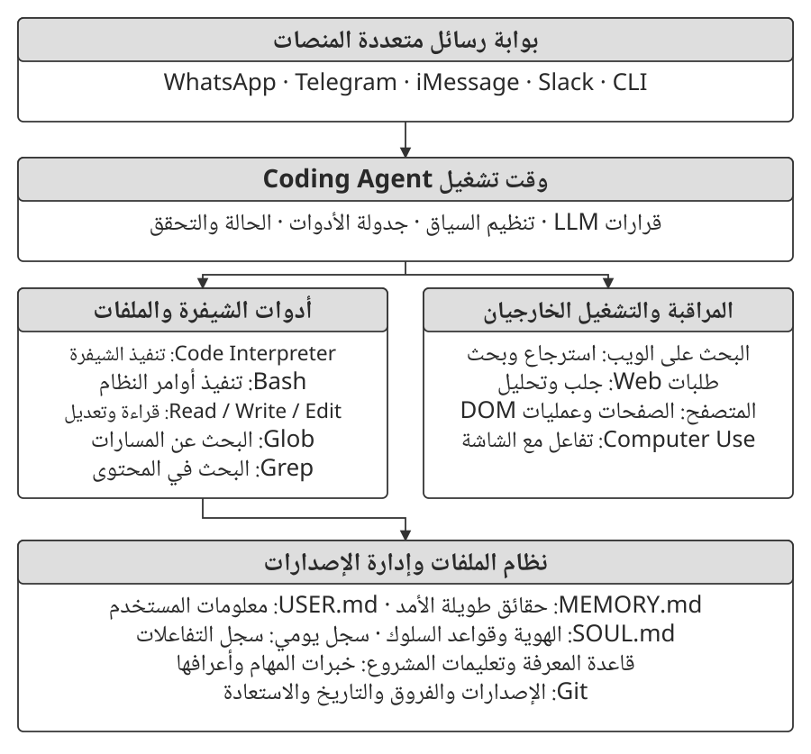

ولنأخذ مثال «حلّل بيانات مبيعات الربع الماضي وأعدّ تقريرًا موجزًا»، إذ يمكن تقسيم العملية إلى خمس خطوات:

1. **قراءة الذاكرة**: معرفة تنسيق تقرير PDF الذي يفضّله المستخدم، وأن بيانات المبيعات محفوظة في Google Sheets.
2. **جلب البيانات**: الاطلاع على طريقة استخدام Google Sheets API، وتنزيل الجداول المطلوبة عبر الواجهة المأذون بها.
3. **كتابة شفرة التحليل**: تجميع بيانات المبيعات بـ pandas، وتوليد المخططات بـ matplotlib، ومراجعة معايير الإحصاء والنتائج.
4. **إنشاء النواتج**: تنظيم التحليل والمخططات في ملف PDF، وحفظ البيانات المصدرية والنتائج الوسيطة وسكربتات التوليد لتسهيل المراجعة أو التحديث.
5. **تحديث الذاكرة**: تسجيل مصدر البيانات الذي تأكد ومعرّف الجدول، ليُرجع إليهما في المهمة القادمة.

وإذا أُسندت المهمة نفسها إلى Qwen Office، استطاع المستخدم أن يرفع تفاصيل المبيعات مباشرة ويطلب منه تحليل البيانات وإعداد تقرير مصوّر.[^ch5-qwenwork] ولنفترض أن طلبًا دُفع ثمنه 100 يوان ثم رُدّ منه 20 يوانًا، فلا يُحتسب في صافي مبيعات الربع إلا 80 يوانًا. فإذا ظهر المبلغ في مخطط التقرير 100 يوان، أمكن تتبّع المخطط إلى جدول التجميع ثم إلى التفاصيل الأصلية لمعرفة أي استرداد سقط من الحساب.

[^ch5-qwenwork]: مركز مساعدة Qwen Office، «مقدمة إلى Qwen Office»، ويعرض وظائف مثل رفع ملفات البيانات وتحليلها وإعداد تقارير مصوّرة.

نظام الملفات هو ما يربط هذه الخطوات: فالنتيجة المحفوظة في خطوة سابقة تصبح مدخلًا للخطوة اللاحقة، ويستطيع البرنامج أن يقرأ البيانات نفسها مرارًا. وإذا انقطعت المهمة، استطاع الوكيل أن يتحقق من مدى التقدم عبر النواتج المحفوظة، ثم يتابع ما لم يُنجز.

وللنتائج الوسيطة فائدة أخرى: إذا غيّر المستخدم سؤاله إلى سؤال قريب، أمكن استئناف العمل من الخطوة المناسبة. وقد عرض Data Formulator من مختبرات Microsoft Research ذلك ببيانات توليد الكهرباء في الدول المختلفة. فالجدول الأصلي يسجّل كمية الكهرباء المولَّدة من كل مصدر طاقة، ويحسب المحلل أولًا نسبة الطاقة المتجددة لكل دولة في كل سنة، ثم يرسم منها مخططًا للترتيب. فإذا أراد أن يعرف بكم ارتفعت نسبة دولة ما، لم تكفِه مراتب المخطط لمعرفة الفرق بالنقاط المئوية بين سنتين. لكنه إذا عاد عبر مسار الاشتقاق الذي تحتفظ به الواجهة إلى جدول النسب، أمكنه أن يأخذ قيمتي السنتين ويطرح إحداهما من الأخرى.[^ch5-data-formulator]

[^ch5-data-formulator]: Microsoft Research، مثال تحليل الطاقة في Data Formulator، وتنفيذ الربط بين المخططات وجداول البيانات في الإصدار 0.7.0.

**حفظ الذاكرة والمعرفة والقدرات في ملفات.** تستخدم مساحة العمل في OpenClaw ملفات Markdown لحفظ أنواع متعددة من المعلومات: يسجّل `MEMORY.md` الحقائق والقرارات طويلة الأمد، وتحفظ السجلات المنظّمة بحسب التاريخ معلوماتِ سير العمل، ويمكن أن يُستخدم `USER.md` لتفضيلات المستخدم، أما ملفات المهارات (Skill) فتشرح طريقة استخدام كل قدرة[^ch5-openclaw-files]. **وللذاكرة التي يشترك الإنسان والوكيل في صيانتها، يفضّل المؤلف الملفات التي يمكن قراءتها مباشرة.** فالمستخدم يستطيع أن يفتح السجل ويصحح حقيقة خاطئة، ويستطيع عبر Git أن يطّلع على المصدر ويقارن الإصدارات ويتراجع عنها. وحفظ السجلات بحسب التاريخ يُبقي الحقائق المتعاقبة على خط زمني واضح؛ وإذا كثرت الملفات، أمكن استخدام فهرس للاسترجاع لتسريع الوصول.

وتدعم قدرةُ الوكيل على كتابة الملفات أيضًا تراكمَ خبرة المهام. فإذا اكتشف الوكيل، أثناء تواصله مع مصرف ما، أن التحقق من الهوية يتطلب عنوان الفرع الذي فُتح فيه الحساب، أمكنه أن يسجّل ذلك مع نوع المعاملة التي ينطبق عليها ومصدر المعلومة وتاريخ وقوعها. ثم تُنظَّم السجلات التي جرى التحقق منها في صورة معرفة أو تعليمات تشغيل أو برامج، فتعيد المهام اللاحقة استخدامها. وسيناقش الفصل التاسع عملية التطور المستمر هذه.

[^ch5-openclaw-files]: OpenClaw، *Agent workspace* و*Memory overview*، ويعرضان مساحة العمل والذاكرة القائمة على الملفات وآلية الاسترجاع.

**أي المهام يناسبها أن يكتب الوكيل برامجه بنفسه؟** كثيرًا ما تصادف مهامُ البحث المفتوح وتوليد المحتوى ومعالجة البيانات تنسيقاتِ إدخال وواجهاتٍ ومتطلباتِ نواتج جديدة، ولذلك يناسبها أن يكون توليد الشفرة نواة التنفيذ. أما الأنظمة ذات الإجراءات المستقرة نسبيًا، كخدمة العملاء في مجال متخصص، فيمكن أن تنتظم حول حالة العمل وأدوات المجال واستراتيجيات الحوار، ثم تُستخدم الشفرة لإنجاز الحسابات والتحويلات والتحقق من القواعد. فكلا النوعين يستفيد من القدرة البرمجية، لكن الدور الذي تؤديه يتغير بحسب المهمة.

### سير العمل المتكامل لوكيل البرمجة

لنتتبّع الشكل 5-2 من خلال عيب صغير. يبلّغ المستخدم أن «فرز الطلبات بحسب المبلغ الإجمالي يضع 100 يوان قبل 20 يوانًا». يبدأ الوكيل بإيجاد مدخل يعيد إنتاج المشكلة، ثم يتتبع البيانات ليعرف في أي موضع تحوّل المبلغ إلى سلسلة نصية. وبعد أن يصلح منطق المقارنة، يعيد التشغيل بالمدخل الأصلي نفسه، ويتحقق أيضًا من أن البيانات التي تحتوي على كسور عشرية أو مبالغ متساوية ما زالت تُفرز فرزًا صحيحًا.

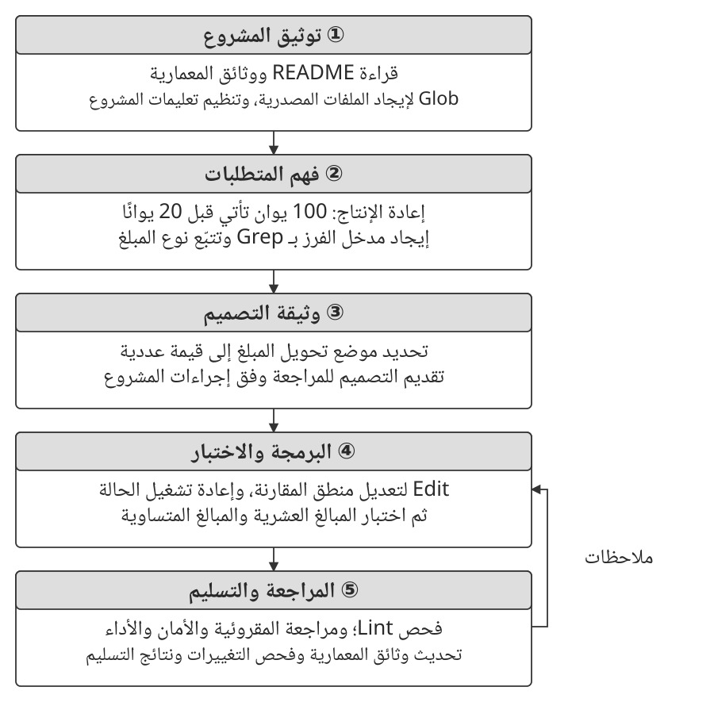

**فهم المشروع واستكمال وثائقه.**

حين يتسلّم الوكيل المهمة، يقرأ أولًا وصف المشروع، ثم يقارنه بالتنفيذ ومواضع الاستدعاء والاختبارات ليعرف المواضع التي سيمسّها التعديل. فإذا لم توضّح الوثائق مسؤولية الوحدات المعنية، أو التجريدات الأساسية التي تستخدمها، أو كيفية تعاون الوحدات، أو طريقة اختبارها، أضاف إليها ما تحقق منه في الشفرة، ليجده من يتسلّم العمل بعده.

**ملفات تعليمات المشروع** تضع الاصطلاحات الشائعة في موضع يسهل على الوكيل الوصول إليه. فملفات `CLAUDE.md` و`AGENTS.md` وقواعد مشروع Cursor تستطيع أن تسجّل أوامر البناء وأسلوب كتابة الشفرة وحدود التغيير، مثل: «استخدم `pnpm test` لتشغيل الاختبارات»، و«صرّح بأنواع محددة للمتغيرات وتجنّب `any`»، و«تغييرات ترحيل قاعدة البيانات تحتاج إلى مراجعة مستقلة». وتحمّل كل بيئة مضيفة هذه المحتويات بحسب المجلد أو الإعدادات أو شروط الانطباق؛ وكان ملف `.cursorrules` القديم في Cursor تطبيقًا للفكرة نفسها[^ch5-project-rules].

ولكلٍّ من ملفات التعليمات وملفي `SOUL.md` و`MEMORY.md` في OpenClaw تركيزه الخاص: فالأولى تشرح اصطلاحات العمل داخل المشروع، و`SOUL.md` يصف هوية الوكيل وسلوكه، وملفات الذاكرة تحفظ المعلومات التي تستفيد منها المهام اللاحقة. والتعليمات المستقرة الموجزة تساعد على إبقاء بادئة السياق ثابتة، وتحميل قواعد المجلدات عند الحاجة يضبط حجم المدخلات للمهمة الحالية. أما صلاحيات التنفيذ فتفرضها منظومة التشغيل وبيئة التشغيل.

ذكر الفصل الثاني أن الفرق التي تحسن العمل عن بُعد يسهل عليها أيضًا إشراك الوكلاء. وعلى مستوى مستودع الشفرة، يعني ذلك تدوين القرارات في وثائق التصميم، وكتابة خلفية المهام في الـ issues وطلبات الدمج (PR)، وتنظيم الخبرة الداخلية في أدلة للمطورين. وثمة سؤال عملي للفحص: **هل يستطيع موظف جديد يعمل عن بُعد، بالاعتماد على المستودع والوثائق وحدهما، أن يجد مدخل المهمة ويشغّل الاختبارات ويفهم متطلبات التعديل؟**

[^ch5-project-rules]: Anthropic، *How Claude remembers your project*؛ Cursor، *Rules*، ويعرضان تعليمات المشروع والقواعد التي تُحمَّل بحسب النطاق.

**تحديد الهدف وشروط القبول.**

إذا كان الخطأ قد حُدد موضعه أو كان المطلوب ضبط معامل، أمكن التعديل مباشرة استنادًا إلى السلوك الحالي والاختبارات. أما إذا كان الهدف واسعًا، فلا بد من تفكيكه أولًا. فعبارة «تحسين أداء النظام» قد تعني تقليل زمن الاستجابة، أو خفض استهلاك الذاكرة، أو رفع الإنتاجية. وينبغي للوكيل أن يفحص موضع الاختناق الحالي، ويقيس خط الأساس، ويحدد نطاق التعديل المسموح به، ويتأكد من القيود مثل توافق الواجهات وتجربة المستخدم، ثم يحدد خطة التحسين.

**صياغة خطة التصميم.**

ينبغي أن تجيب وثيقة التصميم عن الأسئلة الآتية: ما الوحدات التي ستُعدَّل، وما الأسلوب المعتمد، ولماذا يناسب المشكلة الحالية، وهل يضيف تبعيات جديدة، وكيف يُتحقق من النتيجة ويُتراجع عنها. ويكفي للتعديل الصغير أن يُعبَّر عنه بخطة موجزة، أما التغيير المعقد فيُكتب في وثيقة تصميم قابلة للمراجعة. وإذا اشترط المشروع أو المستخدم الموافقة على الخطة، قُدّمت الخطة المحددة أولًا، ولا يبدأ التنفيذ إلا بعد إقرارها.

**التنفيذ والاختبار والمراجعة.**

يلتزم الوكيل عند التنفيذ باصطلاحات المشروع، ويعيد استخدام التجريدات والأدوات الموجودة، ويُبقي التعديل محصورًا في نطاق المهمة. وتُصمَّم الاختبارات حول السلوك المتوقع، فتغطي المسار العادي والحالات الحدّية والحالات الاستثنائية؛ وعند إصلاح خطأ، ينبغي أن تكشف حالة الاختبار الارتدادية المشكلة الأصلية وأن تثبت نجاح الإصلاح.

وإذا فشل الاختبار، قرأ الوكيل رسائل التشخيص، وحدد السبب، وعدّل الشفرة، ثم أعاد تشغيل الفحوص ذات الصلة. **معيار اكتمال مهمة البرمجة هو اجتياز القبول.** فكتابة الرقعة خطوة واحدة فقط، ولا بد من مطابقة الاختبارات ذات الصلة ومتطلبات المستخدم والنواتج المسلَّمة. وحلقة «اختبار ← إصلاح ← تحقق» تمكّن الوكيل من مواصلة تصحيح المشكلات، وتمنح هندسة الحلقات (Loop Engineering) معيارًا واضحًا للتوقف.

وتفحص مراجعة الشفرة بعد ذلك جوانب قد لا تغطيها الاختبارات، مثل قابلية القراءة وتوافق الواجهات والأداء والصلاحيات واستخدام التبعيات. ويمكن إجراء هذا الفحص بقراءة الفروق، أو بالفحص الساكن، أو بوكيل فرعي مخصص للمراجعة؛ فإذا ظهرت مشكلات، واصل الوكيل الإصلاح وأعاد تشغيل الفحوص المتأثرة.

**مزامنة الوثائق والتسليم.**

ينبغي أن تنعكس في الوثائق المعنية كل وحدة جديدة، وكل تعديل في التبعيات، وكل تغيير في السلوك الأساسي. ويلخّص بيان التسليم المشكلة التي حُلّت، والتغيرات في السلوك، ونتائج التحقق، وطريقة الاستخدام، مع إرفاق خطوات التراجع عند الحاجة. وهكذا تحفظ الشفرة والاختبارات والوثائق معًا نتيجة هذه المهمة.

وتختلف النماذج أيضًا في طريقة تنظيم الاستكشاف والتعديل: فبعضها يقرأ التنفيذ ومواضع الاستدعاء والاختبارات على نطاق واسع أولًا، وبعضها يفحص أوثق الملفات صلة ويجرّب رقعة صغيرة، ثم يستعين بنتائج الترجمة البرمجية أو الاختبار ليواصل تحديد الموضع. **ويرى المؤلف أن إيقاع الاستكشاف والفعل هذا هو قبل كل شيء استراتيجية سلوكية تعلّمها النموذج.** فإذا ظل الإيقاع متشابهًا بعد تغيير منظومة التشغيل، وتغيّر تغيّرًا واضحًا عند تبديل النموذج داخل المنظومة نفسها، فالفرق راجع إلى النموذج ذاته. وتستطيع الموجّهات والأدوات والميزانيات في منظومة التشغيل أن تضخّم هذا الميل أو تكبحه. ويناقش الفصل السابع كيفية تقييم هذه الفروق، ويناقش الفصل الثامن كيف يؤثر التدريب اللاحق في الاستراتيجيات السلوكية.

### الممارسة العملية لهندسة منظومة التشغيل في وكيل البرمجة

استخدم الفصل الأول المعادلة **Agent = Model + Harness** لوصف التنفيذ في بيئة الإنتاج، وقدّم الوظائف الخمس لمنظومة التشغيل: إدارة السياق، وواجهات الأدوات، والقيود، والتحقق، والتصحيح. ويستطيع وكيل البرمجة أن يستفيد مما في هندسة البرمجيات من اختبارات وفحص ساكن وتكامل مستمر وإدارة للإصدارات، ليحوّل هذه الوظائف إلى إجراءات قابلة للتنفيذ.

فإذا عدنا إلى عيب الفرز السابق، كان إبقاء المدخل الخاطئ والدالة المعنية والمخرجات الفاشلة أمام النموذج من قبيل إدارة السياق؛ والسماح للنموذج بقراءة الملفات وتعديلها وتشغيل الاختبارات يعتمد على واجهات الأدوات والقيود. ولا يبدأ التحقق إلا حين يُفحص التعديل بالمدخل نفسه؛ وإذا ظلت الأرقام تُفرز فرزًا نصيًا، فإن إعادة الترتيب الفعلي والترتيب المتوقع معًا إلى النموذج هي ما يجعل التغذية الراجعة صالحة للتصحيح.

يتولى النموذج فهم المشكلة وتوليد الخطة والشفرة، وتوفر منظومة التشغيل المعلومات والواجهات التي يحتاج إليها العمل، وترتّب الفحوص، ثم تواصل التنفيذ أو تتراجع بحسب النتائج. وعلى مستوى النظام الهندسي، يمكن الاستعداد لذلك من أربعة جوانب:

- **خط أساس القبول**: استخدام مجموعات الاختبار وخط CI ومعايير المراجعة لتحديد ما يُعدّ اكتمالًا للعمل. وCI هو خط التكامل المستمر الذي ينفّذ الفحوص المتفق عليها تلقائيًا بعد كل إيداع.
- **حدود التنفيذ**: تحديد مسؤوليات الوحدات وقواعد التبعية والوصول إلى البيانات وصلاحيات العمليات.
- **إشارات التغذية الراجعة**: تحويل نتائج أدوات الفحص (linter) وفحص الأنواع والاختبارات إلى تشخيصات يستطيع النموذج أن يحدد موضعها ويفهمها ويعالجها.
- **وسائل الاستعادة**: حفظ إصدارات Git ولقطات مساحة العمل وحالة المهمة، وإعداد إجراءات استعادة مناسبة للتغييرات الخارجية.

**تصميم الهدف وطريقة التحقق معًا.**

إن وضوح المهمة وإمكان التحقق الآلي من نتيجتها يحددان معًا طريقة عمل الوكيل. ويعرض الجدول 5-1 التركيبات الأربع، ويبيّن العمل الهندسي الذي تحتاج إليه كل منها. وبتوضيح المتطلبات وإضافة الأمثلة والفحوص، يمكن تحويل المهمة العامة شيئًا فشيئًا إلى هدف قابل للتنفيذ.

الجدول 5-1 المربعات الأربعة لوضوح المهمة ودرجة أتمتة التحقق

| | يمكن التحقق من النتيجة آليًا | تحتاج النتيجة إلى تحقق بشري |
| --- | --- | --- |
| **الهدف واضح** | إصلاح خطأ له اختبار ارتدادي: التكرار بحسب التغذية الراجعة | إعادة هيكلة الشفرة: الجمع بين الاختبارات ومراجعة البنية |
| **الهدف غامض** | «تحسين جودة الشفرة»: تحديد أهداف الجودة التي تتجاوز أدوات الفحص أولًا | «جعل الواجهة أجمل»: توضيح التفضيلات بالأمثلة والمقارنات |

**البنية التحتية للتحقق التي راكمتها هندسة البرمجيات سبب مهم في نضج وكيل البرمجة مبكرًا.** فالمترجمات وأنظمة الأنواع ومجموعات الاختبار وإدارة الإصدارات تتيح تحديد موضع الخطأ، وفحص التعديل، والتراجع عند الفشل، وهي بطبيعتها منظومة تشغيل قوية. ويشير هذا الحكم أيضًا إلى اتجاه الاستثمار في سيناريوهات الوكلاء الأخرى: أن تُدفع المهمة أولًا نحو منطقة «الهدف واضح والنتيجة قابلة للتحقق الآلي». فإذا كان القبول يعتمد على فحص بشري لكل حالة، صارت سرعة المراجعة البشرية حدًّا أعلى للإنتاجية؛ وإذا كان الهدف غامضًا، فقد تظل الأتمتة، مهما بلغت سرعتها، تحسّن المقياس الخاطئ.

**استخلاص المنهج من الحالات الهندسية.**

يمكن فهم تعاون هذه المكونات من خلال ترحيل شفرة واسع النطاق. فقواعد الترحيل والعلاقات بين الوحدات تُكتب في وثائق المستودع، وقيود التبعية تُفرض عبر الفحص الساكن، وكل دفعة من التعديلات تمر بالاختبارات وCI، وعند الفشل تُعاد تشخيصات يمكن تحديد موضعها. وبهذا يستطيع الوكيل أن يرجع إلى متطلبات الترحيل، ويتلقى التغذية الراجعة بعد كل دفعة، ثم يواصل التقدم بناءً عليها.

وتبيّن تجربة LangChain كيف تُحسَّن منظومة التشغيل استنادًا إلى مسارات الفشل: يُثبَّت النموذج، ويُحلَّل في أي خطوة توقفت المهمة أو انتهت بخطأ، ثم يُعدَّل موجّه النظام والبرمجيات الوسيطة للأدوات وحلقة الفحص الذاتي وميزانية الاستدلال. وقد عرض الفصل الأول حالتها في Terminal Bench 2.0، وما يهمنا هنا هو منهج التكرار «تسجيل الفشل ← اقتراح التعديل ← إعادة التقييم»[^ch5-langchain-harness].

أما حل Anthropic للمهام الطويلة فيفصل تهيئة البيئة عن التنفيذ المستمر. فوكيل التهيئة ينشئ قائمة المهام وبيئة العمل، ثم يتقدم وكيل البرمجة بعده بندًا بندًا، حافظًا الشفرة ونتائج الاختبار ومدى التقدم. وتقرأ الجلسة الجديدة هذه النواتج ثم تواصل العمل، فيقل ما يضيع من معلومات عند التسليم بين سياقات مختلفة[^ch5-long-harness].

[^ch5-langchain-harness]: LangChain، *Improving Deep Agents with harness engineering*، 17 فبراير 2026.
[^ch5-long-harness]: Anthropic، *Effective harnesses for long-running agents*، 26 نوفمبر 2025.

**تحويل الخبرة إلى مبادئ لتصميم النظام.**

1. **القيود القابلة للتنفيذ مقدَّمة على التوجيه بالموجّهات.** فتبعيات الوحدات وأنواع الحقول ومعايير كتابة الشفرة يمكن التحقق منها بالفحص الساكن وCI، وصلاحيات الوصول تفرضها بيئة التنفيذ. أما الموجّهات والوثائق فتشرح القواعد وأسبابها، وآليات الفحص تكشف المخالفات وتمنعها.
2. **الاستثمار في التحقق الآلي أولًا.** فالفحوص المتكررة تزداد بازدياد المهام، والإكثار من المراجعة البشرية يصبح عنق زجاجة أمام التوسع. ولذلك تتولى الاختبارات وفحوص الجودة ومراقبة السلوك هذا الجزء من العمل، وتتفرغ المراجعة البشرية للموازنة بين الأهداف والأحكام المعقدة.
3. **كلما كانت التغذية الراجعة أسرع وأكثر تنظيمًا، كان التصحيح أيسر.** ينبغي أن تتضمن رسالة الخطأ الموضع المعني وشرط الفشل والنتيجة الفعلية، لتساعد النموذج على تقرير خطوته التالية. ويستطيع شريط الحالة الذي عرضه الفصل الثاني أن يجمع أحدث التشخيصات وعدد الاستدعاءات ومدى تقدم المهمة.
4. **تصميم مسار للاستعادة لكل تغيير.** تحفظ فروع Git تغييرات الشفرة، وتحصر البيئة المعزولة أثر التجربة والخطأ، وتعيد اللقطات الحالة المُدارة؛ أما عمليات الواجهات البرمجية الخارجية فتُعالج بآليات عدم التأثر بالتكرار (idempotency) والإلغاء والتعويض التي عرضها الفصل الرابع.

**فحص النتيجة والعملية معًا.** عند إصلاح عطل في قاعدة بيانات، قد يعيد محوُ البيانات وإعادةُ البناء الخدمةَ إلى العمل، لكنه ينتهك متطلبات الاحتفاظ بالبيانات؛ وعند إصلاح خطأ في الترجمة البرمجية، قد يجعل حذفُ التنفيذ المعني الترجمةَ البرمجية تنجح، لكنه يُضيّع الوظيفة. وتبيّن هذه الأمثلة أن القبول يجب أن يغطي هدف العمل، وأن عملية التنفيذ تحتاج هي الأخرى إلى قيود. وتستطيع منظومة التشغيل أن تفحص التفويض ونطاق الأثر في عمليات مثل حذف بيانات الإنتاج أو الكتابة فوق الملفات، وأن تستدعي آلية المراجعة المستقلة التي عرضها الفصل الرابع.

ويمكن أيضًا في أثناء التدريب معاقبة المخالفات التي جرى التعرف عليها. فأسلوب RLVP (عقوبة مسار التحقق) الذي يناقشه الفصل الثامن يُدخل قيود العملية في التغذية الراجعة للتدريب، ليوجّه النموذج إلى الالتزام بمتطلبات التنفيذ وهو يسعى إلى النتيجة. فالصلاحيات والمراجعة وقت التشغيل تحصر الأفعال القابلة للتنفيذ باستمرار، أما التغذية الراجعة في التدريب فتؤثر في الطريقة التي يقترح بها النموذج أفعاله.

**ضبط انتشار الأعطال بحسب علاقات التبعية.** عند قراءة ثلاثة ملفات مستقلة بالتوازي، إذا لم يكن أحدها موجودًا، فينبغي إعادة خطأ لهذا البند وحده مع الاحتفاظ بنتائج القراءات الأخرى. أما إذا كان استدعاء ما يعتمد على مخرجات مهمة فاشلة، فينبغي إيقاف سلسلة التبعية هذه أو إعادة ترتيبها. وعلى منظومة التشغيل أن تحدد نطاق الإلغاء بحسب العلاقات بين المهام، وأن تبلّغ المستوى الأعلى بحالة كل بند، حتى لا يُهدر عمل مستقل مع غيره. وسيأتي لاحقًا الحديث عن تنفيذ الاستدعاءات المتوازية والتحليل المتدفق والإلغاء المتسلسل.

### استعادة الأعطال والأخطاء

قد تنقطع المهمة الطويلة بين طلبين متتاليين إلى النموذج، وقد تُنفَّذ أداة من دون أن تُحفظ نتيجتها. فإذا لم تعرف منظومة التشغيل إلا أن «المهمة فشلت»، فإن البدء من جديد قد يكرر عمليات أُنجزت من قبل. ولاستئناف العمل لا بد أولًا من تحديد موضع الانقطاع، والتأكد من النتائج التي حُفظت، ثم تقرير ما إذا كان الصواب إعادة المحاولة، أو تصحيح الاستدعاء، أو المتابعة من نقطة التوقف، أو الإنهاء.

والسؤال الأول في الاستعادة هو: «ما الدليل الذي تركته الخطوة السابقة؟» فإذا انقطع الاتصال أثناء قراءة ملف، أمكن في العادة قراءته مرة أخرى؛ أما إذا انقطع بعد إرسال مهمة إلى خدمة بعيدة، فربما تكون الخدمة قد قبلتها فعلًا. وإذا كان معرّف المهمة متاحًا، فينبغي الاستعلام عنه أولًا قبل تقرير إعادة الإرسال. ولا يكون للاستعادة نقطة انطلاق إلا إذا سُجّلت الحالات «أُرسل الطلب» و«أكّدت الخدمة البعيدة الاستلام» و«حُفظت النتيجة» كلٌّ على حدة.

**اختيار طريقة المعالجة بحسب موضع العطل.**

| الطبقة | الأعطال الشائعة | محور المعالجة |
| --- | --- | --- |
| طبقة API | تحديد المعدل HTTP 429، والحمل الزائد على الخدمة، وانتهاء المهلة، وانقطاع الاتصال، وبلوغ الحد الأقصى لطول المخرجات | فحص سبب الخطأ وحالة الطلب، ثم إعادة المحاولة مع التراجع أو تعديل الطلب |
| طبقة الأدوات | اسم أداة غير موجود، ومعاملات غير صالحة، واستثناءات التنفيذ، وتكرار الخطأ نفسه | إعادة تشخيص يمكن تحديد موضعه، وتصحيح المدخلات أو شروط التنفيذ |
| طبقة السياق | تجاوز سعة النافذة، وفشل الضغط، وافتقاد الاستدعاء إلى نتيجته المقترنة به | تعديل حجم المدخلات، واستعادة السجل الحقيقي، وفحص بنية الرسائل |
| طبقة التحكم في التدفق | تكرار العمليات بلا تقدم، وتفعيل منطق الاستعادة للفشل تفعيلًا ارتداديًا | العدّ، وتحديد عدد مستويات الاستعادة، ثم الإنهاء أو التصعيد |

يمكن معالجة تحديد المعدل والحمل الزائد المؤقت بالانتظار ثم إعادة المحاولة؛ أما خطأ المعاملات فيحتاج إلى تعديلها، ونقص الصلاحيات يحتاج إلى معالجة التفويض، وعدم وجود الأداة يقتضي اختيار قدرة أخرى. وربط كل نوع من الأخطاء بإجراء استعادة محدد يمنع تكرار فشل الطلب نفسه ما دامت شروطه لم تتغير.

**مراقبة الفشل والتقدم معًا.**

تستطيع منظومة التشغيل أن تحسب بصمة لكل استدعاء من «اسم الأداة + المعاملات بعد توحيد صيغتها»، وأن تجمع بينها وبين النتيجة وحالة المهمة لاكتشاف السلوك المتكرر. فالاستدعاءات المتطابقة قد تكون استطلاعًا (polling) معقولًا، وقد تكون حلقة بلا تقدم؛ ولذلك يجب أن يُنظر أيضًا إلى شرط الانتظار والحالة الخارجية والمدة التي انقضت. ولكل مسار استعادة عدّاد فشل مستقل، وتخضع المهمة كلها فوق ذلك لميزانية شاملة.

وتحتاج الطلبات المتدفقة إلى ثلاث مهل منفصلة: مهلة الاتصال، ومهلة الخمول أثناء القراءة، والمهلة الكلية. فمهلة الاتصال تحدد زمن الانتظار حتى يُنشأ الاتصال، ومهلة الخمول تحدد زمن الانتظار بين دفعتين من البيانات، والمهلة الكلية تقيّد الطلب بأكمله. وإذا ظل الاتصال قائمًا مدة طويلة من دون أن تصل بيانات، استطاع مراقب الخمول أن يغلق الطلب وينقل العمل إلى إجراءات الاستعادة. **ينبغي أن يخضع كل اتصال طويل لمراقبة حيويته، ولا تكفي مهلة إنشاء الاتصال وحدها.** ويجب أن تراعي عتبات المهلة طريقة النموذج في الإخراج: فالنص الظاهر، وأجزاء الاستدلال المتزايدة، ورسائل النبض (heartbeat) كلها تدل على أن الطلب ما زال جاريًا، والاستدلال الداخلي الطويل يزيد هو الآخر من زمن الانتظار.

أما فحص سلامة السياق فيدور حول اقتران معرّف الاستدعاء بنتيجته. فإذا كانت النتيجة مفقودة، يُستعلم أولًا عن سجل التنفيذ لاستعادة النتيجة الحقيقية التي حُفظت؛ وإذا كانت حالة التنفيذ مجهولة، تُسجَّل صراحةً حالةً مجهولة، وتُعالج بآليتي عدم التأثر بالتكرار والاستعلام عن الحالة اللتين عرضهما الفصل الرابع.

**الاستعادة على مراحل متصاعدة مع الإبلاغ عن الحالة الراهنة.**

1. **إعادة المحاولة مع التراجع.** تُستخدم مع الأخطاء القابلة لإعادة المحاولة فتراتُ انتظار متزايدة أُسّيًا مع تذبذب عشوائي، مع الالتزام بإشارات الانتظار التي يرسلها الخادم. وتُخصَّص للمهمة الرئيسية والمهام المساعدة ميزانيتا إعادة محاولة منفصلتان، فالأعمال الخلفية مثل توليد العناوين واقتراحات الإدخال يمكن تجاوزها عند فشلها، حتى لا تزاحم المهمة الرئيسية على مواردها.
2. **التعديل أو التبديل.** إذا بلغت المخرجات حدها الأقصى من الطول، يُفحص أولًا الحد الذي تسمح به الواجهة وميزانية المهمة، ثم يُقرَّر رفع الحد أو تقسيم المهمة أو متابعة المخرجات. وإذا ظلت الخدمة غير متاحة، أمكن التبديل إلى نموذج احتياطي؛ وقبل التبديل تُحوَّل الرسائل وتعريفات الأدوات والحقول الخاصة بالنموذج.
3. **الإبلاغ عن تقدم الاستعادة.** أثناء الاستعادة التلقائية يمكن عرض «جارٍ إعادة المحاولة» أو «جارٍ تبديل الخدمة»، مع الاحتفاظ بكل خطأ في السجل. وإذا نجحت الاستعادة استُؤنفت المهمة؛ وإذا احتاج الأمر إلى أن يعالج المستخدم التفويض أو يضيف مدخلات أو يقرر الخطوة التالية، شُرح له ما تحقق من تقدم وسبب الفشل والوسائل التي جُرّبت.

**ينبغي أن تساعد استراتيجية الاستعادة على دفع المهمة كلها إلى الأمام.** فالأخطاء الوسيطة القابلة للاستعادة تبقى في سجل التشغيل، وتعرض الواجهة تقدم الاستعادة؛ ولا يُبلَّغ المستخدم والأنظمة اللاحقة بالفشل النهائي إلا بعد استنفاد وسائل الاستعادة. وبذلك تستطيع الأنظمة اللاحقة أن تميّز بين «جارٍ إعادة المحاولة» و«فشلت المهمة»، فلا تُطلق التعويض قبل أوانه ولا تكرر الإرسال.

ويمكن أن تدخل أخطاء الأدوات إلى السياق على صورة نتائج منظّمة، كأن يُعاد اسم الأداة المفقودة، والحقل الذي وقع فيه الخطأ، والقيم المسموح بها، ليصحح النموذج استدعاءه بناءً عليها. أما تحويلات الصيغة التي تجيزها مواصفات الواجهة ويكون معناها محددًا، فيمكن إجراؤها في البرنامج وتسجيلها؛ وإذا كان معنى المعامل غير واضح، فينبغي أن يعيد النموذج توليده، حتى لا تغيّر عملية الإصلاح هدف العملية.

**تسلّم المسار غير المكتمل.**

عند تبديل النموذج يجب أن تُسلَّم إلى الطرف المتسلّم حقائقُ المهمة التي تأكدت، ونتائجُ الأدوات، والبنودُ التي لم تُنجز. وتختلف أدوار الرسائل وصيغ استدعاء الأدوات وحقول الاستدلال من واجهة إلى أخرى، ولذلك ينبغي أن يُعالج المحتوى وحالة البروتوكول كلٌّ على حدة عند التحويل. فبعض الخدمات تعيد محتوى استدلال مقروءًا أو ملخصًا له، وتعيد كذلك حقولًا معتمة (opaque) تستخدمها هي نفسها في طلباتها اللاحقة. وقد تُلحق هذه الحقول بكتل الاستدلال أو باستدعاءات الأدوات، والواجهة المعنية هي التي تحدد ما يجب إعادته منها كما هو في الطلبات اللاحقة.

**الأنظمة التي تحتاج إلى المتابعة عبر مزوّدين مختلفين ينبغي أن تحفظ مسار العمل بصيغة محايدة.** فقدرة النموذج على فهم نص صادر عن مزوّد آخر لا تعني أن الواجهة المستهدفة ستقبل حقول البروتوكول المعتمة الخاصة بالمزوّد الأصلي. والفصل بين حقائق المهمة وبروتوكول المزوّد هو ما يتيح أن يشترك التسلّم وإعادة التشغيل للتقييم وبيانات التدريب في سجل واحد. ويتضمن السجل المحايد: المهمة والرسائل، وأسماء الأدوات ومعاملاتها، ومعرّفات استدعاء ثابتة، وحالة التنفيذ، والنتائج ومصادرها. أما الاستجابات الأصلية للمزوّد فتُحفظ منفصلة، لاستخدامها في المتابعة عبر الواجهة نفسها وفي تتبع المشكلات. وعند التحويل إلى طلب للنموذج المستهدف، يُنشأ تقابل بين معرّفات الاستدعاء مع الحفاظ على اقتران النتائج بها؛ وتُمرَّر الملخصات المقروءة سياقًا عاديًا معلوم المصدر، وتبقى الحقول المعتمة للخدمة الأصلية في السجل الأصلي.

وإذا عجزت الواجهة المستهدفة عن التعبير عن الاستدعاءات القديمة، أمكن تنظيم الخطوات المنجزة في سجل مهمة صريح، مثل: «تم الاستعلام عن تذاكر الطيران والإقامة، والخطوة التالية جلب تكاليف الطعام وسعر الصرف»، مع إرفاق النتائج الحقيقية. ثم يولّد النموذج المستهدف استدعاءات جديدة صحيحة. وبعد أن يبدأ الطرف المتسلّم عمله، تُحفظ حقول البروتوكول التي يعيدها وفق متطلبات واجهته هو. ويمكن استخدام هذا السجل المحايد أيضًا في إعادة التشغيل للتقييم في الفصل السابع، وبناء عينات التدريب في الفصل الثامن، واستخلاص الخبرة في الفصل التاسع.

> **التجربة 5-1 ★★★: تسلّم المسار بين المزوّدين**
>
> تطلب هذه التجربة من الوكيل أن يستعلم عن تذاكر الطيران والإقامة وتكاليف الطعام وسعر الصرف، ثم يحسب المبلغ الإجمالي باليوان الصيني. وبعد إتمام أول استدعاءين للأدوات، يبدّل السكربت الخدمة عند نقطة توقف محددة مسبقًا، محاكيًا التسلّم بعد تعذّر الوصول إلى الخدمة الأصلية؛ ثم يتابع الطرف المتسلّم الخطوات المتبقية. وتستخدم التجربة ثلاثة نماذج من Moonshot وAnthropic وGoogle، وتقارن ست تركيبات تبديل ذات اتجاه.
>
> وطرق المعالجة الثلاث هي: تمرير الرسائل الأصلية بتقابل الحقول؛ وتحويل الرسائل بعد حذف محتوى الاستدلال والحقول المعتمة؛ وحفظ حالة المهمة في مسار محايد ثم إعادة بناء السياق وفق الواجهة المستهدفة. ويتحكم السكربت في موضع التبديل، وتؤخذ أخطاء الصيغة لدى الطرف المتسلّم من الاستجابات الفعلية للخدمات.
>
> وفي هذه الجولة من التسجيل، أتم المسار المحايد التسلّم وحسب المبلغ الإجمالي حسابًا صحيحًا في التركيبات الست جميعًا، بينما أتمت الطريقتان الأخريان ثلاث تركيبات وأربعًا على الترتيب. ولأن تقدم المهمة كان محفوظًا في نتائج الأدوات، لم تكرر أي من المجموعات الثلاث استدعاءات الأدوات.

> **التجربة 5-2 ★★: المتابعة بعد انقطاع المخرجات في منتصفها**
>
> تحاول هذه التجربة قطع التدفق في ثلاثة مواضع: مخرجات الاستدلال، والنص الأساسي، ومعاملات الأداة، وتقارن ثلاث طرق: إعادة إرسال الجولة كاملة، والمتابعة باستخدام النص الموجود بادئةً، وإلحاق تعليمات بالمتابعة. ولأن استدعاء الأداة يحتاج إلى معاملات كاملة قبل تنفيذه، يُحفظ الجزء المقطوع أولًا في سجل التشغيل، ثم يُعاد تحليله والتحقق منه بعد الاستعادة.
>
> وقد ظهر خطأ محدد في معامل المدينة: كان المفترض أن يُولَّد «طوكيو»، لكن نقطة الانقطاع لم تُبقِ إلا `{"city":"东`، أي الحرف الأول وحده من اسم المدينة بالصينية، فأغلقته المتابعة على صورة `{"city":"东"}`. صار JSON صالحًا، لكن المدينة ظلت خاطئة.
>
> وفي اختبار النص الطويل في هذه الجولة، قلّلت المتابعة بالبادئة رموز المخرجات اللاحقة؛ أما انقطاع المعاملات فجاءت نتائجه مختلفة، إذ لم تستعد المتابعة بالبادئة المدينة الصحيحة في أي من الاختبارات الثلاثة على Moonshot.

**وضع شروط لإنهاء حلقات الاستعادة.**

يحتاج كل مسار استعادة إلى حد أقصى. فإذا فشل الضغط مرات متتالية، يُنتقل إلى استراتيجية أخرى للسياق؛ وإذا تعذّر الحكم في الصلاحيات، يُحال الأمر إلى إنسان؛ وإذا بلغت متابعة المخرجات حدها من الجولات أو من ميزانية التكلفة، تتوقف. **ينبغي أن تُحدَّد عتبة إعادة المحاولة من توزيع حالات الاستعادة في بيئة الإنتاج.** فإذا كانت الغالبية العظمى من الأعطال المؤقتة تُستعاد في المحاولات القليلة الأولى، وكان معدل نجاح المحاولات اللاحقة من النوع نفسه يقارب الصفر، فينبغي التوقف عند نقطة الانعطاف هذه، حتى لا تظل الاستدعاءات العقيمة تستنزف الحصة.

وقد يفشل منطق الاستعادة نفسه مرة أخرى. فقد يؤدي تجاوز سعة السياق إلى تفعيل خطاف الإيقاف (stop hook)، فيطلب الخطاف من النموذج أن يولّد رسالة الإيداع، فيتجاوز السياق سعته مرة أخرى ويُفعَّل الخطاف من جديد. ويمكن كسر هذه السلسلة بعلامة لمنع إعادة الدخول وحدٍّ لعمق الارتداد، وبفصل جدولة تنظيف الأخطاء عن الأعمال المساعدة التي تحتاج إلى استدعاء النموذج، مع تخصيص ميزانية مستقلة لهذه الأخيرة. كما ينبغي أن تكون للمهمة حدود شاملة لعدد التكرارات والزمن والتكلفة، لتخضع كل مسارات الاستعادة لميزانية المهمة كلها.

### أساليب تنفيذ وكيل البرمجة

لنبدأ بسجل تنفيذ واحد لإصلاح اختبار فاشل، ونقدّر منه أي جزء يستحق التحسين. ففي محاضرة المؤلف «The Road to JARVIS» في بورتو في نوفمبر 2026، قورنت سرعات استدلال مختلفة بإعادة تشغيل الجلسة نفسها: فبحساب زمن النماذج المتاحة على الخط آنذاك، بلغ المجموع 24.2 ثانية؛ ومع إبقاء زمن الأدوات على حاله واستبدال سرعة الاستدلال بتقدير لشريحة متخصصة لم تُصنع بعد، بلغ المجموع نحو 8.1 ثانية، منها 7.5 ثانية قضاها الوكيل في تشغيل الاختبارات. وحتى لو أُزيل ما تبقى من زمن النموذج، وهو نحو 0.6 ثانية، فسيظل الانتظار قائمًا حتى تنتهي الاختبارات.

فما الأعمال التي يمكن أن تجري في وقت واحد خلال هذه الثواني السبع والنصف؟ يتوقف ذلك على علاقات التبعية بين استدعاءات الأدوات.

**استدعاء الأدوات بالتوازي، والتنفيذ المتدفق، والإلغاء المتسلسل.**

كثيرًا ما يمكن البحث في الشفرة وقراءة الإعدادات والاطلاع على السجلات باستقلال بعضها عن بعض. وحين يولّد النموذج هذه الاستدعاءات في استجابة واحدة، تستطيع منظومة التشغيل أن تجعل توليد الاستدعاءات وتنفيذ الأدوات يتداخلان: فما إن تؤكد الواجهة أن الاستدعاء الأول قد اكتمل إخراجه، وتجتاز معاملاته وصلاحياته التحقق، حتى يُجدوَل فورًا، بينما يتواصل استقبال الاستدعاءات التالية. ويجب الاعتماد هنا على حدث اكتمال الاستدعاء الذي تصدره الواجهة للحكم على اكتماله، لا على أن JSON صار قابلًا للتحليل مؤقتًا، تجنبًا للتنفيذ قبل الأوان.

ويمكن تشغيل الاستدعاءات المستقلة بالتوازي؛ كأن يُبحث عن اسم دالة وتُقرأ ملفات الإعدادات في الوقت نفسه، ثم يُقرَّر التعديل بعد عودة النتيجتين. أما قراءة الملفات التي لا تتحدد إلا بنتيجة البحث فتُترك لخطوة لاحقة. وعلى المجدوِل أيضًا أن يتعرف على الحالة المشتركة: فإذا عدّلت أداتان الملف نفسه في وقت واحد، نشأ تعارض في الكتابة حتى لو كانت مدخلاتهما مستقلة.

ويمكن أن يصرّح تعريف الأداة بقدرتها على التزامن، والموارد التي تصل إليها، وطريقة إلغائها؛ وفي التنفيذ التعليمي يمكن جدولة الأدوات التي لم تصرّح بذلك تسلسليًا. وإذا فشل استدعاء ما، أُوقفت الأعمال اللاحقة التي تعتمد على نتيجته، واحتُفظ بنتائج الاستدعاءات المستقلة، وأُبلغ المستوى الأعلى بحالة كل بند. وعند إلغاء مهمة بدأت فعلًا، ينبغي أيضًا تسجيل ما إذا كان الإلغاء قد نجح، وما نتج حتى تلك اللحظة من تغييرات في الملفات أو عمليات خارجية.

**الإدارة الدقيقة للسياق.**

يمكن إدخال قواعد الشفرة الكبيرة إلى السياق تدريجيًا عبر استرجاع متدرج: يُحدَّد الملف أولًا، ثم تُقرأ الدوال ذات الصلة، ثم يمتد الأمر عند الحاجة إلى مواضع الاستدعاء والاختبارات. وكل قراءة تضيف معلومات تخدم القرار الحالي، فيرى النموذج الشفرة والقيود ونتائج التشغيل معًا.

وينبغي أن تتيح أداة القراءة إعادة مقاطع بحسب نطاق من الأسطر، كالأسطر من 100 إلى 150، مع إرفاق رقم السطر الفعلي في الملف بكل سطر. وبذلك يستطيع النموذج أن يشير بدقة إلى «السطر 142»، وتستطيع أداة التحرير اللاحقة أن تحدد الموضع بناءً عليه. وينبغي أن يُبيَّن في المحتوى المعاد أيضًا الملف الذي جاء منه والنطاق الذي قُرئ؛ وإذا تغيّر الملف، وجب التأكد من موضع التحرير من جديد.

وقد تُنتج الترجمة البرمجية أو الاختبارات آلاف الأسطر من المخرجات، فيمكن استخدام آلية الاقتطاع والحفظ الدائم التي عرضها الفصل الرابع: يُعاد أول المخرجات وآخرها وعدد ما حُذف منها، ويُحفظ الناتج الكامل للبحث فيه عند الحاجة. وقد يقع الخطأ في الوسط، فيستطيع الوكيل أن يواصل البحث عن الكلمات المفتاحية للخطأ أو يقرأ المقطع المقابل.

**الحقن الديناميكي لمعلومات البيئة.**

يستطيع شريط حالة الوكيل الذي عرضه الفصل الثاني أن يجمع في مهام البرمجة أربعة أنواع من المعلومات:

- **مجلد العمل الحالي**: يحدد الأساس الذي تُحسب منه المسارات النسبية.
- **فرع Git**: يحدد فرع التطوير الذي تقع فيه التعديلات الحالية.
- **سجل الإيداعات الأخيرة**: يعرّف بالتغييرات الحديثة المتعلقة بالمهمة.
- **نظرة عامة على التغييرات المرحلية وغير المرحلية**: تميّز بين ما ينتظر الإيداع وما عُدّل في مساحة العمل.

وتستطيع منظومة التشغيل أن تحدّث هذا الملخص بعد العمليات التي تغيّر هذه الحالات، وأن تلحقه بنهاية السياق في استدعاء النموذج التالي. أما المعلومات التي قلّما تتغير، كالإيداعات الأخيرة، فيمكن تحديثها عند الحاجة، تقليلًا للاستعلامات المتكررة وحجم المدخلات. وإبقاء الجزء الأمامي من السياق مستقرًا يساعد على إعادة استخدام ذاكرة التخزين المؤقت للبادئة.

**الحفاظ على حالة بيئة تنفيذ الأوامر.**

إن تغيير المجلد وتفعيل البيئة الافتراضية وضبط متغيرات البيئة وتشغيل الخدمات الخلفية كلها أمور تؤثر في الأوامر اللاحقة. فإذا نفّذ الوكيل `cd` في جلسة shell، فلن يبقى تغيير المجلد قائمًا تلقائيًا إلا إذا استمرت الأوامر اللاحقة في استخدام الجلسة نفسها؛ أما إذا نُفّذت في عملية جديدة، فإن مجلد العمل يتحدد بإعدادات العملية الجديدة. ومتغيرات البيئة التي ينشئها تفعيل البيئة الافتراضية تخضع لحدود الجلسة نفسها.

**وفي التنقيح التفاعلي والمهام التي تحتاج إلى خدمات مستمرة، يوصي المؤلف باستخدام طرفية دائمة افتراضيًا.** فبذلك يُحتفظ بمجلد العمل ومتغيرات البيئة وحالة الجلسة، بما يوافق عادة المطورين في العمل المتواصل داخل طرفية واحدة. وتخصص منظومة التشغيل لكل جلسة معرّفًا، وتتتبع مجلد العمل والعمليات الجارية وحالات الخروج، ليعرف النموذج في أي بيئة سيُنفَّذ الأمر التالي. وثمة تنفيذ آخر يجعل كل أمر يحمل صراحةً مجلد العمل وإعدادات البيئة، فيُحفظ الاتساق بإعدادات يمكن إعادة بنائها.

وينبغي أن تستخدم المهام المتوازية جلسات مستقلة أو لقطات بيئة صريحة، حتى لا يؤثر تغيير المجلد في مهمة ما على مهمة أخرى. وعند انتهاء المهمة تُنظَّف العمليات الخلفية كلها معًا؛ وعند استئنافها يُتحقق مجددًا مما إذا كانت الجلسة ما زالت حية. فإذا عدت في اليوم التالي لمتابعة تشغيل الاختبارات، أمكن قراءة الشفرة وقائمة التبعيات من مساحة العمل؛ أما عملية الخدمة التي شُغّلت أمس في الطرفية، فيجب التحقق أولًا مما إذا كانت ما زالت تعمل. وهاتان بالضبط هما الحالتان اللتان يلزم التمييز بينهما عند تقدير تكلفة البيئة المعزولة في الفصل الرابع.

**آلية التغذية الراجعة النحوية الفورية.**

بعد كتابة الملف، تستطيع طبقة الأدوات أن تشغّل تلقائيًا مدقق الصياغة أو أداة الفحص (linter) الخاصة باللغة، وأن تسلّم التشخيصات إلى النموذج قيمةً معادة من الأداة. فإذا نقص قوس مثلًا، أُعيد الملف وموضع السطر والعمود ونوع الخطأ، فيصلحه النموذج في الجولة التالية، فتتكوّن تغذية راجعة شبيهة بالتنبيهات الفورية في بيئات التطوير المتكاملة (IDE).

ويمكن أن يتسع نطاق الفحص مع اتساع التعديل: يُفحص الملف المعدَّل أولًا، ثم تُشغَّل اختبارات الوحدات المتأثرة، ثم يُجرى الفحص الارتدادي وفق متطلبات التسليم. فالفحوص الخفيفة تساعد على اكتشاف المشكلات الموضعية مبكرًا، واختبارات التكامل تفحص السلوك عبر الوحدات.

### أدوات البحث في وكيل البرمجة

إذا تضمنت رسالة الخطأ عبارة «حقل المبلغ مفقود»، أمكن البحث عن النص الأصلي أولًا، ثم تتبع المستدعين انطلاقًا من موضع إطلاق الخطأ. أما إذا اكتفى المستخدم بقول «في الفرز مشكلة»، وكانت الشفرة تستخدم أسماء إنجليزية، فلا فائدة تُذكر من البحث عن هذه العبارة حرفيًا. وعندئذ يمكن تحديد الواجهة التي تعرض النتيجة أولًا، ثم تتبع الحقول وعلاقات الاستدعاء وبيانات الاختبار وصولًا إلى منطق الفرز. وتعتمد كل فئة من فئات أدوات البحث الأربع في الشكل 5-3 على قرائن مختلفة، وكثيرًا ما تحدد نتيجة البحث الأول الأداة التي ينبغي الانتقال إليها في البحث التالي.

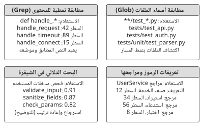

**مطابقة المحتوى بالتعبيرات النمطية.** تبحث grep وripgrep عن المحتوى بحسب نمط نصي، وهي تناسب المهام التي يُعرف فيها اسم الدالة أو المتغير أو نص رسالة الخطأ. فالنمط `def handle.*` مثلًا يطابق أسطر النص التي تحتوي على تعريف دالة بهذه الصورة. وبالجمع بينها وبين التصفية بحسب نوع الملف والمسار، يمكن حصر البحث في ملفات Python واستبعاد مجلدات الاختبار، فتتركز النتائج في التنفيذ المعني.

والمطابقة النصية تقابل محتوى الملف مباشرة، فيسهل التحقق من نتائجها. لكن كلمات الاستعلام تحتاج إلى أن ترتبط بالتعابير المستخدمة في الشفرة: فعند البحث عن «مصادقة المستخدم» يمكن تجربة أسماء مثل `authenticate` أو `login` أو `check_credentials`. وحين يوسّع النموذج استعلامه بناءً على النتيجة السابقة، تتكون عملية استرجاع يتقدم فيها البحث والفهم معًا.

**مطابقة أنماط أسماء الملفات.** تبحث glob عن الملفات بحسب نمط المسار، فالنمط `**/*.test.ts` يجد ملفات اختبار TypeScript في كل المستويات، والنمط `src/components/**/Button.tsx` يجد الملف Button.tsx داخل مجلد المكونات. ومطابقة المسارات تُغني عن قراءة المحتوى، فتناسب التعرف على تنظيم المشروع أولًا قبل اختيار الملفات التي ينبغي فتحها.

**البحث الدلالي في الشفرة.** إذا لم تقدّم المهمة إلا وصفًا للوظيفة، أمكن استخدام الاسترجاع المتجهي لاستدعاء الشفرة ذات الصلة الدلالية؛ فعبارة «التحقق من هوية المستخدم» قد تقابل `check_credentials`. وتحتاج هذه الأنظمة عادةً إلى معالجة أمرين:

- **التقطيع بحسب بنية الشفرة.** تُتخذ الدوال والأصناف والتوابع وحداتٍ أساسية، مع الاحتفاظ بالتواقيع والتعليقات والوحدة التي تنتمي إليها. وإذا قُسّمت الوحدات الطويلة إلى أجزاء أصغر، وجب أن يحمل كل جزء من السياق ما يكفي لفهمه.
- **الجمع بين إشارات استرجاع متعددة.** يجد الاسترجاع المتجهي الشفرة القريبة دلاليًا، ويجد البحث بالكلمات المفتاحية الشفرة التي يطابق اسمها مطابقة تامة، ثم تُدمج المجموعتان. ويمكن للمشفّر المتقاطع (cross-encoder) الذي عرضه الفصل الثالث أن يعيد ترتيبها: فهو يقرأ الاستعلام ومقطع الشفرة معًا، ويعطي هذا المقطع درجة على مدى صلته.

أما الأسئلة الاستكشافية مثل «التفاعل مع قاعدة البيانات» أو «معالجة التحقق من مدخلات المستخدم»، فيمكن أن يُستعان فيها بالبحث الدلالي لتحديد الوحدة أولًا، ثم قراءة التنفيذ.

**وعند بناء قدرة البحث في وكيل البرمجة، يوصي المؤلف بإتقان Grep وGlob والقراءة بحسب النطاق أولًا.** فالنموذج يستطيع أن يعيد صياغة استعلامه بناءً على نتائج البحث، وأن يفتح مواضع الاستدعاء والاختبارات، فيضيّق النطاق تدريجيًا. وهذه الأدوات تقرأ مساحة العمل الحالية مباشرة، فتُغني عن صيانة فهرس للتضمين ومزامنته مع الشفرة. أما إذا تكرر استكشاف قاعدة شفرة كبيرة، ولم يتوفر إلا وصف وظيفي يصعب أن يُهتدى به إلى المدخل، فعندئذ يُضاف فهرس دلالي لتحسين الاستدعاء. وقد عرضت Cursor علنًا فهرسة قاعدة الشفرة المبنية على التضمين، ثم عرضت وثائق البحث اللاحقة فهرس Instant Grep المحلي والوكيل الفرعي الاستكشافي[^ch5-search]. ويدل هذا التطور أيضًا على أن «استخدام واجهة على نمط grep» و«بناء فهرس من عدمه» بُعدان مختلفان في التصميم: فالواجهة الاسترجاعية نفسها يمكن أن تعتمد في طبقتها الدنيا على المسح أو على الفهرسة.

**البحث عن التعريفات والمراجع على مستوى الرموز.** يستطيع خادم اللغة أن يستعين بمعلومات الصياغة والنطاق والأنواع ليوفر «الانتقال إلى التعريف» و«البحث عن المراجع». فإذا عُرّفت `authenticate` في السطر 42 واستُدعيت في السطر 189، استطاعت الأداة أن تعيد العلاقة بينهما، وأن تميّزها من الرموز التي تحمل الاسم نفسه في نطاقات أخرى. ومكوّنات ذكاء الشفرة الإضافية في Claude Code إحدى طرق الربط هذه: إذ توفر التنقل بين الرموز والتشخيصات بعد التحرير عبر بروتوكول خادم اللغة (LSP)[^ch5-lsp].

وتتوقف فاعلية أدوات الرموز على دعم اللغة وإعدادات المشروع وحالة التحليل. ويستطيع الوكيل أن يكمّلها بالبحث النصي للعثور على السلاسل النصية والتعليقات والملفات التي لم يحللها خادم اللغة بعد.

[^ch5-search]: Cursor، *Securely indexing large codebases* و*Search*، ويعرضان على الترتيب نهج فهرسة التضمين وآلية البحث المحلي اللاحقة.
[^ch5-lsp]: Anthropic، *Code intelligence plugins*، ويعرض توفير التعريفات والمراجع والتشخيصات الفورية عبر LSP.

### أدوات تحرير الملفات في وكيل البرمجة

تخيّل أن النموذج قرأ ملفًا، ثم صادف أن أضاف شخص آخر سطر تعليق في أوله. هل يظل «عدّل السطر 28» و«استبدل هذا النص الذي لا يرد إلا مرة واحدة» يشيران إلى الموضع نفسه؟ وماذا لو ورد النص الأصلي مرة في كل من دالتين؟ تحدد أساليب التحرير الخمسة في الشكل 5-4 موضع التعديل بطرق مختلفة: فبعضها يعتمد على أرقام الأسطر، وبعضها على النص الأصلي، وبعضها يسند عمل الدمج إلى نموذج آخر.

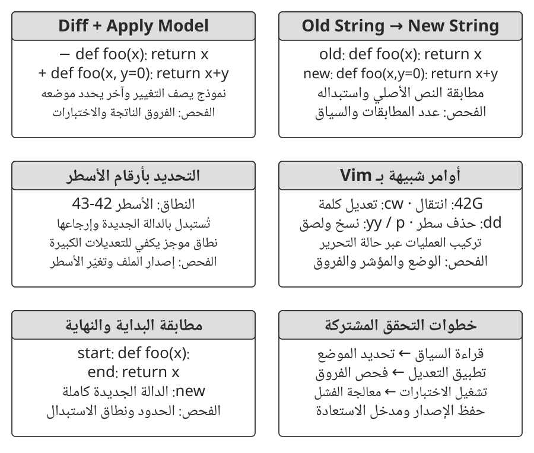

**وصف الفروق + نموذج التطبيق (Apply Model).** يقدّم النموذج الرئيسي نية التعديل ومقاطع الشفرة، كوصف للإضافة والحذف يشبه Git diff، أو هيكل للشفرة يتخطى الأجزاء غير المعدلة بعلامات حذف. ثم يجمع نموذج تطبيق متخصص بين ذلك والملف الأصلي ليولّد المحتوى الكامل بعد التعديل. وكان Fast Apply في الإصدارات المبكرة من Cursor ممثلًا لهذا الاتجاه[^ch5-apply]، إذ يقسم «اقتراح التعديل» و«تطبيق التعديل» بين نموذجين. ومع ازدياد براعة النماذج الأساسية في توليد تحريرات موضعية دقيقة، ظهرت بدائل أبسط لهذا المسار الثنائي.

وهذا التقسيم يتيح للنموذج الرئيسي أن يتفرغ للتعبير عن منطق الشفرة، ويتولى نموذج التطبيق دمج التعديلات الموضعية في الملف. ولذلك يقع محور الفحص على نتيجة الدمج: فالمقاطع المتشابهة قد تسبب لبسًا في تحديد الموضع، وعلامات الحذف قد يُساء فهمها، والمناطق غير المعدلة قد يُعاد كتابتها عن غير قصد.

**من السلسلة القديمة إلى السلسلة الجديدة (Old String → New String).** تعتمد أداة Edit في Claude Code على الاستبدال الدقيق للسلاسل النصية؛ وقد أدخلت Cursor في الإصدار 0.50 في مايو 2025 أسلوب Search & Replace، واستخدمته أولًا لتحرير الملفات الطويلة مع نماذج Anthropic[^ch5-direct-edit]. ويسلّم هذا المسار أساس تحديد الموضع ومحتوى الاستبدال إلى البرنامج مباشرة لينفّذه، فيقل العمل الذي يتطلب استدعاء النموذج مرة أخرى في مرحلة الدمج. يقدّم النموذج `old_string` و`new_string`، وتجد الأداة النص الأصلي في الملف ثم تستبدله. ويمكن أن تشترط الواجهة أن يكون النص الأصلي فريدًا في الاستبدال الواحد؛ فإذا لم توجد مطابقة أو وُجدت مطابقات متعددة، أعادت المواضع والتشخيص ليضيف النموذج سياقًا. وإذا احتيج إلى استبدال جماعي، عُبّر عن النطاق بمعامل صريح.

فلنفترض مثلًا أن ملف إعدادات يتضمن `timeout = 30` في خدمتين، والمطلوب تغيير مهلة خدمة التنزيل وحدها إلى 60 ثانية. فإذا اشترطت الأداة مطابقة فريدة، فإن تقديم `timeout = 30` وحده سيعطي مطابقتين، ويجب أن يبقى الملف على حاله. وفي الطلب التالي يُجعل عنوان قسم خدمة التنزيل وسطر الإعداد معًا سلسلةً قديمة، وتحتفظ السلسلة الجديدة بالعنوان ولا تغيّر إلا القيمة.

ومطابقة المحتوى بديهية ويسهل التحقق منها. لكن على النموذج عند الاستدعاء أن يُخرج السلسلة القديمة كاملة: فإذا حُذفت كتلة كبيرة من الشفرة، طال المعامل كثيرًا؛ كما أن الفروق الدقيقة في المسافات وفواصل الأسطر وعلامات الاقتباس تؤثر في المطابقة. وقد بيّنت حالة علامات الاقتباس المنحنية في Unicode في الفصل الرابع كيف يقع هذا النوع من الأعطال أثناء تمرير المعاملات.

**تحديد الموضع بأرقام الأسطر (Old Line Numbers → New String).** يحدد النموذج حذف الأسطر من X إلى Y، ثم يُدرج نصًا جديدًا. وإذا كانت أداة القراءة قد قدّمت أرقام الأسطر الفعلية، فإن حذف كتلة كبيرة لا يحتاج إلا إلى موضعي البداية والنهاية. لكن معنى رقم السطر يتوقف على إصدار الملف وقت القراءة، والتحرير السابق قد يُزيح المواضع اللاحقة.

ولذلك يمكن في التحرير الجماعي أن تشير كل التعديلات إلى لقطة أولية واحدة، فتفحص الأداة النطاقات المتداخلة وتطبّقها دفعة واحدة؛ ويمكن أيضًا التحرير مرة بعد مرة مع إعادة القراءة وتحديد الموضع من جديد. وتستطيع الأداة كذلك أن تطابق إصدار الملف أو المحتوى المتوقع، فتعيد تعارضًا إذا وقع تعديل متزامن، حتى لا تُطبَّق أرقام أسطر قديمة على محتوى جديد.

**أوامر تحرير على نمط Vim.** تستطيع أوامر المحرر أن تعبّر عن النقل والنسخ والقص واللصق، فتناسب عمليات إعادة التنظيم مثل نقل دالة من موضع إلى آخر. لكنها تعتمد على موضع المؤشر الحالي والمخزن المؤقت ونمط الأوامر، وكل خطوة فيها تغيّر الأساس الذي تقوم عليه العمليات اللاحقة.

**ليس من الضروري أن تصبح عادات التفاعل في محررات البشر هي التصميم الافتراضي لأدوات النموذج.** فالإنسان كثيرًا ما ينظر إلى الحالة الراهنة ثم ينفّذ عملية صغيرة واحدة، أما النموذج فيستطيع بعد تفكير طويل أن يولّد عشرات الأسطر بل مئاتها من التعديلات دفعة واحدة. وتجزئة هذا التعديل الجماعي إلى عدد كبير من حركات المؤشر وتبديلات النمط تزيد تكلفة الاستدعاء، وتتطلب من النموذج أن يتنبأ بأثر الأوامر السابقة في الحالة. ولذلك يفضّل المؤلف في مهام توليد الشفرة الواجهات التي تعبّر مباشرة عن هدف التعديل ومحتواه؛ وإذا اعتُمدت أوامر المحرر، وجب تحديد أساس الحالة بوضوح وإعادة التغذية الراجعة في حينها.

**مطابقة بداية السلسلة ونهايتها (Old String Start + End → New String).** لا يقدّم النموذج إلا بضعة أسطر من بداية المنطقة المراد استبدالها ونهايتها، وتحدد الأداة الحدّين وما بينهما. وعند حذف مئات الأسطر من الشفرة، يقلل هذا الأسلوب النص الأصلي الذي يجب تكراره في المخرجات، مع الإبقاء على أساس تحديد الموضع بالمحتوى.

وعلى الأداة أن تتحقق من ترتيب ظهور المقطعين الأصليين، وأن تقرر وفق مواصفات الواجهة ما إذا كان المقطعان الطرفيان يُستبدلان أيضًا. ولا تنفّذ الاستبدال إلا إذا لم يطابق الشرط سوى نطاق واحد؛ فإن طابقته مواضع عدة، أخبرت النموذج بها وطلبت منه أن يضيف سياقًا. وفي البنى المتداخلة أو الشفرة المكررة، تساعد إضافة مراسٍ مجاورة، كاسم الدالة أو توقيعها، على تحديد النطاق.

**وعند بناء وكيل برمجة جديد، يوصي المؤلف بالبدء بواجهة تحرير بسيطة وحتمية مثل «من السلسلة القديمة إلى السلسلة الجديدة».** فتحديد الموضع بالنص الأصلي واضح، وأسباب الفشل يسهل تفسيرها، والفروق يسهل التحقق منها. وما دام النموذج قادرًا على توليد التعديلات الموضعية بموثوقية، فإن منظومة التشغيل تستطيع أن تسند مزيدًا من العمل إلى برامج حتمية، مستغنيةً عن نموذج التطبيق الإضافي. وإذا احتاج حذف الكتل الكبيرة إلى تقليص حجم المعاملات، أُدخلت عندئذ المراسي الطرفية أو التحرير بأرقام الأسطر المبني على اللقطات. أما `apply_patch` في Codex فيبيّن مسارًا آخر للتحرير المباشر يعبّر عن التعديلات المتعددة برقعة مقيدة الصياغة.

[^ch5-direct-edit]: Anthropic، *Tools reference*، أداة Edit؛ Cursor، سجل تحديثات الإصدار 0.50، 15 مايو 2025، ويعرض إدخال Search & Replace؛ ويسجّل سجل تحديثات الإصدار 1.3 تحسينات Search & Replace وApply معًا.

[^ch5-apply]: Cursor، *Editing Files at 1000 Tokens per Second*، ويعرض النموذج المتخصص في تطبيق أوصاف التعديل على الملف الأصلي.

### أمن وكيل البرمجة

يستطيع وكيل البرمجة أن يقرأ المشروع ويعدّل الملفات ويشغّل البرامج، وقد يصل أيضًا إلى خدمات خارجية عبر الشبكة. وعند تصميم الصلاحيات ينبغي تتبع مسار البيانات وفحص ثلاثة أسئلة: ما المحتوى الذي سيدخل السياق، وما العمليات التي يستطيع النموذج أن يطلبها، وما الآلية التي تقرّ هذه العمليات وتنفذها في النهاية.

لخّص Simon Willison فئة من مخاطر حقن الموجّهات فيما سمّاه «الثالوث القاتل»: الوصول إلى البيانات الخاصة، والتعرض لمحتوى غير موثوق، والقدرة على التواصل مع الخارج[^ch5-trifecta]. فالمساعد الذي يستطيع قراءة الملفات الخاصة، ويعالج الرسائل الواردة من الخارج، ويستطيع إرسال الرسائل، يحتاج إلى حدود تفويض واضحة بين القراءة والفهم والإرسال. فإذا عُوملت التعليمات الواردة في المحتوى الخارجي على أنها مطالب المستخدم، فقد تدفع إلى نقل بيانات من دون تفويض.

وإلى جانب هذه الأبعاد الثلاثة، يوصي المؤلف بفحص بُعد رابع: **الذاكرة الدائمة تضخّم أثر حقن الموجّهات.** فإذا دخل المحتوى الخارجي الذاكرة طويلة الأمد، فقد يتجاوز أثره حدود الجلسة ويظهر من جديد في مهام لاحقة. ولذلك ينبغي أن تُسجَّل عند الكتابة في الذاكرة المصدرُ ونطاقُ الانطباق وحالةُ التأكيد، وأن تبقى هذه الخصائص محفوظة عند القراءة. فالنص المحفوظ في `MEMORY.md` تظل درجة الثقة به رهينةً بطريقة تكوّنه. وإذا اكتُشف سجل خاطئ، وجب أن يكون ممكنًا تحديد المحتوى المعني وتصحيحه وسحبه.

وتتوزع المهام هنا على طبقات الحماية الثلاث التي عرضها الفصل الأول: فطبقة السياق تبيّن مصدر المعلومات ومتطلبات السلوك، وطبقة التنفيذ تتحقق من العمليات والتفويض، وطبقة البيانات تقيّد قراءة الموارد والكتابة فيها بحسب الهوية الموثوقة. وتقيّد البيئة المعزولة في Claude Code تنفيذ الأوامر بحدود نظام الملفات والشبكة، كما يعتمد Cowork بيئة معزولة لاحتضان المهام المحلية[^ch5-sandbox]. وفيما يلي تفصيل هذه الآليات.

**تقييد الموارد والاتصالات داخل البيئة المعزولة.**

- **المخرج الشبكي.** هذا حد يسهل إغفاله في البيئات المعزولة لتنفيذ الشفرة، وينبغي أن يُطبَّق قبل غيره. ويوصي المؤلف بالبدء بإغلاق الوصول الخارجي افتراضيًا، ثم السماح بحسب حاجة المهمة بمصادر الحزم ومواقع الوثائق وواجهات العمل البرمجية. وينبغي أن تقابل قائمة السماح وجهاتٍ محددة ونطاقاتِ عمليات محددة؛ وفي الخدمات المشتركة يجب أيضًا مراعاة الحساب والمستأجر وملكية المورد. وينبغي أن تشمل سياسة الشبكة البرامج التي تشغّلها الأدوات والعمليات الفرعية التابعة لها، وأن تُفحص البيانات المرسلة إلى الخارج فحصًا منفصلًا بحسب نطاق التفويض.
- **نظام الملفات.** يمكن ربط الشفرة المصدرية الأصلية للقراءة فقط، ووضع نسخة منها في مساحة عمل قابلة للكتابة؛ ويمكن أيضًا أن تولّد واجهة تحرير خاضعة للرقابة رقعًا تُطبَّق بعد المراجعة. وتوضع النواتج والملفات الوسيطة في مجلد مستقل، وتبقى ملفات بيانات الاعتماد خارج البيئة المعزولة. وإذا احتيج إلى الوصول إلى خدمة مصادقة، وفّرت واجهة خاضعة للرقابة القدرة التي تحتاج إليها المهمة، بدلًا من تسليم كل بيانات اعتماد الجهاز المضيف إلى البرنامج المولَّد.
- **الموارد والزمن.** توضع حدود قصوى للمعالج والذاكرة وعدد العمليات ومساحة القرص وزمن التشغيل، للحد من آثار الحلقات اللانهائية وانفلات عدد العمليات والكتابة المستمرة على القرص. وعند تجاوز الحد تُعاد حالة منظّمة، مثل «تجاوز التنفيذ 120 ثانية، فأُنهي»، مع المخرجات المحفوظة ونتيجة التنظيف، ليقرر النموذج ما إذا كان عليه تصغير المهمة أو تعديل التنفيذ.

ويجب أن تغطي هذه الحدود سلسلة التنفيذ كاملة. فبعد إقرار الأمر، يظل البرنامج الذي يُشغَّل فعلًا يعمل ضمن نطاق الصلاحيات نفسه؛ كما يجب إخضاع العمليات الخلفية والأدوات المساعدة والواجهات الخارجية للضوابط المقابلة.

**تحليل بنية الأوامر ومعاني المعاملات.**

يتكون أمر shell من اسم البرنامج والمعاملات وإعادة التوجيه والأنابيب والتعابير الفرعية. وعند المراجعة ينبغي تحليل هذه البنية، ثم التعرف على عمليات القراءة والكتابة والتنفيذ والاتصال التي ينطوي عليها الأمر. **القائمة السوداء للأوامر لا تكفي لتحمّل الحكم الأمني النهائي.** فالعملية الواحدة يمكن أن يُعبَّر عنها بتركيبات مختلفة من المعاملات أو باستدعاءات غير مباشرة، ولذلك يجب أن يفهم التحقق بنية الأمر والغرض من معاملاته، ثم تقيّد الصلاحيات وقت التشغيل نطاق التنفيذ الفعلي.

فأداة الاستعلام عن الملفات مثلًا قد تحمل معاملًا ينفّذ عملية لاحقة على كل ملف مطابق، وخيار المخرجات في أداة التنزيل يحدد موضع الكتابة. وعلى المدقق أن يعرف «أي خيار يأخذ المعامل الذي يليه قيمةً له»، وأن يتتبع الغرض من كل معامل، ثم يفحص المسار المستهدف وصلاحيات الوصول والعمليات المسموح بها. وبذلك تأتي نتيجة المراجعة محددة: «أي الملفات تُقرأ»، و«في أي موضع تكون الكتابة»، و«أي برنامج يُشغَّل».

أما توسيع المتغيرات والسكربتات الديناميكية والمسارات التي لا تنشأ إلا أثناء التشغيل، فتجعل جزءًا من السلوك الفعلي لا يتحدد إلا وقت التنفيذ. وتستطيع منظومة التشغيل في هذا الجزء غير المحدد أن تشترط صيغة استدعاء أوضح، أو أن تحيله إلى المراجعة، أو أن تنفذه في بيئة مقيدة. فالمراجعة بمساعدة النموذج تقدّم حكمًا مستندًا إلى السياق، والتحكم الحتمي في الوصول يقيّد الأثر الفعلي. ويمكن لنمط Sidecar الذي عرضه الفصل الرابع أن يعمل بالتوازي مع الأعمال التحضيرية، فلا تُنفَّذ العمليات ذات الأثر الخارجي إلا بعد اجتياز المراجعة.

**تحديد الجهة المخدومة في التفويض متعدد الأطراف.**

يتناول مفهوم الولاء للموكِّل (principal loyalty) السؤال الآتي: إذا كان الوكيل ينجز عملًا نيابةً عن طرف ما، ويتواصل في الوقت نفسه مع مشاركين آخرين، فكيف يظل ملتزمًا بأهداف موكّله وتفويضه؟ فلنفترض أن مستخدمًا كلّف الوكيل بالتفاوض على السعر مع مورّد، وأسرّ إليه بأن سقف الميزانية 12000 يوان. على الوكيل أن يفهم عرض المورّد، ويشرح مطالب الطرف الذي يمثله، ويحمي في الوقت نفسه هذا القيد الخاص.

وقد لاحظ المؤلف وزملاؤه في تقييم التفاعلات متعددة الأطراف نوعين من الفشل: أحدهما تسريب المعلومات الخاصة بالموكِّل أو قبول مطالب غير مشروعة من الطرف الآخر، والآخر الرفض المفرط الذي يعجز معه الوكيل عن إنجاز طلبات الموكِّل العادية. وأظهرت استراتيجيات الموجّهات وأساليب التدريب في التقييم مقايضةً بين حماية المعلومات والتعاون العادي[^ch5-1]. **يجب أن يُقاس الولاء بحماية المعلومات وإنجاز المهمة معًا.** فالسعي إلى رفض مزيد من الطلبات وحده يقطع التعاون العادي أيضًا، والسعي إلى إتمام المحادثة بسلاسة وحده قد يسمح للطرف الآخر بالتأثير في مصالح الموكِّل.

أما في وكيل البرمجة، فقد تحتوي ملفات المستودع ومخرجات الأدوات وما تعيده خوادم MCP الخارجية على معلومات المهمة، وقد تحمل أيضًا نصوصًا تطلب تغيير السلوك. وينبغي لمنظومة التشغيل أن تميّز بين تعليمات الموكِّل والمواد الخارجية بحسب مصدرها الحقيقي، وأن ترفق بكل رسالة مصدرها ودورها، وأن تحوّل نطاق التفويض إلى صلاحيات قابلة للتنفيذ. والنصوص التي تزعم في المواد الخارجية أنها «طلب المستخدم» يجب تأكيدها عبر قناة موثوقة.

ويمكن أن تشرح الموجّهات أيضًا قواعد التعاون: حماية المعلومات الخاصة بالموكِّل، بل إن وجود سجل معين قد يحتاج أحيانًا إلى الكتمان؛ والاقتصار في الشرح للخارج على ما يلزم؛ والتمييز بين الحد الأدنى الداخلي والموقف المعلن؛ ودفع المهمة إلى الأمام ضمن النطاق المفوَّض؛ والحفاظ على معيار تفويض ثابت أمام الطلبات المتكررة. وإذا اتسع التفويض أو تغيّرت الجهة المخدومة، وجب تأكيد ذلك عبر قناة موثوقة وتحديث صلاحيات التشغيل وفقًا له. وبهذا يحصل النموذج على أساس واضح لسلوكه، وتفرض الأدوات والبيئة حدود الوصول الفعلية.

[^ch5-trifecta]: Simon Willison، *The lethal trifecta for AI agents: private data, untrusted content, and external communication*، 16 يونيو 2025.
[^ch5-sandbox]: Anthropic، *Making Claude Code more secure and autonomous with sandboxing* و*How we contain Claude across products*، ويعرضان حدود العزل في نظام الملفات والشبكة والمنتجات.
[^ch5-1]: Li, Bojie and Noah Shi، *Whose Side Is Your Agent On? Multi-Party Principal Loyalty in LLM Agents*، 2026.

## الشفرة: القدرة الفوقية للوكيل العام

حوّلت الأقسام السابقة مطالب المستخدم إلى تغييرات في الشفرة. فلنعد الآن إلى جداول المبيعات التي بدأنا بها: حتى لو لم يحتج المستخدم في النهاية إلا إلى تقرير، يظل الوكيل قادرًا على كتابة برنامج يوحّد معرّفات المنتجات، ويجري الإحصاء بحسب المجموعات، ثم يعيد حساب نسبة المرتجعات لمنتج بعينه من الجدول الأصلي. وينبغي أن يُسأل المستخدم أولًا: هل يريد الإحصاء بعدد القطع أم بعدد الطلبات؟ فلنفترض أن منتجًا بيعت منه عشر قطع موزعة على طلبين، ولم يُرجَع إلا قطعة واحدة من أحدهما. فبحساب القطع تكون النسبة 1/10، وبحساب الطلبات التي وقع فيها إرجاع تكون 1/2. والطريقتان كلتاهما تعملان بنجاح، ولا يُعرف أي الرقمين يجيب عن سؤال المستخدم إلا بعد تأكيد معيار الحساب. والبرنامج المكتوب على هذا النحو يمكن إعادة تشغيله أيضًا حين تصل بيانات الفترة التالية. وحلقة «التوليد ← التنفيذ ← التحقق» هذه يمكن أن تمتد كذلك إلى إنتاج المحتوى، وتكامل أنظمة العمل، وتطوير الوكلاء.

> **القدرة الفوقية.** يستخدم هذا الكتاب مصطلح القدرة الفوقية (meta-capability) للدلالة على القدرة على إنشاء قدرات أخرى أو تركيبها. فتوليد الشفرة يستطيع أن ينتج أدوات جديدة، كسكربتات معالجة البيانات وتسلسلات استدعاء الواجهات البرمجية؛ ويستطيع أن يعبّر عن قيود جديدة، كالتوكيدات وقواعد التحقق؛ ويستطيع كذلك أن يبني أشكالًا جديدة للعرض، كنماذج HTML والعروض التقديمية ومقاطع الفيديو.

ولنبدأ بأبسط الحالات. فحتى لو لم يكن المطلوب في النهاية إلا إجابة مسألة واحدة، يستطيع النموذج أن يكتب برنامجًا قصيرًا يتحقق به من استنتاجه.

### الشفرة أداةً للتفكير

**في الحسابات الدقيقة والقيود الصورية، يفضّل المؤلف أن يكتب النموذج تعبيرًا قابلًا للتنفيذ، ثم يسلّمه إلى مفسّر أو أداة حلّ لتحسبه.** فتوليد الإجابة كلمةً بعد كلمة معرّض لأخطاء النسخ والحساب، وقد يُغفل بعض الشروط؛ أما البرنامج فيثبّت هذه الخطوات ويتيح تنفيذها مرارًا. وتتضمن المهام الرياضية والمنطقية عادةً مرحلتين: تحويل معطيات المسألة أولًا إلى علاقات وقيود، ثم إيجاد النتيجة. ويستطيع النموذج اللغوي الكبير أن يساعد على فهم المسألة واقتراح طريقة الحل وكتابة البرنامج، ويتولى المفسّر أو أداة الحل تنفيذ العمليات المحددة.

فلنفترض أن في فصل 40 طالبًا، اختار 60% منهم الرياضيات، و45% الفيزياء، و25% المادتين معًا. فلإيجاد عدد من اختاروا الفيزياء وحدها، يُطرح عدد من اختاروا المادتين من عدد من اختاروا الفيزياء: 18 − 10 = 8. أما إذا استُخدم عدد من اختاروا الرياضيات خطأً، فالنتيجة 24 − 10 = 14. والخطأ هنا وقع في اختيار المطروح منه.

وكتابة العلاقات الكمية في متغيرات ذات معنى تتيح مراجعتها بندًا بندًا:

```python
math = 40 * 60 // 100       # 24 طالبًا اختاروا الرياضيات
phys = 40 * 45 // 100       # 18 طالبًا اختاروا الفيزياء
both = 40 * 25 // 100       # 10 طلاب اختاروا المادتين
only_phys = phys - both     # 8 طلاب اختاروا الفيزياء وحدها
```

ويوسّع الحساب الرمزي هذا التقسيم للعمل. فهو يحتفظ بالصيغ الدقيقة مثل $\sqrt{2}$، ويحوّل التعابير وفق قواعد الجبر. فإذا رُبّعت مباشرة كانت النتيجة العدد الصحيح 2، أما إذا قُرّبت أولًا إلى 1.414 ثم رُبّعت، فالنتيجة 1.999396. فإذا طلبت المسألة تبسيطًا دقيقًا وجب الاحتفاظ بالرموز، وإذا طلبت الإبلاغ عن قيمة مقيسة أمكن حساب القيمة في النهاية بالدقة المحددة. وقد أكّد Wolfram، في حديثه عن الجمع بين النماذج اللغوية الكبيرة وWolfram|Alpha، تكامل فهم اللغة مع القدرة الحسابية[^ch5-wolfram]. ويستطيع الوكيل أن يحوّل المسألة المكتوبة باللغة الطبيعية أولًا إلى تعبير بلغة Wolfram Language أو Python، ثم يستدعي النظام الحسابي، ويواصل الاستدلال بناءً على النتيجة.

ولكل مهمة أدواتها: فـ SymPy يناسب التعابير الرمزية والمعادلات والتفاضل والتكامل، وNumPy يوفر عمليات المصفوفات والمتجهات، وSciPy يوفر خوارزميات مثل التحسين العددي.

> **التجربة 5-3 ★★: حل المسائل الرياضية بمساعدة الشفرة**
>
> تطلب هذه التجربة من نموذج Doubao نفسه أن يحل مسائل AIME 2024 الثلاثين، وتقارن بين مسارين: الاستدلال المباشر، والاستعانة بأداة Python. وتوفر بيئة الأدوات SymPy وNumPy وSciPy، فيستطيع النموذج أن يولّد برامج ويقرأ نتائج تنفيذها ثم يقدّم الإجابة النهائية.
>
> وفي هذا التشغيل، أجاب الاستدلال المباشر عن 11 مسألة إجابة صحيحة، وأجاب المسار المستعين بالشفرة عن 16 مسألة.

ويمكن معالجة المسائل المنطقية بالطريقة نفسها. ففي ألغاز الفرسان والأوغاد، يُخصَّص لكل ساكن متغير منطقي، تدل قيمته الصادقة على أنه فارس، والكاذبة على أنه وغد، ثم تُحوَّل كل عبارة إلى تعبير منطقي. فبالنسبة إلى المتكلم X، يكون القيد هو أن «X فارس» يكافئ «عبارة X صادقة». فإذا قال A إن «B فارس»، حصلنا على `A == B`؛ وإذا قال A إن «B وغد»، حصلنا على `A == (not B)`.

وتبحث أداة الحل عن إسناد يحقق القيود جميعًا، ثم يفسّر النموذج هذا الإسناد هويات للأشخاص. فإذا تناقضت العبارات، فلا يوجد إسناد يحقق الشروط؛ وقد تسمح العبارات المعطاة أيضًا بعدة مجموعات مختلفة من الهويات.

> **التجربة 5-4 ★★: الاستدلال المنطقي بمساعدة حل القيود**
>
> تختار هذه التجربة 84 مسألة من مجموعة بيانات K&K، موزعة طبقيًا بحسب عدد الأشخاص، وتقارن أداء نموذج Doubao نفسه في الاستدلال المباشر وفي استدعاء `python-constraint`. ويحتاج مسار الشفرة إلى التعرف على متغيرات الأشخاص، وترجمة العبارات، واستدعاء أداة الحل لإيجاد تركيبة الهويات التي تحقق كل الشروط.
>
> وفي هذا التشغيل، أجاب الاستدلال المباشر عن 63 مسألة إجابة صحيحة، وأجاب المسار المستعين بالشفرة عن 33 مسألة. وقد ظهرت في المسارات البرمجية الأربعة والثمانين جميعًا عبارة استيراد مكتبة الحل. وفي إحدى المسائل، أصلح النموذج البرنامج فعلًا، لكنه لم يسلّم الإجابة.
>
> ولنأخذ مثالًا مسألة الشخصين James وSophia. يقول James إن Sophia وغدة؛ وتقول Sophia: «James فارس إذا وفقط إذا كان James وغدًا». والعبارة الثانية كاذبة أيًّا كان James، ولذلك فإن Sophia وغدة، وJames صادق في قوله. وقد كتب النموذج في أول برنامج قدّمه الشرط الثنائي على صورة `james == not james` التي لا يستطيع Python تحليلها. وبحلول الاستدعاء الثامن للأداة، كان البرنامج قد صار `james == (not james)`، لكن الرد النهائي ظل فارغًا، فخسر النموذج هذه المسألة أيضًا.

**يتوقف مقدار ما تتولاه منظومة التشغيل من مهام على حدود قدرة النموذج في المهمة المحددة.** فالاستدلال الذي يُتمّه النموذج بثبات قد لا تضيف إليه خطوات الحل الإضافية إلا كلفة، أما الأجزاء التي يكثر فيها خطأ النموذج في الحساب فيستحق أن تُسند إلى حساب حتمي. لكن الاستعانة بالأدوات تتطلب أيضًا أن يُتمّ النموذج التحويل الصوري تحويلًا صحيحًا، فالخطأ في ترجمة القيود يحوّل المسألة الأصلية إلى مسألة أخرى. وحتى إذا صُحّحت القيود، فقد يستنفد المساعد عدد الجولات قبل أن يتمكن من تسليم الإجابة.

[^ch5-wolfram]: Stephen Wolfram، *Wolfram|Alpha as the Way to Bring Computational Knowledge Superpowers to ChatGPT*، يناير 2023.

### الشفرة قيدًا لقواعد العمل

يمكن تجسيد قواعد العمل في إجراءات التنفيذ عبر الشفرة. فقاعدة «يمكن استرداد المبلغ خلال 7 أيام من الشراء» تحتاج إلى مزيد من التحديد: هل تُحسب الأيام تقويمية أم أيام عمل؟ وهل تبدأ من تقديم الطلب أم من الدفع أم من الشحن؟ وهل تدخل اللحظة الحدّية في المهلة؟ ولا يصبح للقاعدة أساس تنفيذ مستقر إلا إذا أكّد أصحاب العمل هذه المعاني أولًا، ثم كُتبت شروطًا وحالات اختبار.

فإذا أكّد المسؤول عن القاعدة أن «الزمن المنقضي منذ الدفع لا يتجاوز 168 ساعة»، أمكن كتابة ثلاث حالات متجاورة: بعد الدفع بـ 167 ساعة و59 دقيقة، وبعده بـ 168 ساعة بالضبط، وبعده بـ 168 ساعة ودقيقة. ويُطرح وقت الدفع من وقت تقديم الطلب لدى الخادم، بعد توحيد الطابعين الزمنيين على أساس زمني واحد. ووفق هذه القاعدة تُقبل الحالتان الأوليان وتُرفض الثالثة. أما إذا غيّر المسؤول القاعدة لتُحسب بالأيام التقويمية في مكان الدفع، فيجب مراجعة الحالات والشفرة كلها من جديد.

والشرح باللغة الطبيعية يساعد النموذج على فهم السياسة، وعلى أن يشرح الأسباب للمستخدم، وأن يبحث في حدود التفويض عن بدائل، كالاستعلام عن إمكان تغيير الحجز. أما التحقق المكتوب بالشفرة فيفحص الشروط المحددة قبل العمليات الحرجة، ويناسب تركيبات الشروط المتعددة وحسابات الزمن والمطابقة بين مصادر بيانات مختلفة. ويستطيع النموذج أن يساعد على توليد شفرة التحقق، ويؤكد المسؤول عن القاعدة معناها بالمراجعة والحالات الحدّية؛ وإذا تحدّثت القاعدة، تُحدَّث معها الشروح والتنفيذ والاختبارات.

**القيمة الأولى للقواعد المكتوبة بالشفرة هي منع العمليات الخاطئة التي تسبب خسائر فعلية.** فإلغاء الطلبات والتحويلات المالية وحذف البيانات كلها تغيّر حالة العمل، وقد يكون تداركها بعد وقوعها باهظ الكلفة. ولذلك يوصي المؤلف بوضع التحقق من الحقائق في واجهة التنفيذ نفسها، لتمر كل عملية إرسال بمجموعة القواعد ذاتها، فلا يُخشى أن يغفل النموذج عن استدعاء أداة فحص مستقلة. ويمكن أن تبقى واجهة الاستعلام المستقلة لشرح السياسة مسبقًا، أما عند التنفيذ فتُقرأ الحقائق المطلوبة من جديد، ويُفحص ما إذا كانت الحالة قد تغيرت، وتُدار العمليات اللاحقة بآليات المعاملات وعدم التأثر بالتكرار والتعويض التي عرضها الفصل الرابع.

**المعاملات توجّه المطابقة، وحقائق الخادم تحسم القرار.**

يدرس معيار τ-bench استدعاء الأدوات والالتزام بالسياسات في سيناريوهات مثل الطيران والتجارة الإلكترونية[^ch5-tau]. ونتخذ فيما يلي حجز الطيران سيناريو تعليميًا، ونضع خمس قواعد للإلغاء: تُستبعد أولًا الحجوزات التي استُخدم فيها جزء من الرحلة، ثم تُفحص شروط وقت الحجز، وإلغاء شركة الطيران، ودرجة رجال الأعمال، والتأمين. ويسجّل `cancellation_reason` سبب الطلب كما ذكره المستخدم، وتسجّل حقول `expected_*` الحقائق التي يتوقع النموذج أن يراها، أما القرار الفعلي فيُبنى على قراءة قاعدة بيانات العمل وساعة الخادم.

وتعرض هذه الشفرة فروع السياسة. فطبقة المدخل تتأكد من هوية الطلب وملكية الحجز وتفويض العملية؛ وطبقة التنفيذ تقرأ الحالة، وتتحقق من الشروط، وتنفذ الإلغاء داخل معاملة خاضعة للرقابة أو آلية اتساق مكافئة، وتحفظ سجل التدقيق.

```python
def cancel_reservation(
    reservation_id: str,
    cancellation_reason: str,        # "change_of_plan", "airline_cancelled", "other"
    expected_cabin_class: str | None = None,  # اختياري: درجة المقعد التي يتوقعها النموذج
    expected_has_insurance: bool | None = None  # اختياري: حالة التأمين التي يتوقعها النموذج
) -> dict:
    """
    إلغاء حجز رحلة طيران.

    سياسة الإلغاء (يفرضها الخادم بحسب القيم الحقيقية في قاعدة البيانات):
    - القاعدة 1: لا يُلغى حجز استُخدم أي جزء من رحلته
    - القاعدة 2: بعد اجتياز القاعدة 1، يجوز الإلغاء خلال 24 ساعة من الحجز
    - القاعدة 3: بعد اجتياز القاعدة 1، يجوز إلغاء الرحلات التي ألغتها شركة الطيران
    - القاعدة 4: بعد اجتياز القاعدة 1، يجوز إلغاء حجوزات درجة رجال الأعمال
    - القاعدة 5: لا تُلغى حجوزات الدرجة الاقتصادية الأساسية والاقتصادية إلا مع تأمين السفر

    استعلم عن تفاصيل الحجز قبل الاستدعاء، وطابق السياسة أعلاه بندًا بندًا؛
    تُستخدم معاملات expected_* لبيان أسس حكمك، وهي للمقارنة والتدقيق
    في الخادم فقط، ولا تؤثر في قرار السياسة.
    """
    # قراءة الحقائق اللازمة للحكم وفق السياسة من قاعدة بيانات العمل
    r = db.get_reservation(reservation_id)
    now = server_clock.now()  # استخدام ساعة الخادم

    # تسجيل الفروق بين القيم المتوقعة والحقائق الحالية للتشخيص والتدقيق
    if expected_cabin_class is not None and expected_cabin_class != r.cabin_class:
        log_mismatch(reservation_id, "cabin_class", expected_cabin_class, r.cabin_class)
    if expected_has_insurance is not None and expected_has_insurance != r.has_insurance:
        log_mismatch(reservation_id, "has_insurance", expected_has_insurance, r.has_insurance)

    if r.any_segment_used:
        return {"success": False, "reason": "Cannot cancel with used segments"}

    hours_since_booking = (now - r.booking_time).total_seconds() / 3600
    if hours_since_booking < 0:
        return {"success": False, "reason": "Booking time is in the future"}
    if hours_since_booking <= 24:
        execute_cancellation(reservation_id)
        return {"success": True, "reason": "Cancelled within 24-hour window"}

    if r.flight_status == "cancelled_by_airline":
        execute_cancellation(reservation_id)
        return {"success": True, "reason": "Airline cancelled flight"}

    if r.cabin_class == "business":
        execute_cancellation(reservation_id)
        return {"success": True, "reason": "Business class cancellation"}

    if r.cabin_class in ["basic_economy", "economy"]:
        if r.has_insurance:
            execute_cancellation(reservation_id)
            return {"success": True, "reason": f"{r.cabin_class} with insurance"}
        return {"success": False, "reason": f"{r.cabin_class} requires insurance"}

    return {"success": False, "reason": "Does not meet cancellation policy"}
```

**المعاملات تساعد النموذج على المطابقة بندًا بندًا.** يسرد وصف الأداة سياسة الإلغاء، ويشترط الاستعلام عن الحجز أولًا. ويستطيع النموذج أن يملأ `expected_cabin_class` و`expected_has_insurance` بدرجة المقعد وحالة التأمين، فتظهر أسس حكمه في سجل الاستدعاء. والمعاملات الاختيارية توفر مدخلًا للمطابقة، أما التحقق من أن الاستعلام والمطابقة قد جريا فعلًا فيحتاج إلى فحص المسار. وإذا اشترط الإجراء الاستعلام أولًا، أمكن لمنظومة التشغيل أن تفحص سجل الاستعلام ومدة صلاحيته.

فإذا كان قد مضى على الحجز أكثر من 24 ساعة، والرحلة تسير كالمعتاد، والمقعد في الدرجة الاقتصادية بلا تأمين، استطاع النموذج بناءً على ذلك أن يشرح أن الإلغاء غير ممكن وفق سياسة هذا المثال، وأن يستعلم عن الخيارات المسموح بها كتغيير الحجز.

**الخادم ينفّذ القواعد بحسب الحقائق الراهنة.** فدرجة المقعد والتأمين ووقت الحجز واستخدام أجزاء الرحلة وحالة الرحلة كلها تُقرأ من مصدر بيانات العمل، وتُحسب النوافذ الزمنية بساعة الخادم. وتُستخدم الفروق في حقول `expected_*` للتشخيص، ويُستخدم `cancellation_reason` لتسجيل نية الطلب. أما الحقائق، مثل إلغاء شركة الطيران للرحلة، فيتحقق منها الخادم؛ فإذا كتب المستخدم في طلبه «ألغت شركة الطيران الرحلة»، فلن يجعل ذلك تذكرةً غير قابلة للاسترداد قابلةً له.

ويجب أن يتجسد استقلال مصادر البيانات أيضًا في التحكم في الوصول: فمن يستطيع تعديل حقائق الحجز، ومتى تُحدَّث، وكيف يُحفظ تاريخها، كلها أمور تؤثر في موثوقية التحقق. وقد تغيّر العمليات المتزامنة الحالة بعد الاستعلام، ولذلك يعيد الخادم عند تنفيذ الاسترداد قراءة حالة الحجز، ويتأكد من أن التذكرة ما زالت قابلة للاسترداد، ويعيد نتيجة معالجة متسقة للطلبات المكررة.

> **التجربة 5-5 ★★: النموذج الصغير وقواعد العمل المكتوبة بالشفرة**
>
> تستخدم هذه التجربة Qwen3-4B، وتقارن بين تنفيذين على 60 حالة ثابتة لاسترداد تذاكر الطيران. وتقدّم المجموعتان كلتاهما السياسة إلى النموذج باللغة الطبيعية؛ لكن أداة الإلغاء في المجموعة الضابطة تنفّذ الاسترداد مباشرة بمجرد استدعائها، أما في مجموعة الشفرة فتقرأ قبل التنفيذ قاعدة بيانات محاكاة وساعة الخادم لتتحقق من أهلية الاسترداد.
>
> وتستخدم التجربة سياسة مبسطة: الدرجة الاقتصادية المرنة ودرجة رجال الأعمال قابلتان للاسترداد؛ والدرجة الاقتصادية الأساسية قابلة للاسترداد خلال 24 ساعة من الحجز، أو عند إلغاء شركة الطيران للرحلة أو تأخرها تأخرًا كبيرًا. ومعاملا المطابقة هما `expected_refundable` و`expected_reason`، ويسجلان حكم النموذج على أهلية الاسترداد وسببها.
>
> وعند التقييم يُنظر أولًا هل رُدّ المال أم لا، ثم يُقارن ذلك بما إذا كانت التذكرة تستحق الاسترداد وفق السياسة. وبهذا المعيار، عالجت المجموعة الضابطة 57 حالة معالجة صحيحة، وعالجت مجموعة الشفرة 55 حالة. ولم تردّ أي من المجموعتين المال إلى راكب لا يستوفي الشروط، وجاءت الأخطاء كلها من حجوزات كانت تستحق الاسترداد فلم تُستردّ: 3 حالات في المجموعة الضابطة، و5 في مجموعة الشفرة. ويهتم الراكب أيضًا بأن يشرح له موظف الخدمة السبب، وبما يمكنه فعله بعد الرفض. وقد فحصت التجربة على حدة شرح السياسة والبدائل في الرد النهائي، ولم تُحتسب هذه الفحوص في درجات الاسترداد السابقة.

[^ch5-tau]: Sierra Research، τ-bench: A Benchmark for Tool-Agent-User Interaction in Real-World Domains، ويوفر سياسات وأدوات ومهام تفاعلية في سيناريوهي الطيران والتجارة الإلكترونية.

### توليد الوسائط المتعددة بالشفرة

تتضمن العروض التقديمية والتقارير التقنية والصفحات التفاعلية عملين: تنظيم المحتوى والعرض البصري. ويستطيع الوكيل أن يكتب البنية أولًا بشفرة أو بلغة توصيف، ثم يستدعي أدوات التصيير ليولّد ناتجًا يمكن الاطلاع عليه. فلغة HTML تعبّر عن بنية الصفحة، وCSS تتحكم في التخطيط والأنماط، وJavaScript تنفّذ التفاعل. وبذلك تصبح مواضع العناصر وأنماطها معاملات قابلة للتعديل، فيسهل تعديلها جماعيًا وإعادة توليدها والمقارنة بين إصداراتها.

ويناسب التوليد البرمجي المحتوى الذي له بنية ويحتاج إلى تعديل متكرر. أما الواجهة الرسومية (GUI) فتوفر مدخلًا للمعاينة المباشرة والتعديل الموضعي، ويمكن الجمع بين الطريقتين.

**وكيل توليد العروض التقديمية (PPT).**

تحتاج المحاضرة الأكاديمية إلى تنظيم المشكلة والمنهج والتجارب والاستنتاجات الواردة في الورقة البحثية في شرح يتدرج صفحةً بعد صفحة. ويستطيع الوكيل أن يخطط أولًا للسؤال الذي ستجيب عنه كل صفحة، ثم يختار النقاط الرئيسية والمخططات، ثم يولّد الشفرة المصدرية للشرائح. ويتخذ Slidev من Markdown مدخلًا للمحتوى، ويدعم مكونات HTML وVue، فيناسب تنظيم هذه العملية في مسار توليد قابل للتنفيذ[^ch5-slidev].

وإذا قدّمت الجهة المنظمة عرضًا من دورة سابقة نموذجًا، أمكن أيضًا اتباع بنية صفحاته مباشرة. فـ PPTAgent يحلل أولًا الغرض من كل صفحة في العرض المرجعي، ثم يختار للمخطط الجديد صفحات مرجعية مناسبة، ويعدّل العناصر داخلها بالشفرة. فإذا كان التقرير الجديد سيعرض نتائج تجريبية، أمكن اختيار صفحة كانت أصلًا تعرض مجموعتين من النتائج جنبًا إلى جنب، واستبدال المخططات والشروح فيها. لكن إعادة الاستخدام هذه تستدعي فحصًا: إذا استُبدل المخططان كلاهما بنتائج التجربة الحالية، فهل تظل الفقرة المجاورة تشرح تجربة العام الماضي؟ والإصدار المستخدم في الورقة يعدّل مربعات النص بحسب أرقام العناصر والفقرات؛ فإذا لم تُستبدل إلا الصور، بقي الشرح القديم على الصفحة.[^ch5-pptagent]

[^ch5-pptagent]: Zheng وآخرون، ورقة PPTAgent، EMNLP 2025. وتنفّذ الشفرة المرافقة للورقة في `pptagent/apis.py` واجهة للتحرير بحسب الفقرات.

وحتى إذا استُبدلت النصوص والصور استبدالًا صحيحًا، فقد يظل التخطيط خاطئًا. فإذا أُضيف إلى مخطط سطران من الشرح، فقد تنجح الترجمة البرمجية، لكن النص قد يغطي محاور المخطط. وفي الشكل 5-5 لا يستطيع المراجع أن يعيد مثل هذه الملاحظات إلى المقترح المسؤول عن التخطيط إلا بعد أن يرى لقطة الشاشة المصيّرة.

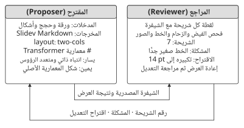

- **المقترح (Proposer)** يقرأ الورقة، ويخطط بنية الشرح، ويكتب الشفرة المصدرية لـ Slidev، ويعدّل الصفحات بناءً على التغذية الراجعة.
- **المراجع (Reviewer)** يصيّر الصفحات عبر الأدوات، ويستخدم نموذجًا بصريًا لفحص كثافة المحتوى وقابلية القراءة والتخطيط والتطابق بين النص والصورة، ثم يعيد تغذية راجعة منظّمة تتضمن رقم الصفحة ونوع المشكلة ودرجة خطورتها واقتراح التعديل.

وينبغي أن تصلح التغذية الراجعة لتوجيه التعديل مباشرة، مثل: «في الصفحة 3 نقاط أكثر من اللازم، فقسّمها إلى صفحتين: نظرة عامة على المنهج، وخطوات الحساب»؛ و«حجم خط الشفرة في الصفحة 7 صغير جدًا، فكبّره أولًا إلى 14 نقطة، ثم افحص وضوحه عند العرض على الشاشة». وتُصحَّح الأخطاء الواقعية وسوء قراءة المخططات أولًا، ثم تُعالج تفاصيل التخطيط والمظهر.

ويحتاج التعديل الموضعي أيضًا إلى تحديد العنصر المقصود بالتعديل. فميزة Doubao Work في شرائح Feishu تسمح للمستخدم بتحديد عنصر في الصفحة، ثم طلب التحرير عبر شريط أدوات عائم.[^ch5-doubao-work] فلنفترض أن في الصفحة الواحدة مربعي نص: أحدهما اقتباس أصلي من مقابلة، والآخر خلاصة كتبها مقدّم العرض. فإذا حدد المستخدم الخلاصة وطلب «اختصرها في سطرين»، فإن المربع المحدد يحصر نطاق التعديل. فالخلاصة يمكن إعادة صياغتها، أما الاقتباس المجاور فيجب أن يحتفظ بكلمات صاحب المقابلة كما قالها.

[^ch5-doubao-work]: مركز مساعدة Feishu، «استخدام Doubao Work في الشرائح».

وبعد أن يعدّل المقترح يعيد التصيير، ويفحص المراجع الإصدار الجديد ويتأكد من أن مشكلات الجولة السابقة قد حُلّت. وللحلقة نوعان من شروط الخروج: بلوغ متطلبات واضحة في المحتوى والتنسيق، أو استنفاد ميزانية الجولات أو الزمن أو التكلفة، كأن يُحدَّد الحد الأقصى بخمس جولات من التعديل. وعند التسليم يُحفظ الإصدار الحالي مع المشكلات التي لم تُعالج بعد، لتسهيل المراجعة لاحقًا.

ويشترك هذا مع اعتماد العمليات في الفصل الرابع في نمط المقترح والمراجع. فاعتماد العمليات يحكم أساسًا على إمكان تنفيذ فعل معين، أما مراجعة المحتوى فتحسّن الناتج عبر جولات متعددة من التغذية الراجعة. ويحتاج الاثنان إلى تقاسم متطلبات المهمة، وتقديم أسس حكم يمكن تحديد موضعها، وأن تقرر منظومة التشغيل الخطوات اللاحقة. واستخدام عائلات نماذج مختلفة يمكن أن يوفر منظورًا آخر للمراجعة.

**ويقدّر المؤلف ميزة تقسيم العمل بين وكيلين في إدارة السياق.** فكل دور يستطيع أن يحتفظ بالمعلومات التي يحتاج إليها وحده: يتلقى المراجع في كل جولة أحدث لقطات الشاشة ومعايير المراجعة وقائمة المشكلات الضرورية؛ ويحتفظ المقترح بالشفرة المصدرية وأهداف التعديل والتغذية الراجعة النصية المنظّمة. وتبقى صور الصفحات في سياق المراجع، ويتقدم المسار الرئيسي في التعديل عبر تغذية راجعة نصية موجزة. وتدور كل جولة مراجعة حول أحدث الصفحات، فيقل تشويش اللقطات القديمة، ويُضبط نمو السياق في الوقت نفسه.

> **التجربة 5-6 ★★: التوليد التلقائي لعرض تقديمي من ورقة بحثية**
>
> تستخدم هذه التجربة ملف PDF لورقة «Attention Is All You Need»، وتولّد منه 20 شريحة بـ Slidev. يستخلص الوكيل بنية الورقة ونقاطها الرئيسية، ويستخدم ثلاثة أشكال من الورقة الأصلية مع تسجيل مصادرها، وينظّم الشرح صفحةً بعد صفحة. وبعد التصيير يفحص تجاوز النص لحدوده، ووضوح المخططات، والتطابق بين النص والصورة، ثم يعدّل بناءً على التغذية الراجعة.
>
> وتقارن التجربة بين المراجعة الذاتية لوكيل واحد وتقسيم العمل بين مقترح ومراجع. وفي هذا التشغيل حصلت المسودتان النهائيتان كلتاهما على 95 درجة في مسار تقييم مستقل واحد؛ وكانت ذروة المدخلات في نهج تقسيم العمل نحو 24 ألف رمز، مقابل نحو 93 ألف رمز في نهج الوكيل الواحد الذي يحتفظ بلقطات الشاشة القديمة.

> **التجربة 5-7 ★★: التوليد التلقائي لفيديو يشرح ورقة بحثية**
>
> انطلاقًا من الشرائح، يستطيع الوكيل أن يكتب لكل صفحة شرحًا بلغة محكية، يوضح العناصر في الشكل والعلاقات بينها والاستنتاجات، ثم يستدعي تحويل النص إلى كلام (TTS) لتوليد الصوت. ويُسلَّم نص الشرح مع الصفحة إلى المراجع البصري، ليفحص ما إذا كانت العناصر المذكورة ظاهرة في الصورة، وما إذا كان الوصف متسقًا مع المخطط.
>
> وعند إنتاج الفيديو، اتبعت التجربة مسار التوليد في القسم السابق، واختارت مسودة أقدم من 22 صفحة (v2). وبعد استخراج 12 صفحة بالترتيب، جاءت اللقطة الأخيرة في الفيديو من الصفحة 21 في المسودة الأصلية. أما المقارنة في القسم السابق بين الدرجات والاستهلاك فاستخدمت المسودة اللاحقة ذات العشرين صفحة (v9). وبعد اختيار الصفحات، استُخدم Kimi لتوليد نص الشرح، ونموذج Qwen البصري لمراجعة العلاقة بين النص والصورة، ثم Fish Audio لتوليد الصوت لكل صفحة. وضبط FFmpeg مدة عرض كل صفحة بحسب المدة الفعلية لمقطعها الصوتي، فأنتج فيديو شرح مدته نحو 8.6 دقيقة.
>
> وفي الشكل 5-6 لا تُجمع الشرائح ونص الشرح والصوت في فيديو إلا في النهاية. وبعض المشكلات لا تُسمع إلا في هذه الخطوة: هل انتقلت الصفحة قبل أن تكتمل الجملة؟ وهل يزداد عدم التوافق بين الصوت والصورة كلما تقدم الفيديو؟
>
> 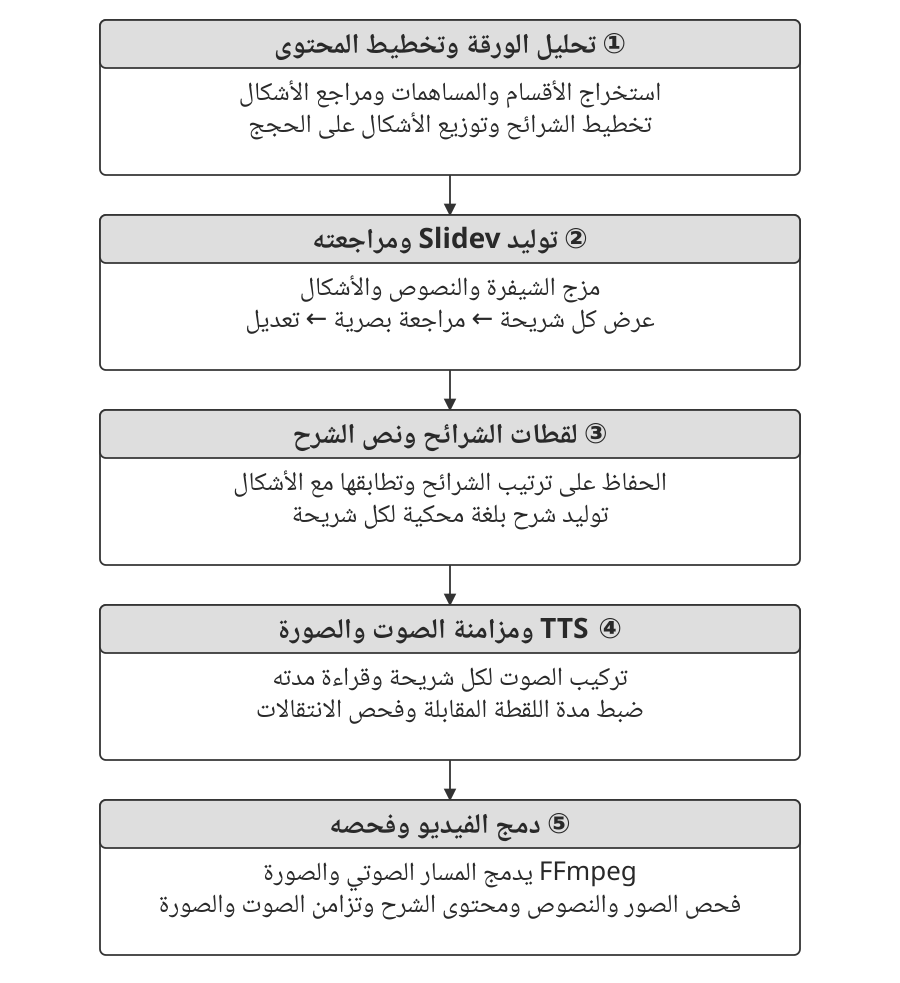

[^ch5-slidev]: Slidev، *Getting Started*، ويعرض توليد العروض التقديمية وعرضها وتصديرها اعتمادًا على Markdown وتقنيات الويب.

**وكيل تحرير الفيديو.**

**العمليات التي يمكن التعبير عنها بسكربتات في تحرير الفيديو ينبغي أن تمر أولًا عبر الواجهات البرمجية.** فالخط الزمني والطبقات والترجمات المصاحبة والمسارات الصوتية موزعة على لوحات معقدة في الواجهة الرسومية، وتكرار تحديد المواضع والسحب يزيد التأخير والخطأ؛ أما الواجهة البرمجية فتعبّر عن العمليات مباشرة بنطاقات زمنية ومسارات ومعاملات للمؤثرات. وتستطيع كل من واجهة Python في Blender وFFmpeg أن تنظّم جزءًا من مهام التحرير في سكربتات قابلة للتنفيذ المتكرر.

ويستطيع الوكيل أن يفهم أولًا طلبًا مثل «اقتطع جزء ركوب الأمواج»، ثم يحدد النطاق المستهدف في المادة، ويولّد شفرة القص والترتيب ومعالجة المسار الصوتي. ويتولى المقترح خطة التحرير والسكربت، ويفحص المراجع نتيجة التصيير؛ فإذا وجد إغفالًا أو مقاطع لا صلة لها بالمطلوب أو ترجمة تحجب الصورة، أعاد التوقيت المحدد والمشكلة إلى المقترح ليعدّل. والإطارات المفتاحية تناسب فحص المشاهد والتخطيط، أما استمرارية الحركة وتزامن الصوت والصورة فتحتاج أيضًا إلى فحص الإطارات المتجاورة أو المقاطع المتصلة.

> **التجربة 5-8 ★★: التحرير الذكي للفيديو عبر الواجهات البرمجية**
>
> تربط هذه التجربة تحديد موضع الهدف وتوليد السكربت ومراجعة النتيجة في مسار واحد. فيُسلَّم أولًا مرجع الفيديو والسؤال المستهدف والفاصل بين الإطارات المستخرجة إلى وكيل فرعي لتحليل الفيديو، فيعالج هذا الكم الكبير من الصور، ويعيد إلى الوكيل الرئيسي النطاق الزمني وأسسه.
>
> ويجري تحديد الموضع على خطوتين. في الخطوة الأولى يُستخرج إطار كل 10 ثوانٍ للعثور على النطاق التقريبي للهدف، مثل «ركوب الأمواج بين الثانية 40 والثانية 110»؛ وفي الخطوة الثانية يُستخرج إطار كل ثانية حول النطاق المرشح والحدود المجاورة له، لتحديد موضعي البداية والنهاية بدقة أكبر. أما المشاهد الأقصر من فاصل أخذ العينات التقريبي فقد تقع بين إطارين، فيمكن زيادة العينات بحسب مدة الهدف، أو العودة إلى الصور الواقعة بين إطارين مستخرجين.
>
> وبعد تحديد النطاق، يولّد المقترح سكربت Python لـ Blender ينفّذ القص وما يلزم من ترجمة مصاحبة وتغيير للسرعة وغيرها. ويطّلع المراجع على المعاينة، ويشير إلى الحدود والمؤثرات التي تحتاج إلى تعديل؛ وبعد اجتياز التعديل يُصدَّر الفيلم الكامل.
>
> وكان المقطع المقصود فعلًا لقطةً لأرنب أبيض كبير يعبر مرجًا وحده. وبالنظر إلى إطار كل 10 ثوانٍ، حدد النموذج النطاق بين الثانية 10 والثانية 20. ولو بدأ القص من الثانية 10 مباشرة، لضاع جزء من بداية اللقطة. لذلك وسّع البرنامج النطاق 5 ثوانٍ من كل جانب، ونظر إلى إطار كل ثانية بين الثانية 5 والثانية 25، فضيّق النطاق المرشح إلى ما بين الثانية 9 والثانية 12. ثم لاحظ المراجع أن المقطع تضمّن صورًا من مشهد مجاور، فصار النطاق بعد المراجعة من الثانية 9.25 إلى الثانية 11.00. وبالمقارنة مع التوسيم البشري من الثانية 9.08 إلى الثانية 11.20، تأخرت البداية 0.17 ثانية، وتقدمت النهاية 0.20 ثانية، فاستوفى الطرفان شرط ألا يتجاوز الخطأ 3 ثوانٍ.
>
> لكن التوقيت لا يكشف إلا موضع القص. فإذا وُضعت الترجمة المصاحبة نفسها والحركة البطيئة نفسها على مقطع اختير خطأً عن عمد، فهل سيتعرف المراجع على الخطأ؟ طلبت التجربة من المراجع أولًا أن يفحص مقطعًا ضابطًا من الثانية 0 إلى الثانية 3، ثم أن ينظر في التصيير بعد المراجعة. وشملت عناصر المراجعة الأرنب الأبيض الكبير في الصورة، والترجمة المصاحبة في أسفلها، والمدة بعد تغيير السرعة.

**الأجسام ثلاثية الأبعاد والقطع الصناعية: اختيار طريقة التوليد المناسبة.**

**القطع الصناعية التي تمثل أبعادها وعلاقات تجميعها قيودًا صارمة يُفضَّل توليدها بالشفرة البارامترية؛ أما الأجسام التي يُطلب منها أساسًا الشكل الطبيعي والمظهر فيُفضَّل لها النظر في النماذج التوليدية.** ويتوقف هذا الاختيار على ما إذا كان الناتج يمكن وصفه بدقة بعدد قليل من المعاملات، وعلى العلاقات التي يجب أن تبقى ثابتة بعد التعديل. فـ CadQuery وOpenSCAD وسكربتات Blender توفر عملية بناء قابلة للتحرير، أما نماذج مثل Hunyuan3D فتستعين بما تعلمته من أنماط الأشكال لتوليد مظاهر معقدة.

**هل يناسب الوصفُ التمثيلَ البارامتري؟** يمكن التعبير عن العلاقات الهندسية الرئيسية في شفة (flange) مبسطة بالقطر الخارجي والسماكة وقطر دائرة الثقوب وقطر الثقب وعدد الثقوب. والشفرة تربط المعاملات بخطوات البناء، فتناسب التعديل المتكرر. أما نبتة في أصيص، أو صخرة من صخور بحيرة تاي، أو وجه إنسان، فتتضمن أشكالًا غير منتظمة كثيرة، ويمكن للنماذج التوليدية أن تساعد على بناء مظهرها، كما يمكن للأساليب البرمجية أن تولّد التفاصيل بقواعد النمو والعمليات العشوائية وتركيب الأصول الجاهزة.

**كيف تُفحص الدقة؟** في متطلب مثل قطر ثقب 5 مم بتفاوت ±0.05 مم، يجب أولًا تحديد الوحدة ونظام الإحداثيات وطريقة القياس، ثم مقارنة أبعاد النموذج بالمواصفات. ويمكن في النموذج البارامتري فحص الكائنات الهندسية مباشرة؛ أما الشبكة فيمكن قياسها بالمقاطع والثقوب وأبعاد الصندوق المحيط وغيرها، مع احتساب خطأ التقطيع المتقطع.

**كيف يُحفظ النموذج ويُعدَّل؟** يصف تمثيل B-rep (تمثيل الحدود) حدود الجسم بالأوجه والحواف والرؤوس، أما الشبكة المثلثية فتقرّب السطح بمضلعات صغيرة. ويستطيع CadQuery أن يصدّر STEP لتبادل بيانات CAD، وأن يصدّر كذلك شبكات STL؛ أما المعاملات القابلة للتحرير ومنطق البناء فتُحفظ في الشفرة المصدرية لـ CadQuery[^ch5-cad]. ويتطلب الدخول في مسار التصنيع بالتحكم الرقمي (CNC) أيضًا تخطيط العمليات ومسارات الأدوات والمواءمة مع الآلة.

فإذا أُريد مثلًا تغيير ثقوب التثبيت من مقاس M5 إلى مقاس M6، أمكن تعديل معامل قطر الثقب، ثم إعادة التوليد والتحقق من أن القطر الخارجي والسماكة ومواضع الثقوب بقيت على حالها. أما طريقة التعديل في النماذج التوليدية فتتوقف على قدرات الواجهة: فيمكن إعادة التوليد، ويمكن الجمع بين التحرير الموضعي والمعالجة الهندسية اللاحقة.

وعند الجمع بين المسارين، ينبغي أيضًا تحديد تقسيم العمل بوضوح: تُسند الأبعاد وعلاقات التجميع إلى الشفرة البارامترية، ويُسند النسيج والمظهر الحر إلى النموذج التوليدي. **فإذا كانت الأبعاد الحرجة تحتاج إلى تعديل دقيق متكرر، كانت عملية البناء القابلة للتحرير أثمن من مظهر يُولَّد مرة واحدة.**

> **التجربة 5-9 ★★: مساران لتوليد القطعة نفسها — الشفرة والنموذج التوليدي**
>
> تطلب هذه التجربة توليد شفة قطرها الخارجي 80 مم وسماكتها 10 مم، تتوزع على دائرة قطرها 60 مم أربعة ثقوب تثبيت بالتساوي. ولتوضيح معنى التجميع، اعتمدت المواصفات الأولية ثقوبًا نافذة قطرها 5.5 مم تناسب M5، ثم غيّر طلب التعديل الثقوب إلى ثقوب نافذة قطرها 6.5 مم تناسب M6.
>
> وفي مسار الشفرة يولّد النموذج برنامج CadQuery، ويُصدّر بعد تنفيذه ملفي STEP وSTL؛ وفي مسار النموذج التوليدي تُولَّد أولًا صورة مرجعية للمنتج، ثم تُسلَّم إلى Hunyuan3D لتوليد الشبكة. وتُفحص القطر الخارجي والسماكة وعدد الثقوب وقطرها ومواضعها وسطح التثبيت، مع تسجيل الوحدة واتجاه المحاور.
>
> فكيف يُعرف أن النموذج لم يعدّل إلا البعد المحدد؟ بمقارنة ملفي STL المصدّرين قبل التعديل وبعده، زاد متوسط قطر ثقوب التثبيت الأربعة من 5.499 مم إلى 6.499 مم؛ وكان القطر الخارجي للقطعتين 80 مم، والسماكة 10 مم، وقطر دائرة الثقوب 60.000 مم بثلاث خانات عشرية في الحالتين. أما الشبكة الأصلية في مسار النموذج التوليدي فافتقرت إلى مقياس فيزيائي واضح. وقد أخذ برنامج القياس مقطعًا في المنتصف على طول المحور Z، فلم يجد الحلقة الداخلية للثقوب. ولمعرفة ما إذا كانت الثقوب الأربعة تخترق القرص، يلزم التعرف على سطح التثبيت وأخذ مقاطع على أعماق مختلفة في اتجاه العمود عليه. وبعد إعادة التوليد تغيّر الشكل العام والاتجاه كلاهما.
>
> وأخيرًا نطرح سؤالًا آخر: إذا كان المطلوب تسليم صورة لنبتة في أصيص تبدو طبيعية، فكيف يكون القبول؟ رسمت التجربة صورة لنبتة بـ matplotlib، وولّدت صورة أخرى بـ Gemini، ثم طلبت من النموذج البصري نفسه أن يقيّم مدى طبيعيتهما من عشر درجات. فحصلت الصورتان على 3 درجات و8 درجات على الترتيب. وهذه الدرجة تجيب عن سؤال: أي الصورتين يراها نموذج التقييم أقرب إلى نبتة حقيقية؟ أما في الشفة، فحتى لو بدت صورة المنتج وفيها أربعة ثقوب، فإن التجميع يظل محتاجًا إلى التحقق من مواضع الثقوب وأقطارها في القطعة ثلاثية الأبعاد.

[^ch5-cad]: CadQuery، *Importing and Exporting Files*، ويعرض صيغًا مثل STEP وSTL، ويوضح أن المعلومات البارامترية الكاملة تُحفظ في الشفرة المصدرية لـ CadQuery المكتوبة بلغة Python.

### الشفرة موائمًا للأنظمة

تختلف الخدمات الخارجية في واجهاتها وطرق مصادقتها وتنسيقات بياناتها. ويستطيع الوكيل أن يقرأ الوثائق وعينات الاستجابات، ثم يولّد عميل HTTP، ويضبط ترويسات المصادقة، ويحلل القيم المعادة، ثم يحوّل حقول المصدر إلى البنية التي يحتاج إليها الطرف المستقبِل. فالشفرة هنا تتولى عمل المواءمة بين الأنظمة، وتركّب الخدمات الموجودة في مسار عمل جديد للمهمة.

فإذا كان حقل المبلغ الذي يُقرأ من خدمة الدفع مثلًا مقدّرًا بالفِن (جزء من مئة من اليوان)، بينما يعرض التقرير المبالغ باليوان، فإن نجاح تحليل JSON لا يدل إلا على توافق التنسيق. فالمعاملة التي قيمتها 25 يوانًا تظهر في المصدر عددًا صحيحًا هو 2500. وإذا وُضع هذا العدد في التقرير مباشرة، صارت الخمسة والعشرون يوانًا 2500 يوان.

ويحتاج الموائم إلى تحديد واضح للمدخلات والمخرجات ومعالجة الأخطاء ونطاق الإصدارات. فالعينات تساعد النموذج على فهم الحقول، أما مواصفات الواجهة والاختبارات فتفحص القيم المفقودة وتقسيم النتائج إلى صفحات والاستجابات الشاذة وتغير الإصدارات. وتدير بيئةُ التنفيذ بياناتِ الاعتماد، وتستخدم الشفرة المولَّدة القدرات المأذون بها عبر واجهات خاضعة للرقابة. وبعد اجتياز التحقق، يمكن حفظ الموائم وإعادة استخدامه، فإذا تغيّر التنسيق لاحقًا دخل مسار التعديل من جديد.

ويمكن اتباع نهج مشابه مع الأنظمة التي لا تملك إلا واجهة رسومية. فيُتم الوكيل المهمة أولًا عبر تشغيل الحاسوب (Computer Use) الذي يعرضه الفصل السادس، ثم يثبّت خطوات العمل المستقرة في أداة أتمتة للعمليات الروبوتية (RPA). وإذا تغيّرت عناصر الواجهة أو حالة تسجيل الدخول أو تسلسل الصفحات، وجب على الأداة أن تكتشف الانحراف وتعيد تحديد المواضع. وسيناقش الفصل التاسع بمزيد من التفصيل كيفية استخلاص مسارات العمل من المسارات الناجحة والتحقق منها وإعادة استخدامها.

**تحليل سجلات الوكيل وتصويرها.**

قد تتضمن المهمة المعقدة الواحدة طلبات متعددة إلى النموذج، وعمليات تنفيذ للأدوات، وتفاعلات مع وكلاء فرعيين. وتعرض النظرة العامة على السجل العلاقات بين الخطوات وحالاتها وأزمنتها، ويعرض التوسيع المدخلات والمخرجات المحددة، فيساعد القارئ على تتبع ما جرى في خطوة بعينها. والحقول المضافة والبنى المتداخلة وإصدارات التنسيق كلها تؤثر في التحليل والعرض.

ويعالج التحليل التكيّفي هذه التغيرات بحلقة «اكتشاف التغيير ← توليد المحلل ← التحقق من النتيجة». فإذا فشل التحليل، حفظ النظام العينة الأصلية وموضع الخطأ والحقول المتوقعة، ثم قارنها بمواصفات الواجهة وإصدار المنتِج ليحكم على ما إذا كان التغيير متوقعًا. ولا يُطلب من الوكيل أن يكتب محللًا جديدًا إلا بعد التأكد من أن الأمر ترقية في التنسيق. أما إذا كان الخلل في البرنامج الذي يكتب السجلات، فتُحفظ السجلات الأصلية ويُبلَّغ عن العطل، حتى لا يعامل المحلل الجديد الخطأ على أنه تنسيق سليم. وتُشغَّل الشفرة الجديدة أولًا في بيئة مقيدة، وتُفحص الحقول ومعانيها أولًا، ثم يُتحقق منها بعينات سليمة وعينات تنقصها حقول وحالات اختبار ارتدادية للتنسيق القديم. وبعد اجتياز ذلك يُسجَّل المحلل الجديد مع إصداره والتنسيقات التي ينطبق عليها؛ وتبقى العينات الفاشلة محفوظة لتسهيل التتبع وإعادة المحاولة.

ولكلٍّ من التحليل والعرض طرق فحصه. فالبرنامج يفحص الطوابع الزمنية والحالات وأنواع القيم وارتباطات الاستدعاءات؛ والتصيير في المتصفح يفحص ما إذا كانت الصفحة تعمل عملًا سليمًا، والنموذج البصري يساعد على فحص وضوح الجداول والخطوط الزمنية والتسميات. وعند التحديث الفوري يُحتفظ بالإصدار السابق ومدخل للتراجع، ليدخل دعم التنسيق الجديد إلى النظام العامل تدريجيًا.

> **التجربة 5-10 ★★★: نظام تكيّفي لتحليل السجلات**
>
> تشغّل هذه التجربة أولًا عمليتين لإنتاج السجلات، تُخرج إحداهما تنسيقًا مفصولًا بخطوط عمودية، والأخرى تنسيقًا بأقواس متداخلة. ولا يستطيع المحلل الأولي معالجة هذه العينات، فيطلب النظام بعد ذلك من النموذج أن يولّد دالتي تحليل، ثم يحمّلهما تحميلًا فوريًا بعد اجتياز الاختبارات، ويحلل السجلات التي فشل فيها من قبل.
>
> يستخرج التنسيق الأول `timestamp` و`level` و`module` و`step` و`message`؛ ويتضمن التنسيق الثاني أيضًا اسم الأداة والزمن المستغرق والحالة. وفي سجل التشغيل، حُلّلت ثلاثة سجلات من كل نوع، واستطاع محرك أُنشئ من جديد أن يحمّل المحللات المحفوظة ويواصل معالجة تدفق سجلات مختلط.
>
> ويصيّر Chromium نتائج التحليل في جدول، ويفحص المراجع البصري أسماء الأعمدة ومحتوى الصفوف وقابلية القراءة.

**التحليل التلقائي لسجلات تنفيذ الوكيل وتشخيص المشكلات.**

بعد استخراج المسار المنظّم، يستطيع الوكيل أن يستعين بوثائق البنية ووثيقة متطلبات المنتج (PRD) ليقارن الإجراءات المتوقعة بالأفعال الفعلية. فهل استُعلم قبل الاسترداد عمّا إذا كان هذا الطلب قابلًا للاسترداد؟ وبعد انتهاء مهلة خدمة المخزون، هل انتقل البرنامج إلى الاستعلام من ذاكرة التخزين المؤقت كما هو متفق عليه؟

ويمكن أن يتضمن تقرير المشكلة الأولوية والوحدة والظاهرة والأدلة واقتراحات التحسين. ويستطيع الوكيل أيضًا أن يولّد منه اختبارات ارتدادية تثبّت المدخلات وشروط القبول المقابلة للمشكلة. ويعيد إطار الاختبار تشغيل الطلبات في بيئة خاضعة للرقابة، أو يقرأ استجابات الأدوات المحفوظة، ويقارن سلوك الإصدار المعيب بسلوك الإصدار المصحَّح. أما العمليات التي تتضمن كتابة خارجية فتستخدم بيئة معزولة أو واجهات بديلة، ليبقى نطاق أثر إعادة التشغيل تحت السيطرة.

وينبغي أن يقابل كل توكيد الخاصيةَ التي يجب التحقق منها. فظهور فحص الاسترداد في السجل لا يدل إلا على أن البرنامج أجرى الاستعلام. أما معرفة ما إذا كان هذا المبلغ قد رُدّ ردًّا صحيحًا، فتتطلب أيضًا النظر في: هل استعلم البرنامج أولًا ثم ردّ المبلغ؟ وهل سمحت نتيجة الفحص بالاسترداد؟ وما الحالة النهائية للطلب؟

وبعد مراجعة التشخيص، يستطيع الوكيل، إذا حصل على التفويض المناسب، أن ينشئ GitHub Issue عبر MCP، ويقترح المسؤول بحسب الوحدة. وإذا كان للعيب نفسه بند عمل قائم، أُضيفت إليه الأدلة الجديدة.

> **التجربة 5-11 ★★★: نظام ذكي لتشخيص سجلات الإنتاج**
>
> تستخدم هذه التجربة خدمة HTTP محلية لإنتاج مسارين للعمل: يُظهر أحدهما أن النظام ردّ المبلغ من دون أن يستعلم عن قابلية الطلب للاسترداد، ويُظهر الآخر أنه لم ينتقل إلى ذاكرة التخزين المؤقت بعد انتهاء مهلة الاستعلام عن المخزون. ويستعين النموذج بوثائق البنية ووصف المتطلبات لتوليد تقرير مشكلات يتضمن إحالات إلى المسارات والجولات، ثم يولّد ثلاثة اختبارات ارتدادية قابلة للتنفيذ.
>
> ويضع الشكل 5-7 تقرير التشخيص بين المسار والاختبارات الارتدادية. يشير التقرير إلى أن «النظام تجاوز الفحص وردّ المبلغ مباشرة». فلنعد إلى المسار بحثًا عن الدليل: أي خطوة غابت عن سجل الاستدعاءات؟ ثم لننظر في الاختبارات: إذا أُغفلت هذه الخطوة مرة أخرى في المستقبل، فهل ستكتشفها الاختبارات؟
>
> 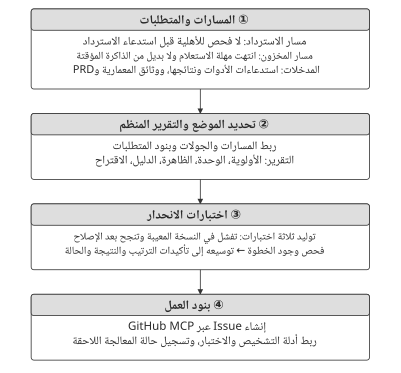
>
> فشلت الاختبارات الثلاثة كلها على الإصدار المعيب، ونجحت كلها بعد الانتقال إلى الإصدار المصحَّح. لكن أحد الاختبارات لا يحكم إلا على ما إذا كان البرنامج قد استدعى أداة فحص الاسترداد. فحتى لو ردّ البرنامج المبلغ أولًا ثم استعلم بعد ذلك عن قابلية الطلب للاسترداد، فسينجح هذا الاختبار. وحُفظ في سجل التشغيل أيضًا إيصال إنشاء بند العمل عبر GitHub MCP، ويمكن الاستناد إليه للوصول إلى الـ issue الذي يقابل تقرير التشخيص بعد تسليمه إلى المطورين.
>

### الشفرة واجهةَ مستخدم توليدية

إذا أراد المستخدم أن يعدّل بنفسه المواد التي يعالجها الوكيل، أمكن تصميم الواجهة طاولةَ عمل مشتركة بين الطرفين. ففي جدول رحلة مثلًا، يرى المستخدم المحطة التي يعدّلها المساعد، ويستطيع أن يتولى التعديل بنفسه، أو يؤكد تغييرًا ما أو يتراجع عنه. فإذا غيّر المستخدم للتو يوم السفر إلى الجمعة، وجب على المساعد أن يواصل العمل بعد ذلك على هذا الجدول الجديد. ولا يتسنى العرض والتعديل في آن واحد إلا إذا اشترك الطرفان في حالة واحدة مرئية، واتُّفق على الطرف الذي يتحكم حاليًا في الحقل الجاري تحريره.

تخيّل أن المستخدم يريد المقارنة بين ثلاثة خيارات للسفر. فما دامت الوجهة غير محددة، كان الحوار أنسب لطرح الأسئلة؛ وإذا تحددت الوجهة، كان اختيار المستخدم للتاريخ وإدخاله لعدد المسافرين مباشرة أيسر من تبادل فقرات نصية للمطابقة؛ وفي النهاية، عند مقارنة تغيّر السعر الإجمالي بحسب التاريخ، يضع مخطط واحد الفروق أمام العين. فحين يولّد الوكيل بحسب المهمة استمارات أو مخططات أو واجهات تطبيقات مناسبة، ليملأها المستخدم ويختار منها ويتعامل معها مباشرة، فذلك هو واجهة المستخدم التوليدية (Generative UI).

**وصف الواجهة والتفاعل ببروتوكول.**

لتوليد الواجهات مساران للتنفيذ: إخراج شفرة مثل HTML وJavaScript تُسلَّم إلى بيئة خاضعة للرقابة لتنفيذها، أو إخراج بنية تصريحية تصيّرها مكونات العميل. والأول يسهّل تنفيذ تخطيطات وتفاعلات مخصصة، أما الثاني فيحصر القدرات المتاحة في نطاق المكونات والأفعال التي يوفرها العميل.

ويعتمد A2UI (Agent-to-User Interface) الوصف التصريحي. فيولّد الوكيل رسائل منظّمة تعبّر عن المكونات وربط البيانات والتحديثات، ويعرض العميل الواجهة بمكوناته الخاصة[^ch5-ui-protocols]. فيمكن للتطبيق مثلًا أن يوفر مكونات للبطاقات والأزرار ومربعات النص والجداول، فيصف الوكيل بناءً عليها جدولًا عنوانه «بيانات المبيعات» يتكون من ثلاثة صفوف وعمودين. ويمكن أيضًا توسيع فهرس المكونات بقدرات مثل المخططات والخرائط.

أما AG-UI (Agent–User Interaction) فيتولى التفاعل بالأحداث بين الوكيل والواجهة الأمامية، فينقل الرسائل واستدعاءات الأدوات وتحديثات الحالة، ويمكن أن يحمل أيضًا رسائل الواجهة الخاصة بـ A2UI. وعند الجمع بينهما، يصف A2UI ما يُعرض، ويصل AG-UI بين التنفيذ في الخلفية والتفاعل في الواجهة الأمامية.

ويستطيع العميل أن يستقبل تحديثات الواجهة تدريجيًا، ويعرضها عبر مصيّرات مواءمة على الويب أو الهاتف المحمول أو سطح المكتب. ويتحقق العميل من خصائص المكونات وربط البيانات وطلبات الأفعال، ويواصل الخادم فحص صلاحيات العمل؛ كما تحتاج الروابط والنصوص المنسقة والوصول إلى البيانات داخل المكونات إلى قواعد معالجة خاصة بكل منها.

أما عند توليد الشفرة مباشرة، فيجب فحص التبعيات والوصول إلى الموارد وصلاحيات التنفيذ، وعزل الواجهة المولَّدة عن الحالة الحساسة للتطبيق المضيف. وقد يؤثر حقن الموجّهات في المواد الخارجية على عملية التوليد، كما تتوقف مخاطر تنفيذ السكربتات في المتصفح على طريقة تحميل الصفحة وعزلها.

**تسليم نتائج تفاعلية بلغة HTML.**

**في تسليم نتائج البحث التي تتضمن بيانات وعروضًا ونتائج تتحدث باستمرار، يفضّل المؤلف مواقع HTML.** فالتقرير الطويل المكتوب بـ Markdown على نحو خطي يُلزم القارئ بالبحث المستمر عن السياق؛ أما صفحة الويب التفاعلية فتجمع الشروح والبيانات والعروض في مدخل واحد: يطّلع القارئ على المخططات، ويصفّي العينات التي تهمه، ويوسّع تفاصيل نتيجة بعينها، ثم يتعامل مع العرض ليفهم سلوك النظام. ويستطيع الوكيل أيضًا أن يحدّث الصفحة مع تقدم المهمة، فتظل تسجّل النتائج والأدلة الراهنة.

ومن تجربة المؤلف البحثية أن لكل مشروع بحثي موقعًا تفاعليًا، يُتخذ في آن واحد وثيقةً حية أثناء البحث وناتجًا نهائيًا للتسليم، ويُكلَّف الوكيل بإضافة المحتوى إليه باستمرار مع تقدم التجارب. وتؤدي هذه المواقع أساسًا ثلاث مهام.

الأولى **تتبع البيانات التجريبية**. فالصفحة تربط العينات والموجّهات وردود النموذج والدرجات، وتتيح فحصها واحدًا واحدًا. فإذا كان نوع ما من الردود يحصل دائمًا على درجات منخفضة، أمكن الرجوع عبر سجلات التقييم إلى الرد الأصلي والموجّه.

والثانية **مراقبة مؤشرات التدريب**. يسمّي المؤلف الإشارات التي تعكس الحالة الداخلية للتدريب «المؤشرات الباطنية»: خسارة التدريب والتحقق، ومعيار التدرج، ومعدل التعلم، وفي التعلم المعزز المكافأة وتباعد KL وإنتروبيا السياسة وغيرها. ويمكن في النماذج اللغوية أيضًا استخدام الحيرة (perplexity) لقياس أداء النموذج في التنبؤ بتسلسل نصي معين. وكما هو الحال في المؤشرات الفسيولوجية في الفحص الطبي، قد تكشف هذه المنحنيات المشكلات أحيانًا قبل أن تكشفها نتائج المهمة النهائية. والنظر إليها مع دقة المهمة يساعد على تحديد المرحلة التي يقع فيها عدم التقارب أو شذوذ التدرج أو تراجع التدريب.

والثالثة **عرض مبدأ التشغيل**. فعند شرح كيفية تعاون عدة وحدات، تستطيع الصفحة أن تتيح للقارئ تغيير أحد المدخلات، والاطلاع على الحالة الوسيطة، ثم مقارنة التغير في المخرجات بسجل التجارب.

وإذا استمر العمل عدة ساعات، فكيف يتسلّمه المستخدم في أوقات فراغه؟ حين يستخدم المؤلف وكيل البرمجة، يريد أن تصل تعليمة شفهية واحدة بدقة إلى الوكيل المكلف، وأن يستطيع فتح النتائج متى شاء الاطلاع عليها، وأن يُنبَّه حين يصدر إصدار جديد أو تظهر مسألة تحتاج إلى قراره. فلنفترض أن تقريرين يُولَّدان في الوقت نفسه. يفتح المستخدم تقرير المبيعات، ويشير إلى المخطط الثاني قائلًا: «أعد رسم هذا بحسب صافي الإيرادات». فينبغي أن ترسل الواجهة مع التعليمة معرّف التقرير الحالي ومعرّف المخطط. وإذا اكتمل تعديل المخطط، أمكن للإشعار أن يفتح الإصدار الجديد مباشرة؛ وإذا كان لـ«صافي الإيرادات» معياران صالحان للحساب، فعلى المساعد أن يعرض المعيارين على المستخدم ليختار بينهما.

**توضيح نية المستخدم.**

حين يقول المستخدم «أريد حجز تذكرة طيران إلى بكين»، تكون الوجهة واضحة، لكن مدينة الانطلاق والتاريخ ونوع الرحلة، ذهابًا فقط أو ذهابًا وإيابًا، لا تزال بحاجة إلى استكمال. ويستطيع الوكيل أن يجمع أسئلته في جولة حوار واحدة، أو أن يولّد استمارة تُعرض فيها الشروط المعنية في صفحة واحدة.

وتقابل عناصر التحكم في الاستمارة أنواعًا مختلفة من المعلومات: فمربع النص يجمع المدخلات المفتوحة، والقوائم المنسدلة وأزرار الاختيار الواحد تعرض الخيارات المتاحة، ومربعات الاختيار تتيح الاختيار المتعدد، ومنتقي التاريخ يساعد على إدخال الوقت. ويمكن لـ JavaScript أن تعبّر عن العلاقات المتسلسلة، كأن تُظهر تاريخ العودة عند اختيار «ذهاب وإياب»، وتتحقق من أن العودة لا تسبق الذهاب. وإذا تغيّر الاختيار، فيجب أيضًا تنظيف الحقول التي فقدت صلاحيتها أو تجاهلها.

والشكل 5-8 مأخوذ من أحد تشغيلات التجربة التالية. فلنتتبع هذا الإرسال: لم يكن بين الحقول الأربعة التي أعادها المتصفح حقل للوجهة، فمن أين عرف النموذج أن المسافر متجه إلى بكين؟

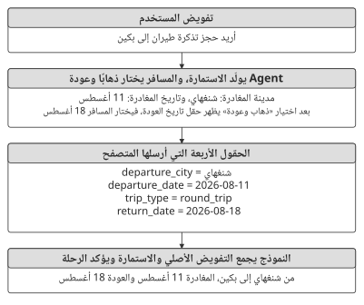

> **التجربة 5-12 ★★: نظام لتوضيح النية بتوليد نماذج ديناميكية**
>
> تنطلق هذه التجربة من عبارة «أريد حجز تذكرة طيران إلى بكين»، وتطلب من النموذج أن يولّد استمارة HTML: مربع نص لمدينة الانطلاق، ومنتقي تاريخ لتاريخ الانطلاق، وخياري الذهاب فقط والذهاب والإياب لنوع الرحلة، وحقل تاريخ العودة الذي يظهر عند اختيار الذهاب والإياب.
>
> ويعيد البرنامج إلى النموذج التكليف الأصلي مع بيانات الاستمارة معًا. فلو اقتُصر على الحقول المرسلة، لظلت الوجهة مفقودة حتى لو مُلئ كل عنصر تحكم ملئًا صحيحًا.
>
> ثم جُرّبت خطوة أخرى على الاستمارة نفسها: بعد ملء تاريخ العودة، غُيّر الاختيار إلى الذهاب فقط. فأخفت الصفحة مربع إدخال العودة، لكن JSON المرسل احتفظ في الوقت نفسه بنوع الرحلة ذهابًا فقط وبتاريخ عودة في 18 أغسطس. فعند التغيير إلى الذهاب فقط، يجب على العميل أيضًا أن يمسح تاريخ العودة الذي فقد صلاحيته.

[^ch5-ui-protocols]: الوثائق الرسمية لـ A2UI و*AG-UI Overview*، ويعرضان على الترتيب الوصف التصريحي للواجهات والتفاعل بالأحداث بين الوكيل والواجهة الأمامية.

**توليد استعلامات SQL.**

يستطيع المستخدم أن يطرح استعلامات قاعدة البيانات باللغة الطبيعية، فيولّد الوكيل SQL بحسب بنية الجداول ومعايير الحساب في العمل. **وعند عرض جداول الاستعلام الكاملة، يفضّل المؤلف نمط Artifact، الذي تنتقل فيه النتائج من قاعدة البيانات إلى الواجهة مباشرة.** فجعل النموذج يقرأ جدولًا كبيرًا ويعيد سرده سطرًا سطرًا يزيد استهلاك الرموز وزمن الانتظار، ويُدخل أيضًا أخطاء النسخ. ويُحفظ SQL ناتجَ استعلام قابلًا للفحص؛ فإذا احتيج إلى تحليل الأسباب أو تلخيص الاتجاهات، سُلّمت النتائج المجمّعة الضرورية إلى النموذج عندئذ.

وفي الشكل 5-9 يريد المستخدم أن يرى عدد الموظفين العاملين في كل قسم، فتستطيع الصفحة أن تعرض مباشرة جدول الإحصاء الذي أعادته قاعدة البيانات. فإذا سأل المستخدم بعد ذلك: «بكم يزيد قسم التسويق على قسم البحث والتطوير؟»، لم يحتج النموذج إلا إلى أخذ العددين 9 و5 من الجدول ليحسب أن الفرق 4 أشخاص. أما إذا تابع قائلًا: «وهل كان الفرق نفسه في الشهر الماضي؟»، فلن يكفي الجدول المعروض، ولا بد من استعلام جديد بتاريخ الإحصاء في الشهر الماضي.

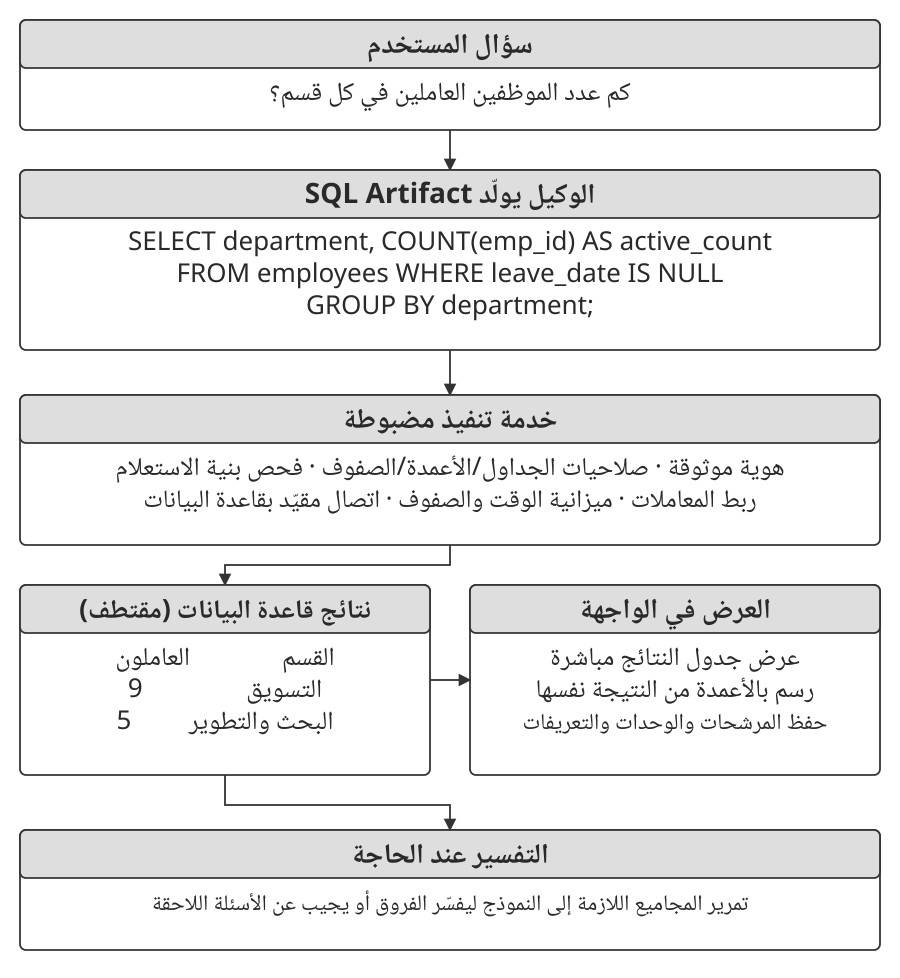

وتحدد خدمة التنفيذ، بحسب الهوية الموثوقة، الجداول والأعمدة والصفوف التي يمكن الوصول إليها، وتستخدم حساب قاعدة بيانات مقيدًا، وتتحقق من بنية SQL ونوع العملية. ويمكن حصر سيناريو الاستعلام في استعلامات قراءة فقط معتمدة، مع ضبط استدعاءات الدوال وميزانية الزمن وعدد الصفوف المعادة ونطاق البيانات؛ أما القيم التي يدخلها المستخدم فتُمرَّر عبر الربط بالمعاملات.

ويستطيع الوكيل أيضًا أن يولّد نواتج مصوّرة، كأن يعرض نتائج تجميع الأقسام في مخطط أعمدة. فتسلّم خدمة التنفيذ نتائج الاستعلام إلى بيئة تصوير خاضعة للرقابة، ولا تعرض الواجهة إلا البيانات والتفاعلات المسموح بها.

> **التجربة 5-13 ★★: وكيل ERP بالتفاعل باللغة الطبيعية**
>
> تتخذ هذه التجربة من استعلامات الموظفين والرواتب في نظام تخطيط موارد المؤسسة (ERP) مثالًا، لتعلّم كيفية توليد SQL من أسئلة العمل، وجعل نتائج قاعدة البيانات تنتقل إلى الصفحة مباشرة. ويُنشأ في PostgreSQL جدولان: جدول الموظفين، ويتضمن معرّف الموظف واسمه وقسمه ومستواه وتاريخ التحاقه وتاريخ تركه العمل، وخلوّ تاريخ ترك العمل يعني أن الموظف ما زال على رأس عمله؛ وجدول الرواتب، ويتضمن معرّف الموظف وتاريخ صرف الراتب ومقداره، بسجل واحد لكل موظف في كل شهر.
>
> ويعالج الوكيل بناءً على هذين الجدولين الأسئلة العشرة الآتية:
>
> 1. ما متوسط مدة خدمة الموظف؟
> 2. كم موظفًا على رأس عمله في كل قسم؟
> 3. أي الأقسام أعلى في متوسط مستوى موظفيه؟
> 4. كم موظفًا جديدًا التحق بكل قسم هذا العام والعام الماضي؟
> 5. ما متوسط الرواتب في القسم A من مارس قبل عامين إلى مايو من العام الماضي؟
> 6. أي القسمين A وB كان متوسط الرواتب فيه أعلى في العام الماضي؟
> 7. ما متوسط رواتب الموظفين في كل مستوى هذا العام؟
> 8. ما متوسط رواتب الشهر الأخير للموظفين الذين مضى على التحاقهم أقل من عام، ومن عام إلى عامين، ومن عامين إلى ثلاثة أعوام؟
> 9. من الموظفون العشرة الذين ارتفعت رواتبهم بأكبر نسبة من العام الماضي إلى هذا العام؟
> 10. هل توجد رواتب متأخرة (موظف على رأس عمله في شهر ما ولم يُصرف له راتب)؟
>
> ولا بد قبل الاستعلام من تحديد معايير الحساب. فمدة خدمة الموظف الذي ما زال على رأس عمله تُحسب حتى تاريخ الأساس للاستعلام، ومدة من ترك العمل تُحسب حتى تاريخ تركه؛ و«متوسط الرواتب» يحتاج إلى تحديد ما إذا كان يُحسب بحسب سجلات الصرف أم بحسب الموظفين؛ وترتيب الزيادات في الرواتب يحتاج إلى معالجة الموظفين الذين لا سجل لهم في العام الماضي.
>
> وفي هذا التشغيل، وُلّدت عشرة استعلامات SQL ونُفّذت، فجاءت نتائجها كلها مطابقة لحسابات مرجعية مستقلة، ثم صيّر المتصفح الجداول مباشرة. ويتلقى النموذج بنية الجداول والمهمة والتغذية الراجعة الضرورية من التنفيذ، أما بيانات صفوف قاعدة البيانات فتنقلها التطبيقات إلى الواجهة.

**توليد البرمجيات ديناميكيًا.**

يستطيع الوكيل أن ينطلق من المتطلبات ليولّد الواجهة ومنطق التفاعل، ثم يواصل تعديلها بحسب أفعال المستخدم. وقد عرضت Anthropic هذا النوع من التفاعل في «Imagine with Claude»، وهو معاينة بحثية مؤقتة أطلقتها في 2025: يستكشف المستخدم الواجهة، ويواصل النموذج توليد تجربة البرمجيات المقابلة[^ch5-imagine].

**أما في المنتجات الفعلية، فالمؤلف أكثر تفاؤلًا بالتخصيص فوق إطار موجود.** فالتوليد المستمر للتطبيق كاملًا من الصفر يدفع تكلفة التوليد والتصيير والتحقق مرة بعد مرة؛ أما الإبقاء على إطار مستقر مع فتح الواجهات والمسارات التي يهتم بها المستخدم فيقدّم تجربة شخصية موثوقة بسرعة أكبر. فإذا طلب المستخدم: «اجعل الزر أزرق»، أو «أضف قائمة اختصارات في الشريط الجانبي»، أو «استخدم خطًا أسهل قراءة»، حدد الوكيل المكونات المعنية، وعدّل الشفرة، ثم فحص النتيجة عبر المعاينة. ويوفر الإطار الأساسي بنية صفحات وواجهات عمل مستقرة، ويمكن أن يتسع نطاق التخصيص تدريجيًا من الألوان والخطوط إلى التخطيط والمكونات.

ويستطيع الاستبدال الفوري للوحدات (HMR، Hot Module Replacement) في بيئة التطوير أن يحدّث وحدات الواجهة الأمامية المتأثرة بعد تغيّر الشفرة. أما الاحتفاظ بالحالة فيتوقف على تكامل الإطار وحدود التحديث ونوع التعديل؛ وإذا احتيج إلى تحديث كامل للصفحة، فعلى التطبيق أن يحفظ الحالة الضرورية. أما reload في نمط التطوير في FastAPI فيعيد تحميل برنامج الخادم، فيعمل كل منهما على جانب: الأول على وحدات الواجهة الأمامية، والثاني على عملية الخلفية[^ch5-hmr].

> **التجربة 5-14 ★★: نظام لتخصيص الواجهة بالحوار**
>
> تبني هذه التجربة تطبيق دردشة يتكون من واجهة أمامية بـ React وخلفية بـ FastAPI، مع تفعيل HMR في الواجهة الأمامية وreload في الخلفية داخل بيئة التطوير. ويعدّل النموذج الألوان والخطوط والعنوان بحسب ثلاث جولات متتالية من الطلبات، ويفحص المتصفح الواجهة الفعلية بعد كل تعديل.
>
> وسجّل هذا التشغيل أحداث HMR في Vite، ولم يقع في الجولات الثلاث أي انتقال كامل للصفحة، وظلت حالة الدردشة القائمة محفوظة، ونجح البناء النهائي.

[^ch5-imagine]: Anthropic، *Introducing Claude Sonnet 4.5*، ويعرض المعاينة البحثية المؤقتة Imagine with Claude التي صدرت مع النموذج.
[^ch5-hmr]: *Vite HMR API* و*FastAPI CLI*، ويعرضان على الترتيب التحديث الفوري للواجهة الأمامية وإعادة التحميل التلقائي لخادم التطوير.

**فصل حدود الصلاحيات عن شفرة العمل الديناميكية.**

**كلما سهل على الوكيل أن يعيد كتابة شفرة العمل ديناميكيًا، وجب أن تنتقل حدود الصلاحيات النهائية إلى طبقة الوصول إلى البيانات المستقرة.** فالتطبيقات التقليدية تكتب فحص الصلاحيات في شفرة عمل خضعت للمراجعة؛ أما حين تتغير الشفرة المولَّدة باستمرار، فقد يُغفل مسار جديد الفحص نفسه. ولا تبقى قيود الصلاحيات محفوظة إلا إذا مرت كل قراءة وكتابة بخدمة مستقلة للوصول إلى البيانات. فتطبيق التوظيف مثلًا يستطيع أن يولّد قوائم المرشحين ونماذج العمليات ديناميكيًا، أما انتماء المرشح إلى مؤسسة ما، والحقول التي يستطيع موظف التوظيف تحديثها، فتفحصها باستمرار خدمة موثوقة للوصول إلى البيانات.

وهدف التصميم هنا هو: **حتى لو وقع خطأ في الشفرة المولَّدة، تظل طبقة الوصول إلى البيانات الموثوقة قادرة على فرض قيود الصلاحيات.** وهذا امتداد لحاجز طبقة البيانات في الفصل الأول: أن توضع القواعد الواجب الالتزام بها في الموضع الذي تمر به كل العمليات المعنية. فسياسات الأمان على مستوى الصفوف في قاعدة البيانات تقيّد الوصول إلى السجلات، والقيود والمدققات تفحص سلامة الحالة، والعروض الخاضعة للرقابة أو الإجراءات المخزنة أو خدمات البيانات توفر العمليات المسموح بها. وتستطيع طبقة التطبيق أن تفحص مسبقًا وتشرح للمستخدم، أما القراءة والكتابة النهائيتان فتتحكم فيهما خدمة البيانات الموثوقة وصلاحيات قاعدة البيانات.

وتحتاج كل عملية أيضًا إلى **سياق وصول** (access context) موثوق، يتضمن المستخدم والمستأجر والدور أو هوية الوكيل. وتتولى خدمة المصادقة وبيئة التشغيل الموثوقة إنشاء الهوية وربطها، وتمنح خدمة البيانات التفويض بناءً عليها. وتحصل الشفرة الديناميكية على الواجهات المقيدة اللازمة لإنجاز المهمة، أما بيانات الاعتماد وصلاحيات إدارة السياسات فتحفظها مكونات مستقلة. ويجب أن تلتزم كل اتصالات قاعدة البيانات والاستعلامات المساعدة والمعالجات الخلفية بنطاق الوصول نفسه.

فالأمان على مستوى الصفوف في PostgreSQL مثلًا يحتاج إلى أن يُستخدم مع إعدادات أدوار قاعدة البيانات. فاتصال التطبيق يستخدم دورًا تقيّده السياسات، وليس لحساب التطبيق صلاحية تعديل سياسات الوصول[^ch5-rls]. وتخضع القواعد وآلية ربط الهوية لمراجعة مستقلة، ويمكن لواجهات العمل أن تتغير باستمرار ضمن هذا النطاق.

وللصلاحيات وسلامة البيانات مسؤوليات مختلفة. فبعد أن تكون لموظف التوظيف صلاحية تعديل سجل المرشح، تواصل آلة الحالات فحص ما إذا كان الانتقال من «اجتاز الفرز» إلى «أجريت المقابلة» مسموحًا به؛ ويقرأ مدقق الرواتب الوظيفة المرتبطة ليتحقق من أن الراتب المتوقع يقع ضمن نطاق الوظيفة؛ ويتأكد فحص المراجع من صحة العلاقة بين الوظيفة والمرشح.

> **التجربة 5-15 ★★★: كائنات بيانات تتضمن الصلاحيات للبرمجيات المولَّدة ديناميكيًا**
>
> تقدّم هذه التجربة نموذجًا أوليًا لمخزن كائنات بلغة Python فوق PostgreSQL، يضع قواعد الصلاحيات والمدققات وعلاقات الكائنات وتصريحات ردود الفعل اللاحقة في أنواع البيانات نفسها. وعند القراءة تُفحص صلاحيات الوصول؛ وعند الإنشاء والتحديث تُنفَّذ أولًا فحوص الصلاحيات والعمل، وتُفحص علاقات المراجع، ثم تُحفظ البيانات، وبعد ذلك تُضاف ردود الفعل المصرَّح بها إلى طابور، مع تقييد عمق سلسلة ردود الفعل.
>
> ويتضمن مثال التوظيف كائنات مثل الوظائف والمرشحين والمقابلات والتقييمات. ويمر المرشح بالتتابع بمراحل التقديم والفرز والمقابلة وإرسال عرض العمل والتعيين، ويمكن أن ينتقل في المراحل المعنية إلى حالة الرفض أيضًا؛ ويأتي نطاق الراتب من الوظيفة المرتبطة. ويتضمن المثال فحوصًا لتحديث الحالة العادي، والانتقال غير الصالح بين الحالات، وتجاوز نطاق راتب الوظيفة، والوصول من مستأجرين مختلفين، ليساعد القارئ على فهم ما يعالجه كل من التفويض وفحص العمل.
>
> ويعبّر النموذج الأولي عن خصائص المستخدم والدور والمؤسسة عبر `AccessContext`، ويبني السكربت التعليمي هذه السياقات مباشرة لمحاكاة هويات مختلفة. أما عند النشر فينشئ مدخل المصادقة السياق، ويُفصل مخزن الكائنات عن الشفرة المولَّدة على جانبي حد واضح للخدمة أو للصلاحيات.

[^ch5-rls]: PostgreSQL، *Row Security Policies*، ويعرض إعداد سياسات الأمان على مستوى الصفوف بحسب الأدوار والعمليات ونطاق انطباقها.

### شفرة تنشئ شفرة: التمهيد الذاتي للوكيل

يمكن أن تُستخدم القدرة على توليد الشفرة أيضًا في تطوير الوكيل نفسه. فالمُنشئ يتلقى متطلبات المهمة، ويولّد موجّهات الوكيل الجديد وأدواته وحلقة تشغيله أو يعدّلها، ثم يفحص الناتج بالاختبارات والتفاعل الفعلي. ويعرض الشكل 5-10 حلقة التمهيد الذاتي هذه: فالتنفيذ الموجود يقدّم نقطة البداية، والتغذية الراجعة من المهام تدفع التعديل، ونتائج التحقق تحدد التغييرات التي يمكن الاحتفاظ بها.

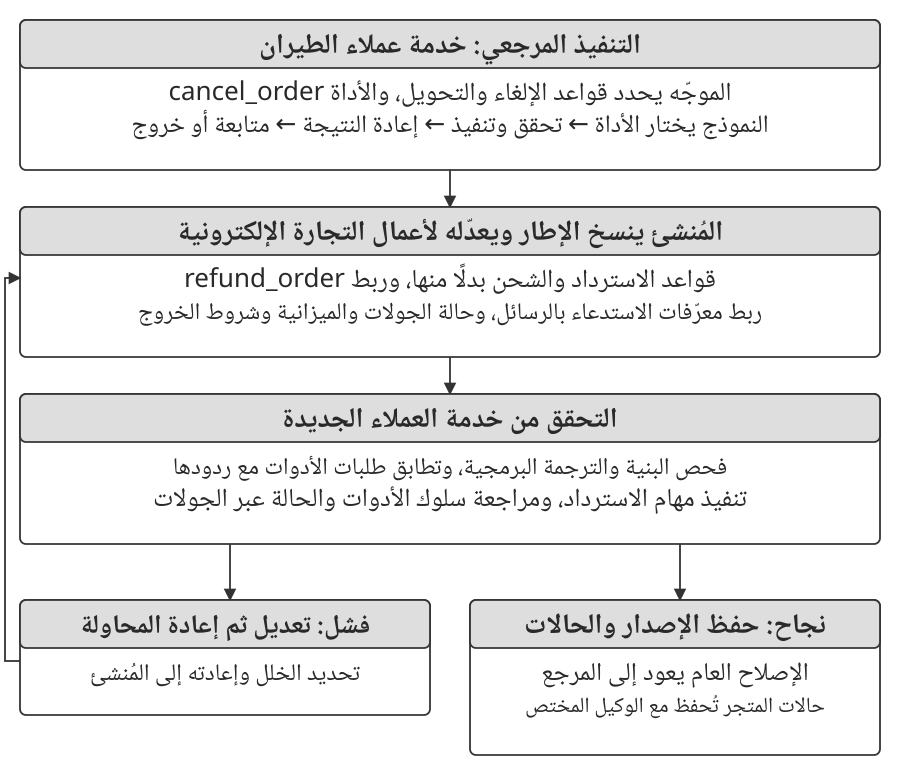

فكيف نميّز بين تعديل حسّن القدرة العامة وتعديل صادف أنه تكيّف مع المسائل التي رآها للتو؟ يُحتفظ بمهمة لم تُعطَ للمُنشئ. فإذا طُوّر مثلًا وكيل لمراقبة الأسعار ببيانات متجر واحد، أُعطي بعد ذلك عينات من متجر آخر، مع إعادة تشغيل المهمة الأصلية في الوقت نفسه.

**صيانة بيئة تشغيل الوكيل.**

يعتمد تشغيل الوكيل الجديد على الإعدادات وبيانات الاعتماد وحالة الجلسة والخدمات والبيئة المعزولة. ويقدّم الأمر `doctor` في OpenClaw مثالًا على أداة صيانة: فهو يفحص مشكلات مثل ترحيل الإعدادات القديمة، وحالة بيانات اعتماد OAuth، وأقفال الجلسات، وتثبيت المكونات الإضافية، وسلامة البوابة، وصور البيئة المعزولة، ثم يقدّم اقتراحات للإصلاح أو ينفّذ الإصلاح المقابل[^ch5-doctor].

ويمكن أن تصبح هذه الفحوص الحتمية أساسًا لمسار الصيانة الذاتية. فقواعد الكشف تغطي الأعطال المعروفة، وأفعال الإصلاح لها مدخلات ونتائج متوقعة واضحة. وعند تصميم مسار تشخيص يتولاه الوكيل، يمكن تسليم المشكلات التي لم تُحل بعد إلى النموذج مع السجلات والإعدادات ونتائج الفحص، ليشرح أي إعداد ينوي تعديله وكيف؛ ثم تفحص طبقة التنفيذ الصلاحيات ونطاق التعديل، وتشغّل فحوص السلامة والاختبارات الارتدادية. وتساعد لقطات الإعدادات وسجلات التغيير ومداخل التراجع النظامَ على استعادة عمله إذا فشل الإصلاح.

**التنفيذات المرجعية حاملةً للخبرة الهندسية.**

ينطوي إنشاء وكيل متخصص على منطق المجال والبنية التحتية العامة معًا. وعند فحص النتائج المولَّدة، يمكن البدء بأربع فئات من الأسئلة:

1. **السياق وحلقة التشغيل.** يُحتفظ بالارتباط بين الأدوار ومعرّفات استدعاء الأدوات ونتائجها، وتُفحص الحالة عبر الجولات وشروط الإنهاء والميزانيات والاستعادة من الاستثناءات. والرسائل المنظّمة تسهّل الحفاظ على علاقات البروتوكول، والبادئة المستقرة تهيئ الظروف للتخزين المؤقت للموجّهات.
2. **واجهات الأدوات.** يبيّن وصف الأداة غرضها وشروط انطباقها وحدود استخدامها، وتتضمن المعاملات أنواعها ومعانيها وأمثلة محددة. وتواصل طبقة التنفيذ التحقق من المعاملات والهوية وحالة العمل.
3. **اختيار النموذج والواجهة البرمجية.** يميل النموذج إلى اتباع النماذج والواجهات القديمة الأكثر تكرارًا في بيانات تدريبه، فقد تأتي الشفرة سلسة مع أن اختياراتها متأخرة. ولذلك يُزوَّد المُنشئ بمواد محدّثة للاختيار، أو يُطلب منه البحث في الوثائق الرسمية، للتحقق من قدرات النموذج وإصدارات الواجهات وطرق الاستدعاء. ثم تكشف الاستدعاءات الفعلية بعد التوليد ما إذا كانت الإعدادات صالحة للاستخدام.
4. **التبعيات وتوافق المنظومة البرمجية.** تُفحص حالة صيانة المكتبات وإصداراتها وتغيرات واجهاتها، ويُتحقق من البرنامج بعد تركيبه بتثبيت التبعيات وفحص الترجمة البرمجية والاختبارات.

**وعند إنشاء وكيل متخصص، يفضّل المؤلف أن يبدأ المُنشئ بنسخ تنفيذ مرجعي جرى التحقق منه، ثم يجري التعديلات الخاصة بالمجال.** فالموجّهات يصعب أن تستوفي كل تفاصيل بروتوكولات الرسائل وإدارة الحالة وآليات الاستعادة، أما الشفرة المرجعية فتنقل هذه الخبرة الهندسية إلى النظام الجديد مباشرة. فالنموذج، وإن كان بارعًا في البرمجة، قد يغفل شروط تشغيل لم يُصرَّح بها في وصف المهمة، وإعادة استخدام إطار جاهز تقلل هذا النوع من الأخطاء المتكررة. فينسخ المُنشئ الإطار الأساسي المناسب، ويعدّل موجّه النظام ليوافق الدور الجديد، ويضيف أدوات المجال أو يحذفها، ويعدّل منطق العمل، ويضيف الاختبارات المقابلة. ويوفر الإطار معالجة الرسائل وربط الاستدعاءات وإدارة الحالة ومسارات الخروج، ويُتحقق من التغييرات الخاصة بالمجال بحالات اختبار جديدة.

فإذا كان القالب أسرع بكثير، فكيف نستبعد تفسير أنه «أنجز وظائف أقل»؟ فيما يلي تسلّم مجموعتان من المُنشئين النوعَ نفسه من الوكلاء، ويخضع ما تسلّمانه لمجموعة الفحوص نفسها.

> **التجربة 5-16 ★★★: تطوير وكيل قادر على إنشاء الوكلاء**
>
> يُطلب من نموذج المُنشئ نفسه أن يبني وكيلًا لمراجعة الإصدارات: يقرأ مجموعة من سجلات فحص النشر، فإذا لم يجتز أي بند من البنود الإلزامية رفض الإصدار وبيّن السبب. وفي الإنشاء من الصفر، يحتاج النموذج إلى كتابة حلقة التشغيل وبروتوكول الأدوات وأدوات المجال ومدخل سطر الأوامر والاختبارات. أما مسار القالب فينسخ أولًا وكيلًا قادرًا على فحص السجلات المنظّمة، ولا يحتاج النموذج إلا إلى ملء مواصفات المجال، مثل: في أي حقل تُحفظ الحالة، وأي القيم تعني الاجتياز؟ ويولّد سكربت الإنشاء موجّه النظام وتعريفات الأدوات ووثائق الشرح بحسب المواصفات، وتقرأ أدوات Python الموجودة المواصفات لتنفيذ الفحص. ويجسّد المساران كلاهما البرمجة الفوقية (metaprogramming): استخدام برنامج لتوليد برامج أخرى أو تعديلها.
>
> وفي الشكل 5-11 يلتقي المساران عند مجموعة واحدة من شروط القبول.
>
> 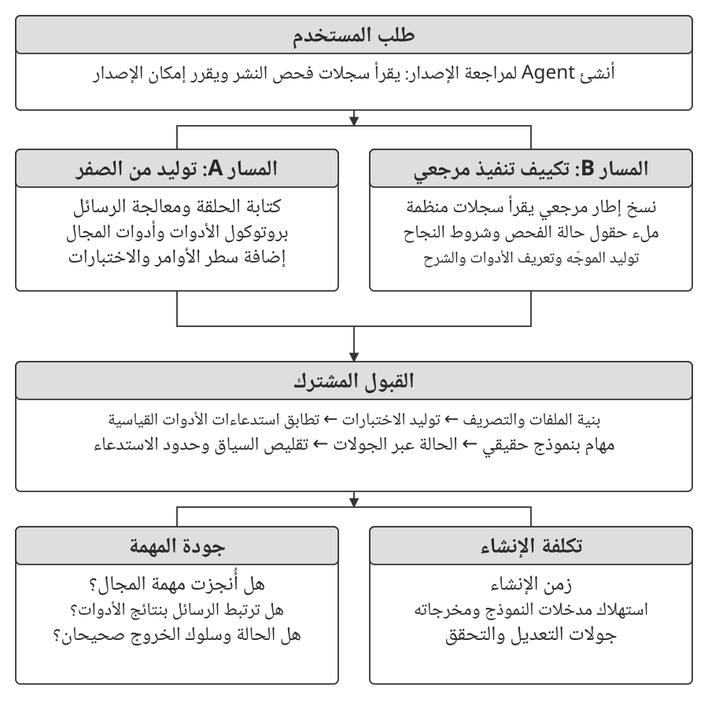
>
> ويستخدم المساران متطلبات المهمة وشروط القبول نفسها. فتُفحص أولًا بنية الناتج والترجمة البرمجية والاختبارات، ثم يُفحص ارتباط استدعاءات الأدوات بنتائجها في الرسائل القياسية، وأخيرًا تُشغَّل مهام بنموذج حقيقي وتفاعلات متعددة الجولات، للتحقق من اقتطاع السياق وإدارة الحالة وتقييد عدد الاستدعاءات.
>
> وفي المقارنة المحفوظة على Kimi K3، اجتازت كل مجموعة 39/39 فحصًا حتميًا، واجتازت كلتاهما أيضًا مهام النموذج الحقيقي وفحوص الحالة متعددة الجولات. واستهلك مسار القالب عند الإنشاء 1,181 رمزًا ونحو 25 ثانية، بينما استهلك مسار البناء من الصفر 381,814 رمزًا ونحو 90 دقيقة.
>

[^ch5-doctor]: OpenClaw، *Doctor*، ويعرض وظائف فحص الإعدادات والحالة والترحيل والإصلاح.

## ملخص الفصل

**نضج وكيل البرمجة مبكرًا لسبب يسهل إغفاله: أن هندسة البرمجيات تملك أصلًا أنظمة الأنواع ومجموعات الاختبار وإدارة الإصدارات وأدوات التنقيح.** فإذا عُدّلت الشفرة تعديلًا خاطئًا، كثيرًا ما تشير الاختبارات إلى مجموعة المدخلات التي أعطت نتيجة غير متوقعة؛ وإذا جُرّبت طريقة أخرى في التعديل، أمكن اختبارها بالمدخلات الأصلية نفسها. ولنقل هذه الخبرة إلى مهام أخرى، تُطرح أولًا ثلاثة أسئلة محددة: كيف يُكتشف الخطأ؟ وكيف يُستعاد وضع معروف؟ ومتى يجب التوقف وطلب تدخل إنسان؟ فإذا انقطع استدعاء الاسترداد في منتصفه مثلًا، وجب على منظومة التشغيل أن تراجع الحساب أولًا ثم تقرر إعادة المحاولة، وإلا فقد تتحول استعادة عطل واحد إلى استرداد ثانٍ.

وتستطيع الشفرة أيضًا أن تحفظ حكمًا واحدًا في صورة قابلة للاستخدام المتكرر. فالتعداد في المسائل الرياضية والقيود في المسائل المنطقية يمكن أن يُسندا إلى برنامج يتحقق منهما بندًا بندًا؛ وقواعد الاسترداد يمكن أن تُكتب فحصًا عند مدخل التنفيذ، فيقرأ الخادم الحالة الحقيقية للطلب قبل أن يقرر السماح. وإذا تغيّر تنسيق السجلات، أمكن تعديل المحلل، ثم الاحتفاظ بالعينة التي أخطأ فيها هذه المرة اختبارًا ارتداديًا. وفي هذه المواضع الثلاثة كلها يمكن تشغيل الشفرة، لكن معايير الحكم مختلفة: هل يستوفي الحل شروط المسألة؟ وهل يوافق الاسترداد السياسة؟ وهل يستطيع المحلل الجديد أن يقرأ الحقول التي فاتت من قبل؟

وإذا كان المسلَّم وثيقةً أو فيديو أو نموذجًا هندسيًا، فلا بد أيضًا من فحص نتيجة التصيير، وتزامن الصوت والصورة، أو دقة الأبعاد، وتكليف مراجع بالنظر في الناتج الفعلي. وإذا كان المسلَّم استمارةً أو استعلامًا أو تصويرًا للبيانات، فإلى جانب النظر في قدرة المستخدم على فهمه والتعامل معه، يجب أيضًا فحص ما إذا كانت خدمة التنفيذ وراءه تجلب البيانات بحسب الصلاحيات. وإذا كانت الشفرة تولّد وكيلًا آخر، فالمؤلف يميل إلى إعادة استخدام إطار جرى التحقق منه أولًا، ثم توليد أدوات المجال ومنطق العمل، ثم فحص بروتوكول الاستدعاء والحالة عبر الجولات ونتائج المهام الفعلية. والأدوات والمدققات والاختبارات التي تتراكم بهذه الطريقة يمكن أن تستفيد منها المهمة التالية.

والشفرة تتيح تنفيذ المهمة مرارًا، لكن البيئة لا تنتظر بالضرورة حتى يكتمل التنفيذ. فقد يكون استعلام ما زال جاريًا بينما غيّر المستخدم رأيه. ويناقش الفصل السادس كيف يدخل هذا التغيير إلى تفاعل جارٍ.

## أسئلة للتأمل

1. ★★ صمّم بيئة معزولة لوكيل برمجة يحتاج إلى قراءة ملفات المشروع وتثبيت التبعيات وتشغيل الاختبارات. كيف ستضبط صلاحيات الملفات والشبكة والعمليات والموارد؟ وإذا احتاجت المهمة إلى توسيع الصلاحيات، فكيف يُعبَّر عن الطلب، ويُفحص نطاقه، ويُحتفظ بسجل له؟
2. ★★★ حين يولّد المُنشئ أجيالًا متعاقبة من الوكلاء ويعدّلها، قد تتراكم عيوب الإطار وأخطاء المجال تدريجيًا. فكيف تُتتبع هذه التغيرات بالإصدارات المرجعية والاختبارات الارتدادية وتقييم السلوك وآليات التراجع؟
3. ★★ قد ينشأ تغيّر تنسيق السجلات عن ترقية طبيعية، وقد ينشأ عن عيب في المنتِج. فما الأدلة التي ينبغي أن يحتفظ بها نظام التحليل التكيّفي، وبأي الشروط يقرر إضافة محلل جديد أو الإبلاغ عن خلل أو إيقاف المعالجة؟
4. ★★ في حلقة المقترح والمراجع، يرى المراجع أن كثافة المعلومات في الصفحة معقولة، بينما يراها المستخدم مزدحمة. فكيف تُحوَّل تفضيلات المستخدم إلى أمثلة وشروط تقييم وتغذية راجعة تفاعلية، وكيف يُفحص ما إذا كانت التعديلات اللاحقة توافق المتطلبات؟
5. ★★ يستطيع وكيل البرمجة أن يحدّث قاعدة المعرفة ووثائق البنية وتعليمات المشروع، وأن يثبّت تسلسلات العمليات في شفرة. فكيف تُكتشف القواعد الزائدة أو المتقادمة، وكيف يُصمَّم لكل قاعدة نطاق انطباق وطريقة تحقق وشرط خروج؟ وما آليات التراكم والتقييم الإضافية اللازمة للانتقال من تعديل ناجح واحد إلى التطور المستمر الذي يناقشه الفصل التاسع؟
6. ★ الفرق التي تحسن العمل عن بُعد يسهل على الوكيل عادةً أن يحصل منها على معلومات العمل. افحص المتطلبات والبنية وسجلات القرارات ومعايير القبول في مشروع تعرفه، واذكر الوثائق الأحوج إلى الاستكمال، وبيّن المهام المحددة التي يمكن أن تساعد الوكيل على إنجازها.
7. ★★★ في وكيل يصل إلى بيانات خاصة، ويعالج محتوى غير موثوق، ويتواصل مع الخارج، ويستخدم ذاكرة دائمة، كيف يُرتَّب تفويض الهوية ووسم المصادر وفحص تدفق البيانات ومراجعة الكتابة في الذاكرة؟ بيّن مواضع هذه الفحوص من خلال مسار عمل عادي واحد.
8. ★★ في نمط Artifact لـ SQL وHTML، يولّد النموذج الناتج، وتعالج خدمة التنفيذ الاستعلام أو التصيير، وتعرض الواجهة النتيجة مباشرة. فأي المعلومات يناسب أن تُعاد إلى النموذج ليفسّرها؟ وكيف تُفحص صلاحيات الاستعلام وميزانية الموارد وعزل الصفحة واتساق النتائج المعروضة؟
9. ★★ تتحقق الأداة من القواعد بحسب حالة العمل في قاعدة البيانات، ويساعد شرح المعاملات النموذج على إعداد الاستدعاء. اتخذ إلغاء الحجز مثالًا، وبيّن ما يتحمله كل من السياسة المكتوبة باللغة الطبيعية، وأمثلة المعاملات، والتحقق في طبقة التنفيذ، واختبارات الحالات الحدّية؛ وإذا تغيّرت السياسة، فما المحتوى الذي يجب تحديثه معها؟
