# التفاعل: توسيع فضاء الملاحظة وفضاء الفعل

**حين يكون النموذج الأساسي ثابتًا، فإن إعادة تنظيم واجهات الملاحظة والفعل أو توسيعها كثيرًا ما تكون من أنجع الوسائل الهندسية لرفع أداء Agent في المهام.** في الفصول السابقة كان Agent ينتظر عادةً حتى يفرغ المستخدم من كلامه، ثم يبحث في المصادر ويستدعي الأدوات ويقدّم إجابته. غير أن المستخدم والبيئة الخارجية يواصلان التغيّر بينما ينتظر هو نتائج الأدوات.

لنفترض أن مستخدمًا كلّف مساعده بتعديل حجز تذكرة طيران. وبينما يستعلم المساعد من خدمة العملاء عن الرحلات، يرسل المستخدم: «لديّ حقيبة أخرى أريد شحنها»؛ وموظف الخدمة لم يفرغ من كلامه بعد، والسعر المعروض على الشاشة قد يتغيّر هو الآخر. على المساعد أن يسأل في الوقت المناسب هل يشمل السعر الأمتعة المشحونة، وأن ينتبه إلى أن العرض الذي تلقّاه قبل قليل قد لا يكون ساريًا بعد. وهنا يبرز سؤالان في التصميم: من أي القنوات يعلم المساعد بالتغيّر، ومتى يمكنه أن يستجيب له؟ يتناول هذا الفصل أولًا رسائل البريد ونتائج الأدوات التي تصل على نحو غير متزامن، ثم ينتقل إلى الصوت المتصل وتغيّرات الشاشة والتغذية الراجعة لأفعال الروبوت.

## توسيع الوسيط وتوقيت الإطلاق

**الوسيط** يصف صورة المعلومات والأفعال. يستطيع Agent أن يقرأ النص، ويسمع الصوت، وينظر إلى الشاشة، ويستقبل إشارات العزم؛ ويستطيع كذلك أن يكتب النص، ويركّب الكلام، وينقر على الواجهة، ويحرّك المفاصل.

**توقيت الإطلاق** يتعلّق بموعد وصول المعلومات، وموعد بدء الفعل، وموعد استجابة النظام. فقد يستعلم Agent عن المعلومات بنفسه، وقد تدفعها إليه خدمة خارجية؛ وقد تعيد الأداة نتيجتها فورًا، وقد تبدأ المهمة أولًا ثم تبلّغ عن اكتمالها لاحقًا. وحين يصل حدث جديد، يحتاج النظام إلى أن يقرّر هل يقطع العمل الجاري، وكيف يستأنف المهمة التي قُطعت.

| البُعد | واجهات الحصول على المعلومات والملاحظة | واجهات الفعل والتنفيذ |
|---|---|---|
| تنظيم المضمون (الفصول 2–5) | السياق والذاكرة وقواعد المعرفة تنظّم معلومات القرار | الأدوات والشيفرة تعبّر عن العمليات القابلة للتنفيذ |
| الوسيط (هذا الفصل) | الصوت، الشاشة، المستشعرات الفيزيائية | الكلام، النقر، حركة المفاصل |
| التوقيت (هذا الفصل) | الاستعلام المبادر، دفع الأحداث، المدخلات المتصلة | التنفيذ عبر الجولات، الإلغاء، المزاحمة والاستئناف |

يحمل السياق المعلومات التي يحتاج إليها قرار بعينه، أما فضاء الملاحظة فيصف نطاق المعلومات التي يمكن أن يستقبلها النظام؛ وتقدّم الأدوات واجهات محددة، أما فضاء الفعل فيصف نطاق الأفعال المسموح للنظام بتنفيذها. وعند توسيع الواجهات تظل هذه النطاقات مقيّدة بقدرات الأجهزة والمعاملات والصلاحيات وبيئة التشغيل.

تنظّم كثير من واجهات استدعاء الأدوات الرسائل في جولات: يقترح النموذج استدعاءً، فيُلحق النظام نتيجة الأداة، ثم تبدأ جولة استدلال جديدة. ويحتاج النظام الموجّه بالأحداث إلى إدارة التغيّرات الخارجية فوق هذا البروتوكول. فإذا كانت الواجهة تدعم اللاتزامن دعمًا أصليًا، أمكن استقبال طلبات جديدة أثناء تعليق الأداة ومواصلة المعالجة بعد عودة النتيجة؛ وإذا كانت الواجهة متزامنة، تولّى Harness تنظيم التفاعل بالطوابير ومقابض المهام وآليات الجدولة. ونناقش فيما يلي كلا المسارين.

ويتفاوت إيقاع التغذية الراجعة تفاوتًا كبيرًا من سيناريو إلى آخر. ويسرد الجدول التالي المقاييس الزمنية الشائعة.

| المقياس الشائع | السيناريو | التغيّر في جانب الملاحظة | المعالجة في جانب الفعل |
|---|---|---|---|
| من ثوانٍ إلى أيام | اللاتزامن والتوجّه بالأحداث | أحداث خارجية توقظ Agent | تبدأ المهمة أولًا، ثم تبلّغ الأحداث اللاحقة عن التقدّم والاكتمال |
| من عشرات المللي ثواني إلى ثوانٍ | الصوت | استقبال الصوت باستمرار | إخراج متدفّق، ومعالجة المقاطعة وإيقاف التشغيل |
| من أقل من ثانية إلى ثوانٍ | Computer Use | الشاشة تتغيّر باستمرار | إعادة الحصول على حالة الواجهة بعد كل عملية |
| دورات تحكّم بالمللي ثانية | التحكّم المنخفض المستوى في الروبوت | المستشعرات ترسل تغذيتها الراجعة باستمرار | تنفيذ مقاطع قصيرة من الحركة، والاستجابة لإشارات التحكّم والإيقاف |

## اللاتزامن والتوجّه بالأحداث: حين يأتي العالم إليك

عرض الفصل الرابع أدوات الإدراك والتنفيذ والتعاون، ويتناول هذا القسم أدوات إطلاق الأحداث وأدوات التواصل مع المستخدم. تنقل أدوات إطلاق الأحداث تغيّرات البيئة إلى Agent، وتتيح أدوات التواصل لـ Agent أن يتصل بالمستخدم في أثناء سير المهمة. ويربط Harness هذه المدخلات والمخرجات بالمهام الجارية، فتتشكّل حلقة أحداث تعمل باستمرار.

### لماذا نحتاج إلى اللاتزامن

في الاستدعاء المتزامن (Synchronous) لا يستطيع المستدعي أن يواصل مساره الحالي حتى تعود النتيجة. أما الاستدعاء غير المتزامن (Asynchronous) فيعيد أولًا مقبض مهمة (معرّفًا يُستعمل للاستعلام عن المهمة وإدارتها)، أو يتّفق على إشعار لاحق بالاكتمال، فيتمكّن المستدعي من معالجة أعمال أخرى في أثناء الانتظار. وبذلك يستطيع النظام تنظيم عدة مهام جارية في آن واحد، ثم يقرّر بحسب الموارد والاعتماديات أي العمليات يمكن تنفيذها بالتوازي.

يمكن تشبيه Agent بسكرتير يدير البريد والمكالمات الهاتفية والزوّار: يواصل ترتيب الأوراق وهو ينتظر ردّ الطرف الآخر، وإذا وردت مكالمة عاجلة حفظ ما بلغه من تقدّم، ثم عاد إلى مهمته الأصلية بعد انتهاء المكالمة. وفي التطبيق الهندسي يقابل ذلك ثلاثة أمور:

- **فصل المهام الطويلة عن التفاعل.** تتقدّم مهام تحليل الملفات أو المكالمات أو البناء في الخلفية، ويظل المستخدم قادرًا على الاستعلام عن التقدّم وإضافة متطلبات جديدة.
- **أولوية الأحداث.** يدخل الإيقاف الطارئ مسار التحكّم في الحال، وتدخل التحديثات الاعتيادية الطابور، ويمكن إسناد الاستعلامات المستقلة إلى جلسات متوازية.
- **المقاطعة والاستئناف.** تُحفظ حالة المهمة، وتُسجَّل العمليات التي وقعت فعلًا، ويُعاد عند الاستئناف التحقق من الشروط التي لا تزال سارية.

تقدّم المعاينة البحثية لـ Claude Duet مثالًا على ذلك: لدى المستخدم اجتماع في الثانية ظهرًا، ويريد أن يحصل مسبقًا على موجز عن الشركة الأخرى. فيترك رسالة صوتية ثم يغلق التطبيق. ويستمر العمل التحضيري في السحابة، ويستطيع المستخدم أن يفتح صفحة المهمة في أي وقت ليتابع التقدّم؛ وحين يحتاج المساعد إلى معلومات إضافية منه أو يكتمل الموجز، يعود إلى المحادثة الرئيسية ليُعلمه. فاستمرار المهمة بعد مغادرة المستخدم هو ما نعنيه بالتنفيذ غير المتزامن. أما المكالمة كاملة الازدواج التي سنتناولها لاحقًا فلها متطلب آخر: أن يظل كل طرف قادرًا على سماع مقاطعة الآخر حتى وهو يتكلّم.[^ch6-duet]

ولواجهات API الخاصة بالنماذج اتفاقات على ترتيب الرسائل كذلك. فبعض الواجهات يشترط أن يكتمل الاقتران بين استدعاء الأداة ونتيجتها قبل قبول الطلب التالي، وبعضها يسمح بتعليق الأداة واستقبال تحديثات لاحقة. فالدوال غير المتزامنة في التطبيق تتولّى ترتيب الانتظار والتنفيذ، أما بروتوكول النموذج فيحدّد متى يجوز إرسال الرسائل.

في الشكل 6-1 يمكن للرسائل الجديدة ونتائج الأدوات كلتيهما أن تدخل الطابور، لكن طريقة وصولها إليه تتوقّف على مصدرها. فإذا كانت الخدمة تدعم الدفع، أرسلت إشعارًا بمجرد تغيّر الحالة؛ وإذا كانت لا تقدّم إلا واجهة استعلام، تعيّن على المحوِّل أن يستعلم دوريًا، ثم يولّد حدثًا متى اكتشف تغيّرًا. ويمكن أن ينتج الحدث أيضًا عن انقضاء مؤقّت. ثم تسلّم حلقة الأحداث هذه المدخلات إلى Agent.

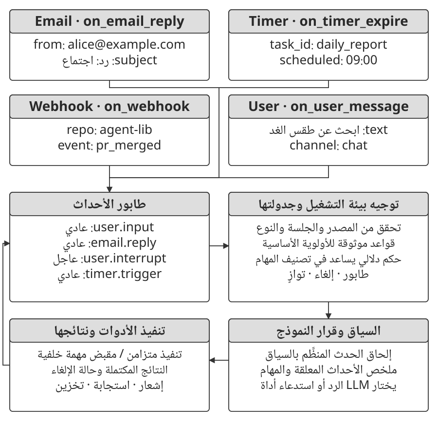

### تطبيق آلية التوجيه بالأحداث في OpenClaw

يتّصل OpenClaw بقنوات الرسائل عبر Gateway، ويوجّه الأحداث إلى بيئة تشغيل Agent. وتشمل آليات الأتمتة فيه مداخل عدة، منها Hooks الداخلية والجدولة الزمنية وHeartbeat وWebhook الخارجية[^ch6-automation]. ويمكن فهم هذه الآليات بحسب شروط إطلاقها:

- **Hooks (خطاطيف الأحداث)** تستجيب للأحداث الداخلية في إطار العمل، مثل إنشاء الجلسة أو إعادة تعيينها أو تغيّر دورة حياة التشغيل.
- **Cron (الجدولة الزمنية)** تنفّذ الأعمال في وقت محدد أو بدورية محددة. فالتعبير `0 9 * * 5` مثلًا يعني الإطلاق في التاسعة صباح كل جمعة بحسب المنطقة الزمنية المضبوطة.
- **Heartbeat (نبضات القلب)** توقظ Agent دوريًا ليفحص ما يستحق الانتباه.
- **Webhook (الاستدعاء الراجع الخارجي)** تستقبل الأحداث التي ترسلها الخدمات الخارجية، وتطلق المعالجة بعد التحقق من الهوية والتوجيه.

فالتقرير الأسبوعي يناسبه التشغيل في موعد ثابت، والمهام المعلّقة التي تحتاج إلى متابعة مستمرة يناسبها الفحص الدوري، أما الرسائل الجديدة واستدعاءات الخدمات الراجعة فيمكن تقصير زمن اكتشافها بالدفع.

**أحداث المكالمات في PineClaw.** يجري Pine AI المكالمات الهاتفية نيابةً عن المستخدم، فيتولّى التفاوض على الفواتير وإلغاء الاشتراكات ومطالبات التأمين وما شابهها. ويربط PineClaw مهام المكالمات هذه بـ OpenClaw. وتستمر المكالمة عادةً مدة من الزمن، وقد يُحتاج في أثنائها إلى تدخّل المستخدم:

- **التحقق من الهوية.** يطلب موظف الخدمة أن يُتمّ صاحب الحساب التحقق، كأن يُدخل رمز أمان أو كلمة مرور لمرة واحدة.
- **المكالمة الثلاثية.** يطلب موظف الخدمة التحدث مباشرةً إلى صاحب الحساب، فيلزم إشعار المستخدم بسرعة ليردّ.
- **تأكيد القرار.** حين يعرض موظف الخدمة بديلًا، تحكم الواجهة الأمامية هل يمكن قبوله في ضوء هذا التكليف وتفضيلات المستخدم السابقة. وإذا احتاج الأمر إلى قرار من المستخدم، أُرسلت إليه الخيارات المحددة، مع مواصلة التحقق من الشروط الأخرى مع موظف الخدمة.

فإذا احتاج موظف الخدمة مثلًا إلى انضمام صاحب الحساب إلى مكالمة ثلاثية، فكلما وصل الإشعار أبكر قلّ الوقت الذي يقضيه الطرفان في الانتظار على الهاتف. وتعتمد حالة PineClaw آلية Channel لربط أحداث المكالمة بين Gateway وPine API: فاتصال المكالمة، والحاجة إلى إدخال من المستخدم، وانتهاء المكالمة، يدخل كلٌّ منها تدفّق الأحداث، فيحدّث Agent المهمة بناءً عليها ويُشعر المستخدم.

**يرى المؤلف أن الخدمة المبادِرة لا تأتي في وقتها إلا إذا أشعر مصدرُ الحدث Agent حين تتغيّر الحالة.** فبعد أن يصل الإشعار عبر القناة، يعثر Harness على المهمة المقابلة، ويتحقق هل الحدث مكرر أو منتهي الصلاحية، ثم يقرّر النموذج الخطوة التالية. وإذا احتاج الأمر إلى أن يتحقق المستخدم من هويته، فعلى الواجهة أن تفتح مدخل مصادقة موثوقًا، ثم تُعاد نتيجة التحقق إلى المهمة الأصلية حدثًا جديدًا.

### أدوات إطلاق الأحداث

إذا كلّفت المساعد بأن «يذكّرني حين يردّ العميل»، فكيف يستيقظ غدًا في الوقت المناسب تمامًا؟ أول ما يُنظر فيه هو هل يستطيع صندوق البريد أن يدفع حدثًا عند وصول الرسالة؛ أما الأنظمة التي لا تتيح إلا الاستعلام المبادر، فلا بد فيها من تذكّر موعد الفحص التالي. وتسلّم الواجهات التوضيحية الثلاث التالية شروط الانتظار هذه إلى بيئة التشغيل لتحفظها، فيستطيع النموذج أن ينهي جولة عمله الحالية.

**المؤقّت (`set_timer`)** يُستعمل لإيقاظ مهمة في وقت متّفق عليه. فالمؤقّت لمرة واحدة يناسب مهمة مثل «الاتصال بالبنك صباح الاثنين القادم في العاشرة للاستعلام عن سير طلب الرهن العقاري»؛ والمؤقّت الدوري يناسب فحص سلامة الخدمة كل ساعة. ويمكن كذلك أن يُستعمل المؤقّت لانتظار الردّ بعد إرسال بريد، أو لإعادة الاتصال بعد مصادفة وقت خارج ساعات العمل. وعلى الواجهة أن تحفظ المنطقة الزمنية وشرط الإطلاق ومعرّف المهمة، وأن توفّر مدخلًا للإلغاء أو التعديل. وإذا كانت الخدمة الخارجية لا تدعم إلا الاستعلام، أمكن للمهمة المجدولة أن تتولّى أيضًا استقصاء التقدّم.

**مراقبة المهام الخلفية (`monitor_shell`)** تُستعمل لتحويل الأوامر الطويلة التشغيل إلى أحداث تقدّم. فهي تعيد معرّف المهمة عند البدء، وتُشعر في أثناء التشغيل بحسب المخرجات الجديدة أو الكلمات المفتاحية أو تغيّرات الحالة، وتبلّغ عند الانتهاء عن حالة الخروج والنتيجة.

إن جعل النموذج يستعلم عن التقدّم مرارًا يستهلك استدعاءات للنموذج حتى إن لم تتغيّر الحالة؛ والاكتفاء بانتظار إشعار الانتهاء قد يُفوّت عطلًا يقع في المنتصف. ولذلك يوصي المؤلف بإسناد المراقبة إلى بيئة التشغيل، وألّا يُوقظ النموذج إلا عند ظهور تقدّم مفيد أو خطأ أو توقّف. وبهذا يمكن مواصلة التواصل في أثناء البناء، والتدخّل في الوقت المناسب عند وقوع خلل. ويمكن أن تتضمن قواعد المراقبة التصفية والدمج وتحديد المعدّل، حتى لا يستدعي كل سطر من السجل النموذج مرة.

فمثلًا، بعد أن يشترك النموذج في تحديثات حالة طلب قيد المعالجة، يستطيع أن ينهي جولة الاستدلال هذه، وينتظر أن يوقظه إشعار يحمل رقم الطلب. وإذا كان الطرف الآخر لا يتيح إلا مدخلًا للاستعلام، أمكن للنموذج أن يضبط بنفسه مهمة مجدولة للفحص التالي. فإذا وجد عند حلول الموعد أن الطلب «لا يزال قيد المعالجة»، حدّد موعدًا آخر؛ وإذا وجد أنه أُنجز، ألغى الفحوص اللاحقة. وفي كلتا الطريقتين تتولّى بيئة التشغيل الانتظار، ولا يعود النموذج إلى الحكم إلا عند تلقّي إشعار أو انقضاء مؤقّت.

**قناة الأحداث الخارجية (`connect_channel`)** تُستعمل للاشتراك في البريد أو الرسائل الفورية أو الاستدعاءات الراجعة لواجهات API. فمحوِّل القناة يتحقق من المصدر، ويربط معرّفات الخدمة نفسها بالخيوط والكائنات المرتبطة، ثم يرسل حدثًا بصيغة موحّدة؛ ونفصّل ذلك في قسم «طبقة الاتصال» لاحقًا. وإشعارات حالة المكالمات في PineClaw من هذا الصنف.

وتحتاج الأصناف الثلاثة من الأدوات إلى تحديد واضح لشروط الإطلاق وقواعد التصفية وحمولة الحدث. وينبغي أن تتضمن الحمولة معرّف الحدث، ووقت وقوعه، ومصدره، والمهمة المرتبطة به، والمضمون الضروري، ليتمكّن Agent من الحكم هل لا يزال الحدث ساريًا، وما المعلومات التي تحتاج إليها الخطوة التالية.

### أدوات التواصل مع المستخدم

لنعد إلى مهمة تعديل الحجز. إن توجيه سؤال إلى موظف الخدمة، وإرسال رسالة تأكيد إلى المستخدم يستطيع أن يجيب عنها مباشرةً، وتدوين «بانتظار الردّ» في سجل المهمة، أمور تُكتب في ثلاثة مواضع مختلفة. ويستطيع المستخدم أن يبتعد مؤقتًا، ثم يعود حين يُحتاج إلى استكمال شروط أو تأكيد قرار أو تسلّم نتيجة.

يمكن لواجهة المحادثة أن تعرض الإجابة النهائية وتقدّم الأدوات ونتائج التنفيذ؛ أما أدوات التواصل فتحدّد صراحةً المستلم والقناة ومضمون الرسالة والمرفقات. فالنموذج يقرّر ما يلزم التعبير عنه، ويتحقق Harness من الوجهة والصلاحيات، وتتولّى خدمة الرسائل التسليم. ويمكن لبيئة التشغيل أيضًا أن توجّه الإجابة النهائية تلقائيًا إلى الجلسة الأصلية. ويمكن الجمع بين الطريقتين.

يتيح التفاعل متعدد القنوات في OpenClaw للمستخدم أن يرسل الرسائل وينتظر التقدّم ويتلقّى التذكيرات كما لو كان يتواصل مع سكرتير. وهذا «الإحساس بوجود شخص حقيقي» مصدره حالة المهمة المستمرة والتواصل في الوقت المناسب. فيستطيع المستخدم أن يواصل المهمة في القناة التي ألفها، وعلى Agent أن يحافظ على اتساق الهوية والجلسة وروابط الرسائل.

ويمكن أن يتغيّر مضمون التواصل بتغيّر المهمة: فالتقدّم الموجز يُكتب نصًّا، والنتائج المعقدة تُرفق بها صور أو ملفات، والمعلومات المطلوب ملؤها تُعرض في بطاقات منظّمة، والمخرجات التفاعلية تعتمد واجهة المستخدم التوليدية التي عرضها الفصل الخامس. وإذا كانت القناة تدعم إيصالات التسليم أو القراءة، حفظ النظام الحالة المقابلة؛ وتدخل كذلك إعادة المحاولة عند الإخفاق والرسائل المكررة والمزامنة بين القنوات في سجل التسليم.

**الإشعارات متعددة القنوات واستدعاء المستخدم.**

تناسب الرسائل الفورية والرسائل النصية القصيرة والبريد الإلكتروني والمكالمات الهاتفية وإشعارات التطبيقات درجاتٍ مختلفة من الإلحاح وأشكالًا مختلفة من المضمون. ويستطيع Agent أن يختار القناة بالنظر إلى درجة الإلحاح وتفضيلات المستخدم وحالته الراهنة وطول الرسالة. فأحداث المكالمات التي تحتاج إلى تأكيد فوري تستعمل التنبيه الفوري، أما التقرير الكامل فيمكن تسليمه بالبريد أو برابط في التطبيق.

كلّف المؤلف ذات مرة مساعده بمراقبة أسعار الفنادق لمؤتمر ATC. وكان المساعد يرسل كل يوم في الموعد نفسه رسالة تقول إن السعر لم ينزل بعد إلى السعر المستهدف. وفي إحدى المرات انخفض السعر انخفاضًا قصيرًا، فكان الذي التقط هذه الفرصة نصًّا برمجيًا كتبه المؤلف بنفسه. فالسعر المنخفض العابر قد يظهر بين استعلامين. وحتى لو اكتشفه المساعد في وقته، فإن تأخّر الرسالة قد يُفوّت على المستخدم الحجز. وفي الأيام التي لا ينخفض فيها السعر، يمكن أن يستمر الاستعلام المجدول كالمعتاد، دون أن يضطر المستخدم إلى قراءة رسالة متطابقة المضمون كل يوم. وسيستعمل الفصل السابع نافذة انخفاض في السعر مدتها خمس دقائق لاختبار هذا النوع من التنبيه.

حين تكتمل مهمة طويلة، يعيد الإشعار المستخدم إلى صفحة النتائج؛ أما الملخص اليومي والتقرير الأسبوعي فيُرسلان بالإيقاع المتّفق عليه. وينبغي أن تتضمن استراتيجية القنوات المتعددة أيضًا إزالة التكرار وفترات الصمت وشروط التصعيد، كأن يُقرَّر هل يُنتقل إلى قناة أخرى إذا لم يلقَ التنبيه الأول استجابة. وتُربط سجلات الإشعارات بحالة المهمة، ليتمكّن المستخدم من مواصلة المعالجة انطلاقًا من الرسالة التي تلقّاها.

### الهوية الافتراضية وبيئة التنفيذ المعزولة

استعان الفصل الرابع بشخصية Samantha في فيلم *Her* ليبيّن كيف يدخل المساعد العام العالم الرقمي عبر الأدوات. ولتنفيذ مساعد من هذا النوع، لا بد من تحديد الهوية التي يعمل بها والموارد التي يجوز له الوصول إليها. **ويميل المؤلف إلى تزويد المساعد العام بهوية افتراضية مستقلة.** فالبريد المكتبي المخصّص، ورقم الهاتف، ومساحة التخزين، وبيئة الحوسبة، تجعل Agent كسكرتير له حساب عمل خاص به، يتولّى الشؤون نيابةً عن المستخدم بهوية وكيل واضحة. والهوية المستقلة تفصل العمل اليومي للمساعد عن حسابات المستخدم الشخصية، فيسهل تفويضه وتدقيقه وسحب تفويضه على حدة؛ وإذا وقعت عملية خاطئة، سهُل أيضًا حصر نطاق أثرها. أما المهام التي تستلزم الوصول إلى حساب المستخدم، فتحصل على الصلاحيات اللازمة عبر تفويض محدود النطاق.

لمن يعود رقم الهاتف؟ هذا ما يحدّد من يستطيع متابعة الأمر حين يعاود الطرف الآخر الاتصال. فميزة Cue في Manus تمنح المساعد رقمًا مستقلًا يستطيع الردّ على المكالمات الواردة، ثم يترك ملخص المكالمة للمستخدم. فإذا قبل التاجر رقم معاودة الاتصال الذي تركه المساعد، استطاع موظف الخدمة حين يتصل أن يصل مباشرةً إلى المساعد الذي تولّى الأمر من قبل.[^ch6-cue]

لنأخذ الإعفاء من الرسوم مثالًا. يستطيع المساعد أن يتصل بالتاجر بصفته ممثلًا مفوّضًا. فإذا طلب موظف الخدمة تحققًا شفهيًا من صاحب الشأن نفسه، أمكن دعوة المستخدم إلى الانضمام إلى مكالمة ثلاثية، ثم يستأنف المساعد التواصل بعد إتمام التحقق. وإذا كان التاجر سيعاود الاتصال بالمستخدم، سلّم المساعد إليه أولًا رقم القضية وما اتُّفق عليه والمسائل التي تحتاج إلى تحقق. وعند تقديم التقرير إلى المستخدم، ينبغي أيضًا أن يوضّح المساعد ما بين يديه من أدلة: فإذا وعد موظف الخدمة شفهيًا بالإعفاء، سُجّل هذا الوعد؛ وإذا تبيّن لاحقًا أن الفاتورة حُدّثت، أُبلغ حينئذ أن الرسوم أُعفيت فعلًا.

حين أعاد المؤلف إصدار بطاقة ائتمان من Bank of America وهو في بكين، اتصل Pine بالبنك، ورتّب إصدارًا مستعجلًا للبطاقة، وحصل على إعفاء من رسوم الاستعجال البالغة 15 دولارًا. وعند انتهاء المكالمة كان المساعد قادرًا على أن يبلّغ بما قبله البنك وبالرسوم التي وافق على إعفائها. فإذا سأل المستخدم بعد أيام «أين وصلت البطاقة الجديدة؟»، لزم الاستعلام من جديد عن الشحن أو طلب التأكيد من المستلم.

يوفّر الحاسوب الافتراضي والهاتف الافتراضي بيئة تشغيل تعمل باستمرار. فالآلة الافتراضية تستطيع تشغيل نظام سطح مكتب، والحاويات تناسب عزل العمليات والاعتماديات، ومحاكي Android يحتضن تطبيقات الهاتف المحمول. وهي تدعم التشغيل في الخلفية، وتقلّل من تشويش العمليات الآلية على العمل الجاري للمستخدم. ويتحدّد نطاق العزل بالشبكة ونقاط التركيب وبيانات الاعتماد وصلاحيات التشغيل مجتمعةً؛ وهذه الإعدادات تؤثر في الوقت نفسه في البيانات والأنظمة الخارجية التي يستطيع Agent الوصول إليها.

لنفترض أنك تريد أن يُنشئ Tencent WorkBuddy بنسخته المؤسسية التقرير الأسبوعي بعد أن تطفئ حاسوبك في نهاية الدوام، في حين أن جدول مبيعات هذا الأسبوع موجود على حاسوب المكتب وحده. إن اخترت مهمة محلية، استطاع المساعد قراءة الجدول، لكن الحاسوب يجب أن يبقى مشغّلًا والعميل متصلًا. وإن اخترت مهمة سحابية، استطاع المساعد مواصلة العمل بعد إطفائك الحاسوب، بشرط أن ترفع أولًا إلى المهمة البيانات المسموح باستعمالها في التقرير، أو تضعها في مستودع معلومات تستطيع المهمة السحابية الوصول إليه. وإذا كان لا بد من بقاء جدول المبيعات على الجهاز المحلي، فينبغي جدولة المعالجة في وقت يكون فيه الحاسوب متصلًا.

وقد تطلب صفحات الويب وتطبيقات الهاتف المحمول كذلك التحقق من الهوية أو رموز التحقق أو التأكيد اليدوي. وعند الربط يُقدَّم استعمال واجهات API وأساليب التفويض التي توفّرها الخدمة؛ فإذا لزمت مصادقة عبر واجهة رسومية، أمكن عبر سطح المكتب البعيد VNC/RDP أن يسجّل المستخدم الدخول بنفسه، مع إيقاف العمليات الآلية مؤقتًا في أثناء المصادقة. وبعد أن يُتمّ المستخدم ذلك، يتحقق النظام من حالة الجلسة ثم يستأنف المهمة. وتُحفظ الرموز المميّزة والجلسات بحسب مدة صلاحيتها، وتُنظَّف وفق السياسة المعتمدة بعد سحب التفويض أو انتهاء المهمة.

ويمكن لـ Agent والبيئة الافتراضية تبادل البيانات عبر **نظام ملفات مشترك**. فمثلًا، يرفع المستخدم ملف CSV، فيقرؤه الحاسوب الافتراضي وينفّذ التحليل ويكتب الرسوم البيانية في التخزين المشترك؛ وتسلّم بيئة التشغيل موقع ملف الرسم إلى Agent، ثم يُقدَّم للمستخدم رابط تنزيل يمكنه الوصول إليه. ويبقى مضمون الملفات الكبيرة في التخزين، ويقرأ النموذج ملخصاتها أو مقاطع منها عند الحاجة.

[^ch6-dsh-threads]: DeepSeek، نموذج dsh-superagent الأولي: نموذج المجال، وقواعد التفويض والاشتراك.
[^ch6-dsh-sessions]: DeepSeek، نموذج dsh-superagent الأولي، الإصدار `8c32a9d`. مسؤوليات نوعي الجلسات في `docs/004-prompts.md`، وجلسة التنفيذ ودليل العمل في `docs/003-execution.md`، وصيغة الرسائل المرسلة إلى الجلسة الرئيسية في `docs/007-architecture.md`.
[^ch6-duet]: Anthropic، *Get started with Claude Duet*، ويعرض الموجز السابق للاجتماع وصفحة المهمة والإشعار في المحادثة الرئيسية.
[^ch6-cue]: Manus، *Introducing Manus 2.0*، ويعرض الرقم الهاتفي المستقل لـ Cue والردّ على المكالمات الواردة وملخصات المكالمات.
[^ch6-automation]: OpenClaw، Automation، ويعرض مداخل الأتمتة، ومنها Hooks الداخلية والجدولة الزمنية وHeartbeat وWebhook الخارجية.

### طبقة الاتصال: مصادر متعددة وحدث واحد

يعالج Agent خدمة العملاء في متجر إلكتروني طلب استرداد: يقدّم العميل الطلب في محادثة خدمة العملاء داخل التطبيق؛ ولأن المبلغ يتجاوز صلاحيات Agent، يطلب موافقة المشرف في مجموعة خدمة ما بعد البيع على WeCom؛ وبعد نجاح الاسترداد ترسل خدمة الدفع Webhook؛ ثم ينشر نظام الطلبات تغيّر الحالة على Kafka. أربع رسائل تتحدث عن الطلب نفسه، وتصل كلٌّ منها بطريقة مختلفة. وحين تكثر المصادر وتعالج كل وصلة إعادة المحاولة وإزالة التكرار والترتيب على طريقتها، تتفكك بيئة التشغيل تحت وطأة هذه الفروق. **تُوحّد طبقة الاتصال هيئة الحدث بعد دخوله النظام، وتحتفظ بفروق القدرات بين المصادر قبل وصوله.** ويعرض الشكل 6-2 هذا التقسيم إلى طبقات.

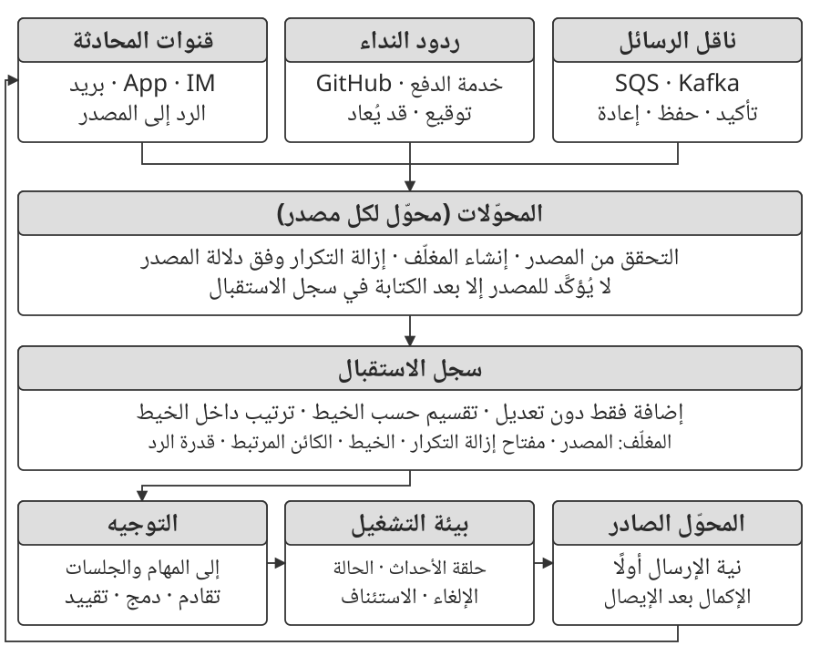

المصادر الشائعة أربعة أصناف. **قنوات المحادثة** تشمل واجهة المحادثة الخاصة بالمنتج، وتطبيقات المراسلة الفورية مثل WeCom وFeishu وSlack، والبريد الإلكتروني، ويستطيع Agent أن يعود إليها ليجيب في الموضع نفسه. **الاستدعاءات الراجعة** واجهات HTTP تستدعيها الخدمات الخارجية حين تتغيّر الحالة، وتحمل عادةً توقيعًا، ولا ترسل إلا إشعارًا؛ وعند إخفاق التسليم تعيد بعض الخدمات المحاولة تلقائيًا، أما GitHub فيتطلب إعادة التسليم يدويًا أو عبر API. **ناقلات الرسائل** مثل SQS وKafka تحمل أحداث الأعمال للخدمات الداخلية، ولها دلالات واضحة للإقرار والاحتفاظ. **المؤقّتات والاستقصاء والأحداث الداخلية** يولّدها النظام نفسه، ويكفي أن تُكتب في السجل نفسه. ويقارن الجدول التالي الأصناف الثلاثة الأولى.[^ch6-ingress-mq][^ch6-ingress-callback]

| | محادثة التطبيق | WeCom / Feishu | البريد الإلكتروني | Webhook | SQS | Kafka |
|---|---|---|---|---|---|---|
| طريقة الوصول | اتصال طويل | استدعاء راجع أو اتصال طويل | دفع أو استقصاء | استدعاء راجع | سحب من المستهلك | سحب من المستهلك |
| نطاق الترتيب | داخل المحادثة | غير مضمون لأغلب الأحداث | غير مضمون | غير مضمون | غير مضمون في الطابور القياسي، وبحسب مجموعة الرسائل في FIFO | داخل القسم |
| أساس إزالة التكرار الأصلي | معرّف الرسالة لدى العميل | معرّف الرسالة، معرّف الحدث | Message-ID | معرّف التسليم | معرّف الرسالة؛ وفي FIFO يوجد أيضًا `MessageDeduplicationId` | الموضوع والقسم والإزاحة |
| إمكانية إعادة التشغيل | تعتمد على السجل الخاص بالنظام | الاستدعاء الراجع نفسه لا يُعاد، ويمكن في Feishu الاستكمال بواجهة الرسائل التاريخية | يمكن إعادة قراءة صندوق البريد | بحسب الخدمة | غير ممكنة بعد الحذف | ممكنة ضمن مدة الاحتفاظ |
| طريقة الإقرار | إيصال من العميل | إعادة النجاح ضمن المهلة | تسجيل موضع القراءة ذاتيًا | إعادة 2xx ضمن المهلة | حذف الرسالة | تثبيت الإزاحة |
| مسار الردّ | المحادثة الأصلية | المحادثة الأصلية | الردّ على البريد | لا يوجد | لا يوجد | لا يوجد |

**المغلّف الموحّد.**

يحوّل المحوِّل الرسالة الأصلية إلى **مغلّف** (envelope) بصيغة موحّدة. ولا يسجّل المغلّف إلا الحقائق التي يمكن تحديدها لحظة الوصول؛ أما الأولوية ومهلة المعالجة فتضيفهما قواعد التوجيه، وأما فئة العميل وحالة الطلب فيضيفهما نظام الأعمال، وتُحفظ حالة المعالجة على حدة. ويمكن كتابة طلب الاسترداد الذي قدّمه العميل على هذا النحو:

```json
{
  "id": "evt_7f3a",
  "source": {"type": "app_chat", "sender": "user:u_5521", "verified": true},
  "dedupe_key": "app:msg:msg_1029",
  "thread": "app:conv:conv_88",
  "kind": "message",
  "correlation": ["order:12345"],
  "content": {"type": "text", "text": "这个订单我想退款"},
  "raw_ref": "raw/2026-11-23/app/msg_1029.json",
  "reply": {"via": "app_chat", "target": "app:conv:conv_88"},
  "occurred_at": "2026-11-23T14:02:09+08:00",
  "expires_at": null
}
```

- `source`: نوع المصدر والمرسِل الذي جرى التحقق منه. والمحوِّل هو الذي يحكم بأنه «جرى التحقق منه» استنادًا إلى التوقيع أو الرمز المميّز أو حساب القناة، ولا عبرة بما يقدّم به المرسِل نفسه في نص الرسالة؛ وبحسب هذا البند تحكم بيئة التشغيل في الصلاحيات.
- `dedupe_key`: مفتاح إزالة التكرار، ودلالات المصدر هي التي تحدّد ما يُعدّ تكرارًا. فمعرّف التسليم ومعرّف الرسالة والقسم والإزاحة تدلّ على تسليم واحد بعينه، فتصدّ إعادة الإرسال في طبقة النقل؛ وإذا كانت رسالة الأعمال تحمل مفتاح عدم التكرار (idempotency key)، كرقم طلب الاسترداد مضافًا إليه الحالة، فإن المحوِّل يستخرجه، وبذلك وحده يمكن صدّ التكرار على مستوى الأعمال. أما محادثة المستخدم فعلى العكس: فقول العميل «استرداد» مرتين رسالتان مستقلتان، ولا تُزال منهما إلا ما تكرّر معرّف رسالته لدى العميل.
- `raw_ref`: الحمولة الأصلية محفوظةً كما هي، ولا سبيل إلى تتبّع أخطاء المحوِّل إلا بها.
- `reply`: أي محوِّل صادر يُستعمل، وإلى أي وجهة يُرسَل. واستدعاء الدفع الراجع ليس له مسار ردّ، فيكون هذا البند فارغًا.
- `occurred_at` هو وقت الوقوع الذي يقدّمه المصدر؛ و`expires_at` مدة الصلاحية، ولا تُملأ إلا لأحداث مثل عروض الأسعار ورموز التحقق.

**الخيوط والارتباطات.**

يقول العميل أولًا «استرداد»، ثم يضيف مباشرةً «لا بأس، أريد الاستبدال»، فلا يجوز أن ينقلب ترتيب الرسالتين؛ أما رسائل عميل آخر فلا صلة لها بهما، ويمكن معالجتها بالتوازي. **لا تلتزم طبقة الاتصال بالترتيب إلا داخل الخيط.** فالمحوِّل يربط وحدة الترتيب الخاصة بالمصدر بـ `thread`: محادثة واحدة في التطبيق، أو مجموعة رسائل في SQS FIFO (`MessageGroupId`)، أو مفتاح القسم في Kafka، أو رقم Issue أو PR في استدعاء GitHub الراجع. وإذا كان المصدر لا يضمن الترتيب، اعتمدت بيئة التشغيل على `occurred_at` أو على رقم الإصدار الذي يقدّمه المصدر لتمييز الحالات القديمة المتأخرة، كأن تصل «الاسترداد قيد المعالجة» بعد «نجح الاسترداد».

تتوزّع رسائل هذا الاسترداد الأربع على أربعة خيوط. ودمجها في خيط واحد له ثمن غير قليل: فحتى نقاش لا صلة له في مجموعة ما بعد البيع سيضطر إلى الانتظار خلف رسائل العميل، ثم إن معرّف الخيط كثيرًا ما يؤدي دور مفتاح القسم أيضًا، فيستلزم تعديله لاحقًا ترحيل البيانات. **يُعبَّر عن علاقات الارتباط في حقل مستقل، ولا يُعاد كتابة الخيط.** فالحقل `correlation` يسرد كائنات الأعمال التي يخصّها الحدث، وتشترك المهام في الخيوط ذات الصلة بحسب الكائنات المرتبطة.

**فصل توقيت الإقرار عن التقدّم.**

**ينبغي للمحوِّل أن يُقرّ للمصدر بعد كتابة الحدث في سجل الاتصال، لا أن ينتظر حتى يفرغ Agent من معالجته.** فالاستدعاء الراجع للأحداث في Feishu يشترط الاستجابة في غضون 3 ثوانٍ، وفي WeCom في غضون 5 ثوانٍ، وإلا أعيد الدفع؛ والرسالة في SQS إذا لم تُحذف قبل انقضاء مهلة الرؤية تُسحب مرة أخرى. ولو انتُظر حتى اكتمال المعالجة، لجلب استدعاء للنموذج أطول قليلًا من المعتاد تسليمًا مكررًا. أما إذا كُتب السجل أولًا ثم جاء الإقرار، فإن ضمانات التسليم في المصادر كلها تؤول إلى جملة واحدة: **كل حدث يدخل سجل الاتصال مرة واحدة على الأقل (at-least-once)**، ويصدّ مفتاح إزالة التكرار المرة المعادة.

سجل الاتصال بمنزلة صندوق الوارد (inbox)، ويتبع مبدأ الإلحاق دون التعديل الذي قرّره الفصل الأول، ويُقسَّم بحسب الخيوط. وإذا استُعمل Kafka سجلًا للاتصال، فإن إزالة التكرار تستلزم مخزنًا مستقلًا بقيد تفرّد، أو تصفيةً بمفتاح إزالة التكرار في جهة الاستهلاك: فـ Kafka لا يستطيع رفض الكتابة بحسب مفتاح يقدّمه التطبيق، ومنتِجه عديم التكرار لا يغطي إلا إعادة المحاولة التي يجريها المنتِج نفسه.

ويحتاج النظام إلى أن يحفظ ثلاثة أنواع من التقدّم على حدة:

| التقدّم | ما يسجّله | من يتولّاه |
|---|---|---|
| تقدّم المصدر | إزاحة Kafka، مقبض الاستلام في SQS، موضع القراءة في صندوق البريد | المحوِّل |
| تقدّم التوزيع | المهام التي سُلّمت إليها أحداث السجل | التوجيه |
| حالة المهمة | الخطوة التي بلغتها المعالجة، وهل أُرسل الردّ بعد | بيئة التشغيل |

إذا عوملت الإزاحة على أنها تقدّم المهمة، فإن إعادة تشغيل السجل تُرسل مرة ثانية الردود التي أُرسلت من قبل؛ أما بعد الفصل، فلا تؤثر إعادة التشغيل إلا في تقدّم التوزيع. ويقابل ذلك في الاتجاه الصادر صندوق الصادر (outbox): تُسجَّل نية الإرسال ومفتاح عدم التكرار قبل الإرسال، ويُعلَّم الإرسال مكتملًا عند تلقّي إيصال القناة؛ أما طريقة المطابقة بعد إعادة التشغيل فتأتي في قسم «بناء الحلقة الأساسية من أحداث البريد» لاحقًا.

**الصلاحية الزمنية والدمج والضغط العكسي.**

حين يتدفّق على الخيط نفسه مئة حدث في الثانية، لا ينبغي تسليمها إلى النموذج واحدًا واحدًا. فالتوجيه يعالج المتراكم قبل التوزيع:

- **الصلاحية الزمنية.** عروض الأسعار ورموز التحقق والإنذارات التي زال سببها تفقد معناها بمرور الوقت. والحدث الذي تجاوز `expires_at` يُسجَّل في المسار فقط، ولا يوقظ النموذج.
- **الدمج.** يميّز `kind` بين صنفين من الأحداث. أحداث الحالة تصف القيمة الراهنة لكائن ما، كحالة الاسترداد في استدعاء الدفع الراجع وحالة الطلب على Kafka؛ وإذا تراكم منها عدد في الخيط نفسه، لم يُسلَّم إلى النموذج إلا أحدثها، وتبقى القيم الوسيطة في السجل. أما أحداث الرسائل فهي جملة قالها شخص أو أمر أصدره، كرسالة العميل ونقرة المشرف، ويمكن تسليمها إلى النموذج دفعاتٍ، ولا يجوز إسقاطها.
- **الضغط العكسي.** المصادر القائمة على السحب يمكن إبطاء سحبها، فيبقى المتراكم في المصدر. أما المصادر القائمة على الدفع فلا سبيل إلى جعل الطرف الآخر يتوقف، فيواصل المحوِّل الكتابة في السجل والإقرار كالمعتاد، وينتقل المتراكم إلى سجل الاتصال، فتتولّى القاعدتان السابقتان تصريفه.

**استرداد واحد يمرّ بالمصادر الأربعة.**

1. يقدّم العميل طلب الاسترداد في محادثة التطبيق. يزيل المحوِّل التكرار بمعرّف الرسالة لدى العميل، ويكتب في السجل، ثم يرسل الإيصال إلى العميل؛ وينشئ التوجيه مهمة استرداد بحسب `order:12345`، وتشترك المهمة في خيط المحادثة هذا.
2. لأن المبلغ يتجاوز الصلاحيات، يرسل Agent بطاقة تأكيد في مجموعة ما بعد البيع على WeCom، ويُسجَّل معرّف البطاقة في المهمة. ينقر المشرف «موافق»، فيكتب المحوِّل في السجل ثم يعيد النجاح، ويُضيف الكائن المرتبط بحسب معرّف البطاقة.
3. بعد أن يستدعي Agent واجهة الاسترداد، ترسل خدمة الدفع استدعاءً راجعًا مرتين بأن «الاسترداد نجح»، بمعرّف التسليم نفسه، فتُزال الثانية بوصفها تكرارًا.
4. ينشر نظام الطلبات على Kafka أن «الطلب استُردّت قيمته»، وهو الأمر نفسه الذي قاله الاستدعاء الراجع. فإذا استخرج المحوِّلان كلاهما من الحمولة رقم طلب الاسترداد مضافًا إليه الحالة مفتاحًا لإزالة التكرار، صُدّ هذا الحدث عند الاتصال؛ وإذا أزال كلٌّ منهما التكرار بحسب معرّف التسليم أو القسم والإزاحة، دخل الحدثان السجل، فتكتشف بيئة التشغيل أن الاسترداد قد تأكّد في المهمة من قبل، فلا تسجّله إلا في المسار.
5. ليس للاستدعاء الراجع ولا لحدث Kafka مسار ردّ. فتستعمل بيئة التشغيل `reply` الخاص بخيط المحادثة في الخطوة 1، وتُشعر العميل عبر المحوِّل الصادر للتطبيق.

تمثّل الخطوة 4 حدود إزالة التكرار في طبقة الاتصال: فما يمكن صدّه من التكرار يتوقف على مفتاح إزالة التكرار الذي يعلنه المحوِّل؛ وما لم يُصدّ يُحكم فيه بحالة المهمة. وبعد توزيع الحدث على مهمة، فإن إلحاقه بجلسة قائمة أو فتح جلسة جديدة له مسألةٌ من مسائل إدارة السياق: فالمعلومات العابرة للجلسات تنتقل عبر ذاكرة الفصل الثالث، أما إمكان مشاركة السياق فيتناوله الفصل العاشر.

[^ch6-ingress-mq]: Amazon Web Services، “Amazon SQS standard queues”؛ “Amazon SQS visibility timeout”؛ “Using the message deduplication ID in Amazon SQS”؛ “Using the message group ID with Amazon SQS FIFO Queues”. وثائق Apache Kafka 4.4، قسما “Consumer Position” و“Message Delivery Semantics” في “Design”. تاريخ المراجعة: 2026-11-24.
[^ch6-ingress-callback]: منصة Feishu المفتوحة، «نظرة عامة على الأحداث»؛ «الحصول على الرسائل التاريخية للمحادثة». مركز مطوّري WeCom، «نظرة عامة» ضمن «استقبال الرسائل والأحداث». GitHub Docs، “Best practices for using webhooks”؛ “Handling failed webhook deliveries”. تاريخ المراجعة: 2026-11-24.

### آلية معالجة الأحداث

قد تدخل رسائل المستخدم ونتائج الأدوات والمؤقّتات وطلبات التعاون إلى Agent واحد في وقت واحد. وتحتاج بيئة التشغيل إلى حفظ هذه الأحداث، وتحديد ترتيب معالجتها، ثم تسليم المعلومات ذات الصلة إلى النموذج. وتتولّى **حلقة الأحداث** (event loop) دفع هذه العملية باستمرار: تأخذ حدثًا من الطابور، وتحدّث حالة المهمة، وتنظّم طلب النموذج، وتجدول الأدوات، ثم تنتظر مدخلات جديدة أو إشعارات اكتمال. وبرامج Go التي تنظّم الرسائل المتعددة بـ goroutine وchannel و`select` تتبع فكرة مشابهة.

لنأخذ النموذج الأولي dsh-superagent مثالًا. في مشروع GitHub واحد، يكون النقاش تحت Issue والنقاش تحت طلب سحب (PR) خيطَي جلسة (Thread) منفصلين. وحين يحتاج النظام إلى أن يحكم هل يتولّى عملًا جديدًا، يقرأ حالة الخيط ويطلب من النموذج إجراء تقييم (Eval). ولا يجري على الخيط الواحد إلا تقييم واحد في الوقت نفسه، لكن يمكن لعدة تذاكر عمل (Ticket) أن تشترك فيه. فلنفترض أن تذكرتين، إحداهما لإصلاح خلل والأخرى لاستكمال التوثيق، اشتركتا في PR واحد، فترك المراجع تعليقًا تحت الـ PR؛ عندئذ تتلقّى التذكرتان كلتاهما هذه الرسالة سياقًا. وإذا أضاف أحدهم بعد ذلك شروط إعادة إنتاج الخلل تحت الـ Issue، وصلت الرسالة إلى التذاكر المشتركة في تلك الـ Issue. فمن تصل إليه الرسالة يتحدّد بالخيوط وعلاقات الاشتراك. أما ما يجوز فعله بعد تلقّيها، فيبقى محكومًا بالتفويض الأصلي لكل تذكرة.[^ch6-dsh-threads]

ويُسند dsh-superagent كذلك «التعامل مع الناس» و«إنجاز العمل» إلى جلستين مختلفتين. فالجلسة الرئيسية (Main Session) لا تتولّى إلا تسلّم الطلبات والردّ وكتابة التفويضات، ولا تقرأ الشيفرة، ولا تتوقف لانتظار النتائج؛ ولكل تذكرة جلسة تنفيذ خاصة بها (Executor Session)، تعدّل الشيفرة وتشغّل الاختبارات في دليل عمل مستقل. ولا ترسل جلسة التنفيذ رسالة إلى الجلسة الرئيسية إلا إذا أنجزت الإصلاح أو تعثّرت أو احتاجت إلى سؤال إنسان، فترفق ملخصًا وعنوانًا للقراءة، أي ما سمّاه الفصل الثاني «الملخص مع معرّف الكائن». وبهذا تبقى يد الجلسة الرئيسية فارغة دائمًا لتسلّم الطلب التالي، وتمرّ عبرها أيضًا الأسئلة الموجهة إلى الناس والإشعارات وأوامر الإيقاف، فلا تصدر الالتزامات إلا من منفذ واحد. والنموذجان السريع والبطيء في قسم الصوت لاحقًا هما صورة هذا التقسيم في المكالمات الآنية.[^ch6-dsh-sessions]

تستقبل واجهات النماذج المتزامنة عادةً الدفعة التالية من الرسائل بعد انتهاء عملية توليد واحدة أو بعد استكمال نتائج الأدوات. ويمكن هنا ضبط **نقاط آمنة**: تسجّل بيئة التشغيل أولًا الرسائل المكتملة والاستدعاءات التي لا تزال جارية وتقدّم المهمة الحالي، ثم تنتقل إلى خطوة المعالجة الجديدة. أما الواجهات غير المتزامنة الأصلية فتوفّر بروتوكولًا لاستقبال التحديثات في أثناء التشغيل، وتتولّى الواجهة وبيئة التشغيل معًا تحديد توقيت الاستئناف بدقة.

ويحتاج الإلغاء كذلك إلى تعاون المنفِّذ. فبعد أن يتوقف النموذج عن التوليد، قد تظل الأدوات الخلفية تعمل؛ وعلى المنفِّذ أن يستقبل إشارة الإلغاء ويبلّغ بالحالة الفعلية، على غرار مهمة Go التي تفحص `ctx.Done()` ثم تنفّذ التنظيف. أما الكتابة أو الإرسال أو الدفع الذي اكتمل فعلًا، فينبغي التراجع عنه أو تعويضه عبر مسار الأعمال المقابل.

**ثلاث استراتيجيات للمعالجة.**

يقارن الشكل 6-3 بين ثلاثة خيارات عند وصول حدث جديد. فإذا وُضع في الطابور، توقّف زمن الاستجابة على موعد النقطة الآمنة التالية؛ وإذا أُلغيت المهمة الجارية، لزم التأكد من العمليات التي اكتملت ومن الموضع الذي يمكن الاستئناف منه؛ وإذا فُتحت حلقة أخرى، لزم فحص هل تتنازع المهمتان المورد نفسه.

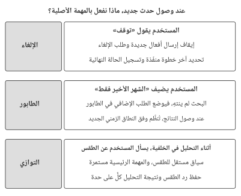

**المعالجة الإلغائية (Cancellation-Based)** تناسب أوامر الإيقاف من المستخدم أو أحداث التحكّم التي تستلزم معالجة فورية. فتتوقف بيئة التشغيل أولًا عن توزيع العمليات ذات الصلة، وترسل إشارة إيقاف إلى الطلبات الجاري توليدها وإلى الأدوات القابلة للإلغاء، ثم تحفظ الرسائل المكتملة وحالات الأدوات وإيصالات الإلغاء. وبعد ذلك يدخل الحدث الجديد سياق القرار. فإذا قال المستخدم مثلًا: «توقف! لقد أخطأت»، قيّد النظام أولًا التنفيذ اللاحق، ثم أعاد تأكيد المهمة في ضوء الحالة الفعلية الراهنة. أما عناصر الطابور التي لم تُعالج بعد فتحتفظ بمعرّفاتها وحالاتها، ويُعاد ترتيبها بحسب نطاق ارتباطها.

**المعالجة الطابورية (Queued)** تناسب المعلومات التكميلية الاعتيادية وتحديثات التقدّم. فيدخل الحدث الطابور، ويُسلَّم إلى النموذج مع نتائج الأدوات عند النقطة الآمنة التالية. فإذا أضاف المستخدم مثلًا في أثناء البحث «لا أريد إلا نتائج الشهر الأخير»، قرأ النموذج بعد عودة البحث النتائج والشرط الجديد معًا، ثم قرّر هل يصفّي أو يعيد البحث.

**المعالجة المتوازية (Parallel)** تناسب الطلبات المستقلة عن المهمة الرئيسية التي تحتاج إلى ردّ سريع. فإذا سأل المستخدم مثلًا عن الطقس في أثناء تحليل كمية كبيرة من البيانات، استطاع النظام أن ينشئ جلسة مستقلة لإنجاز الاستعلام.

**درجة الإلحاح والتوجيه.**

يقدّم نوع الحدث دليلًا أوليًا: فـ `user.interrupt` وتعليمات الإشراف الموثوقة وإنذارات النظام يمكن أن تدخل مسار الأولوية العالية؛ أما `user.input` و`agent.input` و`tool.result` و`timer.trigger` فيُحكم فيها بالنظر أيضًا إلى مضمونها وحالة المهمة. وإذا وصف المرسِل رسالته في نصها بأنها «عاجلة»، ظل النظام يحدّد الصلاحيات بحسب الهوية التي جرى التحقق منها والقواعد المعتمدة.

أما أحكام التوجيه التي تستلزم فهم معنى الرسالة، فيوصي المؤلف فيها باستعمال نموذج تصنيف خفيف: فعبارة «توقف حالًا» تقابل الإلغاء، و«كيف الطقس اليوم؟» قد تناسب المعالجة المتوازية، و«اكتب التقرير بالصينية من فضلك» تدخل عادةً طابور الإضافات للمهمة الجارية. وتتولّى بيئة التشغيل مباشرةً مداخل الإيقاف الصريحة، ويُستعمل التصنيف الدلالي لما بقي من الرسائل التي تحتاج إلى فهم.

يستطيع النموذج العام أيضًا أن يضع وسومًا على الرسائل، لكنه حتى لو لم يُخرج إلا عبارة «تحتاج إلى معالجة»، فلا بد له من قراءة وصف المهمة ومضمون الرسالة. وإذا جرى هذا الحكم مع كل رسالة جديدة، نمت تكلفة الاستدعاءات بنمو عدد الرسائل، واضطرت الرسائل العاجلة حقًا إلى انتظار الوسم من النموذج قبل أن تمضي. وقد صُمّم Jev من TypeSafe خصيصًا لمهام الحكم هذه التي تكون خياراتها محددة مسبقًا. فإذا أُعطي رسالةً وحالة المهمة الراهنة، أعاد بالتوازي احتمالات كل خيار بتكلفة وزمن استجابة منخفضين.[^ch6-jev]

وتخفيف فضاء الملاحظة الذي ناقشه الفصل الأول هو ما يحدّد هنا أي الرسائل تطلق جولة استدلال جديدة. فلنأخذ رسائل Feishu وتعليقات GitHub Issue مثالًا: يستطيع البرنامج أن يصفّي أولًا الإشعارات المكررة بحسب رقم الحدث، ثم يطلب من Jev أن يحكم هل الرسالة الجديدة تكملة لمهمة قائمة، أم طلب جديد يحتاج إلى معالجة النموذج الرئيسي. فإذا قرأ «أضيف خطوات إعادة الإنتاج التي ذكرتها أمس»، لم يلزم النموذج إلا أن يحكم بأنها ملاحظة تكميلية. أما أي Issue تكمّلها، فيقرؤه البرنامج مباشرةً من الرقم الذي يحمله التعليق.

وحتى إذا أعطى النموذج احتمالًا مرتفعًا، فقد يبالغ في تقدير ثقته. فقد تُصنَّف مئة رسالة مثلًا بأنها «تكملة لمهمة قائمة» باحتمال يقارب 90%، في حين أن 60 منها فقط من هذا الصنف فعلًا. فإذا أُلحقت هذه الدفعة كلها تلقائيًا بالمهمة القائمة، ضاع الغرض الأصلي من الرسائل الأربعين الأخرى.

[^ch6-jev]: عرضت TypeSafe في ملاحظات إصدار Jev المخرجات المحددة مسبقًا، وإعادة الاحتمالات بالتوازي، وطريقة التدريب RLCD الموجّهة إلى معايرة القرار.

### بناء الحلقة الأساسية من أحداث البريد

لنفترض أن العملية التي تعالج البريد الجديد أُعيد تشغيلها فجأة. فمعرّف الرسالة يساعدها على استعادة النص الأصلي، لكنه لا يخبرها هل أُرسل الردّ السابق أم لا. فمن إدخال الرسالة إلى الطابور، إلى قراءتها، إلى استدعاء الأدوات، إلى تحديث صندوق البريد أو إشعار المستخدم، يحسن أن تُسجَّل كل عملية كتابة والإيصال الذي تعيده تحت اسم الرسالة نفسها. فإذا تبيّن بعد إعادة التشغيل أن طلبًا أُرسل دون إيصال، وجب التحقق أولًا من الحالة الفعلية في صندوق البريد، ثم تقرير هل يُعاد الإرسال.

> **التجربة 6-1 ★★★: وكيل معالجة البريد الموجّه بالأحداث**
>
> تتخذ هذه التجربة صندوق بريد اختباريًا مدخلًا لها، وتتدرّب على تسجيل الأحداث والطوابير ومعالجة المهام. فتُحوَّل الرسائل الجديدة أولًا إلى أحداث منظّمة تُعالَج بترتيب وصولها؛ ثم تُربط أدوات مثل سجل البريد وقراءة المرفقات والاستعلام المعرفي والإشعارات. وتتبّع على امتداد الشكل 6-4 دعوة اجتماع واحدة: حدّد في حلقة الأحداث خطوتَي فحص تعارضات التقويم وصياغة المسودة، ثم ابحث في طبقة الحفظ عن سجل معالجة هذه الرسالة.
>
> 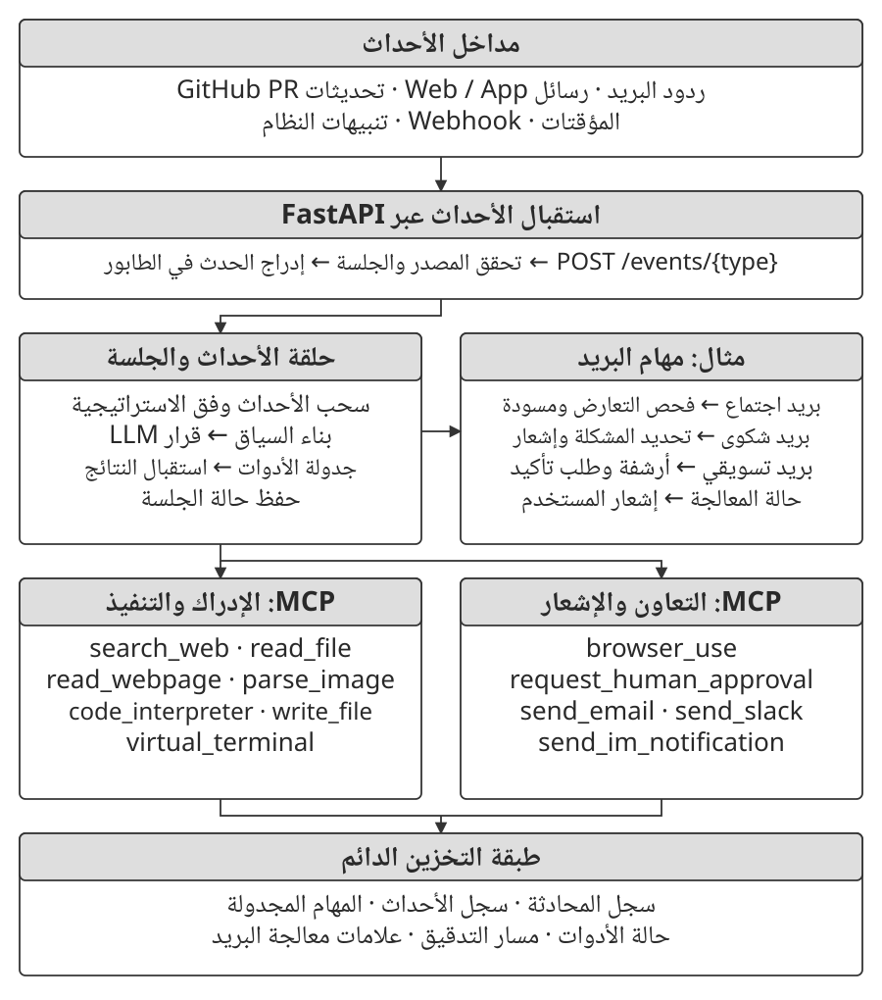
>
> ويمكن توسيع الطابور نفسه ليشمل مصادر متعددة: وصول البريد، ورسائل المراسلة الفورية أو الرسائل النصية القصيرة، وتحديثات GitHub PR وIssue، والمؤقّتات، وWebhook الخارجية، والأحداث الداخلية مثل انقطاع المستخدم وانتهاء مهلة العمليات وإنذارات الموارد. ويتولّى كل محوِّل التحقق من المصدر واستكمال معلومات الارتباط، وتُكتب نتائج المعالجة بحسب معرّف الحدث.
>
> ويُستعمل في القبول ثلاث رسائل اختبارية: دعوة اجتماع تُطلق فحص تعارضات التقويم وتولّد مسودة قبول أو رفض؛ وشكوى عميل تُطلق استخراج المعلومات الأساسية ووسمها بأولوية عالية وإشعار المستخدم؛ ورسالة تسويقية تُؤرشف وفق القواعد.
>
> وقد أنجز السجل المرافق الحالي مراجعة وثائق الواجهة واختبار المصادقة، أما ربط صندوق البريد الاختباري فلا يزال بانتظار بيانات اعتماد صالحة.
>
> **توسعة (اختيارية): الاتصال متعدد المصادر وحقن الأعطال.** إلى جانب صندوق البريد الاختباري، اربط نقطة Webhook محلية وطابور SQS (يمكن محاكاته محليًا). يتحقق كل محوِّل من المصدر، ويولّد المغلّف، ويكتبه في سجل الاتصال، ثم يُقرّ للمصدر؛ وتقرأ بيئة التشغيل الأحداث من السجل وتعالجها بترتيب الخيوط. ثم احقن ثلاثة أصناف من الأعطال:
>
> 1. **التسليم المكرر.** تتلقّى نقطة Webhook طلبين بمعرّف التسليم نفسه، فلا يظهر في السجل إلا حدث واحد.
> 2. **الانهيار قبل الإقرار.** يُنهى المحوِّل بعد الكتابة في السجل وقبل حذف رسالة SQS؛ فتعود الرسالة مرئية وتُقرأ مرة أخرى، ويظل في السجل حدث واحد فقط.
> 3. **الانهيار قبل الإيصال.** تُنهى بيئة التشغيل بعد إرسال الردّ وقبل تسجيل الإيصال، ثم يُعاد تشغيل السجل بعد إعادة التشغيل. فإذا كانت القناة تدعم مفتاح عدم التكرار، أو أمكن الاستعلام عن الرسائل المرسلة (كسجل المرسَل في صندوق البريد)، لم يُرسَل الردّ نفسه مرتين؛ أما القناة التي تفتقر إلى الأمرين فلا يُمكن فيها إلا وسم هذا الردّ بأنه بانتظار تأكيد بشري.
>
> وينبغي أن تترك الأصناف الثلاثة من الأعطال أثرًا في السجل: أي تسليم أُزيل تكراره، وأي رسالة أُعيدت قراءتها، وأي ردّ تُحقق منه فلم يُعَد إرساله.
>
> ويمكن تشغيل الشيفرة المرافقة لهذه التوسعة دون اتصال، ولا تحتاج إلى API Key. فصندوق البريد الاختباري وطابور SQS كلاهما محاكيان بملفات محلية، ومنفصلان عن صندوق البريد الحقيقي المذكور أعلاه الذي ينتظر بيانات الاعتماد؛ ويحتفظ الطابور المحاكى بمهلة الرؤية ومقبض الاستلام والترتيب داخل مجموعة الرسائل. وتُحدِث العملية الأم الانهيار بإنهاء العملية الفرعية مباشرةً في موضع محدد. ويُعرض لكل قناة ردّ أسلوب واحد: البريد يستعلم عن سجل المرسَل، ومحادثة التطبيق تستعمل مفتاح عدم التكرار، والرسائل النصية القصيرة تفتقر إلى الأمرين. ولإعادة الإنتاج، ادخل إلى `chapter6/agent-with-event-trigger` وشغّل `python multisource_demo.py`، فتطبع الطرفية بندًا بندًا سجلات الأصناف الثلاثة من الأعطال. وفي سجل التشغيل المرافق، اجتازت فحوص الأعطال الثلاثة كلها.
>

يضع طابور البريد أساس المعالجة المتسلسلة. وننتقل بعد ذلك إلى إضافة أدوات طويلة التشغيل، لنناقش كيف تُستقبل المتطلبات الجديدة في أثناء الانتظار، وكيف تُلغى المهام ويُستأنف العمل.

### التوافق عند غياب الدعم الأصلي للاتزامن

لنفترض أن Agent يصوغ رسالة بريد، وقد استدعى `search_contacts` للبحث عن جهة اتصال. وقبل أن تعود النتيجة، يطلب المستخدم: «لحظة، ابحث أولًا عن طقس الغد». فإذا كانت واجهة النموذج الحالية تشترط أن يقترن كل استدعاء أداة بنتيجته أولًا، احتاج Harness إلى تحويل الحالة الخلفية إلى متتالية رسائل تقبلها الواجهة.

**التعبير عن الحالة الخلفية بصيغة الرسائل المتزامنة.**

**عند التوافق مع الواجهات المتزامنة، ينبغي الحفاظ ما أمكن على الاقتران بين الاستدعاء العادي ونتيجته الحقيقية، ولا تُضاف استجابة الحالة إلا عند التبديل بين المهام في المنتصف.** فإن ملء «لا يزال قيد التشغيل» لكل استدعاء في وقت مبكر يملأ المسار بحالات غير مكتملة، ويزيد عبء تتبّع النتائج الحقيقية على النموذج. ويمكن تحديدًا اتباع خمس قواعد:

1. **تسجيل الاستدعاء كاملًا.** تُكتب رسالة assistant التي أكملتها API وعناصر استدعاء الأدوات في المسار، مع الاحتفاظ بمعرّفات الاستدعاء. وتُحفظ حالة الاستدلال في جهة الخادم بطريقة الاستئناف التي يحدّدها مزوّد الخدمة.
2. **تسجيل الاكتمال الحقيقي.** حين تكتمل الأداة، تُكتب النتيجة الفعلية ومعرّف المهمة وحالة التنفيذ؛ وفي أثناء التنفيذ، يواصل مدير المهام حفظ الحالة غير المكتملة.
3. **الإبلاغ عن الحالة الراهنة عند التبديل.** في الواجهات التي تسمح بحمولة نتيجة من هذا النوع، يمكن إعادة معلومات حالة صريحة للاستدعاء المنتظر، مثل «المهمة لا تزال تعمل في الخلفية، ولم تصدر النتيجة بعد»، ثم يُلحق حدث المستخدم. ويربط معرّف المهمة في استجابة الحالة بإشعار الاكتمال اللاحق.
4. **ترتيب الرسائل بعد المقاطعة.** إذا غابت القدرة على الاستئناف في المنتصف، أُلغي التوليد غير المكتمل، واحتُفظ بالرسائل وحالات الأدوات التي تأكّد اكتمالها، ثم أُرسل طلب جديد. ويُعالج المخرج غير المكتمل بحسب ما تحدّده الواجهة، تفاديًا لمعاملة معاملات مبتورة على أنها استدعاء قابل للتنفيذ.
5. **استقبال الأحداث الاعتيادية دفعةً واحدة.** تدخل المعلومات التكميلية الطابور، وتُرسل مجتمعةً عند نهاية الدورة الحالية أو عند نقطة آمنة محددة، مع تسجيل الأحداث التي عولجت.

في مثال البحث عن جهة الاتصال، يُكتب الاستدعاء الكامل في المسار أولًا؛ وحين يبدّل المستخدم المهمة، يُضيف Harness استجابة حالة تفيد بأن البحث لا يزال جاريًا، ثم ترسل طلب الطقس. وتصل نتيجة جهة الاتصال لاحقًا، فتدخل السياق حدثًا جديدًا يحمل المصدر ومعرّف المهمة، ثم يواصل Agent صياغة الرسالة. وإذا كان الاستدعاء الأصلي قد تلقّى استجابة حالة، اتخذت النتيجة اللاحقة هيئة الحدث التي يتّفق عليها المحوِّل، فيبقى الاقتران بين الاستدعاء والنتيجة محفوظًا.

ولا تبيّن استجابة الحالة إلا تقدّم التنفيذ الراهن. أما الخطوات التي تعتمد على بيانات جهة الاتصال، فلا بد أن تنتظر وصول النتيجة الحقيقية قبل أن تمضي. ويستطيع مدير المهام أن يحفظ حالات مثل `running` و`completed` و`cancelled` و`failed`، وأن يتحقق من استيفاء الاعتماديات قبل إرسال الردّ أو تنفيذ الأدوات اللاحقة.

**تصميم الأدوات غير المتزامنة بمقابض المهام.**

في أدوات المهام الطويلة المصمّمة حديثًا، يفضّل المؤلف تعريف «البدء» عمليةً كاملة قائمة بذاتها، تعيد فورًا مقبض مهمة حقيقيًا. فيميّز النموذج بذلك بين «بدأت» و«اكتملت»، ويصبح للاستعلام والإلغاء وأحداث النتائج اللاحقة أساس ربط موحّد. فمثلًا، تبدأ `initiate_phone_call` مهمة مكالمة، وتعيد معرّف المهمة وحالة «جارٍ الاتصال»؛ ثم تبلّغ `phone_call_connected` و`phone_call_ended` عن الاتصال والانتهاء على الترتيب.

وينبغي أن ينصّ وصف الأداة بوضوح على ما يلي: «تبدأ هذه الأداة مهمة مكالمة، وتعيد معرّف المهمة عند النجاح. يمكنك مواصلة معالجة أمور أخرى؛ وتُعاد مجريات المكالمة ونتيجتها النهائية عبر أحداث مستقلة.» فاسم الأداة يبيّن أنها عملية بدء، وبنية الإعادة والأحداث اللاحقة تبيّن كيف تتقدّم المهمة وكيف تنتهي. ثم يوفّر النظام واجهات للاستعلام والإلغاء والاستئناف بحسب معرّف المهمة، ليعرف النموذج ما لا يزال بوسعه فعله.

**معالجة الأحداث المجمّعة بندًا بندًا.**

حين تدخل عدة أحداث السياق دفعةً واحدة، قد يستجيب النموذج للأخير وحده ويُغفل المتطلبات التي طُرحت قبله. فعلى بيئة التشغيل أن تحتفظ بحالة معالجة كل منها، لتبقى الشروط التي لم يُستجب لها ظاهرة. ويمكن للموجّه أن يطلب من النموذج الفحص بندًا بندًا، ويسرد شريط الحالة المعلومات التي لم تُعالج بعد:

```text
[未处理事件 1/4] database_query 结果：……
[未处理事件 2/4] 用户补充：只看北京地区的数据
[未处理事件 3/4] 系统提醒：报告截止时间还有 30 分钟
[未处理事件 4/4] 用户询问：进度如何？
```

ويمكن لملخص الدفعة أن ينبّه إلى «نتيجة أداة واحدة، ورسالتين من المستخدم، وتذكير واحد من النظام». وتمضي بيئة التشغيل أبعد من ذلك فتربط الأحداث بقيود المهمة: فشرط المنطقة يحدّث نطاق الاستعلام، والموعد النهائي يؤثر في الجدولة، والسؤال عن التقدّم يحتاج إلى ردّ. وبعد المعالجة تُسجَّل حالة الاكتمال أو الانتظار أو الحاجة إلى الاستيضاح، وتبقى البنود غير المحسومة ظاهرة في الجولة التالية.

ويربط رقم المهمة نفسه بين البدء وتقارير التقدّم ونتيجة التنفيذ الأخيرة. فإذا طلب أحدهم الإيقاف في المنتصف، لزم التحقق مرة أخرى من وجود إيصال إلغاء تحت هذا الرقم.

> **التجربة 6-2 ★★★: وكيل غير متزامن بقدرة التنفيذ المتوازي والمقاطعة**
>
> تتحقق هذه التجربة أولًا من بيئة التشغيل غير المتزامنة، ثم تربط النموذج لفحص قراراته. وقد أنجز سجل التشغيل المرافق أربعة سيناريوهات بعمليات فرعية حقيقية في نظام التشغيل، وتولّت نصوص برمجية حتمية جدولة الأحداث وإعداد التقارير.
>
> 1. **التنفيذ في الخلفية والاستجابة الفورية.** تُبدأ عملية تحليل تستمر بضع ثوانٍ، ويُعاد معرّف المهمة فورًا؛ وفي أثناء الانتظار يُجاب عن سؤال الوقت الحالي، ثم تُستقبل نتيجة التحليل عند اكتماله.
> 2. **الطابور والمعالجة الدفعية.** في أثناء مهمة طويلة يُضاف تباعًا «ردّ باليابانية» و«نسّقها في صفحة ويب»، وبعد اكتمال المهمة تُعالَج النتيجة مع الطلبين دفعةً واحدة. فيولّد النص البرمجي صفحة HTML باليابانية.
> 3. **الإلغاء والاستئناف.** يُبيَّن أن تلقّي «أوقف التحليل» يقطع جولة النموذج التي لا تزال قيد التوليد، ويطلب إيقاف جميع المهام الخلفية الجارية. وفي هذه المرة أصدر النص البرمجي المقاطعة، ولم تكن تجري حينئذ إلا عملية تحليل واحدة هي T1. ففي الثانية 0.803 سجّل حدث المقاطعة أن تقدّم T1 بلغ 18%؛ ولم يسجّل النظام رمز خروجها −15 إلا في الثانية 0.806. أما T2 التي بدأت بعد ذلك مباشرةً فمهمة جديدة. والنتيجة التي وصلت في الثانية 4.436 هي نتيجة T2، ولم تُطلق T1 أي استدعاء راجع للاكتمال.
> 4. **المهام المتوازية وقرارات التقدّم.** تُبدأ ثلاث عمليات تحليل معًا، تتقدّم في كل خطوة زمنية منطقية بنسب 3% و2% و1% على الترتيب. وفي سجل التقدّم المتوازي لهذه التجربة، حين اكتملت T1 وهي الأسرع، أظهر إيصال الاستعلام أن T2 بلغت 68% وT3 بلغت 34%. وكما يبيّن الشكل 6-5، تُلغى المهام التي لم يتجاوز تقدّمها 50%. فلم يُلغِ النص البرمجي إلا T3، وتلقّى في النهاية نتيجتَي T1 وT2. وهذا يبيّن أن بيئة التشغيل الواحدة قادرة على الاستجابة لإيقاف الدفعة كلها، وعلى الإبقاء على العمل المتوازي الذي لا يزال مفيدًا.
>
> 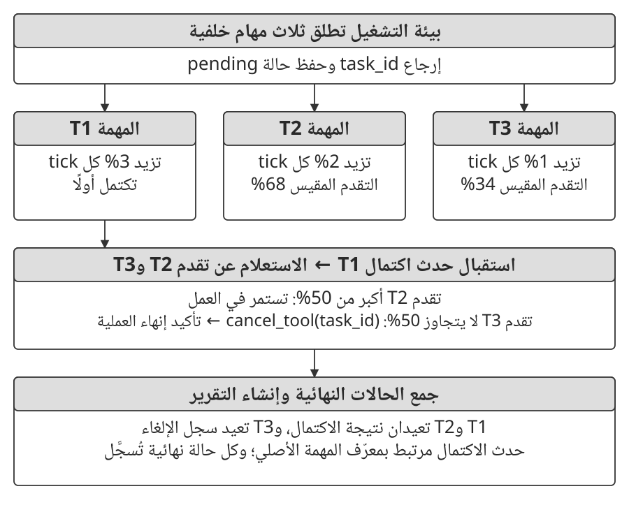
>

### اللاتزامن الأصلي في النموذج: GPT-6 Astra

في الحلول السابقة كان Harness هو الذي يكيّف صيغة الرسائل المتزامنة. أما الواجهات غير المتزامنة الأصلية فتسمح للنموذج مباشرةً بمواصلة العمل المستقل قبل أن تعود الأداة، ثم باستقبال النتيجة لاحقًا. وحتى سبتمبر 2026، كان GPT-6 Astra يوفّر استدعاء الأدوات غير المتزامن (Async tool calling) والتوجيه في منتصف الجولة (Mid-turn steering)، ليعالج الأول انتظار الأدوات والثاني تحديثات المستخدم. ويقابل الشكل 6-6 بين مسار الرسائل في تكييف الواجهة المتزامنة ومساره في اللاتزامن الأصلي.[^ch6-22][^ch6-23]

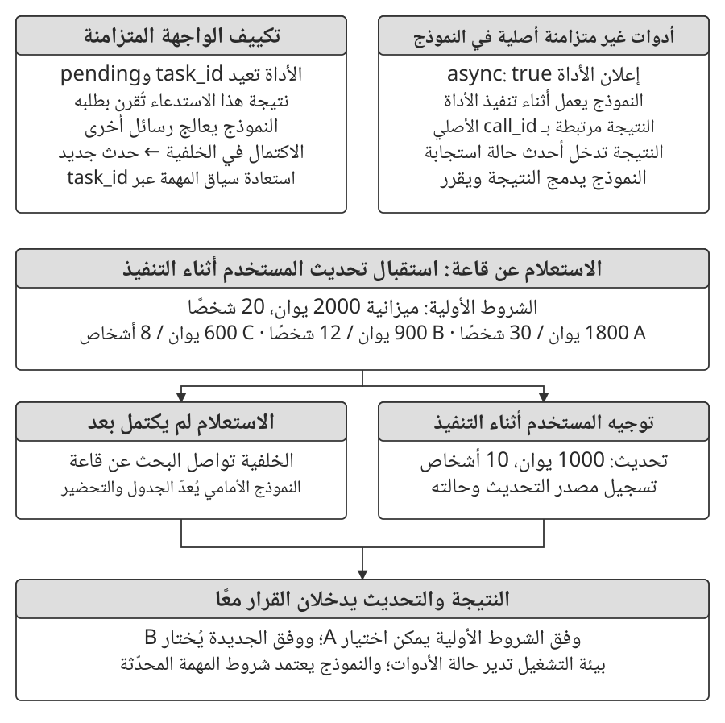

**مواصلة العمل المستقل في أثناء انتظار الأداة.** فمثلًا، بعد أن يطلق Agent استعلامًا عن قاعات الاجتماعات، يستطيع أن يرتّب جدول الأعمال وقائمة التحضيرات أولًا؛ ثم يقارن الأسعار والسعة بعد عودة الاستعلام. ويعلن `async: true` في تعريف الأداة عن القدرة غير المتزامنة، فيبدأ التطبيق التنفيذ بعد استلام عنصر الاستدعاء كاملًا، ويحفظ معرّف الاستدعاء `call_id`. وحين تصل النتيجة، يعيدها التطبيق بحسب المعرّف الأصلي، ويستأنف من أحدث حالة للاستجابة. فالنموذج يرتّب العمل اللاحق، وHarness يدير ربط الاستدعاءات ودورة حياة المهام.[^ch6-22]

**استقبال متطلبات جديدة في أثناء سير المهمة.** يستطيع المستخدم في أثناء تفكير النموذج أو صياغته للإجابة أن يضيف «خفّض الميزانية إلى 1000» أو «غيّر عدد الحضور إلى 10». فيرسل التطبيق حدث التوجيه عبر الاتصال نفسه، وبعد أن يؤكد الخادم استلامه، يواصل المعالجة بحسب حالة الاستجابة الراهنة. وبعد انقطاع الاتصال وإعادته، يستطيع التطبيق استئناف المهمة استنادًا إلى الأحداث وحالة الاستجابة المحفوظة.[^ch6-23]

ويمكن الجمع بين هاتين القدرتين: يستمر استعلام القاعات في العمل، وتدخل المتطلبات الجديدة للمستخدم في القرارات اللاحقة، ثم يُستكمل الاختيار بعد عودة نتيجة الاستعلام. ويحافظ المنفِّذ في الوقت نفسه على الحالة الحقيقية للمهام الخلفية. وإذا احتيج إلى إيقاف الاستعلام أو إلغاء الحجز، استدعى Harness الواجهة المقابلة وتحقق من الإيصال؛ أما عمليات الأعمال التي اكتملت فعلًا فتدخل مسار التراجع أو التعويض.

وحين يدعم النموذج والواجهة اللاتزامن دعمًا أصليًا، يفضّل المؤلف استعمال البروتوكول الأصلي، فيجري تعليق الأدوات وتحديثات المستخدم واستئناف الاستجابة وفق ما تتّفق عليه الواجهة. أما طبقة التوافق المتزامن فتخدم أساسًا النماذج الحالية والواجهات القديمة؛ وبعد ترقية النموذج، يمكن إزالة منطق التوافق الذي لا يُستعمل إلا لاستكمال اقتران الرسائل تدريجيًا، وتركيز الجهد الهندسي على حالة المهام والإلغاء والاستئناف.

### معالجة المهام غير المتزامنة بموثوقية

يستلزم التفاعل غير المتزامن الموثوق فحص الرسائل والمهام وحالة التنفيذ معًا.

1. **نسبة النتائج.** تحمل النتيجة المتأخرة معرّف الاستدعاء الأصلي، فيربطها التطبيق بالمهمة المقابلة؛ وتمضي القرارات التي تعتمد على هذه النتيجة بعد وصول البيانات.
2. **الاستئناف والإلغاء.** بعد أن يغيّر المستخدم متطلباته، يحتفظ النظام بالعمل الذي لا يزال صالحًا، ويحدّث الخطوات اللاحقة، ويوضّح أي المهام الخلفية تستمر وأيها توقفت.
3. **تعدّد المتطلبات.** تدخل الميزانية وعدد الحضور والمنطقة والموعد النهائي حالة المهمة كلٌّ على حدة، وتُفحص النتيجة النهائية في ضوء هذه الشروط بندًا بندًا.

> **التجربة 6-3 ★★★: اللاتزامن الأصلي في النموذج والتوجيه في منتصف الجولة**
>
> تطلب هذه التجربة من Agent أن يختار لاجتماع محاكى أرخص قاعة تستوفي متطلبات الميزانية وعدد الحضور. الميزانية الأولية 2000، وعدد الحضور 20؛ وتنتظر أداة الاستعلام 8 ثوانٍ قبل أن تعيد أسعار ثلاث قاعات وسعتها.
>
> | القاعة | السعر | السعة |
> |---|---:|---:|
> | A | 1800 | 30 |
> | B | 900 | 12 |
> | C | 600 | 8 |
>
> في الشروط الأولية ينبغي اختيار A. وتتلقّى مجموعة التوجيه في أثناء سير المهمة تحديثين: تغيير الميزانية إلى 1000، وتغيير عدد الحضور إلى 10، فينبغي حينئذ اختيار B. وتعيد الأداة في الوقت نفسه إيصالًا مولّدًا حديثًا، ويجب أن تستشهد به الإجابة النهائية، للتحقق من أن النموذج استعمل النتيجة التي وصلت فعلًا.
>
> تضم التجربة خمس مجموعات، تُشغَّل كلٌّ منها ثلاث مرات: الأدوات المتزامنة، والأدوات غير المتزامنة الأصلية، والتوجيه في أثناء الاستدلال، والتوجيه في أثناء انتظار الأداة غير المتزامنة، ومجموعة ضابطة بنموذج لا يدعم قدرة التوجيه. وتقارن المجموعتان الأوليان هل يمكن إخراج قائمة تحضيرات مستقلة في أثناء الانتظار؛ وتفحص مجموعتا التوجيه هل يسري تعديلا الميزانية وعدد الحضور معًا؛ وتفحص المجموعة الضابطة للقدرة هل تبلّغ الواجهة صراحةً بعدم الدعم.
>
> وفي سجلات التشغيل المحفوظة، أنجزت مجموعة الأدوات غير المتزامنة القائمة المستقلة في أثناء الانتظار، واختارت مجموعتا التوجيه كلتاهما B بحسب الشروط الجديدة. ولم تنفّذ أيٌّ من التشغيلات المزوّدة بالأدوات إلا استعلامًا واحدًا، وأعادت النتيجة الفعلية إلى الاستدعاء الأصلي؛ أما واجهة النموذج الضابط فردّت صراحةً بأنه لا يدعم استقبال متطلبات جديدة في منتصف جولة التوليد. وتقارب الزمن الكلي في مجموعتي التزامن واللاتزامن، وكان الفرق الأساسي في القدرة على دفع أعمال أخرى في أثناء الانتظار.
>
> لو تذكّر النموذج تغيير عدد الحضور إلى 10 فقط، وظل يختار بالميزانية القديمة 2000، فأي قاعة سيختار؟ إن A وB كلتيهما تتسعان للحضور، والأرخص بينهما لا يزال B. ولذلك فإن اختيار القاعة الصحيحة لا يكشف وحده هل حُدّثت الميزانية.
>
> وبعد تغيير عدد الحضور، هل يلزم إعادة الاستعلام الذي أُرسل من قبل؟ ليس لأداة هذه التجربة معاملات تصفية، فهي تعيد القاعات الثلاث كلها. فيستطيع المساعد أن يعيد استعمال النتيجة التي في الطريق، ثم يصفّيها عند عودتها بحسب 10 أشخاص وميزانية 1000. أما لو كانت الأداة لا تعيد إلا القاعات التي تتسع لعشرين شخصًا فأكثر، لما تضمنت النتيجة القديمة إلا A، ولما كانت B التي تتسع لاثني عشر شخصًا فيها أصلًا. وحينئذ فإن تغيير عدد الحضور إلى 10 داخل القائمة القديمة وحدها سيظل يُفوّت B. فإذا كان الاستعلام الأصلي قد استبعد B، وجب الاستعلام مرة أخرى.

تُمكّن الآليات غير المتزامنة التغيّرات الخارجية من دخول النظام في أثناء سير المهمة. أما التفاعل الصوتي وتفاعل الشاشة وتفاعل الروبوت فتقصّر دورة التغذية الراجعة أكثر: فالنظام يحتاج إلى استقبال المدخلات باستمرار، وإلى تعديل مخرجاته وأفعاله في التوقيت المناسب.

## الصوت: الواجهة الأكثر طبيعية بين الإنسان والآلة

يتيح الصوت للمستخدم أن يشرح حاجته لـ Agent، ويضيف الشروط، ويؤكّد النتائج، حتى حين تكون يداه أو عيناه منشغلة بعمل آخر. فطرق الإدخال الصوتي تحوّل الإملاء إلى نص، أما Agent الصوتي فيمضي أبعد من ذلك فيدير الحوار واستدعاءات الأدوات وتشغيل الردود، وكلاهما يمكن أن يدعم أسلوب whisper coding الذي عرّفت به المقدّمة.

يتناول هذا القسم استعمالين: أن يحاور المستخدم Agent مباشرةً، وأن يتواصل Agent مع أطراف خارجية نيابةً عن المستخدم. يهتم الأول بالتعرّف والاستجابة والمقاطعة، ويحتاج الثاني فوق ذلك إلى إتمام التحقق من الهوية والاستعلامات التجارية واتخاذ القرارات في أثناء المكالمة.

### توقيت التفاعل: من التسلسل إلى الازدواج الكامل

استعرضت OpenAI في تقديمها لـ GPT-Live ثلاثة أصناف من التفاعل الصوتي: التسلسل، ونماذج الصوت القائمة على الجولات، والازدواج الكامل[^ch6-12]. وهذا المسار التطوري ينقل تدريجيًا قرار «متى يتكلّم ومتى يواصل الإنصات» إلى النموذج ليحكم فيه باستمرار. ففي الأنظمة التسلسلية يتولّى منطق نقطة النهاية أساسًا ترتيب تبادل الكلام، أما نماذج الازدواج الكامل فتستطيع أن تعالج التداخل والتوقفات والمقاطعات بالنظر إلى الصوت المتصل وحالة الحوار.

| النموذج | البنية الأساسية | القدرات التي يسهل تنفيذها | مسائل التصميم الرئيسية |
|---|---|---|---|
| التسلسل | تقسيم العمل بين VAD وASR وLLM وTTS | استبدال الوحدات كلٌّ على حدة، وفحص المدخلات والمخرجات مرحلةً مرحلة | التأخير بين الوحدات، والمعلومات الصوتية التي تضيع في التفريغ النصي |
| نموذج صوتي من طرف إلى طرف قائم على الجولات | يستقبل النموذج الصوت ويولّده مباشرةً | تنظيم الردّ مستفيدًا من النبرة والانفعال وغيرهما | الحكم بانتهاء الكلام، وتبادل الجولات، وتوقيت الاستجابة |
| الازدواج الكامل | استقبال الصوت وتوليد المخرجات باستمرار | الكلام المتداخل، والتعقيب، والمقاطعة، والتفاعل المتصل | الحالة المتصلة، والتحكّم في المخرجات، وتقييم التفاعل |

إن معالجة النموذج للصوت مباشرةً، وكون المدخلات والمخرجات متدفّقة، والقدرة على الإنصات والكلام في آن واحد، قدرات يمكن فحص كلٍّ منها على حدة. فالأنظمة التسلسلية يمكن أن تضاف إليها وحدات متدفّقة وتحكّم في المقاطعة؛ وأما إيقاع التفاعل في النماذج من طرف إلى طرف فيتوقف على تصميمها المحدد.

[^ch6-12]: OpenAI، *Introducing GPT-Live*، 2026-07-08، ويعرض التسلسل ونماذج الصوت القائمة على الجولات والتفاعل كامل الازدواج.

### النموذج الأول · خط الأنابيب التسلسلي (Cascading)

يقسّم النظام التسلسلي الحوار الصوتي إلى عدة وحدات. فكشف النشاط الصوتي (VAD) يحدّد المقاطع التي فيها كلام، ويحكم منطق نقطة النهاية متى يُرسَل المقطع؛ والتعرّف الآلي على الكلام (ASR) يحوّل الصوت إلى نص؛ وLLM يفهم الطلب ويولّد الردّ؛ ثم يحوّل تركيب الكلام (TTS) الردّ إلى صوت قابل للتشغيل. ويعرض الشكل 6-7 البنية الأساسية التي تُنفَّذ بالتتابع.

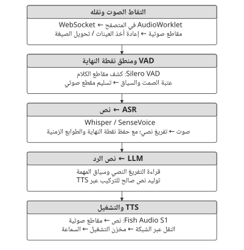

يحدّد VAD الصوتي المقاطع التي يتكلّم فيها أحد، فيستطيع التعرّف اللاحق أن يتخطّى فترات الصمت الطويلة. غير أن التوقف الواحد يختلف معناه بين أن يأتي بعد «أريد أن أحجز…» وأن يأتي بعد «هل توجد تذاكر صباح الخميس؟». فـ VAD الدلالي (الكشف الدلالي عن نقطة النهاية) يستطيع أن يواصل الالتقاط في الحالة الأولى، ولا يسلّم الكلام إلى نموذج الحوار إلا في الحالة الثانية. وهذا هو تخفيف الملاحظة الصوتية في الزمن: مقطع صوتي متصل لا يطلق الاستدلال إلا في لحظات قليلة. أما هل يتكلّم أم لا، فيقرّره النموذج الذي سمع الجملة؛ وله أيضًا أن يواصل الإنصات، أو أن يبحث عن الرحلات أولًا.

| الوحدة | الوظيفة | مصادر الانتظار أو الخطأ الشائعة |
|---|---|---|
| VAD ومنطق نقطة النهاية | كشف الكلام وتحديد توقيت الإرسال | عتبة الصمت، والضوضاء، والتوقفات في منتصف الكلام |
| ASR | تحويل الصوت إلى نص | زمن فك الترميز، والتعرّف على أسماء الأشخاص والمصطلحات الخاصة |
| LLM | الفهم والاستدلال وتوليد الردّ | اصطفاف الطلبات، وتوليد المقطع الأول من الردّ |
| TTS والتشغيل | تركيب الصوت وإيصاله إلى السمّاعة | تركيب الحزمة الأولى، والنقل عبر الشبكة، والتخزين المؤقت للتشغيل |

في التنفيذ التسلسلي الكامل، يظل على المستخدم بعد أن يفرغ من كلامه أن ينتظر تباعًا تأكيد نقطة النهاية، ثم التفريغ النصي، ثم توليد الردّ، ثم المقطع الصوتي الأول. وفي مثال الشكل 6-8، كانت قد مضت 1.4 ثانية حين سمع المستخدم أول صوت من الردّ، وأطول ما فيها انتظار النظام ليتأكد من أن المستخدم أنهى كلامه (500 مللي ثانية). وحتى لو قُلّص التفريغ النصي من 100 مللي ثانية إلى 50، فلن يوفّر المستخدم من الانتظار إلا 50 مللي ثانية.

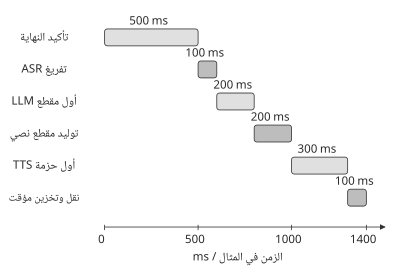

ويضيف حمل الخدمة كذلك انتظارًا في الطابور. ويستعمل الشكل 6-9 نموذج M/M/1 ذا نافذة الخدمة الواحدة لبيان هذه العلاقة: إذا كان الوصول يتبع عملية بواسون، وزمن الخدمة يتبع توزيعًا أسيًا متوسطه $S$، والاستغلال $\rho<1$، فإن متوسط الزمن الكلي شاملًا الخدمة والاصطفاف هو $W=S/(1-\rho)$. فإذا كان $S=1$ ثانية، وارتفع الاستغلال من 0.5 إلى 0.8، ارتفع متوسط الزمن الكلي من ثانيتين إلى 5 ثوانٍ. ويظل نصيب الخدمة نفسها في المتوسط ثانية واحدة، وتذهب الثواني الثلاث الزائدة كلها في الاصطفاف. وحين تقترب الطلبات من سعة المعالجة، تتسبب التقلبات القصيرة في حركة المرور في تراكم.

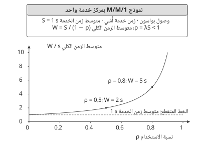

> **التجربة 6-4 ★: بناء وكيل صوتي تقليدي**
>
> لنفترض أن المساعد يقرأ عليك رحلات يوم الخميس، فتقاطعه مصحّحًا: «لحظة، أريد أن أحجز ليوم الجمعة». يرسل المتصفح صوت الميكروفون إلى الخادم الخلفي عبر WebSocket. وما إن يكشف Silero VAD أنك بدأت الكلام، حتى يرسل الخادم الخلفي `speech_start`، فيوقف المتصفح التشغيل فورًا ويفرّغ الصوت القديم المصطفّ. وفي هذه اللحظة لا يعرف المساعد بعدُ أي يوم غيّرت. ولا يرسل الخادم الخلفي `speech_end` إلا بعد أن تفرغ من كلامك ويتجاوز الصمت 500 مللي ثانية الافتراضية، فيسلّم هذا المقطع الصوتي إلى Whisper tiny المحلي لتفريغه نصيًا.
>
> حين يبدأ Doubao بإعادة النص، كم بقي حتى يسمع المستخدم الإجابة؟ في سجل إعادة تشغيل لجولة تسجيل، استغرق التفريغ النصي 2.710 ثانية. وأعاد Doubao أول token بعد 0.749 ثانية من إرسال الطلب، ولم يُعِد الإجابة كاملة إلا عند 0.792 ثانية. وانتظر برنامج إعادة التشغيل حتى اكتمل النص، ثم سلّمه إلى Fish S1 للتركيب؛ ومضت 2.819 ثانية أخرى قبل أن يتلقّى الخادم الخلفي الدفعة الأولى من الصوت. وبجمع هذه الأزمنة الثلاثة المتسلسلة بدءًا من الحكم بنقطة النهاية، يكون المجموع نحو **6.321 ثانية**. أما التقرير المؤرشف فيذكر 6.279 ثانية، لأنه استعمل زمن أول token بدلًا من زمن توليد الإجابة كاملة.
>
> ولا تغطي هذه الثواني الـ 6.321 إلا المعالجة في الخادم الخلفي. فالمستخدم ينتظر أولًا حتى يحكم كشف الصمت بأن الجملة انتهت، ثم ينتظر في الأخير وصول الصوت إلى المتصفح وبدء تشغيله.

#### من التسلسل إلى الإدراك المتدفّق

يسهّل الحل التسلسلي الفحص مرحلةً مرحلة، لكنه يكشف أيضًا ثلاث مشكلات. فانتظار الصمت يزيد تأخير نقطة النهاية؛ والنص المفرَّغ قد يُسقط النبرة والانفعال وأصوات البيئة؛ وتقطيع الصوت عند التوقفات قد يُفقد عناوين البريد وأسماء الأشخاص والمصطلحات الخاصة سياقها الكامل. وفي الأنظمة التي تعتمد البنية التسلسلية بالفعل، يوصي المؤلف بالبدء بتحويلها إلى التدفّق: أن تقدّم كل مرحلة نتائجها التزايدية في أبكر وقت، فيتداخل التعرّف والاستدلال والتشغيل، مع الحفاظ على التمييز بين الأجزاء المؤكَّدة والأجزاء التي لا تزال قابلة للتعديل. وبذلك يُعاد استعمال الوحدات القائمة، ويُحدَّد تدريجيًا مصدر زمن الانتظار.

- **ASR يفرّغ وهو يسمع.** يستقبل الصوت باستمرار ويُخرج تفريغًا مؤقتًا؛ ثم يراجع الأجزاء غير المستقرة عند وصول صوت لاحق، ويقدّم النص النهائي عند تأكيد نقطة النهاية.
- **التنفيذ التخميني في LLM.** يُستعمل التفريغ المؤقت لإعداد الردّ مسبقًا. وبعد تأكيد النص النهائي، يُفحص هل المدخل متطابق وهل العمل المنجز لا يزال صالحًا، ثم يُقرَّر الإبقاء عليه أو تعديله أو إعادة توليده. أما العمليات من قبيل الإرسال إلى الخارج والكتابة في أنظمة الأعمال، فلا تُنفَّذ إلا بعد تأكيد الشروط اللازمة.
- **الإخراج المقطّع في LLM.** حين يكتمل مقطع نصي صالح للقراءة يُسلَّم فورًا إلى TTS، مع الحفاظ عند التقطيع على معنى الجملة وعلامات الترقيم ودلائل النبرة.
- **التركيب التزايدي في TTS.** تعود الكتل الصوتية تدريجيًا، فيتداخل توليد النص اللاحق وتركيبه وتشغيله. وعند حدوث مقاطعة، تُعالَج مهمة التوليد والمحتوى الذي لم يُشغَّل بعد في ذاكرة التشغيل المؤقتة معًا.

يرمّز التنفيذ المعتاد للتفريغ في Whisper الصوتَ ويفك ترميزه بحسب نوافذ صوتية[^ch6-whisper]. ويمكن بناء مسار تفريغ تزايدي بالتقطيع الخارجي أو بإعادة إرسال البادئة المتراكمة مرارًا؛ أما إعادة استعمال الحالة المستمرة، وتكلفة الترميز المكرر، ومراجعة النص السابق، فيتولّاها التنفيذ المحدد. وأما نماذج التعرّف المتدفّقة أصلًا فتعالج المدخلات المتصلة مباشرةً في بنيتها وتدريبها.

ويستطيع نظام الإدراك القائم على نموذج لغوي صوتي أن يُخرج النص والأحداث الصوتية معًا. فالصوت السابق والتفريغ وتلميحات المفردات تساعد على التعرّف على أسماء الأشخاص والعلامات التجارية والمصطلحات الخاصة، أما مقدار السابق المحتفظ به فيتوقف على تصميم السياق والتخزين المؤقت. وللحكم بأن «المستخدم أنهى كلامه»، يستطيع النموذج أن يجمع بين الاكتمال الدلالي والصمت. فعند التوقف بعد «أريد أن أحجز…» لم يسمع النظام الآني إلا هذه الكلمات، ولا سبيل له بعدُ إلى معرفة أن تاريخًا سيأتي بعدها.

وإلى جانب التفريغ، يمكن للواجهة أن تتّفق على الأحداث التالية: `speak_start` و`speak_end` لبداية الكلام ونهايته، و`interrupt` للمقاطعة، و`emotion` لوصف الحالة الانفعالية، و`laugh` و`sigh` و`noise` لتسجيل الضحك والتنهد وأصوات البيئة. ويمكن إرسال هذه الأحداث إلى Agent مع النص والطوابع الزمنية.

> **التجربة 6-5 ★: محاكاة الإدراك الصوتي المتدفّق باستخدام Qwen2-Audio**
>
> توسّع هذه التجربة البادئة الصوتية تدريجيًا، وتعيد في كل مرة إرسال الصوت من البداية حتى اللحظة الراهنة إلى Qwen2-Audio، لملاحظة كيف يتغيّر التفريغ والأحداث الصوتية بتغيّر المدخل. ويعتمد المسار الضابط نقطة نهاية بصمت مدته 600 مللي ثانية مع Whisper. ويشمل الاختبار كلامًا عاديًا، وجملة طويلة أُدرج فيها توقف مدته 900 مللي ثانية، وكلامًا مُزج بضوضاء وردية.
>
> احتفظ تشغيل النموذج المكمَّم محليًا في هذه المرة بـ 13 استدلالًا على البادئات، استغرق كلٌّ منها نحو 8—11 ثانية. وقد أطلق التوقف في منتصف الكلام التقطيع في المسار الضابط؛ واكتشف النموذج الصوتي الضوضاء، لكنه أبلغ خطأً عن سعال وضحك.

[^ch6-whisper]: OpenAI، Whisper، ويعرض التفريغ بحسب النوافذ الصوتية وتنفيذ النموذج.

### النموذج الثاني · نموذج Omni متعدد الوسائط من طرف إلى طرف

يستقبل النموذج الصوتي من طرف إلى طرف الصوتَ مباشرةً، ويولّد الردّ جامعًا بين المعلومات اللغوية والصوتية، ثم يركّب الكلام عبر فرع الإخراج الصوتي. فالمعالجة المباشرة للصوت تتيح الاستفادة من سرعة الكلام وطبقة الصوت والتوقفات وأصوات البيئة؛ أما التفريغ أولًا ثم الإجابة فييسّر فحص النص الوسيط واستبدال الوحدات كلٌّ على حدة.

وهذه الخصائص الصوتية تؤثر في الفهم. فالجملة نفسها «أرسل التقرير قبل الغداء من فضلك» تترك لدى السامع انطباعًا مختلفًا إذا قيلت على عجل أو قيلت على مهل. وفي الإخراج، يستطيع النموذج كذلك أن ينظّم المعنى بالتوقفات والنبر والتنغيم.

والأنظمة التي تعالج الصوت مباشرةً تستطيع هي أيضًا أن تنتظر حتى يفرغ المستخدم من كلامه قبل أن تجيب. فإذا توقف المستخدم مثلًا وهو يملي رقم هاتف، ظل على النظام أن يحكم هل اكتملت سلسلة الأرقام. فكشف نقطة النهاية يحدّد متى يستجيب النظام؛ وإذا قاطع الطرف الآخر في أثناء القراءة، لزم النظام أيضًا أن ينسّق بين توليد النموذج وتشغيل السمّاعة.[^ch6-audio-architectures]

> **التجربة 6-6 ★★: تشغيل MiniCPM-o 4.5 محليًا — من طرف إلى طرف مقابل التسلسل الذاتي**
>
> تثبّت هذه التجربة نموذج MiniCPM-o 4.5 نفسه، وتعطّل وضع التفكير، وتقارن بين مسارين: الإجابة عن السؤال من الصوت مباشرةً، وأن يفرّغ النموذج الصوت أولًا ثم يجيب استنادًا إلى التفريغ وحده. ويتضمن المدخل مسألتين حسابيتين ملقاتين شفهيًا، وتسجيلين لنص واحد بسرعتين مختلفتين.
>
> أجاب كل مسار عن ثلاثة أسئلة إجابة صحيحة، ووقعت الأخطاء في مواضع مختلفة. فالمسار الصوتي المباشر سمع twelve boxes في إحدى المسائل على أنها 8، فأخطأ في الحساب؛ أما مسار التفريغ فاحتفظ بالرقم 12 صحيحًا. وفي سؤال سرعة الكلام، قال التسجيلان كلاهما “Please send the report before lunch.”، فجاء النص المفرَّغ متطابقًا تمامًا، وضاعت معه معلومة السرعة والبطء؛ أما المسار الصوتي المباشر فميّز بين السرعتين تمييزًا صحيحًا.
>
> وولّدت التجربة أيضًا مقطعًا صوتيًا بتردد 24 kHz، يصل بين فهم المدخل والإخراج الصوتي.

### النموذج الثالث · نموذج التفاعل كامل الازدواج

يتكلّم النظام كامل الازدواج وهو يسمع، وأوضح ما يلمسه الناس من تحسّن هو الإحساس بوجود شخص حقيقي في المحادثة. اقرأ مثلًا الجملة «أريد حجز تذكرة الأربعاء… لا، الخميس»: فالتوقف في منتصفها يتّسع لهذا التصحيح الذاتي؛ وإذا كان المساعد قد بدأ يقرأ رحلات الأربعاء، فعليه أن يتوقف حين يسمع «لا، الخميس». وثمة توقيت آخر: حين يكون الطرف الآخر لا يزال يشرح خط رحلته، فإن تعقيبًا قصيرًا خفيفًا يُشعره بأن المساعد ينصت. فلا تتهيأ القدرة على هذه الاختيارات بين الكلام والإنصات والتوقف واستدعاء الأدوات إلا باستقبال الصوت باستمرار. والترجمة الفورية تحتاج كذلك إلى تداخل المدخلات والمخرجات.

ينمذج **Moshi** الذي أصدرته Kyutai عام 2024 تدفّقَي صوت المستخدم والنموذج كلًّا على حدة، ويمثّل الكلام المتداخل والمقاطعة بتدفّقات متوازية[^ch6-moshi]. وبالاحتفاظ بهذه العلاقات الزمنية في المدخل، يستطيع النموذج أن يتعلّم متى يستجيب ومتى يواصل الإنصات.

أما نموذج التفاعل لدى Thinking Machines Lab فيقطّع المدخلات والمخرجات المتصلة إلى كتل قصيرة متساوية الطول، تغطي كلٌّ منها 200 مللي ثانية، وتُسمّى الجولة الدقيقة (micro-turn)[^ch6-14]. انظر إلى الخانة الثانية على المحور الزمني في الشكل 6-10: المساعد لا يزال يقول «الخميس»، وقد بلغت أذنه «لا» التي يصحّح بها المستخدم التاريخ. وفي الخانة الثالثة يتوقف المساعد، ويظل ينصت إلى المستخدم حتى يُتمّ قول «الجمعة».

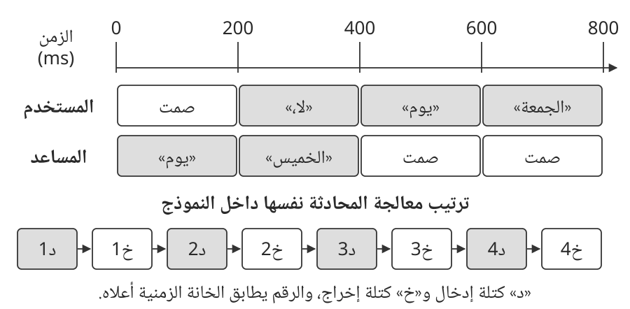

ثم اقرأ النصف السفلي من الشكل. فطرفا المكالمة يسمعان صوتين يمكن أن يتداخلا، أما النموذج فيستطيع أن يعالج كتل المدخلات ويولّد كتل المخرجات بالتناوب على متتالية واحدة. والصمت أيضًا يشغل خانة، ولذلك يستطيع المساعد أن ينصت قليلًا قبل أن يتكلّم. والـ 200 مللي ثانية في الشكل هي طول الكتلة في هذا التنفيذ تحديدًا؛ أما من لحظة مقاطعة المستخدم إلى توقف السمّاعة فعلًا، فلا بد من إضافة زمن المعالجة والتخزين المؤقت للتشغيل.

[^ch6-moshi]: Kyutai، *Moshi: a speech-text foundation model for real-time dialogue*، 2024، ويعرض تدفّقَي الصوت المتوازيين للمستخدم والنموذج.
[^ch6-14]: Thinking Machines Lab، *Interaction Models: A Scalable Approach to Human-AI Collaboration*، ويعرض الجولات الدقيقة والتفاعل متعدد التدفّقات وتفويض المهام الخلفية.

### التوقيت المعرفي: التفاعل الآني والتفكير العميق

في مكالمات خدمة العملاء التي يجريها Pine، يتكلّم موظف الخدمة نصف جملة، فيكون على المساعد أحيانًا أن ينتظر، وأحيانًا أن يعقّب تعقيبًا خفيفًا؛ وحين يتكلّم هو، عليه كذلك أن يسمع التصحيح الذي يقاطعه به الطرف الآخر. وهذا بالضبط ما يجعل المؤلف متفائلًا بالمسار الذي يمثّله Moshi: فلا يشعر الطرف الآخر بأن على الطرف الثاني من الهاتف إنسانًا ينصت حقًا إلا إذا أُحسن ضبط التوقيت. أما الطلبات التي تستلزم البحث في المصادر، فلها حساب زمني آخر: كم مرة ينتقل العمل من يد إلى يد بين فهم السؤال والإعلان عن الإجابة التي عُثر عليها؟

الأدوات التي يستطيع نموذج الصوت الأمامي أن يستدعيها مباشرةً يستدعيها هو. فالبحث عن الرحلات لا يحتاج إلا إلى استدعاءين للنموذج: يبحث النموذج الأمامي أولًا بحسب الشروط التي قدّمها المستخدم، ثم يبلّغ بالنتيجة. أما التفويض فيحتاج إلى أربعة: يشرح النموذج الأمامي المهمة، ويطلق النموذج الخلفي الاستعلام، ويرتّب النموذج الخلفي النتيجة، ثم ينقلها النموذج الأمامي. وثمة رأي آخر يرى أن النموذج الآني قد يملأ المعاملات خطأً، فينبغي أن يتولّى النموذج الخلفي استدعاء الأدوات، ليتفرّغ النموذج الأمامي للحكم متى ينصت ومتى يتكلّم.

ليس لدى النموذج الأمامي في GPT-Live-1 واجهة لاستدعاء دوال الأعمال مباشرةً، فلا يستطيع إلا التفويض إلى Agent خلفي. أما GPT-Realtime في OpenAI Realtime فيدعم استدعاء الدوال مباشرةً من النموذج الأمامي. ويدعم نموذج Doubao للصوت الآني 3.0 (Seeduplex) الاستدعاء المباشر من النموذج الأمامي في الوضع الخالص من طرف إلى طرف، أما في التنسيق الهجين فيتولّى الاستدعاء نموذج لغوي خارجي.[^ch6-voice-tools]

لنفترض أن كل استدعاء للنموذج الأمامي يستغرق $L_f$، وكل استدعاء للنموذج الخلفي يستغرق $L_b$، وأن الأداة تستغرق $T$. فمن لحظة فراغ المستخدم من كلامه إلى سماعه النتيجة، يحتاج الاستدعاء المباشر إلى نحو $2L_f+T$، ويحتاج التفويض إلى نحو $2L_f+2L_b+T$. والزيادة $2L_b$ في التفويض لا علاقة لها بزمن الأداة $T$. أما المعلومات التي قد تُستعمل في كل جولة، كذاكرة المستخدم، فيمكن لبيئة التشغيل أن تستعلم عنها وتضعها في السياق، فلا يحتاج النموذج الأمامي إلا إلى استدعاء واحد، أي نحو $L_f+T$؛ وإذا كان الاستعلام قد جرى قبل أن يبدأ المستخدم الكلام، وُفّر حتى $T$.

والمهام التي تحتاج إلى استدلال متعدد الخطوات، كالمقارنة بين عدة خيارات لتعديل الحجز، يناسبها الإسناد إلى النموذج الخلفي. أما حجز التذاكر فيتضمن الخصم وإصدار التذكرة، فلا بد من انتظار تأكيد المستخدم قبل تنفيذ الطلب أيًّا كان من يستدعي الأداة. ويمكن تلخيص نتائج الرحلات شفهيًا وعرض الجدول الكامل على الشاشة، وهذا لا علاقة له بمن يستدعي الأداة.

> **التجربة 6-7 ★★: هل يستدعي أدواتِ Agent الصوتي النموذجُ الأمامي أم الخلفي**
>
> يُبنى النموذج الأمامي بنموذج Doubao للصوت الآني 3.0، والنموذج الخلفي بـ DeepSeek V4 Pro الذي توفّره منصة Volcano Ark. وتُعدّ خمس أدوات محاكاة: الاستعلام عن الطقس، والاستعلام عن ذاكرة المستخدم، والبحث في الويب، والبحث عن الرحلات، وحجز التذاكر، فتعيد نتائجها في أوقات محددة، وينتظر البحث عن الرحلات وحجز التذاكر من 2 إلى 5 ثوانٍ. وتُركَّب تسجيلات المستخدم مسبقًا، ويُعاد في كل مرة تشغيل تسجيل السيناريو نفسه.
>
> تُضبط أربعة أنماط لتقسيم العمل. في الأول يستدعي النموذج الأمامي الأدوات كلها. وفي الثاني يستدعي النموذج الخلفي الأدوات كلها، ولا يملك الأمامي إلا التفويض. وفي النمطين الباقيين يستعلم الأمامي عن الطقس، وتضع بيئة التشغيل ذاكرة المستخدم في السياق عند بدء الجلسة، ويتولّى الخلفي البحث في الويب وحجز التذاكر. والفرق بينهما في أن البحث عن الرحلات يتولّاه الأمامي في أحدهما والخلفي في الآخر. فالنموذج الأمامي يسمع صوت المستخدم مباشرةً؛ أما الخلفي فلا يسمع الصوت، ولا يستطيع إلا قراءة النص. وتعيد واجهة Doubao بعد أن تسمع كل جملة من المستخدم النصَّ الذي حصل عليه التعرّف على الكلام، ويُسمّى التفريغ. وعند التفويض، يُرتَّب التفريغ وما قاله المساعد بحسب التسلسل الزمني في سجل مكالمة، ويُسلَّم إلى النموذج الخلفي مع استدعاءات الأدوات التي نُفّذت في هذه المكالمة ووصف المهمة الذي كتبه الأمامي. ويُكرَّر اختبار كلٍّ من السيناريوهات التالية 10 مرات في كل نمط.
>
> 1. الاستعلام عن الطقس وعن الرحلات كلٌّ على حدة. يبدأ التوقيت من فراغ المستخدم من كلامه إلى سماعه نتيجة الاستعلام، ولا تُحسب العبارات الانتقالية مثل «سأبحث عن ذلك» إجابةً. وتُقارن قيمة الوسيط لزمن الانتظار في الاستدعاء المباشر والتفويض. وفي تجربة المؤلف، بلغت القيمتان في الاستعلام عن الطقس 2.81 ثانية و6.96 ثانية على الترتيب.
> 2. البحث عن الرحلات أولًا، ثم اختيار التذكرة وتأكيدها. تُطابق الحقول الثلاثة عشر لطلب الحجز حقلًا حقلًا مع نتيجة الاستعلام في الجولة السابقة وما قاله المستخدم للتو وبيانات المستخدم، ويُفحص هل جاء وقت تنفيذ الطلب بعد تأكيد المستخدم. وفي تجربة المؤلف، ملأت الأنماط الأربعة الحقول كلها ملئًا صحيحًا، ولم ينفّذ أيٌّ منها الطلب إلا بعد تأكيد المستخدم.
> 3. يُغيَّر الطلب إلى حجز تذكرة لزميل، ويُشغَّل تسجيل يملي فيه المستخدم الاسم: «Chen Jiayi: "Chen" هي المكتوبة بجذرَي الأذن والشرق، و"Jia" كما في "jiajiang" بمعنى المكافأة، و"Yi" كما في "yiran" بمعنى الطمأنينة». وتُطابق التسجيلات والتفريغ الصوتي والاسم في الطلب، ويُفحص هل ملأ الحجز المباشر من الأمامي والحجز المفوَّض كلاهما الاسم صحيحًا. وفي تجربة المؤلف، أصاب الحجز المباشر من الأمامي في المرات العشر كلها؛ أما التفريغ فكتب الاسم بحرفين آخرين يُلفظان اللفظ نفسه، فملأت بعض الطلبات المفوّضة الاسم خطأً بسبب ذلك.
> 4. يُشغَّل تسجيل يسأل عن الطقس قبل أن تعود نتيجة البحث عن الرحلات، ويُستمع هل يجيب الأمامي عن سؤال الطقس، وهل يعلن بعد ذلك نتيجة الرحلات. وفي تجربة المؤلف، أُجيب عن سؤال الطقس في كل المرات، أما نتيجة الرحلات الأصلية فلم تُذكر بعد ذلك تقريبًا.

وحين يلزم التفويض، ينبغي للنموذج الأمامي أن يكتب في وصف المهمة الأسماء والأرقام التي هو واثق منها والتصحيحات التي أجراها المستخدم للتو، لئلا يملأ النموذج الخلفي المعاملات خطأً بسبب أخطاء التفريغ. وعلى بيئة التشغيل أن تسجّل النتائج التي لم تُذكر بعد، ليواصل النموذج الأمامي الإبلاغ عنها بعد أن يجيب عن السؤال المقاطع.

حين يقول النموذج السريع «سأبحث عن ذلك»، يعرف موظف الخدمة أن المساعد سمع الطلب جيدًا. أما متى يمكن الإعلان عن سعر التذكرة، فيتوقف على كيفية تنسيق الاستعلام والاستدلال مع المكالمة. ويعرض الشكل 6-11 ثلاثة ترتيبات: الردّ أولًا ثم الإجابة المتعمّقة، والتفاعل المستمر من النموذج الأمامي مع تلقّي اقتراحات النموذج الخلفي، والمضي المتوازي في الصياغة الذهنية والتعبير مقطعًا مقطعًا.

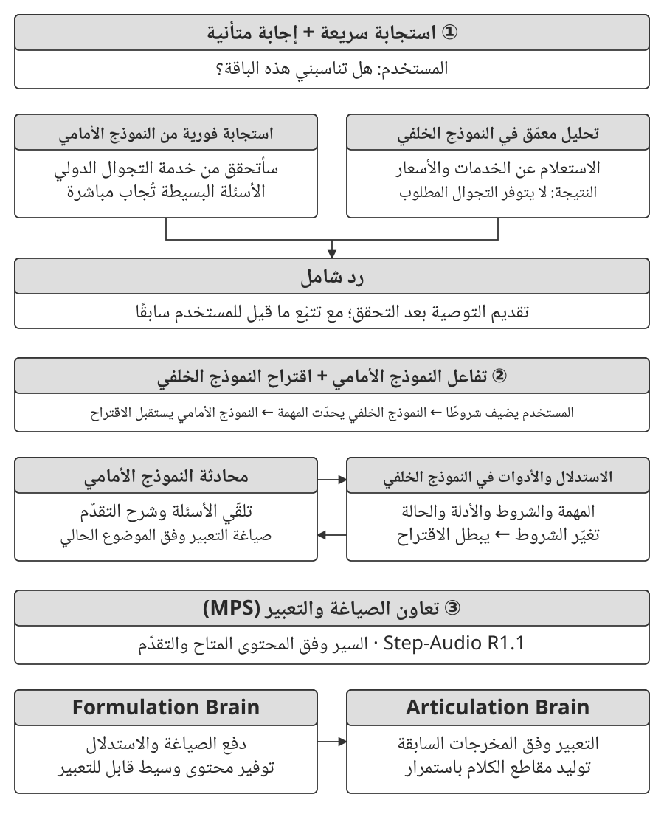

#### الحل الأول: التفكير السريع للردّ، والتفكير البطيء للإجابة

يقدّم النموذج السريع أولًا ردًّا موجزًا، ويُتمّ النموذج البطيء التحليل في الخلفية، ثم يستكمل الإجابة المفصّلة. وهذا التصميم يتيح تأكيد استلام الطلب في أبكر وقت، لكنه يستلزم إدارة الاتساق بين الإجابتين. فإذا اقترح النموذج السريع مثلًا شراء باقة ما، ثم اكتشف النموذج البطيء أن الباقة تفتقر إلى ميزة أساسية، تعارض الاقتراحان. وأصل التعارض أن كل جانب يجيب مستقلًا، فقد تختلف أسس الحكم ومراحل الاستدلال بينهما. فالاقتراح الذي نطق به النموذج السريع قد دخل في حكم المستخدم، بل قد يتصرف المستخدم بناءً عليه؛ فإذا صحّحه النموذج البطيء بعد ذلك، لزمه أن يشرح التغيير ويعالج الآثار التي ترتّبت عليه.

ولذلك ينبغي للنموذج الأمامي أن يفرّق بين تأكيد المهمة والاستنتاج التجاري. فعبارة «سأتحقق هل تتضمن الباقة هذه الميزة» يمكن قولها فورًا، أما اقتراح الشراء فينتظر الاستعلام والتحليل اللازمين. وحين تعود نتيجة النموذج الخلفي، يطابقها النظام بما قيل من قبل، ثم ينظّم الردّ اللاحق. ويمكن كذلك أن يُنجز النموذج السريع الأسئلة البسيطة مباشرةً، تقليلًا للمعالجة المكررة.

#### الحل الثاني: التفكير السريع للتفاعل، والتفكير البطيء للتنبيه

يمكن أيضًا تقسيم العمل بين الصوت والشاشة. فإذا قيل شفهيًا «زادت فاتورة هذا الشهر 15 يورو رسوم تجوال»، أدرك المستخدم الخلاصة على الفور؛ أما المبلغ الأصلي والسعر الحالي وتفاصيل النزاع فتُترك على الشاشة ليراجعها المستخدم بالسرعة التي تناسبه. ويمكن تأكيد عملية محددة بالنقر، أما المعلومات الحساسة فيملؤها المستخدم بنفسه في واجهة إدخال يعتمدها التاجر. ولا يحتاج النموذج الأمامي إلا إلى تلقّي حالة مثل «اكتمل التحقق» ليعود إلى الحوار عودةً طبيعية.

لنفترض أن مسافرًا طلب من Pine حجز تذكرة طيران إلى شنغهاي صباح الخميس، بميزانية 1200 يوان، وعليه أن يصل إلى مكان المؤتمر قبل الظهر. يتحدث Pine مع خدمة عملاء شركة الطيران، ويمرّر في الوقت نفسه «ورقة صغيرة» إلى النموذج الخلفي: «إذا وصلت الطائرة إلى Hongqiao في العاشرة صباحًا، فهل يتسع الوقت للانتقال من المطار إلى مكان المؤتمر؟». يتحقق موظف الخدمة من المقاعد المتاحة، ويخبر Pine: «نفدت تذاكر الرحلة التي تصل إلى Hongqiao في العاشرة. وتوجد رحلة تصل إلى Pudong في العاشرة والنصف بسعر 1250 يوانًا». فإذا كان النموذج الخلفي لا يرى إلا الأوراق التي يمرّرها إليه النموذج الأمامي، فإنه سيظل يحسب المسافة انطلاقًا من Hongqiao. ويضطر الأمامي إلى أن يضيف: «احسب لـ Pudong بدلًا من ذلك، الهبوط في العاشرة والنصف، ومكان المؤتمر وموعد الوصول لم يتغيّرا».

والطريقة الأخرى أن يُزامَن سجل المكالمة أيضًا مع النموذج الخلفي بالترتيب. فيكون الخلفي قد قرأ في سجل المكالمة المطار ووقت الهبوط اللذين أعلنهما موظف الخدمة، ولا يحتاج الأمامي إلا إلى أن يقول «احسب هل تلحق هذه الرحلة بالموعد» ليفوّض المهمة نفسها. وعند مزامنة السجل لا بد من بيان من قال ماذا؛ وأما نصف الجملة التي قوطع فيها النموذج الأمامي ولم تُشغَّل بعد، فيجب كذلك تمييزها عمّا نُطق به فعلًا. وقد يُسقط التفريغ الصوتي معلومات أساسية أو يكتبها خطأً. فعلى النموذج الأمامي أن يكتب في وصف المهمة الأسماء والأرقام التي سمعها جيدًا وتصحيحات المستخدم. وإذا اختلف السجلان، اعتمد النموذج الخلفي وصف المهمة. وبعد أن يفرغ الخلفي من البحث، لا يحتاج إلا إلى أن يخبر الأمامي بالساعة المتوقعة للوصول إلى مكان المؤتمر ومدى ضيق الوقت. أما المسارات التي بحث فيها في الطريق، والحقول التي أعادتها واجهة الخرائط، فيمكن أن تبقى في الخلفية للرجوع إليها. ثم يواصل النموذج الأمامي التفاوض مع موظف الخدمة حاملًا النتيجة.

يريد المسافر في رحلة العمل الذي ورد في الفصل الأول أن يبقى سعر التذكرة في حدود 1200 يوان. وكان في رحلاته السابقة مستعدًا لدفع قليل زائد مقابل رحلة مناسبة، ولم يحدّد هذه المرة سقفًا آخر. فإذا سمع المساعد أن أدنى سعر 1250 يوانًا، أمكنه أن يحجز نيابةً عنه. أما إذا كان المستخدم ممن يحرصون دائمًا على التوفير ويسافر مع أسرته في نزهة، فلا بد من سؤاله أولًا عن هذه اليوانات الخمسين. ولذلك يحتاج النموذج الأمامي إلى أن يرعى حوارين في آن واحد:

- يرسل إلى المستخدم: «أدنى سعر لهذه الرحلة 1250 يوانًا، أي بزيادة 50 يوانًا على الميزانية. هل تريد الحجز؟»
- ثم يسأل موظف الخدمة: «هل يمكن تثبيت سعر هذه الرحلة لي بعض الوقت؟ وهل توجد رحلة في اليوم نفسه في وقت أبكر أو أبعد بأقل من 1200 يوان؟» وفي أثناء بحث موظف الخدمة، يستطيع النموذج الأمامي أيضًا أن يستوضح وزن الأمتعة المسموح وشروط الاسترداد والتعديل.

وبهذا يجد المستخدم عند عودته عدة خيارات، ويعرف موظف الخدمة ما سيبحث عنه بعد ذلك. وإذا أوضح المستخدم لاحقًا: «كنت في المرة الماضية مستعجلًا للحاق باجتماع، ومن الآن فصاعدًا اسألني أولًا إذا تجاوزت الرحلة الميزانية»، وجب في المرة القادمة العمل بهذا المطلب الجديد.

وحين يُنتظر التحقق من صاحب الشأن نفسه، يختلف إيقاع الحديث مرة أخرى. فإذا قال موظف الخدمة إن رمز التحقق قد أُرسل، أمكن للنموذج الأمامي أن يجيب: «حسنًا، لحظة من فضلك، سأطلب من المسافر أن ينظر في هاتفه». وإذا ردّ المسافر بأنه لم يصله شيء بعد، سأل موظف الخدمة إلى أي رقم ينتهي بأي أرقام أُرسلت الرسالة، ومتى يمكن إعادة إرسالها. وبعد أن يُتمّ المسافر التحقق عبر القناة التي يحدّدها التاجر، يستطيع النموذج الأمامي أن يتابع الإجراء. وفي مكالمة كهذه، يكون الانتظار قليلًا أو تأخير إصدار التذكرة أنسب من استعجال المستخدم لاتخاذ قرار في الحال.

وفي هذه الأثناء، يرسل النموذج الخلفي أن «العرض الأصلي قد حُدّث». فيتحقق الأمامي أولًا من السعر الجديد مع موظف الخدمة، ثم يخبر المستخدم. وإذا ردّ المستخدم في تلك اللحظة بالذات «يمكنك الحجز»، فإن هذا الردّ يقابل عرض الـ 1250 يوانًا الذي أُرسل إليه قبل ذلك. فعلى النموذج الأمامي أن يحكم في ضوء السعر الجديد والتفويض القائم هل يلزم تأكيد جديد. فالنموذج الخلفي لا يقدّم إلا المعلومات، والأمامي هو الذي يتحدث مع موظف الخدمة ويقطع الالتزامات دائمًا. ولا يستطيع الأمامي أن يتبيّن أي العروض انتهت صلاحيته إلا إذا حملت الرسائل الرحلة وشروط تطبيق السعر والوقت.

والرسالة الخلفية نفسها «تغيّر السعر، يرجى التحقق» يؤثر توقيت وصولها في طريقة تلقّف النموذج الأمامي لها. فإذا كان موظف الخدمة قد قال للتو «أدنى سعر للتذكرة هو…»، أمكن للأمامي أن يسمع المبلغ أولًا. وإذا كان موظف الخدمة قد أنهى ذكر السعر وينتظر الجواب، كان الوقت مناسبًا للسؤال عن السعر الجديد. وإذا كان المسافر قد قاطع للتو على الهاتف قائلًا «لحظة، سأغيّر التاريخ»، فينبغي أولًا سماع التاريخ الجديد بوضوح، ثم تقرير هل لا يزال يلزم التحقق من الرحلة الأصلية. والكلمة نفسها «حسنًا» قد لا تعني إلا الإصغاء إذا قيلت في أثناء عرض موظف الخدمة للشروط، وقد تُفهم موافقةً على الشراء إذا قيلت بعد «هل أُصدر لك التذكرة الآن؟». والاقتصار على النص المفرَّغ يُفوّت مثل هذه الفروق.

#### الحل الثالث: المضي المتناسق في الصياغة الذهنية والتعبير

تقدّم سلسلة Step-Audio مثالين ذوي صلة. يهتم **التقطير الاستدلالي المرتكز على الوسيط (MGRD)** بالمعلومات التي يستند إليها الاستدلال: فهو يبني بيانات الاستدلال وينتقيها حول الخصائص الصوتية مثل طبقة الصوت والإيقاع والتنغيم، ويحسّن فهم الصوت بالتقطير التكراري. وفي مرحلة التعلم المعزز، يمنح Step-Audio R1 أسئلة الصوت درجتين: 0.8 للإجابة الصحيحة، و0.2 أخرى لتقديم مسار الاستدلال. والثانية تشجّع النموذج على كتابة أسسه؛ أما هل استعمل الاستدلال الدلائل الصوتية في التسجيل، فيُفحص في مرحلة انتقاء العينات السابقة.[^ch6-mgrd]

ويهتم **Mind-Paced Speaking (MPS)** بالتوقيت بين الاستدلال والتعبير، فيعتمد وحدة للصياغة الذهنية (Formulation Brain) ووحدة للتعبير (Articulation Brain)، ويجعل عملية الصياغة الذهنية توجّه توليد الكلام. وقد اعتمد الحل الآني في Step-Audio R1.1 هذه الطريقة.[^ch6-mps]

وتتبادل الوحدتان المعلومات بحسب التقدّم: فالصياغة الذهنية تمضي باستمرار، والتعبير ينظّم الكلام بحسب المحتوى المتاح والمخرجات السابقة. وبهذا يمكن أن يتداخل جزء من التعبير مع الاستدلال اللاحق، مع الحفاظ على تتبّع ما قيل.

[^ch6-mgrd]: StepFun، *Step-Audio-R1 Technical Report*، ويعرض التقطير الاستدلالي المرتكز على الوسيط.
[^ch6-mps]: StepFun، *Mind-Paced Speaking: A Dual-Brain Approach to Real-Time Reasoning in Spoken Language Models*، وبطاقة نموذج Step-Audio-R1.1، ويعرضان وحدتَي الصياغة الذهنية والتعبير وتطبيقهما في الأنظمة الآنية.

#### تقسيم العمل بين الوحدات وطريقة الترقية

**يقدّر المؤلف في تقسيم العمل بين السريع والبطيء ميزةً هندسية: أن قدرة التفاعل وقدرة الاستدلال يمكن أن تتطوّر كلٌّ منهما على حدة.** فإذا صدر نموذج استدلال أقوى، أمكن للنظام أن يستبدل النموذج الخلفي. وبهذا يستطيع الخلفي أن يواكب تقدّم نماذج الاستدلال، ويستطيع الأمامي أن يواصل تحسين تجربة الإنصات والردّ والمقاطعة. فالنموذج الأمامي يحتاج إلى فهم المهمة والمعلومات التي يضيفها المستخدم، أما الخلفي فيتفرّغ للاستدلال والتخطيط والتنفيذ الأطول.

**وحين تتسارع دورات تطوير نماذج الاستدلال، ويحتاج الفريق إلى ترقية قدراته التجارية باستمرار، يفضّل المؤلف تقسيم العمل القابل للاستبدال بين السريع والبطيء.** فهذا التقسيم يُعفي من عبء إعادة تدريب منظومة الصوت كلها مع كل ترقية لنموذج الاستدلال. أما إذا احتيج إلى أن يتحكّم الاستدلال الوسيط في التعبير تحكّمًا أكثر مباشرة، وتوفّرت موارد التدريب المناسبة، فحينئذ تُعتمد حلول تناسق أوثق.

يعتمد Agent الصوتي في Pine AI بنية يتعاون فيها التفكير السريع في الواجهة الأمامية مع التفكير البطيء في الخلفية. وقد أبلغت مقالاته المنشورة عن تصدّره لوحة الصدارة في مسار الصوت من τ²-bench، وعرضت طريقة الجمع بين المكالمة المستمرة والاستدلال التجاري وتشغيل الأدوات[^ch6-17].

ولفهم هذه التوليفات، يمكن التمييز بين ثلاثة أبعاد للتصميم: **مسار الصوت** يحدّد هل يعالج النموذج الصوت مباشرةً أم يتسلّمه عبر التفريغ؛ و**توقيت الإنصات والكلام** يحدّد هل تمضي المدخلات والمخرجات بالجولات أم بالتوازي؛ و**التقسيم المعرفي للعمل** يحدّد كيف يتشارك التفاعل الآني والاستدلال العميق الحالة ويتبادلان النتائج. ويستطيع النظام أن يعالج الصوت مباشرةً ويحافظ على الازدواج الكامل، ويُسند في الوقت نفسه المهام المعقدة إلى نموذج خلفي مستقل. وقد أظهر نموذج التفاعل لدى Thinking Machines Lab وGPT-Live كلاهما هذا النوع من التوليف.

[^ch6-17]: Pine AI، *The Most Natural Human-Computer Interface Is Your Voice*، ويعرض بنية التفكير السريع والبطيء ونتائج تقييم المهام الصوتية التي أبلغ عنها. ويسمّي التقرير لوحة الصدارة τ²-bench voice.

### تركيب كلام أكثر شبهًا بالبشر

تساعد التوقفات وسرعة الكلام والنبر السامعَ على فهم بنية الجملة وقصد المتكلّم. فعند قراءة رقم هاتف يلزم تجميع الأرقام تجميعًا مناسبًا، وعند شرح بنود معقدة يمكن الإبطاء، وفي أثناء انتظار نتيجة الاستعلام يمكن البدء ببيان ما يجري العمل عليه. ويرى المؤلف أن التوقفات المناسبة وتغيّرات الإيقاع تجعل الكلام أكثر طبيعية، وتُسمع المستخدم أيضًا كيف تمضي المهمة. ويمكن تصميم التحكّم في الكلام حول هذه الاستعمالات المحددة.

يستطيع LLM الرئيسي أن يُدرج في النص علامات تحكّم، مثل `[THINKING]` و`[EMO:happy]` و`[SPEED:0.8x]`. فتحلّل طبقة التنفيذ العلامات، وتقسّم النص إلى مقاطع كلام ومقاطع توقف، ثم تربطها بالانفعالات أو الأساليب أو الأصوات المرجعية التي تدعمها واجهة التركيب. والتطبيق هو الذي يحدّد معاني العلامات: فـ `0.8x` يمكن ربطها بدرجة السرعة البطيئة؛ والتوقف يمكن أن يُدرجه المشغّل، أما الضحك والتنهد فيُعبَّر عنهما بعلامات الصوت المدعومة أو بقدرات التوليد.

ويُنظّم حلّ الأصوات المرجعية طرقَ التعبير المختلفة لمتكلّم واحد في مكتبة. فيُختار لكل مقطع نصي الانفعال والسرعة والأسلوب المطابقة، ثم تُوصل المقاطع بالترتيب بعد التركيب. ويلزم تحديد نطاق سريان حالة التحكّم، فالانفعال مثلًا يستمر حتى التعديل التالي، أما التوقف فلا يسري إلا في موضعه.

> **التجربة 6-8 ★★: تركيب TTS بعلامات تحكّم باستخدام Fish Audio**
>
> تبني هذه التجربة بـ Fish Audio S1 مكتبة صوتية من 24 صوتًا مرجعيًا: أربعة انفعالات، وثلاث درجات للسرعة، وأسلوبان، بكل توليفاتها. ويحوّل المحلّل الردّ الموسوم بالعلامات إلى مقاطع كلام ومقاطع صمت، وتختار طبقة التنفيذ لكل مقطع صوتًا مرجعيًا وتُتمّ التركيب.
>
> تُقارن ثلاثة إعدادات: دون علامات تحكّم، وبصوت مرجعي واحد، وبأصوات مرجعية متعددة. ويُحافظ على مضمون الردّ ثابتًا، ويُفحص هل وُجّهت العلامات إلى الإعدادات المتوقعة، ثم يُستمع إلى التوقفات وتغيّرات الانفعال والجرس الصوتي.
>
> واعتمد اختبار الاستماع المحفوظ نموذجًا لفهم الصوت، عُرضت عليه الإعدادات الثلاثة بترتيب متناوب، فقيّم الطبيعية ومطابقة الانفعال وتوقفات التفكير واتساق الجرس الصوتي والإحساس بأسلوب خدمة العملاء. فحصلت مجموعة الأصوات المرجعية المتعددة على أعلى درجة إجمالية، وجاءت مجموعة الصوت المرجعي الواحد دون مجموعة غياب العلامات.

## Computer Use: وكلاء أتمتة واجهة المستخدم الرسومية

لنفترض أنك طلبت من Agent أن يعدّل عنوان الشحن على صفحة ويب. عليه أولًا أن يعثر على حقل العنوان، ثم يُدخل العنوان الجديد، ثم يتأكد من نتيجة الحفظ بحسب ما تعرضه الصفحة. فإذا ظهرت نافذة تسجيل الدخول قبل النقر، فإن الزر الذي ظهر في اللقطة السابقة، حتى لو لم تتغيّر إحداثياته، لم يعد هو ما تصيبه هذه النقرة. يُشغّل Computer Use المتصفحات والجداول وإعدادات النظام عبر الشاشة والفأرة ولوحة المفاتيح، وجوهر مهمته أن يجعل كل فعل مواكبًا للواجهة الماثلة أمامه.

لنتتبّع حلقة **الإدراك–التفكير–الفعل** في الشكل 6-12، لنرى ما الذي على النموذج أن يتأكد منه قبل أن يُدخل العنوان الجديد. فهو يختار موضع النقر بحسب اللقطة وتقدّم المهمة، فيتحقق Harness من المعاملات والصلاحيات، ثم تسلّم الفعل إلى طبقة التنفيذ. ونجاح النقر لا يعني إلا أن النقرة أُرسلت. أما في أي موضع استقرّ مؤشر الإدخال في اللقطة التالية، فهو ما يحدّد هل يمكن إدخال العنوان بأمان بعد ذلك.

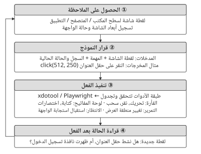

بعد أن يملأ المساعد العنوان، كيف يخبر المنفِّذ بأي زر «حفظ» يريد أن ينقر؟ إن إحداثيات الشاشة وأرقام العناصر كلتيهما تصلح لتعيين الهدف، لكن متطلباتهما من النموذج والأدوات مختلفة.

### تصميم فضاء الفعل

في الشكل 6-13، يوفّر التنفيذ المرجعي لـ Computer Use من Anthropic ثلاثة أصناف من الأدوات: الواجهة الرسومية، وتنفيذ الأوامر، وتحرير الملفات. وفي صنف الواجهة الرسومية وحده، تتجه البيانات وجهتين: فعل النقر يُرسل إلى جهة التنفيذ، واللقطة التي تلي النقر تُعاد إلى النموذج ملاحظةً للقرار في الجولة التالية. وتحدّد API الأصلية صيغة الأدوات؛ فإذا استُعمل نموذج آخر، لزم طبقة التكييف أن تحوّل اللقطات وطلبات الأفعال ونتائج التنفيذ إلى رسائل تقبلها الواجهة المقابلة.[^ch6-computer-tools]

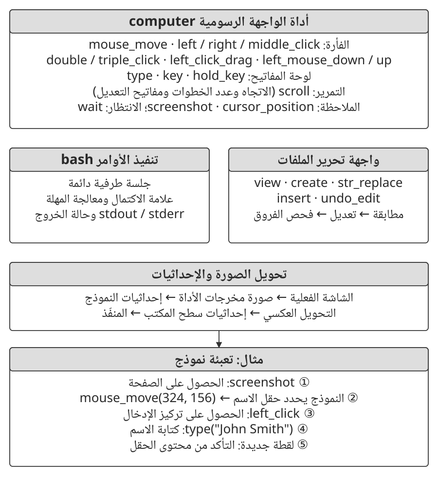

**أدوات تشغيل الواجهة الرسومية.** تشمل أفعال الفأرة التحريك، والنقر بالزر الأيسر أو الأيمن أو الأوسط، والنقر المزدوج، والنقر الثلاثي، والسحب؛ ويمكن للواجهات الأدق أن تعبّر عن الضغط والإفلات كلٌّ على حدة. ويحتاج التمرير إلى اتجاه ومقدار، وتدعم بعض التنفيذات أيضًا مفاتيح التعديل. وتوفّر واجهة لوحة المفاتيح إدخال النص وتركيبات المفاتيح والضغط المستمر على المفتاح. وتُستعمل اللقطات وموضع المؤشر للحصول على الحالة، أما واجهة الانتظار فتترك وقتًا لتحميل الصفحة أو للحركة المرئية. وإصدار الأداة هو الذي يحدّد مجموعة الأفعال بعينها، ويتحقق Harness من المعاملات بحسب الواجهة المستعملة.

**أدوات تنفيذ الأوامر.** تستطيع الطرفية المستديمة أن تحتفظ بدليل العمل وحالة البيئة عبر الاستدعاءات. فإذا غيّر استدعاءٌ الدليلَ مثلًا، واصل الاستدعاء التالي العمل في ذلك الدليل. ويستطيع التنفيذ المرجعي أن يتعرّف على اكتمال الأمر بسلسلة حارسة، وأن يضبط مهلة زمنية؛ أما حالة العملية بعد انقضاء المهلة فلا يزال على المنفِّذ أن يفحصها.

**أدوات تحرير الملفات.** تحدّد واجهة استبدال السلاسل نطاق التعديل بالنص الأصلي، ويمكنها أيضًا أن توفّر العرض والإنشاء والإدراج والتراجع. ويُفحص قبل التنفيذ موضع التطابق وعدد مراته، ويُفحص الفرق بعد التنفيذ؛ وإذا تغيّر الملف بين استدعاءين، أُعيدت قراءة المحتوى ذي الصلة أولًا. ويمكن هنا إعادة استعمال استراتيجيات التحرير التي عرضها الفصل الخامس.

> **التجربة 6-9 ★: تشغيل التنفيذ المرجعي لـ Anthropic Computer Use**
>
> تستعمل هذه التجربة سطح مكتب Ubuntu والمتصفح وطبقة تنفيذ الأدوات التي يوفّرها مثال الحاوية الرسمي. فبعد أن يُدخل المستخدم المهمة، يقرأ النموذج اللقطة ويعيد فعلًا، فتُشغّل طبقة التنفيذ سطح المكتب، ثم تعيد اللقطة الجديدة إلى النموذج.
>
> والمهمة المرافقة هي الاستعلام عن طقس سان فرانسيسكو. يزور المسار المحفوظ Google أولًا، فيصادف رمز تحقق، فيتحوّل بحسب تعليمات الاستعادة في أثناء التشغيل إلى بيانات Open-Meteo المتاحة للقراءة العامة، ويبلّغ في النهاية بدرجة الحرارة وحالة الطقس. ويتضمن السجل 15 فعلًا على سطح المكتب مع اللقطات المقابلة، فيمكن الفحص جولةً جولة كيف غيّر النقر والضغط على المفاتيح وإدخال النص والانتظار الصفحة.
>
> أما مسار تشغيل المتصفح بنموذج مفتوح فتعرضه التجربة 6-10.

### تحديد الموقع البصري (Grounding)

إذا أردنا أن ينقر النموذج على مربع البحث، أمكن طرح المسألة بصيغتين. الأولى أن نريه لقطة الشاشة ونطلب منه أن يذكر إحداثيات النقر. والثانية أن نرقّم الأهداف المرشحة ونطلب منه أن يختار مربع البحث؛ والأرقام قد توضع على المناطق المرشحة في اللقطة، وقد تأتي من قائمة العناصر التي يوفّرها المتصفح. ونعرض فيما يلي هذه المسارات الثلاثة كلًّا على حدة. فعند اختيار الرقم، تتولّى طبقة التنفيذ ردّ الرقم إلى الهدف الفعلي؛ وعند ذكر الإحداثيات مباشرةً، يحتاج النموذج أيضًا إلى تقدير موضع الهدف، فترتفع متطلبات التدريب على تحديد الموقع والتكيّف مع دقة الشاشة.

**Set-of-Mark: الوسم البصري.**

يضع Set-of-Mark (SoM) على الصورة أرقامًا يمكن الإشارة إليها، فيربط المناطق المرئية بمخرجات النموذج. وقد اعتمد العمل الأصلي أساليب مثل التجزئة لتوليد المناطق المرشحة، كاستعمال SAM وSEEM للحصول على المناطق، ثم وضع العلامات عليها. فإذا اختار النموذج رقمًا، حدّدت طبقة التنفيذ موضع العملية بحسب المنطقة المقابلة. ويمكن استعمال هذه الطريقة في برامج سطح المكتب أو واجهات الألعاب التي تفتقر إلى DOM، بشرط أن يقع العنصر المطلوب داخل منطقة مرقّمة، وأن يتبيّن النموذج بوضوح أي رقم يقابله.[^ch6-som]

**فهرسة العناصر المنظّمة.**

ويستطيع المتصفح أن يقدّم صنفًا آخر من الدلائل. فنموذج كائن المستند (DOM) يصف العناصر الموجودة في الصفحة وتسلسلها الهرمي، ومعلومات التخطيط تبيّن مواضع عرض العناصر، وشجرة إمكانية الوصول (accessibility tree) تحتفظ بالأدوار والأسماء القابلة للوصول التي تحتاج إليها التقنيات المساعدة. فالزر الذي لا يحمل إلا أيقونة عدسة مكبّرة مثلًا، إذا وفّرت له الصفحة الاسم القابل للوصول «بحث»، أتيح لـ Agent أن يعثر عليه بحسب الدور والاسم. ولنأخذ حلولًا من قبيل browser-use مثالًا: يستطيع النظام عبر واجهات تصحيح المتصفح مثل Chrome DevTools Protocol (CDP) أن يحصل على معلومات العناصر، ويتعرّف على مربعات الإدخال والأزرار والروابط، ثم يرقّم هذه العناصر القابلة للتشغيل في الصفحة الحالية. وفي الشكل 6-14 اختار النموذج [2] في الركن الأيمن العلوي من الصفحة. فكيف يتحوّل هذا الرقم إلى نقرة على زر Submit؟

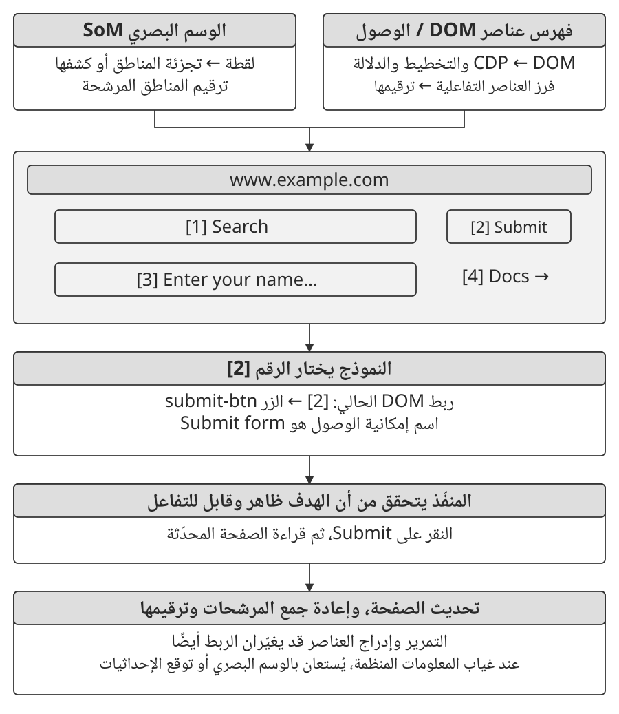

يمكن تقسيم المعالجة إلى أربع خطوات: قراءة DOM والتخطيط ومعلومات إمكانية الوصول المتاحة؛ وتصفية العناصر القابلة للتفاعل؛ وبناء خريطة الأرقام للصفحة الحالية؛ وتسليم أوصاف العناصر واللقطة الموسومة عند الحاجة إلى النموذج. فقد يرى النموذج مثلًا العناصر الأربعة المرقّمة التالية:

```text
截图中标有 [1]、[2]、[3]、[4]

[1] <input type="text" placeholder="Search" aria-label="Search" />
[2] <button id="submit-btn" aria-label="Submit form" />
[3] <input type="text" placeholder="Enter your name" value="" />
[4] <a href="/docs" aria-label="Documentation" />
```

بعد أن يختار النموذج رقمًا، تحلّله طبقة التنفيذ إلى مرجع عنصر أو إحداثيات، وتتحقق هل لا يزال الهدف مرئيًا وقابلًا للتفاعل، ثم تُتمّ العملية. وبعد تحديث الصفحة أو تمريرها أو إدراج عناصر فيها ديناميكيًا، يلزم تحديث الخريطة، تفاديًا لاستعمال أرقام منتهية الصلاحية. وتستطيع الفهرسة المنظّمة أن تستفيد من الوسوم والأدوار والنصوص، أما Canvas أو العناصر المحجوبة أو الوسوم الدلالية الناقصة فتحتاج إلى الحكم بالاستعانة باللقطة. وكلما زاد عدد العناصر المسرودة وكبرت اللقطة، زادت المعلومات التي تدخل السياق.

**التنبؤ المباشر بالإحداثيات.**

يجعل مسار الإحداثيات النموذج يُخرج الموضع مباشرةً من اللقطة ووصف الهدف، كأن يربط «انقر زر الإرسال» بنقطة ما. وقد اعتمدت أبحاث تحديد الموقع في الواجهات الرسومية مثل SeeClick، وكذلك Computer Use في Claude، إخراج الإحداثيات. وتتولّى طبقة التنفيذ تحويل إحداثيات الصورة إلى إحداثيات سطح المكتب الفعلية.

بعد تحجيم اللقطة، يلزم أن يعتمد نظاما الإحداثيات التحويل نفسه. فلنأخذ سطح مكتب أبعاده 2560×1440 مثالًا: إذا كانت الصورة المرسلة إلى النموذج بأبعاد 1366×768، فإن الإحداثيات (683, 384) التي يعطيها النموذج تقابل:

$$
x = 683 \times \frac{2560}{1366} = 1280,\qquad
y = 384 \times \frac{1440}{768} = 720
$$

في الشكل 6-15، تتقارب نسبتا العرض إلى الارتفاع في الحجمين. فإذا أُضيفت إلى اللقطة حواف سوداء حفاظًا على النسبة، تضمنت الإحداثيات التي يعطيها النموذج تلك الحواف الفارغة؛ وقبل تحويلها إلى إحداثيات الشاشة الأصلية، يلزم أولًا طرح إزاحة الحشو المقابلة، ثم التحويل بمعامل التحجيم. وكذلك يغيّر القصّ وتحجيم العرض ونقطة الأصل في الشاشات المتعددة هذا الربط، فينبغي لطبقة الأدوات أن تحفظ معاملات التحويل الفعلية.

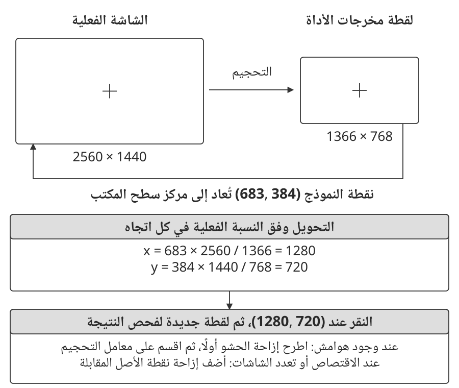

وقد استعمل التنفيذ المرجعي أحجامًا مستهدفة مثل XGA (1024×768) وWXGA (1280×800) وFWXGA (1366×768). وفرض تغيير نسبة العرض إلى الارتفاع يشوّه أشكال العناصر؛ واستعمال ربط عكسي خاطئ يُسقط التنبؤ الصحيح في موضع خاطئ.[^ch6-computer-tools]

**حين تكون المعلومات المنظّمة كاملة، يفضّل المؤلف الفهرسة بـ DOM أو بشجرة إمكانية الوصول.** فأسماء العناصر وأدوارها ومراجعها تشارك في تحديد الموقع مباشرةً، فيقلّ ما يقوم به النموذج من تقدير آني لمواضع البكسلات. وحين تغيب البنية، يستطيع نموذج الرؤية العام أن يستعين أولًا بـ SoM، فيختار النموذج منطقة من المناطق الموسومة؛ أما النماذج التي تلقّت تدريبًا على تحديد الموقع في الواجهات الرسومية، فتستطيع التنبؤ بالإحداثيات مباشرةً، مستغنيةً عن الوسم المستقل.

> **التجربة 6-10 ★: استخدام browser-use لتنفيذ عمليات المتصفح الآلية**
>
> تستعمل هذه التجربة Qwen3-VL 32B Instruct لتشغيل browser-use، فتولّد الأفعال من حالة المتصفح ومعلومات العناصر واللقطات. والمهمة هي الاستعلام عن طقس سان فرانسيسكو: تحديد موقع مربع البحث، وإدخال “San Francisco weather today”، وإرسال الاستعلام، ثم استخراج درجة الحرارة وحالة الطقس.
>
> توفّر شيفرة التجربة 6-10 وتعليمات تشغيلها مدخلين. فإذا كان لديك مفتاح OpenRouter، أمكن استعمال نموذج رؤية مستضاف؛ وإذا كانت لديك خدمة متوافقة مثل vLLM أو SGLang، أمكن توجيه `OPEN_MODEL_BASE_URL` و`OPEN_MODEL_MODEL` إلى نقطتك الطرفية ونموذجك، وضبط المفتاح بحسب متطلبات الخدمة. وفي المسارين كليهما، شغّل أولًا `python main.py --dry-run` في دليل التجربة لمراجعة الإعدادات، ثم ابدأ الاستعلام الفعلي بحسب التعليمات.
>
> أكمل التشغيل المحفوظ 16 خطوة تفاعلية، واحتفظ بـ 15 لقطة. وبعد أن ظهر رمز تحقق في Google، تحوّلت المهمة إلى weather.com للحصول على النتيجة.

[^ch6-computer-tools]: Anthropic، وثائق أدوات Computer Use وتنفيذها المرجعي، وتعرض واجهات الأفعال ذات الإصدارات وطبقة التنفيذ ومعالجة اللقطات.
[^ch6-som]: Microsoft، *Set-of-Mark Prompting*، 2023؛ ويقدّم تنفيذ خدمة DOM في browser-use مثالًا على معالجة العناصر المنظّمة.

### Computer Use Agent يشاهد الحركة ويسمع الصوت

لا تعرض الصفحة «فشلت المزامنة» إلا لحظة قصيرة بعد الحفظ، في حين تُظهر لقطتان تفصل بينهما ثوانٍ الاستمارة نفسها. فإذا أعاد النموذج النظر في الصورتين، فالأرجح أنه لن يستطيع استعادة ما جرى بينهما. ومقاطع الفيديو والحركات المرئية والإشعارات العابرة وصوت الاجتماعات تعاني المشكلة نفسها. **ففي الواجهات التي تتغيّر باستمرار، يرى المؤلف أن واجهة الملاحظة هي موضع التحسين الأول.** فإذا كان القرار التالي يتوقف على التغيّر، لزم أن تُحفظ كذلك الأحداث أو الصور التي ظهرت بين الأفعال.

اقترح المؤلف مع شركائه **Agent–Computer Observation Interface (AOI، واجهة الملاحظة بين Agent والحاسوب)**، التي تحوّل الشاشة المتصلة والصوت إلى صور ونصوص يستطيع النموذج استقبالها[^ch6-9]. وتتضمن الواجهة ثلاثة مكوّنات:

- **التقاط الإطارات المفتاحية بين الأفعال.** تُراقَب تغيّرات الصورة في أثناء عمل الحلقة الرئيسية، وتُنتقى الإطارات المرشحة بفروق البكسلات أو بنموذج رؤية خفيف، ثم تُسلَّم الصور المفيدة إلى القرار التالي.
- **التفريغ المشروط بمستوى الصوت.** حين يُكتشف صوت يُستدعى التعرّف على الكلام، ويُضاف التفريغ ومعلومات التوقيت إلى سجل الملاحظة، فيساعد ذلك Agent على الاستفادة من محتوى الاجتماعات أو التعليمات الشفهية.
- **الوصف المستديم للصور.** تُلخَّص الصور المفتاحية نصًّا؛ فإذا أُخرجت الصورة الأصلية من السياق، ظل النص يحفظ التغيّرات التي وقعت لتستشهد بها الخطوات اللاحقة.

فإذا عرض مقطع فيديو مثلًا عملية على قائمة، وتلقّى النموذج الصور الوسيطة والأوصاف المقابلة لها، أمكنه أن يواصل الرجوع إلى تلك الخطوة بعد انتهاء العرض. وتُظهر نتائج الاستئصال في الورقة أن الأوصاف النصية المستديمة حاسمة بوجه خاص في المكاسب، وأن الانتقاء الدقيق للإطارات المفتاحية أسهم إسهامًا أصغر؛ بل إن أداء بعض النماذج تراجع حين أُضيف إليها عدد مفرط من الصور.

لنعد إلى مثال حفظ الاستمارة. فحتى إذا التقط إطار مفتاحي عبارة «فشلت المزامنة»، فإن النموذج متى أُخرجت الصورة الأصلية من السياق لا يبقى له إلا الوصف المتروك. فعبارة «ظهر إشعار في الصفحة» قد تعني نجاح الحفظ وقد تعني إخفاقه؛ أما «فشلت المزامنة، ولم يُحفظ العنوان» فهي وحدها التي تحتفظ بالدليل الذي يحدّد الخطوة التالية.

[^ch6-9]: Bojie Li وNoah Shi، *Agent-Computer Observation Interfaces Enable Dynamic Computer Use*، 2026، ويعرض AOI واستئصال مكوّناتها.

### نماذج العالم في Computer Use

بعد الحصول على الملاحظة في وقتها، لا يزال على Agent أن يختار الفعل وينتظر تنفيذه. وقد قارنت دراسة OSWorld-Human كفاءة تشغيل Agent بمسارات البشر، وحلّلت مصادر استهلاك الوقت مثل الخطوات الزائدة واستدعاءات النموذج[^ch6-osworld-human].

يقدّم نموذج العالم للتخطيط تنبؤًا بعواقب الأفعال. فيمكن أن تشمل حالة سطح المكتب النوافذ والتركيز وموضع التمرير ومحتوى الإدخال وتقدّم التحميل؛ أما معلومات مثل الصلاحيات ونتائج الشبكة فيلزم استكمالها عبر الواجهات المقابلة. ويتنبأ النموذج بالحالة التالية انطلاقًا من الحالة المتاحة الراهنة والفعل المرشح:

```text
当前状态 + click / type / scroll / wait → 预测的下一状态
```

حين يستعمل الإنسان الحاسوب، يكون في الغالب قد تصوّر الخطوة التالية قبل النقر؛ فإذا وافقت الواجهة توقّعه مضى، وإذا ظهر ما لم يتوقعه توقف ليتفحّص. ويستطيع نموذج العالم أن يقدّم لـ Agent أساسًا مماثلًا للتنفيذ التخميني: فيقارن المخطِّط الأفعال المرشحة مسبقًا، ويُعدّ الخطوات اللاحقة في أثناء تحميل الصفحة، ثم يواصل التنفيذ بعد تأكيد الحالة الحقيقية، فيقلّ الانتظار الناجم عن إعادة التخطيط من الصفر بعد كل نقرة. فمثلًا، عند إنشاء ملف Python جديد في VS Code وكتابة hello world فيه، تشمل التغيّرات المتوقعة ظهور الملف الجديد في شجرة الملفات، واحتواء منطقة التحرير على الشيفرة، وتحديث حالة الحفظ. وبعد التنفيذ تُفحص هذه التغيّرات، فإذا وافقت التوقّع استمر العمل، وإذا ظهر انحراف أُعيد تحديد الموقع والتخطيط.

أما عمليات مثل حذف الملفات فتحتاج إلى شروط تنفيذ مستقلة: هل الهدف صحيح، وهل يُسمح بالحذف، وهل يمكن الاستعادة، وهل يلزم تأكيد المستخدم. فالتنبؤ يساعد على فهم النتائج المحتملة، أما الصلاحيات الفعلية وشروط الأعمال فتتحقق منها طبقة التنفيذ.

**التنبؤ بالحالة الكامنة في Photon-1.** عرّفت Induction Labs في يوليو 2026 بـ Photon-1: فهو يرمّز إطارات الفيديو في رموز (token) كامنة متقطعة، ويتعلّم تغيّرات الحالة بالتنبؤ بالرموز اللاحقة. وأفصحت الشركة أن تدريبه المسبق استعمل نحو 30 ألف ساعة من وحدات H200. ويجري التنبؤ بالحالة داخل الرموز الكامنة، ويتولّى مولّد صور مساعد إعادتها إلى صور قابلة للعرض، ليفحص البشر التنبؤ. ويمكن للتخطيط وتوليد الأفعال أن يستفيدا من التمثيل الداخلي مباشرةً، فيُستغنى عن كلفة توليد لقطة كاملة في كل خطوة.[^ch6-20]

ويمضي هذا الحل أبعد من ذلك فيتعلّم صيغ التعليمات والأفعال بالضبط الدقيق: يتنبأ أولًا بالحالة المرغوب بلوغها، ثم يولّد العمليات المفضية إليها، ويحسّن أداءه في المهام بالتدريب المباشر داخل آلات افتراضية. أما الضبط الدقيق المشروط بالأفعال فيُستعمل للتنبؤ بتغيّرات سطح المكتب بعد عملية معطاة. ويصل هذان الاستعمالان بالتخطيط والمحاكاة على الترتيب، فيبيّنان كيف يشارك تمثيل الحالة في Computer Use.

[^ch6-osworld-human]: Reyna Abhyankar وآخرون، *OSWorld-Human: Benchmarking the Efficiency of Computer-Use Agents*، ويحلّل مسارات المهام وكلفتها الزمنية.
[^ch6-20]: David Li وJonathan Li، *Scaling Video Pretraining with Imagination Models*، Induction Labs، 2026-07-23، ويعرض التدريب المسبق لـ Photon-1 وتعلّم الأفعال ومحاكاة الحالة.
[^ch6-21]: Google DeepMind، *Genie 3: A new frontier for world models*، 2025-08-05؛ Zachary Lin وآخرون، *Cosmos World Foundation Model Platform for Physical AI*، 2025.

### الهاتف المحمول: الواجهات التقنية والتعاون في المنظومة

يواصل الهاتف المحمول استعمال حلقة الملاحظة–القرار–الفعل، غير أن الأفعال تتخذ في الغالب صورة إيماءات اللمس. فالإحداثية الواحدة قد تعني موضع نقرة، أو موضع ضغط مطوّل، أو نقطة بدء سحب، ولذلك تحتاج الواجهة أيضًا إلى نوع الإيماءة ومدتها ومسارها. كما أن تدوير الشاشة وظهور لوحة المفاتيح البرمجية والنوافذ المنبثقة للنظام تغيّر المنطقة القابلة للتشغيل.

تستطيع `AccessibilityService` في Android أن تقرأ معلومات الواجهة وتنفّذ الأفعال المقابلة ضمن النطاق المأذون به، وتحتاج واجهات الإيماءات أيضًا إلى إعلان القدرات المقابلة[^ch6-android]. ويمكن الجمع بين اللقطات وشجرة إمكانية الوصول وواجهات أتمتة النظام، ويتحدّد النطاق المتاح فعلًا بنظام التشغيل وتنفيذ التطبيق والتفويض. وتفحص معايير مثل AndroidWorld التي يعرضها الفصل السابع هل تحقق هذه الأفعال النتائج المتوقعة في مهام التطبيقات الحقيقية.

**يرى المؤلف أن حواجز المنظومة في تطبيق الهاتف المحمول كثيرًا ما تكون أصعب من المشكلات التقنية.** فالمنصات تحتاج إلى تحديد العمليات التي يجوز إسنادها إلى الوكيل، وكيف يُفوَّض في الحسابات والمدفوعات والبيانات، وكيف تُتتبّع المسؤولية عند وقوع الخطأ. وهذه الاتفاقات تؤثر مباشرةً في نطاق المهام التي يستطيع Agent إنجازها.

ومن مصادر تضارب المصالح البنيوي هنا حركة الزيارات والانتباه. فكثير من التطبيقات يعتمد في دخله على عرض الإعلانات وتوصية المحتوى ومداخل المعاملات؛ فإذا كلّف المستخدم Agent بإنجاز الاستعلام أو الشراء مباشرةً، فقد يقصر مسار تصفّح الصفحات، ويتغيّر الانتباه الذي تحظى به التوصيات والإعلانات. وبالنسبة إلى المنصات التي تحقق دخلها من هذه المراحل، فإن عمليات الوكيل تمسّ مصادر دخلها القائمة. ولذلك تحتاج المنصات إلى إعادة النظر في فتح الواجهات وتقاسم العائدات التجارية وإدارة هوية الوكيل.

[^ch6-android]: Android Developers، AccessibilityService، ويعرض قدرات الوصول إلى الواجهة والأفعال والإيماءات.

## التحكّم في الروبوت: ترتيب سطح المكتب بواسطة XLeRobot مثالًا

ضع الكوب الأحمر في الصينية، وضع قصاصة الورق الصفراء في سلة المهملات، ثم تأكد في النهاية من أن سطح المكتب صار مرتّبًا — هذه المهمة تصل الإدراك بالتخطيط بالتحكّم. فحين تقترب القابضة من الكوب يتغيّر موضعه في صورة الكاميرا؛ وبعد أن يُرفع الكوب، على الذراع أن تتفادى الأجسام الأخرى على المكتب؛ وإذا لم تُمسك القابضة الورقة في المرة الأولى، فعلى النظام أن يكتشف الإخفاق ويعيد المحاولة. فكل فعل يغيّر شروط القرار التالي.

يرتّب هذا القسم خمس تجارب على امتداد هذه المهمة. فالتجربتان 6-11 و6-13 تقدّمان تصميمًا عمليًا للتشغيل عن بُعد والتشغيل الذاتي على روبوت حقيقي؛ أما التجارب 6-12 و6-14 و6-15 فتستعمل محاكاة محلية، لدراسة خط الأساس للتحكّم، والتعافي من الإخفاق، وتغيّر الظروف البصرية على الترتيب.

يمكن أن يشغّل الروبوتَ نفسَه إنسانٌ يراقب الكاميرا باستمرار، ويمكن أن يقرأ نموذجٌ الصورة ويختار مهارة ثم يسلّمها إلى منظومة التحكّم لتنفيذها. وإذا ثُبّتت المهمة والعتاد، أمكن تحليل الفرق بين الطريقتين من خلال أربعة أسئلة: ماذا يريد الإنسان أن يُنجز، وأي مهمة فرعية تُنفَّذ أولًا بعد ذلك، وما الأفعال التي تُخرجها المهارة الحالية، وهل توافق البيئة بعد الفعل الخطة. فالتخطيط طويل الأفق يرتّب تسلسل معالجة الكوب والقصاصة، وسياسة VLA أو أوليّات الأفعال المعرّفة مسبقًا تتولّى الإمساك والوضع، ونموذج العالم يساعد على تقدير عواقب الأفعال، أما النقل من المحاكاة إلى الواقع فيعالج تغيّرات الصورة والتلامس وخصائص المشغّلات.

### تقسيم العمل بين العتاد والخوارزمية

حين يُخفق الترتيب الذاتي لسطح المكتب، يمكن أولًا استعمال التشغيل عن بُعد للتحقق من قدرة العتاد على إنجاز المهمة. فتُثبَّت الكاميرا والذراع الآلية والقابضة وترتيب سطح المكتب وشروط القبول، ويتولّى المشغّل حلقة الإدراك والتحكّم المغلقة. فإذا استطاع الإنسان إنجاز المهمة بثبات في جولات متعددة، في حين يُخفق النظام الذاتي مرارًا، دلّ ذلك على أن هذا العتاد قادر على إنجاز المهمة الحالية، وأن عنق الزجاجة يقع أساسًا في خوارزميات التحكّم الذاتي وتغذيته الراجعة. وحينئذ ينبغي البدء بتقصّي تحديد مواضع الأجسام واختيار المهارات وتوقيت الأفعال والتعافي من الإخفاق، ليتعلّم النظام الذاتي أساليب التصحيح الفعّالة في التشغيل عن بُعد.

يدعم XLeRobot التشغيل عن بُعد بلوحة المفاتيح وذراع تحكّم Xbox وJoy-Con الخاص بـ Switch، ويمكن تجربة التشغيل بالواقع الافتراضي في بيئة المحاكاة أولًا.[^ch6-1] فحين تقترب القابضة من الكوب يُبطئ المشغّل؛ وإذا انزلق الكوب، لزم تصحيح نقطة الإمساك. وإذا لم تُمسك القابضة الورقة، وجب النظر مرة أخرى؛ وإذا عاد الجسم إلى موضعه، لزمت أيضًا نظرة للتأكد. فهذه التصحيحات المبنية على الملاحظة كلها جديرة بالتسجيل في بيانات العرض التوضيحي. فإذا تولّى الروبوت التشغيل ذاتيًا فيما بعد، لزمه كذلك أن يكتشف الانزلاق والإمساك الفائت.

> **التجربة 6-11 ★: ترتيب سطح المكتب بالتشغيل عن بُعد لروبوت XLeRobot حقيقي**
>
> في منطقة عمل XLeRobot التي أُنجزت فيها المعايرة وفحص حدود الحركة ومفتاح الإيقاف الطارئ، يوضع كوب أحمر وصينية وقصاصة ورق صفراء وسلة مهملات. وتُنفَّذ بطريقة تشغيل عن بُعد معايَرة مهمةٌ ثابتة: «ضع الكوب الأحمر في الصينية، وضع قصاصة الورق الصفراء في سلة المهملات، ثم تأكد في النهاية من حالة سطح المكتب». وتُكرَّر جولات متعددة، وتُسجَّل صور الكاميرا ومدخلات المشغّل وحالة الذراع الآلية وأزمنة الأفعال وإخفاقات الإمساك وعدد مرات إعادة المحاولة.
>
> وفي نهاية كل جولة، يُتأكد من أن الكوب داخل الصينية والقصاصة داخل سلة المهملات، وأن الذراع الآلية عادت إلى وضعية آمنة، وتُفحص سجلات التصادم وتجاوز الحدود والتدخّل البشري على امتداد العملية. وبتحليل الخطوة التي وقع فيها الإخفاق، وكيف تعافى المشغّل منه، والنتيجة النهائية معًا، يتشكّل خط أساس مرجعي للتحكّم الذاتي.

أما تجارب المحاكاة فتيسّر تغيير عدد الأجسام ومواضعها الأولية مرارًا، ودراسة عملية التحكّم في حالة معلومة على حدة. ويستطيع نموذج سطح المكتب ثنائي الأبعاد أن يمثّل الاقتراب من الجسم ونقله إلى الهدف ومعالجة الجسم التالي في ثلاث مراحل، وأن يصف كلفة التحكّم بعدد خطوات الإنجاز وطول المسار.

> **التجربة 6-12 ★: بناء خط أساس مثالي للتحكّم في المهمة نفسها داخل المحاكي**
>
> تُولَّد في سطح مكتب ثنائي الأبعاد مواضع عشوائية للأجسام وللأهداف، ويقرأ المتحكّم الإحداثيات مباشرةً، فيقترب من كل جسم بالتتابع، وينقله إلى هدفه المقابل، ثم يعالج الجسم التالي. وتُغيَّر المواضع الأولية وعدد الأجسام، ويُقارن معدل النجاح وعدد خطوات الإنجاز وطول المسار.
>
> يُتتبَّع أولًا المسار الكامل لجسم واحد: يدخل المتحكّم مرحلة النقل بعد وصوله إلى الجسم، ولا يُحتسب الإنجاز إلا بعد وصوله إلى الهدف. ثم يُزاد عدد الأجسام، ويُفحص أن كل جسم مرّ بشرطَي الوصول هذين. وفي المحاكاة ثنائية الأبعاد المرافقة، وُضع 1 و2 و3 و4 أجسام تحت خمس بذور عشوائية، وشُغّلت كل توليفة 512 حلقة، فاكتملت الحلقات الـ 10,240 كلها. فالمتحكّم يستطيع قراءة الإحداثيات مباشرةً، ونقل الأجسام لا يعتمد على قابضة حقيقية.

### البنية الأساسية للتحكّم في الروبوت

قد يستغرق ترتيب سطح المكتب مرة واحدة بضع دقائق، أما التحكّم في المفاصل فيحتاج إلى تحديث مستمر وفي الوقت المناسب. ويمكن للنظام أن يقسّم العمل بحسب المقاييس الزمنية، فيرتّب التخطيط عالي المستوى تسلسل المهام، وتولّد سياسات المهارات الحركة، ثم يتتبّع المتحكّم منخفض المستوى التنفيذ:

| المستوى | السؤال الجوهري | المخرج | المقياس الزمني ومثال على الإعداد |
| --- | --- | --- | --- |
| هدف المهمة | ماذا يريد الإنسان أن يُنجز | «أعِد الكوب والقصاصة إلى موضعيهما» | مهمة بالدقائق |
| التخطيط طويل الأفق | ما الذي يُفعل أولًا وما الذي يليه | معالجة الكوب أولًا، ثم القصاصة، ثم الفحص في النهاية | من ثوانٍ إلى دقائق |
| المهارات الأساسية | أي تغيّر في الحالة يجب إنجازه الآن | `pick(red_cup)`، `place(red_cup, tray)` | قد تستمر المهارة الواحدة بضع ثوانٍ، مثل 1—3 ثوانٍ |
| VLA / سياسة المهارة | كيف تتحرك المهارة الحالية تحديدًا | حركة القابضة، أو وضعية الطرف النهائي، أو مقطع من مسار المفاصل | يمكن ضبط الاستدلال على 1—10 Hz |
| التحكّم منخفض المستوى وطبقة الأمان | كيف يُنفَّذ بثبات وفي الوقت المناسب | مقادير التحكّم في المفاصل أو الطرف النهائي، وتحديد السرعة، والإيقاف الطارئ | يمكن ضبط المتحكّم على عشرات إلى آلاف Hz |

يمكن للمخطِّط أن يعتمد برامج قواعد أو VLM أو أداة تحسين، ويمكن لـ VLA أيضًا أن يتولّى جزءًا من اختيار المهارات. **وتوصية المؤلف أن يُعالَج تسلسل المهام والفعل الآني كلٌّ على حدة.** فالاستدلال عالي المستوى يحتاج إلى وقت لتنظيم الخطة، والتحكّم منخفض المستوى يحتاج إلى الاستجابة في الوقت المناسب لتغيّرات الموضع والقوى؛ ولا يمكن الجمع بين التخطيط والتحكّم إلا إذا عمل كلٌّ منهما بالإيقاع المناسب له.

يوفّر هذا القسم للنموذج عالي المستوى خمسة أصناف من الأدوات: `observe_scene` و`pick` و`place` و`verify_state` و`stop`، للملاحظة والإمساك والوضع والفحص والإيقاف على الترتيب. ويتحقق Harness من المعاملات ومنطقة العمل والحالة الراهنة، ويحوّل المنفِّذ المهارات التي اجتازت الفحص إلى حركات للذراع الآلية، ويعالج تحديد السرعة والمهلة الزمنية. أما زوايا المفاصل والمسارات المتصلة فتولّدها سياسات المهارات والمتحكّم، فتتشكّل بذلك واجهة واضحة بين اختيار النموذج للمهارة والحركة الفعلية.

### التخطيط طويل الأفق وتفكيك المهمة

حين يقول المستخدم «رتّب سطح المكتب»، يتعرّف المخطِّط أولًا على الأجسام ومناطقها المستهدفة، ويحدّد تسلسل المعالجة، ويكتب بوضوح لكل خطوة شرط البدء وشرط الإنجاز وقيود الفعل. فقد يكون تسلسل الترتيب مثلًا:

```text
处理红色杯子 → 清理黄色纸张 → 检查桌面
```

ثم تُفكَّك «معالجة الكوب الأحمر» إلى فعلين وفحص واحد:

```text
pick(red_cup) → place(red_cup, tray) → verify_state()
```

لنأخذ «التقاط الكوب ووضعه في الصينية» مثالًا. فإتمام الذراع الآلية لبرنامج الإمساك لا يعني إلا أن هذا البرنامج انتهى. وقبل الرفع في الخطوة التالية، يلزم أيضًا الحكم عبر التغذية الراجعة من القابضة أو صورة جديدة هل أُمسك الكوب فعلًا. فإذا جاء الإمساك فارغًا، أُعيد تحديد موضع الكوب؛ وإذا أزاح أحدهم الصينية، ظل الإمساك الناجح صالحًا، ولا يلزم إلا إعادة تخطيط فعل الوضع. فإذا قابلت كل مهارة تغيّرًا في الحالة قابلًا للفحص، وقُيّد الفعل ومدته، ثم أعادت حالة التنفيذ وملاحظة جديدة، استطاع المخطِّط أن يتعافى من الخطوة التي وقع فيها الخطأ فعلًا.

> **التجربة 6-13 ★★: دع Gemini Robotics-ER 1.5 يقود XLeRobot لترتيب سطح المكتب ذاتيًا**
>
> يُستعمل العتاد وترتيب سطح المكتب والمهمة وشروط القبول التي اعتمدتها التجربة 6-11، ويتولّى نموذج الاستدلال المتجسّد الملاحظة والتخطيط. ويُصمَّم لهذه المهمة، استئناسًا بطريقة التنسيق في RoboCrew، خمس أدوات: `observe_scene` و`pick` و`place` و`verify_state` و`stop`.[^ch6-2]
>
> يقرأ النموذج أولًا ملاحظة سطح المكتب ويقرّر تسلسل المعالجة، ثم يستدعي مهارات الإمساك والوضع المعايَرة. وبعد إتمام كل مهارة، يحصل على ملاحظة جديدة ويفحص الشروط اللاحقة؛ وعند الإخفاق يختار إعادة المحاولة أو الإيقاف بحسب الحالة الراهنة. وتوقف منظومة التشغيل التنفيذ مباشرةً عند تلقّي إشارة الإيقاف الطارئ، أو اكتشاف تجاوز للحدود، أو تعذّر تأكيد حالة أساسية، ويستطيع النموذج أيضًا أن ينهي المهمة بنفسه عبر `stop`.
>
> وفي النهاية تؤكد ملاحظة جديدة للبيئة أن الكوب داخل الصينية، والقصاصة داخل سلة المهملات، والذراع الآلية عادت إلى وضعية آمنة، وتُراجع سجلات التصادم وتجاوز الحدود. ويتولّى المشغّل البدء والإيقاف الطارئ والإشراف الميداني، وتُسجَّل حالات تسلّم التحكّم في المنتصف على حدة.

تبيّن التجربة 6-13 كيف تُربط أفعال الروبوت الحقيقي وكيف تُقبل نتيجة الترتيب، لكن السجلات المرافقة لا تتضمن بعد تجربة على روبوت حقيقي لهذه المهمة. ولذلك نقارن فيما يلي أولًا في بيئة المحاكاة بين ثلاث طرق: التنفيذ مفتوح الحلقة وفق الخطة، وفحص النتيجة بعد كل خطوة، والتنبؤ بعواقب الفعل أولًا. ويبقى هدف المهمة والأصناف الخمسة من الأدوات ثابتة، ويمكن إطلاق الأعطال مرارًا، فيسهل ملاحظة كيف تتصرف كل طريقة أمام الخطأ نفسه.

### التحكّم عبر VLA

VLA اختصار Vision-Language-Action، أي نموذج الرؤية–اللغة–الفعل. وهو يولّد الأفعال التالية المطلوب تنفيذها بناءً على الصورة الراهنة وتعليمات المهمة وحالة الروبوت المتاحة:

```text
当前观测 + 技能指令 → 动作或动作序列
```

في مثال ترتيب سطح المكتب، يقدّم المخطِّط عالي المستوى `pick(red_cup)`، فتقرّر سياسة المهارة بحسب الصورة من أي اتجاه تقترب من الكوب، ومتى تُغلق القابضة، وعلى أي مسار ترفع الذراع. وبعد تنفيذ هذا المقطع من الحركة، يعيد النظام الحصول على ملاحظة سطح المكتب، فيتأكد من أن الكوب أُمسك، ثم ينتقل إلى `place(red_cup, tray)`. فواجهة الأداة تحدّد التغيّر المتوقع في الحالة، ويتعلّم VLA تحقيق هذا التغيّر عبر أفعال متصلة.

ويمكن تمثيل الأفعال بطرق مختلفة. فـ RT-2 وOpenVLA الأصلي يكمّمان قيم كل بُعد من أبعاد الفعل إلى رموز (token) متقطعة، ويُخرجانها بطريقة التوليد نفسها في النماذج اللغوية؛ أما π₀ فيستعمل مطابقة التدفّق لتوليد كتل أفعال متصلة. فالأولى تيسّر إعادة استعمال إطار التوليد الانحداري الذاتي، والثانية تنمذج مباشرةً توزيع مقطع من الأفعال المتصلة.[^ch6-15]

وتعتمد استدلالات النموذج وتحكّم المشغّلات عادةً ترددات تحديث مختلفة. فتقطيع الأفعال (action chunking) يجعل النموذج يولّد دفعةً واحدة مقطعًا قصيرًا من الأفعال المستقبلية، ينفّذه خيط التحكّم بتردد أعلى. وإذا مضى النظام أبعد من ذلك فداخل بين الاستدلال والتنفيذ، استطاع أن يُعدّ الكتلة التالية في أثناء تنفيذ كتلة الأفعال الحالية، فيقلّ الانتظار. ويحتاج الوصل بين كتل الأفعال أيضًا إلى معالجة اتصال المسار وصلاحية الملاحظة زمنيًا: فإذا اصطدم شيء بالكوب وتحرّك بينما تمتد الذراع نحوه، فقد تظل الأفعال المتبقية متجهة إلى الموضع القديم. وتقصير المقطع المنفَّذ فعليًا في كل مرة، أو التحديث المتدحرج بالملاحظات الجديدة، أو قطع الفعل عند اكتشاف خلل، كلها ترفع سرعة الاستجابة؛ لكن هذه الخيارات تزيد أيضًا كلفة الاستدلال والجدولة.

### بيانات VLA وشروط نشره

لتحويل «التقاط الكوب» إلى أفعال بثبات، يلزم التعامل في الوقت نفسه مع الفروق التالية:

- **نطاق تغطية بيانات التدريب**: العروض التوضيحية المتاحة لأفعال الروبوتات أقل بكثير من نصوص الإنترنت وصوره، ومعرفة ما هو «الكوب» تحتاج إلى خبرة فعلية في الإمساك للحكم على كيفية تطبيق القوة. فيجب أن تغطي العروض التوضيحية مادة الكوب وشكله ووضعيته وظروف الاحتكاك. فاتجاه الإمساك نفسه قد يُفضي إلى نتائج مختلفة مع كوب خزفي وكوب ورقي ليّن.
- **هدف التعلّم بين الفعل وعاقبته**: يتعلّم الاستنساخ السلوكي أساسًا الفعل الذي يتخذه صاحب العرض التوضيحي في الظروف الراهنة. فإذا أُريدت المقارنة بين عواقب عدة أفعال، أمكن إضافة التنبؤ بالحالة أو تقييم نتائج الأفعال.
- **جسم الروبوت وواجهته**: درجات الحرية ونظام الإحداثيات وبنية القابضة وتأخّر المشغّلات تحدّد كيف تنزل الأفعال على العتاد. وعند نقل السياسة، يلزم مطابقة تمثيل الأفعال ومعاملات المعايرة ودورة التحكّم.
- **صلاحية الملاحظة زمنيًا**: في أثناء تنفيذ كتلة الأفعال، قد يتحرك الجسم أو يُحجب أو يُطرح أرضًا. فيحتاج النظام إلى تحديد متى يحصل على ملاحظة جديدة، ومتى يستعملها لتحديث الأفعال المتبقية.

وهذه الشروط تربط التعرّف البصري بالتحكّم في المهارات وبتغيّرات البيئة. فالسائل في الكوب يؤثر في سرعة النقل، وسلك الكهرباء على حافة المكتب يغيّر المسار الممكن، والتلامس بين الورقة وسطح المكتب يؤثر في طريقة الإمساك بها. فإذا استطاع المخطِّط أن يقارن هذه العواقب مسبقًا، أمكنه أن يقدّم لاختيار المهارة أسسًا أكثر.

### نماذج العالم

في تخطيط الروبوتات، يمكن فهم نموذج العالم المشروط بالأفعال بوصفه «متنبّئًا بنتائج الأفعال»: فإذا أُعطي الحالة الراهنة وفعلًا مرشحًا، قدّر ما سيحدث بعد ذلك.

```text
当前状态 + 候选动作
    → 预测下一状态或未来片段
    → 比较候选结果
    → 选择动作、重新规划或停止
```

تتضمن هذه العملية ثلاثة أعمال: تمثيل الحالة الراهنة، والتنبؤ بتغيّر الحالة الناجم عن الفعل، ثم تمكين المخطِّط أو المتحكّم من اختيار الفعل بناءً على ذلك. وقد تكون الحالة متغيرات منظّمة مثل مواضع الأجسام وهل أُمسك الجسم أم لا، وقد تكون تمثيلًا داخليًا مستخرجًا من الصور. فـ V-JEPA 2 يتعلّم أولًا تمثيل الحالة والتنبؤ بها من الفيديو، ثم يُدخل V-JEPA 2-AC، الذي دُرّب تدريبًا إضافيًا، الشرط المتعلق بالأفعال لاستعماله في تخطيط الروبوتات. وربط الأفعال بالملاحظات المستقبلية هو أيضًا أحد مناهج النمذجة في نماذج العالم–الفعل (World-Action Model).[^ch6-16]

يستطيع نموذج العالم أن يساعد الروبوت في ثلاث مراحل: قبل الشروع في العمل، يتنبأ بما سيفضي إليه كلٌّ من الإمساك أو الدفع أو الانتظار؛ وفي أثناء التنفيذ، يقارن التنبؤ بالملاحظة الفعلية، فإذا اكتشف انحرافًا عدّل الفعل أو أعاد التخطيط؛ وفي أثناء التدريب، يستفيد من الفيديو وبيانات المحاكاة ومسارات الإخفاق لتعلّم تغيّرات الحالة، فيقلّ التجريب والخطأ على الروبوت الحقيقي.

لنفترض أن قصاصة الورق الصفراء محجوبة جزئيًا بالكوب الأحمر، فيستطيع المخطِّط أن يقارن بين «الإمساك بالورقة أولًا» و«إزاحة الكوب أولًا» و«تغيير اتجاه الإمساك». ويفضّل المؤلف أن يتنبأ نموذج العالم أولًا بتغيّرات الحالة هذه، المتصلة مباشرةً بالمهمة والقابلة للفحص. فإذا استطاع الحكم هل يصبح الإمساك بالورقة أيسر، وهل يسهل أن يُطرح الكوب أرضًا، أمكن ترتيب الأفعال المرشحة. وينبغي أن يُصمَّم تمثيل الحالة الذي يعتمده النموذج وهدف تدريبه حول هذه الأحكام. وإذا كان النموذج يولّد صورًا مستقبلية، فإن المؤلف يبدأ بفحص هل تعكس الصور هذه العواقب بدقة، ثم ينظر بعد ذلك في إضافة التفاصيل البصرية؛ فقيمة واقعية الصورة يجب أن تظهر في نهاية المطاف في تحسّن التخطيط والتحكّم. وبعد التنفيذ، يفحص النظام النتيجة الفعلية بحسب الكاميرا وحالة الروبوت، فيقرّر المتابعة أو إعادة المحاولة أو تغيير الخطة.

وكلما طال نطاق التنبؤ، سهُل تراكم الخطأ. ويمكن في الممارسة التنبؤ أولًا بالعواقب القصيرة المدى، وتنفيذ مقطع قصير، ثم إعادة التخطيط بالملاحظات الجديدة، مع إدخال عدم اليقين في التنبؤ ضمن معايير الاختيار. ويمكن لنماذج العالم التوليدية أيضًا أن تقدّم محاكاة تفاعلية ومشاهد مرئية؛ أما عند استعمالها في التحكّم، فيلزم التحقق أكثر من شروط الأفعال وقوانين التلامس وأخطاء التنبؤ. ويظل حدود حركة العتاد والإيقاف الطارئ والتحكّم الآني من مسؤولية منظومة التنفيذ.[^ch6-21]

> **التجربة 6-14 ★★: مقارنة ثلاث حلقات مغلقة للترتيب الذاتي لسطح المكتب في المحاكي**
>
> يُمثَّل الكوب الأحمر وقصاصة الورق الصفراء بحالة منظّمة: يكون كل جسم في إحدى ثلاث مراحل، «على سطح المكتب» أو «مرفوع» أو «موضوع في مكانه»، وتُسجّل المنطقة المستهدفة هل هي متاحة. ويوفّر المحاكي خمسة أصناف من الأدوات: الملاحظة والإمساك والوضع والفحص والإيقاف، ويحقن عند الإمساك بالقصاصة إخفاقًا عابرًا واحدًا على الأكثر.
>
> تُقارن ثلاث طرق للتحكّم. **التنفيذ مفتوح الحلقة** يُتمّ أربعة أفعال بترتيب ثابت. و**الفحص خطوة بخطوة** يقرأ الحالة بعد كل فعل، وعند الإخفاق يعيد الحصول على الملاحظة، ثم يختار الخطوة القابلة للتنفيذ حاليًا. و**التنفيذ التنبؤي** يستعمل شبكة عصبية صغيرة لتعلّم الربط «من الحالة والفعل إلى الحالة التالية»، ويرتّب الأفعال القابلة للتنفيذ بحسب التقدّم المتنبأ به نحو إعادة الأجسام إلى مواضعها.
>
> تُقارن حالة إنجاز المهمة وعدد استدعاءات الأدوات وعملية التعافي من الإخفاق. فمثلًا، إذا أخفق الإمساك بالقصاصة وبقيت على سطح المكتب، فإن تنفيذ الوضع مباشرةً يُخفق لأن الجسم لم يُرفع؛ ولا يمكن المتابعة إلى الوضع إلا بقراءة الحالة ثم إعادة محاولة الإمساك. وتستدعي استراتيجيتا التغذية الراجعة كلتاهما `verify_state` عند الانتهاء لفحص حالة إعادة الأجسام إلى مواضعها.
>
> ففي الحلقات التي لم يُحقن فيها عطل، تُنجز الاستراتيجيات الثلاث المهمة كلها. ثم يُرفع احتمال حقن العطل إلى 50%، وتُشغَّل كل استراتيجية 384 حلقة على ثلاث بذور (128 حلقة لكل بذرة). فيظل التنفيذ مفتوح الحلقة يستدعي الأدوات 4 مرات في كل حلقة، ولا يُنجز إلا 205 حلقات. أما الفحص خطوة بخطوة والتنفيذ التنبؤي فأنجز كلاهما الحلقات الـ 384 كلها، بمتوسط نحو 6.93 استدعاءً لكلٍّ منهما. فالاستدعاءات الإضافية هي التي مكّنت المتحكّم من اكتشاف الإمساك الفارغ والتعافي منه. وفي هذه المهمة التي لا يُحقن فيها إلا عطل واحد قابل للتعافي، لم يُنقذ التنبؤ بالحالة التالية حلقةً واحدة زيادةً على ما أنقذه الفحص المباشر.

### من بيئة المحاكاة إلى الروبوت الحقيقي

يستلزم الانتقال من سطح المكتب المحاكى إلى الروبوت الحقيقي معالجة فروق البيئة واحدًا واحدًا. فمن جهة الصورة، يظهر الكوب نفسه والصينية نفسها في خلفيات وإضاءات ومواضع كاميرا وعلاقات حجب مختلفة؛ ومن جهة الحركة، يؤثر الاحتكاك وضوضاء المستشعرات وتأخّر المشغّلات في المسار والإمساك.

ويقوم أسلوب التعشية النطاقية (Domain Randomization) على تغيير الخلفية ومظهر الأجسام والإضاءة أو الضوضاء في أثناء التدريب، ليُصدر النموذج الحكم نفسه في ظروف متنوعة. ولا تتناول التجربة 6-15 بالدراسة إلا حلقة واحدة من ذلك: بعد رؤية الجسم والمنطقة المستهدفة، إلى أي اتجاه ينبغي التحرك؟

> **التجربة 6-15 ★★★: اختبار عابر للبيئات بصور RGB على مهمة سطح المكتب نفسها**
>
> تُولَّد صور RGB لسطح المكتب، يُمثَّل فيها الجسم بدائرة والمنطقة المستهدفة بمربع. ويُخرج النموذج بحسب الموضع النسبي بينهما أحد اتجاهات الحركة الأربعة: يسار، أو يمين، أو أعلى، أو أسفل؛ وحين يتقارب الموضعان بما يكفي، يُخرج الوسم `grasp` الذي عرّفته التجربة. ويعني هذا الوسم أن الموضع ثنائي الأبعاد يستوفي شرط الاقتراب.
>
> تُدرَّب أربع مجموعات من سياسات الرؤية متطابقة البنية: بظروف بصرية ثابتة، وبتغيير الخلفية أساسًا، وبتغيير مظهر الأجسام أساسًا، وبالجمع بين تغيّرات متعددة. ثم تُطبَّق سياسات كل مجموعة على الظروف الأصلية وعلى صور اختبار تتضمن ألوانًا وأنسجة وسطوعًا وضوضاء جديدة، وتُقارن دقة الحكم على الاتجاه، وتُراجع الصور التي أخطأ فيها الحكم.
>
> لكل نطاق اختبار ولكل بذرة 1,024 صورة مركّبة. ونقارن أولًا متوسط الدقة على البذور الثلاث: فالسياسة المدرّبة بظروف بصرية ثابتة بلغت 93.03% في النطاق الأصلي، وانخفضت إلى 54.82% عند الانتقال إلى النطاق المستهدف ذي الأنسجة والضوضاء الجديدة (`target_realistic`)؛ أما السياسة المدرّبة بالجمع بين تغيّرات متعددة فبلغت 87.50% في النطاق الأصلي، لكنها بلغت 76.11% في النطاق المستهدف نفسه. ثم ننظر في المجموعة التي لم تُعشّ إلا الخلفية، فلم تبلغ في هذا النطاق المستهدف إلا 36.88%.[^ch6-6]

## ملخص الفصل

لنعد إلى مكالمة تعديل الحجز في أول الفصل. ففي أثناء استعلام النموذج الخلفي عن الرحلات، أضاف المستخدم متطلبًا بشأن الأمتعة. وحتى إذا وصلت نتيجة الاستعلام بعد رسالة المستخدم، فقد تكون جوابًا عن السؤال القديم. ولا بد لطابور الأحداث أن يحتفظ بمصدر الرسالة ومعرّف المهمة وعلاقات التقدّم والتأخّر، ليتمكّن النموذج الأمامي من تلقّف المتطلب الجديد بحسب الأولوية، والحكم هل يمكن أن يستمر الاستعلام الأصلي، أم ينبغي إلغاؤه، أم يلزم إعادة الاستعلام بشروط جديدة. وهذه مسألة **توقيت**، ولا يحلّها مجرد تحويل الطلب إلى صوت.

ويضيف الصوت طبقة أخرى من المتطلبات. فعلى المساعد وهو يقرأ السعر أن يظل قادرًا على سماع مقاطعة المستخدم؛ فإذا تغيّر التاريخ، وجب أن يوقف القراءة التي فقدت صلاحيتها. فالتسلسل ومن طرف إلى طرف يصفان كيف يمرّ الصوت بالتعرّف والاستدلال والتوليد، أما الازدواج الكامل فيصف هل يستطيع المستخدم والمساعد أن يسمعا ويتكلّما في آن واحد.

وإذا انتقلنا إلى الشاشة أو الذراع الآلية، بقيت المسألة نفسها، ولم يتغيّر إلا **شكل الملاحظة والفعل**. فإحداثيات الزر مأخوذة من اللقطة السابقة، وبعد تحديث الصفحة يلزم تحديد موضعه من جديد؛ والذراع الآلية تستطيع أن تتنبأ دفعةً واحدة بمقطع قصير من الأفعال المتصلة، فتصبح حركة المفاصل أنعم، لكن كلما طال مقطع الفعل صعُب التعامل مع التغيّرات في منتصف التنفيذ. ويعمل التخطيط عالي المستوى والمهارات والتحكّم منخفض المستوى بمقاييس زمنية مختلفة، أما هل وُضع الكوب في الصينية في النهاية أم لا، فلا بد من النظر إلى سطح المكتب مرة أخرى للتأكد منه. وإذا كُتبت هذه التفاعلات معًا، ظهر التسلسل المشترك بينها:

```text
获取观测
  → 判断当前状态与执行时机
  → 选择回复或动作
  → 执行并取得环境反馈
  → 继续、修正、重试、停止或重新规划
```

ويمكن لهذا المسار أن يساعد على تحديد موضع الأعطال. فإذا استمرت قراءة العرض القديم بعد مقاطعة المستخدم، فُحص من المسؤول عن إيقاظ النموذج الأمامي، وهل يمكن مزاحمة التشغيل، وعند أي نقطة آمنة وصلت إشارة الإلغاء؛ وإذا جاء التوقف في وقته، لكن التاريخ القديم ظل يُذكر، لزم تتبّع نتيجة الاستعلام على امتداد التسليم بين النموذجين الأمامي والخلفي. وبعد الإصلاح، كيف نثبت أنه يُصيب في عدد أكبر من المكالمات؟ من هنا ينتقل الكتاب إلى تحسين القدرات. فيبدأ الفصل السابع بكيفية تصميم المهام وتسجيل الإخفاقات ومقارنة التعديلات، وهي منهجية التقييم التي يحتاج إليها ما بعد التدريب والتطور المستمر والتعاون بين وكلاء متعددين.

[^ch6-1]: XLeRobot، وثائق Teleop.
[^ch6-2]: Google DeepMind، *Gemini Robotics-ER 1.5*. XLeRobot، التحكّم عبر LLM Agent. يبيّن المثال الأصلي في XLeRobot طريقة تنسيق النموذج مع استدعاءات الأدوات؛ ويحافظ هذا القسم على مبدأ التنسيق نفسه، لكنه يقصر أدوات الفعل على أوليّات معايَرة للإمساك والوضع والفحص والإيقاف على سطح المكتب.
[^ch6-6]: LeRobot، درس Sim2Real.
[^ch6-15]: Moo Jin Kim وآخرون، *OpenVLA: An Open-Source Vision-Language-Action Model*، arXiv:2406.09246، 2024. وانظر أيضًا وصف مشروع RT-2، و*Our First Generalist Policy* من Physical Intelligence.
[^ch6-16]: Meta AI، *Introducing the V-JEPA 2 world model and new benchmarks for physical reasoning*، 11 يونيو 2025. ورقم التقرير التقني arXiv:2506.09985.
[^ch6-22]: OpenAI، “Async tool calling”؛ “Using GPT-6 Astra”، تاريخ المراجعة: 2026-09-05.
[^ch6-23]: OpenAI، “Mid-turn steering”، تاريخ المراجعة: 2026-09-05.

[^ch6-audio-architectures]: OpenAI، *Voice activity detection*، ويعرض أسلوبين لتحديد حدود الجولات: بحسب النشاط الصوتي وبحسب الحكم الدلالي.
[^ch6-voice-tools]: يعرض وصفا نموذجَي GPT-Live-1 وGPT-Realtime من OpenAI التفويضَ إلى الخلفية واستدعاءَ الدوال على الترتيب. وتُنظر طريقة ربط نموذج Doubao للصوت الآني 3.0 في وثيقة «Function Calling» من Volcano Engine.

## أسئلة للتأمل

1. ★★ حين يتلقّى Agent غير المتزامن حدثًا جديدًا، يحتاج إلى الحكم على علاقة أولويته بالمهمة الجارية. فإذا تطلّب هذا الحكم فهمًا دلاليًا، كأن يُميَّز هل يضيف المستخدم شرطًا أم يطلب الإيقاف الفوري، فكيف ينبغي توزيع المسؤوليات بين محرّك القواعد وLLM؟ قارن بين زمن الاستجابة والتكلفة وعواقب الحكم الخاطئ.
2. ★★ تراكم في طابور الأحداث 20 حدثًا: 10 نتائج أدوات، و5 رسائل من المستخدم، و5 تذكيرات من النظام. كيف تنظّم ترتيبها وصيغتها وحالة معالجتها، ليتمكّن النموذج من تتبّع اعتماديات المهمة والاستجابة للتغيّرات المهمة؟
3. ★★★ يستطيع Agent أن يستعمل بريدًا ورقم هاتف مخصّصين له، ويستطيع كذلك أن يشغّل الحسابات الشخصية للمستخدم بعد تفويضه. ناقش، في ضوء التشغيل في الخلفية ومتطلبات الطرف الآخر للتحقق من الهوية ونطاق الصلاحيات والتدقيق، السيناريوهات التي يناسبها كلٌّ من أسلوبَي الهوية.
4. ★★ يعالج نموذج الصوت من طرف إلى طرف الصوتَ مباشرةً، فيصعب تحديد موضع أخطاء المراحل الوسيطة من الخارج. كيف تصمّم الملاحظة والتجارب المقارنة للتمييز بين أخطاء الإدراك وأخطاء الاستدلال وأخطاء التعبير؟
5. ★ يجعل MPS في Step-Audio R1.1 الصياغة الذهنية والتعبير يمضيان متناسقين. كيف ينبغي للنظام أن يستعمل التوقفات وبيانات التقدّم والتعبير المقطّع؟ وكيف يتصرف إذا غيّر الاستدلال اللاحق استنتاجًا سبق النطق به؟
6. ★★ يتيح كلٌّ من وسم المناطق البصرية في SoM وفهرسة عناصر DOM للنموذج أن يشير برقم واحد إلى موضع العملية. فعند مواجهة عناصر تحكّم غير قياسية أو حجب أو تغيّرات ديناميكية، كيف تجمع بين إعادة الوسم والتنبؤ بالإحداثيات والفحص بعد العملية؟
7. ★★ تتأثر جودة بيانات التشغيل عن بُعد بمهارة المشغّل. فكيف يؤثر الارتعاش والالتفاف والتوقفات وإخفاقات الإمساك في تدريب VLA؟ وكيف تُصفّى البيانات مع الاحتفاظ بعمليات التعافي من الإخفاق ذات القيمة؟
8. ★★★ يمكن للصوت وComputer Use والروبوتات كلها أن تعتمد نموذجًا موحّدًا، أو تسلسلًا من وحدات منفصلة، أو تقسيمًا للعمل بين التفاعل الأمامي والاستدلال الخلفي. فكيف تميل إلى الجمع بين هذه المسارات في السنوات الخمس القادمة؟ علّل حكمك في ضوء زمن الاستجابة وقابلية الملاحظة وكلفة الترقية ومخاطر المهام.
9. ★★ تستطيع صفحات الويب القياسية أن توفّر DOM أو معلومات إمكانية الوصول، أما Canvas وWebGL وعناصر التحكّم المرسومة ذاتيًا فكثيرًا ما تعتمد على تحديد الموقع البصري. فما التكاليف التي يضيفها الحفاظ على المسارين المنظّم والبصري معًا، وما المكاسب التي يحققها؟
10. ★★ يجعل تقطيع الأفعال VLA يولّد دفعةً واحدة مقطعًا من الأفعال المستقبلية. فإذا تحرّك جسم في أثناء التنفيذ، كيف تنسّق بين طول المقطع وإعادة الملاحظة والاستدلال الخلفي وقطع الفعل، لتجمع بين كفاءة التنفيذ وسرعة الاستجابة؟
11. ★★★ يحتاج التفاعل السريع إلى الفعل في الوقت المناسب. اتخذ الردّ الصوتي وإرسال نموذج على صفحة ويب وإمساك الروبوت أمثلةً، وصمّم لكلٍّ منها تصنيفًا لدرجات الأفعال وتأكيدًا للحالة وآلية للإيقاف، بحيث تتناسب سرعة الاستجابة مع عواقب المهمة.
12. ★★★ اختر أوّلية واحدة من الإيقاظ أو النقطة الآمنة أو الإلغاء أو المزاحمة أو تقسيم العمل بين السريع والبطيء، وقارن تطبيقها في المهام الموجّهة بالأحداث وفي تقطيع أفعال الروبوت. وكيف تؤثر سرعة تغيّر البيئة وقابلية الفعل للتراجع وكلفة الملاحظة في التصميم؟
13. ★★ هل ينبغي أن تُدرج محادثة العميل ونقاش الموافقة واستدعاء الدفع الراجع للطلب نفسه في خيط واحد؟ قارن بين دمج الخيوط والاشتراك بحسب الكائنات المرتبطة من أربعة جوانب: ترتيب المعالجة، ودرجة التوازي، وترحيل مفتاح القسم، وعزل الصلاحيات.
14. ★★ يحتاج مساعد السفر الصوتي إلى الاستعلام عن الطقس، وقراءة ذاكرة المستخدم، والبحث في الويب، والبحث عن الرحلات، وحجز التذاكر. فكيف ينبغي توزيع العمل بين النموذج الأمامي والنموذج الخلفي وبيئة التشغيل؟ وإذا أملى المستخدم اسم مرافقه، ثم قاطع بسؤال عن الطقس في أثناء انتظار نتيجة الرحلات، فكيف تتفادى حجز تذكرة خاطئة أو إغفال الإبلاغ بالنتيجة؟
