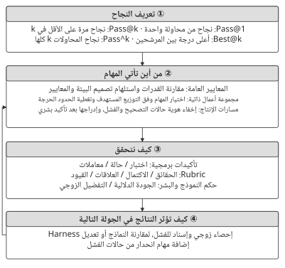
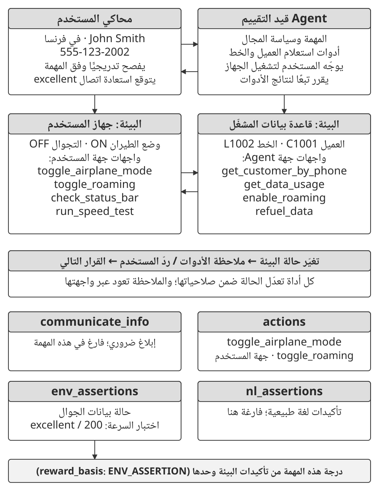
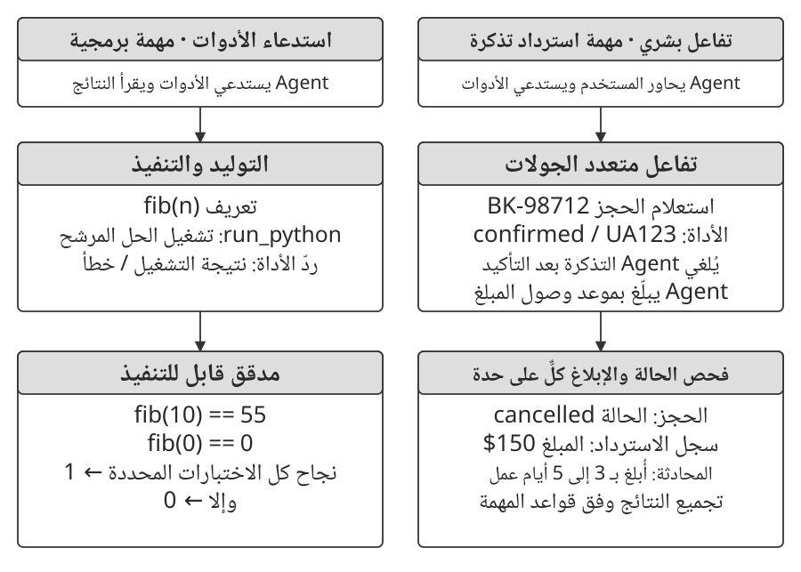
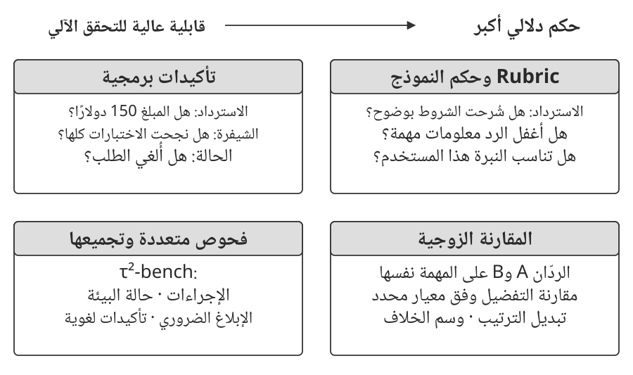
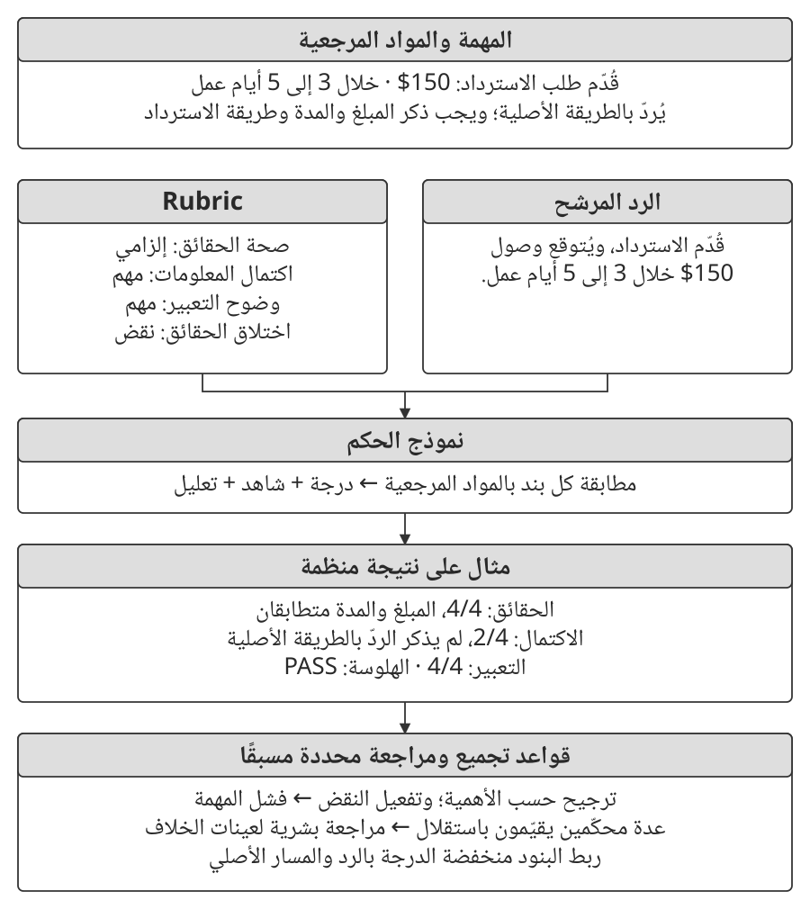
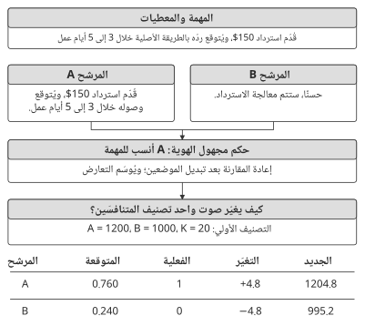
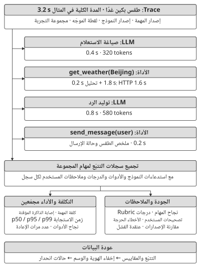
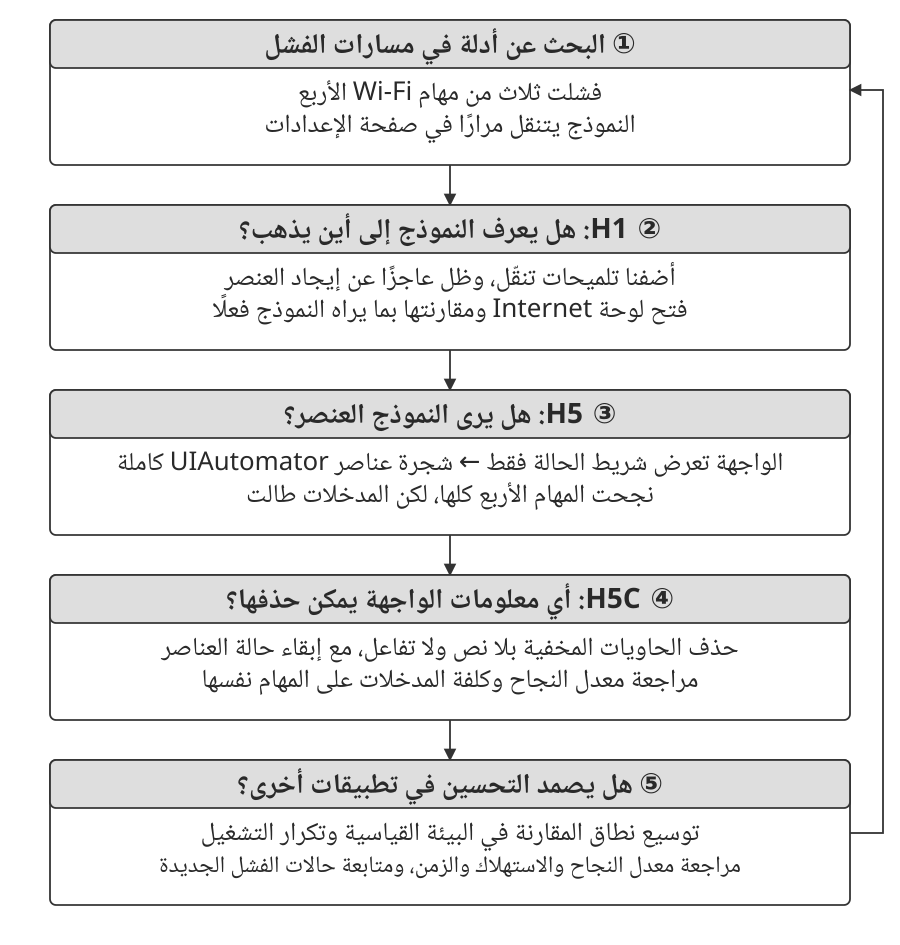
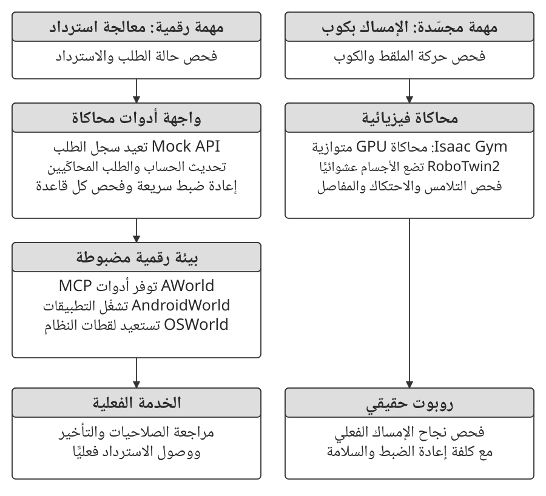
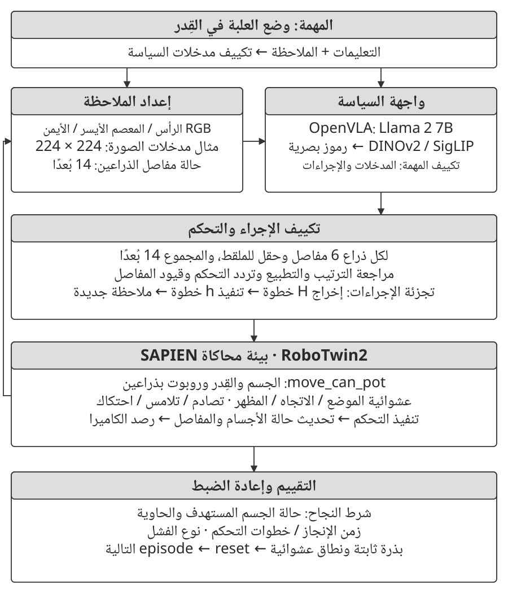

# تقييم الوكلاء

عرضت الفصول الستة الأولى بناء الوكيل المنفرد: السياق والذاكرة وقاعدة المعرفة والأدوات والشفرة، ثم واجهات الملاحظة والفعل. وبعد اكتمال النظام، نحتاج إلى مجموعة من المهام القابلة للتكرار نحكم بها على ما يستطيع فعله، وعلى الظروف التي يكثر فيها إخفاقه، وعلى ما ينبغي تعديله بعد ذلك. كما تقدّم نتائج التقييم تغذية راجعة لمرحلة التدريب اللاحق وللتطور المستمر.

تحتاج خيارات كثيرة في أثناء التطوير إلى المقارنة على مهام فعلية: أي نموذج نستخدم، وأي الأدوات نتيح، وما المحتوى والفهرسة اللذان تعتمدهما قاعدة المعرفة، وكيف ننظم ذاكرة المستخدم والموجّهات والمهارات (Skills)، وما القيود التي ينبغي إضافتها إلى منظومة التشغيل (Harness). وتتأثر هذه الخيارات بعضها ببعض؛ فالوصف الأكثر تفصيلًا للأداة قد يقلل أخطاء المعاملات، لكنه قد يزيد أيضًا كلفة السياق، وإضافة خطوة تحقق قد ترفع معدل النجاح وتطيل في الوقت نفسه زمن الإنجاز.

تقارن **التجارب المقارنة** بين حلول مختلفة على المهام نفسها وفي الظروف نفسها، وتسجّل التغير في معدل النجاح والزمن والكلفة. أما **تجارب الاستئصال** فتزيل مكونًا أو تعطّله، كإعادة ترتيب نتائج الاسترجاع أو تلخيص الحالة أو التحقق من النتائج، ثم ترصد كيف يتغير أداء النظام. فإذا حدّدنا في كل جولة ما الذي تغيّر بوضوح، وأبقينا سائر ظروف التشغيل ثابتة، وكررنا القياس، أمكننا أن نبني تدريجيًا الصلة بين القرارات الهندسية ونتائج المهام. ويرى المؤلف أن تُدمج المقارنة والاستئصال في التطوير اليومي؛ فالاكتفاء ببضعة مسارات نجحت بسلاسة يُغري بعدّ النجاح العارض تحسينًا، أو برؤية المكسب في نوع واحد من المهام مع إغفال التراجع في أنواع أخرى.

**ينبغي أن يكون موضوع التقييم الوكيل الكامل المؤلف من النموذج ومنظومة التشغيل.** فالنموذج يحدد كيف تُفهم المهمة وكيف يُختار الإجراء، ومنظومة التشغيل تنظّم السياق وتجدول الأدوات وتحفظ الحالة وتنفّذ الفحوص. وقد يؤدي النموذج نفسه إلى نتائج مختلفة إذا وُصل بأدوات مختلفة أو بمسارات تغذية راجعة مختلفة. وتوفر Coding Harness التي عرضها الفصل الخامس مثالًا على هذا النوع من المقارنة.

ويمكن دراسة التوافق بين النموذج ومنظومة التشغيل عبر **تجربة تبديل النموذج (model swap)**: نثبّت إطار التشغيل والمهام أولًا، ثم نستبدل النموذج، ونقارن النتائج النهائية وتوزيع الأخطاء. فإذا أخفق النموذج الأقوى في الخطوة نفسها، فحصنا هل تنقص أداة، وهل تصل التغذية الراجعة في وقتها، وهل يغطي التقييم الهدف فعلًا. وإذا تغيّر أداء المهمة تغيرًا واضحًا مع النموذج، حلّلنا أي قدرات الاستدلال أو التخطيط أو اتباع التعليمات هي التي أثّرت في النتيجة.

ويمكن الجمع بين تبديل النموذج واستئصال المكونات. فمثلًا نشغّل نموذجين كلًّا منهما بإعدادين، «مع تلخيص الحالة» و«دون تلخيص الحالة»، ونفحص هل يساعد التلخيص كلا النموذجين على استعادة المهام الطويلة، وهل يتوقف المكسب على النموذج. بذلك نحلّل الفروق بين النماذج، ونكتشف أيضًا الظروف التي يكون فيها مكوّن معيّن من منظومة التشغيل نافعًا.

والتقييم كذلك فحص انحدار عند ترقية النموذج. فقد يتقدم نموذج جديد في المعايير العامة ويتراجع في بعض مهام العمل الفعلية، ومجموعة المهام الخاصة بك هي التي تكشف هذه التغيرات. ويدعو المؤلف إلى «بناء المنتج لنماذج المستقبل»: أن ننجز الأدوات ومسارات العمل ومجموعة التقييم مسبقًا، ونتابع باستمرار أداء كل نموذج جديد على المهام نفسها، فإذا بلغ معدل النجاح وزمن الاستجابة والكلفة ما يتطلبه المنتج، مضينا إلى الإطلاق.

فكيف تُكتب متطلبات الإطلاق في صورة منظومة تقييم؟ عند قراءة الشكل 7-1 يمكن تتبّع اختبار واحد من أوله إلى آخره: ماذا نقيس، ومن أين نختار المهام، وبأي دليل نحكم بالنجاح، وكيف نسجل النتائج ونقارنها في النهاية؟



## فهم التقييم من خلال مهمة واحدة: نطاق telecom في τ²-bench

لنبدأ بعطل في اتصال هاتف بالإنترنت. يستخدم John Smith الرقم 555-123-2002، وهو الآن في فرنسا، وشريط الحالة في هاتفه يعرض «No Service». يريد استعادة الاتصال، ولا يعدّ العطل محلولًا إلا إذا بلغ اختبار السرعة excellent، وهو مستعد عند الحاجة لشحن 2.0 GB من البيانات، ويرغب في الإبقاء على باقته الحالية.

هذه الحالة مأخوذة من نطاق telecom في τ²-bench الذي طوّرته Sierra. تحاكي البيئة في آن واحد الأنظمة الخلفية لشركة الاتصالات وجهاز المستخدم، ويقرأ كلٌّ من وكيل خدمة العملاء ومحاكي المستخدم جزءًا من هذه الحالة ويغيّره عبر أدواته. ويتطلب التقييم أن نتتبع التفاعل من الجانبين لنفحص كيف اكتُشفت المشكلة، وكيف نُفّذت العمليات، وهل عادت الشبكة في النهاية.[^ch7-tau2-task]

### المكوّنات الأربعة لتعريف المهمة

لكي يعالج وكيل خدمة عملاء آخر المسألة نفسها، علينا أولًا أن نعيد حالة الهاتف والحساب إلى ما كانت عليه، وأن نجعل المستخدم المحاكى يتعاون في التشخيص وفق المتطلبات نفسها، ثم نقيّم بالمعايير نفسها. يسرد الجدول التالي الأجزاء الأربعة لتعريف المهمة. وانتبه عند قراءته إلى فرق مهم: واضع المهمة يعرف الإعدادات الأولية للهاتف، فكم يعرف كلٌّ من الوكيل والمستخدم عند بدء المحادثة؟

| الجزء | الحقل | محتواه في هذا المثال |
| --- | --- | --- |
| التذكرة | `ticket` | المستخدم، والرقم، والبلد الذي يوجد فيه، وعَرَض انقطاع الإنترنت، وشرط اختبار السرعة وقيد الباقة |
| سيناريو المستخدم | `user_scenario.instructions` | ما يعرفه المستخدم، وكيف يستعلم حين يُسأل، ومتى يؤكد حل المشكلة |
| الحالة الأولية | `initial_state.initialization_actions` | ضبط هوية المستخدم وموقعه، وتشغيل وضع الطيران، وإيقاف التجوال على الجهاز، وتفعيل التجوال من جهة شركة الاتصالات |
| معايير التقييم | `evaluation_criteria` | فحص الإجراءات وحالة البيئة، مع تحديد بنود الاحتساب عبر `reward_basis` |

**ما الذي يعرفه المستخدم.** يقدّم الحقل `known_info` الاسم والرقم والبلد. أما تشغيل وضع الطيران وإيقاف التجوال على الجهاز فمحفوظان في حالة البيئة، ولا يستطيع محاكي المستخدم إبلاغ الوكيل بهما إلا بعد استدعاء أداة للاستعلام عنهما. وإفراد ما يعرفه المستخدم في حقل مستقل هو ما يمكّن المحاكي من التمييز بين المعلومات التي يجيب عنها مباشرة والمعلومات التي يلزمه استعلام فعلي للحصول عليها. أما الاكتفاء بمطالبة المحاكي في الموجّه بأن «لا يقول كل شيء دفعة واحدة» فقلّما يضبط بثبات متى يكشف كل حقيقة. ويحقق هذا الترتيب ما يُعرف بالإفصاح التدريجي عن المعلومات (Progressive Information Disclosure): تبدأ المحادثة بعبارة «لا أستطيع الاتصال بالإنترنت»، ويحصل الوكيل شيئًا فشيئًا على ما يحتاجه للتشخيص عبر الأسئلة وتوجيه المستخدم إلى العمليات.

**كيف يستجيب المستخدم.** ينص الحقل `task_instructions` على أن يُظهر المستخدم انزعاجًا خفيفًا بعد فشل المحاولة الأولى، وألا يؤكد الحل إلا إذا جاء اختبار السرعة excellent، وأن يستند في إجاباته المتعلقة بالجهاز إلى نتائج الأدوات. فالنتائج poor وfair وgood كلها لا تبلغ هدف هذه المهمة. ويجعل الارتكاز على الحقائق (Grounding) المستخدمَ يردّ وفق الحالة الفعلية للبيئة المحاكاة. ولولا هذا القيد لربما جارى المستخدم المحاكى عبارة الوكيل «ينبغي أن يعمل الآن» ووافق عليها، فتبدو المحادثة بين الطرفين سلسة بينما يبقى عطل الجهاز قائمًا.

**من أي حالة يبدأ الطرفان.** من جهة المستخدم، تُضبط الهوية عبر `set_user_info`، ويُعبَّر عن وجوده خارج البلاد عبر `set_user_location(abroad=true)`، ثم يُنفَّذ `turn_airplane_mode_on` و`turn_roaming_off`. أما من جهة شركة الاتصالات فيُفعَّل التجوال على الخط `L1002` التابع للعميل `C1001` عبر `enable_roaming`. لذلك قد يُظهر الاستعلام في الأنظمة الخلفية أن التجوال مفعّل، بينما يبقى الهاتف عاجزًا عن الاتصال بسبب وضع الطيران وإعداد التجوال على الجهاز. وعلى الوكيل أن يوجّه المستخدم إلى فحص جهازه ليحصل على معلومات لا يقدّمها الاستعلام الخلفي.

**ما الفحوص التي تحدد الدرجة.** يسرد الحقل `actions` الإجراءين `toggle_airplane_mode` و`toggle_roaming` من جهة المستخدم. ويضم الحقل `env_assertions` فحصًا لحالة بيانات الجوال، وفحصًا لاختبار السرعة بالمعاملين `expected_speed=200` و`expected_desc="excellent"`. ويتيح تنسيق المهمة كذلك الحقلين `communicate_info` و`nl_assertions`، ويصفان على الترتيب المعلومات التي يجب إبلاغها للمستخدم والتأكيدات المكتوبة باللغة الطبيعية، وهما فارغان في هذه المهمة.

يختار `reward_basis` في هذه المهمة القيمة `ENV_ASSERTION`، فتتوقف المكافأة الإجمالية على تأكيدات البيئة. وقد تظهر فحوص الإجراءات في النتائج، لكن احتسابها في الدرجة الكلية يحدده إعداد الاحتساب.

### فحص النتائج على امتداد مسار التشغيل

اختار التشغيل المصاحب خمس مهام من نطاق telecom، وشُغّلت كل مهمة مرة واحدة، واستخدم كلٌّ من وكيل خدمة العملاء ومحاكي المستخدم GPT-4.1 mini، فنجحت أربع مهام في النهاية. نحلل أولًا مهمة التجوال في فرنسا السابقة، ثم نقابلها بمهمة فاشلة.

> **التجربة 7-1 ★: تشغيل τ²-bench ومقارنة تطوره عن τ-bench**
>
> اقرأ أولًا سيناريو المستخدم وإجراءات التهيئة وشروط التقييم لمهمة واحدة، ثم شغّل تفاعلًا كاملًا مرة واحدة. علّم على امتداد المسار استعلامات الوكيل وعمليات المستخدم وتغيرات الحالة ونتيجة القبول، وافحص المعلومة التي استند إليها كل حكم.
>
> وعند المقارنة بين τ-bench وτ²-bench، ركّز على ما إذا كان المستخدم قادرًا على تغيير البيئة عبر الأدوات، وعلى متطلبات التنسيق التي يفرضها هذا التغيير على الوكيل.
>
> عند قراءة الشكل 7-2، ابحث أولًا عمّن يستطيع إيقاف وضع الطيران في الهاتف، ثم عمّن يستطيع تعديل إعداد التجوال لدى شركة الاتصالات. فاختلاف ما يقدر عليه كل طرف هو ما يفسر حاجة الوكيل، بعد أن ينهي عملياته، إلى أن يطلب من المستخدم إجراء اختبار السرعة على هاتفه.
>
> 

في مهمة التجوال في فرنسا، بدأ الوكيل بالتعرف على الحساب. فوجد العميل `C1001` من الرقم، واستعلم عن استهلاك البيانات في `L1001` و`L1002` و`L1003`، لكنه خلص من تفاصيل `L1001` إلى نتيجة خاطئة: أن الرقم 555-123-2002 الذي قدّمه المستخدم ليس من الخطوط النشطة، وأن أقرب رقم إليه هو 555-123-2001. وبعد أن أصرّ المستخدم على صحة رقمه، تابع الوكيل الاستعلام عن `L1002`، وعندها فقط تأكد من الخط الصحيح.

بعد ذلك استدعى محاكي المستخدم `check_network_status` و`check_status_bar`. وتضمنت الحالة المعادة: وضع الطيران مفعّل، ولا خدمة في الشبكة الخلوية، وبيانات الجوال مفعّلة، والتجوال على الجهاز موقوف. فأبلغ المستخدم بناءً على ذلك: «الهاتف في وضع الطيران، وتجوال البيانات مغلق أيضًا. هل عليّ أن أوقف وضع الطيران أولًا؟» والاستعلام هنا نفّذته أدوات جهة المستخدم، ووصلت نتيجته إلى الوكيل عبر المحادثة.

هذه هي آلية **التحكم المزدوج (Dual-Control)**: يستعلم الوكيل في الأنظمة الخلفية لشركة الاتصالات ويعمل فيها، بينما يملك محاكي المستخدم أدوات مستقلة للجهاز، مثل عرض شريط الحالة وتبديل وضع الطيران وإعادة تركيب شريحة SIM وتشغيل اختبار السرعة. وينسّق الطرفان عملياتهما بالحوار، وتسجّل البيئة تغيرات الحالة التي يُحدثها كل منهما.

ثم وجّه الوكيل المستخدم إلى إيقاف وضع الطيران وتفعيل التجوال على الجهاز، فظهرت إشارة 5G في شريط الحالة. وشغّل المستخدم `run_speed_test` فحصل على 275 Mbps بتقدير Excellent، ثم أكّد حل المشكلة. نجح تأكيدا البيئة كلاهما، وبلغت مكافأة هذه المهمة 1.0.

غير أن هذا المسار الناجح كشف أيضًا مشكلة في الإجراءات. فالسياسة تُلزم الوكيل باستدعاء أداة واحدة في كل مرة، لكنه أطلق `get_customer_by_phone` و`get_customer_by_name` في الرسالة نفسها. ولما كانت الدرجة الكلية لهذه المهمة لا تحتسب إلا تأكيدات البيئة، لم يغيّر هذا السلوك المكافأة.

وفي مسار آخر فاشل، اختير الخط الخطأ ولم يُصحَّح قط، فانحرف التشخيص اللاحق كله. كان رقم المستخدم لا يزال 555-123-2002، لكن الوكيل اختار `L1001` وواصل التشخيص بناءً على استهلاك هذا الخط البالغ 3.2/5 GB. ومع أن الأداة أعادت أن `L1001` يقابل 555-123-2001، لم يصحح الوكيل الخط، وبعد جولات عديدة من التشخيص غير المتصل بالمشكلة حوّل المحادثة إلى موظف بشري. نجح المستخدم في إيقاف وضع توفير البيانات، لكن شحن 2 GB المطلوب للخط الصحيح `L1002` لم يُنفَّذ، فأخفقت تأكيدات البيئة الثلاثة جميعها.

وبالمقارنة بين المسارين، يمكن تفكيك الدرجة النهائية إلى نقاط تحسين محددة: مطابقة الرقم مع الخط، وتصحيح الحكم في ضوء الأدلة الجديدة، والتمييز بين حالة الجهاز وحالة الأنظمة الخلفية، والتحقق من إتمام الشحن المطلوب. وسيعود قسم إسناد الفشل لاحقًا إلى كيفية العثور على نقاط التحول الحاسمة هذه في المسارات الطويلة.

[^ch7-tau2-task]: يعرّف τ²-bench الذي طوّره Sierra Research أدوات المستخدم في نطاق telecom في الملف `user_tools.py`، ومدخل التقييم هو `evaluator.py`. ونُظّم محتوى الحالة ونتائجها وفق المهام الخمس ومسارات التشغيل المحفوظة في المستودع المصاحب.

## مقاييس التقييم: تعريف النجاح

اجتياز أربع مهام من خمس يعطي الحصيلة الإجمالية لهذا التشغيل. لكن اتخاذ قرار بشأن المنتج على أساسها يقتضي أيضًا تحديد نوع المهمة وكلفة الإخفاق. فوكيل خدمة العملاء المختص بالاسترداد يجب أن ينجز عمليات الاسترداد المستوفية للشروط على نحو مستمر؛ أما عند كتابة البرامج فيمكن توليد عدة تنفيذات، ثم تُستعمل الاختبارات لانتقاء النسخة التي تعمل وتعطي نتيجة صحيحة؛ وفي البحث العلمي يمكن طرح عدة فرضيات يختبرها الباحث بعد ذلك. وينبغي أن يقابل مقياس التقييم طريقة الاستعمال هذه.

### الأعجوبة التقنية: قياس القدرة على المحاولات المتعددة بـ Pass@k

يسمّي المؤلف بعض العروض المبهرة للوكلاء «أعاجيب تقنية»: يُمنح النظام وقتًا وفرصًا كافية للمحاولة، فينجز مهمة كان يصعب إنجازها آليًا من قبل. وفي الأعمال الاستكشافية قد يكفي مسار ناجح واحد جرى التحقق منه ليأتي بقيمة. ويقابل المقياسُ **Pass@k** هذا النمط من الاستعمال: تُشغَّل المهمة نفسها $k$ مرة، وتُعدّ ناجحة إذا اجتازت مرة واحدة على الأقل. وفي المهام ذات الدرجات المتصلة يمكن أيضًا الإبلاغ عن أعلى درجة بين المحاولات الـ $k$، ويسمى ذلك **Best@k**.

فمثلًا، نظّمت Anthropic عدة نسخ من Claude للتعاون في بناء مصرّف للغة C، لتبيّن أن التشغيل الطويل والتغذية الراجعة من الاختبارات وتقسيم العمل يمكن أن تدعم مشروعًا هندسيًا معقدًا. وحين يبحث الباحثون عن أمثلة مضادة في الرياضيات، يمكنهم أيضًا أن يدعوا النموذج يحاول مرارًا، ثم يتحققوا تحققًا مستقلًا من صحة أحد الأمثلة المضادة. وفي مراجعة أمن البرمجيات يمكن إعادة فحص المشكلات المشبوهة التي يبلّغ عنها النموذج، وفي الإبداع المفتوح يمكن اختيار الأفضل من بين عدة أعمال.[^ch7-long-running]

وتعرض المنتجات التطبيقية قدراتها كذلك عبر المهام المعقدة. فقد وضع Manus حاسوبًا افتراضيًا بين يدي الوكيل، فصار المستخدم يراه يشغّل الواجهات ويبحث عن المعلومات ويواصل العمل. أما OpenClaw فيتلقى التكليفات عبر المراسلة الفورية، ويصل إلى الملفات والخدمات التي أُعدّت له وأُذن له بها، ويبلّغ عن تقدمه في أثناء العمل ويطلب معلومات إضافية، ويمكن أيضًا أن توقظه آلية مجدولة ليتفقد المهام المعلقة. وهذه السلوكيات الملموسة تسهّل على المستخدم فهم ما يصلح له الوكيل.

ويرى المؤلف أن العروض القادرة على إنجاز أنواع جديدة من المهام عامل مهم في جذب هذه المنتجات للمستخدمين.

### موثوقية الأعمال: التركيز على Pass^k

تتطلب مسارات العمل عادةً أن يكون التسليم صحيحًا في كل تشغيل. ويقيس **Pass^k** حالة تشغيل المهمة نفسها $k$ مرة واجتيازها في كل مرة، ويمكن قراءته «pass power k». ويمكن أن يشمل شرط اجتياز المهمة النتيجة النهائية والالتزام بالسياسة وقيود الصلاحيات معًا، ويُفحص كل تشغيل وفق الشروط نفسها.

إذا افترضنا أن عمليات التشغيل مستقلة بعضها عن بعض، وأن احتمال النجاح في كل منها هو $p$، فإن:

$$
\mathrm{Pass@k}=1-(1-p)^k,\qquad
\mathrm{Pass}^{k}=p^k.
$$

فمثلًا عند $p=0.6$ و$k=5$ يبلغ Pass@5 نحو 99.0%، ويبلغ Pass^5 نحو 7.8%. الأول يعني أننا نجد عادةً نجاحًا واحدًا بين خمس محاولات، والثاني يعني أن احتمال نجاح المحاولات الخمس جميعًا لا يزال منخفضًا.

وعند قراءة مجموعة نتائج فعلية، يمكن الاستغناء عن الصيغة في البداية. لنفترض أن المسألة نفسها شُغّلت خمس مرات فكانت النتائج «نجاح، إخفاق، نجاح، نجاح، إخفاق»، فيُسجَّل لهذه المجموعة Pass@5 بقيمة 1، وPass^5 بقيمة 0، ويُقدَّر معدل النجاح في المرة الواحدة بـ 3/5. أما الرقمان 99.0% و7.8% أعلاه فيجيبان عن سؤال آخر: إذا عُلم أن احتمال النجاح في كل مرة 0.6، وكُررت التجربة بمجموعات من خمس محاولات، فكم مجموعة ستبلغ المعيار المقابل؟

ويمكن للسجلات نفسها أن تجيب عن سؤال أسهل تحققًا: إذا أخذنا محاولتين عشوائيًا من المحاولات الخمس السابقة، فما نسبة الأزواج التي تجتاز؟ لنعامل كل تشغيل كأنه بطاقة، ونسحب بطاقتين دون إرجاع، فيكون لدينا عشرة أزواج. والزوج الوحيد الذي يُفشل المحاولتين معًا هو المؤلف من بطاقتي الإخفاق، فتنجح تسعة أزواج مرة واحدة على الأقل، ويكون التقدير العيّني لـ Pass@2 هو 9/10. أما بطاقات النجاح الثلاث فتكوّن فيما بينها ثلاثة أزواج، فيكون التقدير العيّني لـ Pass^2 هو 3/10. وهذه بالضبط طريقة τ²-bench في عدّ التوليفات الناجحة بالكامل لكل مهمة: تُشغَّل المسألة $n$ مرة فتنجح $s$ مرة، ونختار منها $k$ مرات، فتكون نسبة التوليفات الناجحة بالكامل $\binom{s}{k}/\binom{n}{k}$، حيث $1\le k\le n$.[^ch7-tau2-metrics]

لنعد الآن إلى نتيجة 4/5 في التجربة 7-1. فالمسارات الخمسة تخص خمس مسائل مختلفة، ولكل مسألة بطاقة واحدة فقط، فلا يمكن تكوين زوج واحد. ولتقدير Pass^2 لهذه المهام يجب إضافة عمليات تشغيل مستقلة لكل مسألة، ثم الحساب لكل منها على حدة والتجميع. أما تربيع 0.8 مباشرة فيعني افتراضًا إضافيًا بأن احتمال النجاح واحد في جميع هذه المسائل في كل مرة، وأن المحاولات مستقلة بعضها عن بعض.

[^ch7-tau2-metrics]: تحسب النسخة التجريبية من τ²-bench (رقم المراجعة 8d005b0) المقياس Pass^k لكل مسألة على حدة في `agent_metrics.py`. وإذا كان عدد مرات النجاح أقل من $k$ فإن عدد التوليفات الناجحة بالكامل صفر.

ويجب الحفاظ على اتساق وحدة الإحصاء في الحساب. فخمس عينات من المهمة نفسها تقيس أداء هذه المهمة عند التكرار، أما خمس مهام مختلفة متتالية في بيئة الإنتاج فتتأثر أيضًا بصعوبة المهام وتوزيع الحركة. وإذا اختلفت احتمالات النجاح بين المهام، يمكن حساب مقياس النجاح المتكرر لكل مهمة أولًا، ثم تجميعه بحسب أوزان المهام. كما أن الحالة المشتركة أو ذاكرة التخزين المؤقت أو الأعطال المشتركة تجعل عمليات التشغيل المتعددة مترابطة.

**إذا سُمح بالإجابة «المعلومات غير كافية»، فأي مقام نختار؟** تخيّل مساعدًا للبحث في الأدبيات العلمية تلقّى 100 سؤال، فأجاب عن 80 منها، وكانت 68 إجابة صحيحة. القارئ الذي يعتمد على الإجابات المقدَّمة يهمّه 68/80، أي 85%؛ أما من يحتاج إلى إنجاز هذه الدفعة من المهام كلها فيهمّه أيضًا 68/100، أي 68%. وتبقى 20 مسألة تحتاج إلى البحث عن أدلة إضافية أو إحالتها إلى إنسان.

وفي PaperQA2 يمكن اختيار «المعلومات غير كافية» على 248 سؤالًا من أسئلة الأدبيات في LitQA2. ويبلّغ البحث عن متوسط ثلاث جولات تشغيل: حين يقدّم النظام إجابة فعلية تبلغ الدقة 85.2%، وعند الحساب على جميع الأسئلة تبلغ 66.0%، مع اختيار «المعلومات غير كافية» في 21.9% من الأسئلة. أما الدقتان المقابلتان لتسعة مجيبين من البشر فهما 73.8% و67.7%. ويذكر البحث أن الفرق في المقياس الأول دال إحصائيًا، وأن الفرق في الثاني لم يبلغ الدلالة الإحصائية.[^ch7-paperqa2-denominators]

[^ch7-paperqa2-denominators]: Skarlinski وآخرون، *Language Agents Achieve Superhuman Synthesis of Scientific Knowledge*، 2024، انظر القسم 2 والشكل 2.

وقد يختلف مساران انتهيا إلى الحالة النهائية نفسها في الكلفة. خذ الاستعلام عن فاتورة مثالًا: المسار (أ) أعاد المبلغ الصحيح من استعلام واحد، والمسار (ب) احتاج إلى استعلامين ليعطي الإجابة نفسها. فإذا كان الاستعلامان يحملان معرّف الطلب نفسه، وكان الأول قد انتهت مهلته، فهذا يعني أن إعادة المحاولة ساعدت على استعادة المهمة. أما إذا كانت نتيجة الاستعلام الأول قد وصلت بنجاح، فإن الاستعلام الثاني لم يفعل سوى زيادة زمن الانتظار وكلفة الأداة دون فائدة.

وحين يتضمن التشغيل كتابة أو آثارًا خارجية أخرى، يجب أولًا إعادة كل تجربة إلى الحالة الأولية المحددة، وإجراء العمليات في بيئة اختبار، وتسجيل جميع المحاولات. وإذا كان المنتج يسمح بإعادة المحاولة بعد الإخفاق، فإن عدد المحاولات وخطوات الاستعادة وكلفة التنفيذ تدخل جميعها في تقييم المسار، مع الاحتفاظ بسجلات الإخفاق الأصلية للتمييز بين الأداء في المرة الواحدة والنتيجة بعد الاستعادة.

[^ch7-long-running]: Anthropic، Building a C compiler with a team of parallel Claudes، 2026-02-05، ويعرض التعاون بين نسخ متعددة والتنفيذ طويل المدى والتغذية الراجعة من الاختبارات.

## بيئة التقييم

لنفترض أننا نريد مراجعة ذلك التشغيل الذي اختار فيه الوكيل الخط الخطأ. يحتاج المراجع إلى رؤية المستخدم نفسه، والخطين أنفسهما، والباقة الأولية نفسها. فإذا كان التشغيل الأول قد عدّل أحد الخطين، فإن إعادة التشغيل مباشرة لا تتيح الحكم على ما إذا كان تغير النتيجة نابعًا من النموذج أم من قاعدة البيانات. وتتولى بيئة التقييم إنشاء نقطة بداية المهمة، وتوفير واجهات التفاعل، وتسجيل العملية، وفحص نقطة النهاية.

### المكوّنات الخمسة

بالرجوع إلى مهمة telecom، يمكن تفكيك بيئة التقييم إلى خمسة أجزاء.

**مجموعة البيانات (Dataset)** تحفظ تعريفات المهام: خلفية المستخدم، ومتطلبات السلوك، والحالة الأولية، وشروط القبول. ويقابل كل سجل حالة اختبار واحدة، وتُوزَّع المعلومات عند التشغيل بحسب دور كل مشارك.

**حالة البيئة (Environment State)** تحفظ المعلومات المتغيرة في أثناء تنفيذ المهمة، مثل العملاء والخطوط والباقات والفواتير، وإعدادات الجهاز من وضع الطيران والتجوال وتوفير البيانات. وعند بدء جولة جديدة، تستعيد البيئة البيانات الأساسية أولًا، ثم تنفّذ `initialization_actions` لإحداث العطل الذي تحدده المهمة الحالية. ويجب أن يتكامل التنظيف مع التهيئة، حتى لا يتسرب شحن رصيد أو تغيير إعداد من الجولة السابقة إلى الجولة التالية.

**واجهة الأدوات (Tools)** تحدد ما يستطيع المشاركون قراءته وتغييره. يستطيع الوكيل الاستعلام عن العميل وفحص الاستهلاك وشحن البيانات أو التحويل إلى موظف بشري، ويستطيع المستخدم عرض حالة الجهاز وتبديل المفاتيح واختبار السرعة. وينبغي أن تقابل دقة تجزئة الأدوات القدرة المراد اختبارها: فإذا أردنا تقييم التشخيص والتخطيط، تركنا الوكيل يركّب الاستعلامات والعمليات بنفسه؛ أما إذا وفّرنا أداة مباشرة باسم «إصلاح مشكلة الإنترنت»، فإن محور الاختبار ينتقل إلى معرفة متى تُستدعى هذه القدرة.

**معيار التقييم (Rubric)** يبيّن كيف يُحكم على النتيجة. ففي مهام telecom يمكن فحص الإجراءات وحالة البيئة والتواصل الضروري والمتطلبات المكتوبة باللغة الطبيعية، ثم يحدد `reward_basis` أي هذه الفحوص يدخل في الدرجة الكلية.

**بروتوكول التنفيذ (Interaction Protocol)** ينظّم أدوار الكلام واستدعاءات الأدوات والإنهاء. فيمكن لمحاكي المستخدم أن يُخرج `###STOP###` لإنهاء التفاعل، ويضع المشغّل كذلك ميزانيات مثل عدد الجولات. ويُسجَّل سبب الإنهاء ودرجة المهمة كلٌّ على حدة: فبعد أن يوقف المستخدم المحادثة تبقى تأكيدات البيئة هي المسؤولة عن الحكم على تحقق الهدف، وعند نفاد الميزانية يجب أيضًا الاحتفاظ بالحالة الأخيرة وبالخطوات غير المكتملة.

### بيئات التقييم من نوع التفاعل بين الإنسان والحاسوب ومن نوع استدعاء الأدوات

تتضمن مهمة telecom محاكيًا للمستخدم يواصل الرد ويشغّل الجهاز. أما إصلاح الشفرة وتحليل البيانات وحل المسائل الرياضية فكثيرًا ما تبدأ بتعليمات المهمة، ثم يتفاعل الوكيل بعدها مع الأدوات أساسًا. ويحتاج النوعان كلاهما إلى المهام والحالة والواجهات والتقييم وبروتوكول التنفيذ، والفرق في ما إذا كان يلزم أيضًا محاكاة طرف المحادثة، وفي كيفية تنسيق الطرفين لأفعالهما.

يمكن فحص مخرجات مهام الشفرة بالاختبارات، ويمكن في مهام قواعد البيانات الاستعلام عن السجلات بعد تعديلها، أما التحليل المفتوح فقد يتطلب أن يراجع المحتوى إنسانٌ أو نموذج. وكثيرًا ما تتطلب مهام التفاعل بين الإنسان والحاسوب الجمع بين دليلين: فعودة شبكة الهاتف مثلًا تُعرف من حالة الجهاز، أما توضيح الوكيل للرقم وتوجيهه المستخدمَ إلى العمليات فيُعرفان من المحادثة. والأمر كذلك في الاسترداد الوارد في الشكل 7-3: إلغاء الطلب يمكن التحقق منه في قاعدة البيانات، أما إبلاغ الوكيل المستخدمَ بموعد وصول المبلغ فلا بد من البحث عنه في المحادثة.



يمكن في Verifiers البدء بهذين النوعين من المهام من واجهات بيئة مختلفة. ويسرد الجدول 7-1 الواجهات التي تعالج في الإصدار v0.1.9 الإجابة ذات الدور الواحد، واستدعاء الأدوات متعدد الأدوار، وحقن حالة التشغيل، وإدارة موارد الصندوق الرملي، لتيسير المقابلة مع الشفرة.[^ch7-verifiers-env]

الجدول 7-1: مقارنة أنواع بيئات Verifiers

| نوع البيئة | المسؤولية الرئيسية | معالجة الأدوات والحالة | الاستعمال النمطي |
|---|---|---|---|
| `SingleTurnEnv` | تنظيم الإجابة ذات الدور الواحد | التقييم بعد إجابة واحدة | المسائل الرياضية، والسؤال والجواب بدور واحد |
| `ToolEnv` | تنظيم التفاعل متعدد الأدوار مع الأدوات | حفظ مسار التشغيل، وتوزيع الأدوات وتلقي نتائجها | البحث وتركيب المعلومات |
| `StatefulToolEnv` | إدخال حالة التشغيل في تنفيذ الأدوات | استكمال معاملات الأداة أو تحديث الحالة بحسب الحالة الراهنة | ربط معرّف قاعدة البيانات أو المورد بالمهمة الحالية |
| `SandboxEnv` | إدارة بيئة تنفيذ معزولة | تخصيص صندوق رملي للتشغيل واستعمال الأدوات داخله | تنفيذ الشفرة وفحص الملفات ونتائج الاختبارات |

فمثلًا، حين تعدّل مهمتان قاعدة البيانات في الوقت نفسه، يستطيع المشغّل أن يحقن معرّف قاعدة البيانات الخاص بكل منهما في استدعاءات الأدوات، فيعمل كل مسار على بياناته. وعند فشل التنفيذ، ينبغي أن تعيد الأداة معلومات تفيد في الحكم في الخطوة التالية، مثل عدم وجود الكائن، أو عدم مطابقة المعاملات للمتطلبات، أو انتهاء مهلة الخدمة. ويحفظ نظام التقييم الملاحظات والاستدعاءات ونتائج التنفيذ والمكافآت، فيصبح من الممكن في أثناء التحليل تحديد موقع الخطأ في خطوة بعينها.

[^ch7-verifiers-env]: Prime Intellect، الواجهتان ToolEnv وStatefulToolEnv في Verifiers v0.1.9، وتعرضان المسارات متعددة الأدوار وتوزيع الأدوات وحقن معاملات الحالة.

## تصميم مجموعة بيانات التقييم

لنوسّع الآن مسائل الاتصالات الخمس إلى مجموعة تقييم قادرة على توجيه قرار الإطلاق. فلو كانت المهام المضافة كلها من نوع «فعّل التجوال لرقم محدد»، لأمكن للنظام أن ينال درجة عالية حتى إن لم يتعلم قط التمييز بين خطين يتبعان الحساب نفسه. وإذا أردنا أن نحكم بدرجات التقييم على أهلية وكيل خدمة العملاء للإطلاق، فيجب أن تستند اختيارات المهام إلى تذاكر حقيقية، تشمل الأعمال الاعتيادية ومسائل صعبة يسهل فيها الخلط بين الخطوط، وأن يتحقق التقييم من الخط الذي عدّله الوكيل في النهاية. وبعد الإطلاق يبقى الحفاظ على هذه المهام مطلوبًا لتظل معبّرة عن العمل الذي يسلّمه المستخدمون فعلًا.

### مقارنة عرضية لتصميم المعايير المرجعية

يضع الجدول 7-2 ستة معايير مرجعية جنبًا إلى جنب بحسب القدرة المقيسة ومصدر المهام وبيئة التشغيل وطريقة التحقق.

الجدول 7-2: قرارات التصميم الأساسية في عدد من المعايير المرجعية للوكلاء

| المعيار المرجعي | القدرة المقيسة | مصدر المهام وتنظيمها | بيئة التشغيل | طريقة التحقق |
|---|---|---|---|---|
| τ²-bench | التفاعل في خدمة العملاء وتشغيل الأدوات | مهام نطاقية وتوليفات أعطال | محاكي مستخدم، وقاعدة بيانات للأجهزة والأعمال | فحوص منفصلة تُحتسب وفق `reward_basis` |
| SWE-bench Verified | إصلاح مشكلات الشفرة | مشكلات GitHub حقيقية، مغربلة يدويًا | مستودع الشفرة وبيئة الاختبارات | اختبارا `FAIL_TO_PASS` و`PASS_TO_PASS` |
| AndroidWorld | تشغيل تطبيقات Android | قوالب مهام ذات معاملات | محاكي Android يشغّل تطبيقات حقيقية | قراءة حالة الجهاز أو الملفات أو التطبيق الداخلية |
| OSWorld | تشغيل سطح المكتب والعمل بين التطبيقات | سيناريوهات استعمال حقيقية مع إعداد نقطة بداية المهمة | آلة افتراضية وتطبيقات سطح مكتب | فحص حالة تنفيذ المهمة ونواتجها |
| Terminal-Bench | المهام الهندسية في الطرفية | مهام واختبارات مصممة يدويًا | حاوية ومتطلبات المهمة | الملفات وتشغيل البرامج ونتائج الاختبارات |
| GAIA | معالجة المعلومات لدى مساعد عام | أسئلة مكتوبة يدويًا، بعضها مصحوب بمواد | الشبكة والملفات وأدوات مساعدة | المقارنة بعد تسوية صيغة الإجابة |

### المدققات

تربط المدققات هدف المهمة بأدلة قابلة للفحص. فمهام الشفرة تحتاج إلى تشغيل الاختبارات، ومهام سطح المكتب إلى قراءة حالة التطبيق أو الملفات، ومهام استرجاع المعلومات إلى مطابقة الإجابة ومصدرها. **وينبغي أن يقوم القبول على أدلة تُحصل عليها استقلالًا.** فقد يولّد الوكيل تقريرًا مفصلًا يزعم فيه إتمام جميع الخطوات، ومع ذلك يبقى على المدقق أن يشغّل الناتج فعليًا، أو يقرأ الحالة، أو يطابق المصدر. فالتقرير يُستعمل لتحديد موضوع الفحص، أما الدرجة فتحددها هذه الفحوص.

تخيّل مستخدمًا يفتح تطبيق الدفع ويطلب من المساعد «الموافقة على جميع طلبات التحصيل التي أرسلها رفيق السكن هذا الشهر». ولنفترض وجود ثلاث معاملات معلقة: واحدة من رفيق السكن هذا الشهر، وواحدة منه الشهر الماضي، وواحدة من زميل في العمل هذا الشهر. فيجب الموافقة على الأولى وترك الأخريين معلقتين. فلو فحصنا الأولى وحدها، لنال مساعدٌ وافق على الثلاث جميعًا الدرجة الكاملة؛ ولو فحصنا الأخيرتين وحدهما، لجاز مساعدٌ لم يفعل شيئًا. وقد طرح AppWorld هذه المسألة في تطبيق دفع محاكى. وعند تصميم المدقق يمكن أولًا تحديد الطلبات التي أذن بها المستخدم انطلاقًا من البيانات السابقة للعملية، ثم فحص هل تمت الموافقة عليها جميعًا، وأخيرًا الرجوع إلى السجلات اللاحقة للسؤال: أي المعاملات الأخرى عدّلها المساعد؟[^ch7-appworld-scope]

[^ch7-appworld-scope]: Trivedi وآخرون، *AppWorld*، ACL 2024، ويعرض الشكل 2 المهمة وشروط القبول.

ويمكن للبحث العلمي أيضًا أن يسلّم ناتجًا يسهل التحقق منه. فمسألة FunSearch تطلب اختيار أكبر عدد ممكن من النقاط في فضاء ثماني الأبعاد، بحيث لا يأخذ كل إحداثي إلا القيمة 0 أو 1 أو 2، وتجري العمليات بالحساب النمطي 3، وألا تكون أي ثلاث نقاط مختارة على استقامة واحدة. يكتب الباحث إطار برنامج يختار النقاط خطوة بخطوة، ويطلب من النموذج اقتراح دالة ترتب النقاط المرشحة، ثم يقيس بالحجم الفعلي لمجموعة النقاط المشروعة التي بُنيت. وعند نشر البحث كانت هناك إنشاءات تختار 496 نقطة، وقدّمت الشفرة الجديدة قائمة من 512 نقطة.[^ch7-funsearch-cap]

ويمكنك أن تنزّل القائمة وحدها وتفحص هذه النتيجة فحصًا مستقلًا. تأكد أولًا من أنها تضم 512 متجهًا مختلفًا في ثمانية أبعاد، وأن كل إحداثي فيها داخل المجال المحدد. ثم اختر أي نقطتين مختلفتين $a,b$؛ فالمستقيم المار بهما لا يحوي إلا ثلاث نقاط، والثالثة هي $c=-a-b \pmod{3}$. فمثلًا في البعدين إذا أخذنا $(0,0)$ و$(1,2)$ كانت النقطة الثالثة $(2,1)$. وبتطبيق العملية نفسها إحداثيًا بإحداثي في الأبعاد الثمانية على 130,816 زوجًا مختلفًا من النقاط في القائمة، لن تجد النقطة الثالثة في أي منها ضمن القائمة. وهذا يكفي لإثبات إمكان اختيار 512 نقطة على الأقل. أما إثبات استحالة اختيار 513 نقطة فيحتاج إلى برهان حد أعلى.

[^ch7-funsearch-cap]: Romera-Paredes وآخرون، *Mathematical discoveries from program search with large language models*، Nature، نُشر عبر الإنترنت عام 2023. ونشر المؤلفون على حدة مجموعة النقاط الثمانية الأبعاد ودفتر الحساب المستخدم في التحقق.

**يفحص اختبارا SWE-bench الإصلاح والانحدار كلٌّ على حدة.** فـ`FAIL_TO_PASS` اختبارات تفشل قبل الإصلاح ويجب أن تنجح بعده، و`PASS_TO_PASS` اختبارات كانت تنجح ويجب أن تظل تنجح بعد الإصلاح. فيفحص الأول المشكلة المحددة، ويفحص الثاني هل بقي السلوك الذي تغطيه الاختبارات القائمة على حاله.[^ch7-swe-verified]

**ويتحقق OSWorld من نواتج التطبيقات تحققًا تنفيذيًا.** فنسخته الأصلية تقدّم 134 دالة تقييم تنفيذية تقرأ، بالاشتراك مع إعداد المهمة، الملفات أو بيانات التطبيق أو حالة النظام.[^ch7-osworld-design] فإذا طُلب تعديل جدول، أمكن فحص الخلايا والصيغ المحددة؛ وإذا طُلب تحديث إعدادات المتصفح، أمكن قراءة الإعدادات المعنية.

**ويقبل Terminal-Bench المهام الهندسية بنتائج التشغيل.** فحالة بناء نواة Linux تربط تعديل الشفرة المصدرية بالترجمة وتوليد initramfs والإقلاع في QEMU؛ وفيها تقدّم Linux 6.9 و`printk` المخصصة داخل `start_kernel` والرسالة الظاهرة في سجل الإقلاع نقاط فحص محددة.

عرض الفصل الخامس التحقق من المبيعات انطلاقًا من الطلبات. فإذا سلّم المساعد تقريرًا ربع سنوي عن عشرين قناة، فمن أين نبدأ الفحص؟ تضم Tencent WorkBuddy Bench مسألة مطابقة معلنة. كل من الورقتين تحوي بيانات قناة، ويُنظر في مبلغ التسوية مقارنةً بالربع السابق، وفي المبلغ المحصَّل مقارنةً بالربع نفسه من العام الماضي. وحتى لو مُلئ الأساسان كلاهما بالربع السابق، فقد يكون رأس الجدول وعدد القنوات صحيحين تمامًا. خذ «جينغ شيوه شنغهو غوان» في ورقة التسوية: إذا حُذفت من التفاصيل الصفوف المكررة والسجلات التي ينقصها الربع، ثم جُمعت بحسب القناة والربع، أمكن حساب أن إجمالي المبيعات ارتفع من 1,569,231.00 إلى 1,787,311.03، بفارق 218,080.03. ويفحص برنامج التقييم تغطية القنوات في الورقتين، ثم يتأكد من قيم قناتين محددتين بالعينة. وهكذا يشمل فحص التغطية عشرين قناة، بينما يقتصر فحص القيم على القناتين المختارتين.[^ch7-workbuddy-office]

[^ch7-workbuddy-office]: مهمة مكتبية في Tencent WorkBuddy Bench، `channel-period-compare-L4-017`. وتُرفق حزمة البيانات المستخدمة (رقم المراجعة 3e8ad83) بالمصنف الأصلي والإجابة المرجعية وبرنامج التقييم.

ويمكن اختبار المدقق بمهمة حساسة للزمن. لنفترض أن المستخدم طلب تنبيهًا حين ينخفض سعر غرفة فندق عن 950 يوان. كان السعر 1000 يوان عند الساعة 10:00، وانخفض إلى 900 عند 10:10، وعاد إلى 1000 عند 10:15. فإذا أُرسل تنبيه بالانخفاض عند 10:12 يتضمن نوع الغرفة ومدخل الحجز، فقد أتيحت للمستخدم فرصة الحجز. أما إرسال تنبيه واحد كل يوم يقول «لم ينخفض السعر بعد»، مع تفويت هذه الدقائق الخمس تحديدًا، فلا يُنجز التكليف ولو استمر التشغيل أسبوعًا كاملًا. ويُسجَّل في التقييم عدد النوافذ المستوفية للشرط، وعدد التنبيهات في وقتها داخل هذه النوافذ، وعدد المرات التي أُزعج فيها المستخدم دون تغير. وإذا كان المقيّم نفسه لا يحفظ إلا سعرًا واحدًا في اليوم، فسيتعذر عليه أصلًا عدّ النوافذ المفقودة. ولقياس الإخفاق في التنبيه، ينبغي أولًا إعداد إعادة تشغيل كاملة للأسعار موثّقة بالطوابع الزمنية، ثم يُترك النظام المراد تقييمه يستعلم بالوتيرة التي يحددها هو.

### تدرّج صعوبة المهام

تحتاج مجموعة المهام إلى تغطية درجات صعوبة مختلفة، وأن تبيّن من أين تأتي الصعوبة. فالمهام الأساسية تكشف هل تراجعت القدرة، والمهام الصعبة تترك مجالًا لقياس تقدم النماذج لاحقًا؛ ولو اجتيزت جميع المهام سريعًا، لصار عسرًا على مجموعة التقييم أن تواصل توجيه اختيار النموذج. ويمكن التقسيم بحسب أنواع الأدوات، أو طول العملية، أو تشتت المعلومات، أو عدم يقين البيئة، أو المعرفة المتخصصة المطلوبة، ثم يُفحص في أي الظروف يتراجع النظام تراجعًا واضحًا.

تُقسم أسئلة GAIA الـ466 إلى ثلاث درجات. فالمهام الأسهل تتضمن عادةً عددًا قليلًا من الأدوات والخطوات، أما الأصعب فتتطلب دمج معلومات على مدى خطوات عدة وتركيبًا معقدًا. وفي البحث الأصلي بلغت دقة المعلّمين البشريين في الدرجات الثلاث 93.9% و91.8% و87.3%، بينما بلغت نتائج GPT-4 مع الإضافات 30.3% و9.7% و0%.[^ch7-gaia-design]

وتمتد مهام Terminal-Bench على نطاق واسع كذلك: من تسجيل نموذج يستلزم استخدام MLflow، إلى نشر متعدد المكونات يحتاج إلى تنسيق خدمة Git مع خدمة Web، إلى استعادة كلمة مرور وتحليل تفاضلي لـ FEAL يضيف معرفة خوارزمية متخصصة.

وتحتاج مهام العمل أيضًا إلى تغطية حدود السياسة. فمثلًا حين يزعم المستخدم أن خدمة العملاء وافقت على إلغاء الطلب، ينبغي للنظام أن يستعلم عن التصريح وعن حالة الطلب، ثم يقرر وفق السياسة هل يلغي. وتفحص هذه الحالات كيف يستخدم الوكيل الأدلة عند تعارض المعلومات، ويُستحسن إعدادها إلى جانب مهام المعالجة الاعتيادية.

### الوقاية من تسرب البيانات

**تركيب مصادر متعددة ومرفقات متخصصة.** لو وجد النموذج المسألة والإجابة الجاهزة في نتائج البحث، فما مقدار قدرة الاسترجاع والاستدلال التي تثبتها إجابة صحيحة واحدة؟ تقلل GAIA هذه الفرصة بالبحث متعدد الخطوات والمرفقات المتخصصة. فمثلًا تُستخرج هوية رائد فضاء من صورة فلكية ليوم معين، ثم يُبحث عن مجموعة روّاد الفضاء التي انتمى إليها وتُقارن مدد بقائهم في المدار، ثم يُطلب في النهاية إخراج اسم العائلة وعدد الدقائق وفق الصيغة المطلوبة. والفاصلة المنقوطة وتقريب الأرقام وفواصل الآلاف كلها اتفاقيات للإجابة. وتزيد ملفات PDF والتسجيلات الصوتية والصور المصممة لهذا الغرض من تنوع المدخلات. وقد تدخل الأسئلة المنشورة في مواد التدريب، ولذلك يجب إبقاء مجموعة أخرى من الأسئلة للتقويم وحده، مع تسجيل الأسئلة التي استُخدمت في التدريب.

**النسخ ذات المعاملات.** يوفّر AndroidWorld لكل مهمة منطق التهيئة والفحص أثناء التنفيذ والتنظيف، ويولّد نسخًا مختلفة عبر المعاملات.[^ch7-androidworld-design] فمثلًا «غيّر هاتف جهة الاتصال `[CONTACT_NAME]` إلى `[NEW_PHONE]`» يمكن أن يغيّر جهة الاتصال والرقم مع الإبقاء على هدف العملية نفسه. ويكشف تغيّر المعاملات هل يتصرف النموذج وفق المهمة الحالية؛ كما أن تثبيت بعض المعاملات وتغيير الباقي يسهّل دراسة أثر عوامل محددة.

**معرّفات الكناري.** يمكن تضمين معرّف canary GUID فريد في ملفات المعيار المرجعي، ليساعد على اكتشاف نسخ البيانات أو خلطها بمدونات أخرى. وقد اعتمدت ملفات مهام Terminal-Bench هذه العلامات. وعند الحكم على التسرب، ينبغي أيضًا فحص هل رأى النموذج المعرّف في السياق الحالي أو في نتائج الاسترجاع، مع تتبع مصدر البيانات؛ فظهور العلامة يفتح تحقيقًا، أما نسبة بيانات التدريب فتحتاج إلى أدلة إضافية.

### ضبط الجودة والصيانة على المدى الطويل

إذا نجحت مسألة telecom نفسها أمس وأخفقت اليوم، فإلى جانب فحص التغيرات في الوكيل يجب أن نقدر على الإجابة: هل تغيّر الخط الأولي؟ وهل ما زال محاكي المستخدم يتعاون وفق القواعد نفسها؟ وهل تقيس شروط التصحيح الهدف نفسه؟ وعلى امتداد نقطة بداية التشغيل وتفاعله ونهايته يمكن تنظيم خمس مهام للصيانة.

1. **تحديد نطاق معلومات المستخدم بوضوح.** يُفصل `known_info` عن متطلبات السلوك، فيكون لخطوتي الاستعلام والتوضيح نقطة بداية معلوماتية واضحة.
2. **كتابة شروط القبول بدقة.** يُترجم «عادت الشبكة» إلى حالة بيانات الجوال وقيمة اختبار السرعة وتقديره، فتُفحص النتيجة التي تطلبها المهمة فعلًا.
3. **تقييد أساس استجابة محاكي المستخدم.** تأتي حالة الجهاز من ما تعيده الأدوات، أما قواعد الانفعال والصبر فتنظّم التفاعل.
4. **تمثيل عمليات الطرفين.** يغيّر كل من المستخدم والوكيل البيئة، وتحصل القرارات اللاحقة على معلومات الحالة الجديدة عبر الأدوات المتاحة أو المحادثة.
5. **تركيب المهام والأعطال.** تُنوَّع توليفات الأعطال ومعاملات المهام وفق قواعد توليد واضحة، ثم يُفحص هل الحالة قابلة للحل، وهل الحالة الأولية مطابقة لتعريف المهمة.

**وقد أظهر SWE-bench Verified الغربلة اليدوية قبل النشر.** فقد دعا المشروع 93 مطورًا لديهم خبرة في Python إلى وسم 1699 عينة مختارة عشوائيًا، مع التركيز على كفاية وصف المشكلة، وهل تستبعد الاختبارات حلولًا معقولة، وتقدير صعوبة الإصلاح؛ وفحص كل عينة ثلاثة واسمين مستقلين. وتضم مجموعة Verified المنشورة 500 عينة.[^ch7-swe-verified] ولما نُشرت قواعد الغربلة وتوزيع الصعوبة معًا، أمكن للمستخدم أن يحكم على القدرات التي ظلت مطلوبة بعد تقليص مجموعة المهام. وكثيرًا ما تتطلب مهام الوكلاء جولات متعددة من استدعاء النموذج ومن العمليات في البيئة، فالمسائل الملتبسة أو غير القابلة للحل تستهلك الميزانية في كل عملية انحدار. ويرى المؤلف أن تُنقّى هذه الضوضاء أولًا، ثم يُوسَّع عدد المهام؛ فالمجموعة الصغيرة عالية الجودة أصلح للتشغيل المتكرر وأسهل في تفسير الإخفاق.

**وأظهر OSWorld-Verified الصيانة بعد النشر.** فبعد نحو 15 شهرًا من إصدار النسخة الأولى، جُمعت وأُصلحت أكثر من 300 ملاحظة، في عمل مكثّف استمر شهرين لفريق من نحو عشرة أشخاص.[^ch7-osworld-verified]

فمثلًا، بعد تغيّر بنية صفحات الويب أصبح استخراج الحالة يحتاج إلى تحديث؛ وقبل مهام المستندات يجب التأكد من تحميل التطبيق وفتح الملف ووقوف المؤشر في الموضع المحدد؛ وبعد تعديل شروط التحقق يجب إجراء فحص انحدار بنواتج صحيحة وأخرى خاطئة.

> **التجربة 7-2 ★: تنفيذ مهام المعايير المرجعية بنفسك**
>
> اختر مهام من GAIA وAndroidWorld وSWE-bench Verified وTerminal-Bench وOSWorld-Verified وτ²-bench، بمهمة سهلة وأخرى متوسطة وثالثة صعبة من كل نوع وفق تعريف الصعوبة في ذلك المعيار. أنجز المهمة بنفسك أولًا، ثم افحص التقييم الرسمي؛ وسجّل مسار العمليات والالتباسات التي واجهتها والناتج النهائي.
>
> تحفظ المواد المصاحبة 18 حالة من تشغيل Codex لهذه الأنواع الستة من المعايير، ويمكن مقابلتها بأفكارك. ومنها أن مسألة المسافة الذرية في GAIA اختلفت مع المقيّم في صيغة التقريب؛ وأن مسألة الضرب في AndroidWorld بلغت 840، لكن الصفحة لم تصل بعد إلى حالة النجاح المطلوبة. ويستخدم τ²-bench في هذه الحالات نموذجًا محليًا لمحاكاة المستخدم الخفي. وقد اجتاز 13 حالة من الحالات الـ18.
>
> بعد الانتهاء حلّل: هل تحتمل المسألة أكثر من تفسير معقول، وهل يغطي المدقق هذه التفسيرات، وبعد الحصول على نتيجة وسيطة صحيحة، أي العمليات ما زالت مطلوبة لاجتياز القبول.

### المصادر الثلاثة لمجموعة التقييم

يمكن أن يجمع التقييم في بيئة الإنتاج بين المعايير العامة، ومهام الأعمال المبنية ذاتيًا، ومسارات الإنتاج. ولهذه المصادر الثلاثة مهام مختلفة، وهي معًا تغطي نطاق استعمال النظام.

**المعايير العامة** تصلح للمقارنة الأولية بين النماذج، وتقدّم كذلك مرجعًا لتصميم المهام والتوليد بالمعاملات والمدققات. ويستعملها المؤلف لغربلة النماذج المرشحة غربلة أولية، ثم يقرر الاختيار والإطلاق بناءً على نتائج مجموعة الأعمال المبنية ذاتيًا.

**ومجموعة الأعمال المبنية ذاتيًا** تنظّم المهام حول أهداف المستخدمين الفعلية والأدوات والسياسات، وتُستعمل في اختيار النموذج وتحسين منظومة التشغيل. ويمكن الاستفادة من بنية τ²-bench بإعداد بيانات النطاق وسيناريوهات المستخدم وفحوص الأدوات والحالة، ثم معايرة صعوبة المهام وسلوك محاكي المستخدم.

**وتدفق مسارات الإنتاج** يكشف الثغرات في التشغيل الحقيقي، مثل تصحيحات المستخدم أو التغذية الراجعة السلبية أو الحالات الشاذة في الأعمال أو الأخطاء التي تكشفها مراجعة المسارات. وبعد معالجة التصاريح وإزالة الهوية، تُفحص أسباب الإخفاق يدويًا، وتُستعاد شروط المهمة اللازمة، ثم تُضاف إلى مجموعة الانحدار. فتغذية المستخدم الراجعة دليل يحدد موقع المشكلة، أما وسم الدرجة فيحتاج إلى تأكيد من الحالة الفعلية.

في البداية يمكن استخدام المعايير العامة مع عدد قليل من مهام الأعمال المكتوبة يدويًا؛ وبعد الإطلاق ينبغي أن تصير الأخطاء الحقيقية وسيناريوهات الأعمال الجديدة المصدرَ الرئيسي لنمو حالات الانحدار. فهذه المهام تأتي مباشرة مما واجهه المستخدمون، وتستطيع أن تسدّ باستمرار ما أُغفل من شروط في مرحلة التصميم.

[^ch7-swe-verified]: OpenAI، Introducing SWE-bench Verified، 2024، ويعرض تصنيف الاختبارات ومعايير الوسم والغربلة اليدوية.
[^ch7-osworld-design]: يذكر وصف مشروع OSWorld تهيئة المهام والتقييم التنفيذي، وعدد دوال التقييم 134 إحصاء للنسخة الأصلية.
[^ch7-gaia-design]: Grégoire Mialon وآخرون، GAIA: A Benchmark for General AI Assistants، ويبيّن البحث الأصلي تصنيف المهام وقواعد الإجابة وإعدادات البشر والنماذج.
[^ch7-androidworld-design]: Christopher Rawles وآخرون، AndroidWorld: A Dynamic Benchmarking Environment for Autonomous Agents، ويعرض المهام ذات المعاملات والقبول وفق حالة الجهاز.
[^ch7-osworld-verified]: XLANG Lab، Introducing OSWorld-Verified، 2025، ويعرض ملاحظات المجتمع وتعديلات التهيئة والمدققات.

## طرائق التقييم الآلي

يبدأ التقييم الآلي بتحديد موضوع الفحص. فـSWE-bench يفحص سلوك الشفرة بحزمة اختبارات، وAndroidWorld يستعلم عن حالة التطبيق، وGAIA تسوّي الإجابة وفق نوعها ثم تقارن. وهذه الفحوص كلها قابلة للتنفيذ برمجيًا ومناسبة للتشغيل المتكرر. أما τ²-bench فيركّب عدة أنواع من المعايير: فاستدعاءات الأدوات وحالة البيئة يمكن مطابقتها مباشرة، والمتطلبات المكتوبة باللغة الطبيعية يمكن أن يتولاها نموذج. وكثيرًا ما تحتاج المهمة الواحدة إلى النوعين معًا.

والفحوص البرمجية تقدّم كذلك معلومات تشخيصية. خذ مهمة الاتصالات التي بدأ بها هذا الفصل: إذا فحصنا إعداد التجوال ورصيد البيانات وعملية الشحن كلًّا على حدة، عرفنا أي الشروط لم يتحقق بعد. أما تحديد اللحظة التي اختير فيها الخط الخطأ فيحتاج إلى ربط نتائج الفحص بمسار الاستدعاءات.

وتحتاج المخرجات المفتوحة إلى كتابة متطلبات الجودة بصورة أكثر تحديدًا. فالرد على شكوى يجب أن يشرح خطة المعالجة وأن يناسب انفعال العميل ومسألته؛ والتقرير البحثي يجب أن يغطي الحقائق الأساسية وأن تكون استنتاجاته مدعومة بمصادرها؛ والإجابة من الذاكرة يجب أن تربط الأشخاص والأزمنة والأحداث ربطًا صحيحًا. ولهذه المتطلبات يمكن استخدام **قائمة معايير التقييم (Rubric)** لسرد المعايير بندًا بندًا، ثم **حكم النموذج اللغوي (LLM-as-a-Judge)** ليُسند الدرجات بناءً على المواد.

**والشروط التي يمكن التحقق منها برمجيًا يكتبها المؤلف فحصًا برمجيًا أولًا.** فالصيغة والقيم والصلاحيات والحالة النهائية لها عادةً معايير واضحة، ويمكن فحصها مرارًا بعد تثبيت المدخلات والبيئة، وكلفتها سهلة التقدير. وقد يلزم أسلوبا التقييم في الإجابة نفسها. خذ الشكل 7-4: مطابقة مبلغ الاسترداد لا تحتاج إلا إلى مقارنة أرقام؛ أما الحكم على هل شرح الوكيل شروط الاسترداد بوضوح فيحتاج إلى فهم النص كله. وهذا البند يمكن أن يقيّمه نموذج، ثم يعايره إنسان على عينة.



### حكم النموذج اللغوي: تحويل متطلبات الجودة إلى درجات بندًا بندًا

في الشكل 7-5 ذكر الوكيل مبلغ الاسترداد وموعد وصوله المتوقع بدقة، فلماذا نال بند الاكتمال درجتين فقط؟ لأن قائمة المعايير تشترط أيضًا بيان وجهة المبلغ، وقد أغفل الرد عبارة «يُعاد إلى الوسيلة نفسها». ويحتاج النموذج القاضي إلى رؤية المهمة وقائمة المعايير والمواد المرجعية معًا ليتمكن من تحديد البند الناقص.



ويجب معايرة النموذج القاضي أولًا. ومن المشكلات الشائعة **انحياز الطول**: فقد ينال الرد الأطول درجة أعلى مع تكافؤ المحتوى. ويمكن إعداد نماذج بالحقائق والاستنتاجات نفسها لكن بأطوال مختلفة، ثم فحص هل تتغير الدرجة بتغير الطول؛ وعند المقارنة بين ردين معًا، يمكن تبديل ترتيبهما لمعرفة هل يختار القاضي الآخر. وإذا كانت المهمة تشترط الإيجاز، كُتب ذلك في قائمة المعايير مع أمثلة للطول المناسب. ويمكن أن يكون ارتباط الدرجات العالية بالإجابات الطويلة في الإحصاء الجماعي دليلًا يوجّه البحث، لكن يبقى بعد ذلك مقارنة كثافة المعلومات وصحتها وصعوبة المهمة لتحديد السبب الفعلي.

**أربعة مبادئ لتصميم قائمة المعايير.** يقدّم عمل Scale AI المسمى «Rubrics as Rewards» أربعة مبادئ: الاستناد إلى إرشاد الخبراء، والتغطية الشاملة، والترجيح بحسب الأهمية، والاكتفاء الذاتي.[^ch7-rubrics] ويمكن تطبيقها في تقييم الوكلاء على النحو التالي:

(1) **الاستناد إلى إرشاد الخبراء.** يُطلب أولًا من العارفين بالعمل كتابة الإجابة المرجعية والحقائق الأساسية والعلاقات التي يكثر فيها الخطأ. فمهمة الذاكرة مثلًا تحتاج إلى تحديد من يملك أي بوليصة، ومتى حل العنوان الجديد محل القديم.

(2) **التغطية الشاملة.** تُسرد في الوقت نفسه المعلومات الضرورية وأحكام العلاقات ومتطلبات التعبير والأخطاء عالية الخطورة، أي **المزالق (Pitfall)**. ففي رد خدمة العملاء يمكن فحص هل استجاب الوكيل للطلب، وهل قدّم الخطوة التالية، وهل اختلق وعدًا بالاسترداد.

(3) **الترجيح بحسب الأهمية.** تُفرّق البنود بين ضروري (Essential) ومهم (Important) واختياري (Optional)، وتُحدد للمزالق قواعد خصم. وللأخطاء التي تُفشل المهمة مباشرة يمكن إضافة **حق النقض (Veto)**: فإذا اختلق الوكيل في مهمة ذاكرة رقم حساب المستخدم، حُكم بفشل المهمة ولو كان التعبير سلسًا وسائر المعلومات مكتملة.

(4) **اكتفاء معيار التقييم بذاته.** تُكتب في البند الحقائق والشروط ونطاق القبول التي يحتاجها الحكم. فبدل «الإجابة عن العنوان الحالي للعميل إجابة صحيحة»، يمكن كتابة «الإجابة بعنوان شنغهاي المحدَّث؛ لأن عنوان بكين أُلغي في محادثة لاحقة».

ويحتاج كل بُعد أيضًا إلى درجات واضحة وحالات حدّية. تُجرَّب أولًا مجموعة من الإجابات، وتُجمع مواطن الاختلاف بين البشر والنموذج وبين المقيّمين أنفسهم، ثم تُضاف أمثلة محسومة تُتخذ مرجعًا. فإذا اشتملت الإجابة على الكلمات المفتاحية المطلوبة لكنها خلطت تجربتين لشخصين، وجب الخصم في بُعد العلاقات. وتساعد هذه الأمثلة المحسومة على كشف **التلاعب بالمكافأة (Reward Hacking)**: أن يحصل النظام على درجة عالية بينما ينحرف سلوكه الفعلي عن هدف المهمة.

في ما يلي تصميم كامل لقائمة معايير لمسألة ذاكرة عابرة للجلسات. يقول المقطع الأول من التاريخ «اسم ابنتي Lily»، ويقول الثاني «طبيب أطفال Lily هو Dr. Chen، وقد أخذتها اليوم للفحص». ويسأل المستخدم: «من طبيب أطفال ابنتي؟» ويؤيد المقطعان معًا أن «طبيب أطفال ابنتك Lily هو Dr. Chen».

| البُعد وأهميته | 4: ممتاز | 3: جيد | 2: مستوفى جزئيًا | 1: غير مستوفى |
| --- | --- | --- | --- | --- |
| صحة الوقائع: ضروري | اسم الطبيب والعلاقة بين الشخصين صحيحان | ذكر Dr. Chen ذكرًا صحيحًا مع إغفال صفة الشخص | ذكر Dr. Chen لكنه أدرج أطباء آخرين كإجابات محتملة | اسم الطبيب خطأ، أو أجاب بأنه لا يعرف مع توفر أدلة كافية |
| اكتمال المعلومات: مهم | بيّن بوضوح تطابق «Lily — طبيب الأطفال — Dr. Chen» | أجاب باسم الطبيب باختصار، وهو كافٍ للسؤال الحالي | ذكر مؤسسة الفحص أو الحدث فقط وأغفل اسم الطبيب | لم يقدّم معلومات ذات صلة |
| صحة الربط: مهم | ربط التاريخين ربطًا صحيحًا، واستشهد بالأساس المقابل عند الحاجة إلى شرح | علاقة الأشخاص في الإجابة صحيحة دون تفصيل الأساس | وجد الشخص المعني لكن العلاقة بقيت غامضة | نسب طبيب المستخدم نفسه أو طفل آخر إلى Lily |

**ويُنفَّذ كشف الهلوسة بحق نقض مستقل.** يجب أن تكون الوقائع في الإجابة مدعومة بالتاريخ؛ فاختلاق موعد الفحص أو نتيجة التشخيص أو هوية الطبيب يُعدّ فشلًا. ويُتفق في هذا المثال على تصفير الدرجة الكلية عند تفعيل النقض. أما صحة الربط فتُقيَّم من الإجابة والاستشهادات والمسار القابل للملاحظة، والإجابة المختصرة قد تنجز المهمة كذلك.

والحالات الحدّية هي التي تحدد هل تصلح قواعد التقييم للمحادثات الحقيقية. فإذا كان للمستخدم عدة بنات ولم يُزل الغموض في الضمير، فالسلوك الصحيح هو السؤال للتوضيح؛ وإذا كان التاريخ يشير إلى Lily صراحةً، جاز الجواب مباشرة. وأما هل «Dr. Chen» و«الدكتور تشن» شخص واحد، فيُتحقق منه من الأسماء المستعارة والمؤسسة والعلاقات الواردة في التاريخ.

**وحين تكثر بنود التقييم، يمكن أن يبدأ الحكم بالنموذج القاضي.** لنفترض ألف إجابة، وفي كل منها عشرون بندًا، فذلك عشرون ألف حكم. خذ بند العلاقات في الجدول: إن «Dr. Chen هو طبيب أطفال Lily» و«Dr. Chen طبيبي، وقد رافقتني Lily إلى عيادته» يحملان الاسم نفسه وينتهيان إلى استنتاجين مختلفين. وبدل كتابة قواعد مطابقة للأسماء وترتيب الكلمات وأدوات النفي بندًا بندًا، يمكن كتابة المعيار جملة واحدة: «بالنظر إلى السؤال والتاريخين، هل ربطت الإجابة هذا الطبيب بابنة المستخدم ربطًا صحيحًا؟» ثم تُسلَّم هذه المواد والإجابة المراد تقييمها والمعيار إلى نموذج حكم مثل Jev ليختار بين «مطابق» و«غير مطابق» و«غير قابل للحكم». وهذا السؤال يكشف الإجابة التي أخطأت في هوية الطبيب. وإذا أردنا التمييز بين الدرجات الأربع لصحة الربط في الجدول، أُدرجت معايير الدرجات الأربع خيارات، مع إبقاء «غير قابل للحكم» للمراجعة. ويمكن الحكم على أبعاد الإجابة نفسها بالتوازي، ثم يجمع البرنامج الدرجات ويُنفّذ القواعد الصريحة كحق النقض على الهلوسة.

وللبدء بهذا الأسلوب بسرعة، يمكن استدعاء نموذج حكم متقدم مثل Jev الرسمي من TypeSafe. تُكتب قواعد التقييم في الموجّه، وتُعطى الدرجات المتاحة، ويُسلَّم في كل مرة الرد المراد تقييمه والمواد التاريخية المقابلة، فتُحصل النتائج سريعًا. أما إذا كان المطلوب تقييم عدد كبير من الردود يوميًا بالقواعد نفسها مع تخفيض كلفة الحكم الواحد أكثر، فيمكن تقطير نموذج حكم خاص. يكتب مصمم التقييم معايير كل درجة بوضوح، ثم يتولى نموذج متقدم مثل DeepSeek أو Kimi أو GPT أو Claude أو Gemini دور المعلّم فيسند الدرجات إلى العينات وفق القواعد. وتُجمع «المواد والإجابة والدرجة التي أعطاها المعلّم» بعد التحقق منها في مجموعة تدريب تركيبية، يُدرَّب عليها نموذج طالب أصغر بأسلوب الضبط الدقيق تحت الإشراف في الفصل الثامن. وبعد التدريب يستطيع الطالب أن يتولى التقييم اليومي.

> **التجربة 7-3 ★★: بناء نظام لتقييم ذاكرة المستخدم قائم على قائمة معايير**
>
> نفّذ تقييمًا بنيويًا داخل إطار تقييم ذاكرة المستخدم في الفصل الثالث، يغطي ثلاثة مستويات من المهام: الاستدعاء الأساسي، وإزالة الغموض في جلسات متعددة، والارتباطات الخفية بين الجلسات. وتشمل أبعاد التقييم صحة الوقائع واكتمالها وصحة الربط والمبادرة، إضافةً إلى كشف مستقل للهلوسة.
>
> تفحص صحة الوقائع الأرقام والتواريخ والأسماء وغيرها من المعلومات المعطاة؛ ويفحص الاكتمال الحقائق الأساسية التي يجب أن تتضمنها الإجابة؛ وتفحص صحة الربط العلاقات بين الأشخاص والأزمنة والأحداث؛ وتفحص المبادرة هل قُدّمت في وقتها اقتراحات مدعومة أو تحذيرات من مخاطر. وتُعتمد الدرجات الأربع في الأبعاد الأربعة الأولى، لكل درجة معيار واضح، مع أمثلة وحالات حدّية؛ أما كشف الهلوسة فبند نقض.
>
> ويُستخدم في التنفيذ الاسمان Precision وRecall لحقلي البُعدين الأولين، مع تسجيل درجة قائمة المعايير فيهما. وإذا أردنا الإبلاغ عن الدقة والاستدعاء بالمعنى الإحصائي، وجب تحديد وحدات وقائع قابلة للعدّ، وحساب نسبة الوقائع الصحيحة إلى الوقائع المعطاة، ونسبة الوقائع الضرورية المغطاة إلى جميع الوقائع الضرورية.
>
> وعند قراءة نتائج التجربة، انظر أولًا هل اجتازت المهمة، ثم كم نالت من الدرجات. فالمهمة تُعدّ ناجحة إذا بلغت صحة الوقائع واكتمالها وصحة الربط الدرجة 3 في كل منها، ولم يُفعَّل نقض الهلوسة. وتُحتسب المبادرة في المكافأة المتصلة: تُحوَّل الأبعاد الأربعة بـ $(s-1)/3$ ثم يؤخذ متوسطها؛ وإذا ظهرت هلوسة صُفّرت المكافأة. فمثلًا في التجربة 7-12، استُخدم في إحدى المجموعات استرجاع BGE-M3 مع تجاوز إعادة الترتيب، وأجاب Doubao. وفي إحدى مسائل مطالبات التأمين نالت الأبعاد الأربعة 3 و3 و3 و2 على الترتيب. فقد اجتازت المهمة، وبلغت المكافأة المتصلة نحو 0.583.

> **التجربة 7-4 ★★: تقييم مقارن بين Advanced JSON Cards وRAG**
>
> قارن ثلاثة حلول للذاكرة على الأسئلة الستين نفسها: Advanced JSON Cards الصرف يضع البطاقات المنظمة في السياق؛ وRAG الصرف يقسّم المحادثات ويسترجع المحتوى المرتبط؛ والنظام المختلط يُبقي الحقائق الأساسية في السياق ويسترجع المحادثات الأصلية عند الحاجة. وتضم المستويات الثلاثة 20 سؤالًا لكل منها، فيتكون 180 توليفة «حل—سؤال».
>
> استخدم الحلول الثلاثة الأسئلةَ والمحادثات المصدر ونموذج الإجابة وقواعد التقييم نفسها، وأحصِ معدل النجاح لكل مستوى ونقض الهلوسة والكلفة. ثم قابل بين النتائج الثلاث للسؤال الواحد لتحليل المسائل التي تكاملت فيها عناصر النظام المختلط، والمسائل التي خسر فيها بسبب اختيار المعلومات أو دمجها.

ويستند الجدول 7-3 إلى التجميع التاريخي لهذه التجربة. فكل مستوى يضم 20 مسألة، وكل فرق قدره 5 نقاط مئوية في الجدول يقابل مسألة واحدة.

الجدول 7-3: معدل النجاح لكل مستوى في ثلاثة أنظمة لذاكرة المستخدم

| النظام | الاستدعاء الأساسي | إزالة الغموض في جلسات متعددة | الارتباطات الخفية بين الجلسات | الإجمالي |
| --- | ---: | ---: | ---: | ---: |
| Advanced JSON Cards | 95% | 60% | 50% | 68.3% (41/60) |
| RAG | 90% | 40% | 15% | 48.3% (29/60) |
| النظام المختلط | 80% | 70% | 50% | 66.7% (40/60) |

لنبدأ بـ RAG الصرف. في مسائل الاستدعاء الأساسي أجاب إجابة صحيحة عن 18 مسألة، مقابل 19 لحل البطاقات؛ أما في مسائل الارتباطات الخفية بين الجلسات فأجاب RAG الصرف عن 3 مسائل فقط، مقابل 10 لحل البطاقات. ولمعرفة من أين جاء هذا الفارق في سبع مسائل، يمكن سحب مسألة أخطأ فيها RAG ومعاينة هل تضم نتائج الاسترجاع المحادثتين اللازمتين لبناء الارتباط. فإذا كانتا موجودتين، يُفحص بعد ذلك أي شخصين أو أي حدثين ربطت بينهما الإجابة. فالاكتفاء بمعدل النجاح لا يميز بين نقص المواد وبين قراءة النموذج لها وربطه بينها ربطًا خاطئًا.

**فهل يجمع النظام الذي يضم الآليتين محاسنهما تلقائيًا؟** أجاب النظام المختلط إجابة صحيحة عن 14 مسألة في إزالة الغموض بين الجلسات، مقابل 12 لحل البطاقات و8 لـ RAG الصرف. غير أن التجميع التاريخي يسجّل أيضًا مجموعتين من المسائل يلزم النظر إليهما منفصلتين: ثلاث مسائل لم يجب عنها إلا النظام المختلط، وثماني مسائل أجاب عنها حل واحد على الأقل من الحلين الصرفين وأخطأ فيها النظام المختلط. وبذلك يكون عدد المسائل التي أجاب عنها حل صرف واحد على الأقل $40-3+8=45$، بينما أجاب النظام المختلط الذي شُغّل فعلًا عن 40. والرقم 45 مرجع حُصل عليه بدمج ورقتَي إجابة بعد التجربة؛ ولكي يبلغ النظام هذه النتيجة بنفسه، عليه أن يحل مسألة كيف يختار من الذاكرة عند الإجابة. كما فُعّل نقض الهلوسة 28 مرة في 180 حكمًا.

**نماذج من المصدر نفسه ونماذج متعددة المصادر.**

قد يجهل الوكيل والنموذج القاضي المسألة نفسها، وقد يفضّلان أسلوب تعبير واحدًا. وإذا كان الاثنان من عائلة النماذج نفسها، وجب فحص هل تؤثر هذه التفضيلات في الدرجة. فإذا تعلّم الوكيل الأسلوب الذي يحبه المقيّم، وظل يقع في أخطاء واقعية لا يكشفها المقيّم، فقد ترتفع الدرجة مع بقاء الجودة. وهذا مثال على قانون غودهارت في التقييم: حين يُتخذ المقياس هدفًا للتحسين مرة بعد مرة، قد يفقد تدريجيًا قدرته على قياس الجودة الفعلية.

وقبل إصدار نسخة مهمة، وفي الفحوص الدورية للأعمال الحيوية، يوصي المؤلف بتعدد مصادر الحكم: تُقيَّم النتائج بقائمة المعايير نفسها تقييمًا مستقلًا بنماذج من عائلات مختلفة، مثل أن ينجز Claude المهمة ويقيّمها GPT وGemini. تُقاس أولًا دقة كل مقيّم ومواطن اختلافه على عينات موسومة يدويًا، ثم يُقرر أسلوب التجميع: متوسط مرجّح للتقييم الاعتيادي، وقواعد محددة سلفًا لشروط الفشل الحرجة، وإحالة العينات شديدة الاختلاف إلى مراجعة بشرية. ويمكن في التشغيل اليومي استخدام مقيّم واحد، على أن تكشف هذه الفحوص انحراف التقييم في وقته.

**حكم النموذج متعدد الوسائط.**

يمتد الحكم متعدد الوسائط بالعملية نفسها إلى الصوت والصورة والفيديو. ويجب أن تغطي مواد التقييم الخصائص المراد الحكم عليها:

- **تقييم TTS**: يُفحص دقة التلاوة والطبيعية والتعبير العاطفي واتساق جرس الصوت. ويقيس معدل خطأ الكلمات (WER) الأخطاء على مستوى الكلمة في النص المتعرَّف عليه أساسًا، أما الإيقاع وجرس الصوت فيحتاجان إلى الاستماع إلى الصوت.
- **تقييم ASR**: يُحكم على أثر أخطاء التعرف في ضوء المهمة. فتحوّل «تحويل ألف» إلى «عشرة آلاف» يغيّر معاملات العملية، ويمكن إفراد المبالغ والتواريخ وأسماء الأشخاص حقولًا حرجة؛ أما أخطاء الكلمات العادية فتُحكم في سياقها.
- **تقييم واجهات المستخدم**: يُعتمد نمط المقترِح والمدقق لفحص فيض النص في لقطات الشاشة والتباين وموضع الأزرار، مع فحص قابلية الأزرار للاستخدام بالتفاعل الفعلي. وهنا تُستخدم آلية التدقيق من الفصل الخامس في تقييم النواتج المولّدة.
- **تقييم مونتاج الفيديو**: تُفحص الصورة والمؤثرات في الإطارات المفتاحية، ويُفحص توقيت البداية والنهاية والانتقالات وتزامن الصوت والصورة في المقاطع المتصلة قرب نقاط القطع. ويُحدد نطاق أخذ العينات بحسب بند التقييم.

> **التجربة 7-5 ★★: بناء خط أنابيب آلي كامل لتقييم جودة TTS**
>
> صمّم قائمة معايير من أربعة أبعاد. تفحص الدقة الحذف والقراءة الخاطئة والإضافة؛ وتفحص الطبيعية الوقفات والنبر والطلاقة والإيقاع؛ ويفحص التعبير العاطفي مطابقة سياق النص والأسلوب المحدد؛ ويقارن اتساق جرس الصوت بين الصوت المرجعي والصوت المولّد عند تحديد متحدث هدف. ويُستحسن تقديم أمثلة لدرجة العاطفة، والحكم على الاستفهام والتوكيد والحزن وفق العادات اللغوية.
>
> وتغطي مواد الاختبار الجمل المفردة والمقاطع الطويلة، والأخبار والقصص والحوار، والنبر المحايد والمتحمس والحزين، والأرقام والأسماء الخاصة والكلمات متعددة القراءة والمفردات العامية. ويمكن أن تتصل وحدة التوليد بخدمات مثل OpenAI وElevenLabs وFish Audio وMiniMax وDoubao. أما وحدة الحكم فتُسلّم النص الأصلي والصوت المولّد المراد تقييمه وقائمة المعايير والصوت المرجعي الذي تحتاجه المهمة إلى نموذج يستقبل الصوت مباشرة، فيقيّم كل بُعد ويشرح أساس حكمه.
>
> لخّص النتائج بحسب الخدمة ونوع المادة وبُعد التقييم، واسحب عينات عالية الدرجة وأخرى منخفضة وثالثة تباينت فيها الأحكام تباينًا كبيرًا للاستماع البشري الأعمى.

أخذت التجربة المصاحبة من إعدادين لـ TTS أربع فئات: الأرقام، والكلمات متعددة القراءة، والجمل الطويلة، والنبر المتحمس، وقيّمها Voxtral بالاستماع المباشر، فحصلت على ثمانية سجلات تقييم. وعلى مقياس من خمس، نال الإعدادان في الدقة 5.00 وفي الطبيعية 4.00؛ ومتوسط التعبير العاطفي واتساق جرس الصوت 4.00 و3.00 لـ Fish Audio، و3.75 و2.75 لـ OpenAI. وجاء هذا الفارق البالغ 0.25 في الحالتين من مسألة الأرقام: أما المسائل الثلاث الأخرى فقد تطابقت درجات أبعادها الأربعة بندًا ببند. وخُذ مسألة الكلمات متعددة القراءة: في آخر النص الأصلي عبارة معناها «وعليه أيضًا أن يسدد جميع ديونه»، ويرد فيها المقطع الصيني نفسه مرتين، فيجب أن يُقرأ في الأولى hái («أيضًا») وفي الثانية huán («يسدد»). وقد أعطى المقيّم التسجيلين الدرجة الكاملة في الدقة، وجاء تبريرهما متطابقًا تمامًا، من دون أن يذكر ما سمعه كلمة كلمة.

وتوضح هذه المجموعة أيضًا كيف تؤثر المادة المرجعية في هدف التقييم. فالصوت المرجعي في السجل مأخوذ من Fish S1، ودرجة الجرس تقيس مدى شبه الصوت المولّد بهذا التسجيل المرجعي. وعند مقارنة أنظمة TTS العامة، يمكن الإبلاغ كلًا على حدة عن التلاوة والطبيعية والأسلوب؛ وعند مقارنة استنساخ الأصوات، تُجعل جميع الحلول تقلّد متحدثًا هدفًا واحدًا، ثم تُعاير درجة التشابه بالاستماع البشري الأعمى. فالمواد المرجعية تحدد هي أيضًا «ما يُعدّ جيدًا»: الإجابة المرجعية تحدد ما يجب أن تتضمنه الإجابة، والصور أو التسجيلات المرجعية تقدّم الخصائص البصرية أو الصوتية المراد مقارنتها.

ويمكن أن تبني الكتابة اليدوية لقائمة المعايير أبعاد التشخيص سريعًا. وبعد توسع نطاق التقييم، يمكن تدريب **نموذج مكافأة توليدي** متخصص لتولي التقييم، وسيناقش الفصل الثامن طرائق التدريب ذات الصلة. وننتقل الآن إلى ربط التقييم بندًا بندًا بمسار التشغيل، للبحث عن الخطوات المحددة القابلة للإصلاح.

### إسناد الفشل: تحديد موقع الخطأ الأول في المسار

بعد إخفاق المهمة، تُطابق شروط القبول مع مسار التشغيل أولًا، ثم يُبحث عن أول قرار جعل المهمة تنحرف عن هدفها. ويسمى هذا العمل **إسناد الفشل (failure attribution)**. ويجب أن يتضمن سجل الإسناد المفيد صنف الخطأ والخطوات المعنية واستدعاء الأداة أو مخرجات النموذج والأدلة التي تسند الحكم والأثر اللاحق. فالخطأ الظاهر في النهاية كثيرًا ما يكون نتيجة خطأ سابق، ولا يُعثر على الموضع الجدير بالإصلاح إلا بتتبع مصدر المعلومات وتغيرات الحالة رجوعًا إلى الوراء.

ويعتمد اكتشاف مشكلات بيئة الإنتاج على ثلاثة أنواع من الإشارات: تصحيح صريح من المستخدم، أو تقييم سلبي أو تغذية راجعة سلبية منه، أو شذوذ يكشفه فحص الحالة اللاحق أو تحقق القواعد أو مراجعة نموذج. ويوصي المؤلف بأن يقرأ المطوّر بنفسه مجموعة من المسارات الإشكالية قراءة دقيقة قبل أن يبني عملية إسناد مجمّعة. ويتضمن تصنيف الفشل أحكامًا تخص المنتج: أي السلوكيات تحتاج إلى تأكيد، وأي الاقتراحات التلقائية تعدّ تجاوزًا للحد؛ وكل ذلك يجب أن يُترجم أولًا إلى متطلبات صريحة يستطيع نموذج الوسم العمل على أساسها. فمثلًا يتحدد الحد بين «الإتمام التلقائي بالنيابة عن المستخدم» و«طلب تأكيد المستخدم أولًا» بالتصريح القائم وأثر الإجراء واتفاق المنتج. ويمكن أن يساعد النموذج في الوسم المجمّع، بينما يتولى مسؤولو المنتج والهندسة معايرة هذه الحدود.

خذ Coding Agent مثالًا، فيمكن البدء بتسعة أصناف من المشكلات. ومع تراكم الحالات تُفرَّع أصناف فرعية، وتُكتب معايير التصنيف والأمثلة الموجبة والسالبة وعملية الإسناد في موجّه وكيل الوسم أو في مهارته.

| صنف الخطأ | المظهر النمطي | أسلوب تحديد الموقع |
| --- | --- | --- |
| فهم المتطلبات ومعالجة الغموض | إغفال شرط من المتطلبات؛ انحراف نطاق التعديل؛ اختيار بلا أساس بين ملفين للإعداد بالاسم نفسه | مقابلة طلب المستخدم بالعمليات الفعلية، والبحث عن أول انحراف، وفحص المعلومات المتاحة حينها |
| غياب العملية أو القاعدة | تجاوز اختبار أو خطة يفرضها المستودع؛ إدخال اعتماد خارجي مع وجود تنفيذ داخلي؛ مخالفة اتفاقيات المعمارية | تحديد أول إجراء يخالف اتفاقًا صريحًا، ثم فحص هل القاعدة كانت متاحة أو قابلة للقراءة |
| خطأ في استدعاء الأداة | تكرار فشل مطابقة التعديل؛ خطأ في المعاملات أو في الـ schema؛ خطأ في تهريب المحارف الخاصة | مقابلة الطلب الأصلي وما تعيده الأداة والحالة قبل الاستدعاء، وتحديد أول مدخل يخالف اتفاق الواجهة |
| تشوّه التحقق | تعديل التأكيدات أو تجاوز الاختبارات أو استبدال المنطق المفحوص لإخفاء الفشل؛ إعلان النجاح دون تشغيل الاختبارات | فحص غرض تعديل منطق التحقق، ومطابقة إعلان الإتمام بسجل التنفيذ الحقيقي |
| تعديل غير مكتمل | تغيير توقيع دالة مع إغفال استدعاءات ديناميكية أو ارتباط بلغة أخرى أو schema ذي صلة | مقابلة نطاق التأثر بالمواضع المعدّلة، وتتبع علاقات الاعتماد المغفلة وعملية البحث عنها |
| خطأ في إبلاغ المستخدم | نقل خاطئ للمبلغ أو الحالة أو الوقت؛ وصف إتمام جزئي بأنه إتمام كامل؛ إغفال إبلاغ ضروري | مقابلة الرد النهائي بندًا بندًا بنتائج الأدوات والحالة النهائية ومتطلبات الإبلاغ |
| انحدار في التوافق أو في الخصائص غير الوظيفية | تغيّر واجهة API عامة يكسر المستدعين؛ تغيّر في بنية البيانات بلا ترحيل مطلوب؛ تراجع في الأداء أو استهلاك الموارد | فحص عقد الواجهة ومتطلبات الترحيل وخط الأساس للأداء، وتحديد الخطوة التي أدخلت التغيير |
| شذوذ في التنفيذ | قطع المخرجات أو انتهاء المهلة أو انقطاع الاتصال أو إتمام غير مكتمل | مطابقة سبب توقف النموذج وأحداث تشغيل منظومة التشغيل وحالة خدمة الأدوات |
| التوقف المبكر عن المهمة | إتمام جزء فقط من مهمة متعددة الأهداف؛ الإنهاء مع بقاء حلول معقولة لم تُجرَّب | مقابلة الأهداف المتبقية والحلول المجرَّبة وشروط التوقف، وتحديد قرار الإنهاء |

ويجب أن يميّز سجل الإسناد بين **الخطأ المباشر وفرضية السبب والأعراض اللاحقة**. فمثلًا إذا أعاد `edit_file` فشلًا في مطابقة `old_string`، فأعاد الوكيل المحاولة ثلاث مرات بالطريقة نفسها، ففشل المطابقة هو الخطأ المباشر، والمحاولات الثلاث تكشف مشكلة في استراتيجية التعافي؛ ولا يتبين الفرق بين خطأ في توليد السلسلة أو تعديل متزامن للملف أو فهم خاطئ لقواعد المطابقة إلا بفحص محتوى الملف قبل الاستدعاء.

وفي الإسناد على نطاق واسع، يبدأ المؤلف بقواعد تحدد سجلات التشغيل المرجّح خطؤها، ثم يدع النموذج يحلل السبب بالاستعانة بالخطوات السابقة واللاحقة. فإشارات مثل تشغيل الاختبارات أو تغيّر الواجهة يمكن استخراجها بكلفة منخفضة، فتُركَّز استدعاءات النموذج على المواضع التي تحتاج إلى حكم دلالي. فمثلًا تُقابل إعلانات نجاح الاختبارات بسجلات التنفيذ، وتُعلَّم التعديلات التي تمس التأكيدات أو علامات التجاوز، ويُفحص هل لتغيرات الـ schema ترحيل مقابل. ثم يحكم النموذج أو الإنسان، في ضوء هدف المهمة، هل هذه التعديلات معقولة.

#### قبول الحالة النهائية والرد النهائي كلٌّ على حدة

يستلم المستخدم الرد النهائي للوكيل، ويحتفظ نظام الأعمال بالحالة التي أنتجتها العمليات، وكلاهما يحتاج إلى قبول. فإذا قدم الوكيل طلب استرداد، وجب أن يبلّغ بدقة بالمبلغ وحالة المعالجة والخطوة التالية؛ وإذا أُنجز جزء من المهمة فقط، وجب أن يوضح بندًا بندًا ما أُنجز وما بقي معلقًا. ويمكن أن يكون فحص حالة البيئة وفحص الإبلاغ الضروري بندين مستقلين في التقييم، فيسهل التمييز بين خطأ التنفيذ وخطأ النقل.

تخيّل مساعدًا يتصرف بالنيابة عن المستخدم في خدمة العملاء، وقد وكّله أن يطلب من تاجر تخفيض رسوم. يقول موظف الخدمة في المكالمة «سنعفي هذه الرسوم»، والتسجيل يثبت أن **الموظف وعد شفهيًا**. أما الفاتورة النهائية فيستلمها المستخدم. وعند إبلاغ المستخدم يجب الحفاظ على الفعل نفسه: «وافق الموظف على تخفيض الرسوم». ومن المعقول جدًا إدراج هذا النوع من المهام في معدل الوعود الشفهية. أما حساب معدل وصول المبلغ فعلًا فيحتاج إلى فاتورة جديدة أو إلى تحقق لاحق من المستخدم.

وقد يحتاج التكليف الواحد أحيانًا إلى تسليم بين قنوات عدة. فإذا كان التاجر سيعاود الاتصال بالمستخدم مباشرة، أمكن للمساعد أن يرسل إليه مسبقًا غرض المكالمة وما اتُّفق عليه وما بقي معلقًا. وإذا اشترط التاجر تحققًا شفهيًا من الشخص نفسه، أمكن للمساعد أن يوضح ما يلزم المستخدم فعله، ثم يوصله بمكالمة ثلاثية، ويواصل المعالجة بعد انتهاء التحقق. أما إذا ظهر رمز تحقق لمرة واحدة، فيُتبع ما ينص عليه إشعار الرمز، ويكمل المستخدم التحقق في الواجهة الموثوقة التي يحددها التاجر. فكيف تُقيَّم هذه العمليات؟ في حالة معاودة الاتصال يجب التحقق من حصول المستخدم على ملخص التسليم قبل المكالمة؛ وفي حالة التحقق يجب فحص هل يستطيع المستخدم الاتصال في المرحلة الصحيحة، وهل استمرت المهمة بعد التحقق.

وتعرض مهمة تسجيل المصروفات من صورة في AndroidWorld سلسلة سببية أخرى: كُتبت بيانات خاطئة بسلاسة، ثم أعلن الوكيل إتمام المهمة. فقد طلبت المهمة تسجيل المصروفات الظاهرة في صورة في تطبيق محاسبة، وأنجز T3A في 32 خطوة التنقل والإدخال والحفظ. وكانت مخرجات الخطوة الثامنة تنص صراحةً على أنه لا يرى المصروفات المحددة في الصورة، ومع ذلك واصل؛ وفي الخطوة الحادية عشرة ظهرت بيانات بلا مصدر مثل «Coffee $4.50، Lunch $12.75»، وبُنيت عليها كل الإدخالات اللاحقة. وحين بحث المدقق النهائي عن سجل Dress المقابل للصورة، لم يجده.

وتحليل هذا المسار يقتضي فحص قناة الملاحظة واستراتيجية القرار معًا. فـT3A يستقبل شجرة عناصر الوصولية، ولم تدخل بكسلات الصورة في سياق النموذج؛ ولذلك كان على مهمة قراءة الصورة أن تضيف أولًا لقطة شاشة أو قناة للتعرف الضوئي على النصوص. أما تسجيل هذه المشكلة بعبارة عامة مثل «النموذج لا يعرف OCR» فيدفع الفريق إلى تغيير النموذج أو إضافة بيانات تدريب، بينما يظل المدخل الناقص فعلًا مغفلًا. وكان على الوكيل أيضًا، في حالة نقص المعلومات هذه، أن يختار الحصول على المعلومات أو الإبلاغ عن العائق. فقرار المتابعة في الخطوة الثامنة، واختلاق البيانات بعدها، وإعلان الإتمام في النهاية، تقابلها مشكلات مختلفة على هذه السلسلة السببية.

وتظهر المشكلة نفسها في البحث العلمي. فقد أبلغ فريق Denario عن خلل من هذا النوع: فشل برنامج التحليل في قراءة البيانات المعطاة، فأخذ النظام في بعض الأحيان يولّد بيانات محاكاة يواصل تحليلها من دون إبلاغ المستخدم.[^ch7-denario] تخيّل قارئًا يستلم رسمًا بُني على هذه البيانات: حتى لو أعاد تشغيل السكربت فرسم المنحنى نفسه، يبقى سؤال بلا جواب: أي الملاحظات استُخدمت في هذا المنحنى؟ وللبحث عن السبب يمكن التتبع رجوعًا من العمود العددي المستخدم في الرسم إلى الشفرة التي أسندت إليه قيمه، ثم إلى الملف الذي قرأه هذا التشغيل فعلًا. فقد كان فشل القراءة ما زال قابلًا للمعالجة، لكن تمرير القيم المحاكاة كأنها ملاحظات حقيقية هو ما جعل الاستنتاجات اللاحقة تفقد أساسها.

[^ch7-denario]: Francisco Villaescusa-Navarro وآخرون، *The Denario Project: Deep Knowledge Artificial Intelligence Agents for Scientific Discovery*، ويوضح المؤلفون في البحث احتمال استبدال البيانات عند فشل قراءة المدخلات.

> **التجربة 7-6 ★★: إسناد الفشل على مسارات AndroidWorld**
>
> استخدم سجلات تشغيل T3A المحفوظة للتدرب على الإسناد دون اتصال. تضم المواد الإجراءات خطوة بخطوة والتفسيرات والملخصات ونتيجة التحقق النهائية، ومنها 52 مسارًا فاشلًا. وأكمل الخطوات الخمس التالية.
>
> الخطوة الأولى: اسحب 10 مسارات فاشلة، بحيث تغطي أساسًا الإخفاقات الصامتة التي تبدو فيها استدعاءات الأدوات طبيعية بينما يفشل القبول النهائي، وأضف حالات خطأ ظاهرًا للمقارنة. وقد حُدّدت في الوسم المصاحب 9 إخفاقات صامتة ومسارًا واحدًا ذا خطأ ظاهر.
>
> الخطوة الثانية: تحقق خطوة بخطوة من الأساس الواقعي، وعلّم أول انحراف للمهمة، وبيّن هل وقع في استدعاء الأداة أم في مخرجات النموذج. وفي الحالات التي يبقى فيها السبب موضع شك، قابل بين بادئات مسارات متجاورة؛ وإذا توفرت حالة قابلة للاستعادة، أمكن الاستمرار من بادئة مختلفة أو استبدال خطوة واحدة لاختبار فرضية السبب. فالمهمة القابلة للإنقاذ بعد بادئة معينة تدل على أن الخطأ قابل للاستعادة؛ أما موضع الخطأ الأول فيحدده مطابقة الوقائع بالإجراءات.
>
> الخطوة الثالثة: اكتب سجل إسناد بنيويًا يتضمن اسم المهمة ورقم الخطوة وصنف الخطأ والمكوّن المعني من النموذج أو النظام والدليل النصي والسبب الرئيسي والنتيجة والثقة.
>
> الخطوة الرابعة: قابل السجل بملاحظات الإسناد الموجودة، وسجّل مواطن الاختلاف والأدلة التي تسند كل حكم. فمثلًا في مهمة نسخ الصورة يجب التحقق أولًا من وصول البكسلات إلى النموذج، ثم مناقشة قدرة التعرف.
>
> الخطوة الخامسة: اختر 3 مسارات وقع فيها الخطأ الأول في مخرجات النموذج، واقتطع السياق والحالة السابقين له، واكتب الإجراءات المقبولة والإجراءات الممنوعة، لتكوين مهمة انحدار بادئة.

#### أخطاء تنسيق المستندات الحساسة للنطاق

يؤدي المحرف الواحد وظائف مختلفة بحسب موضعه. فعلامات التنصيص في النص الصيني تفيد الاقتباس، وعلامات التنصيص المزدوجة في JSON جزء من الصياغة، وعلامات الاقتباس المائلة العكسية (`) في Markdown تحدد الشفرة. فحين يطلب المستخدم تعديل صيغة علامات التنصيص، يجب أن يحدد التقييم أولًا المناطق التي يُسمح بتعديلها.

ويمكن تحليل المستند إلى مقاطع ذات نطاقات: النص الصيني (`ZH_PROSE`)، والنص الإنجليزي (`EN_PROSE`)، والاقتباس (`QUOTED_SOURCE`)، والشفرة المضمّنة (`INLINE_CODE`)، وكتلة الشفرة (`CODE_BLOCK`)، وتعليق الشفرة (`CODE_COMMENT`)، وJSON أو schema (`JSON_OR_SCHEMA`). ويُسجَّل لكل مقطع ما يجوز فيه من تحويلات والمحارف المحمية وقواعد التحقق. فمثلًا:

| المقطع | متطلب المعالجة |
| --- | --- |
| الشرح الصيني «استدعِ الدالة `reset()`» | تعديل علامات الترقيم في النص مع الحفاظ على الشفرة المضمّنة وعلاماتها العكسية |
| النص الإنجليزي «Please restart the service.» | تطبيق قواعد الاقتباس على الترقيم الخارجي مع الحفاظ على محتوى الاقتباس |
| علامات التنصيص داخل تعليق صيني | معالجة نص التعليق على حدة وفق الاتفاق، مع الإبقاء على حدود التعليق |
| `name = "status"` | الحفاظ على حدود الصياغة في السلسلة النصية، وفحص قابلية الشفرة للتحليل |

ويفحص انحدار البادئة في الوقت نفسه أسلوب المنطقة المستهدفة، ونسبة الحفاظ على الاقتباسات، وصياغة الشفرة وJSON، ومسافة التعديل في النص غير المستهدف. وحين لا يكون النطاق واضحًا بعد، فمن الخطوات التالية المقبولة قراءة قواعد التنسيق، أو فحص بنية المستند، أو طلب التوضيح اللازم. وبذلك يصبح للتعديل الأدنى شرط قبول قابل للتنفيذ.

#### أخطاء النسخ الحرفي: تتبع الفرق على سلسلة نقل السلاسل

تشترط أدوات الاستبدال الحرفي عادةً أن يطابق `old_string` محتوى الملف حرفًا بحرف. وعند فشل المطابقة، يمكن تتبع السلسلة على المسار التالي لمعرفة الطبقة التي تغيّر فيها النص:

بايتات الملف الأصلية ← ما تعيده الأداة ← تسلسل منظومة التشغيل ← سياق النموذج ← مخرجات النموذج ← السلسلة المفكوكة ← تحليل استدعاء الأداة ← مطابقة الأداة.

وتشمل مواد المقارنة البايتات الأصلية وبصمتها، وتسلسل نقاط يونيكود، ومعرّفات tokens من أداة التقطيع المتاحة عبر الواجهة. تُعاد أولًا التحويلات المتوقعة مثل تهريب JSON واتفاقيات الأسطر الجديدة إلى تمثيل واحد، ثم يُبحث عن أول اختلاف غير متوقع. فمثلًا قد تتخذ المحارف المتطابقة في العرض أشكال تركيب يونيكود مختلفة؛ وقد تُفكَّك الشرطة العكسية المحفوظة في المعاملات مرة إضافية أو ناقصة في إحدى الطبقات.

ويجب أن تغطي الاختبارات الاستكشافية الأدنى إعادة السرد المباشر، والاستخراج من سياق طويل، والوضع في معاملات أداة، واختيار سلسلة مشابهة، والمسافات والأسطر الجديدة والشرطة العكسية ومحارف يونيكود التركيبية والـ tokens النادرة. ويمكن أن تشمل المقاييس التطابق التام بالبايت، والتطابق التام بنقاط يونيكود، وموضع أول اختلاف، ومعدل نجاح الأداة الحقيقي. وتحتاج مقارنة تسلسل الـ tokens إلى تثبيت أداة التقطيع والإصدار وظروف الترميز؛ وقد يقابل النص نفسه تقطيعات tokens مختلفة عند التوليد، ويبقى المطلوب في النهاية فحص السلسلة التي استقبلتها الأداة فعلًا.

ووضع الاختبار نفسه في مواضع مختلفة من المسار يساعد على تضييق نطاق الإصلاح. فإذا ظهر الاختلاف في ما تعيده الأداة، فُحصت القراءة والتسلسل؛ وإذا كانت مخرجات النموذج صحيحة واستقبلت الأداة نصًا خاطئًا، فُحص فك الترميز والبروتوكول؛ وإذا ولّد النموذج سلسلة خاطئة في سياق مكتمل المعلومات، أمكن إدراج الحالة في بيانات تدريب قدرة النسخ في الفصل الثامن. أما التعديلات المتزامنة فتُفحص على حدة عبر إصدار الملف أو إعادة قراءته.

### مهام الانحدار من الطرف إلى الطرف ومهام انحدار بادئة المسار

بعد إتمام إسناد الفشل، يُكتب السلوك المتوقع في صورة **مهمة انحدار (regression task)** قابلة للتنفيذ مرارًا. يبدأ انحدار الطرف إلى الطرف من الحالة الأولية ويفحص سير العمل كاملًا؛ أما انحدار بادئة المسار فيجمّد السياق والحالة قبل قرار معين، ويركز على فحص السلوك في الخطوة التالية. ويجيب الأول عن سؤال «هل أُنجزت المهمة كلها؟»، ويجيب الثاني عن سؤال «هل يستوفي هذا القرار المتطلبات؟».

**توفر مهمة الانحدار من الطرف إلى الطرف** طلب المستخدم والبيئة الأولية وميزانية التشغيل، وتدع الوكيل ينفذ حتى النهاية، ثم تفحص الحالة النهائية والمخرجات الضرورية والقيود. ويمكن استخدام مهام OSWorld وAndroidWorld وτ²-bench في هذا النوع من الانحدار. كما أن حفظ نتائج الفحوص الوسيطة والمسار الكامل يدعم تحديد موقع الفشل.

**وتوفر مهمة انحدار بادئة المسار** المحادثة القائمة وملاحظات الأدوات وحالة المهمة ومعلومات الإصدار، وتطلب من الوكيل إخراج الخطوة التالية أو عدد قليل من الإجراءات اللاحقة. وهي مناسبة للفحص عالي التكرار لحدود السياسة وتوليد المعاملات والتعافي من الأخطاء، وكلفة تشغيلها أقل عادةً. وحين يلزم تنفيذ إجراءات فعلًا، يجب استعادة لقطة البيئة المقابلة؛ وإذا لم يُقدَّم إلا بادئة نصية، فإن موضوع القبول هو الإجراء الذي يقترحه النموذج.

**ويرى المؤلف أن تراكم مهام انحدار بادئة المسار أهم في كثير من الأحيان من زيادة مهام الانحدار من الطرف إلى الطرف، بالنسبة إلى وكيل إنتاجي يحتاج إلى موثوقية عالية.** فمهام البادئة تثبّت السياق السابق للخطأ، وتتيح فحص هذا القرار مباشرة، وتصلح للتشغيل المتكرر. ويتطلب التراكم المستمر لهذه الحالات من المطوّر أن يبني بصبر نظام تصنيف الفشل وإسناده. ويقوم جوهر انحدار البادئة على **مجموعة الإجراءات المقبولة**: فبحسب الحالة الراهنة يمكن قبول عدة خطوات تالية معقولة، مثل قراءة قواعد المستودع أو الحصول على المعلومات الناقصة أو توضيح الأمر مع المستخدم، مع سرد الإجراءات التي ستسبب مشكلات. ويجب أن تقابل أصناف الإجراءات دلالات العمل بوضوح، حتى لا يُعدّ اختلاف التسميات اختلافًا في السلوك.

ويمكن بناء المقابلة التالية بين أصناف الفشل ومهام الانحدار:

| نوع الفشل | ما يجب أن تفحصه مهمة الانحدار |
| --- | --- |
| غياب العملية | خطة صريحة ومتطلبات الاختبار والإيداع، وترتيب التنفيذ في العملية الكاملة |
| خطأ استدعاء الأداة | صيغة المعاملات وتهريب المحارف الخاصة واستراتيجية القراءة وإعادة المحاولة بعد الفشل |
| شذوذ التنفيذ | استعادة الحالة ومتابعة المهمة بعد القطع وانتهاء المهلة وأعطال الأدوات |
| خطأ في الاكتمال والمنطق | قائمة الأهداف المتعددة والمهام المتبقية ونطاق الاستكشاف المعقول وشروط التوقف |
| غموض المتطلبات | إجراءات التوضيح أو الفحص المقبولة عند عدم كفاية المعلومات |
| تشوّه التحقق | شروط القبول المحمية، ونتائج التنفيذ الحقيقية التي يستند إليها إعلان الإتمام |
| خطأ في إبلاغ المعلومات | مطابقة المبالغ والحالة والوقت والإبلاغ الضروري في الرد النهائي للوقائع |

وتوفّر بيانات التقييم هذه أهدافًا محددة كذلك للتدريب اللاحق للنموذج في الفصل الثامن، وللتطور المستمر للوكيل في الفصل التاسع.

> **التجربة 7-7 ★★: تقييم حدود بادئة المسار بتمثيلات متعددة للسياق نفسه**
>
> ركّب حالات اختبار من ذاكرة المستخدم المقدَّمة للوكيل والمهمة الحالية وبادئة المسار وحالة البيئة، واطلب من النموذج إخراج الخطوة التالية القابلة للملاحظة. وتُبنى الحالات وفق أنواع مشكلات الإنتاج مثل تصحيح المستخدم والتقييم السلبي والتدقيق اللاحق، وتغطي الفرق بين نطاق الأسلوب الأكاديمي ومنشورات X، والتعارض بين تفضيل worktree وPR وقواعد المستودع، وتجاوز التعليمات الحالية للتفضيلات القديمة، والاستنتاج منخفض الثقة، والتأكيد قبل الحذف، والمعاينة قبل النشر الخارجي.
>
> استخدم ثلاثة تمثيلات للمجموعة نفسها من الحقول الدلالية: JSON Cards وMarkdown وأسلوب يشبه Python. وافحص بقواعد حتمية صنف القرار والخطوة التالية والأدلة المطلوبة والإجراءات الممنوعة وطريقة استخدام الذاكرة.
>
> أنجز التشغيل المصاحب بـ GPT 5.6 Sol 11 حالة اختبار مع 3 تمثيلات، أي 33 استدعاءً. وبقواعد التقييم الأصلية اجتازت التمثيلات الثلاثة 6 من 11، مع اختلاف النتائج من مسألة إلى أخرى. ومراجعة الإجابات تكشف أثر قواعد التقييم نفسها: فقد اختار النموذج سؤال المستخدم قبل الحذف، لكن وسم `ask_user` لم يكن مدرجًا ضمن الإجراءات المسموحة لتلك المسألة؛ وحين تعارض تفضيل قديم مع متطلب حالي، اتبع النموذج المتطلب الحالي، لكن وسم القرار المقابل لم يدخل مجموعة الإجراءات المسموحة كذلك.

لنعد إلى مهمة التجوال التي بدأنا بها. فإذا كان الخطان كلاهما يستوفي الشروط في المسار الحالي، فالسؤال عن الرقم إجراء معقول. أما إذا كان واضع المهمة لا يقبل إلا تعديل خط بعينه، فالمرجح أنه أدخل في الإجابة المرجعية معلومة لا تُعرف إلا بعد الحدث. فمهمة الطرف إلى الطرف تسمح بمتابعة العمل بناءً على الردود اللاحقة، أما مهمة البادئة فيجب أن تحكم بالأدلة المتاحة في تلك اللحظة.

### المقارنة الزوجية وتصنيف النماذج

بعد قراءة إجابتين عن مسألة مفتوحة واحدة، يستطيع الناس عادةً أن يقولوا أيهما يفضلون. وبجمع عدد كبير من هذه **المقارنات الزوجية** يمكن تقدير التقييم النسبي لكل نموذج. انظر إلى ردي الاسترداد في الشكل 7-6: أحدهما يوضح المبلغ والوقت، والآخر يكتفي بالقول إن الاسترداد سيُعالج. والتصويت يخبرنا أي الردين قبله القارئ هذه المرة. أما تحويل هذه الورقة إلى درجة فيحتاج إلى معرفة فارق تقييم الخصمين الأصليين.



**تقييم Elo** استُخدم في الأصل في مباريات الشطرنج. وعلى المقياس الشائع ذي الـ 400 نقطة، تكون النتيجة المتوقعة للنموذج A أمام النموذج B:

$$
E_A=\frac{1}{1+10^{(R_B-R_A)/400}}
$$

فمثلًا إذا كان A بـ 1200 نقطة وB بـ 1000 نقطة، بلغت النتيجة المتوقعة لـ A نحو 0.76، وهي في نموذج ثنائي لا يعرف إلا الفوز والخسارة تعني احتمال الفوز المتوقع. وفي المباريات الفعلية تُسجَّل النتيجة 1 للفوز و0.5 للتعادل و0 للخسارة، ثم تُحدَّث الدرجات وفق القاعدة التالية:

$$
R_A'=R_A+K(S_A-E_A)
$$

هنا $S_A$ هي النتيجة الفعلية، و$K$ يضبط أثر المباراة الواحدة. فإذا فاز B فوزًا مفاجئًا، كانت نتيجة A الفعلية أدنى بكثير من المتوقعة، فكان الخصم أكبر؛ وإذا فاز A كما كان متوقعًا، تغيّرت درجته تغيرًا طفيفًا. ويُحدَّث B تحديثًا متناظرًا بنتيجته الفعلية والمتوقعة. وبمعالجة المباريات المتتابعة، تعبّر الدرجات عن علاقات التفضيل في هذه البيانات.

**ونموذج Bradley–Terry** يفسّر احتمال الفوز كذلك بفارق القوة الكامنة بين الطرفين، ويمكن ملاءمته على مجموعة كاملة من المقارنات بطريقة الإمكان الأعظم (maximum likelihood). أما Elo المتتابع (online) فيحدّث مباراة بعد أخرى، وتتأثر نتيجته بـ $K$ وترتيب المدخلات؛ والتقدير الدفعي يقدّر درجات جميع النماذج في الوقت نفسه ضمن بيانات وإعدادات ثابتة. وقد اعتمد Chatbot Arena طريقة تصنيف Bradley–Terry في عام 2024.[^ch7-arena-ranking]

ويتيح Chatbot Arena للمستخدمين مقارنة إجابات نموذجين مقارنة مجهولة. وتعكس اللوحة تفضيلات من يصوّت، وأي مهارات النماذج يفضّل، وذلك بحسب هوية المصوّتين والأسئلة التي يطرحونها والنماذج التي أتيحت لها فرصة المنافسة. فإذا غلبت مسائل البرمجة، عبّرت الدرجات الإجمالية أكثر عن أداء البرمجة.

ويمكن استخدام حكم النموذج في المقارنة الزوجية أيضًا. وفي هذه الحالة يمكن تبديل موضعي A وB ثم إعادة التقييم لفحص **انحياز الموضع (Position Bias)**. يُعاد أولًا إسناد نتيجتي الحكم إلى النموذجين المعنيين، ويُسجَّل من فاز أو هل تعادلا، ثم يُجمَّع وفق قواعد محددة سلفًا؛ وإذا تعارضت النتائج، أمكن تعليم حالات الاختلاف أو إضافة أحكام أو إحالتها إلى مراجعة بشرية.

> **التجربة 7-8 ★★: بناء لوحة صدارة للنماذج من بيانات المقارنة الزوجية**
>
> نفّذ Elo المتتابع باستخدام لقطة تصويت عامة من Chatbot Arena. وقد غربل التشغيل المصاحب نحو 1.8 مليون مباراة أصلية إلى 1,670,250 مباراة. تُهيَّأ درجات جميع النماذج على 1000، وتُقرأ المباريات بحسب الترتيب الزمني، وتُحسب النتيجة المتوقعة، وتُحدَّث درجة الطرفين بخطوة ثابتة $K=4$. وقد انتهت 281,121 مباراة بالتعادل، و295,254 بتصويت «كلاهما سيئ». ويمنح التصويتان كلاهما نصف درجة لكل طرف. وإذا أراد فريق المنتج معرفة عدد المقارنات التي لم يرضَ فيها المستخدم عن أي من الإجابتين، وجب الاحتفاظ بالوسم الأصلي لهذا النوع من التصويت.
>
> وبتطبيق قواعد الغربلة نفسها، قدّر الدرجات دفعةً واحدة بنموذج Bradley–Terry، وقارن ارتباط التصنيفين بين الطريقتين وتقاطع المراكز الأولى والنماذج ذات الاختلاف الكبير. ثم غيّر $K$ وترتيب المباريات لفحص أثر التحديث المتتابع في التصنيف. وقد شملت هذه المباريات 129 نموذجًا، وتقاطع 12 نموذجًا من المراكز العشرين الأولى في اللوحتين.
>
> جرّب قراءة خلية فارغة في مصفوفة الدرجات الثنائية (`win_rate_matrix.json`). ابحث عن الصف `chatgpt-4o-latest` والعمود `bard-jan-24-gemini-pro`، فتجد معدل النتيجة المقاس فارغًا: ففي السجلات بعد الغربلة لم يتقابلا مباشرة. غير أن كلًّا منهما نافس نماذج أخرى، فبلغت درجتاهما في Elo المتتابع نحو 1126.69 و1094.21 على الترتيب. وبإدخال الرقمين في الصيغة، تبلغ النتيجة المتوقعة للأول نحو 0.547. أما الإجابة عن سؤال «من اختار المستخدمون فعليًا بين هذين؟» فتحتاج إلى تصويتات تجمعهما في مقارنة مباشرة.
>
> يولّد السجل المصاحب لقطات تراكمية شهرية، وتستفيد درجات كل شهر من المباريات المتاحة قبلها. وإذا اكتفينا بالأسابيع الأربعة الأخيرة، لتغيّرت الدرجات أيضًا بخروج المباريات القديمة من النافذة. فحين تعيد التجربة، اختر تعريفًا واحدًا أولًا، ثم فسّر صعود المراكز وهبوطها. استخدم D3.js لصنع رسم شرائط متحرك، يمثل الطول فيه الدرجة ويعبّر الموضع الرأسي عن المركز. وفسّر تغيرات الدرجات بالاستعانة بموعد انضمام النموذج وعدد مبارياته وتشكيلة خصومه وتوزيع المهام؛ وللمواضع التي تغيّرت تغيرًا واضحًا، ارجع إلى البيانات الفعلية لفحص السبب.

## اختيار النموذج القائم على التقييم

يجيب اختيار النموذج عن سؤال محدد: أي إعداد يحقق أفضل نتيجة إجمالية في ظل توزيع المهام الحالي وميزانية التشغيل ومتطلبات الموثوقية؟ ولذلك يلزم قياس جودة الإنجاز وسرعة الاستجابة واستهلاك الموارد واستقرار التشغيل في الوقت نفسه.

### الأبعاد الأساسية للاختيار

لفهم مقاييس السرعة، يمكن البدء من مرحلتي الاستدلال. فـ**التعبئة المسبقة (Prefill)** تعالج سياق الإدخال، و**فك الترميز (Decode)** يولّد الـ tokens اللاحقة خطوة بخطوة. والمدخلات الأطول تحتاج عادةً إلى حساب تعبئة مسبقة أكبر، بينما تغيّر ذاكرة التخزين المؤقت للبادئة والمعالجة بالدفعات وتطبيق الاستدلال الزمن الفعلي. وتؤثر سرعة فك الترميز في وقت إتمام الخرج: فإذا ثبتت سرعة التوليد عند 50 token في الثانية، احتاج توليد 2000 token تفكير نحو 40 ثانية.

وعند القياس يجب التمييز بين الطلب الواحد والخدمة كاملة، وتحديد نقطة بداية القياس ونهايته بدقة.

| المقياس | موضوع القياس | الشروط التي يجب مراعاتها عند التفسير |
| --- | --- | --- |
| زمن أول token (TTFT) | من إرسال الطلب إلى وصول أول token خرج فعلي | يشمل كلفة الشبكة والانتظار في الصف والتعبئة المسبقة وتوليد أول token؛ وقد تخزّن بروتوكولات البث الخرج مؤقتًا |
| سرعة خرج الطلب الواحد | عدد الـ tokens الخارجة في وحدة الزمن في مرحلة التوليد | طول الإدخال، وطول الخرج الفعلي، والتزامن، وجدولة الخادم |
| معدل النقل المجمّع | إجمالي tokens الإدخال أو الخرج التي عالجتها الخدمة في فترة | حجم التزامن، وأسلوب المعالجة بالدفعات، ونسبة الطلبات الناجحة؛ ويُحصى الإدخال والخرج كلٌّ على حدة |
| الزمن المرتبط بالتفكير | الوقت الذي يستغرقه نموذج الاستدلال في المراحل القابلة للملاحظة | ميزانية التفكير، وهل تكشف الخدمة أحداث التفكير، والمكسب النهائي في المهمة |
| زمن التأخير من الطرف إلى الطرف | من بدء الطلب أو المهمة إلى إتمامه | تتضافر فيه استدعاءات النموذج المتعددة وتنفيذ الأدوات وإعادة المحاولة واستعادة الحالة |
| تأخير الذيل p95 | المئين 95 في توزيع التأخير عند الحمل نفسه | نحو 95% من العينات لا تتجاوزه، ويُراقب مع المتوسط وp99 لرؤية الذيل الطويل |

وفي النماذج التي تخفي عملية التفكير، قد يصل أول token مرئي للمستخدم بعد انتهاء الاستدلال الداخلي. لذلك يجب أن تسمّي التجربة مقياسَي التوقيت «أول محتوى متدفق» و«أول إجابة مرئية» تسمية منفصلة. وقد تقابل السرعة نفسها، 50 token/s، أوقات انتظار شديدة الاختلاف بتغير طول التفكير. وفي المنتجات التفاعلية يولّي المؤلف اهتمامًا خاصًا لـ p95 وp99 وللمسارات المقابلة لهما: فكثرة الطلبات السريعة قد تخفض المتوسط، بينما يبقى عدد قليل من المهام المتعثرة طويلًا مؤثرًا تأثيرًا كبيرًا في التجربة.

أما **الكلفة** فتُقاس بحسب إتمام المهمة. تُسجَّل كلفة الإدخال والإدخال المخزّن مؤقتًا والخرج والأدوات، ثم تجمّع الكلفة المتوسطة وتوزيعها. فالنموذج الرخيص في الاستدعاء الواحد الذي يكثر فيه التكرار بعد الفشل قد يكون أعلى كلفة لإتمام مهمة واحدة.

ويمكن استخدام **جودة المهمة** بمقاييس Pass@1 وPass@k وPass^k وBest@k السابقة. فالطلب اليومي الواحد يهمّه Pass@1، واستقرار التنفيذ المتكرر يهمّه Pass^k، ومهام الاستكشاف التي تسمح بمحاولات متعددة يمكن مقارنتها بـ Pass@k. ويسجّل Best@k أعلى درجة بين الإجابات الـ $k$؛ أما النشر الفعلي فيجب أن يقيّم على حدة النتيجة التي يختارها المحدّد. وبعد تحديد المقياس بحسب العمل، يُقرر عدد التجارب وميزانية التشغيل.

**وتؤثر حدود المعدل والموثوقية** في قدرة الخدمة على التحمل. فـRPM يعني حد الطلبات في الدقيقة، وTPM حد الـ tokens في الدقيقة. ويجب في الاختيار رصد انتهاء المهلة وتحديد المعدل وأخطاء الخدمة، إضافةً إلى الحفاظ على الهدف واستعادة الحالة في المهام الطويلة.

ويعرض **منحنى الميزانية والقدرة** كيف تتغير نتيجة المهمة عند زيادة الوقت أو الـ tokens أو عدد استدعاءات الأدوات أو القدرة الحاسوبية. وفي مقارنة RE-Bench بين الإنسان والوكيل، حصل أفضل وكيل بميزانية ساعتين لكل بيئة على نحو أربعة أضعاف درجة الخبراء البشريين؛ وبميزانية ثماني ساعات تقدّم البشر قليلًا؛ وبمجموع 32 ساعة موزعة على محاولات متعددة بلغت درجة البشر نحو ضعف درجة أفضل وكيل.[^re-bench-2025] فالوكيل الذي تقدّم في الساعتين تجاوزه البشر في زمن عمل أطول.

ويمكن تنسيق عدة نماذج بحسب نوع المهمة: نموذج خفيف يعالج الطلبات التي تناسبه، ونموذج أقدر يتولى التنسيق المعقد، ونموذج متخصص لفهم الصور أو توليد الشفرة. ويحتاج مكوّن التوجيه (router) نفسه إلى تقييم. فمثلًا جملة «أيهما أكبر، 9.9 أم 9.11» قصيرة لكنها تستلزم فهمًا عدديًا؛ ومسألة «مغسلة السيارات على بعد 50 مترًا من المنزل، هل أذهب سيرًا أم بالسيارة» تستلزم مراعاة غرض المهمة. تُحصى على حدة نتائج التوجيه الصحيح والتوجيه الخاطئ واستعادة التسليم، ثم تُقارن جودة المهمة كاملة وزمنها وكلفتها بالحل القائم على نموذج واحد. ولا يعتمد المؤلف تركيبة نماذج أكثر تعقيدًا إلا إذا كانت الفائدة الإجمالية تغطي كلفة أخطاء التوجيه والصيانة.

### الاستراتيجيات السلوكية للنموذج

قد تتخذ النماذج المختلفة مسارات عمل مختلفة في المهمة نفسها. ومن الفروق النمطية في Coding Agent **عتبة الفعل**: فبعض النماذج يقرأ المستودع قراءة واسعة قبل أن يبدأ التعديل، وبعضها الآخر يصنع رقعة بناءً على معلومات محلية ثم يكمل معرفته بالاختبارات. الأول يصرف وقتًا أطول في الاستكشاف، والثاني يعتمد أكثر على التغذية الراجعة السريعة لتصحيح حكمه المحلي.

ويصوغ هذا الميل النموذجُ ومنظومة التشغيل معًا. فيمكن لموجّه النظام أن يطلب فحص القواعد أولًا أو تشغيل الاختبارات أولًا أو تحديد نطاق الاستكشاف؛ ويؤثر التدريب اللاحق أيضًا في أسلوب الفعل الافتراضي. فمسارات SFT تُظهر متى يُقرأ ومتى يُعدَّل، ومكافأة العملية تقيّم مسار الأدوات المحدد، ومكافأة النتيجة تعزز تركيبات السلوك في المسارات الناجحة. ولملاحظة هذه العادات يجب أن تكون السلوكيات الوسيطة نفسها موضوعًا للتقييم.

> **التجربة 7-9 ★★: قياس عتبة الفعل لدى النموذج داخل Coding Harness ثابت**
>
> وفّر لـ GPT-5.6-sol وClaude Sonnet 5 موجّه نظام واحدًا وschema أدوات واحدة ومستودعات المهام وأوامر الاختبار والحد الأقصى للجولات، وادعُهما عبر مدخل خدمة متوافق واحد. ويترك الموجّه المحايد للنموذج أن يقرر بنفسه ترتيب الاستكشاف والتعديل. وتغطي ثلاثة مستودعات صغيرة خطأً محليًا، وتوحيدًا للهوية عبر الوحدات، وإصلاحًا لذاكرة تخزين مؤقت حساس لعقد عام. ويُشغّل كل نموذج كل مسألة ثلاث مرات مستقلة، فيتكون 18 مسارًا.
>
> سجّل استدعاءات الأدوات وعدد الملفات المقروءة مستقلةً والزمن قبل أول محاولة تعديل، ثم افحص أول رقعة مختبَرة والاختبار النهائي وإعادة العمل والكلفة الكلية. وفي التجميع، استدعى GPT-5.6-sol قبل أول محاولة تعديل 6.89 استدعاءً للأدوات في المتوسط وقرأ 4.67 ملفًا، بينما بلغت القيمتان لدى Claude Sonnet 5 نحو 4.56 و3.56. وفي مهمة العمل عبر الوحدات تقاربت أعداد الملفات المقروءة، فبلغت 7.00 و6.67. وقد اجتاز كلاهما أول رقعة مختبَرة والاختبار النهائي، وحين عادت أداة التعديل الأولى كان قد مضى منذ بدء التشغيل 15.01 ثانية و14.48 ثانية في المتوسط على الترتيب. ويحتسب المشغّل الوقت عند عودة الأداة، ولذلك يتضمن هذان الرقمان أيضًا زمن معالجة الأداة لطلب التعديل الأول.
>
> ولماذا يُقاس الوقت حتى «محاولة التعديل»؟ انظر إلى مسار Claude Sonnet 5 في محاولته الثانية لمسألة إصلاح الذاكرة المؤقتة: بحث مرة واحدة، وقرأ ملفين، ثم أراد أن يعدّل ملفًا موجودًا بأداة لا تنشئ إلا ملفات جديدة، فرفضت الأداة الطلب. فانتقل إلى أداة الاستبدال النصي فعدّل الشفرة، ونجح الاختبار الأول بعد ذلك.
>
> وتعرض هذه المقارنة فرقًا في مسار الفعل تحت ظروف ثابتة. وإضافة شرط موجّه «استكشف أولًا» يمكن أن تكوّن تجربة متقاطعة «النموذج × استراتيجية الموجّه»: بالموجّه نفسه تُقارن النماذج، وبالنموذج نفسه تُقارن الموجّهات. وسجّل عدد مرات الاستكشاف واستدعاءات الأدوات المتوازية وتأخير النموذج كلًّا على حدة، ثم احكم في ضوء الجودة النهائية على قيمة القراءة الإضافية أو التعديل المبكر.

### تحليل تكلفة أنظمة الوكيل

تتكون نفقات الوكيل متعدد الجولات من استدعاءات النموذج وتنفيذ الأدوات والبنية التحتية. ويتراكم السياق باستمرار، وقد تتكرر المعلومات المبكرة في طلبات لاحقة، ولذلك يلزم تفكيك النفقة على امتداد مسار المهمة كله.

**وتشمل كلفة استدلال النموذج** بنود الإدخال والإدخال المخزّن مؤقتًا والخرج. لنفترض أن الجولات الأولى والثانية والثالثة أدخلت 1000 و2000 و3000 token على الترتيب، فيكون الإدخال التراكمي 6000 token. وإذا أضافت كل جولة الطول نفسه واحتفظت بالتاريخ كاملًا، نما الإدخال التراكمي نموًا يقارب التربيعي مع عدد الجولات. وتتيح ذاكرة التخزين المؤقت للبادئة إعادة استخدام الحساب المنجز، وتُحتسب الخصومات في الـ API وفق قواعد الفوترة المقابلة.

**وتشمل كلفة استدعاء الأدوات** نفقات الخدمات الخارجية كالبحث والوصول إلى قواعد البيانات، إضافةً إلى الموارد الحاسوبية التي يستهلكها صندوق الشفرة. وتصير نتائج الأدوات مدخلًا للنموذج أيضًا: فبحث واحد يعيد آلاف الـ tokens، ويبقى بعد ذلك عدة جولات، فتتضاعف كلفة الإدخال عدة مرات.

**وتشمل كلفة البنية التحتية** مخزن المتجهات وقوائم الرسائل وقواعد البيانات العلائقية ومخازن السجلات والتتبع. وبعد توزيعها على المهام أو على المستأجرين، يمكن حساب الكلفة الكلية لعملية عمل واحدة.

لنحسب حساب اختيار واحدًا. لنفترض أن إعدادين يعالجان الدفعة نفسها من 100 مهمة: الأول كلفته الكلية 60 يوانًا وينجح في 60 مهمة، والثاني كلفته 72 يوانًا وينجح في 90. فالثاني أغلى في المحاولة الواحدة، لكن كلفة إتمام مهمة ناجحة واحدة تبلغ يوانًا واحدًا في الأول و0.8 يوان في الثاني. والبسط هنا يشمل ما أُنفق في المحاولات الفاشلة. وإذا استخدم الإعدادان تعريفين مختلفين للنجاح، كأن يكتفي أحدهما بموافقة خدمة العملاء بينما يشترط الآخر التحقق من الفاتورة، لم يصلح هذان السعران للمقارنة المباشرة.

وتستخدم التجربة المصاحبة مسارًا ثابتًا من ثماني جولات لاسترداد المبالغ في خدمة العملاء، يقدّم بالتتابع نتائج معدّة مسبقًا للطلب والشحن والسياسة وقاعدة المعرفة وفحص المخاطر والاسترداد والإشعار وإغلاق الطلب، ثم يولّد النموذج ردوده اللاحقة بناءً على هذه المعلومات. وتضبط التجربة ثبات البادئة وضغط التاريخ على حدة، فتتكون أربع مجموعات للمقارنة. ويجمع الجدول 7-4 كلفة استدعاءات النموذج من استهلاك gpt-4o-mini المسجّل وأسعار تلك الجولة.

الجدول 7-4: كلفة استدعاء النموذج في مسار ثابت من ثماني جولات

| الإعداد | tokens الإدخال | tokens المخزّنة مؤقتًا | كلفة النموذج | التوفير عن الأساس |
| --- | ---: | ---: | ---: | ---: |
| بادئة غير ثابتة، مع الاحتفاظ بالتاريخ | 20,700 | 0 | $0.003776 | — |
| بادئة ثابتة فقط | 20,386 | 13,568 | $0.002708 | 28.3% |
| ضغط التاريخ فقط | 16,177 | 0 | $0.003115 | 17.5% |
| بادئة ثابتة وضغط معًا | 16,035 | 6,144 | $0.002643 | 30.0% |

يشمل عمود tokens الإدخال الجزء المخزّن مؤقتًا، ويجب عند الفوترة فصله إلى إدخال مخزّن وإدخال غير مخزّن. وفي مجموعة الأساس ارتفع إدخال كل جولة من 1113 إلى 3668 token، وأسهمت نتائج الأدوات في ثماني جولات بـ 9544 token إدخال؛ وبعد تفعيل التحسينين معًا انخفض إسهام نتائج الأدوات إلى 5248 token.

وبتفعيل التحسينين معًا بلغ التوفير المقاس 30.0%. فالضغط يقصّر الإدخال اللاحق وقد يغيّر طول البادئة القابلة لإعادة الاستخدام؛ كما تتغير أطوال الخرج وإصابات ذاكرة التخزين المؤقت بين تشغيل وآخر. ولذلك لا يصح جمع نسبتَي التوفير المقاستين كلًّا على حدة جمعًا مباشرًا.

**تحسين الكلفة والتحكم في التشغيل.** من جهة الإدخال يمكن البدء بمقارنة البادئة الثابتة وضغط التاريخ اللذين عرضهما الفصل الثاني؛ ومن جهة النموذج يمكن مقارنة التوجيه الهرمي الذي عرضه هذا الفصل سابقًا.

ويمكن للمهام غير الآنية استخدام **المعالجة غير المتزامنة بالدفعات**، بجدولة مجمّعة داخل نافذة الإنجاز المسموحة، والاستفادة من أسعار الدفعات التي تقدّمها الخدمة. أما النشر المحلي فيمكنه جدولة المهام المنتظرة في الأوقات الأقل انشغالًا لرفع استفادة الأجهزة.

ويجب في أنظمة الإنتاج تتبع الكلفة بحسب نوع المهمة والنموذج والمستخدم، وتحديد ميزانية للمهمة ونقاط فحص مرحلية. وعند الاقتراب من سقف الميزانية يمكن لمنظومة التشغيل أن تحفظ الحالة، وتضيّق نطاق الاستكشاف اللاحق، أو تعرض المهام المتبقية على المستخدم ليقرر.

> **التجربة 7-10 ★: تحليل التكلفة الشاملة لمهام الوكيل**
>
> استخدم أولًا المسار الثابت ذا الجولات الثماني لتعلّم القياس استدعاءً بعد استدعاء، ثم استبدله بحمل عمل تمثيلي من عملك. استخدم LangSmith أو نظام تتبع خاصًا لتسجيل tokens الإدخال والإدخال المخزّن والخرج والتفكير، وعدد استدعاءات الأدوات وأحجام نتائجها، وزمن تأخير الطلب والمهمة من الطرف إلى الطرف. ولخّص كلفة النموذج والأدوات والبنية التحتية وفق تعريف فوترة الخدمة.
>
> خمّن أولًا: إذا كانت ذاكرة التخزين المؤقت للبادئة مفعّلة، فهل تنخفض كلفة النموذج في ثماني جولات بالضرورة عند ضغط التاريخ؟ في سجلات Kimi K2.5 المصاحبة، حين ثُبّتت البادئة وحدها، احتُسب 14,779 من أصل 19,508 token إدخال بسعر التخزين المؤقت. وبعد ضغط التاريخ انخفض إجمالي الإدخال إلى 15,303، لكن الجزء المحتسب بالسعر العادي ارتفع من 4,729 إلى 7,180. وبإضافة الخرج، ارتفعت كلفة الجولات الثماني بدلًا من أن تنخفض، من نحو 0.00825 دولار إلى 0.00906 دولار.

### التكرار المستمر القائم على التقييم

تجعل مجموعة التقييم تبديل النموذج قرارًا هندسيًا قابلًا للتنفيذ مرارًا. لنفترض أن النظام يستخدم حاليًا Claude، وأراد الفريق تقييم Gemini الجديد؛ فيمكن تثبيت المهام والأدوات والميزانية وقواعد القبول أولًا، ثم مقارنة معدل النجاح وصحة الاستدعاءات وزمن التأخير والكلفة.

وكثيرًا ما تختلف النتائج بحسب المهمة. فمثلًا قد يكون النموذج الجديد أقل كلفة وأعلى نجاحًا في المهام البسيطة، بينما ينخفض معدل نجاحه خمس نقاط مئوية في مهام التنسيق المعقدة متعددة الجولات. وبعد تأكيد الأثر بالتشغيل المتكرر وفواصل الاختلاف، يمكن نقل المهام المناسبة إلى النموذج الجديد والإبقاء على الإعداد الحالي في غيرها، ثم تقييم الكلفة والأخطاء التي يضيفها التوجيه. وسيعرض القسم التالي كيف نحكم هل يكفي الاختلاف الملاحظ لاتخاذ القرار.

> **التجربة 7-11 ★★: قياس أداء النماذج متعدد الأبعاد**
>
> اختر إصدارات محددة من نماذج ذات صلة بعملك، مثل GPT وClaude وGemini وDoubao وQwen وKimi وDeepSeek، وابنِ مصفوفة إعدادات؛ ويمكن مع الوزن نفسه أو إصدار النموذج نفسه مقارنة مزودي خدمة مختلفين. سجّل المعلومات المتاحة مثل نقطة الخدمة وإعدادات التكميم والاستدلال، وقارن ببيانات مراقبة طرف ثالث وفق تعريفات قياس واحدة.
>
> ثبّت مستويات الإدخال، مثل 8K و32K و128K token، وأهداف الخرج، مثل 512 و2048 token، واختر التوليفات وفق نطاق دعم كل نموذج، وسجّل أعداد الـ tokens الفعلية. شغّل كل إعداد 100 مرة على الأقل، وأحصِ TTFT وزمن التأخير من الطرف إلى الطرف وسرعة الخرج والانحراف المعياري والمئينات. وسجّل tokens التفكير والزمن المرتبط بها على حدة بحسب ما تكشفه الواجهة.
>
> افحص الخدمة كل ساعة على مدى أسبوع، وسجّل النجاحات وانتهاء المهلة وتحديد المعدل والأخطاء الأخرى، ولخّص فترات الفشل المتصل وزمن التعافي. والفحص بالساعة يعطي رؤية للتوافر بدقة أخذ العينات؛ ولتقدير مدة العطل بدقة أكبر، يجب رفع وتيرة الفحص أو الاستعانة بسجلات أحداث الخدمة. وإذا امتدت فترة الفشل خارج حدود بداية الرصد ونهايته، فتُعلَّم الأعطال غير المرصودة رصدًا كاملًا على حدة.
>
> وزد التزامن تدريجيًا داخل نطاق الحمل المتفق عليه في الحساب، ورصد معدل النجاح ومعدل النقل المجمّع وتأخير الذيل، وسجّل حصص RPM وTPM وشروط تفعيل تحديد المعدل. واستخدم أسعارًا مؤرخة للإدخال والإدخال المخزّن والخرج؛ وللمقارنة بين العملات ثبّت سعر صرف، ثم احسب كلفة مهمة نمطية متعددة الجولات.

> **التجربة 7-12 ★★: تقييم شامل لاختيار نظام ذاكرة المستخدم**
>
> أعد استخدام الاسترجاع السياقي أو RAG الوكيلي من الفصل الثالث، وقارن ثلاثة نقاط اختيار في المجموعة نفسها من 60 مسألة ذاكرة مستخدم: نموذج التضمين، والمعيد ترتيب النتائج، ونموذج الوكيل الرئيسي.
>
> يمكن أن تشمل نماذج التضمين إصدارات من BGE-M3 وOpenAI وQwen وMistral؛ وتشمل إعدادات إعادة الترتيب خط أساس دون إعادة ترتيب وإعدادات إعادة ترتيب دلالية؛ ويُقارن النموذج الرئيسي في ظروف استرجاع متساوية بمعدل نجاح المهام وكفاءة استخدام الأدوات. سجّل على حدة معدل إصابة أعلى 5 نتائج واستدعاء المعلومات الضرورية وزمن الاسترجاع والكلفة، ثم سجّل درجات قائمة المعايير للإجابات النهائية.
>
> وتستخدم المصفوفة المصاحبة 4 نماذج تضمين و3 إعدادات لإعادة الترتيب ونموذجين رئيسيين، فتتكون 24 تهيئة. ابدأ التحليل بتثبيت نقطتي الاختيار الأخريين ومقارنة تغير البند الواحد، ثم افحص أثر التركيب: في أي ظروف استرجاع تفيد إعادة الترتيب، وهل يستطيع النموذج الرئيسي الاستفادة من الأدلة المتفرقة، وكيف يتصرف عند غياب حقيقة أساسية.
>
> خذ خلية من المصفوفة المصاحبة: تضمين BGE-M3، وإعادة ترتيب دلالية بـ Doubao، وإجابة بـ Doubao. أنجزت هذه الخلية 60 مسألة، وكان في أعلى خمس مواد مسترجعة لكل مسألة مادة واحدة ذات صلة على الأقل، لكن هذه المواد الخمس استعادت في المتوسط نحو 47.8% فقط من جميع المقاطع الموسومة بالصلة (يُحسب لكل مسألة أولًا ثم يُؤخذ المتوسط). واجتازت 25 مسألة قواعد التقييم في الإجابات النهائية. ويمكن النظر إلى هذه الخمس والعشرين بحسب المستويات: فالمستويات الثلاثة تضم 20 مسألة لكل منها، وقد اجتازت 18 و5 و2 على الترتيب.
>
> فمثلًا في المستوى الأول مسألة تطلب من المساعد سرد نفقات الأعمال التي تحدث عنها المستخدم ومبالغها. استعاد نظام الاسترجاع جميع المقاطع الموسومة بالصلة، فبلغ recall@5 لهذه المسألة 1؛ ومع ذلك يسجّل التقييم أن الإجابة أغفلت بند العمل من المنزل بمبلغ 1,525 دولارًا. ويجب هنا التمييز بين نوعين من الإغفال: إغفال يتعلق بعدد مقاطع المواد المفقودة في الاسترجاع، وإغفال يتعلق بالنقاط الإجبارية المفقودة في الإجابة.

## الأهمية الإحصائية لنتائج التقييم

أجاب إعدادان في التقرير نفسه عن 70 مسألة و73 مسألة إجابة صحيحة. فهل يبقى تفوّق المسائل الثلاث إذا تغيرت دفعة المسائل في المرة القادمة؟ فالتقييم لا يغطي إلا عددًا محدودًا من المهام، وتشغيل الوكيل فيه عشوائية أيضًا. ولذلك يُقدَّر أولًا تذبذب معدل النجاح الواحد، ثم يُستفاد من أداء الإعدادين على المسألة نفسها لمقارنة الفرق.

إذا عُدّت المهام الـ $n$ عينات مستقلة، وسُجّل لكل مسألة نجاح أو فشل مرة واحدة، فبلغ معدل النجاح المقاس $\hat p$، أمكن تقدير خطئه المعياري تقديرًا تقريبيًا كما يلي:

$$
\mathrm{SE}(\hat p)\approx\sqrt{\frac{\hat p(1-\hat p)}{n}}
$$

فمثلًا إذا نجحت 70 حالة من 100، كان فاصل الثقة 95% بالتقريب الطبيعي نحو $70\%\pm9$ نقاط مئوية. ويعبّر هذا الفاصل عن دقة تقدير معدل النجاح في مجموعة واحدة؛ أما مقارنة النموذجين القديم والجديد فتحتاج إلى تقدير فاصل الفرق بين المجموعتين مباشرة. وحين تكون العينة صغيرة أو يقترب معدل النجاح من 0 أو 1، يمكن استخدام فاصل Wilson أو أسلوب مناسب لإعادة المعاينة.

وعند مقارنة إعدادين على الدفعة نفسها من المهام، يُقدَّم **التحليل المزدوج**. فيُسجَّل لكل مسألة «نجح كلاهما، أو نجح A وحده، أو نجح B وحده، أو فشل كلاهما»، ويتجلى الفرق أساسًا في الصنفين الأوسطين. وحين تكون لكل مسألة نتيجة ثنائية واحدة، يمكن استخدام اختبار McNemar لمقارنة الأزواج غير المتوافقة؛ ويمكن أيضًا إجراء bootstrap مزدوج بحسب المهمة لتقدير فاصل متوسط الفرق. لنعد إلى المسائل المئة التي بدأنا بها. لنفترض أن B حافظ على المسائل السبعين التي أصاب فيها A كلها، وأضاف إليها ثلاثًا؛ فالخطوة التالية النظر في ما يجمع هذه المسائل الثلاث. وثمة احتمال آخر: أن يتقدم B في 23 مسألة ويخطئ في 20 مسألة كانت صحيحة من قبل. والتقريران كلاهما يقولان إن النسبة ارتفعت من 70% إلى 73%، لكن الثاني فيه 20 مسألة متراجعة تستحق الفحص واحدة واحدة. وتقدير مدى موثوقية هذه النقاط المئوية الثلاث يحتاج كذلك إلى هذه النتائج على مستوى المسألة.

ويُستخدم التشغيل المتكرر لرصد تذبذب النموذج نفسه. فيمكن تخصيص 3 إلى 5 تشغيلات مستقلة لكل إعداد، مع الحفاظ على نسخ المهام ومعاملات البيئة والميزانية وقواعد القبول ثابتة؛ وإذا كانت الخدمة تدعم البذرة سُجّلت، مع اعتبار القيمة نفسها في النماذج المختلفة إعدادًا مستقلًا لأخذ العينات في كل منها. ولما كانت التشغيلات المتعددة للمهمة الواحدة تشترك في خلفية واحدة، فيمكن عند الإحصاء تجميعها أولًا على مستوى المهمة، أو استخدام إعادة معاينة عنقودية بحسب المهمة، حتى لا تُعامل جميعها كأنها مهام جديدة غير مترابطة.

والإجراء العملي: تُثبَّت المهام والظروف، ويُشغَّل الإعدادان على كل مسألة، وتُحفظ النتائج المزدوجة، ويُجمَّع الفرق لكل مسألة، ثم يُقدَّر الفرق الكلي وفاصله. وإذا كان المكسب المتوقع نقطتين أو ثلاثًا فقط، فإن بضع عشرات من المسائل يصعب عادةً أن تقدّره بدقة؛ ففي تقريب العينات المستقلة يتناقص الخطأ المعياري بنسبة $1/\sqrt n$ مع حجم العينة.

ونعرض في ما يلي الحساب المزدوج على أربع مهام. مفاتيح القاموس تسجل المهمة والبذرة، والقيمة هي النتيجة التي تعطيها قاعدة القبول نفسها (1 تعني النجاح). والبيانات مصنوعة للعرض، ويمكن تشغيلها مباشرة في Python.

```python
a = {("الاستعلام عن الطلب", 7): 1, ("تغيير العنوان", 7): 1,
     ("الاستعلام عن الشحن", 7): 0, ("تعديل الموعد", 7): 0}
b = {("الاستعلام عن الطلب", 7): 1, ("تغيير العنوان", 7): 0,
     ("الاستعلام عن الشحن", 7): 1, ("تعديل الموعد", 7): 1}

if a.keys() != b.keys():
    raise ValueError("يجب أن يغطي الإعدادان المهام والبذور نفسها")

changes = {key: b[key] - a[key] for key in a}
gains = [task for (task, seed), diff in changes.items() if diff == 1]
losses = [task for (task, seed), diff in changes.items() if diff == -1]
print(gains, losses)
print(f"{sum(changes.values()) / len(changes):+.0%}")
```

بعد التشغيل يتبيّن أن B نجح حديثًا في «الاستعلام عن الشحن» و«تعديل الموعد»، وتراجع في «تغيير العنوان»، فكان صافي الزيادة مسألة واحدة، وارتفع معدل النجاح الإجمالي من 50% إلى 75%، بفارق 25 نقطة مئوية. أما الاكتفاء بالدرجة الإجمالية فيُغفل الانحدار في «تغيير العنوان».

وحين تُغربل نماذج وموجّهات ومعاملات كثيرة في وقت واحد، يجب أيضًا معالجة **المقارنات المتعددة**. فيمكن تحديد المقياس الرئيسي وموضوع المقارنة مسبقًا، أو تعديل عتبة الدلالة، أو إعادة اختبار الإعداد الفائز على دفعة أخرى من المسائل لم تشارك في الغربلة. ويراعي القرار النهائي حجم الفرق وعدم اليقين الإحصائي وقيمة العمل معًا: هل التوفير في الكلفة كافٍ، وهل زادت الإخفاقات الحرجة، وهل تظهر النتيجة بثبات في توزيع المهام المستهدف.

## قابلية الملاحظة لدى الوكيل

يحتاج التقييم إلى معرفة الإجراءات التي اتخذها الوكيل، وفي أي ظروف، وما النتائج التي أفضت إليها. وتسجّل **قابلية الملاحظة (Observability)** إشارات التشغيل هذه عبر السجلات والمقاييس والتتبع، فتساعد الفريق على تشخيص المشكلات وتحليل الكلفة وإضافة حالات التقييم باستمرار. ويضرب الشكل 7-7 مثلًا بمهمة تستعلم عن الطقس ثم ترسل رسالة. انتظر المستخدم 3.2 ثانية، ولكي نحكم أي مرحلة نحسّنها، نتتبع هذا الطلب أولًا بحثًا عن الخطوة الأطول زمنًا.



يتغير مسار تنفيذ الوكيل بتغير مخرجات النموذج ونتائج الأدوات وحالة البيئة. ولذلك ينبغي في أثناء التشغيل حفظ الإدخال الحالي واستدعاءات الأدوات ونتائجها وتحولات الحالة والخرج النهائي. وقد تساعد التفسيرات التي يعلنها النموذج على فهم أسباب اختياره للإجراء؛ أما عند التشخيص فتُقابل هذه التفسيرات بالإجراءات الفعلية وما تعيده الأدوات وحالة البيئة.

تقابل المهمة الواحدة عادةً **أثرًا (Trace)** واحدًا، ويقابل كل استدعاء للنموذج أو للأداة أو للاسترجاع فيه **span** واحدًا. ويسجّل الـ span اسم العملية ووقتي البداية والنهاية والحالة والأخطاء، ويمكن أن يُرفق به إصدار النموذج واستهلاك الـ tokens والمدخلات والمخرجات بعد معالجتها. ويمكن أن تكون «الحلقة الرئيسية للوكيل» span أبًا تتفرع منه استدعاءات النموذج وتنفيذ الأدوات؛ أما المهام الفرعية المتوازية والاستدعاءات الراجعة بين الخدمات فيمكن ربطها بروابط. وبذلك يستطيع الفريق معاينة تفاصيل كل خطوة واستعادة الخط الزمني للمهمة معًا.

يقدّم **OpenTelemetry** آلية عامة لجمع بيانات القياس عن بعد ونقلها، وتتفق مواصفات مثل **OpenInference** على حقول استدعاء النموذج والموجّهات والاسترجاع والاستهلاك في تطبيقات النماذج اللغوية الكبيرة. وتوحيد الحقول ومعرّفات التتبع يسهّل ربط جهة الجمع بخلفيات تحليل مختلفة. ويمكن لمنصات مثل LangSmith وLangfuse وArize Phoenix أن تستضيف معاينة الآثار وإدارة مجموعات البيانات وسير التقييم.

ويحتاج الجمع نفسه إلى تصميم هندسي. فالتخزين المؤقت غير المتزامن والإرسال بالدفعات يقللان الأثر في المسار الرئيسي، ويجب أيضًا تحديد سعة الصف وقواعد أخذ العينات وإحصاءات الإسقاط، ومراقبة كلفة الجمع. وتُسجَّل المدخلات والمخرجات بحقول مختارة، ولا يُحفظ المحتوى الحساس إلا بعد إخفاء هويته أو ضبط صلاحيات الوصول إليه. أما حالة البيئة اللازمة لإعادة الإنتاج فيمكن حفظ إصدارها أو مرجع لقطتها أو معاملات تتيح إعادة بنائها.

وتجيب بيانات التتبع عن أسئلة محددة: أي المهام تكرر الاسترجاع دون الحصول على المعلومات اللازمة، وأي الأدوات يكثر فشلها، وأي الاستدعاءات تستغرق معظم وقت الانتظار، وأي المهام تستهلك أكثر بكثير من نظيراتها. وبإرفاق إصدار الموجّه وإعدادات الميزات ومجموعة التجربة بالأثر، يمكن أيضًا مقارنة السلوك قبل التعديل وبعده.

ويشكّل تدفق البيانات العائد حلقة تحسين مستمر: تُغربل الحالات الفاشلة والمريبة، وتُعالج حقول الخصوصية والحساسية، ويؤكد الإنسان متطلبات المهمة وسبب الفشل، ثم تُحوَّل إلى حالات انحدار من الطرف إلى الطرف أو حالات انحدار بادئة. والاحتفاظ بنوع المهمة ومصدر العينة يتيح المحافظة في آن واحد على مجموعة تقييم قريبة من توزيع الإنتاج، ومجموعات متخصصة تستهدف الحدود عالية الخطورة.

## من تقارير Benchmark إلى تحسينات النظام

يتعثر الوكيل في AndroidWorld مرارًا عند صفحة إعدادات Wi-Fi. فهل هو لا يعرف أين ينقر بعد ذلك، أم أنه لا يرى ذلك العنصر أصلًا؟ تابع الشكل 7-8 لترى كيف استخدم الفريق نتائج تجربة واحدة ليقرر ما يفحصه بعدها.



**عند رؤية انخفاض في النتيجة، افحص منظومة التقييم أولًا، ثم عدّل الوكيل.** والفحص المحدد: هل نجحت تهيئة المهمة، وهل الموارد كافية، وهل المدقق صحيح، وهل تغيرت ظروف الاختبار. فإنهاء العملية بسبب حدود الموارد، أو خطأ المقيّم في الحكم على إجابة صحيحة، كلاهما قد يظهر في صورة انخفاض في النتيجة. ولا يمكن تحديد ما ينبغي إصلاحه بعد ذلك إلا بالتمييز أولًا بين مشكلات سلسلة القياس ومشكلات سلوك النموذج.

### قراءة التقرير: البحث عن أنماط الفشل المتركزة

يغطي التقرير التاريخي 116 مهمة، شُغّلت كل منها مرة واحدة، وبلغ معدل النجاح الكلي نحو 88%. ومن بينها تركّزت ثلاثة إخفاقات في أربع مهام لإعدادات Wi-Fi، وظهر في مساراتها تنقل متكرر وعجز عن تأكيد الحالة. ومن هنا يمكن طرح تفسيرين أوليين: أن النموذج يفتقر إلى معلومات التنقل، أو أن الملاحظة الحالية لا تعرض الواجهة عرضًا كافيًا.

وضيّق الفريق التجارب اللاحقة إلى مهام Wi-Fi الأربع على محاكي API 35، لفحص التفسيرين بكلفة منخفضة. فالدرجة الكلية تفيد في فهم الأداء العام، أما النتائج لكل مهمة ومساراتها فتساعد على البحث عن عناقيد الفشل الأجدر بالإصلاح أولًا.

### من البيانات إلى الفرضيات: تضييق نطاق المشكلة خطوة بخطوة

أضافت الجولة الأولى H1 تلميحات للتنقل في إعدادات Wi-Fi واشتراطًا لفحص الحالة النهائية. وبقي معدل النجاح 25%، ما يدل على أن هذه التلميحات لم ترفع عدد النجاحات في المهام الأربع الحالية.

واستبدلت الجولة الثانية H5 قناة معلومات الوصولية غير المتوافقة على API 35 بشجرة عناصر UIAutomator، فنجحت المهام الأربع جميعها، مع زيادة واضحة في استهلاك الـ tokens. ثم حذفت الجولة الثالثة H5C من الشجرة الكاملة عُقد الحاويات الزائدة غير المرئية والخالية من النص وغير القابلة للتشغيل، لفحص المعلومات التي يمكن اختصارها.

وحافظت المقارنات في كل جولة على ثبات النموذج ومعاملات المهام والبذور والحد الأقصى للخطوات وظروف المحاكي، مع تناوب ترتيب التشغيل.

### من النتائج إلى القرارات: المقارنة المشتركة بين الجودة والكلفة

يلخّص الجدول 7-5 نتائج المهام الأربع في كل جولة. فـH1 وH5 تُقارنان كلٌّ على حدة بخطة الملاحظة الأصلية، أما H5C فتُقارن بشجرة عناصر UIAutomator الكاملة.

الجدول 7-5: ثلاث جولات تجريبية على شريحة Wi-Fi من AndroidWorld

| التجربة | التعديل | معدل النجاح: المقارنة←التجربة | tokens التجربة/المقارنة | القرار اللاحق |
| --- | --- | ---: | ---: | --- |
| H1 | إضافة تلميحات للتنقل | 25%→25% | 0.47× | الانتقال إلى فحص قناة الملاحظة |
| H5 | استخدام شجرة عناصر UIAutomator | 25%→100% | 2.498× | الإبقاء على الملاحظة الفعّالة، ومواصلة خفض كلفة الإدخال |
| H5C | اختصار شجرة عناصر UIAutomator | 100%→100% | 0.506× | توسيع نطاق المهام لإجراء الانحدار |

لماذا بدأنا بتعديل الملاحظة؟ عند الفشل كان البرنامج قد فتح لوحة Internet، لكن الواجهة الأصلية كثيرًا ما لم تُعِد إلا شريط الحالة. فمهما دقق النموذج في قراءة تلميحات التنقل، لن يجد العناصر في صفحة الإعدادات. وبعد استخدام شجرة العناصر الكاملة نجحت المهام الأربع، لكن متوسط استهلاك الـ tokens بلغ 2.498 ضعف مجموعة المقارنة، متجاوزًا السقف المحدد مسبقًا لهذه الجولة وهو 1.5 ضعف. فاحتفظت الجولة التالية بنصوص العناصر وحالتها والعمليات الممكنة عليها، وحاولت حذف الحاويات الفارغة. وفي هذه المقارنة المزدوجة اجتيزت المهام الأربع قبل الاختصار وبعده، وانخفض متوسط الاستهلاك من 139,439.5 إلى 70,557.5 token. والقيمة 0.506 في الجدول هي النسبة بين هذين الرقمين.

### التكرار المستمر: إدخال التحسين المحلي في الانحدار الكامل

الخطوة الأخيرة في الشكل 7-8 هي العودة إلى البيئة القياسية Pixel 6 وAPI 33، وتشغيل كل مهمة من المهام الـ 116 خمس مرات. وحدد الفريق للمقارنة الكاملة ثلاثة أهداف: الحفاظ على معدل النجاح، وإبقاء استهلاك الـ tokens في حدود 75% من خطة المقارنة، وإبقاء الزمن في حدود 1.5 ضعفها. ولاختبار هذه الأهداف الثلاثة، يجب تشغيل الشجرة المختصرة والشجرة الكاملة بالنموذج نفسه وعلى الدفعة نفسها من المهام.

وفي وقت لاحق أكمل المشروع المصاحب 580 اختبارًا لخطة الشجرة المختصرة باستخدام Qwen2.5-7B محليًا. ففي 77 منها نالت حالة التطبيق الدرجة الكاملة عند الانتهاء؛ أما وفق شرط النجاح الأشد، الذي يتطلب أيضًا أن يعلن الوكيل صراحةً إتمام المهمة، فلم يستوفِ الشرطين معًا إلا 26 اختبارًا (نحو 4.48%). فقد أنجز النموذج العمل أحيانًا، لكنه لم يُنهِه في الوقت المناسب.

> **التجربة 7-13 ★★★: التقييم والتحسين في AndroidWorld**
>
> ابدأ من التقرير التاريخي والنتائج المزدوجة لـ H1 وH5 وH5C، وأكمل العملية التالية.
>
> الخطوة الأولى: حدّد عناقيد الفشل بالاستعانة بالنتائج لكل مهمة ووسوم القدرات، ثم اقرأ المسارات وميّز بين مشكلات البيئة والملاحظة والقرار والتنفيذ والقبول.
>
> الخطوة الثانية: تتبّع الأعراض الظاهرة إلى شروط العملية وآليات النظام، واطرح فرضيات للتحسين، مع كتابة التغيّر المتوقع ومقاييس القياس والقدرات التي قد تتراجع.
>
> الخطوة الثالثة: ثبّت في كل جولة الظروف الأخرى، وقارن تغيّرًا واحدًا محددًا، وسجّل معًا معدل النجاح والـ tokens وزمن التأخير وأنواع الفشل.
>
> الخطوة الرابعة: قرّر بناءً على النتائج الإبقاء على التعديل أو ضبطه أو التخلي عنه؛ وإذا تحسنت الجودة وارتفعت الكلفة، فحلّل أي المهام تستحق تفعيله.
>
> الخطوة الخامسة: أدخل التحسين المحلي في الانحدار الكامل في البيئة القياسية. وافحص أهداف الجودة والكلفة وفق خطة المهام الـ 116 والبذور الخمس، ثم قرّر نطاق الإصدار وشروط التراجع.

## من التقييم الخارجي إلى التقييم الداخلي: البنية التحتية لتقييم الوكلاء في بيئة الإنتاج

عرضنا في ما سبق بيئة التقييم ومجموعات البيانات وتحليل التقارير. ولإدخال هذه الأساليب في تطوير المنتج، يلزم توفير قدرات إضافية لضبط الإعدادات وتقسيم مجموعات التجارب وتتبع الإصدارات وجمع البيانات. وبذلك يمكن ربط كل تعديل في النموذج أو الموجّه أو منظومة التشغيل بظروف تجربة واضحة وبنتائج تشغيل محددة.

### البنية التحتية للاستئصال: مقارنة إسهام الميزات

ترصد **تجربة الاستئصال (Ablation Study)** تغيّر سلوك النظام عند إيقاف مكوّن أو استبداله. ففي الوكيل يمكن ضبط ميزانية التفكير وضغط السياق والذاكرة التلقائية والمهام الخلفية كلًّا على حدة، ويمكن أيضًا إيقاف مجموعة من الميزات لبناء خط أساس هندسي أبسط.

يساعد الاستئصال المنفرد على الحكم على الإسهام الحدّي لميزة بعينها، ويساعد الاستئصال المركب على رصد علاقات الاعتماد. فضغط التاريخ مثلًا قد يخفض كلفة الإدخال، لكنه قد يؤثر في إصابات ذاكرة التخزين المؤقت؛ وقد يتغير مكسب الذاكرة التلقائية أيضًا بتغير ميزانية السياق.

ويجب تحديد الإعداد قبل أن يقرأه المكوّن. فإذا كانت الوحدة تحفظ الإعداد ثابتًا عند تحميلها، وجب حقنه قبل التحميل؛ وإذا كان المكوّن يدعم الإعداد أثناء التشغيل، أمكن تثبيت لقطة منه عند إنشاء المهمة أو الجلسة.

وإعادة الاستئصال قبل ترقية النموذج وقبل الإصدارات المهمة تكشف ما يمكن تسميته «دَين الميزات»: وظيفة كانت تعوّض نقصًا في النموذج، فصار النموذج الجديد قادرًا على المهمة، ومع ذلك ما زالت تزيد الاستدعاءات والتأخير وأعمال الصيانة.

### اختبار A/B: التمييز بين آلية التعديل وهدف العمل

يوزّع اختبار A/B المستخدمين أو الجلسات أو المهام المستوفية للشروط على إصدارات مختلفة، ويقارن نتائج التشغيل الفعلية. ويُحدَّد أولًا وحدة التوزيع العشوائي، ثم يُحافظ على اتساق الإعداد داخل هذه الوحدة، حتى لا يتنقل المستخدم الواحد أو المهام المتتالية بين ظروف التجربة مرارًا.

**إعداد عدة متغيرات.** إلى جانب الحل الأصلي والحل الجديد، يمكن تصميم تغييرات بدرجات مختلفة. فمثلًا تُخصص لطول الخطة مجموعة ضابطة وثلاثة قيود متزايدة الصرامة، لرصد كيف تؤثر شدة القيد في السلوك.

**التمييز بين مقاييس الآلية ومقاييس الهدف.** فطول ملف الخطة يبيّن هل نجح «تقصير الخطة»، أما كلفة الجلسة فتقيس المكسب النهائي. والخطة الأقصر قد تقلل خرج الجولة الحالية، وقد تؤدي إلى مزيد من التعديل والفحص. ولذلك يجب أن تسجّل التجربة طول الخطة وإعادة العمل اللاحقة وإجمالي الـ tokens ومعدل نجاح المهمة معًا، والحكم على القيمة بنتيجة المهمة كاملة.

**تحديد مقاييس الحماية.** حين تتحسن الكلفة، يجب أن يبقى معدل نجاح المهام ورضا المستخدمين ومعدل الأخطاء الحرجة ضمن ما اتُّفق عليه. ويُكتب مسبقًا التغير المقبول وشروط الإيقاف، فإذا بلغت التجربة الحد أوقف التوسع أو تُرُوجع عن التعديل.

**ماذا كان المستخدم سيفعل أصلًا؟** تذكّر تجربة التسوق في الفصل الأول. فمن بين عشر سلع مقترحة لم يعجب المشتريةَ في البداية أيٌّ منها. ثم تجولت بنفسها في Taobao، وكان ما اشترته في النهاية واحدًا من تلك العشر. فلو نظرنا إلى الطلب وحده لظننا أن الاقتراح كان دقيقًا؛ ولو نظرنا إلى رد فعلها الأول وحده لظننا أن الاختيارات العشرة كلها خاطئة. ولمعرفة ما قدّمه هذا الاقتراح فعلًا، يمكن أن نطلب منها أن تتذكر: «ما الذي رأيته بعد ذلك فغيّر رأيك؟»

والتفاوض على الفواتير حالة أخرى. فبعض الناس يقبلون التخفيض، لكنهم لا يرغبون في قضاء ساعة على الهاتف من أجله. فإذا اقتصرت العينة على من اتصلوا بالفعل، غاب عنا من لا يُقدمون على الطلب إلا إذا وُجد من ينوب عنهم. ويمكن تقسيم المستخدمين إلى مجموعتين قبل أن يقرروا هل سيطلبون التخفيض: مجموعة تستطيع استخدام خدمة النيابة، وأخرى تتصرف كما كانت تفعل. وتُستخدم في المجموعتين أعداد المستخدمين المستوفين للشروط مقامًا، ويُحصى في كل منهما عدد من قدّموا الطلب، وعدد من تحققوا في النهاية من تخفيض الرسوم. ففارق نسبة الطلب بين المجموعتين يساعد على تقدير عدد من دفعتهم خدمة النيابة إلى اتخاذ الخطوة الأولى، وفارق نسبة التخفيض الفعلي يبيّن عدد من حصلوا بهذه الخطوة على التخفيض. أما توليد العروض التقديمية، فبعض الناس يُعدّها ليعرضها على غيره، وبعضهم يُعدّها ليفهم مسألة عبر تنظيم المواد. فاسأل عن الغرض قبل تصميم التقييم؛ وللفئة الثانية يمكن أن تطلب منهم إغلاق العرض وشرح ما لم يكونوا يفهمونه بكلماتهم الخاصة.[^ch7-porto]

[^ch7-porto]: ناقش المؤلف في محاضرته في بورتو بعنوان «The Road to JARVIS» الدوافع المختلفة وراء التسوق والتفاوض على الفواتير وإعداد العروض التقديمية. أما تقسيم المجموعات والمتابعة فأمثلة تقييمية صُممت في هذا القسم بناءً على ذلك.

### نظام مفاتيح الميزات ذو الطبقتين

**يوصي المؤلف بإدخال مفاتيح الميزات في المعمارية منذ بداية المنتج.** فهي تخدم التجارب والإصدار التدريجي ومعالجة الأعطال معًا، وتتيح للفريق مقارنة الميزات الرئيسية مقارنة مستقلة، واستعادة الإعداد الأصلي في الوقت المناسب عند اكتشاف تراجع. ولمفاتيح وقت البناء ومفاتيح وقت التشغيل مهام مختلفة.

**مفاتيح وقت البناء** تحدد المكوّنات التي تدخل في المنتج المبني. فالوظائف المخصصة للاستخدام الداخلي يمكن استبعاد وحداتها من البناء الخارجي، مع فحص إزالة الاعتماديات والموارد المرتبطة بها في الوقت نفسه.

**ومفاتيح وقت التشغيل** تحدد الوظائف التي يستخدمها المستخدم الحالي أو المهمة الحالية. ويمكن أن يرسل الخادم الإعداد، فيُخزَّن مؤقتًا على العميل، ويُوزَّع على المجموعات عبر منصات تجارب مثل GrowthBook. تخيّل مفتاحًا يتحكم في عرض تقدّم المهمة، وفتح المستخدم المساعد في لحظة لم تستجب فيها خدمة التوزيع. يفضّل المؤلف في هذه الحالة أن يبدأ التشغيل بالإعداد المخزّن محليًا من المرة السابقة ما دام صالحًا، ثم يحدّثه في الخلفية؛ أما في أول تشغيل أو عند انتهاء صلاحية التخزين فتُستخدم قيمة افتراضية محددة مسبقًا. وبذلك يستطيع المستخدم بدء العمل بمجرد فتح المساعد.

### تقييم حساسية الموجّه

يشارك موجّه النظام في تحديد سلوك الوكيل، ولذلك ينبغي إدارة إصداراته مع الشفرة. وإلى جانب القالب نفسه، يجب تسجيل النص النهائي بعد التوسيع الديناميكي: فقائمة الأدوات وقواعد المهمة ومعلومات البيئة وإعدادات المستخدم كلها قد تغيّر المدخل الفعلي.

ومن التصاميم العملية توفير مدخل مخصص للتصيير: إذا أُعطي إصدار الشفرة والإعداد ولقطة البيئة، أخرج موجّه النظام النهائي. وبجعل الحقول الديناميكية مثل الوقت مدخلات صريحة، تعطي المجموعة نفسها من المدخلات نتيجة متسقة. وبعد حفظ لقطات ذات إصدارات، يمكن تحديد التعديل الذي غيّر محتوى معينًا في الموجّه.

**ويقترح المؤلف إدارة تغييرات الموجّه كما تُدار تغييرات الشفرة: كل تعديل يُشغَّل له الانحدار المقابل.** وللقوالب واسعة الأثر يمكن أيضًا تغيير ترتيب الفقرات أو الصياغة، لقياس حساسية النظام لشكل التعبير، ثم اختيار الإصدار الأثبت أداءً.

### إدخال حماية البيانات في واجهات التحليل

**ينبغي تصميم حماية البيانات مع جمع بيانات التقييم.** فتحديد الأسئلة المراد الإجابة عنها أولًا، ثم تقرير الحقول التي تُجمع، هو ما يضمن الحصول المستمر على مواد تشخيص صالحة. أما تأجيل معالجة البيانات الحساسة إلى ما بعد الجمع فيعني غالبًا صعوبة إعادة استخدام المسارات الموجودة بأمان، والحاجة إلى إعادة تصميم عملية الجمع كلها. وكثيرًا ما تكفي الحقول البنيوية، كصنف المهمة والزمن والاستهلاك والحالة، للإجابة عن أسئلة التشغيل الرئيسية؛ أما المحتوى المفصل فيُخفى أو يُضبط الوصول إليه بحسب غرض التشخيص.

ويمكن أن يساعد نظام الأنواع على تقييد تدفق البيانات. فمثلًا تُجعل واجهة التحليل لا تقبل إلا نوعًا مغلّفًا خاصًا لـ«الحقول القابلة للجمع»، ويُركَّز منطق المراجعة أو الإخفاء في مدخل الإنشاء، ويُمنع دخول النص الاعتباطي إلى نظام التحليل مباشرة. ففحص الأنواع يقيّد طريقة الاستدعاء، أما محتوى الحقول فيظل محتاجًا إلى الفحص وفق قواعد المعالجة المقابلة.

وتدعم هذه القدرات معًا التقييم المستمر: الاستئصال يفحص إسهام المكوّنات، واختبار A/B يقارن أثر المنتج، ومفاتيح الميزات تثبّت ظروف التجربة، ولقطات الموجّه تتبّع مدخلات السلوك، وجمع البيانات يوفر مادة الاستنتاج.

## بيئات المحاكاة: الجسر من التقييم إلى التدريب اللاحق

توفر بيئة التقييم المهام وواجهات التفاعل وأسلوب القبول. وحين تُستخدم للتدريب، يجب أن تدعم الآلية نفسها أخذ العينات المتكرر وتوليد التغذية الراجعة وتجميع المسارات. و**بيئة المحاكاة** تتيح للوكيل التفاعل في ظروف قابلة لإعادة الضبط، عبر نموذج بيئة أو نظام تنفيذ مضبوط؛ ويمكن استخدامها للتقييم وللتدريب معًا.

ويمكن أن تشارك المدققات وقوائم المعايير في جانب التقييم في بناء مكافآت التدريب. فالمدقق البرمجي يفحص الاختبارات والحالة والقيود، وهو مناسب لتقديم **مكافآت قابلة للتحقق**؛ أما حكم النموذج القائم على قائمة المعايير فيقدّم إشارة تقييم مقابلة، تحتاج إلى معايرة انحيازها والوقاية من التلاعب بالمكافأة. ويقصد بـ **RLVR (Reinforcement Learning with Verifiable Rewards)** التعلم المعزز باستخدام مكافآت قابلة للتحقق، وسيتناول الفصل الثامن طرائق التدريب بالتفصيل.

ويبرز التدريب ثلاثة متطلبات هندسية إضافية. أولها **reset** موثوق: ففي كل episode، أي كل تفاعل كامل من الحالة الأولية إلى النهاية، يجب إعادة بناء البيئة وفق المعاملات المحددة وتنظيف الآثار الجانبية للجولة السابقة. وثانيها العشوائية المضبوطة: التدريب على نسخ مهام مختلفة مع الاحتفاظ بتوزيع مستقل للتقييم. وثالثها معدل نقل كافٍ: فمع اتساع نطاق التفاعل، يحدد التوازي في البيئة وجدولة النموذج وكلفة النسخة الواحدة معًا سرعة التدريب. ويمكن أن تُقدَّم التغذية الراجعة في أثناء الخطوات، أو أن تُحسب جملةً بعد انتهاء الـ episode، بحسب المهمة وخوارزمية التدريب.

وعند اختيار بيئة التقييم، اسأل أولًا عن نوع الخطأ الذي تريد كشفه. ففي مهمة الاسترداد على يسار الشكل 7-9، تكفي طلبات محاكاة لكشف الاسترداد المكرر؛ أما إذا وقع الخطأ عند النقر على زر الاسترداد، فيجب أن يشغّل الوكيل واجهة التطبيق. وتتوقف مهمة الإمساك على اليمين على نوع آخر من التفاصيل: كيف يتحرك الكوب بعد أن تلمسه القابضة؟ ففي المحاكاة يمكن تغيير موضع الكوب مرارًا، ثم يُختبر في النهاية على الروبوت الحقيقي هل تنتقل هذه التدريبات إليه.



يمكن أن تضع **البيئة الرقمية** خدمات الأدوات ونظام الملفات وحالة التطبيقات في بيئة تنفيذ مضبوطة. وتقدّم حالة بيئة أدوات GAIA في AWorld ستة وعشرين خادم MCP و126 دالة أداة، مع جدولة موزعة؛ وقد انخفض زمن التنفيذ في هذه الحالة من 7695 ثانية بالتنفيذ التسلسلي إلى 525 ثانية، أي تسريع بنحو 14.6 مرة.

أما **البيئة المتجسدة** فيجب أن تحاكي أيضًا الحالة الفيزيائية وعملية التحكم. ويقدّم RoboTwin2 مهام تشغيل بذراعين قائمة على محرك فيزيائي، ويمكنه أن يجعل مواضع الأجسام واتجاهاتها ومظهرها ومعاملات البيئة الأخرى عشوائية. ويولّد النموذج الإجراءات من صور الكاميرا وحالة الروبوت، وبعد أن تنفذها البيئة تعيد ملاحظة جديدة. والسياسات التي تعتمد **تقطيع الأفعال (Action Chunking)** تُخرج عدة إجراءات لاحقة دفعة واحدة، ثم تُنفّذ وتُحدّث الملاحظة وفق بروتوكول التحكم، والآلية مشروحة في الفصل السادس.

وتخدم لقطات الآلات الافتراضية في OSWorld وتهيئة حالة التطبيقات في AndroidWorld التفاعلَ القابل للتكرار كذلك. ويمكن أن تجمع البيئات الرقمية والمتجسدة بين آليات التنفيذ المعزول في الفصل الرابع وتصميم الهوية المستقلة والتدخل البشري في الفصل السادس: فتُدار موارد الحساب والوصول إلى الملفات والصلاحيات الخارجية ومراحل المصادقة الضرورية كلٌّ على حدة، ويُختار بحسب المهمة بين نظام ملفات مشترك ونسخ مستقلة.

> **التجربة 7-14 ★★: إعداد بيئة الذكاء المتجسد لـ OpenVLA وRoboTwin2**
>
> اقرأ وصف المعمارية والواجهات في OpenVLA وSimpleVLA-RL، وافهم كيف يُربط الترميز البصري والشرط اللغوي وخرج الإجراءات. أعدّ RoboTwin2، وحدّد بوضوح السياسة وواجهة الروبوت المستخدمتين: فحين تكون الملاحظة صور RGB من ثلاث زوايا وحالة مفاصل الذراعين بإجمالي 14 بُعدًا، ويقابلها متجه تحكم مفصلي من 14 بُعدًا، فطابق بندًا بندًا ترتيب المفاصل وحقول الملقط وأسلوب التطبيع.
>
> ادرس عشوائية الأجسام والقيود المكانية في المهمة `move_can_pot`، وأعدّ سياسة مدربة مسبقًا أو مكيّفة تناسب هذه المدخلات والمخرجات. ثبّت ظروف المهمة، وسجّل معدل النجاح وزمن الإنجاز وأنواع الفشل. وتستخدم التجربة المصاحبة أوزان السياسة نفسها، وتتنبأ في كل مرة بـ 25 إجراءً. فمجموعة تنفذ الإجراء الأول وحده ثم تعيد الملاحظة، ومجموعة أخرى تنفذ حتى 25 إجراءً من التسلسل المتنبأ به قبل إعادة الملاحظة. وبهذا لا يتغير إلا أسلوب التنفيذ، فتشترك المجموعتان في النموذج والمهمة والبذرة العشوائية.
>
> أُجري لكل مجموعة 128 اختبارًا داخل التوزيع و128 اختبارًا خارج التوزيع. فلم تنجح المجموعة التي تنفذ إجراءً واحدًا في أي اختبار؛ ونجحت المجموعة التي تنفذ تسلسلًا طويلًا 26 مرة، بواقع 13 في كل نوع من الاختبارين. فالتسلسل الطويل متفوق في هذه المهمة، لكن معدل نجاحه لا يتجاوز نحو 10%. وعند مراجعة تسجيلات الفشل، ميّز أولًا بين حالتين: هل لم تُصوَّب القابضة من البداية؟ أم كانت الإجراءات الأولى صحيحة ثم انزاح الجسم ولم يُعدَّل المسار في الوقت المناسب؟ فالأولى تتطلب فحص الملاحظة الأولية والتنبؤ بالإجراء، والثانية وحدها ترتبط مباشرة بتوقيت إعادة الملاحظة.

في الشكل 7-10 تحسب السياسة الإجراء من صور الكاميرا وحالة الروبوت، وتسلّم طبقة التكييف الإجراء إلى المحاكي. ولا ترى السياسة نتيجة هذا الإجراء إلا حين يعود الإطار التالي. وعند تغيير السياسة يجب التحقق واحدًا واحدًا من عدد الكاميرات ومدخلات الحالة ورأس الإجراء. فحتى إن عمل البرنامج، فقد يكون معنى الإجراء قد تغيّر.



### موازنات الدقة وعشوائية المجال

ينبغي اختيار دقة المحاكاة بحسب المهمة المستهدفة. فمهام الإمساك تحتاج إلى تصادم واحتكاك وتلامس معقول للملقط، ومهام تشغيل الواجهات تحتاج إلى حالة عناصر وعملية استجابة أمينتين. وزيادة التفاصيل تزيد عادةً كلفة الموارد، فيمكن تحديد العوامل الحاسمة المؤثرة في السياسة أولًا، ثم تقرير دقة المحاكاة.

وتُعرّض **عشوائية النطاق (Domain Randomization)** السياسة لظروف أوسع بتغيير المعاملات الفيزيائية والمظهر البصري ومواضع الأجسام وضوضاء المستشعرات. ويجب أن يغطي نطاق العشوائية التغيرات المتوقعة في النشر، مع الإبقاء على المهمة قابلة للحل. فتغيير الإضاءة والخلفية مثلًا يساعد على فحص اعتماد النموذج على إشارات بصرية عارضة؛ وتغيير الاحتكاك وكتلة الأجسام يتيح فحص تكيّف الإجراءات مع تغيرات الديناميكا.

وفي البيئات الرقمية أيضًا فجوة بين المحاكاة والتشغيل الفعلي، مثل تصيير الواجهات وتأخير الخدمات وأنماط الفشل. ويمكن إدخال التأخير والأعطال الجزئية وتغيّرات التخطيط في بيئة مضبوطة، ثم قياس أثر الانتقال عبر تقييم مستقل في البيئة المستهدفة. وبذلك توفر البيئة ظروفًا قابلة للتكرار للتقييم، وتفاعلات متنوعة للتدريب اللاحق.

[^re-bench-2025]: Wijk, Hjalmar, et al. *RE-Bench: Evaluating Frontier AI R&D Capabilities of Language Model Agents against Human Experts.* arXiv:2411.15114, 2025.

## ملخص الفصل

إذا قال الوكيل والمستخدم كلاهما «أُصلح العطل»، فهل يُعدّ ذلك نجاحًا للمهمة؟ لنعد إلى عطل التجوال في مطلع الفصل: يتوقف القبول على أن تبلغ نتيجة اختبار السرعة على جهاز المستخدم التقدير المتفق عليه excellent. وإذا كان المنتج لا يمنح المستخدم إلا فرصة واحدة للمعالجة، فإن أفضل محاولة من خمس لا تعوّض أداء المحاولة الأولى. وحين يُسمح بـ $k$ محاولات، يجب التمييز بين ثلاثة أسئلة: هل نجحت مرة واحدة على الأقل (Pass@k)، وكم تبلغ درجة أفضل محاولة (Best@k)، أم نجحت في كل مرة (Pass^k). وبعد اختيار المعيار فقط نعرف أي المهام نأخذ من المعايير العامة ومجموعات الأعمال المبنية ذاتيًا ومسارات الإنتاج، وأي النتائج يمكن أن يفحصها برنامج، وأيها يحتاج إلى حكم بندًا بندًا بقائمة معايير مع معايرة بشرية.

وبعض المسائل يجب قراءة إجابتها حتى بعد إسناد الدرجة. كان المستخدم يفضّل الشروح المختصرة، وطلب هذه المرة صراحةً كتابة خطوات الترحيل كاملة. فإذا أوقفنا المسار قبل أن يتخذ المساعد قراره، أمكن أن نسأله وحده عن خطوته التالية. لقد اختار كتابة الشرح الكامل مباشرة، لكن المقيّم حكم بالفشل لأن وسم القرار لم يكن ضمن المجموعة المسموحة. **فالحصول على معلومة واستخدامها استخدامًا صحيحًا في القرار الحالي قدرتان مختلفتان.** وتكشف بادئة المسار هل أخطأ في استخدام الذاكرة، وتكشف أيضًا أي سلوك معقول أغفلته قواعد التقييم؛ أما جودة الشرح المسلَّم فلا تُعرف إلا بتشغيل المهمة كاملة.

وعند مقارنة نموذجين أو منظومتي تشغيل، يجب أن نسأل أيضًا: هل حلّا الدفعة نفسها من المسائل؟ ففي مهام Wi-Fi الأربع في AndroidWorld نجح التشغيل قبل اختصار شجرة الواجهة وبعده، وانخفض متوسط استهلاك الـ tokens إلى النصف تقريبًا. وعند التوسع إلى مجموعة المهام الكاملة، إذا لم تتوفر إلا سجلات مجموعة الشجرة المختصرة، أمكن إحصاء جودتها وتأخيرها وكلفتها، لكن لا يمكن حساب ما وفّرته مقارنةً بالشجرة الكاملة.

ويرشد الفشل أيضًا الجولة التالية من التدريب. فإذا كان وكيل خدمة العملاء يجد الطلب دائمًا لكنه يكرر الخطأ في معامل الأداة نفسه، أمكن أولًا حفظ الاستدعاءات السابقة للخطأ مسألةَ انحدار، ثم جمع أمثلة صحيحة لحالات مشابهة. ويتساءل الفصل الثامن بعد ذلك: كيف تُستخدم هذه المواد لتحسين النموذج، وبأي مهام مستقلة يُقبل الإصدار الجديد؟ ويناقش الفصل التاسع كيف يصبح هذا التعديل والتحقق عملًا يوميًا.

## أسئلة للتأمل

1. ★★ قد يفضّل النموذج القاضي الإجابات الأطول أو أسلوبًا معينًا أو موضع عرض بعينه. كيف تصمم عينات ضابطة واختبارات تبديل ومجموعة معايرة بشرية للتمييز بين جودة المحتوى وهذه التفضيلات؟
2. ★★★ قد تدخل مجموعات التقييم العامة في بيانات التدريب. كيف تجمع بين المهام الجديدة والبيئات ذات المعاملات والأسئلة غير المنشورة وعينات الإنتاج لتقليل أثر تلوث البيانات في الاستنتاجات؟ وما الأدلة التي تقدّمها علامات canary؟
3. ★★ صمّم، وفق المبادئ الأربعة (إرشاد الخبراء، والتغطية الشاملة، والترجيح بحسب الأهمية، والاكتفاء الذاتي)، قائمة معايير لـ«الإجابة مفيدة» و«النبرة مناسبة». وكيف تعالج اختلاف المقيّمين بالحالات الحدّية؟
4. ★★ يستخدم τ²-bench نموذجًا لمحاكاة المستخدم. كيف تفحص التزام المستخدم المحاكى بإعداد المهمة، وقدرته على تغطية ظروف التفاعل الحقيقية كالانفعال والغموض وإغفال المعلومات؟
5. ★★ يفسّر Bradley–Terry التفضيلات الزوجية بقوة كامنة أحادية البعد. فأي توزيعات المهام أو فئات المستخدمين قد تولّد تفضيلات دائرية؟ وكيف تستفيد من التحليل بحسب المجموعات ومن خطأ ملاءمة النموذج في تفسير لوحة الصدارة؟
6. ★★ معدل نجاح وكيل في المحاولة الواحدة 60%. قارن، بافتراض استقلال المحاولات، بين Pass@k وPass^k عند $k=5$؛ ثم بيّن، في ضوء كلفة إعادة المحاولة واختيار النتيجة والآثار الجانبية للإجراءات، كيف تصمم التقييم الفعلي.
7. ★★ في ظل ميزانية محدودة، كيف ترتب التشخيص صغير النطاق والمقارنة المزدوجة والتشغيل المتكرر والتحقق الأخير بمهام لم تشارك في الاختيار، بحيث تخدم كل جولة تقييم القرار بأكبر قدر ممكن؟
8. ★ في مهام Wi-Fi الأربع في AndroidWorld، رفعت شجرة العناصر الكاملة معدل النجاح من 25% إلى 100%، وبلغ استهلاك الـ tokens 2.498 ضعف الحل الأصلي؛ وبعد الاختصار ظلت المهام الأربع ناجحة، وبلغ استهلاك الـ tokens 0.506 من الشجرة الكاملة. كيف تصمم قواعد الاقتطاع ومهام الانحدار للحفاظ على حالة العناصر وعلاقات الوصولية والاعتماديات اللازمة للعمليات اللاحقة؟
9. ★★ يكشف محاكي المستخدم المعلومات تدريجيًا بحسب أسئلة الوكيل. كيف تقارن بين استراتيجيات الكشف المختلفة، وتحكم على أثرها في عدد جولات التفاعل ومعدل النجاح وصعوبة المهمة؟
10. ★★ سلّم مستخدمٌ مساعدًا بحثيًا ثلاث قيم ملاحظة هي 2 و5 و8، وطلب رسمها والإبلاغ عن متوسطها. يُظهر سجل القراءة أن فتح الملف فشل، ثم رسم برنامج الرسم الشكل بالقيم 4 و5 و6، وأبلغ التقرير أن المتوسط 5. والفحص الحالي لا يشترط إلا أن «يُفتح الرسم ويكون المتوسط صحيحًا». فما النتيجة التي سيعطيها هذا الفحص؟ وكيف تعدّل شروط القبول وحالات الانحدار لكشف استبدال البيانات؟

[^ch7-rubrics]: Scale AI، Using Rubrics to Build Better Models، أيلول/سبتمبر 2025. وتُستخدم المبادئ الأربعة لتنظيم معايير التقييم؛ أما شرط حق النقض وأمثلة ذاكرة المستخدم في هذا القسم فصُممت بحسب المهمة المحددة.

[^ch7-arena-ranking]: LMArena، Arena Leaderboard Dataset، ويسجّل تاريخ اعتماد تقييم Bradley–Terry في عام 2024. وتستخدم تجربة هذا القسم لقطة ثابتة من أصوات تاريخية للمقارنة بين Elo المتتابع والتقدير الدفعي.
