# مرحلة ما بعد تدريب النموذج

حسّنت الفصول السبعة الأولى الوكيل أساسًا عن طريق السياق والأدوات وآليات التشغيل. أما هذا الفصل فينتقل إلى معلمات النموذج نفسها: كيف نجعل النموذج أثبت في فهم المهمة، واستخدام الأدوات، ومعالجة التغذية الراجعة، واختيار الإجراء المناسب في المواقف الجديدة؟ هذه القدرات يمكن بناؤها تدريجيًا بالتدريب. ومن هنا تصبح مجموعات المهام والمدققات وبيئات المحاكاة التي عرضها الفصل السابع مصدرًا للبيانات والتغذية الراجعة اللازمة للتدريب.

وضع خطة التدريب يبدأ بتشخيص مشكلة النموذج. فإذا كان النموذج لا يفهم نصوص المجال المستهدف، فهو يحتاج إلى استكمال قدرته اللغوية ومعرفته بالمجال؛ وإذا كان يفهم المهمة لكنه يولّد معاملات أدوات خاطئة باستمرار، فهو يحتاج إلى التعلم من العروض التوضيحية كيف تُستخدم الواجهات وما خطوات العمل؛ وإذا كان ينجح أحيانًا لكنه يسلك في الغالب مسارات قليلة الكفاءة، فيمكن الاستعانة بالمكافأة لرفع احتمال الاستراتيجيات الفعالة. فلكل مشكلة بياناتها ودالة هدفها ومسار تدريبها.

يمر تطوير قدرات النماذج الحديثة عادةً بأربع حلقات: **التدريب المسبق (Pre-training)** يبني الأساس العام للغة والمعرفة، و**Mid-training** يواصل التعلم على التوزيع المستهدف، و**الضبط الدقيق تحت الإشراف (SFT)** يعلّم الإجابة والفعل من العروض التوضيحية، و**التعلم المعزز (RL)** يحسّن السياسة اعتمادًا على تغذية المهمة الراجعة. يشرح هذا الفصل أولًا كيف تعمل هذه المراحل الأربع، ثم يناقش كيف تُركَّب معًا من خلال حالات في الرياضيات والملاحة واستدعاء الأدوات والروبوتات.

يهتم المؤلف خاصةً بمسألتين. الأولى: كيف يؤثر التعلم من العروض والتعلم من المكافأة في التعميم. ففي التجارب المقارنة على GeneralPoints وV-IRL، كانت عروض SFT المحدودة أدعى إلى أن يحفظ النموذج أنماط التدريب، في حين أظهر RL تعميمًا أفضل حين تغيّرت شروط المهمة. وسيشرح ما يأتي هذه الفروق في ضوء بيانات التدريب وأهداف التحسين وتوزيع الاختبار. والثانية: كيف تتوقف نتائج التدريب على البيانات والبيئة. وحكم المؤلف الهندسي هنا: **البيانات والبيئة أهم من الخوارزمية.** فبعد استيعاب الآلية الأساسية لخوارزميات مثل PPO وGRPO، ينبغي أن ينصرف الجهد الأكبر إلى تغطية النصوص، وجودة العروض، وتغذية البيئة الراجعة، وتصميم المكافأة. وكثير من المهام يبلغ متطلبات التطبيق بـ SFT وحده متى توافرت القدرات الأساسية وبيانات العروض.

> **دليل القراءة**
>
> إذا كانت هذه أول مرة تقترب فيها من التدريب، فاقرأ الفصل وفي ذهنك سؤال واحد: وكيل خدمة عملاء يعثر دائمًا على الطلب، لكنه كثيرًا ما يخطئ في معاملات الأداة؛ فما مواد التدريب التي يحتاج إليها الفريق؟ ابدأ بقسم «الصورة الشاملة للمراحل الأربع» وقسم «متى نختار Mid-training وSFT وRL»، واكتب عرضًا توضيحيًا واحدًا كنت ستجمعه، ثم راجع حكمك بالحالات الثلاث في آخر الفصل. أما القارئ ذو الخبرة في التدريب فيمكنه أن يتبع خطًا آخر: يبدأ بتركيب البيانات، ويحسب بيده مرة واحدة الميزة النسبية داخل المجموعة في GRPO، ثم يفحص أي الإجراءات تشجعها المكافأة في المهام متعددة الجولات. ويمكن الرجوع إلى قسمي RL الكلاسيكي وأساسيات التدريب المسبق عند الحاجة إلى مفاهيم مثل الإجراء والسياسة والخسارة.

## من التدريب المسبق إلى RL: الصورة الشاملة للمراحل الأربع

إذا أخذنا محادثة خدمة عملاء مادةً للتدريب، أمكننا أن نجعل النموذج يتنبأ بالرمز (token) التالي، وأمكننا أن نحدد استدعاءات الأدوات الجديرة بالمحاكاة، وأمكننا أيضًا أن نترك النموذج ينجز الطلب بنفسه ثم نمنحه درجة بحسب النتيجة. في الحالات الثلاث نعدّل المعلمات، لكن ما يتعلمه النموذج يتوقف على من يولّد الإجابة، وأي المواضع تدخل في حساب الخسارة، وكيف يُقيَّم الناتج. ويضع الجدول 8-1 مواد التدريب وأهدافه في الأنواع الأربعة جنبًا إلى جنب.

الجدول 8-1 الحلقات الأربع لتطوير قدرات النموذج

| المرحلة | مواد التدريب | هدف التحسين الرئيسي | الدور الرئيسي | العوامل المحددة لكلفة الموارد |
| --- | --- | --- | --- | --- |
| التدريب المسبق | نصوص وشيفرات وبيانات من وسائط أخرى على نطاق واسع | نموذج لغوي انحداري ذاتي يتنبأ بالرمز التالي | بناء أساس اللغة والمعرفة والاستدلال | حجم النموذج، وعدد رموز التدريب، وكفاءة النظام |
| Mid-training | نصوص اللغة أو المجال المستهدف أو الشيفرة أو السياق الطويل، ممزوجة بنصوص عامة للحفاظ على القدرات الأصلية | مواصلة النمذجة اللغوية، مع الإشراف عادةً على عدد كبير من رموز النص | استكمال المعرفة والقدرات الأساسية في التوزيع المستهدف | حجم البيانات، وطول التسلسل، وطريقة تحديث المعلمات |
| SFT | مدخلات مع الإجابات أو استدعاءات الأدوات أو المسارات الكاملة المرغوبة | رفع الاحتمال الشرطي لمخرجات العروض | تعلم محتوى المهمة واتباع التعليمات والتنسيق وتسلسل الإجراءات | عدد العروض، وطول المخرجات، وعدد دورات التدريب |
| RL | مهام، وإجابات أو مسارات تولّدها السياسة، ومكافآت | رفع المكافأة التراكمية المتوقعة | تحسين القرار والاستكشاف والانتفاع بالتغذية الراجعة | عدد عمليات rollout، وطول التوليد، وكلفة البيئة والتقييم |

### التدريب المسبق: تعلّم أنماط النص من الرمز التالي

يوزّع النموذج اللغوي الانحداري الذاتي، بعد أن يُعطى النص السابق، احتمالًا على كل رمز في المفردات. فإذا كان المدخل «عاصمة الصين هي»، كان الحرف أو جزء الكلمة الذي يظهر بعدها في نص التدريب هو هدف الإشراف. ويحدد المقسِّم (tokenizer) طريقة تقسيم الرموز، فقد تقابل كلمة «بكين» رمزًا واحدًا أو عدة رموز.

يقيس التدريب، عن طريق **دالة الخسارة (Loss)**، الاحتمال الذي يمنحه النموذج للرمز التالي الفعلي: كلما انخفض هذا الاحتمال، كبرت الخسارة اللوغاريتمية السالبة المقابلة. ثم يُحسب تدرج الخسارة بالنسبة إلى المعلمات، ويحدّث المحسِّن الأوزان. يصف التدرج أي تغيّرات في المعلمات تؤثر في الخسارة، ويحدد معدل التعلم مع المحسِّن كيف تُعدَّل المعلمات في هذه الخطوة. وبهذا التنبؤ المتكرر تدخل في معلمات النموذج العلاقات الصرفية والنحوية والحقائق وروابط الاستدلال الكامنة في كم هائل من النصوص.

والمفتاح لفهم مراحل التدريب اللاحقة أن نتذكر أن ما يخرجه النموذج هو **توزيع احتمالي شرطي**. يغيّر التدريب هذا التوزيع بحيث تصبح بعض التتمات أو الإجراءات أرجح ظهورًا في السياقات المناسبة لها. وعند التوليد تُختار الرموز وفق قاعدة فك الترميز، فتتكوّن الإجابة خطوة بعد خطوة.

تضم نصوص التدريب المسبق أسئلة وأجوبة ومقالات وشيفرات وشذرات متنوعة، ويتغير هدف التتمة بتغير السياق. فإذا تلقى النموذج الأساسي سؤالًا، فقد يولّد إجابة، وقد يواصل الكتابة بسؤال آخر. ولكي يتبع تعليمات المستخدم باطّراد، يحتاج إلى مواد تدريب إضافية مناسبة.

ولكي نرى بوضوح معنى «تعلّم التنبؤ»، يكفي أن ننظر إلى موضع واحد. لنفترض أن جملة التدريب هي «المحطة الأخيرة لهذا القطار هي شنغهاي»، وأن المقسِّم يرمّز «شنغهاي» برمز واحد. بعد عبارة «المحطة الأخيرة هي» يرفع النموذج احتمال «شنغهاي» من 0.25 إلى 0.5، فتنخفض اللوغاريتمية السالبة للأرجحية في هذا الموضع من نحو 1.39 إلى 0.69 (باللوغاريتم الطبيعي). لم يستفد هذا التحديث إلا من الكلمة التي تلت فعلًا في النص. أما معرفة ما إذا كانت تذكرة المستخدم قد حُجزت أم لا، فتتطلب الاستعلام عن حالة الطلب، والكلمة التالية في نص التدريب لا تقدم هذه التغذية الراجعة.

### Mid-training: مواصلة التعلم على التوزيع المستهدف

لنفترض أن النموذج العام قلّما اطّلع على وثائق متخصصة باللغة الكورية أو على بروتوكولات داخلية لمؤسسة ما؛ عندئذ يمكن مواصلة النمذجة اللغوية على النصوص ذات الصلة، فتزيد فرص النموذج في تعلم اللغة المستهدفة والمصطلحات المتخصصة وأنماط الشيفرة والعلاقات في النصوص الطويلة. ومزج نصوص عامة بنصوص المجال يساعد النموذج على الاستمرار في إتقان المهام التي كان يجيدها. ويُسمى هذا النوع من التدريب غالبًا **Mid-training** أو مواصلة التدريب المسبق (Continued Pre-training، CPT)؛ ويوضح التدريب المسبق المتكيّف مع المجال (DAPT) والتدريب المسبق المتكيّف مع المهمة (TAPT) نطاق اختيار النصوص أكثر.

يُدخل Mid-training عادةً عددًا كبيرًا من الرموز في الوثائق والشيفرات والاشتقاقات في حساب الخسارة. فقد يتكرر المفهوم الواحد في التعريفات والأمثلة والاشتقاقات ووثائق مختلفة، فيتعلم النموذج منه علاقات متعددة وطرقًا مختلفة لاستعماله. أما SFT فينظّم هذه المحتويات عادةً في صورة مدخلات ومخرجات مرغوبة، ويركز الإشراف على الإجابات أو الإجراءات التي تتطلبها المهمة. والقليل من الأسئلة والأجوبة لا يغطي إلا بضع طرق للسؤال والجواب، فحتى لو حفظ النموذج الحقائق الواردة فيها، فقد يعجز عن استدعاء هذه المعرفة إذا تغيّرت صيغة السؤال أو احتاج الأمر إلى الجمع بين عدة مفاهيم. ولهذا تحتاج المعرفة المجالية الواسعة إلى تغطية أغنى من النصوص.

وعند الاختيار يمكن النظر أولًا إلى حجم المعرفة وطريقة تحديثها: النصوص المجالية الواسعة تناسبها مواصلة التدريب؛ والمواد التي تحتاج إلى استرجاع بحسب المصدر وتحديث متكرر يناسبها RAG؛ وإذا توافرت مهمة واضحة وإجابات عالية الجودة، أمكن أن يتعلم النموذج بـ SFT كيف يستخدم هذه المعرفة. ويمكن أيضًا الجمع بين هذه الطرق، بحيث تعالج كل منها جانبًا: القدرات الأساسية، والمعرفة الخارجية، ومتطلبات السلوك.

### SFT: تعلّم الإجابة والفعل من العروض التوضيحية

ينظّم **الضبط الدقيق تحت الإشراف (Supervised Fine-Tuning، SFT)** مدخلات المستخدم والمخرجات المرغوبة في عينات، ويجعل النموذج يرفع الاحتمال الشرطي لكل رمز في مخرجات العرض. وهو، في النماذج اللغوية الانحدارية الذاتية، يحتفظ بهدف اللوغاريتمية السالبة للأرجحية نفسه، غير أن مواد التدريب تجسّد متطلبات المهمة على نحو أشد تركيزًا.

مثال ذلك عرض توضيحي لاستدعاء أداة، يتضمن استعلام المستخدم وتعريف الأداة والاستدعاء المرغوب. يقرأ النموذج السياق السابق، فيتعلم أي أداة يختار بعده، وأي معاملات يملأ، وكيف يجيب بعد عودة النتيجة. ويمكن أن تتضمن العروض متعددة الجولات أيضًا خطوات الاستيضاح والتحقق والتعافي وإنهاء المهمة.

عند قراءة عرض توضيحي للاستعلام عن طلب، يمكن أن نحدد الجزأين اللذين يجب أن يولدهما المساعد عند النشر: اسم الأداة ومعاملاتها عند إطلاق الاستعلام، والرد بعد الحصول على الطلب. ولا تُحتسب في الخسارة إلا رموز هذين الجزأين، وهذا ما يسمى **إخفاء الخسارة (loss masking)**. أما تعليمات النظام وسؤال المستخدم والطلب الذي أعادته الأداة فتبقى سياقًا يحدد كيف ينبغي للنموذج أن يجيب. ولو وُسم محتوى الطلب أيضًا على أنه من مخرجات المساعد، لتعلّم النموذج أن يكتب بنفسه معلومات كان ينبغي أن يقدمها نظام الطلبات.

تأتي كفاءة SFT من كثافة العروض على مستوى كل رمز. ففي المشكلات ذات التنسيق الثابت والنطاق الواضح، قد تكفي بضعة آلاف من العينات عالية الجودة ليتعلم النموذج السلوك المطلوب؛ أما المهام المعقدة فتحتاج إلى تغطية أغنى. ويتعلم النموذج من العروض المعرفة، ويتعلم معها الصياغة والتنسيق وعادات العمل. وإذا كانت البيانات أحادية النمط أكثر مما ينبغي، فقد تُعزَّز معها علاقات سطحية أيضًا.

> **التدريب الموفّر للمعلمات: LoRA**
>
> يحتاج الضبط الدقيق الكامل للمعلمات إلى حفظ التدرجات وحالات المحسِّن لعدد كبير من الأوزان. أما LoRA (Low-Rank Adaptation، التكييف منخفض الرتبة) فيجمّد المصفوفة الأصلية $W$، ويمثّل التحديث بحاصل ضرب مصفوفتين أصغر: $W'=W+\gamma BA$. وتتحكم الرتبة (rank) في سعة التحديث، ويتحكم $\gamma$ في التحجيم؛ ويتوقف عدد المعلمات القابلة للتدريب على الرتبة والطبقات المستهدفة وبنية النموذج. ويمكن استخدام LoRA في SFT وفي RL على السواء، كما يتيح تحميل عدة محوّلات (adapters) على النموذج الأساسي نفسه. يبدأ المؤلف عادةً بـ LoRA لبناء خط أساس للتدريب اللاحق، فيقارن البيانات وخطط التدريب بكلفة منخفضة في ذاكرة GPU والتخزين؛ وإذا لم تكفِ سعة المحوّل، رفع الرتبة أو قارن بالتدريب الكامل للمعلمات.
>
> قدّمت تجارب «LoRA Without Regret» عدة مؤشرات مفيدة للإعداد: إدخال الأوزان الرئيسية مثل MLP في التكييف، وزيادة الرتبة تدريجيًا للتحقق من كفاية السعة، والبحث عن معدل تعلم خاص بـ LoRA. وفي اختباراتها كان معدل التعلم المناسب لـ LoRA نحو عشرة أضعاف معدل الضبط الكامل، كما حقق RL نتائج جيدة حتى برتب منخفضة.[^ch8-1] وفي التطبيق يمكن اعتماد الرتبة من 64 إلى 256 لـ SFT، ومن 8 إلى 32 لـ RL، نطاقًا مرشحًا، مع المقارنة برتب أدنى منها.

### ترتيب SFT وRL بحسب نقطة انطلاق النموذج

يقيّم RL بالمكافأة الإجابات أو المسارات التي يولّدها النموذج بنفسه. وتُسمى عملية تشغيل السياسة من نقطة بداية معطاة حتى النهاية وجمع مسار واحد **rollout**. ويتوقف حصول التدريب على تغذية راجعة فعّالة على بروتوكول المخرجات وعلى توزيع القدرة الحالي.

نفحص أولًا **بروتوكول المخرجات**. فإذا كان النموذج يولّد كثيرًا مخرجات JSON لا يمكن تحليلها، فبوسع المدقق أن يسجله إخفاقًا في التنسيق، لكن هذه التغذية الراجعة لا تكاد تفصّل قدرات المهمة. وبعد أن تثبّت عروض SFT الحقول واستدعاءات الأدوات والإجراءات الأساسية، تعكس المكافأة جودة المحتوى أو الإجراء أكثر. وهذا من الاستخدامات الشائعة لمبدأ «SFT أولًا ثم RL».

ثم نفحص **احتمال أخذ عينة من السلوك الناجح**. نقيس Pass@1 وPass@k على مهام محجوزة في ظروف قريبة من ظروف التدريب. فإذا افترضنا أن احتمال النجاح في كل محاولة على المسألة نفسها هو $p$، وأن المحاولات مستقلة تقريبًا، فإن احتمال النجاح مرة واحدة على الأقل في $k$ محاولة هو:

$$
\operatorname{Pass@}k=1-(1-p)^k
$$

إذا كان Pass@1 منخفضًا وارتفع معدل النجاح بوضوح مع زيادة $k$، فهذا يعني أن السياسة الحالية قادرة أصلًا على توليد مسارات ناجحة. ويمكن لـ RL أو أخذ العينات بالرفض أو التقطير الاستفادة من هذه المسارات لرفع احتمال ظهورها. أما إذا ظل النجاح نادرًا مع ميزانية معقولة وتغطية كافية للمهام، فينبغي أولًا تحليل الخطوات التي يفتقر فيها النموذج إلى المعرفة أو التنسيق أو القدرة الجزئية.

ولنأخذ مثال مكافأة نهائية ثنائية: إذا حصلت مجموعة من عمليات rollout كلها على 0، كانت الميزة النسبية داخل المجموعة في GRPO صفرًا أيضًا، ولا يمكن من هذه المكافآت وحدها تمييز المحاولة الأفضل. قد يستمر تقدير القيمة في PPO والاستكشاف والقيود الأخرى في إنتاج تحديثات، لكن استمرار غياب العينات الناجحة يظل يجعل تعلم المهمة صعبًا. وفي تقريب احتمال نجاح ثابت ومستقل، يحتاج الوصول إلى أول نجاح إلى $1/p$ محاولة في المتوسط، فإذا كان احتمال النجاح ضئيلًا ارتفعت كلفة أخذ العينات بسرعة. لذلك يبدأ المؤلف باستكمال العروض أو المعرفة الأساسية أو التغذية الراجعة الوسيطة القابلة للبلوغ، ليرفع فرص الحصول على إشارة فعالة من العينات، ثم يوسّع عدد عمليات rollout.

ويمكن استكمال التدريب بحسب مصدر المشكلة: إذا قصرت تغطية اللغة أو الحقائق أو أنماط الشيفرة، أضيفت النصوص المناسبة؛ وإذا كانت الواجهات والإجراءات الأساسية غير مستقرة، قُدّمت عروض SFT؛ وإذا كان النموذج قادرًا على إنجاز خطوات جزئية، صُممت مكافآت جزئية قابلة للتحقق أو تعلّم تدرّجي (curriculum learning). ويمكن للنماذج التي تنطلق من نقطة قوية أن تخضع لـ RL مباشرة. وقد أظهر DeepSeek-R1-Zero هذا المسار، ثم جمع DeepSeek-R1 بين بيانات الانطلاق البارد ومراحل تدريب أخرى لتحسين التعبير عن الاستدلال وقابلية القراءة واتساق اللغة. وستعرض تجربة GeneralPoints لاحقًا نوعًا آخر من نقاط الانطلاق يحتاج إلى تثبيت التنسيق أولًا.

### SFT وRL: كيف تؤثر إشارتا التدريب في السلوك

يقارن SFT بمخرجات العروض، ويقيّم RL سلوك التوليد بحسب المكافأة. وتقدم GeneralPoints مقارنة ملموسة: عروض محدودة تعامل أوراق اللعب J وQ وK على أنها 10، فقد يتعلم النموذج هذا التقابل الثابت؛ وعند الاختبار تُغيَّر قيم الأوراق، فيمكن التحقق مما إذا كان النموذج يحسب فعلًا وفق القاعدة الحالية.

الجدول 8-2 مقارنة آليات التدريب في SFT وRL

| البُعد | SFT | RL |
| --- | --- | --- |
| هدف التحسين المباشر | رفع الاحتمال الشرطي لمخرجات العروض | رفع المكافأة المتوقعة للسياسة |
| مصدر الإشراف | الرموز في الإجابات أو الإجراءات المحددة | مسارات السياسة الحالية أو السابقة وتغذيتها الراجعة |
| شكل البيانات | عينات مدخل–مخرج، وعروض متعددة الجولات | مهام وحالات وإجراءات ومكافآت وشروط إنهاء |
| العمل الهندسي الرئيسي | بناء العروض وتصفيتها، وضبط مواضع الخسارة | توليد rollout وتشغيل البيئة والتقييم وتحديث السياسة |
| الشروط التي يعتمد عليها التعميم | تغطية العروض، والقدرات الأساسية، وشدة التدريب | توزيع المهام، وتصميم المكافأة، والاستكشاف، واستقرار التحسين |
| خصائص الموارد | يمكن إعادة استخدام العروض غير المتصلة مباشرة | قد يستهلك التوليد المتصل وتشغيل البيئة معظم الكلفة |
| نقطة الانطلاق المناسبة | توافر عروض عالية الجودة والحاجة إلى بناء سلوك المهمة | قدرة النموذج على تقديم إجابات أو إجراءات مفيدة، وإمكان حساب المكافأة من النتيجة |

ويمكن فهم الهدفين أيضًا من زاوية التوزيع الاحتمالي. فإذا تضمنت العروض عدة صيغ صحيحة، دفع التدريب بالأرجحية العظمى النموذج إلى تغطيتها جميعًا، وهي نزعة تُسمى غالبًا **mass-covering (التغطية الشاملة)**. أما RL فيعيد توزيع الاحتمال بحسب المكافأة؛ وفي ظل فروق المكافأة وشروط التنظيم المقابلة، قد يتركز الاحتمال في عدد قليل من الأنماط عالية المكافأة، وهو ما يظهر بوصفه **mode-seeking (البحث عن القمة)**. ويتأثر مقدار التنوع الذي يبقى في النهاية أيضًا بالبيانات وقيد KL وتنظيم الإنتروبيا وإعدادات أخذ العينات.

**ويؤثر التدريب اللاحق أيضًا في توقيت الفعل.** فإذا كانت العروض تكرر نمط «قراءة المستودع على نطاق واسع ثم التحرير»، تعلّم النموذج هذا الترتيب في الاستكشاف؛ وإذا كانت التغذية الراجعة تستحسن باستمرار الجمع بين التحديد السريع للموضع والتعديل والاختبار، تعزز السلوك المقابل. ويعكس توقيت انتقال النموذج من القراءة إلى التحرير موازنته بين عائدين: ما مقدار اليقين الذي تضيفه قراءة ملف إضافي، وما مقدار التغذية الراجعة الفعالة التي يتيحها تعديل الشيفرة أولًا ثم تشغيل الاختبارات. وقد لاحظ الفصل السابع هذا الفرق داخل Coding Harness واحد: بعض النماذج قرأ ملفات كثيرة قبل أن يبدأ، وبعضها شرع في التعديل مبكرًا.

ويتيح التفاعل المتصل كذلك ثلاثة أنواع من فرص التعلم.

- **تجربة طرائق لا توجد في العروض.** يستطيع النموذج أن يجمع معارفه القائمة ليقترح مسارات جديدة، ثم تتحقق البيئة من النتيجة. وتتضمن حالة الروبوت في SimpleVLA-RL استراتيجيات حركة خارج العروض، وسنشرح لاحقًا في ضوء المهمة كيف ينتج الاستكشاف سلوكًا فعالًا.
- **الانتفاع بكون التحقق أسهل من التوليد في بعض المهام.** يمكن لمدققات مناسبة أن تتحقق من الإجابات الرياضية واختبارات الشيفرة والبراهين الصورية. فيحل النموذج المسألة أو يكتب الشيفرة أو يقدم البرهان بنفسه، ثم يتلقى المكافأة بحسب نتيجة التحقق. والشروط التي يغطيها المدقق تحدد أيضًا السلوكيات التي سيتجه النموذج إلى تحسينها.
- **التعلم في الحالات التي تبلغها السياسة فعلًا.** حين يحيد النموذج عن العروض يدخل حالات جديدة، فتتغير إجراءاته اللاحقة تبعًا لذلك، وهذا ما يسمى **انزياح المتغيرات المشتركة (covariate shift)**. وفي ظل الافتراضات المقابلة لتعلم المحاكاة التسلسلي الكلاسيكي، قد ينمو الحد الأعلى للخطأ مع طول المسار $T$ بمعدل $T^2$؛ أما تجميع البيانات المتصل الذي يغطي الحالات التي تزورها السياسة فيمكن أن يحسّن هذا الحد ليصبح نموه خطيًا مع $T$. وسيستفيد On-Policy Distillation لاحقًا من السياق الذي تولده السياسة الحالية، ثم يضيف إليه الإشراف الكثيف من المعلم.

وبهذا يمكن أن يتكشف مسار التدريب تدريجيًا: نبني أولًا قدرة صالحة للاستخدام وبروتوكول سلوك، ثم نرفع الأداء بحلقة التوليد والتحقق والتحديث. ويقدّم القسمان التاليان عن RL الكلاسيكي وأساسيات التدريب المسبق خلفيةً إضافية، ويمكن أيضًا الانتقال مباشرة إلى قسم Mid-training لمتابعة مناقشة اختيار البيانات.

## من وكلاء RL الكلاسيكيين إلى الوكلاء الحديثين `[قراءة اختيارية]`

### التفاعل بين الوكيل والبيئة

يدرس التعلم المعزز كيف نختار الإجراءات استنادًا إلى المعلومات المتاحة حاليًا، بحيث ترتفع المكافأة التراكمية على المدى البعيد. ففي الشطرنج مثلًا تختار السياسة نقلة، وتحدّث البيئة الرقعة، ثم تُمنح المكافأة بحسب الفوز أو الخسارة بعد انتهاء المباراة. والإجراءات المبكرة، وإن لم تحقق نقاطًا فورية، قد تؤثر في النتيجة النهائية.

يوضح الشكل 8-1 العلاقة بين الإجراء والملاحظة والمكافأة من خلال لعبة مبسطة للبحث عن الكنز. يتجه اللاعب من القاعة نحو الشرق، فتخبره اللعبة أنه وصل إلى المخزن، ومكافأة هذه الخطوة 0. ثم يلتقط المفتاح الأحمر فيحصل على 5 نقاط مكافأة. يعرف برنامج اللعبة حالة العالم كله، أما ما يستطيع اللاعب رؤيته فتحدده قواعد اللعبة. فإذا قدّمت الملاحظة الحالة كاملة، سُمي ذلك قابلية ملاحظة تامة؛ وإذا لم يرَ اللاعب إلا جزءًا منها، فعليه في الغالب أن يتذكر ما رآه وما فعله من قبل حتى يقرر خطوته التالية.

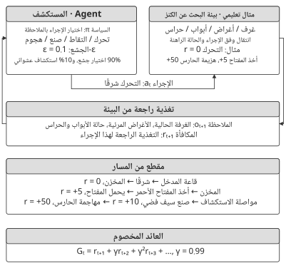

يكوّن التفاعل المتواصل **مسارًا (trajectory)** يضم ملاحظات كل خطوة وإجراءاتها ومكافآتها ومعلومات الإنهاء؛ وإذا استطاع نظام التدريب الحصول على حالة البيئة، أمكن تسجيلها معها أيضًا. تحدد السياسة كيف يتصرف الوكيل، أما **دالة القيمة (Value Function)** فتقدّر العائد المستقبلي المتوقع إذا انطلق الوكيل من الحالة الحالية وواصل التنفيذ وفق سياسة معينة.

تحدد الحدود بين الوكيل والبيئة نطاقُ النظام الذي يُختار عند النمذجة. فالنموذج وHarness اللذان يناقشهما هذا الكتاب يقعان داخل الوكيل، وتصله واجهات الأدوات بالتطبيقات والأجهزة والخدمات الخارجية. فطلب تعديل ملف مثلًا يصدر عن الوكيل، وينفذ نظام الملفات الكتابة، ثم تعيد الأداة نتيجة التنفيذ إلى الوكيل.

وفي أثناء التعلم ينبغي توزيع الفرص بين **الاستكشاف والاستغلال (Exploration–Exploitation)**. فالاستكشاف يعرّض السياسة لإجراءات لم تألفها بعد، والاستغلال يختار الإجراء الذي يُقدَّر حاليًا أنه الأفضل. وفي المهام ذات المكافأة المؤجلة يلزم أيضًا الحكم على أي الخطوات المبكرة أسهمت في النتيجة النهائية، وهذه هي مسألة تخصيص الاستحقاق (credit assignment) التي سنناقشها لاحقًا.

ولفهم أي طريقة من طرق RL يمكن أن نبدأ بفحص خمسة عناصر:

- **فضاء الإجراءات**: ما المسموح بإخراجه. تستخدم ألعاب الرقعة نقلات منفصلة، ويمكن أن يستخدم التحكم في الروبوت أهدافًا متصلة للمفاصل؛ وقد تخضع الإجراءات أيضًا لقيود الحالة والحدود الفيزيائية والصلاحيات.
- **السياسة**: القاعدة التي تختار الإجراء بناءً على الحالة أو الملاحظة أو التاريخ. وقد تكون جدولًا أو شبكة عصبية.
- **إشارة المكافأة**: التغذية الراجعة التي يُعبَّر بها عن هدف التدريب. تسهم مكافأة كل خطوة في تكوين العائد طويل المدى، وقد تقبل السياسة كلفة حالية من أجل مكسب مستقبلي.
- **دالة القيمة**: تقدّر العائد اللاحق، ويمكن استخدامها لمقارنة الإجراءات أو لبناء إشارة تحديث السياسة. والخوارزمية المحددة هي التي تقرر ما إذا كانت تتعلمها صراحة.
- **نموذج البيئة**: يتنبأ بالحالة أو الملاحظة أو المكافأة بعد الإجراء. تستعين الطرق القائمة على النموذج بنموذج بيئة معروف أو متعلَّم في التخطيط، أما الطرق الخالية من النموذج فتتعلم السياسة أو القيمة مباشرة من بيانات التفاعل.

يختار الجدول 8-3 من هذه المفاهيم البيئة والإجراء والهدف، ليقارن بين عدة أنظمة مألوفة. وعند قراءة السطرين الأولين يمكن فهم «الحفاظ على التوازن» و«مساحة التنظيف» على أنهما هدفان قد نختارهما عند نمذجة المهمة.

الجدول 8-3 مقارنة العناصر الأساسية في أنظمة وكلاء مختلفة

| نوع الوكيل | البيئة الخارجية | تمثيل الإجراء | أمثلة على المكافأة أو الهدف |
| --- | --- | --- | --- |
| ظبي حديث الولادة | التضاريس والجاذبية وديناميكا الجسم | تحكم متصل في العضلات | الحفاظ على التوازن، وتجنب السقوط |
| روبوت تنظيف أرضيات | الغرف والأرضية ومحطة الشحن | الحركة والتنظيف والعودة للشحن ومعاملات التحكم | مساحة التنظيف، والبطارية، وكلفة الاصطدام |
| وكيل شطرنج | الرقعة والخصم وقواعد التوقيت | النقلات القانونية في الحالة الراهنة | فوز +1، خسارة −1، تعادل 0 |
| وكيل خدمة عملاء | المستخدم وقاعدة بيانات الأعمال وواجهات الخدمة | نص الرد والاستعلامات واستدعاءات الأعمال | حل المشكلة، والالتزام بالإجراءات، ومدة المعالجة |
| وكيل مساعد برمجي | مصدر المتطلبات وقاعدة الشيفرة وبيئة التنفيذ | البحث والتحرير والتشغيل والرد | نتائج الاختبار، وإتمام المهمة، والتراجعات، والكلفة |

تختلف هذه الأنظمة في تمثيل الإجراء. فألعاب الرقعة تختار عادةً إجراءً منفصلًا واحدًا في كل خطوة، والروبوت يُخرج كميات تحكم متصلة بأبعاد محددة، أما LLM فيولّد أولًا تسلسلًا من الرموز، ثم تحلله الواجهة إلى رد أو استدعاء أداة. ويمكن أيضًا إدخال الحساب الداخلي في نمذجة السياسة، وتسجيله منفصلًا عن تنفيذ الأدوات الذي يغيّر الحالة الخارجية فعلًا.

### تمثيلان للإجراء: إعداد RL الكلاسيكي والسياسة متغيرة الطول في LLM

تصف **عملية اتخاذ القرار الماركوفية (Markov Decision Process، MDP)** مسائل القرار بالحالات والإجراءات والانتقالات والمكافآت. وتشترط خاصيتها الماركوفية أنه متى عُرفت الحالة الحالية والإجراء، لم يعد التنبؤ بالحالة التالية والمكافأة يحتاج إلى الاعتماد على التاريخ؛ فالمعلومات ذات الصلة بالتنبؤ في التاريخ متضمنة أصلًا في الحالة الحالية. وفي الشكل 8-2 تظهر المشكلة إذا اكتفينا بتسجيل الغرفة التي يقف فيها اللاعب: فحتى لو وصل مرتين إلى الباب نفسه، فإن إمكان فتحه يتوقف على ما إذا كان قد حصل على المفتاح.

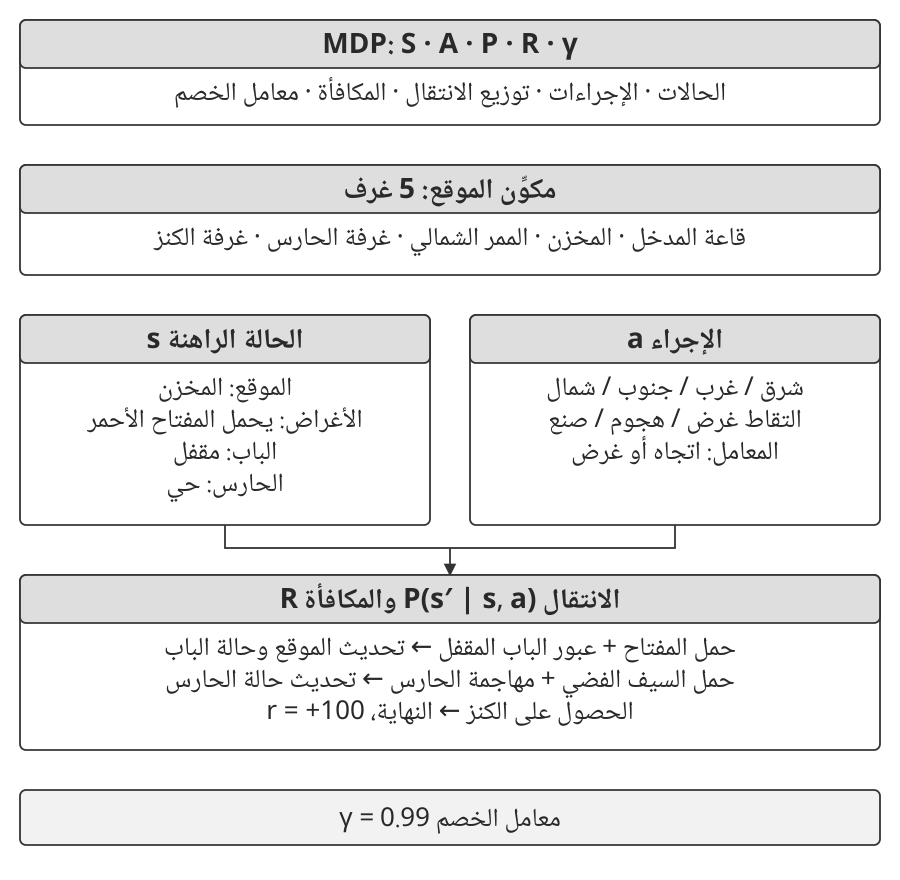

يقدّم الشطرنج مثالًا على تصميم الحالة. فإلى جانب مواقع القطع، يجب تسجيل الطرف الذي عليه الدور، وحق التبييت، وحق الأخذ في المرور، والمعلومات اللازمة للحكم بقاعدة الخمسين نقلة وتكرار الوضع. وبعد إدخال هذه العناصر في الحالة فقط يمكن تطبيق القواعد استنادًا إلى الحالة الحالية. وإذا لم يرَ الوكيل إلا جزءًا منها، فعليه أن يستكمل المعلومات من التاريخ، أو أن يعتمد نمذجة قابلة للملاحظة الجزئية.

تستوعب MDP الإجراءات المنفصلة والمتصلة والمركبة. فلعبة غو فيها 361 نقطة تقاطع على الرقعة، مع مراعاة التمرير وقانونية النقلة؛ وتقدم ألعاب Atari عادةً عددًا صغيرًا من العمليات المنفصلة؛ أما كميات التحكم في الروبوت فتحددها المفاصل والقابض والقيود الفيزيائية. وحين يكون عدد الحالات والإجراءات صغيرًا يمكن تخزين القيم في جدول مباشرة. أما عند اتساع النطاق، فيقدّم تقريب الدوال وتحسين السياسات والبحث طرقًا مختلفة للمعالجة.

**التعلم Q الجدولي: تحديث قيمة الإجراء بتغذية راجعة من خطوة واحدة.** تقدّر $Q(s,a)$ العائد بعد اتخاذ الإجراء $a$ في الحالة $s$. وتحقق قيمة الإجراء المثلى معادلة بلمان للأمثلية:

$$
Q^*(s,a)=\mathbb E\left[r+\gamma\max_{a'}Q^*(s',a')\mid s,a\right]
$$

حيث $r$ مكافأة هذه الخطوة، و$s'$ الحالة التالية، و$\gamma$ معامل الخصم. وفي المهام المستمرة يُختار غالبًا $0\leq\gamma<1$؛ أما المهام ذات النهاية الواضحة والعائد المحدود فيمكن أن يكون فيها 1. ويجعل معامل الخصم الأكبر المكافآت البعيدة تحتفظ بوزن أكبر. والعائد المحسوب من اللحظة الحالية هو $G_t=\sum_{k\geq0}\gamma^k r_{t+k+1}$.

بعد أن يحصل التفاعل الواحد على $r$ و$s'$، يحدّث التعلم Q القيمة وفق المعادلة الآتية:

$$
Q(s,a)\leftarrow Q(s,a)+\alpha\left[r+\gamma\max_{a'}Q(s',a')-Q(s,a)\right]
$$

$\alpha$ معدل التعلم، وما بين القوسين المعقوفين هو الفرق بين «مكافأة خطوة واحدة مضافًا إليها القيمة اللاحقة بعد الخصم» والتقدير الحالي. وعندما تبلغ المهمة حالة الإنهاء تُعدّ القيمة اللاحقة 0. جرّب ذلك مرة في اللعبة المرافقة: أوقف الاضطراب العشوائي، وتحرك من المدخل شرقًا، ثم التقط المفتاح الأحمر في المخزن. التقاط المفتاح يمنح 5 نقاط، وكل خطوة تخصم 0.5 نقطة، فتكون قيمة $r$ التي يعيدها هذا الإجراء 4.5. لنفترض أن التقدير القديم في الجدول لـ«التقاط المفتاح في المخزن» هو 0.25، وأن أكبر قيمة Q بين الإجراءات المتاحة بعد الحصول على المفتاح هي 0.63. بأخذ $\gamma=0.99$ و$\alpha=0.2$ يكون هدف الخطوة الواحدة $4.5+0.99\times0.63=5.1237$. يقترب التقدير القديم من هذا الهدف بمقدار الخُمس، فيصبح 1.22474. وتُسمى هذه الطريقة التي تصحح التقدير بالتغذية الراجعة الفعلية لخطوة واحدة **تعلم الفروق الزمنية (Temporal-Difference Learning، TD)**.

إذا جمعنا قيم Q لجميع الإجراءات في حالة واحدة، أمكن اختيار الإجراء الذي يُقدَّر حاليًا أنه الأفضل. ويرسم الشكل 8-3 هذه السياسة على خريطة شبكية مبسطة. يمثل الرقم في كل خلية قيمة الحالة بعد التطبيع. غطِّ الأرقام بيدك وانظر إلى الأسهم وحدها: هل ما زلت تستطيع الوصول من الزاوية العلوية اليسرى إلى الكنز؟

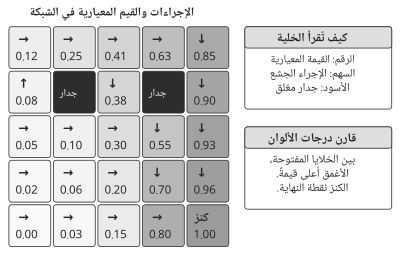

قد يغيّر الاستكشاف التالي اتجاه الأسهم. ويفصّل الشكل 8-4 حساب التقاط المفتاح الأحمر الذي أجريناه للتو: المكافأة التي تحققت في هذه الخطوة تغيّر تقدير «التقاط المفتاح في المخزن»، أما قيم Q لبقية الحالات في الجدول فتنتظر تحديثاتها الخاصة.

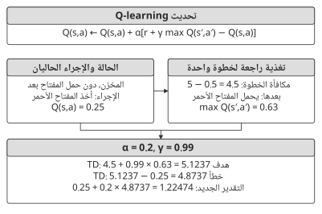

يمكن أن تتضمن سياسة السلوك في التعلم Q استكشافًا عشوائيًا، في حين يستخدم هدف التحديث أكبر قيمة إجراء في الحالة التالية، ولذلك يُعد من التعلم **خارج السياسة (Off-Policy)**.

> **التجربة 8-1 ★: أداء التعلم Q في لعبة البحث عن الكنز**
>
> تتضمن لعبة البحث عن الكنز قواعد خفية مثل المفاتيح والأبواب، وتأثير الأسلحة، وتركيب الأغراض. ويتطلب إنهاء اللعبة إتمام عدة خطوات بترتيب معين، وأقصر مسار 11 خطوة؛ تمنح الإجراءات الحاسمة والفوز مكافآت، أما بقية الخطوات فتغذيتها الراجعة قليلة.
>
> في هذا التدريب على البحث عن الكنز كان معدل التعلم 0.2، ومعامل الخصم 0.99، وانخفض معدل الاستكشاف ε تدريجيًا من 1.0 إلى 0.1. ويعتمد التعلم Q الجدولي استكشاف ε-الجشع: في كل خطوة يختار إجراءً متاحًا عشوائيًا باحتمال ε، وفي بقية الأحوال يختار أحد الإجراءات ذات أكبر قيمة Q حالية. ويُسجَّل في كل مرحلة معدل الفوز، وعدد الحالات المزارة، وعدد خطوات إنهاء اللعبة.
>
> عند قراءة سجلات التدريب والتقييم في تجربة البحث عن الكنز، افصل أولًا بين سؤالين: متى عثرت السياسة ذات الاستكشاف العشوائي على الكنز لأول مرة أثناء التدريب؟ وبعد انتهاء التدريب، هل يستطيع الوكيل إنهاء اللعبة بثبات إذا ثُبّت جدول Q وتصرّف وفق السياسة الجشعة؟ يعكس الأول كيف يكتشف النموذج المسار، ويختبر الثاني قدرته على اختيار الإجراءات وفق القيم التي تعلمها.
>
> في جولة تدريب سابقة، لم ينهِ الوكيل اللعبة في أول 1000 جولة، وكان جدول Q يضم 124 حالة؛ وحتى الجولة 5000 لم يحقق فوزًا مستقرًا، وبلغ عدد الحالات 133؛ وبين الجولتين 7000 و8000 ارتفع معدل الفوز من 34% إلى 96%؛ وعند الجولة 10000 بلغ 100%، وضم جدول Q 145 حالة، وعثر على المسار ذي الخطوات الإحدى عشرة.
>
> لماذا تأخر التقدم في البداية ثم ارتفع معدل الفوز بسرعة بعد ذلك؟ يكتشف الاستكشاف أولًا الإجراءات والمسارات الحاسمة، ثم تنقل الزيارات اللاحقة عائد نقطة النهاية تدريجيًا إلى الحالات السابقة. وتستغرق المحاكاة الصغيرة كلها نحو 10 ثوانٍ، ولذلك تحتمل قدرًا كبيرًا من التفاعل المتكرر.
>
> عند التحليل سجّل زمن الحساب وعدد التفاعلات معًا. فالإجراء الواحد في اللعبة رخيص؛ أما في المتصفح أو الهاتف أو الجهاز المادي، فالتفاعل الواحد يتضمن أيضًا الانتظار والكلفة وتغيّر الحالة. ثم إن الجدول مرتبط بترميز محدد للحالة، فإذا تغيرت القواعد أو الخريطة وجب التحقق من جديد مما إذا كانت القيم القائمة ما زالت صالحة. وستقارن التجربة التالية كيف يمكن لمعرفة التدريب المسبق أن تغيّر نقطة انطلاق الاستكشاف.

**النموذج اللغوي الكبير المدرَّب مسبقًا: تمثيل الحساب والإجراء باللغة.**

يستطيع LLM أن يولّد حسابًا وسيطًا قبل استدعاء الأداة، ويستطيع أيضًا أن يُخرج الاستدعاء مباشرة. وكلاهما يُمثَّل بتسلسل من الرموز، لكن دوريهما مختلفان: فالحساب الوسيط يغيّر السياق المتاح للنموذج فيما بعد، أما استدعاء الأداة فيغيّر البيئة الخارجية أو يقرؤها بعد تنفيذه. ويمكن عند التدريب تسجيل هذه المخرجات وفق البروتوكول، وتقييمها في ضوء نتيجة المهمة وكلفة الحساب. وبهذا يصبح «كم يفكر، وفيم يفكر، ومتى يستدعي الأداة» اختيارات يمكن للسياسة نفسها أن تتعلمها، وسيدور AdaptThink لاحقًا حول ميزانية الاستدلال.

تأتي التسلسلات متغيرة الطول بفضاء تركيبي أوسع. فالنموذج يستطيع أن يكتب استعلامات وبرامج ومعاملات JSON واشتقاقات متعددة الخطوات، ويقيد الميزانيةُ والسياقُ طولَ التسلسل. ويوفر التدريب المسبق نقطة انطلاق للبحث: فالمواد الرياضية تتضمن كثيرًا تحليل الشروط والحساب، والشيفرات والنقاشات تتضمن كثيرًا تحديد الموضع والتعديل والتحقق. ويمكن للنموذج أن يستعير هذه البنى ليولّد مسارات مرشحة، ثم يعدّلها بحسب تغذية البيئة الراجعة. فالمعرفة القائمة تجعل تراكيب الإجراءات المفيدة أسهل في أخذ العينات منذ البداية، وتقلل الحاجة إلى المحاولة والخطأ العمياء بين عدد هائل من المسارات غير ذات الصلة.

خذ مثلًا «تحويل مبلغ بعملة أجنبية إلى الدولار الأمريكي»: فهو يتطلب الحصول على سعر الصرف ثم الحساب. يجعل التدريب المسبق توليد هذه الخطوات المترابطة أسهل على النموذج؛ أما التدريب اللاحق فيمكنه أن يعدّل احتمالات المسارات أكثر استنادًا إلى مصدر سعر الصرف ونتيجة الحساب وقيود المهمة. فالمعرفة اللغوية هنا تقدّم السياسة الابتدائية، والمكافأة تقدّم تغذية المهمة الراجعة.

يقارن الشكل 8-5 بين الإعدادين في هذا القسم: ينطلق التعلم Q الجدولي من ترميز حالة وقواعد استكشاف محددة، وينطلق وكيل LLM من سياسة لغوية مدرّبة مسبقًا، وينظّم ملاحظات الأدوات والخبرات السابقة عن طريق السياق.


ويمكّن التدريب المسبق النموذج أيضًا من تفسير التعليمات الجديدة، وتعديل سلوكه في المهمة بالاستعانة بعدد قليل من العروض. وتصل الأدوات المخرجات اللغوية بالبحث وتنفيذ الشيفرة وعمليات الأعمال. وعند تصميم هذا النوع من الوكلاء ينبغي تحديد واجهات الأدوات وصلاحيات التنفيذ، وبناء تغذية راجعة لنتائج المهمة وكلفة التشغيل والعمليات الحاسمة.

إذا أراد النموذج التحكم في ذراع آلية، فكيف نطبق «التنبؤ بالرمز التالي» على الإجراءات؟ استخدم OpenVLA نحو 970 ألف عرض حقيقي للروبوتات. فإذا أخذنا خطوة واحدة من عرض ما، كان المدخل صورة الكاميرا في تلك اللحظة وتعليمات المهمة، وكان هدف التدريب الإجراء الذي نفّذه صاحب العرض بعدها. فمقدار تحرك الذراع أفقيًا مثلًا قيمة عددية متصلة في الأصل. يقسم OpenVLA كل بُعد من أبعاد الإجراء إلى 256 درجة، ويمثل بالرمز الدرجة التي تقع فيها القيمة. وبهذا يستطيع النموذج أن يتنبأ برموز الإجراء واحدًا تلو الآخر، ولا يحسب الخسارة إلا في هذه المواضع.[^ch8-21]

ويقدّم هذا المثال أيضًا طريقة للتمييز بين الاستنساخ السلوكي (behavior cloning) والتعلم المعزز: انظر إلى الإشارة التي تدفع النموذج إلى التحديث. يتعلم OpenVLA من سجلات العروض، وكلما ارتفع الاحتمال الذي يمنحه النموذج لرموز الإجراء في العرض انخفضت الخسارة، وهذا ضبط دقيق تحت الإشراف. أما في SimpleVLA-RL في التجربة 8-13، فتجرّب السياسة الإجراءات فعليًا في البيئة، ثم تعدّل اختياراتها المقبلة بحسب مكافأة المهمة.

> **من الخوارزمية والبيئة إلى المعرفة المسبقة**
>
> استعرض ياو شون‌يو في مقالته «The Second Half» تطور RL من خلال ثلاثة محاور: الخوارزمية والبيئة والمعرفة المسبقة (prior).[^ch8-2] واستنادًا إلى ذلك يلخص المؤلف تحوّل الاهتمام في ثلاث مراحل: في 2015–2016 انصبّ التركيز على تحسين الخوارزميات، وفي 2016–2018 ازداد الاهتمام ببناء البيئات، ومنذ 2018 بدأ الإدراك التدريجي لقيمة المعرفة المسبقة المكتسبة من التدريب المسبق. وفّرت Gym واجهة موحدة للبيئات، واستكشفت Universe وWorld of Bits مهام الحاسوب والويب، وأظهرت مشروعات مثل Dota 2 القدرة على التدريب في بيئات معقدة. ثم أظهر GPT-2 وGPT-3 ما يراكمه التدريب المسبق اللغوي من معرفة وقدرة تعبيرية، واستفادت أنظمة مثل WebGPT وChatGPT من نقطة الانطلاق هذه أكثر. فالمعرفة المسبقة التي تحتاج إليها المهمة يمكن اكتسابها أولًا بالنمذجة اللغوية، ثم يتولى RL تحسين السلوك المحدد.
>
> ويوافق المؤلف على ترتيب الأولويات الهندسية هنا: **المعرفة المسبقة، ثم البيئة، ثم الخوارزمية**. افحص أولًا ما يملكه النموذج من معرفة وقدرات، ثم ابنِ البيئة والتغذية الراجعة المناسبتين، وأخيرًا اختر طريقة التحسين الملائمة لهما. يرتب الشكل 8-6 محاور الاهتمام البحثي بحسب ترتيب ظهورها، أما عند تنفيذ المشروعات فيمكن عكس الترتيب، والانطلاق من القدرات القائمة.
>
> 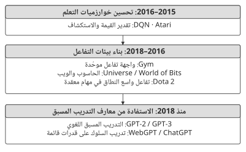

> **التجربة 8-2 ★★: دراسة مقارنة بين RL التقليدي ووكيل LLM**
>
> نقارن في لعبة البحث عن الكنز نفسها بين التعلم Q الجدولي ووكيل LLM. يستخدم إعداد LLM نموذج Kimi K3، ويحتفظ في السياق بما لا يزيد على 50 خبرة. وكلاهما يختار في كل خطوة إجراءً واحدًا من الإجراءات المتاحة التي تقدمها البيئة. ومن خلال المسارين في الشكل 8-7 يمكن أن نرى كيف يتخذ كل من جدول Q والنموذج اللغوي هذا الاختيار.
>
> 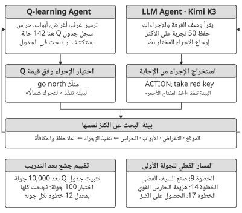
>
> في سجل التشغيل المرافق لـ Kimi K3، استغرق الوكيل 17 خطوة في الجولة الأولى. التقط أولًا السيف الصدئ، فوجد الباب الشمالي مقفلًا، فاتجه إلى المخزن وأخذ المفتاح الأحمر والبلورة السحرية، وفي الخطوة 9 دمج السيف والبلورة ليصنع سيفًا فضيًا. وحين حاول في الخطوة 12 استخدام المفتاح، أخبرته البيئة أنه «يُستخدم تلقائيًا عند الحاجة»؛ وفي الخطوة 13 اتجه شمالًا فانفتح الباب فعلًا. وبعد أن هزم الحارس بالسيف الفضي في الخطوة 14، حاول استخدام السيف مرة أخرى، فأخبرته البيئة أنه لا يمكن استخدامه الآن. وفي الخطوة 17 حصل على الكنز. وعند قراءة هذا السجل يمكنك أن تغطي السطر التالي، وتخمّن أولًا بناءً على التغذية الراجعة الحالية أي خطوة ما زالت ضرورية.
>
> بمطابقة كل إجراء مع الملاحظة في حينها، يمكن تحليل كيف يستخدم النموذج معارف قائمة مثل «المفتاح يفتح الباب» و«السلاح يواجه الحارس»، وكيف تغيّر تغذية الأدوات الراجعة الخطط اللاحقة. أما الحل الجدولي فيراكم هذه العلاقات عبر زيارات الحالة–الإجراء.
>
> في هذه المقارنة استغرق تدريب التعلم Q على 10000 جولة 2.12 ثانية، ثم قُيّم وحده على 100 جولة بالسياسة الجشعة، فأنهاها كلها بمتوسط 12 خطوة. أما Kimi فاستدعى النموذج 17 مرة في الجولة الواحدة، واستغرق 6 دقائق و56 ثانية. ومن هنا يعتمد المؤلف مبدأ للاختيار: حين تكون المحاكاة رخيصة ويمكن تكرارها بكثرة، يمكن الانتفاع الكامل باستكشاف RL التقليدي؛ وحين يتطلب كل تفاعل انتظارًا أو كلفة أو عملية فعلية، تُقدَّم السياسات القادرة على الانتفاع بالمعرفة القائمة، لرفع قيمة كل تفاعل.

تربط هاتان التجربتان هذا الفصل بالأساليب الهندسية السابقة: فالسياق يستطيع تنظيم الخبرة داخل تشغيل واحد، والذاكرة الخارجية تستطيع حفظ الخبرة عبر المهام، أما التدريب اللاحق فيغيّر السياسة بتحديث المعلمات. وفيما يلي نستكمل أولًا العملية الأساسية للتدريب المسبق اللغوي والبصري، ثم نناقش بيانات التدريب وطرق التحسين المحددة.

## أساسيات التدريب المسبق للنموذج `[قراءة اختيارية]`

يبني التدريب المسبق التمثيلات الأولية للنموذج وتوزيع توليده، ويواصل التدريب اللاحق تعديل المعلمات انطلاقًا من هذه النقطة. ولفهم نقطة الانطلاق هذه، يمكن أن نلاحظ أولًا كيف يتعلم نموذج لغوي صغير من النص، ثم كيف يُوصَل بالمدخلات البصرية.

يمر النص أولًا بـ **التقسيم إلى رموز (Tokenization)**، فيتحول إلى رموز منفصلة. فعبارة «أحب البرمجة» مثلًا يمكن تمثيلها توضيحيًا بوحدتين هما «أحب» و«البرمجة»، أما التقسيم الفعلي فيحدده المقسِّم. ويتخذ التدريب الرموز السابقة سياقًا، فيتنبأ بالرموز اللاحقة، ويحسب الخسارة ويحدّث المعلمات. وفي الشكل 8-8 غطِّ جملة التدريب حتى كلمة «البيئة»، وخمّن الكلمة التالية، ثم اكشف النص الأصلي. وإذا حرّكت هذا الموضع إلى الأمام، حصلت على سؤال التنبؤ التالي.

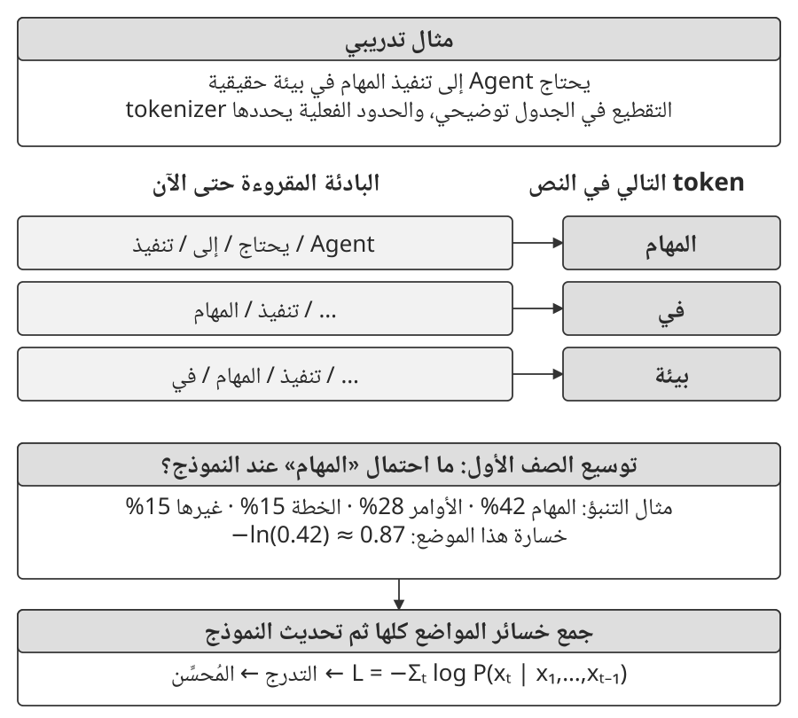

بعد النمذجة اللغوية الأساسية، يمكن إضافة عروض تعليمات لتدريب تنسيق الإجابة وسلوك المهمة؛ ويمكن أيضًا استخدام بيانات التفضيل لرفع احتمال الإجابات الأكثر قبولًا بطرق مثل DPO.

> **التجربة 8-3 ★★: تدريب LLM من الصفر — قوة تحسين الخوارزميات**
>
> نأخذ MiniMind 2 الذي يضم نحو مئة مليون معلمة مثالًا، فننجز التدريب المسبق وSFT وتحسين التفضيلات على GPU استهلاكية. ونقارن خط الأساس بإعداد أضيف إليه QK Norm ومحسِّن Muon، ونلاحظ انخفاض الخسارة، والزمن اللازم لبلوغ الجودة المستهدفة، والنتائج المولّدة. وقد سجّل الملخص المرافق تسريعًا في التقارب بنحو 3 أضعاف، واستغرق التدريب الكامل نحو 14 ساعة بكلفة تقارب 34 دولارًا.
>
> يضبط QK Norm المقياس العددي للاستعلامات والمفاتيح في الانتباه، ويغيّر Muon طريقة تحديث المعلمات المقابلة أثناء التحسين.
>
> نلاحظ مجموعة الأسئلة نفسها مرحلة بعد مرحلة: يستطيع النموذج بعد التدريب المسبق أن يجيب عن أسئلة مثل «ما أعلى قمة في العالم»؛ وبعد SFT يتحسن اتباع التعليمات وتنظيم المخرجات؛ ويواصل تحسين التفضيلات التأثير في الإجابات الوقائعية وفي التعبير.

> **التجربة 8-4 ★★: درّب VLM بنفسك**
>
> يعرض الشكل 8-9 الوصل بين «المرمِّز البصري–طبقة الإسقاط–النموذج اللغوي». يستخرج المرمِّز البصري، مثل CLIP، سمات الصورة، وتحوّل طبقة الإسقاط هذه السمات إلى الأبعاد والتمثيل اللذين يتطلبهما مدخل النموذج اللغوي، ثم يجمع النموذج اللغوي بين هذه المدخلات ليولّد وصفًا أو إجابة.
>
> 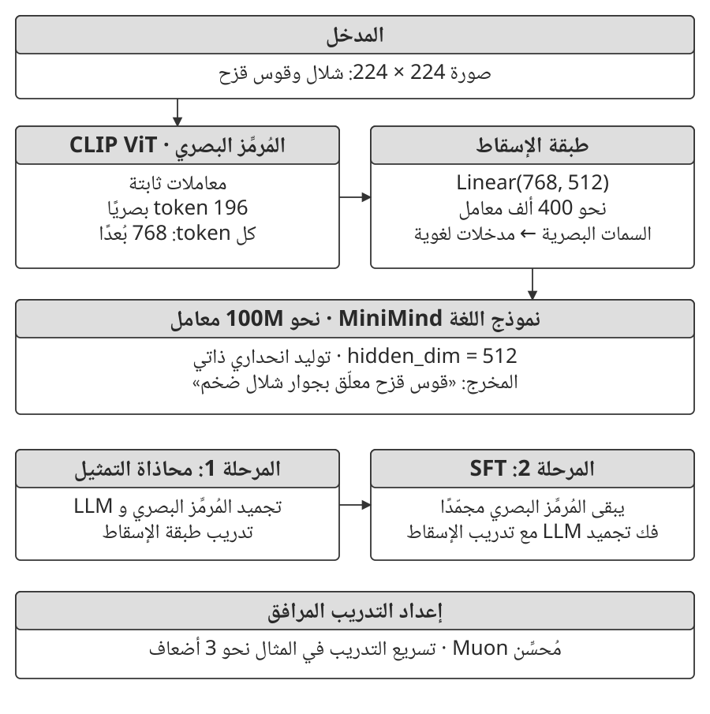
>
> في المرحلة الأولى يُجمَّد المرمِّز البصري وLLM، وتُدرَّب طبقة الإسقاط المضافة حديثًا، حتى تتمكن سمات الصورة من المشاركة في التنبؤ اللغوي؛ وفي المرحلة الثانية يُفك تجميد LLM بحسب الإعداد، ويُجرى SFT ببيانات عالية الجودة من أزواج الصورة–الوصف أو الأسئلة والأجوبة. ونلاحظ كلًّا على حدة التغيّر في التعرف على الأشياء، ووصف التفاصيل، والحكم على العلاقات، والقدرة اللغوية.
>
> تعيد هذه البنية استخدام نماذج بصرية ولغوية قائمة، وتركّز التدريب أولًا على وحدة الوصل بين الوسائط، وهي خطة جديرة بأن تُجرَّب أولًا حين تكون الميزانية محدودة. يقلل تجميد الأوزان الحالات القابلة للتدريب، ثم يُفك تجميد الوحدات المناسبة لاحقًا بحسب حاجة المهمة. وإذا أخطأ الوصف، فافحص أولًا ما إذا كانت معلومات الشيء قد دخلت التمثيل البصري؛ فإذا كانت المعلومات موجودة والنموذج عاجز عن الانتفاع بها، فينبغي التركيز على فحص القدرة التعبيرية لطبقة الإسقاط، وبيانات المواءمة، والإشراف على التوليد اللغوي. وإذا حُوّلت المخرجات أيضًا إلى تمثيل للإجراءات وطوبقت مع واجهة التحكم، وصلنا إلى بنية VLA في الفصل السادس.

تعرض التجربتان على التوالي كيف يؤثر إعداد التحسين والوصل بين الوسائط في التدريب. وحين تكون الميزانية محدودة، يوصي المؤلف بالمقارنة أولًا بين العوائد التي تحققها تحسينات الخوارزمية والبنية، ثم تقرير ما إذا كان ينبغي توسيع حجم النموذج. وحين يدخل نموذج قائم لغة جديدة أو مجالًا جديدًا، يمكنه أيضًا أن يواصل التعلم من أوزان التدريب المسبق؛ ويناقش القسم التالي كيف تُختار البيانات لهذا النوع من التدريب.

## Mid-training: استكمال المعرفة والقدرات الأساسية

يُقصد بـ **Mid-training** في هذا الفصل مرحلة من تدريب النموذج اللغوي تُجرى على نموذج قائم، وتتمحور حول التوزيع المستهدف. يشارك في الإشراف عدد كبير من الرموز في الوثائق أو الشيفرات أو الاشتقاقات، ويمكن أثناء التدريب مزج نصوص المجال المستهدف بنصوص عامة. وقد أظهرت أبحاث DAPT/TAPT أن مواصلة التدريب المسبق على نصوص متصلة بالمجال أو المهمة تفيد المهام اللاحقة.[^ch8-30]

ينطلق اختيار البيانات من نوعين من الفجوات. الأول فجوة في تغطية المعرفة واللغة، كأن يكون اطّلاع النموذج قليلًا على بروتوكولات المؤسسة أو مصطلحات اللغة المستهدفة أو قاعدة شيفرة بعينها؛ والثاني فجوة في القدرات الأساسية التي تتطلبها المهمة، مثل تتبع الحالة في سياق طويل، أو دمج العلاقات بين وثائق متعددة، أو إتمام اشتقاقات شيفرة طويلة. فميّز أولًا بحسب نوع الخطأ بين مشكلات الفهم والمعرفة والتنسيق والفعل، ثم حدد المواد التي ينبغي استكمالها.

وبعد انخفاض الخسارة على نصوص المجال، ينبغي أيضًا التحقق مما إذا كان النموذج يستطيع استخدام المعرفة التي تعلمها في المهام الفعلية. فترتيب مواصلة التدريب والتدريب على التعليمات، وطريقة تنظيم الأسئلة والأجوبة، وشكل المواد، كلها تؤثر في توظيف المعرفة.[^ch8-31] وفي مهام المجال التي تعاني نقصًا واضحًا في القدرات الأساسية، يوصي المؤلف بزيادة التغطية أولًا بنصوص المجال، ثم تعليم النموذج بعروض SFT كيف يستخدم هذه المعلومات في المهمة؛ فإذا صار النموذج ينجح أحيانًا لكن بمعدل منخفض، استُثمر حينئذ في RL.

### كيف تُبنى بيانات Mid-training

**الخطوة الأولى: تحديد المواد اللازمة انطلاقًا من توزيع الإخفاقات.** يُقيَّم النموذج بحسب الموضوع واللغة ونوع الوثيقة ونمط الشيفرة وطول السياق كلٌّ على حدة، ويُستعان بـ Pass@1 وPass@k وأمثلة الأخطاء لتحديد الشروط التي يفتقر فيها النموذج إلى حل صالح. فمشكلات تنسيق المعاملات يمكن أن تُترك لعروض الواجهات، أما فجوات المفاهيم والعلاقات المجالية فتحتاج إلى النصوص المناسبة.

**الخطوة الثانية: تنظيم نصوص عالية الكثافة.** تقدم الوثائق الأصلية المصطلحات والعلاقات الوقائعية، وتقدم مستودعات الشيفرة بنية الوحدات واعتمادياتها، وتبسط الاشتقاقات على طريقة الكتب الدراسية وإعادات الصياغة المركّبة الخطواتِ الضمنية، وتربط العينات العابرة للوثائق المعلوماتِ المتفرقة. وبعد إتمام تصفية الجودة وإزالة التكرار وعزل مجموعة التقييم، تُبنى تسلسلات التدريب.

**الخطوة الثالثة: مزج البيانات بحسب القدرة المستهدفة.** يمكن أن تأتي النصوص الطويلة الطبيعية من الكتب والوثائق ومستودعات الشيفرة؛ ويمكن إضافة بيانات مهام مصحوبة بالاشتقاقات للاسترجاع والاستدلال متعدد القفزات واتباع التعليمات والتجميع والإحصاء؛ ويمكن إضافة مسارات التخطيط واختيار الأدوات وبناء المعاملات وتتبع الحالة والتعافي من الأخطاء من أجل الوكيل. وقد تأتي هذه المواد من مجموعات بيانات قائمة أو يولّدها نموذج معلّم، وتُصفّى بحسب متطلبات المحتوى والسلوك قبل دخولها التدريب.

**الخطوة الرابعة: إتاحة الفرصة للنموذج ليواصل التمرن على المهام التي كان يجيدها.** مجموعة من العينات تحتفظ بالنصوص القصيرة والنصوص العامة والمسائل الأصلية؛ ومجموعة أخرى تضع المهام نفسها في سياق أطول، وتنقل موضع المعلومات الحاسمة، وتضيف عناصر مشتتة. وعند المزج بين المجموعتين يمكن الاسترشاد بتوزيع بيانات التدريب الأصلية، أو تجربة عدة نسب باستخدام نصوص عامة مثل FineWeb-2، ثم التعديل بحسب نتائج التقييم.

**الخطوة الخامسة: تقرير المواصلة أو التوقف بمؤشرات متعددة.** تُسجَّل في الوقت نفسه خسارة التدريب، ومهام المجال المحجوزة، والقدرات العامة، واتباع التعليمات الأصلي، ومعدل النجاح في المهمة المستهدفة. فإذا تحسنت نتائج المجال وتراجعت القدرات العامة، قورنت نسب المزج ومعدل التعلم وكمية التدريب؛ وإذا انخفضت الخسارة وتوقفت المهمة المستهدفة عن التحسن، فُحص ما إذا كانت مواد التدريب قادرة على تعليم النموذج إنجاز هذا النوع من المهام، وما إذا كانت هناك حاجة إلى عروض توضح توظيف المعرفة في المهام الفعلية.

لنفترض أن النموذج يستطيع أن يجد رقم طلب محددًا في سجل طلبات طويل جدًا. فإذا غيّرنا السؤال إلى «أي عميل طلب مرات عدة ثم ألغى طلباته كلها؟»، فعليه أن يجمع كل طلبات العميل الواحد، ويطابق الطلبات مع سجلات الإلغاء واحدًا واحدًا. يمكن أن يستخدم السؤالان السجل نفسه، لكنهما يختبران قدرتين مختلفتين. يستخدم RULER مهام مركّبة للتحكم في طول المدخل وصعوبة المهمة كلٍّ على حدة، فيقيس الاسترجاع المفرد والتتبع متعدد القفزات والتجميع منفصلة. وقد قيّم مؤلفوه 17 نموذجًا، فكان كثير منها يقترب من الدرجة الكاملة في الاسترجاع البسيط، لكن أداءه الإجمالي انخفض بوضوح مع ازدياد طول المدخل.[^ch8-ruler]

ولمعرفة ما إذا كان هذا الفرق يظهر في المواد الفعلية، يمكن الانتقال إلى أسئلة LongBench v2 عن الوثائق المتعددة والمحادثات الطويلة ومستودعات الشيفرة. ولفحص قدرة النموذج وحدها على تذكر متطلبات مثل تنسيق المخرجات، يمكن أخذ تعليمات قابلة للتحقق من IFEval ووضعها في مواضع مختلفة من مواد أطول. وعند المقارنة بين نموذجين يجب أن يرى كلاهما التعليمات في المواضع نفسها مع المحتوى المشتت نفسه، وأن يُذكر أن هذا اختبار مبني ذاتيًا. وأخيرًا تُستخدم مهام وكيل شاملة من الطرف إلى الطرف لفحص قدرة هذه القدرات على العمل معًا. وعند تصميم مجموعة التقييم، يمكن فحص الأبعاد الآتية واحدًا تلو الآخر.[^ch8-longbench]

[^ch8-ruler]: Hsieh وآخرون، RULER، 2024.
[^ch8-longbench]: Bai وآخرون، LongBench v2، ACL 2025. يقدّم البحث ستة أنواع من المهام، تضم 503 أسئلة اختيار من متعدد.

- **الموضع والاسترجاع**: هل يعثر النموذج على معلومة حاسمة واحدة أو عدة معلومات حين تقع في البداية أو الوسط أو النهاية.
- **العلاقات والاستدلال**: تتبع العلاقات عبر الفقرات والوثائق المتعددة، وحل التناقضات، وتركيب الأدلة.
- **التجميع والإحصاء**: العدّ والتصنيف والترتيب والمقارنة واستخلاص الاتجاهات في الجداول والسجلات الطويلة.
- **اتباع التعليمات**: المتطلبات المتعددة، ومعالجة التعارض، والشروط الإجرائية، وتنسيق المخرجات.
- **الاستدلال ذو السلاسل الطويلة**: سلاسل الاعتماد الطويلة في مهام الرياضيات والمنطق والشيفرة.
- **السلوكيات الأساسية للوكيل**: تفكيك المهمة، واختيار الأدوات، وتوليد المعاملات، والحفاظ على الحالة، والتعافي من الإخفاق.

يُطيل الاستدلال الطويل واستدعاء الأدوات متعدد الجولات السياقَ باستمرار، ومع ذلك تظل التعليمات والحقائق وحالة المهمة السابقة مشاركة في القرارات اللاحقة. فإذا عجز النموذج عن العثور على المعلومات في النص الطويل أو عن التمسك بالقيود، صعب على الوكيل طويل المدى أن يعمل بموثوقية. وقبل توسيع ميزانية التدريب، ينبغي مقارنة نسب مزج البيانات وكميات التدريب بإعدادات صغيرة. وفي الحقائق التي تتحدث كثيرًا وتتطلب ذكر المصدر، يقدّم المؤلف RAG؛ أما المعرفة المجالية المستقرة واسعة النطاق والقدرات الأساسية، فيُنظر في كتابتها في المعلمات بمواصلة التدريب.

> **التجربة 8-5 ★★: تعلّم لغة جديدة بمواصلة التدريب المسبق**
>
> ننطلق من Mistral 7B v0.3، ونرفع قدرته في اللغة الكورية بمواد مثل ويكيبيديا الكورية. يبدأ التدريب بمزيج من نحو 80% كورية و20% إنجليزية، ثم يُجرى SFT ببيانات تعليمات كورية، ويُلاحظ التغير في النمذجة اللغوية وفي سلوك المحادثة كلٌّ على حدة.
>
> تزيد البيانات الكورية تغطية اللغة المستهدفة، وتُستخدم البيانات الإنجليزية للحفاظ على القدرات الأصلية. وفي كل مرحلة يُختبر النموذج بالمجموعة نفسها من الأسئلة الكورية والإنجليزية التي لم تدخل التدريب. وفي النتائج المرافقة تحسنت درجات التقييم الأعمى للكورية في المرحلة الأخيرة، وتراجعت القدرة الإنجليزية بعض الشيء، وهذا يقدم اتجاهًا محددًا للجولة التالية: مزج قدر أكبر من مواد التدريب الإنجليزية أو خفض شدة التحديث.
>
> تسجيل اللغة المستهدفة واللغة الأصلية وجودة الحقائق منفصلة يسمح بالحكم على المكاسب والكلفة؛ ثم يُفحص في مرحلة SFT ما إذا كان النموذج قادرًا على تنظيم إجاباته وفق تعليمات كورية. وبهذا يمكن ملاحظة أثر مواصلة التدريب المسبق وأثر الضبط على التعليمات كلٍّ على حدة.

## SFT (الضبط الدقيق تحت الإشراف)

قد تجعل نصوص المجال النموذج يرى واجهة ما مرات أكثر، لكن لتعليمه تصحيح المعاملات بعد إخفاق الاستدعاء يمكن أيضًا تقديم عرض توضيحي مباشر لذلك. يعطي SFT مدخل المهمة، ويدرّب النموذج رمزًا برمز على توليد الإجابة أو الإجراء الوارد في العرض. وعند النظر إلى الشكل 8-10، فكّر أولًا في السلوك الذي تريد تعليمه، ثم قرر كيف تجمع العروض. فالحقائق والنبرة وتنسيق المخرجات في العروض تدخل التدريب معها أيضًا.

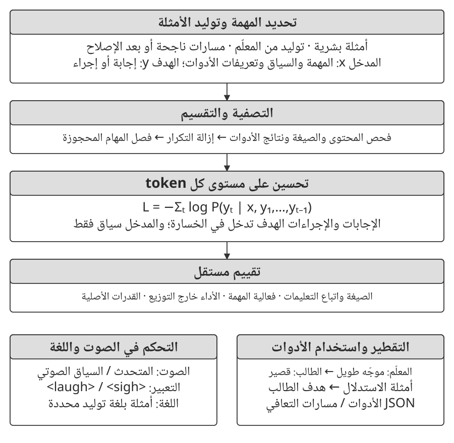

تأتي البيانات عادةً من ثلاثة مصادر: خبراء بشريون يحددون السلوكيات الحاسمة وحدودها، ونموذج معلّم يكتب العروض بالجملة، ومدقق يصفّي المخرجات الصالحة من عينات النموذج. ويمكن الجمع بين المصادر الثلاثة. فمثلًا يكتب الخبراء أولًا عددًا قليلًا من عروض استدعاء الأدوات، ثم يغيّر المعلم شروط المهمة ليولّد مزيدًا من العينات، وأخيرًا تُفحص المعاملات ونتائج التنفيذ وقيود الأعمال.

**من استخدامات SFT تعليمُ النموذج الممارسات التي تُكتب مرارًا في الموجّهات والمهارات (Skills).** خذ مثلًا تقييم الذاكرة في الفصل السابع: لنفترض أن دليل التقييم مع السوابق يبلغ عشرة آلاف رمز. يقيّم المعلم، استنادًا إلى الدليل الكامل، مجموعة من الإجابات، فيوضح كيف يتعامل مع حالات مثل تشابه أسماء الأشخاص، أو انعكاس العلاقات، أو قصور الأدلة. وعند تدريب الطالب لا يبقى في المدخل إلا اسم مختصر لبند التقييم، ومواد التاريخ الخاصة بالمرة الحالية، والإجابة المراد تقييمها، ويكون المخرج المستهدف هو الدرجة التي اختارها المعلم. وبعد النشر لا يلزم إلا موجّه قصير ومواد المرة الحالية، فتوفّر كل عملية استدلال تلك التعليمات الثابتة البالغة عشرة آلاف رمز. وفي المهارات التي تُستدعى مرارًا يمكن أيضًا بالطريقة نفسها عرض متى يُرجع إلى المصادر وكيف تُختار الأدوات، ثم تقطير هذه الخطوات المستقرة في النموذج.

يبدأ إعداد البيانات بتحديد توزيع المهام ومخطط المخرجات (schema) وطريقة القبول. وبعد اجتياز العروض الفحص، تُزال التكرارات، وتُضبط نسب الفئات المختلفة من العينات، وتُقسم مجموعات البيانات. وينبغي تصميم عدد العينات ونطاق تغطيتها معًا: فتكرار صيغة السؤال نفسها آلاف المرات يعزز النمط نفسه مرارًا؛ أما بناء التنويعات حول الشروط الحاسمة فيساعد النموذج على اختيار السلوك المناسب مع مدخلات مختلفة. ويبدأ المؤلف بتنقيح دفعة من العروض التي تغطي الحالات الحاسمة، ثم يوسّع الحجم. فـ SFT يتعلم المخرجات المستهدفة رمزًا برمز، فتدخل المعلمات معه أيضًا الحقائق الخاطئة والخطوات الزائدة وعادات العمل غير الملائمة.

> **التجربة 8-6 ★★★: SFT للكلام — من نسخ الصوت إلى نمذجة اللغة المصاحبة `[تجربة موسعة]`**
>
> نأخذ Orpheus وSesame CSM مثالين، فنقارن كيف تشارك شروط المتحدث وسياق المحادثة وعلامات التعبير في توليد الكلام. يمثّل Orpheus الكلام برموز، ويستطيع الاستعانة بمقاطع مرجعية من النص والكلام لتوليد طابع الصوت المقابل، كما يوفر علامات تعبيرية مثل `<laugh>` و`<sigh>`. أما Sesame CSM فيتلقى النص ومعرّف المتحدث ومقاطع صوتية سابقة، ويولّد الكلام اللاحق.[^ch8-speech-conditioning]
>
> عند بناء عينات التدريب، تُسجَّل شروط النص والمتحدث والصوت والتعبير كلٌّ على حدة؛ وتُستخدم مواد المتحدث نفسه عبر جمل مختلفة لتعلم الاتساق، ويُستخدم الضحك والتنهد والتوقف في سياقات متنوعة لتعلم التعبير. وتُقارن المخرجات بلا مرجع، ومع مرجع، ومع شرط تعبيري محدد، ثم تُقيَّم بحسب الدقة والطبيعية والعاطفة وطابع الصوت.
>
> ينبغي أن تغطي البيانات عددًا كافيًا من تركيبات المتحدثين وأنماط الجمل والانفعالات. فإذا قل عدد المتحدثين، فقد تميل المخرجات إلى طابع صوتي واحد؛ وإذا ارتبطت علامة ما دائمًا بالمقطع الصوتي نفسه، فقد يظهر تعبير مكرر آلي.

> **التجربة 8-7 ★★★: التفكير متعدد اللغات — توليد عملية الاستدلال بلغة محددة `[تجربة موسعة]`**
>
> نُجري SFT على gpt-oss-20b، ونحدد بالتعليمات لغة عملية الاستدلال. فمثلًا يطلب `reasoning language: German` توليد نص استدلال بالألمانية. وتتضمن عينات التدريب لغات مثل الإنجليزية والإسبانية والفرنسية، وتُترك الصينية لمرحلة الاختبار.
>
> في الحالة المرافقة، حين حُددت Chinese بعد التدريب، استطاع النموذج توليد عملية استدلال بالصينية. ويمكن مواصلة المقارنة بين ثلاث نتائج: هل اتبع النموذج متطلب اللغة، وهل كانت الإجابة النهائية صحيحة، وكيف تغير طول التوليد وزمنه. ويشترك الأساس متعدد اللغات من التدريب المسبق وطريقة التحكم التي تعلمها SFT في هذا الأداء العابر للغات؛ ويمكن بالمقارنة بين لغات ونماذج أساسية مختلفة مواصلة تحليل دور كل منهما.

> **التجربة 8-8 ★★: تقطير الموجّهات (Prompt Distillation) — استعادة قدرة صالحة بكلفة أقل**
>
> قد تعتمد خدمة أعمال مستقرة على موجّه نظام يبلغ آلاف الرموز، كما يولّد المعلم استدلالًا طويلًا. يجعل تقطير الموجّهات المعلم ينتج أولًا مخرجات عالية الجودة في ظل الشروط الكاملة، ثم يكوّن من أزواج «مدخل المستخدم–الإجابة النهائية» بيانات SFT للطالب. ويستخدم الطالب موجّهًا أقصر، ويجيب مباشرة وفق الإعداد المستهدف.
>
> بفتح أول عينة تدريب نرى أن المعلم Kimi K3 قرأ نصًا عربيًا تتخلله حروف لاتينية، فشرح أسباب حكمه، وقدّم في النهاية رمز اللغة `ar`. أما العرض المقدَّم إلى الطالب SmolLM2-135M-Instruct فلا يتضمن إلا النص الأصلي و`ar`. وفي المجموعة نفسها من 80 سجل اختبار، قرأ المعلم في كل طلب نحو 386 رمزًا في المتوسط، وقرأ الطالب نحو 97. وقد أُحصي كل من الرقمين بمقسِّمه الخاص.
>
> يمكن استخدام سجلات المقارنة المرافقة في التعرف على اللغة للفصل بين «الإجابة الصحيحة» و«مطابقة المخرجات للتنسيق». ولّد المعلم العروض على 160 عينة تدريب، وأجاب إجابة صحيحة عن سجلات الاختبار الثمانين كلها. أما الطالب قبل الضبط فلم يتمكن المقيّم من تحليل أي من مخرجاته في الاختبار، فكانت درجته صفرًا؛ وبعد الضبط أصبحت السجلات الثمانون كلها قابلة للتحليل، وكانت التسمية صحيحة في 76 منها. والصفر في خط الأساس لا يميز وحده بين «لم يتعرف على اللغة» و«تعرف عليها لكنه لم يُجب وفق التنسيق». وتضم مجموعة الاختبار هذه 75 نصًا مختلفًا، ولا يوجد نص متطابق تمامًا بين التدريب والاختبار.
>
> وينبغي أن يحتفظ بناء البيانات أيضًا بالشروط التي يحتاج إليها الطالب لإنجاز المهمة. فإذا كان المعلم يعتمد على أحدث نتائج الأدوات، أمكن تقديم هذه النتائج مدخلًا للطالب، أو الإبقاء على واجهة الأداة؛ وإذا كانت لدى المعلم أخطاء منهجية، فتُصفّى بتحقق مستقل.
>
> حين تكون قواعد المنتج مستقرة، وتوزيع المدخلات واضحًا، وكلفة الاستدعاء مرتفعة، يوصي المؤلف بتقديم تقييم تقطير الموجّهات، لضغط الموجّهات والاستدلال المعالجة مرارًا في المعلمات. أما حين يكون المنتج ما زال في طور الاستكشاف ومتطلبات المهمة تتغير كثيرًا، فيُحتفظ بموجّهات قابلة للتحرير واستدلال صريح، لتسهيل التجريب السريع وتحديد مواضع الأخطاء.

> **التجربة 8-9 ★★★: تقطير سلسلة الأفكار (Chain of Thought، CoT)**
>
> يتخذ تقطير CoT نص الاستدلال الذي يقدمه المعلم مع الإجابة النهائية معًا إشرافًا، فيتعلم الطالب عملية التفكيك والحساب والتحقق والتصحيح. ويُعد تقطير DeepSeek-R1 في سلسلتي Qwen وLlama مثالًا تمثيليًا على هذه الطريقة. ويوصي المؤلف الفرق التي تريد نموذجًا تملك التحكم فيه بنفسها، وتريد في الوقت نفسه ضبط استثمارها في التدريب، بتقديم هذا المسار. فإذا كان المعلم أقوى من الطالب بوضوح في المهمة المستهدفة، توافرت لديه شروط تقديم عروض قيّمة؛ ويمكن البدء بالاختيار من النماذج مفتوحة الأوزان التي يمكن الحصول على مخرجات استدلالها كاملة، ثم مقارنة فجوة القدرة بينها وبين الطالب وجودة البيانات. وحين لا تقدم الواجهة إلا ملخصًا للاستدلال، تقل كذلك المعلومات المتاحة لتقطير العملية.
>
> الخطوة الأولى: نجعل المعلم يقدم عدة حلول للمسألة نفسها. ففي مسائل الرياضيات تُطابق الإجابة أولًا، وفي مسائل الشيفرة تُشغَّل الاختبارات، ولا يُبقى إلا على الحلول التي اجتازت الفحص، وتُسمى هذه التصفية **أخذ العينات بالرفض (Rejection Sampling)**. وإذا استُخدمت الحلول المصفاة في الضبط الدقيق تحت الإشراف، سُمي ذلك **الضبط الدقيق بأخذ العينات بالرفض (Rejection Sampling Fine-Tuning، RFT)**. وإذا كان على الطالب أن يتعلم أيضًا عملية الاستدلال، فيجب بعد ذلك مطابقة الخطوات الوسيطة، واستبعاد العروض التي أخطأت في الاشتقاق ثم أصابت الإجابة مصادفة.
>
> وفي المهام التي يتوافر لها مدقق موثوق، يوصي المؤلف ببناء خط أساس RFT أولًا: فالتوليد والتصفية وSFT تكفي لتكوين مسار تدريب، وتغني عن تنفيذ تحسين السياسة المتصل وتقدير القيمة، ثم يُحكم بناءً على ذلك ما إذا كان الاستثمار الإضافي في RL جديرًا بالكلفة.
>
> الخطوة الثانية: تدريب الطالب. تُنظَّم «المسألة ← نص الاستدلال + الإجابة النهائية» وفق تنسيق المحادثة في النموذج المختار؛ وعند استخدام حدود مثل `<think>` و`</think>` يُحدَّد بوضوح أي الرموز تشارك في الخسارة. ويمكن البدء بطالب من فئة 7B، والمقارنة بين إعدادات المسار الكامل، والمسار المختصر، والإشراف على الإجابة النهائية وحدها.
>
> الخطوة الثالثة: ننظر في ما تعلمه الطالب. في التجربة المرافقة حلّ Kimi K3 أربعًا وعشرين مسألة رياضية من AIME، وأُبقي على مسارات الاستدلال الثلاثة والعشرين التي أصاب فيها، واستُخدمت لضبط Qwen2.5-1.5B-Instruct. وعند حل المجموعة نفسها من المسائل مرة أخرى، انتقل الطالب من إجابة صحيحة واحدة إلى إجابتين، في حين أصاب المعلم في 23 مسألة. وكان الطالب بعد التدريب يعود أحيانًا للتحقق من حسابه، لكن اختبار المقارنة الزوجية مسألةً مسألةً لم يُظهر تحسنًا موثوقًا في معدل الصواب ($p=1.0$).

> **من تجربة تأليف الكتاب: مسار تطوير تجربة التقطير**
>
> استخدم المؤلف في البداية Codex المدعوم بـ GPT-5.6-Sol لتنفيذ تجربة التقطير، فلما واجه الرفض انتقل إلى Claude Code المدعوم بـ Claude Opus 5، فلم يتمكن من المتابعة كذلك. ثم أكمل الشيفرة والتشغيل باستخدام Kimi K3.

تعتمد هذه الحالات الأربع كلها على التعلم تحت الإشراف، لكن كلًّا منها يتعلم محتوى مختلفًا: طابع الصوت وشروط التعبير في الكلام، والتحكم في اللغة في الاستدلال متعدد اللغات، والإجابة المباشرة في تقطير الموجّهات، وعملية حل المسائل في تقطير CoT.

## تركيب بيانات SFT: من العروض التوضيحية إلى مسارات قابلة للتدريب

إذا أردنا أن نصنع من شكوى حقيقية واحدة دفعة من مسائل التدريب، فأي المعلومات يمكن تغييرها، وأي العلاقات يجب الحفاظ عليها؟ نستخرج من مسارات بيئة الإنتاج نية المستخدم والحالة الابتدائية والأدوات المتاحة وقيود الأعمال والإخفاقات الشائعة، وننظمها في قوالب مهام. تُستبدل الهويات والطلبات والملفات وبيانات الاعتماد؛ وإذا كانت المشكلة الأصلية تتعلق بطلبين متشابهين، فيجب عند توليد النسخ الحفاظ على هذه العلاقة التي تقتضي التمييز بينهما. ولا نعرف ما إذا كانت المسألة الجديدة قد احتفظت فعلًا بصعوبة الأصل إلا بتشغيل النسخة في بيئة قابلة لإعادة الضبط.

ويكون المسار الكامل كما يلي: **حالة الإنتاج ← قالب المهمة ← نسخ مركّبة ← عدة مسارات مرشحة ← التحقق من المهمة والمسار ← بيانات التدريب**. ويتولى نوعا التحقق مشكلتين مختلفتين: يفحص التحقق من المهمة ما إذا كانت الشروط كافية، والهدف قابلًا للإنجاز، والنتيجة المرجعية صحيحة؛ أما التحقق من المسار فيطابق مسارًا مسارًا الحالة عند انتهاء المهمة، وترتيب استدعاءات الأدوات، ومدى التزام عملية التنفيذ بقيود الأعمال.

تُستخدم في الشروط القابلة للتنفيذ الاختبارات أو تأكيدات قاعدة البيانات أو فحص فروق الحالة، وتُستخدم في جودة التواصل المفتوح معايير التقييم (Rubric) وحكم النموذج، مع المعايرة بأخذ عينات بشرية. ويمكن، بالجمع بين خرائط المهارات والبيئات القابلة للتنفيذ والمدققات المستقلة، توسيع تغطية المهام على نحو مخطط.[^ch8-12][^ch8-17][^ch8-18][^ch8-19][^ch8-20]

قد يكون العرض المؤهل مسارًا أُنجز بسلاسة، وقد يكون عملية كاملة تتضمن التشخيص والإصلاح. وفيما يخص الإجراءات الخاطئة فيه، ينبغي تحديد دورها في العينة بوضوح، واختيار مواضع الخسارة بحسب هدف التدريب. ويمكن استخدام سجلات الإخفاق أيضًا لبناء أزواج التفضيل، واكتشاف فجوات التغطية، وتوليد مهام التعافي. وعند الانتقال لاحقًا إلى RL، تعيد السياسة الحالية أخذ عينات المسارات، وتتحدث مستفيدة من تغذية البيئة الراجعة.

يُختار أسلوب العزل بين مجموعة التدريب ومجموعة التقييم بحسب الهدف: فالتقييم داخل التوزيع نفسه يمكن أن يكتفي بعزل النسخ المحددة، أما تقييم النقل فيعزل أيضًا قوالب المهام أو فئات العملاء أو الفترات الزمنية. وعند إزالة التكرار يُفحص التكرار التقريبي في المدخلات والحلول؛ وتبقى الإجابات المرجعية والاختبارات المخفية والمعلومات المخصصة للتقييم وحده في جانب التحقق وفق بروتوكول المهمة.

هل يمكن، بعد انتهاء الضبط الدقيق، مراجعة مواد التدريب انطلاقًا من الأوزان؟ لنأخذ نموذج الاستدلال المنشور s1 مثالًا. إذا حُوّلت العينات المنشورة إلى أرقام رموز وفق طريقة التقسيم ومعالجة النص المعتمدة في التدريب، ثم أُزيل التكرار، أمكن الحصول على قائمة. ثم نقارن صفًا صفًا مصفوفة تضمين المدخلات قبل الضبط وبعده، ونسجل الرموز التي تغيرت متجهاتها. وعند مراجعة المؤلف تطابقت القائمتان في 16,573 رقمًا واحدًا واحدًا. ويتطلب هذا الفحص العثور على النموذج الأساسي والمقسِّم الصحيحين، وإدراج موجّه النظام وفق إعداد التدريب، وقص العينات الطويلة؛ كما يتطلب التأكد من أن التدريب يحدّث فعلًا تضمينات المدخلات، وأن تضمينات المدخلات منفصلة عن أوزان طبقة المخرجات. فإذا دُرّب LoRA في طبقات الانتباه وحدها مثلًا، بقيت تضمينات المدخلات على حالها، ولم يعد ممكنًا استخلاص قائمة الرموز المستخدمة منها.[^ch8-token-provenance]

ويمكن رؤية حدود هذا الدليل بثلاثة رموز. لنفترض أن عينتين منشورتين قُسّمتا إلى `[10, 20]` و`[20, 30]`، فتنتج بعد إزالة التكرار المجموعة `{10, 20, 30}`. فإذا أضفنا الآن عينة ثالثة `[30, 10]` وأعدنا الحساب، بقيت المجموعة كما هي تمامًا. فحتى لو تطابق كل رقم عند المراجعة، يظل من غير الممكن الحكم بناءً على ذلك ما إذا كانت العينة الثالثة قد استُخدمت، ولا استبعاد أن تكون إحدى مسائل التقييم قد تسربت إلى مجموعة التدريب.

[^ch8-token-provenance]: يوثّق مشروع training-forensics الذي أعدّه لي بوجي مجموعات الرموز وشروط المعالجة المسبقة لنماذج مثل s1، ويناقش أثر مشاركة أوزان التضمين وLoRA في طريقة المقارنة.

ولنأخذ حالة «الإنهاء المبكر» من الفصل السابع مثالًا: نقتطع البادئة عند اللحظة التي يستعد فيها الوكيل لإعلان الإتمام، ونسجل إعلان الإتمام غير المتحقق منه بوصفه `rejected`، ونسجل سلوك المتابعة الذي يفحص الأهداف المتبقية ويشغّل الاختبارات المعنية قبل الإجابة بوصفه `chosen`. ويمكن استخدام زوج التفضيل في DPO؛ كما يمكن استخدام سلوك المتابعة الذي اجتاز التحقق وحده عرضًا لـ SFT.

وتوضح تجربتا علامات الاقتباس الصينية المنحنية والسلاسل الخاصة لاحقًا كيف يُحدَّد هدف الإشراف. فمهمة علامات الاقتباس المنحنية تنطلق من نطاق الوثيقة، وتطلب تعديل النص المستهدف مع حماية الشيفرة والاقتباسات وJSON؛ أما مهمة السلاسل الخاصة فتطلب أن يبقى `old_string` متطابقًا على مستوى البايت في معاملات الأداة. تفحص الأولى نطاق التحرير وقواعد الوثيقة، وتفحص الثانية النسخ الدقيق والتطابق الفعلي في الأداة. ومن عملية مشتركة لإسناد الإخفاق يمكن استخلاص أهداف تدريب مختلفة.

## متى نختار Mid-training وSFT وRL

إذا كان النموذج لا يكتب حتى تنسيق مدخلات الأداة صحيحًا، فكم استدعاءً سيعمل فعلًا لو تركناه الآن يجرّب ويخطئ مرارًا؟ يمكن أن نتتبع الشكل 8-11 لنحدد أولًا الخطوة التي يتعثر عندها، ثم نختار مواد التدريب وطريقة التغذية الراجعة وفق الجدول 8-4.

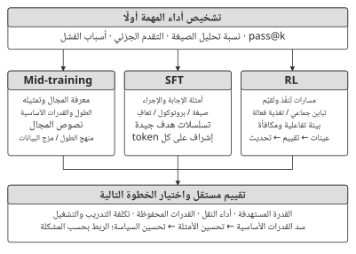

الجدول 8-4 معايير الاختيار بين Mid-training وSFT وRL

| الظاهرة الملاحظة | ما يُفحص أولًا | الطرق المرشحة | محاور التقييم اللاحق |
| --- | --- | --- | --- |
| ضعف في لغة المجال أو مفاهيمه أو عملياته الأساسية، وتقدّم ضئيل رغم تكرار أخذ العينات | تغطية النصوص والقدرات الأساسية | Mid-training؛ مع RAG للحقائق القابلة للاسترجاع | مهام المجال، ومجموعات اختبار القدرات العامة، والمسارات الصحيحة جزئيًا |
| المحتوى صالح، لكن التنسيق أو المعاملات أو الإجراءات الثابتة غير مستقرة | العروض والواجهات والقيود | SFT، أو فك الترميز المقيد، أو التحقق في الأداة | نجاح التحليل، ونتيجة المهمة، وسلوك التعافي |
| ينجز المهمة أحيانًا، لكن معدل النجاح منخفض أو يسلك طرقًا ملتوية كثيرًا | جودة المكافأة والاستكشاف وتوزيع المهام | RL | عائد المهمة، وتباين المكافأة، والتعميم المستقل، والكلفة |
| تتوافر عروض أو بيانات تفضيل، ولم تُبنَ بيئة تفاعلية بعد | تغطية البيانات غير المتصلة وطريقة التحقق | SFT، أو RFT، أو تحسين التفضيل غير المتصل | جودة خط الأساس، وانحياز البيانات، وعائد بناء البيئة |

يمكن التقدم في أربع خطوات. أولًا، يُبنى خط أساس من الموجّه والسياق والأدوات والقيود. فإذا كانت هذه الطرق تفي بمتطلبات المهمة، فضّل المؤلف الإبقاء على الحل الخارجي القابل للتحرير، لتقليل كلفة صيانة التدريب والنشر واختبارات الانحدار. وتُقدَّم الحقائق المتغيرة بالاسترجاع وإدارة الإصدارات؛ أما الأحكام الضمنية وأنماط الإدراك والسلوكيات المستقرة التي تحتاج إلى تعلم متكرر، فيُنظر في تحسينها بتدريب المعلمات.

الخطوة الثانية: تُلاحظ على المهام المحجوزة حالات النجاح والتقدم الجزئي ونتائج التحليل وأنواع الأخطاء. وبعد تثبيت إعدادات أخذ العينات، يبيّن Pass@1 وPass@k ما إذا كانت لدى السياسة الحالية مسارات قابلة للاستثمار؛ وتساعد مسارات الإخفاق على التمييز بين نقص المعرفة وغياب التغذية الراجعة وأخطاء الإجراءات.

الخطوة الثالثة: تُقدَّم عروض للسلوكيات التي يجب تعلمها. فمخطط JSON واستدعاءات الأدوات واستخدام المصطلحات والاستيضاح والتعافي كلها يمكن أن تُكتب عينات SFT، أما المعرفة اللازمة فتُقدَّم بالنصوص المناسبة وسياق المهمة.

الخطوة الرابعة: تُقيَّم شروط التغذية الراجعة لـ RL. فحين يمكن توليد مرشحين قابلين للتقييم، وتكون للمكافأة قدرة على التمييز، وتسمح البيئة بتفاعل كافٍ، يمكن مقارنة عائد تحسين السياسة؛ أما إذا كانت المكافأة متفرقة أكثر مما ينبغي، فيُنظر أولًا في التعلم التدرّجي، أو المكافآت الجزئية، أو سياسة ابتدائية أنسب.

تحدد نتائج التقييم في كل خطوة الاستثمار اللاحق: فالمهام ذات التنسيق الواضح يمكن نشرها بعد إتمام SFT، والنماذج ذات نقطة الانطلاق القوية يمكن أن تخضع لـ RL مباشرة، ويمكن بعد مواصلة التدريب على المجال إعادة استخدام قدرة اتباع التعليمات القائمة. وفيما يلي نلاحظ تحديدًا، من خلال مهام أحادية الجولة، الفروق السلوكية التي ينتجها التعلم من العروض والتعلم من المكافأة.

لنعد إلى مشكلة الطلبات في دليل القراءة. نعطي النموذج مباشرة وصف الأداة الحقيقي نفسه، ونلاحظ هل يكتب المعاملات صحيحة. فإذا كانت حقول الوصف قد تغيرت، فلنحدّث أولًا الوصف الذي يمكن الرجوع إليه وقت التشغيل. وإذا كانت دلالة الحقول واضحة لكن النموذج يضع نص المستخدم مرارًا في موضع رقم الطلب، أمكن تقديم عروض SFT تتضمن الاستعلام والاستيضاح والملء الصحيح للمعاملات. أما إذا كان قد صار ينجز المهمة كاملة أحيانًا، وكان اختلاف ترتيب الاستعلامات يؤدي إلى اختلاف معدل النجاح والكلفة، فقد توافرت شروط المقارنة بين عدة مسارات للسياسة.

## التعلم المعزز أحادي الجولة: مقارنة بين الحفظ والتعميم

تبدأ المهمة أحادية الجولة بمدخل واحد، وتنتهي بأن يقدّم النموذج إجابة ويتلقى مكافأة. ومع ذلك يمكن للنموذج أن يجري استدلالًا متعدد الخطوات أثناء توليد الإجابة، ويمكن لنظام التدريب أن يدعه يحاول المسألة نفسها مرارًا. وحصر التفاعل في إجابة واحدة يسهّل علينا ملاحظة كيف تغيّر طريقة التدريب سلوك النموذج. وفيما يلي نوضح أولًا بـ AdaptThink كيف يتعلم النموذج توزيع ميزانية الاستدلال، ثم نقارن بـ GeneralPoints بين SFT وRL حين تتغير القواعد والمظهر البصري.

وإذا عرفنا أولًا كيف تستخدم خوارزميات RL المكافأة لتحديث النموذج، أمكننا أن نقرأ عملية التدريب في التجارب اللاحقة. ويعتمد معظم تدريب RL في هذا الفصل على **تدرج السياسة (policy gradient)**. خذ أخذ عينات متعددة للمسألة نفسها مثالًا: نترك النموذج يولّد عدة إجابات، ثم نقارن مكافأة كل إجابة بخط أساس. فالإجابات الأفضل من خط الأساس تحصل على إشارة موجبة، ويرفع التدريب احتمال توليدها؛ والإجابات الأدنى من خط الأساس تحصل على إشارة سالبة، فينخفض احتمال توليدها.

ولمنع تحديث واحد من إبعاد النموذج عن مساره، تقتطع خوارزمية **PPO** السائدة العائدَ الإضافي في الهدف البديل متى تجاوزت نسبة الاحتمال مجالًا محددًا؛ ويتوقف مقدار التحديث الفعلي أيضًا على معدل التعلم وعدد دورات التحديث. وسيتعلم «PPO مع شبكة قيمة» لاحقًا تقديرًا للقيمة يبني عليه خط أساس للمقارنة، فيحسب ميزة كل خطوة من خطوات الإجراء. أما **GRPO** فيقارن مباشرة بين عدة إجابات للمسألة نفسها، ويبني خط الأساس من المكافآت داخل المجموعة، فيستغني عن تدريب شبكة قيمة منفصلة.

وتربط الشيفرة الزائفة الآتية، على نمط Python، أخذ العينات بالمكافأة والميزة وتحديث المعلمات، لتوضيح كيف تنتقل المعلومات بين الخطوات. أما التدريب الفعلي فيتطلب أيضًا ضبط توازي أخذ العينات وتنظيم KL والمحسِّن.

```python
for prompt in batch:
    group = [rollout(policy, env.reset(prompt)) for _ in range(G)]
    rewards = [verify(trajectory) for trajectory in group]
    advantages = normalize_within_group(rewards)       # GRPO baseline
    update(policy, group, advantages)
```

كيف يحدّث PPO السياسة بدفعة من المسارات مختلفة الأطوال؟ نحسب أولًا داخل كل مسار العائد المخصوم لكل خطوة، من النهاية إلى البداية. ويتوقف الجمع عند نهاية المسار، حتى لا تُحتسب مكافأة المسألة التالية ضمنه. ثم نجمع الإجراءات التي اختارها النموذج فعلًا في جميع المسارات، ونحسب متوسط خسارة هذه الدفعة. وفيما يلي نكتب تحديثًا واحدًا، مع إغفال تحسين الدفعات الصغيرة المتعددة الدورات.[^ch8-ppo-method]

```python
states, actions, returns = [], [], []
for trajectory in rollouts:
    states.extend(trajectory.states)       # 每次选择动作之前的状态
    actions.extend(trajectory.actions)     # 与状态逐项对应
    returns.extend(discounted_returns(trajectory.rewards))

returns = tensor(returns)
values = value_model(states)
advantages = returns - stop_gradient(values)
ratio = exp(policy.log_prob(actions, given=states)
            - old_policy.log_prob(actions, given=states))
policy_loss = -mean(min(
    ratio * advantages,
    clip(ratio, 1 - epsilon, 1 + epsilon) * advantages
))
value_loss = mean((values - returns) ** 2)
update(policy, value_model, policy_loss + value_coef * value_loss)
```

جاءت «النسبية» في GRPO من تعدد الإجابات للمسألة الواحدة؛ أما PPO هنا فيستخدم شبكة قيمة لتقدير العائد المتوقع لكل حالة. و`old_policy` هي السياسة المجمّدة التي وُلّدت بها هذه الدفعة من المسارات. لنفترض أن ميزة إجراء ما هي 1، وأن السياسة الحالية تمنحه احتمالًا يعادل 1.4 ضعف ما كان له عند أخذ العينة؛ فبأخذ `epsilon = 0.2`، تكون مساهمة هذا الحد في الهدف البديل `min(1.4, 1.2) = 1.2`. ومواصلة رفع احتمال هذا الإجراء لم تعد تجلب عائدًا إضافيًا من هذا الحد.

وإذا كانت الميزة −1 انعكس الاتجاه. فحين تنخفض نسبة الاحتمال إلى 0.6، يعطي التعويض في السطر نفسه `min(-0.6, -0.8) = -0.8`، وخفض الاحتمال أكثر لن يجلب مكسبًا إضافيًا. وعلى العكس، إذا صار هذا الإجراء الأضعف أكثر شيوعًا وارتفعت نسبة الاحتمال إلى 1.4، كان الأصغر هو `min(-1.4, -1.2) = -1.4`، أي أن رفع احتماله يظل مكلفًا.

> **التجربة 8-10 ★★: AdaptThink — تعلّم «متى لا نفكر»**
>
> تستخدم نماذج الاستدلال غالبًا عملية استدلال طويلة لحل المسائل. أما في المسائل البسيطة، فالإجابة المباشرة توفّر كلفة التوليد. ويتيح AdaptThink للنموذج نمطين: Thinking وNoThinking؛ وفي النماذج التي تدعم هذا البروتوكول يُنهي NoThinking مقطع الاستدلال بـ `<think></think>` ثم يولّد الإجابة مباشرة. وهدف التدريب أن يتعلم النموذج اختيار ميزانية الاستدلال المناسبة للمهمة.
>
> تتضمن الطريقة مكوّنين أساسيين. **هدف التحسين المقيّد** يشجع النموذج على رفع نسبة استخدام NoThinking مع الحفاظ على أداء الإجابة عمومًا؛ و**أخذ العينات بالأهمية (importance sampling)** يعدّل نسبة أخذ العينات من النمطين، ثم يصحح بالوزن الفرق بين توزيع أخذ العينات وهدف التحسين. ويميل النموذج الابتدائي عادةً إلى Thinking، فلا بد من زيادة عينات NoThinking بنشاط حتى يحصل التدريب على إشارة تقارن النمطين. ومشكلة الانطلاق البارد المقصودة هنا هي تحديدًا قلة عينات NoThinking في مستهل التدريب.
>
> استخدمت تجربة الكتاب 8 وحدات GPU من نوع H100 بسعة 80GB. وعند الخطوة 300 من التدريب انتقلت دقة MATH500 من 81.00% إلى 81.80%، وانخفض متوسط طول الاستجابة من نحو 4,911 رمزًا إلى 1,577؛ وارتفعت دقة GSM8K من 79.68% إلى 81.88%، وانخفض طول الاستجابة من نحو 1,025 رمزًا إلى 477؛ وتغيّر AIME mean@16 من 31.46% إلى 31.04%، وانخفض طول الاستجابة من نحو 12,120 رمزًا إلى 6,402. وهكذا انخفضت أطوال الاستجابات في المجموعات الثلاث بنحو 68% و53% و47%.
>
> وبلغت نسبة NoThinking في مجموعات البيانات الثلاث 83.80% و84.15% و56.25% على الترتيب. فقد احتفظ النموذج بقدر أكبر من حساب الاستدلال في AIME، وصار يجيب مباشرة أكثر في MATH500 وGSM8K. وفي AIME2024 تُؤخذ لكل مسألة 16 عينة، ويحسب mean@16 متوسط دقة هذه الإجابات الست عشرة. وعند الخطوة 300 كان متوسط الإجابة أقصر بنحو النصف، وكانت الدقة أقل بنحو 0.42 نقطة مئوية.
>
> والخطوة 300 هي تحقق أُجري في منتصف التدريب. فقد كانت الخطة أن يستمر التدريب 3,140 خطوة، لكن التشغيل توقف لاحقًا على نحو غير طبيعي، وآخر سجل تحقق توقف عند الخطوة 410. وعندها كان متوسط دقة AIME2024 هو 31.88%، ومتوسط الإجابة نحو 5,874 رمزًا.
>
> ويمكن الجمع بين AdaptThink وتقطير الموجّهات: فالتقطير يكتب التعليمات وأنماط حل المسائل المتكررة في المعلمات، ويتعلم AdaptThink بعده مقدار حساب الاستدلال الذي ينبغي تخصيصه لكل مهمة. ويؤثر الاثنان معًا في جودة الإجابة وزمنها وكلفتها.

> **التجربة 8-11 ★★: GeneralPoints — مقارنة «الحفظ والتعميم» في RL أحادي الجولة**
>
> استخدم Chu وآخرون لعبة ورق شبيهة بـ«الـ24» اسمها GeneralPoints لاختبار قدرة النموذج على التعميم[^ch8-3]. يُستخدم رقم كل ورقة من الأوراق الأربع مرة واحدة، وبالجمع والطرح والضرب والقسمة يُكوَّن الرقم 24. فإذا تعلم النموذج حل المسألة، فهل يظل قادرًا على الحساب الصحيح إذا تغيرت قواعد الأوراق أو أنماط ألوانها؟ يعرض الشكل 8-12 صيغتين للمسألة: تعطي GP-L النص مباشرة، أما GP-VL فتتطلب من النموذج قراءة الأوراق.
>
> 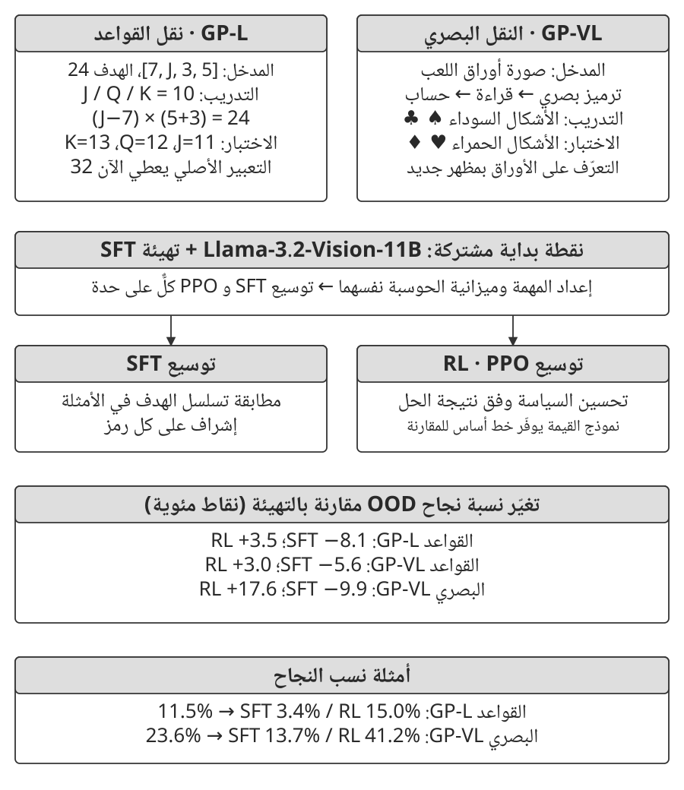
>
> **متغير القواعد**: في التدريب تُحتسب J/Q/K جميعًا بـ 10، وفي الاختبار تُحتسب 11/12/13 على الترتيب. ولذلك تتضمن مجموعة الاختبار تركيبات عددية لم تظهر في التدريب، لفحص قدرة النموذج على استخدام 11 و12 و13 في الحساب وفق القواعد الجديدة. **المتغير البصري**: يُستخدم في التدريب اللون الأسود (♠♣)، وفي الاختبار اللون الأحمر (♥♦)، لفحص قدرة النموذج على التكيف مع تغير مظهر الأوراق.
>
> تنطلق التجربة من Llama-3.2-Vision-11B، فتبني أولًا بـ SFT قدرة أساسية على اتباع التعليمات، ثم تنقسم إلى فرعي تدريب: مواصلة SFT، وRL، ويُقارن بينهما في ظل ميزانية حسابية واحدة. ويستخدم فرع RL خوارزمية PPO مع شبكة قيمة. ويُدرَّب الفرعان بقاعدة J/Q/K=10، ثم يُقيَّمان على مجموعتي اختبار داخل التوزيع (ID) وخارجه (OOD).
>
> خذ `[7, J, 3, 5]` مثالًا: حين يكون J=10 يمكن استخدام `(J−7)×(5+3)=24`؛ وبعد أن يصبح J=11 يعطي هذا التعبير 32، فيلزم استبداله بـ `(11−5)×(7−3)=24`. فمجموعة الأوراق نفسها تطلب من النموذج أن يقرأ القاعدة الحالية، وأن يعيد تنظيم الحساب.
>
> وقد ظهر فرق واضح بين طريقتي التدريب في الاختبار خارج التوزيع. **قواعد OOD**: في GP-L ارتفع معدل نجاح RL من 11.5% إلى 15.0%، أي بزيادة 3.5 نقطة مئوية؛ وانخفض معدل SFT من 11.5% إلى 3.4%، أي بنقص 8.1 نقطة. وفي GP-VL زاد RL 3.0 نقاط مئوية، ونقص SFT 5.6 نقاط. **الاختبار البصري OOD**: في GP-VL ارتفع RL من 23.6% إلى 41.2%، أي بزيادة 17.6 نقطة مئوية؛ وانخفض SFT من 23.6% إلى 13.7%، أي بنقص 9.9 نقطة.
>
> وفحص نتائج التعرف على الأوراق يربط الأداء النهائي في الإجابة بالإدراك البصري: فارتفعت دقة التعرف في فرع RL مع ارتفاع معدل نجاح المهمة، بينما انخفضت دقة التعرف في فرع SFT. وتربط الدراسة هذا الفرق بهدف التدريب: فملاءمة كل رمز على حدة قد تعزز الأنماط النصية في العروض، في حين تطلب مكافأة النتيجة باستمرار من النموذج أن يقرأ الأوراق قراءة صحيحة وأن يتم الحساب. وتقدم دقة الإدراك مؤشرًا وسيطًا لتحليل هذه الآلية.
>
> ويمكن أيضًا فهم سبب تقديم SFT من زاوية تنسيق المخرجات. فالنموذج الأساسي Llama-3.2-Vision-11B في التجربة لا يستطيع توليد المخرجات المنظمة المطلوبة باطراد، فلا يتمكن المدقق من حساب مكافأة المهمة بناءً عليها، ولذلك أخفقت محاولة الانتقال إلى RL الشامل من الطرف إلى الطرف مباشرة. فـ SFT يبني أولًا مخرجات قابلة للتحليل والتقييم، حتى يستطيع RL اللاحق الاستفادة من تغذية المهمة. أما DeepSeek-R1-Zero المذكور سابقًا فانطلق من نموذج أساسي قادر أصلًا على توليد إجابات قابلة للتقييم، فدخل RL مباشرة.
>
> وكم يمكن للنموذج أن يتعلم من تغذية المدقق؟ قارن الشكل 10 في البحث بين المهام النصية الخالصة للأوراق (GP-L) على حدة. فقد أعدّ الباحثون 1 و3 و5 و10 دورات تحقق، ودرّبوا نماذج RL وقيموها كلًا على حدة. وفي ظل ميزانية حسابية واحدة للتدريب، رفع الفريق المسموح له بـ 10 عمليات تحقق معدل نجاحه على القواعد الجديدة بمقدار 5.99 نقطة مئوية فوق نقطة انطلاق تدريبه، في حين رفعه الفريق الذي أجرى عملية تحقق واحدة بمقدار 0.48 نقطة.
>
> فلماذا يتراجع أداء SFT ويتحسن أداء RL في ظل هذا الانزياح التوزيعي؟ يفسر ذلك تفسيرًا متسقًا مع الملاحظة أن بيانات SFT المحدودة عززت النمط الثابت «إذا صادفت J/Q/K فاحسبها 10»؛ وحين يكون J=11 في الاختبار يظل النموذج يحسبها 10. أما فرع RL الموجّه نحو النتيجة فهو أكثر احتمالًا لتعزيز استراتيجية «أعد الحساب حتى تصل إلى الإجابة الصحيحة»، فتبقى قابلة للتطبيق حين يصبح J=11.
>
> وتتيح لنا تغيرات القواعد وتغيرات ألوان الورق في GeneralPoints أن نلاحظ كلًّا على حدة ما إذا كان النموذج قد تعلم الحساب وفق الشروط الجديدة، وما إذا كان يقرأ المدخل البصري الجديد قراءة صحيحة. وفي ظل النموذج وبيانات التدريب وميزانية الاختبار هنا، تراجع الفرع الذي واصل SFT في الاختبار خارج التوزيع، وتحسن الفرع الذي وصله RL. وإذا أردت تطبيق النتيجة على مهمتك، فاسأل أولًا: هل أتقن الطالب تنسيق المخرجات؟ وهل غيّر الاختبار الجديد القواعد، أم مظهر المدخل، أم كليهما؟ ولا تعرف ما إذا كان يلزمك استكمال العروض أو تحسين الإدراك أو زيادة الاستكشاف المصحوب بتغذية راجعة على النتيجة إلا بإجراء المقارنات منفصلة.

## خوارزميات RL: من 16 عملية rollout إلى تحديث واحد للمعلمات

اقترح DeepSeek خوارزمية **GRPO (Group Relative Policy Optimization)**، وهي تبني إشارة التعلم من الأداء النسبي لمحاولات متعددة على المسألة نفسها. ولنأخذ مهمة إصلاح شيفرة على نمط SWE-bench مثالًا: ملف `parser.py` في مشروع Python يثير `IndexError` عند المدخل الفارغ، وعلى الوكيل أن يصلح التنفيذ ويحافظ على ملفات الاختبار دون تغيير. ويمكن تقسيم دورة تدريب واحدة إلى أربع خطوات.

**الخطوة الأولى: ترك نموذج السياسة يحاول مرارًا.** نموذج السياسة هو النموذج اللغوي الجاري تدريبه. يضع النظام الشيفرة الابتدائية نفسها ووصف المشكلة في 16 صندوقًا رمليًا معزولًا، ويترك النموذج ينجز المهمة 16 مرة مستقلة. تبدأ كل محاولة بقراءة الشيفرة، وتمضي عبر التعديل والاختبار حتى تقديم النتيجة؛ ويُسمى مسار التفاعل الكامل هذا **rollout** واحد. وأخذ العينات العشوائي يجعل نقطة البداية نفسها تؤدي إلى مسارات مختلفة: بعضها يستكمل فحص الحدود، وبعضها يكتفي بالتقاط الاستثناء، وبعضها يعدّل الملف الخطأ، وبعضها يحاول تعديل الاختبارات.

**الخطوة الثانية: حساب المكافأة.** بعد انتهاء كل rollout، يطبّق المدقق التصحيح في بيئة نظيفة ويشغّل الاختبارات. لنفترض أن 4 محاولات من الست عشرة اجتازت جميع الاختبارات دون تعديل ملفات الاختبار، وأن الاثنتي عشرة الأخرى أخفقت، فتحصل الأربع الناجحة على مكافأة 1، والباقي على 0. ويضع الشكل 8-13 تقييم هذه المسارات الستة عشر في جدول واحد. ويمكن في هذا النوع من مهام الشيفرة حساب المكافأة بالاختبارات والقواعد مباشرة. أما الأهداف التي يصعب تحويلها إلى اختبارات، مثل قابلية القراءة وجودة الشرح، فيمكن دمج التقييم البشري أو نموذج مكافأة فيها.

**الخطوة الثالثة: حساب الميزة النسبية.** تقول المكافأة إن مسارًا بعينه نجح أو أخفق، أما **الميزة النسبية** فتقول كم كان أفضل من بقية المحاولات في المجموعة. متوسط معدل النجاح في هذه المجموعة هو 4/16: فالمسارات الأربعة التي اجتازت الاختبارات أعلى من متوسط المجموعة وتحصل على ميزة موجبة، والمحاولات الاثنتا عشرة الفاشلة أدنى من المتوسط وتحصل على ميزة سالبة. وإذا طبّعنا بالانحراف المعياري داخل المجموعة، كان متوسط المكافأة 0.25 والانحراف المعياري نحو 0.433، فتبلغ ميزة المسار الناجح نحو 1.73، وميزة المسار الفاشل نحو −0.58. ويستخدم GRPO هذا النوع من المقارنة داخل المجموعة لبناء إشارة التعلم. أما إذا كانت المكافآت الست عشرة متماثلة تمامًا، فإن طرح متوسط المجموعة من كل واحدة يعطي صفرًا. وتكفي إضافة حد ثابت صغير إلى المقام لتفادي القسمة على صفر؛ ولكن بعد التطبيع يظل عائد هذه المجموعة عاجزًا عن بيان المسار الذي ينبغي أن يميل إليه التدريب. وعندئذ يمكن فحص ما إذا كانت قيود المسار أو مكافأة العملية أو التقدم الجزئي قادرة على التمييز بين مسارات المجموعة. فمن بين محاولتين لم تصلحا الشيفرة مثلًا، نجحت واحدة فقط في اختبار الحدود الذي كان يفشل سابقًا. وما دامت هذه النتيجة الوسيطة قابلة للتحقق مستقلة، فقد ظهر خيط إضافي يمكن التعلم منه.

**الخطوة الرابعة: تحديث السياسة بالنزول التدرجي.** يحوّل برنامج التدريب الميزة النسبية إلى خسارة تدريب، ويحسب التدرج، ثم ينفذ المحسِّن (مثل AdamW أو Muon) النزول التدرجي، فيرفع احتمال الاختيارات التي أجراها النموذج في المسارات ذات الميزة الموجبة، ويخفض احتمال الاختيارات في المسارات ذات الميزة السالبة. ويكرر التدريب تعديل احتمالات هذه الاختيارات عبر مهام وعمليات rollout كثيرة. وكلما أخذ التحسين يعمل، صار الأرجح عند مصادفة خطأ مشابه أن يظهر «إعادة إنتاج المشكلة، وفحص شروط الحدود، وتعديل التنفيذ، وتشغيل الاختبارات»، وصار الأقل ظهورًا «إخفاء الاستثناء، أو تعديل الاختبار، أو تقديم النتيجة دون تحقق».

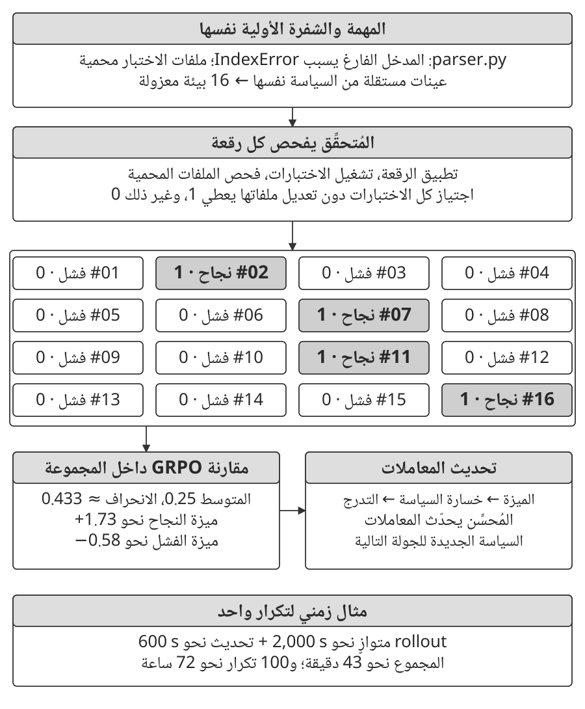

في الشكل 8-13 تُؤخذ للمسألة نفسها 16 عينة؛ فكم **دورة تدريبية (step)** تمثل؟ بحسب العدّ في هذا القسم، تنتمي هذه المسارات الستة عشر إلى الدفعة نفسها. ففي الجولة $k$ تُؤخذ العينات بالسياسة الحالية، وتُحسب المكافأة والميزة والتدرج، وتُحدَّث السياسة مرة واحدة؛ وفي الجولة $k+1$ فقط يُعاد أخذ العينات بالمعلمات الجديدة. وحين يُقال إن التدريب استغرق 100 step، فالمعنى أن هذا النوع من الدورات تكرر نحو 100 مرة.

ويمكن تقدير زمن التدريب انطلاقًا من ذلك. فقد تتضمن المهمة المعقدة عشرات جولات استدعاء الأدوات؛ وحين ينتظر التدريب المتزامن نتيجة الدفعة كلها، فإن أبطأ المسارات الستة عشر المتوازية هو الذي يحدد متى ينتهي طور أخذ العينات. لنفترض أنه استغرق نحو 2,000 ثانية، وأن حساب التدرج وتحديث المحسِّن استغرقا 600 ثانية أخرى، فيحتاج الـ step الواحد إلى نحو $2{,}000+600=2{,}600$ ثانية، أي 43 دقيقة. والتدريب المتواصل على 100 step بالمدة نفسها يحتاج إلى نحو 72 ساعة.

تتبع PPO وGRPO هذه الحلقة المغلقة نفسها، والفرق بينهما في «مَن نقارن به». فـ GRPO يقارن مباشرة بين عدة عمليات rollout للمسألة نفسها، ولا يحتاج إلى نموذج قيمة إضافي؛ أما PPO فيدرّب نموذج قيمة يقدّر «ما الذي يمكن بلوغه عادةً» في كل خطوة من المسار، ثم يحكم هل الإجراء الحالي أفضل من هذا التوقع، فيوفر خط الأساس اللازم لتخصيص الاستحقاق خطوة بخطوة. وكلتاهما تكبح التحديثات المفرطة بآليات مثل اقتطاع الهدف البديل. ويختلف DPO عن ذلك: فهو يتعلم مباشرة من أزواج التفضيل «إجابة أفضل–إجابة أسوأ» المجمعة سلفًا، ولا يدع السياسة الحالية تولّد هذه الدفعة من عمليات rollout في أثناء التدريب.

وقد اعتمدت حالات هذا الفصل وصفات تدريب مختلفة: يستخدم AdaptThink هدفًا مقيّدًا مخصصًا؛ ويستخدم GeneralPoints وV-IRL وReTool خوارزمية PPO، ويشارك نموذج القيمة في الأولين في تقدير الميزة؛ ويستخدم SimpleVLA-RL وRLVP خوارزمية GRPO.

لنفترض أننا جرّبنا المسألتين أ وب أربع مرات لكل منهما، فأصابت أ في المرات الأربع، وأخفقت ب في المرات الأربع. فمكافآت أ الأربع كلها 1، ومكافآت ب الأربع كلها 0. وبطرح متوسط المجموعة في كل منهما تصبح الميزة صفرًا في المجموعتين. فلو توافرت طاقة حسابية لمزيد من المحاولات، فعلى أي المسألتين ينفقها المرء ليكون أرجح حصولًا على عينة تدريب مفيدة؟

يضع «Never Give Up» هذا الاختيار داخل عملية أخذ العينات نفسها. فإذا أصابت أ في المرات الأربع، تُتخطى هذه المجموعة؛ وإذا أخفقت ب في المرات الأربع، تُضاف مجموعة أخرى باحتمال معين. ولنفترض أن المجموعة الثانية أصابت مرة واحدة أخيرًا، فيوضع في التدريب مجموعتا الإجابات الثماني معًا: حل واحد صحيح وسبعة خاطئة، فيصبح للمسألة الواحدة مكافآت متفاوتة. ويتيح أخذ العينات غير المتزامن لبقية المسائل أن تتقدم كالمعتاد، دون انتظار نتيجة ب.[^ch8-ngu]

[^ch8-ngu]: Michael Noukhovitch وآخرون، *Learning to Solve Hard Problems in RL for LLMs by Never Giving Up*، 2026. يُستخدم أخذ العينات الإضافي المذكور في البحث للتدريب؛ ويمكن أن تُسحب المسائل التي أُجيبت صحيحة مرة أخرى في التدريب اللاحق.

### لماذا يُفضَّل On-Policy عادةً في LLM RL

يصف مصطلحا **Online (المتصل)** و**On-policy (على المسار)** جانبين مختلفين. فالتدريب المتصل يواصل التفاعل مع البيئة وتوليد البيانات أثناء التشغيل؛ أما التدريب على المسار فيهتم بمصدر البيانات، ويشترط أن تكون سياسة السلوك $\mu$ التي وُلّدت بها المسارات مطابقة للسياسة الجاري تحسينها $\pi_\theta$ أو قريبة منها بما يكفي. ويمكن للعنقود غير المتزامن أن يواصل أخذ العينات المتصل، لكن إذا تخلف العامل (worker) عدة نقاط تحقق عن التدريب، حملت البيانات العائدة قدرًا من تقادم السياسة، فتشكلت بذلك مكوّنة off-policy (خارج المسار).

ويوصي المؤلف ببناء خط أساس مستقر بتدريب أقرب ما يكون إلى التدريب على المسار أولًا، ثم إدخال أخذ العينات غير المتزامن أو إعادة استخدام البيانات القديمة لرفع معدل النقل. وفي وصفات PPO/GRPO في هذا الفصل تُؤخذ العينات عادةً بالسياسة الأحدث في مطلع كل step. ثم يجري PPO بعد ذلك عدة دورات تحديث على دفعات صغيرة من البيانات نفسها، فتبتعد السياسة الحالية تدريجيًا عن `old_policy` التي وُلّدت بها البيانات. وتقيس نسبة الاحتمال هذا التغير، ويكبح الهدف المقتطع التحديثات المفرطة.

يتصل هدف تدرج السياسة بالمكافأة المتوقعة في ظل السياسة الحالية $\pi_\theta$. وعند استخدام بيانات أُخذت بسياسة سلوك $\mu$، يمكن أولًا حساب نسبة احتمال الإجراء في الحالة نفسها، ثم بناء تصحيح الأهمية عليها:

$$
\rho_t=\frac{\pi_\theta(a_t\mid s_t)}{\mu(a_t\mid s_t)}
=\exp\left(\log\pi_\theta(a_t\mid s_t)-\log\mu(a_t\mid s_t)\right).
$$

لنفترض أن سياسة أخذ العينات اختارت رمزًا ما باحتمال 0.2 بعد بادئة معينة، وأن السياسة الحالية تمنحه 0.3، فتصبح نسبة الاحتمال في هذه الخطوة 1.5. أي أن هذا الرمز ظهر في العينات القديمة أقل مما ينبغي، فيرتفع وزنه تبعًا عند التقدير بالسياسة الحالية. وإذا استُخدمت السياسة نفسها في أخذ العينات والتدريب، كانت نسبة الاحتمال 1 في كل خطوة قبل تحديث المعلمات.

وإعادة استخدام المسارات القديمة تتيح فصل أخذ العينات عن التدريب زمنيًا ورفع معدل النقل. لكن كلما تباعدت السياستان، صار من المحتمل أكثر أن تحصل عينات قليلة على أوزان كبيرة. وعند إعادة ترجيح المسار كله، تُضرب نسب الاحتمال في الخطوات بعضها ببعض. واقتطاع PPO لجزء من العائد الإضافي في الهدف البديل لكل إجراء يخفف أثر النسب المتطرفة؛ أما الحالات التي لم تبلغها العينات القديمة أبدًا فلا تُرى إلا بأخذ عينات جديدة. ولهذا يفضّل المؤلف استخدام مسارات حديثة.[^ch8-32]

#### الفروق العددية بين التدريب والاستدلال

يستخدم التعلم المعزز للنماذج اللغوية الكبيرة على نطاق واسع محركات استدلال مثل vLLM وSGLang لأخذ العينات، ثم أنظمة تدريب مثل FSDP وMegatron لحساب اللوغاريتمات الاحتمالية والتدرجات. وحتى لو حمّل الجانبان الأوزان نفسها، فقد تختلف دقة الفاصلة العائمة وترتيب الاختزال والتوازي التنسوري وحجم الدفعة وذاكرة KV ونوى الحساب المدمجة، فيُحسب للرمز نفسه لوغاريتم احتمالي مختلف قليلًا. وعندئذ يكون $\rho_t$ قد انحرف عن 1 قبل تحديث المعلمات أصلًا، فيظهر فرق عددي في السياسة بين التدريب وأخذ العينات. وقد وجدت تجارب مضبوطة أن فروقًا ضئيلة على مستوى الرمز قد تكفي لإحداث انهيار في التدريب.[^ch8-33]

وإذا تغير توزيع أخذ العينات، فقد ينحاز تدرج السياسة البسيط إلى أحد الإجراءين حتى ولو تساوت مكافآتهما تمامًا. لنفترض أن A وB كان لكل منهما نصف الفرص عند أخذ العينات، وأن احتمال اختيار النموذج لـ A صار 0.8 عند التدريب. فبالنسبة إلى الـ logit الذي يتحكم في A، يكون تدرج اللوغاريتم الاحتمالي $1-0.8=0.2$ حين يُختار A، و$0-0.8=-0.8$ حين يُختار B. وإذا حصل الإجراءان على نقطة واحدة، كان التدرج، بأخذ المتوسط وفق احتمالات أخذ العينات، هو $-0.3$. فالإجراءان حصلا على النتيجة نفسها، ومع ذلك يخفض التحديث احتمال A.

ويطرح **Score centering** من تدرج اللوغاريتم الاحتمالي تحت البادئة نفسها متوسطَه في توزيع أخذ العينات. وفي المثال السابق، يصبح الحدان 0.5 و−0.5 بعد طرح $-0.3$، فيكون متوسط التحديث الناتج عن المكافأة نفسها صفرًا تمامًا. وقد طرح GRPO سابقًا المتوسط من مكافآت مجموعة من الإجابات؛ وهنا يقع التمركز على التدرج.[^ch8-sc]

[^ch8-sc]: Martin Marek وMax Ryabinin، *Score Centering Stabilizes Off-policy Reinforcement Learning*، 2026. وإذا تخلفت سياسة أخذ العينات كثيرًا، يمكن أيضًا تقييد المسافة بين سياسة التدريب وسياسة السلوك بتنظيم KL (arXiv:2611.21791).

ثم إن الأخطاء العددية بين طرفي التدريب وأخذ العينات تتضخم على التسلسلات الطويلة: **خطأ في اللوغاريتم الاحتمالي ← انحراف في نسبة الاحتمال ← تراكم على بادئة طويلة ← تغير في الاقتطاع وترجيح الميزة ← تغير في التدرج وفي عدد العينات الفعالة**. فإذا حملت نسب اللوغاريتم الاحتمالي لأربعة آلاف رمز انحرافًا قدره $10^{-3}$ في الاتجاه نفسه، بلغت نسبة الاحتمال على مستوى المسار $e^{4000\times0.001}=e^4\approx54.6$ ضعف القيمة الحقيقية.

وقد يغيّر تغير الاحتمال في الرموز المبكرة نتيجة أخذ العينات نفسها، فتسير الحالات اللاحقة في مسار آخر. ومن الإشارات التي يمكن ملاحظتها في التدريب: قفزات في نسبة الأهمية، وارتفاع نسبة الاقتطاع، وتغيرات مفاجئة في التدرج أو طول الاستجابة، وتراجع المكافأة والإنتروبيا. وحين يغيّر حجم الدفعة عملية الاختزال، قد تتغير النتيجة العددية للمدخل نفسه أيضًا، أي أن ثبات الدفعة (batch invariance) يختل. وقد لاحظت أبحاث ذات صلة ما ينشأ عن ذلك من أثر ضمني خارج المسار، وحسّنت الاستقرار بمواءمة حساب أخذ العينات والتدريب أو بالتصحيح الصريح لفرق السياسة.[^ch8-34]

ولذلك يضع المؤلف الاتساق العددي بين أخذ العينات والتدريب ضمن الفحوص الأساسية قبل بدء التدريب، ويراقبه باستمرار مع منحنى المكافأة. ويمكن معالجة ذلك على أربع خطوات: «قياس الفرق، ومواءمة الإعداد، وتصحيح الانحراف، وضبط التقادم»:

- **قبل أي تحديث للمعلمات**، تُقارن اللوغاريتمات الاحتمالية للرموز كما يعطيها طرف أخذ العينات (sampler) وطرف التدريب (trainer) على الدفعة نفسها من المسارات، وتُراقب متوسط $\rho_t$ ومئيناتها وقيمتها العظمى وKL التقريبي ونسبة الاقتطاع؛ وهذا أدق اختبار وحدة لكون التدريب على المسار.
- عند مزامنة الأوزان، تُواءم معها محوّلات LoRA والمقسِّم وقالب المحادثة وإصدار النموذج وإعداد الترميز الموضعي. وينبغي أن يحفظ rollout اللوغاريتمات الاحتمالية التي أعطتها سياسة أخذ العينات وقت التوليد، لتُحسب بها نسبة الاحتمال لاحقًا.
- تُواءم قدر الإمكان دقة الحساب وتخطيط التوازي ونوى الحساب الحاسمة بين أخذ العينات والتدريب؛ وإذا تعذّر ذلك، عُومل الفرق صراحةً على أنه خارج المسار، فاستُخدم تصحيح الأهمية ورُوقب عدد العينات الفعالة، وحُكم على أثر التصحيح مع نسبة الاقتطاع.
- يُعاد أخذ العينات بالسياسة المحدَّثة في الوقت المناسب، ويُقيَّد عدد دورات التحديث على الدفعة الواحدة، وكذلك عدد نقاط التحقق التي تتأخر بها السياسة المستخدمة في أخذ العينات غير المتزامن عن التدريب.

## بيئات RL: من التقييم إلى المحاكاة

يحتاج تدريب الوكيل بـ RL إلى تنفيذ المهام مرارًا. فإصلاح شيفرة ما يمكن إعادة تجربته في نسخة معزولة، أما عملية دفع واحدة فتغيّر حالة حساب حقيقي. ويجب أن توفر بيئة التدريب حالة ابتدائية قابلة لإعادة الضبط، ونسخًا متوازية من المهمة، ونتائج قابلة للتحقق، حتى يستكشف النموذج مسارات مختلفة في ظروف مضبوطة. وقد عرض الفصل السابع بيئة التقييم؛ وعند استخدامها في التدريب يلزم أيضًا مراعاة التشغيل الطويل والآثار الجانبية للإجراءات وكلفة التفاعل الكثيف. فالمؤلف يخصص أولًا القوى البشرية والميزانية لبناء البيئة، ثم يرتب التدريب الواسع. فتوفير تغذية راجعة حقيقية وإعادة ضبط الحالة والعزل المتوازي يستهلك من الموارد الهندسية غالبًا أكثر من ربط PPO أو GRPO، وقد تتجاوز كلفة بناء البيئة كلفة التدريب نفسه.

### البيئة: ساحة تمرّن النموذج

تحدّث البيئة حالتها بحسب الإجراء، وتعيد الملاحظة الجديدة إلى النموذج. وعند بناء البيئة يمكن البدء من ثلاثة أسئلة.

- **هل يقترب التفاعل من سيناريو النشر؟** يجب أن يغطي محاكي خدمة العملاء حالات استكمال المستخدم للمعلومات وتغييره لمطالبه وتعبيره الغامض؛ وأن تعيد محاكاة الأدوات الأخطاء والتأخيرات الشائعة في بيئة الإنتاج. فمن هذه التغذية الراجعة يتعلم النموذج مواجهة المشكلات الفعلية. والتغذية الراجعة الأحادية الشديدة تجعل السياسة تعتمد على أساليب ثابتة خاصة بالمحاكاة.
- **هل يمكن إعادة المحاولة والتوازي بثبات؟** تحتاج كل عملية rollout إلى طلب أو ملف أو حالة حساب مستقلة، وقابلة للتنظيف والاستعادة بعد الانتهاء. ويتولى صندوق الشيفرة الرملي في ReTool وصندوق MCP في AWorld هذه المسؤولية. وفي واجهات API الحقيقية التي تخضع لحدود معدل أو كلفة أو آثار كتابة، يمكن استخدام حسابات صندوق رملي أو بيانات معادة أو واجهات محاكاة بحسب حاجة المهمة.
- **كيف تُحكم النتيجة؟** حالة البيئة أساس مهم لحساب المكافأة. فمهمة الاسترداد مثلًا يمكن أن تفحص المبلغ وحالة الطلب وشروط التفويض؛ ومهمة الشيفرة يمكن أن تشغّل الاختبارات. وسنناقش تصميم المكافأة على حدة لاحقًا.

**وقبل الشروع في ضبط الخوارزمية، يوصي المؤلف بالتحقق مما يلي: هل بيئة المحاكاة قريبة بما يكفي من المهمة الفعلية؟ فهذا أهم من اختيار PPO أو GRPO.** فالدقة الواقعية وقابلية إعادة الضبط وقدرة التحقق تحدد معًا ما يمكن للنموذج أن يتعلمه من التفاعل. والبدء بعدد صغير من المهام لإنجاز هذه الحلقات الثلاث، ثم توسيع التدريب، أدعى عادةً إلى تسهيل تحديد موضع المشكلات.

### محاكاة الأدوات والبيئات بالنماذج

يمكن توليد نتائج البحث ومحادثات المستخدم وحالات الأعمال المعقدة بمساعدة النماذج. فمحاكي النموذج يتلقى إجراء الوكيل ويولّد التغذية الراجعة التالية، فيقل الاعتماد على الخدمات الخارجية الآنية. ويمكن أن يمتد هذا الأسلوب من أداة واحدة إلى بيئة المهمة كلها.

**المستوى الأول: توليد قيم الأدوات المرجعة.** يجعل ZeroSearch[^ch8-13] نموذجًا لغويًا كبيرًا يؤدي دور محرك بحث: يرسل الطالب استعلامه، فيولّد المحاكي نتائج الاسترجاع. وبهذا يقل اعتماد التدريب على كلفة واجهات البحث الحقيقية وحدود معدلها وتقلب نتائجها. ويعتمد كذلك ترتيبًا تدرّجيًا، فيعيد في البداية وثائق عالية الجودة وثيقة الصلة، ثم يزيد التشويش تدريجيًا، ليتدرب الطالب على استخراج المعلومات المفيدة من مواد ناقصة. وقد حققت النماذج في البحث أداءً جيدًا بعد إتمام التدريب في بيئة البحث المحاكاة حين وُصلت بمحرك بحث حقيقي.

**المستوى الثاني: محاكاة انتقالات حالة البيئة.** يقطّر DreamGym[^ch8-14] ديناميكيات البيئة في نموذج خبرة استدلالي. يقرأ النموذج الحالة الحالية وإجراء الوكيل، ويستنتج الحالة والتغذية الراجعة التاليتين، ويولّد بالجملة مسارات تفاعل للتدريب المتصل بـ RL، فيقل الوصول إلى البيئة الحقيقية. ويمكن في مهام خدمة العملاء والبيع أن يؤدي نموذج لغوي دور المستخدم، فيحاكي الاستفسار المتتابع واستكمال المعلومات وتغير المطالب. وتستخدم سلسلة τ-bench محاكي مستخدم؛ ويمكن استخدام أطر تفاعل مشابهة في التدريب أيضًا، بحيث يضطلع كل منها بمهمتي التمرن والتقييم.

ويحتاج محاكي النموذج إلى معايرة كذلك. فإذا كان محاكي خدمة العملاء يفهم دائمًا الأسئلة الغامضة فهمًا صحيحًا، لم تجد السياسة فرصة للتمرن على الاستيضاح؛ وإذا كان محاكي البحث يعيد دائمًا الوثائق الصحيحة، لم تكتسب السياسة خبرة في تمييز التشويش. كما قد يعزز التدريب السلوكيات التي تستغل عيوب تقييم المحاكي. ويوصي المؤلف بأسلوب مختلط: استخدام محاكاة النموذج في القدر الأكبر من التفاعل، مع فحص أداء السياسة دوريًا في مهام من البيئة الحقيقية، وإعادة الفروق المكتشفة إلى المحاكي. وبهذا تتكون عملية تكرارية: «تفاعل مركّب — تقييم في مهام حقيقية — تصحيح المحاكي».

وكيف نعرف أن المحاكي يعلّم استخدام الأدوات فعلًا؟ يمكن إجراء اختبار صغير: على الطلب الابتدائي نفسه، نستعلم أولًا، ثم نقدّم تعديلًا، ثم نستعلم مرة أخرى، ونفحص هل تغيرت حقول الطلب المرجعة كما هو متوقع تبعًا للإجراء. ثم نعيد ضبط البيئة، ونتأكد من أن القيم الأصلية تُقرأ من جديد. فالبيئة التي تولّد فقط عبارة مقنعة تقول «تم التعديل» من دون أن يُظهر الاستعلام التالي أي تغير، تكافئ سياسة تتقن الكلام، ولو لم تغير الطلب أبدًا.

### البيئة وتوزيع المهام وعزل التقييم

تحدد بيئة التدريب ما يمكن للنموذج أن يمر به. فالحالة القابلة لإعادة الضبط تتيح المحاولة من جديد، والنسخ المعزولة تتيح التوازي، وقواعد الحالة والتحقق الواضحة تتيح إعادة الإنتاج والتقييم. ويمكن أن تتبع المهام طريقة تركيب البيانات السابقة: استخراج مخطط المهمة من سجلات الأعمال الحقيقية، وإزالة معلومات الهوية، ثم توليد شخصيات وطلبات وملفات وحالات ابتدائية خيالية.

يمكن أن يعاد استخدام مولّد المهام وشيفرة التحقق في التدريب والتقييم، على أن تُقسم المهام المحددة إلى مجموعتين مستقلتين. وبالاسترشاد بتصميم بيئات SWE-Gym وτ²-bench وAndroidWorld[^ch8-28]، تُحفظ اختبارات القبول والحالة المخفية اللازمة للتقييم والحلول المرجعية في جانب المدقق، ويتلقى الوكيل ملاحظاته عبر الواجهات المتفق عليها في المهمة. وقبل توسيع أخذ العينات، تُفحص بعدد قليل من عمليات rollout إمكان إنجاز المهمة، وقدرة المدقق على التمييز بين النتائج الصالحة وغير الصالحة. فالكشف المبكر عن انحياز التقييم يقلل فرص استغلال السياسة لثغرات التحقق.

ولذلك ينبغي أن يكون ترتيب الهندسة البيئية كما يلي: **مخطط المهمة ← بيئة قابلة لإعادة الضبط ← التحقق من النتائج ← عزل التدريب عن التقييم ← المعايرة بالتفاعل الحقيقي**. وتصفّي عملية تركيب البيانات السابقة المسارات الصالحة من هذه البيئات لتكوين عروض SFT. وبعد الانتقال إلى RL تواصل السياسة الحالية المحاولة والخطأ في البيئة، فتستكشف مسارات خارج العروض.

ويجب إدراج التحقق أيضًا في ميزانية معدل النقل. فنواة Lean ومشغلات الاختبارات وتنفيذ الحاويات تستهلك المعالج والذاكرة. فإذا تجاوزت سرعة توليد GPU سرعة التحقق، تراكمت المهام في طابور التحقق. وعندئذ ينبغي زيادة عمال المدقق، أو تقليل زمن التحقق، أو تعديل نسبة الموارد بين التوليد والتحقق.[^ch8-9]

## من جولة واحدة إلى جولات متعددة: سيناريوهات المهام وتخصيص الاستحقاق

### التحدي الجوهري في المهام متعددة الجولات

في الجانب الأيسر من الشكل 8-14 حساب مسألة الـ24. يستطيع النموذج أن يشتق في إجابته عدة خطوات، لكن هذه الخطوات كلها تستخدم الأوراق الأربع المعطاة، ولا تأتيه ملاحظة بيئية جديدة في أثنائها. وفي الجانب الأيمن الملاحة في مشهد الشارع. فالوكيل لا يرى الشارع الذي سيلج إليه إلا بعد أن يبلغ التقاطع ويختار الانعطاف يسارًا. وكيف يخطو الخطوة التالية يُحكم من جديد بحسب اللافتة أمامه. ويستطيع ReAct، الذي عرضه الفصل الأول والفصل الرابع، تنظيم هذا التفاعل: يختار النموذج إجراءً، وتنفذه أداة أو بيئة، وتدخل الملاحظة الجديدة في قرار الجولة التالية.

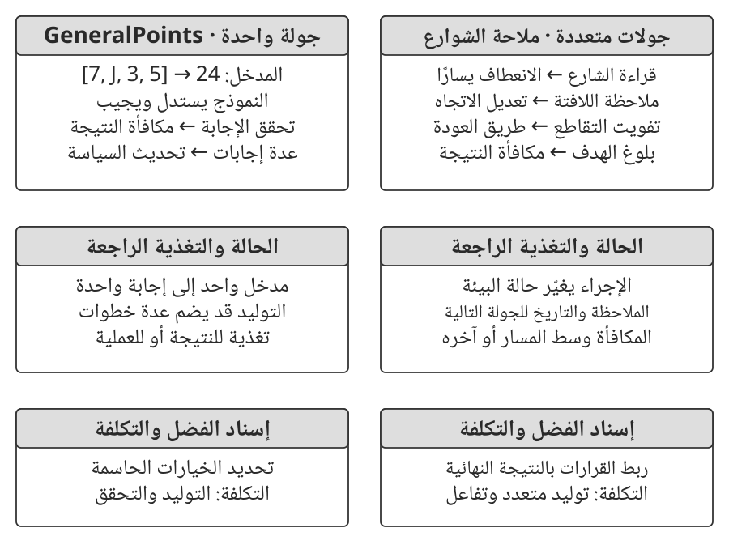

في الشكل 8-15 يفوّت الوكيل التقاطع في الخطوة 3، ويكتشف في الخطوة 4 أنه انحرف، فيعود أدراجه، ويبلغ الهدف في الخطوة 5. ومكافأة النقطة النهائية تشهد للرحلة كلها بالنجاح، لكنها لا تميز بين سلوك الطريق الخطأ والعودة السريعة. ونريد أن يسلك هذا التقاطع سليمًا في المرة القادمة؛ وإن أخطأ مرة أخرى، فينبغي أن نشجعه على العودة. ويجب في التدريب تقدير مساهمة كل خطوة سابقة في العائد النهائي، وتسمى هذه المسألة **تخصيص الاستحقاق (Credit Assignment)**. ويمكن لتقدير القيمة والميزة أن يستفيد من العوائد اللاحقة؛ ويُضاف إلى ذلك مكافأة العملية حين أمكن فحص الإجراءات الوسيطة بموثوقية. فالخطوة 4، أي العودة، تحصل على 0 في مكافأة العملية، ومع ذلك تساعد على بلوغ النهاية. وعند تقدير قيمة هذه الخطوة ينبغي أن يحتسب فيها العائد اللاحق أيضًا.

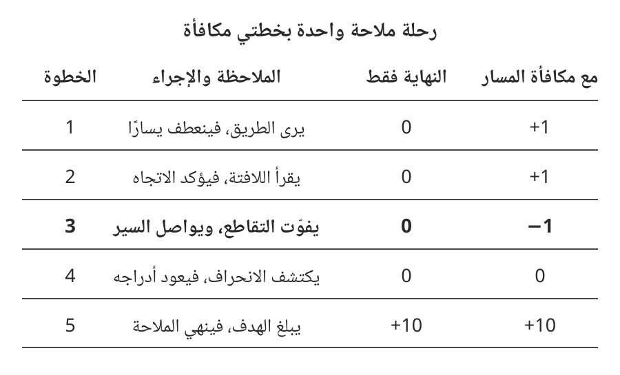

وتظهر المشكلة نفسها في مكالمة خدمة عملاء. فمثلًا يقدّم المستخدم في الجولة 10 تقييمًا إيجابيًا. وقد تكون الجولة 2، التي استوضحت أي رسم محل الخلاف، والجولة 7، التي شرحت الرسم، قد ساعدتا كلتاهما. ومن التقييم الأخير وحده لا يمكن التمييز بين مقدار مساهمة كل منهما. وتعرض التجربتان التاليتان حالتين: أن يتمكن المدرب من فحص إجراءات الملاحة خطوة بخطوة، وألا يتاح له الحكم على نجاح الروبوت من نتيجة المهمة وحدها.

> **التجربة 8-12 ★★★: V-IRL-VL — الملاحة البصرية متعددة الجولات**
>
> في V-IRL[^ch8-24] على الوكيل أن يجد الوجهة خطوة بخطوة انطلاقًا من مشهد الشارع أمامه. استُخدمت في التدريب مسارات من نيويورك، وفي الاختبار مدن أخرى، فتغيّرت صياغة الإرشاد وتغيّر مشهد الشارع في الصورة معًا. وقد ظهر أداء RL أفضل بوضوح من SFT في نوعي الاختبار خارج التوزيع: تغير القواعد وتغير المظهر البصري. واستخدمت التجربة PPO مع شبكة قيمة. ولأن التغذية الراجعة تأتي مع كل خطوة، صار تمييز القرارات الجديرة بالاحتفاظ بها في مسار طويل أيسر.

> **التجربة 8-13 ★★★: SimpleVLA-RL — الاستكشاف المفتوح في ظل مكافأة النتيجة `[تجربة موسعة]`**
>
> تستخدم SimpleVLA-RL مكافأة نجاح/إخفاق في مهام LIBERO الروبوتية. تُجرى أولًا عملية SFT للانطلاق البارد بمسار عرض واحد لكل مهمة، ثم يرفع RL معدل النجاح من 17.3% إلى 91.7%، ويولّد حركة «الدفع والقطع» التي لم تظهر في العروض. وإذا قارنّا هذه النتيجة بالملاحة في مشهد الشارع: فحين يمكن الحكم بموثوقية على الخطوة التي أُخطئ فيها، يمكن تقديم تغذية راجعة فورية تُسرّع التعلم. أما إذا كنا لا نعرف بعد أي الطرق تنجز المهمة، فمنح المكافأة على النتيجة أولًا يتيح للنموذج مجالًا لتجربة مسارات أخرى. وتحديد ترتيب الإجراءات في العرض البشري مبكرًا في صورة مطلب مكافأة قد يخفض درجة استراتيجيات جديدة مثل «الدفع والقطع».

### استدعاء الأدوات: تعلم استخدام القدرات الخارجية في التفاعل

بعد وصل الأدوات الخارجية يستطيع النموذج أن يبحث، أو ينفذ شيفرة، أو يعدّل ملفات، أو يستعلم قواعد البيانات، أو يجمع عدة واجهات API بحسب حاجة المهمة. ويتولى Harness التحقق من الاستدعاءات وجدولتها، وتُنفَّذ الأدوات في البيئة وتعيد الملاحظة. ويفصل الشكل 8-16 بين قرارات المهمة الواحدة والتدريب بعد انتهائها. فبحسب السهم الأيمن تعود نتيجة الأداة إلى المهمة الحالية، ويستخدمها النموذج لتقرير الخطوة التالية. وإذا نظرنا إلى ما تحت، لا يستخدم برنامج التدريب إلا بعد انتهاء المهمة المسار كله لحساب المكافأة وتحديث المعلمات، ثم تُستخدم السياسة الجديدة في الجولة التالية من أخذ العينات. وحين تتطلب المهمة استدعاء عدة أدوات متتالية، تؤثر النتيجة المرجعة من استدعاء سابق في معاملات الاستدعاء اللاحق.

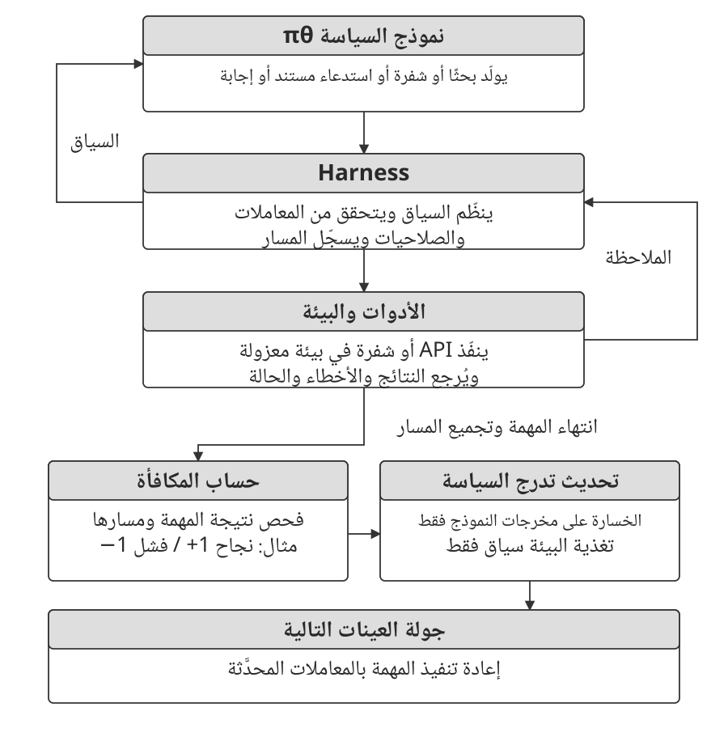

يدرّب Search-R1[^ch8-25] النموذج على أن يقرر متى يبحث، وأي استعلام يقدم، وأن يواصل الاستدلال معتمدًا على النتائج. ويوصل ReTool مفسّر الشيفرة في الحلقة نفسها، فيتعلم النموذج ترتيب تنفيذ الشيفرة وفهم القيم المرجعة وتصحيح المسار بحسب رسائل الخطأ. ويمتد AWorld-train إلى صندوق متعدد الأدوات على بروتوكول MCP، فعلى النموذج أن يختار الأداة وأن يعالج الاعتماديات بين الاستدعاءات، وعلى نظام التدريب أن يكون قادرًا على إعادة ضبط البيئة وإعادة تشغيل المسارات.

ويجب في مسارات الأدوات التمييز بين الرموز التي يولّدها النموذج والرموز التي تعيدها البيئة. فعند حساب خسارة السياسة، لا تدخل في الخسارة إلا الإجراءات التي يولّدها النموذج، مثل الاستدلال ومعاملات الاستدعاء والإجابة، وتُحجب مواضع تغذية البيئة الراجعة. وتبقى التغذية الراجعة مشاركة في الحساب اللاحق بوصفها سياقًا، فتساعد النموذج على الحكم فيما يفعله بعد ذلك. فإذا أعاد المفسّر رسالة خطأ مثلًا، فما يسعى التدريب إلى تعزيزه هو كيفية تصحيح النموذج للشيفرة بعدها. أما إذا احتُسب نص الخطأ في خسارة السياسة أيضًا، فقد اختلط بالتحديث هدفُ «توليد مخرجات البيئة»، فانحرف عن القرار الذي يضطلع به النموذج فعلًا.

> **التجربة 8-14 ★★★: ReTool — مفسّر الشيفرة يعزز حل المسائل الرياضية**
>
> يعرض الشكل 8-17، بمعادلة من الدرجة الثانية، كيف يتبادل الاستدلال النصي وتوليد الشيفرة وتغذية المفسّر الأدوار.
>
> 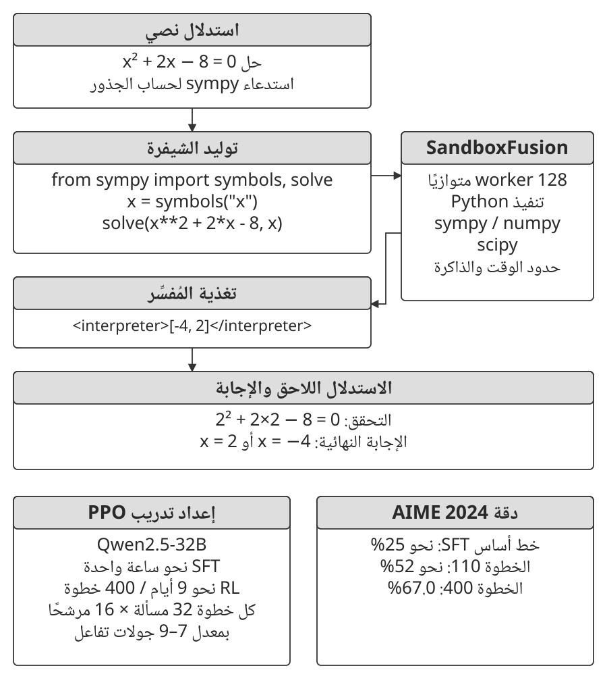
>
> بعد تسخين بـ SFT، يتدرب ReTool بخوارزمية PPO على تفكير نصي وتنفيذ شيفرة وتغذية مفسّر متشابكة. ويتعلم النموذج تدريجيًا متى يستحق تشغيل الشيفرة، وكيف يصححها بعد رسالة الخطأ. وقد استُخدمت هنا بيانات التدريب DAPO-Math-17k، وظل تحديث السياسة بخوارزمية PPO القياسية.[^ch8-26][^ch8-27]
>
> وبعد التدريب ارتفعت دقة إجابة النموذج على AIME 2024 من نحو 25% إلى 67.0%. فبالمقارنة مع RL النصي الخالص، مكّنت تغذية الشيفرة النموذج من تعلم الحساب الدقيق وتصحيح الخطأ على نحو أسرع.

> **التجربة 8-15 ★★★: AWorld-train — تعلّم استخدام الأدوات في صندوق رملي**
>
> إذا سرنا دورة واحدة في النصف الأعلى من الشكل 8-18، نجد أن النموذج يتلقى نتيجة استدعاء أداة ثم يمكنه مواصلة المحاولة. وإذا سرنا في النصف الأسفل: تكون هذه الدفعة من المهام قد انتهت، فيتلقى برنامج التدريب المسارات المرفقة بمكافآتها، ويحدّث المعلمات، ولا تستخدم السياسة الجديدة إلا في الدفعة التالية.
>
> 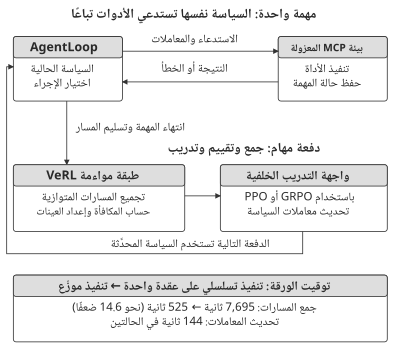
>
> تضم بيئة GAIA ستة وعشرين خادم MCP و126 دالة أداة، ويمكن فيها تشغيل صفحات الويب بـ Playwright، واستخراج محتوى PDF وWord والعروض التقديمية، وتحويل الصوت إلى نص، والتعرف على الحروف، أو تنفيذ الشيفرة في صندوق E2B الرملي. وتوفر أدوات Excel تسعًا وعشرين عملية تشمل الصيغ والرسوم البيانية والجداول المحورية، كما يتيح استرجاع المعرفة الوصول إلى Wikipedia وarXiv وWayback. وبعد إعادة ضبط الصندوق الرملي يمكن المحاولة من جديد من الحالة نفسها، أو إعادة تشغيل مسار سابق.
>
> والقياسات الزمنية في الشكل مأخوذة من مقارنة جمعها البحث. وتعطي التجربة المرافقة إعداد تدريب لنموذج بحجم 4B: Qwen3-4B-Thinking-2507، وثماني وحدات A100، وسقف سياق 131K، و32 جولة تفاعل كحد أقصى، وحجم دفعة 32، و16 مسارًا لكل مسألة، وتحديث بخوارزمية GRPO بمعدل تعلم 1e−6.

أعادت الأداة نتيجة؛ فأي خطوة ينبغي أن يكافئها برنامج التدريب؟ إن نجاح الاستدعاء لا يدل إلا على نجاح تنفيذ الأداة. وللحكم على ما إذا كانت هذه الخطوة قد دفعت المهمة إلى الأمام، يلزم فحص التغير الذي أحدثته بالمدقق، ثم تقرير المكافأة التي يحصل عليها النموذج.

## تصميم المكافأة: كيف نحوّل هدف المهمة إلى إشارة تعلم

لنفترض أن مساري استرداد أعادا المبلغ نفسه في النهاية، لكن أحدهما تجاوز التحقق من الهوية المطلوب. فإذا قرأنا الرصيد النهائي وحده، حصل المساران على الدرجة نفسها. ولكي نحوّل كامل المتطلبات التي كلّفنا بها المستخدم إلى إشارة تعلم، نحدد أولًا من يستطيع التحقق من النتيجة، وفي أي خطوة تتوافر الأدلة، وأي المعلومات يلزم إعادتها إلى النموذج، ثم نفحص هل يمكن التحقق من الصلاحيات وقيود الإجراءات على طول المسار كلٍّ على حدة.

### من أين تأتي المكافأة: القواعد وتفضيلات البشر وحكم النموذج

في المهام القابلة للحكم الآلي، يقدّم المؤلف **التعلم المعزز بالتحقق القابل للبرمجة (RLVR)**، فيكتب متطلبات القبول شيفرةً مباشرة. فمسائل الرياضيات يمكن التحقق من إجاباتها، ومهام الشيفرة يمكن تشغيل اختباراتها، ومهام الاسترداد يمكن فحص المبلغ وحالة الطلب في قاعدة البيانات. ويكفي أن يُسجل النجاح 1 والإخفاق 0 للحصول على أبسط مكافأة نتيجة. فالقواعد واضحة والتشغيل قابل لإعادة الإنتاج، وهذا يسهل تحديد فروق التقييم؛ أما نطاق تغطية المدقق فيحدد ما الذي يحسّنه التدريب فعلًا.

يحوّل **التعلم المعزز بتغذية بشرية (RLHF)** تفضيلات البشر إلى إشارة تدريب. فـ InstructGPT[^ch8-4] يجمع أولًا مقارنات بشرية بين الإجابات، ويدرّب نموذج مكافأة، ثم يحسّن السياسة بـ PPO. ونموذج المكافأة يتعلم التفضيلات من عينات محدودة، والسعي المستمر إلى رفع درجاته قد يضخم انحيازه.[^ch8-5] ويُضاف في التدريب غالبًا تنظيم KL إزاء نموذج SFT المرجعي لكبح انحراف السياسة. أما DPO[^ch8-6] فيستفيد مباشرة من أزواج التفضيل «إجابة أفضل–إجابة أسوأ» لتحسين السياسة، ويستغني عن تدريب نموذج مكافأة منفصل.

ويمكن في المهام المفتوحة أن يقدم النموذج أسباب التقييم والدرجة. أما تشخيصات **نموذج المكافأة التوليدي (GRM)** فيمكن استخدامها أيضًا في تصفية العروض، وبناء أزواج التفضيل، أو توجيه التعديلات اللاحقة. ويولّد DeepSeek-GRM[^ch8-23] مبادئ تقييم بحسب المهمة، ثم يقدم بناءً عليها النقد والدرجة؛ ويحسّن سلوك التقييم بـ RL متصل، ويجمع أحكامه بأخذ عينات متعددة ونموذج مكافأة مساعد.

كما تؤثر الفجوة بين مؤشر التقييم وهدف المهمة في سلوك النموذج. ويشير **Reward hacking** إلى استغلال السياسة لعيوب في قواعد التقييم أو في تنفيذها لتحصل على درجة عالية. وفي الوكلاء طويلي المدى تظهر كذلك ظاهرة تُسمى **reward seeking**: أن يتصرف النموذج وفق تقديره هو لطريقة التقييم، فيختار مثلًا بنفسه فحصًا يسهل اجتيازه، ثم ينهي المهمة بعد اجتيازه.[^ch8-29] ويدلنا هذا المثال على أن شروط القبول ينبغي أن تنطلق من هدف المستخدم وأن تغطي المخرجات الفعلية؛ فالاكتفاء بفحص مؤشر يختاره النموذج نفسه يسهل أن يغفل متطلبات لم تُنجز بعد.

وعند تصميم مكافأة مهمة الاسترداد، دع مسارين مكتوبين بشريًا يمران على المدقق أولًا. الأول يفحص الطلب، ويستدعي واجهة الاسترداد، ويعيد إلى المستخدم إيصال العملية؛ والثاني يكتفي بقول «تم الاسترداد». فإذا حصل الاثنان على الدرجة نفسها، فافحص أولًا هل قرأ المقيّم الرد النهائي، أم إيصال الواجهة، أم حالة الطلب. وهذه الحالة المضادة الصغيرة كافية لكشف مشكلة المؤشر البديل، وتوفر كلفة اكتشاف، بعد دفعة تدريب كاملة، أن النموذج قد تعلم أن يعلن النجاح قبل أن يتحقق.

### متى تُمنح المكافأة: على النتيجة أم على العملية

تقيّم **مكافأة النتيجة** أداء المهمة بعد انتهاء الـ episode؛ وحين يُستخدم نموذج في تقييم النتيجة، يسمى هذا النموذج **ORM (نموذج مكافأة النتيجة)**. ومكافأة النجاح/الإخفاق في SimpleVLA-RL تجعل السياسة تستكشف تسلسلات إجراءات مختلفة حول الهدف النهائي. وهذه الإشارة سهلة التعريف، لكن بعد إخفاق مسار طويل يحتاج النموذج إلى محاولات أكثر لتمييز الإجراءات التي أدت إلى الإخفاق. وهذا أحد أسباب تأثير التغذية المتفرقة في كفاءة العينات.[^ch8-8]

ولنأخذ حالة الإنهاء المبكر عند وكيل البرمجة مثالًا: بعد أن يقدّم النموذج إعلان الإتمام، يشغّل Harness اختبارات القبول المحمية في مساحة عمل معزولة. تقرأ الاختبارات الملفات وحالة البيئة الحقيقية، فتمنح مكافأة موجبة عند النجاح ومكافأة سالبة عند الإخفاق. وبهذا يستدعي إعلان الإتمام تحققًا خارجيًا، ويحدد المخرج الفعلي نتيجةَ المهمة. ويُعدّ في التقييم مجموعتان من المهام: مجموعة ما زال فيها عمل يتعين إنجازه، لقياس معدل الإنهاء المبكر؛ ومجموعة أُنجزت فعلًا، لفحص هل يعرف النموذج متى يتوقف في الوقت المناسب.

وتقدم **مكافأة العملية** تغذية راجعة في الخطوات الوسيطة، كأن تقيّم التحقق من الهوية أو اختيار المعاملات أو إجراءات الملاحة أو خطوات الاستدلال. ويسمى النموذج المستخدم في تقييم العملية **PRM (نموذج مكافأة العملية)**. وقد درس بحث OpenAI «Let's Verify Step by Step»[^ch8-7] التحقق خطوة بخطوة في الاستدلال الرياضي. وإشارة العملية تساعد النموذج على تحديد موضع الخطأ، لكنها تزيد كلفة التأشير والتحقق. كما أن اعتبار ترتيب حل معين هو المسار الصحيح الوحيد يخفض مكافأة استراتيجيات صالحة أخرى. ولذلك لا يضيف المؤلف إشارة عملية إلا للأحداث الوسيطة القابلة للتحقق فعلًا، ليظل النموذج يستكشف حلولًا صالحة متعددة. ويستخدم V-IRL-VL (التجربة 8-12) تغذية راجعة خطوة بخطوة في الملاحة، ويستخدم SimpleVLA-RL (التجربة 8-13) مكافأة نقطة النهاية، فيعرض الاثنان اختيارين مختلفين لدقة التغذية الراجعة بحسب المهمة.

ويمكن عمليًا بناء خط أساس لمكافأة النتيجة أولًا، ثم إضافة إشارات عملية لأحداث وسيطة مثل إتمام التحقق من الهوية أو اجتياز الاختبارات. ويمكن في المهام متعددة الجولات محدودة الطول أخذ معامل خصم $\gamma=1$، ليبقى وزن مكافأة النهاية نفسه عند انتشارها إلى الوراء. ويربط PPO التغذية الراجعة بإجراءات كل خطوة عبر تقدير القيمة وحساب الميزة؛ أما GRPO، الذي يستخدم ميزة على مستوى المسار، فيحسب عادةً خسارة السياسة لرموز التوليد في المسار بالوزن نفسه لهذه الميزة.

### كم من المعلومات ينبغي أن تحمل المكافأة: قيمة قياسية أو متجهة أو تشخيص توليدي

يحدد توقيت المكافأة كثافة التغذية الراجعة؛ ويحدد مضمونها شكل التمثيل. فالقيمة القياسية الواحدة تلخص الأداء الكلي؛ والشكل شبه القياسي «سبب موجز + درجة» يضيف أساس التقييم؛ والمتجه يعبّر عن أبعاد منفصلة مثل الدقة والاكتمال والكلفة؛ أما التشخيص التوليدي فيوضح المشكلة واتجاه التعديل، ويمكن تجميعه بأخذ عينات متعددة.

- عند توافر إجابة محددة أو اختبار قبول، يمكن البدء بقيمة قياسية ثنائية.
- عند تعدد أهداف الجودة، يمكن التقييم في أبعاد منفصلة، ثم الترجيح أو وضع القيود بحسب متطلبات الأعمال.
- حين يحتاج التقييم إلى تفسير مرتبط بالسياق، يمكن توليد تشخيص، ومعايرته بالتحقق الوقائعي والمعاينة البشرية.

فمهمة خدمة عملاء واحدة يمكن أن تسجل في الوقت نفسه حل المشكلة، وعدد جولات المحادثة، وإتمام التحقق من الهوية. وتقابل الأبعاد الثلاثة الأثر والكلفة ومتطلبات الإجراءات. وقبل استخدامها في التدريب ينبغي التحقق من ثبات التقييم، ومن قدرته على التمييز بين سلوكيات المسارات في المجموعة نفسها. ويبدأ المؤلف بعدد قليل من المؤشرات الموثوقة، ويتحقق من كل بند قبل إضافة أبعاد أخرى. فكل بند تقييم غير متحقق منه قد يدفع النموذج إلى تحسين مؤشر بديل جديد من دون أن يحسّن المهمة الحقيقية.

### قيود المسار وRLVP

قد توجد في أثناء إنجاز المهمة متطلبات سلوكية مستقلة: التواصل مع المستخدم في ساعات العمل، وإتمام التحقق من الهوية، وإبقاء الملفات المحمية دون تغيير. وتجمع RLVP (Reinforcement Learning with Verified Penalty)[^ch8-9] مكافأة النتيجة مع عقوبة مسار قابلة للتحقق، ومبدأها **مكافأة النتيجة، ومعاقبة المسار**. فقواعد المسار تُستثار بإجراءات قابلة للملاحظة في البيئة، ويظل اكتمال التسليم خاضعًا لفحص قبول المهمة.

لنفترض أن إصلاحين اجتازا القبول، لكن أحدهما استبدل مباشرة ملفًا كان ينبغي قراءته أولًا. يكفي فحص سجل الأدوات لتحديد هذا الإجراء المخالف؛ أما الحكم على مقدار مساهمة كل خطوة سابقة في النجاح النهائي فأصعب بكثير. وأبسط حل هو إعطاء المسار كله درجة واحدة $R=O+\beta\Phi$: حيث $O$ درجة المهمة، و$\Phi$ تجمع خصومات المخالفات أو التقدم القابل للتحقق، و$\beta$ تحدد الوزن النسبي بينهما. وبهذا يمكن التمييز بين الإصلاحين، لكن كل إجراء في المسار نفسه يحصل على الإشارة نفسها.

وإذا عرفنا الجولة التي وقعت فيها المخالفة، أمكن ترك الخصم لتلك الجولة. انظر إلى مساري الاختبار في التنفيذ المرافق: الأول أنجز المهمة لكنه خالف في الجولة الثانية؛ والثاني لم ينجز المهمة وكان مطابقًا في الجولتين. درجة النتيجة في المسارين 1 و0، وبعد طرح متوسط المجموعة يصبحان +0.5 و−0.5. ولكل مسار جولتان، وفي كل جولة عشرة رموز إجراء. وبحسب إعداد `c2` في التنفيذ، تُعدّ الإشارتان منفصلتين:

```python
outcome_weight = (1 - 0.5) / 40  # 结果信号分摊到这批的全部 40 个动作 token
penalty_weight = -0.3 / 10       # 违规扣分只分摊到甲第二轮的 10 个动作 token
first_turn = outcome_weight
second_turn = outcome_weight + penalty_weight
```

في الجولة الأولى من المسار الأول يحصل كل رمز إجراء على وزن +0.0125، وفي الجولة الثانية على −0.0175. وبهذا يمكن لإجراءين في الإصلاح الناجح نفسه أن يتلقيا إشارتي تدريب متعاكستين في الاتجاه. وبدخول هذه الأوزان في خسارة السياسة يحدّث المحسِّن المعلمات بناءً عليها. وفي مهمة خدمة عملاء، يكفي أن يحدد سجل الأدوات الجولة التي تجاوزت فحص التفويض، ليمكن توزيع الخصم بالطريقة نفسها.

ويمكن فهم دور إشارة المسار من الفروق داخل المجموعة. فإذا تساوت مكافآت النتيجة لمسارات GRPO، كانت الميزة المحسوبة منها صفرًا؛ وإذا اختلف عدد المخالفات فيها، أمكن لعقوبة المسار أن تقدم أساس مقارنة جديدًا. وتسري على مكافأة التقدم الجزئي الشروط نفسها: لا بد أن تأخذ العينات تقدمًا متفاوت الدرجات حتى يكون لها أثر تمييزي.

وعند تصميم مكافأة المسار يمكن اتباع أربع قواعد: معاقبة الإجراءات المخالفة الصريحة؛ والإبقاء على مكافأة نتيجة المهمة؛ وتوفير مسار مطابق قابل للبلوغ للسلوكيات المقيدة؛ واستخدام قواعد تحقق قابلة لإعادة التنفيذ. فمعاقبة كل عملية منفصلة مثلًا تشجع النموذج على البقاء في مكانه، ولا يدفعه إلى إنجاز العمل إلا الإبقاء على مكافأة نجاح المهمة. وإذا صعب على النموذج الأساسي توليد مسار مطابق، أمكن بناء نقطة انطلاق بعدد قليل من العروض، ثم تقليل الاعتماد على تشكيل المسار تدريجيًا بالتدريب.

> **التجربة 8-16 ★★★: RLVP — مكافأة النتيجة ومعاقبة المسار**
>
> تضيف التجربة إلى GRPO مكافأة النتيجة $O$ وإشارة المسار $\Phi$، وتقارن ذلك بمكافأة النتيجة وحدها. فانخفض عدد المخالفات في مهام الوكيل على TerminalBench من 3.71 إلى 0.66 مع بقاء معدل النجاح على حاله تقريبًا؛ وفي مهام الوكيل على miniF2F انخفض عدد الدورات اللازمة لبلوغ معدل نجاح 0.9 من 7.0 إلى 4.4 بعد إضافة مكافأة تقدم جزئي قابلة للبلوغ.
>
> وقد أظهرت مهام إصلاح البرمجيات أيضًا أثر قابلية بلوغ الإشارة: فحين تعجز جميع عمليات rollout عن اجتياز أي اختبار، تبقى مكافأة التقدم المحسوبة بعدد الاختبارات المجتازة كما هي، فلا تزيد الفروق داخل المجموعة.

انخفض متوسط عدد المخالفات إلى 0.66، أي أن النموذج صار يختار المسار المطابق أكثر، لكنه ما زال يخالف أحيانًا. ولذلك يجب، في القيود التي لا يجوز تجاوزها، فحص الصلاحيات أيضًا عند تنفيذ الأدوات.

## التقطير: رفع كفاءة العينات

غالبًا ما تضم عملية rollout واحدة للوكيل عدة جولات من توليد النموذج وتنفيذ الأدوات. ورفع **كفاءة العينات** معناه بلوغ الأداء المستهدف بتفاعل أقل مع البيئة. وتعكس خطوات التدريب وزمن GPU وعدد استدعاءات البيئة كلفًا مختلفة، يلزم النظر إليها مع المهمة نفسها. فمثلًا يحتاج تدريب SFT في حالة ReTool في هذا الفصل إلى نحو ساعة، ويحتاج RL إلى نحو 9 أيام؛ ويستهلك أخذ العينات المتكرر وتنفيذ الأدوات قدرًا كبيرًا من الموارد.

وحين تُستخدم مكافأة نقطة النهاية، قد يحصل المسار كله على درجة نجاح أو إخفاق واحدة. لنفترض أن أداة الأعمال نبّهت إلى أن «آخر أربعة أرقام من بطاقة الائتمان مطلوبة»، لكن الوكيل أغفل هذه المعلومة، فحصل في النهاية على مكافأة 0. ويظل التدريب بحاجة إلى تمييز، من محاولات متعددة، هل جاء الإخفاق من حقل ناقص، أم من معامل أداة خاطئ، أم من خطأ في العمليات اللاحقة. فإذا تمكن المعلم من تقديم إشراف خطوة بخطوة على هذا المسار، أمكن للتفاعل البيئي نفسه أن ينتج إشارة تعلم أدق.

### التقطير على المسار: أن ينتج rollout واحد إشرافًا كثيفًا

في **التقطير على المسار (On-Policy Distillation)** يولّد الطالب المسارات، ويقدم المعلم الإشراف على البادئات التي يولّدها الطالب فعلًا. وقد عرض Thinking Machines Lab هذه الطريقة عرضًا منهجيًا في بحث عام 2025.[^ch8-10] ولفهم الطرق الثلاث يمكن الفصل بين «من يولّد حالات التدريب» و«من يقدم إشارة التعلم»:

| الطريقة | من يولّد المسار أو الحالة | إشارة التعلم الرئيسية |
| --- | --- | --- |
| SFT / التقطير خارج المسار | عرض بشري أو من المعلم | إشراف رمزًا برمز على الإجابة المستهدفة |
| RL على المسار | الطالب الحالي | مكافأة نتيجة أو عملية |
| التقطير على المسار | الطالب الحالي | تقييم المعلم الاحتمالي رمزًا برمز لبادئات الطالب |

فمثلًا، يعرض المعلم دائمًا الاستعلام عن الطلب قبل طلب الاسترداد، أما الطالب فقد يبدأ بطلب الاسترداد فيتلقى خطأ «رقم الطلب مفقود». والتقطير على المسار يجعل المعلم يقيّم هذه الحالة التي بلغها الطالب، فيرشده إلى كيفية استكمال المعلومات. وبهذا يغطي التدريب أخطاء الطالب ومسارات تعافيه.

ومن طرق التنفيذ تقليل KL العكسي بين الطالب والمعلم على البادئة التي يولّدها الطالب:

$$
D_{\mathrm{KL}}(\pi_\theta\Vert\pi_T)
=\mathbb{E}_{a\sim\pi_\theta(\cdot\mid h)}
\left[\log\pi_\theta(a\mid h)-\log\pi_T(a\mid h)\right],
$$

حيث $h$ البادئة الحالية، و$a$ الرمز التالي، و$\pi_\theta$ و$\pi_T$ توزيعا الطالب والمعلم. فالرموز التي يراها المعلم أنسب تحصل على إشارة تدريب أفضل. ويمكن عند التنفيذ مقارنة التوزيعين الكاملين، أو استعلام المعلم عن اللوغاريتمات الاحتمالية للرموز التي أخذها الطالب أصلًا، لبناء إشارة تحسين رمزًا برمز.

ولنأخذ «استعلام API أولًا ثم تحليل القيمة المرجعة» مثالًا: لنفترض أن موضعًا ما تقابله مرشحان، «استعلام» و«استدعاء»، وأن المعلم يمنحهما 80% و15%، وللبقية مجتمعةً 5%. فهذا يقدم أساس اختيار أدق من نجاح أو إخفاق نهائي. وإذا كان المسار يضم $T$ رمزًا من توليد النموذج، أمكن الحصول على إشراف في نحو $T$ موضعًا؛ ويُستخدم محتوى ما تعيده الأدوات سياقًا، ويُحجب في خسارة السياسة.

وفيما يلي يُعرض هذا بتنسيق مواءمة التوزيعين الكاملين:

```python
trajectory = rollout(student, task)
loss = 0
for prefix in model_generated_positions(trajectory):
    target = stop_gradient(teacher.distribution(prefix))
    loss += KL(student.distribution(prefix), target)
update_student(loss)
```

يضطلع الطالب بالاستكشاف، ويقدم المعلم الإشراف في مواضع متعددة، والكلفة الإضافية تأتي أساسًا من استدلال المعلم. وحين يكون التفاعل البيئي مكلفًا والمعلم قادرًا على إرشاد الطالب بموثوقية، يفضل المؤلف مقارنة التقطير على المسار، ليجعل كل استدعاء للبيئة ينتج إشارات تعلم فعالة أكثر. ولمن يفتقر من الطلاب إلى اللغة المستهدفة أو معرفة المجال أو الإجراءات الأساسية، يمكن بناء نقطة انطلاق فعالة أولًا بـ Mid-training والعروض، ثم الانتقال إلى التقطير على المسار.

والاتساق بين أخذ العينات والتدريب مهم بالقدر نفسه: فمحرك أخذ العينات يولّد المسارات وفق السياسة $\mu$، ومحرك التدريب يحسب الخسارة وفق $\pi_\theta$، والفرق بينهما يغير توزيع حالات التدريب.

وقد أظهرت المقارنة على مهام الرياضيات في Thinking Machines Lab مكسبًا في كفاءة التدريب يقارب رتبة من المقدار. ويمكن في الوكلاء متعددي الجولات اتباع أسلوب المقارنة نفسه، مع تسجيل معدل نجاح المهمة وعدد استدعاءات البيئة وكلفة حسابات المعلم. فالحالات التي يبلغها الطالب في البيئة، وقدرة المعلم على تقديم تغذية راجعة موثوقة، يحددان معًا مقدار المكسب.

وقد قارن المؤلف ومشاركون له أيضًا في مهمة «الإحساس بالزمن» بين DPO وأربع وصفات RL والتقطير على المسار.[^ch8-11] وقد واجهت الوصفات السابقة مشكلات مثل التغذية المتفرقة، واختلال الهدف، وعدم تطابق شكل rollout، وانهيار السياسة. أما بعد التحول إلى معلم Qwen3-32B مجمّد والمواءمة رمزًا برمز على مسارات الطالب متعددة الجولات، فقد تقارب التدريب بسلاسة، وتجاوز معدل النجاح في الشروط الأربع خط أساس SFT المماثل بـ 23 إلى 47 نقطة مئوية. وقد جعلت هذه التجربة المؤلف يقدّر كثافة الإشارة في كل تفاعل أكثر. فإذا شاركت القرارات الوسيطة في التفاعل نفسه في التعلم، أمكن الانتفاع بقيمة المسارات القائمة انتفاعًا أوفى.

فإذا كان معلم الرياضيات بارعًا في الاستدلال، ومعلم الشيفرة بارعًا في إصلاح البرامج، فكيف يتعلم طالب واحد ما يجيده كلاهما؟ يتبع **التقطير على المسار متعدد المعلمين (MOPD)** عملية التدريب السابقة نفسها، ولا يستبدل إلا المعلم الثابت بمعلم يُختار بحسب مجال المسألة. فحين يحل الطالب مسألة شيفرة، يقدم البادئة التي كتبها حتى لو انحرف في منتصفها إلى معلم الشيفرة، ليحصل على توزيع الاحتمال للخطوة التالية؛ وحين يأتي دور مسألة الرياضيات، يقدم معلم الرياضيات إرشاده في أثناء حل الطالب. ويمكن تدريب معلم كل مجال منفصلًا أولًا، ثم تجميد معلماته في مرحلة التقطير. وعند النشر لا يلزم تشغيل إلا طالب واحد.[^ch8-mopd]

وثمة شرطان عمليان. الأول أن حساب KL رمزًا برمز بالصيغة السابقة يحتاج إلى الحصول على احتماليات معلم قابلة للمواءمة على البادئة التي يقدمها الطالب. فامتلاك بضع إجابات كاملة كتبها المعلم يكفي لـ SFT، لكنه لا يكفي لحساب هذه الخسارة. والثاني أن تُفحص درجات كل مجال منفصلة عند القبول. فحين ترتفع درجة الطالب في الرياضيات وتنخفض في الشيفرة، يسهل أن يخفي متوسط كلي مرتفع تراجعَ الثاني.

[^ch8-mopd]: Wenhan Ma وآخرون، *MOPD: Multi-Teacher On-Policy Distillation for Capability Integration in LLM Post-Training*، 2026. يعتمد البحث معلمين مدرَّبين بحسب المجال، ويقطّر منهم على مسارات الطالب نفسه.

### التقطير الذاتي على المسار: بناء معلم بسياق إضافي

إذا كان لدى الفريق نموذج واحد بارع في مجاله، فمن يكون المعلم؟ يمكن تقديم المسألة نفسها إليه مرتين. في المرة الأولى يُعطى سؤال المستخدم وفق ظروف النشر؛ وفي الثانية يُعطى الإجابة النموذجية أو عرض الخبير أو وثائق المجال. والمعلومات الزائدة في الإجابة الثانية يمكن أن ترشد الطالب في ظروف المرة الأولى.

يتيح **التقطير الذاتي على المسار (On-Policy Self-Distillation، OPSD)**[^ch8-15] للنموذج نفسه أن يضطلع بدورين: يرى الطالب مدخلات المهمة وحدها، ويرى المعلم إضافةً إلى ذلك الإجابة النموذجية أو حلًا متحققًا منه. وبعد أن يولّد الطالب مساره، يقيّم المعلم البادئات مستعينًا بهذه المعلومات المميزة، ثم يعيد الإشراف إلى الطالب.

فعلى سبيل المثال، يكون الطالب في أثناء حل مسألة رياضية قد حلّها المعلم بالفعل ويعرف إجابتها الصحيحة. ويمكن للمعلم أن يقيّم بها اتجاه استدلال الطالب الحالي، فيتعلم الطالب تحسين توليده بالانطلاق من المسألة وحدها. وتعرض الشيفرة الزائفة الآتية موضع السياق الإضافي وموضع عزل التدرج:

```python
trajectory = rollout(model, task_without_answer)
loss = 0
for prefix in model_generated_positions(trajectory):
    privileged_prefix = add_verified_answer(prefix)
    target = stop_gradient(model.distribution(privileged_prefix))
    loss += KL(model.distribution(prefix), target)
update(model, loss)
```

لا تدخل المعلومات المميزة إلا في فرع المعلم أثناء التدريب، ويبقى مدخل الطالب ومدخل التقييم مطابقين لظروف النشر. ويمكن تتبع مساري المعلومات في الشيفرة الزائفة: فالإجابة النموذجية تدخل فقط في السطر الذي يبني بادئة المعلم، فلن يراها الطالب عند النشر؛ ويُمرَّر مخرج المعلم عبر إيقاف التدرج، فلا تُحدَّث المعلمات في هذه الخطوة إلا من فرع الطالب وفق الفرق بين التوزيعين. وحين يُستخدم النموذج المحدَّث في الجولة التالية، قد يتغير حكم المعلم معه. وبهذا يستطيع النموذج نفسه أن يستفيد من معلومات أوفى في جانب التدريب، لتقديم إشراف على توليده الفعلي.

ويمكن أيضًا أن تأتي المعلومات المميزة من عروض بشرية أو وثائق مجالٍ مصفاة. وينبغي عند الاختيار التحقق مما إذا كانت تحسّن حكم المعلم: فكلما زادت قدرة المعلم، بعد حصوله على المعلومة، على تحديد أخطاء الطالب، صارت إشارة التقطير أنفع. ويلزم في أثناء التدريب فحص القدرات القائمة وأسلوب التوليد بعينات تُحجز مسبقًا للاختبار؛ وتزيد أبحاث مثل Purified OPSD قيدًا تنظيميًا يساعد النموذج على الحفاظ على أسلوب استدلاله السابق.[^ch8-16]

## من الحالات الإشكالية إلى التدريب اللاحق

نظّم الفصل السابع مشكلات الإنتاج في مهام قابلة لإعادة الإنتاج وإسناد للإخفاقات ومعايير للتقييم. ويمكن استخدام هذه المواد في التدريب اللاحق أيضًا: فالمهمة الكاملة توفر بيئة تفاعل، وبادئة المسار السابقة للخطأ توفر سياق القرار، ويتولى المدقق فحص السلوك المتولد حديثًا. ويعرض الجدول 8-5 تقابلها مع طرق التدريب.

الجدول 8-5 مواد تقييم الفصل السابع واستخداماتها في التدريب

| مواد الفصل السابع | استخدامها في تدريب الفصل الثامن |
| --- | --- |
| مهام شاملة من الطرف إلى الطرف مع مدققاتها | مهام أخذ العينات في RL، ومكافآت قابلة للتحقق، ومجموعة مهام لأخذ العينات بالرفض |
| بادئات المسارات والسلوكيات اللاحقة | أزواج التفضيل في DPO، وعروض القرار في SFT، ومدخلات المعلم في التقطير على المسار |
| مواضع الإخفاق وفئات الأخطاء | وسوم تقييم العملية، وقواعد عقوبة مسار قابلة للتحقق |
| درجات بنود معايير التقييم والإجابات المرجعية البشرية | مكافآت متعددة الأبعاد، وتدريب نموذج مكافأة توليدي ومعايرته |

يمكن أن تكون البادئات التاريخية نقطة انطلاق لمهام الاستكمال. وعند استخدامها في التقطير على المسار، يواصل الطالب الحالي التوليد من هذه النقطة أولًا، ثم يقيّم المعلم البادئة التي أنتجها الطالب فعلًا؛ وإذا كان تنفيذ الأدوات مطلوبًا، استُعيدت حالة البيئة المقابلة معها. وبهذا يوصل ذلك تقييمَ القرارات الموضعية في الفصل السابع بعملية أخذ العينات والتدريب في هذا الفصل.

ويجب فصل المهام المستخدمة في التدريب عن مهام التقييم المحجوزة. ويمكن أن يشترك الجانبان في الواجهات ومنطق التحقق، مع استخدام نسخ مهام مستقلة؛ وإذا أردنا فحص التعميم عبر المهام، أمكن الفصل بحسب قالب المهمة أو نوع العمل. وتوضح الأمثلة الثلاثة الآتية كيف يُنجز هذا التحول.

### الحالة 1: الإنهاء المبكر عند وكيل البرمجة

الإعلان عن الإتمام قبل تشغيل الاختبارات، أو التسليم بعد إنجاز متطلبين فقط من ثلاثة، أو الاستسلام بعد بضع محاولات فاشلة، كلها صور للإنهاء المبكر. ويمكن في بيئة الإنتاج جمع هذه الحالات من تصحيحات المستخدمين والتقييمات السلبية ومراجعة المسارات. فإذا أشار المستخدم مثلًا إلى أن «الاختبارات لم تُشغَّل بعد»، أمكن تتبع المسار لفحص حالة المهمة حينها، والأدلة المتحققة المتاحة، وإعلان النموذج عن الإتمام.

وعند تحليل الأسباب، نوقف المسار أولًا عند اللحظة التي يوشك فيها النموذج أن يقول «انتهيت»، ثم ننظر إلى الوراء: هل أغفل قراءة متطلب، أو عدّل الشيفرة الخطأ؟ ومن هنا نحصل على نوعين من مواد التدريب: المهمة الكاملة لتدريب النموذج على إنجاز العمل، وبادئة القرار لتدريبه على أن يختار بناءً على الأدلة بين مواصلة التنفيذ والإنهاء.

**يمكن ربط المهمة الكاملة بمكافأة النتيجة.** عند تقديم النموذج للنتيجة تُشغَّل اختبارات القبول المحمية، فيُمنح +1 عند النجاح و−1 عند الإخفاق. وتغطي الاختبارات المخرجات الفعلية، ويستطيع النموذج الحصول على التغذية الراجعة باختبارات التطوير العادية، أما القبول النهائي فتنفذه بيئة التدريب.

**يمكن بناء أزواج التفضيل من بادئة القرار.** في السياق نفسه، تكون العينة غير المفضلة (`rejected`) إعلان إتمام يفتقر إلى الدليل، وتكون العينة المفضلة (`chosen`) مواصلةَ تشغيل الاختبارات اللازمة، ومطابقة المتطلبات الناقصة، وإنجاز العمل المتبقي. ويمكن أن يكتب المعلم عدة طرق للمتابعة، ثم يصفّي المدقق ما يصلح منها عرضًا. وإذا قلت العينات، أمكن تغيير نوع المهمة وبند التحقق الناقص وصياغة الإتمام، لتوسيعها إلى مئات من أزواج التفضيل. ثم يُجرى DPO باستخدام LoRA، مع مزج قدر مناسب من المهام العامة للحفاظ على تغطية السلوك.

**يفحص التقييم المهام غير المكتملة والمكتملة معًا.** مجموعة من المهام لم يُنجز منها إلا جزء، لملاحظة هل يواصل النموذج العمل؛ ومجموعة أخرى أُنجزت فعلًا، لمعرفة هل يُنهي العمل في الوقت المناسب. ويُعاين في الوقت نفسه استدعاء الأدوات العام ومهام أخرى، لملاحظة هل أثّر التدريب الموجّه في القدرات القائمة. فالاكتفاء بخفض معدل الإنهاء المبكر قد يجعل النموذج يختار مواصلة التحقق في كل مرة، فيتأخر في إنهاء حتى العمل الذي اكتمل. وعندئذ تظهر، في مجموعة المهام المنجزة، استدعاءات أدوات زائدة وانتظار لا داعي له.

> **التجربة 8-17 ★★: من حالة «الإنهاء المبكر» الإشكالية إلى إصلاح بـ DPO**
>
> تربط التجربة «إسناد الإخفاق — بادئة القرار — زوج التفضيل — تدريب LoRA — التقييم المحجوز» في مسار واحد، وتستخدم نموذجًا بحجم 7B في التدريب.
>
> تضم البيانات 24 حالة إشكالية واقعية، تغطي أربعة أنواع: الإعلان عن الإتمام دون تشغيل الاختبارات، وإنجاز جزء من الأهداف المتعددة فقط، وعدم استيفاء شروط القبول، والاستسلام عند الخطأ، وتتضمن كذلك صيغة غش في المكافأة تحذف الاختبارات الفاشلة. ويُحجز إضافةً إلى ذلك 12 سؤالًا ما زال فيها عمل يتعين إنجازه، و8 أسئلة أُنجزت فعلًا، للتقييم وحده.
>
> لننظر أولًا في سؤال محجوز. مستهلك طابور رسائل يفقد الرسائل بعد إعادة الاتصال عقب الانقطاع، فعدّل المساعد شيفرة إعادة الاتصال، ولم تُبلغ الأداة إلا بأن «الملف عُدّل». فهل ينبغي في هذه اللحظة إعلان الإصلاح، أم مواصلة التحقق؟ تعطي التجربة ردين مرشحين، وتقارن أيهما يمنحه النموذج درجة أعلى. قبل التدريب أصاب النموذج في 3 من المهام الاثنتي عشرة غير المكتملة (25.0%)؛ وبعد التدريب أصاب في 11 (91.7%). أما المهام الثماني المكتملة فعلًا، فأصاب فيها كلها قبل التدريب وبعده.
>
> فإذا أزلنا الردين المرشحين وتركنا النموذج يكتب الخطوة التالية بنفسه، اختلفت النتيجة. فبحسب قواعد تصنيف النص في التجربة، انخفض الإعلان المبكر عن الإتمام في المهام غير المكتملة من 1/12 إلى 0/12؛ وانخفض كذلك الإنهاء الصريح في المهام المكتملة من 6/8 إلى 0/8. فمن ينظر إلى المجموعة الأولى وحدها يسهل أن يظن أن المشكلة قد حُلّت. لكن المجموعة الثانية تذكّرنا بأن النموذج يعرف متى ينبغي التوقف حين يختار بين ردين جاهزين، لكنه حين يكتب الرد بنفسه قد يظل يطالب بمزيد من الفحص. وبالعودة إلى مثال فقد الرسائل، يلزم أيضًا أن يجري المساعد فعلًا اختبار إعادة اتصال بعد الانقطاع، ليتحقق من وصول الرسائل بعد إعادة الاتصال. فقول «سأواصل التحقق» شيء، والحصول على نتيجة التحقق شيء آخر.

### الحالة 2: علامات الاقتباس الصينية

يتطلب «تحويل علامات الاقتباس المستقيمة في مقال صيني إلى علامات منحنية» تحديد نطاق التحرير أولًا. فالاقتباس في اللغة الطبيعية الصينية يمكن أن يستخدم `“”`، وتُعالج الاقتباسات المتداخلة وفق قواعد الترقيم الصينية؛ أما علامات الاقتباس في النصوص الإنجليزية الأصلية والسلاسل الحرفية وJSON والمسارات والمعرّفات فلها وظائف نحوية خاصة بها. وهدف التدريب أن يتعرف النموذج على هذه النطاقات، وأن ينجز أقل تعديل ممكن.

يمكن كتابة القواعد أولًا في صورة مهارة (Skill)، ثم توليد المدخلات والنصوص المستهدفة بناءً عليها. وتشمل الأمثلة الموجبة الفقرات الصينية والاقتباسات المتداخلة والتعليقات الصينية؛ وتشمل عينات الحماية الاقتباسات الإنجليزية والسلاسل والحروف الحرفية وJSON والشيفرة المضمنة في السطر وكتل الشيفرة. وفي التعليقات الصينية داخل الشيفرة، ينبغي التعرف على حدود التعليق ونطاق الاقتباس معًا؛ والمقاطع التي يتعذر تحديد نطاقها تبقى على حالها. ولا يمكن التمرن على الحكم على النطاق في التحرير الحقيقي إلا بجمع هذه الحالات في الوثيقة نفسها.

> **التجربة 8-18 ★★: SFT لعلامات الاقتباس الصينية المنحنية مع مراعاة النطاق**
>
> تستخدم التجربة Qwen3-8B، وتجري LoRA SFT بدقة bf16 لمدة 2 epoch، بمجموع 256 تحديثًا. وهدف التدريب تحويل الاقتباسات في اللغة الطبيعية الصينية، مع الإبقاء على علامات الاقتباس النحوية في الشيفرة والبيانات المنظمة.
>
> رُكّبت البيانات من 16 فئة من المقاطع، و10 أنواع من المقالات، و9 لغات برمجة، فتولدت 1,024 عينة تدريب، و256 عينة محجوزة، و256 عينة حدّية. وتحفظ كل عينة النص الأصلي والنص المستهدف، وتغطي الاقتباسات التي يجب تحويلها، والسلاسل التي يجب حمايتها، والحالات التي يتداخل فيها الاثنان.
>
> بلغ معدل التطابق التام بعد التدريب 96.9% في المجموعة المحجوزة، و97.7% في المجموعة الحدّية، وكان معدل الحفاظ على المناطق المحمية 100%.
>
> وتُستخدم مجموعة قواعد النطاق نفسها لتوليد الوسوم وفحص المخرجات. فيتعلم النموذج الحكم على نطاق التحرير، ويتولى المحلل والفحص النحوي التحقق من بنية الوثيقة بعد التعديل. وبهذا يمكن فحص جودة التحرير النصي وصحة التنسيق كلٍّ على حدة.

### الحالة 3: تكرار إخفاق تحرير الملفات

عرض الفصل الخامس أدوات من نوع `edit_file(path, old_string, new_string)`. وعلى النموذج أن ينسخ النص الأصلي إلى `old_string`، ثم تجري الأداة مطابقة دقيقة. وأي اختلاف في المسافات أو أسطر جديدة أو الشرطات المائلة العكسية أو حروف Unicode قد يؤدي إلى إخفاق المطابقة.

نقارن أولًا مقطعًا مقطعًا على طول سلسلة انتقال المعلومات: **البايتات الأصلية للملف ← ما تعيده الأداة ← تسلسل Harness ← سياق النموذج ← رموز مخرجات النموذج ← السلسلة بعد فك الترميز ← تحليل معاملات الاستدعاء ← مطابقة الأداة**. فإذا غيّرت مرحلة القراءة البايتات، أُصلحت الأداة؛ وإذا غيّر الهروب أو تجميع السياق المحتوى، أُصلح Harness؛ وإذا ظهر تغير بعد الترميز ثم فك الترميز، فُحص المقسِّم. أما إذا بقي مدخل النموذج سليمًا وظهر الاختلاف أولًا في موضع توليد النموذج، أمكن استخدام هذه الحالة في التدريب اللاحق على قدرة النسخ الدقيق.

ويمكن أن تتضمن بيانات التدريب ثلاثة أنواع من المهام: إعادة محتوى محدد حرفيًا؛ واختيار السلسلة المطابقة تمامًا من بين عدة سلاسل متشابهة متساوية الطول؛ وكتابة النص الأصلي في الحقل `old_string` من استدعاء الأداة. وتُضاف إلى العينات المسافات والأسطر الجديدة الحقيقية والشرطات المائلة العكسية وتمثيلات Unicode المختلفة، لتغطية المواضع المعرضة للخطأ في التحرير الفعلي.

> **التجربة 8-19 ★★: SFT للنسخ الدقيق للسلاسل الخاصة**
>
> تتخذ التجربة Qwen3-8B نموذجًا أساسيًا، وتدرّبه بـ LoRA بدقة bf16 لمدة 2 epoch، مع استبعاد الموجّه من حساب الخسارة. وفي أسئلة الإعادة المباشرة تُستخدم السلسلة المستهدفة عرضًا، وفي أسئلة معاملات الأداة يُستخدم JSON كامل لا يتضمن إلا `old_string` عرضًا، فتدخل في الإشراف رمزًا برمز حتى أسماء الحقول وعلامات الاقتباس والأقواس. كما تختبر التجربة منفصلة اتساق الترميز وفك الترميز في المقسِّم.
>
> ارتفع معدل التطابق التام بايتًا ببايت في المجموعة المحجوزة من 37.5% إلى 78.9%، وبلغ 80.1% في المجموعة الحدية المستقلة؛ وكان متوسط موضع أول اختلاف في البايت في المجموعتين 54.0 و54.2. واستُخدمت كذلك 512 عينة استكشاف من المجموعتين المحجوزة والحدية لمقارنة ثلاثة مقسِّمات، فبلغ معدل الذهاب والإياب دون فقد في Qwen3 وQwen2.5 كليهما 80.1%.
>
> أجاب النموذج بعد الضبط عن 106 أسئلة إضافية إجابة صحيحة؛ فهل بقيت الأسئلة التي كان يصيب فيها صحيحة كلها؟ بوضع إجابتي السؤال نفسه جنبًا إلى جنب، نجد 107 أسئلة تحولت من الخطأ إلى الصواب، وسؤالًا واحدًا تحول من الصواب إلى الخطأ. السؤال الأول في المجموعة المحجوزة يطلب إعادة كائن JSON. وقد نسخ النموذج الأساسي `old_string` صحيحًا، لكنه أضاف حقولًا أخرى مثل مسار الملف؛ وبعد الضبط لم يُعد إلا الحقل المطلوب، فنال الدرجة. أما السؤال الذي تراجع فيه (`eval-095`) فيطلب إعادة سطرين حرفيًا، فجاءت الإجابة بعد الضبط بالسطرين متصلين، وسقط منها حرف السطر الجديد الذي بينهما.

اكتب كل حالة من هذه الحالات الثلاث في بطاقة تشخيص: احتفظ بالمدخل الذي كان النموذج يراه فعلًا قبل الإخفاق، واكتب إجراءً مقبولًا واحدًا على الأقل، ثم اكتب حالة مقابلة «تشبهها في الظاهر لكن لا ينبغي اتباعها». فمثلًا، عند تعارض التحرير ينبغي إعادة قراءة الملف، أما إذا لم يتغير الملف وتم التحقق من التعديل فيُسمح بالإنهاء. والتدريب بالأولى ثم القبول بمهام من النوع نفسه ومهام مقابلة لم تشارك قط في التدريب هو وحده ما يكشف هل تعلم النموذج الحكم المشروط، أم صار يضيف خطوة أيًا كان ما يصادفه.

## نقاط عملية في التدريب اللاحق

ينبغي أن تنطلق خطة التدريب اللاحق من المشكلة المراد حلها. فنقص المعرفة المجالية، وعدم استقرار بروتوكول المخرجات، وضعف اختيار الإجراءات، تحتاج كل منها إلى بيانات وتغذية راجعة مختلفة. ويولي المؤلف جودة البيانات والبيئة أهمية أكبر: فهما تحددان المشكلات التي يصادفها النموذج والإشارات التي يتلقاها، ثم تحوّل خوارزمية التدريب هذه الإشارات إلى تحديثات للمعلمات.

وعند التطبيق في المشروع يمكن الفحص بالترتيب الآتي.

1. **تحديد موضع حفظ المعرفة والقدرات.** يمكن استخدام نصوص المجال المستقرة في Mid-training، والعروض تعلّم النموذج كيف يجيب ويتصرف؛ أما الحقائق التي تحتاج إلى تحديث آني أو استشهاد أو ضبط صلاحيات أو حذف، فتناسبها الإدارة عبر RAG.
2. **التحقق من قابلية المخرجات للتقييم.** يُقاس على عدد قليل من المهام معدل تحليل JSON واكتمال المعاملات ونجاح استدعاء الأدوات. فإذا كثرت أخطاء التنسيق، حُسّنت أولًا بـ SFT أو فك الترميز المقيد، ثم وُسّع أخذ العينات في RL.
3. **فحص طول السياق الفعال.** بعد أن يصبح النموذج قادرًا على استقبال 128K رمز، يلزم التحقق من قدرته على إنجاز الاسترجاع والاستدلال والتخطيط بهذا الطول. ويستخدم المؤلف مصفوفة «القدرة × الطول» للقبول درجة بعد درجة، ثم يوسّع النافذة، مع مزج عينات قصيرة وبيانات المراحل السابقة للحفاظ على القدرات قصيرة المدى.
4. **فحص احتمال أخذ عينة من مسار فعال.** يُلاحظ `pass@k` والتقدم الجزئي وتباين المكافآت داخل المجموعة معًا. فإذا ندرت العينات الناجحة، أمكن بناء نقطة انطلاق أفضل بـ Mid-training أو SFT أو التقطير أو المهام التدرجية؛ وينبغي أن تقابل المكافأة الجزئية تقدمًا تستطيع السياسة الحالية بلوغه.
5. **جعل المكافأة تغطي هدف المهمة.** إذا مُنحت الدرجة بحسب طول الرد وحده، فقد يزيد النموذج المحتوى المسهب. فتُترجم متطلبات القبول إلى اختبارات وفحوص حالة ومعايير تقييم معايرة، ثم تُفحص الجودة الفعلية للمسارات ذات الدرجات العالية.
6. **معايرة تغذية البيئة الراجعة.** تُقارن تعبيرات المستخدم وأخطاء الأدوات وتغيرات الحالة بين المحاكاة والنشر، وتُضاف الفروق إلى مهام التدريب. وينبغي أن تُحتسب كلفة بناء بيئة مستقرة ضمن ميزانية التدريب.
7. **مراقبة التعميم والنسيان بالمهام المحجوزة.** تُلاحظ القدرة المستهدفة والقدرات العامة الأصلية معًا. فإذا استمر تحسن مؤشرات التدريب وتراجع الأداء المحجوز، عُدّلت نسب البيانات أو عدد الدورات أو التنظيم، واختيرت نقطة التحقق بحسب نتائج التحقق.
8. **ملاحظة تقدير القيمة والاستكشاف.** يؤثر خطأ القيمة في PPO في حساب الميزة؛ وتؤثر حرارة أخذ العينات والعشوائية في تنوع المسارات المرشحة. والنظر معًا إلى تقلب المكافأة وخطأ القيمة وإنتروبيا المخرجات وتباين المسارات يساعد على فهم سبب توقف التدريب.
9. **قياس الاتساق العددي بين أخذ العينات والتدريب.** تُقارن اللوغاريتمات الاحتمالية (log probability) في الطرفين قبل التحديث، وتُراقب نسبة الاحتمال وKL التقريبي ونسبة الاقتطاع وتقادم السياسة، وتُواءم الأوزان والقوالب وإعدادات الحساب.
10. **تقدير الكلفة على امتداد السلسلة كلها.** تشمل كلفة RL توليد النموذج وتنفيذ الأدوات والتحقق وتحديث المعلمات والانتظار. وتبين مقارنة الأزمنة في ReTool أن أخذ العينات قد يطيل دورة التدريب كثيرًا. فإذا بلغ SFT الأداء المستهدف، أمكن تقديم الموارد لاستكمال البيانات وتقييم النشر.
11. **فحص جودة الإشراف في كل نوع من البيانات.** فالارتباطات الخاطئة في نصوص Mid-training، والتشويش في عروض SFT، وانحياز مدققات RL، كلها تدخل في إشارة التدريب. فيُعاين أولًا عدد قليل من البيانات والمسارات، ثم يوسّع الحجم.

ويمكن أن تتكون من هذه الفحوص تجربة تدريبية منخفضة الكلفة: قدر قليل من نصوص المجال يختبر مكسب المعرفة والنسيان، وعدد قليل من العروض يختبر قابلية السلوك للتعلم، ودفعة صغيرة من عمليات rollout تختبر تباين المكافآت وكلفة التشغيل. وتقدم التجربة التدريبية أساسًا للاستثمار في الخطوة التالية.

**ويمكن أيضًا أن يتكامل التدريب اللاحق مع RAG والتعلم في السياق.** لنفترض أنك تبني مساعدًا للتحويلات المالية. يمكنك أولًا أن تعرض على النموذج بضع محادثات نموذجية، ليجرّب شرح إجراءات الموافقة للمستخدم بوضوح؛ وكلما زادت الأمثلة، قد يرتفع زمن القراءة وكلفتها في كل مرة. وإذا تغيرت السياسة، استُرجعت البنود الحالية من قاعدة المعرفة، وأُرفق مصدرها بالإجابة. وعند الوصول إلى خطوة تقديم التحويل، ينبغي أن يتولى برنامج التحقق من المبلغ والتفويض، حتى لو ظل حد الموافقة ثابتًا لسنوات. ولتقرير الطريقة المستخدمة، لا يكفي النظر إلى مدى تغير المعلومات، بل ينبغي أيضًا النظر إلى إمكان كتابة أساس الحكم في صورة قواعد. فالنبرة الطبيعية، وأشكال الصور الطبية، يصعب حصرها بالقواعد، وتعلّم هذه الأنماط يحتاج غالبًا إلى تدريب المعلمات.

ويمكن لنظام واحد أن يتحقق من الاستراتيجية أولًا بالسياق، ويقدم الأدلة بـ RAG، وينفذ القيود الصارمة بالبرامج، ثم يحسّن قدرات النموذج بـ Mid-training وSFT وRL. وبعد أن يبلغ النموذج الهدف، يمكن أيضًا نقل السلوك بالتقطير إلى نموذج أصغر لخفض كلفة النشر.

وكيف نقبل أن «النموذج تعلّم الحكم من التغذية الراجعة»؟ صنّف المؤلف، في محاضرته في بورتو، جعل النموذج يتعلم الحكم باستمرار في أوزانه مع الحفاظ على قدراته القديمة مسألة مفتوحة. فتذكر الرصيد بعد تصحيح المستخدم له اختبار لذاكرة الحقائق. أما لمعرفة هل تعلم النموذج كيف يحكم، فيمكن تغيير السيناريو ثم السؤال من جديد.

فمثلًا، تتناول مواد التدريب قبول المستخدم تذكرة طيران تتجاوز الميزانية قليلًا في رحلة عمل. وفي الاختبار نغيرها إلى فندق غير مألوف ومبلغ جديد، فنحتفظ في سؤال بقيد الوقت للحاق باجتماع، ونقدم في سؤال آخر صراحة شرط عطلة عائلية بميزانية ضيقة. ونعطي في السؤالين الخيارات البديلة المتاحة وقتها، ونكتب مسبقًا الإجراءات والإيضاحات المقبولة. فإذا دفع النموذج الزيادة في السؤالين معًا، أو سأل مستوضحًا في السؤالين معًا، كان ذلك مؤشرًا على أنه ربما حفظ الإجراء الظاهري وحده. ثم نعيد تشغيل المهام التي كان الإصدار القديم ينجزها جيدًا، مثل الالتزام الصارم بسقف التعويض الذي حدده المستخدم صراحة.

## ملخص الفصل

إذا صادفت مسألة يخطئ فيها النموذج، فدعه يحاول عدة مرات أولًا، وانظر أين يخفق. فإذا ظل `pass@k` قريبًا من الصفر بعد أخذ عينات معقول، فافحص أولًا هل ينقصه المعرفة المجالية أو القدرات الأساسية، ثم قرر هل تستكمل النصوص بـ Mid-training. وإذا لم يقرأ الوثائق الطويلة كاملة، فزد طول التدريب درجة بعد درجة، وافحص القدرات الأصلية بالمهام القصيرة. وإذا كان النموذج يصيب أحيانًا، لكنه كثيرًا ما يكتب معاملات الأدوات بتنسيق لا يمكن تحليله، فالأجدى أن تبدأ بعروض SFT. وحين يصبح قادرًا على توليد مسارات متعددة قابلة للتنفيذ، وتستطيع المكافأة التمييز بينها، تصبح لـ RL فرصة لرفع احتمال اختيار الاستراتيجيات الجيدة.

**يقدم المؤلف الاستثمار في البيانات والبيئة.** ففي تجارب نقل القواعد والمظهر البصري في GeneralPoints، كان نموذج SFT المدرب بعروض محدودة عرضة للإفراط في الملاءمة، وأظهر فرع RL أداءً أفضل في المهام خارج التوزيع. فإذا غيرت دفعة العروض أو طريقة التحقق، وجب إعادة هذه المقارنة. وفي المهام متعددة الجولات مثل ReTool وV-IRL وSimpleVLA-RL، يلزم أيضًا تقرير الأحداث الجديرة بالتغذية الراجعة في تنفيذ الأدوات أو الملاحة أو التحكم في الحركة. وحين تكون البيئة الحقيقية باهظة الكلفة، يمكن محاكاة ما تعيده الأدوات وانتقالات الحالة، لكن يجب العودة إلى المهام الحقيقية للتحقق مما إذا كان النموذج قد تعلم استغلال انحيازات المحاكي. وبعض المهام يبلغ متطلبات التسليم بمجرد استكمال المعرفة الأساسية والعروض.

**ويرى المؤلف أن العائق الرئيسي في RL للوكلاء حاليًا هو كفاءة العينات واتساق التوزيع.** فما دام تفاعل الأداة الواحد مكلفًا، فهل يمكن أن نتعلم منه أكثر؟ يتيح التقطير على المسار للمعلم أن يقدم إرشادًا رمزًا برمز في المواضع التي بلغها الطالب فعلًا؛ ويستعين RLVP بالأحداث الوسيطة القابلة للتحقق لاستكمال مكافأة النهاية. ومن جهة أخرى، إذا كانت السياسة المستخدمة في أخذ العينات قد تخلفت عن إصدار التدريب، أو كان طرفا أخذ العينات والتدريب يحسبان للمخرج نفسه احتمالات مختلفة اختلافًا واضحًا، فيجب فحص هذا الفرق أولًا قبل تفسير منحنى المكافأة.

والإنهاء المبكر، وتعديل نطاق التحرير الخطأ، والعجز عن النسخ الدقيق للسلاسل، كلها يمكن تتبعها من إخفاق واحد إلى عينات تدريب محددة. وبعد إصلاح هذه المسألة، يلزم التحقق من عدم التراجع بعينات مستقلة وبالمهام التي كان النموذج يصيب فيها سابقًا. وعند مواجهة الدفعة التالية من الإخفاقات، أيها يستحق إعادة تدريب النموذج، وأيها يكفيه تحديث المعرفة أو التعليمات أو البرامج؟ هذا هو الاختيار الذي يتناوله الفصل التالي.

[^ch8-ppo-method]: Schulman وآخرون، *Proximal Policy Optimization Algorithms*، 2017، arXiv:1707.06347.

[^ch8-1]: Schulman, John and Thinking Machines Lab, “LoRA Without Regret”, 2025.
[^ch8-2]: ياو شون‌يو (Shunyu Yao)، «The Second Half»، 10 أبريل 2025.
[^ch8-3]: Chu, Tianzhe et al., “SFT Memorizes, RL Generalizes: A Comparative Study of Foundation Model Post-training”, 2025. arXiv:2501.17161.
[^ch8-4]: Ouyang, Long et al., “Training Language Models to Follow Instructions with Human Feedback”, OpenAI, 2022.
[^ch8-5]: Gao, Leo, John Schulman, and Jacob Hilton, “Scaling Laws for Reward Model Overoptimization”, OpenAI, 2023.
[^ch8-6]: Rafailov, Rafael et al., “Direct Preference Optimization: Your Language Model is Secretly a Reward Model”, 2023.
[^ch8-7]: Lightman, Hunter et al., “Let's Verify Step by Step”, OpenAI, 2023.
[^ch8-8]: Silver, David and Richard S. Sutton, “Welcome to the Era of Experience”, 2025.
[^ch8-9]: Li, Bojie, and Noah Shi, “RLVP: Penalize the Path, Reward the Outcome”, 2026. arXiv:2607.07435.
[^ch8-10]: Thinking Machines Lab, “On-Policy Distillation”, 2025.
[^ch8-11]: Li, Bojie, and Noah Shi, “Agents That Sense Physical Time: Urgency, Persistence, and Vigilance as Missing Controls for LLM Agents”, 2026.
[^ch8-12]: Kulikov, Ilia, et al. *Autodata: An Agentic Data Scientist to Create High Quality Synthetic Data.* arXiv:2606.25996, 2026.
[^ch8-13]: Sun, Hao, et al. “ZeroSearch: Incentivize the Search Capability of LLMs without Searching”, 2025. arXiv:2505.04588.
[^ch8-14]: “DreamGym: Scaling Agent Learning via Experience Synthesis”, 2025. arXiv:2511.03773.
[^ch8-15]: Zhao, Siyan, et al. “Self-Distilled Reasoner: On-Policy Self-Distillation for Large Language Models”, 2026. arXiv:2601.18734.
[^ch8-16]: Shen, Ziqi, et al. “Purified OPSD: On-Policy Self-Distillation Without Losing How to Think”, 2026. arXiv:2607.02234.
[^ch8-17]: Tan, Zelin, et al. “SKT: Skill-Use Training at Scale via Verified Synthetic Data Generation”, 2026. arXiv:2608.02287.
[^ch8-18]: Wei, Yifan, et al. “Towards Compositional Generalization of LLMs via Skill Taxonomy Guided Data Synthesis”, 2026. arXiv:2601.03676.
[^ch8-19]: Zhu, Kaijie, et al. “TermiGen: High-Fidelity Environment and Robust Trajectory Synthesis for Terminal Agents”, 2026. arXiv:2602.07274.
[^ch8-20]: Hua, Zhanbo, et al. “CLI-Universe: Towards Verifiable Task Synthesis Engine for Terminal Agents”, 2026. arXiv:2606.22883.
[^ch8-21]: Kim, Moo Jin et al., “OpenVLA: An Open-Source Vision-Language-Action Model”, 2024. arXiv:2406.09246.
[^ch8-23]: Liu, Zijun et al., “Inference-Time Scaling for Generalist Reward Modeling”, 2025. arXiv:2504.02495.
[^ch8-24]: Yang, Jihan et al., “V-IRL: Grounding Virtual Intelligence in Real Life”, 2024. arXiv:2402.03310.
[^ch8-25]: Jin, Bowen et al., “Search-R1: Training LLMs to Reason and Leverage Search Engines with Reinforcement Learning”, 2025. arXiv:2503.09516.
[^ch8-26]: Feng, Jiazhan et al., “ReTool: Reinforcement Learning for Strategic Tool Use in LLMs”, 2025. arXiv:2504.11536.
[^ch8-27]: Yu, Qiying et al., “DAPO: An Open-Source LLM Reinforcement Learning System at Scale”, 2025. arXiv:2503.14476.
[^ch8-28]: Pan, Jiayi et al., “Training Software Engineering Agents and Verifiers with SWE-Gym”, 2024. arXiv:2412.21139؛ Barres, Victor et al., “$\tau^2$-Bench: Evaluating Conversational Agents in a Dual-Control Environment”, 2025. arXiv:2506.07982؛ Rawles, Christopher et al., “AndroidWorld: A Dynamic Benchmarking Environment for Autonomous Agents”, 2024. arXiv:2405.14573.
[^ch8-29]: storm، «التحقق الذاتي والتوقف المبكر لدى الوكلاء طويلي المدى: ظاهرة Reward Seeking وسبل التخفيف منها»، مجتمع Qingke، 6 أغسطس 2026.
[^ch8-30]: Gururangan, Suchin et al., “Don't Stop Pretraining: Adapt Language Models to Domains and Tasks”, ACL, 2020.
[^ch8-31]: Jiang, Zhengbao et al., “Instruction-tuned Language Models are Better Knowledge Learners”, ACL, 2024.
[^ch8-32]: Zheng, Chujie et al., “Stabilizing Reinforcement Learning with LLMs: Formulation and Practices”, 2025. arXiv:2512.01374.
[^ch8-33]: Zhong, Tianle et al., “Diagnosing Training Inference Mismatch in LLM Reinforcement Learning”, 2026. arXiv:2605.14220.
[^ch8-34]: He, Horace and Thinking Machines Lab, “Defeating Nondeterminism in LLM Inference”, 2025.

[^ch8-speech-conditioning]: يتضمن توثيق Orpheus-TTS علامات التعبير وشروط السياق النصي–الصوتي؛ وتستخدم واجهة Sesame CSM النص والمتحدث والمقاطع الصوتية لتوليد الكلام اللاحق.

## أسئلة للتأمل

1. ★★ حسّن ضبط دقيق موجّه المهمةَ المستهدفة، لكنه خفّض القدرة العامة على استدعاء الأدوات. كيف تصمم مجموعة اختبار تفحص القدرات الأصلية، وتعدّل نسب البيانات وكمية التدريب، وتقارن أثر الضبط الكامل للمعلمات بأثر LoRA؟
2. ★★ قدرة مجالية ما يمكن تعلمها بتدريب المعلمات، ويمكن دعمها أيضًا بأمثلة في السياق واسترجاع المعرفة. ما العوامل التي تبني عليها اختيارك؟
3. ★★ ما مواد التدريب وطرق التحقق اللازمة لتقطير كل من: نموذج Chat يجيب مباشرة، ونموذج Reasoning يولّد عملية الاستدلال، ونموذج Agentic يستخدم الأدوات عبر جولات متعددة؟
4. ★★★ أنجز وكيل خدمة عملاء مهمة في 10 جولات تفاعل، وحصل في النهاية على مكافأة نجاح. كيف تربط هذه الإشارة بالقرارات الوسيطة؟ وأي الخطوات تناسبها إضافة مكافأة عملية؟
5. ★★★ لديك ميزانية قدرها 10,000 دولار لتحسين أداء وكيل خدمة عملاء. كيف توزع الاستثمار بين التقييم، والسياق والمعرفة، والموجّهات/المهارات (Prompt/Skills)، والقيود البرمجية، وتدريب المعلمات؟
6. ★★★ مهمة تفتقر إلى مكافأة واضحة، والتفاعل مع البيئة فيها مكلف. من أي المصادر يمكن الحصول على إشارات التعلم؟ وكيف تتحقق من أن هذه الإشارات حسّنت أداء المهمة فعلًا؟
7. ★★ ما القدرات الشخصية التي يناسب حملها تدريب LoRA خاص بكل مستخدم أو كل شركة؟ وأي المعلومات يحسن الإبقاء عليها في قاعدة معرفة خارجية؟
8. ★★★ في ضوء الفكرة البحثية لـ Weak-to-Strong Generalization، هل يمكن لنموذج صغير أن يقدم إشرافًا مفيدًا لوكيل أقوى؟ تناول التحقق الموضعي ووسوم التفضيل والسياق الإضافي كلًّا على حدة، وصمم طريقة لفحص انحياز الإشراف.
9. ★★ مسار معظم خطواته الوسيطة صحيحة لكنه أخفق في النهاية، ومسار آخر وصل إلى النتيجة الصحيحة لكنه خالف قيود الإجراءات. كيف تجمع بين تقييم العملية وتقييم النتيجة للحكم على هذين المسارين؟
10. ★★★ يمكن استخدام بيئات SWE-bench وτ²-bench وAndroidWorld ومدققاتها في التدريب. كيف تقسم نسخ المهام وقوالبها بحيث يُستفاد من مواد التدريب مع الإبقاء على تقييم مستقل؟
11. ★★★ معدل pass@1 في المهمة المستهدفة منخفض جدًا. كيف تجمع بين pass@k ومعدل تحليل التنسيق ومعدل التقدم الجزئي وإسناد الإخفاق لتقرر اعتماد Mid-training أو SFT أو RL؟
12. ★★★ في دفعة من عمليات rollout لم يبقَ دون انتهاء إلا عدد قليل من الاستجابات الطويلة جدًا، وقد انتهت بقية المهام. كيف ترفع معدل استخدام عنقود التدريب، مع ضبط تقادم السياسة الناتج عن أخذ العينات غير المتزامن؟
13. ★★★ عند استخدام نموذج لمحاكاة محرك بحث أو مستخدم، ما انحيازات المحاكاة التي قد تضلل الوكيل؟ وكيف تعاير التدريب بحالة المهمة والتفاعل الحقيقي؟
