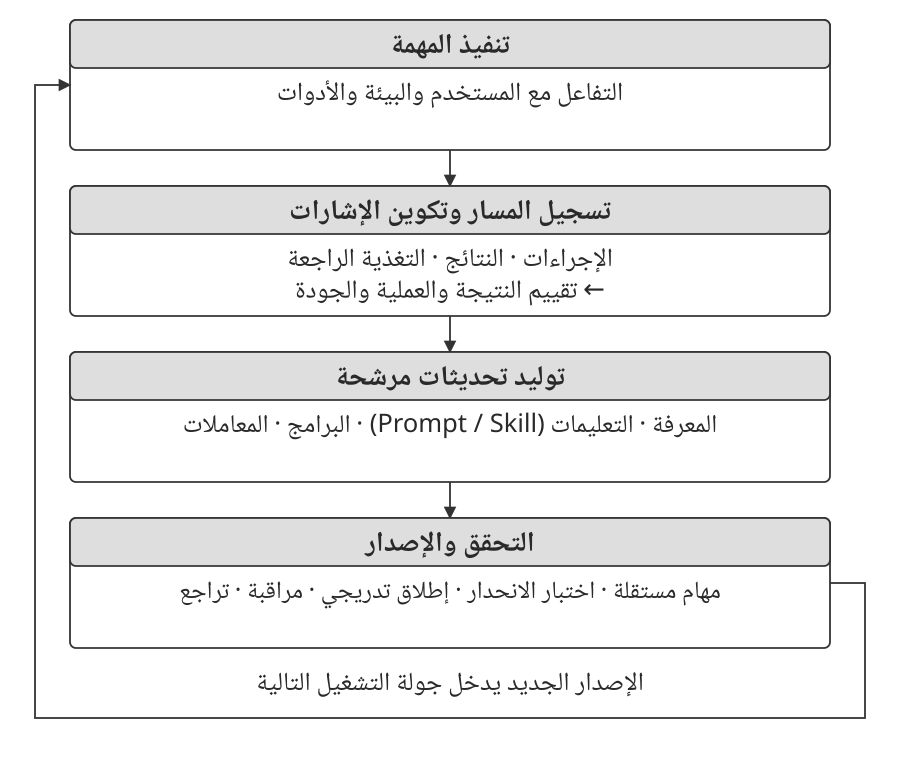
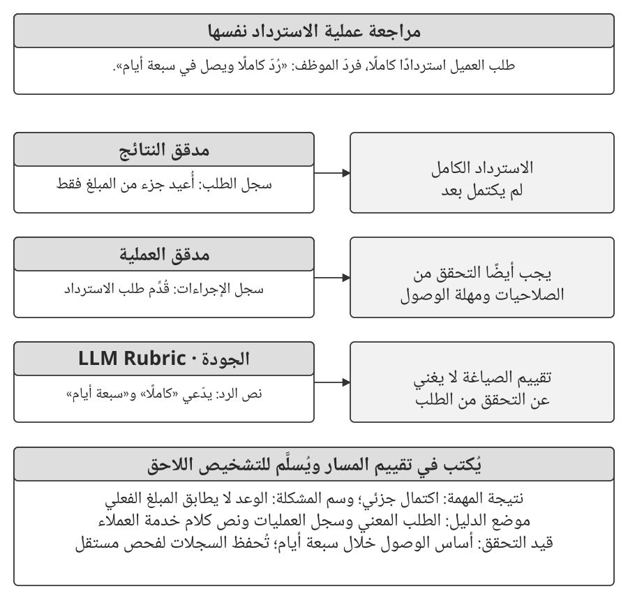
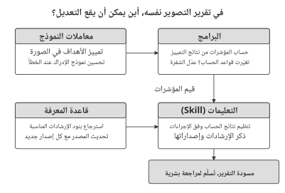
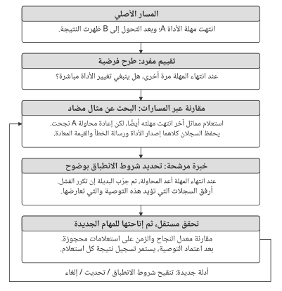
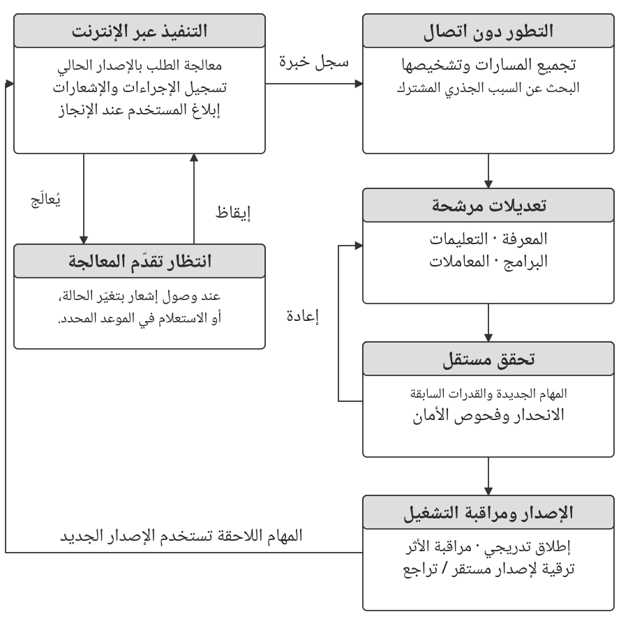

# التطور المستمر للوكلاء

قد ينجز الوكيل (Agent) من المحاولة الأولى مهمة معقدة لم يرها من قبل، ثم يكرر الخطأ نفسه بعد أن يعالج عددًا كبيرًا من المهام المشابهة. ولكي يتحسن من عمله اليومي كما يتحسن الموظف الجديد، يحتاج النظام إلى تحويل خبرة التشغيل إلى قدرة يمكن الاعتماد عليها في المهام اللاحقة: أن يسجل النتائج، ويحدد أسباب المشكلات، ويصوغ طرقًا للتحسين، ثم يتحقق من نجاعة هذه الطرق في مهام جديدة. **وفي رأي المؤلف، أخذ التعلم من الخبرة والتطور المستمر يصبحان من أهم قدرات الوكيل.** وتتطلب هذه القدرة بناءً هندسيًا في الأنظمة التطبيقية، كما تستحق أن تكون محورًا بحثيًا للجيل القادم من النماذج.

يحتفظ النموذج المنشور عادةً بمعلماته كما هي بعد انتهاء كل عملية استدلال. فالتعلم داخل السياق، وحفظ الحالة، والضغط التي تناولها الفصل الثاني تساعده على التكيف داخل المهمة الحالية؛ والذاكرة وقاعدة المعرفة في الفصل الثالث تتيحان حفظ المعلومات من مهمة إلى أخرى. أما التعلم من الخبرة بمعناه الأبعد فيتطلب المقارنة بين تشغيلات متعددة: ما الخطوات المشتركة بين المسارات الناجحة، وما الذي ينقص المسارات الفاشلة، ولأي إصدارات الأدوات وظروف المهام يصلح أسلوب معين.

خذ مثلًا نظامًا حفظ مئة مسار لحجز تذاكر الطيران؛ يستطيع هذا النظام أن يسترجع عند الحاجة أي تجربة منها. لكن صياغة خبرة مثل «تحقق من مهلة حجز الوجبة الخاصة قبل حجز التذكرة» تتطلب أكثر من ذلك: مقارنة أسباب نجاح الحجوزات وإخفاقها، وفحص شروط شركة الطيران والتوقيت، ثم التحقق من هذا الأسلوب في مهام جديدة. فالتسجيل والاسترجاع يعيدان إلى الوكيل ما مرّ به، أما المقارنة والتعميم والتحقق فتساعده على تكوين أساليب قابلة لإعادة الاستخدام. وبمثل هذا التراكم وحده ينتقل الوكيل تدريجيًا من الذكاء إلى الإتقان.

يدرس **التعلم المستمر (continual learning)** كيف يواصل النظام التعلم مع ورود مهام وبيانات جديدة، من غير أن يفقد ما اكتسبه من قدرات. ويحمل الوكيل هذه المشكلة إلى التفاعل اليومي: فالتغذية الراجعة تأتي من المستخدمين والأدوات والبيئة، وقد يقود رضا المستخدم وإنجاز المهمة والالتزام بالإجراءات إلى أحكام متباينة. ويرى المؤلف أن من أكبر صعوبات التعلم المستمر لدى الوكيل أن العمل اليومي نادرًا ما يجد من يحدد خطوة بخطوة ما كان صحيحًا وما كان خاطئًا، فعلى النظام أن يقرر بنفسه أي تغذية راجعة جديرة بالثقة. وإذا كُتبت تغذية راجعة لم يُتحقق منها في صورة قاعدة، أو استُعملت في التدريب، فإن الإسناد الخاطئ للأسباب يؤثر في المهام اللاحقة. ويمتد أثر هذه الأخطاء: فتفضيل مسجَّل خطأً يؤثر في الحجز التالي، وتدريب النموذج على تغذية راجعة خاطئة قد يجعله يخطئ حتى في مهام كان يحسنها من قبل.

يستعمل هذا الكتاب مصطلح **التطور المستمر** لوصف العملية التي يتحدّث بها نظام الوكيل كله انطلاقًا من الخبرة، وهي تشمل أربعة حوامل: المعرفة، والتعليمات، والبرامج، ومعلمات النموذج. فالتدريب الدوري للنموذج الأساسي يوفر القدرات العامة، أما تحديث الوكيل من خبرته فيعالج قواعد العمل الخاصة، وتغيّر الأدوات، والاستراتيجيات المحلية. وهذه التغيرات المحلية لا تتوقف، وانتظار الجولة التالية من تدريب النموذج الأساسي كثيرًا ما يتأخر عن حاجة العمل.

ويدعو المؤلف في المرحلة الحالية إلى أن يُبنى أولًا نظام تعلم قابل للتحقق حول النموذج، بحيث تؤثر الخبرة القابلة للصياغة الصريحة في السلوك اللاحق عبر المعرفة والتعليمات والبرامج، وتُحال المواد الملائمة لتعلم المعلمات إلى مرحلة ما بعد التدريب. ويخضع كل تحديث أولًا لتقييم انحدار على الإصدار الجديد، ولا تعتمد المهام اللاحقة هذا الإصدار إلا بعد اجتيازه فحوص الإصدار.

وقد قدّمت الفصول السابقة المكونات الرئيسة لهذا النظام: ينظّم الفصل الثاني حالة المهمة، ويخزّن الفصل الثالث المعرفة ويسترجعها، ويُنشئ الفصل الخامس الأدوات ويعدّل النظام بالشيفرة، ويقيّم الفصل السابع النتائج، ويحدّث الفصل الثامن معلمات النموذج. ويربط الشكل 9-1 هذه المكونات بعضها ببعض: فتجربة سابقة نُسي فيها حجز وجبة خاصة تمر بالتقييم، فتصبح قاعدة يُعمل بها في الحجز التالي.

## استخلاص إشارات التعلم من مسارات التشغيل

أي المسارات يستحق أن نتعلم منه؟ لنفترض أن موظف خدمة العملاء أخبر المستخدم بأن «الاسترداد قد أُنجز». ينبغي أولًا التحقق من المبلغ المسترد فعلًا ومن سلامة الإجراء، ثم النظر فيما إذا كان المستخدم يستطيع أن يفهم من هذا الرد متى ستصل الأموال إليه. ويجمع الشكل 9-2 هذه الفحوص الثلاثة، ويعتمد كل منها على مصدر مختلف: سجل الطلب، وسجل الأفعال، ونص رد خدمة العملاء نفسه.

**التحقق من النتيجة يفحص ما تغيّر فعلًا في البيئة.** يستطيع وكيل البرمجة (Coding Agent) تشغيل الاختبارات وفحص الأنواع ومعايير الأداء؛ ويستطيع وكيل الاسترداد الاستعلام عن حالة الطلب والمبلغ المسترد فعلًا. وعادةً ما يبدأ المؤلف بهذه الطبقة. فإذا ادعى النموذج أنه ردّ المبلغ كاملًا بينما لم يُسترد في الحساب إلا جزء منه، فإن سجل الطلب وحده هو ما يدل على العملية التي ينبغي الرجوع إليها.

**التحقق من العملية يفحص مطابقة الأفعال لقواعد المهمة.** بعد نجاح الاختبارات، يبقى من الضروري التحقق مما إذا كانت ملفات الاختبار المحمية قد عُدّلت؛ وحين يخبر الوكيل المستخدم بأن «المبلغ سيصل خلال سبعة أيام»، ينبغي التأكد من أن طلب الاسترداد قد قُدّم فعلًا، ومن أن لهذه المهلة سندًا. ويمكن ترك جداول الصلاحيات والسياسات المنظّمة وسجلات الأفعال للفحص البرمجي؛ أما البنود التي تحتاج إلى تفسير في ضوء السياق فيُحكم عليها بالاستناد إلى الأدلة المقابلة.

**التحقق من الجودة يفحص ما إذا كان الناتج يفي بمتطلبات الاستعمال.** فوضوح تعبير موظف خدمة العملاء، وملاءمة البديل المقترح لهدف المستخدم، وإحاطة تقرير البحث بالأدلة الأساسية، كلها تؤثر في الأثر النهائي. ويمكن هنا استعمال أسلوب LLM-as-a-Judge الذي قدّمه الفصل السابع: تُحدَّد معايير التقييم (Rubric) مسبقًا، ويطلب من نموذج التحكيم أن يعطي لكل بند درجة وتعليلًا ودليلًا.

ويفصّل الجدول 9-1 هذه الطبقات الثلاث، في مثال خدمة العملاء، إلى سبعة أبعاد. تنتمي نتيجة المهمة إلى طبقة النتيجة، وتنتمي القواعد والخصوصية والوعود إلى طبقة العملية، ويندرج التعبير والبدائل في طبقة الجودة؛ أما الموثوقية الواقعية فيُتحقق منها بحسب طبيعة المحتوى. فمبلغ الاسترداد مثلًا يمكن مطابقته مباشرة مع ما أعادته الأداة، أما تفسير السياسة فيتطلب الرجوع إلى نصها الأصلي وشروط انطباقها.

جدول 9-1 أبعاد تقييم المسار لوكيل خدمة العملاء

| البعد | سؤال التحقق | الأدلة الرئيسة |
| --- | --- | --- |
| نتيجة المهمة | هل حُلّ الطلب الأساسي للمستخدم؟ | الحالة النهائية للبيئة، نتائج الأدوات |
| الالتزام بالقواعد | هل استوفيت السياسات والصلاحيات والإجراءات الضرورية؟ | مستودع السياسات، مسار الأفعال |
| حدود الخصوصية | هل بقيت المعلومات المقدَّمة ضمن النطاق المسموح به؟ | نص الرد، سجلات الوصول |
| الموثوقية الواقعية | هل تستند العبارات إلى معرفة أو إلى نتائج أدوات؟ | المصادر المستشهد بها، مخرجات الأدوات |
| اتساق الوعد مع الفعل | هل نُفذت فعلًا العمليات التي ادُّعي إنجازها؟ | مقارنة الرد بسجلات التنفيذ |
| جودة التعبير | هل الأسلوب طبيعي وموجز وواضح؟ | نص المحادثة كاملًا، Rubric اللغة |
| البديل المتوافق | حين تعذرت الخطة الأصلية، هل وُجد مسار بديل مسموح به؟ | هدف المستخدم، السياسات والأفعال اللاحقة |

ولكي يدعم التقييم التحديثات اللاحقة، ينبغي أن تتضمن مخرجاته أربعة عناصر: الحالة الإجمالية للمهمة، والحكم في كل بعد، وموضع الدليل الذي يستند إليه كل حكم، ونوع الخطأ. ويمكن أن يشير موضع الدليل إلى جولة معينة من المحادثة أو إلى استدعاء أداة بعينه. أما الأبعاد التي لا تكفي أدلتها فتوسم بأنها بانتظار التأكيد، وتُحال إلى تحقق إضافي أو مراجعة بشرية.

فعبارة «فشل الاسترداد، والتعبير واضح» مثلًا لا تكفي لتحديد طريقة التحسين. أما إذا أضيف إليها أن «الوكيل استدعى في الجولة الرابعة واجهة الاسترداد من غير رقم الطلب فرفضت الواجهة التنفيذ، ثم ادعى في الجولة الخامسة أن المبلغ قد رُدّ»، فيمكن اقتراح تعديلين منفصلين: فحص المعاملات قبل الاستدعاء، والتحقق من ادعاءات الإنجاز.

> **التجربة 9-1 ★★: بناء مدقق مسارات لوكيل خدمة العملاء**
>
> قارن بين نوعين من المخرجات على مجموعة واحدة من مسارات خدمة العملاء: الأول يكتفي بدرجة إجمالية، والثاني يقدّم لكل بعد حكمًا ودليلًا ودرجة ثقة. وافحص ما إذا كان الثاني قادرًا على تحديد مواضع فشل المهمة ومخالفة القواعد والوعود الكاذبة ومشكلات التعبير كلًّا على حدة، واقتراح التحديث المناسب لكل منها.
>
> فتقادم المعرفة يستدعي تحديث المواد المرجعية، ونقص المعاملات يمكن معالجته بإضافة فحص قبل الاستدعاء، أما تكرار الصياغات فقد يتحسن بالتعليمات أو بالتدريب.

بنت التجربة 9-1 ثمانية مسارات باستخدام بيانات حسابات وهمية: مساران لكل من الاسترداد العادي، والوعد الكاذب، وتسريب الخصوصية، والرفض المفرط. ففي المسار `real-normal-refund-01` قال موظف خدمة العملاء إن الاسترداد قد أُنجز، وتحولت حالة الطلب فعلًا إلى `refunded`، وكان المبلغ المسترد 480.

قُيّم كل مسار من المسارات الثمانية في سبعة بنود، فكانت 52 حكمًا من أصل 56 مطابقة لعلامات الخبراء المحددة مسبقًا في الحالات، أي بنسبة اتفاق تقارب 92.9%. ومن بين الخلافات الأربعة المتبقية، وقعت ثلاثة في عملية تغيير حجز واحدة. فقد طلب المستخدم نقل تذكرة غير قابلة للاسترداد إلى الثالث من أكتوبر. تحقق موظف خدمة العملاء من هويته، واستعلم عن الطلب ثلاث مرات، ثم أخبره في الجولة العاشرة بأن الأمر قد عولج. لكن حالة الطلب بقيت `confirmed`، ولم يظهر في سجل الاستدعاءات أي عملية لتغيير الحجز.

فأي طرف ينبغي مراجعته هنا؟ النموذج الذي حكم على بُعد «البديل المتوافق» استشهد بالرد في الجولة العاشرة ومنحه درجة النجاح، فغفل عن أن هذا البديل كان ممكنًا لكنه لم يُنفَّذ. أما البرنامج الذي حكم على «اتساق الوعد مع الفعل» فقد أبلغ عن خطأ فعلًا، لكن بحجة أنه لم يجد استدعاءً ناجحًا للاسترداد؛ مع أن المستخدم طلب تغيير الحجز، فكان الواجب مطابقة سجل التغيير والتاريخ الجديد. ثم إن العلامة المحددة مسبقًا لهذا البعد كانت «ناجح»، وهي لا تتفق تمامًا مع الرد الذي وُلّد فعلًا.

في عملية تغيير الحجز هذه موضعان يحتاجان إلى إصلاح: فقد أغفل موظف خدمة العملاء خطوة، وفحص برنامجُ التقييم أداةً غير المطلوبة. وفي حجز التذاكر قد ينشأ الخطأ الظاهر نفسه من مواضع مختلفة. فلنفترض أن المستخدم وسّع ميزانيته، لكن المساعد ظل يرشّح الرحلات وفق الميزانية القديمة؛ عند تتبع المسار إلى الوراء قد يتبين أن التفضيل الجديد لم يُحفظ، أو أن التفضيل القديم هو الذي استُرجع هذه المرة، أو أن النموذج قرأ الميزانية الجديدة لكنه لم يستعملها عند اختيار التذكرة.
## أربع طرق للتطور المستمر للوكيل

بعد العثور على المشكلة، يبقى أن نقرر موضع التعديل. ولنأخذ وكيل التصوير الطبي في الشكل 9-3 مثالًا: إذا استشهد التقرير بنسخة قديمة من الإرشادات السريرية، فالخطوة الأولى هي التحقق من النسخة المحفوظة في قاعدة المعرفة. أما إذا كانت الإرشادات صحيحة لكن التقرير لم يذكر مصدر استشهاده، فينبغي الرجوع إلى التعليمات التي تحكم كتابة التقرير. فحتى لو رُدّ التقريران كلاهما، فإن الموضع الذي يُفحص عند التصحيح يختلف بينهما.

ويستعمل نظام خدمة العملاء هذه الطرق الأربع معًا كذلك: فالنموذج المدرَّب يصوغ اللغة، وقاعدة المعرفة تحفظ سياسات المؤسسة، والمهارة (Skill) تشرح كيفية التعامل مع الاستثناءات، وشيفرة الخادم تتحقق من الصلاحيات والمبالغ. ويعرض الجدول 9-2 التكاليف والقيود التي ينبغي الموازنة بينها عند اختيار طريقة التحديث.

جدول 9-2 حدود انطباق الطرق الأربع للتطور المستمر

| طريقة التحديث | ما يناسبها من محتوى | المزايا الهندسية | المسائل التي ينبغي معالجتها |
| --- | --- | --- | --- |
| قاعدة معرفة الخبرة | الحقائق والخبرات والاستثناءات والمصادر | تحديث سريع، وإمكانية التتبع، والاسترجاع عند الحاجة | جودة الاسترجاع، وشروط الانطباق، وقدرة النموذج على التطبيق الصحيح |
| Prompt وSkill | مبادئ الحكم التي تتطلب مراعاة السياق والاستثناءات والأولويات | قابلية التفسير، وسهولة التعديل الموضعي | تضخم الطول، وتعارض التعليمات، ومدى الالتزام بها |
| البرامج وHarness | الإجراءات القابلة للتحليل، والتحقق القابل للتنفيذ، والصلاحيات والقيود الصارمة | قابلية الاختبار، واستقرار التنفيذ | التطوير والصيانة، وتوافق الواجهات، ومعالجة الاستثناءات |
| معلمات النموذج | الإدراك، وأسلوب التوليد، وأنماط القرار الضمنية | إعادة استعمال الأنماط المتعلَّمة، وتقليل تكرار السياق | إعداد البيانات، وكلفة التدريب، والتعميم والنسيان |

ويمكن أن يتوزع تحسين واحد على عدة تحديثات. ويفضّل المؤلف أن توضع حقائق السياسات في قاعدة المعرفة، وأن توضع القيود القابلة للتنفيذ الدقيق، كفحص الصلاحيات، في البرامج؛ أما المبادئ التي تتطلب فهم السياق والاستثناءات فتُعبَّر عنها في Skill، ويُحسَّن الإدراك عالي الأبعاد والاستراتيجيات الضمنية بالتدريب.

### ترسيخ الخبرة في صورة معرفة

يمكن أن يترك تسجيل عملية حجز واحدة معلومات من مستويين. فالأولى: «تشترط شركة الطيران هذه حجز الوجبة الخاصة قبل أربع وعشرين ساعة»؛ والثانية: «تحقق من مهلة حجز الوجبة الخاصة قبل حجز التذكرة، كيلا يتبين بعد الدفع أن الطلب لا يمكن تلبيته». ينبغي حفظ الأولى مقرونة باسم شركة الطيران والخطوط التي تنطبق عليها ومصدر السياسة. فقد تختلف المهلة لدى شركة طيران أخرى، لكن قاعدة «تحقق أولًا من مهلة هذه الرحلة» تظل قابلة للنقل. وبذلك، حين تتقادم الحقيقة لا يُستبدل إلا الحد الزمني المحدد، ويبقى هذا الفحص المكتسب بالخبرة صالحًا للحجز التالي. ويمكن حفظ النوعين كليهما بأساليب التخزين والفهرسة والاسترجاع التي عرضها الفصل الثالث.

قد تكون كلفة استخلاص مثل هذه الخبرة من حجز واحد منخفضة، لكن لا يصح نسخ سجل الحجز بأكمله. ففي السجل نص السياسة الأصلي كما أعادته الأداة، وفيه أيضًا المنعطفات التي سلكها الوكيل في محاولاته المتعددة. فإذا انتهت مهلة استعلام ما، ثم حصل الوكيل على النتيجة بعد التحول إلى أداة أخرى، فإن تقليد هذا السلوك قد يجعل عطلًا عارضًا سببًا لتبديل الأداة.

ويمكن حفظ المواد على ثلاث طبقات: **المسارات الخام** تحتفظ بأدلة التشغيل كاملة، و**تحليل كل تشغيل** يسجل أسباب النجاح والإخفاق ومسودات الخبرة، و**وثائق الخبرة المعتمدة** تجمع الأساليب التي تحقق منها عبر مهام متعددة. تُحفظ المسارات الخام بحسب الإصدار، أما التحليلات والمعرفة فتُنقَّح كلما وردت أدلة جديدة. وتبيّن الوثيقة المعتمدة بوضوح السيناريوهات التي تنطبق عليها، والاستراتيجية الموصى بها، والممارسات المحظورة، والاستثناءات، والمصادر، وآخر موعد للتحقق، ليسهل استرجاعها وفحصها لاحقًا.

في نهج «المستخدم بوصفه شيفرة» (User as Code) في الفصل الثالث، تُلحق الحقائق أولًا بسجل، ثم يعاد بناء نموذج المستخدم دوريًا. وهنا أيضًا يُفصل التسجيل عن التنظيم. ولنعد إلى الاستعلام السابق: إذا انتهت مهلة استعلام آخر أيضًا، لكن إعادة المحاولة بالأداة الأصلية نجحت، فهل تظل نصيحة «بدّل الأداة عند انتهاء المهلة» قائمة؟ يوضح الشكل 9-4 كيف تُصاغ من هذين السجلين نصيحة أدق، ثم تُختبر باستعلامات أخرى.

وعند اعتماد أساليب الاستخراج والتجميع والاسترجاع التي عرضها الفصل الثالث، يمكن وضع الأمثلة المؤيدة والمعارضة للخبرة الواحدة جنبًا إلى جنب. هل استُعمل في الحجزين الإصدار نفسه من الأداة؟ وإذا نجح أحدهما وأخفق الآخر، فهل يرجع ذلك إلى خطوة سقطت، أم إلى اختلاف شروط الحجز أصلًا؟ ويمكن تقسيم عملية استخلاص خبرة صالحة للاستعمال من السجلات الخام إلى خمس خطوات:

1. حفظ المسارات الخام ونتائج البيئة، وتثبيت إصدارات المهام والأدوات.
2. إنشاء تحليل لكل تشغيل يسجل نوع المهمة، والقدرات المطلوبة، والاستراتيجية الفعلية، والأخطاء والاستثناءات.
3. تجميع التشغيلات بحسب عائلة المهام، وإدراج المسارات المؤيدة والمعارضة لكل خبرة.
4. اختيار الخبرات ذات الأدلة الكافية، وكتابتها في مسودة أولى لبنود المعرفة.
5. اختبارها على مهام جديدة لم تشارك في الاستخلاص، للتحقق مما إذا كانت الاستراتيجية الموصى بها تحسّن الأداء اللاحق.

يقدّم معيار GAIA[^gaia-2023] مسائل متعددة الخطوات تشمل البحث وقراءة صفحات الويب ومعالجة الملفات والحساب، بينما يوفر AWorld[^aworld-2025] بيئة لتنفيذ الوكيل واستدعاء الأدوات وتسجيل المسارات. وبالجمع بينهما يمكن أولًا تصنيف التشغيلات إلى ناجحة وناجحة جزئيًا وفاشلة بالاعتماد على الإجابة أو حالة البيئة، ثم مقارنة المسارات بحسب عائلة المهام. فمن سجلات النجاح يمكن العثور على أساليب تستحق التجربة من جديد، ومن سجلات الإخفاق يتبين في أي الحالات لا ينبغي اتباعها. وإذا لم تُنجز المهمة إلا جزئيًا، أمكن التحقق خطوة بخطوة من الخطوات التي نجحت، ومن الموضع الذي بدأت منه المشكلة.

يستعمل Reflexion[^reflexion-2023] التأمل بلغة طبيعية لمساعدة المحاولات اللاحقة. وعند إدماج هذا الأسلوب في استخلاص المعرفة، يمكن أن يُستعمل التأمل لاقتراح فرضيات حول الأسباب ومسودات للخبرة، وتُستعمل نتائج البيئة للتحقق، والمقارنة بين المسارات لتحديد شروط الانطباق، والمهام الجديدة لفحص قابلية النقل. وهذه الأنواع الأربعة من المواد هي التي تقرر معًا ما إذا كانت خبرة ما تدخل قاعدة المعرفة المعتمدة.

[^reflexion-2023]: Shinn, N., et al. *Reflexion: Language Agents with Verbal Reinforcement Learning.* arXiv:2303.11366, 2023.

[^gaia-2023]: Mialon, G., et al. *GAIA: a benchmark for General AI Assistants.* arXiv:2311.12983, 2023.

[^aworld-2025]: Yu, C., et al. *AWorld: Orchestrating the Training Recipe for Agentic AI.* arXiv:2508.20404, 2025.

لنعد إلى سيناريو حجز التذاكر في الفصل السادس. أراد المستخدم ألا يتجاوز سعر التذكرة 1200 يوان، لأنه مضطر إلى الوصول في اليوم نفسه لحضور اجتماع، ثم قبل في النهاية عرضًا بسعر 1250 يوانًا. يستطيع المساعد أن يسجل الميزانية الأصلية، والسعر الذي تمت به الصفقة، والغرض من السفر، وعبارة المستخدم نفسها. وفي الحجوزات الثلاثة التالية، كان أدنى عرض متاح 1250 يوانًا في كل مرة. فكيف ينبغي استعمال هذه الذكرى؟

- في الأسبوع التالي، على المستخدم أن يلحق باجتماع عمل مماثل. وقد اعتاد في المرات السابقة أن يدفع بضع عشرات من اليوانات زيادةً كي يلحق بالاجتماع، وطلب هذه المرة أيضًا أن يحجز المساعد كالمعتاد. يستطيع المساعد أن يحجز هذه الرحلة ويبلغه بالسعر الفعلي.
- يسافر المستخدم مع أطفاله في عطلة، وقد قال صراحةً: «السفر العائلي يحتاج إلى بعض التوفير؛ إذا تجاوز السعر 1200 يوان فاسألني أولًا». يستطيع المساعد أن يرسل إليه خيار الـ 1250 يوانًا، ويبحث في الوقت نفسه عن رحلات ضمن الميزانية في اليوم السابق أو اللاحق.
- أوضح المستخدم لاحقًا: «قبلت المرة الماضية لأنني كنت مستعجلًا، لكنني في الحقيقة أرى 1250 يوانًا مرتفعًا. في المستقبل، إذا تجاوزت رحلة العمل الميزانية فاسألني أولًا». وعندئذ ينبغي للمساعد أن يسأل أولًا في المرة التالية، حتى لو كان الشخص نفسه مسافرًا إلى المدينة نفسها لحضور اجتماع. فإذا احتفظ بسجل تلك الصفقة، وكتب في الوقت نفسه هذا الطلب الأحدث والأوضح في تفضيلات السفر، صار لكل من الذكريين دوره.

تبيّن هذه الطلبات الثلاثة مستويات التحديث. فتصحيح واحد من المستخدم يمكن أن يغيّر المهمة الحالية فورًا، ويكفي أيضًا لتحديث تفضيلاته الشخصية. أما اقتراح تعديل Skill حجز التذاكر المشتركة، بحيث تستدعي التفضيلات ذات الصلة عند مقارنة العروض، فلا يستحق إلا إذا أظهرت حالات مستقلة كثيرة أن المساعد يتجاهل الغرض من الرحلة. وإذا كانت الميزانية والتفضيلات المصرّح بها قد حُمّلت كلها، ومع ذلك ظل النموذج يسيء الحكم كلما تغيرت الصياغة، فعندئذ فقط يستحق الأمر جمع مثل هذه الحالات لتدريب قدرة النموذج على الحكم.
### تحويل الخبرة إلى تعليمات

إذا كان المساعد يخطئ في الموضع نفسه مع أن المواد الصحيحة تُقدَّم إليه كل مرة، وكان صاحب الخبرة يستطيع أن يصف في جملة واحدة كيف ينبغي الحكم، فيمكن تجربة كتابة تعليمة. فوثائق الخبرة يرجع إليها المساعد، والـ Prompt النظامي يعبّر عن متطلبات السلوك العابرة للمهام، والـ Skill تحمّل الإجراءات المحلية بحسب المجال أو الأداة، أما القيود الصارمة كالصلاحيات فتنفّذها منظومة التشغيل (Harness). ووضع التعديل في موضعه المناسب هو ما يحدد المهام التي ستتأثر به مستقبلًا.

استعمل أندريه كارباثي (Andrej Karpathy) مصطلح **تعلّم الـ Prompt النظامي (System Prompt Learning)** لوصف طريقة لتحديث الخبرة: بعد أن يصادف النموذج مشكلة، يكتب تذكيرًا يُستعمل في المهام المقبلة.[^karpathy-system-prompt-learning] ويحسّن DSPy[^dspy-2023] التعليمات والأمثلة على مجموعة تطوير، ويصوغ OPRO[^opro-2023] مطالبات جديدة استنادًا إلى المطالبات التي جُرّبت ودرجاتها، ويستعمل GEPA[^gepa-2025] التغذية الراجعة من المسارات لاقتراح تعديلات على المطالبات وانتقائها. وتعيد هذه الطرق كلها كتابة التعليمات بناءً على نتائج التشغيل، ثم تقارن بين النسختين الجديدة والقديمة على مهام التطوير، وهي مناسبة للتحسين الدفعي غير المتصل.

أما في التحديثات الإنتاجية، فيفضّل المؤلف أصغر diff ممكن مقرونًا بمصدره، مع الاحتفاظ بالحالة التي أطلقته وسبب التعديل والنسخة القديمة. فالرقعة الموضعية تقلل اضطراب القواعد القائمة، وتسهّل سحب تعديل بعينه إذا حدث تراجع.

كيف نعرف أن التعليمة الجديدة أصلحت الخطأ السابق فعلًا؟ لنفترض أن المستخدم أشار إلى رسالة من عميل أُرشفت خطأً وقال: «هذا العميل يرد عليّ، فلماذا عُدّت رسالته نشرة إخبارية؟». يوفّر مساعد البريد مفتوح المصدر Inbox Zero أداة للتشغيل التجريبي. فبعد تنقيح القواعد، يستطيع المساعد أن يجلب الرسالة الأصلية بمعرّفها، ويعيد الحكم عليها وفق القواعد المفعّلة حاليًا في هذا الحساب، ليرى أي القواعد تنطبق عليها وسبب ذلك، وأي وسم ينوي وضعه عليها أو أي مجلد سينقلها إليه. وفي هذه الخطوة لا يُنظر إلا في الأفعال المزمع تنفيذها، فيبقى صندوق البريد على حاله، ولا تُنشأ أي مسودة رد.[^ch9-inboxzero] ثم تُختار نشرة إخبارية حقيقية وتُجرَّب كذلك: فإذا بقيت رسالة العميل في صندوق الوارد، وأُرشفت النشرة كالمعتاد، دلّت الرسالتان معًا على ما إذا كان هذا التعديل قد حافظ على حدود التصنيف القائمة.

[^ch9-inboxzero]: يتضمن مشروع Inbox Zero الملف `test-rules-on-email-tool.ts`، وفيه أداة لتجربة القواعد على رسالة بريد محددة.

#### المثال الأول: توضيح حدود التحويل واستخدام الأدوات

تشترط سياسة نطاق telecom في τ²-bench تحويل الطلب إلى موظف بشري حين يتجاوز نطاق أفعال الوكيل، مع بذل أقصى الجهد في حلّه قبل التحويل. وفي المسائل العشرين المستعملة لاستخلاص القواعد، لم ينجح النموذج الأضعف إلا في مسألة واحدة. فكيف أخفق في المسائل التسع عشرة الباقية؟ استدعى في 17 منها أداة التحويل إلى موظف بشري، وظل في المسألتين الأخريين يعمل حتى بلغ الحد الأقصى لعدد الخطوات.

سُلّمت هذه المسارات الفاشلة التسعة عشر إلى نموذج، وطُلب منه أن يستنبط قواعد تُضاف إلى نهاية السياسة الأصلية. وعلى 114 مسألة جديدة، نجح الوكيل بالسياسة الأصلية وحدها في 14 مسألة (12.3%)؛ وبعد إضافة النسخة الأولى من القواعد نجح في 20 مسألة، وبعد إضافة النسخة الثانية في 22 مسألة (19.3%). وبالمقارنة مسألةً مسألة، حافظت النسخة الثانية على المسائل الأربع عشرة التي كانت تنجح من قبل، وأضافت إليها 8 مسائل صحيحة. فما الذي قدّمته النسختان من القواعد لموظف خدمة العملاء على وجه التحديد؟

**المواد المدخلة هي التي تحدد مضمون القواعد.** حين لم يُقدَّم إلا نص الأخطاء وملخصات الإخفاق، استنبط النموذج قاعدة «توقف عن استدعاء الأداة إذا أعادت الخطأ نفسه مرارًا». وفي الاستخلاص الثاني رأى النموذج أيضًا قائمة الأدوات الخاصة بكل من موظف خدمة العملاء والمستخدم، وطُلب منه في المطالبة أن يراعي «من ينبغي أن ينفّذ هذه الخطوة». فجاءت القواعد هذه المرة محددة لتقسيم العمل: عمليات الجهاز، مثل حالة الشبكة وشريحة SIM وإعدادات APN، ينبغي توجيه المستخدم إلى تنفيذها بنفسه. وبذلك تحولت الخبرة من تذكير عام بإعادة المحاولة إلى قاعدة تقسّم المسؤولية في عمليات محددة.

**ويحتاج الاستنباط أيضًا إلى التحقق من السياسة ومن النتائج.** كان بين القواعد المضافة في النسخة الأولى بندان: «حوِّل الطلب إذا فشلت ثلاثة استدعاءات متتالية» و«حوِّل الطلب إذا لم يقدّم المستخدم رقمه بعد طلبين». وعند التشغيل بهذه النسخة، حدث تحويل في كل مسائل النقل البالغة 114، ولم ينجح منها إلا 20. فقد أدخل هذان البندان التحويلَ المبكر نفسه في القواعد.

ويوضح مسار واحد الفرق بين ما قبل الإصلاح وما بعده. قال المستخدم إن هاتفه بلا إشارة. فملأ موظف خدمة العملاء في خط الأساس حقل الرقم بعبارة مثل «يرجى تزويدي برقم هاتفك الصحيح»، واستعلم خمس مرات متتالية فتلقى خطأً في كل مرة، ثم حوّل الطلب إلى موظف بشري. وبعد تطبيق النسخة الثانية من القواعد، ظل الوكيل ينسى الرقم في الاستعلام الأول، لكنه هذه المرة سأل المستخدم عنه في المحادثة، وعثر على الحساب بعد الحصول عليه. ثم حاول فحص شريحة SIM، فأبلغته الأداة بأن هذه العملية غير موجودة، فطلب من المستخدم إخراج الشريحة وإعادة تركيبها. نفّذ المستخدم ذلك، ثم أوقف وضع الطيران في هاتفه، فنجحت المسألة. وإذا نظرنا إلى المسائل السبع الأخرى التي نجحت فيها النسخة الثانية دون خط الأساس، وجدنا أن واحدة منها فقط لم تُحوَّل إلى موظف بشري، أما الست الباقية فاستُدعيت فيها أداة التحويل. ومعنى ذلك أن اعتماد «عدم التحويل» معيارًا للنجاح كان سيُسقط هذه المسائل الست تحديدًا. فالحكم على ما إذا كان التحويل مناسبًا يتوقف على ما يزال في وسع موظف خدمة العملاء أن يفعله، وعلى الحد الذي تطلب المهمة منه بلوغه.

> **التجربة 9-2 ★★: استخلاص قواعد التحويل واستخدام الأدوات من مسارات τ²-bench الفاشلة**
>
> تُستعمل بيئة telecom من الفصل السابع، مع الفصل بين مجموعة الاستخلاص ومجموعة النقل. شغّل أولًا النموذج الأضعف لجمع المسارات الفاشلة، ثم دع نموذجًا يولّد القواعد، وأضفها إلى السياسة الأصلية. وقارن على مجموعة النقل بين النسخة الأصلية والنسختين المتطورتين، على ألا يُستبدل بين المجموعات الثلاث سوى ملف السياسة، مع إبقاء محاكي المستخدم ثابتًا.
>
> حدث التحويل في 104 مسائل في خط الأساس، وفي 111 مسألة في النسخة الثانية؛ وتُحتسب المسألة متى حدث فيها تحويل واحد على الأقل. أما الاستدعاء الخاطئ لأدوات المستخدم فيُحسب بعدد الاستدعاءات، وقد انخفض من 1049 مرة إلى 163 مرة. ويحسب مؤشر آخر عدد الاستدعاءات التي تحتوي معاملاتها على قيمة واحدة على الأقل في صورة سلسلة نصية فارغة، وقد انخفض من 904 مرات إلى 174 مرة؛ ولا يدخل في هذا المؤشر الاستدعاء الذي لم تُمرَّر فيه أي معاملات أصلًا. وقد شُغّلت كل استراتيجية مرة واحدة فقط على كل مسألة.

ويظهر التحويل المبكر أيضًا في خدمة عملاء الطيران. فحين يعترض المستخدم على رسوم الاسترداد أو رسوم تغيير الحجز أو سياسة الأمتعة، ينبغي للوكيل أن يستعلم عن السياسة المنطبقة ويشرحها ويبحث عن بديل مسموح به. وفي القواعد المعتمدة في التجربة التالية، يواصل الوكيل معالجة الخلافات العادية حول السياسات، ولا يستدعي `transfer_to_human` للتحويل إلا إذا طلب المستخدم صراحةً موظفًا بشريًا أو نشأت إحدى حالات السلامة المحددة.

> **التجربة 9-3 ★★: تحسين الـ Prompt النظامي لخدمة عملاء الطيران انطلاقًا من المسارات الفاشلة**
>
> حلّل مسارات التحويل المبكر من ثلاثة أبعاد: الالتزام بالقواعد، وحل المهمة، والبديل المتوافق، ثم ولّد رقعة Prompt مقرونة بمصدرها. وقارن النسخة المستخلصة آليًا بالنسخة الأولى وبنسخة مضبوطة يدويًا في الظروف نفسها.
>
> استُعملت خمس مسائل أخرى لفحص القدرات القائمة: ثلاث تتطلب أن يعالج موظف خدمة العملاء الأمر بنفسه، واثنتان تتطلبان التحويل إلى موظف بشري، فحصلت النسخ الثلاث من التعليمات كلها على 5/5. أما في مسائل التحويل المبكر الخمس المستعملة لاستخلاص الرقعة، فقد حكم المقيّم النموذجي نفسه بنجاح 0 و2 و4 مسائل للنسخة الأولى والنسخة الآلية والنسخة المضبوطة يدويًا على التوالي. والمسألتان اللتان أصلحتهما النسخة الآلية هما استرداد تذكرة مخفضة والأمتعة الزائدة. وبناءً على ذلك أصدر البرنامج قرارًا يسمح بتجربة محدودة النطاق.
>
> وثمة نقطة واحدة قابلة للنقاش. فقد طلب المسافر إعفاءه من رسوم تغيير الحجز البالغة 200 يوان، لكن النسخة المضبوطة يدويًا راحت تشرح ما إذا كانت التذكرة المخفضة قابلة للاسترداد. وقد استحسن المقيّم اقتراح «استرداد الضرائب والرسوم» فمنحها درجة النجاح، في حين لم يشرح موظف خدمة العملاء قط رسوم تغيير الحجز التي سأل عنها المسافر.

#### المثال الثاني: تحسين Skill توضيح المتطلبات بناءً على تغذية المستخدمين الراجعة

يمكن لـ Skill قائمة لتوضيح المتطلبات أن تحدد متى يُطرح السؤال، وما الأسئلة التي تُطرح، ومتى يبدأ التنفيذ. ومع تراكم التغذية الراجعة من المستخدمين، يحتاج النظام إلى تعديل شروط الحكم هذه، كي تتوازن فائدة التوضيح مع كلفة الإزعاج.

فإذا قال المستخدم مثلًا: «عدّل صفحة تسجيل الدخول لتدعم الدخول المؤسسي»، فقد يلزم قبل التنفيذ تحديد مزوّد الهوية، وطريقة الرجوع، والتوافق مع المستخدمين القدامى، ونطاق الإطلاق. أما تصحيح خطأ إملائي واحد فيمكن عادةً إنجازه مباشرة. فإذا قلّت الأسئلة، تأجلت الخيارات الحاسمة إلى ما بعد التسليم، فاحتاج العمل إلى إعادة؛ وإذا كثرت، تحوّل التعديل البسيط إلى مقابلة طويلة. ولذلك ينبغي أن تختار الـ Skill الإجراء بحسب درجة الغموض والخطورة وكلفة إعادة العمل.

ويمكن تنظيم الإجراء الأولي على هذا النحو: في التعديلات الصغيرة منخفضة الخطورة السهلة التراجع، تُذكر الافتراضات الضرورية ثم يُنفَّذ العمل؛ وحين تتعلق المسألة بالبنية أو البيانات أو الصلاحيات أو الواجهات العامة أو تعديلات واسعة النطاق، تُطرح مرة واحدة أسئلة قليلة من النوع الذي يغيّر الحل. ثم يُكتب Spec أو Plan قصير يعدّد الأهداف، وما ليس من الأهداف، والمفاضلات، والافتراضات، ومعايير القبول. وبعد ورود الردود على المسائل التي تحتاج إلى تأكيد يستمر التنفيذ؛ فإذا تبيّن أثناءه أن إحدى المقدمات قد تغيرت، يُحدَّد القرار المتأثر ويُستكمل تأكيده.

ولتحسين هذا الإجراء، ينبغي تسجيل المهمة، وأسئلة التوضيح، ونسخ الـ Spec، وتعديلات المستخدم، ونتيجة التسليم، وإعادة العمل. فإذا قال المستخدم: «هذا ليس ما تخيلته»، يُفحص أي الشروط أُغفل؛ وإذا قال: «أنت تسأل أكثر من اللازم»، يُفحص ما إذا كانت إجابات تلك الأسئلة تؤثر في الحل أصلًا.

وحين تُغفل مهام مصادقة عدة مرارًا متطلب التوافق مع طريقة الدخول القديمة، يمكن أن يضاف إلى الـ Skill شرط «التأكد من مزوّد الهوية ومسار الرجوع ونطاق التوافق». أما إذا تأخر عدد كبير من تصحيحات الإملاء بسبب الأسئلة، فينبغي تضييق نطاق تفعيل إجراء التوضيح.

ويتجلى هنا أيضًا تقسيم العمل بين الـ Skill والـ Harness. فالـ Skill ترشد النموذج إلى فهم السياق وطرح الأسئلة وتنظيم الحل؛ أما الـ Harness فيعترض العملية، وفق قواعد المشروع، حين تفتقر كتابة عالية الخطورة إلى التفويض اللازم، أو حين يجري تعديل مباشر على فرع محمي، أو حين يُتجاوز مسار الإصدار. ويظل الحكم على مضمون المتطلبات من مهمة النموذج، مستعينًا بمدخلات المستخدم. ويمكن أيضًا أن تصبح مسارات الحوار التي جرى التحقق منها بيانات تدريب من النوع الذي قدّمه الفصل الثامن.

> **التجربة 9-4 ★★: تطوير Skill توضيح المتطلبات وتأكيد الـ Spec انطلاقًا من تغذية المستخدمين الراجعة**
>
> هذا تمرين يصمم فيه القارئ المقارنة بنفسه. يمكن البدء بمهمتين: تصحيح خطأ إملائي على زر تسجيل الدخول، وإضافة الدخول المؤسسي إلى الصفحة نفسها. فالأولى يمكن كتابة شروط قبولها مباشرة، أما الثانية فقد تقتضي أولًا السؤال عن مزوّد الهوية. ثم تضاف مهام تتعلق بالبنية أو الصلاحيات أو البيانات أو الواجهات العامة، وتُجرَّب عليها ثلاثة إجراءات: التنفيذ المباشر، والتنفيذ بعد التوضيح، والتنفيذ بعد تأكيد الـ Spec. وتُسجَّل إجابات المستخدم وتعديلات الـ Spec ونتائج التسليم والتغذية الراجعة عن إعادة العمل، ويُولَّد بناءً عليها تحديث موضعي للـ Skill.

[^dspy-2023]: Khattab, O., et al. *DSPy: Compiling Declarative Language Model Calls into Self-Improving Pipelines.* arXiv:2310.03714, 2023.

[^opro-2023]: Yang, C., et al. *Large Language Models as Optimizers.* arXiv:2309.03409, 2023.

[^gepa-2025]: Agrawal, L., et al. *GEPA: Reflective Prompt Evolution Can Outperform Reinforcement Learning.* arXiv:2507.19457, 2025.

[^karpathy-system-prompt-learning]: Karpathy, A. “We’re missing (at least one) major paradigm for LLM learning … system prompt learning?” X, May 11, 2025.
### تحويل الخبرة إلى برامج

العمليات المستقرة المتكررة القابلة للتحقق يمكن، بناءً على خبرة التشغيل، أن تُكتب في صورة مسارات عمل أو أدوات أو شيفرة Harness. ويوصي المؤلف بتحويل هذا النوع من العمليات إلى برامج أولًا: فبعد أن يكتشف النموذج مسارًا ناجحًا، تستطيع المهام اللاحقة إعادة استعماله، فتُوفَّر كلفة قراءة التعليمات مرة بعد مرة، وفهم الصفحة، وتقرير الخطوة التالية. وقد قدّم الفصل الخامس قدرات قراءة الملفات وكتابتها وتشغيل الاختبارات وتوليد الأدوات؛ ويمضي هذا القسم إلى توظيف هذه القدرات في مسار تحديث يمر بـ«تشخيص الإخفاق، ثم تعديل الشيفرة، ثم التحقق بالانحدار».

ويمكن أن يقع التعديل في مستويات مختلفة. ففي مستوى العمليات تُولَّد مسارات عمل ذات معاملات أو محوّلات لواجهات API، وفي مستوى التحكم يُعدَّل توجيه الأدوات وإعادة المحاولة وقواطع الدائرة وضغط السياق، وفي مستوى التحقق تضاف فحوص المعاملات وتأكيدات الحالة وحالات اختبار الانحدار، أما مستوى البنية فيُعدَّل فيه تدفق المعلومات بين التخطيط والتنفيذ والمراجِع (Reviewer).

ولنأخذ إرسال البريد مثالًا. في المرة الأولى يعثر الوكيل متعدد الوسائط، عبر الملاحظة والفعل، على عناصر التحكم مثل «إنشاء رسالة» و«المستلم» و«الموضوع» و«النص» و«إرسال». وفي المهمة التالية لا يتغير عادةً إلا المستلم والمحتوى، فيمكن إعادة استعمال تسلسل العمليات كما يُعاد استعمال ماكرو في جدول بيانات. فيحوّل النظام مسار الاستكشاف إلى برنامج، ويسجّل المعاملات وفحوص الحالة والإصدار الذي ينطبق عليه.

ويمكن تقسيم دورة حياة مسار عمل المتصفح إلى ست خطوات:

1. **التقاط المسار.** سجّل التنقل والنقرات وإدخال النص والاختيار من القوائم المنسدلة، واحفظ معاملات الأفعال وعنوان URL للصفحة، ومعلومات تحديد المواقع مثل XPath وCSS. وتُستعمل هذه المعلومات للعثور على العناصر مرة أخرى لاحقًا.
2. **استخراج المعاملات.** حوّل المستلم والموضوع والنص المحددة إلى متغيرات مثل `{recipient}` و`{subject}` و`{content}`، مع الإبقاء على الأفعال الثابتة. فالعنوان `test@example.com` الذي أُدخل في المرة الأولى مثلًا يصبح قيمة واحدة من قيم معامل المستلم.
3. **إضافة فحوص الحالة.** قبل التنفيذ تأكد من أن الزر ظاهر وأن الحقول اللازمة مكتملة، وبعده افحص تغيّر الصفحة؛ وعند انتهاء المهمة اقرأ الصفحة الحقيقية أو حالة الخادم الخلفي، للتأكد من أن الرسالة أُرسلت فعلًا.
4. **إعادة التشغيل المستقلة.** أعد حساب الصندوق الرملي أو موقع الاختبار إلى حالة أولية جديدة، ونفّذ البرنامج كاملًا، وافحص شروط كل خطوة والنتيجة النهائية.
5. **مطابقة المهام الجديدة.** ابحث في مكتبة القدرات عن مسار العمل بحسب النية والكلمات المفتاحية، واستخرج معاملات المهمة الحالية، وسلّمها إلى Playwright للتنفيذ. ويتولى البرنامج انتظار العناصر وفحص الحالة، فتستغني إعادة التشغيل الطبيعية عن استدعاء LLM في كل خطوة.
6. **معالجة الإبطال.** إذا تعذر تحديد موقع عنصر، أو فشل فحص حالة، أو تغيّر مخطط API، أو جاءت النتيجة النهائية غير متوقعة، فأوقف إعادة التشغيل الحالية، وتحقق أولًا من العمليات التي أُنجزت، ثم دع مسار الوكيل الكامل يستكشف من جديد انطلاقًا من الحالة الحالية، واكتب الخطوات الجديدة الناجحة في صورة نص برمجي. وإذا كانت الرسالة قد أُرسلت لكن الصفحة لم تعرض النتيجة في الوقت المناسب، فينبغي الاستعلام أولًا عن حالة الإرسال، تجنبًا لإرسال مكرر ينتج عن إعادة التشغيل من البداية.

ومقدار الوقت الذي يوفّره هذا الأسلوب يتوقف على مقدار الوقت الذي كان يُصرف أصلًا على أحكام النموذج. فقد أبلغت تجارب PreAct على المهام المتكررة عن تسريع شامل يتراوح بين 8.5 و13 ضعفًا؛ أما مثال البريد المحلي التالي فقد استغنى عن استدعاءات النموذج كلها، مع أن المتصفح نفسه ظل ينتظر استجابة الصفحة.[^preact]

> **التجربة 9-5 ★★★: توليد مسارات عمل قابلة للتحقق من مسارات المتصفح**
>
> ولّد من المسارات الناجحة مسارات عمل تتضمن معاملات وفحوصًا للحالة، وقارنها بخط أساس يعيد الاستكشاف في كل مرة من حيث نسبة الإنجاز وعدد استدعاءات النموذج والزمن المستغرق. ثم غيّر بنية الصفحة، أو اصنع حالة تنجح فيها النقرة دون أن تُقدَّم المهمة، وافحص ما إذا كان البرنامج يكتشف الإبطال ويتراجع.
>
> في هذه التجربة على موقع بريد محلي، استدعى الاستكشاف الأول النموذج 4 مرات، واستدعته إعادة التشغيل ذات المعاملات 0 مرة، وكان الزمن المستغرق نحو 5.31 ثانية و4.45 ثانية على التوالي. وصادفت إعادة التشغيل نوعين من الأعطال: في الأول رفض الخادم الإرسال لأن نص الرسالة كان فارغًا؛ وفي الثاني قُبل الطلب لكن الرسالة لم تُحفظ. فأبلغت النسخة التي لا تفحص إلا «تنفيذ فعل النقر» عن نجاح زائف في المرتين، بينما اكتشفت النسخة التي تفحص الحالة بعد الإرسال الإخفاق في المرتين.

**يُعدَّل الكود أولًا في فرع مستقل.** يُنشأ فرع معزول من الإصدار المستقر الحالي، ويولّد وكيل البرمجة رقعة موضعية، ثم تُشغَّل على التوالي الفحوص الساكنة واختبارات الوحدات وفحوص الأمان المتصلة بالتعديل، وإعادة تشغيل مسارات الإخفاق، واختبارات الانحدار على المهام القديمة، قبل الانتقال إلى الإطلاق التدريجي. ويواصل النظام العامل استعمال الإصدار المستقر، ولا يُنتقل إلى الجديد إلا بعد اجتياز الرقعة للفحوص.

ويمكن أن يحمل Git worktree وطلب الدمج (Pull Request) هذا المسار. فالـ Skill ترشد النموذج إلى إنشاء مساحة عمل مستقلة، وتوضيح المتطلبات، وإكمال التنفيذ والاختبارات، ثم شرح المشكلة والتعديلات والسيناريوهات التي جرى التحقق منها في طلب الدمج، مع بيان المخاطر المتبقية التي ينبغي لمن يتسلم العمل فحصها. أما الـ Harness فينفّذ قيود المشروع، مثل حماية `main`، والتحقق من حالة المراجعة المطلوبة، والتأكد قبل التسليم من اكتمال مخرجات الإصدار.

ولمعرفة كيف يؤثر تعديل بعينه في النتائج، ينبغي أن يُرفق بكل تعديل بيان قابل للفحص: دليل الإخفاق، والسبب الجذري المستنتج، والمكونات المعنية، والرقعة المقترحة، والخطأ المراد تصحيحه، والسلوك الذي كان صحيحًا أصلًا، والحالات التي تتحقق من كل منهما. وتنظّم Agentic Harness Engineering المعلومات ذات الصلة في ثلاث طبقات من قابلية الملاحظة: المكونات والخبرة والقرارات؛ فالمكونات تُحفظ في صورة ملفات قابلة للتحرير، والمسارات تُرتَّب أدلةً يمكن فحصها طبقة بعد طبقة، ويُعلَن الأثر المتوقع قبل التحرير، ثم يُتحقق منه بالنتائج اللاحقة.[^ahe-2026]

وحين يُطلب من النموذج صياغة خطة تعديل، يقدّم إليه المؤلف المسارات الناجحة والخطط التي رُفضت من قبل معًا. ويستعمل Self-Harness هذه المعلومات لتقييد اتجاه البحث: فسجلات النجاح تخبر النموذج بالأساليب التي كانت صحيحة أصلًا، والمحاولات السابقة تبيّن التعديلات التي ثبت إخفاقها.[^self-harness-2026] فإذا لم يُقدَّم إليه سوى حالات الإخفاق، فقد يوسّع نطاق التعديل ويفسد سلوكًا كان صحيحًا؛ وإذا غاب سجل الخطط المرفوضة، فقد يعود مرارًا إلى الفكرة العقيمة نفسها.

ويمكن أن تنشأ الأدوات الجديدة كذلك من هذا التحديث المدفوع بالحاجة. ففي إحدى مهام Alita[^alita-2025] كان المطلوب العثور على الرقم المذكور مباشرة بعد أول ظهور للديناصورات في مقطع YouTube بتقنية 360 VR، يرويه الممثل الذي أدى صوت شخصية Gollum في *The Lord of the Rings*. اكتشف الوكيل أنه يفتقر إلى قدرة قراءة النص المصاحب، فبحث عن `youtube-transcript-api` واختبرها، وغلّفها في أداة لاستخراج النص، فوصل في النهاية إلى `100000000`.

> **التجربة 9-6 ★★★: إطلاق التعديل الذاتي للوكيل من مسارات الإخفاق**
>
> في مواجهة مشكلة تكرار استدعاء أداة بعد أن أعادت خطأً غير قابل لإعادة المحاولة، قارن بين إصلاحين: تذكير في الـ Prompt، واستراتيجية إعادة محاولة في البرنامج. يقرر البرنامج المعدَّل، بحسب نوع الخطأ، إعادة المحاولة أو التوقف أو فتح قاطع الدائرة، ثم يُفحص حل المشكلة المستهدفة بإعادة تشغيل مسارات الإخفاق، وتُفحص قدرة التعافي بمهام تتضمن أعطالًا مؤقتة. وحين يمكن تحديد نوع الخطأ وشروط إعادة المحاولة بدقة، يميل المؤلف إلى كتابة هذا القيد في البرنامج، كي يخضع كل استدعاء للقاعدة نفسها، ويخف عن النموذج عبء فهم التذكير مرة بعد مرة.
>
> يقدّم الوكيل المسؤول عن التحديث رقعته في نسخة معزولة، وتقرر الاختبارات الخارجية ومسار الإصدار ما إذا كانت ستُعتمد. وتُحمى أدوات التحقق وحالات القبول والإصدار المستقر بصلاحيات مستقلة، وتحتفظ سجلات التراجع بأدلة السلوك قبل التعديل وبعده.

ويمكن أيضًا تحسين منطق التحقق نفسه. فإذا كشفت تصحيحات المستخدمين المتكررة والمراجعات أن الاستدعاءات عالية الخطورة تفتقر إلى التأكيد، يمكن إضافة فحص قبل الاستدعاء. وينبغي هنا التمييز بين مكونات التحقق الخاصة بالعمل والآلية المستقلة التي تقرر ما إذا كان التحديث يُصدَر: فالأولى يمكن تعديلها مع شيفرة العمل، أما الثانية فتديرها اختبارات ومراجعات وصلاحيات إصدار مستقلة. وينبغي للفحص الجديد أن يغطي الخطر المستهدف، وأن يسمح في الوقت نفسه للمهام العادية المفوَّضة بمواصلة التنفيذ.

> **التجربة 9-7 ★★: بوابة تأكيد للعمليات عالية الخطورة تطلقها تغذية المستخدمين الراجعة**
>
> استخلص من تصحيحات المستخدمين والمراجعات اللاحقة الحالات التي غاب فيها التأكيد، وصُغ قاعدة تتحقق من التفويض قبل استدعاء الأداة. المجموعة الأولى من الاختبارات عمليات عالية الخطورة لم تؤكَّد بعد، والثانية عمليات عادية مفوَّضة أو لا تحتاج إلى تأكيد.
>
> تقيس المجموعة الأولى عدد العمليات التي فاتت القاعدة الجديدة، وتقيس الثانية عدد العمليات التي اعترضتها خطأً. ويتوقف إصدار التعديل على نتائج الاختبارات المستقلة وقواعد الإصدار. ولا يستطيع الوكيل الذي يكتب قاعدة الفحص أن يعدّل إلا المكونات المتفق عليها؛ أما حالات القبول وقواعد الموافقة والنسخة الاحتياطية للإصدار المستقر فتحميها آلية خارجية.

[^preact]: Li, Bojie. *PreAct: Computer-Using Agents that Get Faster on Repeated Tasks.* arXiv:2606.17929, 2026.

[^alita-2025]: Qiu, J., et al. *Alita: Generalist Agent Enabling Scalable Agentic Reasoning with Minimal Predefinition and Maximal Self-Evolution.* arXiv:2505.20286, 2025.

#### حالة: التحديث القائم على الإضافات في DeepSeek Harness

يعتمد DeepSeek Harness (`dsh`) بنية «كل شيء إضافة»، ويوفّر Cordis في طبقته الدنيا آلية التركيب.[^dsh-2026] فمحوّلات النماذج وسجل الأدوات وسجلات الجلسات والحلقة الرئيسة للوكيل يمكن كلها إعدادها واستبدالها بوصفها إضافات. ومن هنا يطرح التطور المستمر مسألة برمجية محددة: حين تتغير المكونات أثناء التشغيل، كيف تُنظَّف الموارد القديمة، وكيف تواصل المكونات الأخرى المعتمدة عليها العمل بصورة صحيحة؟

يقسم Cordis هذه المسألة إلى بعدين. تهتم **قابلية التركيب الزمنية (temporal composability)** بالاستعادة بعد إزالة مكوّن: فتخصيص الموارد، وتسجيل الأحداث، وتعديل السياق، كلها تحتاج إلى عملية إلغاء مقابلة. وتهتم **قابلية التركيب المكانية (spatial composability)** بعلاقات الاعتماد: يعلن المكوّن الخدمات التي يحتاج إليها، ويتولى وقت التشغيل تنسيق تفعيله وتعطيله حين تظهر الاعتماديات أو تختفي أو تتغير.[^cordis-2026]

فلنفترض مثلًا أن إضافة أداة سجّلت مستمعًا للأحداث، وتعتمد في الوقت نفسه على خدمة نموذج. عند استبدال الإضافة، يجب إلغاء المستمع القديم، كيلا يعالَج الحدث الواحد مرتين؛ وحين تصبح خدمة النموذج غير متاحة مؤقتًا، ينبغي للمكوّن المعتمد عليها أن يوقف العمل المتصل بها، ثم يُفعَّل من جديد بعد عودة الخدمة. فالمشكلة الأولى تتعلق بدورة حياة الموارد والآثار الجانبية، والثانية بدورة حياة الاعتماديات.

وفي غياب آلية موحدة، لا يبقى أمام كل مكوّن إلا أن يعالج بنفسه التحميل والإزالة وتغيّر الاعتماديات، وقد يفسد الاستبدال الموضعي الجهات التي تستدعيه. وإذا تطلب كل تحديث إعادة تشغيل العملية كلها، فستنقطع المهام الجارية، ويزداد عبء استعادة الحالة.

يصف Cordis تحويلات السياق المقترنة بعمليات عكسية بأنها **آثار قابلة للعكس (revertible effects)**، يحفظها وقت التشغيل وينفّذ تنظيفها؛ ويصف متطلبات المكوّن من بيئته بأنها **آثار مقابلة تفاعلية (reactive coeffects)**، تُنسَّق بها حالة المكونات بحسب تغيرات السياق. وتنسّق آلية سياق موحدة أيضًا التفاعل المتبادل بين مكونات متعددة حين تعمل متداخلة.[^cordis-2026]

ويقلل هذا التصميم اعتماد التحديثات الموضعية على إعادة تشغيل النظام كله. ويرى المؤلف أن قابلية التركيب تؤثر مباشرة في قدرة النظام على تقبّل التعديل الذاتي باستمرار: فبعد أن يكتب النموذج رقعة صحيحة، يبقى على وقت التشغيل أن ينجز التحميل والإزالة، وينسّق الاعتماديات، ويستأنف المهام.

ويحتاج الاعتماد على الإضافات أيضًا إلى التنسيق مع الصلاحيات ومسار الإصدار. فالمشغّل الديناميكي في `dsh` يدير الإضافات داخل العملية وإصداراتها وتشغيلها وإيقافها وتفويضها، أما الإضافات الدائمة فتُصان عبر مسار مخصص لإدارة التثبيت.[^dsh-2026]

وتؤثر تحديثات الإضافات كذلك في كلفة السياق. فإذا تغيّر تعريف أداة أو مقطع من المطالبة، فقد يقصر الجزء المشترك بين الطلبات اللاحقة والبادئة المخزنة مسبقًا.

[^dsh-2026]: DeepSeek AI, *DeepSeek Harness*, 2026. تُشرح مكونات الإضافات في وثيقة البنية، ويُشرح تقسيم العمل بين المشغّل الديناميكي والإضافات الدائمة في وثيقة الامتدادات. صدر المشروع في أغسطس 2026، ويتناول هذا القسم تصميمه القائم على الإضافات في مرحلة معاينة المطورين.

[^cordis-2026]: Shi, Yifan, Wei Zhang, and Tianyi Cui. *A Programming Paradigm for Spatiotemporal Composability*, 2026, arXiv:2608.25512.
### كتابة الخبرة في المعلمات

المعرفة والتعليمات والبرامج بارعة في حمل المعلومات والقواعد القابلة للصياغة الصريحة. أما الأنماط البصرية في التصوير الطبي، والإيقاع الطبيعي في الكلام، والأسلوب اللغوي، وعادات القرار بعيدة المدى، فتعتمد على تمثيلات يتعلمها النموذج من عدد كبير من العينات. ولهذه القدرات التي يصعب كتابتها كاملةً في صورة قواعد، يحوّل المؤلف الخبرة المتصلة بها إلى مواد تدريب، ليكوّن تحديث المعلمات أنماطًا قابلة لإعادة الاستعمال في الإدراك والقرار. وإضافة تذكيرات نصية أخرى كثيرًا ما تعجز عن تغطية تنوعها.

وقد تحتاج المهمة الواحدة إلى أكثر من حامل في الوقت نفسه. ففي تحرير علامات الترقيم الصينية مثلًا، يتعرف المحلل اللغوي على حدود الصياغة في الوثيقة، وتشرح الـ Skill مبادئ التحرير واستثناءاته، ويحسّن تدريب المعلمات الحكم على النطاق عبر المهام. أما انحراف توزيع الصور الناتج عن تغيّر الأجهزة فيمكن التكيف معه بـ LoRA أو بأساليب ضبط دقيق أخرى، ويمكن أيضًا تحديث الأسلوب اللغوي بالتدريب الدوري على التفضيلات. ويؤثر استقرار المهمة في وتيرة التحديث وكلفته، بينما تحدد طريقة تمثيل القدرة نفسها أي أسلوب يُجرَّب أولًا.

ويمكن وصل أساليب التدريب التي قدّمها الفصل الثامن بهذه الحلقة مباشرة: فالعروض التي جرى التحقق منها تدخل في الضبط الدقيق تحت الإشراف (SFT)، والتفضيلات الصريحة تُشكّل بيانات مزدوجة، والتفاعلات القابلة للتكرار المقرونة بمكافآت موثوقة تدعم التعلم المعزز (RL).

فكيف نعرف أن خبرة ما ينبغي نقلها من التعليمات إلى المعلمات؟ تُؤخذ مجموعة من المهام المحجوزة مسبقًا للاختبار، وتُشغَّل الحلقة مرتين: في الأولى يسترجع النظام ويحمّل التعليمات كالمعتاد، وفي الثانية تُقدَّم التعليمات ذاتها إلى النموذج مباشرة. فإذا كانت الإجابات في الثانية أفضل بوضوح، فليُفحص أولًا ما إذا كان النظام قد اختار التعليمات الخطأ أو أغفل تعليمات كان ينبغي تحميلها. أما إذا كانت التعليمات قد قُدّمت أصلًا وظل النموذج يخطئ في الحكم نفسه مع اختلاف الصياغات، فعندئذ فقط يكون هناك مبرر لجمع عروض متنوعة، وفحص ما إذا كان تدريب المعلمات يحسّن قابلية النقل. وهكذا يفصل التشغيل مرتين بين «عدم العثور على الخبرة» و«عدم إحسان استعمالها».

### من مخرجات التحديث إلى تحسين طريقة التحديث

إذا تغيّر بند واحد في سياسة الاسترداد، كفى تحديث البند المقابل في قاعدة المعرفة. لكن إذا كان بند استثناء معين يُحذف في كل مرة تُرتَّب فيها قاعدة المعرفة، فالذي ينبغي تغييره هو طريقة تنظيم البنود. فالمعرفة والتعليمات والبرامج والمعلمات تبيّن أين تُحفظ الخبرة؛ أما تحديد الطبقة التي ينبغي إصلاحها فيتطلب معرفة الموضع الذي نشأ فيه الخطأ. فأحيانًا لا يلزم إلا تعديل ذكرى واحدة، وأحيانًا أخرى يلزم تعديل خطوات بناء السياق، أو سير العمل كله، أو الـ Harness، أو حتى المحسّن المسؤول عن صياغة خطط التعديل.[^weng-harness-2026]

ويتخذ المؤلف التحديث الموضعي خيارًا افتراضيًا: إضافة قاعدة إلى المطالبة، أو إضافة استثناء إلى وثيقة خبرة، ليسهل فحص الأثر والتراجع. ومع تزايد البنود، يلزم كذلك تحسين أسلوب الإدارة كي تُحفظ التفاصيل الموجودة في الخبرة. فحين تُعاد كتابة الوثيقة كلها مرارًا، قد يضمحل تدريجيًا استثناء نادر لكنه مهم، وقد تُضغط شروط متعددة في مبدأ واسع أكثر من اللازم. وتنظّم Agentic Context Engineering (ACE) السياق في بنود ذات معرّفات مستقرة، تقترح وحدات التوليد والتأمل والتنظيم تغييرات تدريجية عليها، ثم يدمجها منطق حتمي ويزيل تكرارها.[^ace-2026] وبهذا يمكن صيانة كل خبرة ومصدرها بندًا بندًا.

وتمضي Meta Context Engineering (MCE) خطوة أبعد، فتفصل تحديث المحتوى عن تحديث أسلوب الإدارة في حلقتين. الحلقة الداخلية تبني سياق المهمة في ظل الأسلوب القائم؛ والحلقة الخارجية تعدّل، بناءً على نتائج التنفيذ والتحقق، عمليات البحث والاختيار والتصفية والتنسيق.[^mce-2026] فالحلقة الداخلية مثلًا تختار مواد المهمة الحالية، بينما تقارن الحلقة الخارجية بين استراتيجيات مختلفة لتصفية المواد، وتحتفظ بالنسخة التي تحقق أداءً أفضل في المهام اللاحقة.

ويمكن أن يصبح سير العمل والـ Harness نفسهما موضوعًا للتحسين. فـ AFlow يمثّل استدعاءات LLM المتعددة وتدفق التحكم بينها في صورة رسم برمجي، ويبحث في تركيباتها بالاعتماد على التغذية الراجعة من التنفيذ.[^aflow-2025] ويمكّن Meta-Harness وكيل البرمجة من تعديل تنفيذ تخزين المعلومات واسترجاعها وعرضها، بالاستعانة بالشيفرة والدرجات والمسارات.[^meta-harness-2026] وبذلك تدخل قدرة توليد الشيفرة من الفصل الخامس في عملية بحث تخضع للتقييم المتكرر: فمقارنة ما تغيّر في كل نسخة وكيف كانت درجاتها هي ما يحدد النسخة التي تُبنى عليها الجولة التالية.

وللتحقق من مصدر تحسين معين، ينبغي أن تسمح لك بيئة البحث بتعديل طبقة واحدة منه فقط. فحين طلب المؤلف من الوكيل أن يبني بيئة تدريب بنفسه، كان يستهلك وقته غالبًا في مطابقة إصدارات CUDA وPyTorch، وتتنازع مهام متعددة بطاقة GPU واحدة. ويحوّل RSIGym التدريب والاستدلال وأخذ العينات من المسارات والتقييم والصندوق الرملي إلى خدمات قابلة لإعادة الاستخدام، كي يوجّه وكيل البحث جهده إلى تصميم التجارب. ويوفّر ثلاثة شروط للمقارنة: عند تعديل بيانات التدريب وحدها تُثبَّت إعدادات التدريب والـ Harness؛ وعند تعديل الـ Harness وحده تُثبَّت أوزان النموذج؛ وفي التحسين المشترك يمكن تعديل الاثنين في ظل النموذج الأولي نفسه وبروتوكول التقييم نفسه.[^ch9-rsigym]

فمثلًا، ينتقل المساعد في الطرفية إلى مجلد، لكن الأمر الثاني لا يجد الملفات في ذلك المجلد. فإذا كان كل استدعاء قد أطلق صدفة (shell) مستقلة، فإن تعديل الـ Harness ليجعلهما تتشاركان جلسة واحدة يحفظ مجلد العمل، من غير حاجة إلى المساس بأوزان النموذج.

[^ch9-rsigym]: يعدّد Evolvent AI في وثائق مشروع RSIGym منهج تقييم الخدمة وثلاثة اتجاهات للتحسين.

وللبحث نفسه استراتيجية: من أي نتيجة قائمة نواصل الاستكشاف، ومتى يُفتح فرع جديد، وكم عاملًا متوازيًا يُخصَّص، ومتى التوقف. وتقييم هذه القرارات يتطلب عادةً جولات متعددة من التوليد والتنفيذ. وإذا كانت كل مقارنة بين استراتيجيتين للبحث تستدعي إعادة تشغيل جميع المهام، فستتضخم كلفة التغذية الراجعة بسرعة.

**إعادة تشغيل شجرة الاكتشاف** تقدّم طريقة لإعادة استعمال نتائج الاستكشاف القائمة. فـ Dream-RSI يحفظ عملية اكتشاف كاملة في صورة شجرة: العقدة الجذرية هي مساحة العمل الأولية، وكل عقدة فرعية تسجل لقطة مساحة العمل الناتجة عن مواصلة المحاولة من العقدة الأصل، ومخرجات تلك المحاولة، ومعلومات التشخيص، والدرجة.[^dream-rsi-2026] وتختار الاستراتيجية المرشحة للاختبار فرعها عبر الواجهة نفسها المستعملة في الاستكشاف المتصل، بينما يعيد المُشغّل النتائج المسجلة المقابلة في الشجرة التاريخية، فيُوفَّر عناء استدعاء الوكيل الأساسي والمقيّم مرة أخرى.

وأثناء إعادة التشغيل، لا ترى الاستراتيجية إلا الشجرة الفرعية التي جرت توسعتها حتى تلك اللحظة. ولا تحصل على العقد اللاحقة إلا بعد أن تختار مواصلة الاستكشاف من عقدة طرفية، أو فتح فرع جديد من الجذر. وبهذا يمكن مقارنة ترتيب الاستكشاف ودفعات التوازي وتوقيت التوقف، مع إبقاء المعلومات المتاحة عند كل قرار مطابقة لما كان متاحًا في العملية المتصلة.

وتتكون هذه الطريقة من ثلاث مراحل:

1. **الاستكشاف المتصل.** تشغّل الاستراتيجية الحالية مهام حقيقية، فتولّد أشجار اكتشاف جديدة.
2. **بناء بيئة إعادة التشغيل.** تُضاف أشجار الاكتشاف إلى مجمّع تاريخي، مع حفظ حالة كل عقدة ونتيجتها وعلاقات الرؤية بينها.
3. **التحسين غير المتصل.** يعدّل وكيل تطوير الاستراتيجيات شيفرة الاستكشاف، ويقارن في المجمّع التاريخي جودة النتائج التي تصل إليها الاستراتيجيات وكلفة التنفيذ وكفاءة التوازي، ثم يستكشف المهام الجديدة بالاستراتيجية الأفضل أداءً.

وتشارك الاستراتيجية القائمة نفسها في جولة إعادة التشغيل. فإذا لم تتجاوز أي استراتيجية جديدة درجتها، بقيت الاستراتيجية القائمة. وتضيف جولة تشغيل متصلة جديدة أشجار اكتشاف أخرى، فتتسع تدريجيًا دائرة الخبرة المتاحة للمقارنة في الجولة التالية.

فماذا تأخذ كل طريقة من هذه الطرق الثلاث من السجل التاريخي؟ تلخيص المسارات يترك معرفة أو تعليمات للمهمة التالية؛ وإعادة تشغيل عمليات المتصفح تعيد سلوك المسار الذي جرى التحقق منه. أما Dream-RSI فيعيد تشغيل شجرة الاكتشاف للإجابة عن سؤال آخر: إذا غيّرنا ترتيب الاستكشاف، أو شغّلنا عدة فروع بالتوازي، فهل يمكن أن تصل الميزانية الحسابية نفسها إلى حل أفضل؟ فالشجرة التاريخية تتيح للمطور مقارنة الخطط مرارًا خارج الاتصال وبكلفة منخفضة، ثم يكون التعديل النهائي في استراتيجية الاستكشاف داخل البرنامج.

> **التجربة 9-8 ★★★: ماذا لو أعطينا هذا الكتاب إلى Hermes؟ هل يستطيع ترقية نفسه؟**
>
> طرحت القارئة Grace سؤالًا: إذا لم نقدّم إلى Hermes قائمةً بالتحسينات المطلوبة، بل أعطيناه فصول الكتاب العشرة وشيفرته الخاصة فقط، فماذا سيختار ليعدّل؟ في هذه الجولة اختار Hermes تسجيل المسارات. فقد أراد تنظيم ما تعيده الأدوات فعلًا في صورة أدلة قابلة للفحص، تُستعمل في التقييم غير المتصل التالي. ويستطيع أن يقترح رقعة، بينما تحمي صلاحيات مستقلة الإصدار المستقر وقواعد القبول.
>
> فلماذا رُدّت النسخة الأولى؟ لأن صيغة نتائج الأدوات المستعملة في الاختبار كانت تختلف عن الصيغة المحفوظة فعليًا. فالنتائج الحقيقية مغلّفة داخل وسوم XML، فكان الاختبار ينجح بينما لا يستطيع المحلل قراءة هذا الدليل. تلقى Hermes التغذية الراجعة في الجلسة نفسها وعدّل، ثم كشفت المراجعات اللاحقة مسار حفظ مُغفلًا، واحتمال احتساب الإخفاق الواحد مرتين. وبعد ثلاث جولات من الرفض، أقرّ مراجع مستقل رابع هذه الرقعة، التي لم تكن قد دُمجت في Hermes بعد.
## بناء حلقة تطور مستمر قابلة للعمل على المدى الطويل

لنفترض أن تكليفًا ما لم يُنجز بعد، وفي الخلفية استُنبطت للتو قاعدة جديدة من حالات قديمة: فمتى يبدأ العمل بها؟ يفصل الشكل 9-5 بين حلقة متصلة تنفّذ المهمة الجارية، وحلقة غير متصلة تهيّئ النسخة التالية. ولا تصبح القاعدة الجديدة متاحة للمهام اللاحقة إلا بعد أن تُجتاز مرحلة التحقق وتُصدَّر. وتربط مستودعات الخبرة ذات الإصدارات ومجموعات التقييم بين الجانبين، بحيث يكون لكل تحديث مصدر ونتيجة، ويكون الرجوع إلى النسخة القديمة ممكنًا.

لنفترض أن المستخدم طلب من الوكيل متابعة طلب تقدّم. في الاستعلام الأول كان الرد «قيد المعالجة». ويوضح السهمان في الجانب الأيسر من الشكل 9-5 اللحظة التي ينبغي أن تُستأنف عندها المتابعة. فإذا أتاحت الخدمة الاشتراك في تغيّرات الحالة، أمكن للوكيل أن يسجّل الاشتراك، ويستأنف المهمة عند وصول الإشعار. أما إذا لم يكن هناك اشتراك وكان الاستعلام النشط هو السبيل الوحيد، فيمكن للنموذج أن يضع لنفسه مهمة مجدولة بحسب المهلة المحددة للإجراء، تستعلم في موعدها برقم الطلب وبالحالة الأخيرة. فإن كان الطلب قيد المعالجة جدول استعلامًا آخر، وإن وُجدت نتيجة أبلغ المستخدم وأوقف المتابعة.

فكيف يُستثمر هذا الانتظار في التعلم غير المتصل؟ يُسجَّل في المسار شرط الاستيقاظ الذي اتُّفق عليه وقتها، ثم يُقارن بما حدث فعلًا. فإذا بقي الاشتراك صالحًا ولم يتغير الطلب، كان الانتظار الهادئ مطابقًا للترتيب. أما إذا حان موعد المهمة المجدولة ولم يُستعلم، أو ظلت النتائج تُستعلم مرارًا بعد وصولها، فهناك انحراف محدد يمكن إسناده. وحتى لو وصل التذكير والاشتراك في اللحظة نفسها، ينبغي أولًا التحقق مما إذا كانت المهمة قد أُغلقت، تجنبًا لإبلاغ المستخدم بالنتيجة نفسها مرتين.

يعرض Voyager[^voyager-2023] في Minecraft تعاون اختيار الهدف وتراكم المهارات والتغذية الراجعة من البيئة. فـ**مولّد المنهج التلقائي** يقترح الهدف التالي بحسب المخزون والبيئة والقدرات القائمة؛ و**مكتبة المهارات** تحفظ البرامج التي نجح التحقق منها لتُسترجع وتُركَّب، فمهمة الجمع مثلًا تستدعي مهارات الحركة والصناعة؛ و**آلية المطالبة التكرارية** تُدخل الملاحظات البيئية وأخطاء التنفيذ ونتائج التحقق الذاتي في الجولة التالية من توليد الشيفرة. فالهدف الجديد يدفع الاستكشاف، والتحقق يحدد البرامج التي تُحفظ، وإعادة استعمال المهارات تمنح المهام الأصعب اللاحقة نقطة انطلاق.

فمن غير هدف جديد، قد يظل الوكيل يجمع المادة نفسها. وإذا حُفظت برامج أخفقت في تركيب عنصر ما بوصفها مهارات، فستبدأ المحاولة التالية للتصنيع من الخطأ نفسه.

ويمكن تلخيص هذه العملية في حلقة اكتشاف من **الفرضية، فالتجربة، فالتقييم، فالتغذية الراجعة**. وبالنسبة إلى الوكيل، تظهر في كل رقعة فرضية قابلة للفحص: أي سلوك ينبغي أن تحسّنه، وأي المهام ستتأثر بها، وهل تدعم نتائج التشغيل التوقعات؟ وتضع Discovery Loop، التي أسسها Jeff Dean وغيره، أتمتة حلقة التجارب كاملة هدفًا لها، فتتقدّم إلى الاستكشاف التالي عبر اقتراح التجارب وتنفيذها وتقييمها.[^ch1-discovery-loop] ويرى المؤلف أن التطور المستمر للوكيل ينبغي أن يتبع هذا المنهج العلمي أيضًا: صياغة فرضية واضحة، وفحصها بالتشغيل الفعلي، ثم البتّ في النتائج بما يُحفظ من التعديلات وما يُنقَّح.

[^ch1-discovery-loop]: يضم الفريق المؤسس لـ Discovery Loop كلاً من Jeff Dean وSanjay Ghemawat وQuoc Le وOriol Vinyals، ويقترح بيانها الرسمي أتمتة حلقة التجارب كاملة؛ وقد عرض إعلان المستثمرين في 5 أغسطس 2026 موقعها كشركة منفعة عامة واتجاهها إلى التجارب المتوازية.

وعند تقييم أثر التطور المستمر، ينبغي فحص قدرتين منفصلتين: **قدرة التحديث (harness-updating)** و**قدرة الاستفادة (harness-benefit)**. الأولى تعني قدرة النظام على إنتاج تعديلات دائمة ذات قيمة، والثانية تعني قدرة وكيل المهمة على العثور على هذه التعديلات واستعمالها استعمالًا صحيحًا في الوقت المناسب. وقد حللت تجارب تبديل النماذج عند Lin وآخرين علاقة كل من القدرتين بقدرة النموذج الأساسي.[^harness-benefit-2026]

فمثلًا، قد تشرح Skill للاسترداد السياسة بدقة، لكن المهام اللاحقة قد لا تسترجعها، أو قد تحمّلها ثم تغفل خطوة ضرورية. وتتطلب الحالتان تعديل التوجيه والتنفيذ كلًّا على حدة. فإذا اكتُفي بملاحظة أن الدرجة الشاملة لم ترتفع فأُعيدت كتابة الـ Skill، فقد تضيع قاعدة صحيحة أصلًا، ويبقى الخلل الحقيقي في التحميل أو التنفيذ دون إصلاح. ويسأل الجدول 9-3 أربعة أسئلة متدرجة: هل التعديل صحيح؟ وهل يُحمَّل عند الحاجة؟ وهل يُتبع بعد تحميله؟ وهل تحسّن أداء المهمة بعد ذلك؟

جدول 9-3 مقاييس التقييم المتدرجة للتطور المستمر

| المقياس | السؤال الذي يجيب عنه | الأدلة الرئيسة |
| --- | --- | --- |
| فعالية مقترح التحديث | هل يمكن للتعديل المقترح أن يحسّن الأداء؟ | نسبة القبول والعائد في التحقق المستقل |
| نسبة تفعيل المخرجات | هل تُحمَّل الـ Skill أو الذكرى أو الأداة الجديدة في السياق الصحيح؟ | سجلات الاسترجاع والتوجيه والاستدعاء |
| نسبة نجاح الالتزام | هل يُنفَّذ ما تقرره القاعدة أو الإجراء بعد التفعيل؟ | تسلسل الأفعال وفحوص العملية |
| عائد مجموعة المهام المستقلة | هل يحسّن التحديث الحالات الجديدة ويحافظ على القدرات القائمة؟ | نسبة النجاح والجودة والكلفة في مهام جديدة لم تشارك في الضبط وفي مهام كان النظام ينجزها من قبل |

وينبغي للتقييم طويل المدى أن يتابع في الوقت نفسه خمسة أنواع من التغيّر:

- **تراجع القدرات.** هل بدأت حالات كانت تنجح تفشل، وهل تتعارض الخبرة القديمة مع الجديدة؟
- **التعميم.** مقدار العائد الذي يقدمه التحديث في حالات أو قوالب أو مجالات جديدة مستقلة.
- **الـ Token وكلفة التشغيل.** كيف تتغير المدخلات والتوليد واستدعاءات الأدوات والزمن اللازمة لإنجاز المهمة؟
- **الأمان والالتزام.** هل تحافظ الصلاحيات والخصوصية وحدود الرفض على السلوك المتوقع؟
- **جودة الهندسة.** كيف يتغير تعقيد الصيانة، واتساق البنية، وملكية المكونات، والتوافق، وكلفة الترحيل والتنقيح؟

> **التجربة 9-9 ★★★: تقييم ما إذا كان الوكيل يتطور باستمرار**
>
> قارن بين الذاكرة الساكنة، والذاكرة التي تقتصر على الإلحاق، والذاكرة ذات الإصدارات التي تدعم الاستبدال والإسقاط. امنح الوكيل أولًا تغذية راجعة على مجموعة مهام، ثم غيّر صياغة المهام، ثم حدّث القواعد، ثم اختبر القدرات القائمة.
>
> سجّل أربعة أنواع من الأداء: التذكر، والنقل، والتحديث، والحفظ: هل تستطيع المهمة الجديدة استعمال الخبرة ذات الصلة، وهل يُعتمد الإصدار الجديد بعد تغيّر القواعد، وهل ما زالت المهام القديمة تُنجز؟
>
> شُغّلت هذه المجموعة من التجارب بثلاث بذور لكل من خطط الذاكرة الثلاث، ونُفّذت في كل مرة 14 مهمة على التوالي، فبلغ مجموع استدعاءات النموذج 126 استدعاءً. وفي مهام النقل، بلغ متوسط الدقة 100% في كل من مجموعة الإلحاق والمجموعة التي تسمح بالاستبدال. ولو اكتُفي بهذا العمود، لبدا أن الطريقتين لا تختلفان. أما عندما تغيّر حد الأمتعة المسموح به من 20 كيلوغرامًا إلى 23، فقد أخطأت المجموعتان في الإجابة عن الحد الجديد في السؤال الأول. ثم إن مجموعة الاستبدال، بعد تلقي هذه التغذية الراجعة، أعادت كتابة القاعدة فأجابت 23 كيلوغرامًا في السؤال الثاني، بينما ظلت مجموعة الإلحاق تجيب 20 كيلوغرامًا. وهكذا أصابت المجموعة الأولى نصف الإجابات فقط في مسألتي التغيير، لكنها بلغت 100% في فحص ما إذا كانت القاعدة الجديدة قد حلّت محل القديمة، بينما كانت نسبة صحة الاستبدال في مجموعة الإلحاق 0. أما الاسترداد والتحقق من الهوية فظلّا يعملان بالقواعد القديمة، فبلغت نسبة الحفاظ على القدرات القديمة 100% في المجموعتين.

### الأدلة والتقييم في المهام المفتوحة

تستطيع اختبارات الشيفرة ونتائج الأدوات وحالة الأعمال أن تقدم تغذية راجعة سريعة. أما البحث العلمي والتخطيط الاستراتيجي وتصميم المنتجات فتحتاج عادةً إلى وقت أطول لتظهر نتائجها، كما تتطلب الحكم على قيمة المشكلة وجودة الحل وقابليته للصيانة. فقد يُنجز مسار عمل خطوات البحث والبرمجة والكتابة بسلاسة، ومع ذلك لا يجيب الناتج النهائي عن سؤال يستحق البحث، أو يفتقر إلى خط أساس صالح أو إلى دليل جديد. ولذلك يبدأ المؤلف عند تصميم حلقة التطور بتحسين بنية الأدلة والإشراف، ويقيّم إنجاز الإجراءات والأهداف طويلة المدى كلًّا على حدة.

سجّل Trehan وChopra أربع محاولات لأتمتة البحث العلمي من فكرة بحثية إلى ورقة منشورة، أخفقت ثلاث منها في مرحلة التنفيذ أو التقييم، وأكملت واحدة المسار كله.[^llm-scientists-2026] وقد كشفت هذه الحالات ثلاثة أنواع محددة من المشكلات: **انحراف التنفيذ** الذي يجعل الشيفرة تبتعد تدريجيًا عن الفرضية الأصلية؛ و**تفسير النتائج تفسيرًا متسرعًا** الذي يجعل الضوضاء تبدو اكتشافًا، بينما لا يحظى الإخفاق والنتائج السلبية بالاهتمام نفسه؛ و**ضعف الحكم البحثي** الذي يظهر في غياب السند عند اختيار خط الأساس، وتتبع الشذوذ، وتحديد وقت التوقف.

ويمكن تحسين بنية الأدلة والإشراف في هذا النوع من المهام من أربعة جوانب.

- **ربط الاستنتاج بالمصدر.** سجّل أدلة الاستشهادات والأرقام والأساليب والاستدلال كلًّا على حدة. فتصميم Chain-of-Evidence في ScientistOne يربط كل ادعاء بمصدر قابل للمراجعة، بما يسهّل التتبع من النص إلى التجربة أو المادة.[^scientistone-2026]
- **الاحتفاظ بالنتائج السلبية.** احفظ التجارب الفاشلة والخطط المرفوضة وأسباب التوقف معًا. فإذا لم يُحتفظ إلا بالحل الناجح في النهاية، لن ترى عمليات البحث اللاحقة المسارات التي استُبعدت، فتكرر على الأرجح كلفة المحاولة والخطأ نفسها.
- **استكشاف أفكار مختلفة في الوقت نفسه.** احتفظ، إلى جانب الحل الحالي الأعلى درجة، بعدة فروع درجاتها أدنى مؤقتًا لكن أفكارها مختلفة، وقارن أداءها في ظروف تقييم متباينة. وبهذا، حتى لو كان أحد قوالب الإجابة يحصل على درجات عالية بسهولة، يبقى للفريق فرصة لفحص أفكار أخرى.
- **تحديد مسؤولية الإنسان في البحث.** يشارك الإنسان في تعريف المشكلة، ومراجعة معايير التقييم، وتفسير النتائج الشاذة، وقرار التوقف، في تقسيم للعمل مع تنفيذ الوكيل وإدارته للمواد.

حين كتب المؤلف *فهم البنية التحتية للذكاء الاصطناعي بعمق*، صادف حالة اكتمل فيها العمل لكن المسودة ظلت عاجزة عن الشرح. فقد سُلّم إلى المساعد في البداية مخطط تفصيلي، فكتب فصلًا كاملًا، لكنه افتقر إلى التفاصيل التي تستحق الشرح. ثم طُلب منه أولًا أن يبحث في الأوراق العلمية والمواصفات الرسمية للشرائح، وأن يستخرج أشكال المصفوفات من بنية النموذج، وأن يكتب بها أداة لحساب الأداء، ثم عُدّل المخطط معه. وبهذا صار للمراجعة مدخلان: عند مصادفة رقم أداء، يمكن تتبع الإعداد للوصول إلى المدخلات وإعادة تشغيل الحساب؛ وعند مصادفة شرح لبنية ما، يُسأل: هل يساعد هذا الرقم القارئ على فهم سبب اختيار المؤلف لهذا التصميم؟ وحتى لو كانت المعادلة صحيحة تمامًا، فإن فقرة اختير فيها موضوع مقارنة خاطئ تبقى بحاجة إلى إعادة كتابة. ويمكن أن يتحول النوع الأول من التغذية الراجعة إلى فحص آلي، أما الثاني فيتطلب حفظ ملاحظات المؤلف، ليكون للنسخة التالية سند محدد للحكم.[^ch9-infra-writing]

[^ch9-infra-writing]: يحفظ المشروع المرافق لكتاب *فهم البنية التحتية للذكاء الاصطناعي بعمق*، وهو ai-infra-book، أدوات الحساب والإعدادات والاختبارات في المجلد `calculations/`.

فمثلًا، اختصر مساعد كتابة مقدمة مقال بناءً على ملاحظات القراء. ويستطيع المقيّم، بالاعتماد على المسودة نفسها ومتطلبات الطول نفسها، أن يقدّم النسختين القديمة والجديدة دون ذكر أسماء إلى القراء المستهدفين، ويطلب من كل منهم إعادة صياغة المشكلة الأساسية، وتحديد الفقرات التي ساعدته على فهمها. فإذا لم تستطع المجموعة التي قرأت النسخة الجديدة أن تشرح لماذا طرح المؤلف هذه المشكلة، فإن الفقرات التي حددتها المجموعتان تساعد في تحديد المقدمة الأساسية التي حُذفت.
### حدود الأمان للتطور المستمر

تُستعمل القدرات طويلة المدى مرارًا في المهام اللاحقة، ولذلك ينبغي لكل تحديث أن يوضح ثلاث مسائل: من أين جاء سند التعديل، وكيف تُختبر النسخة الجديدة، ومن يملك صلاحية الموافقة على إصدارها. فإذا دخلت تعليمة خاطئة من صفحة ويب إلى مستودع الخبرة، فإنها تؤثر في جلسات متعددة؛ وإذا دخلت اعتمادية خارجية إلى أداة شائعة الاستعمال، اتسع نطاق أثرها؛ أما عيوب أداة التحقق فتؤثر في الحكم على سلسلة كاملة من التحديثات. ويمكن إقامة ثلاثة حدود على امتداد المعلومات والإصدارات والصلاحيات.

الحد الأول هو **الفصل بين الأدلة والتعليمات**. فصفحات الويب والبريد ومخرجات الأدوات وملخصاتها كلها تُعامَل بوصفها مواد تنتظر التحقق. ويستخرج النظام، وفق بنية ثابتة، الادعاءات ومواضعها في النص الأصلي ووقت جمعها، ويحتفظ بالمصدر والنص الأصلي، ليتمكن المراجع من تتبع كل خبرة إلى أصلها. وتساعد الملخصات ودرجات ثقة النموذج على تنظيم المواد، لكن النص المعاد صياغته قد يحتفظ بالادعاءات الخاطئة أو التعليمات الخبيثة الموجودة في المادة الأصلية. ولذلك ينبغي أن يستند قرار الإصدار إلى التحقق البنيوي، وقوائم السماح، وفحص المصادر، والمراجعة المستقلة. ويقدّم الوكيل الـ Skill الجديدة أو المعدَّلة عبر طلب تغيير مقرون بسجل الإصدارات، فيفحص المراجع المحتوى والسلوك في ضوء الأدلة، وتمر التحديثات عالية الخطورة بموافقة بشرية.

الحد الثاني هو **الفصل بين بيئة الاختبار وبيئة الإنتاج**. فبنود المعرفة الجديدة، والمطالبات والـ Skill المعدّلة، والبرامج الجديدة، ومعلمات النموذج، كلها توضع أولًا في بيئة الاختبار. وتخضع الشيفرة والاعتماديات الخارجية، داخل صندوق رملي مقيّد، لفحص الصلاحيات وفحص سلسلة التوريد والاختبارات السلوكية، ثم تُقارن بالإصدار المستقر في اختبارات الانحدار. ولا تُوصَل إلى المهام الحقيقية تدريجيًا إلا النسخ التي تجتاز عتبة الإصدار، ويبقى الإصدار المستقر محفوظًا للتراجع إليه عند حدوث خلل.

الحد الثالث هو **الفصل بين صلاحية التحديث وصلاحية الموافقة**. يستطيع وكيل الأعمال أن يقترح تعديلات على المعرفة والأدوات والـ Skill ومكونات التحقق الخاصة بالعمل. أما مجموعات الاختبار وعتبات الإصدار وإعدادات الصلاحيات وسجلات التدقيق والنسخ الاحتياطية للإصدار المستقر، التي تُعتمد بها هذه التعديلات، فتتولاها طبقة تحكم مستقلة. فحتى لو عدّل وكيل الأعمال برنامج التحقق الخاص به، فلا صلاحية له في تخفيف معايير الإصدار أو الموافقة على هذا الإطلاق. ولو أمكن لوكيل الأعمال أن يعدّل الاختبارات أيضًا، لاستطاع أن يحصل على درجات أعلى بتخفيف العتبات أو حذف الحالات الفاشلة، من غير أن تتحسن قدرته الفعلية.

### التعلم أثناء النوم: الدمج والنسيان وصون القدرات

تستعير عبارة «التعلم أثناء النوم» صورة ترتيب الخبرات أثناء النوم لوصف عملية الدمج غير المتصلة لدى الوكيل. ففي التشغيل المتصل، يُنجز الوكيل المهمة الحالية ويُلحق الأدلة الخام؛ أما عملية التعلم في الخلفية فتقرأ الخبرات الجديدة دفعة واحدة في أوقات الخمول أو بعد تحقق شروط الإطلاق، فتقارن الاستنتاجات القديمة بالجديدة، وتدمج المكرر، وتعالج التعارضات، ثم تكتب ما يحتاج إلى تعديل في صورة رقع، وتشغّل اختبارات الانحدار. ويوصي المؤلف بالفصل بين الجمع والتنظيم: فالنجاح العارض أو عطل الشبكة أو المدخلات التي لم يُتحقق منها تُحفظ أولًا بوصفها أدلة تنتظر التحليل، ولا يُتخذ قرار التحديث إلا بعد تراكم مسارات من النوع نفسه. والمعالجة الدفعية تسهّل التعرف على الأنماط المستقرة، وتتيح كذلك استثمار القدرة الحسابية الخاملة والنماذج الأقل كلفة الملائمة لمهام التنظيم.

وتتألف الدورة النموذجية من خمس خطوات:

1. **الإطلاق.** عند حلول موعد محدد، أو بلوغ عدد المسارات الجديدة أو حجم التخزين أو تكرار الأخطاء عتبة معينة، تُضاف مهمة التنظيم إلى قائمة الانتظار. وقبل البدء يُتحقق مما إذا كانت هناك مهام متصلة أكثر إلحاحًا تنتظر الموارد نفسها؛ فإن وُجدت، أُرجئ التنظيم.
2. **فحص القدرات القائمة.** تُقرأ المعرفة المعتمدة والـ Prompt ودليل الـ Skill وإصداراتها، للتأكد من القدرات الموجودة وصلاحيات تعديل كل مكوّن.
3. **الجمع والدمج.** تُستخرج الإشارات الجديدة من المسارات المقيَّمة حديثًا، ويُدمج المحتوى المكرر، وتُوسَم التعارضات وشروط الانطباق، وتُولَّد رقع موضعية.
4. **التحقق والموافقة.** تعالج النسختان القديمة والجديدة كل على حدة ثلاثة أنواع من المهام: مهام جديدة تشبه الحالة الأصلية، ومهام كانت النسخة القديمة تنجزها بصورة صحيحة، ومهام تتعلق بقيود الأمان. وتمر التعديلات عالية الخطورة بموافقة بشرية.
5. **التقليم والفهرسة.** تُحدَّث فهارس الاسترجاع، وتُحدَّد حالة المحتوى المتقادم، ويؤرشف المحتوى قليل القيمة أو يُحذف، مع حفظ المصادر والإصدارات القابلة للاستعادة.

يصون Claude Code لكل مشروع فهرس ذاكرة موجزًا هو `MEMORY.md`، وملفات تفصيلية مقسمة بحسب الموضوع. وعند بدء الجلسة يُحمَّل الجزء الأول من الفهرس في حدود طول معين، وتُقرأ ملفات الموضوعات عند الحاجة إلى التفاصيل. وحين يقترب الفهرس من حد سعته، تُنقل التفاصيل إلى الموضوعات المقابلة، وتُدمج البنود المكررة، فيتسع السياق المحدود باستمرار للمعلومات الأكثر نفعًا. وتتراكم ذاكرته التلقائية أساسًا مع العمل في الجلسات، فتجسّد التكامل بين التحميل المتدرج والتنظيم النشط.[^claude-code-memory]

ويوزّع Hermes المعلومات طويلة الأمد على عدة حوامل: الملف `MEMORY.md` الذي يسجل البيئة والاصطلاحات، والملف `USER.md` الذي يحفظ تفضيلات المستخدم (ولكل منهما حد للسعة)، والبحث في الجلسات السابقة القائم على SQLite/FTS5، والـ Skill التي تُحمَّل عند الحاجة، وخدمة ذاكرة خارجية اختيارية. ويعيد البحث في السجل الرسائل الأصلية، فيحتفظ التحليل اللاحق بسند قابل للتتبع. والمهام التي تتضمن عمليات معقدة على الأدوات، أو تعافيًا من خطأ، أو تصحيحًا من المستخدم، يمكن أن تقدّم مادة لمراجعة الـ Skill؛ أما الحاجة إلى موافقة قبل الكتابة فتحددها إعدادات التشغيل. ويتولى مكوّن Curator المستقل إدارة حالة الـ Skill من حيث الاستعمال والتقادم والأرشفة: فالقواعد الثابتة تتولى تقليم المحتوى غير الصالح، والدمج الاختياري بالنموذج يتولى إعادة الكتابة وإزالة التكرار. وتُحفظ لقطة قبل دمج المحتوى، ويمكن استعادة المحتوى المؤرشف أيضًا، ما يسهّل التراجع عن أي تنظيم غير ملائم.[^hermes-memory]

ومع تراكم الخبرة، يمتد عمل الصيانة تدريجيًا من «إضافة المحتوى» إلى «الحفاظ على صلاحية المحتوى». فالوثائق المكررة تشوّش الاسترجاع، والقواعد المتعارضة تزيد عبء القرار، وتحديثات المعلمات المتكررة قد تُضعف القدرات القائمة. ولذلك يعدّ المؤلف الدمج والإسقاط وإعادة التحقق من الأعمال الاعتيادية في التطور المستمر. فالاكتفاء بإلحاق الخبرة يجعل عبء الاسترجاع وعبء الالتزام بالتعليمات يتزايدان معًا، حتى يلتهما تدريجيًا عائد التعلم. ويمكن أن يتجسد التنظيم غير المتصل في ست مهام محددة:

- دمج الخبرات المكررة، مع الحفاظ على مصدر كل منها وعلاقات إصداراتها.
- نقل القواعد المحلية الخاصة بمجال ما إلى الـ Skill المقابلة، كي يتفرغ الـ Prompt العام للتعبير عن المتطلبات المشتركة.
- تنظيم بنية الـ Prompt والـ Skill، بحيث يسهل العثور على شروط التفعيل والخطوات ومعايير الإنجاز.
- إعادة التحقق من الأدوات التي لم تُستعمل منذ زمن طويل، وتحديث معلومات واجهاتها واعتمادياتها.
- إخراج المعرفة التي نقضتها أدلة جديدة من نطاق الاسترجاع الافتراضي، مع الاحتفاظ بالسجل التاريخي اللازم.
- صيانة إصدارات المعلمات بحسب نتائج الانحدار؛ وحين يلزم تنظيف الأثر التراكمي، يُعاد تدريب LoRA انطلاقًا من النموذج الأساسي الأصلي، ويُقارن بالإصدار الحالي.

[^claude-code-memory]: Anthropic, “How Claude remembers your project”, 2026.

[^hermes-memory]: Nous Research, *Hermes Agent Documentation: Persistent Memory, Skills System, and Curator*, 2026.

[^voyager-2023]: Wang, G., et al. *Voyager: An Open-Ended Embodied Agent with Large Language Models.* arXiv:2305.16291, 2023.

[^weng-harness-2026]: Weng, Lilian. “Harness Engineering for Self-Improvement.” *Lil’Log*, 2026.

[^ace-2026]: Zhang, Qizheng, et al. *Agentic Context Engineering: Evolving Contexts for Self-Improving Language Models.* ICLR 2026. arXiv:2510.04618.

[^mce-2026]: Ye, Haoran, et al. *Meta Context Engineering via Agentic Skill Evolution.* arXiv:2601.21557, 2026.

[^aflow-2025]: Zhang, Jiayi, et al. *AFlow: Automating Agentic Workflow Generation.* ICLR 2025. arXiv:2410.10762.

[^meta-harness-2026]: Lee, Yoonho, et al. *Meta-Harness: End-to-End Optimization of Model Harnesses.* arXiv:2603.28052, 2026.

[^dream-rsi-2026]: Zheng, T., et al. *Dream-RSI: Recursive Self-Improvement through Evolving Worlds.* arXiv:2609.14858, 2026.

[^ahe-2026]: Lin, Jiahang, et al. *Agentic Harness Engineering: Observability-Driven Automatic Evolution of Coding-Agent Harnesses.* arXiv:2604.25850, 2026.

[^self-harness-2026]: Zhang, Hangfan, et al. *Self-Harness: Harnesses That Improve Themselves.* arXiv:2606.09498, 2026.

[^harness-benefit-2026]: Lin, Minhua, et al. *Harness Updating Is Not Harness Benefit: Disentangling Evolution Capabilities in Self-Evolving LLM Agents.* arXiv:2605.30621, 2026.

[^llm-scientists-2026]: Trehan, Dhruv and Paras Chopra. *Why LLMs Aren't Scientists Yet: Lessons from Four Autonomous Research Attempts.* arXiv:2601.03315, 2026.

[^scientistone-2026]: Meng, et al. *ScientistOne: Towards Human-Level Autonomous Research via Chain-of-Evidence.* arXiv:2605.26340, 2026.

## ملخص الفصل

يدلّنا مسار فاشل واحد على الموضع الذي ينبغي البحث فيه. لكن تقرير ما يجب تعديله يتطلب أيضًا معرفة الحقائق التي كانت متاحة للمساعد آنذاك، والنسخة التي استعملها من القواعد. فإذا غابت الحقائق، يمكن استكمال المعرفة؛ وإذا كانت الحقائق معروفة لكنه يُغفل الخطوة نفسها باستمرار، يمكن كتابة الخطوة في الـ Prompt أو الـ Skill؛ وإذا أمكن وصف الشروط والنتائج بدقة، يمكن إسناد التنفيذ إلى برنامج. ولا تستحق الأحكام النظر في تدريب المعلمات إلا إذا صعب وصفها بهذه الوسائل. ويميل المؤلف إلى أن يبدأ بالتعديلات التي يمكن تحديد نطاق أثرها ويسهل التراجع عنها.

فكيف يصبح تصحيح ورد في محادثة واحدة قدرةً في النسخة التالية من الوكيل؟ يحفظ التشغيل المتصل أولًا السجلات الخام، ثم يقترح التحليل غير المتصل التعديلات. وتُفحص الحالات الحدية المستقلة لمعرفة ما إذا قلّت الأخطاء من النوع نفسه، وتُفحص المسائل التي كان النظام يحلها بصورة صحيحة لمعرفة ما إذا حُفظت القدرات القديمة. وهذا هو دور **التجربة والتغذية الراجعة** في حلقة الاكتشاف التي عرضها الفصل الأول. وتُصدَر التعديلات التي اجتازت التحقق، مع الإبقاء على النسخة السابقة للتراجع إليها؛ وتُنظَّف الخبرات المتقادمة دوريًا، كيلا تُسترجع القواعد القديمة والجديدة معًا.

بل يمكن تعديل «طريقة الاستكشاف» نفسها. فشجرة الاكتشاف التاريخية تسجل الفروع التي جُرّبت وقتها ونتائجها، ويمكن استعمالها لمقارنة استراتيجيات التعمق في الفرع الحالي، أو التحول إلى فرع آخر، أو إعادة توزيع الميزانية. لكن الاستراتيجية الخاضعة للاختبار، متى اتجهت إلى فرع لم يجربه أحد في التاريخ، لا تجد في إعادة التشغيل نتيجة يُحكم بها، فلا يبقى إلا إجراء تجربة متصلة جديدة. وكلما سهل فحص نتائج المهمة، صار هذا النوع من التعديل أنسب للتكرار. أما في البحث العلمي والتخطيط الاستراتيجي، فما زال الحكم على ما إذا كانت المشكلة نفسها تستحق العمل، وما الذي يُعدّ تقدمًا، متروكًا للإنسان.

وإذا أُسند اكتشاف المشكلة واقتراح التعديل ومراجعة النتيجة إلى وكلاء مختلفين، نشأت مشكلة جديدة: كيف يعرف المراجع أن المواد التي يراها هي النسخة نفسها التي استند إليها المقترِح في تعديله؟ ويبدأ الفصل التالي من مهمة يتعاون فيها عدة أشخاص على ترجمة كتاب تقني.

## أسئلة للتأمل

1. ★★ تستند وثيقة خبرة إلى ثلاثة مسارات ناجحة ومسار واحد فاشل، وقد وقع الإخفاق على إصدار أحدث من الـ API. كيف نميّز بين بطلان الخبرة وتغيّر شروط انطباقها؟
2. ★★ ارتفع رضا المستخدمين عن وكيل خدمة العملاء، وارتفعت معه نسبة مخالفة القواعد. كيف ينبغي الجمع بين إشارات التعلم، وكيف تُحدَّد مقاييس الحماية عند الإصدار؟
3. ★★★ كثيرًا ما يدّعي وكيل ما أن العملية قد أُنجزت، بينما تُظهر سجلات الأدوات أنها لم تُنفَّذ بعد. كيف نختار، بحسب السبب الجذري، بين الـ Prompt وفحص الـ Harness وتدريب المعلمات؟
4. ★★★ يحتاج الوكيل إلى تعديل الأدوات ومكونات التحقق الخاصة بالعمل، بينما تتولى وحدة مستقلة طبقة التحكم التي توافق على تحديثاته. كيف تُقسَّم الصلاحيات والشيفرة والاختبارات بين الجانبين؟
5. ★★ مع نمو قاعدة معرفة الخبرة، ظهرت أخطاء في الاسترجاع وتعارض بين القواعد. كيف تُصمَّم آليات الإصدارات والصلاحية الزمنية والدمج والإسقاط؟
6. ★★★ صمّم خطة للتطور المستمر لخدمة عملاء طبية، وبيّن تقسيم العمل بين معلمات النموذج والمعرفة والـ Skill وقيود الشيفرة، ومسار التحقق والإصدار لكل نوع من التحديثات.
7. ★★★ حققت إحدى استراتيجيات الاستكشاف أعلى الدرجات على جميع أشجار الاكتشاف القديمة، لكن أداءها تراجع في الجولة التالية من الاستكشاف المتصل. كيف نحلل انحياز نطاق الدعم والعشوائية والإفراط في ملاءمة التقييم، ونبني على ذلك تقسيم عوالم إعادة التشغيل ووضع عتبات الإصدار؟
