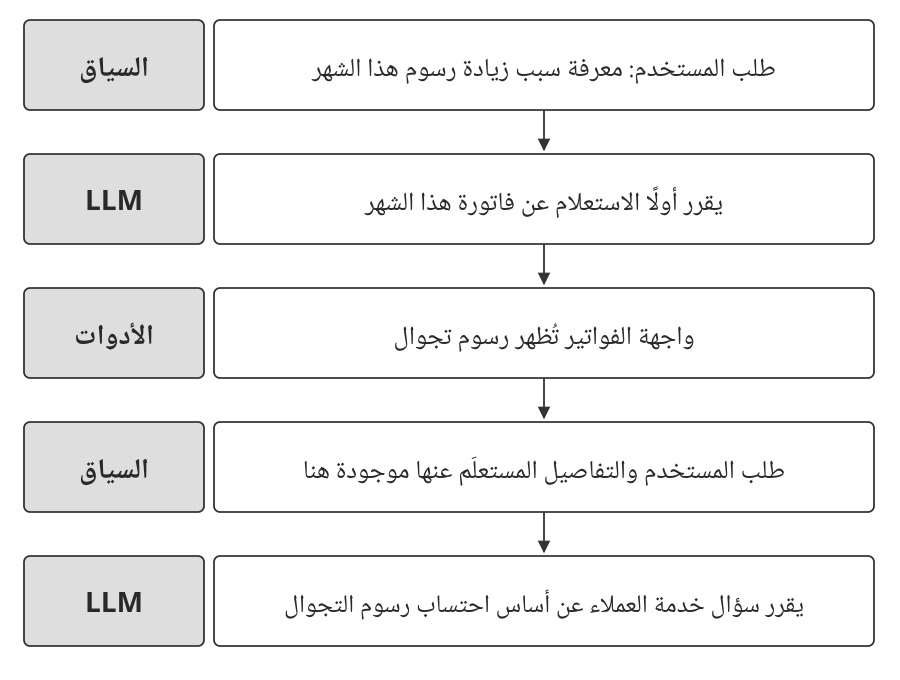
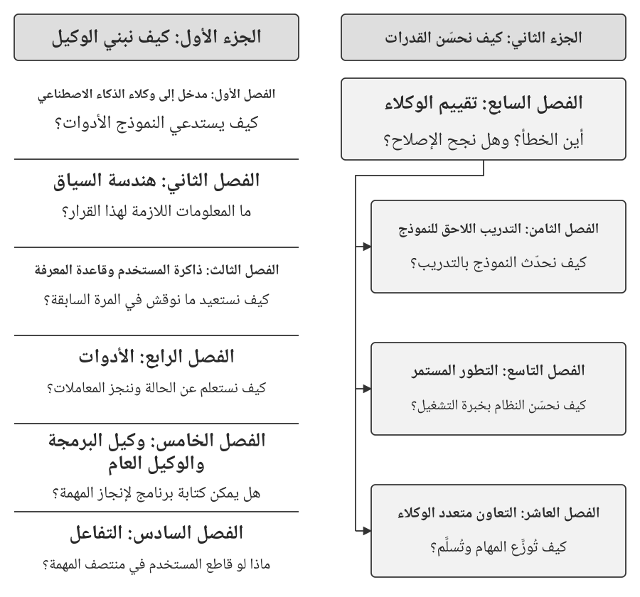

# مقدمة {.unnumbered}

بين أغسطس 2025 ومطلع عام 2026، قدّمتُ عبر دار تورينغ دورة مرئية على الإنترنت بعنوان «المعسكر التطبيقي لوكلاء الذكاء الاصطناعي»، تناولتُ فيها كيف نبني وكلاء الذكاء الاصطناعي (AI Agent) بمنهج هندسي قابل للتفسير والتحقق وإعادة الاستخدام. تبدأ الدورة بتشغيل وكيل، ثم تحلل سبب اختيار بنيته على هذا النحو: ما المشكلة التي يحلها كل قرار تصميمي، وما الثمن الذي يتطلبه، وما المهام التي يناسبها. وقد أُعدّ هذا الكتاب انطلاقًا من مواد تلك الدورة وتجاربها المصاحبة.

> **كيف نشأ هذا الكتاب: تجربة في التعاون بين الإنسان والآلة**
>
> عند التحضير لكل درس، كنتُ أعرض المخطط شفهيًا على Pine، وكيلنا الصوتي، فيبحث في المصادر ويصوغ مسودة أولى. ويُسمّى هذا التعاون القائم على الإملاء **البرمجة بالهمس** (Whisper Coding). وبعد الدرس، كنت أعود إلى الأمثلة والحجج المتعلقة بالمواضع التي تعثّر فيها المتعلمون، وبالتجارب التي جاءت نتائجها على غير ما توقعوا، فأراجعها وأتحقق منها.

منذ عام 2025 لاحظتُ تحولًا مهمًا: فمركز الثقل في أبحاث الذكاء الاصطناعي وتطبيقاته الصناعية لم يعد مقصورًا على تحسين قدرات النماذج الأساسية، بل امتد إلى تمكين الوكلاء من إنجاز مهام حقيقية. ومن ثَمّ صار تدريب النماذج وتطبيقها أوثق ارتباطًا من ذي قبل. فقد أظهرت نماذج التفكير مثل DeepSeek-R1 ما يضيفه التعلم المعزز إلى القدرات في الرياضيات والبرمجة والتفكير المنطقي.[^preface-r1] ويُدخل التعلم المعزز الوكيلي (Agentic Reinforcement Learning) استدعاء الأدوات والتفاعل مع البيئة في عملية التدريب، فيتعلم النموذج البرمجة، ويتعلم كذلك تشغيل الواجهات الرسومية. ويُطلق على هذا النوع الأخير من المهام عادةً اسم استخدام الحاسوب (Computer Use)، وفيه يستنتج النموذج حالة الصفحة من لقطة الشاشة، ثم يُنجز العملية بالنقر أو الكتابة أو التمرير. أما منتجات مثل Manus وClaude Code وOpenClaw فتتيح للمستخدم أن يفوّض إليها المهام مباشرة، وتُبيّن كيف يمكن لنمط «توليد الشفرة + نظام الملفات» أن يقوم عليه وكيل عام الغرض.

في سبتمبر 2026 أطلقت Meta منتج Muse، وفي تلك المدة توالى ظهور منتجات الوكلاء الشخصيين داخل الصين وخارجها توالي الفطر بعد المطر. وكثير من المشكلات التي يتناولها هذا الكتاب واجهتُها مع فريقي قبل ذلك بكثير، حين كنا نعمل على Pine. فأنا كبير العلماء في Pine AI، وقد طوّرت مع زملائي هذا الوكيل الشخصي الذي يُنجز المعاملات نيابة عن المستهلكين. ومنذ مطلع يناير 2025 أصبح Pine متاحًا في الولايات المتحدة، ويستطيع المستخدم أن يطلب منه الاتصال بالتجار للتفاوض على الفواتير، أو طلب استرداد المبالغ، أو إلغاء الاشتراكات.

إذا وافق التاجر في المكالمة على إسقاط رسم ما، فأقصى ما يستطيع Pine أن يخبر به المستخدم في الحال هو أن «موظف خدمة العملاء وافق»؛ أما القول إن «المبلغ قد رُدّ» فلا بد له من انتظار ظهور هذا الاسترداد في الفاتورة. ولإنجاز معاملة كهذه، نحتاج إلى أن يتذكر النموذج ما أذن به المستخدم، وأن يعرف ما الذي ينبغي التحقق منه في الخطوة التالية، وأن يميّز المرحلة التي بلغتها المعاملة. وحين بدأت الصناعة لاحقًا تتحدث عن المهارات (Skill) ومنظومة التشغيل (Harness) وهندسة الحلقات (Loop Engineering)، كان كثير من تلك الممارسات قد تلمّسنا طريقنا إليه في هذه المكالمات بالذات.

- **المهارة (Skill).** لم نكن نحمّل الموجّه الخاص بمهمة ما إلا حين تحتاج إليه المهمة. ولما كثرت الأدوات، جعلنا النموذج يستدعيها عبر سطر الأوامر، فلم نعد مضطرين إلى إدراج تعريفات الأدوات كلها في كل طلب.
- **منظومة التشغيل (Harness).** كنا نكتب بيئة التنفيذ والوقت الحالي وحالة عمل المستخدم في شريط الحالة، ليستند إليها النموذج عند اتخاذ قراراته. فالنموذج قد يختلق النتائج أحيانًا، أو يستدعي الأداة الخطأ، أو يُغفل بعض التعليمات، وقد تتجاوز العمليات الخطرة حدود ما أذن به المستخدم. لذلك وضعنا قيودًا على عملية التنفيذ، ثم رأينا لاحقًا أساليب قريبة منها في Claude Code.
- **هندسة الحلقات (Loop Engineering).** قد يُعلن النموذج أحيانًا اكتمال المهمة وهو لم يُنجز منها إلا نصفها. لذلك جعلنا وكيلًا يُنجز المعاملة، ووكيلًا آخر يراجع الفاتورة أو الطلب، فإذا وجد شيئًا لم يُنجز أعاده إليه ليستكمله. وهذا هو تقسيم العمل بين المقترِح والمدقق (proposer-reviewer).

وقد توصلت فرق أخرى تعمل على النماذج والوكلاء، كلٌّ على حدة، إلى أساليب قريبة منها حين واجهت مشكلات مماثلة. وهذا ما زادني يقينًا بأن كثيرًا من الصعوبات التي واجهها فريقنا مشكلاتٌ مشتركة تعترض أنظمة الوكلاء كلها حين تنتقل إلى التطبيق الفعلي. وإلى جانب «المعسكر التطبيقي لوكلاء الذكاء الاصطناعي»، درّستُ بين عامي 2024 و2026 مقررًا تطبيقيًا في الوكلاء بجامعة الأكاديمية الصينية للعلوم. وقد ساعدتني أسئلة المتعلمين في المقررين على تبيّن الخبرات التي ما زالت تحتاج إلى شرح أوضح. ويصدر هذا الكتاب مفتوح المصدر، أملًا في أن يستخدم هذه الأساليب عدد أكبر من الباحثين والمهندسين، فيختبروها ويحسّنوها.

**تأتي الممارسة أولًا، ثم تأتي التسمية.** ولهذا الترتيب دلالة أخرى عند فرق التطوير: فحين يصير مصطلح ما محل إجماع في الصناعة، تكون الفرق الرائدة قد أمضت في استكشافه وقتًا طويلًا. ومن أراد أن يراكم تفوقًا هندسيًا خاصًا به، فعليه أن يكتشف المشكلات مبكرًا في العمل الحقيقي، وأن يحاول حلها. وأرى أن لذلك شرطين أساسيين.

**أولًا، اختر عملًا حقيقيًا يفرض على قدرات الوكيل متطلبات عالية بما يكفي، واحصل منه على تغذية راجعة متواصلة.** فقد تستغرق المهمة الواحدة في Pine ساعات بل أسابيع، وتتطلب التواصل مع أطراف متعددة: مكالمات طويلة، وملء نماذج معقدة، وجولات متعاقبة من رسائل البريد الإلكتروني، مع ضمان دقة الأرقام، وإبقاء العمليات تحت السيطرة، وحماية مصالح المستخدم. ومثل هذه السيناريوهات تكشف باستمرار الفجوة بين قدرات النموذج ومتطلبات العمل، فتدفع الفريق إلى تحسين منظومة التشغيل. أما إذا اقتصرت القيمة الرئيسة لمنتج ما على سد ثغرات جيل بعينه من النماذج، فقد تأتي الترقية التالية للنموذج على هذه القيمة، ويصعب على الفريق أن يراكم تفوقًا دائمًا.

**ثانيًا، أنشئ آلية منهجية للتقييم (Evaluation).** فبعد تعديل النظام، قد يكون نجاح مفاوضة واحدة على فاتورة راجعًا إلى أن المساعد طرح السؤال الصحيح، وقد يكون راجعًا إلى أن موظف خدمة العملاء الذي صادفه هذه المرة يملك صلاحية الإعفاء. أما المقارنة المتكررة بين الإصدار القديم والجديد على مجموعة الحالات نفسها، فتكشف هل الفرق بينهما ثابت. ويعرض الفصل السابع بالتفصيل كيف تُحدَّد معايير النجاح، وتُبنى بيئة التقييم، ويُحلَّل الإخفاق، وتُختبر التعديلات.

تعلمنا في Pine من تخفيض الفواتير قاعدة عملية: أن يذهب المدقق إلى الفاتورة ليرى ذلك المبلغ بعينه. وإذا طبّقنا القاعدة نفسها على تغيير موعد الرحلة، فعلينا أن نتحقق من صدور التذكرة الجديدة. فالدليل الملموس يتغير بتغير العمل، لكن وراءه مبدأً مشتركًا: الحكم على اكتمال المهمة يكون بالنظر إلى النتيجة التي خلّفها الإجراء في العالم الخارجي. **فالمبادئ الجيدة قادرة على الصمود عبر دورات تطور النماذج**.

## رسالة هذا الكتاب {.unnumbered}

لنفترض أن شخصًا سلّم مساعدًا فاتورة هاتفه المحمول، وطلب منه الاتصال بشركة الاتصالات للتفاوض على تخفيضها. قبل البدء، على المساعد أن يتبيّن أيّ الرسوم موضع الخلاف؛ وفي أثناء المكالمة، عليه أن يستمع إلى التوضيحات ويستوضح الشروط؛ وعند الانتهاء، عليه أن يخبر المستخدم بما وافق عليه موظف خدمة العملاء على وجه الدقة. وفي كل خطوة يخطوها المساعد، عليه أن يجيب عن ثلاثة أسئلة: ما الذي يعرفه المساعد في هذه اللحظة؟ وما الإجراءات التي يستطيع اتخاذها؟ وعلامَ يستند في اختيار الخطوة التالية؟ ومن هذه الأسئلة الثلاثة ينطلق الكتاب ليعرض بنية الوكيل وطرائق بنائه وحدود قدراته. والمعادلة المحورية هي: **الوكيل = LLM + السياق + الأدوات**؛ فالنموذج اللغوي الكبير (LLM) يتولى الفهم والتخطيط واتخاذ القرار، والسياق (Context) يحمل المعلومات التي يحتاج إليها القرار الحالي، والأدوات (Tools) تصل الوكيل بالبيئة الخارجية ليحصل منها على الملاحظات أو ينفذ فيها الإجراءات.

وبتشبيه بديهي: النموذج اللغوي الكبير هو «الدماغ»، والسياق هو «مجال الرؤية عند اتخاذ القرار الحالي»، والأدوات هي «الحواس والأطراف». ويضم مجال الرؤية معلومات البيئة وسجل المحادثة والذاكرة والمعرفة، كما يضم تعليمات النظام وتعريفات الأدوات وحالة المهمة. فالبحث والقراءة والتقاط الشاشة تجلب المعلومات، أما النقر والكتابة واستدعاء واجهات العمل فتغيّر الحالة الخارجية. ويفكك الشكل 0-1 استعلامًا واحدًا عن فاتورة: فعند اتخاذ القرار الأول لا يعرف النموذج إلا أن لدى المستخدم شكًّا في أحد الرسوم، وعند القرار الثاني يستطيع أن يحدد المبلغ الذي ينبغي السؤال عنه.



ويستطيع القارئ الملمّ بالتعلم المعزز (Reinforcement Learning، RL) أن يفهم هذا التقسيم أيضًا من خلال مفاهيم السياسة والملاحظة والفعل. فالنموذج اللغوي الكبير يختار الخطوة التالية بناءً على السياق، فتقارب وظيفته في اتخاذ القرار وظيفةَ السياسة (Policy)؛ والسياق يحمل الملاحظات والتاريخ المحددين اللذين يستخدمهما هذا القرار؛ والأدوات توفر واجهات الملاحظة والفعل. ويصف فضاء الملاحظات (Observation Space) ما يمكن الحصول عليه من ملاحظات، ويصف فضاء الأفعال (Action Space) ما يُسمح باتخاذه من أفعال، ويرسم الفضاءان معًا نطاق تفاعل الوكيل مع البيئة.[^preface-spaces] وسيبسط الفصل الأول هذه المفاهيم من خلال أمثلة على استدعاء الأدوات، ويعرض تقسيم العمل بين النموذج (Model) ومنظومة التشغيل (Harness) في التطبيقات الإنتاجية.

> **تأمل موسَّع: من الحياة إلى الكيانات المصمَّمة**
>
> بعيدًا عن الممارسة الهندسية، يثير الوكيل أيضًا أسئلة عن تطور الأنظمة الذكية. فقد لخّص ريتشارد ساتون (Richard Sutton)، الحائز جائزة تورينغ وأحد رواد التعلم المعزز، تطور الكون في أربع مراحل: الغبار، ثم النجوم، ثم الحياة، ثم «الكيانات المصمَّمة» (designed entities).[^preface-sutton] فالكائنات الحية تتطور بالطفرات العشوائية والانتقاء الطبيعي، أما الكيانات المصمَّمة فيمكن لأنظمة ذكية قائمة أن تبنيها وتحسّنها عن قصد.
>
> يستطيع الوكيل أن يولّد الشفرة ويبني وكلاء جددًا، ثم يحلل سلوكهم في التشغيل، ويقترح التعديلات، ويتحقق من النتائج، فيحقق شيئًا فشيئًا التمهيد الذاتي (bootstrap) والتطور المستمر. وكأن مبرمجًا كتب مبرمجًا آخر، فيواصل الثاني المشاركة في بناء أنظمة جديدة. وهذه الإمكانية، أي أن يفهم النظام نفسه ويحسّنها، من أكثر المسائل التي شغلتني حين كتبت فصلَي توليد الشفرة والتطور المستمر.

## هيكل الكتاب {.unnumbered}

يبيّن الشكل 0-2 الصلات بين الفصول. فإذا غيّر المستخدم طلبه فجأة في أثناء المكالمة، وظل المساعد ينفذ الطلب القديم، فيمكنك أن تبدأ بالفصل السادس في العمود الأيسر، لترى كيف يتعامل المساعد مع مقاطعة المستخدم له. وبعد الإصلاح، كيف تعرف أنه سيستجيب للطلبات الجديدة في المكالمات الأخرى أيضًا؟ هنا تحتاج إلى طرائق التقييم في الفصل السابع في العمود الأيمن. وتدل الأسهم الثلاثة المتفرعة من الفصل السابع في الشكل على أنك تستطيع، بعد الحصول على نتائج التقييم، أن تختار طريقة التحسين المناسبة بحسب سبب الإخفاق.



- **الفصل الأول (أساسيات وكلاء الذكاء الاصطناعي)** يعرض، من خلال أمثلة على المنتجات واستدعاء الأدوات، المكونات الجوهرية للوكيل وحلقة تشغيله ومنظومة التشغيل (Harness) وأساليب التنسيق، ليبني الإطار المفاهيمي اللازم لفهم الكتاب كله.
- **الفصل الثاني (هندسة السياق)** هو أهم فصول الكتاب، ويناقش كيف تُنظَّم المعلومات التي يحتاج إليها النموذج في اللحظة الراهنة. ينتقل من تصميم الموجّهات والتحميل عند الطلب إلى إدارة السجل، ويشرح من خلال KV Cache كيف تؤثر هذه الأساليب في جودة الإجابة وتكلفة التشغيل.
- **الفصل الثالث (ذاكرة المستخدم وقاعدة المعرفة)** يناقش كيف تُحفظ المعلومات العابرة للجلسات وتُسترجع. ينتقل من ذاكرة المستخدم إلى RAG والفهارس المهيكلة وتحديث المعرفة، ليساعد القارئ على إتقان طرائق استرجاع المعرفة الدائمة وصيانتها.
- **الفصل الرابع (الأدوات)** يناقش كيف يحصل الوكيل على الملاحظات وينفذ الإجراءات ويطلب التعاون. ومن خلال تصنيف الأدوات وتصميم الواجهات وMCP وإدارة التنفيذ، يوضح كيف تُدمج القدرات الخارجية في النظام.
- **الفصل الخامس (وكيل البرمجة والوكيل العام)** يطرح فكرة معمارية جوهرية للوكيل العام: أن يكون وكيل البرمجة (Coding Agent) نواة التنفيذ، وأن يكون نظام الملفات مساحة العمل. يبدأ بسير عمل التطوير، ثم يبيّن من خلال حالات من الوسائط المتعددة وأنظمة الأعمال وغيرها كيف يكتب الوكيل برامج لحل المشكلات، ثم يصنع أدوات جديدة ويبني وكلاء جددًا.
- **الفصل السادس (التفاعل: توسيع فضاء الملاحظات وفضاء الأفعال)** يناقش أساليب تفاعل الوكيل على محورين: الوسائط والتوقيت. ومن خلال الأحداث غير المتزامنة والصوت واستخدام الحاسوب (Computer Use) والروبوتات، يوضح الملاحظة المستمرة والمسارين السريع والبطيء والتحكم في التنفيذ.
- **الفصل السابع (تقييم الوكلاء)** يجيب عن سؤال: كيف نحكم على أداء النظام وعلى أثر تعديل بعينه؟ يبدأ بتحديد معايير النجاح والبيئة ومجموعة البيانات، ثم يتناول أدوات التحقق والتقدير والتحليل الإحصائي، وينتهي بتحليل أسباب الإخفاق للوصول إلى اتجاهات التحسين.
- **الفصل الثامن (مرحلة ما بعد تدريب النموذج)** يناقش كيف تُحدَّث قدرات النموذج بالبيانات والبيئات، ويدعو إلى تقديم الاستثمار في جودة البيانات وبيئات التدريب. ومن خلال الضبط الدقيق تحت الإشراف والتعلم المعزز وتصميم المكافآت، يشرح لماذا يفضي التعلم من الأمثلة والتعلم بالاستكشاف إلى قدرات تعميم مختلفة، ولماذا يبقى أثر الاكتفاء بتغيير الخوارزمية محدودًا في الغالب.
- **الفصل التاسع (التطور المستمر للوكلاء)** يناقش كيف تُستثمر خبرة التشغيل في تحسين الإصدارات اللاحقة من الوكيل. يقارن بين أربعة أنواع من التحديث: المعرفة والتعليمات والبرامج والمعلمات، ثم يدير التغيرات طويلة الأمد عبر مسارات التحقق والإطلاق والاستعادة.
- **الفصل العاشر (التعاون متعدد الوكلاء)** يناقش متى يضيف تعدد الأعضاء قيمة حقيقية، وكيف يُقسَّم العمل بينهم ويتواصلون وينسقون. يبدأ ببيان كيفية توزيع السياق وصلاحية التحكم، ثم يشرح آليات التعاون من خلال حالات عملية، ويحلل أسباب الإخفاق، ويناقش الأشكال الممكنة لمجتمعات الوكلاء واقتصاداتهم.

## كيفية قراءة هذا الكتاب {.unnumbered}

- **إن كنت تبني منتجًا قائمًا على الوكلاء من الصفر**: فيُستحسن أن تقرأ الكتاب كله. ابدأ بالفصول من الأول إلى السادس لتبني مساعدًا قادرًا على إنجاز المهام، ثم استعن بالفصل السابع لتختبر المهام التي يكثر فيها خطؤه. أما الفصول الثلاثة الأخيرة فتناقش كيف تُستثمر حالات الإخفاق هذه في تحسين النموذج أو النظام أو تقسيم العمل بين الأعضاء.
- **إن أردت أن تكوّن تصورًا شاملًا أولًا**: فاقرأ الفصول الأول والثاني والرابع والسابع بالترتيب. تتبّع استدعاءً واحدًا للأدوات من أوله إلى آخره: تعرّف أولًا إلى حلقة تشغيل الوكيل، ثم انظر في المعلومات التي يتلقاها النموذج وما تفعله الأدوات فعليًا، وأخيرًا استعن بالتقييم لتحكم هل جاءت النتيجة مطابقة لطلب المستخدم. وحين يصل الفصل الثاني إلى KV Cache، يكفيك في القراءة الأولى أن تستوعب الاستنتاجات الثلاثة الواردة في بدايته، ثم تعود إلى المبادئ التي تقوم عليها بعد إجراء التجارب.
- **إن كان تركيزك على تدريب النماذج**: فابدأ بالفصلين الأول والثاني لتفهم كيف يعمل الوكيل، ثم اقرأ الفصل الثامن مستعينًا بطرائق التقييم في الفصل السابع. وبذلك تربط أهداف التدريب بالأداء الفعلي في المهام.
- **إن كنت تتولى صيانة وكيل يعمل في بيئة الإنتاج**: فاختر من الفصل السابع مجموعة من المهام الحقيقية وقيّمها. فإذا أبلغ المساعد المستخدم سعرًا قديمًا مثلًا، فتحقق أولًا من نسخة عرض السعر التي حصل عليها. فإن كانت المعرفة أو الإجراءات قديمة، فاقرأ الفصل التاسع وهذه الحالة نصب عينيك؛ وإن كانت عروض الأسعار والأدوات كافية، وظل النموذج يخطئ الاختيار مرارًا بعد تعديل الإجراءات، فاقرأ الفصل الثامن لتقرر هل يستحق الأمر إعداد بيانات للتدريب.

يتضمن كل فصل تجارب وأسئلة للتأمل. وتُرقَّم التجارب بصيغة «التجربة X-Y»، حيث X رقم الفصل وY ترتيب التجربة فيه. وتشير النجوم إلى مستوى الصعوبة: ★ للمبتدئين، و★★ لمن لديه قدر من الخبرة الهندسية، و★★★ للتجارب التي تتناول مسائل مفتوحة أو تصميم أنظمة معقدة. ومعظم التجارب مصحوبة بشفرة قابلة للتشغيل، مجموعة في مستودع مفتوح المصدر:

> **مستودع الشفرة المصاحب**: `bojieli/ai-agent-book`

إن كنت تجري التجارب للمرة الأولى، فيمكنك أن تبدأ بـ«التجربة 1-1: الدور الحاسم للسياق». وإذا كنت تستخدم Git، فنفّذ في الطرفية:

```bash
git clone https://github.com/bojieli/ai-agent-book.git
cd ai-agent-book
```

ويمكنك أيضًا الحصول على المجلد نفسه باختيار **Code → Download ZIP** من صفحة المستودع ثم فك ضغط الملف. ابحث في فهرس تجارب الفصل الأول (`chapter1/README.md`) عن الرقم 1-1، ثم افتح `chapter1/context/README.md`. وكلما صادفت بعد ذلك «التجربة X-Y»، أمكنك أن تجد المشروع وطريقة تشغيله في الملف `chapterX/README.md` من المستودع. أما «أدلة إعادة الإنتاج» فتذكر المشاريع الخارجية وطرق الحصول عليها، وتُجمع أوامر التثبيت وشرح المجلدات في ملفات README.

## المتطلبات الأساسية {.unnumbered}

يتوجه هذا الكتاب إلى القراء الذين يملكون قدرات برمجية أساسية، ويرغبون في فهم الوكلاء وبنائهم. وتحتاج التجارب العملية إلى الأسس التالية.

**أساسي: متطلبات قراءة الكتاب كاملًا**

- **البرمجة بلغة Python**: الإلمام بقواعد اللغة وهياكل البيانات الشائعة وأدوات إدارة الحزم مثل pip، والقدرة على قراءة شفرة التجارب وتعديلها. فمعظم تجارب الكتاب مبنية على Python.
- **الخبرة في استخدام النماذج اللغوية الكبيرة**: أن تكون قد استخدمت ChatGPT أو Claude أو منتجات مماثلة، وأن تألف الخطوات الأساسية: صياغة الطلب، وقراءة الرد، ومتابعة السؤال.
- **معرفة عامة بهندسة البرمجيات**: فهم سطر الأوامر وGit وJSON وواجهات REST API، بما يكفي لتشغيل المشاريع وفحص التغييرات وقراءة بيانات الواجهات.

وعند إجراء التجارب، أوصي بشدة باختيار أداة واحدة من Claude Code أو Codex أو Cursor أو TRAE. اطلب منها أن تساعدك في تصحيح أخطاء جزء من الشفرة، ولاحظ الملفات التي قرأتها والأدوات التي استدعتها. وحين تقرأ لاحقًا عن حلقة التشغيل وإدارة السياق، ستكون لديك تجربة شخصية تقارن بها.

**موصى به: معارف تكميلية بحسب الفصول**

- **أساسيات التعلم الآلي (الفصل الثامن)**: التدريب والاستدلال، ودوال الخسارة، والانحدار التدرجي، وفرط التخصيص؛ فهي تساعد على فهم عملية تحديث النموذج.
- **الرياضيات الأساسية (الفصول الثاني والثالث والسابع والثامن)**: تساعد المتجهات والمصفوفات على فهم التضمين والانتباه، ويساعد الاحتمال والإحصاء على فهم مقاييس التقييم والمكافأة المتوقعة. ويركز الكتاب على الشرح البديهي والاستخدامات العملية.
- **أساسيات تطوير الويب (الفصل السادس)**: HTTP وWebSocket وتقسيم العمل بين الواجهة الأمامية والخلفية؛ فهي تساعد على فهم بنية الأحداث غير المتزامنة والاتصال الصوتي الفوري.
- **أساسيات Transformer (الفصلان الثاني والثامن)**: يساعد فهم الانتباه وبنية النموذج على استيعاب حسابات السياق ومرحلة ما بعد التدريب. ومن أراد التعمق المنهجي فيمكنه قراءة كتاب *Hands-On Large Language Models* لمؤلفَيه Jay Alammar وMaarten Grootendorst، الذي نقله Li Bojie إلى الصينية وصدر عن دار تورينغ. يشرح هذا الكتاب بالرسوم التوضيحية بنية Transformer والتدريب المسبق والضبط الدقيق، فيكمّل المنظور الهندسي لكتابنا.

وباستثناء مرحلة ما بعد التدريب في الفصل الثامن، لا تحتاج بقية الفصول إلا إلى قدر يسير من الرياضيات والتعلم الآلي، ويكفي لبدء القراءة أن تكون لديك خبرة برمجية أساسية.

## شكر وتقدير {.unnumbered}

أشكر المحررتين Meng Ge وLiu Meiying في دار تورينغ على تحرير هذا الكتاب، وعلى ما بذلتاه من جهد في تنظيم «المعسكر التطبيقي لوكلاء الذكاء الاصطناعي»؛ وأشكر الأستاذ Liu Junming على إطلاقه مقررًا تطبيقيًا في الوكلاء بجامعة الأكاديمية الصينية للعلوم. وأشكر المتعلمين والطلاب في المقررين كليهما؛ فأسئلتكم وملاحظاتكم على التجارب واقتراحاتكم ساعدتني على تحسين الشرح باستمرار، وعمّقت فهمي لهذه المفاهيم.

أشكر جميع زملائي في Pine AI. فتحديات العمل الحقيقي ونقاشات الفريق هي مصدر كثير من الأساليب والحالات الواردة في هذا الكتاب، وبفضل ممارساتكم وآرائكم تواصل نضج هذه الأفكار.

وأشكر أصدقائي في مجال الذكاء الاصطناعي. ففي حوارات متتابعة، قدّمتم لي ملاحظاتكم بصراحة، وشاركتموني خبرات وأحكامًا مختلفة، فساعدتموني على فهم النماذج والوكلاء فهمًا أعمق.

وفوق ذلك كله، أشكر عائلتي، وخاصة زوجتي منغ جياينغ (Meng Jiaying)؛ فقد دعمت تأليف هذا الكتاب طوال الوقت، وقدّمت لمخطوطته كثيرًا من الملاحظات القيّمة.

[^preface-r1]: DeepSeek-AI, *DeepSeek-R1: Incentivizing Reasoning Capability in LLMs via Reinforcement Learning*, 2025.
[^preface-spaces]: قسم «Spaces» في وثائق Gymnasium.
[^preface-sutton]: مقابلة Richard Sutton مع Dwarkesh Patel، بتاريخ 2025-09-26، الجزء المعنون «Succession to AI».
