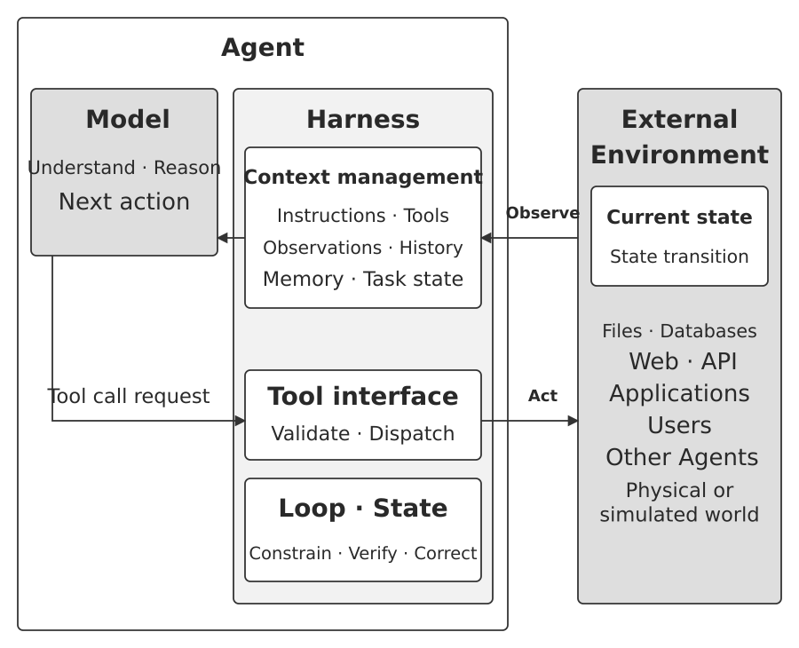
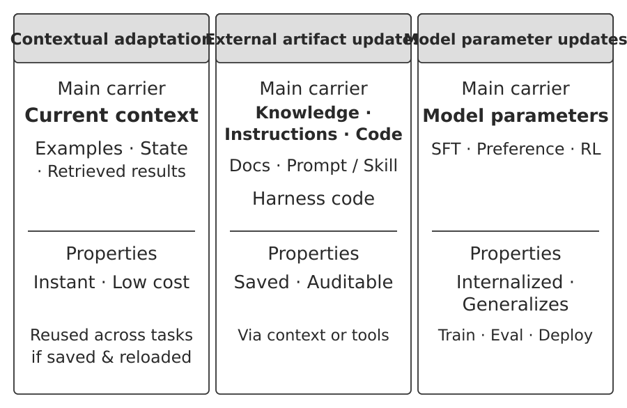
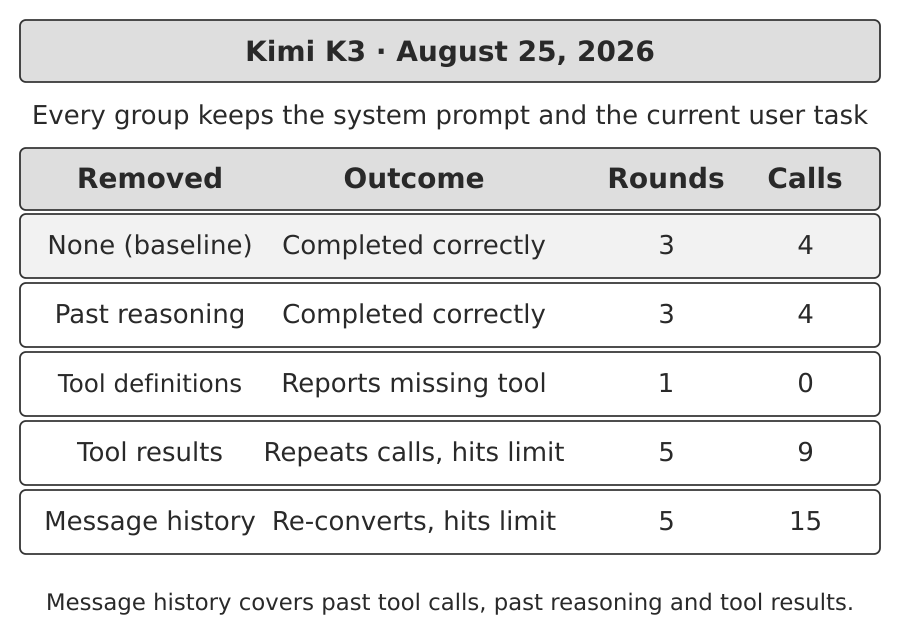
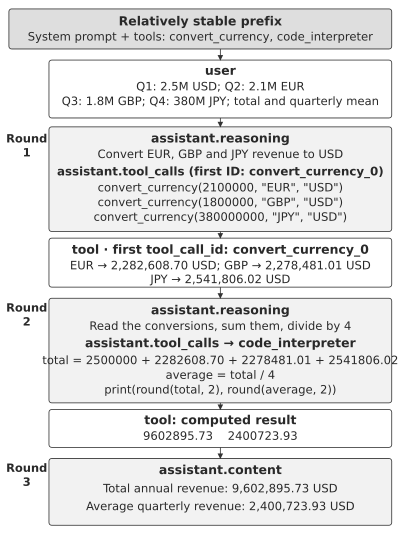
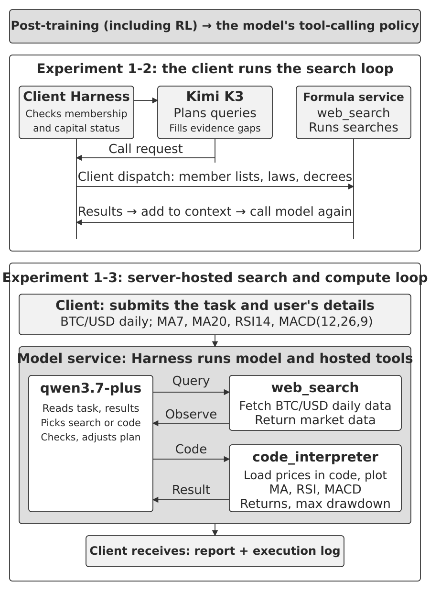
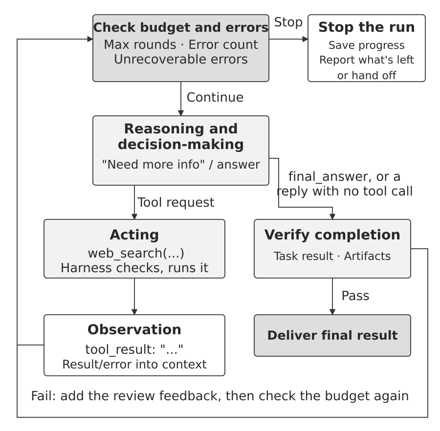
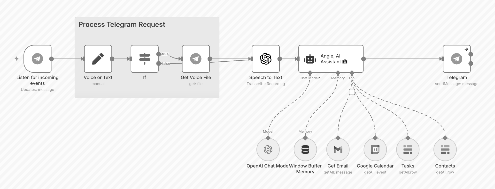

# Getting Started with AI Agents

When you use Deep Research to investigate a topic, it searches and reads over and over, then assembles a report. Manus can operate a browser to complete online tasks, the Doubao phone assistant can book tickets and send messages on your phone, and Pine AI can phone a carrier on the user's behalf and negotiate a lower bill. All of these are applications of AI Agents.

When you ask Cursor to fix a function, it locates the function, edits the file, and runs the tests. If the tests still fail, the error messages become the basis for its next edit; only when they pass does it have evidence to report back to you. The order of searching, editing, and testing could be written into a program in advance, but exactly which line to change, and where to go back to after a failure, depends on what the run reveals along the way. This process of choosing actions toward a goal and then revising the plan based on the results also takes place in tasks such as research and phone negotiation.

## Modern Agent = LLM + Context + Tools

This book sums up the three functional elements of a modern Agent in one formula: **Agent = LLM (Large Language Model) + Context + Tools**.

- **The LLM is the Agent's brain**, responsible for understanding the task, planning steps, and choosing actions. Pre-training gives the model its language ability and world knowledge; post-training further shapes behaviors such as following instructions, reasoning, and calling tools. Chapter 8 introduces post-training methods such as supervised fine-tuning and reinforcement learning.
- **Context is the Agent's current field of view for decision-making**. It holds the information this decision needs: instructions, tool definitions, observations of the environment, user memory, domain knowledge, message history, the Agent's own state, and task progress.
- **Tools are the Agent's senses and limbs**, obtaining information or performing operations through interfaces. The tool system includes definitions, a calling protocol, and adapters; it supports observation operations such as searching, reading, and taking screenshots, as well as writing, executing code, delegating to sub-Agents, and communicating with the user.

A single tool can serve several roles. When the model reads a file through the command line, for example, the returned contents become the basis for its next decision; when it runs a program through the command line, it may also change the state of files or processes.

Suppose you have just opened a package and want to ask customer service, "Can I still return this after opening it?" The system can use **Retrieval-Augmented Generation** (RAG) to look up the store's current return policy and then ask the model to answer according to its terms.[^ch1-rag] Following a single query makes the responsibility of each part clear. The policy text and its index live in an external knowledge base; a retrieval tool finds the relevant passages for the question, and the program that calls the model places those passages, together with their sources, into the request. When the model reads the clause on "opened items," it can explain the terms; if the terms also differ by product category, it must first ask what you bought.

[^ch1-rag]: Patrick Lewis et al., Retrieval-Augmented Generation for Knowledge-Intensive NLP Tasks, NeurIPS, 2020.

In this return-policy query, issuing the retrieval is the Agent's action, and the returned clauses are the observation it receives from the Environment. Whether the next step is to answer or to ask a follow-up question depends on what the clauses say. This forms the closed loop that reinforcement learning and control theory describe, as shown in Figure 1-1.



The outer layer of the figure draws the boundary between the Agent and the Environment. Files, databases, web pages, users, other Agents, and physical or simulated worlds can all be environments it interacts with. The inner layer shows the division of labor in a production implementation: **the Model is responsible for understanding, reasoning, and decision-making; the Harness sits inside the Agent boundary but outside the Model, organizing context, tool interfaces, the run loop, and state, and enforcing constraints, verification, and correction.** The Harness can create, isolate, or proxy an environment; file contents, process state, and the like change within the Environment as actions are taken.[^ch1-harness]

[^ch1-harness]: See LangChain's "The Anatomy of an Agent Harness" and Anthropic's "Effective harnesses for long-running agents." Some implementations count the sandbox as part of the Harness; Figure 1-1 draws the Environment separately so that it is easy to trace what an action actually changed.

This book therefore uses two complementary decompositions: **"LLM + Context + Tools" describes the functional composition, and "Model + Harness" describes the production implementation.** Context is organized by the Harness and supplied to the Model; tool calls are decided by the Model, validated and dispatched by the Harness, and then executed by the tool or the Environment. A simple system can start with context assembly and tool dispatch and gradually add the constraints, verification, and correction that production operation requires.

Readers familiar with reinforcement learning can read the table below through three questions: who decides the next step, on what basis, and how that decision is put into action. This is a rough analogy by function.

| Intuition | Engineering Element | Related RL Concept | Meaning |
|-----------|-----------|----------------------------|----------------------------------------------|
| **Brain** | LLM | **Policy** | Decides what to do next based on the current information |
| **Current field of view** | Context | **Observations and history** | Organizes information returned by the Environment and existing history into a basis for decision |
| **Senses and limbs** | Tools and adapters | **Observation and action interfaces** | Specifies how to read information from the Environment, how to issue actions, and the format of calls and returns |

### Observation and Action Spaces: The Interface Between Model and World

**The observation space describes which observations the Agent may receive; the action space describes which actions it may issue.** The context of a single call carries the concrete information, while the available tools provide the interfaces for interacting with the Environment. Besides tools, user input and event notifications can also bring in observations; the arguments, permissions, and runtime environment of tool calls together limit the range of actions.

Imagine two separate failures. In the first, the model can explain every charge on a bill but cannot get hold of this month's bill. After the user authorizes access, someone still has to retrieve the bill and hand it to the model before it can tell which charge is in dispute. In the second, the user asks the assistant to change their plan, and the assistant has already found a suitable one, but the account interface only allows queries. Reading the bill again will not let it make the change; it needs the corresponding operation permission. The Harness's job is to put what has been read into context, receive the action the model chooses, check its arguments and permissions, and then dispatch it for execution.

Therefore, **with the underlying model held fixed, adjusting the observation and action spaces is an important engineering lever for improving task performance.** If the model misses a key fact, the relevant data can be brought into context; if it keeps choosing the wrong one of several similar tools, duplicate interfaces can be merged, or only the tools the current task needs can be loaded.

Watching video raises the opposite problem: the picture is always there, but changes worth re-evaluating are few. Suppose an assistant is waiting for a file upload. Calling the main model every time the progress bar moves adds a great deal of computation; looking only once every ten seconds risks missing a failure message that flashes by. **In my view, sparsifying the observation space is a fundamental problem in Agent design.** The system can watch the Environment continuously and hand the main model only those changes that might alter its next action, together with the necessary context.

**Manus: combining research, programming, and computer control in one task.** Deep Research excels at searching and reading, Coding Agents can write and run code, and Computer Use Agents can operate interfaces. Manus integrated a browser, a file system, code execution, and a command line into a cloud sandbox, so that a single Agent can first look up material, then process files and run code, and finally complete operations through the browser. The browser and file reading increased the information available; code and command execution increased the operations that can be combined. **In my view, this combination was an important breakthrough for general-purpose Agents: one Agent can cross previously separate product boundaries and chain gathering material, processing data, and executing operations into a complete task.**

**OpenClaw: extending the interface into the user's digital life.** OpenClaw receives tasks and returns results through messaging channels such as WhatsApp, Telegram, Slack, Discord, and iMessage, and uses a Gateway running on the user's own device to connect the messaging channels, models, and tools. Once the relevant tools are configured and authorized, the Agent can work with local files and also connect to cloud services such as Google Drive and Notion. Material scattered across the user's accounts and devices can thus enter the processing of a single task. Early Manus worked mainly in a cloud sandbox, and users had to upload files; the Google Drive connector and My Computer desktop feature it added later extended its reach to cloud files and local resources. This evolution shows that growth in product capability often comes from extending the observation and action interfaces[^ch1-agent-products].

[^ch1-agent-products]: For product architecture, see Manus's official introductions to its Sandbox, Google Drive Connector, and My Computer, as well as OpenClaw's official repository and tool documentation. Connectors, tool configuration, and user authorization determine which resources can actually be accessed.

Products differ in their tasks, but all of them can be understood in terms of three aspects: the basis for decisions, the available operations, and the execution strategy:

| Agent Product | Main Information in Context | Available Tools and Operations | Execution Strategy |
|----------------|----------------------|----------------------------|------------------------------|
| **Coding Agents such as Cursor** | Requirements, code snippets, directory listings, terminal output | Code search, file read/write, command execution | Understand requirements → search relevant code → edit code → test and verify → debug and fix |
| **Search Agents such as Deep Research** | Search results, web page content, paper abstracts and citations | Search queries, web reading, report generation | Adjust search direction based on existing information, gradually synthesizing a complete report |
| **Computer Control Agents such as Browser Use** | Screenshots, DOM or accessibility tree, operation results | Click, type, scroll, screenshot, execute code | Read the interface → identify target elements → perform operations → verify results |
| **Phone Assistant Agents such as Doubao** | Phone screenshots, app interface state, system feedback | Tap, swipe, type, open apps | Understand needs → locate target app → perform operations → confirm completion |
| **Personal Task Agents such as Pine AI and Meta Muse** | Account records, bills, and service-provider information read with authorization | Make calls, send emails, fill out forms, confirm with user | Gather information → formulate negotiation strategy → contact service provider → negotiate → report results |

**How does a request become an executable task?** While building a personal task assistant at Pine, I found that users often state only a goal, such as "Book me a flight for my business trip, ideally under 1,200 yuan." The assistant first has to pin down the dates, the destination, and what matters most for this trip, then gather the missing information and agree with the user on how it plans to proceed and which conditions are negotiable, and only then contact the service provider. New information obtained along the way may send the task back to an earlier step.

Suppose the lowest fare the customer service representative can find is 1,250 yuan. The model weighs common sense, this particular trip, and what it remembers of the user's habits. For a user on a business trip who is usually willing to pay a little more for a convenient itinerary, Pine might book it on the spot; for a family vacation where the user has previously made clear that total cost matters, it might first tell the user about the difference and keep asking the representative to look for other flights. If the user later adds, "Next time a fare is over budget, ask me first," that feedback gives the next decision a basis more specific than general experience.

Take another scenario: a bank's customer service representative offers to mail documents to the user's home, but the assistant remembers that the user is traveling abroad. What needs to change this time is the delivery method: the assistant on the call can explain right there that the user cannot receive mail, and push for delivery by email. Or consider a bill reduction: if the representative agrees verbally on the phone, the assistant can accurately report the merchant's promise, but confirming that the charge was actually reduced requires the next bill as a new observation. An assistant's action space can extend to real phone calls, yet its conclusions remain bounded by its observation space.

Viewed by what is being delegated, the applications in this book fall into three kinds: personal errands, office collaboration, and scientific exploration. The same assistant can take on tasks of different kinds; what differs is who authorizes it, what it can change, and who signs off on the result in the end. In the office, can a ticket be closed once a colleague hands back the results of a check? Suppose a project lead, in a Multica ticket, mentions the assistant by name and asks it to check a discrepancy in a budget spreadsheet. The comment triggers the check, but the ticket still belongs to its original owner and its status stays unchanged. The assistant hands back the two amounts and their sources, which answers the colleague's question; whether the budget as a whole is ready to submit is still for the owner to judge in light of the other open items.[^ch1-multica]

The same question applies to scientific work: on what grounds do we say progress has been made? When Google DeepMind's AlphaEvolve searched for matrix multiplication algorithms, the model proposed candidate programs, and an evaluator ran them, checking whether the products were computed correctly and how many multiplications were used. Later rounds of search could keep improving the programs that performed well. The research team reported that one of the resulting algorithms multiplies two $4\times 4$ complex matrices with 48 scalar multiplications. "Using fewer multiplications" has a definite thing to count, and the algorithm must still produce the correct matrix product.[^ch1-alphaevolve]

[^ch1-multica]: Multica, mentioning an Agent by name in a ticket comment. Chapter 10 discusses how to distinguish a one-off request for help from a transfer of responsibility in collaboration.

[^ch1-alphaevolve]: Google DeepMind, AlphaEvolve research note, May 2025. The multiplication count here refers to scalar multiplications in the algorithm; actual running time also depends on implementation and hardware.

The action spaces of these systems are **open-ended**. Search terms, typed text, generated code, and combinations of operations are hard to enumerate in advance, yet every action is still limited by tools, arguments, permissions, and the runtime environment. For exactly this reason, an executable plan must leave room for new observations to change the next step.

### Tools: The Agent's Senses and Limbs

Tools turn the model's decisions into reads of, or operations on, the external environment. Search and read tools bring back observations; tools such as file writing and command execution carry out actions. From the returned results, the model learns the effect of its operation and then decides whether to continue, retry, or end the task.

By primary purpose, this book divides tools into five types. One interface can serve several purposes; a voice call, for example, can both gather information and convey a request.

**Perception Tools** obtain information: search engines provide material from the web, file-reading tools access local documents, and API and database interfaces connect to external services and enterprise data.

**Execution Tools** perform operations: running code, modifying files, executing system commands, or calling external APIs to carry decisions out in the Environment.

**Collaboration Tools** support division of labor and coordination: delegating specialized tasks to sub-Agents, collecting their results, and coordinating the work of multiple Agents. When a decision needs human involvement, the system can also request confirmation through a user communication interface.

**Event Trigger Tools** bring external events into the run. A new email, a scheduled time arriving, or a Webhook callback can each trigger a task. An event adapter converts these inputs into observations the Agent can process, and a scheduling mechanism starts or resumes execution; trigger rules can be configured by the developer or registered through an approved tool call.

**User Communication Tools** deliver information to the user and collect feedback, for example by sending text messages, placing voice calls, or sending email. They are used to report progress and request confirmation, and can also proactively remind the user to deal with something.

Chapter 4 develops the design of these five types of tools. Interface definitions affect whether the model can choose the right tool and fill in its arguments correctly, error handling determines whether work can continue after a failure, and permission control limits the scope of an operation's effects. MCP (Model Context Protocol) provides a uniform way to discover and call tools, reducing the adaptation work between different systems.

**Tool Calling** is the model's ability to request an operation in an agreed format. The common form, Function Calling, expresses the request as a tool name plus structured arguments. This book uses the term "tool calling" throughout.

Take a weather query for Beijing. The model can write out the city name, but the actual temperature appears in context only after the Harness performs the query. Here are the messages for this call, in four steps:

```text
Step 1: declare the tool            Step 2: model decides to call
tools: [{                          assistant: {
  name: "get_weather",               tool_calls: [{
  parameters: {                        id: "call_1",
    city: "string"                     function: "get_weather",
  }                                    arguments: {city: "Beijing"}
}]                                   }]
                                   }

Step 3: result appended to context  Step 4: model replies from result
tool: {                            assistant: {
  tool_call_id: "call_1",              content: "Beijing today: 28°C, sunny."
  content: '{"temp":28,"sky":"sunny"}'
}                                  }
```

Here, `call_1` links the tool's return value to the call request. The developer describes how to call the tool, writes the function that queries the weather, and hands the result back to the model; the model decides whether to call, which tool to call, and what arguments to pass. Chapter 2 examines the API message structure further.

When designing tools, start by providing just enough capability. For basic arithmetic, a calculator with clearly defined parameters is enough; once the task grows to reading spreadsheets, cleaning missing values, computing statistics, and plotting charts, a constrained Python code interpreter makes it easier to combine these steps. As general-purpose capability expands, isolation and resource management have to keep pace: code runs in a sandbox, network access is off by default, file access is confined to an authorized working directory, and limits are placed on execution time, CPU, memory, and output size.

To record one run, a single logging tool will do. A task that runs for hours or even days is better served by a controlled virtual working directory that holds plans, intermediate results, run logs, and final artifacts, so the Agent can pick up its work across multiple runs. The directory should restrict readable and writable paths, capacity, and file types, and check whether a path crosses the authorized boundary.

Operations such as payments, data deletion, sending email, and production deployment carry higher risk or are governed by explicit business rules. They are best wrapped as dedicated tools with clear parameters, restricted permissions, and end-to-end auditability, with previews and human confirmation added where necessary. **General-purpose foundational capabilities support composition and exploration; dedicated tools enforce the constraints and business rules for high-risk operations.**

### LLM: The Agent's Brain

The LLM is the Agent's decision-making core. On receiving a request, it first identifies the goal and constraints in what the user said, then breaks a complex task into executable steps. During execution it must also judge what to do next, whether to call a tool, which tool to choose, and how to fill in its arguments. These abilities rest on the knowledge and language skills accumulated in pre-training and are shaped by post-training into decision-making behavior suited to the task. Workflows and autonomous Agents both need this kind of judgment; the actual operations are carried out through the Harness, tools, and the Environment.

Planning and thinking things through before acting help the Agent compare options, predict outcomes, and cut down on wasted attempts. For example, the model can use mathematical rules to check a calculation, use causal relationships to analyze a fault, and then order its operations by their dependencies. It compares alternatives in its reasoning first and only requests tool execution once it has chosen an action. Traditional reinforcement-learning systems can also organize exploration using learned policies, value functions, environment models, or planning algorithms; what distinguishes LLM Agents is that, before starting any particular task, they have already acquired broad knowledge and problem-solving patterns through large-scale pre-training, and post-training further strengthens how those abilities are put to use.

#### Native Tool Calling in the Model

The industry uses the phrase "Model as Agent" to describe a trend: more and more planning and tool-calling decisions are made by the model. Through post-training, especially reinforcement learning, a model can learn when to call a tool, which tool to call, what arguments to pass, and how to proceed once it has the result. The developer provides goals, interfaces, and constraints, and the model arranges the concrete steps as the task progresses.

The model's autonomous decisions need the support of a Harness. The word harness originally referred to reins and tack—gear that transfers a horse's strength to a vehicle and controls its direction. In an Agent, the Harness organizes the model's capability into a task process that can keep running, taking on context management, tool interfaces, constraints, verification, and correction. The second half of this chapter introduces these five functions one by one.

The more operations a model can arrange on its own, the wider the potential reach of its mistakes. The model and the Harness therefore need to be optimized together: the model improves the quality of planning and tool selection, while the Harness manages permissions, checks results, and handles failures. Model providers can improve both at once, and this joint iteration is a significant engineering advantage.

> **The Co-Evolution of Model Capability and the Harness**
>
> In "The Bitter Lesson," Rich Sutton looked back on a long-term trend in AI research: search and learning methods that can exploit more computation have gradually overtaken methods that depend on extensive hand-crafted domain design[^ch1-1]. Along the same line, decisions once handled by external processes, such as choosing tools and sequencing steps, can be gradually internalized into the model through training.
>
> This book's position is: **agree with the direction, be pragmatic about the pace.** Models will keep taking over some of the Harness's decision-making responsibilities, but a round of training and deployment takes time, while business rules and user preferences change constantly. The constraints of real business are also hard to write into model parameters all at once. So wherever the model cannot yet perform reliably, the Harness fills the gap for now. **The model's capability boundary today is exactly where the Harness's value lies today.** This division of labor shifts as model capability changes: each time the model masters a class of decisions, the Harness can drop the corresponding orchestration and turn to new difficulties. Enforcing permissions, persisting state, and validating results remain the job of the runtime system.

[^ch1-1]: Sutton, Rich. The Bitter Lesson, 2019.

#### Agent Learning Mechanisms: From Contextual Adaptation to Persistent Updates

After a tool reports an error, the Agent learns, this time, to look for the file along a different path. Tomorrow, in a new session, will it still remember the lesson? Following Figure 1-2 to see where that experience is stored distinguishes three different kinds of update.



**Contextual adaptation** happens during task execution. Once the model reads examples, task state, or retrieval results, it can adjust its subsequent behavior. For example, if a tool reports that a file does not exist, the model can look up the path again and carry on. This path is fast and cheap, and its effectiveness depends on the capacity of the context window and how the information is organized. For the experience to carry over to later tasks, the relevant information has to be saved and supplied to the model again. Chapter 2 introduces methods for organizing context.

**External artifacts** can preserve experience across tasks. Facts and experience go into knowledge documents, strategies that can be expressed in language go into prompts or Skills, and deterministic procedures and constraints are written as programs or Harness logic. These artifacts are easy to audit and revise, and at run time they take part in decisions and execution through the context or tool interfaces. Chapters 3 through 5 introduce the corresponding foundations of knowledge and programs, and Chapter 9 discusses how to generate, validate, and publish updates from evaluated run trajectories.

**Model parameters**, by contrast, are updated through training. Capabilities such as understanding medical images, language style, and implicit decision policies involve vast numbers of patterns that are hard to write down as rules one by one; they can be learned through post-training from data and feedback. Parameter updates require investment in training, evaluation, and deployment, and the goal is for the model to apply what it has learned to new tasks as well. Chapter 8 develops the relevant methods.

A single failure can first be used to correct the operation at hand, and later be written up as a project note for the next Agent to consult. If the same kind of error recurs across many projects, those cases can also be used for training.

### Context: The Agent's Current Field of View

When making a decision, a person needs to look at the task description, reference manuals, past correspondence, and the latest data together. An Agent needs a similar collection of information, and that is its context. The amount of information one LLM call can accept is limited by the context window, and the Harness selects and organizes what goes into it. From the API's perspective, this book's basic implementation includes five kinds of information:

- **System Prompt**: Constructed by the developer or the Harness, it describes the Agent's identity, task boundaries, and rules of conduct. Prompt engineering shapes how the Agent works by adjusting these instructions. The system prompt can stay relatively stable throughout a session; depending on the product configuration, it can also carry user memory that persists across sessions, such as preferences, past behavior, and background information, or have the current environment state injected into it. Actual permissions are enforced by the Harness and by access control in the Environment. Chapter 3 introduces user memory.
- **Tool Definitions**: Declare the names, functions, and parameter formats of the available tools, helping the model choose operations and construct requests. In this book's basic implementation, tool definitions sit at the front of the request together with the system prompt, forming a relatively stable prefix. When there are many tools, full schemas can also be loaded on demand while keeping the existing prefix; Chapters 2 and 4 develop this approach.
- **User Messages**: Contain the user's task and any additional input, and may also carry external knowledge obtained through RAG (Retrieval-Augmented Generation), such as information from after the training data cutoff or private domain material. Chapter 3 introduces retrieval and knowledge organization.
- **Assistant Messages**: Include text for the user in `content`, tool call requests in `tool_calls`, and whatever reasoning information the service provides. This book abbreviates reasoning information as `reasoning`; different services may return the reasoning content, a summary of it, or opaque state used for continuation. When calling a tool, a response may contain reasoning information plus the call request; when finishing the task, it may contain reasoning information plus the final text. The exact fields and their visibility are determined by the model service.
- **Tool Results**: Contain the return value, error, or status after execution. Appended to the message history, they provide the basis for the next decision. From them the model judges whether an operation succeeded and whether it needs to adjust, and avoids repeating attempts within the current task.

On every model call, the Harness sends the relatively stable prefix (system prompt and tool definitions) together with the ever-growing message history. That way, even if the currency conversion tool returned its result in the previous round, the model can still read it in this round when it computes the total.

What each kind of information contributes to decisions can be examined with an **ablation study**: hold the task and running conditions fixed, remove one kind of information at a time, and compare how behavior changes. Experiment 1-1 keeps the system prompt and the current user task, fixing the role, constraints, and task requirements, and ablates tool definitions, tool results, past reasoning information, and message history in turn.

> **Experiment 1-1 ★★: The Critical Role of Context**
>
> The Agent is asked to total a company's quarterly revenue: 2.5 million US dollars in the first quarter, 2.1 million euros in the second, 1.8 million pounds sterling in the third, and 380 million yen in the fourth. The task requires converting the revenue to US dollars with a currency conversion tool, then using a calculation tool to find total annual revenue and average quarterly revenue, rounded to two decimal places. The model thus has to choose tools and also remember which steps it has completed and what they returned.
>
> The experiment sets up a complete baseline and four ablation groups, each allowed at most five rounds. When past reasoning information is removed, the model may still reason afresh in every round; when tool definitions are removed, the request no longer offers any tools; when tool results are removed, the call records are kept but their returned content is hidden; when message history is removed, only the system prompt, tool definitions, and current user task remain. Try predicting first: knowing only that "the yen rate has already been looked up," versus knowing "how many dollars 380 million yen converts to"—which step of the calculation can each support? Figure 1-3 shows the results of the five groups.
>
> 
>
> In the Kimi K3 run of August 25, 2026, the **complete baseline** finished the task in three rounds and four tool calls, arriving at total annual revenue of $9,602,895.73 and average quarterly revenue of $2,400,723.93. **With past reasoning information removed**, it also reached the correct result in the same number of rounds and calls: the tool records already held the conversion results, from which the model could reconstruct the information it needed for the next calculation.
>
> **With tool definitions removed**, the model issued no tool calls and reported that it lacked a currency conversion tool. **With tool results removed**, the model made nine calls and still had not finished within the five-round limit; the existing call records could not tell it how many dollars each conversion produced. **With message history removed**, the model made fifteen calls in total, repeating the conversions over and over, and likewise exhausted its five-round budget; work done earlier never entered the next round's context, so the task's progress could not accumulate.
>
> Now give the same problem to a different model. On September 1, DeepSeek V4 Flash, with past reasoning information removed, likewise used three rounds and four tool calls, yet arrived at $9,600,000.00. Where did the missing $2,895.73 go? The first conversion call holds the clue: second-quarter revenue was 2.1 million euros, and the model wrote the amount as `2.1`, intending to work in millions. The tool received 2.1 euros, converted it, rounded to two decimal places, and returned 2.28 dollars. The model then counted that as 2.28 million dollars in the total, so the rounding error from the conversion was magnified a millionfold. The other two amounts were written the same way. Even though the final total was printed to two decimal places, the digits rounded away earlier could not be recovered.[^ch1-context-runs]
>
> This comparison shows what each kind of information does: tool definitions provide callable capabilities, tool results provide facts about the Environment, and message history preserves task progress. The value of past reasoning information depends on whether the basis for the current decision can be recovered from other records.

[^ch1-context-runs]: The repository's `chapter1/context/validation/` directory holds the round-by-round requests and responses of both runs. The August record is in `real_20260825T025409Z/evidence.json`, and the September record is in `real_20260901T163146Z/evidence.json`.

### The ReAct Loop

**ReAct** (Reasoning + Acting) is a typical implementation of this loop, interleaving reasoning and action[^ch1-react]. The model first analyzes the current information and chooses an action, then adjusts its plan according to the **observation** the tool returns. In the examples that follow, we use a brief `reasoning` field to show the basis for each round's decision, helping readers see how the actions connect.

[^ch1-react]: Yao, Shunyu, et al. ReAct: Synergizing Reasoning and Acting in Language Models, ICLR 2023.

The sequence of decisions, actions, and observations accumulated as a task runs is called a **trajectory**. Message history is one way to record a trajectory: user messages hold the task, assistant messages hold decisions and call requests, and tool messages hold execution results. A complete run record can also include timestamps, environment state, and verification results for debugging and evaluation.

In this section's basic implementation, **each round's context = a relatively stable prefix + the accumulated message history**. The prefix contains the system prompt and tool definitions, while the message history grows with each interaction. Figure 1-4 excerpts three rounds of messages from Experiment 1-1. Look at the three conversion requests in the first round: which result corresponds to the 2.1 million euros of the second quarter?



The euro request has the ID `convert_currency_0`. The Harness validates the arguments and executes the tool, then writes the same ID into the `tool_call_id` of the tool message. That is how you find the result of $2,282,608.70 and then check whether the second round's sum used it correctly. This amount can be recomputed: in the experiment's fixed exchange-rate table, 1 US dollar buys 0.92 euros, and dividing 2,100,000 by 0.92 and rounding to two decimal places gives this number. The reverse rate of 1.087 returned by the tool has already been rounded; multiplying the euro amount by it directly would be off by $91.30.[^ch1-context-runs]

The run loop can be expressed in the Python-style pseudocode below. The Model decides the next step; the Harness assembles the context and validates and dispatches calls; tools execute in the Environment and return observations. Here the loop ends when the model stops requesting tools; the verification and exit mechanisms of production systems are developed later.

```python
history = [user_request]

repeat:
    context = stable_prefix + history
    decision = Model(context)
    history.append(decision)

    if decision has no tool call:
        return decision.answer

    for call in decision.tool_calls:  # independent calls can run in parallel
        validated_call = Harness.validate(call)
        observation = Harness.dispatch(validated_call)
        history.append(observation)
```

Below is an excerpt of messages in the order of the August baseline run, keeping the original call IDs and parameter names; conversion results list only the amount and currency, and the calculation code is abbreviated. When you reach the second round, trace where each term in the sum comes from: there are four quarterly revenue figures, so why did the tool return only three converted results?

```text
message_history = [
  {role: "user",
   content: "Q1 2.5M USD, Q2 2.1M EUR, Q3 1.8M GBP, Q4 380M JPY. Convert to USD with the tools and compute total annual revenue and average quarterly revenue."},

  # Round 1: request three currency conversions
  {role: "assistant",
   reasoning: "First convert the EUR, GBP, and JPY revenue to USD.",
   tool_calls: [
     {id: "convert_currency_0", name: "convert_currency",
      args: {amount: 2100000, from_currency: "EUR", to_currency: "USD"}},
     {id: "convert_currency_1", name: "convert_currency",
      args: {amount: 1800000, from_currency: "GBP", to_currency: "USD"}},
     {id: "convert_currency_2", name: "convert_currency",
      args: {amount: 380000000, from_currency: "JPY", to_currency: "USD"}}
   ]},
  {role: "tool", tool_call_id: "convert_currency_0", content: "2282608.70 USD"},
  {role: "tool", tool_call_id: "convert_currency_1", content: "2278481.01 USD"},
  {role: "tool", tool_call_id: "convert_currency_2", content: "2541806.02 USD"},

  # Round 2: compute from the conversion results
  {role: "assistant",
   reasoning: "Q1 is already in USD; add the other three converted amounts, then divide the sum by 4.",
   tool_calls: [
     {id: "code_interpreter_3", name: "code_interpreter",
      args: {code: """
        total = 2500000 + 2282608.70 + 2278481.01 + 2541806.02
        average = total / 4
        print(round(total, 2), round(average, 2))
      """}}
   ]},
  {role: "tool", tool_call_id: "code_interpreter_3",
   content: "9602895.73 2400723.93"},

  # Round 3: deliver the result
  {role: "assistant",
   reasoning: "Calculation done; report the results to two decimal places.",
   content: "Total annual revenue is $9,602,895.73; average quarterly revenue is $2,400,723.93."}
]
```

The first quarter's 2.5 million dollars is already in the user message and can go straight into the sum. The other three amounts come from the tool's returns; adding all four and dividing by 4 lets you check the final quarterly average. The model was called three times and tools four times in all: in the first round the model requested three independent conversions at once, in the second it requested running the summation code, and in the third it answered the user directly.

Recording the execution as a structured trajectory also helps developers improve the system. A developer can follow the user request, model decisions, call arguments, and tool results to locate where a failure happened; by aggregating many trajectories, they can identify repeated operations, improve tool interfaces, or refine decision paths. Experience that has been evaluated and filtered can be written into a knowledge base or used as post-training data to improve the model. Chapters 7 through 9 cover evaluation, post-training, and continual evolution, respectively.

The currency task took only a few tool calls. Search and analysis tasks often need longer loops and are more likely to run into missing information and tool failures. The next two experiments show how such tasks advance step by step, and what the client and the server are each responsible for.

> **Experiment 1-2 ★: Multi-Round Search and Query Refinement with Kimi K3**
>
> A research task usually needs several rounds of retrieval: first establish the basic facts, then chase down the missing evidence, and finally synthesize the results. In this experiment, Kimi K3 checks ASEAN membership and the status of Indonesia's capital. The task also requires it to keep searching, after the initial retrieval, for facts that have not yet been confirmed.
>
> Kimi K3 uses a Mixture of Experts (MoE) architecture with about 2.8 trillion parameters in total, and supports native vision and a context of one million tokens. MoE can be likened to a team of experts: for each token, a routing mechanism selects only some of the experts to take part in the computation, keeping computational cost in check. Its post-training includes reinforcement learning aimed at general tasks, programming, and Agent tasks, with a focus on improving long-horizon execution[^ch1-k3].
>
> In this trajectory, the model first searched ASEAN's official membership materials, then followed up on the member list and accession dates, and then narrowed its queries to the laws, presidential decrees, and judicial materials related to Indonesia's capital relocation. The task ended with a structured answer that included source links.
>
> Tracing this process reveals a three-way division of labor. **The model** decides what to query, the call arguments, and the next search; **the client Harness** fetches the tool definitions, calls the model, passes requests to Formula, and appends the results to the context; **the Formula tool service** performs the web searches and returns the results. The search results of one round thereby enter the next round's request, and the model can revise its queries accordingly[^ch1-2].
>
> Training can internalize the tool-calling policy into the model's parameters, while the search implementation and the return of results are handled by the runtime system. The same division applies to tools such as code execution: the model decides what to run, the tool service provides the execution environment, and the Harness organizes the calls and the feedback.

[^ch1-k3]: Kimi Team. Kimi K3: Open Frontier Intelligence, 2026. For the model architecture, context length, and post-training methods, see the technical report; for service integration, see Kimi's official tool documentation.

[^ch1-2]: Thanks to reader asdlem for pointing out, in issue #30 of the companion repository, that the tool-calling decision and the tool execution mechanism need to be explained separately.

> **Experiment 1-3 ★: A Hosted Research Loop with the Responses API**
>
> Searching is often followed by computation. To find the closest pair among a set of capitals, for example, you first need their coordinates, then must enumerate the city pairs and compute the distances. This experiment uses Bailian's `qwen3.7-plus` and calls two server-hosted tools through the Responses API: `web_search` to obtain material and sources, and `code_interpreter` to run Python in a sandbox for computation and plotting[^ch1-hosted].
>
> For the first task, this run computed over ten capitals: those of Brunei, Cambodia, Indonesia, Laos, Malaysia, Myanmar, the Philippines, Singapore, Thailand, and Vietnam. After searching for the coordinates, the model wrote code to enumerate the $10\times9/2=45$ pairs of cities and computed great-circle distances with the Haversine formula on a spherical model of the Earth with a radius of 6,371 kilometers. With the coordinates used in this run, the closest pair was Kuala Lumpur and Singapore, about 316 kilometers apart. Search supplied the inputs, code performed a computation that can be checked, and the model then assembled the sources, assumptions, and results into an answer.
>
> The second task was "Search for Bitcoin's trend over the past month and do a technical analysis." The system prompt specified that when the data source or indicators were unclear, the model should first ask the user for clarification. The model therefore first asked about the data source and the indicators to analyze; only after the user specified CoinGecko's daily BTC/USD closing prices, along with MA7, MA20, RSI14, MACD(12,26,9), period return, and maximum drawdown, did the model start searching and computing.
>
> The code execution receipts for this run reveal an easily overlooked detail. After repeated timeouts when accessing the market-data API directly, the model's final Python snippet generated 31 consecutive dates and then wrote 31 prices directly into a list. The code computed the indicators from these numbers and saved a chart in the sandbox. In its report, the model said the prices came from the search material. The execution receipts show how the indicators were computed, but where the price list came from remains unclear.
>
> In both tasks, search and code execution were hosted on the server; the model decided its next actions from the returned results, and the server-side Harness linked the successive calls. The client sent the task and received the results; when a clarifying question came up, it submitted the user's additional information and continued the existing context. Figure 1-5 compares this structure with the client-side loop of Experiment 1-2 and illustrates the two divisions of labor with concrete search and computation steps.
>
> 

[^ch1-hosted]: For how to integrate the hosted tools, see Bailian's code interpreter documentation. The model, call order, and results of this experiment are based on the accompanying run records.

> **Interface Note: Freeform Tool Calling**
>
> Tool arguments can also take the form of freeform text. For example, once a custom tool is declared with `type: "custom"` in the OpenAI Responses API, the model can send Python code or an SQL query directly, reducing the escaping needed to put multiline text into a JSON string[^ch1-custom]. Ordinary function tools, by contrast, receive structured arguments according to a JSON schema.
>
> Argument format and execution location are two independent design choices. A freeform custom tool is still received, validated, executed, and answered by the application side; a hosted code interpreter, by contrast, has its sandbox and execution loop provided by the server.

[^ch1-custom]: OpenAI, Function calling; the Custom tools section describes freeform input and how call results are returned.

## Harness Engineering: Competitiveness Beyond the Model

Two customer service applications use the same model, and both tell the user, "Your refund has been issued." The first saved only that sentence; the second can also pull up the refund amount and transaction status returned by the payment service. To determine which refund actually went through, you can work backward from the reply: what did the payment service execute? Which receipt did the model see before it answered? If the call timed out, who recorded this transaction as pending investigation, and how was the next step decided?

The model generating a sentence and the payment system changing state are two things, each of which has to be verified separately. Today's LLMs take the connectionist approach of neural networks, learning the conditional probability of tokens from data and generating answers or tool requests step by step.[^ch1-connectionism] Even if every decoding run produces the same reply, that tells us nothing about whether the money was refunded. The application has to send the operation request for execution, record the result the tool returns, and then hand that result to the model so the final reply can be checked against it. Organizing these steps is the problem Harness engineering sets out to solve.

[^ch1-connectionism]: 中国科学院学部人工智能咨询研究组 [AI Advisory Research Group of the Academic Divisions of the Chinese Academy of Sciences]. 《人工智能赋能科学研究：人工智能学科体系》 [Artificial Intelligence for Science: The Disciplinary System of Artificial Intelligence]. Beijing: Science Press, 2026. ISBN 978-7-03-084786-7. Chapter 1, Section 1.1.

So far we have explained the Agent's functional composition in terms of the LLM, context, and tools. When it comes to code and services, the Model makes decisions based on its input; the Harness organizes the input, dispatches tool calls, and handles feedback; and tools or the Environment carry out the actual operations. This book sums up this division of labor in the formulas below and groups the Harness's responsibilities into five functions:

> **Agent = Model + Harness**
>
> **Harness = Context management + Tool interfaces + Constraints + Verification + Correction**
>
> **Agent $\leftrightarrow$ Environment**

Context management and tool interfaces keep the Agent running; constraints, verification, and correction make its execution reliable. Take a refund Agent. The Harness organizes the refund policy, the order, and the reason for the request into context, and uses tool interfaces to look up the order and initiate the refund; it checks permission and amount rules before execution and queries the transaction status afterward. If the request times out, it first establishes whether the refund actually happened, then decides, based on idempotency, whether to retry, compensate, roll back, or escalate to a human.

This division of labor also helps us decide where the system's boundaries lie. Tool definitions, call adapters, sandbox permissions, and reset mechanisms belong to the Harness; files and processes that change inside the sandbox as operations run, external databases, web pages, users, and the physical world belong to the Environment. Even when a simulated environment is deployed in the same process as the Agent, the two still carry separate responsibilities: the evolution of the environment and the choice of actions.

| Function | Responsibility and Design Points | Practical Examples | See |
| --- | --- | --- | --- |
| **Context (context management)** | Selects and organizes the information the current decision needs; preserves task progress and key evidence | System prompts, knowledge bases, Agent status bar, Sidecar bypass queries | Chapters 2 and 3 |
| **Tools (tool interfaces)** | Provides observation and action interfaces; intuitive names, parameters with examples, clear return values and errors | MCP tools, code interpreter, search tools | Chapter 4 |
| **Constrain (constraints)** | Grants capabilities on the principle of least privilege and checks operations, arguments, and scope of authorization before execution | File access scope, refund amount limits, tool call approval | Chapter 4 |
| **Verify (verification)** | Checks operations against inspectable rules, tool results, and environment state; also checks data provenance and validity | Linters, type checks, tests, transaction status checks | Chapters 5 and 6 |
| **Correct (correction)** | Chooses retry, resumption, compensation, rollback, or human takeover according to the type of error, and caps the number of recovery attempts | Silent retries, resumed generation, escalation to a human after a circuit breaker trips | Chapters 2 and 5 |

Constraints can start by keeping sensitive capabilities off by default: capabilities that touch sensitive resources or have external side effects are enabled only after explicit authorization, much like a phone app requesting camera or location permission. Verification has to connect the model's claims to evidence that can be checked. A successful refund, for example, should be confirmed by the status in the transaction system; when a tool returns JSON, its field types, values, and provenance must also be checked. Both model output and content from external tools can be affected by misinformation or prompt injection, so trustworthy verification logic should run inside an independent execution boundary.

Correction has to balance task recovery against the user experience. For transient failures, automatic retries within a budget avoid interrupting the user too often; when external side effects are involved, the execution status must be confirmed first. Persistent failures should stop the repetition and explain the current progress and what needs human attention. Adding these five functions to the earlier loop gives the following pseudocode:

```python
history = [user_request, Environment.observe()]

while Harness.within_budget():
    decision = Model(Harness.build_context(history))
    history.append(decision)

    if decision has no tool call:
        verdict = Harness.verify_completion(decision, Environment)
        if verdict.passed:
            return decision.answer
        history.append(verdict.feedback)
        continue

    for call in decision.tool_calls:
        permission = Harness.constrain(call)
        if permission.denied:
            history.append(permission.feedback)
            continue

        result = Harness.dispatch(call)
        verdict = Harness.verify(result, Environment)
        if not verdict.passed:
            result = Harness.correct(call, result, verdict)
        history.append(result)

return Harness.report_incomplete(history)
```

This loop places constraints before execution, places verification at tool return and at task completion, and brings the outcome of correction back into context. Chapter 2 develops the API message loop, and Chapters 4 and 5 cover tool execution and automatic verification.

**Moving from demo to production shifts the engineering focus from wiring up context and tools to constraints, verification, and correction.** A demo can show off capability with a handful of tasks that go smoothly; a product has to keep delivering through varying inputs, service failures, and long-running operation. Permissions, state, verification, and recovery therefore become the focus of engineering investment. Claude Code offers a concrete example: beyond reading and writing files, executing commands, and searching, it provides permission rules, context compression, and file checkpoints. Permission rules decide whether to ask for confirmation based on the tool type, the scope of the operation, and the selected mode; checkpoints support restoring the file changes they have recorded[^ch1-claude-harness]. In auto mode, Claude Code also has an independent classifier review tool calls. This is a kind of work well suited to a dedicated judgment model such as Jev: the main model has to think through how to complete the task, while the auxiliary model only needs to answer one narrowly scoped question, such as "Does this operation go beyond what the user just asked for?" Chapter 4 uses tool approval to show how to divide this work.

From these product mechanisms, we can distill several pieces of work to consider when building a Harness:

- **Process state management**: Records which step execution has reached, which operations have completed, and which results still await confirmation.
- **Context compression**: As information grows, retains key facts, constraints, and progress to make room for later decisions.
- **Permission classification**: Distinguishes reads, modifications, external calls, and other operations, and enforces rules according to risk and scope of authorization.
- **Circuit Breaker**: Stops retrying after consecutive failures reach a threshold, so that one fault does not keep consuming resources or spread its impact—much like a breaker tripping when an electrical circuit faults.
- **Error recovery**: Catches exceptions and, drawing on checkpoints and environment state, chooses to roll back to a stable state, try again, or hand control back to a human.

[^ch1-claude-harness]: Claude Code official documentation: permissions configuration, checkpointing, interactive commands, and context compaction. What file checkpoints can restore is determined by what the tools record; state in external services needs its own recovery mechanisms.

### From Prompt Engineering to Graph Engineering: An Expanding Engineering Scope

Before changing the prompt for a failed task, first look at where the failure happened. If the model misread a constraint, start by checking the instructions; if the bill never reached the model at all, start with how information is organized; if the task lost steps it had already completed after an interruption, examine the runtime mechanisms. As tasks extend to running across days and collaborating among many participants, sustained operation and execution structure also affect the outcome. The five engineering perspectives below each offer an entry point for diagnosis.

**Prompt Engineering** focuses on how instructions are expressed. How the task goals, constraints, and examples are written directly affects how the model understands the request and produces its result.

**Context Engineering** goes further, organizing all the information the model can see, including system instructions, tool definitions, conversation history, and external knowledge. The prompt is only one part of it; retrieval, compression, and state organization also affect decisions.

**Harness Engineering** focuses on how the model runs and interacts with the Environment. It organizes context construction, tool dispatch, permissions, verification, and error recovery into an executable system that lets the model complete tasks continuously.

**Loop Engineering** focuses on sustained autonomous operation: after one run ends, who discovers the next piece of work, when to start again, when to verify results, and by what criteria a task counts as truly done. Chapter 10 develops this perspective alongside multi-agent collaboration systems.

**Graph Engineering** focuses on combining multiple execution units. Agent loops, deterministic programs, and human approvals can serve as nodes; edges specify routing and dependencies; structured state passes between nodes and is checkpointed at key boundaries. Discussions that emerged in 2026 used this name to sum up these orchestration problems[^ch1-graph-engineering].

The Harness carries context management and the loop of a single task, and an outer scheduling mechanism can launch tasks repeatedly; an execution graph can contain Agent loops, and a loop can in turn call a graph-style workflow to complete a subtask.

**When every candidate model is already capable of the task, engineering practice outside the model often determines how products differ.** LangChain's improvements on Terminal Bench 2.0 provide a concrete example: holding the model fixed at GPT-5.2-Codex and adjusting only the Harness, they raised the score from 52.8% to 66.5%, moving from outside the top thirty into the top five on the leaderboard at the time. The changes included self-checking before completion, detecting repeated operations, supplementing environment information, and allocating the reasoning budget. The gain came from analyzing failure patterns in run trajectories and then repeatedly revising and evaluating the Harness on that basis[^ch1-langchain-harness].

[^ch1-graph-engineering]: Josh C. Simmons, We Are Entering the Graph Engineering Phase, July 4, 2026, which discusses nodes, typed edges, and checkpointable state. Related practices also appear in the official materials for LangGraph, Microsoft Agent Framework workflows, and Google ADK.

[^ch1-langchain-harness]: Vivek Trivedy, Improving Deep Agents with harness engineering, February 17, 2026. The scores and rankings correspond to the model, benchmark, and test settings reported in the article.

### Core Principles for Building Effective Agents

Before starting a design, first find out which step the user actually wants to hand off. I once ran a shopping experiment: the assistant picked ten products, and at first the shopper liked none of them. She had hoped for something attractive, inexpensive, and ideally free of negative reviews. Only after browsing Taobao herself and comparing a range of options did she gradually make up her mind about where she was willing to compromise—and the item she finally chose was one of the original ten. Judging by the final purchase alone, the first recommendation seems to have been enough. But when she first saw the list, she had not yet formed preferences firm enough to decide. The assistant could help her check specifications and compare prices, or lay out the representative differences for her to browse and choose from herself.

Apply the same question to disputing a bill and the answer changes. A user who wants to understand a charge might have given up because it meant waiting an hour on hold; the assistant waits and verifies on their behalf, saving exactly the time they wanted to save. There are also tasks a person could not originally do alone, such as someone who cannot program using an assistant to build a small tool they need. When choosing the scope of delegation, ask the user: if someone did this for you, which step would you most like to skip? And which step do you want to take part in yourself, because doing it is where the value lies?

Anthropic distills its experience of building effective Agents into three principles: keep it simple, keep it transparent, and take care in designing the interface between the Agent and its tools[^ch1-anthropic-building-effective-agents].

**Keep it simple.** Start with the simplest solution that solves the task, and add mechanisms only after evaluation reveals a stable problem. Calling the API directly often makes inputs, outputs, and control flow easier to see; when using a framework, you should still be able to trace how it organizes context and calls tools.

**Keep it transparent.** A developer who wants to know why a refund failed can follow the execution record to the payment interface's receipt. The user, on the other hand, cares whether the money has been refunded and who handles the next step. Task plans, tool logs, and key decisions can all be recorded, and progress and items awaiting confirmation can then be communicated to the user.

**Design the tool interface well.** ACI (Agent-Computer Interface) means designing tools around how the Agent uses them: names should be intuitive, parameters should come with concrete examples, return values should support the next decision, and places prone to misuse should carry enforceable constraints. The clearer the interface, the more easily the model can turn intent into the right operation.

Here we can borrow the manufacturing method of **mistake-proofing** (poka-yoke). A SIM card's notched corner helps the user see which way it goes in, and a microwave's door interlock stops it from heating while the door is open. In tool design, the counterparts are using enumerations to limit operation types, validating arguments to check formats, and using permission control to limit scope. The model understands an interface through its tool definitions and returned results; a vague description causes repeated misuse across many calls, while a clear interface backed by enforced constraints cuts errors off at the source.

[^ch1-anthropic-building-effective-agents]: Anthropic, Building effective agents, December 2024.

Next we look at design trade-offs in three areas: model selection, orchestration patterns, and guardrails and safety. The choice of model determines the decision-making capability available, orchestration organizes the execution path, and guardrails put constraints, verification, and correction into effect on concrete operations.

### How to Choose a Model

**Choosing the right model is often more effective than endlessly polishing prompts.** The model determines how complex a task the Agent can understand, whether it picks the right tools, and how it adjusts after an error. If planning or tool-use errors keep recurring after you have confirmed that the task information is sufficient and the tools work, compare model capability first, then decide how much to invest in prompts and orchestration.

**Closed-source models suit fast integration through service APIs.** OpenAI's GPT series and Anthropic's Claude series are the examples this book discusses. When evaluating them, look at task capability, and also check the tool-calling methods the API offers, context capacity, service limits, and cost.

**Open-weight models offer room for deployment and customization.** Models such as DeepSeek, Kimi, and GLM can be self-deployed or post-trained under the license terms of the specific version. Private deployment helps control where data flows, and fine-tuning can adapt a model to specific tasks. **For workloads where model capability is already sufficient and call volume is steady, and for workloads that need strict control over data flow, I evaluate open-weight options first.**

At the time of writing, my empirical judgment is that open-weight models are catching up quickly enough that the gap has narrowed to under six months.

**Evaluate model capability, product interface, and usage rules together.** When the same model is offered through a chat product, a Coding Agent, or an API, the tools it can call, its permissions, and its runtime limits may differ. Work involving cybersecurity, model distillation and extraction, private data, or high-risk operations also requires checking the service's usage rules item by item.

**For multi-step Agent tasks, I start with a reasoning model.** Planning, tool selection, result checking, and failure recovery all require continuous judgment, and spending more reasoning compute on these steps usually improves the quality of task completion. For single-step classification, simple format conversion, or clicking a fixed position whose target is already clear in Computer Use, a lighter model may be enough.

**Measure speed over the whole task.** Agents often make many sequential calls, and the time the model takes to generate each round accumulates into end-to-end latency. If a task needs twenty rounds of inference and each round takes two seconds longer, the total grows by forty seconds. Waiting for the first token, model generation, and tool execution all count toward that time.

**Check multimodal capability against the form of the input.** When the Agent needs to understand images, audio, or video, evaluate the relevant capability with real material from the task, such as small text in interface screenshots, interruptions in speech, or continuous motion in video.

### Orchestration Patterns: Workflow vs. Autonomous

Once a user request arrives, who decides the next step? A single model call suits tasks where the available material is sufficient and the deliverable is clear; when fixed steps recur, a program can organize them into a workflow; when the path must change in response to environmental feedback, the choice can be handed to the model. This division of labor determines how context passes between calls and when tools run.

Take "extracting personal memories from a million chat messages." One design first segments the conversations, then has several Agents extract facts, check the original wording, identify the people mentioned in the conversations, and curate the memories, with yet another Agent reviewing the merged results. The system also uses a graph to record relationships between facts, keeps a register of which chat records have been processed, and stores each version of the results as a read-only snapshot. Each of these mechanisms solves a real problem, but introducing them all at the outset adds to the burden of passing information, synchronizing state, and locating errors. If every new situation prompts yet another branch, semantic judgments the model could have made from context gradually harden into fixed rules that are hard to maintain.

A better starting point is to give a sufficiently capable Agent a clear goal, the necessary context, and composable tools, and let it verify material, compare accounts, and resolve conflicts, while the program enforces rules that must always hold, such as permissions, protection of the source material, and atomic publication. If evaluation shows the system keeps failing on the same kind of task, then add a dedicated verifier, an independent Agent, or a deterministic process. **The complexity of the structure should be driven by business constraints and actual failures.** Manus sums up this trade-off as "Less structure, more intelligence."

#### Workflow Pattern: Predefined Orchestration

A **Workflow** organizes models and tools through predefined code paths. The developer specifies the nodes, the connections, and the branching conditions, and an LLM can be used inside a node to understand or generate content. Given different inputs, the system enters the corresponding branch according to conditions set in the program.

For a flight booking, a simplified business process can be designed as four nodes:

1. **Verify user identity**: Confirm the account and its operation permissions through an identity service.
2. **Search for and confirm a flight**: Query available flights and have the user confirm the itinerary, fare, and change and refund rules.
3. **Complete payment**: With the user's authorization, process the order charge through the payment interface.
4. **Confirm the booking**: Complete ticketing or confirmation according to the supplier's process, and send the booking result to the user.

Inside the search node, the model can turn a natural-language request into dates, a destination, and filter criteria, while the program checks the identity, quote, and authorization status required to enter the payment node. Real booking interfaces may require holding a seat before payment or ticketing; the workflow should order its steps according to the supplier's protocol and provide compensation paths for failures.

The strength of a workflow is **explicit process control**: key steps, branches, and checkpoints can all be inspected, and the developer can enforce rules such as "pay only after the amount is confirmed" in code. It also makes it easy to limit each node's permissions and data access.

For a fixed process to handle exceptions well, the developer has to design the corresponding branches in advance. If the user changes the itinerary during payment, or a flight is canceled and the options need to be compared again, the system can only follow branches already designed or hand control to a human. The more exceptions a task has, the more it costs to maintain those branches.

Another intuitive workflow is **text-to-image generation**. The user might say only, "Draw me a scene of programmers at work after AGI has been achieved." The workflow can arrange two nodes:

1. **Prompt rewriting**: An LLM expands the broad request into subject, setting, composition, lighting, and style. For example, it might conceive the scene as "a programmer relaxing on the beach, directing AI employees through a brain-computer interface," then turn that into a prompt suited to the target model.
2. **Image generation**: Hand the prepared prompt to the image model and obtain the image.

In some Stable Diffusion workflows, developers habitually use comma-separated English tags, quality words, and negative prompts. The rewriting node can standardize this format and can also add compositional detail. Stable Diffusion can also accept natural-language descriptions[^ch1-image-prompt]. The LLM node here turns the user's request into input suited to the image model and adds creative detail, so it can be regarded as an **adapter layer** in the Harness.

When the image generation service can understand natural-language requests directly, **I prefer to submit the original description as is, dropping rewriting calls that exist only to adapt the input format.** Each rewrite is one more chance for a constraint to be lost or altered. Only when a broad request calls for exploring composition, or a series of images needs a consistent style, should a rewriting node take on these explicit creative tasks.

[^ch1-image-prompt]: Stability AI, Stable Diffusion API reference, which describes inputs such as text prompts, negative prompts, and style; the official use cases show natural-language descriptions in practice.

> **Experiment 1-4 ★: Text-to-Image Workflow vs. Direct Generation**
>
> Send the same request along two routes. On the **workflow route**, Kimi K3 first rewrites the prompt, which is then passed to Tongyi Wanxiang to generate the image; on the **direct generation route**, the original request is submitted to an image generation service. This record uses two direct generation services: a Gemini image model and GPT-Image 2.
>
> The comparison covers two kinds of requests. The concrete requests are a programmer working overtime on the weekend, potted plants on a windowsill in morning light, and a poster for noise-canceling headphones carrying the copy "Peace and quiet, even alone late at night"; the broad requests are a scene of programmers at work after AGI has been achieved and a morning in a future city.
>
> Take the headphone poster. The rewriting node added matte black headphones, a midnight-blue background, moonlit rim lighting, and empty space, while also putting `text` into the negative prompt and suggesting that the Chinese copy be added in post-production. The workflow thus split what had been a single poster deliverable into image generation plus later layout.

As models grow more capable, some of this adaptation work can be handed to the model or the service interface. Instruction tuning and reasoning models have reduced reliance on some few-shot examples and "think step by step" prompts; structured output and native tool calling have reduced the work needed for format repair and tolerant JSON parsing; and image models' language understanding has simplified prompt rewriting. **After a model upgrade, proactively clean out adapter code that no longer serves a purpose.** Format translation and patching steps that were once necessary can turn into extra calls, extra latency, and extra points of failure.

#### Autonomous Agent: Dynamic Decision-Making

An **Autonomous Agent** chooses its next step based on task progress and environmental feedback, which suits problems whose execution paths are hard to list fully in advance. When a user says, "Book me a flight to Shanghai next Wednesday," the Agent can search for flights first, verify identity when it hits a login requirement, and then resume searching; when it finds that the cheapest option involves a layover, it asks the user whether that is acceptable, and on hearing "nonstop only" adjusts its criteria. It decides the concrete steps within the scope of its authorization, while key operations such as payment remain bound by business rules.

When a query fails, the model can retry with modified arguments, try a different way of querying, or ask the user for more information. The Harness records each attempt and limits the time or resources the task may use.

Both loops in Figure 1-6 pass through a budget check. On the left, a tool has returned a result; on the right, the model is ready to finish, but acceptance checking finds something missing. When the model calls a final output tool such as `final_answer`, or returns a reply without tool calls, the Harness checks whether all the required results are present. Only if verification passes is the result delivered; if a required artifact is missing, the Harness tells the model what is still missing and lets it continue. On an unrecoverable error, when the error count exceeds its limit, or when the maximum number of rounds is reached, the Harness saves progress and reports the unfinished parts or escalates to a human.



Autonomous loops suit scenarios where the number of steps varies with the task, such as Coding Agents fixing real code issues, Computer Use Agents operating interfaces, and research tasks that search and analyze repeatedly. SWE-bench, for instance, measures code-repair ability using issues from real software repositories. In such tasks, the next step often depends on the test output, interface state, or search results just obtained.

#### Choosing and Mixing the Two Patterns

Workflows and autonomous Agents can be combined: the program specifies the key processes, verification conditions, and permissions, and an autonomous Agent runs inside the nodes that need flexible judgment. Follow the solid line along the top of Figure 1-7. A Telegram message first goes through a type check, voice messages are transcribed to text first, and finally a Telegram node sends the reply back. Now look at the dashed lines below the AI Agent: tools such as Gmail and Google Calendar are attached to this node, and which one to call is decided by the model based on the content of the message[^ch1-n8n].



Another approach is to **have an autonomous Agent generate a workflow first, then execute the workflow once it has been checked**. The Agent designs the topology for the task and generates orchestration code; the runtime system validates the code, permissions, and inputs, and then executes along the generated path. For data or steps that are processed repeatedly, this reduces the overhead of calling the model at every dispatch, while keeping the flexibility of designing the process dynamically at the start of the task. Chapter 10 discusses this form further.

[^ch1-n8n]: n8n, AI Agent node documentation.

> **Tool Reference: Agent Frameworks and Platforms**
>
> Frameworks differ in how much of the run loop, state management, and tool integration they encapsulate.[^ch1-frameworks]
>
> | Framework/Platform | Core Positioning | Orchestration | Development Approach | Typical Uses |
> | --- | --- | --- | --- | --- |
> | **Codex Harness** | Embeddable Agent runtime | Autonomous loop | Code and interface integration | Coding Agents, Agents embedded in products |
> | **Claude Agent SDK** | Reuses Claude Code's tools and run loop | Autonomous loop | Python, TypeScript | Coding tasks, complex tool-using tasks |
> | **LangChain / LangGraph** | Model and tool integration, state-graph orchestration | Workflow and autonomous loop | Code | Multi-step tasks, persistent state and recovery |
> | **n8n** | Visual automation platform | Workflows and Agent nodes | Visual, code nodes | Business automation, connecting services |
> | **Dify** | LLM application development platform | Workflows, chat, and Agent nodes | Visual and API | RAG, knowledge bases, and business applications |
> | **CrewAI** | Multi-Agent teams and process orchestration | Crews and Flows | Code | Role assignment, collaboration, and business processes |
> | **OpenClaw** | Self-hostable personal assistant | Autonomous loop and event-driven | Configuration and extensions | Multiplatform messaging, personal tasks, and tool integration |
> | **DeepSeek Harness** | Plugin-based Agent runtime | Composable loops and plugins | Code and configuration | Customizing runtime mechanisms, Agent development and research |
> | **Pi** | Minimal Agent and Coding Agent toolkit | Autonomous loop and extensions | Code | Custom tools, run loops, and coding assistants |
>
> Take Codex as an example. Developers can hand it tasks directly in the desktop app, the command line, or an editor. To embed this capability in your own product, you need to think about how to start the runtime, receive events, and handle approvals. There are three common ways to integrate: `codex exec` suits non-interactive tasks in scripts and CI; the Codex SDK makes it easy to start, resume, and handle task events from application code; and the app-server uses bidirectional JSON-RPC communication to support sessions, event streams, and approval interactions, which suits building a custom client[^ch1-codex-harness]. The Claude Agent SDK, for its part, opens Claude Code's tools, loop, and context management to applications, and developers can configure permissions, sessions, and hooks through the SDK.

[^ch1-codex-harness]: OpenAI official documentation: Codex SDK, Codex App Server.

[^ch1-frameworks]: For each framework's capabilities and interfaces, see the official materials: Claude Agent SDK, LangGraph, Dify Agent node, CrewAI, OpenClaw, DeepSeek Harness, Pi. n8n's Agent node is cited above.

Once we have settled how a task advances, we still need to check whether each step may be executed and whether it meets requirements after execution. The guardrails introduced next put constraints, verification, and correction into effect at exactly these points.

### Guardrails and Safety

**Guardrails** put constraints, verification, and correction into effect at the system's boundaries, controlling the exposure of sensitive information, unauthorized operations, and output that does not meet product requirements. Design starts by identifying the risks in the task—what data the model will read, which tools it can call, which actions have external effects—and then sets up the corresponding checks and controls at those points.

Evaluating guardrails has to cover both missed blocks and **false refusals**. The former asks whether dangerous requests get through; the latter asks whether clearly permitted tasks are wrongly blocked, such as authorized security testing or model distillation research that complies with the service's rules.

#### Types of Guardrails

By where the protection takes effect, this book divides guardrails into **the context layer, the execution layer, and the data layer**. The engineering value of this layering lies in progressively reducing safety's dependence on the model's judgment: information entering the context is checked for source and content, actual actions are then constrained by execution permissions, and final reads and writes must still pass data-layer rules. Working together, the three layers give a problem missed by one check a chance to be caught at a later boundary.

**The context layer** is concerned with what the model reads and how sources of information are distinguished. Common mechanisms include:

- **Relevance classification**: Identifies requests that stray from the product's task—for example, a coding assistant asked "How tall is the Empire State Building?"—and, depending on the product's scope, either answers or steers the user back to the task.
- **Safety classification**: Identifies jailbreak requests that try to induce the model to break its safety rules, and prompt injection that tries to turn input data into control instructions. Prompt injection may appear in user input, or enter the context indirectly through web pages, documents, or tool results.
- **Content moderation**: Checks content involving sensitive topics such as violence or discrimination according to its purpose and the rules, distinguishing discussion and analysis from disallowed uses.
- **Rule checks and source labeling**: Limit input length, check field formats, mark untrusted sources, and separate instructions from data in the context. Database calls should also use execution-side mechanisms such as parameterized queries to handle the risk of SQL injection.

**Safety-critical checks should run outside the model's context.** Once untrusted content has influenced the model's judgment, asking the same model to check itself in the same context easily carries the compromised premises forward. Source labeling and classifiers help reduce this problem, while independent permission and execution checks limit its actual consequences. Chapter 2 develops context organization and defenses against prompt injection.

Anthropic's **Constitutional Classifiers** show another way to organize classifiers: natural-language rules are used to generate synthetic data that trains the ability to check inputs and outputs. The later system judges the question and the answer together, so the classifier can understand meaning in the context of the conversation; for example, a phrase like "food flavorings," which looks ordinary on its own, may in context actually refer to chemical reagents. To reduce computational overhead, the system first screens with a lightweight probe that reads internal activations, then passes suspicious conversations to a more powerful ensemble of classifiers for review. The first stage only filters, and the final judgment is made in the review stage, which helps balance cost against the false refusal rate[^ch1-3].

[^ch1-3]: Anthropic, Next-generation Constitutional Classifiers, January 9, 2026; Cunningham et al., Constitutional Classifiers++.

**The execution layer** is concerned with whether an operation the model proposes may take effect. Tool calls can be rated low, medium, or high risk according to reversibility, scope of privilege, financial impact, and data sensitivity, and checked dynamically against their actual arguments. Reading public material and modifying account information call for different controls, and high-risk operations can require an additional independent review or human confirmation.

Execution checks should be enforced by mechanisms with independent permission boundaries, such as a trusted review process, least-privilege credentials, sandboxes, and human approval. Even if the model has been influenced by untrusted content, actual calls must still pass these checks. The reply returned to the user is also an action: a PII (personally identifiable information) filter can check for sensitive fields such as ID numbers and phone numbers, and output validation can check whether content fits the product's purpose and brand requirements. Chapter 4 introduces tool risk and execution permissions.

**The data layer** directly controls access to and modification of resources. Row-level security policies in the database determine which records the current identity can access, constraints and validators check whether writes are legitimate, controlled views and stored procedures limit the operations that can be performed, and a trusted runtime binds the identity and the access context. When every actual read and write passes through these mechanisms and the runtime credentials are themselves permission-limited, the data layer can still reject unauthorized reads and writes even if code generated higher up omits its checks. Chapter 5 uses dynamically generated software to show how to anchor the trust boundary at this layer.

#### Human Intervention

**Human-in-the-loop** (HITL) means the system asks a person to make a judgment or take over at certain steps. For example, an assistant can check a bill on its own, send the user the two plans that need the user's choice along with the price difference, and proceed once it gets an answer. Each extra request for approval costs the user another share of attention; whether to insert such a pause depends on the cost of a wrong choice and on whether the user has already given sufficiently clear authorization. In early deployment, human feedback can also help the team identify failure modes, add edge cases, and improve evaluation. A customer service system can transfer a problem to a human agent, and a Coding Agent can hand unresolved issues and its current changes back to the developer.

Two kinds of situations are especially suited to triggering human intervention: one is **exceeding a failure threshold**, such as the number of retries or operations reaching a cap; the other is **high-risk operations**, such as large refunds, payments, or data modifications that are hard to undo. Trigger conditions should be written into the execution rules so the system can stop promptly, save its state, and hand over.

At handover, the system should provide the original goal, the steps completed, the current results, the reason for failure, and the items awaiting decision. If the user is temporarily offline, the system can save the task and wait, or continue low-risk independent work according to preset rules; operations that need authorization should remain pending. This way, the person taking over can judge the next step immediately, and the task can resume from its saved state.

### The Five Harness Functions and the Structure of the Book

**"LLM + Context + Tools" describes the functional composition; "Model + Harness" describes the production implementation.** The former explains where capability comes from; the latter explains how the system runs.

The table below lists the Harness functions discussed in each chapter and the risks associated with them.

| Harness Function | Main Chapters | Technical Content | Safety and Reliability Concerns |
| --- | --- | --- | --- |
| Context management | Chapter 2 | Prompt engineering, status bar, context compression, Agent Skills | Prompt injection, context contamination, lost progress |
| Context management (across sessions) | Chapter 3 | User memory, RAG, structured indexing, Agentic RAG | Exposure of sensitive information, provenance and privacy |
| Tool interfaces and constraints | Chapter 4 | Tool classification, permission control, MCP, proactive tool discovery | Misoperation, unauthorized access, irreversible operations |
| Verification | Chapters 5 and 7 | Test-driven development, codified rules, artifact evaluation | Identity and responsibility boundaries, misjudged results |
| Correction | Chapters 2 and 5 | Context reconstruction, safe retries, state verification, rollback and human takeover | Duplicate execution, failed recovery, error propagation |

Chapter 6 further extends the modalities and timing of interaction, such as images, voice, interface operation, and asynchronous events; these capabilities need corresponding context and tool interfaces to carry them. Chapter 7 measures the performance of the Agent as a whole, Chapters 8 and 9 improve capability through parameter updates and external-artifact updates respectively, and Chapter 10 studies how multiple Agents divide work, communicate, and coordinate.

Safety runs through all of these chapters. Controls at the context and execution layers are mainly organized by the Harness, while data-layer access control takes effect on the Environment side. Each chapter explains, in terms of its specific techniques, where these controls belong and how they work together.

Anthropic's case study of long-running Agents shows the five functions working together: an **initializer Agent** sets up the environment and breaks down the task list, and subsequent **coding Agents** work through it item by item, leaving a progress record and artifacts that can be picked up at the end of each session. A new session reads these records and continues working, while tests and the task checklist help the system judge which features remain unfinished. This arrangement mitigates the difficulty of handing off across contexts and the problem of declaring completion prematurely[^ch1-long-running]. Chapter 2 starts with context organization, and Chapter 5 goes on to discuss the complete Harness of a Coding Agent.

[^ch1-long-running]: Anthropic, Effective harnesses for long-running agents, November 26, 2025.

## Design Patterns That Run Through the Book

Imagine an Agent tasked with updating a customer service policy. A reviewer needs to be able to find the original text of the clauses that changed; when the model runs, it only needs to see the policy's table of contents first; after the update, the old version must still be retrievable, and the questions it used to answer correctly must be re-verified. This single task already involves the design patterns below.

**Proposer–Reviewer** assigns producing and judging to two independent roles. In the policy-update example, one Agent drafts the change and another checks it against the original clauses. How the review is done depends on what is submitted: slides can be reviewed by their rendered result, code by its test output, and tool calls by their arguments. The reviewer needs to understand the task background and should judge from an independent context, which reduces the influence of the producer's existing conclusions on the review. A model reviewing its own work tends to carry over its earlier assumptions; independent review increases the chance of finding blind spots, while permission boundaries and deterministic checks continue to constrain execution. Chapter 3 uses it to update knowledge, Chapter 4 uses it to review tool calls and introduces the read-only Sidecar variant, and the PPT, video, and log cases of Chapter 5, the UI evaluation of Chapter 7, the rule revisions of Chapter 9, and the peer collaboration of Chapter 10 all use this pattern too.

**Progressive Disclosure** first offers a searchable catalog or summary and then loads details on demand. This both controls context overhead and helps the model narrow its choices first. Agent Skills in Chapter 2 keep metadata resident in context and load the body on demand; the layered retrieval of Chapter 3, the proactive tool discovery and paginated truncation of Chapter 4, and Agent discovery in Chapter 10 all take a similar approach.

**Append-only** expresses change through appended records, preserving history for caching, replay, and auditing. In Chapter 2, a stable prefix helps reuse the KV Cache; the earlier a change occurs, the more of the subsequent cache it usually invalidates. Chapter 3's event-based memory records state changes as new events, Chapter 4's practice of adding tool schemas to later context on demand also relies on keeping the existing prefix, and Chapter 6's ingestion log appends events from all kinds of sources to a single record for dispatch, replay, and troubleshooting. When state needs to be compressed or updated, a new version can be generated while the records needed for tracing are preserved.

**Boundary Set + Retention Set** validates a change from two directions: one set holds the problems this change is meant to fix, and the other holds tasks the old version already got right. For example, after fixing a class of tool argument errors, you must rerun those error samples and also check the tasks that could already be completed. Testing only the target samples risks mistaking overfitting to them for progress; testing only existing abilities risks accepting a change that has no effect at all. The regression evaluation of Chapter 7, the separation of training and evaluation in Chapter 8, and the update validation of Chapter 9 all use this kind of comparison, checking for both gains and regressions.

**Minimal Diff + Reversible** requires every change to have a clear scope and provenance and to be restorable to the previous version. Small steps make it easy to attribute an effect to a specific change and to withdraw it after a failure. The knowledge updates of Chapter 3, the code patches of Chapter 5, and the prompt and program updates of Chapter 9 all follow this idea. Context, external artifacts, and model parameters each have their own means of recovery: saving input snapshots, artifact versions, or model checkpoints makes it possible to restore the corresponding state, while external side effects that have already occurred need compensation mechanisms.

## Chapter Summary

**An Agent's capability comes from the cooperation of the LLM, context, and tools.** Recall the flight example: the 1,250-yuan quote is an observation provided by the customer service representative, the purpose of the business trip and the user's past feedback make up the current context, and on that basis the model chooses to accept the quote or keep asking. The assistant continues negotiating by phone; to tell the user "Your ticket is booked," it still needs confirmation that the booking succeeded.

**Extending context and tools is one of the most important engineering levers for improving an Agent's capability.** With the model held fixed, supplying key material and providing the necessary operations can often make a previously impossible task feasible. The Manus and OpenClaw cases illustrate this kind of extension; tools, arguments, permissions, and the runtime environment together define the boundaries of action.

**How context is organized affects every round of decision-making.** The basic implementation supplies the model with a relatively stable prefix plus the accumulated message history. In the ablation experiment, tool definitions tell the model which capabilities are available, tool results provide the facts needed for computation, and message history preserves the steps already completed. When existing records are enough to recover the basis for a decision, the model can still complete the task after past reasoning information is removed. ReAct links reasoning, action, and new observations so that the task can advance step by step.

**The Harness is the key to building engineering competitiveness in Agent products.** When every candidate model meets the basic capability requirements, context management, tool interfaces, constraints, verification, and correction determine whether the product can deliver reliably and sustainably.

**Orchestration should start simple and add complexity as needed.** Try a single call first; use a workflow when several fixed steps are needed, and bring in an autonomous Agent only when the path must adjust to feedback. The three can also be combined.

What if the assistant starts handling orders it was never authorized to process? Begin by investigating along three lines: data sources, tool permissions, and state changes. From which records did the model see the order, why did the execution layer accept the operation, and did access control in the Environment block it? When an operation is high-risk or exceeds its authorization, the assistant can stop and ask a person to handle it. Suppose the investigation finds that one authorization rule was written too broadly; a proposer can change just that rule. A reviewer then builds a boundary set from the unauthorized orders and a retention set from normal orders, and checks that after the change, what should be blocked is blocked and what should go through still goes through. Rules can be loaded on demand, and changes are appended to the history so the old version can be restored if necessary. These practices will come up again and again in later chapters.

Return once more to the booking call. When the representative quotes 1,250 yuan, the assistant has to see the quote, the user's budget, and the conditions agreed earlier, all at once. If the call has already lasted half an hour, which messages should the next round keep, and which information can be stored elsewhere and fetched when needed? Chapter 2 answers this question starting from the actual input of a single model call. How the Agent of reinforcement learning relates to the LLM Agent discussed here is developed further in Chapter 8.

## Thought Questions

1. ★★ If you could improve only one of the model, the context, or the tools first, how would you decide where investment pays off most? Which evaluation results would make you change your choice?
2. ★★★ Suppose each round adds roughly the same amount of new messages, and every round supplies the model with the complete prior history. Why does cumulative input grow approximately quadratically with the number of rounds? Which costs do caching, compression, and history trimming each change?
3. ★★ Models are taking on more and more tool-calling decisions, while the Harness must support longer and more complex tasks. How will the responsibilities of the two change? Which mechanisms can be simplified, and which need to be strengthened?
4. ★★ In the experiment, missing tool results led to repeated calls. In a production system, what other causes could produce a similar loop? How would you detect it, recover, and set termination conditions?
5. ★ Choose an AI product you use daily and list the main information in its context, its available operations, and its execution strategy. At which step is it most likely to fail? How would you improve it?
6. ★★ Design a process for a flight booking customer service system: which steps suit a workflow, and which suit an autonomous Agent? When the user changes the itinerary at short notice, how do the two parts work together?
7. ★★★ The same `delete_file` tool carries different risks when deleting a temporary file and when deleting a critical system file. How would you combine arguments, resource scope, and recoverability into a dynamic risk assessment?
8. ★★ An open-ended action space allows content and combinations of operations that are hard to enumerate in advance. In what tasks is it better to restrict actions to a small set of predefined options? What benefits and costs does that restriction bring?
9. ★★ When an Agent needs human confirmation, the user may be offline, slow to respond, or give vague instructions. What state should the system save, what work can it continue, and which operations must wait?
10. ★★★ Give an example of an engineering method that will be simplified as models improve. Explain what problem it originally solved, and how the underlying system design principle continues to apply.
