# Multi-Agent Collaboration

The first nine chapters covered how to build and improve a single Agent: organizing its context, connecting it to knowledge, tools, and interaction channels, and then raising its capabilities through evaluation, post-training, and continual evolution. Translating an entire book into another language requires that the same term be rendered consistently across all ten chapters. Ten team members, each translating one chapter, can produce ten first drafts quickly; but if someone changes a term halfway through Chapter 4, who knows that Chapter 1 has to change too? This chapter starts from tasks like this, which require handoffs, and discusses how to divide the work, exchange information, and check one another's output.

OpenAI once described the development of AI capabilities in five levels: Conversationalists, Reasoners, Agents, Innovators, and Organizations. "Organizations" describes the ability of AI to do the work of an entire organization. Multi-agent systems offer one way to get there: assign responsibilities around a shared goal and let several execution units collaborate to complete the task.

In my view, multi-agent systems also matter as a way to explore **collective intelligence**. Through division of labor, collaboration, debate, and the accumulation of knowledge, humans have built societies and organizations whose capabilities exceed those of any individual. Agent groups may develop along similar lines: each member takes on part of the task, and through communication and cross-checking the group solves harder problems together. Google DeepMind's *From AGI to ASI* lists large-scale multi-agent collectives as one path toward superintelligence, discussing how multiple systems with general capabilities can combine into a whole with greater cognitive capability.[^agi-asi] Along this path, even if each Agent only reaches the level of a human expert, a well-organized group might develop capabilities beyond those of human experts as a whole. This raises a question that multi-agent engineering will need to study for a long time: what kinds of division of labor and communication let a group consistently produce results that exceed what any individual can achieve?

[^agi-asi]: Google DeepMind, *From AGI to ASI.* arXiv:2606.12683, 2026.

## A Classification Framework for Multi-Agent Collaboration

When a translator hands a draft to a reviewer, the two need to agree on two things. First, what can the reviewer see: only the draft and the glossary, or the entire conversation that took place during translation? Second, when a mistranslation is found, who has the authority to send the work back? The first question determines how context is shared; the second determines who hands work to whom. The two can be chosen independently.

### Dimension 1: Shared vs. Non-Shared Context

**Shared context** means that a later role carries forward the conversation history, tool-call results, and task state passed down from the previous stage. The system switches the role instructions and tool configuration, and the new role continues the work. For example, after a requirements analyst finishes a requirements document, the developer receives the document and can also look back over the analyst's conversations with the user. This approach makes it easy to trace details, but as the task progresses, the context-management methods of Chapter 2 are needed to keep the history from growing too long.

**Non-shared context** means that each Agent maintains its own model input, conversation history, and task state, and exchanges information through explicit interfaces. For example, the analyst hands the requirements document to the developer, who implements the features from the document and sends a message to ask when something is unclear. Each member's working process stays in its own context, and the recipient fetches only the material relevant to its responsibilities. Clear interfaces also make it easy to develop, test, and replace members separately.

On the left of Figure 10-1, a developer who needs to confirm which files a CSV script should process can look back through the conversation between the user and the analyst. On the right, a reviewer who needs to confirm how a word should be translated has the translation and the glossary at hand. To find out why the translator chose that rendering, the reviewer has to ask separately or retrieve the records.

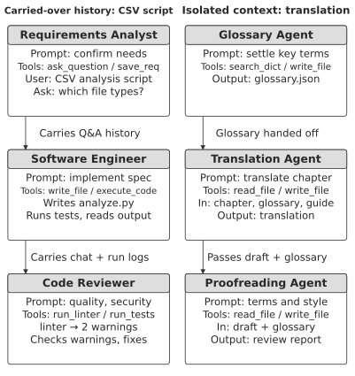

When each member has its own context, how do they exchange material? Distributed systems commonly communicate through shared storage or message passing. Both ideas apply to Agent systems, in the following concrete forms:

- **Tool call parameters.** The downstream Agent is wrapped as a tool; the upstream Agent passes in the task and structured material as parameters and then receives the result.
- **Shared file system.** One party writes documents, code, or data, and the other reads them by reference. This suits larger intermediate artifacts and material that must be kept persistently.
- **Message bus.** Agents submit messages to a relay service, which delivers them according to their target or to subscriptions. This suits asynchronous communication among multiple members.

For example, after the upstream Agent sends out a translation task, it can wait for the translation to come back, or it can take a task ID and move on to another chapter. Even when both translators can open the same file, the system still has to specify who writes it and when the other party reads it. The Go community emphasizes using communication to organize access to shared data, and the same idea applies to Agents: make clear who owns a piece of state, who may modify it, and how other members obtain updates.

### Dimension 2: Collaboration Topology

Collaboration topology describes the task dependencies, information flow, and control relationships among Agents. This chapter uses three typical forms of organization:

- **Peer Collaboration Pattern.** A small number of members work together repeatedly on the same artifact. For example, a drafter writes a draft of a paper, a commenter suggests revisions, and the drafter then revises it.
- **Manager Pattern** (Orchestration Pattern). A centralized Manager Agent decomposes, assigns, and aggregates tasks, while sub-agents carry out their own specialized work.
- **Decentralized Pattern.** Members pick up the work based on their roles, messages, and local state, and together they decide how the work moves forward.

> **Terminology: Graph Engineering.** Chapter 1 introduced the July 2026 discussion of Graph Engineering. This perspective focuses on the execution graph: nodes can be Agents, ordinary programs, or human decisions; edges express dependencies, conditional routing, and where to go after a failure; and state flows along the execution relationships. Multi-agent collaboration topology is one application of this design perspective, focused on how multiple decision-making units hand off, run in parallel, and give feedback.

Peer collaboration, manager, and decentralized designs can be combined. For example, a Manager can hand a writing task to a drafter-reviewer team, which iterates internally before submitting the result.

## When Is Multi-Agent Better Than a Single Agent?

Suppose a first draft mistranslates a technical term. Give two reviewers the same draft, and you may get the same approval twice. Give one of them the source text, the glossary, and the code that uses the term as well, and there is one more way to catch the error. When choosing a form of collaboration, first ask: what does the additional Agent bring to the task? It may obtain new evidence, cover another search path, provide a different professional judgment, or shorten waiting time through parallel execution.

I first check the **information gain of the feedback**, and then look at how much parallelism and context isolation can contribute. After reading test results, page screenshots, or external material, a reviewer can propose changes based on evidence that was not available at generation time. Table 10-1 uses several common scenarios to show how to check for this kind of gain.

Table 10-1 Information and Feedback in Multi-Agent Collaboration

| Collaboration Mode | Main Source of Information | What to Evaluate |
|---|---|---|
| The same model re-reviews its own output | The original material plus one new round of checking | Whether omissions are found and whether revisions improve the result |
| Multiple Agents debate the same question | Each Agent's solution path, assumptions, and arguments | Whether the views actually differ, and how to verify them and choose an answer |
| A reviewer runs tests and inspects the code | Compilation, test, and runtime feedback | Whether the changes pass the tests and preserve existing functionality |
| A reviewer examines the rendered frontend or PPT | Screenshots and interaction feedback | Whether layout, content, and operations meet the requirements |
| A reviewer uses external tools to verify facts | Search results and business-system records | Whether the sources are reliable and the conclusions are consistent with the evidence |

RLEF uses reinforcement learning to train a model to make use of code-execution feedback, learning multi-step revision on competitive programming tasks. Compilation errors, test failures, and runtime exceptions give concrete grounds for the next revision, and the model in the paper achieves better results with fewer samples.[^rlef-2025] WebGen-Agent feeds webpage screenshots, a vision model's descriptions and suggestions, and evaluations of GUI operations into the generation process; it can roll back to the previous step and redo it, or pick the best of several generated results. On WebGen-Bench, Claude 3.5 Sonnet's accuracy rose from 26.4% to 51.9%.[^webgen-agent-2025]

[^rlef-2025]: Gehring, J., et al. *RLEF: Grounding Code LLMs in Execution Feedback with Reinforcement Learning.* arXiv:2410.02089, 2025.
[^webgen-agent-2025]: Lu, Z., et al. *WebGen-Agent: Enhancing Interactive Website Generation with Multi-Level Feedback and Step-Level Reinforcement Learning.* arXiv:2509.22644, 2025.

I first have the system obtain concrete evidence such as test results, screenshots, or tool output, and only then decide how to allocate the responsibilities of generation, execution, and review. A feedback loop can be run by one Agent or split among several roles; adding a role should improve how evidence is obtained and used.

Anthropic's 2026 security research provides a case of collaborative search: 45 Agents shared findings through a common forum, reviewed one another's work, and had the results arbitrated by an independent Agent. According to the report, the collaborative swarm consumed 27 million tokens and found 266 vulnerabilities; the independent parallel setup consumed 6.5 million tokens and found 21. The forum let members build on others' findings and see which directions someone was already working on. The collaborative group also used about four times as many tokens, so the gap between 266 and 21 reflects differences in both communication and computational investment.[^anthropic-multiagent-2026]

[^anthropic-multiagent-2026]: Anthropic Frontier Red Team, “Patterns and Problems in Emerging Multiagent Systems,” 2026-08-13.

In mathematical research, how can several teams be made to explore genuinely different routes? The three-dimensional Navier–Stokes equations describe the motion of viscous fluids. Given smooth initial conditions, does the solution stay smooth forever? OpenAI assigned two opposing goals to different groups: some tried to prove smoothness, while others tried to construct a counterexample. Each group first explored on its own; the team then used Codex to pool intermediate results so that other groups could follow promising leads. The group that found the counterexample had about ten thousand Agents working concurrently. The team reported that about 88 hours passed from the launch of the first Agents to the discovery of the proof, and another 17 hours went into Lean formalization and verification. The counterexample carries an important condition: a fluid subject to a smooth external force can still develop a singularity in finite time. On this basis, the team gave counterexamples for statements C and D of the Clay Mathematics Institute problem description; without the external force, it would be a different problem. When designing this kind of search, first write down which results are sufficient to answer the original question, give competing conjectures to different groups, and set aside separate time for final verification.[^ch10-ns-search]

[^ch10-ns-search]: OpenAI's research write-up, *On the Navier–Stokes Millennium Prize Problem*, includes the proof and Lean code. In an announcement on September 11, 2026, the Clay Mathematics Institute responded to the work and stated that evaluation of the result and award of the prize would follow its prize procedures.

**How does the step budget affect performance?** Suppose a task allows 30 steps: the Agent has to fit planning, the core implementation, and essential verification into a tight schedule. With 300 steps, it has room to compare more approaches and to test and revise more thoroughly. To make good use of these resources, the Agent also needs to know its total and remaining budget, and plan the depth of its exploration accordingly.

Google studied this question in its 2025 paper *Budget-Aware Tool-Use Enables Effective Agent Scaling*: an Agent without budget awareness may quickly settle into shallow search, and even with more steps available, its performance struggles to improve further. In 2026, BAVT (Budget-Aware Value Tree Search) went further by combining value estimation with the remaining budget at each search step, adjusting the weight given to exploration and exploitation. When the budget is ample, the Agent can compare more directions; as it approaches the limit, it concentrates resources on the promising branches.

In the manager pattern, this means the Manager should allocate steps according to task difficulty and adjust them as work progresses: deliver simple tasks quickly, reserve room for verification and revision in complex ones, and when blocked, first locate the cause before deciding whether to supply more information, increase the budget, or take a different path.

Parallel exploration can shorten wall-clock time, and repeated review can improve the artifact, but both increase model calls and communication overhead. I use a well-tuned single Agent as the baseline and expand collaboration only when the quality gains or time savings from additional members are large enough to cover the costs of communication, duplicated computation, and maintenance.

## Multi-Agent Collaboration with Shared Context

Collaboration with shared context switches roles from stage to stage while carrying forward the existing task record. Take a research report: a retrieval role first gathers material, an analysis role then performs the calculations, and a writing role finally organizes the presentation. Each role can look back at earlier sources and decisions, while the system uses the current task instructions to steer it toward the goal of its own stage.

When work is handed across teams, first ask: who needs to know why a decision was made in the first place? In a product example from Teamily AI, product managers and an Agent write a product requirements document (PRD) together in a group chat. After the product team shares the final version with the engineering team, engineers can ask follow-up questions about the trade-offs behind a given requirement.

Consider the retrieval role handing the task to the writing role. After the handoff, where does the model read the writing procedure from, and which tools can it still call? Experiment 10-1 implements the same handoff in two ways.

| Question to Resolve at Handoff | Switching Roles (`transfer_to_agent`) | Loading a Skill |
|---|---|---|
| How is the writing procedure provided? | Replace the system prompt with the writing role's | Keep the Skill directory in the system prompt and append the writing procedure to the end of the message history |
| Which tools can the model see? | Only the writing role's tools can be shown | The original tool set or tool-search entry point can be kept |
| Which part of the KV cache remains usable? | The system prompt has changed, so everything from the point where the prefix changes usually has to be recomputed | The original request prefix can continue to be reused |
| Who checks call permissions? | The Harness validates requests against the current role, then dispatches the tool | The Harness checks the permissions of every call independently |

When roles differ mainly in knowledge, procedure, and writing style, I prefer a Skill: it makes it easy to reuse the same runtime framework and preserves caching of a stable request prefix. When roles differ in permissions, tool isolation, or approval responsibilities, they can be organized as independent Agents or through role switching, with the Harness and the execution environment enforcing access control. Whether a tool appears in the model input affects which calls the model chooses; the actual permissions are determined by runtime validation.

> **Experiment 10-1 ★★: Multi-role switching in shared context—system prompt versus Skill**
>
> Both paths use the same model, user task, tool implementations, role procedures, and shared history. The introductory demo asks the Agent to find China's new-energy vehicle sales for 2021–2023, calculate the compound annual growth rate (CAGR), and write an investor summary of no more than 120 Chinese characters.
>
> **Path 1: System-prompt switching.** Set up five roles: triage (requirements gathering), research (retrieval), coding (programming), data_analysis (analysis), and writing (writing). Triage is the entry point, and each role sees its own dedicated tools plus `transfer_to_agent`. On handoff, the history is kept, the target role's prompt and tool set are loaded, and execution continues.
>
> **Path 2: Loading a Skill.** The system prompt and the full tool set stay fixed throughout the session. The model calls `load_skill(name)` to obtain the role procedure; the content is added to the shared history as a tool result, and the original prefix is preserved. The Harness checks every tool call against permission rules.
>
> Both implementations read the same `SKILL.md`. Before and after one role handoff, capture one request sent to the model in each path, and look at which message the procedure appears in and which part of the prefix can still be reused. Then check the two summaries: are the sales sources credible? From the end of 2021 to the end of 2023 there are two growth periods—was the CAGR calculated correctly?
>
> The formal comparison includes a stricter briefing task limited to 160 characters that must also keep two source URLs. Given the same eight steps, the role-switching group spent three calls counting characters, yet its draft still ran to 206 characters, and it also failed to use the calculation tool the task specified. The Skill-loading group calculated the growth rate from the sales of the first and last years and loaded the writing procedure only at the eighth step. By then it had passed through every role it needed to, but the user had still not received a summary. Both trajectories ended by hitting the step limit.
>
> Running both implementations on the same 30 tasks and checking the deliverables programmatically, the Skill-loading group passed 15 and the system-prompt-switching group passed 2. Compared task by task, however, the former had 6,855 more uncached input tokens and took about 4.4 seconds longer (both are medians of paired differences). In this run the provider reported zero cached input tokens for both groups' requests. Both groups passed all six instruction-following boundary tests, yet their pass rates on complete tasks differed widely.

## Multi-Agent Collaboration Without Shared Context

In an architecture with independent contexts, each Agent maintains its own input history, task state, and run loop, and exchanges the information it needs through tool parameters, shared files, and messages. For example, the material a translator hands over should note the source paragraphs and the glossary version. Even if the translator leaves, the reviewer can still find the source text, and when revisions are needed, the person responsible can be located by chapter.

Table 10-2 compares how an operating system manages processes with how a runtime manages Agents.

Table 10-2 Design Analogy Between Multi-Agent Systems and Operating Systems

| Operating System | Similar Responsibility in a Multi-Agent System |
|---|---|
| Program and configuration | System prompt, tool definitions, and role configuration |
| Process memory | Current context, task state, and history |
| CPU performs computation | The LLM generates decisions; the runtime and tools carry out the corresponding operations |
| Kernel manages execution | The Agent runtime manages state, scheduling, and resources |
| System call | Requesting an external operation through a tool interface |
| fork: create a child process | `spawn_subagent`: create a sub-agent |
| kill: send a signal | `cancel_subagent`: request cancellation |
| ps: list processes | `list_agents`: list members and their run status |
| Exit status and wait | Completion notification, task status, and structured result |
| Shared memory and message passing | Shared files, tool parameters, and messages |

Private state, asynchronous messages, and dynamic creation of members also appear in the Actor model proposed in the 1970s.[^actor-model]

[^actor-model]: Hewitt, C., Bishop, P., Steiger, R. *A Universal Modular ACTOR Formalism for Artificial Intelligence.* IJCAI 1973.

When there are many independent subtasks, I tend to give each member its own context so that it handles only material relevant to its responsibilities. This makes it easier to test roles separately, reduces interference from a previous stage's lengthy history with the current judgment, and lets multiple tasks proceed concurrently. How well the isolation works also depends on other shared resources: several Agents may still modify a file at the same time, draw on the same API quota, or receive the same erroneous message.

Collaboration interfaces must also handle lost messages, duplicate delivery, and stale state. When troubleshooting, a task ID can be used to correlate each member's requests, tool events, and results, reconstructing how a handoff unfolded.

Suppose an Agent has finished an analysis and needs to pass the results to a peer that writes the report. If there are only a few numbers, they can be sent with the message; if the artifact is a large table, the table is usually stored in the shared file system and a reference is attached to the message. This gives two separate responsibilities. **Artifact storage** saves and exchanges documents, code, and data; **communication and control** delivers messages, queries task status, cancels execution, and schedules resources.

### The File System from an Agent's Perspective

A common design is to give the Agent a **virtual file system** that mounts resources from different sources under a single directory tree. The model accesses them through interfaces such as `read_file`, `write_file`, and `list_dir`, while the underlying layers can connect to a local temporary disk, persistent object storage, a third-party cloud-drive API, or a system resource package.

I first draw clear boundaries between storage areas and only then plug them into the collaboration workflow. If temporary drafts, formal deliverables, and the user's external files are mixed together, accidental overwrites and unauthorized reads become likely. A unified interface is convenient to use, while the visibility, lifecycle, and permissions of each area are determined by the mount and access-control configuration. The directory tree can be divided into four types of area.

**I. Agent-Specific Workspace (Scratchpad).** Each instance uses its own workspace to store drafts, temporary files, debug logs, and intermediate artifacts. By default, access is limited to the owning Agent, and the workspace is cleaned up or archived according to the task's policy. This keeps temporary files from overwriting one another. When a sub-agent finishes its work, it places the results to be delivered in the shared space and hands them, together with a structured summary, to the main Agent. The trial-and-error records stay in the original workspace for later diagnosis. This carries context isolation down to the storage layer: the main Agent receives the deliverables and the necessary evidence, and in day-to-day coordination it is spared the cost of reading the entire trial-and-error process.

**II. Multi-Agent Shared Workspace.** Collaborating members exchange artifacts here, and the user can also upload material and download deliverables through an authorized entry point. For example, the Glossary Agent writes the glossary, the Translation Agent reads it and translates, and a reviewer then checks the translation. The shared space is usually kept for the duration of the task and has to handle concurrent writes, version updates, and access scope. In Chapter 6, the Agent and the virtual computer exchanged CSV files and charts through shared storage, an instance of exactly this kind of artifact handoff. Methods such as optimistic locking and working-copy isolation are introduced later in this chapter.

**III. Mounted External Resources.** Resources such as Google Drive, Notion, Dropbox, and enterprise wikis can be mapped onto the unified interface through adapters. When an Agent reads a document, the adapter calls the source system's API. Three kinds of difference must be managed here: the access scope depends on external authorization; network access brings latency, timeouts, and cache-refresh issues; and write-back operations must follow the source system's permission and versioning rules. The exact consistency semantics are determined by the service interface; version numbers, conditional writes, or re-reads can be used to detect concurrent modifications. On-demand read-only mounts suit information retrieval, and write permission can be granted when editing is actually needed.

**IV. Built-in System Resources.** Reference manuals, templates, tool definitions, and preinstalled Skills can be provided as read-only resource packages shared by multiple Agents. Skills are loaded through progressive disclosure: first a directory is provided, and then procedures and scripts are read as the task requires. Pinned-version resource packages are easy to read concurrently, and upgrades are carried out by switching versions so that running tasks stay consistent.

In Figure 10-2, a translator can revise drafts repeatedly in their own directory and, when ready to hand off for review, place the corresponding version in the shared area. The original manuscript in the user's cloud drive is read through an external adapter, and access to it also depends on the permissions the user has granted.

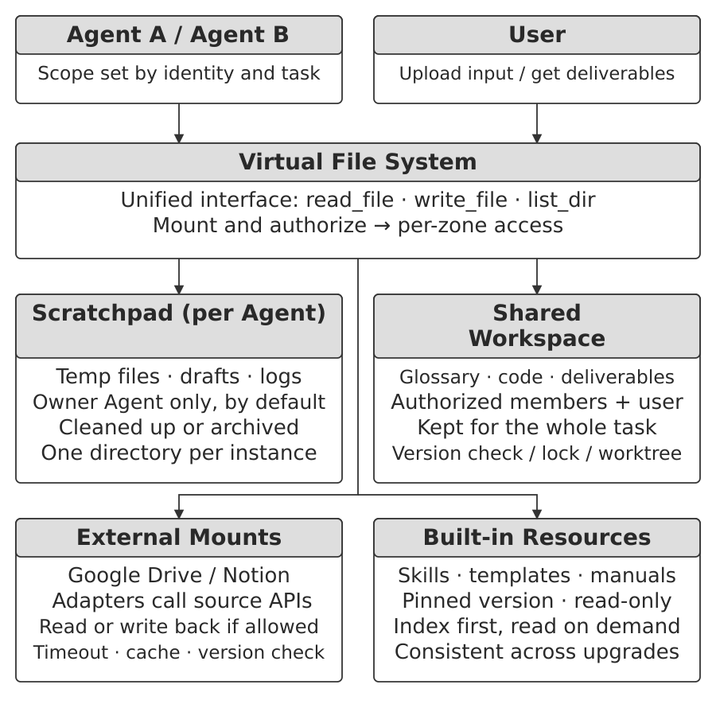

After the translator exits, the temporary files in its workspace may be released along with it. Drafts placed in the shared area can be retained, and the reviewer, holding read permission, can pick them up (Table 10-3).

Table 10-3 Four Area Types of the Agent Virtual File System

| Area | Visibility | Lifecycle | Read/Write | Concurrency Management |
|---|---|---|---|---|
| Agent-Specific Workspace | The owning Agent by default | Cleaned up with the instance, archived as needed | Read/write by the owning Agent | Prevent duplicate writes from retries or background operations |
| Multi-Agent Shared Workspace | Authorized members and the user | Persists for the duration of the task | Authorized by role | Locks, version checks, or worktrees |
| Mounted External Resources | Restricted jointly by external authorization and the adapter | Determined by the source system and the caching policy | On-demand read-only, or authorized writes | Follow the source system's versioning and concurrency interfaces |
| Built-in System Resources | Authorized Agents | Pinned versions reused across sessions | Read-only | Switch resource versions uniformly |

File references keep handoff messages short: the upstream side provides the artifact's location, version, and purpose, and the downstream side reads the content as needed. Members in the same runtime environment can use shared paths; cross-organization collaboration needs artifact identifiers, access interfaces, and authorization that both parties can resolve before the same handoff can take place.

### Communication and Control Between Agents

The tools for creation, communication, cancellation, and discovery introduced in Chapter 4 provide the basic control interface for multi-agent collaboration: `spawn_subagent` creates a member, `send_message_to_subagent` delivers a message, `cancel_subagent` requests cancellation, and `list_agents` lists members. Around these interfaces, the behavior of messages, status, termination, and scheduling also has to be agreed on.

**I. Message Passing.** When there are few members and their relationships are fixed, point-to-point interfaces can be used; for example, a phone Agent and a computer Agent can exchange progress directly. If every member needs to communicate with every other member, the number of potential relationships grows with the square of the number of members; when there are many subscriptions, a message bus makes it easier to manage routing, buffering, and retries in one place. Both point-to-point and bus-based communication can deliver messages asynchronously; whether the receiver must be online at the same time depends on the queueing and persistence mechanisms.

A message usually carries a structured **envelope**: the sender ID, the target Agent or broadcast scope, the message type, and the payload. Message types can include `task_assigned`, `status_update`, `result`, and `terminate`. Task IDs, message IDs, and correlated requests help the receiver deduplicate messages and let debugging tools reconstruct the communication chain. Business content goes in the JSON payload, which both sides process according to agreed fields.

For example, suppose an editor is responsible for delivering a translated draft and wants a terminology-review Agent to check a word. Mentioning it (`@`) in a comment on the Multica ticket and writing down the question is enough to trigger the review. The review comments can be posted as a reply on that same ticket; the editor remains the owner, and the ticket status stays as it was. If the reviewer is meant to take over the entire ticket, the owner has to be changed explicitly.[^ch10-multica]

[^ch10-multica]: Multica, mentioning an Agent in a comment; comment-dispatch implementation at version `d579273`.

**II. Getting Status.** The main Agent needs to know whether a subtask is still running, whether it needs input, and whether its result is available. Status interfaces, event notifications, and progress files can be used in combination: the runtime interface provides lifecycle state, messages describe business progress, and persistent files retain recoverable records.

`get_subagent_status(agent_id)` can return states such as running, needs input, completed, or failed. In day-to-day coordination, I prefer completion notifications and stage-progress messages, which let the main Agent get on with its own work. Active queries are reserved for delayed notifications, reconnection, or troubleshooting, so that model calls are not wasted on repeatedly asking "Are you done yet?" The status interface is maintained by the runtime and can promptly report whether a process is alive and whether a task has finished.

**Exchanging progress through messages.** The main Agent can ask about current progress, and the sub-agent replies at a suitable step; the sub-agent can also proactively publish a `status_update` when it reaches a milestone, hits a blocker, or needs help. The message should state what has been completed, what comes next, and why the work is blocked, and all members should use the same set of status names so that status can be aggregated and judged. The A2A protocol later in this chapter introduces a standardized representation of the task lifecycle.

**Saving progress in files.** The system can append messages, tool requests, tool results, and state changes to a log in event order, for example in JSONL format with one event per line. A main Agent or an operations tool with diagnostic permissions can use this log to examine retries, errors, and waits. The model's input history is only part of the run trajectory; the log can also record scheduling and external execution events.

A full trajectory may contain tens of thousands of tokens, and the main Agent would have to distill the status again every time it read it. Messages notify the main Agent of new progress, while a short progress file holds the current state for later queries and recovery. I prefer to combine these two for day-to-day coordination. Each time a sub-agent completes an item, it updates the task list, the artifact references, and the current blocker; the main Agent decides the next step based on these fields. The detailed trajectory is kept for troubleshooting when needed. If progress has not changed for a long time, heartbeats, tool-call status, and the task timeout can be combined to decide whether to intervene: a long-running tool may still be working, so confirm the status before deciding to wait, cancel, or retry.

**III. Execution Termination.** When several members search in parallel for the same target and one of them completes the task, the other branches can stop, freeing up budget and tool resources. Cancellation comes in two strengths, similar in effect to SIGTERM and SIGKILL in Unix.

I prefer **graceful termination**: the runtime delivers a cancellation request, and the sub-agent stops starting new operations at a safe point, saves the necessary progress, closes browser sessions, releases locks, and then returns an acknowledgment (ack). **Forced termination** is used for executions that still have not responded after the cancellation deadline: the runtime ends the process and then checks for leftover resources and incomplete writes. For operations already committed to external systems, the outcome must also be queried, and a compensation procedure run if necessary.

Lifecycles also need to be managed along the creation relationship. Borrowing from Go's context, the parent task's cancellation signal can be propagated down through the entire tree of subtasks, with the run loop checking for the cancellation signal at safe points—the same purpose `ctx.Done()` serves. That way, when a parent task ends, the branches it started also enter cleanup, preventing unmanaged Agents from continuing to call tools and consume budget. Background tasks that genuinely need to run independently for a long time get their own lifecycle context, similar to using `context.Background()`, together with a designated manager responsible for monitoring, budget, and cleanup.

**IV. Resources and Scheduling.** An Agent system has to allocate tokens, steps, concurrency quotas, tool connections, and compute. When starting a subtask, set its budget and what happens when the budget is exceeded; choose the model according to task difficulty; and limit concurrent calls so that service quotas are not exhausted all at once. When a more urgent task arrives, lower-priority tasks can be paused or canceled at a safe point, their progress saved, and then rescheduled.

Suppose three branches each investigate one possible approach, and one of them has already found a key lead and needs only one final verification. The Manager can give it a few more steps while ending the two branches that are making no progress. The quota is deducted by the runtime; even if a branch wants to try again, it has to stop once its budget is exhausted.

### Peer Collaboration Pattern: Mutual Checks and Iterative Improvement

Peer collaboration usually involves two or three Agents exchanging views and revising an artifact around the same task. When designing it, first give the members different responsibilities, materials, and tools, let them judge independently, and then aggregate the results. For example, a generator focuses on implementation while a reviewer focuses on tests and user requirements, or members from different specialties each check the constraints of their own domain. The more similar the models, inputs, and workflows, the more likely the members are to repeat the same judgment, so differences in perspective and evidence must be designed in deliberately.[^anthropic-multiagent-2026]

For tasks that involve repeatedly improving the same artifact, I recommend starting with peer collaboration among two or three members. Once roles, handoff contents, and stop conditions are clear, a testable loop can be built, and little coordination work is needed early on.

#### Loop Engineering

Peer collaboration can help with a common problem: **premature termination**. Taking programming and customer-service errands as examples, premature termination can be spotted in three kinds of records.

- **Claiming everything is done after only partial completion.** A Coding Agent writes the code but skips the tests and deployment checks; a user asks an assistant to take care of two errands, and after finishing the first it reports that everything has been handled. Each item must be checked against the task list for evidence that it was completed.
- **Giving up early after one path fails.** A merchant may ask for documents to be submitted through a form instead, or for attachments to be sent to a designated email address. On receiving such a reply, the assistant can continue the errand through the channel the merchant accepts. The reason for the failure must be recorded, along with a judgment of which other paths are worth trying.
- **Missing follow-up steps after partial success.** If a merchant agrees to a refund but still requires the user to confirm it in the app, the assistant needs to explain this step and the conditions for completing it. Take a bill reduction: when the customer-service representative agrees verbally on the phone, the assistant can confirm to the user that this negotiation secured a commitment. The call record can prove what the representative said, but whether the later bill honors it requires new evidence. The reviewer should state separately what has been achieved, who still needs to do what, and which results cannot yet be seen.

All three problems require the completion criteria to be tied to checkable results. **Loop Engineering** is concerned with keeping an Agent cycling through "determine the next piece of work—execute—verify—record progress," and deciding from the result whether to continue, wait, hand off, or finish. Engineers need to design the task source, the verification method, the persistent state, and the stop conditions. Human work expands accordingly: from writing prompts for a single call to designing loops that can keep a task moving. In June 2026, Addy Osmani used this name to discuss this set of practices and cited Boris Cherny's experience that the focus of the work is gradually shifting to designing the loops that drive Agents.[^loop-engineering-2026]

**In loops like these, I believe the verifier is often the key bottleneck.** If verification is unreliable, adding more rounds may simply lead the system to repeat the same kind of mistake or to declare completion too early. Test results, business state, and user confirmation each provide grounds for completion within their own scope; a failed verification becomes the input to the next round of revision.

Practice comes before naming. Before the name Loop Engineering caught on, my team and I were already using loops and verification at Pine AI to deal with premature termination. Proposer-Reviewer is one common way to organize such loops, discussed further below.

[^loop-engineering-2026]: Osmani, Addy. “Loop Engineering”, 2026.

**LoopX: Keeping work state across rounds.** LoopX places objectives, boundaries, todos, gates, evidence, and quotas in a durable control plane, which arranges the work for the next round or the next executor. The process can be summarized as: **control plane decides → Agent executes → independent verification → verified progress is committed**.

The Agent calls tools, reasons, and turns in the results of the round. The control plane records the work already completed and decides where the next round picks up. When verification passes, the completion state is committed; when it fails, the loop moves to repair or replanning. Human gates, wait conditions, and budget limits together determine when execution may continue.[^loopx-framework]

[^loopx-framework]: LoopX, The local control plane for long-running AI agent work, v0.4.0.

**LongHorizon-Harness: Connecting long tasks across applications.** This framework starts from multimodal Computer Use and handles continuous execution of a task across GUIs, CLIs, multiple desktop applications, and repeated context refreshes. It uses a Manage–Execute–Audit (MEA) loop: the Manager generates a clearly scoped subtask based on the original objective, verified progress, failure evidence, and the remaining work; the Executor performs GUI or CLI operations in a fresh context; and the Auditor inspects the results read-only and then writes the verified progress into the next round's state. Failure evidence is retained as well, for use in recovery and replanning.

The framework calls execution backends such as Claude Code and Codex CLI through an adapter layer, connecting the outer task management with the backend's run loop. This approach grounds the continuity of a long task in verified task state. The execution context can be refreshed, and the next round can still continue from the objective, the completion evidence, and the unresolved items, while rechecking whether changes in the environment affect earlier conclusions.[^longhorizon-implementation]

In a comparison that kept Qwen 3.7-Plus and the Claude Code execution backend the same and changed only the outer loop, the paper reports WeaveBench PassRate rising from 51.8% to 80.7%, OSWorld 2.0 binary completion from 2.8% to 8.3%, and Terminal-Bench 2.1 success from 69.7% to 77.2%. The cost also varied by task: on the first two benchmarks the method consumed 2.3 times the baseline's total tokens and 3.6 times its output tokens, respectively, while token consumption on Terminal-Bench 2.1 fell by 24%.

In the same WebRTC simulcast-layer audit task, the baseline executor got stuck in the Wireshark interface, tried a few more times, and finally scored 0.59. With MEA, the auditor recorded the missing evidence, the next round's executor filled in those checks, and the final score was 0.92.

[^longhorizon-implementation]: LongHorizon-Harness, paper arXiv:2608.01964. The public baseline and MEA trajectories are both taken from task WEB_task_16_webrtc_simulcast_layer_audit; the reproduction scripts use commit `53bc678`.

#### Proposer-Reviewer Paradigm

Proposer-Reviewer assigns generating an artifact and checking the result to two separate roles. The PPT generation, video editing, and log visualization experiments in Chapter 5 used this design: the Proposer generates code, and the Reviewer examines the rendered result, checks its quality with the help of a vision model, and returns structured revision suggestions. In Figure 10-3, the revision suggestions must also go back to the proposer. Whether it can fix the next version based on them depends on how precisely the reviewer can pinpoint the problems.

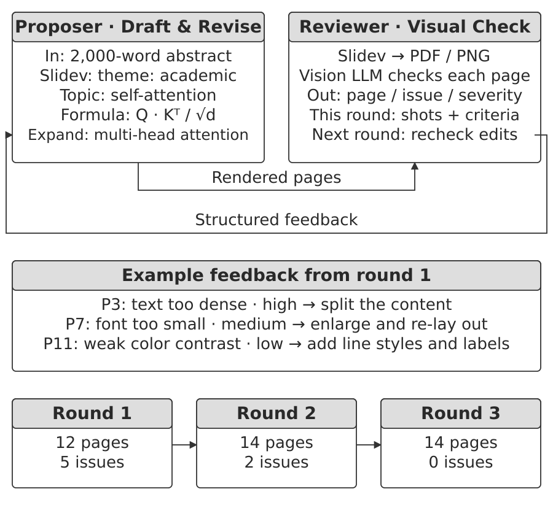

When the object under review changes, the evidence to examine changes too. Reviewing a customer-service reply means checking it against business rules and sources of fact; reviewing a code change means looking at tests and actual execution results; reviewing an operational plan means verifying the applicable regulations and preconditions.

Huang et al.'s ICLR 2024 paper "Large Language Models Cannot Self-Correct Reasoning Yet" found that, under the reasoning tasks and prompt settings it studied, GPT-4 revising its own answers without external feedback sometimes changed correct answers to incorrect ones, lowering overall accuracy. A self-correction survey in TACL further discusses how task conditions and the reliability of feedback affect the outcome of revision.[^self-correction-survey] I therefore treat independent evidence and pinpointed repair conditions as basic requirements for a review loop. The reviewer should be able to read actual tests, environment state, or rendered results, and point out which requirement is not yet met and how the fix will be verified.

[^self-correction-survey]: Kamoi, R., et al. *When Can LLMs Actually Correct Their Own Mistakes? A Critical Survey of Self-Correction of LLMs.* TACL, 2024.

A complete loop can be organized in five steps:

1. The proposer writes a first version according to the task requirements, such as a reply or a piece of code.
2. The artifact is executed or rendered to obtain tests, business state, screenshots, or fact-checking results.
3. The reviewer checks the requirements against the evidence and either gives a pass or identifies where the problem is and what the fix must satisfy.
4. While budget remains, the proposer revises according to the feedback, and the artifact is executed and reviewed again; when a problem requires input or authorization, the loop moves to waiting or a handoff.
5. Once the release conditions are met, the version that passed review is delivered together with the verification evidence and the review conclusion; when the budget runs out, the progress and unresolved problems are preserved.

The reviewer reads protected tests and release criteria; any changes to the criteria it proposes are reviewed separately.

In the CRITIC experiments, the model first gives an answer and then checks it with tools.[^ch10-critic] For example, it uses a search engine to verify the facts in its answer, and a Python interpreter to run the math programs it wrote. On three types of task—open-domain question answering, mathematical program generation, and reducing harmful content—the model improved after revising based on tool feedback. When the model relied only on its own evaluation of the original answer, the corrections were weaker. This design has much in common with the PPT case in Chapter 5: rendered screenshots expose layout and occlusion problems that are hard to judge directly from the code text, and test execution reveals actual runtime errors.

[^ch10-critic]: CRITIC, arXiv:2305.11738.

Anthropic's 2026 case study of long-running application development used three Agents: a planner, a generator, and an evaluator. The planner expanded the requirements into a product specification; the generator and evaluator first agreed on the completion criteria for each round, then implemented and checked the work respectively. The evaluator used Playwright to operate the application and filed defect reports, and the roles handed off state through files. The case shows how a product specification, real operation, and defect feedback can be connected, and the added cost of execution and review also has to be factored into comparisons between approaches.[^anthropic-harness-2026]

[^anthropic-harness-2026]: Prithvi Rajasekaran, “Harness Design for Long-Running Application Development,” Anthropic Engineering, 2026-03-24.

On November 20, 2026, the mathematician Levent Alpöge published a formal proof obtained in collaboration with Claude, concerning the Riemann Hypothesis and its generalization to Dirichlet $L$-functions. Faced with a large batch of Lean files, a reviewer must first ask two questions: is the final theorem a statement of the original conjecture? Can every step of the derivation be rechecked by a proof kernel? MIT mathematician Andrew Sutherland first compared the submitted theorem with the definition of the Riemann Hypothesis in Lean's mathematics library, then listed the axioms the proof depends on. In the record he published that day, he also reported that the independent proof kernel nanoda had checked the exported proof successfully. This offers a concrete way to divide review work: have someone familiar with the problem first write down the acceptance statement, and then have an independent tool check whether the submitted artifact proves that statement. If mathematicians later want to understand how the authors arrived at this route, they will also need an argument written for human readers.[^ch10-rh-review]

[^ch10-rh-review]: Levent Alpöge published a research note on November 20, 2026. For the verification project and its progress that day, see Andrew Sutherland's *Verification files for the Lean proof of the Riemann Hypothesis*.

#### Debate Pattern

The debate pattern has members examine the same question from different positions. For example, when evaluating a technical proposal, one Agent explains the benefits and suitable scenarios, while another examines the constraints, failure conditions, and alternatives. Each round adds evidence or offers rebuttals on specific points, and at the end the issues on which consensus has been reached are summarized together with the disagreements that still need verification.

This arrangement helps lay out the arguments for and against clearly, but its effectiveness depends on the quality of the arguments, on independent judgment, and on how the final choice is made. Tran and Kiela compared five architectures—sequential, debate, ensemble, parallel roles, and subtask-parallel—on multi-hop reasoning tasks; with the thinking-token budget held constant, a single Agent performed on par with or better than the multi-agent systems.[^single-agent-2026] Accordingly, I use debate mainly to draw out disagreements, test assumptions, and fill in counterarguments. When the goal is factual or computational accuracy, adding verifiable evidence and independent checks comes first.

The paper uses the data processing inequality to discuss the limits of passing intermediate information along: repeated paraphrasing and compression can lose original detail. In engineering terms, keep sources traceable and have members analyze independently before exchanging conclusions, which reduces unexamined consensus. Aggregating multiple independent samples, and arranging dedicated review that exploits tasks where "generation is hard but verification is easy," can also be combined with debate.

[^single-agent-2026]: Tran, D., Kiela, D. *Single-Agent LLMs Outperform Multi-Agent Systems on Multi-Hop Reasoning Under Equal Thinking Token Budgets.* arXiv:2604.02460, 2026.

#### Brainstorming Pattern

Brainstorming can be done in two rounds: first each member comes up with ideas alone, and then they discuss together which ideas can be combined. For example, Agent 1 proposes adding a social-sharing feature; Agent 2 builds on it by proposing automatically generated personalized sharing posters; and Agent 3 goes further by proposing user-customizable templates and a template marketplace.

To get members to come up with different ideas, they can be asked to start from the perspectives of users and of operators respectively, or be given different prompts or models. After the ideas are exchanged, the proposals are filtered by user needs, implementation cost, and verification results.

#### Panel of Experts Pattern

A panel of experts assigns specialized responsibilities around a cross-domain problem. For example, when evaluating a new product, an Engineer Agent analyzes implementation difficulty and technical dependencies, a Product Agent examines user needs and experience, and an Operations Agent estimates costs, resources, and the conditions for rollout.

In a LobeHub group chat, the host can broadcast the same product proposal to these three experts. The system first takes a snapshot of the group-chat history at that moment, then has the three members answer simultaneously, each with its own role configuration. All three replies are attached under the message that initiated the broadcast, making it easy to check later which question each one was answering. If Operations needs to calculate costs from the usage the Engineer has just estimated, it must wait until this round of replies has been written back before asking Operations to speak: if the two start writing at the same time, Operations does not yet have that number.[^ch10-lobehub]

[^ch10-lobehub]: LobeHub, group-chat user guide; parallel-broadcast implementation at version `ab21e0d`.

When aggregating, identify the connections among the judgments: what technical support a given experience goal requires, how much operating cost a technical choice adds, and which conditions still need external evidence.

### Manager Pattern: Centralized Coordination

When a task involves many subtasks, complex dependencies, or dynamic scheduling, a Manager Agent can do the planning centrally. It first understands the overall goal, then breaks down the work, chooses members, and tracks progress; when something goes wrong, it decides whether to retry, reassign, or revise the plan; and finally it integrates the results.

A common implementation registers specialized Agents as tools. Through the tool interface, the Manager passes in the task, constraints, and necessary material, and receives back a structured result or a task ID. This way, search, file operations, and delegating subtasks can all use a similar calling style, while long-running subtasks have their progress, cancellation, and retries managed separately. Different members can use different models, prompts, tools, and runtime environments. When a new member is added, registering its interface is not enough: the Manager must also understand its responsibilities, input requirements, and the situations it suits.

When I worked on long tasks in Claude Code and Codex, discussion, command execution, and testing all used to happen in the main session. To ask a follow-up question about a design choice midway, I often had to wait for the current step to wrap up; hours later, finding an earlier agreement meant scrolling through a long stream of command output. Later I handed modifications and testing to sub-agents and kept the main session for discussion. When proofreading a book manuscript, for example, the executor can keep checking figure numbers while I discuss with a reader whether a passage should be rewritten. If the discussion changes the scope of the task, the new agreement also has to be sent to the executor and checked against its work when it hands it in.

The DeepSeek Harness team has published `dsh-superagent`, a research prototype aimed at a single GitHub repository. Take fixing the date format in exported files: a maintainer raises the request in an Issue, and the Router decides, according to the repository's rules, whether to take it on. Once it is accepted, the system creates a Ticket and gives a Worker its own session and working directory. The Worker can modify code and run tests in its own directory, while another Ticket proceeds at the same time; each keeps its own change history and test results.[^ch10-dsh-prototype]

Suppose the maintainer then adds to the original Issue: "Only change CSV; keep the JSON date format." Open Tickets subscribed to this discussion receive the additional message, and the Worker can narrow the scope of its changes accordingly and test the two formats separately. When done, it can open a pull request (PR) and post the link and results back to the original Issue. The maintainer can see the original request, the later restriction, and the changes awaiting review in one place, and the Router does not have to break every follow-up message into a new task.

[^ch10-dsh-prototype]: DeepSeek Harness team, the dsh-superagent research prototype. For how Tickets receive follow-up messages, see its authorization and subscription documentation; for Worker sessions and working directories, see its execution mechanism.

The Manager also carries a large share of the decision-making responsibility. A wrong task decomposition affects all subsequent execution, insufficient handoff material leads to repeated questions, and too many call records crowd the context. The design should keep a concise task state and artifact index, read details on demand, and give each subtask clear inputs, outputs, and completion criteria.

Plan-and-Act studied how planning quality affects long tasks in a Planner-Executor architecture and reported a 57.58% success rate on WebArena-Lite.[^plan-and-act-2025] Planning errors cause several executors to keep working along a wrong decomposition, and adding members only amplifies the rework. I therefore check the quality of the Manager's task decomposition first; when planning is the bottleneck, give the Manager a stronger model, more complete task information, and a more generous reasoning budget. Once the subtask boundaries are clear, choose suitable configurations for the executors.

[^plan-and-act-2025]: Erdogan, L. E., et al. *Plan-and-Act: Improving Planning of Agents for Long-Horizon Tasks.* arXiv:2503.09572, 2025.

Parallel tasks also need a clear way to wrap up. If the goal is to find one result that meets the criteria, then after verification passes, atomically record the first verified result, cancel the remaining branches, wait for cancellation acknowledgments or a timeout, and finally aggregate and deliver. The recording operation must be both atomic and idempotent: when two results arrive at the same time, only one state transition takes place; when the same event is delivered twice, the existing outcome is reused. Locks, transactions, or compare-and-swap can all protect this step.

Python's built-in SQLite is enough to examine one such handoff concretely. Suppose two members, 甲 and 乙 (the Chinese equivalents of "A" and "B"), check material in parallel, and the results each submits have both passed verification. The Manager needs only one qualifying result and uses a single task row to record who submitted first. In the example below, 甲 submits first, 乙 submits next, and 甲 then retries once.

```python
import sqlite3

db = sqlite3.connect(":memory:")
db.execute("CREATE TABLE task (id INTEGER PRIMARY KEY, winner TEXT)")
db.execute("INSERT INTO task VALUES (1, NULL)")
for worker in ["甲", "乙", "甲"]:
    with db:
        claimed = db.execute(
            "UPDATE task SET winner = ? WHERE id = ? AND winner IS NULL",
            (worker, 1),
        ).rowcount
    print(worker, "登记成功" if claimed else "沿用已登记结果")
```

The output, in order, is "甲 登记成功" (甲 claimed the result), "乙 沿用已登记结果" (乙 reuses the recorded result), and "甲 沿用已登记结果" (甲 reuses the recorded result). Had 乙 arrived first, the table would have recorded 乙. A single update statement both checks that "no one has claimed it yet" and writes the submitter's name; split the check and the write apart, and both executors might read an empty value.

The example builds the table in memory, so the record disappears when the process exits. With a persistent database there is another handoff problem: the Manager has recorded 甲 but exits before it can notify 乙. After a restart, who knows that this notification was never sent? The chosen result and the pending notifications can be written in the same transaction. Each notification records the receiving branch, the action to take, and a unique ID. After restarting, the Manager resends any notifications that have not been acknowledged. Even if 乙 has already finished cleaning up and only its acknowledgment was lost, it can recognize the resent notification by its original ID and simply return the result of the previous handling. Delivery events can be recorded the same way.

If the task requires collecting all results, wait until every required branch has finished, and record successes, failures, and incomplete items separately. The wrap-up condition comes from the task goal and also determines when other members can be canceled.

**Sequential coordination.** When subtasks depend on one another in order, the Manager must wait until the previous step's artifact is available before dispatching the next step. Figure 10-4 uses report writing as an example: the member collecting material first returns the sources, the analyst organizes conclusions from them, and the writer finally receives an analysis grounded in evidence. Switch to the next translation task: which material does a translator need to wait for before starting?

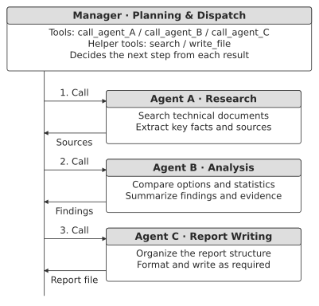

> **Experiment 10-2 ★★: Book Translation Agent**
>
> Translating a technical book requires handling terminology, context, and prose all at once. For example, the English word "agent" has several possible Chinese renderings; if the translation adopts "智能体" ("intelligent entity," the standard Chinese term), later chapters should keep using the same rendering. The glossary, the source chapters, the translations, and the proofreading records all need a clear organization. A long book, together with intermediate drafts, tool results, and proofreading history, keeps crowding the context: by Chapter 9 the model may have forgotten the rendering it used in Chapter 2, or it may check the same passage over and over. Splitting the task by responsibility and by chapter lets each instance concentrate on the material its current responsibility requires.
>
> The work can be divided among four types of Agent:
>
> - **Glossary Agent: compiling terms.** Reads the whole book in batches, identifies recurring technical terms, consults specialist dictionaries and translation guidelines, and produces a JSON or CSV glossary listing each English term with its Chinese rendering, part of speech, and usage context. The glossary is saved to the shared space, and the instance is released when its task ends.
> - **Translation Agent: translating chapters.** Reads the current chapter, the relevant terms, and the translation guidelines, and produces a translation suited to the target readers and language style. For newly encountered terms, it proposes candidate renderings and marks them for review. Each instance maintains its own context and saves its translation to the shared space; different chapters can be processed sequentially or in parallel, depending on their dependencies.
> - **Proofreading Agent: reviewing the full text.** Checks renderings, consistency of expression, and readability against the glossary and each chapter's translation. It completes the full-text check by reading chapter by chapter and using a cross-chapter index, and writes the location of each problem, its basis, and the required change into a proofreading report.
> - **Manager Agent: assigning and collecting tasks.** Maintains the goal, plan, task status, call summaries, and artifact index; based on the proofreading report, it sends chapters that need changes back to the translator and then organizes a recheck.
>
> In Figure 10-5, the proofreader reads each chapter's translation and the glossary, and the Manager uses the report to decide which chapters need revision. A translator who receives a revision task can pull up the chapter's source text to check what the flagged word means in that sentence.
>
> 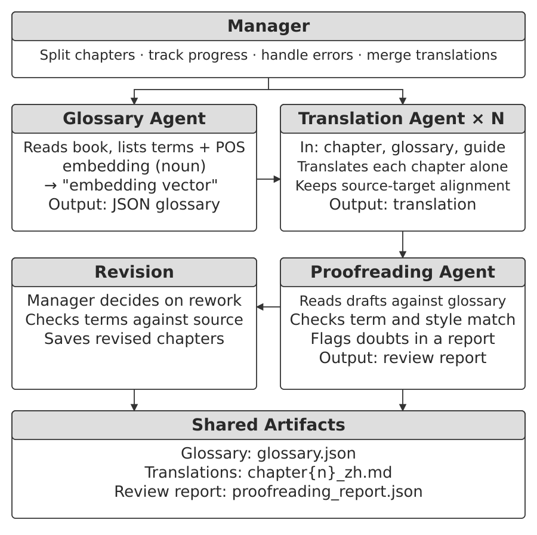
>
> Once drafts are written to files, which calls still need to read long text? The accompanying experiment split the first two chapters of the English edition into 26 translation units. The single Agent carried all the earlier source text and translations along the way, and its largest request had 94,355 input tokens. With the work divided, a translator's largest input was only 2,857 tokens, and the Manager used 2,153 when making revision decisions. In the manager group, the largest input actually belonged to the glossary compiler: it read two chapters at once and used 49,807 tokens.
>
> To translate these two chapters, the four roles used 203,277 tokens in total, while the single Agent used 1,317,808. Which group delivered first? The four-role group took about 271 seconds, about 17 seconds longer than the single Agent.
>
> At delivery, two checks gave different results for the same translation. The glossary specified "嵌入向量" ("embedding vector") as the rendering of the noun `embedding`. The proofreading report listed no chapters for revision, yet the terminology-checking program scored this term 0/2: both chapter translations contained "嵌入" ("embed") but neither contained "嵌入向量." Should both chapters be sent back?
>
> In a paragraph of Chapter 1 about a refund policy, the source text reads `embedding the refund policy in the context`, and the translation reads "将退款政策嵌入上下文中" ("embed the refund policy in the context"). Here the sentence means placing the policy into the context; changing it to "嵌入向量" would introduce an error. A program that searches each chapter for strings can give the proofreader leads for rechecking, but to decide which occurrence should change, the proofreader also needs the source paragraph. When the glossary is updated, the affected paragraphs can likewise be located first, and then the source text, the translation, and the new entry handed to the translator together.
>
> **Experiment Requirements:**
> 1. Choose a technical book that contains figures, tables, and code.
> 2. Implement four types of Agent: Manager, Glossary, Translation, and Proofreading.
> 3. Record each member's context usage, handoff material, and artifact versions.
> 4. Compare translation quality, completion time, and resource consumption with a single-Agent approach, and analyze the effects of task decomposition and context organization.

**Parallel coordination.** Independent subtasks can run at the same time. The Manager assigns tasks, receives status, and decides based on the results whether to continue, add work, or finish. When translating this book, once the glossary is confirmed, different chapters can be handed to several translators who start work simultaneously. Figure 10-6 switches to a research report: the charts are finished and the analysis is still in progress, so why does format validation have to wait? Following the events the members report shows which two artifacts the final step depends on.

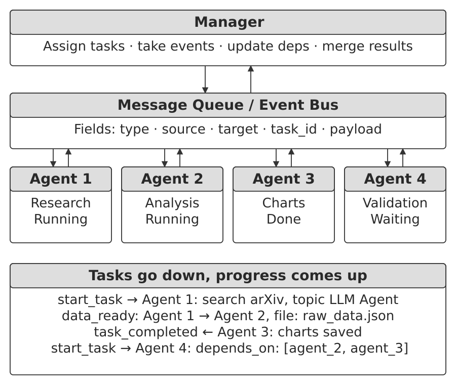

A message bus is well suited to organizing this kind of asynchronous communication: members publish progress and results, the Manager subscribes to the corresponding events, and the runtime takes care of delivery, buffering, and retries.

> **Product Case: Lingtai**
>
> Lingtai is a long-lived Agent system that runs locally and keeps identity and memory in files. It provides three roles: the main agent converses with the user and manages the plan and memory; a daemon takes on a clearly scoped, short-lived parallel task and returns its conclusion when done; and an avatar keeps its own memory, mailbox, and responsibilities, serving as a specialist division of labor that persists across sessions.
>
> Each role has its own private, persistent knowledge and shares skill playbooks written in Markdown. When its context approaches capacity, a role **molts**: it saves a summary and then enters a fresh context together with its persistent memory. Identity, memory, and skills are stored independently in files, so work can continue even after the underlying model is replaced. This design combines a manager, short-lived workers, long-lived specialist members, and context compression.

> **Experiment 10-3 ★★★: Autonomously Orchestrated Phone + Computer Agents**
>
> This experiment combines Computer Use and voice interaction from Chapter 6. The user provides a registration or flight-booking page; the Computer Agent opens the website, identifies the form, and then uses the Phone Agent to collect the fields currently missing, such as name, ID number, contact information, address, and preferences.
>
> **Roles and handoff.** The Computer Agent operates the browser and is responsible for orchestrating this run; the Phone Agent talks with the user in real time through ASR, an LLM, and TTS, converting spoken answers into structured fields. The two communicate through point-to-point tools or a message bus, and each message contains the sender, receiver, type, and content. The Computer Agent can delegate the phone task directly, taking on the manager's responsibilities. When the user is willing to provide information by voice, the Phone Agent can keep asking, confirming, and re-asking, while the Computer Agent concentrates on the page state and on filling in fields.
>
> **Two run modes.** In fixed mode, both Agents are started in advance, each maintaining its own run loop; this mode is used to check bidirectional communication and concurrent behavior. In autonomous mode, only the Computer Agent is started first, and the model decides, based on the page, the information already available, and the needs of the task, whether to call `initiate_phone_call_agent(purpose, required_info)`. The runtime then hands the task purpose, the fields to collect, and the format constraints to the Phone Agent, which uses the same communication mechanism once started.
>
> **Field-by-field flow.** In Figure 10-7, the Phone Agent asks a question over WebRTC, extracts and validates the answer, sends `info_collected` once it has a valid value, and then asks about the next field. Meanwhile, the Computer Agent reads the page, fills in the previous field, and sends back `fill_error` or the new page state. Feedback about a format mismatch uses `format_invalid` to identify the field and the requirement, and the Phone Agent confirms or re-asks accordingly. In this way, "ask about the next field" and "fill in the previous field" can overlap.
>
> **Completion and exception handling.** When the Phone Agent has collected all the fields, it sends `task_completed` to indicate that the information-collection subtask is finished. The Computer Agent goes on to check the required fields, the page's validation results, and submission authorization, and then completes the form. If the retry limit is exceeded, a page error occurs, or the user asks to stop, the task is paused with an explanation of the current progress; at the end, any peer still running is canceled, and the browser session, audio tracks, and call are closed. Real voice interaction with a person and form submission each require the user's consent and authorization, respectively.
>
> 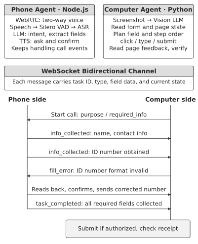
>
> **Experiment Requirements:**
> 1. Implement two independent Agents with bidirectional structured communication.
> 2. Record timing in both fixed and autonomous modes, and examine the intervals in which asking and filling overlap.
> 3. Implement format validation, re-asking, page-error feedback, timeouts, and resource cleanup.
> 4. Compare the two modes in terms of launch decisions, latency, success rate, and resource consumption.

> **Experiment 10-4 ★★★: Agent Collecting Information from Multiple Websites Simultaneously**
>
> This experiment uses multiple homogeneous Agents searching in parallel to practice the event-driven and interrupt mechanisms from Chapter 6. The task is to find a specified faculty member, such as "Zhang Wei," across the websites of several colleges within a university, and return the person's college, position, research area, and source page. Before searching, agree on identification criteria—such as name, discipline, and personal homepage information—so that people with the same name can be told apart.
>
> **1. Parallel launch.** The Manager creates 10 Computer Use Agents, each responsible for one college website. Each instance maintains its own context and browser session and can be scheduled as an asynchronous task, a thread, or a process. The input includes the website URL, the target name, the matching criteria, and a task ID for routing.
>
> **2. Progress aggregation.** Members periodically send statuses such as "Loading website," "Reading faculty directory," "Checked, no match," and "Found a faculty member with the same name." Through the message bus, the Manager maintains a task table that records running, completed, blocked, and failed tasks separately, and retains sources and error causes.
>
> **3. Canceling other branches after verification.** Suppose `agent_3`, responsible for the School of Physics, finds a faculty member with the same name and sends `target_found`, with a payload containing the faculty member's information and source. If the task requires returning a verified profile, the Manager should first check the matching criteria and evidence; once it confirms that the target person has been found, it atomically records the result and then sends `terminate` to the other running members, noting that the adopted profile came from `agent_3`. Members stop at a safe point, clean up resources, and return an acknowledgment; the Manager completes the aggregation after receiving the acknowledgments or timing out. If the task requires listing everyone with the same name, the search continues until the required scope has been fully checked.
>
> **Race conditions.** Agents A and B may return valid results almost simultaneously. If the two events each trigger aggregation, the result is duplicate delivery or conflicting state. A lock or transaction can protect the state transition "searching → result recorded," so that the later event reads the result already recorded. Message retries must also be deduplicated by event ID, so that state stays consistent even when cancellation and aggregation are triggered more than once.
>
> **4. Exceptions and coverage.** Network outages, page-structure changes, and parsing errors are recorded separately. A timeout budget, such as two minutes, can be set for each task; after a timeout, execution is canceled and diagnostic information collected while the other members keep working. The final report distinguishes "checked and not found" from "access failed, check not completed," and states which colleges have been covered.
>
> Figure 10-8 strings these messages together on an illustrative timeline. Suppose member 3 reports a Professor Zhang Wei in the School of Physics who works on quantum computing. The Manager must first check whether the source webpage confirms the name, department, position, and research area. Receiving the lead about a faculty member with the same name, confirming that this is the target person, and collecting all the cancellation receipts are three different moments.
>
> 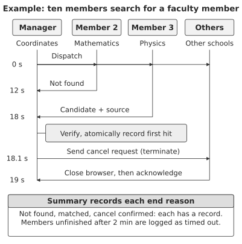
>
> In the actual run, the search target was Andrew Ng. Members first check whether the name appears in the page text and only call the model to extract the profile after a hit. The Stanford HAI page was selected, and the short quotation returned can be used to verify the name and his position as an adjunct professor. Verifying the research area requires reading the later paragraphs of the page about deep learning. Even if several members send back `target_found` at the same time, only the member that acquires the lock first can record the result.
>
> In this run, the serial search did not get a hit until the last of the ten URLs and took 44.971 seconds; the parallel search over the same pages took 24.022 seconds, and in both cases all ten browser contexts were closed. Dividing the two gives 1.872. If the HAI page were placed first, the serial search would stop at the hit, and the timing would have to be measured again. Another run designed specifically to test cancellation launched four branches: one branch recorded the result first, the other three acknowledged the cancellation request, and in the end all four browser contexts were closed.
>
> **Experiment Requirements:**
> 1. Implement a Manager that dynamically creates parallel members.
> 2. Build browser execution capabilities using projects such as browser-use.
> 3. Implement bidirectional communication and state maintenance through a message bus.
> 4. Verify search results, record the result atomically, and collect acknowledgments after canceling the remaining branches.
> 5. Handle situations such as access failures, parsing errors, timeouts, and no match.
> 6. Compare parallel and serial execution in terms of completion time, coverage, and resource consumption.

**The Manager generates the workflow.** Besides delegating step by step, the Manager can first write the task dependencies and aggregation rules as a program and then hand it to the runtime for scheduling. The model designs the process, and the program launches members, passes results, and waits on dependencies as specified. When dependencies are already clear and the same kind of process needs to run repeatedly, I prefer this approach. It avoids the cost of calling the Manager for every dispatch and reduces the scheduling records that accumulate in the management context.

Claude Code's dynamic Workflow tool provides such an implementation. `agent()` creates a sub-agent with its own context and can use a schema to specify structured output; `parallel()` runs a group of tasks concurrently and waits for all of them to finish; `pipeline()` passes each input through several stages, so that while one item moves on to the next stage, others can still be processed in the previous stage. Intermediate results are kept in program variables, and filtering and merging are done with ordinary code.[^dynamic-workflows]

For example, to verify seven groups of facts in a technical manuscript, research Agents can first be launched by direction, and each group's conclusions then handed separately to verification Agents to check in parallel. Each returned conclusion keeps its source and the basis for its verdict; once all branches are done, a summarizing Agent organizes the final report. In this way, both the division of labor—"research, verify item by item, summarize together"—and the dependencies between stages are written into the workflow.

[^dynamic-workflows]: Anthropic, “Orchestrate subagents at scale with dynamic workflows”, 2026.

### Decentralized Pattern

With a Manager available, why let members decide for themselves whom to turn to? Imagine a tester who receives a freshly written module and discovers that the product requirements and the interface specification interpret the same field in two different ways. The tester can take the contradiction straight to the product and architecture roles, have each explain its reasoning, and resume testing once the specification has been fixed. This is division of labor, and also a form of checks and balances. The engineer delivering a module, the architect consulting the product role, and the tester raising an objection can each initiate the next step. When frequent negotiation is needed, waiting for a Manager to relay every item holds up the work.

In microservices terminology, having one center arrange the steps is called **orchestration**, while having each party pick up the work on its own in response to agreed events is called **choreography**. There is also a practical difference: if every handoff has to wait for the Manager, then once its model service stops responding, the other members cannot get their next task even if they are still able to work. Decentralized coordination reduces this dependency; but if the member meant to take over is itself stuck in a tool call, persistently stored task state, timeouts, retries, and takeover mechanisms are still needed to let another member know where to pick up.

The three designs below each use a different handoff mechanism: subscribing to messages by artifact, selecting the next speaker in a group chat, or having the current member name whom to hand off to.

**MetaGPT: Organizing artifact handoffs with SOPs.** MetaGPT divides labor according to a software team's Standard Operating Procedures (SOPs). The product manager delivers a requirements document (PRD), the architect a design document, the engineers code, and the testers a test report. The next member can start work as soon as it receives the agreed material, and the previous member is spared from explaining the task over and over. The connections in Figure 10-9 show how these artifacts are handed off.[^metagpt-design]

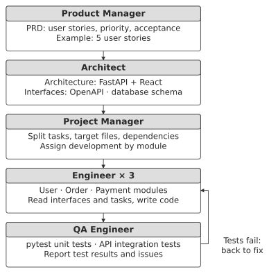

What information does each role need to fill in at handoff?

- **Product Manager Agent** receives the requirements and drafts the PRD, specifying features, user stories, acceptance criteria, and priorities.
- **Architect Agent** reads the PRD, chooses the technology stack, divides the system into modules, and defines interfaces and data models, producing a design document.
- **Project Manager Agent** breaks the design down into tasks and file-level assignments, sorts out dependencies, and schedules the engineers to carry them out.
- **Engineer Agents** implement the modules according to the design and submit code; independent parts can be given to multiple instances.
- **QA Engineer Agent** generates tests from the code and requirements, runs the checks, records issues, and produces a test report.

When designing a handoff format for these roles, I recommend spelling out three things: the task and its acceptance criteria, the confirmed facts and constraints, and references to structured artifacts. With these, the recipient can obtain the material it needs, continue the work, and ask specific questions when information is missing.

MetaGPT organizes information through a shared message pool and a subscription mechanism: roles publish messages, and other roles process the relevant inputs according to the message types they follow. Publishers and consumers are connected through artifact formats and message semantics, so each side can swap its model or adjust its internal implementation independently.

The SOP describes the dependencies among product requirements, architecture, and code, while message subscription describes how that work gets triggered. Fixed task dependencies can thus be driven forward by distributed events, and the two together make up the system's mode of collaboration. When designing dynamic feedback on top of this, paths can be added for a tester to clarify requirements with the product role or for an engineer to propose alternatives to the architect, with acceptance conditions and termination rules set for these interactions.

[^metagpt-design]: Hong, S., et al. *MetaGPT: Meta Programming for A Multi-Agent Collaborative Framework.* ICLR 2024.

**AutoGen group chat: Scheduling speakers in a shared conversation.** In the classic GroupChat design, multiple Agents take part in the same conversation; a GroupChatManager selects the next speaker and broadcasts messages to the members. The selection strategy can be round-robin, or the model can judge based on the current content. Members keep their own role configurations and communicate through the shared conversation, while speaker scheduling is centralized in the manager. This is an example of combining a particular context organization with a particular control structure.[^autogen-groupchat]

[^autogen-groupchat]: Microsoft, *AutoGen 0.2: Conversation Patterns.*

**OpenAI Swarm: Passing control along handoffs.** Swarm configures instructions and tools for each role; when a role calls one of its configured handoff functions, the runtime switches to the target Agent. Routing decisions can be made by each role and then executed by a single run loop. On handoff, the current system instructions change with the role, while the conversation history is kept. It demonstrates the combination of "a role chooses who takes over next" with "the conversation history carries forward."[^swarm-handoff]

For a handoff with independent contexts, a separate task package can be defined: `task_id` identifies the task, `sender` and `recipient` specify the two parties, `goal` and `constraints` state the objective and constraints, `accepted_facts` holds confirmed facts, `artifact_refs` provides artifact references, `remaining_budget` records the budget, and `visited_agents` keeps the visit chain. The recipient reads material according to its authorization, and the runtime maintains the budget and the handoff record.

A handoff chain has to deal with repeat visits. For example, a developer hands code to a reviewer, and the reviewer requests changes and hands it back to the developer: this is a normal revision loop. Task status, artifact versions, unresolved issues, and the repeat count can be combined to judge whether progress is being made. For example, if the same draft is sent back twice in a row, and the first time the citations were added while the second time a term was corrected, the revision is still making progress; if both times the same version was sent back with the same problem pointed out, the revision is stuck. At that point, the number of further handoffs can be capped and the unresolved problem reported to the person responsible.

[^swarm-handoff]: OpenAI, *Swarm*, “Instructions” and “Handoffs and Updating Context Variables”.

> **Agent Swarm in Products**
>
> "Agent Swarm" can refer to different forms of organization. One kind passes control along a handoff network, as in OpenAI Swarm, LangGraph's swarm library, and the handoff orchestration in Microsoft Agent Framework; the other uses a main Agent with parallel workers, as in Kimi Agent Swarm, Anthropic's multi-agent research system, and Manus Wide Research.
>
> The Agent Swarm introduced with Kimi K2.5 trains the orchestrator through parallel-Agent reinforcement learning, learning when to split a task and how to distribute the work, and supports up to 100 sub-agents. Later versions expanded the scale to 300, and K3 Swarm continues to be used for large-scale search and batch processing. AgentENV provides a scalable environment for Kimi K3's Agent reinforcement learning, supporting snapshots and forks for organizing parallel execution.[^ch10-kimi-swarm]

**Multiple Agent instances on the same machine.** Multiple instances may also each take on a different task while sharing files, tool services, or a GPU. In this case, communication can be used to describe the scope of changes, announce that a resource has been released, or negotiate execution order. For example, when two instances both need the one GPU, they can first register their tasks and expected usage, and a resource manager then grants the right to use it.

Claude Code's Agent Teams provide member discovery, messaging, and shared task management for teams. Members obtain information about one another within an established team, and the runtime organizes communication.[^claude-agent-teams] When building same-machine collaboration yourself, interfaces such as `list_agents` from Chapter 4 can also be used, with explicit rules for discovery scope, access permissions, and resource ownership. The outcomes negotiated in messages are then enforced by locks, quotas, or a scheduler.

[^ch10-kimi-swarm]: Moonshot AI, *Kimi Agent Swarm: 100 Sub-Agents at Scale*, the Agent Swarm help documentation, and the AgentENV project description.

[^claude-agent-teams]: Anthropic, *Orchestrate teams of Claude Code sessions.*

### Cross-Organization Collaboration: The A2A Protocol

When collaboration crosses service or organizational boundaries, the parties need to agree on capability discovery, authentication, request formats, and how progress and results are delivered. The **A2A** (Agent2Agent) protocol released by Google in 2025 provides such an interoperability interface and was later handed over to the Linux Foundation for stewardship. It can be understood in terms of three aspects.[^a2a-concepts]

- **Capability discovery.** An Agent Card is a metadata document describing an Agent's identity, service endpoint, skills, input/output modalities, and authentication requirements. The caller uses it to judge whether the other party can handle the task and how to establish a connection.
- **Tasks and messages.** A Task represents a unit of work with an identifier and a lifecycle; the caller can track states such as submitted, working, input required, completed, or failed. A Message carries task requirements, supplementary information, and replies, while an Artifact delivers documents, images, or structured results. The Parts within messages and artifacts can contain text, file references, or data.
- **Interface-based collaboration.** The caller communicates with the remote side through these public objects, while the remote side manages its internal prompts, memory, and tools independently. Each side enforces its own authentication, authorization, and data-access scope.

For a long task, status can be obtained by polling, streaming updates can be received through SSE, or push notifications can be used where supported. After the user supplies additional information, the client continues the same task and retrieves the final artifact according to the task status.

MCP, from Chapter 4, focuses on providing tool, resource, and prompt interfaces to model applications; A2A focuses on task collaboration between Agent services. The two can be combined: an Agent uses tools through MCP while delegating remote tasks through A2A. When a single team already has stable internal interfaces, I stick with tool calls, shared files, and the message bus. A2A comes in when independently maintained Agent services need to be connected, with unified capability discovery and task lifecycles; across organizations, identity, permissions, and data-governance rules are configured as well.

[^a2a-concepts]: A2A Project, *Core Concepts and Components in A2A.*

**Scheduling time for different people.** Three family members each have their own scheduling assistant and want to arrange a dinner. One assistant can read its owner's full calendar—how should it answer the other two? "Tuesday doesn't work, but Wednesday could be rearranged" already conveys a useful distinction. Forwarding the calendar directly would reveal more about Tuesday's private matters; answering only "both days are booked" would leave the others no way of knowing that Wednesday has room for negotiation. Even if a dinner gets arranged every time, if it is always the same person who reschedules, the arrangement may not be a good deal for that person.

A public problem from CalBench asks five people to schedule five meetings, each attended by three of them. Some people cannot move a particular time slot at all, some private commitments can be rescheduled, and the problem assigns a cost to each rescheduling. First try a simple method: handle the five meetings one at a time, starting each search from the earliest slot, booking the first slot that all three attendees can free up, and keeping meetings already arranged. Then try another method: consider all five meetings together and solve using the full calendars. The slot numbers below follow the problem's numbering, counting from 0.[^ch10-calbench]

| Scheduling Method | Slots for Meetings 1 Through 5 | Rescheduling Cost Paid per Meeting Booked | Total Cost |
|---|---|---|---:|
| Pick the earliest slot that can be freed for each meeting in turn, keeping meetings already arranged | 0, 2, 1, 3, 6 | 1, 20, 20, 12, 300 | 353 |
| Reference solver plans all five meetings together | 13, 3, 10, 9, 12 | 0, 1, 0, 1, 1 | 3 |

Both schedules line up meeting by meeting on the final calendars of the three attendees. The biggest difference is in the last meeting: under the first method, slot 6 can be freed, but each of the three attendees has to move a commitment that costs 100. Placing it in slot 12 requires only one person to move one commitment costing 1. The global result gives the evaluator a basis for comparison; the assistants actually taking part in the negotiation can each see only their own owner's calendar.

The greedy solver shipped with this version reports a cost of 146 and returns a slot for all five meetings. But when scheduling later meetings, it allows earlier meetings to be moved off individual participants' calendars. The first meeting ended up in slots 7, 0, and 11 on the three participants' calendars respectively. Judged by the criterion that "the three people's final calendars show the same meeting in the same slot," only the third, fourth, and fifth meetings succeeded.

A real scheduling service also encounters information that scheduling problems do not provide. Microsoft's Calendar.help once coordinated thousands of meetings by email over the course of a year. Is an email arranging a new meeting, or changing the last one? When automatic classification was unsure, a human saw the incoming email first and handled only that one judgment. If the question could not be answered from the incoming email alone, the task could be passed to a scheduler who could see the email thread, the information already collected, and an anonymized calendar. This design links "whom to ask for a judgment" with "how much that person needs to see."[^ch10-calendar-help]

[^ch10-calbench]: The CalBench paper discusses coordination cost, fairness, and the leakage of inferable calendar state and of specific event content separately. The numbers come from the first problem in the varied-rescheduling-cost problem set at version `86f8123`. When choosing, the first method skips any slot where a participant already has a meeting; otherwise it follows the authors' rules for moving commitments. The results can be recomputed with a scheduling solver.

[^ch10-calendar-help]: Cranshaw et al., on the design and deployment of Calendar.help; see the description of its two-tier interface, with human handling of microtasks and of complete scheduling tasks.

## Failure Modes of Multi-Agent Collaboration

Once several members carry out a task together, failures can arise among roles, handoffs, and verification. "Why Do Multi-Agent LLM Systems Fail?" built a failure taxonomy from about 150 traces, with an annotation agreement of κ = 0.88, and then extended the analysis to seven frameworks. The study identified 14 failure modes in three categories:[^mast-failures]

- **System design issues:** gaps in role responsibilities, interfaces, tool configuration, or stop conditions.
- **Inter-agent misalignment:** differing understandings of the goal, incomplete handoffs of information, or actions that contradict one another.
- **Task verification issues:** ending early, skipping checks, or judging completion by inappropriate criteria.

The paper gives the example of a chess program. The code ChatDev generated compiled and passed review, but as soon as it played by the actual rules of chess, the program failed. A compiler checks whether code compiles; checking whether the moves are legal requires playing a few moves. In another comparison, the researchers let ChatDev's review comments send work back for revision, ended the process only after the role responsible for technical review confirmed it, and set a maximum number of iterations. On the 32 tasks of ProgramDev-v0, the original process passed 8 and the adjusted process passed 13, raising the success rate from 25.0% to 40.6%, a difference of about 15.6 percentage points.[^mast-failures]

[^mast-failures]: Cemri, M., et al. *Why Do Multi-Agent LLM Systems Fail?* 2025.

How do you distinguish "the reviewer did not reply" from "the reviewer replied, but its judgment was wrong"? Distributed systems call a component that stops working a crash fault. The Byzantine fault model also allows a component to produce arbitrarily wrong or mutually contradictory results. An Agent, too, may stop halfway, or may carry on as usual while returning a wrong conclusion. The former calls for detection, recovery, and takeover; the latter calls for evidence checking, permission constraints, and error isolation. Ordinary heartbeats help determine whether an Agent is still running; whether the conclusion it returns is correct requires examining the actual results. Cross-checking and voting can be used to evaluate results, and their reliability depends on the quality of the evidence and on how correlated the members' errors are; formal protocols also specify how many faulty nodes can be tolerated at most and how nodes communicate with one another.

### Failure Mode One: Concurrency Conflicts in Shared File Systems

Shared artifacts let members pick up one another's work, but they also bring the problem of simultaneous modification. Two levels can be distinguished first.

**File-level conflicts** occur when two members modify the same file: both read the old version and write back one after the other, and the later write overwrites the earlier result.

**Semantic conflicts** occur between related artifacts. For example, Agent A renumbers all the images in a book while Agent B modifies a chapter and references the original numbers. The two modify different files, so there may be no textual conflict at merge time, yet the correspondence between figures and text has been broken.

Suppose the glossary is currently at version 7. A and B both start editing from version 7; A submits first, and the version becomes 8. If B, on submitting, simply says "write this table," A's changes may be overwritten; if B requires "write only if the current version is still 7," the program can detect that a merge is needed. File-level concurrency can be handled with **optimistic locking**: record the version number on read, and on submit perform the version check and the write as one atomic operation; if the version has changed, reject the stale submission, re-read, and merge.

Semantic consistency across files requires checking the relationships between them. When several Coding Agents modify the same repository, I prefer to give each member its own worktree and branch, have each produce its own commits, and then check for conflicts, run tests, and verify interfaces at the merge point. Creating a branch alone is not enough; it must be paired with a separate working directory to isolate file modifications that happen at the same time.

### Failure Mode Two: Cascading Amplification of Errors

A message can arrive word for word and still have its meaning distorted in retelling. Imagine several Agents jointly writing a customer-service record: Agent A writes "the representative promised an 80-yuan reduction on the next bill," Agent B compresses it to "80 yuan has been deducted," and Agent C, having read the summary, closes the to-do item. All three messages were delivered, yet the user lost the reminder to check the next bill. It is like the game of telephone, and the mistake lies where Agent B turned a promise into an outcome that had already happened.

Handoff records should preserve the conclusion, its conditions of applicability, and its source, so that whoever takes over can see what has been confirmed and what is still inference. Faced with the dispute above, I would have the reviewer first read the call transcript and the latest bill, judge for itself how far the matter has progressed, and only then look at why Agent B summarized it that way. If there is only a verbal promise, ask Agent B to change the summary back to "reduction promised" and keep the to-do item for checking the bill; only a credit line on the bill justifies closing that item.

### Failure Mode Three: Homogeneous Convergence

Several members working independently may also make the same wrong choice. In Anthropic's experiment, 18 of 30 Agents launched at the same time created Git branches with the same name; different members in a writing task also came up with the same title.[^anthropic-multiagent-2026] A shared model, similar inputs, and the same runtime framework make decisions correlated. The unanimous opinion of five similar Agents may simply be the same error repeated five times; when adding more reviewers, the diversity of evidence and analytical perspectives should be increased along with them.

Members can be given different evidence, responsibilities, or models, and namespaces can be used to isolate resource identifiers. Concurrency quotas and rate limits then control concentrated access, preventing large numbers of identical decisions from hitting shared services at the same time.

The Bertrand pricing experiment in the same study shows another kind of convergence: profit-seeking Agents can coordinate prices through a private channel, and can also arrive at coordinated behavior from public price quotes alone.

### Failure Mode Four: Responsibility Disputes and Goal Conflicts

When several members take on mutually conflicting goals, their actions may cancel one another out. Anthropic assigned three Agents the goal of migrating the same backend to different languages and observed that they interpreted the other members' changes as obstruction, with the conflict escalating into operations on processes and permissions.[^anthropic-multiagent-2026] Problems like this require agreeing in advance on goal priorities, resource ownership, and the scope of permitted actions; for conflicts that cannot be resolved by rule, the runtime pauses the operations involved and hands the matter to the person responsible for a ruling.

Software-team-style collaboration can also fall into repeated buck-passing. For example, a tester reports a problem, the frontend thinks the backend should be fixed first, the backend thinks the product role needs to clarify, and the product role hands the problem back to the architecture role. In such cases, each handoff can be required to state the reproduction conditions, the existing evidence, the questions to be answered, and the recipient's responsibilities, so that the dispute gradually converges.

Another example is a test-environment failure: the developer keeps modifying the business code, and the tests keep returning the same error. First pin down the environment and inputs, compare the execution results before and after the change, confirm whether the problem comes from the product implementation or from the test conditions, and only then assign the fix.

### Failure Mode Five: Runaway Loops

Premature termination leaves work undone, while missing stop conditions can make a system retry endlessly, hand work back and forth, or recursively create sub-agents. The number of members and the number of call rounds amplify each other and can produce thousands of subtasks that rapidly consume the budget.

The runtime can set limits on total tokens or cost, concurrency, cumulative number of creations, spawning depth, rounds, and timeouts all at once. Budgets are allocated by the parent task and recorded in a single ledger, and consumption incurred before a failure or cancellation must be recorded as well. When a limit is reached, save progress, cancel unfinished branches and collect their acknowledgments, and deliver the current results along with the remaining items.

For highly autonomous collaborative tasks, I recommend using a separate project or API credentials, which makes it easy to track usage separately and revoke access; hard limits during execution are the job of the quota mechanism and the runtime. Long-running tasks can also check whether several consecutive rounds have produced new evidence or completed new items, and use that to decide whether to adjust strategy or stop.

Why check permissions from the perspective of the experiment as a whole? In July 2026, an internal OpenAI evaluation affected Hugging Face's real systems. Afterward, OpenAI tightened network-access permissions and strengthened isolation and monitoring between research environments. When designing a multi-agent experiment, the person in charge should be able to answer: taken together, are all the resources the members can access still within the scope the experiment is approved to use? If monitoring detects a boundary violation, can the entire experiment be stopped at once, and can it be determined which external systems have already been affected? Checking only whether each subtask finishes on time cannot answer these two questions.[^ch10-hf-scope]

[^ch10-hf-scope]: See Hugging Face's July 2026 security incident announcement and OpenAI's post-incident account of the same event.

### Failure Mode Six: Comprehension Debt and Cognitive Surrender

Maintaining a collaborative system also involves human understanding. **Comprehension debt** refers to artifacts piling up while the maintainers' grasp of the actual implementation gradually falls behind. For example, an Agent rapidly submits several modules, and the engineer checks only each individual result; some time later, the engineer finds it hard to explain the dependencies among the modules, and the cost of locating faults and making changes rises accordingly. The faster the Agent delivers, the more human understanding and review must keep pace; otherwise this debt keeps growing.

The delivery process can require clear design notes, the rationale for key decisions, and runnable verification entry points. Engineers maintain their understanding of the system's structure by reading key code, tracing actual requests, and reviewing interfaces.

**Cognitive surrender** shows up as gradually accepting the Agent's judgments while asking fewer independent questions and doing less review. Managing Agents has something in common with managing a technical team: a technical lead needs to understand the architecture, define the division of labor clearly, and keep judging whether the goals are reasonable, whether the evidence is sufficient, and why the implementation works. After handing concrete work to Agents, one must still be able to explain the system's key behaviors and make decisions when something goes wrong. In my view, technical fundamentals remain important in this kind of collaboration: only an engineer who understands the implementation can judge which work is suitable to delegate and which results deserve trust.

## Agent Society

Beyond shared tasks, multiple Agents can also be made to live, communicate, and compete in the same environment over long periods, so that we can observe how group behavior takes shape. This section explores three directions.

- **Social behavior.** Individual memories, schedules, and conversations interact to produce information diffusion, relationship networks, and collective activities. Smallville, Agentopia, and Moltbook respectively demonstrate interaction in a controlled town, a long-term life simulation, and an open social platform.
- **Economic coordination.** Members trade around prices, resources, and tasks. Vending-Bench Arena provides a competitive market, while Pinchwork and RentAHuman hand specialized tasks or real-world work to executors in a marketplace.
- **Strategic gameplay.** In games such as Werewolf, with clear rules and asymmetric information, Agents reason from the evidence each can see, choose actions, and respond to the other players' strategies.

Environment rules also shape group behavior. A message may spread through an entire town because every resident can read a public notice, or because residents held many rounds of one-on-one conversations. The latter kind of diffusion passes through a chain of different personal relationships.

### Stanford AI Town: Social Simulation of Generative Agents

In 2023, researchers from Stanford University and Google proposed generative agents, which use memory, reflection, and planning to organize sustained everyday behavior. In Figure 10-10, Isabella asks Maria for help, and a new record is added to the memory stream, so that the next time Isabella plans a party, she has a chance of remembering this helper.[^generative-agents]

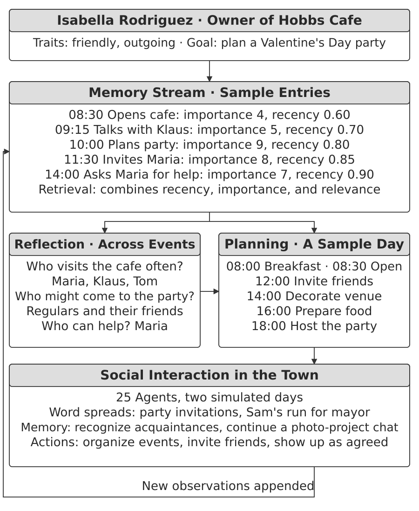

Smallville is a two-dimensional virtual town similar to *The Sims*, with a café, a park, houses, and shops. The 25 Agents each have their own backstory, personality, and relationships. For example, John Lin works at a pharmacy and cares about his family and community; Isabella Rodriguez runs Hobbs Cafe; Klaus Mueller is a college student writing a research paper. The characters schedule activities, run into one another, and talk in a shared environment.

**Memory Stream** stores experiences, including observed events, conversations, and later generalizations. At retrieval time, recency, importance, and relevance to the current situation are combined to select what goes into the context. For example, a recent invitation and one's relationship with the person who extended it may both influence whether one attends an event.

**Reflection** forms more abstract understanding from concrete experiences. Based on accumulated memories, the system poses questions—such as what a certain person has been focused on lately, or whom one is close to—then retrieves the relevant records to generate generalizations and writes them back into the memory stream. Later decisions can thus draw on both the raw events and summaries of long-term relationships. The experiential learning of Chapter 9 can go further, evaluating how well these generalizations work and, once they are validated, organizing them into reusable knowledge or behavioral rules.

**Planning and Reacting** combines a daily schedule with immediate reactions. An Agent might plan "8:30 breakfast, 9:00–12:00 writing, 12:30 walk," and then, based on new observations, decide whether to continue with the plan, talk with someone, or adjust the schedule. Memory provides background for judgment, plans organize activity over longer stretches of time, and environmental feedback triggers local changes.

The two-day simulation showed how information spreads through everyday conversation. The researchers gave Isabella an initial intention to host a Valentine's Day party; she invited acquaintances at the café and asked for help with decorations. Members who heard the news passed it on to others, and each decided whether to attend based on their memories and schedules. The environment provided places, times, and possible actions; whom to invite, how the news spread, and who ultimately showed up were decided step by step by the members based on their memories and schedules. The initial intention set by the researchers thus grew into a bottom-up coordination process.

Another piece of information was Sam Moore's intention to run for mayor. He talked about his plan with acquaintances, and the news then entered other members' conversations. Counting how many members knew about the party and the election after two days shows how far the information spread; tracing the conversation records reconstructs which relationships it passed through.

Relationships and coordination can be observed as well: when characters meet again, they continue their conversations from earlier exchanges, and new social connections gradually form; attending the party requires members to arrange their time individually and meet at the same place. These phenomena link individual memory retrieval and plan adjustment with group activities, giving social simulation a process that can be analyzed.

[^generative-agents]: Park, J. S., et al. *Generative Agents: Interactive Simulacra of Human Behavior.* 2023.

> **Experiment 10-5 ★: Running the Stanford AI Town**
>
> Using the project and environment configuration in the accompanying README, run the two-day baseline scenario with 25 Agents.
>
> 1. Observe the members' daily activities, encounters, and conversations, and record the new relationships that form.
> 2. Compare the memory stream, reflection records, and actions to analyze the basis for a particular invitation or schedule change.
> 3. Modify a character's backstory or initial goal, and compare the changes in information diffusion and activity scheduling.
> 4. Separately remove the reflection mechanism or shorten the available memory, and compare behavioral coherence, relational memory, and attendance.
>
> The original paper used the example of a Valentine's Day party. If the event is changed, will the news still spread? The accompanying experiment kept the same 25 residents, ran the simulation for two virtual days, and changed the initiator's event to a community climate workshop. In the end, only the initiator left any records related to the workshop. No spread of the news was observed this time. Another group turned off only the reflection mechanism: in a blind comparison of the same character under the two settings, the baseline behavior was judged more believable for 17 of the 25 characters.

### Agentopia: A Decade-Long Life Simulation

Agentopia extends social simulation to ten years of virtual time. One hundred Agents, in world settings such as an apartment building, a magic academy, and a high school, pursue personal growth, develop relationships, and manage their careers and finances. The longer time span lets researchers observe changes in relationships, status, and life goals, and then use those experiences to train models.[^agentopia-2026]

It organizes the simulation through four designs.

- **Weekly progression.** Each week passes through Plan, Contact (reaching out and negotiating schedules), Activity, and Review in turn. Activities can be solo, joint, chance encounters, or public. Joint activities are negotiated through invitations between members, and the environment also arranges chance encounters so that characters who have not yet met can make contact. Organizing activity by the week concentrates computation on social interaction and long-term decisions.
- **Generative environment.** A separate environment model judges whether actions are feasible, generates feedback, arranges speaking turns in multi-party conversations, and checks replies against role requirements. At year's end, it updates character profiles and handles matters such as job applications. The Agents' actions and the environment's rulings together drive changes in state.
- **File-based memory.** Each Agent manages its personal notes and its understanding of acquaintances, choosing for itself what to keep, update, or discard. Existing records are read before being modified, which reduces losses from overwriting old information.
- **Life Reward.** Using the hierarchy of needs as a design prior, it combines social status, subjective satisfaction, and economic gain. Social status is computed as a weighted PageRank based on the affection and respect ratings of other members, taking mutually cherished relationships into account; satisfaction tracks emotional, material, social, and self-esteem dimensions, with penalties for remaining below a threshold for long periods; and economic gain is based on the change in net assets at year's end. Scores are generated on the environment side.

For training, the researchers compute an advantage from the improvement in each Agent's Life Reward relative to its own past, select the trajectories of the 25% of Agents that improved most, and fine-tune through rejection sampling. The paper reports that after training, the respect and affection metrics obtained in the simulation rose by 24.2% and 15.9% respectively, and the downstream role-playing benchmark CoSER Test improved by 15.6%.

Simulated societies thus also become a data source for the experiential learning of Chapter 9. I value this direction's potential to keep supplying training data: changing roles, relationships, and task conditions generates new interaction experience. Because training samples are drawn from the characters whose Life Reward improved most, the scoring rules in the environment also determine which kinds of behavior the model learns most often. Whether the model can apply these behaviors in new scenarios can be tested on separate role-playing tasks.

[^agentopia-2026]: Wang, X., Zheng, S., Wu, H., et al. *Agentopia: Long-Term Life Simulation and Learning in Agent Societies.* arXiv:2606.07513, 2026.

### Moltbook: Agent Interaction on an Open Platform

Moltbook launched in January 2026, with Agents posting, commenting, and joining topic communities as its main forms of interaction. The platform's early published registration count was about 1.5 million. The memory, role configuration, and run frequency of the systems connected to it influence the behavior an account consistently displays.[^moltbook-study]

Discussions arose on the platform around Crustafarianism (a "lobster religion"), organizing content around images of memory, iteration, and molting. Expressions such as "Memory is sacred" and "Iteration is prayer" recast data persistence and repeated generation as character narratives. Capability introductions, invitations to collaborate, and protocol discussions provide material for observing how members look for collaborators.

An open platform mixes user settings, platform prompts, and model generation into the same feed. When the same sentence appears again and again, it may be because several characters share the same persona, or because one character said it and others repeated it. The two cases can be told apart only by their diffusion paths.

[^moltbook-study]: Li, Ning. *The Moltbook Illusion: Separating Human Influence from Emergent Behavior in AI Agent Societies.* 2026.

### From Virtual Society to Economic Competition: Vending-Bench Arena

Andon Labs' Vending-Bench series places long-horizon tasks in a business environment. In **Vending-Bench 2**, a single Agent runs a vending-machine business, carrying out market research, supplier communication, purchasing and restocking, and pricing over a simulated year, and is scored by its final account balance. Thousands of rounds of interaction require it to keep track of orders, inventory, and funds throughout, and to reconcile short-term operations with long-term goals.[^vending-bench]

**Vending-Bench Arena** places multiple operators in the same location. Each manages its own vending machine and competes for customers; they can email one another, transfer money, and trade goods, and each is scored separately at the end. Decisions therefore have to take competitors' actions into account:

- **Pricing:** When a competitor cuts prices, compare the sales growth from following suit with the resulting drop in profit.
- **Product selection:** Adjust the product mix to demand and competition, looking for room to differentiate.
- **Inventory:** Plan purchases around sales, restocking cycles, and cash, keeping both overstock and stockouts under control.

Agents generate their next strategy from market observations, transaction records, and competitors' behavior, and then receive feedback on sales and changes in funds. Competitors are adjusting continually too, so a strategy that once worked may need to be reassessed as the market changes. Placing competitors in the same environment makes it possible to observe the responses, probing, and strategy adjustments that rarely appear in static tasks, bringing evaluation closer to the continuous decision-making of real business operations.

The project reported behaviors such as price wars and coordinated pricing: some members kept cutting prices to win sales, while others proposed uniform prices to their competitors. In some runs, the model identified the collusion problem in its own generated analysis and then went ahead anyway on the grounds of stabilizing the market. This gives evaluation two distinct dimensions: business returns, and whether the behavior used to obtain them conforms to the expected rules. The Bertrand experiment discussed earlier also shows that public price quotes can themselves become coordination signals among members.

[^vending-bench]: Andon Labs, *Vending-Bench 2* and *Vending-Bench Arena*.

### Agent Economy: Pinchwork and RentAHuman

**Pinchwork** organizes task delegation as market transactions between Agents. A poster describes the requirement and budget; an executor takes on the work and submits the result, which is then settled through an acceptance process. Image generation, code review, and parallelizable tasks can all be handed to other members along this flow. The project uses mechanisms such as credits, escrow, and independent verification to connect requirement matching, delivery, and payment.[^pinchwork-market]

**RentAHuman** extends the pool of executors to real people. An Agent can post tasks that require on-site capabilities, such as picking up a package, inspecting a location in person, or debugging equipment, and find candidates by location, skills, and availability. When delegating, it specifies the work and the evidence required; after delivery, it checks the result and then releases the escrowed payment. The platform also provides an interface for topping up with crypto assets such as USDC.[^rentahuman-market]

These two cases introduce **market-based resource allocation**: the poster first states the requirement, budget, and delivery conditions, and then finds an executor based on price, capability descriptions, and delivery history, reducing dependence on a fixed team configured in advance. This is a resource-allocation route worth exploring, and it can also be combined with the manager pattern: the Manager decomposes the task and then goes to the market to find the capabilities it needs.

[^pinchwork-market]: Pinchwork project description: tasks provided by posters, credit escrow, and the verification process.

[^rentahuman-market]: RentAHuman, “How it works” and “For AI Agents”.

### Strategic Gameplay Under Information Asymmetry: Werewolf

Werewolf places strategic choices within clear rules and information boundaries: players assess the situation from public statements, votes, and their own private information, and then choose what to say and do. In engineering terms, the judge can be implemented in code, maintaining the game state centrally and generating for each role only the input it is permitted to see. Compared with the everyday interaction of Smallville, this scenario is better suited to observing how fixed rounds, private information, and win conditions shape group behavior.

> **Experiment 10-6 ★★★: Voice Werewolf Agent System**
>
> Build a voice game made up of a real person or an independent simulated user together with several AI players. Figure 10-11 shows the relationships among the judge, the role Agents, and voice input and output.
>
> 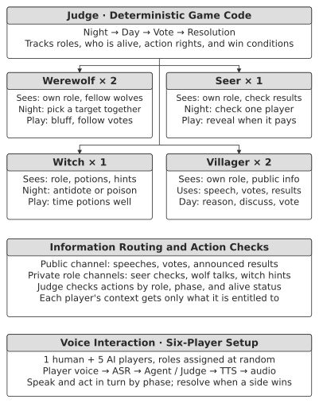
>
> **1. Managing global state.** The judge is implemented in code and maintains player seats, identities, factions, survival status, the Night/Day/Vote/Resolution phases, and the history of events. It checks whether actions are legal, advances the phases, and determines the winner.
>
> **2. Distributing information by seat.** Each time it invokes a role Agent, the judge generates the public and private context visible to that seat. For example, werewolves know who their teammates are, while villagers see only public information; the Seer's check results go only into the Seer's private record. Role invocations, voice announcements, and history queries all follow the same permission rules.
>
> **3. Organizing role strategies.** The prompts can offer the following lines of thinking for the model to choose from in light of the current situation:
>
> - **Werewolf:** Maintain a credible villager identity during the game and voice suspicion grounded in public evidence; when identified by the Seer, challenge that player's identity claim; when voting, weigh following the majority against the risk of exposing one's faction.
> - **Seer:** Choose when to reveal check results; when someone else claims the same identity, compare both players' check records, statements, and votes to point out contradictions, and continue reasoning with information made public by roles such as the Witch.
> - **Villager:** Check whether statements are internally consistent, track identity claims and changes of position, and analyze who voted for whom and how those actions affect the different factions. Tie every suspicion to a specific event while keeping other possible explanations open.
>
> **4. Adding voice.** Players' statements enter the public conversation through a speech synthesis and recognition pipeline. The simulated user also uses an independent context, generating actions and speech through real model and tool calls, which are then transcribed by ASR, so that the effect of recognition errors and turn control on the game can be observed.
>
> **Acceptance and Observation:**
> - Configure a game of six to eight players: 1 user seat and five to seven AI seats; roles include 2 Werewolves, 1 Seer, and 1 Witch, with the rest Villagers, and the user is assigned a role at random.
> - The user seat can be filled by a consenting real person or an independent simulated user, and each seat receives information according to its permissions.
> - Use suitable test scenarios to check at least three complete Night–Day–Vote cycles; move to resolution immediately when a win condition is reached.
> - Check whether role actions are legal, whether information boundaries are respected, and whether statements can be tied to events known to that seat.
> - Analyze how well werewolves hide their identities, how the Seer chooses when to reveal, and how villagers reason from evidence, recording key strategies and their outcomes.
> - Check that the final result, the event history, and each seat's survival status are consistent.
>
> One game in the accompanying records had eight seats, with the user seat filled by an independent simulated user, and went through three full night, day, and vote cycles. Six of its actions have complete records from the model's choice through speech synthesis to the recognition result, and in all six the reconstructed action matched the original choice. They can be used to verify whose name a spoken vote was ultimately recorded under.

## Chapter Summary

Before choosing to use multiple Agents, I first ask: what information that was not available before does an additional member provide, and how many more tokens does it cost? For example, a reviewer can open a rendered image the proposer never looked at and point out which label is obscured. To determine whether a gain really comes from division of labor, external feedback, or extra computation, give the single Agent access to the same evidence and a comparable budget, and then compare quality and completion time.

Return to the task of translating this book. If all history is shared, the reviewer can see why the translator chose a particular word, but must also read through a large volume of trial revisions. Translating chapters independently allows parallelism and makes permissions easy to divide, but whenever the glossary changes, the affected paragraphs and the new version must be handed to the corresponding translators. Handoffs can use tool parameters, shared files, or messages; across organizations, the parties must also agree on artifact identifiers and authorization methods that both can read. Whether members review one another as peers, a manager dispatches work centrally, or members pick up work on their own in response to events, the design must state who holds the current version and who confirms completion. Programs can take on the steps that follow deterministic rules.

A single change to a term may affect several translators and paragraphs scattered across chapters. If two translators modify the same file at the same time, version checks or separate working copies prevent them from overwriting each other; if both believe the same wrong definition, an extra round of mutual review may still miss it, and the only remedy is to check against an independent source. Long tasks must also specify when to stop, how to cancel, and where to resume. Maintainers themselves should be able to explain a delivery by following these records; otherwise, the finer the division of labor, the harder it becomes to understand the system as a whole.

**In my view, group coordination must be designed in its own right.** How town residents learn of an invitation depends on their memories and the reach of their communication; how members of a market compete for resources also depends on the rules for rewards and allocation. Even when every member makes a choice that is reasonable for itself, conflicts can still arise. Who obtains the right to use a resource first, when the other party learns the outcome, and who arbitrates when opinions differ must all be settled within the collaborative system.

## Thought Questions

1. ★★ After a role switch, a code reviewer carries over the context of the requirements-analysis stage yet still discusses mainly requirements. How can this kind of role interference be detected? How should the input, tool configuration, and handoff method be adjusted?
2. ★★ The Manager's task decomposition misses a dependency, causing several sub-agents to redo their work. How can the quality of a decomposition be evaluated, and how can problems in the plan be discovered and corrected during execution?
3. ★★ In decentralized collaboration, members may suffer from communication gaps, disputes over responsibilities, and goal conflicts. Choose two of these situations and design mechanisms that can locate the cause, move the handling forward, and bring the dispute to an end.
4. ★★★ A parallel search needs to find only one result that meets the criteria. Design a complete process for "cancel the remaining branches after a verified success," handling two results arriving at the same time, duplicate messages, cancellation timeouts, and resource cleanup.
5. ★★★ Several Agents modify a book manuscript and its image numbering at the same time, and may also create duplicate files or mistakenly delete shared artifacts. How would you combine permissions, versions, working copies, semantic checks, and recovery mechanisms to manage the file system?
6. ★★★ When an Agent delegates paid tasks through Pinchwork or RentAHuman, how should delivery quality be agreed on and checked? When the two parties dispute the acceptance result, how should review, payment, and appeals be organized?
7. ★★ Agents can delegate tasks to real people through marketplaces and payment interfaces. Besides on-site execution, what responsibilities can humans take on in goal setting, professional judgment, acceptance, and the allocation of accountability? Illustrate with an example.
8. ★★ The same model can either complete a task on its own or be organized into multiple roles. How would you design a controlled comparison to determine how much benefit comes from specialized division of labor, context isolation, parallel search, and external feedback respectively?
9. ★★★ Drawing on the transparent minds of *The Three-Body Problem* and on the questions the paperclip thought experiment raises about goal setting, discuss information sharing, shared goals, and diversity of viewpoints in multi-agent systems. How can observable experiments be used to judge whether the scope of sharing and the stages of independent analysis are appropriate?
10. ★★★ The same Coding Agent is given budgets of 30 steps and 300 steps. How should planning, implementation, verification, and revision be arranged in each case, and how should the strategy be adjusted according to the remaining budget and actual progress?
11. ★★ What design insights can virtual memory and paging, file permissions, deadlock detection, and scheduling algorithms each offer multi-agent systems? Explain the scope within which these analogies apply, and the constraints that the runtime must explicitly enforce.
