# Context Engineering

Chapter 1 compared context to an Agent's "current field of view for decision-making": every judgment the model makes rests on the information it receives at that moment. **Context engineering** is the work of selecting, organizing, and updating that information, which includes system instructions, tool definitions, user requests, message history, and task state. Before each model call, the Harness has to assemble the task background and the latest progress into an input. Figure 2-1 uses concrete content to show how the context window is composed.

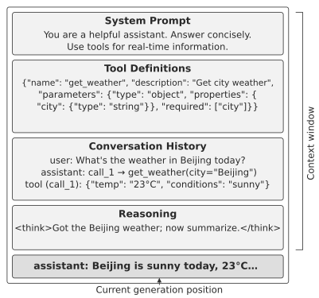

## Context: Putting Model Capability to Work on a Specific Task

Imagine an experienced engineer who has just joined a team. Their first assignment is "change the configuration according to our conventions." They know how to program, but they do not yet know which file is the real source of the configuration, which fields may be changed, or how to verify the result. Even with the entire codebase in hand, they might edit the wrong file. An Agent taking over an unfamiliar project lacks the same background.

Take the request "Help me fix this bug." A Coding Agent typically needs three kinds of background:

- **Live code context**: The directory structure, module responsibilities, core data structures, and coding standards. Suppose the change lands in an auto-generated configuration file: even if it works locally, the next generation run will overwrite it. Only by knowing which module generates the file can the Agent find the right place to make the change.
- **Process conventions**: The Git branching strategy, commit conventions, code review process, and CI/CD requirements. The Agent uses these to plan its edits, tests, and commits, while the runtime system carries out those operations according to its permissions.
- **Environment information**: The development setup, how to connect to the test database, how the test environment is deployed, and how API keys are managed. This information helps the Agent pick the correct runtime environment and understand how the local and test environments differ.

The project code and the test database both lie outside the model's context. In the auto-generated configuration example, the Agent learns where to start only after a search tool lets it read the generation script. **The quality of the context determines whether the model can bring its existing capabilities to bear on the problem at hand.** **For tasks that depend on a great deal of background information, a sufficiently capable model with complete and accurate context can outperform a stronger model that lacks the necessary material.**

**Building an AI-native team starts with documenting key knowledge.** If only veteran employees remember why a particular database was chosen, and changes to business rules were mentioned only in private chats, then new colleagues and Agents alike will hit the same wall when they take over: the code shows what the team did, but not why it was done that way.

**Teams that work well remotely tend to work well with Agents, too.** Linux kernel developers discuss patches and exchange review comments on mailing lists, and the development process documentation explains how patches are submitted, reviewed, and merged[^ch2-linux]. A newcomer who runs into a surprising change can follow the patch back to the debate that produced it; an Agent checking the background can use the same record.

After listening to Jiayi Weng's interview on WhynotTV, I summarize one of his points this way: **both humans and models depend on Context.** A person can go back to a colleague who took part in a decision and ask a follow-up question. What background a model can read depends on what records the team has left behind and on what the Harness puts into the current request.[^ch2-weng]

[^ch2-linux]: Linux kernel documentation, "How the development process works."

[^ch2-weng]: WhynotTV, "Jiayi Weng: OpenAI, GPT, Reinforcement Learning, Infra, Post-Training, Tianshou, tuixue, Open Source, CMU, Tsinghua," Podcast #4.

The ReAct paper uses a formal expression to describe how interaction history enters into decisions[^ch2-react]. At time step $t$, the Agent receives an observation $o_t\in\mathcal{O}$ from the environment and chooses an action $a_t\in\mathcal{A}$ according to a policy $\pi(a_t\mid c_t)$, where the context is:

$$
c_t=(o_1,a_1,\ldots,o_{t-1},a_{t-1},o_t)
$$

This expression says that **an Agent's next action depends on the interaction history up to the present moment.** Which files the Agent has already read and which errors its tools have returned, for example, both influence what it does next. For an LLM Agent, user input and tool results supply observations, while tool calls and replies to the outside world record actions; system instructions and tool definitions further specify the task rules and the available interfaces.

This chapter starts with a stateless request style: in each round, the Harness assembles the messages and tool definitions and then calls the model. Keeping the full message history makes it easy to preserve task progress; as the history grows, retrieval, state records, and compression can keep the information that later decisions need inside the window. Context layout, the status bar, and compression techniques all revolve around one question: within a limited context, how do we put into $c_t$ the information the model needs for this step?

[^ch2-react]: Yao, Shunyu, et al., "ReAct: Synergizing Reasoning and Acting in Language Models," ICLR 2023.

## How Agents Call LLMs: The API-Level Context Structure

We begin with a simple greeting to look at the message format, and then see how "What time is it in Vancouver, and what's the weather like?" leads to two tool calls. This section uses a Chat Completions–compatible interface with Qwen3-0.6B running locally, and finishes by chaining the rounds of requests together in Python[^ch2-chat-api].

### The Four Message Roles in the Example

The **message list** (`messages`) in a request stores the interaction in order. Each message carries a **role** (`role`) that marks its source and purpose. This section uses four roles:

- **system**: The system prompt. Here it carries the identity, behavioral rules, and constraints supplied by the developer, and it sits at the front of the message list. Some model APIs use a `developer` role for developer instructions.
- **user**: User messages, which hold the task, follow-up questions, and additional requirements.
- **assistant**: Model replies, including text and tool call requests. When these messages are fed back into the next round's input, the model can read its earlier answers and action requests.
- **tool**: Tool execution results. After the Harness receives a return value, it writes it as a tool message and links it to the specific call through `tool_call_id`.

Tool definitions are passed in through the top-level `tools` field of the request, which lists each available tool's name, purpose, and parameter format.

The model constructs call requests based on the tool definitions. Whether the operation can actually be carried out is decided by the Harness and the runtime environment.

[^ch2-chat-api]: OpenAI, Chat Completions API reference, covering message roles, tool definitions, and tool result fields; Qwen, Function Calling, covering tool calling and templates in compatible servers.

### Single-Turn Request: The Simplest API Call

Start with a single question and answer. The user asks, "Hello, who are you?" The Harness sends the system instruction together with the user's question to the model and then reads the reply. Figure 2-2 shows how the request and the response correspond.

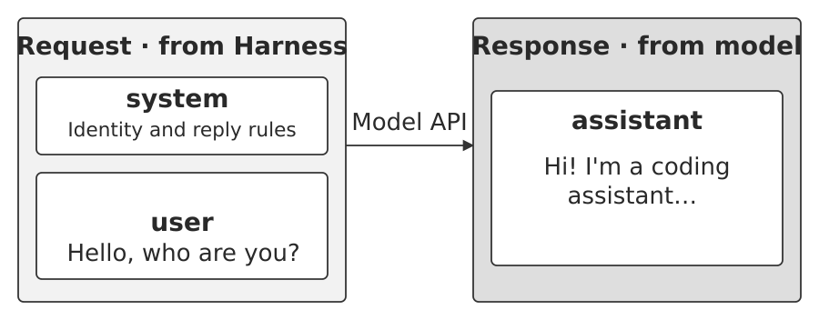

Below are the request and a sample reply, written in the form the local model's interface uses; the comments in the code mark where each part comes from:

```javascript
// Request built by the Harness
{
  "model": "Qwen3-0.6B",
  "messages": [
    {
      "role": "system",                           // Instructions supplied by the developer
      "content": "You are a helpful coding assistant. Follow user instructions."
    },
    {
      "role": "user",                              // User input
      "content": "Hello, who are you?"
    }
  ]
}
```

```javascript
// Response returned by the API
{
  "choices": [{
    "message": {
      "role": "assistant",                         // Generated by the model
      "content": "Hi! I'm a coding assistant. I can help you write code, debug issues, and explain technical concepts. How can I help?"
    }
  }]
}
```

The request contains one `system` message and one `user` message, and `choices[0].message` in the response holds the `assistant` message generated by the model. With the stateless interface used here, **the Harness is responsible for supplying the context each call needs**. If the next request is to continue this conversation, it must carry the relevant history.

### Multi-Turn Interaction with Tool Calls: The Core Loop of an Agent

Now consider a question that requires tools: "What's the current time and weather in Vancouver?" Answering it requires first looking up the local time and weather. In Figure 2-3, the Harness's first model call returns two tool requests. The Harness queries the time service and the weather service, adds both results to the message history, and calls the model a second time; only then does it get the answer for the user.

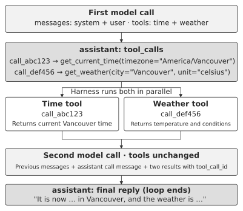

Which of the two tools runs first? The time tool needs a timezone, and the weather tool needs a city and a temperature unit. The user mentioned only Vancouver, so the model in this example fills in `America/Vancouver` and `Vancouver` and picks Celsius. Looking up the weather does not have to wait for the time tool to return, so the two queries can be issued at the same time.

**First API call — the Agent framework sends the initial request:**

```javascript
// First model call: request built by the Harness
{
  "model": "Qwen3-0.6B",
  "messages": [
    {
      "role": "system",                           // Instructions supplied by the developer
      "content": "You are a helpful assistant. Use the provided tools to get real-time information when needed."
    },
    {
      "role": "user",                              // User input
      "content": "What's the current time and weather in Vancouver?"
    }
  ],
  "tools": [                                       // Tools defined by the developer
    {
      "type": "function",
      "function": {
        "name": "get_current_time",
        "description": "Get the current date and time in a specific timezone",
        "parameters": {
          "type": "object",
          "properties": {
            "timezone": { "type": "string", "description": "Timezone name, e.g. America/Vancouver" }
          },
          "required": ["timezone"]
        }
      }
    },
    {
      "type": "function",
      "function": {
        "name": "get_weather",
        "description": "Get the current weather for a specific city",
        "parameters": {
          "type": "object",
          "properties": {
            "city": { "type": "string", "description": "City name" },
            "unit": { "type": "string", "enum": ["celsius", "fahrenheit"] }
          },
          "required": ["city", "unit"]
        }
      }
    }
  ]
}
```

This `tools` list is defined in advance by the developer and contains each tool's name, description, and parameter schema. In this example, every round of requests provides the same two tools; after reading the list and the user's question, the model chooses which tools to call and fills in the arguments.

**The model returns two tool call requests:**

```javascript
// Model returns tool call requests
{
  "choices": [{
    "message": {
      "role": "assistant",                         // Generated by the model
      "content": null,                             // No text reply this round
      "tool_calls": [                              // Requests two tool calls
        {
          "id": "call_abc123",
          "type": "function",
          "function": {
            "name": "get_current_time",
            "arguments": "{\"timezone\": \"America/Vancouver\"}"
          }
        },
        {
          "id": "call_def456",
          "type": "function",
          "function": {
            "name": "get_weather",
            "arguments": "{\"city\": \"Vancouver\", \"unit\": \"celsius\"}"
          }
        }
      ]
    }
  }]
}
```

The `tool_calls` field in the response contains two requests, each with its own `id`, tool name, and arguments. `arguments` is a JSON-encoded string; the executing side must parse it first and then validate the fields and values. **The model decides what to call and which arguments to pass; the Harness handles validation and scheduling; the tool implementations access the time or weather service.**

**The Agent framework executes the tools and then makes the second API call:**

After validating the requests, the Harness dispatches the two tools, writes their return values as `tool` messages, and hands the existing history together with the new results to the model:

```javascript
// Second model call: tool results appended
{
  "model": "Qwen3-0.6B",
  "messages": [
    {
      "role": "system",                           // Kept from the first request
      "content": "You are a helpful assistant. Use the provided tools to get real-time information when needed."
    },
    {
      "role": "user",                              // Kept from the first request
      "content": "What's the current time and weather in Vancouver?"
    },
    {
      "role": "assistant",                         // Model's call requests from the previous round, kept
      "content": null,
      "tool_calls": [
        { "id": "call_abc123", "type": "function", "function": { "name": "get_current_time", "arguments": "{\"timezone\": \"America/Vancouver\"}" } },
        { "id": "call_def456", "type": "function", "function": { "name": "get_weather", "arguments": "{\"city\": \"Vancouver\", \"unit\": \"celsius\"}" } }
      ]
    },
    {
      "role": "tool",                              // Tool result written by the Harness
      "tool_call_id": "call_abc123",
      "content": "{\"timezone\": \"America/Vancouver\", \"datetime\": \"2025-09-13T05:18:47\", \"day_of_week\": \"Saturday\"}"
    },
    {
      "role": "tool",                              // Tool result written by the Harness
      "tool_call_id": "call_def456",
      "content": "{\"city\": \"Vancouver\", \"temperature\": 13.2, \"unit\": \"celsius\", \"conditions\": \"clear\", \"humidity\": 93}"
    }
  ],
  "tools": [ ... ]                                 // Same tool definitions as before, omitted here
}
```

Follow `call_def456` through the second request. In the preceding `assistant` message, it is the ID of the Vancouver weather query; the later `tool` message uses the same ID to send back 13.2 °C and clear skies. Even if the weather comes back before the time, the Harness can still match each result to its request. In this round the model reads the user's original question, the two queries it issued, and the data the tools returned all at once. It can now answer the user.

**The model generates the final reply from the tool results:**

```javascript
// Model generates the final reply
{
  "choices": [{
    "message": {
      "role": "assistant",                         // Generated by the model
      "content": "It's currently 5:18 AM on Saturday, September 13, 2025 in Vancouver.\n\nWeather: 13.2°C with clear skies and 93% humidity. It's quite cool this morning - you might want to grab a jacket."
    }
  }]
}
```

The second response gives the final text with an empty `tool_calls`, and the example loop ends there. This cycle of "call the model → execute tools → return the results → call the model again" is the concrete API implementation of the run loop from Chapter 1.

If the user follows up with "What about Tokyo?", the Harness appends that message to the end of the history and calls the model again. The model can carry over the task background of "look up the current time and weather" and generate new requests for Tokyo; once the tools return, it composes a new answer.

**With the Responses API, how are tool results handed back?** The local experiment above uses a Chat Completions–compatible interface. For new projects built on OpenAI's service, OpenAI recommends the Responses API. Take the Vancouver example again: the application puts the user's question into the request's `input` and declares the time and weather functions in `tools`. The returned `output` is a list of typed items. If two `function_call` items appear in it, the application reads the function name, arguments, and `call_id` from each one and runs the corresponding tool.[^ch2-responses-loop]

Suppose the weather function's call ID is `call_weather`. The `input` of the next request can then include a receipt like the following; the time function's result must likewise be returned under its own ID.

```json
{"type": "function_call_output", "call_id": "call_weather", "output": "{\"temperature\": 13.2, \"unit\": \"celsius\"}"}
```

`call_id` matches a receipt to one function call. `previous_response_id` points to the previous model response, letting the service pick up that round's context. The two IDs refer to different things. When continuing a conversation this way, the current request must still provide the tools it wants to keep using and the top-level `instructions`; the previous request's top-level instructions are not inherited automatically through the response ID. The model may request more tools, so the application must read the next `output` before deciding whether to stop. Experiment 1-3 in Chapter 1 used server-hosted search; the two custom functions here are actually executed by the application.

[^ch2-responses-loop]: OpenAI, Migrating to the Responses API, Function Calling, and the parameter reference for creating a response.

### Implementing the Agent's Core Loop in Code

The two `messages.append` calls in the loop save the model's reply and the tool results, respectively. Both the time and the temperature come from Vancouver; swap the two call IDs, and in the next round the model would read that the "get time" query returned 13.2 degrees Celsius.

The example connects to a compatible server through the OpenAI Python SDK. The default address is `http://localhost:8000/v1` on the local machine, which suits a local server that is already running and needs no authentication. These defaults correspond to the vLLM backend in Experiment 2-1. If you use that experiment's Ollama backend, set the address to `http://localhost:11434/v1` and change the model name to `qwen3:0.6b`. To connect to another service, set the environment variables `LLM_BASE_URL` and `LLM_API_KEY` as needed, and make the `model` below match the name of the actual deployment. For now the time and weather tools reuse the fixed data from the previous example so the messages can be compared side by side; replace the implementations of these two tools when wiring in real data.

```python
import json
import os

from openai import OpenAI

client = OpenAI(
    base_url=os.getenv("LLM_BASE_URL", "http://localhost:8000/v1"),
    api_key=os.getenv("LLM_API_KEY", "EMPTY"),
)

# Tool definitions: name, purpose, and parameter schema
tools = [
    {
        "type": "function",
        "function": {
            "name": "get_current_time",
            "description": "Get the current date and time in a specific timezone",
            "parameters": {
                "type": "object",
                "properties": {
                    "timezone": {"type": "string", "description": "Timezone name, e.g. America/Vancouver"}
                },
                "required": ["timezone"],
            },
        },
    },
    {
        "type": "function",
        "function": {
            "name": "get_weather",
            "description": "Get the current weather for a specific city",
            "parameters": {
                "type": "object",
                "properties": {
                    "city": {"type": "string", "description": "City name"},
                    "unit": {"type": "string", "enum": ["celsius", "fahrenheit"]},
                },
                "required": ["city", "unit"],
            },
        },
    },
]

# The example tools return fixed data whose arguments match the Vancouver query above.
def execute_tool(name, arguments):
    args = json.loads(arguments)
    if name == "get_current_time" and args == {"timezone": "America/Vancouver"}:
        result = {
            "timezone": "America/Vancouver",
            "datetime": "2025-09-13T05:18:47",
            "day_of_week": "Saturday",
        }
    elif name == "get_weather" and args == {"city": "Vancouver", "unit": "celsius"}:
        result = {
            "city": "Vancouver", "temperature": 13.2,
            "unit": "celsius", "conditions": "clear", "humidity": 93,
        }
    else:
        result = {"error": "This example only provides Vancouver time and Celsius weather data"}
    return json.dumps(result, ensure_ascii=False)

# Initial messages: instructions and the user's task
messages = [
    {"role": "system", "content": "You are a helpful assistant. Use tools to get real-time information when needed."},
    {"role": "user", "content": "What's the current time and weather in Vancouver?"},
]

# Run loop: call the model at most eight times
rounds = 0
while rounds < 8:
    rounds += 1
    response = client.chat.completions.create(
        model="Qwen3-0.6B", messages=messages, tools=tools
    )
    assistant_message = response.choices[0].message

    # Save the model's reply, including this round's call requests
    messages.append(assistant_message.model_dump(exclude_none=True))

    # This example ends when the model replies without any tool calls
    if not assistant_message.tool_calls:
        print(assistant_message.content)
        break

    # Execute each call and append its result; independent calls could also be dispatched in parallel
    for tool_call in assistant_message.tool_calls:
        try:
            result = execute_tool(tool_call.function.name, tool_call.function.arguments)
        except json.JSONDecodeError:
            result = json.dumps({"error": "Tool arguments must be valid JSON"})
        messages.append({
            "role": "tool",
            "tool_call_id": tool_call.id,
            "content": result,
        })
    # The next round uses the message list with the results appended
else:
    print("Reached the round limit; the task is not finished.")
```

Suppose the model requests both the time and the weather in the first round. The `for` loop here queries the time first and appends the result to `messages`, then queries the weather and appends the second result. Only after both have run does the program return to the top of the `while` loop and send the second model request. Expanding the contents of `messages` at each of these steps shows exactly what the model receives each time.

**Initial state (before the 1st call):**
```text
messages = [
  { role: "system",  content: "You are a helpful assistant..." },     # Written by the developer
  { role: "user",    content: "What's the current time and weather in Vancouver?" },  # User input
]
```

**After the 1st model call and tool execution:**
```text
messages = [
  { role: "system",    content: "..." },
  { role: "user",      content: "What's the current time..." },
  { role: "assistant", tool_calls: [get_current_time, get_weather] },  # Call requests generated by the model
  { role: "tool",      tool_call_id: "call_abc123", content: "{time...}" },  # Written by the Harness after the tool runs
  { role: "tool",      tool_call_id: "call_def456", content: "{weather...}" },  # Written by the Harness after the tool runs
]
```

**After the 2nd call (the model returns its final reply and the loop ends):**
```text
messages = [
  { role: "system",    content: "..." },
  { role: "user",      content: "What's the current time..." },
  { role: "assistant", tool_calls: [get_current_time, get_weather] },
  { role: "tool",      tool_call_id: "call_abc123", content: "{time...}" },
  { role: "tool",      tool_call_id: "call_def456", content: "{weather...}" },
  { role: "assistant", content: "It's currently Saturday, Sep 13, 2025 in Vancouver..." },  # Final reply
]
```

### How Context Is Composed at the API Level

Figure 2-4 splits a request into two parts: a prefix and the message history. When the Vancouver query above is first sent, the history contains only the user's question and any earlier conversation. Once the two queries complete, the history also contains the tool calls the model proposed and the two tool results.

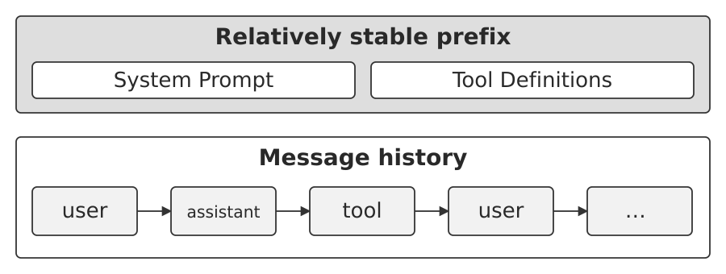

The identical opening portion of two consecutive requests can therefore extend into the message history. How much earlier computation the next call can reuse depends on how long that shared prefix is.

The Harness below places the rarely changing system instruction and tool definitions at the front and, in each round, appends only the current state after the message history. When the history grows too long, it compresses older messages first and then assembles the request.

```python
stable_prefix = system_message
stable_tools = core_tool_schemas
history = load_message_history(session)
status_message = make_status_message(derive_current_state(history))

if estimated_tokens(stable_prefix, stable_tools, history, status_message) > budget:
    history = compress_old_evidence(
        history,
        preserve = [decisions, constraints, failures, citations]
    )

request.messages = [stable_prefix] + history + [status_message]
request.tools = stable_tools
response = call_model(request)
```

Compression keeps the information later work needs, such as decisions, constraints, failures, and citations, and preserves the links between call requests and tool results. Besides the length budget, duplicated or outdated information can also trigger compression; the specific strategies are covered in the second half of this chapter.

> **Experiment 2-1 ★: Local LLM Service Deployment and Tool Calling**
>
> This experiment runs Qwen3-0.6B locally and follows the task "look up the time and weather in Vancouver" to observe how messages pass through the model, the parser, and the tool executor. Figure 2-5 shows the division of labor between the local server and the client: the server loads the model, processes input, and generates replies, while the client maintains the message history, dispatches tools, and returns their results.
>
> 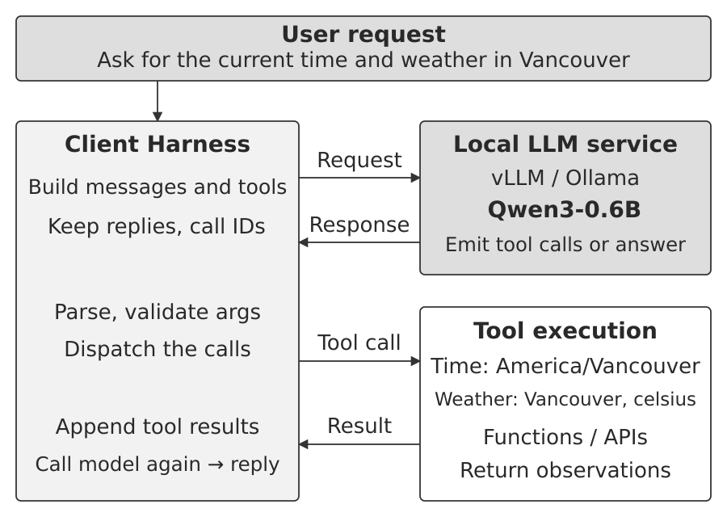
>
> **First, trace one complete task.** In a single round of output, the model requests both the time and the temperature, filling in arguments such as `America/Vancouver`, `Vancouver`, and `celsius`. The client executes the two tools in parallel. The first receipt gives a local time of 11:11:28, and the second gives a temperature of 17.9 °C. Once both results are sent back, the model reports the time to the minute, answers that the temperature is 17.9 °C, and ends the loop. This run shows that a model with 600 million parameters can already pick the right two tools for this task, fill in their arguments, and answer the user with the returned values.
>
> **Next, map the raw output onto the API fields.** Qwen3's thinking mode can produce reasoning content wrapped in `<think>` tags, while tool requests use their own call tags. After the server parses the output, the client may receive separate `thinking` or tool call fields. How the parts of the output are arranged and retained is determined jointly by the model's template and the serving protocol.
>
> **Then observe streaming.** The interface can update states such as "Thinking," "Calling tool," and "Generating answer" as events arrive. Tool arguments usually arrive in several chunks and must be accumulated into a complete request; once the protocol confirms that the call has ended and the argument, permission, and dependency checks pass, the runtime can begin dispatching it. Independent tools can run in parallel and can also be pipelined with the processing of later output.
>
> **Finally, compare speed and caching.** In the recorded run on an Apple-silicon Mac, the average decoding speed on the tool task was about 107 tokens per second. A token is the basic unit in which a model processes text; how text is split is determined by the tokenizer, and a single word or Chinese character may correspond to one or more tokens. Decoding speed reflects the output rate once generation has started; how long the user waits also depends on the time to first token, the length of the reasoning, and the time the tools take.
>
> The cache comparison uses the same long prefix and tests requests that keep the prefix against requests that modify its beginning. Of the five pairs in this run, the prefix-preserving request was faster in four; the average time to first token for the two groups was about 1.30 seconds and 1.51 seconds, respectively. The next section explains how these requests differ computationally.
>
> This experiment also made me more optimistic about on-device Agents: small models can already complete tool calling tasks like this one on the user's own device. **The era of on-device Agents is closer than many people expect.**

## KV Cache-Friendly Context Design

Consecutive Agent requests usually share a large amount of information: the system instruction, the tool definitions, and the interactions that have already taken place. If the inference engine can reuse the intermediate results computed for this content, more computation can go to the new information. The **KV Cache** stores the keys (Key) and values (Value) already computed in each layer's attention for use by later tokens; the **Prompt Cache** goes a step further and reuses eligible prefix caches across requests[^ch2-kv-basics].

Consider a customer-service Agent. To let the model know the current time, the developer adds `Current time: {{now}}` at the start of the system prompt and updates it on every request. The business rules and tool definitions that follow stay unchanged, yet the actual input now changes starting at the timestamp. For a service that reuses KV across identical prefixes, this forces the timestamp and everything after it to be recomputed, increasing input processing time and cost.

Writing the time as an appended message, or calling a time tool when needed, preserves the existing prefix. The two layouts provide similar information but trigger very different amounts of recomputation.

Three practices are worth remembering up front; the principles and experiments that follow explain each of them:

1. **Keep the reusable prefix stable.** Use fixed content and a fixed order for the system instruction and commonly used tool definitions.
2. **Append runtime changes toward the end.** The time, account balance, call counts, and task progress can be supplied through new messages or tool results. The latest state should note when it takes effect, so the model can tell which record applies to the current decision.
3. **Organize messages according to the model's protocol.** Use the correct roles, call IDs, and tool result formats, and let the corresponding chat template generate the model input. The cache matches the processed prefix and the related configuration, and the message protocol also determines how the model recognizes instructions, user requests, and tool return values.

In the causal-attention models assumed in this section, adding later tokens does not change the states already computed for earlier positions. When existing input is modified, the states at the first changed position and everything after it must be recomputed; the prefix before the change can still be reused. The server also decides the actual hit range based on the cache block size, the retention period, and the runtime configuration.

[^ch2-kv-basics]: Hugging Face, "How caching works," describing how K and V are stored and reused layer by layer.

> **Experiment 2-2 ★: Attention Mechanism Visualization**
>
> Start with the phrase "Beijing's weather today?" to understand a single attention computation. For ease of illustration, Figure 2-6 splits this phrase into four semantic units, "Beijing," "'s," "weather," and "today?"; an actual model splits its input with a tokenizer. When processing the position of "today?", the attention layer has to assemble a representation for the current position from the information already available. The Query, Key, and Value play the roles of querying, matching, and aggregating information, respectively.
>
> | Vector | Role | Intuition in this example |
> | --- | --- | --- |
> | **Query** | The vector the current position uses to match against other positions | "today?" needs to find the relevant information in the existing content |
> | **Key** | The vector each position contributes to the matching | Positions such as "Beijing" and "weather" provide representations to match against |
> | **Value** | The information vector aggregated by weight | Information such as the location and the weather flows into the current representation in proportion to its weight |
>
> You can think of the Key as a label used for retrieval and the Value as the content retrieved. In a model, these vectors are numbers computed from hidden representations, and training shapes how they match.
>
> One computation takes three steps. First, the current position produces a Query. Next, the Query is dot-multiplied with each position's Key, and after scaling, causal masking, and softmax, this yields attention weights that sum to 1. Finally, these weights are used to take a weighted sum of the Values. A dot product multiplies two lists of numbers element by element and adds up the results; softmax converts the scores of the visible positions into normalized weights. Each position's Value contributes to the aggregation according to its weight, and together they form the output of this attention head.
>
> Read across the last row of Figure 2-6: the position of "today?" assigns a weight of 0.55 to "weather." This number multiplies the Value at the position of "weather," and only after adding the contributions of the other three positions do we get this attention head's output at "today?". Why does the row for "weather" have an extra cross on the right? Because when this position is computed, the sequence has not yet reached "today?".
>
> 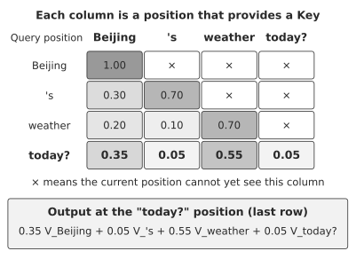
>
> Arranging the weights for every position into a matrix produces an **attention heatmap**. Each row corresponds to a Query, each column to a Key, and the shade of a cell indicates the size of the weight. The causal mask lets the current position read itself and the positions before it; the figure marks the masked positions with ×, and their weights after softmax are zero. This structure applies both to input processing and to subsequent generation.
>
> This also shows what the K/V cache is for: as generation proceeds, each new position still reads the Keys and Values of existing positions. Once these vectors are stored, a new position can use them directly for matching and aggregation, avoiding recomputation for the historical positions.
>
> With these illustrative weights in mind, use Qwen3-0.6B to examine the attention distributions the model actually computes. The experiment records a short sentence and a generated sequence containing both reasoning and a final answer, and compares the attention matrices of different layers. Figure 2-7 shows layers 0, 13, and 27: the left column is a nine-token short sentence, and the right column is the sequence the model generated while computing 17 × 23, with position ranges labeled as input, reasoning, and answer. The grayscale uses a logarithmic scale so that strong and weak attention weights are visible at the same time.
>
> 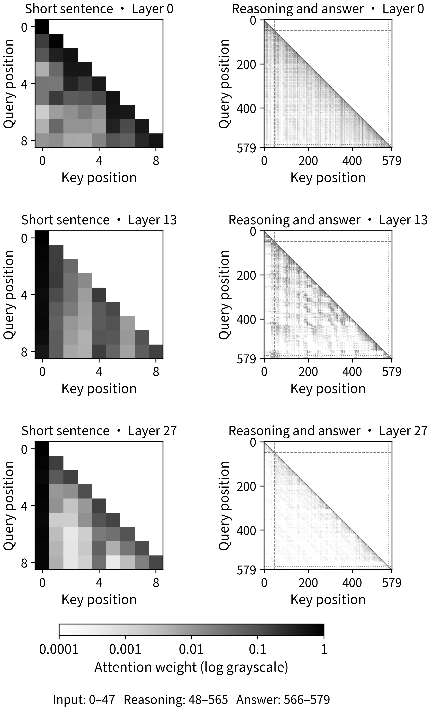
>
> Four lines of inquiry help when reading the figure:
>
> 1. **Attention Sink.** Some layers assign large weights to the beginning of the sequence, even though the opening token carries little meaning. Look at the short sentence in the left column of Figure 2-7. Each panel has already been averaged over the attention heads of the same layer. Taking the average of the nine numbers in the matrix's first column gives how much weight the nine positions assign to the first token on average. For layers 0, 13, and 27, this is 14.7%, 73.9%, and 83.2%, respectively. In the longer generated sequence in the right column, the figure for layer 13 becomes 28.0%. Because softmax requires the weights across positions to sum to 1, the model can learn a relatively stable position to absorb surplus weight; StreamingLLM studies this phenomenon and its role in streaming inference in detail[^ch2-attention-sinks].
> 2. **The reasoning region.** Mark the generated span corresponding to `<think>`, and read along those rows to see which prompts, tool descriptions, or earlier reasoning the model attended to. The triangle shape comes from the causal mask; only the shading inside the triangle reflects differences in the weights across positions.
> 3. **The answer region.** Then mark the generated span of the final answer, and compare how it allocates weight between the original input and the earlier reasoning. This helps locate which existing information entered the current attention aggregation.
> 4. **Positional differences.** *Lost in the Middle* observed in long-context question answering and key-value retrieval that information in the middle of the context is harder to use effectively[^lost-in-the-middle]. In engineering practice, this suggests putting persistent rules near the front and the current goal and progress at the end.

[^ch2-attention-sinks]: Xiao et al., "Efficient Streaming Language Models with Attention Sinks," ICLR 2024.

[^lost-in-the-middle]: Liu et al., "Lost in the Middle: How Language Models Use Long Contexts," TACL 2024.

### From API Messages to Model Tokens: Chat Template

The API examples above are lists of messages with roles, whereas the input in the attention figures is a sequence of tokens. The **Chat Template** performs this conversion: it adds role and boundary markers to the messages, arranges tool descriptions and return values according to convention, and then hands the result to the tokenizer for encoding. Compare the two columns in Figure 2-8: the left side submits only a system instruction and a user question, so why does an extra `assistant` appear on the right? That is the start marker the template adds for the next reply. These markers come up again later when we discuss tool calls, the retention of reasoning, and cache hits.

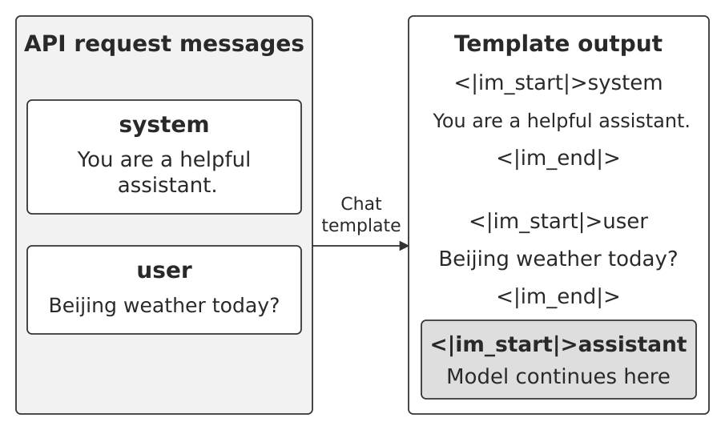

Model families such as Qwen, Llama, and Gemma each have their own chat templates. The same set of API messages given to different models may be converted into different role and boundary markers. Hosted APIs usually perform the conversion on the server side; for self-hosted deployments, the inference server must be configured with a template that matches the model.

Suppose a user sends the message "Vancouver 17.9 °C," and the weather tool happens to return exactly the same text. Running these two messages through the Qwen3-0.6B template produces the two inputs in Figure 2-9. Both start with `<|im_start|>user`; which marker indicates that the text came from a tool?

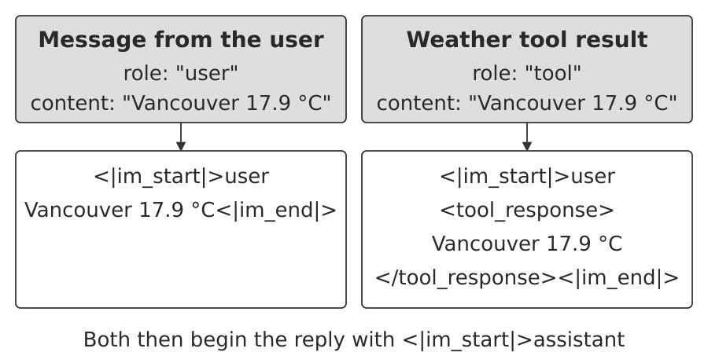

The right column has an extra pair of `<tool_response>` tags. The template also uses message roles to locate the user's most recent question: in turns before that question, only the answer content is kept; after it, tool interactions can also carry the model's reasoning[^ch2-qwen-template].

Suppose, for example, that the model still needs to continue its analysis after inspecting a file. If the tool result is returned under the `tool` role, the template can recognize it as tool feedback within the current task; if the same result is written as an ordinary `user` message, the template may treat it as a new query and change how much of the earlier reasoning is retained. It is like keeping your scratch work while you continue solving a problem: the Harness should store the reasoning fields the service requires and continue calling with the correct message structure.

**As systems move from single-turn reasoning to long-horizon Agents, past thinking increasingly becomes task state that has to be maintained.** The chat template of the early DeepSeek-R1 stripped the thinking portion from past answers and kept only the final answer[^ch2-r1-template]; DeepSeek's later tool-calling protocol, by contrast, requires reasoning to be passed back. When a Q&A exchange ends, the final answer may already contain what the next turn needs; halfway through a tool task, however, "why I'm checking this file" and "which hypotheses have been ruled out" may exist only in the intermediate reasoning. Keeping this information helps the next turn pick up the existing line of thought.

**How reasoning is passed back is determined by the model's protocol.** An integration must handle `content`, `tool_calls`, and whatever reasoning field the service provides. The following approaches illustrate different continuation rules:

- **DeepSeek thinking mode** returns reasoning through `reasoning_content`. Under its tool-calling protocol, when a request includes `tools`, subsequent requests must pass back the complete reasoning history, including model replies that did not call any tool; a missing field triggers a 400 error. For plain chat requests without `tools`, the service ignores any reasoning history that is passed back[^ch2-deepseek-thinking].
- **Kimi's thinking and tool interaction** likewise requires the run loop to manage reasoning, tool requests, and results. In the interleaved-thinking example for Kimi K2.5, the model can keep reasoning between multiple tool calls, and the client stores and passes back model messages according to its protocol[^ch2-kimi-thinking].
- **GLM's preserved thinking** can be enabled with `thinking.clear_thinking: false`, after which `reasoning_content` must be passed back in full and in its original order. The Coding Plan and the standard API have different defaults, so the client should choose the mode it needs explicitly[^ch2-glm-thinking].
- **Claude's thinking blocks** must be stored together with their signatures. Models that support preserved thinking also check each block's origin and prefix; the specific rules are covered in "Caching as an Architectural Constraint" below.

These rules affect consecutive tool calls as well as switching models midway. When switching, the adapter layer must convert tool requests, results, and task state into a form the target interface accepts, and then handle reasoning according to the target model's rules. Experiment 5-1 in Chapter 5 develops this kind of trajectory continuation.

**The template also determines the input that the cache matches.** The same message content, processed with different templates, tool orders, or serialization methods, can produce different token prefixes. Reusing existing KV requires keeping the relevant model configuration and the prefix consistent.

[^ch2-qwen-template]: The tokenizer configuration file `tokenizer_config.json` of Qwen3-0.6B stores the chat template, including the logic for handling user queries, reasoning content, and tool responses.

[^ch2-r1-template]: The official DeepSeek-R1 chat template keeps the content after `</think>` in ordinary past answers; the rules for passing back reasoning in later tool calls are in DeepSeek's Thinking Mode documentation.

[^ch2-deepseek-thinking]: DeepSeek, Thinking Mode.

[^ch2-kimi-thinking]: Moonshot AI, official Kimi K2.5 repository, section "Interleaved Thinking and Multi-Step Tool Call."

[^ch2-glm-thinking]: Z.ai, Thinking Mode, covering interleaved thinking, preserved thinking, and endpoint defaults.

### Principles and Constraints of KV Cache

When a model processes a request, it first runs **prefill** over the input, computing representations for the existing tokens, and then enters **decode**, generating subsequent tokens one at a time. During decoding, the KV Cache stores the K and V of existing positions; cross-request prefix caching goes further and reuses an identical prefix left behind by a previous request.

Suppose that by its sixth round an Agent has accumulated 2,000 input tokens. If the service uses only the KV Cache within the current request, it must first process those 2,000 tokens and only then continue generating with the cache. If a cross-request cache already holds an identical prefix covering part of them, prefill can resume from the first uncached position. Figure 2-10 shows this kind of cross-request reuse.

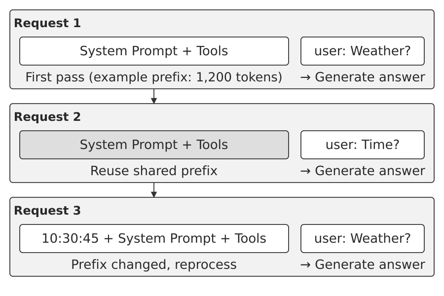

**Tracking cache growth with four tokens.** Suppose the input is `[A, B, C, D]`. When the model processes position D, it matches D's Query against the Keys of A, B, C, and D, and then aggregates their Values by weight. After passing through every layer, the final representation at position D is used to predict the next token, E. At this point, the K and V of A through D in every layer have been stored.

After E is sampled, the next step feeds E into the model and computes its Query, Key, and Value in each layer. E's Query reads the earlier cache together with the K and V of the current position, and the model predicts the sixth token; E's K and V are appended to the cache at the same time. In this way, every generation step can build on the earlier state and compute states only for the newly input token.

Without any KV Cache, predicting E would require reprocessing A through D, and predicting the sixth token would require processing A through E. Counting only the positions whose K and V are regenerated, the cumulative work grows like $1+2+\cdots+N$. With the cache, the per-layer computation for historical positions is reused; a new position must still read all visible K and V. In standard full-attention decoding, this reading and matching grows linearly with context length, so long contexts still consume more GPU memory and memory bandwidth.

**Why does modifying the input affect the cache that follows?** The layers of a Transformer process hidden representations in sequence, and each layer has its own K and V. After attention at a given position, its representation already incorporates information from earlier positions before being passed to the next layer. So when the $k$-th token changes, the effect propagates from that position onward and upward to higher layers.

For the same model and computation configuration, positions before $k$ depend only on earlier input and can still be reused; from $k$ onward, the affected states must be rebuilt. Real services usually match prefixes in cache blocks, so the recomputation boundary also depends on block size. The earlier the update, the more input usually has to be recomputed. Putting stable instructions at the front and appending new state at the back exploits exactly this dependency.

> **Experiment 2-3 ★★: Comparing Context Management Approaches**
>
> In this experiment, an Agent completes the same task using file discovery, file reading, and search tools, comparing a stable append-only baseline against five context modifications. The baseline keeps the instructions and tool order stable and appends model messages and tool results round by round. Each of the other groups changes the instructions, the state, the tool ordering, or the representation of the history, and the experiment observes how the cache statistics and the task process change.
>
> **Dynamic system prompt** updates the current time in the system instruction each round. There can still be a shared prefix before the change, but the input from the time information onward has to be rematched or recomputed. The time can instead be appended as a new message or fetched on demand through a time tool, so that the persistent business rules continue to be reused.
>
> **Dynamic user configuration** updates the remaining call count or account balance in an early message. The state itself is information the task needs; the design question is where to update it. Appending the latest state at the end and marking when it takes effect preserves both the progress and the prefix. The Agent status bar later in this chapter uses this organization.
>
> **Tool definition reordering** changes the order of the tool list every round. Even though the names and parameters are the same, the token order after serialization has changed. Open the run report for Kimi K2.6, and both the baseline and the reordering group show a `Hit%` of 100%. Did the two groups really reuse the same amount of input? The baseline took 7,567 input tokens over three rounds, of which 768 hit the cache; the reordering group also ran three rounds, and of its 7,568 input tokens only 256 hit. Dividing cached tokens by input tokens gives the 10.1% and 3.4% in the `Cache%` column. The other column, `Hit%`, counts requests for which a hit determination was recorded: the baseline recorded two hits and the reordering group only one, and both groups recorded zero misses. For the remaining requests, this record alone cannot tell whether they hit. Fixing the tool order prevents the prefix from changing for no reason.
>
> **Sliding window** keeps only the most recent stretch of history. If ten rounds of interaction are kept, round fifteen may no longer be able to read the key file contents obtained in round two. Besides shortening the shared prefix, truncation also changes which facts and task progress the model can access. The accompanying implementation starts from the most recent six history messages and extends backward to include the call requests that its tool results correspond to. The sliding-window group reused 1,510 of 2,224 input tokens, the highest cache share of the six groups at 67.9%. Now look at the tool log of the sliding-window group in Experiment 2-3: the model searched for files three times and then read two files, but never delivered the three-sentence summary the user asked for.
>
> **Text formatting** rewrites the role-tagged history as text such as `USER: ...` and `ASSISTANT: ...`. This changes the message boundaries and tool structure in the template, and the model has to recover the original relationships from the body text. In this run, the text group still produced a final reply and also got cache hits. The message roles, call IDs, and tool result fields provided by the interface help convey these relationships reliably.
>
> Even if the program rebuilds the message list, as long as the prefix it sends and the cache configuration are the same, that prefix still has a chance of being reused.
>
> If you also want to know how much less time the user waited, first check where the timer stops. The `ttft` of the sliding-window group's first round is about 2.23 seconds. Although the program calls this field TTFT (time to first token), it stops the clock only when a non-streaming request returns the entire reply.

### KV Cache and Prompt Cache: Two Levels of Caching

Two moments distinguish these two levels of caching. When the model generates the second token of a reply, it can read the key-value states of existing positions in that request; this uses the **KV Cache**. Later, when the user asks a follow-up and the Harness sends a new request, the service must first find a previously stored identical prefix before it can skip computing that part of the input; this is the **Prompt Cache**. The former explains how a single generation continues; the latter additionally requires a mechanism for storing and matching across requests.

In API services, caching is also subject to a minimum prefix length, block size, time to live, model configuration, and the scope of tenant isolation. A reusable prefix must be looked up within the same cache scope. The Claude API, for example, isolates caches by organization and workspace; identical text appearing in different isolation domains builds separate caches[^ch2-prompt-cache].

Billing has to account for writes and reads separately. For some Claude models, the cache read price is one tenth of the normal input price, while the first write carries an extra charge. If the same prefix is used repeatedly within its time to live, the write fee is paid only once, and every subsequent request that hits the cache is billed at the read price.

[^ch2-prompt-cache]: Anthropic, Prompt caching, covering cache matching, isolation, time to live, and billing.

### Caching as an Architectural Constraint

**In production systems, caching has become an architectural constraint.** How prompts are ordered, where sub-agents start, and how sessions are resumed all affect how much computation can be reused. **Cache boundaries should be planned from the start of the design.** Deciding first which content can be shared and which state will change, and then organizing the prompts and session structure accordingly, reduces repeated recomputation at runtime. If these structures are adjusted only after the latency and cost of long-horizon tasks have already become a problem, the changes often ripple into state management, sub-agents, and session resumption.

**Order the prefix by stability.** Instructions and tool definitions shared by many tasks can go at the front, followed by user profiles, session state, and new observations, grouped by the scope to which they apply. For example, with two operating system choices (macOS/Linux), two run modes (normal/debug), and two languages (Chinese/English), three independent conditions produce up to $2\times2\times2=8$ prefix combinations. Moving the more variable fields after the shared portion increases the chances that the common prefix will be reused. How widely the common portion is shared must also respect the service's organization, workspace, and privacy boundaries.

**Choose a reusable starting point for sub-agents.** If a sub-agent inherits the parent Agent's task background, it can reuse the prefix the two have in common and then append its own subtask. The prompt, tool order, model, and related configuration together determine how much can be reused. A sub-agent that needs an independent role or an isolated context builds its input for its own task, and the designer then checks which common parts are suitable for sharing.

**Save what has already been sent.** After a large tool output is compressed into a summary or a preview, save the version that was actually sent to the model. Replaying this record when a session is resumed rebuilds a consistent message sequence; regenerating the summary on every resumption can introduce new wording and a changed prefix. When a summary is updated, publish a new version and make clear where the cache will be rebuilt from afterward.

**Preserving reasoning must also satisfy protocol constraints.** Claude's preserved thinking offers a concrete example. Its documentation describes this mechanism as a defense against distillation: the service checks a thinking block's signature, the model that generated it, and its prefix. For models that support prefix binding, such as Claude Fable 5.1 and Claude Opus 5.5, the top-level `system`, the `tools`, and the messages before the block together form the scope of the check; modifying any of that content invalidates the block and every thinking block after it[^ch2-preserved-thinking].

For example, rewriting the system time every round, re-rendering the environment information in the first message, or truncating an old tool result in place all change the prefix to which later reasoning blocks are bound. When the check is triggered, the API can return a 400 error, or, depending on the `prefix_mismatch_behavior` setting, discard the invalidated blocks and continue processing the request. In the latter case, the model can still use the retained task information and tool results, but the invalidated reasoning no longer takes part in this input. Prefix checking is enabled by default for accounts created on or after August 31, 2026; for older accounts, the protocol documentation explains how to enable it.

When integrating with this kind of protocol, keep the session's top-level instructions and tool set stable and append state changes at the end. When instructions or tools need to be updated midway, use the interfaces the service provides for this, such as in-conversation system messages and tool-change blocks. Trimming thinking blocks must also keep a contiguous range in the original order: blocks may be removed from the beginning or the end, or removed entirely; leaving a gap in the middle affects later blocks, and blocks that have been deliberately removed should stay removed.

When switching models midway, the service also checks whether the target model can read the original model's reasoning blocks. The client should keep the original history and let the service handle it according to its compatibility rules; if the client deletes the blocks itself, they cannot be recovered when switching back to the original model later.

[^ch2-preserved-thinking]: Anthropic, Preserved thinking, covering models, prefix binding, invalidation handling, and rules for trimming reasoning blocks; for in-conversation update interfaces, see Mid-conversation system messages and tool changes.

### Research Extension: Editable and Composable KV Cache

> All the designs above reuse computation by matching prefixes. I would like to go further: can the information already stored in the KV be edited and composed directly, so that the cache adapts to changes in the context? In *Models Take Notes at Prefill*, I liken this information to the model's "notes"[^ch2-2]: after prefill passes through many layers of attention, a field's influence has already entered the representations of later positions. For example, "User's city: Beijing" may influence later judgments about location; replacing only that field's own K and V may still leave later states holding conclusions derived from the old city.
>
> Through interventions, the paper separates the role of a field's own KV from that of the downstream states. In the decisions tested, the direct contribution of a field's own KV was below 1%, with the main influence stored in downstream representations. Around these "notes" left downstream, two ways of using the cache can be explored.
>
> **Editing** uses explicitly corrected information to push later computation to update existing judgments. The paper also found that, in the 8B-model tasks tested, when an explicit chain of thought is present, editing the field alone can recover the target decision at a computational cost of about 1% of full recomputation; without that reasoning process, the old downstream states may keep influencing the decision, making the field edit hard to take effect.
>
> **Composition** plugs precomputed skill caches into a new context. For models that use rotary position embedding (RoPE), the position representations in the cache must first be adjusted before concatenation. Think of it as renumbering a page of existing notes so it can be attached after another set of material. The paper compares twelve models; the cosine similarity of the output logits between concatenation and full recomputation is 0.90–0.999. Cache relocation and concatenation themselves can be done in time linear in length, reducing attention recomputation over the whole context.
>
> Appending corrective information can also work together with existing prefix caching. In the paper's online vLLM benchmark, this combination retained a prefix cache hit rate of about 98.5%, with p90 time to first token about 1/398 to 1/53 of the baseline.
>
> **I am optimistic about this line of research because it promises to let context updates retain more of the existing computation.** Agents frequently update memory fields, add state, or replace tool definitions; if the related states could be corrected and spliced like notes, the cost of maintaining long contexts could drop substantially.

[^ch2-2]: Li, Bojie, "Models Take Notes at Prefill: KV Cache Can Be Editable and Composable," 2026. The editing, composition, and online caching experiments use different tasks and metrics; see the paper for the specific setups.

### From Cache Mechanics to Designing Context Content

With an understanding of how the cache reuses computation, the next step is to decide what goes into each round's input and how that content is updated. The rest of the chapter has three parts:

- **Prompt engineering and Agent Skills**: First design the system instruction and tool definitions, which state the goal, the rules, and how to operate; then load domain knowledge on demand through progressive disclosure. Defense against prompt injection focuses on the source of external content entering the context and the boundaries of its instructions.
- **The Agent status bar**: Provides the model with state such as task progress, a summary of environment observations, and call counts, reducing the cost of rederiving them from a long history. Like the time, battery, and network status on a phone, it keeps the current runtime situation visible.
- **Context compression**: Keeps the information later decisions need as the history grows, and decides when to compress, how to organize summaries, and how to handle cache recomputation and task continuation.

## Prompt Engineering: Optimizing the System Prompt

Prompt engineering uses instructions, workflows, and examples to guide a model through a specific task. This section focuses on the **system prompt**: like an employee handbook, it describes the Agent's identity, goals, behavioral rules, and workflow. In this chapter's API examples, this content is provided through the `system` message.

### Tone and Style: How to Address the User

Requirements about tone should be turned into concrete expression. For short Q&A, for example, the prompt can require "You MUST answer concisely with fewer than 4 lines," meaning the answer must fit in fewer than four lines. When a task is blocked, it can require "keep your response to 1–2 sentences," so that one or two sentences state the current situation and the next step and the user can see directly what needs attention.

All-caps emphasis such as "NEVER do X" can be used to highlight critical requirements. More important is stating when a requirement applies and what action should be taken.

### Structured Prompts: Hierarchy and Content Boundaries

Headings, lists, and tags help organize longer prompts. Markdown headings suit sections and steps, while XML-style tags suit separating blocks of content with different purposes, for example wrapping working-directory information in `<working_directory>`. Tag names should state the purpose of their content directly so the model can easily recognize how the blocks relate to one another.

A single prompt can combine both styles:

```text
# Tool Usage Guidelines

## File Operations
<file_operation>
- Check that the path exists before reading a file
- Save a backup before modifying an existing file
</file_operation>

## Network Requests
<network_request>
- Set the timeout to 30 seconds
- Retry transient failures at most 3 times
- For requests with external side effects, confirm the execution status before retrying
</network_request>
```

Markdown provides a readable hierarchy, and `<file_operation>` and `<network_request>` delimit the scope of each set of rules. For example, "retry at most 3 times" applies only to network requests; editing a file follows the backup rule in the previous group.

### Organizing Rules as a Workflow

**When a task has clear stages, prefer organizing the prompt as a workflow.** Take refunds: the order has to be found first before the refund policy can determine whether the money can be returned. If the order cannot be found, ask the user for more information such as the order number; if the order qualifies, initiate the refund. If the same rules are scattered across a list of a hundred or more items, every step requires digging out the applicable entries again. When the input conditions, processing order, and exception exits are written at the stage where they apply, the model has a basis for judging where it is and what it should do next.

The following file-processing example chains checking, classification, preprocessing, execution, and verification into a standard operating procedure (SOP):

```text
File Processing Procedure

Step 1: Check
  Confirm the file exists and is accessible
  File missing → log the error and stop
  ↓
Step 2: Classify
  Determine the type from the extension and the file contents
  ↓
Step 3: Preprocess
  Configuration file → back it up first
  Large file (>1 MB) → process as a stream
  ↓
Step 4: Execute
  Apply the processing for this file type
  ↓
Step 5: Verify
  Check the integrity of the processed file
```

Each step gives a local goal, and the relevant rules sit under that step. If the file does not exist, the process exits at the checking stage; if a configuration file needs to be modified, a backup is saved at the preprocessing stage. Execution progress is supplied to the model through the message history or state records.

### Refining Business Rules: Spelling Out Product Conventions

Given the same order information, which category the request falls into, which service applies, and how much to charge are first of all business conventions that product and operations need to define. Engineering then divides the work: the prompt tells the model which fields to obtain and which service to query, while tools and business systems carry out the deterministic billing and constraints.

Consider an Agent that phones companies on the user's behalf to lower subscription costs or request refunds. The team wants to lower the barrier to trying it with a "refund if we can't get it done" promise, while setting a clear way to charge for special tasks. Three billing types can be designed:

- **Commission on savings**: Negotiate down an existing bill and charge a percentage of the actual savings, for example 20%.
- **Fixed fee per service**: For service-type tasks such as restaurant reservations, charge by task type or complexity.
- **Prepayment for difficult tasks**: For difficult tasks that meet specific conditions, state the prepaid fee and the no-refund terms in advance, and accept the task once the user confirms.

Writing "choose an appropriate billing type based on the task" still leaves classification ambiguous. "Help me return the clothes I bought last month" involves getting back money already paid, while "help me cancel my Netflix subscription" involves stopping future payments. Both outcomes could loosely be understood as saving money, but the team can restrict the commission to negotiating down an existing bill and charge a fixed fee for both refunds and service cancellations.

The corresponding prompt can spell out the category boundary directly: "NEVER use percentage_based_one_time for refunds and service cancellations. Use fixed_fee instead." In other words, refunds and service cancellations use `fixed_fee`, and only negotiating down an existing bill qualifies for the commission model.

The team also has to estimate how likely the task is to succeed. Which requests the merchant accepts, whether this user is eligible, what charges appear on the bill, and how similar requests have fared in the past all affect how the task is accepted. If the rules use thresholds such as "above 60% goes into the refundable mode; below 30% is declined," they must also spell out how to handle the range in between and the boundary values.

Amount calculations must specify units, bases, and the order of rounding. For example, phone charges accumulate at $0.05 per minute and are rounded to the nearest whole dollar after summing; savings are measured against the existing bill. If the current bill is $150 and the merchant might raise it to $180 next year, the potential increase avoided by keeping the current price should be handled according to a pre-agreed definition and cannot automatically be counted as savings from lowering the existing bill.

My recommendation is that **the product owner should lead the design of business rules**, maintaining these definitions based on production data, user feedback, and operational experience; engineers then implement them in prompts, tool parameters, billing logic, and validation rules.

### Few-Shot Examples: Showing the Desired Behavior

When output requirements are hard to express in a few rules, **two or three high-quality examples are more direct than piling on more abstract instructions.** This practice is called **few-shot examples**. A particular copywriting style, structured reports, and a customer-service tone are all well suited to being shown as pairs of inputs and desired outputs. The model uses these examples within the current context to recognize the pattern and then applies it to new requests.

Examples can go in the system prompt as content shared across many requests, or they can be organized as demonstration `user`/`assistant` messages loaded at the start of a session. **For repeated tasks of the same kind, I prefer a curated, fixed set of examples.** Fixed examples also keep the prefix stable. Consider retrieving examples per task only when tasks vary widely and a fixed set cannot cover them. With dynamic selection, keep the common instructions first and add the selected examples toward the end.

Continuing with the billing rules above, two examples are enough to clarify an easily confused boundary. If a user asks the assistant to negotiate a monthly fee down from $80 to $60, a commission on the savings applies; if a user asks the assistant to cancel an $80-per-month service, the fixed fee for service cancellation applies.

### Designing Tool Definitions

Tool definitions are the Agent's operating manual. The model has to judge from the name and description when to call a tool, and then fill in the request according to the parameter schema. A clear definition tells the model what the tool can accomplish, what inputs it needs, what it returns, and what conditions must hold before it is called.

This information can be quite specific. A search tool can require "use the dedicated search tool to find file contents"; a time tool can give `timezone: "America/New_York"` to show how the argument is actually written; a read tool can note that "independent reads can be batched"; and an edit tool should say "read the target file first, then edit based on its current contents." These four kinds of guidance cover, respectively, usage boundaries, argument format, execution efficiency, and prerequisites. Chapter 4 discusses tool interface design with more examples.

With only a few tools, the complete `tools` definitions can be sent with each request, keeping their names, content, and order stable in later rounds. As the number of tools grows, the full definitions take up a great deal of context and also make it harder for the model to tell similar tools apart. At that point, use **on-demand loading**: first let the model know which capabilities exist, then retrieve and load the complete schema of the relevant tools when needed. The Skills discussed below use the same organization: provide a catalog first, then load the details.

The OpenAI Responses API marks deferred tools with `defer_loading: true`. In a client-managed tool search flow, the model emits a `tool_search_call`, and the client returns the selected tool definitions through `tool_search_output`; frequently used tools can also be supplied directly and used alongside the deferred ones[^ch2-toolsearch-oai]. Claude Code, on models and service configurations that support tool search, loads MCP tools on demand by default: at the start of a session it provides tool names and server descriptions, and it loads the complete definitions after a search. It also offers a threshold mode that enables deferred loading once tool definitions reach a specified share of the context[^ch2-toolsearch-cc]. Codex's tool discovery template for Apps/Connectors uses BM25 to search tool metadata and provides the matching tools to the next model call[^ch2-toolsearch-codex].

On-demand loading also has to work with prefix caching. For interfaces that support appending tool definitions within a session, existing content stays in place and new definitions are added to the later context as they are discovered. Under causal attention, each token's K and V depend only on that token and the content before it, so content added at the end preserves the conditions for reusing the earlier prefix. Later rounds keep appending messages after this history, and definitions that have already been loaded stay where they were. Some interfaces instead add new tools to the `tools` set at the start of the request. In that case, the history messages that come after the new definitions, though untouched, must still be recomputed.

[^ch2-toolsearch-oai]: OpenAI, Tool search, Responses API documentation.
[^ch2-toolsearch-cc]: Anthropic, Scale with MCP tool search, Claude Code documentation.
[^ch2-toolsearch-codex]: OpenAI Codex, tool discovery template for Apps/Connectors.

> **Experiment 2-4 ★★: Ablation Study in Prompt Engineering**
>
> What roles do tone, information organization, and tool descriptions each play in a prompt? This experiment runs a controlled comparison on the airline customer-service tasks in τ-bench. τ-bench builds interactive scenarios from user simulation, business tools, and rules, and checks the goal state once a task ends; airline and retail are two of its task domains[^ch2-tau-bench].
>
> This run uses Kimi K3 as both the executing model and the user-simulation model and runs six configurations on the same set of ten airline customer-service tasks. The baseline keeps structured rules, complete tool descriptions, and a professional, neutral tone; the other configurations adjust the tone, scramble the organization of the rules, remove the tool descriptions, and add one group that stacks several changes.
>
> **Tone comparison** keeps the task rules and changes the manner of expression. The Trump style uses exaggerated, confident rhetoric, such as "I'll get you the greatest flight in history"; the Casual style uses a relaxed voice and emoji.
>
> **Information organization comparison** keeps the content of the rules but scrambles the headings and their order.
>
> **Tool description comparison** keeps the names, function signatures, and parameter schemas but removes the description text. Tool names and schemas carry information themselves, so performance without descriptions depends on whether the remaining information is enough for the task at hand.
>
> Of the ten tasks in this run, the baseline passed seven; the Trump and Casual tones passed six and nine, respectively; the scrambled organization passed eight; removing descriptions passed nine; and the stacked changes passed eight.

[^ch2-tau-bench]: Yao et al., "τ-bench: A Benchmark for Tool-Agent-User Interaction in Real-World Domains," 2024.

### Prompt Injection: The Core Threat to Context Security

To complete its tasks, an Agent needs to read web pages, emails, documents, and tool return values. This content may also smuggle in instructions that try to change the task's goal. **Prompt injection** exploits the fact that instructions and the material being processed enter the model's context together, inducing the model to treat content from low-trust sources as a basis for action. For example, a user asks for a summary of a web page, but the page asks the Agent to perform some operation that has nothing to do with summarizing. The system needs to hold on to the user's task goal and treat the page's demands as content to be analyzed.

Tool calls carry this kind of deviation out into the external environment. An incorrect summary can mislead the user, while unauthorized file modifications, sent emails, and data disclosures directly change system state. When analyzing the risk, check layer by layer along the path "content entry → context organization → call decision → actual execution": through which tool the external content entered, whether its source information was preserved, what operation the model requested, and whether the execution layer permits that operation[^ch2-injection-defense].

Context organization must first preserve source and permission boundaries:

- **Source labeling**. When external material enters the context, keep the source of the web page, email, or document, and wrap the content in clear boundaries. For example, `<external_content source="webpage">...</external_content>` indicates that what it contains is web-page material. The tag and its attributes are generated by the Harness, and the external text is placed inside a controlled data region.
- **Structured roles**. System rules, user requests, and tool results are passed separately according to the interface's conventions. Tool results correspond to call IDs, which makes it easy to trace where content came from. This source relationship should be preserved when content is summarized or handed off to another Agent.
- **Input checks**. Detect instruction-like content that deviates from the task, and clean up irrelevant content introduced during parsing. The results of these checks can be used by the model and the execution layer; authorization decisions are still made according to the user's request and the system's permissions.

Skills and runtime state also need source management. When installing a third-party Skill, review its instructions, referenced documents, and bundled scripts, and confirm that the operations it requests match its purpose. Task progress, permissions, and counts in the status bar should be maintained by the runtime; facts extracted from web pages keep their external source labels. That way, after information has been summarized, stored, or reloaded, the system can still recognize its original trust boundary.

The execution layer enforces these boundaries: permissions control the scope of tool access, a sandbox constrains file and process activity, and high-risk operations require confirmation according to the rules. Even if the model proposes an unauthorized call, the Harness and the environment should intercept it before execution. Chapters 4 and 5 develop these mechanisms, and Chapter 3 discusses source management for retrieved content and long-term memory.

[^ch2-injection-defense]: Anthropic, How we contain Claude across products.

> **Experiment 2-5 ★★: Prompt Injection Attack and Defense Experiment**
>
> This experiment examines how the system preserves the task goal and operation permissions after external content enters the context. It uses synthetic data in an isolated workspace, and web-page reads, file writes, and email output all leave records that can be inspected.
>
> Three kinds of scenarios cover direct requests, web-page content, and cross-session memory. The direct-request scenario checks whether the model follows the output rules for synthetic protected information; the web-page scenario checks whether a summarization task triggers unauthorized writes; the memory scenario checks whether external material, once turned into memory, affects operations in a new session.
>
> Four configurations add defenses layer by layer: the baseline contains basic information-protection and operation-confirmation rules; the second adds guidance on source and instruction boundaries; the third additionally labels the source of external content; and the fourth adds runtime authorization checks that verify permissions for file writes and email sending.
>
> This Kimi K3 run covered the three scenarios and four configurations, repeating each combination five times for sixty runs in total; none reached the predefined attack goal.

## Dynamic Prompts and Agent Skills

Suppose an Agent handles refunds, code changes, and document organization. If every request attaches all three complete manuals, then processing a single refund means filling the window with irrelevant coding standards and formatting rules. Which instructions should be sent every time, and which can wait until the model has settled on a task? This question leads to dynamic prompts and Skills.

When handling a refund, the model can first find the refund manual in a catalog, read it, and then decide whether to look up the special fare table it references. Figure 2-11 applies the same approach to building a presentation: the model picks PPTX from the catalog, and only after reading the workflow for creating a new deck does it consult the HTML conversion guide. If the task is to edit an existing deck, it can follow a different path to the XML reference.

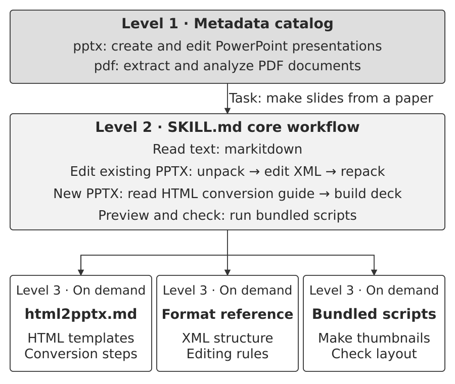

### Skills: Composable Units of Domain Capability

**Agent Skills** package the methods, reference material, scripts, and templates for a class of tasks into reusable bundles. Just as a new employee does not have to memorize the entire company's operations manual on day one, a model can wait until it is doing the work to read the relevant chapter closely. This way of loading is called **Progressive Disclosure**[^ch2-3].

Return to the ten products from Chapter 1 to decide which information is worth writing up as a Skill. Suppose the user wants to compare delivered prices including shipping; putting the item details and this order's delivery address into the current context is enough. If the team repeatedly compares prices across merchants, then how to align specifications, how to distinguish unit prices from bundle prices, and how to flag unknown shipping costs can be written up as a price-comparison Skill. The next time someone just wants to browse the available styles, the catalog is still visible, and the whole pricing workflow can wait to be loaded until the user needs to compare prices.

**The first layer is metadata.** Each Skill describes itself in `SKILL.md`, whose YAML frontmatter at the top of the file is delimited by `---` and contains `name` and `description`. The runtime first organizes the names and descriptions into a catalog so the model can judge which Skills the current task needs. The ordering and presentation of the catalog are managed by the Harness, and the complete workflow is loaded once a Skill is selected.

**A Skill's description should first be written as a routing condition.** The model has to decide whether to use it before loading its body, so the `description` should first state when it applies and when it should be skipped, and only then summarize what it can do. For example, "help with backend" is too broad, since almost any backend task could match; "write integration tests for existing HTTP endpoints, covering authentication, parameter validation, and error responses" gives a clear scope. For tasks that are easily confused, exclusion conditions can be added, such as "not needed when only discussing API design."

**The second layer is the core workflow.** Once a Skill is selected, the runtime sends its complete instructions into the context. When the user explicitly types a command such as `/pptx`, the client can look it up and load it directly; when the model chooses on its own, it obtains the content through a Skill tool or a file-reading tool. The former saves the model the step of issuing an activation call, while the latter keeps both the selection and the loading in the run trajectory.

Take the PPTX Skill used in this book's experiments. Its core instructions describe several common paths: extracting a presentation's text with Microsoft's markitdown, unzipping a PPTX to inspect the underlying XML, and choosing the workflow for creating or editing a presentation. After reading this layer, the model can decide, based on the current task, which document to read next and which kind of script to call[^ch2-4].

**The third layer is detailed reference material.** Complex operations are spread across dedicated documents, with the main file providing the entry point. In the version used in this book, `html2pptx.md` explains how to generate a presentation from HTML, and other reference documents add formatting and editing details. The Agent continues reading these as the task requires and uses the bundled scripts, assets, and templates to complete the work.

[^ch2-3]: Anthropic, "Equipping Agents for the Real World with Agent Skills," 2025; Agent Skills, How to add skills support to your agent.
[^ch2-4]: Anthropic, PPTX Skill. This book's experiments pin a version that includes the HTML conversion workflow; see the accompanying experiment README for the specific version and how to run it.
[^ch2-codex-skills]: OpenAI, Build skills; the Skills implementation in OpenAI Codex's public repository.
[^ch2-cc-skill-inject]: Claude Code, How Claude Code uses prompt caching, Invoking skills and commands; Agent Skills, How to add skills support to your agent, User-explicit activation.

### How to Write a Usable Skill

A usable Skill must answer four questions: which tasks it applies to, in what order to proceed, which situations require confirmation, and how to tell when the work is done. The author of a Skill needs to turn their own experience into executable steps and pair the key judgments with examples.

Take a writing Skill as an example. You can draw on Baoyu's approach of improving AI writing starting from one's personal habits of expression[^ch2-baoyu-remove-ai-writing-flavor], and organize the content into four parts:

- **Role and audience**: State who is being served, the type of task, and the requirements for the finished piece.
- **Core principles**: Start with three to five commonly used judgments, each paired with a concrete before-and-after rewrite.
- **Common mistakes and boundaries**: Record typical problems of expression, actions that overstep authority, and exceptions.
- **Reference material**: Collect glossaries, templates, model texts, and topic-specific notes for consultation during execution.

Rules can be written in terms of "scope, action, exception, verification." For example, a rule for compressing long sentences should state which paragraphs it applies to, how to split them, and how to check afterward that the conditions and conclusions are still intact.

To get started, pick three to five original articles you are happy with, have the Agent summarize their word choice, sentence patterns, paragraph structure, and tone, and generate a first version of about twenty lines. Then use it on a new topic and have the author revise the output sentence by sentence. The differences between the before and after versions provide more concrete feedback: which words are superfluous, which sentences need to be split, where facts are missing, and where technical details should be restored. Distill recurring revisions into rules, keeping the corresponding examples and the scope in which they apply.

A Skill can also come with execution tools and templates. The PPTX Skill, for example, bundles operating instructions, parsing scripts, generation scripts, and layout resources so that the model can call the right resources by following the instructions. Each Skill can be tested, updated, and versioned independently, and team members can keep adding experience around the same workflow. **The long-term value of Skills is that domain experience can be accumulated in a distributed way, published independently, and reused.** As a team extends its Agent's capabilities, members can each maintain the Skills they know best, gradually forming a package ecosystem similar to pip or npm. These Skills can share the discovery, loading, and execution mechanisms provided by the main system.

**When designing interaction patterns, prefer patterns the model has already been trained on and adapted to.** Role divisions, tool result formats, and the way Skills are loaded all affect how the model carries a task forward. The standard workflows provided by vendors make a good starting point and spare the model the burden of re-inferring meaning from unfamiliar formats.

[^ch2-baoyu-remove-ai-writing-flavor]: Baoyu, "Stop Using Prompts to Remove the AI Flavor: The Direction Is Wrong," February 14, 2026.

### Skills in Context

The context cost of Skills has two parts: the catalog and the body. The catalog lets the model discover available capabilities, and the body provides the operating workflow once a Skill is selected. The specification requires on-demand loading, while the specific message roles, wrapping, and update methods are implemented by the Harness.

Claude Code adds a Skill's instructions to the session as a `user` message at the point of invocation[^ch2-cc-skill-inject]. Figure 2-12 shows one message arrangement when the model triggers a Skill on its own: it first issues a `Skill(skill: "pptx")` call, receives the tool response, and then reads the appended Skill body. With a dedicated activation tool, the tool response can serve as confirmation of the call while the Harness injects the body separately; with an ordinary file-reading tool, the body can also be included directly in the tool result. When the user explicitly types `/pptx`, the client can expand the instructions directly, saving the model the step of issuing an activation call.

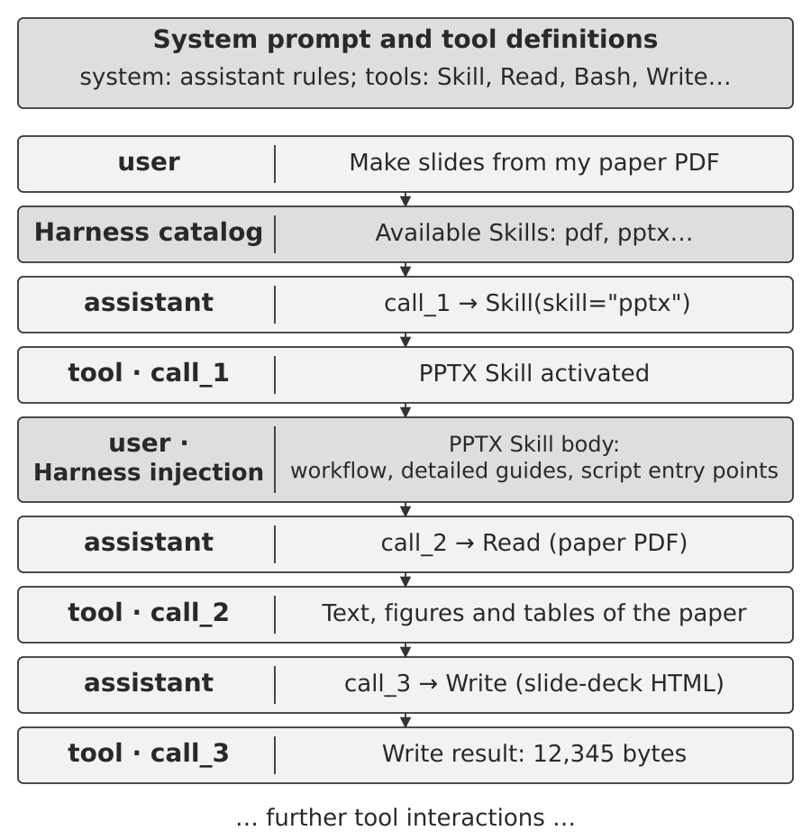{height=55%}

Codex's Skills implementation likewise organizes the capability catalog and the selected instructions separately. In the public source code, part of the catalog goes into the `developer` context while other parts are provided with the current turn and the execution environment; explicitly selected Skills are added through user context fragments. The source of the catalog and the available execution environment affect the specific arrangement[^ch2-codex-skills].

Figure 2-13 shows how the cache grows with on-demand loading, starting from a request for which no reusable cache has yet been built. The catalog must be processed the first time it enters a request, and loading a body for the first time also adds computation; when later requests keep the same prefix, this content has a chance to be read from the cache. Appending new content at the point of invocation keeps earlier messages stable. Instructions that have already been loaded remain in the history and, when they need updating, are handled according to the runtime's context strategy.

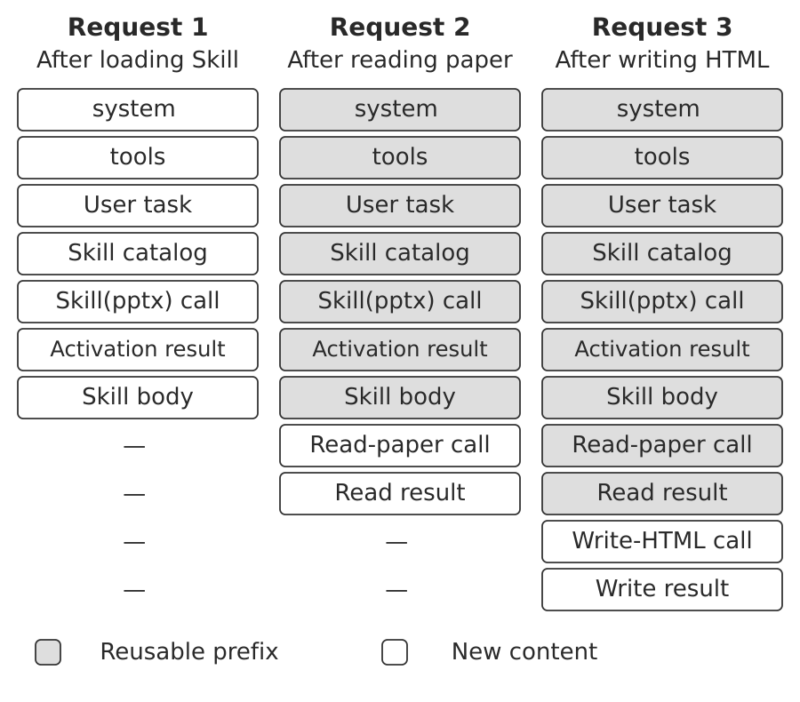

### Relationship Between Skills and Tools

A Skill provides task knowledge and operating workflows, while tools handle reading, execution, and retrieving results. The seven core tools introduced in Chapter 5 can be combined with different Skills: the same file-reading tool can read a presentation guide or a set of coding standards, and a general-purpose executor can run the corresponding scripts. In this way, specialized capabilities can be extended through workflows and resources while the base tool set stays relatively stable.

Specialized tools can also be used together with Skills. The tool search described earlier supplies tool definitions on demand, while a Skill explains when to call them, how to combine them, and how to check the results. Both need to limit the amount of always-present information and find a suitable position for newly loaded content. Chapter 4 discusses the trade-off between general-purpose executors and specialized tools, and Chapter 9 goes further into whether experience is best stored as knowledge, instructions, programs, or model parameters.

> **Experiment 2-6 ★★: Generate a Presentation from a Paper Using Agent Skills**
>
> This experiment uses *Attention Is All You Need* as source material to show how an Agent loads a professional presentation-building workflow on demand. The task is to generate a ten- to fifteen-slide presentation from the paper's PDF, covering the problem background, the method, the key results, and the conclusions, and using figures and tables from the paper to aid the explanation.
>
> This run uses Kimi Code with Anthropic's official PPTX Skill. The Agent first finds the PPTX Skill in the catalog, reads its operating instructions, goes on to read the HTML conversion guide, calls the accompanying generation tools, and finally checks the layout through thumbnails and slide-by-slide rendering. Every document read serves the operation that follows, and the complete production workflow unfolds step by step with the task.
>
> The finished deck has thirteen slides and uses the paper's architecture diagram, attention mechanism diagrams, results tables, and attention visualizations.
>
> Checking after generation is also part of the Skill workflow. This run produced missing subscripts, malformed bullet points, incorrect figure reference paths, and imprecise numeric labels, and the Agent fixed them one by one based on the rendered output and structural checks. The final file passed the structural checks and was reopened and rendered with LibreOffice.

> **Experiment 2-7 ★★: Creating a Writing Skill That Avoids Generic AI Phrasing, from Your Own Writing**
>
> This exercise turns personal writing experience into reusable instructions. Prepare three to five original articles, have the Agent summarize your habits of expression, and generate a first-version Skill containing trigger conditions, three to five principles, and corresponding examples.
>
> Pick a new topic for a trial piece, and have the author revise it sentence by sentence. Compare the two versions to find recurring problems, such as vague wording, overly long sentences, omitted causal links, or the removal of concrete examples that support understanding. Revisions that recur can be written into the Skill.

## Agent Status Bar: Using Meta-Information to Manage the Agent Trajectory

The user presses: "Can you call them one more time?" The left side of Figure 2-14 records three calls. On the first, the Agent waited 45 minutes without getting through; only on the third did it negotiate a price of $59 per month. Under this example's rules, every dial-out uses up one unit of quota; even though only two calls connected, all three units are already used. The Harness can assemble counts like these, along with progress and items awaiting confirmation, into a summary that is updated along with the messages. This is called the **Agent Status Bar**.

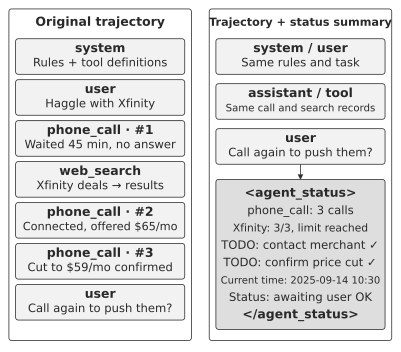

A phone puts the time, battery level, and signal strength at the top of the screen, so a person can grasp the current state at a glance. The summary on the right side of the figure plays a similar role: when the assistant reads "limit reached" and "awaiting user confirmation," it can relay the negotiated price to the user and ask whether to accept it. The Harness can attach the summary when returning a tool result, or append a separate status message.

### From Raw Records to Explicit State

Consider a phone-based customer-service task in which the system requires that, within the same task, each merchant be called no more than three times. Searches, document reads, and user follow-ups may be interleaved among the three calls. To decide whether it may call again, the model would have to find all the relevant records in this history, tell the merchants apart, and compute the running total.

The runtime can instead update the count after each call and return directly: "This is call #3 to Xfinity; the limit for this task has been reached." The next decision can then use that result. The program maintains the call count, and the model, taking task progress into account, decides whether to wait, look for another channel, or explain the current situation to the user; meanwhile, the execution layer checks subsequent dial-out requests against the count.

The engineering value here lies in **organizing ahead of time the state that later decisions need repeatedly**. The full call records still preserve what was said and how the matter was handled, while the status bar provides the statistics and progress that decisions commonly rely on. **Statistics used repeatedly should preferably be maintained incrementally by code.** Finding a single record in the context and computing a total from all the records are two different jobs. Saving the raw trajectory does not automatically yield an accurate statistics table ready to use at any moment. Having the model rescan and recount every time consumes reasoning tokens and increases the chances of missed or double counts.

I liken context to a retrieval engine that needs a companion "distillation layer": raw records make it easy to trace back, while distilled state is ready for direct use. Counts, limits, and verified task completion status are well suited to being maintained by code; information that requires semantic judgment can first be extracted item by item and then aggregated and verified. This way, every time the model makes a decision, it can see both the current state and the necessary evidence.

Long trajectories also make key information harder to find. Concentrating the latest goals, constraints, and progress toward the end makes it easier for the model to find what the current decision needs.

> **Experiment 2-8 ★★: Observing the Effect of the Agent Status Bar via Attention Visualization**
>
> This experiment uses Qwen3-0.6B and constructs a customer-service refund trajectory: the Agent has already called Xfinity three times, with web searches interleaved, and then the user follows up with "Can you call them again to push them?" The system rules limit calls to each merchant to at most three within the same task.
>
> Both groups of input keep the same history and user follow-up. Group A uses the raw trajectory directly; Group B appends the following status at the end:
>
> ```xml
> <agent_status>
> Current State:
> - Tool call summary: 'phone_call' has been invoked 3 times (Xfinity: 3 times)
> - Constraint check: Maximum calls to Xfinity reached (3/3)
> </agent_status>
> ```
>
> Each group was run three times. Group A explicitly refused to call again twice, with one output classified as other; Group B explicitly refused to call again all three times. Neither group produced an output judged to be a rule-violating additional call. To reproduce this comparison, go to `chapter2/attention_visualization` and run `python run_status_bar_experiment.py --output runs/status-bar-reproduction`. The inputs and per-run results of this run are saved in `runs/exp2-7-qwen3-0.6b-20260730-v2/comparison.json` in the experiment directory.
>
> The attention maps show how the generated region distributes its weight across the earlier calls, the search results, the user's follow-up, and the status bar.

My ContextDistill-Bench study with Noah Shi further examines the benefits of distilling state in advance[^ch2-8]. For the state queries covered by this benchmark, smaller models can also achieve high accuracy with explicit state, and frontier models can cut their thinking volume, latency, and query cost by roughly an order of magnitude. For example, the cost per thousand queries for Claude 4 Sonnet dropped from about $35.46 to $3.51. **This design maintains state as events occur, eliminating the cost of scanning the history on every query.** Once the summary fields are fixed, a query needs to read only those few fields even as the history keeps growing.

[^ch2-8]: Li, Bojie and Noah Shi. *Distill, Don't Retrieve: Inference-Time Context Distillation for LLM Agent Reasoning.* 2026.

### Composition of the Agent Status Bar

A status bar usually contains three kinds of information, answering "what needs to be done," "what just happened," and "what the current state is."

**Task planning** records the goal, the steps, and their completion. A complex task can be broken into a TODO list, with each item keeping its status and any necessary dependencies. While working on the current step, the model can still see the original request, the core constraints, and the remaining work; after finishing a step, it updates the list.

**Side-channel information for events** supplies the context in which an event occurred, such as the time, the geographic location, and the interval since the last reply. This metadata is saved along with the event and helps the model understand sequence and circumstances. The same sentence, "I still haven't heard back," may call for different handling depending on whether it comes two minutes or two days after a request was submitted.

**A summary of observations of the current environment state** provides the current time, the working directory, tool call counts, and anomaly alerts. It serves much the same purpose as a CLI or GUI showing the current directory or run status: it gives the next operation a clear basis. For example, an alert about repeated calls can prompt the model to examine why something failed, and the remaining budget helps it decide whether to keep searching.

Event metadata usually stays stable once appended with its event, whereas task progress and environment state keep changing. The two kinds of information should be written into the history according to their own update patterns, as the message structure below illustrates.

### Where the Agent Status Bar Sits in the Context

In this section's example, the Harness appends a `user` message at the end of the message list to carry the status summary. Here `user` is the message role of the chosen API; the status content is generated by the runtime, and a tag indicates its purpose. With other interfaces, you can also use a context block the interface supports, or supply the status along with the corresponding tool result. With a template like the one discussed earlier, which trims past reasoning based on the real user query, the runtime status can be supplied along with tool results so that the template continues to retain reasoning according to the current task.

Follow Figure 2-15 to find the user's original request, then see in which round the latest status is written. Only by keeping the original request can the Agent, after the calls are done, check two things at once: what the user wants done and how far along it is.

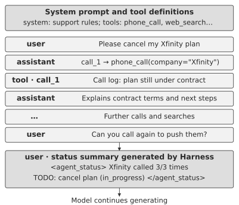

Written out as a message list, the sequence in the figure looks like this. For easier comparison, repeated rounds and some call fields are omitted.

```text
messages: [
  { role: "system", content: "You are a customer service assistant..." }
  { role: "user", content: "Help me cancel my Xfinity plan" }
  { role: "assistant", tool_calls: [{ id: "call_1", ... }] }
  { role: "tool", tool_call_id: "call_1", content: "Call log..." }
  { role: "assistant", tool_calls: [{ id: "call_2", ... }] }
  { role: "tool", tool_call_id: "call_2", content: "Call log..." }
  ...remaining rounds...
  { role: "user", content: "Can you call them again to follow up?" }
  { role: "user", content: "<agent_status>
      Current State:
      - phone_call invoked 3 times (Xfinity: 3/3 max)
      - Current time: 2025-09-14 10:30:45
      - TODO: [1] Cancel plan (in_progress)
    </agent_status>" }
]
```

The last message gathers the call count, the limit, the time, and the task progress in one place. The model can use these fields directly while still tracing specific records through the earlier call IDs.

Once this message is appended, the earlier token sequence remains unchanged, so the basic condition for prefix reuse is still met. How to handle the old status in the next round requires a trade-off between context usage and cache cost.

### Two Implementations of Status Updates and Their Cache Costs

In the next round, a TODO item may be completed or another tool call may be added. The Harness needs to update the status, and there are two common ways to do it.

**Replace each round**: When constructing a new request, remove the previous status and add the latest status at the end. The context keeps only one copy of the current status, which is convenient for the model. For example, the previous request was "task description, status A," and this one is "task description, tool result, status B." The task description can still hit the cache; the tool result is being submitted for the first time and would have to be computed anyway. Only if the previous request had other messages after status A does removing A cause those messages to lose their original prefix match. In this request, the model can see only B. If A needs to be revisited, the snapshot from that time can be retrieved from the run log.

**Append persistently**: Keep the existing status records and append a new status at the end each time. The history prefix stays stable, and changes in status are easy to trace. Old statuses gradually take up context, so each one needs a clear time or version, letting the model judge the current situation from the latest record. The way Claude Code appends file-change reminders to the session reflects this design approach.

When the status is short and a large amount of tool output is already cached after it, keeping the old status may be cheaper than recomputing a long suffix; when the status is long and updated frequently, replacing it keeps historical statuses from piling up.

A rough model can estimate the break-even point. Let each status be $S$ tokens; let $R$ tokens be the average cached suffix after the old status that must be recomputed on each replacement (content submitted for the first time in the current round does not count); let the status be injected $N$ times; and let the cached input price be $\alpha$ times the normal input price. Ignoring costs common to both approaches, $C_{\text{replace}} \approx (N-1)(1-\alpha)R$ and $C_{\text{append}} \approx \alpha S N(N-1)/2$. For $N>1$, persistent appending has the lower estimated cost when $\alpha SN/2 < (1-\alpha)R$; otherwise, replacing each round is cheaper. The normal input price serves as the unit of cost here: the extra cost of replacement is the price difference between reading the suffix from cache and reprocessing it, while the extra cost of appending is the fee for repeatedly reading historical statuses.

As an example, inject a 100-token status 10 times in total, with cache reads priced at one tenth of the normal input price. Under the append approach, subsequent requests read 1, 2, …, 9 extra old statuses, for an additional cost equivalent to 450 normal input tokens. If replacing the status forces an average of 1000 cached tokens after it to be reprocessed, the nine replacements cost an extra amount equivalent to 8100 normal input tokens, so appending is cheaper. If the old status was already at the end of the cache with no cached content after it, then $R=0$ in the formula, and replacing it directly saves the equivalent of those 450 tokens instead.

> **Experiment 2-9 ★★: Several Useful Agent Status Bar Techniques**
>
> This experiment implements five status bar techniques, which can be enabled individually or used in combination. Each technique provides a specific kind of information that helps the model decide its next action.
>
> **Timestamp tracking** records the time of each event in user messages and tool responses, for example `[2025-09-14 10:30:45]`. The time is written into the history with the event and keeps its original value in later rounds; the current time is updated with each new status message. The experiment also provides time simulation to check whether the model can distinguish "yesterday's file" from "today's change" and whether it correctly understands how long it has been waiting.
>
> **Tool call counter** maintains each tool's cumulative call count in a dictionary and annotates the response with `Tool call #3 for 'read_file'`. Combined with the error content, this lets the model judge whether to keep trying. For example, after a first failed read, it checks the path and then lists the directory; after several failures, it looks for an alternative file or tells the user what is missing. When retries need to be limited, the runtime should also enforce the cap based on the count.
>
> **TODO list management** provides two tools, `rewrite_todo_list` and `update_todo_status`. Each item contains a unique identifier, content, a timestamp, and one of four statuses: `pending`, `in_progress`, `completed`, or `cancelled`. The list keeps "what has been done and what remains" in one place, similar to Manus's approach of keeping goals visible by repeatedly presenting the task plan.
>
> **Detailed error information** provides the error type and description, the JSON of the call arguments, the call stack, and suggested fixes. For example, on a `FileNotFoundError`, it can prompt the model to check the file name, the current directory, and the absolute path. The arguments help pinpoint bad input, the call stack helps find where the failure occurred, and the suggested fix points to what to check next. Before returning this content to the model, sensitive fields such as credentials should be scrubbed and lengthy stack traces trimmed.
>
> **System state awareness** provides the current time, working directory, operating system, shell, and Python version. The command tool in the experiment recognizes standalone directory-change operations, updates the working directory maintained by the runtime, and uses it for subsequent calls; directory changes made by subprocesses within compound commands follow the execution scope of the corresponding process. Environment fields also help the model choose available tools, for example choosing `apt` or `brew` according to the actual system and installed software.
>
> In this Kimi K3 comparison, each kind of task had five cases. The timestamp and combined configurations each passed all five, while their control groups each passed three; for the tool call counter and system state, both the enabled and disabled groups passed all five. The TODO configuration passed none, while its control group passed one; the detailed-error configuration passed four, while its control group passed five.

**The status bar should be maintained by code as much as possible.** The model uses the statistics and limits in it directly, and a single incorrect "already called three times" can change subsequent actions. Leave counts, times, and state transitions to the program; when semantic understanding is required, have the model extract items one by one and then let code aggregate and verify them, rather than asking the model to tally an entire long history in one pass. Keeping the correspondence among raw events, extraction results, and the final state makes it easier to spot double counting, omissions, and confused sources.

Which information the status bar summarizes must be chosen in advance. For example, "already called three times" is enough to decide whether another call is allowed, but it cannot answer "what did the representative promise on the second call?" For later tasks that need only aggregate values, the status summary can replace the history while the raw records are archived; when the conversation content needs to be checked, the original text can be read through an index. The design of the summary's fields determines which questions can be answered directly and when the Agent has to go back to the records.

## Context Compression Strategies

Suppose a research task has read ten long web pages, and the window has room for only two more documents. Start by asking what the model still needs to do in the next round: if it must compare two quotes, keep the quotes, their validity conditions, and their sources; if it must re-verify citations, keep the locations from which the original text can be retrieved. The bodies of pages that have been checked but turned out to be irrelevant can be archived, freeing space for new input and output. There are two calculations here: how much space is freed, and, if discarded material turns out to be needed later, how much it will cost to get it back.

### Three Purposes of Compression

**Controlling length and cost.** In a 128K-token window, for example, long web pages and large files can occupy a substantial share of the space. The Harness has to reserve budget for subsequent input, model output, and tool interactions.

**Organizing the knowledge later decisions need.** A dozen or more rounds of searching may mention the same event repeatedly or leave behind contradictory claims. Organizing them into "A and B confirmed; C still lacks evidence" lets the model pick up the unfinished questions. A summary should preserve the relationships among facts, their sources, and the unresolved questions, so that later decisions have a clear basis.

**Sustaining progress on long tasks.** Some models, when they believe the window is about to run out, wrap up prematurely; this phenomenon is called **Context Anxiety**. In long-task testing of Sonnet 4.5, Anthropic found that this behavior could persist even after compression, so it adopted structured handoff records and continued execution after resetting the context[^ch2-7].

[^ch2-7]: Prithvi Rajasekaran, "Harness design for long-running application development," Anthropic Engineering, 2026.

### Turning Repeated Computation into Usable Knowledge

The status bar maintains counts and progress in advance, and a summary goes further by organizing the facts and relationships in long texts. Both organize scattered information ahead of time so later decisions can use it directly.

Consider an example of inspecting a pet shop:

> Cage 1: black cat. Cage 2: white cat. Cage 3: black cat. Cage 4: black cat. Cage 5: white cat.
> … (100 cages in total, containing 90 black cats and 10 white cats)

Answering "What cat is in cage 37?" requires locating the corresponding record; answering "How many black cats and white cats are there?" requires aggregating all the records. If the totals will be used repeatedly later, it makes sense to compute and save "90 black cats, 10 white cats" up front rather than counting from scratch each time. A program is well suited to this kind of deterministic aggregation, and the model can then answer business questions based on the statistics.

What goes into a summary should depend on the task. Keeping only the totals for the two kinds of cats is enough to answer the quantity question; answering about cage 37 also requires per-cage records or a corresponding index.

Even when the window still has room, an overly long or cluttered context can impair how information is used: the model misses key facts, reworks problems already solved, or applies outdated state to the current decision. This kind of performance degradation that appears as context grows is commonly called **Context Rot**. It shows up as worse task performance; when a request exceeds the capacity limit, a window overflow occurs.

**Even when the window still has room, knowledge that is already used repeatedly should be organized proactively.** If key judgments could already be summarized but the model is still left to search the long history for them over and over, the cost in computation keeps mounting and so does the risk of omissions. A search task can save confirmed facts, sources, and open questions; a programming task can save architectural decisions, the scope of changes, test results, and the causes of failures.

Examples in the context also affect how the model handles new problems. Starting from how attention layers and MLPs combine in a Transformer, research by Dherin et al. expresses certain forward computations as context-dependent low-rank weight updates, offering a theoretical explanation of in-context learning[^ch2-6]. During actual inference, the model's weights stay fixed, and examples influence the output through the current input. To reuse this kind of experience in later sessions, it can be organized into memories, examples, or Skills and loaded according to the task; Chapter 9 discusses further how experience is accumulated.

[^ch2-6]: Benoit Dherin et al., "Learning without training: The implicit dynamics of in-context learning," 2025.

### Trade-offs Between Compression and the KV Cache

Compression usually happens between two model calls. Based on the remaining budget and task progress, the Harness organizes the messages the next request needs and then sends them to the model. Replacing history changes the prefix, so the benefit of compression has to be weighed against the cost of rebuilding the cache.

First, keep the still-applicable system instruction and tool definitions stable. They sit at the front, so compression of the later history can keep reusing this part of the prefix. Second, choose what specifically to compress: long tool results can be replaced with summaries, and completed multi-turn exchanges can be merged into stage records. The cache before the replacement point can still be reused, while the content at and after the replacement point must be processed under the new prefix.

**Compress history in batches where possible, rather than rewriting the same stretch of prefix every round.** After compression, each round's input becomes shorter, but the compression call and the recomputation of the suffix also consume resources. The timing can be decided from window usage, the expected number of remaining rounds, and the task stage: consolidating in a batch after a cluster of long tool results arrives, or saving a handoff summary after completing a stage, both reduce the overhead of frequently modifying history. When keeping the most recent few rounds, check that tool calls and their return values remain paired, and write the status of any unfinished operation into the summary.

Compression must also respect the protocol for passing back reasoning. For some models, past thinking is bound to the prefix that was in place when it was generated. If the history before these blocks is replaced, the retained thinking may no longer match the new prefix. With such a protocol, the session can be condensed into a summary and the affected old thinking cleared, letting the model continue reasoning from the summary; alternatively, a server-supported compaction or context-editing mechanism can be used.

Start with individual summarization in Figure 2-16: the processed character count is only 10.9% of the original, yet the main Agent's cumulative token usage is the highest of the six groups. To see how both numbers can hold at once, track which material was compressed and in how many rounds of requests that material was sent to the model.

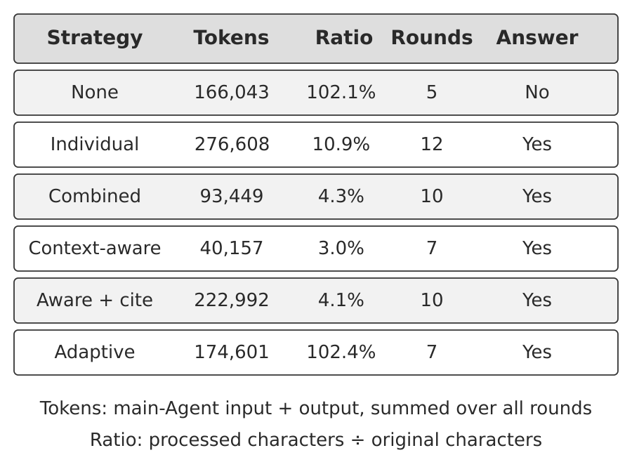

> **Experiment 2-10 ★★★: Comparison of Context Compression Strategies**
>
> This experiment uses Kimi K3 to research the career status of OpenAI's co-founders. The task requires gradually building a list of people, looking up their histories and job changes, and then matching the relevant facts to their sources. To observe compression and overflow handling, the experiment sets the application-side context budget to 128,000 tokens, keeps an uncompressed baseline, and compares five ways of handling the context, each running for at most 15 rounds[^ch2-compression-results].
>
> **Strategy 1: No compression.** The results of searches and page reads enter the history in full. Seven tool calls accounted for 367,246 raw characters. The program triggered its safeguard and stopped in the fifth round, with the main Agent's cumulative usage at 166,043 tokens. The old version triggered the safeguard on the sum of input tokens across all requests, so the 165,227 in the error message is cumulative input. For instance, if the same stretch of history is sent once in each of three requests, it is counted three times.
>
> **Strategy 2: Individual summarization.** Each search result gets its own two- to three-paragraph summary that keeps the main content of each page. This approach parallelizes easily and makes it easy to preserve page boundaries; when several pages describe the same event, however, the duplicate information still enters the history. This configuration produced its final reply in twelve rounds, with the main Agent using 276,608 tokens cumulatively and a character compression ratio of 10.9%.
>
> **Strategy 3: Combined summarization.** A batch of search results is merged and then summarized together, which makes it easier to consolidate duplicate facts and the relationships among different sources. This configuration produced its final reply in ten rounds, with the main Agent using 93,449 tokens cumulatively and a character compression ratio of 4.3%.
>
> **Strategy 4: Context-aware summarization.** Compression is given both the current query and the information already gathered, for example by adding `Given the search query: {query}` and `Current context: {context}` to the prompt. The model then keeps the facts relevant to the current question and prioritizes filling gaps in the existing summary. This configuration produced its final reply in seven rounds, with the main Agent using 40,157 tokens cumulatively and a character compression ratio of 3.0%. In one compression, about 150,000 characters were condensed into about 2,000 characters while retaining people's names and job changes.
>
> **Strategy 5: Context-aware summarization with citations.** The task-relevant summary keeps the source link for each fact. This configuration produced its final reply in ten rounds, with the main Agent using 222,992 tokens cumulatively. Aggregated from the tool records, the processed material came to 52,891 characters and the original to 1,295,044 characters, a ratio of about 4.1%.
>
> **Strategy 6: Adaptive windowing.** Raw material is kept early on, and once the input reaches a threshold, it is consolidated in a batch. The experiment uses three mechanisms: compression is triggered when the input exceeds 80% of the budget; tool results not yet compressed are summarized together; and processed results are tagged with `[COMPRESSED]` to avoid summarizing them again. With this experiment's 128,000-token budget, the trigger threshold is 102,400 tokens. This configuration produced its final reply in seven rounds, with the main Agent using 174,601 tokens cumulatively. The recorded run triggered the threshold based on cumulative input; the program was later changed to check the input size of the most recent request.
>
> Figure 2-17 compares the inputs and outputs of the six strategies.
>
> 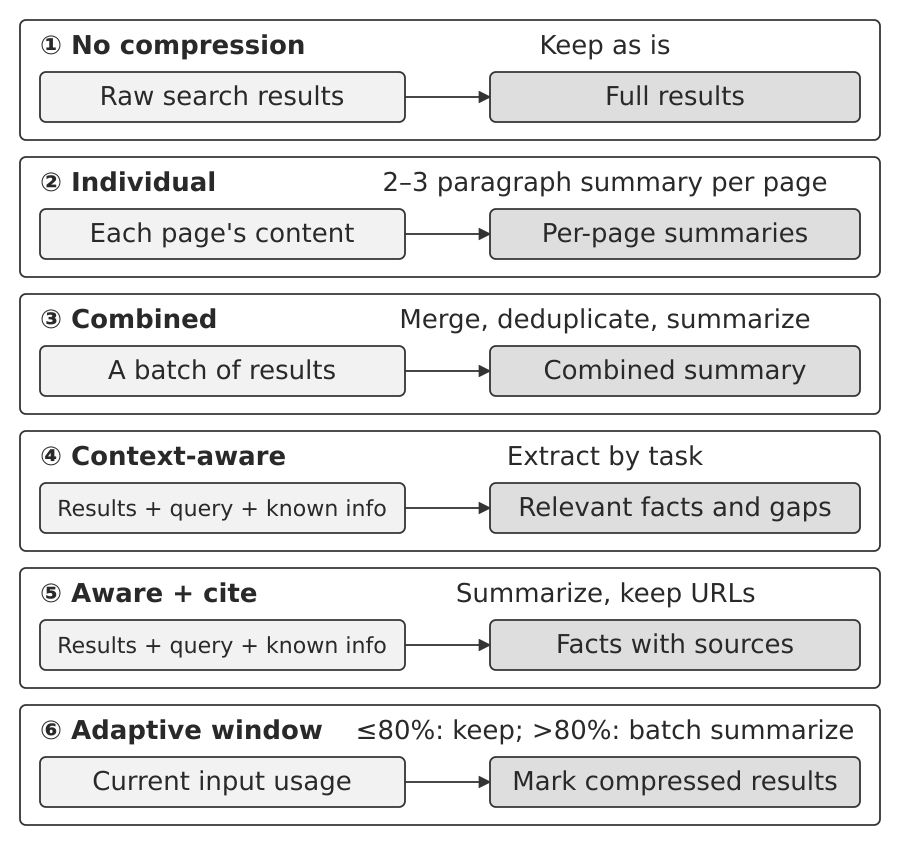
>
> When comparing the numbers in Figure 2-16, distinguish three quantities: the input of a single request determines whether the window budget is reached; cumulative tokens reflect usage across multiple rounds of calls; and the character compression ratio describes the ratio of the processed length to the original length of the material counted. The cumulative usage here comes from the input and output of the main Agent's requests in each round; the separate model requests that generate summaries are not included in this field.
>
> To reproduce the experiment, configure the model and a real search service according to the accompanying instructions, and run `python experiment.py -m kimi-k3 -n 15 -o results/reproduction.json` in the experiment directory. Read each strategy's `metrics`: recompute the character ratio with `total_compressed_size / total_original_size`, then compare `total_tokens` and `iterations`. The uncompressed baseline also adds formatting such as titles and URLs to search bodies, so its processed character count can be slightly higher than the original. The experiment program marks a group as completed as soon as it receives a final reply. Try looking up the same person in two of the finished outputs: the citation group gives Pamela Vagata's employer as Pebblebed, while the windowing group's summary table says Stripe. The first answer mentions the organization's website but gives no link that can be opened. Both groups delivered a summary table, yet the profiles they give contradict each other.

[^ch2-compression-results]: The results file for Experiment 2-10, `kimi_k3_real_20260718.json`, stores each strategy's statistics fields, final answer, and timestamps, so the character ratios can be recomputed directly. The July 18, 2026 run used the old safeguard condition; a code revision on July 22 (commit `aea4d72`) changed cumulative input to the input of the most recent request.

### Production-Grade Layered Compression

Tool output may need to have its full text stored temporarily, completed steps can be archived, and current constraints should remain visible; the following five kinds of mechanisms suit different frequencies of use and retention periods.

1. **Tool result budgeting**. Large outputs are saved to external storage, and the context keeps a summary preview and a way to read the rest. Once a preview enters the history, its content stays stable; when more detail is needed, the relevant fragment is read and the result appended.
2. **Clearing irrelevant content**. Web navigation bars, repeated footers, and the like can be filtered out before the result enters the context. When content that has already entered the history needs to be deleted, first confirm whether later tasks and citations still depend on it, and then calculate the cache cost of modifying the history.
3. **API-level context editing**. Services that support this capability can clear old tool results according to rules. The client must configure the trigger conditions and handle the editing information returned by the service. The scope of clearing and the cache behavior are determined by the interface contract, and this is best integrated together with input budget monitoring.
4. **Archival summaries**. Record the goal, actions, results, and unfinished items by round or task stage, preserving the order of execution. Think of it as the task's change log: later, one can find at which step a decision was made and on what basis.
5. **Whole-session compression**. When local cleanup still cannot meet the budget, organize the current goal, constraints, confirmed facts, key decisions, and next steps into a handoff summary. Existing session notes can be consolidated first, and then the entire history summarized. If compression fails repeatedly, a retry cap or circuit breaker stops the repeated calls, saves a recoverable state, and then either shrinks the input or hands off to a human.

These mechanisms can work together in layers: entry control reduces one-off large outputs, local cleanup controls day-to-day growth, and stage summaries and whole-session compression preserve handoff information for long tasks.

Reading dsh-superagent, I noticed one detail: events and tool results can first arrive as a summary plus an object ID, with details read later via the ID when needed. Suppose a background job finishes running a set of tests and tells the foreground only that "two tests failed." The foreground can report progress but cannot answer the user's follow-up question, "Are they the same two as yesterday?" If the summary includes an identifier for this test run's records, the foreground can retrieve the names of the failing test cases and compare them with yesterday's records.

### Design Principles for Compression Strategies

When deciding what to keep after compression, check the following four aspects. How experience is accumulated across tasks is developed in Chapter 9.

- **Allocate space by task value**. The list of people, identity relationships, and the questions currently under investigation should usually be kept verbatim; key evidence supporting conclusions keeps its source and necessary details; navigation bars, ads, and duplicate content can be removed. When facts are disputed, the differences among the pieces of evidence are also important information.
- **Preserve semantic integrity**. In "Sutskever left OpenAI in May 2024," for example, the person, the time, the action, and the organization together make up a single fact. Compression should keep all of these elements, rather than leaving a fragment such as "Sutskever left" that is hard to interpret.
- **Organize content around later questions**. "Find the list of founders" requires complete coverage of the people, while "understand each person's background" requires histories, timelines, and sources. The same material can yield different summaries for different tasks: retrieval emphasizes coverage, analysis emphasizes relationships and evidence, and creative work also needs useful details and examples.
- **Verify that the summary can support execution**. Semantic summarization requires understanding the task, eliminating duplication, and preserving conditions and exceptions. **For semantic compression of complex material, prefer a model whose comprehension is close to that of the main model.** The compressor has to judge which conditions, exceptions, and pieces of evidence will affect later work; if these are dropped, even the strongest main model will have a hard time recovering them.

Early architectural decisions, the reasons behind constraints, and failed paths are easily lost in a long history. **Long tasks should update a progress document periodically**, recording "what was decided, why it was decided that way, what was verified, and what comes next." A prompt or Skill can specify when to update it, and the Harness loads the corresponding records when the task is handed off. Such a document also helps executors, reviewers, and later Agents understand the work already done.

### Sub-Agent Context Isolation

**For tasks with clear deliverable boundaries that produce a lot of intermediate material, I prefer sub-agent isolation.** A broad search reads in a great deal of material that is useful only during exploration, and isolating it up front reduces its ongoing interference with the main task. The main Agent hands the task to a sub-agent with its own context; the sub-agent reads the intermediate results and returns conclusions, the locations of supporting evidence, and unresolved questions. The main Agent's context therefore needs to keep only the information later decisions require.

For example, to "find the function that handles payment callbacks," the main Agent searching on its own might need to read a dozen or more files. When the task is handed to a search sub-agent instead, it can be asked to return the function name, its module, its call sites, and the basis for its conclusion. Its reply might be "`handle_callback` in the payment module handles callbacks, and there are two other call sites," with references that can be located. The main Agent uses these results to decide whether to read the related code further.

The task description should be complete enough to state the goal, the scope of the search, the constraints to follow, the return format, and how to handle ambiguities. If both the delegation request and the returned result are appended to the history, the main Agent's existing prefix can still be reused.

Chapter 4 discusses the interface design of sub-agents as tools, and Chapter 10 goes further into the division of context in multi-agent systems.

## Chapter Summary

After the customer-service assistant finishes its third call, how does it carry on? The next request includes the tool receipt for this call, matched to the dial-out operation through its call ID. The status bar updates the count of calls used to three and lists the terms not yet settled. The system rules and tool definitions stay in a stable prefix, and the relevant Skill is loaded only when a particular piece of business needs to be handled. This way every field has a known origin, and it is clear which content will change with the next call.

As the calls drag on and tool returns pile up, the results can be capped in length, the finished parts condensed into summaries with sources, or independent work handed off to a sub-agent so that only the conclusions and supporting evidence come back.

Once this task ends, the count of three calls can be archived with it. But if the user specifically said, "From now on, contact me on weekday afternoons," and that sentence is left only in the call summary, the assistant taking the next request may never see it. How should information of lasting use be saved, and how can it be found again in the right task? Chapter 3 discusses cross-task user memory and shared knowledge bases.

## Thought Questions

1. ★★★ Read the sliding-window run log from Experiment 2-3: what did each of the five tool calls do? To determine whether the repeated calls were caused by history truncation, what else would need to be recorded, and what controlled comparison would need to be run? Design a truncation scheme that preserves key state, and explain its effect on prefix caching. The log is at `chapter2/kv-cache/result_sliding_window_20260718_kimi_k2_6.json`.
2. ★★ Qwen3's Chat Template handles past thinking based on the position of the last real user query. If a ReAct loop runs for hundreds of rounds, how would you manage the steadily growing reasoning content? Compare trimming past thinking, passing it back, and prefix-binding protocols, and explain how the Harness should adapt.
3. ★★ Suppose you need to compress about 150,000 characters of search material into 2,000 characters. Which facts, relationships, and sources would you keep? How would you check whether the summary is sufficient to support later questions, and how would you recover omitted details?
4. ★★ The tool counter misses one call, so the status bar reports the wrong number of remaining calls. Design event logging, aggregate verification, and execution-layer checks, and explain how to detect and repair this kind of inconsistency.
5. ★★ Experiment 2-4 compared tone, information organization, and tool descriptions. If a system prompt is maintained by many people over a long period, how would you manage versions, check for conflicting rules, and use regression tasks to evaluate each change?
6. ★★★ The pet shop example involves both single-record lookups and overall statistics. Design the raw records, the statistical summary, and the query routing so that the system can answer both kinds of questions efficiently, and explain when the summary needs to be updated.
7. ★★★ A Skill is in the catalog, but the model does not recognize that it applies to the current task. How would you investigate the problem from four angles: the description, the catalog organization, explicit triggering, and evaluation samples?
8. ★★ A Skill loads successfully, but the model skips its verification step. Design a controlled experiment that separates problems in triggering, comprehension, tool use, and completion judgment, and compare how different models perform.
9. ★★★ A system has a large number of tools, and the tool set changes frequently. How would you arrange the positions of fixed definitions, the tool catalog, on-demand loading results, and runtime state? Consider discovery accuracy, the context budget, and cache hit rates together.
