# User Memory and Knowledge Base

Suppose a user told an assistant last week that they prefer window seats, and today says only "Book me another ticket to Tokyo." Where does this request recover that earlier preference from? And if the airline changed its baggage rules yesterday, where should the assistant look up the new terms? The previous chapter discussed how to organize the context of a single task. This chapter asks where to recover what a user has said, where to find an airline's new rules, and when each of these two kinds of material should be updated.

**User memory** organizes information around a particular user, recording their preferences, habits, needs, and experiences so that the Agent can keep serving them according to their circumstances in later sessions. A **knowledge base** is shared by many users within a defined scope of permissions; examples include industry regulations, corporate operating procedures, and technical documentation. The former helps the Agent understand whom it is serving; the latter supplies the domain knowledge needed to complete tasks.

Both must solve the same problems: how to store information and how to find it when it is needed. Both also run into conflicting facts, stale content, and missed retrievals. Vector retrieval, structured indexing, and knowledge compression apply to both kinds of system. Figure 3-1 shows how this chapter is organized: we first discuss how user memory is represented and managed, then introduce retrieval-augmented generation (RAG), and finally apply retrieval methods to cross-session memory and to more complex forms of knowledge organization.

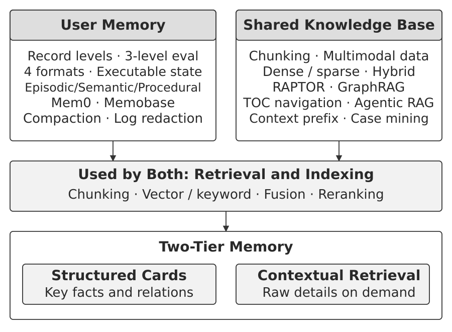

## User Memory System

Take the sentence "I'm abroad next week, so please email me any bank documents" and break it down. The user has stated a trip with a time limit and, within that trip, specified how they want to receive documents. When the bank proposes mailing paperwork, the assistant can use this to ask for electronic delivery; once the trip is over and the question of mail comes up again, it has to look at the conditions as they stand then. If the system stores only "the user dislikes paper mail," it may well retrieve that memory later and still apply it to the wrong situation.

Now consider flights. If the user says "That 1,250 ticket last time was more expensive than I expected," the system can save at least the quote, the budget at the time, the travel context, and this piece of feedback. The next time a similar situation arises, the model can treat over-budget quotes more carefully. If the user separately says "From now on, always check with me first for family trips," that sets an explicit condition for asking before any future family trip. This lets us distinguish three kinds of information: what the user actually said, the conditions under which they said it, and what the model inferred from the experience.

At the end of a session, an LLM can be asked to organize these records and write the facts with lasting value into persistent storage. When a new task begins, only the records that are relevant and still applicable are brought into the context.

For example, a user provides the following information while booking a flight:

```text
User: Help me book a flight to Tokyo next Friday. I prefer window seats
      and I'm vegetarian, so I'll need a special meal.
Agent: I'll search for flights to Tokyo for next Friday...
       [calls flight_search tool, returns 3 options]
Agent: Here are your options. Based on your preference, I've filtered for
       window seat availability. Shall I book the ANA direct flight?
User: Yes, and use my United MileagePlus number 12345678.
```

After the session ends, a memory extractor can distill four records:

```text
Extracted memories:
- User prefers window seats (preference)
- User is vegetarian, needs special meals on flights (dietary restriction)
- User's United MileagePlus number: 12345678 (loyalty program)
- User has travel plans to Tokyo (recent activity)
```

The example involves three kinds of processing. **Selective extraction** keeps the seat preference, the dietary requirement, and the membership number, and filters out transient details such as "the search returned three options." **Abstraction** turns the window-seat preference the user stated explicitly into a rule that future bookings can use. **Structuring** labels each fact with a category so that it is easy to retrieve and update. The Tokyo trip should also record its departure date and current status: "next Friday" has to be resolved against the session date, and the status should be updated once the trip is over or canceled. In this way, long-term preferences and recent activities can each be maintained according to how long they remain valid.

The product description of the personal assistant Today gives an example. A user says they train every Tuesday and Thursday and are preparing for a half marathon. Six weeks later, sleep data the user has authorized the assistant to access shows that they slept very little the night before. The assistant puts these two pieces of information together and suggests moving that day's high-intensity interval session. How long should each fact be remembered? The training plan stays useful for the whole build-up to the race, while last night's sleep record should carry its date. Even if the user accepts this one change, next Thursday's session stays on the original schedule unless the user says the change should be permanent. Today also separates making a suggestion from changing the calendar into two steps, and the second step requires the user's confirmation.[^ch3-today]

[^ch3-today]: In "What Is Today," the Today team uses half-marathon training to show how memory and same-day information work together. In "Meet Today," the founder explains the confirmation step required before the calendar is changed.

### Evaluating Memory Capabilities: A Three-Level Framework

The public benchmark **LoCoMo** (Long-term Conversational Memory) contains long dialogues averaging about 300 turns across as many as 35 sessions, and tests memory through question answering, event summarization, and multimodal dialogue generation. The questions fall into five categories. Single-hop questions can be answered from one session; multi-hop questions require piecing together clues from several sessions; temporal-reasoning questions additionally require working out the order in which events happened. Open-domain knowledge questions require combining what the user said with outside knowledge. To continue the booking example: if the user has said only "I'm going to Tokyo next week," answering "What currency is used at the destination?" requires both remembering the Tokyo clue and knowing that Japan uses the yen. If the question asks for a flight number the user never mentioned, the assistant should point out that the information is missing. Recognizing such unanswerable questions is exactly what the adversarial category tests.[^ch3-locomo]

[^ch3-locomo]: Section 4.1 of the LoCoMo paper by Maharana et al. (arXiv:2402.17753) defines the five question categories. The authors' project page provides the data and sample dialogues.

Drawing on benchmarks of this kind and on the practice of memory products, I group the capabilities that deserve attention into eight categories:

- **Personal Information Retention**: Accurately storing and retrieving long-term information such as the user's identity.
- **Preference Tracking**: Recording the user's preferences and updating them when the user states new ones explicitly.
- **Context Switching**: Picking up the relevant background again after the topic changes.
- **Memory Update**: Handling additions to and corrections of existing facts.
- **Multi-Session Continuity**: Using previously saved information in a new session.
- **Complex Reasoning**: Connecting several memory fragments. For example, if the user once mentioned a peanut allergy, a conversation about Thai food should draw on that and remind them to check the ingredients.
- **Temporal Awareness**: Storing dates, resolving relative time expressions, and calculating the intervals between events.
- **Conflict Resolution**: Detecting inconsistent information and judging it by source, time, and the person or object it applies to.

Built around the actual tasks Agents perform, this book further adopts a three-level evaluation framework. Experiments 3-1 and 3-2 first use it to compare memory representations; Experiments 3-9 and 3-11 then use the same framework to evaluate retrieval methods.

**Level 1: Basic Recall.** Accurately storing and retrieving unambiguous information that the user provides directly. For example, if the user says "My membership number is 12345," the full number should be available when they book a ticket later. This level mainly checks whether facts are lost, confused, or altered.

**Level 2: Multi-Session Retrieval.** Gathering all the relevant information from sessions held at different times and involving different people or things, then judging whom the current request concerns and which records it needs. If the user owns two cars but says only "Schedule maintenance for my car," the system should first retrieve information about both cars and ask which one is meant. When the user asks about a loan's status, the system must distinguish the contract actually in force from quotes the user asked about in the past. When the user cancels a "Los Angeles trip," the flights, hotels, and other bookings must be linked to that same trip.

**Level 3: Proactive Service.** Identifying, from the current task, related matters the user has not spelled out one by one. For example, when booking an international flight, linking to passport information saved months earlier and checking whether its validity meets the trip's requirements; when a phone breaks, gathering the device warranty, the credit card's extended warranty, and the carrier's insurance into a list of available options; when preparing tax documents, pulling together stock trades, freelance income, and property tax records from the whole year.

> **Experiment 3-1 ★: Evaluating Memory Systems with the Three-Level Framework**
>
> The evaluation set contains 20 cases per level, 60 in total. Level 1 consists mostly of single sessions; Levels 2 and 3 contain several sessions spanning different times and different people or things, to test entity linking, information updates, and proactive reminders.
>
> Each case runs in two steps. First the sessions are fed in one at a time: the model generates memories from the first session, and for every later session it receives only the existing memories and the new session, and produces updated memories. From that point on, the model can no longer read the earlier sessions; to answer a question about what was discussed, it can rely only on what was written into memory. After all the sessions have been processed, a new question is posed and the Agent must answer from memory.
>
> Scoring uses LLM-as-a-judge: an independent judge model checks the facts the answer covers, and any errors, against a reference answer and a scoring rubric. This run used Doubao Seed 1.6 to generate memories and answers and a Moonshot model to score them. The judge can see the original conversations; the answering model sees only the memories that survived to the end.
>
> How should the scorecard be read? Suppose the user just wants to recover the account number for their broadband service. In the Enhanced Notes group, the assistant gives the correct number. The judge awards 4 points each for accuracy, recall, and reasoning but only 1 point for proactiveness, and the case still passes. The program's pass condition is at least 3 points (out of 4) on each of the first three criteria, with no important fact that the judge finds unsupported or contradicted by what was actually said. Proactiveness counts toward the overall score, so the pass count alone does not tell you how much the assistant volunteered help.

### The Hierarchical Structure of Memory

Answering "Which flight did I book last time?" requires finding a single event; answering "What seat do I prefer when booking?" requires retrieving a preference retained across many interactions. Both questions concern the same person, yet they call for records of different granularity and different ways of retrieving them.

A **trajectory** records, in chronological order, the events of a single Agent run: user messages, model responses, tool calls, and their results. When it is kept as an append-only event log, new events are added at the end and the original records are preserved for tracing. The Harness can select history from the trajectory, extract state from it, or generate summaries of it, in order to construct the context actually sent to the model on each turn.

**User long-term memory** stores information that is useful across sessions—preferences, relationships, summaries of past activities, and confirmed facts—and is assigned to its owner through an identifier such as a user ID. New statements may add to, correct, or replace old records, so long-term memory must be merged and updated. Reading and maintaining it can be done by the Agent explicitly calling tools, or triggered by the Harness when a session loads, when it ends, or during background consolidation.

**Business state** describes the logical stage a task has reached, such as "needs clarification," "in progress," "awaiting payment," or "completed." A program can inspect these states to decide which event to wait for next and which action to take. Chapter 6 discusses state management in event-driven architectures in more detail.

These three kinds of records work together: the trajectory provides the evidence of what was executed, long-term memory provides cross-session background, and business state tells where the current task stands. The rest of this section concentrates on how long-term memory is represented, managed, and retrieved.

### Four Storage Formats for User Memory

If all you need is to change an email address, it is best to be able to go straight to that one item; if you need to understand why the address was changed, you have to read the story behind it. The upper left of Figure 3-2 stores the email, company, and job title as separate entries, while the upper right writes the title, team, and project together. Now look at the two cards below: to update the job title later, or to tell who it was that went to the cardiologist, which field should you check in each?

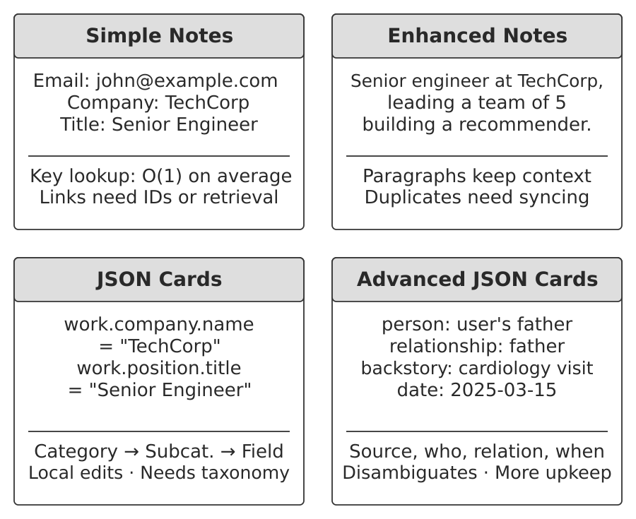

**Simple Notes** write each memory as one short fact, such as "User email: john@example.com." A single record is easy to read and write; when a hash table locates it by a stable key, lookups and updates usually take O(1) time on average. Semantic search over a large number of notes, however, requires a retrieval index. Splitting too finely also loses relationships: if "Works as a senior engineer at TechCorp, responsible for recommendation system development" is broken into three unconnected records for company, title, and project, the system later has to work out again whether they belong to the same job.

**Enhanced Notes** store a fact together with its background as a complete paragraph, for example: "The user is a senior software engineer at TechCorp, has worked in machine learning for three years, and currently leads a five-person recommendation system project." The relationships among company, title, experience, and team are preserved within one paragraph. The cost is that some facts may be repeated across several paragraphs; when the job title changes, every related paragraph must be found and updated so that old and new records do not coexist.

**JSON Cards** organize information as "category—subcategory—key-value pair," for example `personal.contact.email` and `work.position.title`. Changing the title field leaves `work.company.name` and the other fields intact, which makes JSON Cards well suited to partial updates. Designing the categories, however, means dealing with information that cuts across them: "Develops personal projects in Python on weekends" touches on time, technical preference, and activity at once. One can store a single activity record with several tags, or link the relevant categories by reference, so that these associations survive.

**Advanced JSON Cards** add, beyond the fact itself, the source context `backstory`, the subject `person`, the relationship to the user `relationship`, and a timestamp. These fields help the system determine whom the information belongs to, when it was learned, and in what situations it applies. For example, "Dr. Zhang" might be the user's dentist or the user's father's cardiologist; storing the name together with the patient, the family relationship, and the specialty reduces confusion.

When the user says "Arrange annual checkups for my family," the system can use `person` and `relationship` to find the family members and then read the relevant history from `backstory`. The richer the fields, the more relationships extraction and updating have to handle. I recommend a hybrid based on how important the information is and how much it needs to be linked: use Advanced JSON Cards for key people, contracts, and long-term preferences, keeping their sources and relationships; use Simple Notes for the many simple facts with few connections, lowering the cost of extraction and maintenance. The two kinds of records are linked by identifiers or references and retrieved together when needed.

> **Experiment 3-2 ★★: Comparing Four Memory Formats**
>
> The companion implementation gives the four formats a common interface for generating, updating, and retrieving memories, and compares their final answers on the same 60 cases from Experiment 3-1.
>
> In this run, Simple Notes, Enhanced Notes, JSON Cards, and Advanced JSON Cards passed 48, 52, 51, and 49 cases, respectively. On Level 2, Enhanced Notes passed 16 cases and Advanced JSON Cards 12; on Level 3, both passed 19. Including memory maintenance, answering, and judging, Enhanced Notes used about 990,000 tokens and Advanced JSON Cards about 1.55 million, and the latter's model calls also took longer on average.
>
> Take a Level 2 case about streaming subscriptions. The user wants to cut spending and asks which services they subscribe to and what each costs. The Enhanced Notes group listed the monthly fees for Netflix, Disney+, and Max: $22.99, $19.99, and $19.99. The Advanced JSON Cards group reported only the price of Max, adding two cheaper Max plans. However specific its advice, it could not make up for the two missing bills.
>
> Which update did the problem start with? Looking through the memories the Advanced JSON Cards group saved after each session: after the first session Netflix was still there; after the second, only records about Disney+ remained; after the third, only Max was left. By the time the question was asked, the first two subscriptions had disappeared from memory.

### Advanced Knowledge Representation: Executable Code

Once facts are saved, they still need to be aggregated, checked for conflicts, and evaluated against business rules to decide the next step. In **User as Code** (UaC), I experiment with organizing user information as typed Python objects and writing these operations as functions.[^uac] The model extracts facts from the conversation, and the program performs well-defined computations.

For date comparisons, totals of amounts, and explicit business constraints, I prefer to write the computation as a function, so that the same set of facts yields reproducible, testable results. This lets the model concentrate on understanding meaning, relieving it of repeated mental arithmetic and rule-checking over long conversations; the way memory is represented and the way it is used can also be checked within the same body of code.

UaC uses a two-stage process: extracted facts are first appended to a log, and checkpoints are then generated periodically, rebuilding the typed state from the log. The log preserves where each fact came from and how it changed; the state object provides the fields that can be queried right now.

Taking a passport and trips as an example, the state can be defined like this:

```python
from dataclasses import dataclass
from datetime import date

@dataclass
class PassportInfo:
    number: str
    country: str
    expiry_date: date

@dataclass
class Trip:
    destination: str
    departure_date: date
    is_international: bool

@dataclass
class UserState:
    passport: PassportInfo
    trips: list[Trip]

state = UserState(
    passport=PassportInfo("AB1234567", "US", date(2025, 2, 18)),
    trips=[
        Trip("Tokyo", date(2025, 1, 15), True),
        Trip("Paris", date(2025, 6, 10), True),
    ],
)
```

**Aggregation** simply iterates over the records. For example, counting the international trips registered for 2025:

```python
count = sum(
    1 for trip in state.trips
    if trip.is_international and trip.departure_date.year == 2025
)
# count == 2
```

**Conflict checking** compares two sets of fields according to predefined rules. The following example matches drug classes to show how entries that need further review can be sent to a processing queue:

```python
def find_allergy_matches(profile):
    matches = []
    for medication in profile.current_medications:
        for allergy in profile.allergies:
            if medication.drug_class == allergy.drug_class:
                matches.append((medication, allergy))
    return matches
```

Each match retains the corresponding medication record and allergy record, so that later steps can review them and then, according to domain rules, decide whether to issue a reminder, escalate for review, or ask for more information.

**Constraint checking** can run automatically whenever the state is updated. For example, if a travel rule requires the passport to be valid for at least 180 more days at departure, the number of days can be passed in as a parameter:

```python
def passport_alerts(state, required_days):
    alerts = []
    for trip in state.trips:
        if trip.is_international:
            days = (state.passport.expiry_date - trip.departure_date).days
            if days < required_days:
                alerts.append((trip.destination, days))
    return alerts

alerts = passport_alerts(state, required_days=180)
```

With the 180 days in the example, the passport has only 34 days of validity left when the user leaves for Tokyo, and it has already expired by the departure date for Paris. Once the user renews the passport, the program can recompute both trips with the new date.

[^uac]: Li, Bojie. *User as Code: Executable Memory for Personalized Agents*. 2026.

### Cognitive Science Foundations of User Memory

Cognitive science distinguishes types of memory by what they contain and how they are used. These concepts can also help us organize an Agent's long-term information:

- **Episodic memory** stores specific events along with their time, participants, and course. A human example is "dinner with colleagues at the Italian restaurant last Wednesday"; in an Agent, it might correspond to "the user plans to fly ANA to Tokyo next Friday," together with whether the booking later succeeded or was changed.
- **Semantic memory** stores facts and concepts. A human example is "the capital of Italy is Rome"; in an Agent, it might correspond to "the user is vegetarian" or "the user prefers window seats." Such information can come from the user's explicit statements or be generalized from many experiences; recording the source helps distinguish the two.
- **Procedural memory** concerns skills and behavioral routines. A human example is riding a bicycle; in Agent engineering, a reusable procedure is the analogue, for example "search for direct flights → confirm the seat preference → use the frequent flyer number → order a meal."

Return to the shopping record from Chapter 1. "Looked at ten items, then bought one of them" supports recording one purchase event, but it says little about what the user will like in the future. She may like that style, or she may simply have wanted something that would arrive the same day. If she then says "From now on, for this kind of item, check first whether it can be delivered the same day," that adds a long-term preference with a defined scope. The next time similar products are recommended, the system can check delivery times first, and it can also explain to her which piece of feedback this filter came from.

Table 3-1 places this classification alongside the memory hierarchy and the storage formats discussed earlier, showing which question each one answers.

Table 3-1 Three Aspects of Memory Design

| Design Aspect | Question Answered | Specific Categories |
| --- | --- | --- |
| Record hierarchy | What role does the information play? | Trajectory, user long-term memory, business state |
| Storage format | What structure represents it? | Simple Notes, Enhanced Notes, JSON Cards, Advanced JSON Cards |
| Memory content | What kind of information is stored? | Episodic memory, semantic memory, procedural memory |

For example, "the user prefers window seats" is semantic memory and can be stored as a Simple Note in long-term memory; a booking procedure is procedural memory and can be stored as a card that records its source and the conditions under which it applies.

### Memory Framework Case Studies

The user says "I've switched to aisle seats lately," yet the old record says "likes window seats." The system can update the seat preference at write time, or it can keep both statements and decide which one applies at the next booking. We first look at where in the pipeline Mem0 handles this kind of conflict, and then at how Memobase records user profiles and specific events separately.

**Mem0: Moving Where Conflicts Are Handled.** The pipeline described in the 2025 paper and used in v2 compared new and old facts at write time; the later v3 switched to appending facts and using hybrid retrieval. Figure 3-3 contrasts the two arrangements.

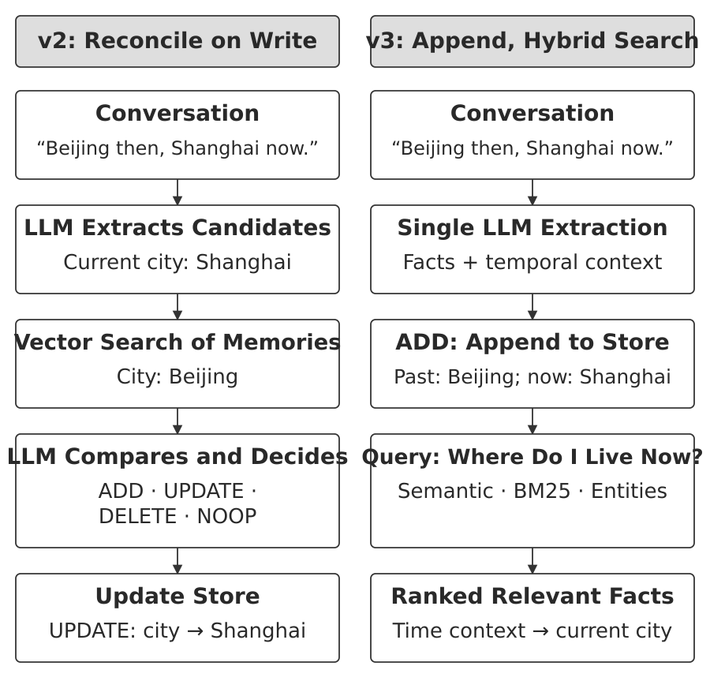

In the earlier pipeline, an LLM first extracts candidate facts from the conversation, then retrieves similar existing memories and decides whether to perform **ADD**, **UPDATE**, **DELETE**, or **NOOP**. If the user first says "I live in Beijing" and later "I moved to Shanghai," the system can update the current place of residence to Shanghai. Queries then easily retrieve a consolidated fact; maintenance, however, must correctly recognize corrections, changes over time, and different subjects, and must keep the basis for each update so that errors can be traced once they are found. The paper also proposed a graph-memory variant, **Mem0-g**, which expresses connected knowledge through entities and relationships.[^ch3-mem0-paper]

v3 reduces automatic extraction to a single LLM call that only appends **ADD** records. The Beijing and Shanghai statements can both be kept, together with their timing, and the current residence is determined from context at query time. Retrieval combines semantic similarity, BM25 keywords, and entity matching; actions already confirmed as completed can also be extracted as facts. The migration guide reports that the LoCoMo score rose from 71.4 to 91.6 and LongMemEval from 67.8 to 93.4. This open-source version uses entity links for internal retrieval and removes the external graph-store interface and the `relations` return value; graph memory is offered by the hosted platform.[^ch3-mem0-migration]

This evolution shows that a memory system can move conflict resolution from the write stage to the read stage. If, at write time, the experiences of two people are mistakenly merged, or an addition is mistaken for a correction, later answers may keep relying on a wrong current state. Append-only storage lets both old and new evidence take part in the judgment, and it also cuts the model calls needed to decide each entry at write time. For user memory that changes often and whose conflicts are hard to judge at the moment, I lean toward first saving facts with their time and source, and then working out the valid state when a specific question has to be answered.

[^ch3-mem0-paper]: Chhikara et al. *Mem0: Building Production-Ready AI Agents with Scalable Long-Term Memory*. 2025.

[^ch3-mem0-migration]: Mem0. "Open Source: Migrating to the New Memory Algorithm."

**Memobase: User Profiles and Event Memory.** Memobase organizes long-term information into two parts. The **user profile** stores relatively stable attributes by topic and subtopic, such as the name under `basic_info`, interests under `interest`, and the job title under `work`. Developers can configure which slots are extracted, controlling the scope and granularity of the profile. **Event memory** records the user's experiences and when they happened, so the system can answer questions such as "When did we last discuss the budget?"

Memobase first places new conversations in a buffer and processes them in batches once the buffer reaches a specified size or the session has been idle for a set time; processing can also be triggered explicitly at the end of a session. Many messages thus share one consolidation pass, while queries read the profiles and events already generated. Asynchronous updates reduce how long the current interaction waits for memory extraction; when the newest facts are needed immediately, the caller can wait for the current pass to finish.[^ch3-memobase]

[^ch3-memobase]: Memobase, official project documentation, covering profile fields, event memory, the buffer, and the synchronous update interface.

If the assistant must remember how the last booking went while also knowing the user's seat preference and the procedure for requesting a refund, it can store events, facts, and procedures separately, as in Figure 3-4. For each task it receives, it then loads the parts it needs into working memory.

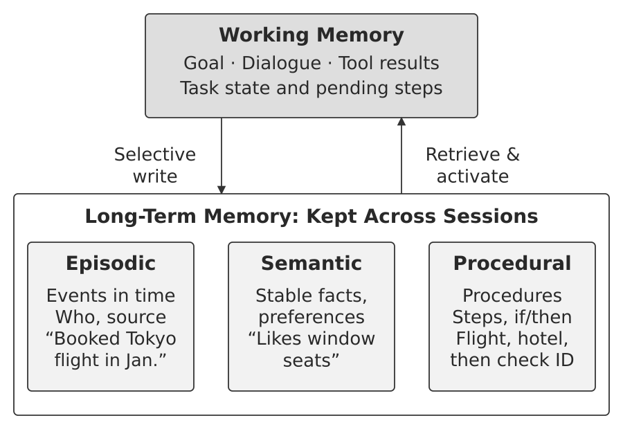

Episodic memory keeps event sequences along with metadata such as timestamps, emotional markers, and task identifiers, so time and topic can be combined in retrieval. For example, "the last time we discussed the budget" needs both topic matching and ordering by time. Semantic memory stores the facts and preferences extracted from events, and procedural memory stores procedures that are used repeatedly.

**Working memory** organizes the current goal, the task state, and the relevant information already retrieved. The Harness selects content from the trajectory and from long-term storage and loads it into the current context; new facts produced by the task are consolidated and then written to long-term memory. The trajectory records how things happened, while working memory concentrates the information needed for the next decision; the two are linked by event identifiers and sources.

When RAG is used to read user memory, the system first finds a batch of possibly relevant memories for the current request and then decides which ones belong in working memory. Suppose the assistant is helping the user choose a seat today, and retrieval finds two statements at once: "On business trips I like window seats" and "I hurt my knee last time, so get me an aisle seat for the return flight." Both are highly relevant to seat selection, but the second made a request only for that particular return flight. Reranking by relevance, even if it puts the second one first, still does not say whether it applies today.

In this situation, I favor using a judgment model such as Jev to screen the candidate memories. Give it this trip, the user's current request, and each memory's original wording, date, and conditions of applicability, and have it judge each one as "applies this time," "for reference only," or "insufficient basis." If today is also a business trip, the first memory can guide the seat choice; if the user has just said their knee has not healed, the second is worth bringing back as a question.

### Memory Compression and Organization Mechanisms

A user who books flights often may mention "window seat" ten times. Nine of those may simply repeat details of the same booking; treating the number of mentions as the strength of the preference inflates the weight of a single event. Consolidation should first identify sources and events, then merge duplicate records, check for later corrections, and only then decide which patterns are fit to use in future tasks. Faced with "That window seat last time was nice," the system can ask a judgment model such as Jev to read the statement and the related orders and decide only whether it is "recalling the last flight," "making a request for this trip," or "expressing a long-term preference." If no order matches, or several interpretations are equally plausible, the original wording is kept and verified at booking time. One local judgment of this kind prevents the same experience from being counted again and again as new evidence.

1. **Select what to consolidate.** Access frequency, record age, emotional markers, and uniqueness can serve as ranking signals. For example, a record created three days ago, accessed five times, with a strong emotional marker and no duplicates deserves to be kept on its own; a record created ninety days ago, accessed only once, and closely duplicating three others can be merged with related records first. The system can first use these scores to pick out records that need consolidation, then apply business rules to decide whether to compress, merge, or delete them. Long-term constraints and contracts in force should be kept until they expire, even if they are rarely accessed.
2. **Cluster and summarize.** Group similar records and keep their shared content in a single summary. For example, many conversations about the weather can be consolidated into "The user often asks about the weather and is particularly concerned about rain." The specific dates and original questions are archived, and the summary links to the original records so that they can be consulted later.
3. **Extract patterns and procedures.** From many shopping records, generalize "prefers good value for money and pays attention to user reviews," or distill the steps the user follows to choose products.

### Privacy Protection: Log Sanitization

User memory often contains identity details, contact information, and account information. The system must decide, task by task, which fields enter the model's input, and, according to operational needs, which content enters the logs. Sanitization can happen before logs are written, replacing sensitive fragments with type labels or stable placeholders while keeping the structure needed for troubleshooting.

> **Experiment 3-3 ★★: Log Sanitization with a Local Model**
>
> This experiment uses Ollama to call a local Qwen3-0.6B that identifies sensitive fragments in logs on the local machine. A small model is suitable for deployment on consumer hardware, and you can switch to sizes such as 1.7B or 4B to compare detection quality with processing time. When raw logs must stay local, detection and replacement should also happen on the local machine, with only the sanitized result handed to downstream services.
>
> The test material includes structured numbers such as national ID numbers and bank card numbers, semi-structured content such as addresses, and sensitive information revealed in natural language, such as passwords. The model returns the type, text position, and confidence of each item according to a JSON Schema, and the program replaces the original text accordingly. The control group uses regular expressions; the hybrid group applies regular expressions first and then lets the model handle the remaining text.
>
> Look at two log lines first. The first contains a national ID number and a phone number; the regular expressions masked only the phone number, for a recall of $1/2$. In the second, the regular expressions found both the U.S. Social Security number and the bank card number, but also masked a ticket number with a similar format. Of the three spans it flagged, only two needed sanitizing, for a precision of $2/3$. A check that only asks whether sensitive values remain in the log would pass the second line; the problem surfaces only when a support agent uses that log to look up the ticket and finds the lead has been lost.
>
> Computing recall for each of all 12 samples and averaging gives about 50%, 69%, and 78% for the regular expressions, the model, and the hybrid scheme, respectively. Counting what remained after replacement, the three schemes left 9, 3, and 2 sensitive values. The trade-off also depends on processing time: on this machine, the regular expressions take about 0.1 milliseconds per line on average, while the model and the hybrid scheme both take close to 3 seconds. With large log volumes, regular expressions can handle fields with stable formats first, leaving the model to check only the fragments that need context to judge.

As records accumulate, the next step is to find, among thousands or tens of thousands of entries, the content the current task needs. The RAG techniques introduced next apply both to shared knowledge bases and to user memory retrieval.

## RAG Basics: Building an Agent's Knowledge Acquisition Pipeline

A store has revised its refund policy, and a user asks: "I bought something last month. How do I request a refund now?" To answer correctly, the system must first find the terms that apply to this order and then explain the conditions and steps clearly. **Retrieval-Augmented Generation** (RAG) connects these two steps, letting the model use the store's internal materials, including policies published after its training ended.

Start with the case where there is only one version of the policy. The following simplified interface queries the same store's refund process, showing how the retrieval results flow into the model's answer:

```python
query = "refund process"
results = retriever.search(query, top_k=2)
# results = [
#   "Refund policy: A full refund can be requested within 7 days of delivery; the order number is required. Refunds arrive within 3–5 business days.",
#   "Refund steps: Go to 'My Orders', select the order, and click 'Request refund'."
# ]
answer = llm.generate(system="You are a customer service assistant.", context=results, question=query)
# The answer covers the deadline, the required information, the steps, and when the money arrives.
```

Compare Figure 3-5 with the two retrieval results in the code: the steps for requesting a refund come from "Refund steps," while the 3–5 business days before the money arrives comes from "Refund policy." If the retrieval results contained only the steps, would the model still have any basis for telling the user when the money will arrive? This question bears directly on how the manual should be chunked.

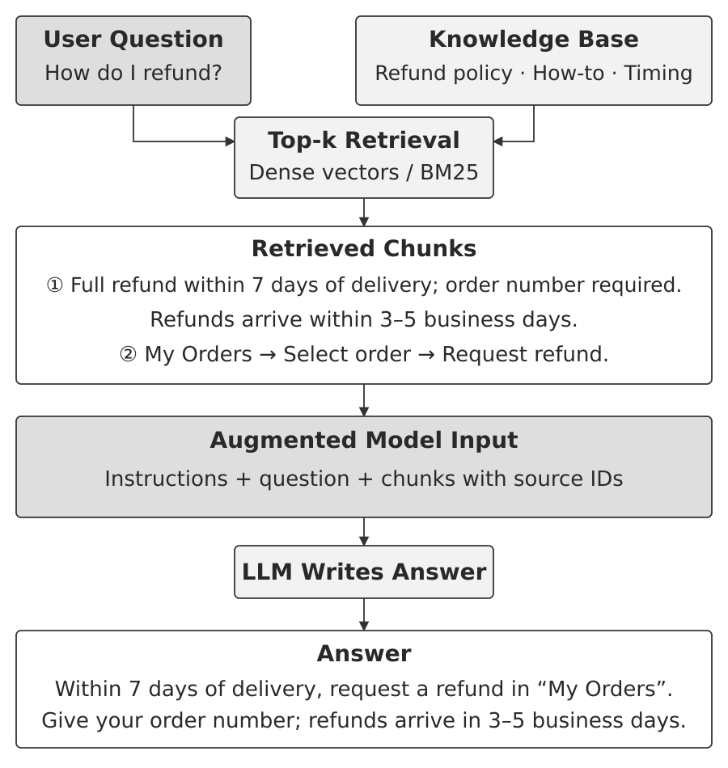

### Document Chunking

Suppose an after-sales manual first states "returns accepted within seven days" and then, in the next paragraph, lists the excepted products. Retrieve only the first sentence, and the system may promise refunds on excepted products too; treat the whole manual as one retrieval unit, and it drags along installation, configuration, and troubleshooting, making it hard for the vector to bring out the refund topic. **Chunking** has to choose a size between these two extremes, so that a piece of text is enough to explain its own conditions and is also easy for a specific question to find. Chunk length must also fit the embedding model's input budget and leave context space for the generation that follows.

There are three common approaches.

**Fixed-size chunking** splits by token count, for example 512 tokens per chunk, with 50–100 tokens of overlap between adjacent chunks. The overlap gives content near a boundary the chance to appear whole in the neighboring chunk. This approach makes chunk length easy to control, but a cut may fall in the middle of a paragraph, a piece of code, or a table.

**Recursive or structure-aware chunking** splits along natural boundaries such as sections and paragraphs first, and splits overly long parts further by smaller units such as sentences. Markdown headings and HTML elements provide structural cues. Code blocks, tables, and the text attached to a heading can also be given dedicated handling rules. For well-structured technical documents, I recommend starting with this approach: use the existing sections and paragraphs first, then subdivide the parts that are too long. This usually preserves complete meaning better than truncating directly.

**Semantic chunking** computes the embedding similarity of adjacent sentences or groups of sentences and splits where the topic changes noticeably. It adds embedding computation but has a chance of keeping a single topic within one chunk.

Suppose the retriever returns just one sentence: "The company's revenue grew by 3%." Which company? Which quarter? The number is right, but the basis for answering the question is in the previous paragraph. If the entire financial report is packed into one chunk, the quarter and the company name survive, but a query about revenue also pulls in the paragraphs on hiring and equipment purchases. All this content must share a single vector, so the revenue topic may no longer stand out in it. When choosing a chunk size in practice, you can start experimenting at 256–1024 tokens per chunk with 10%–20% overlap between adjacent chunks.

Metadata such as titles, sources, and dates can be stored along with each chunk. The contextual retrieval technique discussed later goes further, adding to each chunk its background in the original document so that references and scope can be resolved when the chunk is retrieved on its own.

### Dense Embeddings: Representing Text as Vectors

An **embedding** maps a word, sentence, or chunk of text to a numeric vector, such as `[0.2, -0.5, 0.8, ...]`. Retrieval models are trained so that related queries and documents have high similarity in the vector space. "Dense" means that most dimensions of the vector have non-zero values that together represent the text's information; the sparse representations discussed later have only a few non-zero dimensions.

You can picture the vector space as a high-dimensional map: each piece of text corresponds to a location, and retrieval searches it for content close to the query. One common measure is **cosine similarity**:

$$
\operatorname{cos}(A,B)=\frac{A\cdot B}{\|A\|\,\|B\|}
$$

The dot product $A\cdot B$ multiplies corresponding dimensions and sums the results; the norm $\|A\|$ is the square root of the sum of the squares of each dimension. After dividing by the two norms, the result reflects only the relationship between directions. For non-zero vectors, the cosine ranges over $[-1,1]$; the closer it is to 1, the more aligned the directions. Some retrieval models use the dot product or Euclidean distance instead. When both vectors are normalized to unit length, the dot product equals the cosine similarity.

> **Working It by Hand: Cosine Similarity of Three Sentences**
>
> Use three illustrative vectors to represent "How to raise a cat" $A=(0.9,0.5,0.1)$, "Cat care guide" $B=(0.8,0.6,0.1)$, and "Stock investment strategy" $C=(0.1,0.1,0.9)$.
>
> $A\cdot B=0.9\times0.8+0.5\times0.6+0.1\times0.1=1.03$. The two norms are $\sqrt{1.07}$ and $\sqrt{1.01}$, so the similarity is about **0.991**.
>
> $A\cdot C=0.9\times0.1+0.5\times0.1+0.1\times0.9=0.23$, and the norm of $C$ is $\sqrt{0.83}$, so the similarity is about **0.244**. Within this set of vectors, the cat-raising query is much closer to the care guide.

Real models typically use hundreds to thousands of dimensions.

#### From Word2Vec to Context-Awareness

Figure 3-6 starts with fixed word vectors. **Word2Vec** learns a fixed vector for each word from word co-occurrence. Some relationships show up in vector arithmetic, as in the classic "king − man + woman ≈ queen." The limitation of a fixed representation is just as plain: `bank` gets the same word vector in `river bank` and `investment bank`.

**GloVe** counts how often words co-occur across the whole corpus and then learns word vectors through a weighted least-squares objective. Word2Vec centers on a prediction task within local windows, while GloVe builds global co-occurrence statistics directly into training; both learn a fixed representation for each word.[^ch3-glove]

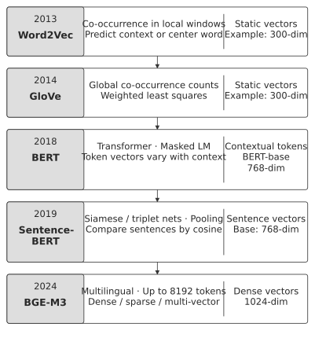

With contextual models such as **BERT**, the representation of the same token changes with the sentence. Through self-attention, the model can use cues such as "releases a new product" and "bought two pounds of" to compute different representations of "apple" in the two sentences. An embedding model used for retrieval must also pool token representations into a query or document vector and be trained so that the two can be compared.

**Sentence-BERT** combines BERT with pooling and a siamese or triplet network structure to train sentence vectors that can be compared directly. Documents can be encoded in advance and stored in an index; when a query arrives, only the query needs to be encoded before vector similarity is computed. Encoding in advance avoids recomputing the representations of all documents for every query.[^ch3-sbert]

**BGE-M3** provides dense, sparse, and multi-vector retrieval representations at once, and supports multiple languages and longer inputs; this section uses its dense representation to illustrate single-vector retrieval.[^ch3-bge-m3] The input length a model accepts affects the chunking scheme: the original BERT typically tops out at 512 tokens, while BGE-M3 supports up to 8192 tokens.

[^ch3-bge-m3]: The M3-Embedding paper by Chen et al. (arXiv:2402.03216) describes how the three retrieval representations are trained jointly. See also BAAI's BGE-M3 model card, which covers the representations, dimensions, input length, and usage.

> **Experiment 3-4 ★★: Comparing Two Approximate Nearest Neighbor Indexes**
>
> Once document vectors are built, the vectors close to a query must be found quickly. Computing similarity one by one yields the exact nearest neighbors, but as data grows, an **Approximate Nearest Neighbor** (ANN) index trades a controllable loss of recall for query speed. This experiment compares ANNOY and HNSW on the same set of real embeddings and the same queries, using exact search results as the reference. For example, if exact search lists ten nearest neighbors for a query and the approximate index's ten results include eight of them, that query's Recall@10 is 0.8. This number measures how many of the exact neighbors the index preserves.
>
> ANNOY narrows the candidate set with a forest of random projection trees; HNSW uses a hierarchical proximity graph, first approaching the target region quickly on sparse upper layers and then searching the denser lower layers. Figure 3-7 shows the layered structure of HNSW.
>
> 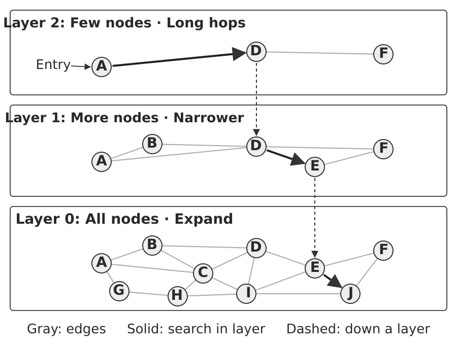
>
> Table 3-2 Implementation Trade-offs of ANNOY and HNSW
>
> | Aspect | ANNOY | HNSW (hnswlib as an example) |
> | --- | --- | --- |
> | Index structure | A forest of random projection trees | Hierarchical proximity graph |
> | Build cost | Varies with the number of trees, the number of vectors, and dimensionality | Varies with neighbor-list size, build-time search breadth, and data volume |
> | Memory and files | Static index supports memory mapping and sharing across processes | Stores the vectors and the graph's adjacency; neighbor-list size affects overhead |
> | Incremental updates | Adding entries after the index is built requires a rebuild | Supports insertion, updates, and deletion marks; capacity must be managed |
> | Recall and speed | Tuned through the number of trees and the query search budget | Tuned through build parameters and query search breadth |
> | Use cases | Static indexes that are easy to distribute and share | Dynamic indexes that are written to and queried continuously |
>
> This run first built the index from 240 passages. For the same 20 queries, both indexes found all of the top 10 neighbors returned by exact search. On the initial build, ANNOY took about 13 milliseconds in a Linux container and HNSW about 78 milliseconds in the local environment; the saved indexes were about 1.40 MB and 1.02 MB, respectively. The remaining 60 passages were then added: ANNOY rebuilt its index, while HNSW inserted the new vectors directly. The collection now held 300 passages, and the original neighbors could change as a result. After exact search was rerun on the new collection, both indexes still had an average recall of 100%.

[^ch3-ann]: The Annoy project documentation from Spotify explains how to build a read-only index, load it with memory mapping, and use `search_k` to adjust how many nodes are examined at query time. The Python interface section of the hnswlib project documentation describes the `add_items` method for appending vectors and the `set_ef` method for adjusting query breadth.

**Choose the index according to how the knowledge is updated.** When the corpus is published in periodic batches and many processes share the same read-only index, I would consider ANNOY first; when new documents arrive continuously and must be inserted online, HNSW is the better first choice. The embedding model determines the semantic representation, and the index determines whether those representations can be served with suitable latency and update cost; together they determine how well the retrieval service performs.

Tuning ANNOY's number of trees and search budget, or HNSW's neighbor-list size and search breadth, shows how recall and latency change.[^ch3-ann] Index recall measures whether the target neighbors were found; whether those neighbors can answer the user's question depends on the embedding representation and on the content of the material.

### Sparse Representations: From Keywords to Relevance Scores

A **sparse representation** uses a high-dimensional vector in which only a few dimensions are non-zero. Traditional keyword retrieval uses terms as dimensions and assigns weights according to the words that appear in a document. Its foundation is the **Bag of Words** (BoW) model, which records words and how often they occur while ignoring their order. As a result, "cat chases dog" and "dog chases cat" have the same bag-of-words representation.

This representation is well suited to matching names, identifiers, and technical terms. We begin with TF-IDF to show how term frequency and document frequency are turned into a ranking score.

#### From TF-IDF to BM25

**TF-IDF** (Term Frequency–Inverse Document Frequency) combines two signals: how many times a term appears in the current document and how common it is across the corpus. Suppose 60 of 100 articles contain "model" but only 3 contain "distillation"; for the query "model distillation," "distillation" does more to distinguish the relevant articles.

One basic formulation is:

$$\operatorname{TF\!\text{-}\!IDF}(t,d)=\operatorname{TF}(t,d)\times\operatorname{IDF}(t),\qquad \operatorname{IDF}(t)=\ln\frac{N}{\operatorname{DF}(t)}$$

$\operatorname{TF}(t,d)$ is the number of times term $t$ appears in document $d$, $\operatorname{DF}(t)$ is the number of documents containing the term, and $N$ is the total number of documents. Under this formula, a term appearing ten times contributes twice as much as one appearing five times, and a long document may score higher simply because it contains more words. TF-IDF has many normalized variants; BM25, below, handles both effects with term-frequency saturation and length normalization.

**BM25** sums the contributions of the individual query terms:

$$\operatorname{Score}(Q,D)=\sum_i\operatorname{IDF}_{\mathrm{BM25}}(q_i)\cdot\frac{\operatorname{TF}(q_i,D)(k_1+1)}{\operatorname{TF}(q_i,D)+k_1\left(1-b+b\frac{|D|}{\operatorname{avgdl}}\right)}$$

Here $q_i$ is a query term, $|D|$ is the document length, and $\operatorname{avgdl}$ is the average document length. $k_1$ controls how quickly term frequency saturates; $b$ controls the strength of length normalization, and setting it to 0 turns that correction off. Figure 3-8 computes these terms separately. First it fixes the document length and lets a query term go from one occurrence to three, showing how much each additional occurrence adds; then it fixes the term frequency and only doubles the document length. The bottom row compares how common two terms are in the document collection.

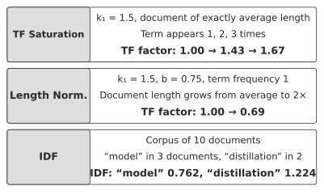

In the first row of the figure, the second occurrence raises the term-frequency factor by about 0.43, while the third adds only about 0.24: this is term-frequency saturation. In the second row, the same term occurs only once in each document, but it stands out less in the longer one, so the length correction lowers its term-frequency factor. Multiplying by the IDF then gives the term's contribution to the total score.

One part of the formula remains to be settled: when two terms each occur three times, why is the rare term usually more useful than the common one? This section weights terms with the following inverse document frequency:

$$\operatorname{IDF}_{\mathrm{BM25}}(t)=\ln\frac{N-\operatorname{DF}(t)+0.5}{\operatorname{DF}(t)+0.5}$$

The numerator is the number of documents that do not contain the term and the denominator is the number that do; adding 0.5 to each smooths the result so that it can still be computed when the document frequency is 0 or $N$. Rare terms receive higher weights; when more than half of the documents contain the term, this formula yields a negative number. The companion implementation sets a floor of $10^{-6}$ on the weight actually used for scoring, while keeping the raw value for inspection.

> **Experiment 3-5 ★★: Implementing a BM25 Search Engine from Scratch**
>
> This experiment carries out tokenization, stop-word handling, inverted indexing, and scoring in turn. Stop-word handling can filter out high-frequency Chinese words such as "的" and "了" (function words as common as "the" or "of" in English). An **inverted index** records which documents each word appears in, along with its frequency there; it resembles the term index at the back of a book: look up "TCP" and you find pages 45, 112, and 203, then read the content at those locations.
>
> Work through one query, "model distillation," by hand. Suppose the corpus has 10 documents with an average length of 250 words, and $k_1=1.5$, $b=0.75$. "Model" appears in 3 documents, with an IDF of about 0.762; "distillation" appears in 2, with an IDF of about 1.224. The table below lists, term by term, the matching documents, the term frequencies, and the document lengths. Substituting these values into the formula gives each term's contribution to each document's score.
>
> | Query Term | Document | Term Frequency TF | Document Length | BM25 Contribution |
> | --- | --- | ---: | ---: | ---: |
> | model | doc_1 | 5 | 200 | 1.52 |
> | model | doc_3 | 2 | 500 | 0.82 |
> | model | doc_7 | 8 | 150 | 1.68 |
> | distillation | doc_1 | 3 | 200 | 2.15 |
> | distillation | doc_5 | 1 | 250 | 1.22 |
>
> The two terms' contributions to doc_1 add up to about 3.67, giving the ranking **doc_1 (3.67) > doc_7 (1.68) > doc_5 (1.22) > doc_3 (0.82)**. In doc_1, "distillation" has a lower term frequency than "model," but it is rarer, so its final contribution is larger; matching both terms raises the total further.
>
> Now query the companion experiment's English corpus with `cat`. The two short texts labeled relevant use `kitten` and `feline`, respectively, and `cat` does not appear in the inverted index at all, so the candidate list is empty. No matter how high the term-frequency weights above are pushed, there is not a single document to score. Query again with the words those two texts actually use, and each of them enters the candidate list.

### Hybrid Retrieval: Merging Two Result Lists, Then Reranking

For some questions, it is hard to list every synonym in advance. One question in Experiment 3-6 asks how to reclaim unused heap space automatically, yet the target passage says that "automatic memory management frees developers from having to release objects by hand." The English query and the passage share no terms; keyword retrieval returned none of the relevant documents, while vector retrieval ranked the target first. Switch to a query for the model number XR-7003, and keyword retrieval finds the matching model directly, while vector retrieval also lists several similar model numbers.

**Hybrid retrieval** first searches for relevant passages separately with keywords and with vectors, then decides which passages are worth handing to the model. When a knowledge base contains both exact identifiers and natural-language descriptions, I recommend starting here. Follow XR-7003 through Figure 3-9: both paths rank it first, so it receives two rank contributions during fusion. Reranking replaces the second-place result, but the model number the user sees first is still the correct one.

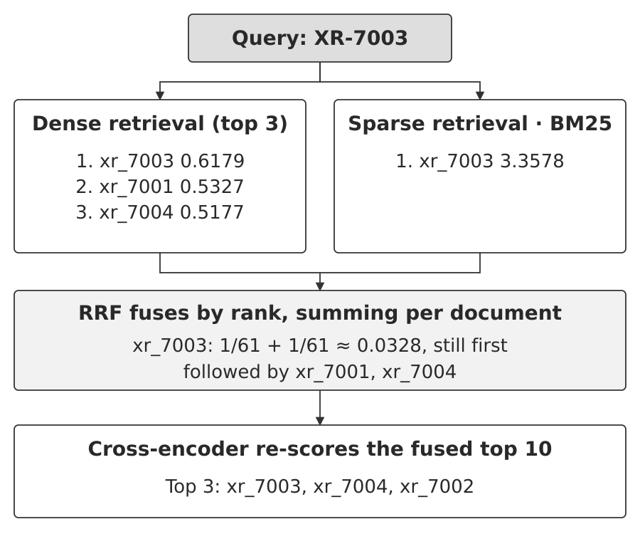

The first stage is **parallel retrieval**: the query is sent to the dense and the sparse engine, and each retrieves a batch of possibly relevant documents. The two paths can use the same raw text, or each can preprocess it as its model requires.

The second stage is **result fusion**: the same document appearing in both result lists is merged, and everything is ranked together. Cosine similarity and BM25 have different numeric scales, so adding them directly tends to let the path with larger numbers dominate. One approach is to calibrate or normalize the scores first and then combine them with weights; another is **Reciprocal Rank Fusion** (RRF), which works from each path's ranks:

$$\operatorname{RRF}(d)=\sum_{j:\,d\in R_j}\frac{1}{k+\operatorname{rank}_j(d)}$$

$R_j$ is the result list from path $j$, ranks start at 1, and a path in which the document does not appear contributes zero. The smoothing constant $k$ is often set to 60; the larger it is, the smaller the score gaps between the top few ranks. RRF makes it easy to combine different scoring methods, but it keeps only ranks; the differences in strength carried by the original scores have to be exploited by other means.

Try a two-path example. The user asks "How long until my refund arrives?" Document A ranks first in keyword retrieval and does not appear near the top of vector retrieval; document B ranks second in both. With $k=60$, A scores $1/61$, about 0.0164, and B scores $1/62+1/62$, about 0.0323. After fusion, B ranks ahead of A. This result only says that both retrieval paths found B. To decide whether B actually answers when the money arrives, you still have to check whether it covers "how to request a refund" or "when the refund arrives."

The third stage can add **neural reranking**. The system takes the top-ranked documents after fusion, say the top 50, and has a reranking model score how relevant each one is to the query. Reranking can change the order of those 50. If the truly useful document never made the cut, the fix has to go upstream into retrieval.

The model commonly used here is a **cross-encoder**: the query and a candidate document are fed in together, the two interact inside the model, and the model outputs a relevance score. The **bi-encoder** used at the retrieval stage encodes the query and the document separately; document vectors can be computed in advance, and a query requires only a vector search. The former suits fine-grained ranking of a few documents; the latter suits first-pass screening over a large collection. Think of résumé screening and interviews: first narrow the field using features already on paper, then compare candidates in depth against the specific requirements. BGE Reranker v2 M3 is one model that can serve in this role.[^ch3-reranker]

[^ch3-reranker]: BAAI, BGE Reranker v2 M3 model card, describing the query–document input and relevance scoring.

When relevant material is already in the candidate pool but often ranks behind irrelevant material, I would evaluate cross-encoder reranking first. Because it reads the question and the document together, it can directly check whether the conditions, qualifiers, and details in the document meet the question's requirements. Table 3-3 lists three commonly used metrics.

Table 3-3 Three Metrics for Retrieval Quality

| Metric | Computation and Meaning |
| --- | --- |
| recall@k | The number of relevant documents in the top k results divided by the total number of relevant documents for the query, measuring how much of the relevant content was found; a test set usually averages this across queries |
| MRR (Mean Reciprocal Rank) | For each query, take the reciprocal of the rank of the first relevant document, then average; rank 1 scores 1, rank 10 scores 0.1, and not found scores 0 |
| nDCG@k (normalized Discounted Cumulative Gain) | Assign each result a score by its degree of relevance, discount lower ranks, and divide by the score of the ideal ordering, measuring the overall ranking quality of the top k results |

You can also record the **hit rate**: how many queries retrieve at least one relevant document in the top k results? Suppose a question needs three documents and the top twenty results contain only two of them. This query is a hit, so it does not count as a failure under "complete miss," but its recall@20 is only $2/3$, with $1/3$ of the material still not found. If every question has only one target document, a question that finds it scores 1 and one that misses it scores 0. Averaged over the same set of retrieval results, the hit rate then equals the mean recall.

> **Experiment 3-6 ★★: Comparing Sparse, Dense, Fusion, and Reranking**
>
> This experiment compares five configurations on the same 12 annotated queries: sparse retrieval, dense retrieval, RRF fusion, weighted fusion, and reranking after fusion. The queries cover semantic similarity, exact names, multilingual queries, and technical code; two of them ask, in English and in Chinese respectively, how plants turn sunlight into food. The dense model is Qwen3-Embedding-0.6B and the reranker is an MS MARCO MiniLM cross-encoder; each path retrieves at most 10 documents, and the reranker processes at most the top 10 documents from RRF. Recall and nDCG look only at the top 3 of the final ranking, while MRR searches down the returned list for the first relevant document.
>
> First open the per-query rankings in the run log for Experiment 3-6 and compare the results for the two photosynthesis questions. For the English question, the target document still ranks first. For the Chinese question, the first results are about programming languages and volcanoes, and only the third is about photosynthesis. Each question has just one document labeled relevant, and both questions found it in the top three, so recall@3 is 1 for both. But the Chinese question's first relevant document ranks third, giving a reciprocal rank of only $1/3$. Under this experiment's scoring, the gain at rank three is $1/\log_2(3+1)=0.5$ and the gain at rank one is 1, so the Chinese question's nDCG@3 is 0.5.
>
> Now look at all 12 questions. After reranking, besides the Chinese photosynthesis question, one more question, about reclaiming heap memory, saw its target document drop from first to second. The other ten questions kept their targets in first place, so the MRR after reranking is $(10+1/2+1/3)/12\approx0.903$. For comparison, dense retrieval and RRF both have an MRR of 1. Both also have an nDCG@3 of 1, which falls to about 0.928 after reranking. Average recall alone hides these rank changes: sparse retrieval's recall@3 is 0.833, and the other four configurations all score 1.
>
> Suppose you now have to pick a configuration for this set of questions: what did the time spent on reranking buy? On this CPU, RRF takes about 194 milliseconds per question on average from the start of retrieval to producing a ranking; with reranking added, it takes about 237 milliseconds. The extra 43 milliseconds or so did not find any additional target documents, and it pushed the correct answers to two questions further down.

## Knowledge Organization and Retrieval

How knowledge is organized determines what each entry contains; the retriever determines what is pulled back from those entries. Paragraphs in technical manuals, legal documents, and papers are tied together by section hierarchy, conceptual dependencies, and cross-document references. Preserving these structures lets a query reach both specific evidence and higher-level generalizations.

This section discusses several ways of organizing knowledge in turn: RAPTOR and GraphRAG build hierarchical or relational indexes; OpenViking organizes context resources in directories; incremental updates and periodic reorganization keep knowledge current; Agentic RAG lets the Agent keep retrieving based on the results it already has; contextual retrieval adds background to each chunk; and finally, reusable knowledge is extracted from datasets. These techniques act on representation, indexing, updating, and querying respectively, and they can also be combined for user memory.

Two examples first show the gap between the information a query needs and the raw records.

**Case 1: Counting Black and White Cats.** In the previous chapter, a program counted all 100 cages and found 90 black cats and 10 white cats. This time the retriever is asked to return only the top 20 records. Suppose 18 of them give valid color information, 15 showing black cats and 3 showing white cats. The resulting 83.3% (15/18) is the share of black cats among these valid records; the share of black cats in the whole shop, however, is 90% (90/100). The retriever selects records by relevance; it does not draw a representative sample of the shop.

If people often ask about the proportion across the whole shop, all the cages can be counted in advance and the numbers of black and white cats saved, labeled with the scope of the count and the time it was last updated. When the cats in a cage change, the corresponding detail record is updated and the totals recomputed. If someone asks what is in cage 37, the system still has to look up that one detail record.

**Case 2: Does a Nurse Get the Discount a Doctor Got?** Take a teaching scenario built around inquiries about Xfinity discounts. In the support tickets, veteran John passed review, doctor Sarah received a discount, and teacher Mike was told the discount did not apply. Each ticket records the outcome of one case. If a nurse asks whether the discount applies to them, retrieving only similar tickets runs into three problems.

- **Similar occupations do not necessarily qualify for the same discount.** "Nurse" is semantically close to "doctor," so Sarah's record may rank near the top; but eligibility depends on whom the promotion's terms allow to apply and what proof they must show.
- **Individual tickets cannot list every eligibility condition.** That one person passed review speaks directly only to that person's outcome under the conditions at the time; retrieving more tickets will not necessarily surface categories or exceptions that have never come up.
- **The scope of the material is unclear.** Tickets may come from different promotions or different periods. The system first has to establish which records apply and which policy basis is missing.

At indexing time, tickets from the same promotion can be linked together and checked against the corresponding official terms, and the eligible groups, exceptions, effective dates, and the source of each term can be organized into a rule card. For example, if the terms in this teaching scenario explicitly cover active-duty service members and veterans and licensed medical professionals, and exclude teachers, those conditions are saved item by item; whether nurses count as medical professionals is also settled by the terms. The tickets are kept as well, to explain how cases were actually handled and to reveal discrepancies in how the rules were applied.

The two examples reflect different information needs: counting cats requires tallying every cage in the shop, while deciding who gets the discount requires the complete terms and their exceptions. For queries of this kind, I argue for moving statistics and rule-building forward to indexing time. Merely retrieving more chunks may still leave the model unable to see the full scope of the count or the terms that decide whether this application is approved. By building statistical summaries, rule cards, and source links around the task, retrieval can obtain enough information to support a judgment in one pass and can still trace back to the raw material.

### Structured Indexing: Building Hierarchies and Connections

When reading a long report, the answer to "Which field do I fill in on the repair request?" can usually be found in one passage, while "Why do certain kinds of faults keep recurring?" spans several sections. To serve both kinds of query, you can generate summaries, build hierarchies, or extract entities and relationships when building the index. RAPTOR, described next, forms a hierarchy through recursive summarization; GraphRAG organizes material through entity relationships and community summaries.

**RAPTOR** (Recursive Abstractive Processing for Tree-Organized Retrieval) starts from text chunks: it encodes each chunk as a vector, clusters the chunks into groups by similarity, and generates a summary for each group. Treating the summaries as a new batch of text chunks and repeating these steps yields the tree in Figure 3-10. Follow the arrows up from text chunks 3, 4, and 5: together they produce summary B; further up, the summaries of groups A, B, and C combine into a global summary.[^ch3-raptor]

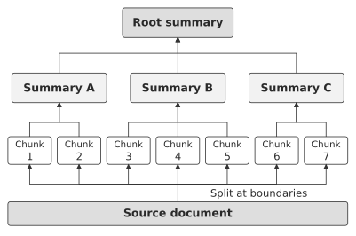

For example, "SSE2 supports integer SIMD operations in 128-bit XMM registers" and "SSE4.2 adds string comparison instructions" can be folded into a summary titled "Evolution of the x86 SIMD Instruction Sets." Detail questions can match the lower-level chunks, and overview questions the higher-level summaries. A query can descend through the hierarchy step by step, or nodes from every level can be searched together and the most relevant set selected.

[^ch3-raptor]: Sarthi et al. *RAPTOR: Recursive Abstractive Processing for Tree-Organized Retrieval*. 2024.

**GraphRAG** organizes knowledge through entities, relationships, and community summaries. It records each relationship as a "subject—relation—object" triple, such as (China, has capital, Beijing) or (Zhang San, works at, Tencent). Any two records that mention the same entity can be connected in the graph. The two doctors in Figure 3-11 are both named Zhang. When the user asks for "the address of my dentist's hospital," which relationship should the system follow?

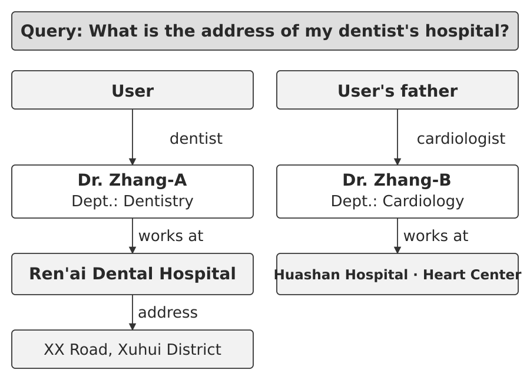

1. **Distinguish entities with the same name when building the graph.** One Dr. Zhang treats the user's teeth at Ren'ai Dental Hospital; the other treats the user's father for heart disease at Huashan Hospital. When the system extracts entities and merges records, it can use these clues to assign the two doctors different identifiers. The `person` and `relationship` fields discussed earlier serve a similar purpose. Deciding whether `bank` in a sentence means a riverbank or a financial institution is word sense disambiguation; deciding which Dr. Zhang a record refers to is entity disambiguation.
2. **Follow the relationship chain at query time.** Starting from the user and moving step by step along "user → doctor → hospital → address," the system can link information scattered across several records into a single answer.

Microsoft's GraphRAG indexing pipeline first extracts entities and relationships from text units, then uses community detection to identify tightly connected groups of entities and generates a community hierarchy with summaries. For a query about a particular entity, local search combines that entity's connected information with the source text; for a query about themes across the whole corpus, global search organizes the answer using the community summaries.[^ch3-graphrag]

[^ch3-graphrag]: Microsoft GraphRAG, overview of indexing and querying, local search, and global search.

Relational representations also need to accommodate conditions and time. For example, "If it's still raining next week, I'll cancel the beach trip and go to the museum instead" contains a condition, a period of validity, and an alternative action. Extracting only (user, plans, beach trip) and (user, has backup plan, museum trip) loses the condition for switching. The complete sentence can be kept, with the "if it rains next week" constraint represented by a condition node, an event node, or structured fields, and with the relationships pointing back to the original text.

For user memory, I recommend **layering natural language and structured indexes together**: keep complete statements in natural language, record subjects, times, and sources as metadata, and build graph indexes for content that frequently needs to be linked.

> **Experiment 3-7 ★★★: Comparing Hierarchical Summaries and Relational Indexes**
>
> This experiment takes 14 pages of the Intel architecture manual dealing with SSE, AVX, and state management and builds two teaching implementations. The hierarchical-summary branch first generates a summary for each page, then clusters them into three groups and generates group summaries and a root summary; the relational-index branch extracts entities and relationships and then generates community summaries. Both use the same material and the same eight questions, comparing conceptual detail and relational reasoning.
>
> For the query "Explain the SSE programming environment," the hierarchical summaries can match both the SSE overview and the register details. This implementation searches nodes from all levels together and selects the five most relevant. The relational branch expands to the neighbors of the relevant entities and builds the context with community summaries. Following a relationship chain such as "SSE → XMM registers → floating-point operations → ADDPS" connects the concept to specific instructions.
>
> A harder question is "If the processor reports AVX support, can a program use AVX?" Answering it means connecting processor capability with operating-system state management: check the AVX and OSXSAVE flags in CPUID, then read XCR0 to confirm that both XMM and YMM state are enabled. For this question, the graph retrieval program is given CPUID and YMM as endpoint hints. It finds the shortest path connecting the two, via XSAVE, CR4.OSXSAVE, and XCR0, and then hands the path to the model to answer.
>
> Across the eight questions, both branches achieved an average source-page coverage of about 95.8%.

I recommend getting chunking and hybrid retrieval right first, and building a structured index only when cross-document synthesis and relational queries keep coming up. Locating a particular passage of a refund policy can usually be handled with chunking and hybrid retrieval; comparing SSE with AVX, or tracing from the overall architecture down to specific instructions, calls more for cross-passage summaries and relational indexes.

### The Filesystem Paradigm: Organizing Knowledge with Directory Structures

**OpenViking** organizes memories, resources, and skills in a virtual filesystem. Each entry is referenced by a `viking://` URI, and the Agent can browse directories, read overviews, and then access the content it needs.[^ch3-openviking-uri] By purpose, the directories can be understood as three groups: external resources, user information, and the skills and experience the Agent uses. User and Agent identifiers further delimit their respective namespaces.

| Content | Typical Use |
| --- | --- |
| Resources | External material such as technical documents, codebases, and web pages |
| User memories | A particular user's preferences, habits, and experiences |
| Skills and Agent memories | Reusable procedures, task records, and experience still awaiting validation |

The URI provides a uniform way of locating content, while physical storage and indexing are managed by the service. The directory interface lets the Agent browse level by level by topic and also restrict semantic search to a relevant subtree. Filesystem-style access, content storage, and vector indexing can together make up the service.

[^ch3-openviking-uri]: OpenViking, Viking URI and system architecture.

OpenViking divides content into three layers, **L0, L1, and L2**: L0 is a short abstract for quickly judging whether a directory is relevant; L1 is a directory overview describing the main content and entry points for navigation; L2 is the full text to be read in detail. The directory-level abstract and overview are stored in `.abstract.md` and `.overview.md`, respectively, with generation budgets of 256 and 4,000 characters.[^ch3-openviking-layers]

A query can first read abstracts to locate content, then read overviews to choose files, and finally load the original text. This parallels the progressive disclosure of Skills in Chapter 2: a lightweight directory supports discovery, and the full content is loaded as the task requires. When exact figures, conditions, or original wording are needed, the corresponding full text should be retrieved as well.

[^ch3-openviking-layers]: OpenViking, Context Layers (L0/L1/L2). L0 and L1 are representations generated at the directory level; L2 may be the original file or the parsed body text.

For knowledge that people and Agents maintain together, I lean toward managing it as **Markdown plain text under version control**. People can read, edit, and correct the knowledge directly, and the Agent can use the same file interface to propose updates on a working branch and publish them after review. Version control keeps the diff of every change and allows a faulty update to be reverted. At the end of a session, user preferences go into that user's memory and the course of operations goes into task records. After outcome evaluation, generalization across trajectories, and subsequent validation, task records can go on to become the experience discussed in Chapter 9.

Organizing knowledge as a filesystem requires **building links and indexes among related entries** at the same time. A collection of files that never reference one another can rediscover their connections only through full-text scanning or semantic retrieval; the more files there are, the harder it becomes for the Agent to follow up from content it has already found. Links provide explicit lookup paths: a refund policy points to its exception clauses, a contract summary to its signing record, a person's entry to related events. Entry pages describe the main topics, index pages provide navigation, and cross-references between entries support lateral lookup. This resembles the way encyclopedia articles are organized and preserves some of the relationships in a lightweight way.

When building the knowledge base, you can also mark which entries can be used together and which playbooks are mutually exclusive within a single case. For example, when customer service handles a request to cancel an order, the reply to the customer must comply with both the wording guidelines and the privacy guidelines, so both can be placed in the context together. If the warehouse has prepared two playbooks for canceling a shipment, the index should spell out the conditions under which each applies. For the same parcel, the outbound order is revoked if it has not yet left the warehouse, and an interception is requested if it has already been handed to the carrier. When a ticket says only "Please cancel my order," the Agent must first check the parcel's status and then load the applicable playbook.

Link maintenance should be part of the update process: before adding an entry, search the existing records to decide whether to merge or create a new one; after writing, add the relevant references and update the index of the directory it belongs to. A link can lead the reader to a clause, but whether that clause applies to the order at hand still depends on when it took effect.

### How Knowledge Should Be Updated

A policy changes today, and tomorrow a user may ask "What should I do now?" or "Why was my order last month handled the way it was?" If the new terms simply overwrite the old ones, the second question loses the basis that applied at the time. **Incremental updates** write new evidence promptly, and **periodic reorganization** then looks across a wider scope for duplication, conflicts, and structural changes. Both paths must keep versions and evidence references and must be checked before publication, so that the applicable period can be chosen according to the question.

#### Incremental Updates for User Memory and Knowledge Bases

My recommendation is: **treat the knowledge base like a codebase and every knowledge change like a Pull Request (PR).** Each update should have a clear scope and come with the evidence supporting the change, for the reviewer to check. Markdown documents, rule files, and the executable state of User as Code can all go through this process. Version history helps maintainers see what changed, trace why, and recover after a faulty release.

Following the **Proposer–Reviewer** pattern from Chapter 1, an update can proceed as follows:

1. **The Proposer generates the change.** The Proposer Agent reads the new evidence, searches the existing knowledge, identifies entries to add, correct, or retire, and proposes a clearly scoped change on a working branch, maintaining the related links, directory indexes, time information, and evidence references along the way.
2. **The Reviewer checks independently.** The Reviewer Agent compares the content before and after the change with the raw evidence, checking whether each new claim has a source, whether its conditions of applicability are complete, whether statements in different files agree, and whether the deleted passages still contain useful information. When it finds a problem, it identifies the specific entry and the evidence, and states what should be added, restored, or corrected.
3. **Iterate and decide.** The Proposer revises in response, and the Reviewer checks again. Once the review passes, the change enters the merge process; if disagreement remains when the round or cost limit is reached, the change stays on the working branch and is sent to a person for review.
4. **Check and publish.** Automated checks cover formatting, links, metadata, and permission labels; executable knowledge must also pass type checks and the relevant tests. After the merge, the affected chunks, summaries, and vector indexes are rebuilt from a definite knowledge version, and then the service version is published.

This process corresponds to three layers of data. The **raw-evidence layer** stores conversations, execution trajectories, business documents, and tool results; the **knowledge layer** stores distilled, revisable text or code; and the **serving layer** stores indexes generated from a specific knowledge version. Change records link evidence identifiers, the knowledge version, review comments, and the final decision, so that maintainers can trace why a piece of knowledge was written and when it took effect. Raw evidence is archived according to the retention policy, while indexes can be regenerated from a knowledge version. The append-only memory described earlier is well suited to keeping old and new facts together with their sources; the review process here is responsible for turning that evidence into a usable knowledge version. When a query runs into a conflict that is still unresolved, the system can still go back to the evidence and judge it in light of the task's conditions.

In this design, **both the Proposer and the Reviewer should be Agents that can call tools and keep querying.** The Proposer may need to search many records to find the affected entries; the Reviewer may need to follow references, compare versions, or run checks. File search, evidence retrieval, diff viewing, and testing tools let them carry out these follow-up steps, and a Coding Agent with the corresponding capabilities can take on this work.

The retrieval scope of both should cover the knowledge and raw evidence involved in the current change, constrained by user, tenant, and task permissions. Review trajectories, the tool results they cite, and the feedback are archived together, so it can later be checked what the Reviewer actually verified.

For model selection, I recommend preferring pairs of similar capability from different families, such as Claude and GPT, or DeepSeek and Kimi. Different training data and reasoning habits can lead to different judgments. The Reviewer should retrieve evidence independently and check the claims and conditions in the change. Permissions should be enforced by the runtime system: the Proposer writes to a working branch, the Reviewer reads evidence and submits its conclusion, and the merge-and-publish service holds the right to update the main library and the online index.

#### Periodic Reorganization of User Memory and Knowledge Bases

After many local updates, the same fact may be scattered across several files, and old and new statements may coexist. Periodic reorganization examines these accumulated problems by directory, time, or topic. It works in the same way as the periodic review discussed in Chapter 9: new evidence accumulates in the foreground, while consolidation happens in the background, producing records that later tasks can use.

Reorganization involves three tasks.

1. **Deduplicate, merge, and restructure.** Find duplicate, outdated, or overly fragmented entries, merge related content, split oversized files, and update links, entry pages, and index pages. When an old statement is removed from the serving layer, record what replaces it and the original basis.
2. **Go back to the raw material.** If each round of reorganization only rewrites the previous round's summaries, early omissions and misunderstandings are passed down round after round. Summaries should therefore be compared against conversations, execution trajectories, business documents, and tool outputs, checking whether key facts were omitted, whether negations, times, or conditions were lost, and whether speculation was written as established fact. A large knowledge base can be processed in batches by directory, time, or topic, with a coverage checklist recording what has been checked, what remains, and what is disputed, until the whole library has been verified.
3. **Resolve conflicts and scope of application.** Compare the sources of contradictory records, along with their time, subject, region, task, and preconditions. If the two pieces of information apply to different situations, fill in the scope of each; if new evidence clearly supersedes an old rule, record the version relationship; if the evidence is insufficient, record the open item and the evidence still needed.

The results of reorganization are likewise submitted for review as changes. A large restructuring can be split into several PRs by directory or topic, sharing one reorganization plan and coverage checklist. Once the related changes pass, the derived indexes are rebuilt and a set of typical retrieval and question-answering cases is replayed to check that knowledge that used to be findable is still reachable. Reorganization can run on a schedule, such as weekly or monthly, or be triggered by thresholds on the number of new entries, the number of conflicts, or changes in retrieval quality.

**Retiring obsolete content.** Chunks and summaries should keep their version, effective date, and expiration date. Once an old policy has been superseded, current business queries filter out the expired version, while historical queries read the rules in force at the target time. This way the system can use the latest knowledge and still explain how past cases were handled.

**Permissions and tenant isolation.** Permission filtering should happen in the retrieval layer: the retrieval service first delimits the documents the caller is allowed to query, based on the caller's identity, and only then searches within them for relevant material. Once another user's private material has been sent into the context, the model may leak it in an answer or a tool call. Source text, summaries, relationship edges, and cached results all need to inherit an appropriate access scope, so that derived content does not carry out information belonging to other users or tenants. A service can use separate indexes or a shared index with enforced filtering; what matters is that every query enforces the permission constraints.

### Agentic RAG: Letting the Agent Control Retrieval

First ask whether a single retrieval is already enough. For a question such as "What is the after-sales phone number?", the current service manual can usually provide the answer, and I recommend keeping the simple path of retrieving once and then generating. But if the user asks "Can the model I bought be exchanged under last month's warranty terms?", the first retrieval may find only the product series, which is not enough to determine last month's exchange conditions. If retrieval is opened up as a tool, the Agent can use clues returned by one search to construct the next. This approach, in which the Agent decides whether to search further and what to search for next, is called **Agentic RAG**. In Figure 3-12, the product material returned by the first search is exactly the same on both sides. Which additional clue does the path on the right use to find the terms that applied at the time?

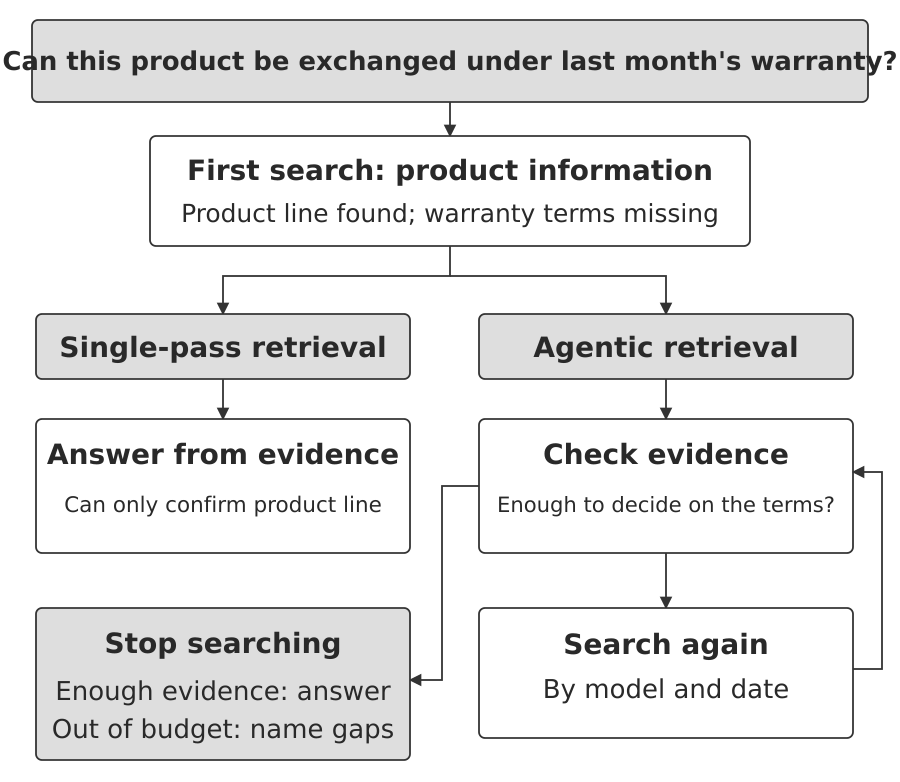

Taking ReAct as an example, the model first analyzes the question and chooses a query, then calls `knowledge_base_search`; when the tool returns an observation, the model judges whether the evidence is sufficient. If a condition or a related object is missing, it rewrites the query and keeps searching; if the material is sufficient, it generates an answer grounded in the sources. The Harness maintains the history, tool calls, and budget, and ends the search or switches to asking for clarification when a limit is reached.

Now look at Figure 3-13. Even if the knowledge base backend is switched from a vector index to a relationship graph, the model can keep requesting searches through the same tool interface. And if a returned document happens to contain an instruction, may the model simply carry it out?

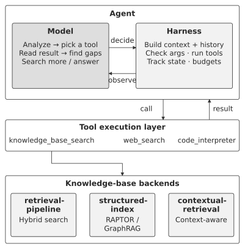

**The trust boundary of retrieved content.** External documents may contain text that tries to change the model's behavior, or they may have had false facts inserted before indexing. The former is indirect prompt injection; the latter is knowledge-base poisoning. Handling them requires managing both the source of content and the permission to act: retrieval results carry their source, version, and citation location and serve as evidence for the answer, while actions such as transfers, deletions, and sending external messages are checked by the Harness and the execution environment against the user's authorization. Review at ingestion, source tracing, and fact-checking further limit the spread of false knowledge. The source marking introduced in Chapter 2 and the tool constraints of Chapter 4 work together here.

> **Experiment 3-8 ★★: Comparing Single-Pass and Multi-Round Retrieval**
>
> This experiment uses the same Chinese legal material, the same BM25 retriever, and the same model to compare two modes on seven questions: the baseline searches once with the original question, while the Agent mode lets the model adjust its queries and run up to four searches.
>
> For a query such as "What are the rules on self-defense?", direct retrieval obtains the main provisions. A more complex example is "How should someone be sentenced who, while drunk, negligently caused serious injury and has a prior theft conviction?" It involves the current act, the intoxication, and the prior record at once, so retrieval has to locate the relevant material for each separately and then check the conditions under which each applies.
>
> The actual run searched, in order, for "drunk negligent serious injury prior theft conviction sentencing," "drunk crime sentencing," "prior theft conviction sentencing effect criminal law," and "prior conviction sentencing effect criminal law." The model then proposed "recidivism determination criminal law," but by that point the search budget was used up, and the Harness returned a budget-exhausted message.
>
> On the four complex questions defined in the experiment, coverage of the target statutes rose from about 8% to 92%, the average number of searches went from one to 3.5, and the average time for the answering stage grew from about 8 seconds to 66 seconds. On the three simple questions, evidence coverage was 100% in both modes, and both searched only once.

The same retrieval loop can also be applied to user history. Below, we reuse the three-level evaluation set from Experiment 3-1 to observe how the Agent retrieves facts from cross-session records, distinguishes between people and things, and handles updates.

> **Experiment 3-9 ★★: Reading User Memory with Agentic Retrieval**
>
> This experiment treats the complete conversation history as a knowledge base, splits it into windows, indexes them, and gives the Agent a `search_user_memory` tool. The window size is adjustable; in this run each chunk contains eight dialogue turns, adjacent chunks overlap by two turns, and the session identifier, time, and business metadata are saved. At most three queries are run, each retrieving four chunks.
>
> Basic recall can search around an explicit field, such as "What is my checking account number?" Multi-session questions also require checking that the set of objects is complete: the user owns both a Honda Accord and a Tesla Model 3, so when asked about service arrangements for the car, the system should distinguish the two vehicles and each one's appointment status.
>
> A retrieval route can be designed accordingly: first search the vehicle and service records; after finding a clue about the second car, query the Tesla's arrangements; finally, describe the existing Honda appointment and ask whether the user also needs one for the Tesla. In this run, the actual log shows only the single query `scheduled car services`, and the plain-retrieval group's answer focused on the Honda and left out the Tesla.
>
> Another difficulty comes from successive modifications. In the wire-transfer case, the wife sets up a transfer, the husband then changes the amount and date, and the wife adjusts it again. After the records are retrieved, the changes must be reconstructed by time, person, and confirmation status to find the instruction that finally took effect. The current chunks already store time information, but retrieval may still miss a key modification, so the chunks can be further enriched with the background of each event.
>
> Of these 60 cases, 18 searched once, 6 searched twice, and 36 used all three searches. The plain chunked-retrieval group passed 47: 19 in basic recall, 15 in multi-session retrieval, and 13 in proactive service. The next section continues on the same cases, comparing contextual prefixes and structured memory and analyzing what information each one adds.

### Contextual Retrieval: Adding Background to Chunks

Return to that financial report. To look up ACME Corporation's results for the second quarter of 2025, the query contains the company name and the year, yet the chunk that says "The company's revenue grew by 3%" contains neither. Besides enlarging the chunks, you can keep the short passage and put the missing background in front of it. **Contextual Retrieval** generates a short background prefix for each chunk at indexing time and then uses the prefix together with the original text for retrieval.[^ch3-1] Figure 3-14 shows the process.

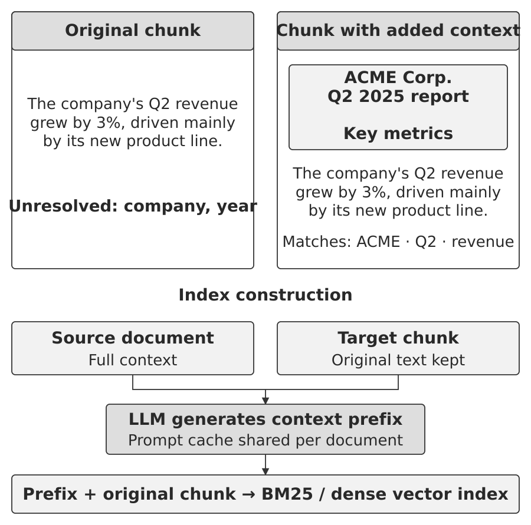

For example, the prefix might state "This passage comes from the key performance indicators section of ACME Corporation's report for the second quarter of 2025." The model is given both the original document and the target chunk when generating the prefix, so it can add references, dates, and section information that are actually supported by the text. BM25 thus gains matchable terms such as the company name and the quarter, and the dense embedding can represent the chunk in light of that background.

It can work alongside the context-aware compression of Chapter 2: at indexing time, background is added to knowledge chunks to improve the chances of finding relevant information; at runtime, the history already retrieved is organized for the current task to control input length. The former is concerned with how retrievable a chunk is; the latter with the information and budget the current decision needs.

[^ch3-1]: Anthropic, "Introducing Contextual Retrieval," September 2024.

> **Experiment 3-10 ★★: Comparing Raw Chunks with Context-Enriched Chunks**
>
> This experiment builds two indexes over the same material: one uses the raw chunks, and the other adds prefixes generated by a model. Keeping the queries and target labels the same, it compares BM25, dense retrieval, and hybrid retrieval on each.
>
> Continuing the financial report example, for the query "ACME Corporation's recent revenue growth," you can check whether the retrieved chunks contain the target company, the period, and the growth figures together. "Revenue growth" alone may match other companies; once prefixes are added, the company name and the period can take part in ranking.
>
> Across this run's 15 queries, adding prefixes raised BM25's recall@1 from 0.60 to 0.80 and dense retrieval's from about 0.867 to 0.933; their recall@3 stayed at 0.867 and 1.0, respectively. Hybrid retrieval's recall@5 rose from 14/15 to 15/15. Which question was the extra one? For a query about the powers of the Standing Committee of the National People's Congress, the target chunk listed the powers but lacked its subject. With the prefix added, BM25 moved it from 16th to 12th place, still outside the top five; hybrid retrieval moved it from 6th to 5th, which finally brought it into the top five. Looking at the original text, the first chunk lists powers (1) through (4), and the fifth chunk continues from item (4) through item (22). The scoring checks only whether the labeled fifth chunk was selected, but listing all the powers requires joining the two chunks.
>
> Prefix generation adds calls at indexing time. When generating background for many chunks of the same document, the cached document prefix can be reused. In its 2024 report, Anthropic estimated, assuming 800-token chunks, 8,000-token documents, and a specified prompt length, a one-time processing cost of about $1.02 per million document tokens.
>
> In that report, contextual embeddings combined with BM25 reduced the top-20 retrieval failure rate from 5.7% to 2.9%, a relative reduction of about 49%; adding reranking brought it down to 1.9%, a relative reduction of about 67%. The failure rate used in the report is $1-\mathrm{recall@20}$.

For collections that are queried repeatedly and whose content is relatively stable, I recommend filling in chunk background at indexing time first; one pass of processing then serves many later queries. If company names, the subjects of events, and dates are lost during chunking, simply retrieving more chunks may still return a batch of chunks whose references are unclear. Supplying these clues when generating prefixes lets later retrieval use them to locate the material.

> **Experiment 3-11 ★★★: Enhancing Memory with Contextual Prefixes and Structured Cards**
>
> In a conversation, "Okay, let's book this one" has to be linked to the product or itinerary discussed earlier. If the original text was about a $500 one-way ticket from Shanghai to Seattle, the prefix can add this background and record the session and time at which the confirmation happened.
>
> On top of plain chunking, this experiment adds two configurations: a contextual-prefix group, and a two-tier memory group that also loads Advanced JSON Cards. The model first generates a sequence of searches against the plain index, and the same set of queries is then run against both indexes; the two-tier group uses the same enhanced retrieval results and adds the structured cards.
>
> In the wire-transfer case, the prefixes state, respectively, that Patricia initiated the transfer, that James modified the arrangement, and that Patricia adjusted it again, which helps establish the order of events. The final state given by the original records is $95,000 on October 1, with the earlier arrangements superseded. In this run, all three groups correctly identified that state.
>
> The two-tier structure can also support proactive linking. The cards hold key facts such as "Tokyo trip" and "passport expiration date," while detailed conversations are retrieved on demand. Taking a trip from January 15 to 22 and a passport expiring on February 18 as an example, the system can first notice that the dates are close, then query renewal records and the trip's requirements, and finally remind the user to confirm the preparations still outstanding. In this travel case, all three groups' answers passed review; the differences between cards and retrieval show up mainly in the vehicle and cross-session cases below.
>
> Across all 60 cases, plain retrieval, contextual prefixes, and two-tier memory passed 47, 52, and 57, respectively. The prefix group raised the number of proactive-service cases passed from 13 to 18; the two-tier group passed all 20 multi-session retrieval cases and likewise 18 proactive-service cases. In the vehicle case, the cards supplied the information about the second car, helping the answer cover the vehicle that had been missed. Now look at one regression: when the user asked about coverage for water damage to their properties, the plain group mentioned both the owner-occupied home and the rental property, while the prefix group left out the rental. A question-by-question comparison shows that the prefix group got 8 more questions right than the plain group, but also lost 3 that the plain group had answered correctly.

**When proactive service is needed, I prefer a two-tier architecture in which key facts stay resident and detailed records are retrieved on demand.** With retrieval alone, the model usually needs to know what to ask before it can find the relevant records; a passport, vehicle, or family relationship that has not yet come into view is easily missed as a result. Placing a small number of key facts in the context first helps the model notice connections and formulate queries, then retrieve the original details. When choosing what stays resident, consider personal relationships, current constraints, and unfinished matters; retrieval results should keep their source, time, and the basis for any change.

### Extracting Knowledge from Datasets: From Cases to Structured Representations

Knowledge can also come from organizing a large body of cases. In court judgments, support tickets, and repair records, much useful information is scattered through individual narratives. When a task requires inducing patterns from many cases, comparing outcomes, or deciding what to ask next, I recommend first extracting a uniform set of fields and then performing statistics and prototype analysis. Retrieving only a few similar cases makes it hard to see the distribution across the whole dataset; once the fields are uniform, statistics can be computed over the entire batch, providing an overview for later queries about individual cases.

The process has two steps. **Knowledge extraction** converts raw descriptions into structured records, defining each field's meaning, values, and source; **pattern analysis** then uses statistics and clustering to find similar cases and their shared characteristics. Figure 3-15 shows the pipeline from case extraction and feature encoding to prototype retrieval.

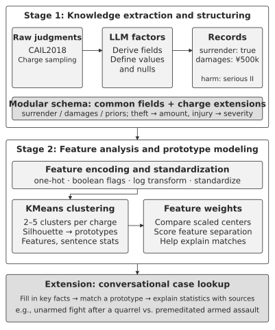

> **Experiment 3-12 ★★★: Extracting Factors and Prototypes from Judicial Cases**
>
> This experiment uses criminal case material from CAIL2018, selecting samples from three charges—theft, intentional injury, and fraud—to build a teaching pipeline of "factor discovery → field extraction → clustering → prototype explanation."[^ch3-cail] For each charge, 120 cases are used for modeling and another 20 are held out, giving 360 modeling samples and 60 held-out samples in total.
>
> **Discovering and organizing fields.** The model first reads the modeling samples in batches and proposes potentially useful factors, which are then merged into a modular schema. The common part holds fields relevant to many charges, such as voluntary surrender and compensation; the extensions hold information specific to particular charges, such as the amount involved or the extent of injury. This round of organizing produced 16 common fields and three extensions with 12, 12, and 11 fields. Each field also needs defined values and a missing state, so that extraction is consistent.
>
> **Encoding fields as vectors.** Categorical fields can use one-hot encoding: taking theft, robbery, and fraud as an illustration, they are encoded as `[1,0,0]`, `[0,1,0]`, and `[0,0,1]`, where each position indicates only whether the case belongs to that category. Using 1, 2, and 3 instead would introduce, for some algorithms, an order and distance between categories. Fields such as "voluntary surrender" or "compensation paid" can use 1 and 0 for the two confirmed states; cases the source text does not mention should be handled separately, so that missing information is not automatically treated as a "no."
>
> For non-negative values with a wide range, such as amounts of money, this implementation first compresses the scale with $\ln(1+x)$ before standardization. If a field allows several categories at once—for example, a record that includes several disposal measures—an indicator bit can be set for each category, forming a multi-hot encoding.
>
> **Building case prototypes.** The encoded features are standardized and then clustered separately for each charge. This implementation compares two to five clusters and chooses the grouping by silhouette coefficient, ending up with 11 prototypes. Each prototype stores its sample count, its main characteristics, and the median, quartiles, and range of the sample sentences. For example, one can compare different combinations of features, such as an unarmed fight after a quarrel versus a premeditated armed attack, in terms of what triggered the conflict, how the act was carried out, and how serious the injury was; the specific groupings are determined jointly by the extraction results and the clustering.
>
> **Explaining features and matches.** From the differences between the standardized cluster centers, the program computes how much weight each feature carries in distinguishing prototypes. Prototype matching maps a new case into the same feature space and retrieves the statistical summary and supporting evidence of the nearest group, for the model to use in composing an explanation.
>
> This run selected 12 of the 60 held-out samples, generated explanations for them, and handed them to an independent model for review. Look first at one theft sample: the prototype it matched contained only one modeling record, with a sentence of 4 months, so the minimum, median, and maximum were all 4. The generator reported this number faithfully and noted that only one record was available for reference. The reviewer gave "Are the figures faithful to the prototype?" 4 points (the maximum), yet the held-out sample's actual label was 8 months.
>
> If prototype retrieval is used in conversation, the system can first ask about missing facts that might affect the match, then retrieve again based on the answers.

[^ch3-cail]: CAIL2018, official dataset project. The companion experiment samples from the public material and uses an internal split of the samples for modeling and evaluation.

Going from cases to prototypes adds a layer of retrievable statistical representation to the knowledge base. The source text provides evidence, the fields support computation, and the prototypes summarize what similar samples have in common; only if the correspondence among the three is preserved can extraction errors or sample bias be traced and corrected when they are found.

### Frontier Exploration: Multimodal and Parametric Memory

Imagine the user pointing to a photo they uploaded earlier and saying "I want exactly this color." If the system kept only the two words "blue jacket," next time it may be unable to tell two shades of blue apart. The timbre of a voice and the spatial relationships in a chart also lose detail when transcribed. To give future queries a chance of recovering such information, one can save the raw material, save representations the model can use, or go further and study persistent memory inside the model.

**Approach 1: Combine raw material with a text index.** For example, in a photo-organizing task the user has authorized, regions such as people's faces can be cropped and saved, with the images referenced from Markdown entries and the shooting time, scene, and user-provided name tags recorded alongside. At retrieval time, the system first uses the descriptions to find a few possibly relevant photos, then reads the original images or cropped regions to compare details of appearance. Audio clips can likewise be linked to their time, source, and transcript, and the original audio replayed when needed. The text provides the entry point, while the raw material preserves details that are hard to summarize in words.

**Approach 2: Store embeddings and load them on demand.** A visual or audio encoder can turn material into vectors that are stored in an index for similarity search. For example, cropped image regions or audio clips can be encoded and each linked to its memory entry. If the model supports a trained projection layer and memory interface, a set of slots can also be reserved in the context to hold these continuous vectors, letting the model access them through attention. The problem to solve here is aligning the encoder's representations with the language model's internal representations.

A preliminary study by Noah Shi and me breaks this problem into two steps. A group photo shows two people, and the user asks "Is the person standing by the window the one we met last time?" The system must first use "by the window" to find the person the user means, then compare that person's image with previously saved samples. If the first step picks the wrong person, then however accurate the second step is, the answer addresses a different question. The paper also keeps facts that can be transcribed exactly, such as names, in text memory, so that each kind of information has a suitable way of being retrieved.[^ch3-perceptmem]

[^ch3-perceptmem]: Li, Bojie, and Noah Shi. *Parametric Multimodal User Memory*. The companion project `19PINE-AI/multimodal-user-memory` contains the implementation and the PerceptMem experiments. The group-photo question is a teaching example.

**Approach 3: Persistent memory inside the model.** Training a LoRA for each user is one way to write personalized facts into a model. Asking directly "Where does the user live?" and planning a trip based on that address make different demands on memory: the former reads a fact, while the latter must also use the fact in subsequent reasoning. If training centers only on reciting facts, the model may remember the answer yet fail to use it unprompted in a complex task. Training samples therefore need to include both direct questions and tasks that depend on those facts.

My **User as Engram** research writes text facts into the local memory table of an Engram model, with a shared adapter learning how to reason with those facts.[^engram] Hash-keyed N-gram lookup locates table entries, and a gating mechanism feeds the retrieved content into the model; each user keeps their own local table entries, while the reasoning component can be shared. In its experiments on text facts, the paper compares direct recall with indirect reasoning, showing how each user's memory content and the shared reasoning capability can be managed separately.

[^engram]: Li, Bojie. *User as Engram: Internalizing Per-User Memory as Local Parametric Edits*. 2026.

Extending this approach to multimodal data will also require designing mechanisms for addressing, writing, and reading image or audio representations.

## Chapter Summary

Return to the booking request at the start of the chapter. "I prefer window seats" comes from this user; "How many bags can I bring?" requires looking up the airline's terms in force on the travel date. Storing both as a single sentence makes it easy to lose the most important distinction: whom the first applies to, and from when the second takes effect. Only if the source, time, and conditions of applicability are kept at write time is there a basis, at read time, for deciding whether a record can be used this time. A single fact is well suited to a short note; when relationships between people or the full background must be kept, cards or original passages can be used; dates and quantities can also be stored as typed fields and handed to a program for computation.

If the assistant gets the baggage allowance wrong, first check whether the current terms were ingested at all, then which chunk the terms were cut into, whether the retriever found it, and what rank it held after reranking, and finally what material the model actually received. When there is a great deal of source text, a structured overview can stay in the context while details are retrieved on demand. Section summaries help find topics and relational indexes help trace connections; if a chunk has lost its references, background about its origin can be added; and when a single retrieval still lacks evidence, the Agent can try a different query and keep looking.

After the airline publishes new rules, a small-scope update can be made first, keeping the effective dates and sources of both the old and the new terms; accumulated duplicate entries, conflicts, and structural changes are then handled by periodic reorganization. The Proposer submits the change, the Reviewer checks the evidence, and once approved the serving index is rebuilt. With version records, questions that were previously answered wrongly can be replayed, and it is possible to determine which material an old answer was based on at the time. How to accumulate experience from execution results is the subject of Chapter 9.

Finding that two checked bags are allowed answers only "Do the rules allow it?" To actually add the bags to the user's booking, the assistant also needs to know which tool it can call, what parameters it requires, and what confirmation counts as success. That is where the next chapter begins.

## Thought Questions

1. ★★ The user says: "On May 1, I'm moving from A to B. From May 10 to 20, I'll be staying at Hotel C, so email my bills during that time." On May 15, how should the assistant answer questions about the home address, the temporary residence, and how bills are delivered? Design the recording and query rules, and explain how to handle typo corrections or addresses that conflict with one another.
2. ★★ When a source document contains contradictory information, a contextual prefix may write the error into the index along with everything else. How would you store sources, versions, and uncertain items, and how would you use this information during retrieval and generation?
3. ★★ Which spatial relationships are easily lost when a chart is converted into text? Give examples using a table, an architecture diagram, or a line chart, and design a scheme in which the original image, a structured representation, and a text index are retrieved together.
4. ★★★ As models and long-context capabilities improve, which parts of the chunking, indexing, and retrieval pipeline might be handed over to the model? Analyze this in light of the discussion of search and learning in Rich Sutton's "The Bitter Lesson," and design an experiment that compares feeding in everything with retrieving on demand, examining task quality, computational cost, and permission constraints.
5. ★★★ If a model already has extensive domain knowledge, what should an external knowledge base still store? Discuss public common knowledge, continually updated rules, private material, and evidence that must be precisely traceable.
6. ★ Which queries do RAPTOR's multi-level summaries and GraphRAG's entity relationships and community summaries each support? Give one example each for a high-level overview, a local detail, and a multi-hop connection, and explain what evidence needs to be checked.
7. ★★ How can directories, links, and vector indexes work together to organize knowledge? Design a knowledge base that people and Agents maintain together, and explain where navigation, semantic search, version updates, and permission filtering each fit.
8. ★★★ After fields have been extracted from cases and clustered, how do you judge whether the prototypes are useful? Distinguish the importance of clustering features, the ability to predict outcomes, and causal explanation, and design a held-out evaluation and an expert review process.
9. ★★★ Design incremental-update and periodic-reorganization workflows for a Markdown user-memory library. If the Reviewer and the Proposer use the same model, and the Reviewer can see only the fragments the Proposer selected, which errors are likely to slip through? Propose improvements in terms of evidence coverage, tool permissions, and review evaluation.

[^ch3-glove]: Pennington et al. *GloVe: Global Vectors for Word Representation*. 2014.

[^ch3-sbert]: Reimers and Gurevych. *Sentence-BERT: Sentence Embeddings using Siamese BERT-Networks*. 2019.
