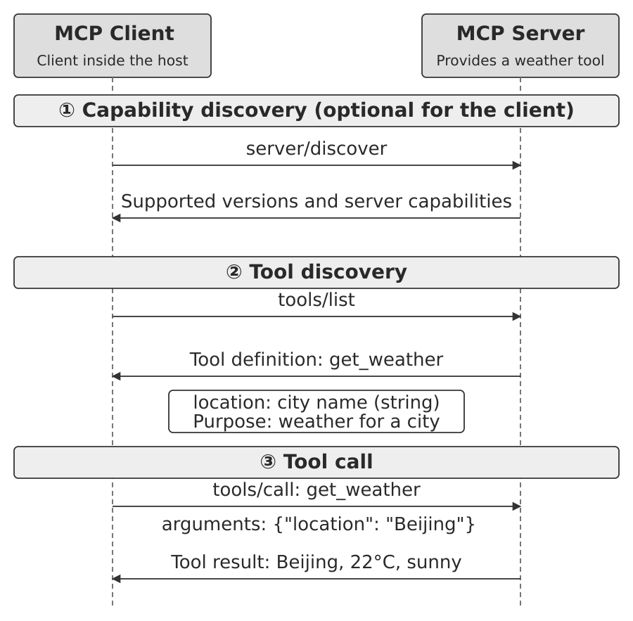
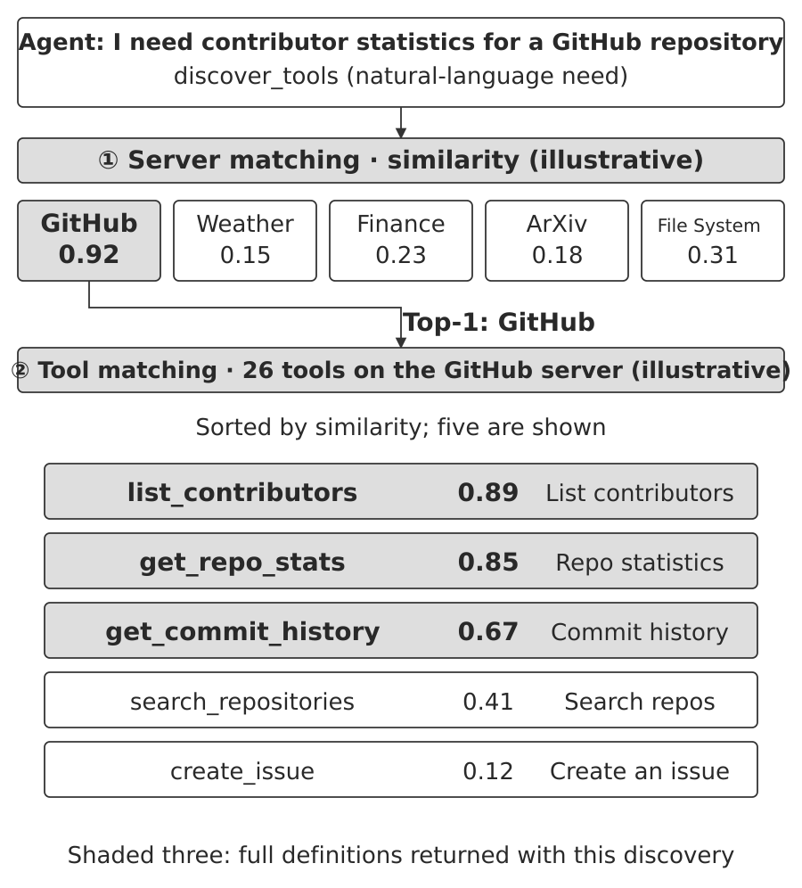
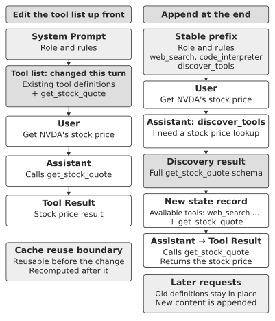
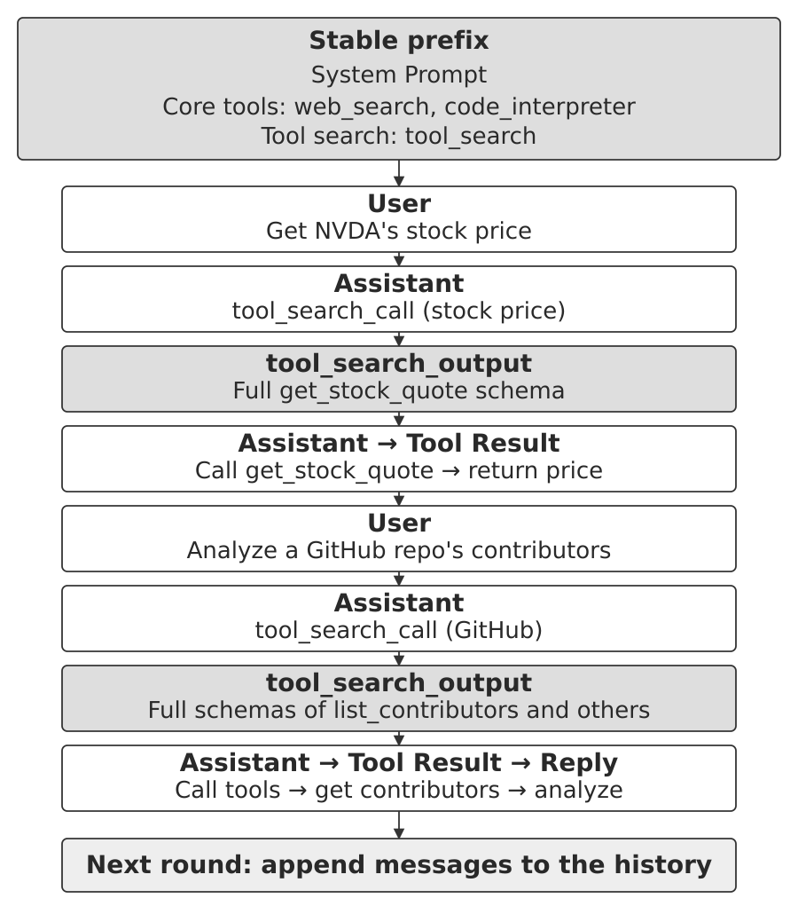

# Tools

In the science-fiction film *Her*, the AI assistant Samantha sorts emails, helps draft replies, handles publishing matters, and moves between different communication channels. An assistant like this has to turn its understanding of language into operations on external systems. An Agent carries out these interactions through **tools**. Tools are its "senses, hands, and feet": they provide observations and they carry out actions. General-purpose Agents discussed in this book, such as Manus and OpenClaw, likewise reach the digital world through tools.

Suppose a user says: "Find the delivery dates mentioned in my customers' emails, put them in a table, and send it to me." The model can decide which emails to look at, but reading the originals requires access to the mailbox, and sending the table requires a call to a sending interface. How should these tools be designed, and how does the model find them when it needs them? This chapter first distinguishes five categories of tools, then discusses how tools are described, connected, and discovered, and finally designs interfaces for perception, execution, and collaboration in turn. Event triggering and user communication also involve when to wake the Agent and how to deliver messages across channels; they are taken up in Chapter 6.

## Tool Classification

Take reading email as an example: the model chooses what to do next, the Harness checks the arguments and permissions and sends the request, and the mail service actually reads and writes the data. Chapter 1 classified tools by purpose into Perception, Execution, Collaboration, User Communication, and Event-Triggered tools. The first four are invoked proactively by the Agent; Event-Triggered tools let external events wake the Agent as well (Table 4-1).

Table 4-1 Invocation Direction and Main Purpose of the Five Tool Categories

| Tool Type | Invocation Direction | Main Purpose |
| --- | --- | --- |
| Perception Tools | Agent actively invokes | Acquire external information |
| Execution Tools | Agent actively invokes | Perform computation or modify external state |
| Collaboration Tools | Agent actively invokes | Delegate tasks, exchange messages, coordinate other Agents or humans |
| User Communication Tools | Agent actively invokes | Reply to the user, present results, or send reminders |
| Event-Triggered Tools | Configured by the developer or registered by the Agent, triggered externally | Wake the Agent when a specified event occurs |

**Perception Tools** let an Agent acquire external information. Examples include web search `web_search`, knowledge base retrieval `knowledge_base_search`, webpage reading `fetch_url`, file name search `find_file`, file content search `grep_file`, and file reading `read_file`.

**Execution Tools** let an Agent perform computation or change external state. Examples include the command line `shell_exec`, the code interpreter `code_interpreter`, file writing `write_file`, file editing `edit_file`, and email sending `send_email`. The same general-purpose executor can carry out read-only computation and can also modify data.

**Collaboration Tools** support task delegation and message exchange. Examples include spawning a sub-agent `spawn_subagent`, sending a message `send_message_to_subagent`, canceling a sub-agent `cancel_subagent`, and discovering available Agents `list_agents`. Independent tasks can run in parallel—researching the careers of several OpenAI co-founders separately, for example—and different tasks can be handed to Agents configured with different models, tools, prompts, and contexts. Chapter 10 discusses division of labor and collaboration architectures further.

**User Communication Tools** deliver information to the user. Examples include replying to a message `reply_to_user`, sending a structured card `send_card_to_user`, and sending a reminder `send_user_notification`. Once interaction spans several channels or needs background notifications, the system can wrap message sending as an explicit tool call, managing recipients, content, and delivery status in one place.

**Event-Triggered Tools** connect external events to the Agent's execution. Examples include a timer `set_timer`, background task monitoring `monitor_shell`, and event source connection `connect_channel`. The process has two steps. At registration, the events of interest are either configured in advance by the developer or declared by the Agent through an authorized call; when an event occurs, the scheduler receives the callback or event message and wakes the Agent to handle it. A new email, a system alert, a scheduled reminder, or the completion of a background task can each become a new entry point into execution.

Return to the email task from the opening. Opening the original message to get the delivery date is perception; generating and saving the summary table changes the workspace, so it is execution; handing the table to the person who asked for it is user communication. Event triggering enters only if the system automatically resumes when the next customer email arrives. A single mail service can take on several of these roles. The next decision is how fine-grained the tools handed to the model should be: should it look up emails, read bodies, and find attachments as separate steps, or should the steps it usually performs together be combined for it?

## General Principles of Tool Design

When tools were first being connected, the common practice was to wrap each API endpoint directly. This is quick to set up, but it tends to yield a set of very fine-grained interfaces. To complete one task, the Agent may have to look up objects, read attributes, and check conditions over and over before calling the interface that actually does the work. When designing tools, these operations can be consolidated around common tasks—for example, chaining contact lookup with message sending, or having log search return the relevant lines together with their surrounding context[^ch4-tool-design].

**Tools should be designed around the tasks the Agent has to complete.** This approach of designing interfaces from the Agent's point of view is called **ACI** (Agent-Computer Interface). Where HCI is concerned with how humans interact with computers, ACI is concerned with how a model chooses operations, constructs arguments, interprets feedback, and corrects its errors.

[^ch4-tool-design]: Anthropic, *Writing effective tools for AI agents—using AI agents*, 2025.

### Forms of Capability Expression: Dedicated Tools, General Executors, and Skills

To hand "deploy the application" to a model, you can design three kinds of operating interface. The first exposes a single `deploy_app`, with the server carrying out every step; the second exposes build, package, and deploy separately, and the model decides when to call the next one; the third writes the steps into a Skill and lets the model execute them in a terminal. If the build fails, the first design depends on the tool result to tell the model which step went wrong, while the other two can hand the model the error from that build directly.

- **Dedicated Tools** provide a structured interface for a well-defined operation. The developer defines the parameter schema, validation rules, execution logic, and return format, which makes the tool easy to test and authorize on its own; once the tool definition enters the context, how much space it takes depends on the length of its fields, descriptions, and examples.
- **General Executors and Skills** work together: a terminal or code interpreter supplies the ability to execute, and a Skill explains the workflow, when it applies, and how to carry it out. The host can load just the names and summaries first, and read the full instructions and related resources once a Skill is selected.

For example, a deployment Skill might explain, in order: build the project with `npm run build`, package the image with `docker build -t app:latest .`, and then use `kubectl apply -f deploy.yaml` to apply the resources defined in the manifest to the current cluster. The Agent carries out these steps through a terminal tool, reusing a single execution entry point.

How a tool is implemented and when the model reads its instructions are two separate questions. Hundreds of dedicated tools can be shown as an index only, with schemas loaded on demand; a small number of Skills can keep their catalog resident in context, with retrieval added once the collection grows. Choosing between a dedicated interface and a general executor affects how arguments are passed and how code is maintained; choosing between presenting everything at once and loading on demand affects which tools the model can see at a given step. The later section "What to Do When There Are Too Many Tools" discusses disclosure strategies.

**I recommend starting with general tools and adding dedicated interfaces as permission, parameter, and performance needs dictate.** For example, if `code_interpreter` runs in a sandbox with SymPy, NumPy, and pandas installed, the Agent can write Python to do arithmetic, symbolic computation, array processing, and data analysis. This lets the model make full use of its code-generation ability: one interpreter can host many algorithms and can combine existing libraries to handle new problems nobody anticipated. The model is responsible for generating code; the runtime environment is responsible for executing it and for limiting access to files, the network, and resources.

Even with dedicated tools, I recommend consolidating operations that are functionally similar and frequently used together. When interfaces are too fine-grained, the model has to remember more names and responsibilities, and the same task takes more calls. The main criteria for consolidation are **functional similarity** and **overlap in usage scenarios**. For instance, `extract_pdf_text`, `extract_docx_content`, and `extract_pptx_content` all accept a document and extract its text, so they can be merged into `read_document`, with `file_type` distinguishing the formats. The model only has to choose one entry point, and new formats can reuse the same parameters and return structure.

Dedicated interfaces are especially suitable in the following four situations.

1. **Fine-grained authorization and auditing are required.** Writes to a production database can be wrapped as a narrowly scoped operation, with the server checking the user's permissions, the target table, and which fields may be changed, and recording the basis for the operation.
2. **Platform differences need to be hidden.** Operations such as grep and find can be done through the shell, but a dedicated file search tool can unify the parameters and feedback across macOS, Windows, and Linux—for example, always returning the file name, line number, and matching snippet.
3. **The operation is very frequent.** A high-frequency operation can be given a short, stable entry point, avoiding the overhead of repeatedly generating scripts and explaining the workflow.
4. **Parameter relationships are complex.** Nested objects, field dependencies, and complex value constraints are best expressed through a schema together with business-level validation.

**The more complex the parameters, the more the passing mechanism matters.** Structured tool calls usually describe their input with JSON Schema, and some model services support constrained generation so that arguments satisfy the supported schema rules. The structure of the return value is fixed by the tool interface, and the host then passes the result to the model. Beyond type and format validation, permissions, whether objects exist, and whether combinations of fields satisfy business conditions still have to be checked by the Harness and the tool service.

A Skill can explain how to call dedicated tools, or it can guide the Agent in using a CLI. The latter requires the model to handle command-line syntax, quoting, and escaping all at once, and the rules differ between shells. The more complex the parameters, the more details the model has to get right. For deeply nested parameters, you can first write them out as JSON and have the command read that file, which avoids multiple layers of escaping and allows the content to be validated before execution.

**Skills are easy for business staff to write and modify directly.** People who know the business can write the steps themselves, or start from instructions the Agent has drafted. If the order of the workflow changes, a step applies only to some customers, or an example needs replacing, you just edit the text, without changing tool code or redeploying an interface. Under the Agent Skills specification, the metadata of a `SKILL.md` follows a prescribed format, the body is Markdown, and the Skill can bundle scripts, reference documents, and resources[^ch4-skill-format].

[^ch4-skill-format]: Agent Skills, format specification, covering metadata, body, bundled resources, and progressive loading.

When choosing the form a capability takes, weigh four dimensions together.

- **Security and Permissions**: Dedicated interfaces make it easy to limit the scope of an operation; general executors control what they can do through sandboxing, credentials, and resource permissions.
- **Parameter Complexity**: Complex structures suit a schema plus business validation; simple operations can take their arguments directly through a CLI.
- **Frequency of Change**: Workflows that change often belong in Skills first, where business staff can edit the instructions and examples directly; stable, frequently reused low-level operations can then be wrapped as tools or scripts.
- **Model Capability**: For models that reliably generate code and handle the command line, prefer composing capabilities through Skills and general executors, keeping dedicated tools to a minimum; when a model is weaker and frequently gets complex parameters wrong, let structured interfaces carry more of the constraints.

**Code can also orchestrate multiple tool calls.** When scraping several web pages and extracting fields, the model can generate one script that handles the looping, filtering, and aggregation. The full page text stays in variables inside the execution environment, and only the selected fields and summary statistics return to the context. Conditionals, loops, and exception handling in the program tie the steps together, and the model analyzes the aggregated result directly. For tasks whose steps are already clear—batch scraping, filtering, and statistics—I prefer to chain them in code, cutting down on round trips in which the model calls a tool and reads an intermediate result one step at a time. The more intermediate results there are and the leaner the returned fields, the more context this arrangement saves. Chapter 5 discusses this kind of code orchestration further.

Interfaces of this kind are often called **Code Mode**. Take Cloudflare's MCP server: the model first uses `search()` to write a query program that finds the endpoints and parameters it needs in the OpenAPI description, then uses `execute()` to submit JavaScript that calls those endpoints. To list the DNS records matching some condition, for example, the program can query page by page, filter, and return only the matching records. The first step avoids putting the entire API manual into the context; the second avoids a round trip to the model for every page of results. Which zones the executing identity can read, and whether it can modify records, is still decided by server-side authorization.[^ch4-code-mode]

[^ch4-code-mode]: Cloudflare, the MCP implementation of Code Mode; Armin Ronacher uses Pi 1.0 as an example to discuss the division between the tools a Harness provides and the execution environment.

### Tool Descriptions: Purpose, Parameters, and Feedback

When writing a tool's description, start by imagining the request most likely to lead to its misuse. The user says, "Find the clauses in the contract that mention liquidated damages," yet file name search returns only files whose names match; even with a path in hand, the model still has to read the body. A tool description should let the model judge from it which interface to choose, what to supply when calling it, and what questions the result is sufficient to answer.

**State when to use it.** A web search description can read "Use when you need real-time information or need to find facts you don't know," which lets the model map the user's need onto the tool's purpose. With nothing but "Search for relevant content," the model has to guess the search scope and when the tool applies.

**Make the input and search scope explicit.** For example, a file name search tool can state: "Matches against file names and paths; to find text inside files, use `grep_file`." Spelling out the division of labor between neighboring tools helps the model pick the right entry point on the first call. **In my view, stating boundary conditions clearly often matters more than listing features.** What input the tool accepts, what scope it searches, and how it behaves on empty results or errors all directly shape the model's next decision.

**Explain parameters with a specification plus an example.** `timestamp` can be described as "RFC3339 format, e.g., `2024-03-15T14:30:00Z`." When working on a complex task, the model has to choose tools, extract information from the trajectory history, and weigh subsequent steps all at once; the parameter format is just one detail among many. A complete string gives it a format to copy directly, so it can construct the argument by imitation and is less likely to err while reinterpreting the terminology.

Likewise, `phone` can be described as: "Phone number in E.164 international format: begins with `+`, followed by the country code and the number, digits only, no spaces or separators. E.g., `+8613888888888` (China) or `+12025551234` (USA)."

**Describe the return structure and the execution cost.** For example, "Returns a JSON array; each element contains three fields: `title`, `url`, and `snippet`," which helps the model pull out titles, sources, and summaries. Slow tools can note their expected latency in the measured environment along with an alternative entry point, e.g., "Reading a full webpage may take 5–10 seconds; if you only need metadata, call `get_page_metadata`."

You can also attach one to five verified invocation examples, covering the minimal arguments, common combinations, and complex conditions. JSON Schema can express types, required fields, value ranges, and some field dependencies[^ch4-json-schema]; examples show how those rules apply to a concrete task—whether timestamps are in seconds or milliseconds, how filter conditions nest, which optional fields usually appear together. In internal tests with complex parameters that Anthropic reported in 2025, adding tool-use examples raised accuracy from 72% to 90%[^ch4-tool-examples].

[^ch4-json-schema]: JSON Schema, object types and property constraints. The range of schema keywords a model API supports is defined by the corresponding service.

[^ch4-tool-examples]: Anthropic, *Introducing advanced tool use on the Claude Developer Platform*, November 24, 2025, the Tool Use Examples section.

When an Agent keeps picking the wrong tool, I recommend **checking the tool descriptions first**: do several tools have similar names, is the search scope clear, do the parameters lack examples? The same method applies to a Skill's name, summary, and operating instructions.

### Fidelity of Parameter Passing

The model asks to replace a passage of text, and the executing side reports "not found." Before having the model reword its request, ask whether both ends received the same string of characters. A call passes through parsing, serialization, proxies, and runtime wrappers, and every layer can alter the content. **Parameter fidelity** requires that the value seen by the executing side means the same thing as the value the model submitted; protocol escaping may change the transmitted form, but quotation marks and line breaks must still be intact after decoding.

Consider the curly-quote conversion problem in a version of Cursor from early 2026. The replace tool accepts `old_string` and `new_string` and edits a file by exact matching. The read tool returns the curly quotation marks `“` and `”` (U+201C and U+201D) that appear in the file's Chinese text; the model puts the original text into `old_string`, but during parameter passing those marks are converted to the ASCII straight quote `"`. The original text in the file is unchanged, so the replace tool returns "no match found." Reading the file again and copying the text again runs into the same failure.

The write direction is affected too. The model asks to write curly quotes, and the file ends up storing straight quotes. When the model later reads the file, what it sees differs from what it meant to write, and it may try to correct it again; as long as the conversion keeps happening, every retry repeats the same mistake.

Another type of problem is **silent parameter injection**. The bash tool in a certain IDE automatically appends a parameter marking AI-authored commits to every `git commit`. Older versions of Git don't recognize that parameter, so the commit fails. The model sees only the command it generated, and may keep adjusting the commit message or other arguments without ever touching the real source of the fault.

When diagnosing such problems, line up the arguments the model generated, the arguments after passing, the request actually executed, and the result returned. If an interface normalizes encoding or adds execution parameters, document the conversion rules and return the values actually used. For exact-match tools, one extra space, one missing line break, or one changed quotation mark can cause a match to fail. The model has to know what the executing side actually received before it can get the next call right.

## Tool Ecosystem: MCP and Skill Hubs

Different model APIs and Agent frameworks each define tools in their own way—function calling, tool use, LangChain's Tool abstraction, and so on. An external service that has to adapt to each of these APIs and frameworks one by one ends up handling descriptions, parameters, and result formats over and over. The **Model Context Protocol (MCP)**, released by Anthropic in November 2024, provides a unified protocol through which model applications access tools and data[^ch4-mcp-origin].

To understand MCP, start with its three roles: host, client, and server. The **host** is the Agent application or IDE, responsible for model interaction, context organization, and permission management; the **MCP client** inside the host handles protocol messages; the **MCP server** provides tools, resources, and prompt templates, and can run as a local process or be deployed as a remote service[^ch4-mcp-architecture].

**Tool definitions and invocation.** The client obtains the available tools through `tools/list`, and the list can be returned in pages. Each tool includes a name, a description, and an `inputSchema`; structured results can also have their format fixed by an `outputSchema`. After the model chooses a tool and generates arguments, the host validates them, the client sends `tools/call`, and the server executes the call and returns the result. The host decides which definitions and results go into the model's context[^ch4-mcp-tools].

In Figure 4-1, after the client obtains the weather tool's name and parameters, it still has to issue a call before it can find out the weather in Beijing. The companion implementation uses MCP 2026-07-28: every request carries the protocol version, client information, and capabilities, and the client can also call `server/discover` first to learn which versions and capabilities the server supports. Earlier versions established a session with an `initialize` handshake, so when connecting, the interaction style has to be chosen according to the versions both sides support[^ch4-mcp-versioning].

The same symptom—no weather—has two different starting points for diagnosis in Figure 4-1. If the host has connected to the server but cannot find the weather tool in the `tools/list` response, check which tools the server publishes and whether the client read every page of the list. If the model chose the right tool but the server complains that the city name is missing, find `arguments` in the call log and check whether the field name is `location`, as the tool definition requires.

**Transports.** stdio passes JSON-RPC messages through the standard input and standard output of a local subprocess. Streamable HTTP sends requests over HTTP, and the response can be JSON or an SSE stream returned incrementally. Streamable HTTP replaced the earlier HTTP+SSE transport and continues to use SSE for streaming responses[^ch4-mcp-transports].

**Resources and prompt templates.** Resources provide readable data, such as file contents and database records; the host can list them by URI, read them, and select the relevant content. Prompt templates (prompts) provide reusable message or task templates for users and clients to choose from. Tools can also do searching and reading, so the three primitives are divided by interaction interface: tools provide an entry point for calls, resources an entry point for data, and prompt templates an entry point for tasks[^ch4-mcp-primitives].

MCP's core value is letting one tool implementation serve many Agent products. A unified protocol allows the same server to be reused by compatible hosts such as Cursor, Claude Desktop, and OpenClaw, and lets developers put more of their effort into the capability itself and the quality of its feedback. The host converts the tool definitions in the protocol into interfaces the model can use.

**Skill Hubs handle discovery and distribution of capability packages.** A Skill usually contains a `SKILL.md` and may bundle scripts and reference material. Distribution platforms help users search for, install, and update these files. Vercel launched skills.sh in January 2026, offering a skill directory and an installer; ClawHub in the OpenClaw ecosystem also provides skill lookup and version management[^ch4-skills-sh][^ch4-clawhub]. After installation, the host reads names, summaries, and full instructions according to its loading policy. MCP can also provide discovery and reading of Skills through an extension, so capability packages and the communication protocol can work together[^ch4-skills-over-mcp].

**Connection and context loading are managed separately.** Once an MCP client has the tool list, it can present the whole list to the model, or it can keep an index and load definitions on demand. A Skill can likewise show only its `name` and `description` at first and have its body read once it is selected. A tool allowlist decides which capabilities are available; deferred loading decides which definitions are currently visible.

**When bringing in a third-party capability, check what it provides and what it actually does, separately.** Descriptions, returned content, and bundled code come from different parties and may carry different authorization scopes. Taking MCP as the example, three kinds of problems can be checked one at a time.

1. **Tool description poisoning.** A description may smuggle in instructions unrelated to the tool's purpose, luring the model beyond the current task. This is prompt injection: externally supplied content trying to change the model's behavior.
2. **Modified servers and dependencies.** A server upgrade can change a tool's behavior, and a dependency update or a compromised remote service can also contaminate the results returned.
3. **Same-name tool confusion.** Different servers may offer tools with the same or similar names, leading the model or the routing layer to pick the wrong target. The host should keep each tool name bound to its server identity, display the source, and verify the target at dispatch time.

Review descriptions and implementations before connecting, pin the versions of deployments you control, and re-review on upgrade; give each server a least-privilege credential that matches its task. When a remote service is maintained by someone else, also monitor changes in its tool definitions and behavior.

At runtime, the Sidecar described later in this chapter can independently review structured calls together with whatever task context the review needs. Paths, text, and destination addresses in call arguments should also be treated as data to be checked. The review result and deterministic permission rules decide together whether a call executes. Chapter 5 introduces Simon Willison's "lethal trifecta," a frame for analyzing the risk that arises when private data, external input, and outbound communication are combined.

Scripts bundled with a Skill, local MCP servers, and remote services each have their own execution location and permission scope. A review should check code provenance, the runtime environment, file and network permissions, and where credentials flow; if externally supplied steps lead to downloading or running other programs, those belong in the same chain of checks. Platform scanning can offer supporting clues, while runtime isolation, least privilege, and change review are what actually control execution.

[^ch4-mcp-origin]: Anthropic, *Introducing the Model Context Protocol*, November 25, 2024.
[^ch4-mcp-architecture]: MCP specification, version 2026-07-28, the Architecture and Protocol Overview sections.
[^ch4-mcp-tools]: MCP, Tools, covering the tool list, input and output schemas, and call results.
[^ch4-mcp-versioning]: MCP, *Versioning and Compatibility*, explaining per-request metadata, capability discovery, and compatibility with the legacy handshake.
[^ch4-mcp-transports]: MCP, the transports overview and the 2025-11-25 transport specification; the latter explains how Streamable HTTP replaces the earlier HTTP+SSE scheme.
[^ch4-mcp-primitives]: MCP, the Resources and Prompts sections.
[^ch4-skills-sh]: Vercel, *Introducing skills, the open agent skills ecosystem*, January 20, 2026.
[^ch4-clawhub]: OpenClaw, ClawHub usage documentation.

## What to Do When There Are Too Many Tools: Hierarchical Organization and Proactive Tool Discovery

Once tools grow from a dozen to hundreds or thousands, the model has to find the right capability and also understand the differences between similar interfaces. Full definitions take up context; if they sit in the prompt prefix, adding, removing, or reordering tools can also shorten the reusable cache prefix. The more tools there are with similar names and purposes, the more likely the model is to pick the wrong entry point or overlook a capability it needs. Large tool libraries should therefore load on demand by default, with a well-designed category catalog and discovery interface, so that the model first finds the tools relevant to the current task and then chooses one according to what each is for.

Think of tool discovery as leafing through a handbook organized by task. The table of contents tells the model which section to look in; when a new need comes up mid-task, it can come back and keep looking; once it has chosen a capability, it reads the parameters, the order of operations, and the examples. The category index, active search, and Skills described below address these three problems respectively, and both dedicated tools and general executors can be offered to the model through these entry points.

### Hierarchical Organization and On-Demand Loading

**Provide an index first; load definitions when they are used.** A tool catalog can take up a great deal of context. Anthropic gives an example: five MCP servers, including GitHub and Slack, together provide 58 tools whose full definitions take about 55,000 tokens[^ch4-tool-search-eval]. Cursor manages these descriptions as a file directory: the initial context provides only brief information such as tool names, and the Agent looks up full definitions as the task requires. In an A/B test Cursor published in January 2026, for tasks that actually called MCP tools, this approach cut the Agent's total token consumption by 46.9%; the savings vary with the number of MCP servers connected[^ch4-cursor-discovery].

Pi's early design, by contrast, favored CLI tools that come with a README, letting the Agent read the usage on demand and then invoke the capability from the command line[^ch4-pi-no-mcp]. The community extension `pi-mcp-adapter` applies a similar idea to MCP: by default the model is given a single proxy tool of about 200 tokens, through which it searches for tools, inspects definitions, and issues calls in turn; servers are not started until their first call. Pi's later 0.99 release also added built-in MCP support, using on-demand discovery[^ch4-pi-mcp-adapter]. These implementations treat protocol connection and context loading separately: the backend connects to MCP services, while the frontend uses a short index or a proxy interface to help the model find the capability it needs.

[^ch4-cursor-discovery]: Cursor, *Dynamic context discovery*, January 6, 2026.
[^ch4-pi-no-mcp]: Mario Zechner, *What if you don’t need MCP at all?*, November 2, 2025, describing the design approach of CLIs plus documentation read on demand.
[^ch4-pi-mcp-adapter]: pi-mcp-adapter, the project README's sections on the proxy tool, lazy server startup, and comparison with Pi's built-in MCP.

**Organize the tool catalog by task.** As tools multiply, they can be grouped by how they obtain information, so the model first locates a category and then chooses a specific interface:

- **Search tools**: Locate where information is, starting from clues—for example, web search, knowledge base search, and file search.
- **Read tools**: Fetch content from a known location—for example, reading a webpage, a document, or a specified record.
- **Parse tools**: Extract information from unstructured content—for example, image OCR, video analysis, and audio transcription.
- **Query tools**: Access structured data by field and condition—for example, a weather API, a stock API, and database queries.

Take "find out which datasets a paper used." Search first returns candidate papers and their locations, the read tool fetches the full text from that location, and the parse tool then helps locate the tables. If the first step ranks a different paper with the same title at the top, the answer will be wrong even if the later steps read the tables perfectly.

**Narrow the tool set with retrieval first.** Based on the task description, the host can run keyword or semantic retrieval over tool names, summaries, and parameter descriptions, and hand the model only the definitions of the matching tools. Return too few, and the interface needed for the next step may be missed; return too many, and they take up context and make the choice harder. The first retrieval can be based on the user's request, and later rounds can add tools as the task progresses.

### Model-Native Proactive Tool Discovery

In complex tasks, tool needs often emerge only as execution unfolds. "Debug the file," for example, may first require reading the file, and then retrieving dependencies, running tests, and analyzing errors. Retrieving only once at the start of the task easily misses capabilities needed later.

**Let the Agent ask when it needs something.** MCP-Zero has the model generate structured capability requests during execution—for example, using `server` to specify GitHub and `tool` to describe "search repositories and return metadata." The system first matches servers, then matches tools within the server, and adds the selected definitions to the context; if the returned tools cannot accomplish the task, the model can adjust its request and keep searching. The MCP-tools dataset built in the paper contains 308 servers and 2,797 tools; in its APIBank full-tool-set test, tool prompt overhead fell by about 98% in both single-turn and multi-turn settings[^mcp-zero-2025].

In engineering practice, you can also keep basic tools such as `web_search` and `code_interpreter` and add a tool search interface. The model describes the capability it lacks, the search interface returns the definitions of a few matching tools, and the model picks one to call. Anthropic's Tool Search Tool takes this on-demand discovery approach: frequently used tools are loaded directly, and the rest are deferred through `defer_loading`. In an internal MCP evaluation Anthropic published, enabling tool search raised Opus 4's accuracy from 49% to 74%[^ch4-tool-search-eval].

[^mcp-zero-2025]: Xiang Fei, Xiawu Zheng, Hao Feng, *MCP-Zero: Proactive Toolchain Construction for LLM Agents from Scratch*, 2025. The roughly 98% reduction in overhead comes from the APIBank full-tool-set setting; see Table 1 of the paper.
[^ch4-tool-search-eval]: Anthropic, *Introducing advanced tool use on the Claude Developer Platform*, November 24, 2025, the Tool Search Tool section.

**Find the server first, then the tool.** An MCP server usually provides a set of tools around one platform or business. The example in Figure 4-2 first selects the GitHub server by its capability description, then picks three candidates from its tools. Operations with the same name may belong to different platforms, so the first step can eliminate a batch of irrelevant candidates. But if that step misses the correct server, no amount of careful comparison among tools in the next step will recover it.

With vector retrieval, embeddings of server and tool descriptions can be precomputed and updated incrementally when the catalog changes. Each level should check match quality: when the similarity of the server or tool candidates falls below a set threshold, return "no suitable tool found" so the Agent can add conditions, rephrase its need, and try again. For tasks that a general executor can handle, the Agent can also fall back on combining basic tools; how to create and save new tools is discussed in Chapter 9.

**Make dynamic loading work with the KV Cache.** Where tool definitions are placed affects prefix reuse. If every newly discovered tool modifies the tool list at the start of the request, the serialized prefix changes, and the cache can be reused only up to the first point of change. Comparing the left and right columns of Figure 4-3, the difference is where a new tool first appears. On the right, the system prompt, basic tools, and search interface stay stable, and new tool definitions are appended to the history as they are discovered; later requests keep the existing definitions in place and continue appending messages.

OpenAI's `tool_search`, `defer_loading`, and `tool_search_output`, introduced in Chapter 2, as well as Anthropic's `tool_reference`, all support loading tool definitions on demand. A status bar can separately maintain a short list of available tool names to help the model keep track of its current capabilities.

Figure 4-4 records two tool discoveries. By the time the model starts analyzing GitHub contributors, the tool definitions it used earlier to look up the stock price are still where they were.

This design requires the model to understand tool definitions loaded partway through the session and to fill in arguments and issue calls based on them. Experiment 4-1 hands the same set of tasks to two tool-loading approaches and compares how many definitions each sends into the context.

> **Experiment 4-1 ★★★: Proactive Tool Discovery**
>
> How much does tool discovery reduce the definition text the model faces at each step? This experiment uses Qwen3-4B to compare full loading with proactive discovery on the same MCP server of 127 tools. Each group handles three tasks: look up Apple's stock price and related news; search for papers on transformers and download the top three; fetch contributor statistics for a GitHub repository and produce a chart. These tasks require, respectively, finance and search, paper retrieval and download, and data querying plus code execution.
>
> **Full Loading**: Put the complete schemas of all tools into the system prompt. The companion run record of August 25, 2026, contains 127 tools; counted with a single tokenizer (o200k), the whole catalog comes to 50,597 tokens.
>
> **Proactive Discovery**: The system prompt keeps only `web_search`, `code_interpreter`, and `discover_tools`. When the model hits a capability gap, it describes the need in natural language, e.g., "I need the ability to look up stock prices." `discover_tools` retrieves five candidate tools by vector similarity, appends their full definitions to the conversation history, and updates the list of available tool names in the status bar. The model then picks a tool and carries on with the task.
>
> **Results**: In the order of the tasks above, the proactive discovery group appended 3,939, 1,853, and 2,632 tokens of tool definitions. Both groups selected the capabilities each task required; the execution adapter filled in task arguments, handled batch downloads, and generated plotting code, and every task passed the tool-call and artifact checks.
>
> Seeing shorter tool definitions, we still have to ask: does the model choose correctly because it reads less, or because there are fewer tools to confuse it? Between the original two groups, the filtering method, message placement, status bar, discovery prompt, and number of call rounds all changed as well. The companion single-step selection experiment (`selection_ablation.py`) narrows the question to "which tool is chosen first." First, keep the same set of candidates and add filler text to the system message, to see whether a longer input changes the choice. Then keep those candidates, add an equal amount of distractor tools, and reduce the filler, so that both inputs come to 6,144 tokens. The correct tool remains in the original candidate set, so the effect of a few extra distractors can be examined on its own.
>
> When tools are sampled at random, the interface needed for the first step may not be on the list at all. Only when it is already on the list and the model picks something else does it count as a model error.
>
> In the step-by-step record of the stock task, the user actually asked two things: how much did the stock price change, and what news explains the change? The first retrieval found five tools, and the model chose `yfinance_quote`, ranked third. The quote came back at $310.34, up about 0.32% from the previous close of $309.35, so the first question can be checked directly. The second question used `web_search`, which was already in the initial catalog. It returned five search results whose snippets mostly listed market data and gave no specific event that could explain the day's gain. Both required tools were chosen, so capability coverage scored full marks; but a user who wants to know why the stock rose would still need to look for dated news reports.

### Skills: Turning Tool Discovery into "On-Demand Lookup"

Chapter 2 introduced the **Progressive Disclosure** of Skills. From the standpoint of tool design, it organizes how a capability is used into a body of reference material that can be consulted on demand: the model chooses a Skill from its summary, reads the operating steps, and then calls tools or runs scripts as the task requires.

**Progressive disclosure has three steps.** At startup, load each Skill's `name` and `description`, so the model knows what capabilities exist and what tasks each suits; once one is selected, read the full `SKILL.md`; during execution, consult the documents, templates, or scripts it references[^ch4-skill-format]. When handling a PDF, for example, first decide whether text extraction or form filling is needed, then read the corresponding instructions. This way, the details a specific operation requires can stay in the capability package and enter the context step by step as the task proceeds. The total cost of the catalog depends on the number of Skills and the length of their summaries.

This resembles using a reference book: look at the table of contents, turn to the relevant entry, and keep consulting the examples when a specific question comes up. For capability libraries that are fairly small and consist mainly of workflows and reference material, I prefer a Skill catalog plus file reading. It reuses the model's ability to read documents and call general tools; at the start you only need to maintain summaries, references, and operating instructions, with no separate tool retrieval service. Once the library grows and the catalog becomes hard to browse, add keyword or semantic retrieval.

Dedicated tools can also be loaded on demand. The host can combine server namespaces, allowlists, and retrieval tools to decide which definitions the current task may see, then add them to the context through a tool search interface. Skills, for their part, keep steps, examples, and reference material in a single file structure, which is easy for authors to write and maintain.

The same PDF form-filling instructions are used again and again across many sessions—can the model computation spent reading them be reused too? Two cases must be distinguished. Within one session, appending new instructions to the end gives the identical earlier prefix a chance to hit the cache. In a different session, even if the instruction text is exactly the same, the user request, materials, and position in front of it have usually changed, so an ordinary prefix cache cannot reuse that computation directly. The composable KV Cache research introduced in Chapter 2 tries to precompute such a segment on its own, then adjust its rotary position embeddings (RoPE) and splice it into the new context. The computation for relocation and splicing grows linearly with the segment's length.

MCP and Skill Hubs can also share the work of distribution. Skill Hubs handle search, installation, and updates of capability packages; MCP's Skills extension lets clients discover and read Skills provided by a server[^ch4-skills-over-mcp]. The same operational knowledge can be loaded from a local capability package or served by an MCP service that supports the extension.

[^ch4-skills-over-mcp]: Model Context Protocol, *Skills Over MCP Charter*, describing the discovery, distribution, and reading responsibilities of the Skills extension.

Once the tool has been found, what should it return to the model to be useful? Back to the customer emails: returning only a file name is enough to locate the original message, but checking a delivery date requires reading the actual sentence. The design of perception tools starts from that difference.

## Perception Tools

Suppose a user wants to verify the total amount in a report. A search tool returns a matching snippet, which is enough to find the report but may not reveal what unit the amounts are in. Only when the model follows the snippet to the original table and sees the column names, units, and total row is it in a position to check the figure. Designing perception tools thus involves two connected questions: what material should this call return, and when the material is not enough, where can the model continue reading?

A single search may return tens of thousands of characters, and a PDF may run to hundreds of pages. You can apply the **context-aware compression** from Chapter 2, extracting the content relevant to the current question when output exceeds a set threshold. For example, with 10,000 characters as the trigger, return a summary while keeping an entry point for reading the original result, so the model can go on to check citations, tables, or details.

**List the search results first; read the full text only of the one the model selects.** The returned list should include titles, locations, and summary snippets, helping the Agent judge which results are worth reading. When there are many results, use pagination or a cursor (`cursor`): return the first few by default and explain how to get the next page; return the total count too when it is available. The model can then decide, based on the evidence so far, whether to keep paging or open one of the results and read the original.

**Read large files in segments, and mark the range when truncating.** Read interfaces should support parameters such as `offset` and `limit`, and state whether they count in lines, bytes, or records. For example, return "Showing lines 1–200 of 5000," along with the parameters for continuing. Range information helps the Agent judge whether the current content is complete, and makes it easy to go back by position. Silent truncation easily leads the model to believe it has read everything, and then to turn "this passage doesn't mention it" into "the whole document doesn't mention it." If content in the middle is omitted, mark where the omission is and how to read the rest.

**Use the read-only nature to organize caching and concurrency.** Read-only access to business data can usually reuse results and also lends itself to parallel execution, such as reading five files at once or launching three independent searches. The cache key must include the query parameters, the user's identity, and the authorization scope; weather, stock prices, and search results also need a suitable time-to-live (TTL). Concurrent reads need rate control and must account for updates to external data: tasks that need a consistent view can coordinate multiple reads with snapshots, version numbers, or capture timestamps.

**Choose the multimodal output according to the task.** Screenshots, charts, and scanned documents can be given directly to a model that accepts visual input, or their text can first be extracted with tools such as OCR and document parsing. Extracted text is easy to search, cite, and compress; keeping the image helps with understanding page layout, row-column relationships in tables, and positions in an interface. For content that is mostly text, return the extraction first; when UIs, complex tables, or design drafts are involved, let the model view the corresponding image. The two forms can also be combined.

Perception tools can also turn what a human can recognize by eye into observations that can be checked. The Coscientist researchers put red, yellow, and blue color samples in three known wells of a plate and asked the assistant to work out which color was in which well. The plate reader returned absorbance data at each wavelength, and the assistant used Python to find the absorption peaks. What that gives is a mapping between wavelengths and wells; labeling each well with a color still requires interpreting those peaks. The paper records a detail: only after the researchers prompted the assistant to consider how different colors absorb light did it correctly identify the three samples.[^ch4-coscientist-colours]

[^ch4-coscientist-colours]: Boiko et al., *Autonomous chemical research with large language models*, Nature, 2023. For the experimental setup, see Figure 4 and the simplified implementation released by the authors.

> **Experiment 4-2 ★★: Perception Tool MCP Server**
>
> This experiment brings common information-gathering capabilities into a single MCP server, organizing the interfaces into five categories of scenarios:
>
> - **Search and Retrieval**: Web search, local knowledge base search, and file download.
> - **Multimodal Understanding**: Webpage reading; PDF, Word, and PPT document extraction; image OCR and visual analysis; and audio/video transcription and analysis.
> - **File System**: File reading, content search, and directory browsing; the server also offers copy, move, and delete operations, whose permissions are managed as execution tools.
> - **Public Data Sources**: Weather, stock prices, exchange rates, Wikipedia, and arXiv papers.
> - **Private Data Sources**: Calendar and Notion content read with the user's authorization.
>
> This run covered the first four categories. Start with document reading: the tool opened a one-page PDF and returned the page count and the extracted text, which can be checked against the original page. Now the calendar query: it too returned an MCP response whose outer error flag was false, yet inside it said `success: false` and `missing_credentials`. From this the assistant can tell the user "I don't yet have permission to read your calendar"; answering "you have nothing scheduled that day" would treat a query that never succeeded as a query result. The Notion query likewise stopped at credential configuration.

### Multimodal Perception

Ask two questions about the same PDF with charts: "Which approach does the author recommend in the conclusion?" and "Which curve crosses the threshold first?" The first can usually be answered by searching the extracted text; the second also needs the legend, the axes, and the spatial relationships among the curves. For images, audio, video, and PDFs, you can give them directly to a main model that supports the modality, convert them to text first, or let the model call multimodal analysis tools as needed.

#### Native Multimodal Processing

**Native multimodal processing** lets the main model draw directly on visual, audio, or other inputs when answering. Vision-language models such as Qwen-VL and LLaVA typically consist of a visual encoder, a connector module, and a language model: the visual encoder extracts features from the image, the connector converts those features into a representation the language model can accept, and they then take part in reasoning alongside the text instructions[^ch4-vlm-architecture].

With a **Vision Transformer (ViT)**, the image is divided into patches, and each patch is encoded into visual features. The model then receives these features through a connector such as a projection or resampler, and uses attention to relate the image content to the text question. To answer "What is the number in the bottom-right corner of the table?", for example, the model has to use the text, the positions, and the table structure together.

When a task requires repeatedly checking the relationships among layout, charts, and text, I prefer to let a main model with the relevant capability look at the original material directly. Visual information then keeps participating in subsequent reasoning, reducing the chance of details getting lost through repeated paraphrasing.

PDFs are usually parsed by an input-processing layer first, or their pages are rendered as images and given to the model. Keeping page images helps with analyzing layout, charts, and the correspondence between figures and text; long documents require controlling page count, resolution, and tiling so that the details the task needs fall within what the model can process.

[^ch4-vlm-architecture]: Bai et al., *Qwen-VL: A Versatile Vision-Language Model for Understanding, Localization, Text Reading, and Beyond*, 2023; Liu et al., *Improved Baselines with Visual Instruction Tuning*, 2023; each describes a visual encoder and how it connects to the language model.

#### Extract to Text

**Extract to Text** splits processing into two steps: first obtain text with document parsing, OCR, or audio transcription tools, then let the language model handle retrieval, summarization, and question answering. Text models such as GLM 5.2 and DeepSeek V4 Flash can process the textual information in documents and audio/video this way[^ch4-text-models].

For PDFs that are mostly text, extracting the text directly is usually more compact than feeding in page screenshots, and it is easier to search and cite. The token count of image input depends on resolution, tiling, and the model's encoding scheme; the size of text input depends on the extracted content and the tokenizer.

Extraction results must preserve the relationships the task depends on. Plain OCR may recognize the numbers in a chart yet lose which axis label each number belongs to; reading only a PDF's text layer may miss charts embedded as images. Layout analysis and table parsing can further preserve paragraph order, row-column structure, or position markers.

[^ch4-text-models]: Z.AI, GLM-5.2 model documentation, input modality: text; DeepSeek, DeepSeek-V4-Flash model card, describing the text generation model and how to use it.

#### Tool-Based Multimodal Analysis

**Tool-based multimodal analysis** lets the main model call visual, audio, or document analysis capabilities according to the current question. For example, `analyze_image`, `analyze_pdf`, and `analyze_audio` accept a file reference and a natural-language question and return the analysis. The main model decides when to call, what to ask, and how to use the result; the model inside the tool concentrates on the corresponding modality.

When the main model supports only text but the task depends on visual detail, I prefer to add analysis tools of this kind.

For example, the Agent first reads the body of a report and finds that the quarterly revenue the user asked about appears only in a chart, so it calls the image analysis tool and asks, "What was the revenue in each quarter?" Once the tool returns the figures and their quarters, the main model goes on to compute growth or differences. The main model's context only needs to keep the question and the analysis result; the original image is handled by the tool.

> **Experiment 4-3 ★★: Multimodal Information Extraction—A Comparative Analysis of Three Technical Paradigms**
>
> This experiment uses a bar chart of quarterly revenue, plus a PDF report containing that chart, to compare three ways of passing information. The chart shows revenue for the four quarters of $120 million, $150 million, $95 million, and $180 million; the body of the report describes only the trend. Two questions are asked of both the image and the PDF: "Which quarter had the highest revenue, and how much was it?" and "Which quarter had the lowest revenue, how much was it, and how much higher was the fourth quarter?"
>
> **Looking at the image directly**, the original image or the PDF page image is given to the model together with the question. **Extracting to text**, the model answers from the OCR output and the PDF text extraction, respectively. **Calling a tool on demand**, the model first reads the extracted text, and when it finds the figures or their correspondences insufficient, calls `inspect_visual` to look at the original image before composing its answer. All three paths use the same Doubao model, so the comparison isolates the effect of how information is passed.
>
> Across the four material–question combinations in this run, direct viewing and on-demand tool calls answered everything correctly; the text-extraction group never got a fully correct answer. One of its answers is easy to mark as correct by mistake: the model reading only the image's OCR output answered "The first quarter was lowest, at $95 million, and the fourth quarter was $85 million higher." The amount and the difference are right, but the quarter is wrong. Looking back at the text the model received, the amounts above the bars were mixed in with the y-axis tick labels, and the quarter labels sat separately on the last line; picking two numbers out of that text still leaves no way to tell which quarter goes with which bar. Only when the visual tool looked back at the original image was $95 million matched to the third quarter.
>
> Switch to the PDF containing the same chart, and the cause of error changes. The PDF's body mentions a mid-year dip and a rebound in the final quarter, while the exact amounts are all inside the embedded image. Asked about the highest revenue, the model reading only the body identified the fourth quarter and also said it could not give an exact figure. At that point, the most useful next step is to hand the page containing the chart to the visual tool.
>
> Calling the visual tool on demand added an extra round of question and response, and latency in this run rose accordingly.

## Execution Tools

Execution tools let an Agent write files, run programs, and modify external systems. Perception tools focus on getting useful information; execution tools must also manage the changes their operations cause. Their design has to answer three questions at once: does this operation fall within the task's authorization, how is the scope of execution limited, and how is the result confirmed afterward? Errors such as deleting a file by mistake, taking down a service, or submitting something twice all relate to these boundaries.

Take "change the shipping address on an existing order." Finding the new address the user gave, submitting the change, and reading the new address back from the order are three observable moments. If the connection drops after submission, the client knows only that it has not received an acknowledgment; it cannot conclude from that that the server did not write the change. On recovery, it can first query the order's current state and then decide whether to retry. If what it reads back is still the old address, it should also check whether the service may update with a delay; when a request identifier exists, it should preferably check the status of that particular change by its identifier. Resubmitting on the strength of a single read can still do the same operation twice.

Sometimes noticing something worth doing and actually doing it call for two different permissions. When OpenAI launched **dots**, it described the experience of an early user: his dot noticed he had forgotten to invoice a publication, prepared the invoice, and waited for his approval before sending it. According to the product description, when the user has not assigned new work, a dot can proactively look for leads in connected apps; at this stage its tools can only read—they cannot send messages, modify app content, or operate a browser.[^ch4-dots]

[^ch4-dots]: OpenAI, *Introducing dots*, released September 29, 2026; the invoice case and the read-only restriction on proactive background lookups are in the release notes.

**Check arguments and permissions in layers.**

First, check the input. A file tool should resolve the target path, confirm that the location actually accessed lies within the allowed scope, and handle symbolic links and other cases that can change the target location; a command tool should distinguish the program, its arguments, and any script that needs interpreting; an external API should validate field types, formats, and value ranges. When an argument is invalid, return the specific field and the reason, so the model can fix it and resubmit.

Second, check permissions. File access should be confined to a read/write scope, processes should run under a restricted identity, and external APIs should use authorization and credentials that match the task. Quotas and rate limits constrain resource use. A command blacklist can block known dangerous patterns, while command parsing and model review help judge what an operation means; the underlying file system, network, and process permissions limit its actual reach. Chapter 5 discusses further how these mechanisms combine.

**Proposer–Reviewer: independently checking action plans and execution results.**

The **Proposer–Reviewer paradigm** introduced in Chapter 1 also applies to execution tools: the proposer generates an action plan, and the reviewer checks it against the task goal, the authorization, and the acceptance criteria. Depending on when the check happens, it takes the form of pre-approval or post-validation.

**Pre-approval** happens before an operation is submitted. For example, before an email is sent, the reviewer checks whether the recipients, body, attachments, and distribution scope match what the user asked for; before a critical configuration is changed, it checks the target environment, the change itself, and the rollback plan. Based on the review, the Harness decides whether to execute, ask for revisions, or hand the matter to a human.

For complex reviews, I lean toward models of similar capability but different training backgrounds—for example, having the GPT and Claude series cross-check each other, or the Kimi and DeepSeek series review each other. Similar capability lets the reviewer understand a complex plan, while different training backgrounds offer a chance to reduce shared blind spots. Models from the same family may carry similar assumptions, so both reviews skip the same problem; when capabilities differ too much, the reviewer may fail to spot the key error in the plan. The capability required is set by the review task: understanding a complex plan takes strong reasoning, while checking simple fields against explicit rules can use a smaller model.

Both sides should work from the same task goal, authorization boundaries, and acceptance criteria, and should have the evidence they need to judge. The prompts can assign different responsibilities: the proposer organizes the action, and the reviewer focuses on risks, omissions, and rule compliance.

On rejection, add the specific reason to the trajectory as a tool result—for example, "Recipients exceed the confirmed scope; please check the distribution list." The model can revise its plan accordingly; after repeated rejections, or when authorization is unclear, hand the decision to the user. Operations such as charging fees, sending emails, modifying critical configurations, and creating external resources can be assigned approval levels according to their impact; routine operations with a clear scope that can be undone can be handled by preconfigured rules.

**Post-validation** checks the artifacts and system state after execution. I recommend switching the method of checking first, having the reviewer examine the running result or the final rendering directly. Reading the same code over and over tends to carry forward the assumptions made when it was generated; switching to a visible, runnable artifact reveals errors that the code's surface does not show. For example, after generating a document from code, render the page to check the layout; after modifying a configuration, run the program in an isolated environment to check whether the configuration takes effect; after writing data, read the target record back to check its content. Chapter 5 uses a presentation to demonstrate this loop: the proposer generates code, the reviewer checks the rendered screenshot, and then reports what needs to change.

**Sidecar: a checking module that runs alongside the main loop.**

The Sidecar borrows the "sidecar" metaphor from microservice architecture: an auxiliary module that runs alongside the main Agent and takes on a specialized task. Used for security checks, it reviews a concrete action before the call executes; used for context processing, it can also filter memories or compress tool results in parallel.

Claude Code's Auto Mode automatically decides whether a tool call may proceed. In the implementation Anthropic published in March 2026, ordinary allow rules handle some calls first, and the rest go to a model classifier; the classifier first makes a quick judgment, then analyzes the calls it stopped in more depth. It reads the user's messages and the tool calls, excluding the main model's explanatory text and tool-returned content, so that its judgment centers on the user's intent and the actual action[^ch4-auto-mode].

When designing your own checking module, you can take the tool name, target resource, arguments, operation type, and relevant authorization as input. Before deleting a file, for example, check whether the target lies within the allowed scope, whether it is an artifact due for cleanup, and whether extra confirmation is needed.

The check can run in parallel with the main model generating further content or with interface updates, to cut the added wait; the call under review, however, must wait to be cleared. Suppose the user says "take a look at the config," yet the main model prepares to write back to the file. The path may be perfectly legitimate, but the meaning of the operation has changed from viewing to modifying. When designing this kind of check, you can have a judgment model such as Jev compare the user's actual words with the tool arguments and classify the call as "matches the request," "exceeds the request," or "needs further confirmation." The classification feeds the approval process, while file access permissions are still checked call by call at the execution layer.

[^ch4-auto-mode]: Anthropic, *How we built Claude Code auto mode: a safer way to skip permissions*, March 25, 2026, describing permission tiers, the call classifier, and input isolation.

Proposer–Reviewer describes a division of responsibilities; Sidecar describes how an auxiliary module runs relative to the main loop. A Sidecar can play the reviewer, and a Sidecar can also do other jobs. Table 4-2 compares the two in the typical uses discussed in this section.

Table 4-2 Comparison of the Proposer–Reviewer Mechanism and the Sidecar Mechanism

| Dimension | Proposer–Reviewer | Sidecar |
| --- | --- | --- |
| Main Role | Independent check of a proposal or a result | Takes on a specialized task alongside the main loop |
| Timing | Approval before an action, or validation after it | Triggered as needed, can run in parallel with the main loop |
| What Is Checked | Plans, operations, and their results | Tool calls, memories, tool outputs, etc. |
| Input Organization | Shared task criteria, plus the evidence needed for an independent judgment | Selects the fields and context its role requires |
| Typical Uses | Approval of critical operations, document quality checks, configuration validation | Call gating, memory filtering, output summarization |

When used to supplement context, a Sidecar can filter relevant user memories, summarize long tool outputs, or look up data needed for later steps while the main model works on the current step. The main loop picks up the results at the appropriate point, reducing serial waiting.

**Automated validation and feedback loop.**

**My recommendation: if the result of an operation can be validated automatically, build the validation into the tool's workflow.** For example, after `write_file` writes code, it can call a syntax checker or linter for that language, organize the diagnostics into file location, line number, error type, and description, and return them together with the write status. Once the Agent sees "Line 10: variable `result` is undefined," it can locate and fix the problem.

Tools should report operation status and validation status separately: the file has been written, yet the check may fail. Syntax checking finds code that cannot be parsed, and static analysis can also catch some name, type, or rule problems; whether the functionality is correct requires the appropriate tests or run results.

**Truncation and persistence of long outputs.**

Terminal logs and program output can be very long. You can set a threshold—for example, above 200 lines or 10,000 characters—beyond which the full result is saved as an artifact that can be revisited, and only the head and tail are returned to the context:

- Keep the first 50 lines, which provide startup information and initial context.
- Keep the last 50 lines, which provide the final status or trailing errors.
- Mark the omitted range, e.g., "8523 lines omitted in the middle; full output saved."
- Return the artifact reference and how to read it, so the Agent can continue viewing or searching with `read_file`.

Give each call its own artifact identifier so that later output does not overwrite earlier records. The tool's return value should also keep the exit status, a truncation flag, and the artifact location, making it easy to match the current summary to the full record.

**Isolation and sandboxing of execution environments.**

General-purpose tools such as a Python interpreter and a shell can execute programs the model generates. What they can access is determined jointly by the running identity, the file system, and the network policy. A Python virtual environment (venv) isolates package dependencies, but code in it still uses the file, network, and system permissions of the process it runs in; restricting those capabilities requires operating-system or virtualization mechanisms.

Common deployment options include:

- **Restricted local process**: Runs on the local machine, with access controlled by a restricted user, workspace read/write rules, and network policy. Local execution by coding Agents usually takes this form, with the specific permissions determined by the host's configuration.
- **Container**: Uses namespaces to isolate the process, file system, and network views, and resource controls to limit usage. Containers share the kernel with the host, and the actual boundary also depends on mounted directories, process privileges, and container configuration[^ch4-docker-isolation].
- **microVM or virtual machine**: Uses virtualization to give the task its own kernel. microVMs such as Firecracker suit scenarios that need strong isolation while also caring about startup and resource overhead[^ch4-firecracker].

For local development with trusted input and a clearly scoped task, you can start with a restricted process and workspace rules; when you need to execute code of unknown origin or handle sensitive credentials, raise the isolation level, preferring containers or microVMs with their own kernel, and limit credential exposure. If the task only needs to read material, mount the relevant directories read-only; if it needs to write artifacts, provide a separate output space. The execution environment should also limit CPU, memory, disk, process count, and network access, and set a run time limit, so that runaway tasks can be terminated and resources reclaimed.

Once an isolation method is chosen, there is still a cost question: whom is this environment for, and how long is it kept? When I built my first Agent, a single Go service handled concurrent requests from many users. Visiting web pages called a headless browser, and uploaded files could live in GCS or Google Drive until a task needed them. By my estimate at the time, keeping a cloud VM on standby for every user could cost tens of dollars per sandbox per month. Even if a user came by only once that month to get one thing done, the environment would be waiting for them the whole time.

You can work out the numbers by breaking one assignment down. Suppose the user uploads a bill today and asks the assistant to check it next week. What needs to be kept for that week is the bill and the task record; if the check requires running a newly generated script, an isolated environment can be allocated only at that point, given just the files approved for this read, and reclaimed after the results are saved. Assume billing by instance running time, the same machine size, and 10 minutes for the check itself. Having the same machine sit idle for seven days before the check costs 168 hours and 10 minutes of compute. If starting on demand takes 2 minutes to prepare the environment, this run is billed for 12 minutes in total.

If next week the user wants to pick up a desktop that is already open, retrieving the files alone may not be enough. How long would it take to restore the application to the page it was on? Can unsaved work be recovered? Only after answering these two questions do you know whether it is worth keeping the environment. Chapter 5 will use this distinction again when discussing command-line sessions.

[^ch4-docker-isolation]: Docker, *Docker Engine security*, explaining how namespaces, resource controls, the kernel, and process privileges affect container isolation.
[^ch4-firecracker]: Firecracker, Design, describing the KVM-based microVM architecture.

**Observability of tool execution.**

Execution records should answer "who initiated what operation, which resources it affected, and with what result." Each call should record the call ID, time, tool name, necessary arguments, target resource, execution status, and duration, and link to the task and the approval record. Credentials and sensitive content need to be redacted or access-restricted. Aggregating call frequency, success rate, timeout rate, and duration helps locate slow tools, repeated failures, and resource bottlenecks; when anomalies reach a threshold, trigger an alert or pause the related execution.

**Idempotency and cancellation semantics.**

Suppose the assistant submits an order, the merchant creates it, but the acknowledgment is lost on the way back. What the assistant sees is a request timeout. If it sends the same order again, how is the merchant to know the user wanted only one?

One approach is for the assistant to save an **idempotency key** before the first submission. When the same user retries this order, it reuses the original key and the original arguments. The server associates the key with the operation type, arguments, and processing status, registering and deduplicating atomically. Even if two requests arrive, only one order is created; this is **idempotency**. Each network request can still have its own call ID, making it possible to trace which attempt timed out and which received an acknowledgment.

When integrating an external tool, read two conventions carefully: what happens when the same key comes with different arguments, and how long does the server remember the key? Stripe API v1, for example, rejects retries whose arguments have changed. Keys can be purged once they are at least 24 hours old; if an old key has been purged, submitting with it again is treated as a new request. An assistant resuming a task after several days should first check the previous operation by its business identifier.[^ch4-idempotency]

Before retrying, you can also query the target's state—for example, look up the order by its business identifier, or read the file to confirm whether the expected content has been written. Concurrent requests may issue changes at the same moment after the query, so unique constraints, conditional updates, or server-side idempotency support are still needed to prevent duplicate operations.

Operations such as sending an email, making a phone call, or transferring money have external effects and can follow a "pre-check, confirm, submit" process: first check the target, content, amount, or other business conditions, then confirm as the authorization requires, and finally submit. Approval checks whether the action meets the requirements; idempotency and state queries handle retries after submission. When the server cannot yet confirm the outcome, mark the task as "outcome pending confirmation," keep the request identifier, and continue querying or hand it to a human to verify.

Cancellation also needs a clear contract. A task that has not started can be removed from the queue; a local process that is running can be terminated and its resources reclaimed; when an external system has already accepted the request, you need to find out whether it supports cancellation, reversal, or compensation. The tool should return the current state so the Agent can distinguish "stopped waiting," "terminated," and "external operation already completed."

[^ch4-idempotency]: Stripe, *Idempotent requests*, explaining idempotency keys, reuse of results for repeated requests, parameter consistency, and the retention period.

> **Experiment 4-4 ★★: Execution Tool MCP Server**
>
> This experiment connects file, program, external-system, and graphical-interface operations through MCP, and organizes checks and feedback for each kind of call:
>
> - **File writing and editing**: Checks Python and JavaScript syntax, returns structured diagnostics, and validates edit results and workspace boundaries.
> - **Terminal execution**: Records commands and results, sets timeouts, and calls an independent model for operations that need review.
> - **Code interpreter**: Runs Python in a container with restricted network, file system, and resource use.
> - **Long output handling**: Returns truncated excerpts, persists the full output, and provides an entry point for reading it later.
> - **Data operations**: Reads and writes Excel, applies formulas, and renders screenshots to check what is displayed.
> - **External systems**: Calls Webhooks, creates GitHub PRs, and provides interfaces for creating calendar events and sending email.
> - **Graphical interfaces**: Browser navigation and screenshots, keyboard operations in a virtual desktop, and UI control of an Android emulator.
>
> The desktop case opens a webpage with the keyboard and takes a screenshot; the phone case opens Wi-Fi settings, checks the current screen, and returns to the home screen.
>
> Look at the spreadsheet operation. The tool multiplied quantity by unit price; the two charges were 25 and 21, for a total of 46. Opening the exported PDF, the first page lists the items, quantities, and unit prices, and the amounts appear only on the second page. The tool captured only the first page, so although the screenshot shows "Grand total," there is no number next to it. If the task calls for delivering a bill whose total can be checked at a glance, then after the formula is right you still need to adjust the print layout and look at the preview again.

## Collaboration Tools

When another Agent is needed to verify material, or a business question comes up that only a person can decide, how does the current Agent hand the work off? Collaboration tools have to say what the other party is being asked to do and also agree on what result comes back. When delegating a search, say which set of material to find; when delegating a review, attach the plan to be checked; when asking a person for a decision, list the matters awaiting a decision.

When several Agents work at once, task assignment also has to become an allocation of machine resources. I have seen two kinds of failure on my own machines: parallel tasks each made a full copy of the code and filled a 3 TB disk in a single day; another batch of tasks saturated a hundred-core server until even logging in became difficult. You can give each task its own workspace that records only differences, reclaim temporary files when it finishes, and save the files to be delivered separately. Separate workspaces save disk space, but they cannot stop dozens of tasks from saturating the CPU at once. Set quotas for background tasks and give interactive requests higher priority, so that a person still has a chance to log in and deal with the failure.

Return to the customer email example. You can ask another Agent to extract delivery dates from the attachments, but you should also give it the identifiers of the original messages and require it to return "date, the corresponding sentence, the attachment it came from." When the main Agent receives two conflicting dates, it can then tell that one refers to the order date and the other to the promised delivery date; receiving only "Done" leaves it no way to resolve the discrepancy.

**Configure sub-Agents by responsibility.**

Domain knowledge and workflows can first be loaded on demand through Skills. When a task needs its own context, different tool permissions, or parallel processing, hand it to a separately configured sub-agent. Each sub-agent is configured with a prompt, toolset, and knowledge sources for its responsibility, reducing the interference caused by putting every rule and every piece of intermediate material in the same context. For example, a research Agent supplies sources and evidence, a code review Agent locates problems, and the main Agent assigns tasks and integrates results. When dividing the work, also agree on how shared resources are accessed, so that several Agents do not modify the same file at once or submit the same external operation twice.

A sub-agent's prompt should cover the following:

- **Role and goal**: State the responsibility directly—for example, "You are responsible for checking the figures in the report against their sources"—and give the completion criteria for this task.
- **Information sources**: Distinguish the main Agent's task instructions, user additions, and tool results. Tags such as `[FROM_MAIN_AGENT]`, `[FROM_USER]`, and `[TOOL_RESULT]` aid reading, while the Harness keeps the true source and message role. Identically named tags appearing in external text are treated as data.
- **Task boundaries**: Make clear the scope it may handle, the tools available, resource permissions, and how to escalate when information is missing or conflicts arise.
- **Output contract**: Return the conclusion, evidence, unresolved items, and current status in an agreed JSON or Markdown structure, so the main Agent can carry on.

**Manage the sub-Agent lifecycle.**

Collaboration interfaces can be organized into a few groups of primitives: launch, messaging, status, and discovery. `spawn_subagent` creates a sub-agent and assigns it a task, and `cancel_subagent` requests that it stop once the task has lost its purpose; `send_message_to_subagent` passes along additional requirements, and the sub-agent can likewise report progress or ask for clarification; `get_subagent_status` queries status and results. The system can also use `list_agents` to list Agents' responsibilities, availability, and task ownership, helping the main Agent find collaborators.

These interfaces can support several calling modes. A **Synchronous Call** waits for the result before continuing, suiting tasks that are short or whose result the next step depends on; an **Asynchronous Call** returns a task ID first, letting the main Agent do other work and then obtain the result through a status query or a completion event; **Streaming Collaboration** returns incremental messages continuously, making early use of intermediate results possible; **Multi-turn Interaction** lets the two sides ask follow-up questions and add conditions.

The task ID ties together creation, messages, results, and cancellation. The Harness has to maintain states such as queued, running, completed, failed, and canceled, make clear which states can still receive messages, and decide how to handle external operations that already happened before a cancellation. Context passing, collaboration topology, and division of labor among multiple Agents are developed in Chapter 10.

**Request human intervention when a human decision is needed.**

HITL (Human-in-the-Loop) suits steps that need the user to choose, authorize, or contribute professional judgment. A request should present the open question, the available actions, and their consequences together, so that a person can decide on that basis. For example, submit for approval once the plan is ready and execution needs explicit authorization; when the task lacks a necessary condition, ask for the missing information.

Human responses may be slow, so give each request a validity period and a timeout behavior. For example, after five minutes, save the pending state and pause the operations that depend on the answer, or carry out a pre-authorized conservative plan. Once a request has expired, been canceled, or been handled, a duplicate answer should return the current state; if a new decision is needed, create a new request. Notifications can be sent by priority: urgent requests go through the configured instant channels, and routine ones go to email or a to-do queue.

People's approvals, rejections, and reasons for changes can also become feedback data. First save the task, evidence, and decision as they were at the time, then assess which lessons can be reused: explicit business rules can go into a knowledge base or a Skill, and preference judgments can be organized into evaluation or post-training samples. Chapter 9 discusses how to select such trajectories and choose an update method.

> **Experiment 4-5 ★★: Collaboration Tool MCP Server**
>
> This experiment implements interfaces for sub-agent management, human assistance, and notifications, and practices two ways of passing context as well as synchronous and asynchronous calls.
>
> Start with a refund inquiry. The item was bought three days ago for S$80. The store policy says refunds may be approved within seven days of purchase for amounts under S$100. The main Agent hands "decide whether this refund qualifies under the store policy" to a sub-agent—which facts should it send along with the task?
>
> Delegating synchronously with `mcp_spawn_subagent`, the group that passed only the necessary context left out the purchase record and sent just the store policy. The outer status of the receipt was `completed`, because the sub-agent had replied; opening the reply, however, the status inside was `need_info`, missing the amount and the purchase date. The main Agent used `mcp_send_message_to_subagent` to add "the item is unused," which still did not answer those two questions. The group that had a model generate a summary passed along three days, S$80, and the store policy together, and only then got the judgment "eligible for a refund."
>
> Switching to asynchronous delegation, the launch receipt returns both a `task_id` and a `subagent_id`. In this experiment's interface, querying status, appending messages, or requesting cancellation takes `subagent_id` as the argument. Following that identifier, you can find the same sub-agent's record going from `running` to `completed`. Requests to a person have their own `request_id`: `mcp_request_admin_approval` asks for approval, and `mcp_request_admin_input` asks for additional information. In the live run, what the administrator approved was publishing this experiment record. Another request timed out after waiting one second, and its receipt stated both `approved: false` and `timeout: true`; on that basis, all that can be reported to the main Agent is that approval has not yet been obtained.
>
> The companion server also provides interfaces for sending email, Telegram, and Slack messages.

## Chapter Summary

Connecting a capability to a model involves two separate decisions. First, how should the model use the capability? **I usually start with a general executor**, letting the model write code to combine operations. When you run into operations that need their own authorization, complex parameters that are easy to get wrong, frequently repeated calls, or platform differences, wrap them as dedicated interfaces. Second, when does the model need to see the capability? Even if a tool is already connected through MCP, the model can look at the catalog first and read the full definition only when it is needed. The instructions, scripts, and reference material distributed through Skill Hubs can likewise be loaded on demand.

Use the delivery-date table from the opening to check whether the interfaces are sufficient. When the assistant **gathers evidence** from emails and attachments, long results can be paged or read by range, but truncation points must be marked, and compressing a table or image must preserve the link between each date and its order. Before the assistant **executes** a send, it must check the recipients and attachments; if the connection drops during sending, it should first check by message identifier whether the server accepted the message before deciding whether to retry. Scripts can run in a sandbox, while external writes need idempotency checks. For a task whose cancellation has been requested, the acknowledgment still has to be read back to confirm which operations actually stopped. When the work of searching attachments is **delegated** to another Agent, the main Agent must be able to check progress by task identifier, send additional messages, and cancel the task, and when two records contradict each other, it must be able to ask a person to decide.

Tools now let the assistant find the delivery date of a given order. If neither the mailbox nor the spreadsheet system has a ready-made summary interface, can it write one itself and use it again next time? Chapter 5 starts from there. How to wake the assistant when a new email arrives, and how to deliver results when the user is offline, are left to Chapter 6.

## Thought Questions

1. ★★ MCP separates tool connection from the Agent framework. Choose one of the following needs—streaming results, bidirectional interaction, or managing the state of long-running tasks—explain which protocol capabilities and which host capabilities it requires, and discuss what design would have to be added to integrate it with today's MCP.
2. ★★ When several MCP servers provide similar tools, how should one be chosen? Taking "one returns a summary, the other returns the full text" as an example, design tool descriptions, source identifiers, and selection criteria that let the Agent exploit this difference.
3. ★★ Besides running checks after writing code, where else can "execute–validate–feedback" be applied? Choose two examples, describe the validation method, the failure feedback, and the cost, and discuss when immediate, sampled, or asynchronous validation is appropriate.
4. ★★ Facing thousands of tools, how else can capabilities be organized besides proactive discovery? Drawing on category catalogs, workflow templates, or general executors, describe one approach, the conditions under which it applies, and its trade-offs.
