# Coding Agents and General-Purpose Agents

Suppose a user hands you three sales spreadsheets containing order and return records and asks you to find the product with the highest return rate and write up the evidence in a report. For an Agent to take on an open-ended task like this, it first has to work out the column headers and units, write a program to merge the data, and then check outliers against the raw records. If the check reveals that the two tables name the same product differently, it has to go back and revise the program. The context, memory, knowledge bases, and tools introduced in the previous chapters each play a role in this back-and-forth. This chapter starts from programming tasks and gradually extends the same way of working to research, content creation, and data analysis.

My architectural judgment for general-purpose Agents that take on open-ended tasks is this: **a Coding Agent as the execution core, and a file system as the workspace.** A Coding Agent can write, modify, and run code; the file system holds code, data, memory, and intermediate results. Working together, they let the Agent write programs as the task requires and save the results as files for later steps to build on.

Code generation is a **meta-capability**: an Agent can use code to orchestrate existing tools, and it can also implement new tools for new needs. Code can also state rules and reasoning steps explicitly. For example, writing "older than 18 and identity verified" as `age > 18 and verified` lets you check the rule against a few sets of inputs. Of two verified people, one aged 18 and one aged 19, only the latter should pass. If the 19-year-old applicant has not completed identity verification, the application should also be rejected.

This chapter first introduces the basic tools of a Coding Agent and uses OpenClaw to show how code and a file system support general-purpose tasks, then turns to the workflow, the Harness, and concrete implementation. It then discusses six uses of code generation: thinking, business rules, multimedia, system adaptation, generative UI, and Agent bootstrapping.

## Coding Agent

### Coding as a Foundational Agent Capability

**I argue that code generation should be a foundational capability of every general-purpose Agent.** Mathematical computation can be handed to a solver, data processing can call a library, and repetitive operations can be written as scripts; when a new format or interface comes along, the Agent can also generate parsing and adaptation logic. The basic tools provide the entry points for execution, and code composes these capabilities into the steps a task requires.

Consider the task: "Organize all leftover TODO comments in the repository, classify them by priority, and generate issues." First search for TODO, then read the code around each comment to tell apart reminders the author left for themselves from items that warrant a separate task. Once the file names, line numbers, and reasons for each judgment are compiled, the issues can be created after authorization is granted. Only if the classification also has to be saved to the repository is a file write needed. Similar tasks also involve running commands, editing code, and other operations. For teaching purposes, this book uses the following seven basic tools:

1. **Code Interpreter**: Runs Python and other code for computation, data processing, and plotting; a sandbox restricts access to files, the network, and resources.
2. **Bash Shell**: Executes build, test, file-processing, and other commands, returning their output and exit status.
3. **Read File Tool**: Reads code, configuration, documentation, and logs, with support for fetching a specified range.
4. **Write File Tool**: Creates a file or replaces its entire content.
5. **Edit File Tool**: Makes local changes to an existing file, suited to maintenance and iteration.
6. **Search File Name Tool (Glob)**: Locates files by pattern, e.g., using `**/*.py` to find Python files.
7. **Search File Content Tool (Grep)**: Finds text or patterns and returns the file name, line number, and matching content, e.g., to locate the call sites of a function.

These seven tools mainly cover the perception and execution capabilities described in Chapter 4. Collaboration, event triggering, and user communication can be added as the application requires. The number of tools and the granularity of their interfaces are implementation choices: a shell can handle directory browsing, searching, and reading, while dedicated file tools offer uniform parameters and structured feedback. Codex, for example, can read and search through its command-execution tool and express file modifications through `apply_patch`; a patch bundles the target file, the location of the change, and the lines added and removed, which makes it easy to inspect and replay.

To see how the tools work together, narrow the task to "compile a list of the TODOs in the Python files":

| Step | Operation | Result or Artifact |
| --- | --- | --- |
| Search comments | Grep for `TODO`, scoped with `**/*.py` | `api.py` line 42: add rate limiting; `db.py` line 15: migrate to PostgreSQL; `test_api.py` line 8: add edge case tests |
| Compile list | Write `TODO_LIST.md` | Three items, each with its file, line number, and description |
| Report back | Tell the user where the list is and what it covers | Three TODOs found in Python files |

If the user also wants counts per module and a bar chart, the Agent can generate a Python program and hand it to the Code Interpreter for computation and plotting; if priorities must be judged, it goes on to read the relevant implementation, tests, or existing issues to find a basis for each judgment.

### Case Study: From Manus to OpenClaw — The Coding Core of General-Purpose Agents

General-purpose Agents such as Manus and OpenClaw can look up information, operate a computer, and run code within a single task. A single program often ties these pieces of work together: fetching data from an API, organizing search results, and turning them into charts and documents. The next time a similar task comes along, the same program can be reused.

For example, libraries can directly create and modify Word documents and PowerPoint presentations in the OOXML (Office Open XML) format; PDF reports can be rendered from Markdown, HTML, or LaTeX, and data analysis and visualization can be done in Python. Stable sequences of web operations can also be packaged as reusable scripts; Chapter 9 discusses further how to extract reusable steps from a single successful run.

**When an operation already has a usable API or command-line interface, I prefer to call it from code.** Structured parameters avoid the overhead of repeated screenshots, visual localization, and clicking, and scripts can be saved, tested, and reused. Computer Use widens the range of software an Agent can operate; turning the steps in it that already work and recur into code lowers cost and latency further. The file system in Figure 5-1 is what lets these calls connect: a data file saved by one call can become the input to the next analysis script.

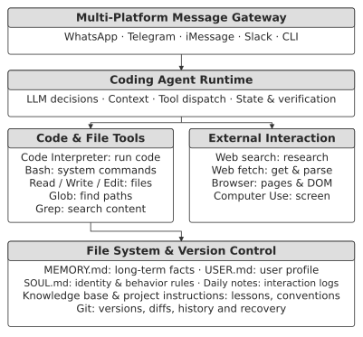

Take "analyze last quarter's sales data and produce a summary report" as an example. The process breaks down into five steps:

1. **Read memory**: Retrieve the user's preferred PDF report format and the fact that the sales data lives in Google Sheets.
2. **Fetch data**: Look up how to use the Google Sheets API and download the required sheets through an authorized interface.
3. **Write analysis code**: Aggregate the sales data with pandas, produce charts with matplotlib, and check the metric definitions and results.
4. **Produce artifacts**: Assemble the analysis and charts into a PDF, and keep the source data, intermediate results, and generating scripts so the report can be traced or updated.
5. **Update memory**: Record the confirmed data source and sheet identifier so the next task can find them.

If the same task were given to Qwen Work, the user could upload the detailed sales records directly and have it analyze the data and produce a visual report.[^ch5-qwenwork] Suppose an order brings in 100 yuan and is later refunded 20 yuan; only 80 yuan should count toward quarterly net sales. If the chart in the report shows 100 yuan, following the chart back to the summary table and the raw records reveals which refund was missed.

[^ch5-qwenwork]: Qwen Work Help Center, "Introduction to Qwen Work," which describes uploading data files, analyzing data, and generating visual reports.

The file system links these steps together: the result saved by one step can become the input to the next, and programs can read the same data repeatedly. If a task is interrupted, the Agent can also check its progress from the saved artifacts and carry on with the unfinished parts.

Intermediate results serve another purpose: when the user asks a related follow-up question, work can resume from the appropriate step. Microsoft Research's Data Formulator demonstrates this with national electricity-generation data. The original table records generation by energy source; the analyst first derives each country's renewable share year by year, then uses that to draw a ranking chart. To see how much a given country's share has risen, the rankings on the chart are not enough: they do not show how many percentage points separate the two years. Following the derivation history the interface keeps back to the share table, you can take the two years' values and subtract.[^ch5-data-formulator]

[^ch5-data-formulator]: Microsoft Research, the energy-analysis example in Data Formulator and the implementation in version 0.7.0 that links charts to data tables.

**Storing memory, knowledge, and capabilities in files.** OpenClaw's workspace uses Markdown files to hold several kinds of information: `MEMORY.md` records long-term facts and decisions, date-organized logs hold process information, `USER.md` can hold user preferences, and Skill files explain how to use a capability[^ch5-openclaw-files]. **For memory that humans and the Agent maintain together, I prefer files that can be read directly.** Users can open a record and correct a wrong fact, and they can use Git to see where it came from, compare versions, and roll back. Keeping logs by date gives events a clear timeline; as the number of files grows, a search index can be added to speed up lookup.

The Agent's ability to write files also lets it accumulate task experience. For example, if a call to a bank reveals that identity verification requires the address of the branch where the account was opened, the Agent can record this along with the business it applies to, the source of the information, and when it happened. Once checked, such records can be organized into knowledge, operating instructions, or programs that later tasks can reuse. Chapter 9 discusses this process of continuous evolution.

[^ch5-openclaw-files]: OpenClaw, *Agent workspace* and *Memory overview*, which describe the workspace, file-based memory, and the retrieval mechanism.

**Which tasks are suited to having the Agent write its own programs?** Open-ended research, content generation, and data processing regularly run into new input formats, interfaces, and artifact requirements, so code generation is well suited to be their execution core. Systems with more stable workflows, such as vertical customer service, can be organized around business state, domain tools, and dialogue strategy, using code for calculation, conversion, and rule checking. Both kinds of system can draw on Coding capability; the role it plays varies with the task.

### The Overall Workflow of a Coding Agent

Walk through Figure 5-2 with a small defect. A user reports that "when sorting by total price, 100 yuan comes before 20 yuan." First find an input that reproduces the problem, then follow the data to see where the amount became a string. After fixing the comparison logic, rerun the original input and check that data with decimals and equal amounts still sorts correctly.

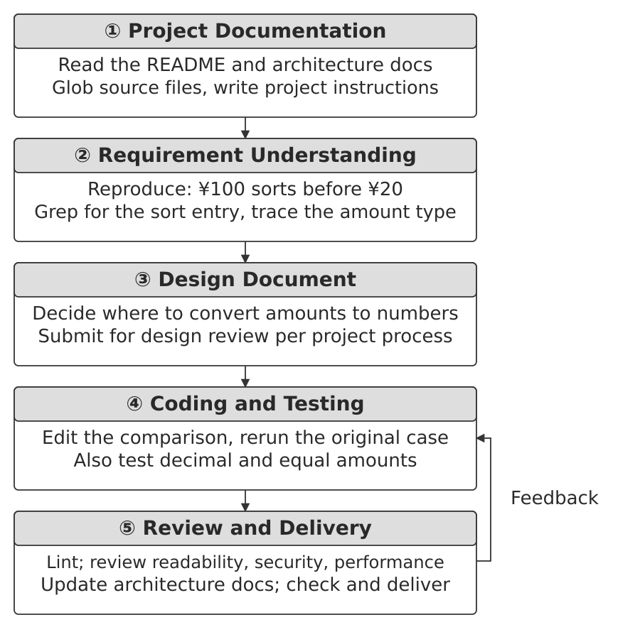

**Understand the project and fill in the documentation.**

On receiving a task, the Agent first reads the project documentation, then cross-checks the implementation, its callers, and the tests to find out what a change will affect. If the documentation does not make clear what the relevant modules are responsible for, which core abstractions they use, how they fit together, or how to test them, the Agent adds what it has verified from the code so that whoever picks up the work next can look it up.

**Project instruction files** put common conventions where the Agent can easily find them. `CLAUDE.md`, `AGENTS.md`, and Cursor project rules can record build commands, code style, and change boundaries, for example "run the tests with `pnpm test`," "declare concrete types for variables and avoid `any`," and "database migration changes require a separate review." Each host loads this content by directory, configuration, or applicability conditions; Cursor's earlier `.cursorrules` was an implementation of the same idea[^ch5-project-rules].

Instruction files and OpenClaw's `SOUL.md` and `MEMORY.md` each have their own focus: the former describe working conventions within a project, `SOUL.md` describes the Agent's identity and behavior, and memory files keep information for later tasks to use. Stable, concise instructions help keep the context prefix consistent; loading directory rules on demand keeps the input for the current task under control. Execution permissions are enforced by the Harness and the runtime environment.

Chapter 2 suggested that teams friendly to remote collaboration also find it easier to bring Agents in. At the level of a code repository, this means writing decisions into design documents, putting task background into issues and PRs, and distilling internal experience into a developer guide. A practical test question: **can a remote newcomer, relying only on the repository and the documentation, find the entry point to a task, run the tests, and understand what the change requires?**

[^ch5-project-rules]: Anthropic, *How Claude remembers your project*; Cursor, Rules, which describe project instructions and rules loaded by scope.

**Clarify the goal and the acceptance criteria.**

For a bug that has already been located, or a parameter adjustment, the change can be made directly on the basis of existing behavior and tests. When the goal is broader, it must first be broken down. "Optimize system performance," for example, might mean reducing response time, reducing memory usage, or increasing throughput. The Agent should examine the current bottleneck, measure a baseline, and establish the permitted scope of change, confirm constraints such as interface compatibility and user experience, and only then settle on an optimization plan.

**Develop a design.**

A design write-up should answer which modules to change, which approach to take and why it suits the problem at hand, whether new dependencies are introduced, and how the change will be verified and rolled back. A small change can be expressed as a brief plan; a complex one is written up as a design document that can be reviewed. When the project or the user requires design approval, submit a concrete plan first and implement it only once it is approved.

**Implement, test, and review.**

Implementation follows the project's conventions, reuses existing abstractions and tools, and keeps changes within the scope of the task. Tests are designed around the expected behavior, covering normal paths, boundary conditions, and error cases; when fixing a bug, the regression test should expose the original problem and verify the fix.

When a test fails, the Agent reads the diagnostics, locates the cause, modifies the code, and reruns the relevant checks. **A coding task is complete when it passes acceptance.** Writing a patch is only one step; the relevant tests, the user's requirements, and the deliverables all need to be checked. The "test–fix–verify" loop lets the Agent keep correcting problems, and it gives Loop Engineering a clear basis for stopping.

Code review goes on to check aspects that tests may not cover, such as readability, interface compatibility, performance, permissions, and dependency usage. It can combine reading the diff, static analysis, and a review sub-agent; when it finds problems, the Agent keeps fixing them and reruns the affected checks.

**Synchronize documentation and deliver.**

New modules, dependency changes, and changes to core behavior should all be reflected in the corresponding documentation. The delivery note should summarize the problem solved, the behavior changes, the verification results, and how to use the result, with rollback steps where necessary. Code, tests, and documentation together preserve the outcome of the task.

Different models also organize exploration and modification differently: some first read the implementation, callers, and tests broadly; others first inspect the most relevant files, try a small patch, and then use compiler or test feedback to keep narrowing down. **I regard this rhythm of exploring and acting first and foremost as a behavioral policy the model has learned.** If the rhythm stays similar after the Harness is changed, but changes markedly when the model is swapped within the same Harness, the difference points to the model itself. The Harness's prompts, tools, and budgets can amplify or suppress this tendency. Chapter 7 discusses how to evaluate these differences, and Chapter 8 discusses how post-training shapes behavioral policy.

### Harness Engineering in Practice for Coding Agents

Chapter 1 described production implementations as **Agent = Model + Harness** and introduced the five functions of a Harness: context management, tool interfaces, constraints, verification, and correction. A Coding Agent can draw on software engineering's testing, static analysis, continuous integration, and version control to turn these functions into executable processes.

Take the sorting defect from before. Leaving the failing input, the relevant function, and the failing output for the model is context management; allowing the model to read, modify, and run tests depends on tool interfaces and constraints. Checking the change against the same input is where verification begins; if the numbers are still sorted as characters, sending the actual and expected orders back together is what makes for usable correction feedback.

The model is responsible for understanding the problem and producing the plan and the code; the Harness supplies the information and interfaces the work requires, arranges the checks, and continues or recovers based on the results. In an engineering system, preparation covers four areas:

- **Acceptance baseline**: Test suites, the CI pipeline, and review standards define what counts as done. CI, or continuous integration, is a pipeline that automatically runs agreed checks after each commit.
- **Execution boundary**: Clearly define module responsibilities, dependency rules, data access, and operation permissions.
- **Feedback signals**: Turn linter output, type-checking errors, and test results into diagnostics the model can locate, understand, and act on.
- **Recovery means**: Keep Git versions, workspace snapshots, and task state, and prepare corresponding recovery procedures for external changes.

**Design the goal and the verification method together.**

Whether a task is clear and whether its results can be verified automatically jointly shape how an Agent works. Table 5-1 lists the four combinations and the engineering work each one needs. By clarifying requirements and adding examples and checks, a vague task can gradually be turned into an executable goal.

Table 5-1 Four Quadrants of Task Clarity and Verification Automation

| | Results can be verified automatically | Results require manual verification |
| --- | --- | --- |
| **Clear goal** | Fixing a bug that has a regression test: iterate on feedback | Code refactoring: combine tests with architecture review |
| **Vague goal** | "Improve code quality": first define quality goals beyond the linter | "Make the UI look better": clarify preferences with examples and comparisons |

**The verification infrastructure accumulated by software engineering is a major reason Coding Agents matured early.** Compilers, type systems, test suites, and version control make errors locatable, changes checkable, and failures reversible, and together they naturally form a powerful Harness. This judgment also points other Agent scenarios to where they should invest: first push tasks into the "clear goal, automatically verifiable results" region. When acceptance depends on a person looking at each result, human review speed becomes the ceiling on throughput; when the goal is vague, even the fastest automation may keep optimizing the wrong metric.

**Distilling methods from engineering cases.**

Large-scale code migration is a good way to see how these components fit together. Migration rules and module relationships are written into the repository documentation, dependency constraints are enforced by static analysis, each batch of changes goes through tests and CI, and failures return locatable diagnostics. The Agent can therefore consult the migration requirements, get feedback after each batch of changes, and continue on that basis.

LangChain's practice shows how to improve a Harness from failure trajectories: hold the model fixed, analyze at which step a task stalls or ends in error, then adjust the system prompt, tool middleware, self-verification loop, and reasoning budget. Chapter 1 already introduced its Terminal Bench 2.0 case; the focus here is the iterative method of "record failures, propose changes, re-evaluate"[^ch5-langchain-harness].

Anthropic's approach to long tasks separates environment initialization from ongoing execution. An initializer Agent sets up the task list and working environment; subsequent Coding Agents work through the items one by one, saving code, test results, and progress. A new session reads these artifacts and carries on, reducing the information lost in handoffs across contexts[^ch5-long-harness].

[^ch5-langchain-harness]: LangChain, *Improving Deep Agents with harness engineering*, February 17, 2026.
[^ch5-long-harness]: Anthropic, *Effective harnesses for long-running agents*, November 26, 2025.

**Turning experience into system design principles.**

1. **Executable constraints take precedence over prompt guidance.** Module dependencies, field types, and coding conventions can be verified with static analysis and CI; access permissions are enforced by the execution environment. Prompts and documentation explain the rules and the reasons for them, while checking mechanisms detect and block violations.
2. **Invest in automated verification first.** Repetitive checking grows with the volume of tasks, and adding ever more human review becomes a scaling bottleneck. Tests, quality checks, and behavior monitoring take on this work, leaving human review to concentrate on trade-offs between goals and complex judgments.
3. **The more timely and structured the feedback, the easier the correction.** Error messages should include the relevant location, the failing condition, and the actual result, to help the model decide its next step. The status bar from Chapter 2 can aggregate the latest diagnostics, call counts, and task progress.
4. **Design a recovery path for every change.** Git branches preserve code changes, sandboxes limit the impact of trial and error, and snapshots restore managed state; external API operations are handled with the idempotency, cancellation, and compensation mechanisms from Chapter 4.

**Check both the outcome and the process.** When fixing a database fault, wiping the data and rebuilding may restore the service but violates data-retention requirements; when fixing a compilation error, deleting the relevant implementation may make it compile but loses the functionality. These examples show that acceptance must cover the business goal, and the execution process must be constrained as well. The Harness can check authorization and scope of impact for operations such as deleting production data or overwriting files, and invoke the independent review mechanism introduced in Chapter 4.

Training can also penalize violations that have already been identified. RLVP (Reinforcement Learning with Verified Penalty), discussed in Chapter 8, folds process constraints into the training feedback, guiding the model to respect execution requirements while pursuing outcomes. At runtime, permissions and review continuously bound the actions that can be executed; training feedback shapes how the model proposes actions in the first place.

**Control fault propagation along dependencies.** When three independent files are read in parallel and one of them does not exist, that item should return an error while the other reads keep their results. If a call depends on the output of a failed task, that dependency chain should be stopped or rescheduled. The Harness needs to decide the scope of cancellation from the relationships among tasks and report each item's status to the parent, so that independent work is not thrown away along with the failure. The implementation of parallel calls, streaming parsing, and cascading cancellation is discussed later.

### Failure and Error Recovery

A long task may lose its connection between two model requests, or it may execute a tool and then fail to save the result. If all the Harness knows is that "the task failed," starting over may repeat operations that have already been performed. To recover the work, you first have to find where it was interrupted and confirm which results have been saved, and only then decide whether to retry, correct the call, resume from the breakpoint, or terminate.

The first question in recovery is: "What evidence did the previous step leave behind?" If the connection drops while reading a file, the read can usually just be repeated; if it drops after submitting a remote job, the remote side may already have accepted it. If a job identifier exists, query it first before deciding whether to resubmit. Recording "request sent," "remote side confirmed," and "result saved" as separate states is what gives recovery a starting point.

**Choose the handling according to where the failure occurs.**

| Layer | Common Failures | Handling Focus |
| --- | --- | --- |
| API layer | HTTP 429 rate limiting, service overload, timeouts, dropped connections, output hitting the length limit | Check the cause of the error and the state of the request; back off and retry, or adjust the request |
| Tool layer | Nonexistent tool name, invalid arguments, execution exceptions, the same error returned repeatedly | Return locatable diagnostics; correct the input or the execution conditions |
| Context layer | Window overflow, compaction failure, calls and results missing their pairing | Adjust the input volume, restore the real record, check the message structure |
| Control-flow layer | Repeated operations without progress, recovery logic recursively triggering failures | Count, limit the depth of recovery, and trigger termination or escalation |

Rate limiting and temporary overload can be handled by waiting and retrying; invalid arguments require changing the arguments, insufficient permissions require dealing with authorization, and a nonexistent tool requires choosing a different capability. Mapping error types to specific recovery actions keeps the same request from failing over and over while nothing about its conditions has changed.

**Monitor both failure and progress.**

The Harness can compute a call fingerprint from "tool name + normalized arguments" and combine it with results and task state to detect repetitive behavior. An identical call may be legitimate polling or a loop that makes no progress; telling them apart also requires looking at the wait condition, the external state, and how long the behavior has lasted. Each recovery path keeps its own failure counter, and a global budget constrains the task as a whole.

Streaming requests need separate settings for a connection timeout, a read-idle timeout, and an overall deadline. The connection timeout limits how long to wait while establishing the connection, the read-idle timeout limits the wait between two receipts of data, and the overall deadline bounds the entire request. When the connection is still open but no data has arrived for a long time, an idle watchdog can close the request and enter the recovery flow. **Every long-lived connection needs liveness monitoring; a connection-establishment timeout alone is not enough.** Timeout thresholds must take the model's output pattern into account: visible text, reasoning deltas, and heartbeats can all show whether a request is still in progress, and lengthy internal reasoning also lengthens the wait.

Context integrity checks revolve around pairing call IDs with results. When a result is missing, first query the execution record and restore the real result that was saved; when the execution state is unknown, record it explicitly as unknown and handle it with the idempotency and status-query mechanisms from Chapter 4.

**Recover in stages, and report the current state.**

1. **Back off and retry.** For retryable errors, use exponential backoff with random jitter and honor the server's suggested wait time. Allocate separate retry budgets to the main task and to auxiliary tasks; background work such as title generation and input suggestions can be skipped after a failure so that it does not crowd out the main task's resources.
2. **Adjust or switch.** When output hits the length limit, first check the cap the interface allows and the task budget, then decide whether to raise the cap, split the task, or continue the output. When a service remains unavailable, switch to a backup model, converting the messages, tool definitions, and model-specific fields before the switch.
3. **Report recovery progress.** During automatic recovery, the interface can show "retrying" or "switching services" while each error is kept in the log. If recovery succeeds, the task continues; when the user needs to handle authorization, supply input, or decide the next step, explain the current progress, the reason for the failure, and what has already been tried.

**A recovery strategy should help the task as a whole keep moving.** Recoverable intermediate errors stay in the run record while the interface shows recovery progress; only after the recovery options are exhausted is the final failure reported to the user and to downstream systems. Downstream systems can thus distinguish "retrying" from "the task has failed," avoiding premature compensation or duplicate submissions.

Tool errors can enter the context as structured results. For example, return the missing tool name, the offending field, and its allowed values, so that the model can correct itself accordingly. Format conversions that the interface contract permits and whose meaning is unambiguous can be performed in code and logged; when the meaning of an argument is unclear, the model should regenerate it, so that the repair does not change the target of the operation.

**Take over an unfinished trajectory.**

When switching models, the confirmed task facts, tool results, and outstanding items must be handed to the receiving side. Message roles, tool-call formats, and reasoning fields differ from one interface to another, so the conversion should handle content and protocol state separately. Some services return readable reasoning content or summaries, and also return opaque fields meant for their own subsequent requests. These fields may be attached to reasoning blocks or to tool calls; which of them must be passed back verbatim in later requests is specified by the corresponding interface.

**Systems that need to continue across vendors should store the business trajectory in a neutral format.** That a model can read text produced by another vendor's model does not mean the target API will accept the original vendor's opaque protocol fields. Only by separating task facts from vendor protocols can takeover, evaluation replay, and training data all share the same record. A neutral record contains the task and messages, tool names and arguments, stable call identifiers, execution status, and results together with their sources. The vendor's raw responses are kept separately, for continuation on the same interface and for troubleshooting. When converting to a request for the target model, build a mapping of call IDs and keep results paired; readable summaries are passed as ordinary context with their source noted, while the original service's opaque fields stay in the raw record.

If the target interface cannot express the old calls, the completed steps can be written up as an explicit task record, such as "flights and lodging have been queried; next, get meal costs and the exchange rate," with the real results attached. The target model then produces new, valid calls. Once the receiving side starts working, the protocol fields it returns should be preserved as its own interface requires. Such neutral records can also serve the evaluation replays of Chapter 7, the training-sample construction of Chapter 8, and the experience extraction of Chapter 9.

> **Experiment 5-1 ★★★: Cross-Vendor Trajectory Handover**
>
> In this experiment, the Agent queries flights, lodging, meal costs, and exchange rates, then computes the total in Chinese yuan. After the first two tool calls, a script switches services at a preset breakpoint, simulating a takeover after the source service becomes unavailable; the receiving side carries on with the remaining steps. The experiment uses three models from Moonshot, Anthropic, and Google and compares six directed switching combinations.
>
> The three treatments are: passing the original messages through with field mapping; converting the messages after deleting reasoning content and opaque fields; and saving task state in a neutral trajectory, then rebuilding the context for the target interface. The switch point is controlled by the script, and format errors on the receiving side are taken from actual service responses.
>
> In this run, the neutral trajectory completed the takeover and computed the correct total in all six combinations; the other two treatments succeeded in three and four, respectively. Because task progress was already saved in the tool results, none of the three groups made duplicate tool calls.

> **Experiment 5-2 ★★: Continuing After the Output Is Cut Off Halfway**
>
> This experiment truncates the stream at three points—during reasoning output, in the body text, and within tool arguments—and compares three approaches: resending the whole turn, continuing with the existing text as a prefix, and appending a continuation instruction. Because a tool call needs complete arguments before it executes, the truncated fragment is first saved in the run record, then re-parsed and validated after recovery.
>
> One concrete error appeared in a city argument: the model should have produced "东京" (Tokyo), but the break left only `{"city":"东`, and the continuation closed it as `{"city":"东"}`, keeping just the first character. The JSON was valid; the city was still wrong.
>
> In this run's long-text test, prefix continuation reduced the number of subsequent output tokens; interruptions in arguments behaved differently: in three trials on Moonshot, prefix continuation never recovered the correct city.

**Set termination conditions for recovery loops.**

Every recovery path needs a ceiling. For example, after repeated compaction failures, switch to a different context strategy; when a permission decision cannot be completed, hand it to a human; stop output continuation once it reaches its round or cost budget. **Retry thresholds should be set from the distribution of recoveries observed in production.** If the vast majority of transient failures have recovered within the first few attempts and further retries of the same kind succeed almost never, stop at that inflection point, so that futile calls do not keep consuming quota.

Recovery logic can itself fail again. For example, a context overflow triggers a stop hook, the hook asks the model to write a commit message, the context overflows again, and the hook fires once more. A reentrancy flag and a recursion-depth limit can break this chain; schedule error cleanup separately from auxiliary work that requires model calls, and give the latter its own budget. The task should also have global caps on iterations, time, and cost, so that every recovery path is bounded by the budget of the task as a whole.

### Implementation Tips for Coding Agents

Start by using the execution record of a single fix for a failing test to estimate which segment is worth optimizing. In my talk "The Road to JARVIS" in Porto in November 2026, a replay of the same session was used to compare different inference speeds: at the latency of the production models of the time, the total came to 24.2 seconds; holding tool time constant and substituting an estimated inference speed for a specialized chip not yet manufactured, the total came to about 8.1 seconds. Of that, 7.5 seconds were spent running tests. Even if the remaining roughly 0.6 seconds of model time were eliminated, the Agent would still have to wait for the tests to finish.

Within those 7.5 seconds, which work can proceed at the same time? That depends on the dependencies among the tool calls.

**Parallel Tool Calls, Streaming Execution, and Cascading Abort.**

Searching code, reading configuration, and checking logs can often proceed independently. When the model generates these calls in a single response, the Harness can overlap call generation with tool execution: once the interface confirms that the first call has been fully emitted and its arguments and permissions pass validation, the Harness schedules it immediately while continuing to receive the subsequent calls. Completeness should be judged from the interface's call-completion event, not merely from JSON that happens to parse for the moment, to avoid executing prematurely.

Independent calls can run in parallel. For example, the Agent can search for a function name while reading a configuration file, and decide how to make the change once both results are back. A file read that can only be determined from the search results goes into a later step. The scheduler must also recognize shared state: if two tools modify the same file at the same time, they will produce a write conflict even though their inputs are independent.

Tool definitions can declare their concurrency support, the resources they access, and how they are canceled; a teaching implementation can schedule any tool that makes no declaration serially. When a call fails, stop the subsequent work that depends on its result, keep the results of independent calls, and return the status of each item to the parent. When canceling a task that has already started, also record whether the cancellation took effect, along with any file changes or external operations that have already occurred.

**Fine-Grained Context Management.**

A large codebase can enter the context gradually through layered retrieval: first locate the files, then read the relevant functions, and extend to callers and tests where necessary. Each read adds information in service of the current decision, so that the model can see code, constraints, and runtime feedback together.

The read tool should support returning a fragment by line range, such as lines 100 to 150, with each line prefixed by its actual line number in the file. The model can then cite "line 142" precisely, and later edit tools can use it to locate the change. The returned content should also state which file it came from and which range was read; once a file changes, edit locations need to be reconfirmed.

Compilation or testing can produce thousands of lines of output, which can be handled with the truncation and persistence mechanism from Chapter 4: return the beginning, the end, and the number of lines omitted, and save the complete output for retrieval on demand. Since errors may appear in the middle, the Agent can go on to search for error keywords or read the corresponding range.

**Dynamic Injection of Environment Information.**

In programming tasks, the Agent status bar from Chapter 2 can aggregate four kinds of information:

- **Current working directory**: the base for resolving relative paths.
- **Git branch**: the development branch the current changes are on.
- **Recent commit history**: recent changes relevant to the task.
- **Overview of staged and unstaged changes**: distinguishing content ready to commit from modifications in the working tree.

The Harness can refresh this summary after operations that change these states and append it to the end of the context on the next model call. Information that changes less often, such as recent commits, can be updated on demand to reduce repeated queries and input volume. Keeping the front of the context stable helps reuse the prefix cache.

**State Persistence in the Command Execution Environment.**

Changing directories, activating virtual environments, setting environment variables, and starting background services all affect subsequent commands. After the Agent runs `cd` in a shell, the directory change carries over naturally only if subsequent commands keep using that session; when a command runs in a separate process, the working directory is determined by that new process's configuration. The environment variables produced by activating a virtual environment have the same session boundary.

**For interactive debugging and tasks that require long-running services, I recommend a persistent terminal by default.** It preserves the working directory, environment variables, and session state, matching the developer habit of working continuously in the same terminal. The Harness assigns each session an identifier and tracks its working directory, running processes, and exit status, so that the model knows in which environment the next command will run. An alternative implementation has every command explicitly carry its working directory and environment configuration, maintaining consistency through reproducible configuration.

Parallel tasks should use separate sessions or explicit environment snapshots, so that a directory change in one task does not affect another. Clean up background processes together when a task ends; when resuming a task, check again whether the session is still alive. For example, if you come back the next day to continue running tests, the code and dependency manifest can be read back from the workspace, but a service process started in the terminal the day before must first be checked to see whether it is still running. These are exactly the two kinds of state that Chapter 4 distinguishes when estimating sandbox costs.

**Instant Syntax Feedback Mechanism.**

After a file is written, the tool layer can automatically run the appropriate language's syntax checker or linter and hand the diagnostics to the model as the tool's return value. For example, when a bracket is missing, it returns the file, the line and column, and the type of error, and the model can fix it in the next round—feedback much like an IDE's instant annotations.

The scope of checks can widen with the change: first check the modified file, then run the tests for the affected module, and finally run regression checks as the delivery requirements demand. Lightweight checks help catch local problems early, while integration tests check cross-module behavior.

### Search Tools in Coding Agents

If an error message contains "amount field missing," you can search for the literal text first and then trace the callers from where the error is raised. If the user only says "sorting is broken" while the code uses English identifiers, searching for that sentence verbatim is of little value. Instead, first locate the interface that displays the result, then follow the fields, call relationships, and test data back to the sorting logic. The four kinds of search tools in Figure 5-3 each exploit different clues; what the first search returns often determines which tool to switch to next.

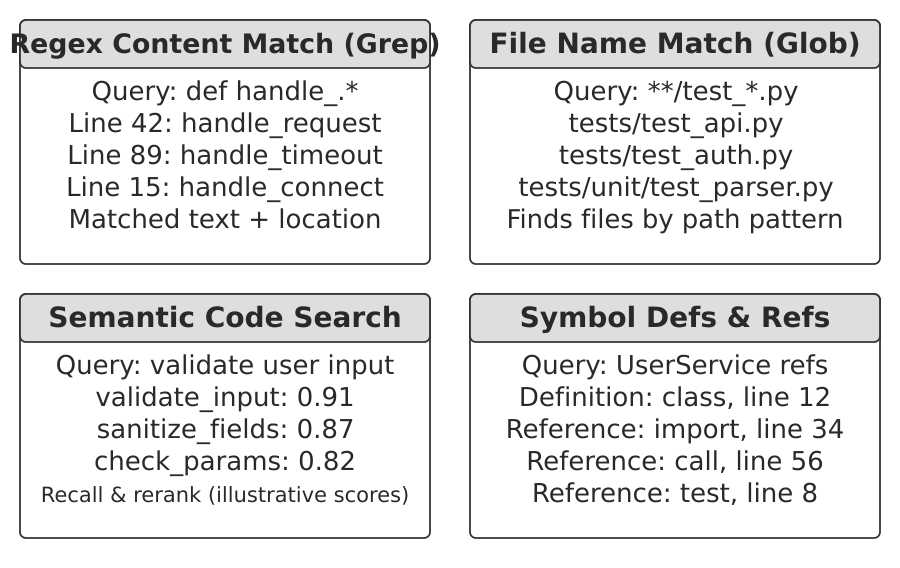

**Regex content matching.** grep and ripgrep find content by text pattern and suit tasks where function names, variable names, or error messages are known. For example, `def handle.*` matches lines of text containing that form of function definition. Combined with file-type and path filters, the search can be limited to Python files and exclude test directories, focusing the results on the relevant implementation.

Text matching corresponds directly to file content, so its results are easy to check. The query terms have to be connected to the way the code expresses things: when searching for "user authentication," you can go on to try names such as `authenticate`, `login`, or `check_credentials`. When the model expands its queries based on the previous results, retrieval becomes a process of understanding while searching.

**Filename pattern matching.** glob finds files by path pattern: for example, `**/*.test.ts` finds TypeScript test files in every level of directory, and `src/components/**/Button.tsx` finds Button.tsx under the components directory. Path matching saves the work of reading file contents and is suited to getting a picture of the project's organization before choosing which files to open.

**Semantic code search.** When a task gives only a description of functionality, vector retrieval can recall semantically related code. For example, "verify user identity" might correspond to `check_credentials`. Such systems usually need to handle two things:

- **Chunking by code structure.** Use functions, classes, and methods as the main units, keeping the relevant signatures, comments, and owning module. When a long unit is split further, each piece needs to carry enough context to be understood.
- **Combining multiple retrieval signals.** Vector retrieval finds semantically related code, keyword retrieval finds code whose names match exactly, and the two sets of results are merged. The cross-encoder introduced in Chapter 3 can then rank them further: it reads the query and a piece of code together and scores the code's relevance.

Exploratory questions such as "interacting with the database" or "handling user input validation" can start with semantic search to locate the module, followed by reading the implementation.

**When building a Coding Agent's search capability, I recommend getting Grep, Glob, and range-based reading right first.** The model can rewrite its queries based on search results and go on to open callers and tests, narrowing the scope step by step. These tools read the current workspace directly, avoiding the work of maintaining an embedding index and keeping it in sync with the code. Add a semantic index to improve recall only when large codebases are explored repeatedly and the entry point is hard to find from a functional description alone. Cursor once described its embedding-based codebase index publicly, and its later search documentation introduced a local Instant Grep index and exploratory sub-agents[^ch5-search]. This evolution also shows that "using a grep-style interface" and "whether to build an index" are two separate design dimensions: the same retrieval interface can be backed by either scanning or an index.

**Symbol-level definition and reference lookup.** A language server can use syntax, scope, and type information to provide "go to definition" and "find references." For example, if `authenticate` is defined on line 42 and called on line 189, the tool can return the relationship between the two and distinguish symbols of the same name in other scopes. Claude Code's code intelligence plugins are one way to connect this: they provide symbol navigation and post-edit diagnostics through the Language Server Protocol (LSP)[^ch5-lsp].

The effectiveness of symbol tools depends on language support, project configuration, and the state of analysis. The Agent can supplement them with text search to find strings, comments, or files the language server has not yet parsed.

[^ch5-search]: Cursor, *Securely indexing large codebases* and Search, which describe, respectively, the embedding index approach and the later local search mechanism.
[^ch5-lsp]: Anthropic, *Code intelligence plugins*, which describes providing definitions, references, and real-time diagnostics through LSP.

### File Editing Tools in Coding Agents

Suppose that after the model has read a file, someone else happens to add a comment line at the top. Do "change line 28" and "replace this uniquely occurring text" still point to the same place? What if the text appears once in each of two functions? The five editing schemes in Figure 5-4 locate changes in different ways: some rely on line numbers, some on the original text, and one hands the merging to another model.

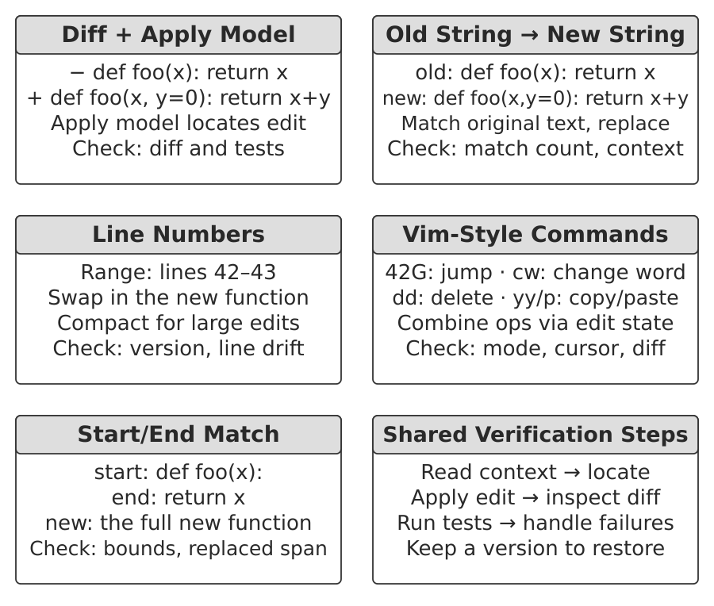

**Diff description + Apply Model.** The main model states its intent and provides code fragments—for example, an add/remove description similar to a Git diff, or a code skeleton that uses omission markers to skip unmodified parts. A dedicated apply model then combines this with the original file to produce the complete modified content. Cursor's early Fast Apply is the representative of this approach[^ch5-apply]. It splits "proposing a change" and "applying a change" between two models. As base models have become better at generating precise local edits, simpler alternatives to this two-model pipeline have emerged.

This division of labor lets the main model concentrate on expressing code logic while the apply model merges the local changes into the file. Correspondingly, the checks focus on the merge result: multiple similar fragments can make the location ambiguous, omission markers can be misinterpreted, and unmodified regions can be rewritten by accident.

**Old String → New String.** Claude Code's Edit tool uses exact string replacement; Cursor introduced Search & Replace in version 0.50 in May 2025, first for long-file edits with Anthropic models[^ch5-direct-edit]. This route hands the locating anchor and the replacement content directly to a program to execute, removing the need to call a model again in a merge stage. The model supplies `old_string` and `new_string`, and the tool finds the original text in the file and replaces it. The interface can require that the original text be unique for a single replacement; when there is no match or there are multiple matches, it returns the locations and diagnostics so that the model can add context. When a bulk replacement is needed, an explicit parameter expresses the scope.

For example, suppose two services in a configuration file both have `timeout = 30`, and you only want to change the download service's timeout to 60 seconds. If the tool requires a unique match, supplying only `timeout = 30` yields two matches, and the file should be left untouched. The next request uses the download service's section header together with the setting line as the old string, and the new string keeps the header and changes only the value.

Content matching is intuitive and easy to review. When calling the tool, the model must output the complete old string: deleting a large block of code makes the argument very long, and small differences in spaces, line breaks, and quotation marks can break the match. The Unicode curly-quote case in Chapter 4 shows how this kind of failure arises during argument passing.

**Line Number Targeting (Old Line Numbers → New String).** The model specifies deleting lines X through Y and inserting new text. When the read tool already provides actual line numbers, deleting a large block requires only the two end positions. But the meaning of a line number depends on the version of the file at read time, and an earlier edit may shift the positions that follow.

Batch edits can therefore all refer to the same initial snapshot, with the tool checking for overlapping ranges and applying them together; alternatively, edits can be made one at a time, rereading and relocating after each. The tool can also verify the file version or the expected content and return a conflict after a concurrent modification, preventing old line numbers from being applied to new file content.

**Vim-like edit commands.** Editor commands can express moving, copying, cutting, and pasting, which suits restructuring operations such as moving a function from one place to another. They depend on the current cursor, buffer, and command mode, and every step changes the baseline for the operations that follow.

**The interaction habits of human editors need not become the default design for model tools.** A human typically glances at the current state and then performs one small operation; a model can think for a longer stretch and produce dozens or even hundreds of lines of changes at once. Breaking such a batch of changes into a large number of cursor movements and mode switches raises the call cost and requires the model to predict how earlier commands affect the state. For code generation tasks, I therefore prefer interfaces that directly express the target and content of a change; when editor commands are used, the state baseline must be explicit and feedback returned promptly.

**String Start + End Matching (Old String Start + End → New String).** The model supplies only the first and last few lines of the region to be replaced, and the tool locates the two boundaries and the content between them. When deleting hundreds of lines of code, this reduces how much of the original text must be repeated while still anchoring the location in content.

The tool must check the order in which the two pieces of original text occur and decide, according to the interface contract, whether the start and end pieces themselves are replaced. It acts only when exactly one range qualifies; if several places match, it reports those locations to the model and asks it to add context. For nested structures or repeated code, adding nearby anchors such as function names and signatures helps pin down the range.

**When building a new Coding Agent, I recommend starting with a simple, deterministic editing interface such as old string → new string.** Locating by original text is unambiguous, failures are easy to explain, and the diff is easy to review. Once the model can reliably generate local edits, the Harness can hand more of the work to deterministic programs and dispense with a separate apply model. When large deletions require compressing the size of the arguments, add start/end anchors or snapshot-based line-number editing. Codex's `apply_patch` illustrates another direct-editing route, which uses constrained patches to express changes in multiple places.

[^ch5-direct-edit]: Anthropic, *Tools reference*, Edit tool; Cursor, 0.50 changelog, May 15, 2025, describing the introduction of Search & Replace; the 1.3 changelog also records optimizations to Search & Replace and Apply.

[^ch5-apply]: Cursor, *Editing Files at 1000 Tokens per Second*, which describes a dedicated model that applies change descriptions to the original file.

### Security for Coding Agents

A Coding Agent can read a project, modify files, run programs, and possibly reach external services over the network. When designing permissions, follow the data flow and check three questions: what content enters the context, what operations the model can request, and what mechanism ultimately approves and executes those operations.

Simon Willison summarized one class of prompt-injection risk as the "Lethal Triad": access to private data, exposure to untrusted content, and the ability to communicate externally[^ch5-trifecta]. For example, an assistant that can read private files, processes external email, and can send messages needs clear authorization boundaries between reading, understanding, and sending. Once instructions in external content are treated as the user's requests, they can drive unauthorized transfers of data.

Beyond these three dimensions, I also recommend checking a fourth: **persistent memory amplifies the impact of prompt injection**. If external content enters long-term memory, its influence can cross sessions and resurface in later tasks. Memory writes should therefore record their source, scope of applicability, and confirmation status, and these attributes should be preserved on read. The trustworthiness of text stored in `MEMORY.md` still depends on how it came to be there. When an erroneous record is discovered, it must be possible to locate, correct, and retract the related content.

The three-layer guardrails from Chapter 1 each take on a task here: the context layer marks the source of information and behavioral requirements, the execution layer validates operations and authorization, and the data layer restricts resource reads and writes by trusted identity. Claude Code's sandbox constrains command execution through file-system and network boundaries, and Cowork likewise runs local tasks in an isolated environment[^ch5-sandbox]. The following paragraphs develop these mechanisms further.

**Bounding resources and communication in the sandbox.**

- **Network egress.** This is the boundary in a code sandbox that is easily overlooked and should be put in place first. I recommend starting with external access closed by default and allowing package registries, documentation sites, and business APIs as the task requires. Allowlist entries should correspond to specific destinations and scopes of operation; for shared services, accounts, tenants, and resource ownership must also be considered. Network policy should cover the programs that tools launch and their child processes, and outbound data should additionally be checked against the authorized scope.
- **File system.** The original source can be mounted read-only with a copy placed in a writable workspace; alternatively, a controlled editing interface can generate patches that are applied after review. Generated artifacts and intermediate files go in a separate directory, and credential files stay outside the sandbox. When access to an authenticated service is needed, a controlled interface provides the capability the task requires, rather than handing all of the host's credentials to the generated program.
- **Resources and time.** Set caps on CPU, memory, number of processes, disk space, and running time to limit the impact of infinite loops, runaway process counts, and continuous disk writes. When a limit is exceeded, return a structured status, such as "execution exceeded 120 seconds and was terminated," along with the retained output and the cleanup results, so that the model can decide whether to narrow the task or change the implementation.

These boundaries need to cover the entire execution chain. After a command is approved, the program it actually launches still runs within the same permission scope; background processes, helper tools, and external interfaces must also be brought under the corresponding controls.

**Parsing command structure and argument meaning.**

A shell command combines a program name, arguments, redirections, pipes, and subexpressions. Review should parse these structures and then identify the read, write, execute, and communication operations involved. **A command blacklist is not enough to carry the final security decision.** The same operation can be expressed through different argument combinations and indirect invocations; validation must understand the command structure and the purpose of each argument, and runtime permissions then constrain what is actually executed.

For example, a file-search tool may have an argument that runs a further operation on every match, and a download tool's output option determines where it writes. The validator needs to recognize "which option takes the next argument as its value," trace what each argument is used for, and then check the target path, access permissions, and permitted operations. The review result can then be as specific as "which files are read," "which location is written," and "which program is launched."

Variable expansion, dynamic scripts, and paths generated only at runtime defer part of the actual behavior until execution. For the parts that cannot be determined in advance, the Harness can require a more explicit form of invocation, send them for review, or execute them in a restricted environment. Model-assisted review provides contextual judgment, while deterministic access control constrains the actual effect. The Sidecar introduced in Chapter 4 can run in parallel with preparatory work, and operations with external effects are committed only after review passes.

**Whom does the Agent serve under multi-party delegation?**

Principal loyalty concerns how an Agent that acts on behalf of one party, while communicating with other participants, keeps adhering to its principal's goals and authorization. For example, a user asks an Agent to negotiate a price with a supplier and privately gives it a budget ceiling of 12,000 yuan. The Agent needs to understand the supplier's quotes and explain its own side's position, while protecting this private constraint.

In multi-party interaction evaluations, my collaborators and I observed two kinds of failure: one leaks the principal's private information or accepts the other party's improper demands; the other refuses excessively, failing even the principal's legitimate requests. The prompting strategies and training methods evaluated showed a trade-off between protecting information and cooperating normally[^ch5-1]. **Loyalty must be measured by both information protection and task completion.** Pursuing more refusals alone blocks normal cooperation along with everything else; pursuing a smooth conversation alone may let the other party influence the principal's interests.

For a Coding Agent, repository files, tool output, and responses from third-party MCP servers may all contain task information, and may also carry text that tries to change its behavior. The Harness should distinguish the principal's instructions from external material by their true source, attach source and role to each message, and map the scope of delegation to executable permissions. Text in external material that claims to be "the user's request" must be confirmed through a trusted channel.

Prompts can further spell out a code of conduct for cooperation: protect the principal's private information—sometimes even whether a record exists must be kept confidential; disclose only what is necessary when explaining to outside parties; distinguish internal bottom lines from public positions; advance the task within the authorized scope; and apply consistent authorization standards in the face of repeated requests. Any expansion of authorization or change of whom the Agent serves should be confirmed through a trusted channel, and the runtime permissions updated accordingly. The model thereby gains a clear basis for its behavior, while tools and the environment enforce the actual access boundaries.

[^ch5-trifecta]: Simon Willison, *The lethal trifecta for AI agents: private data, untrusted content, and external communication*, June 16, 2025.
[^ch5-sandbox]: Anthropic, *Making Claude Code more secure and autonomous with sandboxing* and *How we contain Claude across products*, which describe file-system, network, and product isolation boundaries.
[^ch5-1]: Li, Bojie and Noah Shi, *Whose Side Is Your Agent On? Multi-Party Principal Loyalty in LLM Agents*, 2026.

## Code: The Meta-Capability of a General-Purpose Agent

The preceding sections turned user requirements into code changes. Now look back at the sales spreadsheets from the start of the chapter: even if all the user ultimately needs is a report, the Agent can still write a program that unifies product identifiers, computes grouped statistics, and then recalculates the return rate for a single product from the original tables. First ask whether the user wants returns counted by item or by order. Suppose a product sold ten units across two orders, and only one order returned a single unit. Counted by item, the return rate is 1/10; counted by orders that had any return, it is 1/2. Both calculations run successfully; only by confirming the definition first can you know which number answers the user's question. A program written this way can also be rerun when the next period's data arrives. This "generate, execute, verify" loop also extends to content production, business-system integration, and Agent development.

> **Meta-capability.** This book uses meta-capability to mean a capability that creates or composes other capabilities. Code generation can produce new tools, such as data-processing scripts and API call sequences; it can express new constraints, such as assertions and validation rules; and it can construct new forms of presentation, such as HTML forms, slide decks, and videos.

Start with the simplest case. Even when the only deliverable is the answer to a single problem, the model can write a short program to check its own working.

### Code as a Thinking Tool

**For precise computation and formal constraints, I prefer to have the model write an executable expression and hand it to an interpreter or solver to compute.** Generating an answer token by token is prone to transcription and arithmetic errors, and can also miss conditions; a program fixes these steps in place and can execute them repeatedly. Mathematical and logical tasks usually involve two stages: first translate the problem into relations and constraints, then solve for the result. An LLM can help understand the problem, propose a method, and write the program, while the interpreter or solver carries out the specified operations.

For example, a class has 40 students: 60% take math, 45% take physics, and 25% take both. To find the number who take only physics, subtract the number taking both from the number taking physics: 18 − 10 = 8. Mistakenly using the number taking math gives 24 − 10 = 14. The error occurs at the step of choosing what to subtract from.

Writing the quantities as meaningfully named variables lets you check each item in turn:

```python
math = 40 * 60 // 100       # 24 人选数学
phys = 40 * 45 // 100       # 18 人选物理
both = 40 * 25 // 100       # 10 人两门都选
only_phys = phys - both     # 8 人只选物理
```

Symbolic computation extends this division of labor further. It can keep exact forms such as $\sqrt{2}$ and transform expressions according to algebraic rules. Squaring it directly gives the integer 2. Rounding to 1.414 first and then squaring gives 1.999396. When a problem calls for exact simplification, keep the symbols; when it calls for reporting a measured value, evaluate to the specified precision at the end. In discussing the combination of LLMs with Wolfram|Alpha, Wolfram emphasized how language understanding and computational capability complement each other[^ch5-wolfram]. An Agent can first turn a natural-language question into a Wolfram Language or Python expression, then call the computation system and continue reasoning with the result.

Different tasks call for different tools. SymPy suits symbolic expressions, equations, and calculus; NumPy provides array and matrix operations; SciPy provides numerical optimization and other algorithms.

> **Experiment 5-3 ★★: Using Code to Assist Mathematical Problem Solving**
>
> In this experiment, the same Doubao model works through the 30 problems of AIME 2024, comparing direct reasoning with a Python-tool-assisted path. The tool environment provides SymPy, NumPy, and SciPy; the model can generate programs, read the execution results, and then give its final answer.
>
> In this run, direct reasoning answered 11 problems correctly and code assistance answered 16.

Logic problems can be handled the same way. Take Knights and Knaves puzzles: give each islander a Boolean variable, true for knight and false for knave, then translate each statement into a Boolean expression. For a speaker X, the constraint is that "X is a knight" is equivalent to "X's statement is true." For example, if A says "B is a knight," that gives `A == B`; if A says "B is a knave," that gives `A == (not B)`.

The solver searches for an assignment that satisfies all the constraints, and the model then interprets the assignment as the characters' identities. If the statements contradict one another, no satisfying assignment exists; the given statements may also admit several different sets of identities.

> **Experiment 5-4 ★★: Using Constraint Solving to Assist Logical Reasoning**
>
> This experiment selects 84 problems from the K&K dataset, stratified by number of characters, and compares the same Doubao model reasoning directly with it calling `python-constraint`. The code path has to identify the character variables, translate the statements, and call the solver to find an assignment of identities that satisfies every condition.
>
> In this run, direct reasoning answered 63 problems correctly and code assistance answered 33. All 84 code trajectories contained a statement importing the solver library. In one problem, the model even fixed its program but never submitted an answer.
>
> Take the two-person problem with James and Sophia. James says Sophia is a knave; Sophia says, "James is a knight if and only if James is a knave." The latter statement is false whoever James is, so Sophia is a knave and James is telling the truth. The first program the model submitted wrote the biconditional as `james == not james`, which Python cannot parse. By the eighth tool call, the program had become `james == (not james)`, but the final reply was still empty, and the problem was scored as wrong all the same.

**How thick the Harness should be depends on the boundary of the model's capability on the specific task.** For reasoning the model already performs reliably, an extra solving step may only add overhead; the parts where the model tends to miscalculate are worth handing to deterministic computation. But tool assistance also requires the model to carry out the formalization correctly, and a mistranslated constraint turns the original problem into a different one. Even when the constraints are fixed, the assistant may exhaust its turns before it can return an answer.

[^ch5-wolfram]: Stephen Wolfram, *Wolfram|Alpha as the Way to Bring Computational Knowledge Superpowers to ChatGPT*, January 2023.

### Code as a Constraint for Business Rules

Business rules can be built into the execution flow through code. For example, "refundable within 7 days of purchase" needs to be pinned down further: are those calendar days or business days, does the clock start at order placement, payment, or shipment, and is the boundary moment included? Only after the business owner confirms these meanings and they are written as conditions and test cases does the rule have a stable basis for enforcement.

For example, if the rule owner confirms "no more than 168 hours have elapsed since payment," three adjacent test cases can be written: 167 hours 59 minutes after payment, exactly 168 hours, and 168 hours 1 minute. Subtract the payment time from the server-side request time, after first normalizing both timestamps to the same time base. Under this rule, the first two cases pass and the third is rejected. If the owner changes the rule to count calendar days in the payment location's time zone, both the existing test cases and the code must be rechecked.

Natural-language descriptions help the model understand the policy, explain the reasons to users, and look for other options within the authorized scope, such as checking whether rebooking is allowed. Codified validation checks the specific conditions before critical operations, and is suited to multi-condition combinations, time calculations, and cross-checks across data sources. The model can help generate the validation code, while the rule owner confirms its meaning through review and boundary test cases; when a rule is updated, the description, the implementation, and the tests are updated together.

**The primary value of codified rules is to stop erroneous operations that would cause real losses.** Canceling orders, transferring funds, and deleting data all change business state, and remediation after the fact can be costly. I recommend putting ground-truth validation directly into the execution interface, so that every submission passes through the same set of rules and the model cannot skip a separate checking tool. A separate query interface can still be used to explain the policy in advance; at execution time, the interface rereads the required facts, checks whether the state has changed, and manages subsequent operations with the transaction, idempotency, and compensation mechanisms introduced in Chapter 4.

**Use parameters to guide checking; use server-side facts to decide.**

τ-bench studies tool calling and policy compliance in airline, e-commerce, and other scenarios[^ch5-tau]. The following uses airline booking as a teaching scenario with five cancellation rules: first exclude reservations with used segments, then check booking time, airline cancellation, business class, and insurance. `cancellation_reason` records the reason the user gives for the request, and `expected_*` records the facts the model expects to see, while the actual decision reads the business database and the server clock.

The code shows the policy branches. The entry layer is responsible for confirming the requester's identity, ownership of the reservation, and authorization for the operation; the execution layer reads the state, validates the conditions, and commits the cancellation within a controlled transaction or an equivalent consistency mechanism, saving an audit record.

```python
def cancel_reservation(
    reservation_id: str,
    cancellation_reason: str,        # "change_of_plan", "airline_cancelled", "other"
    expected_cabin_class: str | None = None,  # 可选：模型预期的舱位
    expected_has_insurance: bool | None = None  # 可选：模型预期的保险状态
) -> dict:
    """
    取消航班预订。

    取消政策（服务端根据数据库真值强制执行）：
    - 规则 1: 已使用任何航段的订单不可取消
    - 规则 2: 通过规则 1 后，预订后 24 小时内可取消
    - 规则 3: 通过规则 1 后，航空公司取消的航班可取消
    - 规则 4: 通过规则 1 后，商务舱可取消
    - 规则 5: 基础经济舱和经济舱需购买旅行保险才可取消

    调用前请先查询订单详情，逐条核对上述政策；expected_* 参数用于
    陈述你的判断依据，仅供服务端比对与审计，不影响政策裁决。
    """
    # 从业务数据库读取政策判断所需的事实
    r = db.get_reservation(reservation_id)
    now = server_clock.now()  # 使用服务端时钟

    # 记录预期值与当前事实的差异，供诊断和审计
    if expected_cabin_class is not None and expected_cabin_class != r.cabin_class:
        log_mismatch(reservation_id, "cabin_class", expected_cabin_class, r.cabin_class)
    if expected_has_insurance is not None and expected_has_insurance != r.has_insurance:
        log_mismatch(reservation_id, "has_insurance", expected_has_insurance, r.has_insurance)

    if r.any_segment_used:
        return {"success": False, "reason": "Cannot cancel with used segments"}

    hours_since_booking = (now - r.booking_time).total_seconds() / 3600
    if hours_since_booking < 0:
        return {"success": False, "reason": "Booking time is in the future"}
    if hours_since_booking <= 24:
        execute_cancellation(reservation_id)
        return {"success": True, "reason": "Cancelled within 24-hour window"}

    if r.flight_status == "cancelled_by_airline":
        execute_cancellation(reservation_id)
        return {"success": True, "reason": "Airline cancelled flight"}

    if r.cabin_class == "business":
        execute_cancellation(reservation_id)
        return {"success": True, "reason": "Business class cancellation"}

    if r.cabin_class in ["basic_economy", "economy"]:
        if r.has_insurance:
            execute_cancellation(reservation_id)
            return {"success": True, "reason": f"{r.cabin_class} with insurance"}
        return {"success": False, "reason": f"{r.cabin_class} requires insurance"}

    return {"success": False, "reason": "Does not meet cancellation policy"}
```

**Parameters help the model check each item.** The tool description lists the cancellation policy and asks the model to query the reservation first. The model can fill in the cabin class and insurance status as `expected_cabin_class` and `expected_has_insurance`, so that the basis for its judgment appears in the call record. The optional parameters provide an entry point for checking; whether the query and check were actually performed still has to be verified from the trajectory. If the workflow requires a query first, the Harness can check the query record and how recent it is.

For example, if the reservation is more than 24 hours old, the flight is operating normally, and the cabin is economy without insurance, the model can explain on that basis that it cannot be canceled under this example's policy, and look up permitted options such as rebooking.

**The server enforces the rules against current facts.** Cabin class, insurance, booking time, segment usage, and flight status are all read from the business data source; the time window is computed with the server clock. Discrepancies in `expected_*` are used for diagnosis, and `cancellation_reason` records the intent of the request. Facts such as whether the airline canceled the flight are verified by the server; a user writing "airline cancellation" in the request does not make a nonrefundable ticket refundable.

The independence of the data source must also be enforced through access control: who can modify reservation facts, when they are updated, and how history is kept all affect how trustworthy the validation is. Concurrent operations may change the state after the query, so when a refund is submitted, the server rereads the reservation state, confirms the ticket is still refundable, and returns a consistent result for duplicate requests.

> **Experiment 5-5 ★★: Small Models and Codified Business Rules**
>
> This experiment uses Qwen3-4B to compare two implementations on 60 fixed airline refund cases. Both give the model the policy in natural language; in the control group, the cancellation tool refunds directly once called, while in the codified group the tool reads a simulated database and the server clock before executing and checks refund eligibility.
>
> The experiment uses a simplified policy: flexible economy and business class are refundable; basic economy is refundable within 24 hours of booking, or in the event of an airline cancellation or a major delay. The checking parameters are `expected_refundable` and `expected_reason`, which record the model's judgment of refund eligibility and of the reason, respectively.
>
> Scoring first looks at whether money was refunded, then checks whether the ticket should have been refunded under the policy. By this standard, the control group handled 57 cases correctly and the codified group 55. Neither group refunded a passenger who did not qualify; all lost points came from orders that should have been refunded but were not: 3 in the control group and 5 in the codified group. Passengers also care whether customer service explained the reason and what they can do after being refused. The experiment separately checked the policy explanations and alternatives in the final replies; these checks do not count toward the refund scores above.

[^ch5-tau]: Sierra Research, τ-bench: A Benchmark for Tool-Agent-User Interaction in Real-World Domains, which provides policies, tools, and interaction tasks for airline and e-commerce scenarios.

### Code-Driven Multimedia Generation

Presentations, technical reports, and interactive pages all involve two kinds of work: organizing content and presenting it visually. An Agent can first write the structure as code or markup and then call a rendering tool to produce a viewable artifact. HTML expresses page structure, for example, CSS controls layout and style, and JavaScript implements interactivity. The position and style of each element thus become modifiable parameters, making batch adjustment, regeneration, and version comparison easy.

Programmatic generation suits content that is structured and must be revised repeatedly. A GUI, in turn, offers a way to view the result directly and operate on parts of it; the two approaches can be used together.

**PPT Generation Agent.**

An academic talk must organize a paper's problem, method, experiments, and conclusions into an explanation that unfolds page by page. An Agent can first plan the question each slide should answer, then choose the key points and figures, and finally generate the slide source code. Slidev takes Markdown as its content entry point and supports HTML and Vue components, which makes it well suited to organizing this process into an executable generation pipeline[^ch5-slidev].

If the organizers provide a previous year's talk as a template, its page structure can be reused directly. PPTAgent first analyzes the purpose of each page in the reference deck, then picks suitable reference pages for the new outline and modifies the objects on each page with code. If the new talk needs to present experimental results, for example, it can pick a page that was originally designed to show two sets of results side by side and replace the figures and captions on it. This kind of reuse brings its own check: once both figures have been replaced with this year's results, might the paragraph beside them still be explaining last year's experiment? The version used in the paper edits text boxes by element and paragraph number. If only the figures were swapped, the old explanation would remain on the page.[^ch5-pptagent]

[^ch5-pptagent]: Zheng et al., the PPTAgent paper, EMNLP 2025. The paper's accompanying code implements the paragraph-level editing interface in `pptagent/apis.py`.

Even with the right text and images in place, the layout can still go wrong. Add a two-line caption to a figure, for example, and the deck may compile while the text covers the chart's axis. In Figure 5-5, it is only by looking at the rendered screenshot that the reviewer can send this kind of comment back to the proposer responsible for layout.

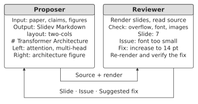

- **The Proposer** reads the paper, plans the structure of the talk, writes the Slidev source, and revises pages based on feedback.
- **The Reviewer** renders the pages with a tool, uses a vision model to check content density, readability, layout, and the correspondence between figures and text, and returns structured feedback containing the page number, issue type, severity, and a suggested fix.

Feedback should guide revisions directly. For example: "Page 3 has too many bullet points; split it into two pages, a method overview and the computation steps"; "The code font on page 7 is too small; increase it to 14 pt first, then check readability when projected." Factual errors and misread figures are fixed first, followed by layout and visual details.

A local edit also needs to say which object it applies to. Doubao Work in Feishu Slides lets users select a page element and then make an editing request through a floating toolbar.[^ch5-doubao-work] Suppose a page has two text boxes: one holds an original interview quotation, the other a summary written by the presenter. The user selects the summary and asks to "compress it to two lines." The selected text box limits the scope of the change: the summary can be rewritten, while the quotation beside it must keep the interviewee's exact words.

[^ch5-doubao-work]: Feishu Help Center, "Using Doubao Work in Slides."

After the Proposer revises, the pages are re-rendered, and the Reviewer checks the new version and confirms whether the previous round's issues have been resolved. The loop has two kinds of exit condition: the explicit content and layout requirements are met, or the budget of rounds, time, and cost is used up, for example a maximum of five rounds of revision. At delivery, save the current version together with the issues still outstanding, to make later review easier.

This shares the Proposer-Reviewer pattern with the operation approval in Chapter 4. Operation approval mainly judges whether a particular action may be executed; content review improves an artifact through multiple rounds of feedback. Both require shared task requirements and locatable grounds for each judgment, with the Harness deciding the subsequent flow. Using models from different families can provide an additional review perspective.

**I value the advantage of a two-Agent division of labor for context management.** Each role can keep the information it needs: in every round, the Reviewer receives the latest screenshots, the review criteria, and the necessary list of issues; the Proposer keeps the source code, the revision goals, and the structured text feedback. Page images stay in the Reviewer's context, while the main trajectory moves the revisions forward through short text feedback. Each round of review centers on the latest pages, which both reduces interference from historical screenshots and keeps the context from growing.

> **Experiment 5-6 ★★: Automatic PPT Generation from Papers**
>
> This experiment takes the PDF of "Attention Is All You Need" and generates a 20-slide Slidev deck. The Agent extracts the paper's structure and key points, uses three figures from the original paper with their sources recorded, and organizes the explanation slide by slide. After rendering, it checks for text overflow, chart readability, and the correspondence between figures and text, then revises according to the feedback.
>
> The comparison is between single-Agent self-review and a Proposer-Reviewer division of labor. In this run, both final decks scored 95 in the same independent scoring process; the peak input of the division-of-labor approach was about 24,000 tokens, versus about 93,000 tokens for the single-Agent approach that kept historical screenshots.

> **Experiment 5-7 ★★: Automatic Generation of Paper Explanation Videos**
>
> Building on the slides, the Agent can write a conversational narration for each page, explaining the objects, relationships, and conclusions in the figures, and then call TTS to synthesize the speech. The script and the pages are handed together to a visual reviewer, which checks whether the elements mentioned actually appear on screen and whether the descriptions match the charts.
>
> To make the video, the experiment reuses the generation pipeline from the previous section and picks an earlier 22-slide draft (v2). After 12 slides are extracted in order, the last frame of the video comes from slide 21 of the original draft. The scoring and usage comparison in the previous section used a later 20-slide draft (v9). With the slides chosen, Kimi generates the script, a Qwen vision model reviews the relationship between figures and text, and Fish Audio synthesizes the speech page by page. FFmpeg sets each page's display time from the actual duration of its audio segment and assembles an explanation video of about 8.6 minutes.
>
> In Figure 5-6, the slides, script, and speech are combined into a video only at the very end. Some problems can only be heard at this step: whether a sentence is still unfinished when the slide changes, and whether sound and picture drift further apart as the video goes on.
>
> 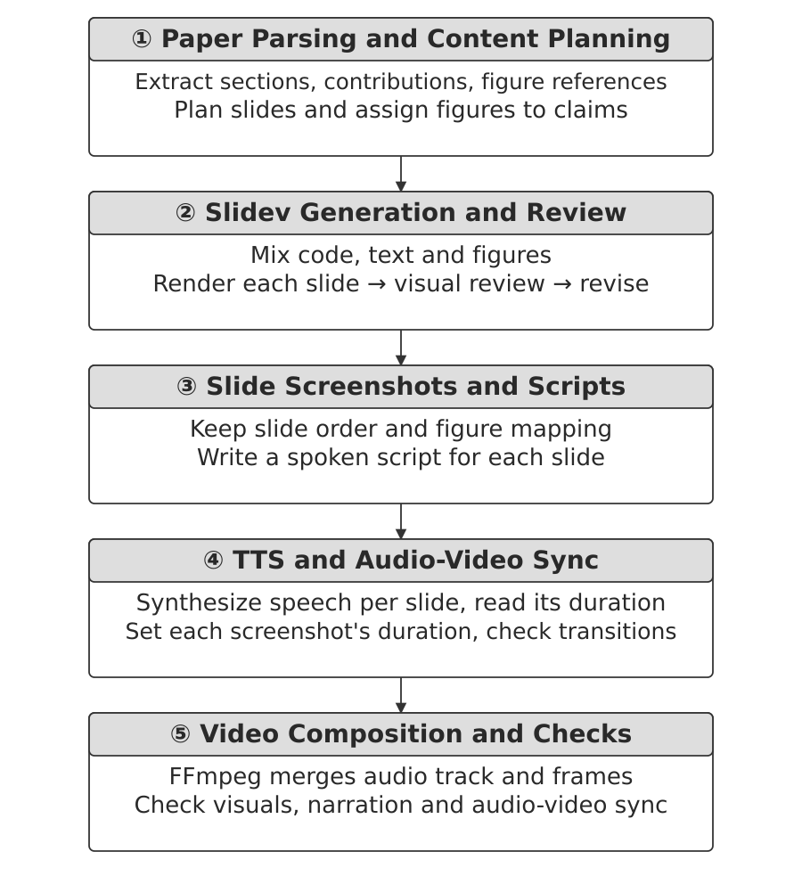

[^ch5-slidev]: Slidev, *Getting Started*, which describes generating, presenting, and exporting slide decks based on Markdown and web technologies.

**Video Editing Agent.**

**Video-editing operations that can be expressed in a script should go through a programmatic interface first.** Timelines, layers, subtitles, and audio tracks are spread across complex GUI panels, and repeatedly locating and dragging them adds latency and error; a programmatic interface can express operations directly in terms of time ranges, tracks, and effect parameters. Blender's Python API and FFmpeg can both organize part of the editing work into scripts that run repeatably.

The Agent can first understand a request such as "cut out the surfing part," then locate the target range in the footage and generate code for trimming, arranging, and audio processing. The Proposer is responsible for the editing plan and the script, and the Reviewer checks the rendered result; when it finds omissions, irrelevant segments, or subtitles blocking the picture, it reports the specific timestamps and issues back to the Proposer for revision. Keyframes are good for checking scenes and layout, but motion continuity and audio-video synchronization also require checking adjacent frames or continuous segments.

> **Experiment 5-8 ★★: API-Based Intelligent Video Editing**
>
> This experiment chains target localization, script generation, and effect review into one pipeline. First, the video reference, the target question, and the frame-sampling interval are handed to a video-analysis sub-agent, which processes the large number of frames and returns time ranges and its supporting evidence to the main Agent.
>
> Localization takes two steps. The first samples one frame every 10 seconds to find the rough range of the target, for example "surfing is at 40–110 seconds"; the second samples one frame per second around the candidate range and its neighboring boundaries to pin down the start and end. A scene shorter than the coarse sampling interval may fall between two frames; you can sample more densely according to the target's duration, or look back at the footage between two sampled frames.
>
> Once the range is fixed, the Proposer generates a Blender Python script that performs the trimming and any required subtitles, speed changes, and other operations. The Reviewer looks at the preview and points out boundaries and effects that need adjusting; only after the revisions pass is the full video rendered.
>
> The footage actually edited was a shot of a big white rabbit walking alone across a meadow. Looking at one frame every 10 seconds, the model placed the range at 10 to 20 seconds. Cutting directly at the 10-second mark would lose the opening of the shot. So the program widened the window by 5 seconds on each side and looked at one frame per second between 5 and 25 seconds, narrowing the candidate range to 9 to 12 seconds. The Reviewer then noticed that the clip included some of the adjacent footage, and the revised range was 9.25 to 11.00 seconds. Against a human annotation of 9.08 to 11.20 seconds, the start was 0.17 seconds late and the end 0.20 seconds early, both within the required error of no more than 3 seconds.
>
> Timecodes only check where the cut was made. If the same subtitles and slow motion are applied to a deliberately wrong segment, can the Reviewer still spot the error? The experiment first had it check a control clip from 0 to 3 seconds, then look at the revised render. The review covered the big white rabbit in the frame, the subtitles at the bottom, and the duration after the speed change.

**3D and Industrial Parts: Choosing the Right Generation Method.**

**For industrial parts whose dimensions and assembly relationships are hard constraints, prefer parametric code generation; for objects whose main goal is natural form and appearance, consider generative models first.** The choice depends on whether the artifact can be described precisely with a few parameters, and which relationships must be preserved after a change. CadQuery, OpenSCAD, and Blender scripts provide an editable construction process, while models such as Hunyuan 3D use learned shape priors to generate complex appearances.

**Is the description suited to parameterization?** A simplified flange can express its main geometric relationships through outer diameter, thickness, bolt-circle diameter, hole diameter, and hole count. Code maps the parameters to construction steps and is well suited to repeated adjustment. A potted plant, a Taihu rock, or a human face, by contrast, contains a great deal of irregular form; a generative model can help construct its appearance, and procedural methods can also generate the detail through growth rules, random processes, and asset composition.

**How is precision checked?** For requirements such as a hole diameter of 5 mm with a tolerance of ±0.05 mm, first establish the units, coordinate system, and measurement method, then compare the model's dimensions with the specification. A parametric model allows the geometric objects to be checked directly; a mesh can be measured through cross-sections, holes, bounding dimensions, and similar methods, with discretization error taken into account.

**How is it stored and modified?** B-rep (boundary representation) describes a solid's boundary with faces, edges, and vertices, whereas a triangle mesh approximates the surface with facets. CadQuery can export STEP for CAD data exchange as well as STL meshes; the editable parameters and construction logic are kept in the CadQuery source code[^ch5-cad]. Entering a CNC machining workflow additionally requires process planning, toolpaths, and machine adaptation.

For example, to change the mounting holes from fitting M5 to fitting M6, modify the hole-diameter parameter, regenerate, and recheck that the outer diameter, thickness, and hole positions remain unchanged. How a generative model's output can be modified depends on the interface's capabilities: it can be regenerated, or local editing can be combined with subsequent geometry processing.

When the two routes are combined, the division of labor should also be explicit: dimensions and assembly relationships go to parametric code, and textures and free-form appearance go to the generative model. **When key dimensions must be modified precisely and repeatedly, an editable construction process is worth more than an appearance generated in one shot.**

> **Experiment 5-9 ★★: Two Generation Routes for the Same Part—Code vs. Generative Model**
>
> This experiment asks for a flange with an outer diameter of 80 mm and a thickness of 10 mm, with four mounting holes evenly spaced on a 60 mm bolt circle. To make the assembly meaning explicit, the initial specification uses 5.5 mm through-holes to fit M5, and the change request switches to 6.5 mm through-holes to fit M6.
>
> On the code route, the model generates a CadQuery program, which is executed to export STEP and STL; on the generative-model route, a product reference image is generated first and then handed to Hunyuan 3D to produce a mesh. The checks cover outer diameter, thickness, hole count, hole diameter, hole positions, and the mounting face, recording units and axis orientation.
>
> How can you tell that the model changed only the specified dimension? Comparing the STL files exported before and after the change, the average diameter of the four mounting holes rose from 5.499 mm to 6.499 mm; both parts had an outer diameter of 80 mm and a thickness of 10 mm, and the bolt-circle diameter was 60.000 mm in both to three decimal places. The raw mesh from the generative-model route lacked a well-defined physical scale. The measurement program took a mid-plane cross-section along the Z axis and found no inner ring for any hole. Determining whether the four holes pass through the disk would require identifying the mounting face and taking cross-sections at different depths along its normal. After regeneration, both the overall shape and its orientation changed.
>
> Finally, a different problem: if the deliverable is a natural-looking picture of a potted plant, how should it be accepted? The experiment drew one potted plant with matplotlib and generated another with Gemini, then had the same vision model rate their naturalness on a ten-point scale. The two images scored 3 and 8, respectively. That score answers which image the judging model finds more like a real plant. Back to the flange: even if the product image appears to show four holes, assembly still requires checking the hole positions and diameters on the 3D part.

[^ch5-cad]: CadQuery, *Importing and Exporting Files*, which describes formats such as STEP and STL and explains that the complete parametric information is kept in the CadQuery Python source.

### Code as a System Adapter

External services differ in their interfaces, authentication methods, and data formats. An Agent can read the documentation and sample responses, generate an HTTP client, configure authentication headers, parse the responses, and then convert upstream fields into the structure the downstream needs. Code here does the work of system adaptation, composing existing services into new task workflows.

For example, if the amount field read from a payment service is in fen (hundredths of a yuan) while the report displays yuan, successfully parsing the JSON shows only that the formats are compatible. A 25-yuan transaction is the integer 2500 upstream. Put that number straight into the report, and 25 yuan becomes 2,500 yuan.

An adapter needs explicit inputs and outputs, error handling, and a version range. Samples help the model understand the fields, while the interface contract and tests check missing values, pagination, error responses, and version changes. Credentials are managed by the execution environment, and the generated code uses authorized capabilities through controlled interfaces. Once verified, an adapter can be saved and reused, entering the modification process again when the format changes later.

Systems that offer only a graphical interface can be handled in a similar way. The Agent first completes the task through Computer Use, introduced in Chapter 6, and then turns the stable sequence of steps into an RPA tool. When interface controls, login state, or page flows change, the tool needs to detect the deviation and relocate its targets. Chapter 9 discusses further how to extract, verify, and reuse workflows from successful trajectories.

**Agent Log Parsing and Visualization.**

A complex task may involve many model requests, tool executions, and sub-agent interactions. A log overview shows the relationships among steps, their status, and their duration; expanding an entry shows its specific inputs and outputs, helping the reader trace what happened at a given step. New fields, nested structures, and format versions all affect parsing and display.

Adaptive parsing handles these changes through a loop of "detect the change, generate a parser, verify the result." When parsing fails, the system saves the raw sample, the error location, and the expected fields, then checks against the interface contract and the producer's version whether the change is expected. Only after confirming that it is a format upgrade does it have the Agent write a new parser. If the program that writes the log is at fault, it saves the raw log and reports the failure, so that a new parser does not treat the error as a normal format. Newly written code first runs in a restricted environment, where the fields and their meanings are checked before it is validated against normal samples, samples with missing fields, and regression cases in the old format. Once it passes, the new parser is registered with its version and the formats it applies to; failed samples are kept for tracing and retrying.

Parsing and display each have their own checks. Programs check timestamps, status, numeric types, and call associations; rendering in a browser checks that the page works, and a vision model helps check whether tables, timelines, and labels are clear. Hot updates keep the previous version and a rollback entry point, so that support for a new format can enter the running system gradually.

> **Experiment 5-10 ★★★: Adaptive Log Parsing System**
>
> This experiment first runs two log-producing processes, one emitting a pipe-delimited format and the other a nested-bracket format. The initial parser cannot handle these samples, so the system asks the model to generate two parsing functions, hot-loads them once their tests pass, and then parses the logs that previously failed.
>
> The first format extracts `timestamp`, `level`, `module`, `step`, and `message`; the second also involves the tool name, duration, and status. In the run record, three logs of each type were parsed, and a newly created engine could also load the saved parsers and go on processing a mixed log stream.
>
> The parsing results are rendered as a table by Chromium, and visual review checks the column names, row contents, and readability.

**Automatic Analysis and Problem Diagnosis of Agent Execution Logs.**

Once structured trajectories have been parsed, the Agent can compare the expected flow with the actual actions, drawing on architecture documents and the PRD (Product Requirements Document). For example: before issuing a refund, did the system check whether the order was refundable? After the inventory service timed out, did the program fall back to the cache as agreed?

A problem report can include the priority, the module, the symptom, the evidence, and suggested improvements. From it, the Agent can also generate regression tests that pin down the input corresponding to the problem and the acceptance conditions. The test framework replays requests or reads saved tool responses in a controlled environment and compares the behavior of the defective version with that of the fixed version. Operations that involve external writes use an isolated environment or substitute interfaces, keeping the scope of the replay's effects under control.

Assertions should correspond to the properties that need verifying. For example, a refund check appearing in the log shows only that the program ran the check. To know whether the money was refunded correctly, you also have to see whether the program checked before refunding, whether the check result permitted the refund, and what state the order ended up in.

Once the diagnosis has been reviewed, the Agent can, with the appropriate authorization, create a GitHub Issue through MCP and suggest an owner by module. If a work item already exists for the same defect, the new evidence is merged into it.

> **Experiment 5-11 ★★★: Intelligent Diagnostic System for Production Logs**
>
> This experiment uses a local HTTP service to produce two business trajectories: one shows the system issuing a refund without checking whether the order was refundable, and the other shows it failing to fall back to the cache after an inventory query timed out. Drawing on the architecture document and the requirements specification, the model produces a problem report with references to trajectories and rounds, then generates three executable regression tests.
>
> Figure 5-7 places a diagnostic report between the trajectories and the regression tests. The report states that "the system skipped the check and went straight to the refund." Go back to the trajectory for evidence: which step is missing from the call record? Then look at the tests: if this step is skipped again in the future, will the tests catch it?
>
> 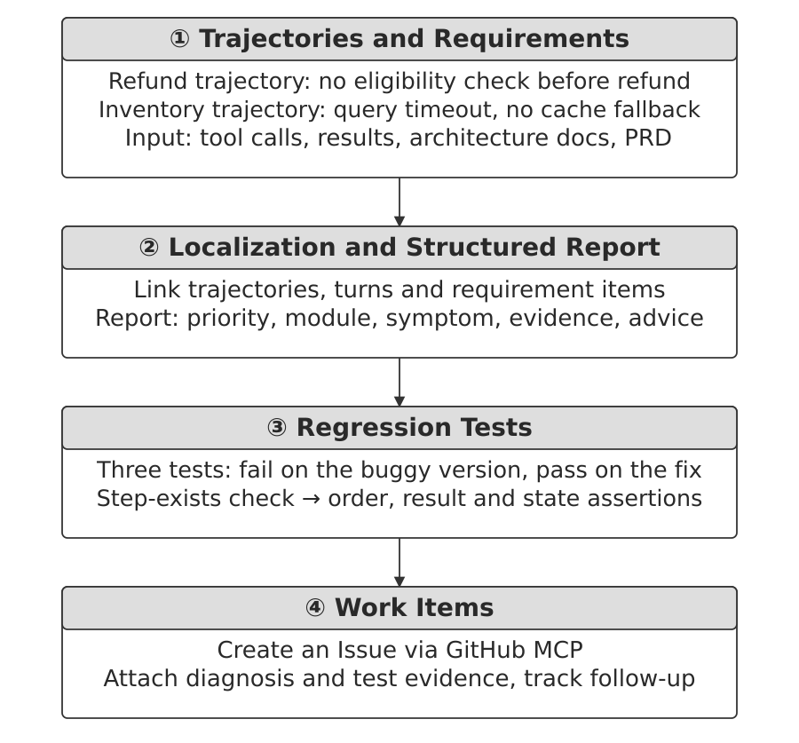
>
> All three tests failed on the defective version and all passed on the fixed version. One of the tests only checks whether the program ever called the refund-check tool. Even if the program refunded the money first and only afterwards checked whether the order was refundable, this test would pass. The run record also keeps the receipt from GitHub MCP creating the work item, from which the corresponding ticket can be found once the diagnostic report has been handed to the developers.
>

### Code as Generative UI

If the user also wants to edit the material the Agent is working on, the interface can be built as a shared workbench for both of them. Take an itinerary: let the user see which stop the assistant is changing, take over an edit, and confirm or undo a given change. If the user has just moved the departure day to Friday, the assistant should continue working on this new itinerary. Only when both sides share the same visible state, and agree on who currently controls the field being edited, does it become possible to edit while watching.

Imagine a user comparing three travel options. While the destination is still undecided, conversation makes it easy to ask follow-up questions; once the destination is settled, letting the user pick dates and enter the number of travelers directly is easier than going back and forth over several passages of text; finally, to compare how the total price changes with the dates, a chart puts the differences right in front of them. When an Agent generates forms, charts, or application interfaces suited to the task so that the user can fill in, select, and operate directly, that is **Generative UI**.

**Describing Interfaces and Interactions with Protocols.**

There are two routes to generating an interface: output code such as HTML and JavaScript and hand it to a controlled environment to execute; or output a declarative structure that client-side components render. The former makes custom layouts and interactions easy to implement; the latter limits the available capabilities to the components and actions the client provides.

A2UI (Agent-to-User Interface) uses declarative descriptions. The Agent generates structured messages expressing components, data bindings, and updates, and the client renders the interface with its own components[^ch5-ui-protocols]. For example, an application can provide card, button, text field, and table components, and the Agent can use them to describe a table titled "Sales Data" with three rows and two columns. The component catalog can also be extended with capabilities such as charts and maps.

AG-UI (Agent–User Interaction) handles event interaction between the Agent and the frontend, carrying messages, tool calls, and state updates, and it can also carry A2UI interface messages. Combined, A2UI describes what to display, while AG-UI connects backend execution with frontend interaction.

The client can receive interface updates incrementally and display them on the web, mobile, or desktop through a suitable renderer. The client validates component properties, data bindings, and action requests, and the server continues to check business permissions; links, rich text, and data access within components each need their own handling rules as well.

When code is generated directly, dependencies, resource access, and execution permissions must be checked, and the generated interface must be isolated from the host application's sensitive state. Prompt injection in external material can influence the generation process, and the risk of script execution in the browser also depends on how the page is loaded and isolated.

**Delivering Interactive Results in HTML.**

**For research deliverables that include data, demonstrations, and continually updated results, I prefer an HTML website.** A long, linear Markdown report forces readers to keep hunting for context; an interactive web page can bring explanations, data, and demonstrations together behind a single entry point: readers look at the charts, filter the samples they are interested in, expand the details of a particular result, and then operate a demonstration to understand how the system behaves. The Agent can also update the page as the task progresses, so that it keeps a running record of the current results and evidence.

Take my own research practice as an example: every research project has an interactive website, which serves both as a living document during the research and as the final deliverable, and the Agent keeps adding to it as the experiments progress. These websites do three main jobs.

The first is **experiment data traceability**. Pages link samples, prompts, model responses, and scores, supporting item-by-item inspection. For example, when one kind of response keeps getting low scores, you can follow the scoring records back to the original responses and prompts.

The second is **training metric monitoring**. I call the signals that reflect the internal state of training "internal health metrics": training and validation loss, gradient norm, learning rate, and, in reinforcement learning, reward, KL divergence, policy entropy, and so on. A language model's performance at predicting a given text sequence can also be measured by perplexity. Like the physiological readings in a medical checkup, these curves can sometimes expose problems earlier than the final task score. Viewing them together with task accuracy helps pinpoint the stage at which non-convergence, gradient anomalies, or training degradation set in.

The third is **demonstrating how the system works**. When explaining how several modules fit together, a page can let readers change an input, inspect the intermediate state, and then compare the change in output with the experiment records.

When work runs for several hours, how does the user find time to step in? When I use a Coding Agent, I want a single spoken instruction to reach the Agent handling the work, want to be able to open the results at any moment, and want to be notified when a new version is ready or a question comes up that needs my decision. For example, two reports are being generated at once. The user opens the sales report, points at the second chart, and says, "Redraw this one by net revenue." The interface should send the identifiers of the current report and chart along with the instruction. When the chart has been redrawn, the notification can open the new version directly; if "net revenue" has two usable definitions, the assistant should lay out both for the user to choose from.

**Clarifying User Intent.**

When a user says, "I want to book a flight to Beijing," the destination is already clear, while the departure city, the date, and whether the trip is one-way or round-trip still have to be filled in. The Agent can gather these questions into a single conversational turn, or it can generate a form that presents the related conditions on one page.

The controls in a form correspond to different kinds of information: text boxes collect open-ended input, dropdown menus and radio buttons list the options, checkboxes allow multiple selections, and date pickers help with entering times. JavaScript can express cascading relationships—for example, showing the return date when "round-trip" is selected and checking that the return is not earlier than the departure. When a selection changes, fields that have become invalid must also be cleared or ignored.

Figure 5-8 is taken from a run of the experiment below. Follow this submission downstream: the four fields the browser returns do not include the destination, so how does the model know the traveler is going to Beijing?

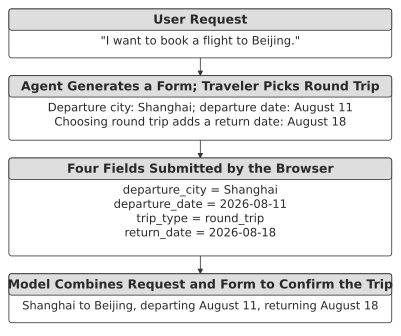

> **Experiment 5-12 ★★: Intent Clarification System with Dynamic Forms**
>
> Starting from "I want to book a flight to Beijing," this experiment has the model generate an HTML form: the departure city uses a text box, the departure date uses a date picker, the trip type offers one-way and round-trip options, and the return date appears when round-trip is selected.
>
> The program hands the original request back to the model together with the form data. If only the submitted fields were kept, the destination would still be missing even with every control filled in correctly.
>
> Try one more step with the same form: fill in the return date, then switch to one-way. The page hides the return-date input, yet the submitted JSON keeps both one-way and a return date of August 18. When the user switches to one-way, the client must also clear the now-invalid return date.

[^ch5-ui-protocols]: The official A2UI documentation and *AG-UI Overview*, which describe, respectively, declarative interface descriptions and event interaction between the Agent and the frontend.

**Generating SQL Queries.**

Users can pose database queries in natural language, and the Agent generates SQL based on the table schema and business definitions. **When displaying a complete query result table, I prefer the Artifact pattern, letting the results go straight from the database into the interface.** Having the model read a large table and restate it row by row increases token usage and waiting time and introduces transcription errors. The SQL is saved as an inspectable query artifact; when causes need analyzing or trends summarizing, only the necessary aggregate results are handed to the model.

In Figure 5-9, the user wants to see the number of active employees in each department, and the page can display the statistics table returned by the database directly. If the user then asks, "How many more people does Marketing have than R&D?", the model only needs to take the 9 and the 5 from the table to work out a difference of 4. If the follow-up is "Was the gap the same last month?", the table on screen is no longer enough, and a new query has to be run against last month's reporting date.

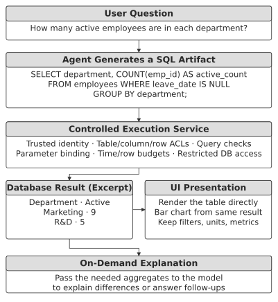

The execution service determines the accessible tables, columns, and rows from a trusted identity, uses a restricted database account, and validates the structure and operation type of the SQL. Query scenarios can be limited to approved read-only queries, with controls on function calls, time budget, number of returned rows, and data range; values entered by the user are passed in through parameter binding.

The Agent can also generate visualization artifacts, such as a bar chart of the department totals. The execution service hands the query results to a controlled visualization runtime, and the interface displays only the permitted data and interactions.

> **Experiment 5-13 ★★: Natural Language Interaction ERP Agent**
>
> This experiment uses employee and payroll queries in ERP (Enterprise Resource Planning) as an example of how to generate SQL from business questions and send the database results straight to the page. Two tables are created in PostgreSQL: the employee table contains employee ID, name, department, level, hire date, and termination date, where an empty termination date means the employee is still active; the salary table contains employee ID, pay date, and salary, with one record per employee per month.
>
> The Agent works through the following ten questions using these two tables:
>
> 1. What is the average employee tenure?
> 2. How many active employees does each department have?
> 3. Which department has the highest average employee level?
> 4. How many new employees joined each department this year and last year?
> 5. What was department A's average salary from March of the year before last to May of last year?
> 6. Which had the higher average salary last year, department A or department B?
> 7. What is this year's average salary for employees at each level?
> 8. What was the average salary in the most recent month for employees with less than one year, one to two years, and two to three years of tenure?
> 9. Which 10 employees had the largest raises from last year to this year?
> 10. Are there any unpaid wages (an employee who was active in a given month but has no pay record for it)?
>
> The metric definitions must be settled before querying. For example, tenure for active employees runs to the query reference date, and for departed employees to their termination date; "average salary" requires deciding whether to average over pay records or over employees; and the raise ranking must handle employees with no record last year.
>
> This run generated and executed ten SQL queries, all of whose results matched an independent reference calculation, and the browser then rendered the tables directly. The model received the table schemas, the tasks, and the necessary execution feedback, while the database row data passed through the application to the interface.

**Dynamically Generating Software.**

An Agent can generate interfaces and interaction logic from requirements and keep modifying them in response to user actions. "Imagine with Claude," a temporary research preview Anthropic launched in 2025, demonstrated this kind of interaction: as the user explores the interface, the model continuously generates the corresponding software experience[^ch5-imagine].

**For real products, I see more promise in customizing an existing framework.** Continuously generating an entire application from scratch repeatedly incurs the costs of generation, rendering, and verification; keeping a stable framework and opening up the interfaces and workflows users care about delivers a reliable personalized experience more quickly. When a user says "make the button blue," "add a shortcut menu to the sidebar," or "switch to a more readable font," the Agent locates the relevant components, modifies the code, and then checks the result in a preview. The base framework provides a stable page structure and business interfaces, and the scope of customization can gradually extend from colors and fonts to layout and components.

In a development environment, HMR (Hot Module Replacement) can update the affected frontend modules after the code changes. Whether state is preserved depends on the framework integration, the update boundary, and the type of change; when a full refresh is needed, the application should also save the necessary state. Reload in FastAPI's development mode, by contrast, reloads the server-side program; the two act on frontend modules and backend processes, respectively[^ch5-hmr].

> **Experiment 5-14 ★★: Conversational Interface Customization System**
>
> This experiment builds a chat application with a React frontend and a FastAPI backend, enabling frontend HMR and backend reload in the development environment. The model modifies the colors, font, and title in response to three consecutive rounds of requests, and a browser checks the actual interface after each change.
>
> This run recorded Vite's HMR events; none of the three rounds of changes caused a full-page navigation, the existing chat state was preserved, and the final build passed.

[^ch5-imagine]: Anthropic, *Introducing Claude Sonnet 4.5*, which introduces Imagine with Claude, the temporary research preview released alongside the model.
[^ch5-hmr]: *Vite HMR API* and *FastAPI CLI*, which describe, respectively, frontend hot updates and automatic reloading of the development server.

**Keeping the Permission Boundary Independent of Dynamic Business Code.**

**The more easily business code can be rewritten dynamically by an Agent, the further the final permission boundary should move down into a stable data-access layer.** Traditional applications write authorization checks into reviewed business code; once generated code keeps changing, some new path may omit the same check. Only by routing every read and write through an independent data-access service can permission constraints be preserved. For example, a recruiting application can dynamically generate candidate lists and action forms, while which organization a candidate belongs to and which fields a recruiter may update are continuously checked by a trusted data-access service.

The design goal here is this: **even if the generated code contains errors, the trusted data-access layer can still enforce permission constraints.** This continues the data-layer guardrail of Chapter 1: put the rules that must be enforced where every relevant operation has to pass. Database row-level security policies can restrict record access, constraints and validators check for legal states, and controlled views, stored procedures, or data services provide the permitted operations. The application layer can check in advance and explain to the user, but final reads and writes remain controlled by the trusted data service and database permissions.

Every operation also needs a trusted **access context**, containing the user, tenant, role, or Agent identity. The authentication service and a trusted runtime are responsible for establishing and binding the identity, and the data service authorizes on that basis. Dynamic code receives the restricted interfaces it needs to complete the task, while credentials and the authority to manage policy are held by independent components. Every database connection, auxiliary query, and background process should respect the same access scope.

For example, PostgreSQL's row-level security needs to be used together with database role configuration. The application connects with a role constrained by the policies, and the application account has no right to modify the access policies[^ch5-rls]. The rules and the identity-binding mechanism undergo independent review, while the business interface can keep changing within that scope.

Permissions and data integrity also have different responsibilities. Once a recruiter has the right to modify a candidate record, the state machine still checks whether moving from "screened" to "interviewed" is allowed; the salary validator reads the associated position and checks whether the expected salary falls within the position's range; and reference checks confirm that the relationship between position and candidate is valid.

> **Experiment 5-15 ★★★: Permission-Embedded Data Objects for Dynamically Generated Software**
>
> This experiment provides a prototype Python object store on top of PostgreSQL that places permission rules, validators, object relationships, and declarations of follow-up reactions in the data types. Reads check access permissions; creates and updates first run permission and business validation and check references, then persist, after which the declared follow-up reactions are queued, with a limit on the depth of reaction chains.
>
> The recruiting example includes positions, candidates, interviews, and evaluations. A candidate passes in turn through application, screening, interview, offer, and hire, and the relevant stages can also enter a rejected state; the salary range comes from the associated position. The example sets up checks for a normal state update, an invalid state transition, a salary outside the position's range, and access from a different tenant, helping readers understand which problems authorization and business validation each handle.
>
> The prototype expresses user, role, and organization attributes through `AccessContext`, and the teaching scripts construct these contexts directly to simulate different identities. In deployment, the context is established by the authentication entry point, and the object store and the generated code sit on opposite sides of an explicit service or permission boundary.

[^ch5-rls]: PostgreSQL, *Row Security Policies*, which describes configuring row-level security policies by role and operation and their scope of application.

### Code Creating Code: Agent Bootstrapping

Code generation can also be used to develop Agents themselves. The creator receives the task requirements, generates or modifies the new Agent's prompts, tools, and run loop, and then checks the product through tests and real interaction. Figure 5-10 shows this bootstrapping loop: an existing implementation provides the starting point, task feedback drives the changes, and the verification results decide which changes can be kept.

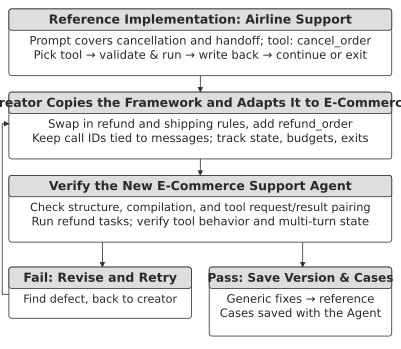

How do you tell whether a change improved general capability or merely happened to fit the problems just seen? Keep back a task that was never given to the creator. For example, develop a price-monitoring Agent using one store's data, then give it samples from another store while rerunning the original task.

**Maintaining the Agent's Runtime Environment.**

A new Agent depends on configuration, credentials, session state, services, and a sandbox to run. OpenClaw's `doctor` command offers an example of a maintenance tool: it checks for problems such as legacy configuration migration, OAuth credential status, session locks, plugin installation, gateway health, and sandbox images, and either suggests fixes or performs the corresponding repairs[^ch5-doctor].

These deterministic checks can form the foundation of a self-maintenance process. The detection rules cover known failures, and the repair actions have well-defined inputs and expected results. When designing an Agent diagnostic process on top of this, unresolved problems can be handed to the model together with logs, configuration, and check results, asking it to state which configuration it intends to change and how; the execution layer checks permissions and the scope of the change, then runs health checks and regression tests. Configuration snapshots, change records, and a rollback entry point help the system resume work if a repair fails.

**Carrying Engineering Experience in Reference Implementations.**

Creating a specialized Agent involves both domain logic and general-purpose infrastructure. When checking the generated result, start from four kinds of problems:

1. **Context and run loop.** Preserve the associations among roles, tool-call identifiers, and tool results, and check multi-turn state, termination conditions, budgets, and exception recovery. Structured messages make protocol relationships easier to maintain; a stable prefix creates the conditions for prompt caching.
2. **Tool interfaces.** Tool descriptions explain purpose, applicable conditions, and usage boundaries, and parameters include types, meanings, and concrete examples. The execution layer goes on to validate arguments, identity, and business state.
3. **Model and API choice.** Models tend to fall back on old models and old interfaces that appear frequently in their training data, so fluent code can still reflect outdated choices. Give the creator maintained selection material, or let it search the official documentation, to check model capabilities, interface versions, and calling conventions. Real calls after generation test whether the configuration actually works.
4. **Dependency and ecosystem compatibility.** Check libraries' maintenance status, versions, and interface changes, and verify the assembled program with dependency installation, compilation checks, and tests.

**When creating a specialized Agent, I prefer to have the creator copy a validated reference implementation and then make domain-specific changes.** Prompts can hardly enumerate every detail of message protocols, state management, and recovery mechanisms, but reference code can carry this engineering experience directly into the new system. Even a model that is good at programming may miss runtime conditions the task description does not spell out; reusing a framework reduces such repeated mistakes. The creator copies a suitable base framework, adjusts the system prompt to match the new role, adds or removes domain tools, modifies the business logic, and adds the corresponding tests. Message handling, call association, state management, and exit paths are provided by the framework, while domain changes are verified with new test cases.

If the template is much faster, how do you rule out the explanation that it simply does fewer things? Below, two groups of creators deliver the same kind of Agent and face the same set of checks.

> **Experiment 5-16 ★★★: Develop an Agent That Can Create Agents**
>
> Ask the same creator model to build a release-review Agent: after reading a set of deployment check records, it must reject the release and cite the basis whenever any mandatory check has not passed. Built from scratch, the model has to write the run loop, tool protocol, domain tools, command-line entry point, and tests. The template route first copies an Agent that can already check structured records, and the model only needs to fill in the domain specification: for example, which field holds the status, and which values mean "passed"? A creation script generates the system prompt, tool definitions, and documentation from the specification, and the existing Python tools read the specification to perform the checks. Both routes embody metaprogramming: using programs to generate or modify other programs.
>
> In Figure 5-11, the two routes converge on the same set of acceptance conditions.
>
> 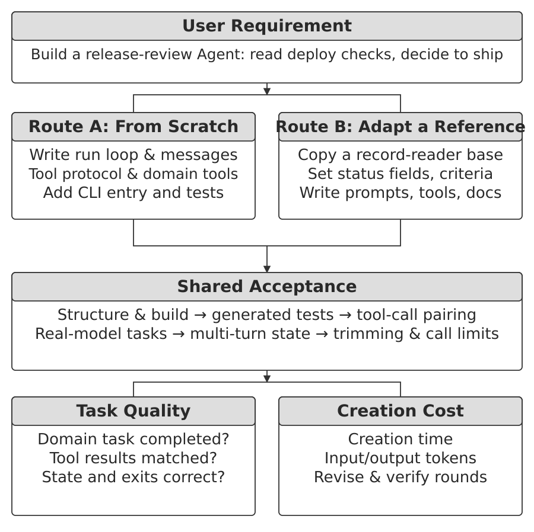
>
> The two routes use the same task requirements and acceptance conditions. First check the product's structure, compilation, and tests; then check the association between tool calls and results in the standard messages; finally run real model tasks and multi-turn interactions to verify context trimming, state management, and limits on the number of calls.
>
> In the saved Kimi K3 comparison, both groups passed 39/39 deterministic checks and also passed the real model tasks and the multi-turn state checks. The template route took 1,181 tokens and about 25 seconds to create the Agent; the from-scratch route took 381,814 tokens and about 90 minutes.
>

[^ch5-doctor]: OpenClaw, Doctor, which describes configuration and state checks, migration, and repair.

## Chapter Summary

**One easily overlooked reason Coding Agents matured early is that software engineering already had type systems, test suites, version control, and debugging tools.** When code is changed wrongly, tests can often point to which set of inputs produced an unexpected result; try a different fix, and the original input can be used again. To carry this experience over to other tasks, ask three concrete questions first: how are errors detected, how do you recover to a known state, and when must you stop and ask a person to take over? If a refund call drops its connection midway, for example, the Harness should check the account before deciding whether to retry; otherwise, recovering from one failure may turn into a second refund.

Code can also turn a single judgment into something reusable. Enumeration in a math problem and constraints in a logic puzzle can be handed to a program to check item by item; a refund rule can be written as validation at the execution entry point, so that the server reads the order's real state before deciding whether to let it through. When a log format changes, the parser can be revised and the samples that failed this time kept as regression tests. Code can run in all three settings, but the criteria differ: whether a solution satisfies the problem's conditions, whether a refund complies with the policy, and whether the new parser can read the fields that were previously missed.

When the deliverable is a document, a video, or a geometric model, you also have to check the rendering, whether sound and picture are in sync, or whether the dimensions are accurate, and have a reviewer look over the actual artifact. When the deliverable is a form, a query, or a visualization, besides checking whether users can understand and operate it, you have to check whether the execution service behind it fetches data according to permissions. If what the code generates is another Agent, I prefer to reuse a validated framework first, generate the domain tools and business logic, and then check the calling protocol, cross-turn state, and actual task results. The tools, validators, and tests accumulated this way can be picked up again by the next task.

Code lets a task be executed repeatedly, but the environment does not necessarily wait for it to finish. While a query is still running, the user may already have changed their mind. Chapter 6 discusses how such changes enter an interaction that is already under way.

## Thought Questions

1. ★★ Design a sandbox for a Coding Agent that needs to read project files, install dependencies, and run tests. How would you configure file, network, process, and resource permissions? When the task needs broader permissions, how should the request be expressed, its scope checked, and a record kept?
2. ★★★ When a creator generates and modifies Agents over many successive generations, framework defects and domain errors may gradually accumulate. How can reference versions, regression tests, behavioral evaluation, and rollback mechanisms be used to track such drift?
3. ★★ A change in log format may come from a normal upgrade or from a defect in the producer. What evidence should an adaptive parsing system keep, and on what conditions should it decide to add a new parser, report an anomaly, or pause processing?
4. ★★ In a Proposer-Reviewer loop, the Reviewer considers a page's information density reasonable, but the user finds it crowded. How can user preferences be turned into examples, scoring criteria, and interactive feedback, and how can you check whether subsequent revisions meet them?
5. ★★ A Coding Agent can update the knowledge base, architecture documentation, and project instructions, and can also turn sequences of operations into code. How can redundant or outdated rules be identified, and how should rules be given a scope of applicability, a verification method, and exit conditions? What accumulation and evaluation mechanisms are still needed to go from a single successful change to the continuous evolution discussed in Chapter 9?
6. ★ Teams that are friendly to remote collaboration usually also make it easier for Agents to obtain work information. Examine the requirements, architecture, decision records, and acceptance criteria of a project you know well, list the documents most in need of filling in, and explain which specific tasks they would help an Agent complete.
7. ★★★ For an Agent that simultaneously accesses private data, processes untrusted content, communicates externally, and uses persistent memory, how would you arrange identity authorization, source labeling, data-flow checks, and review of memory writes? Use a normal business workflow to show where these checks sit.
8. ★★ In the Artifact pattern for SQL and HTML, the model generates the artifact, the execution service handles the query or rendering, and the interface presents the results directly. Which information is suitable to hand back to the model for interpretation? How do you check query permissions, resource budgets, page isolation, and the consistency of the displayed results?
9. ★★ The tool validates rules against the business state in the database, while the parameter descriptions help the model prepare the call. Using reservation cancellation as an example, explain the respective roles of the natural-language policy, parameter examples, execution-layer validation, and boundary tests. When the policy changes, which of these need to be updated together?
