# Interaction: Expanding the Observation and Action Spaces

**When the underlying model is fixed, reorganizing or expanding the observation and action interfaces is often one of the most effective engineering levers for improving an Agent's task performance.** In the previous chapters, the Agent usually waited for the user to finish speaking, then looked things up, called tools, and replied. While it waited for tool results, however, the user and the outside environment kept changing.

Suppose a user asks an assistant to change a flight. While the assistant is checking flights with the airline's agent, the user sends another message: "I have one more bag to check." The airline agent is still talking, and the fare on the screen may change too. The assistant needs to ask promptly whether the fare includes checked baggage, and it must also watch whether the quote it just heard is still valid. Two design questions arise here: through which channels can the assistant learn about a change, and when can it react? This chapter first discusses emails and tool results that arrive asynchronously, then turns to continuous speech, changing screens, and the feedback a robot gets from its own actions.

## Expanding Modality and Timing

**Modality** describes the form that information and action take. An Agent can read text, listen to sound, look at a screen, and receive torque signals; it can also output text, synthesize speech, click on an interface, or drive joints.

**Timing** concerns when information arrives, when an action starts, and when the system responds. Information can be fetched by the Agent or pushed by an external service; a tool can return its result immediately, or start a task first and report completion later. When a new event arrives, the system must also decide whether to interrupt the current work and how to resume an interrupted task.

| Dimension | Information and observation interfaces | Action and execution interfaces |
|---|---|---|
| Content organization (Chapters 2–5) | Context, memory, and knowledge bases organize the information for decisions | Tools and code express executable operations |
| Modality (this chapter) | Voice, screen, physical sensors | Speaking, clicking, joint motion |
| Timing (this chapter) | Active queries, pushed events, continuous input | Cross-turn execution, cancellation, preemption, and resumption |

Context carries the information needed for a particular decision, whereas the observation space describes the full range of information the system can receive. Likewise, tools provide concrete interfaces, whereas the action space describes the full range of actions the system is allowed to take. When interfaces are expanded, these ranges are still constrained by device capabilities, parameters, permissions, and the runtime environment.

Many tool-calling interfaces organize messages in rounds: the model proposes a call, the system supplies the tool result, and the next round of reasoning begins. An event-driven system has to manage external changes on top of this protocol. When the interface supports native asynchrony, it can accept new requirements while a tool is pending and continue once the result returns; with a synchronous interface, the Harness organizes the interaction using queues, task handles, and scheduling. Later sections discuss the two implementation routes in turn.

Feedback rhythms differ greatly across scenarios. The table below lists common timescales.

| Typical scale | Scenario | Change on the observation side | Handling on the action side |
|---|---|---|---|
| Seconds to days | Async and event-driven | External events wake the Agent | Start a task first; later events report progress and completion |
| Tens of milliseconds to seconds | Voice | Audio arrives continuously | Stream output; handle barge-in and stop playback |
| Sub-second to seconds | Computer Use | The screen keeps changing | Re-acquire the interface state after each operation |
| Millisecond control cycles | Low-level robot control | Sensors stream back continuously | Execute short action segments; respond to control and stop signals |

## Async and Event-Driven: When the World Comes Looking for You

Chapter 4 introduced perception, execution, and collaboration tools; this section continues with event-trigger tools and user-communication tools. Event-trigger tools bring environmental changes to the Agent, while communication tools let the Agent reach the user as a task progresses. The Harness associates these inputs and outputs with the running tasks, forming an event loop that keeps working.

### Why Asynchrony Is Needed

A synchronous call must wait for its result before the caller can continue. An asynchronous call instead returns a task handle first (an identifier used to query and manage the task), or promises to send a notification on completion, so the caller can handle other work while waiting. The system can then organize several in-flight tasks and decide, based on resources and dependencies, which operations can run in parallel.

Think of the Agent as a secretary who handles mail, phone calls, and visitors: while waiting for a reply, the secretary keeps preparing materials; when an urgent call comes in, the secretary sets aside the current work, then resumes it after the call. In engineering terms, three things must be handled:

- **Separating long tasks from interaction.** File analysis, phone calls, or builds proceed in the background, while the user can still ask about progress and add requirements.
- **Event priority.** Emergency stops enter the control flow promptly, routine updates go into a queue, and independent queries can be handed to a parallel session.
- **Interruption and resumption.** Save the task state, record the operations that have already happened, and on resumption recheck which conditions still hold.

The research preview of Claude Duet offers an example. A user has a meeting at 2 p.m. and wants a briefing on the other company beforehand. They can leave a voice message and close the app. The preparation continues in the cloud, and the user can open the task page at any time to check progress; when the assistant needs more information or the briefing is ready, it returns to the main conversation to notify them. What this illustrates is asynchronous execution: the task keeps moving after the user leaves. The full-duplex calls discussed later add another requirement: while one party is speaking, it must still be able to hear the other party cut in.[^ch6-duet]

Model APIs also have conventions about message order. Some interfaces require every tool call to be paired with its result before they accept the next request; others allow a tool to stay pending and accept later updates. The application's asynchronous functions arrange waiting and execution, while the model protocol determines when messages may be submitted.

In Figure 6-1, both new messages and tool results can enter the queue, but how they reach the queue depends on the source. If a service supports push, it can send a notification as soon as its state changes; if it only offers a query interface, an adapter has to check it periodically and generate an event when it detects a change. Timers can also produce events when they expire. The event loop then hands these inputs to the Agent.

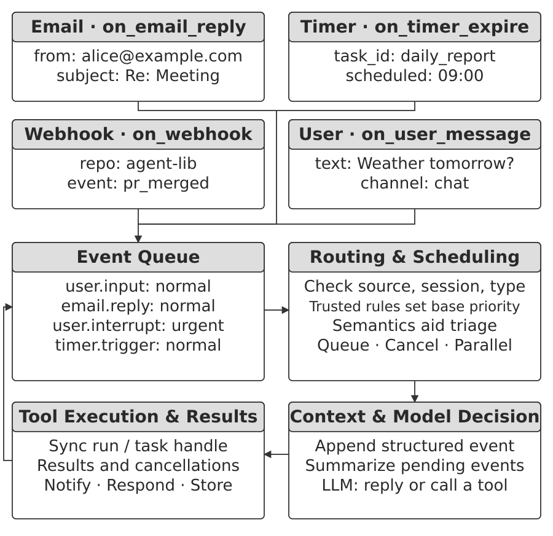

### Implementing Event-Driven Mechanisms in OpenClaw

OpenClaw connects messaging channels through its Gateway and routes events to the Agent runtime. Its automation mechanisms include entry points such as internal Hooks, scheduled jobs, Heartbeat, and external Webhooks[^ch6-automation]. They can be understood by what triggers them:

- **Hooks** respond to events inside the framework, such as session creation, reset, or changes in the run lifecycle.
- **Cron (scheduled jobs)** runs work at specified times or intervals. For example, `0 9 * * 5` fires at 9 a.m. every Friday in the configured time zone.
- **Heartbeat** wakes the Agent periodically to check for items that need attention.
- **Webhooks (external callbacks)** receive events submitted by external services and trigger processing after authentication and routing.

A weekly report suits a fixed schedule, ongoing to-dos can be checked periodically, and new emails and service callbacks can use push to shorten the delay before they are noticed.

**Call events in PineClaw.** Pine AI makes phone calls on the user's behalf to negotiate bills, cancel subscriptions, and handle insurance claims. PineClaw brings these phone tasks into OpenClaw. A call usually lasts a while, and the user may need to step in during it:

- **Identity verification.** The representative asks the account holder to verify their identity, for example by entering a security code or a one-time password.
- **Three-way calls.** The representative asks to speak directly with the account holder, so the user must be notified promptly to join.
- **Decision confirmation.** When the representative proposes an alternative, the foreground judges whether it is acceptable based on this particular request and the user's past preferences. When the user needs to decide, it sends them the specific options while continuing to check other terms with the representative.

Suppose, for example, the representative needs the account holder to join a three-way call. The sooner the notification arrives, the less time both parties spend waiting on the line. The PineClaw case uses a Channel mechanism to connect call events between the Gateway and the Pine API: call connected, user input needed, and call ended each enter the event stream, and the Agent updates the task and notifies the user accordingly.

**In my view, timely proactive service is best achieved by having the event source notify the Agent when its state changes.** Once a notification arrives through a channel, the Harness finds the corresponding task and checks whether the event is a duplicate or has expired; then the model decides the next step. If the user needs to verify their identity, the interface should open a trusted authentication entry point, and the verification result is sent back to the original task as a new event.

### Event-Triggered Tools

If you ask an assistant to "remind me when the client replies," how does it wake up at exactly the right moment tomorrow? First check whether the mailbox can push an event when mail arrives; for systems that can only be queried, the assistant has to remember when to check next. The three illustrative interfaces below hand these waiting conditions to the runtime for safekeeping, so the model can end its current round of work.

**Timers** (`set_timer`) wake a task at an agreed time. A one-shot timer suits "call the bank next Monday at 10 a.m. to check on the mortgage"; a recurring timer suits checking service health every hour. Waiting for a reply after sending an email, or redialing after hitting non-business hours, can also be scheduled with a timer. The interface needs to store the time zone, trigger condition, and task identifier, and provide a way to cancel or modify the timer. When an external service only supports queries, scheduled jobs can also handle progress polling.

**Background Task Monitoring** (`monitor_shell`) turns long-running commands into progress events. It returns a task identifier at startup, sends notifications on new output, keywords, or state changes while running, and reports the exit status and result when finished.

Having the model query progress repeatedly costs a model call even when nothing has changed; waiting only for the completion notice may miss a failure midway. I therefore recommend leaving monitoring to the runtime and waking the model only when useful progress, an error, or a stall appears. This lets the Agent keep communicating during a build while still stepping in promptly when something goes wrong. Monitoring rules can filter, merge, and rate-limit events so that not every log line triggers a model call.

For example, after the model subscribes to status updates for a pending ticket, it can end this round of reasoning and wait for a notification carrying the ticket number to wake it. If the other side only provides a query interface, the model can set a scheduled job for its next check. When the time comes, if the ticket is "still in progress," it schedules another check; if the ticket has been resolved, it cancels further checks. In both approaches the runtime does the waiting, and the model makes a judgment only when a notification arrives or a timer expires.

**External Event Channels** (`connect_channel`) subscribe to email, instant messages, or API callbacks. The channel adapter verifies the source, maps the service's own identifiers to threads and correlated objects, and submits events in a unified format; the "Ingress Layer" section below covers this in detail. PineClaw's call-status notifications belong to this category.

All three tool types need clear trigger conditions, filtering rules, and event payloads. The payload should include the event identifier, time of occurrence, source, related task, and the necessary content, so the Agent can judge whether the event is still valid and what information the next step requires.

### User Communication Tools

Back to the flight-change task. A question to the airline agent, a confirmation message to the user that they can answer directly, and a note in the task record saying "awaiting reply" go to three different places. The user can step away for a while and come back when they need to add conditions, confirm a decision, or receive the result.

A conversation interface can display the final reply, tool progress, and execution results; communication tools, by contrast, explicitly specify the recipient, channel, message content, and attachments. The model decides what needs to be said, the Harness checks the target and permissions, and the messaging service handles delivery. The runtime can also route the final reply back to the original conversation automatically. The two approaches can work together.

OpenClaw's multichannel interaction lets users send messages, wait for progress, and receive reminders as they would with a secretary. This "human-like presence" comes from persistent task state and timely communication. Users can continue a task in the channels they already use, while the Agent must keep identities, sessions, and message associations consistent.

The form of communication can also change with the task: brief progress updates use text, complex results come with images or files, information the user must fill in uses structured cards, and interactive deliverables use the generative UI introduced in Chapter 5. When a channel supports delivery or read receipts, the system stores that status; retries after failure, duplicate messages, and cross-channel synchronization also go into the delivery record.

**Multichannel Notification and User Re-engagement.**

Instant messaging, SMS, email, phone calls, and app push notifications each suit different levels of urgency and different kinds of content. The Agent can choose a channel based on urgency, user preferences, the user's current status, and message length. A call event that needs immediate confirmation calls for a prompt alert, while a full report can be delivered by email or as an app link.

I once had an assistant watch hotel prices for the ATC conference. Every day at the same time, the assistant sent a message saying the price had not yet dropped to the target. Once the price dipped briefly, and the window was caught not by the assistant but by a script I had written. A brief low price can appear between two checks. Even if the assistant catches it in time, a late message may still cause the user to miss the booking. On days with no price drop, the scheduled checks can keep running without the user having to read the same message every day. Chapter 7 uses a five-minute price-drop window to test this kind of alert.

When a long task finishes, a notification brings the user back to the results page; daily summaries and weekly reports are sent on an agreed schedule. A multichannel strategy should also set rules for deduplication, quiet hours, and escalation—for example, whether to switch to another channel if the first alert goes unanswered. Notification records are linked to task state so that users can continue working from the message they received.

### Virtual Identity and Isolated Execution Environment

Chapter 4 used Samantha from *Her* to show how a general-purpose assistant enters the digital world through tools. Building such an assistant requires being clear about what identity it works under and which resources it may access. **I lean toward giving a general-purpose assistant an independent virtual identity.** A dedicated work mailbox, phone number, storage, and computing environment let the Agent act on the user's behalf under a clearly declared agent identity, like a secretary with their own work accounts. An independent identity separates the assistant's day-to-day work from the user's personal accounts, making it easier to grant, audit, and revoke permissions separately; when a mistake happens, the damage is also easier to contain. Tasks that must access the user's accounts obtain the permissions they need through scoped authorization.

Whoever owns the phone number determines who can pick up the thread when the other party calls back. Manus's Cue gives the assistant its own number, so it can answer incoming calls and leave a call summary for the user. If a business accepts the callback number the assistant leaves, the representative who calls back reaches the same assistant that handled the case before.[^ch6-cue]

Take a fee waiver as an example. The assistant can contact the business as the user's authorized representative. If the representative requires the account holder to verify verbally, the assistant can invite the user into a three-way call and take over the conversation again once verification is complete. If the business will call the user back, the assistant first gives the user the case number, what has already been agreed, and the questions still to be confirmed. When reporting to the user, it should also be clear about the evidence it holds: if the representative has verbally agreed to the waiver, it records that promise; only after the updated bill shows up does it report that the fee has actually been waived.

When I needed a replacement Bank of America credit card while in Beijing, Pine contacted the bank, arranged an expedited replacement, and got the $15 expedite fee waived. By the end of the call, the assistant could already report what the bank had accepted and which fee it had agreed to waive. If, a few days later, the user asks "Where is the new card?", answering requires checking the shipment tracking again or asking the recipient to confirm.

Virtual computers and virtual phones provide operating environments that run continuously. Virtual machines can run desktop systems, containers are well suited to isolating processes and dependencies, and Android emulators host mobile apps. They support background operation and reduce the interference of automated operations with the user's current work. The scope of isolation is determined jointly by networking, mounts, credentials, and runtime permissions; these settings also determine which data and external systems the Agent can reach.

Suppose you want Tencent WorkBuddy Enterprise to generate your weekly report after you shut down your computer for the day, but this week's sales spreadsheet exists only on your office computer. If you choose a local task, the assistant can read the spreadsheet, but the computer must be on and the client online. If you choose a cloud task, the assistant can keep working after you shut down, provided you first upload the data approved for the weekly report to the task, or place it in a document library the cloud task can access. If the spreadsheet must stay on your machine, the work should be scheduled while the computer is online.

Websites and mobile apps may also require authentication, CAPTCHAs, or manual confirmation. When integrating, prefer the APIs and authorization methods the service provides; when authentication requires a graphical interface, a VNC/RDP remote desktop can let the user log in personally, with automated operations paused during authentication. After the user finishes, the system checks the session state and then resumes the task. Tokens and sessions are stored according to their validity periods and cleaned up per policy when authorization is revoked or the task ends.

The Agent and virtual environments can exchange data through a **shared file system**. For example, a user uploads a CSV; the virtual computer reads the file, runs the analysis, and writes a chart back to shared storage; the runtime hands the chart's file location to the Agent, then gives the user an accessible download link. Large file contents stay in storage, and the model reads summaries or excerpts as needed.

[^ch6-dsh-threads]: DeepSeek, the domain model and the authorization and subscription rules of the dsh-superagent prototype.
[^ch6-dsh-sessions]: DeepSeek, dsh-superagent prototype, version `8c32a9d`. The responsibilities of the two kinds of sessions are described in `docs/004-prompts.md`, executor sessions and working directories in `docs/003-execution.md`, and the format of messages sent to the main session in `docs/007-architecture.md`.
[^ch6-duet]: Anthropic, *Get started with Claude Duet*, which describes pre-meeting briefings, the task page, and notifications in the main conversation.
[^ch6-cue]: Manus, *Introducing Manus 2.0*, which describes Cue's dedicated phone number, call answering, and call summaries.
[^ch6-automation]: OpenClaw, Automation, which describes automation entry points such as internal Hooks, scheduled jobs, Heartbeat, and external Webhooks.

### The Ingress Layer: Many Sources, One Event

An online store's customer-service Agent handles a refund. The customer requests it in the app's support chat; the amount exceeds the Agent's authority, so it asks a supervisor to approve in the after-sales group on WeCom; the payment service sends a Webhook when the refund succeeds; and the order system then publishes a status change on Kafka. All four messages concern the same order, yet each arrives differently. As the number of sources grows, if each link handles retries, deduplication, and ordering on its own, these differences tear the runtime apart. **The ingress layer unifies the form events take once they enter the system, while preserving the differences in capability among sources before they arrive.** Figure 6-2 shows this layering.

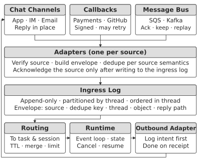

There are four common kinds of sources. **Conversational channels** include the product's own chat interface, instant messaging such as WeCom, Feishu, and Slack, and email; the Agent can reply where the message came from. **Callbacks** are HTTP endpoints that external services call when their state changes; they are usually signed and carry only a notification. When delivery fails, some services retry automatically, whereas GitHub requires redelivery by hand or through its API. **Message buses** such as SQS and Kafka carry business events between internal services and have well-defined acknowledgment and retention semantics. **Timers, polling, and internal events** are generated by the system itself and simply need to be written to the same log. The table below compares the first three kinds.[^ch6-ingress-mq][^ch6-ingress-callback]

| | App chat | WeCom / Feishu | Email | Webhook | SQS | Kafka |
|---|---|---|---|---|---|---|
| Arrival | Persistent connection | Callback or persistent connection | Push or polling | Callback | Consumer pull | Consumer pull |
| Ordering scope | Within a conversation | Not guaranteed for most events | Not guaranteed | Not guaranteed | Not guaranteed for standard queues; per message group for FIFO | Within a partition |
| Native deduplication basis | Client message ID | Message ID, event ID | Message-ID | Delivery ID | Message ID; FIFO also has `MessageDeduplicationId` | Topic, partition, and offset |
| Replayable? | Depends on your own records | Callbacks themselves cannot be replayed; Feishu's message history API can backfill | The mailbox can be reread | Depends on the service | Not after deletion | Within the retention period |
| Acknowledgment | Client receipt | Return success within the time limit | Track your own read position | Return 2xx within the time limit | Delete the message | Commit the offset |
| Reply path | Original conversation | Original conversation | Reply email | None | None | None |

**The Unified Envelope.**

The adapter converts each raw message into a unified **envelope**. The envelope records only facts that are known on arrival; priority and deadlines are added by routing rules, customer tier and order status by business systems, and processing status is stored separately. The customer's refund request can be written like this:

```json
{
  "id": "evt_7f3a",
  "source": {"type": "app_chat", "sender": "user:u_5521", "verified": true},
  "dedupe_key": "app:msg:msg_1029",
  "thread": "app:conv:conv_88",
  "kind": "message",
  "correlation": ["order:12345"],
  "content": {"type": "text", "text": "这个订单我想退款"},
  "raw_ref": "raw/2026-11-23/app/msg_1029.json",
  "reply": {"via": "app_chat", "target": "app:conv:conv_88"},
  "occurred_at": "2026-11-23T14:02:09+08:00",
  "expires_at": null
}
```

(The message text reads "I'd like a refund for this order.")

- `source`: the source type and the verified sender. "Verified" is determined by the adapter from signatures, tokens, or channel accounts—not from a self-introduction in the message body; the runtime decides permissions based on this field.
- `dedupe_key`: the deduplication key; what counts as a duplicate is determined by the source's semantics. Delivery IDs, message IDs, and partition-plus-offset identify a single delivery and block redeliveries at the transport layer. If a business message carries an idempotency key—for example, a refund number plus status—the adapter must extract it to block business-level duplicates. User conversations are the opposite case: a customer saying "refund" twice sends two messages, so deduplication uses only the client message ID.
- `raw_ref`: the raw payload, stored verbatim; when an adapter misbehaves, it is the only thing you can debug from.
- `reply`: which outbound adapter to use and which target to send to. A payment callback has no reply path, so this field is empty.
- `occurred_at` is the time of occurrence given by the source; `expires_at` is the validity period, filled in only for events such as price quotes and verification codes.

**Threads and Correlation.**

A customer first says "refund," then immediately adds "never mind, I'll exchange it instead." The order of these two messages must not be reversed; a different customer's messages are unrelated and can be processed in parallel. **The ingress layer promises ordering only within a thread.** The adapter maps the source's own unit of ordering to `thread`: a conversation in the app, an SQS FIFO message group (`MessageGroupId`), a Kafka partition key, or the Issue or PR number in a GitHub callback. When a source does not guarantee ordering, the runtime uses `occurred_at` or a version number provided by the source to recognize stale states that arrive late—for example, "refund in progress" arriving after "refund succeeded."

The four messages for this refund belong to four threads. Merging them into one comes at a real cost: an unrelated discussion in the after-sales group would have to queue behind the customer's messages, and because thread identifiers often double as partition keys, changing them afterward requires migrating data. **Correlation is expressed in a separate field rather than by rewriting threads.** `correlation` lists the business objects an event concerns, and tasks subscribe to the relevant threads by correlated object.

**Separating Acknowledgment Timing from Progress.**

**The adapter should acknowledge the source after the event has been written to the ingress log, not after the Agent has finished processing it.** Feishu's event callbacks require a response within 3 seconds and WeCom's within 5, or the event is pushed again; an SQS message that is not deleted within its visibility timeout will be received again. If acknowledgment waits until processing completes, one slightly long model call will trigger a redelivery. By writing to the log first and acknowledging afterward, the delivery guarantees of all sources converge on a single statement: **every event enters the ingress log at least once (at-least-once)**, and the redelivered copy is blocked by the deduplication key.

The ingress log acts as an inbox. It follows the append-only principle from Chapter 1 and is partitioned by thread. When Kafka serves as the ingress log, deduplication requires a separate store with a uniqueness constraint or filtering by deduplication key on the consumer side: Kafka cannot reject writes based on an application-supplied key, and its idempotent producer covers only the producer's own retries.

The system must store three kinds of progress separately:

| Progress | What is recorded | Maintained by |
|---|---|---|
| Source progress | Kafka offset, SQS receipt handle, mailbox read position | Adapter |
| Dispatch progress | Which tasks each event in the log has been handed to | Router |
| Task state | Which step processing has reached; whether the reply has been sent | Runtime |

If offsets are treated as task progress, replaying the log will send replies that have already been sent a second time; once they are separated, replay affects only dispatch progress. The outbound direction corresponds to an outbox: before sending, record the intent to send and the idempotency key, and mark it complete when the channel receipt arrives. How to reconcile after a restart is covered below in "Building a Basic Loop from Email Events."

**Expiry, Coalescing, and Backpressure.**

When hundreds of events per second pour into the same thread, they should not be handed to the model one by one. The router handles the backlog before dispatch:

- **Expiry.** Price quotes, verification codes, and alerts that have already cleared lose their meaning after a while. Events past `expires_at` are only recorded in the trajectory and no longer wake the model.
- **Coalescing.** `kind` distinguishes two types of events. State events describe the current value of some object, such as the refund status in a payment callback or the order status on Kafka; when several pile up in the same thread, only the latest is handed to the model, and the intermediate values stay in the log. Message events are something a person said or an instruction they gave, such as a customer message or a supervisor's click; they can be handed to the model in batches but must never be dropped.
- **Backpressure.** Pull-based sources can be pulled more slowly, leaving the backlog at the source. Push-based sources cannot be told to pause, so the adapter keeps writing to the log and acknowledging as usual; the backlog shifts to the ingress log and is absorbed by the first two rules.

**One Refund Across Four Sources.**

1. The customer requests a refund in the app chat. The adapter deduplicates by client message ID, writes the event to the log, and then sends a receipt to the client; the router creates a refund task keyed on `order:12345`, and the task subscribes to this conversation thread.
2. The amount exceeds the Agent's authority, so it posts an approval card in the WeCom after-sales group and records the card identifier in the task. The supervisor clicks "Approve"; the adapter writes the event to the log, returns success, and fills in the correlated object based on the card identifier.
3. After the Agent calls the refund API, the payment service sends the "refund succeeded" callback twice with the same delivery ID, and the second is deduplicated.
4. The order system publishes "order refunded" on Kafka, which says the same thing as the callback. If both adapters extract the refund number plus status from the payload as their deduplication key, this event is blocked at ingress; if one deduplicates by delivery ID and the other by partition and offset, both enter the log, and the runtime, seeing that the task has already confirmed the refund, only records the event in the trajectory.
5. Neither the callback nor the Kafka event has a reply path. The runtime uses the `reply` of the conversation thread from step 1 and notifies the customer through the app's outbound adapter.

Step 4 marks the boundary of ingress-layer deduplication: which duplicates can be blocked depends on which deduplication keys the adapters declare; anything that slips through must be judged from task state. Once an event has been dispatched to a task, whether it continues an existing session or opens a new one is a question of context management: information that crosses sessions is carried by the memory discussed in Chapter 3, and whether contexts can be shared is discussed in Chapter 10.

[^ch6-ingress-mq]: Amazon Web Services, "Amazon SQS standard queues"; "Amazon SQS visibility timeout"; "Using the message deduplication ID in Amazon SQS"; "Using the message group ID with Amazon SQS FIFO Queues." Apache Kafka 4.4 documentation, "Consumer Position" and "Message Delivery Semantics" in "Design." Checked 2026-11-24.
[^ch6-ingress-callback]: Feishu Open Platform, "Event overview"; "Obtain chat history messages." WeCom Developer Center, "Overview" under "Receiving messages and events." GitHub Docs, "Best practices for using webhooks"; "Handling failed webhook deliveries." Checked 2026-11-24.

### Event Handling Mechanism

User messages, tool results, timers, and collaboration requests may all reach one Agent at the same time. The runtime has to store these events, decide the order in which to process them, and then hand the relevant information to the model. The **event loop** keeps this process moving: it takes events off the queue, updates task state, assembles model requests, schedules tools, and then waits for new input or completion notices. Go programs that organize multiple message streams with goroutines, channels, and `select` follow a similar idea.

Take the dsh-superagent prototype as an example. Within one GitHub project, the discussion under an Issue and the discussion under a pull request (PR) belong to two separate conversation threads. When the system needs to decide whether to take on new work, it reads in the thread state and has the model evaluate it (an "Eval" in the prototype's terms). Each thread runs at most one Eval at a time, but several tickets can subscribe to it. Suppose two tickets, one fixing a bug and one adding documentation, both subscribe to the same PR. When a reviewer comments on the PR, both tickets receive the comment as context. If someone later adds reproduction steps under the Issue, that message is delivered to the tickets subscribed to the Issue. Who receives a message depends on threads and subscriptions; what each ticket may do after receiving it is still governed by that ticket's existing authorization.[^ch6-dsh-threads]

dsh-superagent also assigns "dealing with people" and "doing the work" to different sessions. The Main Session only takes requests, replies, and writes authorizations; it does not read code and never stops to wait for results. Each ticket has its own Executor Session, which modifies code and runs tests in a separate working directory. Only when an executor session has finished a fix, gotten stuck, or needs to ask a person does it send a message to the main session, attaching a summary and a location to read from—the "summary plus object ID" from Chapter 2. As a result, the main session is always free to take the next request, and asking people questions, sending notifications, and calling a halt all go through it, so commitments are made from a single point. The fast and slow models in the voice section later are what this division of labor looks like in a real-time call.[^ch6-dsh-sessions]

A synchronous model interface usually accepts the next batch of messages only after one generation finishes or the tool results have all been supplied. This is where **safe points** can be placed: the runtime first records the completed messages, the calls still running, and the current task progress, and then switches to the new processing step. A native asynchronous interface instead provides a protocol for receiving updates during a run, and the exact moment of continuation is arranged jointly by the interface and the runtime.

Cancellation likewise requires the executor's cooperation. After the model stops generating, background tools may still be running; the executor must receive the cancellation signal and report the actual state, much as a Go task performs cleanup after checking `ctx.Done()`. Writes, sends, or payments that have already completed should be undone or compensated through the corresponding business processes.

**Three Processing Strategies.**

Figure 6-3 compares three choices for when a new event arrives. If it queues, the response time depends on when the next safe point comes; if the current task is cancelled, you must confirm which operations have already completed and where work can resume; if a separate loop is started, you must check whether the two tasks will contend for the same resources.

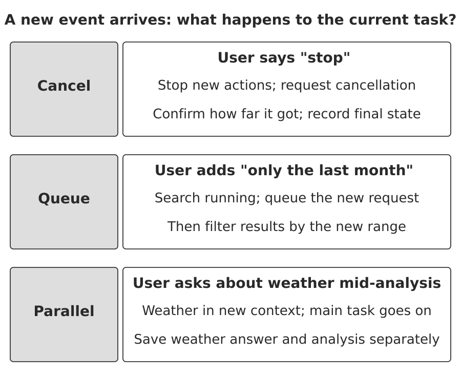

**Cancellation-Based Processing** suits user stop commands and control events that need immediate handling. The runtime first stops dispatching related operations, sends stop signals to in-progress generation requests and cancellable tools, and then saves the completed messages, tool states, and cancellation receipts. The new event then enters the decision context. For example, when the user says "Stop! I said the wrong thing," the system first restricts further execution, then reconfirms the task against the actual current state. Queue items not yet processed keep their identifiers and states and are reordered according to their correlation scope.

**Queued Processing** suits routine supplementary information and progress updates. The event enters the queue and is handed to the model together with the tool results at the next safe point. For example, if the user adds "only show results from the last month" during a search, the model reads the results and the new condition together when the search returns, then decides whether to filter or search again.

**Parallel Processing** suits requests that are independent of the main task and need a timely reply. For example, if the user asks about the weather during a large data analysis, the system can open a separate session to answer the question.

**Urgency and Routing.**

Event types provide initial clues: `user.interrupt`, trusted supervisor instructions, and system alerts can go into a high-priority lane; `user.input`, `agent.input`, `tool.result`, and `timer.trigger` are judged further based on content and task state. When a sender calls their message "urgent" in the body, the system still determines permissions based on verified identity and rules.

For routing decisions that require understanding what a message means, I recommend a lightweight classification model: "Stop right now" maps to cancellation, "What's the weather today?" may suit parallel processing, and "Please write the report in Chinese" usually goes into the current task's supplementary queue. Explicit stop entry points are handled directly by the runtime, and semantic classification is used for the remaining messages that require understanding.

A general-purpose model can also label messages, but even to output a two-word label like "needs handling," it still has to read the task description and the message content. Making that judgment for every new message means call costs grow with message volume, and a genuinely urgent message also has to wait for the model's label before it can move on. TypeSafe's Jev is built specifically for this kind of judgment task, where the options are given in advance. Given a message and the current task state, it returns the probability of each option in parallel at lower cost and latency.[^ch6-jev]

The observation-space sparsification discussed in Chapter 1 determines here which messages trigger a new round of reasoning. Take Feishu messages and GitHub Issue comments as an example: the program can first filter duplicate notifications by event ID, then let Jev judge whether a new message supplements an existing task or makes a new request that the main model must handle. On reading "adding the reproduction steps I mentioned yesterday," the model need only judge that this is a supplementary note. Which Issue it supplements, the program can read directly from the ID attached to the comment.

Even when the model reports a high probability, it may be overconfident. For example, 100 messages may all be judged "supplements an existing task" with a probability of about 90%, while only 60 of them actually are. Automatically merging this batch into existing tasks would miss what the other 40 messages were really for.

[^ch6-jev]: In its release notes for Jev, TypeSafe describes predefined outputs, probabilities returned in parallel, and RLCD, a training method that targets decision calibration.

### Building a Basic Loop from Email Events

Suppose the process handling new email suddenly restarts. The email's identifier helps it find the original message, but cannot tell it whether the previous reply was sent. From enqueuing, reading the email, and calling tools to updating the mailbox or notifying the user, it is best to record every write operation and the receipt it returns under the same email. After a restart, if the system finds a request that was sent but has no receipt, it first verifies the actual state of the mailbox, then decides whether to resend.

> **Experiment 6-1 ★★★: Event-Driven Email Processing Agent**
>
> This experiment uses a test mailbox as the entry point to practice event registration, queuing, and task processing. First, turn new emails into structured events and process them in order of arrival; then connect tools for email history, attachment reading, knowledge lookup, and notifications. Follow a meeting invitation through Figure 6-4: in the event loop, find the two steps of calendar-conflict checking and drafting, then look in the persistence layer for this email's processing record.
>
> 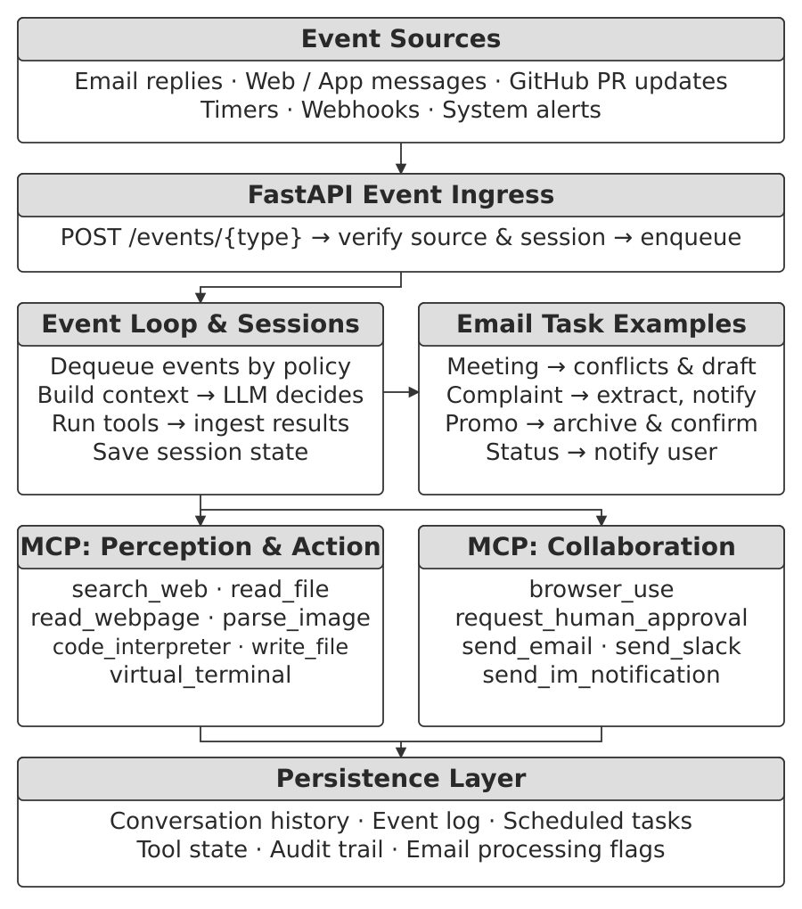
>
> The same queue can be extended to many sources: incoming email, IM or SMS messages, GitHub PR and Issue updates, timers, external Webhooks, and internal events such as the user going offline, process timeouts, and resource alerts. Each adapter verifies its source and adds correlation information, and processing results are written back by event identifier.
>
> Acceptance uses three test emails: a meeting invitation triggers a calendar-conflict check and produces an accept or decline draft; a customer complaint triggers key-information extraction, a high-priority flag, and a user notification; a marketing email is archived by rule.
>
> The accompanying records so far cover verification against the interface documentation and an authentication probe; connecting the test mailbox still awaits valid credentials.
>
> **Extension (optional): multisource ingress and fault injection.** In addition to the test mailbox, connect a local Webhook endpoint and an SQS queue (a local simulation will do). Each adapter verifies its source, builds an envelope, and acknowledges the source only after writing to the ingress log; the runtime reads events from the log and processes them in thread order. Then inject three kinds of faults:
>
> 1. **Duplicate delivery.** The Webhook endpoint receives two requests with the same delivery ID; only one event appears in the log.
> 2. **Crash before acknowledgment.** The adapter is killed after writing to the log but before deleting the SQS message; after the message becomes visible again and is received a second time, the log still contains only one event.
> 3. **Crash before the receipt.** The runtime is killed after sending a reply but before recording the receipt, and replays from the log on restart. If the channel supports idempotency keys, or the sent message can be looked up (for example, in the mailbox's sent folder), the same reply is not sent twice; for a channel that offers neither, the reply can only be marked as awaiting human confirmation.
>
> All three faults should leave records in the log: which delivery was deduplicated, which message was received again, and which reply was verified and not resent.
>
> The accompanying code for this extension runs offline and needs no API key. Both the test mailbox and the SQS queue are simulated with local files, separate from the real mailbox above that is awaiting credentials; the simulated queue preserves visibility timeouts, receipt handles, and ordering within a message group. Crashes are produced by the parent process killing the child process at a specified point. Each reply channel demonstrates one approach: email checks the sent folder, app chat uses an idempotency key, and SMS has neither. To reproduce, go to `chapter6/agent-with-event-trigger` and run `python multisource_demo.py`; the terminal prints, item by item, the log records left by the three faults. In the accompanying run record, all three fault checks passed.
>

The email queue establishes the basis for sequential processing. Next, we add long-running tools and discuss how to accept new requirements, cancel tasks, and resume work while waiting.

### Compatibility When Native Asynchrony Is Unavailable

Suppose the Agent is drafting an email and has already called `search_contacts` to look up a contact. Before the result comes back, the user says, "Wait, first check tomorrow's weather." If the current model interface requires every tool call to be matched with its result first, the Harness has to translate the background state into a message sequence the interface will accept.

**Expressing Background State in a Synchronous Message Format.**

**When staying compatible with a synchronous interface, preserve the pairing of normal calls with their real results as far as possible, and add status responses only when switching tasks midway.** Filling in "still running" for every call too early fills the trajectory with incomplete states and makes it harder for the model to track the real results. Five rules can be followed:

1. **Record complete calls.** Write the assistant messages and tool-call items that the API has completed into the trajectory, keeping their call identifiers. Preserve server-side reasoning state using the continuation method the provider specifies.
2. **Record real completion.** When a tool finishes, write the actual result, task identifier, and execution status; while it runs, the task manager keeps storing the incomplete state.
3. **Report the current state when switching.** For interfaces that allow this kind of result payload, return explicit status information for the pending call—for example, "The task is still running in the background; no result yet"—and then append the user event. The task identifier in the status response links it to the later completion notice.
4. **Tidy up messages after an interruption.** Without mid-turn continuation, cancel the unfinished generation, keep the messages and tool states confirmed as complete, and submit a new request. Handle unfinished output as the interface specifies, so that half-written arguments are never treated as an executable call.
5. **Receive routine events in batches.** Supplementary information goes into the queue and is submitted together at the end of the current cycle or at a designated safe point, with a record of which events have been processed.

In the contact-lookup example, the complete call is written to the trajectory first; when the user switches tasks, the Harness adds a status response saying the lookup is still running, then submits the weather request. The contact result arrives later and enters the context as a new event tagged with its source and task identifier, after which the Agent continues drafting the email. Because the original call has already received a status response, the later result uses the event form agreed on by the adapter, preserving the call–result pairing.

A status response describes only current execution progress. Steps that depend on the contact data must wait until the real result arrives. The task manager can store states such as `running`, `completed`, `cancelled`, and `failed`, and check that dependencies are satisfied before sending a reply or running later tools.

**Designing Asynchronous Tools Around Task Handles.**

For newly designed long-running tools, I prefer to define "start" as a complete operation that immediately returns a real task handle. The model can then distinguish "started" from "finished," and later queries, cancellations, and result events share a common basis for correlation. For example, `initiate_phone_call` starts a phone task and returns a task identifier with the status "dialing"; `phone_call_connected` and `phone_call_ended` report when the call connects and when it ends.

The tool description should say clearly: "This tool starts a phone-call task and returns a task ID on success. You can continue with other matters; call progress and the final outcome are delivered as separate events." The tool name signals that this is a start operation, while the return structure and later events show how the task proceeds and ends. The system then provides interfaces for querying, cancelling, and resuming by task ID, so the model knows what it can still do.

**Handling Batched Events One by One.**

When several events enter the context at once, the model may respond only to the last one and overlook requirements raised earlier. The runtime should keep a separate processing state for each, so that conditions not yet addressed stay visible. The prompt can ask the model to check each item, and a status bar lists the information not yet handled:

```text
[未处理事件 1/4] database_query 结果：……
[未处理事件 2/4] 用户补充：只看北京地区的数据
[未处理事件 3/4] 系统提醒：报告截止时间还有 30 分钟
[未处理事件 4/4] 用户询问：进度如何？
```

(The four lines read: unprocessed event 1/4, the `database_query` result; 2/4, a user note to look only at data for the Beijing region; 3/4, a system reminder that the report is due in 30 minutes; 4/4, the user asking how it is going.)

A batch summary can note "1 tool result, 2 user messages, 1 system reminder." The runtime further links events to task constraints: the region condition updates the query scope, the deadline affects scheduling, and the progress question needs a reply. After processing, it records each item as done, waiting, or needing clarification, and unresolved items carry over to the next round.

The same task number ties together the start, the progress reports, and the final execution result. If someone asks to stop midway, check whether a cancellation receipt exists under that number.

> **Experiment 6-2 ★★★: Asynchronous Agent with Parallel Execution and Interruption Capabilities**
>
> This experiment first validates the asynchronous runtime, then connects a model to check its decisions. The accompanying run record completes four scenarios with real operating-system subprocesses, with event scheduling and reporting driven by a deterministic script.
>
> 1. **Background execution with immediate response.** Start an analysis process that runs for several seconds and return a task identifier immediately; answer a question about the current time while waiting, and receive the analysis result when it finishes.
> 2. **Queuing and batching.** During a long task, add "reply in Japanese" and then "turn it into a webpage"; when the task finishes, process the result and both requests as one batch. The script produces Japanese HTML.
> 3. **Cancellation and resumption.** Demonstrate that receiving "stop the analysis" interrupts the model turn still being generated and requires every running background task to stop. Here the script issues the interruption, and only one analysis process, T1, is running at the time. At 0.803 seconds the interruption event records T1's progress as 18%; only at 0.806 seconds does the system record its exit code, −15. T2, started immediately afterward, is a new task. The result received at 4.436 seconds belongs to T2; T1 never triggers a completion callback.
> 4. **Parallel tasks and progress-based decisions.** Start three analysis processes at once, advancing by 3%, 2%, and 1% per logical time step. In this experiment's parallel progress record, when the fastest, T1, finishes, the query receipts show T2 at 68% and T3 at 34%. Following Figure 6-5, tasks at or below 50% progress are cancelled. The script cancels only T3 and ultimately receives the results of T1 and T2. This shows that the same runtime can both honor a stop that applies to the whole batch and keep parallel work that is still useful.
>
> 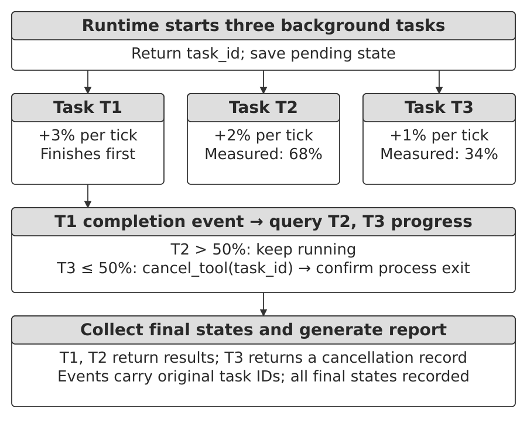
>

### Model-Native Asynchrony: GPT-6 Astra

In the approach above, the Harness adapts to a synchronous message format. A native asynchronous interface instead lets the model keep working on independent tasks while a tool has not yet returned, and receive the result later. As of September 2026, GPT-6 Astra offers Async tool calling and Mid-turn steering, which handle tool waits and user updates respectively. Figure 6-6 contrasts the message flows of synchronous-interface adaptation and native asynchrony.[^ch6-22][^ch6-23]

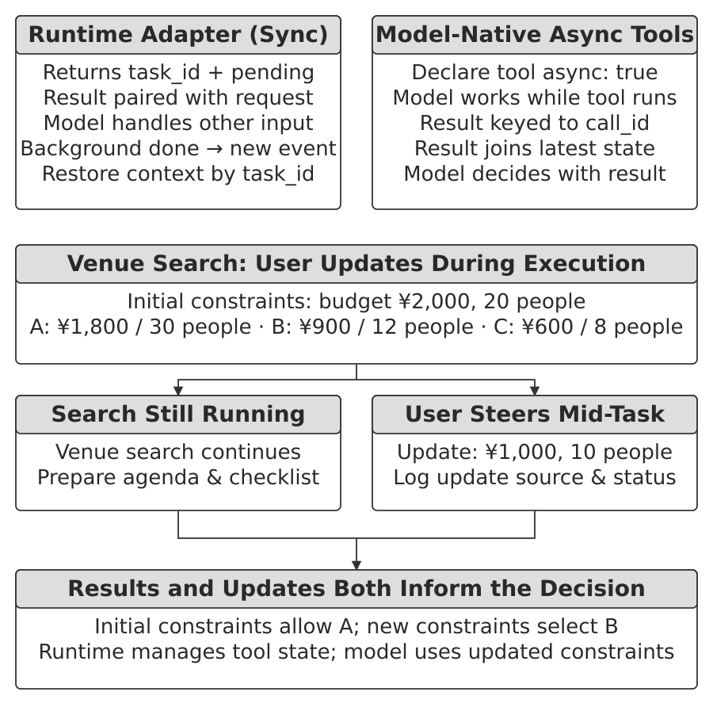

**Keep working independently while waiting for a tool.** For example, after starting a query for meeting venues, the Agent can first prepare the agenda and checklist; when the query returns, it compares prices and capacities. The `async: true` declaration in the tool definition marks the tool as asynchronous; the application starts execution once it receives the complete call item and saves the call identifier `call_id`. When the result arrives, the application returns it under the original identifier and continues from the latest response state. The model plans the follow-up work, while the Harness manages call correlation and the task lifecycle.[^ch6-22]

**Accept new requirements while the task is underway.** While the model is thinking or composing its answer, the user can add "the budget is now 1000" or "attendance is now 10." The application sends a steering event over the same connection; once the server acknowledges receipt, it continues from the current response state. After a dropped connection, the application can restore the task from the saved events and response state.[^ch6-23]

The two capabilities can be combined: the venue query keeps running, the user's new requirements feed into later decisions, and the choice is made once the query returns. Meanwhile the executor maintains the real state of background tasks. When a query must be stopped or a booking cancelled, the Harness calls the corresponding interface and checks the receipt; business operations that have already completed go through an undo or compensation process.

When the model and interface already support native asynchrony, I prefer the native protocol, letting pending tools, user updates, and response continuation flow as the interface specifies. The synchronous compatibility layer mainly serves existing models and legacy interfaces; after a model upgrade, the logic that exists only to complete message pairings can be removed gradually, concentrating engineering effort on task state, cancellation, and resumption.

### Handling Asynchronous Tasks Reliably

Reliable asynchronous interaction requires checking messages, tasks, and execution state together.

1. **Result ownership.** A delayed result carries the original call identifier, which the application maps to the corresponding task; decisions that depend on the result continue only after the data arrives.
2. **Resumption and cancellation.** When the user changes requirements, the system keeps the work that is still valid, updates the remaining steps, and makes explicit which background tasks are still running and which have stopped.
3. **Multiple requirements.** Budget, attendance, region, and deadline each enter the task state, and the final result is checked against each of these conditions.

> **Experiment 6-3 ★★★: Model-Native Asynchrony and Mid-Turn Steering**
>
> In this experiment the Agent chooses the cheapest venue for a simulated meeting that satisfies the budget and attendance requirements. The initial budget is 2000 and attendance is 20; the query tool takes 8 seconds to return quotes and capacities for three venues.
>
> | Venue | Price | Capacity |
> |---|---:|---:|
> | A | 1800 | 30 |
> | B | 900 | 12 |
> | C | 600 | 8 |
>
> Under the initial conditions, A is the right choice. The steering groups receive two updates while the task is in progress: the budget changes to 1000 and attendance to 10, at which point B is the right choice. The tool also returns a freshly generated receipt that the final answer must cite, which makes it possible to check whether the model used the result that actually arrived.
>
> The experiment has five groups, three runs each: synchronous tools, native asynchronous tools, steering during reasoning, steering while waiting on an asynchronous tool, and a control model without steering support. The first two groups compare whether an independent preparation checklist can be produced while waiting; the two steering groups check whether the budget and attendance updates both take effect; the capability control checks whether the interface explicitly reports that steering is unsupported.
>
> In the saved run records, the asynchronous-tool group completed the independent checklist while waiting, and both steering groups chose B under the new conditions. Every run with tools executed the query only once and returned the actual result to the original call; the control model's interface explicitly replied that it does not support receiving new requirements midway through a generation. The synchronous and asynchronous groups took about the same total time; the main difference was whether other work could move forward during the wait.
>
> If the model remembered only that attendance changed to 10 and still used the old budget of 2000, which venue would it pick? Both A and B can seat everyone, and B is still the cheapest. So picking the right venue does not by itself show that the budget was updated.
>
> When attendance changes, should the query already in flight be rerun? The tool in this experiment has no filtering parameters and returns all three venues. The assistant can reuse the result already on its way and filter it for 10 people and a budget of 1000 once it arrives. If the tool returned only venues for 20 or more people, the old result would contain only A, and B, which seats 12, would not be in it at all. Changing attendance to 10 within the old list would then still miss B. If the original query has already filtered B out, it must be run again.

Asynchronous mechanisms let external changes enter the system while a task is underway. Voice, screen, and robot interaction shorten the feedback cycle further: the system must receive input continuously and adjust its output and actions at the right moments.

## Voice: The Most Natural Human-Machine Interface

Voice lets users describe what they need, add conditions, and confirm results even while their hands or eyes are busy with other work. Voice input methods convert dictation into text, while a voice Agent goes further and manages the conversation, tool calls, and reply playback; both can support the whisper coding described in the Introduction.

This section covers two uses: the user talking directly to an Agent, and an Agent communicating with outside parties on the user's behalf. The former centers on recognition, response, and barge-in; the latter must also complete identity confirmation, business inquiries, and decisions during the call.

### Interaction Timing: From Cascaded to Full-Duplex

In its introduction to GPT-Live, OpenAI reviewed three kinds of voice interaction: cascaded, turn-based audio models, and full-duplex[^ch6-12]. This progression gradually hands the ongoing judgment of "when to speak and when to keep listening" to the model. A cascaded system relies mainly on endpointing logic to arrange handoffs, while a full-duplex model can draw on continuous sound and conversational state to handle overlap, pauses, and interruptions.

| Paradigm | Core structure | Capabilities it makes easy | Main design problems |
|---|---|---|---|
| Cascaded | VAD, ASR, LLM, and TTS as separate stages | Swapping modules independently; inspecting inputs and outputs stage by stage | Latency between modules; acoustic information lost in transcription |
| Turn-based end-to-end audio model | The model receives and generates audio directly | Using intonation, emotion, and similar cues to shape the reply | Detecting the end of an utterance, switching turns, and timing the response |
| Full-duplex | Continuously receives audio while generating output | Overlapping speech, backchannels, barge-in, and continuous interaction | Continuous state, output control, and interaction evaluation |

Whether the model processes audio directly, whether input and output are streamed, and whether it can listen and speak at the same time are capabilities that can be examined separately. A cascaded system can add streaming modules and interruption control; the interaction rhythm of an end-to-end model depends on its specific design.

[^ch6-12]: OpenAI, *Introducing GPT-Live*, 2026-07-08, which describes cascaded systems, turn-based audio models, and full-duplex interaction.

### Paradigm 1 · Cascaded Pipeline

A cascaded system splits a voice conversation into several modules. Voice activity detection (VAD) identifies speech segments in the audio, and endpointing logic decides when to submit a segment; automatic speech recognition (ASR) converts the audio into text; the LLM understands the request and generates a reply; and text-to-speech (TTS) turns the reply into playable audio. Figure 6-7 shows the basic structure, executed in sequence.

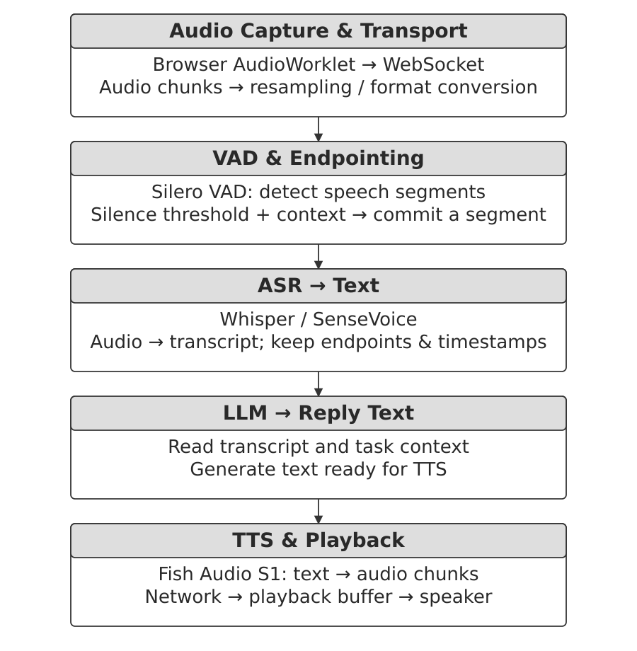

Acoustic VAD finds the stretches where someone is speaking, so later recognition can skip long silences. Yet the same pause means different things after "I'd like to book…" and after "Are there any tickets Thursday morning?" Semantic VAD (semantic endpoint detection) can keep listening in the first case and hand the utterance to the dialogue model only in the second. This is sparsification of voice observation over time: a continuous stream of sound triggers reasoning at only a few moments. Whether to speak is up to the model that hears the utterance; it may also keep listening, or look up flights first.

| Module | Role | Common sources of waiting or error |
|---|---|---|
| VAD and endpointing | Detect speech; decide when to submit | Silence thresholds, noise, and pauses mid-utterance |
| ASR | Convert audio to text | Decoding time; recognizing names and proper nouns |
| LLM | Understand, reason, and generate the reply | Request queuing; generating the first segment of the reply |
| TTS and playback | Synthesize audio and deliver it to the speaker | First-packet synthesis, network transfer, and playback buffering |

In a fully serial implementation, after the user finishes speaking they must wait in turn for endpoint confirmation, transcription, reply generation, and the first audio segment. In the example in Figure 6-8, 1.4 seconds have passed by the time the user hears the first sound of the reply, and the longest single stretch is waiting for the system to confirm that the user has finished (500 milliseconds). Even if transcription were cut from 100 milliseconds to 50, the user would wait only 50 milliseconds less.

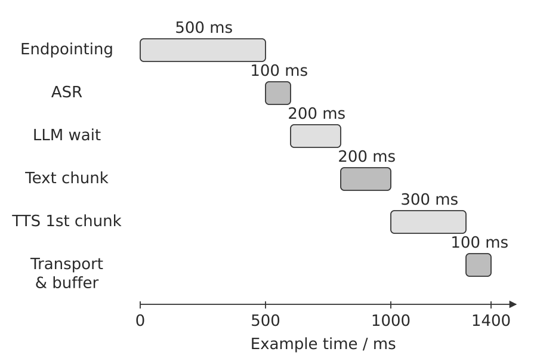

Service load also adds queuing delay. Figure 6-9 uses the M/M/1 single-server model to illustrate this relationship: with Poisson arrivals, exponentially distributed service times, a mean service time of $S$, and utilization $\rho<1$, the mean total time including service and queuing is $W=S/(1-\rho)$. With $S=1$ second, raising utilization from 0.5 to 0.8 raises the mean total time from 2 seconds to 5. Service itself still averages 1 second; the extra 3 seconds are all spent in the queue. As requests approach capacity, short bursts of traffic build up a backlog.

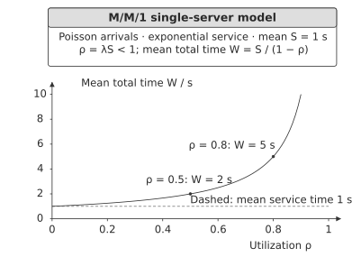

> **Experiment 6-4 ★: Build a Traditional Voice Agent**
>
> Suppose the assistant is reading out Thursday's flights and you cut in to correct it: "Wait, I want to book Friday." The browser sends the microphone audio to the backend over WebSocket. As soon as Silero VAD detects that you have started speaking, the backend emits `speech_start`, and the browser immediately stops playback and clears the queued old audio. At this point the assistant does not yet know which day you changed to. Only after you finish and the silence exceeds the default 500 milliseconds does the backend emit `speech_end` and hand the speech to a local Whisper tiny model for transcription.
>
> Once Doubao starts returning text, how long is it before the user hears the answer? In the record of one replayed recording, transcription took 2.710 seconds. Doubao returned its first token 0.749 seconds after the request was sent, and the complete answer only at 0.792 seconds. The replay program waited until all the text had arrived before handing it to Fish S1 for synthesis; another 2.819 seconds passed before the backend received the first batch of audio. Adding up these three serial stages, counted from the endpoint decision, gives about **6.321 seconds**. The archived report says 6.279 seconds because it used the time to the first token in place of the time to generate the whole answer.
>
> These 6.321 seconds cover only backend processing. Before them, the user must wait for silence detection to decide the utterance is over; after them, the audio still has to reach the browser and start playing.

#### From Serial to Streaming Perception

A serial design is easy to inspect stage by stage, but it also exposes three problems. Waiting for silence adds endpointing latency; the transcript may miss tone, emotion, and ambient sound; and when audio is split at pauses, email addresses, names, or proper nouns may lose their full context. For systems already built on a cascaded architecture, I recommend a streaming retrofit first: let each stage deliver incremental results as early as possible, overlap recognition, reasoning, and playback, and keep track of which parts are confirmed and which may still change. This reuses the existing modules and makes it possible to pinpoint, step by step, where the waiting comes from.

- **ASR transcribes while listening.** It receives audio continuously and outputs provisional transcripts; as more audio arrives it revises the unstable parts, and it delivers the final text when the endpoint is confirmed.
- **LLM speculative execution.** The provisional transcript is used to prepare a reply in advance. Once the final text is confirmed, the system checks whether the input matches and whether the work already done still applies, then decides to keep, adjust, or regenerate it. Operations such as sending messages externally or writing business data wait until the required conditions are confirmed.
- **Segmented LLM output.** As soon as a segment of text suitable for speaking is complete, it goes to TTS; segmentation preserves sentence meaning, punctuation, and intonation cues.
- **Incremental TTS.** Audio chunks come back progressively, so later text generation, synthesis, and playback can overlap. When the user barges in, both the generation task and the unplayed content in the playback buffer must be handled.

Whisper's standard transcription implementation encodes and decodes audio in windows[^ch6-whisper]. An incremental transcription pipeline can be built by chunking externally or repeatedly submitting the accumulated prefix; reusing persistent state, the cost of repeated encoding, and revising earlier text must be managed by the specific implementation. Native streaming recognition models, by contrast, handle continuous input directly in their architecture and training.

A perception system built on an audio language model can also output text and acoustic events jointly. Past audio, transcripts, and vocabulary hints help recognize names, brands, and proper nouns; how much history is kept depends on the context and cache design. To decide whether the user has finished, the model can combine semantic completeness with silence. At the pause in "I'd like to book…", however, a real-time system has heard only those few words and has no way of knowing that a date will follow.

Beyond transcription, the interface can also define the following events: `speak_start` and `speak_end` mark the start and end of speech, `interrupt` marks an interruption, `emotion` describes emotional state, and `laugh`, `sigh`, and `noise` record laughter, sighs, and ambient sound. These events can be sent to the Agent together with the text and timestamps.

> **Experiment 6-5 ★: Simulating Streaming Voice Perception with Qwen2-Audio**
>
> This experiment progressively lengthens the audio prefix, each time feeding the audio from the start up to the current moment back into Qwen2-Audio, and observes how the transcript and acoustic events change as the input grows. The baseline path uses a 600-millisecond silence endpoint with Whisper. The test material includes normal speech, a long sentence with a 900-millisecond pause inserted, and speech mixed with pink noise.
>
> This run of the locally quantized model kept 13 prefix inferences, each taking about 8 to 11 seconds. The mid-sentence pause triggered a segment split in the baseline path; the audio model detected the noise but also falsely reported coughing and laughter.

[^ch6-whisper]: OpenAI, Whisper, which describes windowed audio transcription and the model implementation.

### Paradigm 2 · End-to-End Omnimodal Models (Omni)

An end-to-end audio model receives sound directly, combines linguistic and acoustic information to generate a reply, and synthesizes speech through an audio output branch. Processing audio directly makes it possible to use speaking rate, pitch, pauses, and ambient sound; transcribing first and then answering makes it easier to inspect the intermediate text and replace modules independently.

These acoustic features affect understanding. For example, the same sentence, "Please send the report before lunch," leaves the listener with a different impression when said hurriedly than when said slowly. On the output side, the model can also organize meaning through pauses, stress, and intonation.

A system that processes audio directly may still wait until the user finishes before answering. If a user pauses while reading out a phone number, for instance, the system still has to judge whether the string of digits is complete. Endpoint detection decides when to respond; if the other party cuts in during playback, the system must also coordinate model generation with speaker playback.[^ch6-audio-architectures]

> **Experiment 6-6 ★★: Run MiniCPM-o 4.5 Locally—End-to-End Versus Self-Cascade**
>
> This experiment fixes a single MiniCPM-o 4.5 model with thinking mode disabled and compares two paths: answering questions directly from audio, and having the model first transcribe and then answer from the transcript alone. The inputs include two spoken arithmetic problems and two recordings with identical words but different speaking rates.
>
> Each path answered three items correctly, with errors in different places. The direct-audio path heard "twelve boxes" in one problem as 8, producing a wrong calculation; the transcription path correctly kept 12. In the speaking-rate items, both recordings say "Please send the report before lunch."; after transcription the text is identical and the information about speed is lost, whereas the direct-audio path correctly distinguished the two rates.
>
> The experiment also generated a 24 kHz speech clip, connecting input understanding with audio output.

### Paradigm 3 · Full-Duplex Interactive Models

A full-duplex system listens while it speaks, and the improvement people notice most readily is how alive the conversation feels. Read the sentence "I'd like a ticket for Wednesday… no, Thursday": the pause in the middle leaves room for the self-correction, and if the assistant has already started reading out Wednesday's flights, it should stop when it hears "no, Thursday." Another kind of timing: while the other party is still explaining their itinerary, a brief, light acknowledgment lets them know the assistant is listening. Only by receiving audio continuously does a system have the chance to make these choices among speaking, listening, pausing, and calling tools. Simultaneous interpretation likewise requires input and output to overlap.

**Moshi**, released by Kyutai in 2024, models the user's and the model's audio streams separately, using parallel streams to represent overlapping speech and interruption[^ch6-moshi]. By keeping these temporal relationships in its input, the model can learn when to respond and when to keep listening.

Thinking Machines Lab's interaction model slices continuous input and output into short blocks of equal length, each covering 200 milliseconds, called a micro-turn[^ch6-14]. Look at the second cell on the timeline in Figure 6-10: the assistant is still saying "Thurs-," and the user's "no," correcting the date, is already coming in. By the third cell, the assistant has stopped and is still listening as the user finishes saying "Friday."

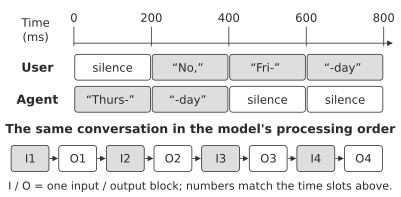

Now read the lower half of the figure. The two parties on the call hear two streams of sound that can overlap, but the model can process input blocks and generate output blocks alternately along a single sequence. Silence occupies a cell too, so the assistant can listen for a while before speaking. The 200 milliseconds in the figure is this implementation's block length; the time from the user's barge-in until the speaker actually stops also includes processing time and playback buffering.

[^ch6-moshi]: Kyutai, *Moshi: a speech-text foundation model for real-time dialogue*, 2024, which describes parallel audio streams for the user and the model.
[^ch6-14]: Thinking Machines Lab, *Interaction Models: A Scalable Approach to Human-AI Collaboration*, which describes micro-turns, multistream interaction, and delegation of background tasks.

### Cognitive Timing: Real-Time Interaction and Deep Thinking

In Pine's customer-service calls, when the representative is halfway through a sentence, the assistant should sometimes wait and sometimes give a soft acknowledgment; while it is speaking itself, it must also hear corrections the other party cuts in with. This is why I am optimistic about the route Moshi represents: only when the timing is right does the other party feel that someone on this end of the line is really listening. For requests that require looking something up, there is another time budget to work out: between understanding the question and reporting the answer, how many handoffs are there?

Tools the foreground voice model can call directly should be called by the foreground. Looking up flights then takes only two model calls: the foreground queries with the conditions the user gave, then reports the result. Delegation takes four: the foreground hands off the task, the background issues the query, the background organizes the result, and the foreground relays it. A competing view holds that a real-time model may fill in parameters wrongly, so the background should call the tools and leave the foreground to focus on when to listen and when to speak.

GPT-Live-1's foreground has no interface for calling business functions directly and can only delegate to a background Agent. OpenAI Realtime's GPT-Realtime supports direct function calls from the foreground. Doubao Realtime Voice Model 3.0 (Seeduplex) also supports direct foreground calls in pure end-to-end mode, while in hybrid orchestration the calls are made by an external language model.[^ch6-voice-tools]

Let each call to the foreground and background models take $L_f$ and $L_b$ respectively, and let the tool take $T$. From the moment the user finishes speaking until they hear the result, a direct call takes about $2L_f+T$ and delegation about $2L_f+2L_b+T$. The extra $2L_b$ of delegation is independent of the tool time $T$. Information that may be needed in every turn, such as user memory, can be looked up by the runtime and placed in the context, so the foreground needs only one model call, taking about $L_f+T$; if it has already been looked up before the user speaks, even $T$ is saved.

Tasks that need multistep reasoning, such as comparing several rebooking options, are better handed to the background. Booking a ticket involves charging a card and issuing the ticket, so whoever calls the tool, the order must wait for the user's confirmation. Flight results can be summarized aloud while the full table is shown on screen, regardless of who calls the tool.

> **Experiment 6-7 ★★: Should a Voice Agent's Tools Be Called by the Foreground or the Background?**
>
> Build the foreground with Doubao Realtime Voice Model 3.0 and the background with DeepSeek V4 Pro served by Volcano Ark. Prepare five mock tools—weather lookup, user-memory lookup, web search, flight search, and booking—that return results after set delays, with flight search and booking taking two to five seconds. Pre-synthesize the user's recordings and replay the same recording for each run of a scenario.
>
> Set up four divisions of labor. In the first, the foreground calls every tool. In the second, the background calls every tool and the foreground can only delegate. In the remaining two, the foreground looks up the weather, the runtime puts the user's memory into the context at the start of the session, and the background handles web search and booking; the two differ in whether flight search is handled by the foreground or the background. The foreground hears the user's voice directly; the background cannot hear it and can only read text. After each sentence the user speaks, Doubao's interface also returns the text produced by speech recognition, called the transcript. When delegating, the transcripts and the assistant's own utterances are arranged in order into a call log, which is handed to the background together with the tool calls already executed in this call and the task description written by the foreground. Under each division of labor, repeat each of the following scenarios 10 times.
>
> 1. Look up the weather and flights separately. Time from when the user finishes speaking until they hear the result; filler such as "Let me check" does not count as an answer. Compare the median wait for direct calls versus delegation. In my experiment, for the weather lookup these were 2.81 seconds and 6.96 seconds respectively.
> 2. Look up flights first, then choose a ticket and confirm. Check each of the 13 booking fields against the previous search result, what the user just said, and the user's profile, and check that the order was placed after the user confirmed. In my experiment, all four divisions of labor filled in every field correctly and placed the order only after the user confirmed.
> 3. Switch to booking for a colleague and play a recording that spells out the name: "陈嘉怡, 耳东陈, 嘉奖的嘉, 怡然的怡" (Chen Jiayi, with each character identified by a familiar word containing it, the usual way Chinese speakers spell a name aloud). Compare the recording, the speech transcript, and the name on the order to check whether both direct booking by the foreground and delegated booking got the name right. In my experiment, direct booking by the foreground was correct all 10 times; the transcript, however, rendered the name as "陈佳宜," a homophone written with different characters, and some delegated orders got the name wrong as a result.
> 4. Play a recording asking about the weather before the flight search returns, and listen for whether the foreground answers the weather question and then reports the flight results. In my experiment, the weather question was always answered, but the original flight results were almost never reported afterward.

When delegation is needed, the foreground should write the names and numbers it is confident about, as well as any correction the user has just made, into the task description, so the background does not fill in wrong parameters because of transcription errors. The runtime should keep track of results not yet spoken, so the foreground can continue reporting them after answering an interjected question.

A quick "Let me check" from the fast model tells the representative that the assistant has heard the request. When the fare can actually be reported, though, depends on how lookup and reasoning are coordinated with the call. Figure 6-11 shows three arrangements: respond first and answer in depth later; have the foreground keep interacting while receiving advice from the background; and advance formulation and expression in parallel, segment by segment.

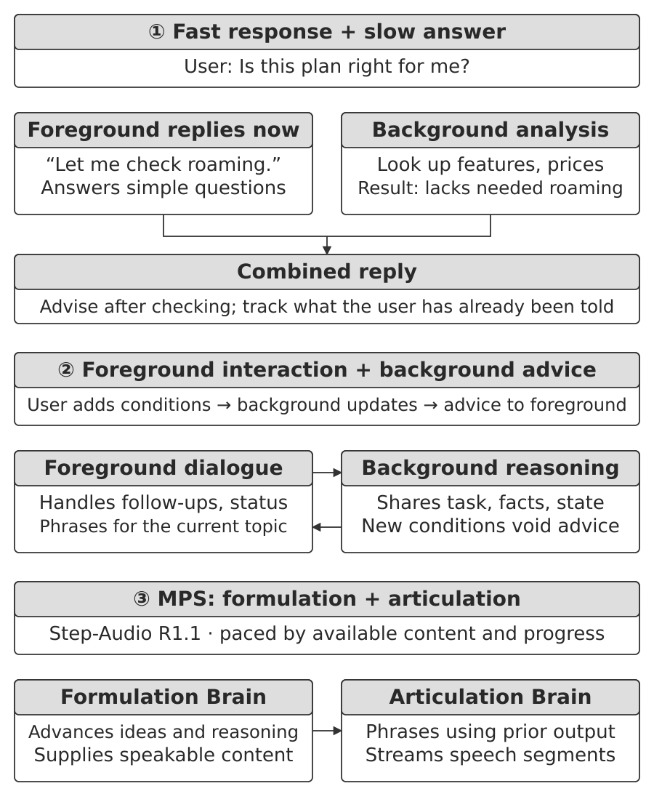

#### Approach 1: Fast Thinking Responds, Slow Thinking Answers

The fast model gives a brief response first, and the slow model completes the analysis in the background and then supplies a detailed answer. This design acknowledges the request early, but the consistency of the two answers must be managed. For example, the fast model may first recommend buying a certain plan, and the slow model may then discover that the plan lacks a key feature, so the two recommendations conflict. The root of the conflict is that the two sides answer independently, with possibly different grounds for judgment and different progress in their reasoning. Advice the fast model has already spoken has entered the user's thinking, and the user may even have acted on it; when the slow model corrects it, the system must explain the change and deal with any consequences already incurred.

The foreground should therefore distinguish acknowledging a task from stating a business conclusion. "I'll check whether the plan includes that feature" can be said immediately, whereas a purchase recommendation waits for the necessary lookup and analysis. When the background result comes back, the system compares it with what has already been said before composing the next reply. Simple questions can be handled entirely by the fast model, reducing duplicate processing.

#### Approach 2: Fast Thinking Interacts, Slow Thinking Advises

Voice and screen can also divide the work. Said aloud, "This month's bill has an extra €15 roaming charge" lets the user grasp the key point at once; leaving the original amount, the current price, and the disputed line items on screen lets the user check them at their own pace. Confirming a specific action can be done with a tap, while sensitive information should be entered by the user in an input interface the business recognizes. The foreground needs only to receive a status such as "verification complete" to pick the conversation back up naturally.

Suppose a traveler asks Pine to book a flight to Shanghai on Thursday morning, with a budget of 1,200 yuan and a need to reach the venue by noon. While on the phone with the airline, Pine passes a "note" to the background: "If we land at Hongqiao at ten, is there enough time to get from the airport to the venue?" The airline agent checks availability and tells Pine: "The flight landing at Hongqiao at ten is sold out. There's one landing at Pudong at ten-thirty, for 1,250 yuan." If the background can see only the notes the foreground passes it, it is still calculating the route from Hongqiao. The foreground has to add another instruction: "Recalculate for Pudong, landing at ten-thirty; the venue and arrival time are unchanged."

Another approach is to sync the call log to the background in order as well. Having already read the airport and landing time the agent gave in the call log, the background can take on the same task when the foreground simply says "Work out whether this flight gets us there in time." When syncing the log, mark who said what; half-sentences from the foreground that were cut off before being played must also be distinguished from what has actually been said. Speech transcripts may omit or garble key information, so the foreground should write the names, numbers, and user corrections it heard accurately into the task description. When the two records disagree, the background follows the task description. Once the background finishes, it need only tell the foreground the estimated time of arrival at the venue and how tight the schedule is. Which routes it checked along the way, and which fields the map API returned, can stay in the background for reference. The foreground then takes the result and continues negotiating with the agent.

The business traveler from Chapter 1 wanted the fare kept within 1,200 yuan. On past trips they were willing to pay a little more for a suitable flight, and they set no separate cap this time. Hearing that the lowest fare is 1,250 yuan, the assistant can book it for them. For a habitually frugal user traveling with family, however, those 50 yuan should be raised first. The foreground then has to look after two conversations at once:

- To the user: "The lowest fare on this flight is 1,250 yuan, 50 over budget. Would you like to book it?"
- Continuing with the agent: "Can you hold this fare for a little while? Is there anything later the same day under 1,200 yuan?" While the agent checks, the foreground can also ask about the baggage allowance and the change and refund terms.

That way, when the user comes back they can see several options, and the agent knows what to look up next. If the user later explains, "Last time I was rushing to a meeting; from now on, ask me first whenever a business trip goes over budget," the assistant must follow this new rule next time.

Waiting for the account holder to verify their identity calls for a different conversational rhythm. When the agent says the verification code has been sent, the foreground can reply: "Thank you, please hold on a moment while I ask the traveler to check their phone." If the traveler messages back that nothing has arrived yet, the foreground then asks the agent which number ending the text was sent to and how soon it can be resent. Once the traveler completes verification through the channel the business specifies, the foreground can carry on. In a call like this, waiting a little longer or issuing the ticket a little later is better than pressing the user to decide on the spot.

At this point, the background sends "the original quote has been updated." The foreground first confirms the new price with the agent, then tells the user. If the user happens to reply "Go ahead and book" at that very moment, the reply refers to the 1,250-yuan quote sent earlier. The foreground must judge from the new price and the existing authorization whether to ask for confirmation again. The background only supplies information; it is always the foreground that talks to the agent and makes commitments. Only when messages carry the flight, the conditions under which a price applies, and a timestamp can the foreground tell which quote is out of date.

The moment at which the same background message, "The price has changed; please verify," arrives also affects how the foreground should respond. If the agent has just said "The lowest fare is…", the foreground can first hear out the amount. If the agent has finished quoting and is waiting for an answer, this is the right time to ask about the new price. If the traveler has just cut in on the call with "Wait, let me change the date," the foreground should first get the new date clear, then decide whether the original flight still needs verifying. The same "OK," said while the agent is explaining the terms, may only mean "I'm listening"; said after "Shall I issue the ticket for you now?", it may be taken as agreeing to buy. Looking only at the transcript text misses distinctions like these.

#### Approach 3: Formulation and Expression Advance Together

The Step-Audio series provides two related examples. **Modality-Grounded Reasoning Distillation (MGRD)** concerns the information that reasoning relies on: it constructs and filters reasoning data around acoustic features such as pitch, rhythm, and intonation, and improves audio understanding through iterative distillation. In its reinforcement learning stage, Step-Audio R1 scores audio questions on two items: 0.8 points for a correct answer, plus 0.2 points for giving a reasoning process. The latter encourages the model to write out its grounds; whether the reasoning actually uses acoustic cues from the recording has to be checked during the earlier sample filtering.[^ch6-mgrd]

**Mind-Paced Speaking (MPS)** concerns the timing of reasoning and expression. It uses a Formulation Brain and an Articulation Brain, letting the formulation process guide speech generation. Step-Audio R1.1's real-time solution adopts this method.[^ch6-mps]

The two modules exchange information as they progress: formulation keeps moving forward, while articulation composes speech from the content already available and what has been said so far. This lets part of the expression overlap with later reasoning while keeping track of what has already been said.

[^ch6-mgrd]: StepFun, *Step-Audio-R1 Technical Report*, which describes Modality-Grounded Reasoning Distillation.
[^ch6-mps]: StepFun, *Mind-Paced Speaking: A Dual-Brain Approach to Real-Time Reasoning in Spoken Language Models*, and the Step-Audio-R1.1 model card, which describe the formulation and articulation modules and their use in a real-time system.

#### Division of Labor and Upgrade Path

**I value one engineering advantage of the fast/slow split: interaction capability and reasoning capability can evolve separately.** When a stronger reasoning model is released, the system can swap out the background. The background thus keeps pace with progress in reasoning models, while the foreground can keep improving the experience of listening, responding, and handling barge-in. The foreground needs to understand the task and the user's additions, while the background concentrates on longer reasoning, planning, and execution.

**When reasoning models are iterating quickly and the team needs to keep upgrading business capabilities, I prefer a replaceable fast/slow split.** It spares the team from retraining the entire voice system every time the reasoning model is upgraded. A more tightly coupled design is worth adopting when intermediate reasoning needs to control expression more directly and the corresponding training resources are available.

Pine AI's voice Agent uses an architecture in which fast thinking in the foreground works with slow thinking in the background. Its public article reports a first-place result on the τ²-bench voice track and describes how it combines continuous calls, business reasoning, and tool operation[^ch6-17].

To make sense of these combinations, it helps to distinguish three design dimensions: the **audio path** determines whether the model processes sound directly or hands off through a transcript; **listen–speak timing** determines whether input and output proceed in turns or in parallel; and the **cognitive division of labor** determines how real-time interaction and deep reasoning share state and exchange results. A system can process audio directly and remain full-duplex while handing complex tasks to a separate background model. Thinking Machines Lab's interaction model and GPT-Live both demonstrate this kind of combination.

[^ch6-17]: Pine AI, *The Most Natural Human-Computer Interface Is Your Voice*, which describes the fast/slow thinking architecture and the voice-task evaluation results it reports. The report refers to the leaderboard as τ²-bench voice.

### More Human-Like Speech Synthesis

Pauses, speaking rate, and stress help listeners understand sentence structure and the speaker's intent. For example, a phone number should be read out in appropriate groups, complex terms can be explained more slowly, and while waiting for a lookup the system can first say what it is working on. In my view, well-placed pauses and changes in rhythm make speech sound more natural and also let users hear how the task is progressing. Voice control can be designed around these concrete uses.

The main LLM can insert control markers into its text, such as `[THINKING]`, `[EMO:happy]`, and `[SPEED:0.8x]`. The execution layer parses the markers, splits the text into speech and pause segments, and maps them to the emotions, styles, or reference clips the synthesis interface supports. The meaning of each marker is defined by the application: `0.8x` can map to a slow setting; pauses can be inserted by the player; and laughter or sighs are expressed through supported sound markers or generation capabilities.

A reference-clip approach organizes the different ways a single speaker expresses themselves into a library. Each segment of text selects a matching emotion, speaking rate, and style, and the synthesized segments are then concatenated in order. Control state needs a defined scope: for example, an emotion persists until the next change, while a pause takes effect only at its position.

> **Experiment 6-8 ★★: Control Token-Driven TTS with Fish Audio**
>
> This experiment uses Fish Audio S1 to build a voice library of 24 reference clips: four emotions, three speaking rates, and two styles in combination. A parser converts a marked-up reply into speech segments and silence segments, and the execution layer selects a reference clip for each segment and performs the synthesis.
>
> Compare three configurations: no control markers, a single reference clip, and multiple reference clips. Keep the reply content identical, check whether the markers are routed to the expected configuration, and then listen for changes in pausing, emotion, and timbre.
>
> The saved listening test used an audio understanding model, presenting the three configurations in rotating order and rating naturalness, emotional fit, thinking pauses, timbre consistency, and how much it sounded like a customer-service agent. The multiple-reference group scored highest overall, and the single-reference group scored below the no-marker group.

## Computer Use: GUI Automation Agents

Suppose you ask an Agent to change the shipping address on a web page. It must first find the address field, type the new address, and then confirm from what the page displays that the change was saved. If a login dialog pops up just before a click, then even though the button in the previous screenshot has not moved, the target of that click has changed. Computer Use operates browsers, spreadsheets, or system settings through the screen, mouse, and keyboard, and its core challenge is making every action keep up with the interface actually in front of it.

Follow the **Perceive-Think-Act** loop in Figure 6-12 and consider what the model must confirm before typing the new address. It chooses where to click based on the screenshot and task progress; the Harness checks the arguments and permissions, then passes the action to the execution layer. A successful click only means the click was sent. Where the input focus lands in the next screenshot is what determines whether it is safe to type the address next.

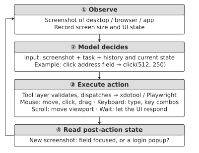

Once the address is filled in, how should the assistant tell the executor which "Save" button to click? Screen coordinates and element numbers can both identify the target, but they place different demands on the model and the tools.

### Action Space Design

In Figure 6-13, Anthropic's Computer Use reference implementation provides three kinds of tools: GUI operation, command execution, and file editing. Even within the GUI category alone, data flows in two directions: the click action goes to the executor, and the screenshot taken after the click goes back to the model as the observation for the next decision. The native API defines the tool format; with a different model, an adapter layer has to convert screenshots, action requests, and execution results into messages that model's interface can accept.[^ch6-computer-tools]

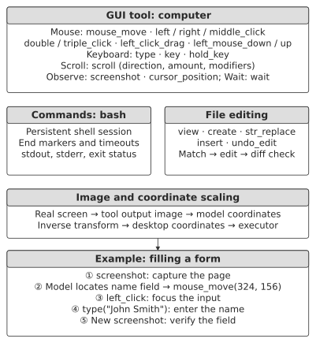

**GUI operation tool.** Mouse actions include moving, left/right/middle clicks, double-clicks, triple-clicks, and dragging; finer-grained interfaces can express pressing and releasing separately. Scrolling requires a direction and an amount, and some implementations also support modifier keys. The keyboard interface provides text input, key combinations, and holding a key down. Screenshots and the cursor position are used to obtain state, and a wait action gives page loads or animations time to finish. The tool version determines the exact set of actions, and the Harness validates arguments according to the interface in use.

**Command execution tool.** A persistent terminal keeps the working directory and environment state across calls. For example, after one call changes directory, the next call continues to run in that directory. The reference implementation can use a sentinel string to detect when a command has finished and set a timeout; the state of a process after a timeout still needs to be checked by the executor.

**File editing tool.** A string-replacement interface locates the region to modify by its original text, and can also offer viewing, creation, insertion, and undo. Before executing, check the location and number of matches; afterward, check the diff; if the file changed between two calls, reread the relevant content first. The editing strategies introduced in Chapter 5 can be reused here.

> **Experiment 6-9 ★: Running the Anthropic Computer Use Reference Implementation**
>
> This experiment uses the Ubuntu desktop, browser, and tool execution layer provided by the official container example. After the user enters a task, the model reads the screenshot and returns an action, the execution layer operates the desktop, and the new screenshot is returned to the model.
>
> The accompanying task looks up the weather in San Francisco. The saved trajectory first visits Google, runs into a CAPTCHA, follows a recovery instruction given during the run to switch to publicly readable Open-Meteo data, and finally reports the temperature and conditions. The record contains 15 desktop actions and the corresponding screenshots, so you can check round by round how clicks, key presses, text input, and waits change the page.
>
> For the path in which an open model drives the browser, see Experiment 6-10.

### Visual Grounding

To have the model click a search box, the problem can be posed in two forms. One shows it a screenshot and asks it to report click coordinates. The other numbers the candidate targets and asks it to pick the search box; the numbers can be placed on candidate regions in the screenshot, or they can come from an element list provided by the browser. The three routes are introduced below. When choosing a number, the execution layer is responsible for mapping the number back to the actual target; when reporting coordinates directly, the model must also estimate the target's position, which places higher demands on grounding training and on adapting to screen resolution.

**Set-of-Mark: Visual Annotation.**

Set-of-Mark (SoM) overlays referable numbers on an image, linking visual regions to the model's output. The original work generated candidate regions using segmentation and similar methods—for example, obtaining regions with SAM or SEEM and then placing marks on them. After the model chooses a number, the execution layer determines where to operate from the corresponding region. This method can be used for desktop software or game interfaces that lack a DOM, provided the control to be clicked falls within a numbered region and the model can see clearly which number it corresponds to.[^ch6-som]

**Structured Element Indexing.**

The browser can also provide another kind of clue. The Document Object Model (DOM) describes which elements the page contains and how they are nested, layout information gives where elements are displayed, and the accessibility tree preserves the roles and accessible names that assistive technologies need. For example, if a button showing only a magnifying-glass icon has been given the accessible name "Search," the Agent has a chance to find it by role and name. In approaches such as browser-use, the system can obtain element information through browser debugging interfaces such as the Chrome DevTools Protocol (CDP), identify input fields, buttons, and links, and then number the actionable elements on the current page. In Figure 6-14, the model has selected [2] in the upper right of the page. How does this number become a click on the Submit button?

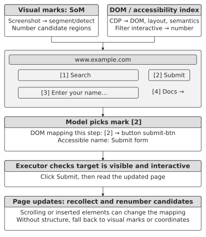

The process can be divided into four steps: read the DOM, layout, and any available accessibility information; filter for interactive elements; build a numbering map for the current page; and give the model the element descriptions together with an annotated screenshot where needed. For example, the model might see the following four numbered elements:

```text
截图中标有 [1]、[2]、[3]、[4]

[1] <input type="text" placeholder="Search" aria-label="Search" />
[2] <button id="submit-btn" aria-label="Submit form" />
[3] <input type="text" placeholder="Enter your name" value="" />
[4] <a href="/docs" aria-label="Documentation" />
```

(The first line notes that the screenshot is marked with [1], [2], [3], and [4].)

After the model chooses a number, the execution layer resolves it to an element reference or coordinates, checks that the target is still visible and interactive, and then performs the operation. After the page refreshes, scrolls, or dynamically inserts elements, the map must be updated to avoid using stale numbers. Structured indexing can draw on tags, roles, and text, whereas canvases, occlusion, or incomplete semantic markup require judgment from the screenshot. The more elements listed and the larger the screenshot, the more information goes into the context.

**Direct Coordinate Prediction.**

The coordinate route has the model output a position directly from the screenshot and a description of the target—for example, mapping "click the submit button" to a particular point. GUI grounding research such as SeeClick, as well as Claude's Computer Use, adopt coordinate output. The execution layer converts image coordinates into actual desktop coordinates.

When a screenshot is scaled, both coordinate systems must use the same transformation. Take a 2560×1440 desktop: if the image sent to the model is 1366×768, the model's output (683, 384) corresponds to:

$$
x = 683 \times \frac{2560}{1366} = 1280,\qquad
y = 384 \times \frac{1440}{768} = 720
$$

In Figure 6-15, the two sizes have nearly the same aspect ratio. If the screenshot was letterboxed to preserve its proportions, the model's coordinates include the padding; before converting back to the original screen coordinates, first subtract the corresponding padding offset, then apply the scaling factor. Cropping, display scaling, and the origin of multimonitor setups also change the mapping, so the tool layer should store the actual transformation parameters.

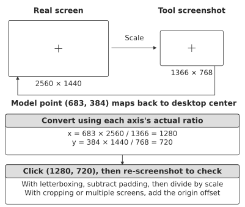

The reference implementation has used target sizes such as XGA (1024×768), WXGA (1280×800), and FWXGA (1366×768). Forcing a change in aspect ratio distorts the shapes of controls, and using the wrong inverse mapping puts a correct prediction in the wrong place.[^ch6-computer-tools]

**When structured information is complete, I prefer DOM or accessibility-tree indexing.** Element names, roles, and references can take part in grounding directly, reducing the work of having the model estimate pixel positions on the fly. When structure is missing, a general-purpose vision model can first be paired with SoM so that it chooses one of the marked regions; a model already trained on GUI grounding can predict coordinates directly, skipping the separate annotation step.

> **Experiment 6-10 ★: Using browser-use to Implement Automated Browser Operations**
>
> This experiment uses Qwen3-VL 32B Instruct to drive browser-use, generating actions from browser state, element information, and screenshots. The task is to look up the weather in San Francisco: locate the search box, type "San Francisco weather today," submit the query, and extract the temperature and conditions.
>
> The code and instructions for Experiment 6-10 provide two entry points. With an OpenRouter key, you can use a hosted vision model; if you already have a compatible service such as vLLM or SGLang, you can point `OPEN_MODEL_BASE_URL` and `OPEN_MODEL_MODEL` at your own endpoint and model and set the key as the service requires. Both routes start by running `python main.py --dry-run` in the experiment directory to review the configuration, then launch the actual query according to the instructions.
>
> The saved run completed 16 steps of interaction and kept 15 screenshots. When Google presented a CAPTCHA, the task switched to weather.com to get the result.

[^ch6-computer-tools]: Anthropic, Computer Use tool documentation and reference implementation, which describe the versioned action interface, the execution layer, and screenshot handling.
[^ch6-som]: Microsoft, *Set-of-Mark Prompting*, 2023; browser-use's DOM service implementation provides an example of structured element handling.

### A Computer Use Agent That Can Watch Animations and Hear Sound

A page shows "Sync failed" only briefly after saving, yet two screenshots taken a few seconds apart both show the same form. Looking at the two images again, the model will very likely be unable to reconstruct what happened in between. Videos, animations, short-lived notifications, and meeting audio have the same problem. **For interfaces that change continuously, I argue that the observation interface should be the main target for improvement.** To decide the next step based on change, the events and frames that appeared between actions must also be preserved.

The **Agent–Computer Observation Interface (AOI)**, which a collaborator and I proposed, converts the continuous screen and audio into images and text that a model can take in[^ch6-9]. The interface has three components:

- **Keyframe capture between actions.** While the main loop runs, monitor changes on screen, filter candidate frames by pixel difference or a lightweight vision model, and pass the useful frames to the next decision.
- **Volume-gated transcription.** When sound is detected, invoke speech recognition and add the transcript with timing information to the observation record, helping the Agent use meeting content or spoken instructions.
- **Persistent screen descriptions.** Summarize key frames as text; after the original image leaves the context, the text still preserves what changed, for later steps to refer to.

For example, if a video demonstrates a menu operation, a model that receives the intermediate frames and their descriptions can keep referring to that step after playback ends. The paper's ablation results show that persistent text descriptions are especially important to the gains, while finer keyframe selection contributes less; some models actually degrade when too many images are added.

Return to the earlier example of saving a form. Even if a keyframe captured "Sync failed," once the original image leaves the context the model can rely only on the description left behind. "A notification appeared on the page" could mean the save succeeded or failed; only "Sync failed; address not saved" preserves the clue needed to decide the next step.

[^ch6-9]: Bojie Li and Noah Shi, *Agent-Computer Observation Interfaces Enable Dynamic Computer Use*, 2026, which introduces AOI and ablates its components.

### World Models for Computer Use

Once it has timely observations, the Agent still has to choose an action and wait for it to execute. The OSWorld-Human study compares Agents' operating efficiency with human trajectories and analyzes sources of time cost such as redundant steps and model calls[^ch6-osworld-human].

A world model gives planning a prediction of an action's consequences. Desktop state can include windows, focus, scroll position, input contents, and loading progress; information such as permissions and network results has to be filled in through the corresponding interfaces. From the currently available state and a candidate action, the model predicts the next state:

```text
当前状态 + click / type / scroll / wait → 预测的下一状态
```

(That is: current state + click / type / scroll / wait → predicted next state.)

When people use a computer, they often anticipate the next step before clicking; if the interface behaves as expected they carry on, and only when something unexpected happens do they stop to check. A world model can give an Agent a similar basis for speculative execution: the planner compares candidate actions in advance, prepares later steps while a page is loading, and continues once the real state is confirmed, reducing the wait caused by replanning from scratch after every click. For example, when creating a new Python file in VS Code and writing hello world, the expected changes include a new file appearing in the file tree, the editor containing the code, and the saved status updating. After execution, check these changes: if they match expectations, continue; if they deviate, relocate the target and replan.

Operations such as deleting files also need independent execution conditions: whether the target is correct, whether deletion is allowed, whether it can be undone, and whether the user must confirm. Prediction helps in understanding the likely outcome, while actual permissions and business conditions are checked by the execution layer.

**Latent-state prediction in Photon-1.** In July 2026, Induction Labs introduced Photon-1, which encodes video frames as discrete latent tokens and learns state changes by predicting subsequent tokens. The company disclosed that its pretraining used about 30,000 H200 GPU hours. State prediction happens in the latent tokens, and an auxiliary image generator turns them back into viewable frames so people can inspect the predictions. Planning and action generation can use the internal representation directly, avoiding the cost of generating a full screenshot at every step.[^ch6-20]

The approach goes on to learn instruction and action formats through fine-tuning: it first predicts the state it wants to reach, then generates the operations that lead there, and improves task performance through online training in virtual machines. Action-conditioned fine-tuning, in turn, is used to predict how the desktop changes after a given operation. These two uses connect to planning and simulation respectively, showing how state representations can take part in Computer Use.

[^ch6-osworld-human]: Reyna Abhyankar et al., *OSWorld-Human: Benchmarking the Efficiency of Computer-Use Agents*, which analyzes task trajectories and time costs.
[^ch6-20]: David Li and Jonathan Li, *Scaling Video Pretraining with Imagination Models*, Induction Labs, 2026-07-23, which describes Photon-1's pretraining, action learning, and state simulation.
[^ch6-21]: Google DeepMind, *Genie 3: A new frontier for world models*, 2025-08-05; Zachary Lin et al., *Cosmos World Foundation Model Platform for Physical AI*, 2025.

### Mobile: Technical Interfaces and Ecosystem Cooperation

Mobile devices still use the observe–decide–act loop, but actions take the form of touch gestures more often. The same coordinate can mean a tap location, a long-press location, or the starting point of a swipe, so the interface also needs a gesture type, a duration, and a path. Screen rotation, the soft keyboard appearing, and system pop-ups also change the operable area.

Android's `AccessibilityService` can read interface information and perform corresponding actions within the scope it has been granted, and the gesture interface requires declaring the corresponding capability[^ch6-android]. Screenshots, the accessibility tree, and system automation interfaces can be used together, with the exact scope available determined by the operating system, the app's implementation, and authorization. Benchmarks such as AndroidWorld, introduced in Chapter 7, check whether these actions produce the expected results in real app tasks.

**In my view, the ecosystem barriers to deploying on mobile are often harder to deal with than the technical problems.** Platforms need to decide which operations can be delegated to an agent, how accounts, payments, and data are authorized, and how responsibility is traced when something goes wrong. These arrangements directly shape the range of tasks an Agent can complete.

One structural conflict of interest comes from traffic and attention. Many apps earn revenue from ad impressions, content recommendations, and transaction entry points; when users delegate an Agent to complete a query or purchase directly, browsing paths may shorten, and the attention captured by recommendations and ads changes too. For platforms that monetize these steps, agent operation touches their existing sources of revenue. Platforms therefore need to rethink interface access, revenue sharing, and the management of agent identities.

[^ch6-android]: Android Developers, AccessibilityService, which describes interface access, actions, and gesture capabilities.

## Robot Manipulation: Tidying a Desk with XLeRobot

Put the red cup in the tray, put the yellow scrap paper in the bin, and finally confirm that the desk is tidy—this task ties perception, planning, and control together. As the gripper approaches the cup, the cup's position in the camera image changes; once the cup is picked up, the arm must avoid other objects on the desk; if the paper slips out of the gripper on the first try, the system must notice the failure and try again. Every action changes the conditions for the next decision.

This section organizes five experiments around this task. Experiments 6-11 and 6-13 give practical designs for teleoperation and autonomous operation on real hardware; Experiments 6-12, 6-14, and 6-15 use local simulation to study the control baseline, failure recovery, and changing visual conditions respectively.

The same robot can be operated by a person who continuously watches the camera, or by a model that reads the image, chooses a skill, and hands it to the control system for execution. Keeping the task and hardware fixed, the difference between the two can be analyzed through four questions: what the person wants done, which subtask comes next, what actions the current skill outputs, and whether the environment matches the plan after the action. Long-horizon planning arranges the order in which the cup and the paper are handled; a VLA policy or predefined action primitives perform the grasping and placing; a world model helps estimate the consequences of actions; and sim-to-real transfer handles changes in imagery, contact, and actuator characteristics.

### The Division of Labor Between Hardware and Algorithms

When autonomous desk tidying fails, teleoperation can first be used to check whether the hardware can do the task. Keep the camera, arm, gripper, desk layout, and acceptance conditions fixed, and let an operator take over the perception and control loop. If a person succeeds consistently over many rounds while the autonomous system keeps failing, this hardware can already handle the current task, and the bottleneck lies mainly in the algorithms and feedback of autonomous control. The priority then is to investigate object localization, skill selection, action timing, and failure recovery, so the autonomous system learns the corrections that work under teleoperation.

XLeRobot supports teleoperation with a keyboard, an Xbox controller, and Switch Joy-Cons, and VR control can be tried out first in a simulated environment.[^ch6-1] As the gripper nears the cup, the operator slows down; if the cup slips, the grasp point has to be corrected. If the gripper fails to pick up the paper, the operator looks again; when an object is in place, the operator takes a look to confirm. All of these observation-driven corrections are worth recording in the demonstration data. Later, when the robot operates autonomously, it must likewise be able to detect slips and missed grasps.

> **Experiment 6-11 ★: Teleoperating a Real XLeRobot to Tidy a Desk**
>
> In an XLeRobot workspace that has passed calibration, joint-limit, and emergency-stop checks, place a red cup, a tray, yellow scrap paper, and a bin. Using one calibrated teleoperation method, perform the fixed task: "Put the red cup in the tray, put the yellow scrap paper in the bin, and finally confirm the state of the desk." Repeat for several rounds, recording the camera feed, operator input, arm state, action timing, failed grasps, and retry counts.
>
> At the end of each round, confirm that the cup is inside the tray, the paper is inside the bin, and the arm has returned to a safe pose, and review the records of collisions, out-of-bounds motion, and manual intervention throughout. Analyzing at which step failures occurred, how the operator recovered, and the final result together yields a baseline against which autonomous control can be compared.

Simulation experiments, by contrast, make it easy to vary the number and initial positions of objects repeatedly and to study the control process alone under a known state. A 2D desktop model can represent approaching an object, carrying it to the target, and moving on to the next object as three phases, describing control overhead by the number of steps to completion and path length.

> **Experiment 6-12 ★: Establishing an Ideal Control Baseline for the Same Task in Simulation**
>
> On a 2D desktop, randomly generate object positions and target positions, and let a controller read the coordinates directly, approach each object in turn, move it to its target, and then handle the next object. Vary the initial positions and the number of objects, and compare success rate, steps to completion, and path length.
>
> First, follow the complete trajectory of a single object: the controller enters the carrying phase when it reaches the object, and the completed count increments only when it reaches the target. Then increase the number of objects and check that every object passes through both of these arrival conditions. The accompanying 2D simulation places 1, 2, 3, and 4 objects under each of five random seeds and runs 512 episodes for each combination, and all 10,240 episodes are completed. The controller can read coordinates directly, and moving objects does not depend on a real gripper.

### The Basic Structure of Robot Control

Tidying a desk once may take several minutes, yet joint control must be updated continuously and promptly. The system can divide the work by timescale: high-level planning arranges the order of tasks, skill policies generate motion, and a low-level controller tracks execution:

| Layer | Core question | Output | Timescale and example configuration |
| --- | --- | --- | --- |
| Task goal | What does the person want done | "Put the cup and the paper away" | Minutes per task |
| Long-horizon planning | What comes first, what comes after | Handle the cup, then the paper, then check | Seconds to minutes |
| Basic skills | Which state change to achieve now | `pick(red_cup)`, `place(red_cup, tray)` | One skill may last several seconds, e.g., 1–3 s |
| VLA / skill policy | How the current skill actually moves | Gripper actions, end-effector poses, or a segment of joint trajectory | Inference can be configured at 1–10 Hz |
| Low-level control and safety | How to execute stably and promptly | Joint or end-effector commands, speed limits, and emergency stop | Controllers can be configured at tens to thousands of Hz |

The planner can be a rule-based program, a VLM, or an optimizer, and a VLA can also take on part of skill selection. **My recommendation is to handle task order and the immediate action separately.** High-level reasoning needs time to organize a plan, while low-level control needs to respond promptly to changes in position and force; only by letting each run at its own appropriate rhythm can a system do justice to both planning and control.

This section gives the high-level model five kinds of tools—`observe_scene`, `pick`, `place`, `verify_state`, and `stop`—for observing, grasping, placing, checking, and stopping respectively. The Harness checks arguments, the workspace, and the current state; the executor converts skills that pass these checks into arm motion and handles speed limits and timeouts. Joint angles and continuous trajectories are generated by skill policies and controllers, giving a clean interface between the model's choice of skill and the actual motion.

### Long-Horizon Planning and Task Decomposition

When the user says "Tidy up the desk," the planner first identifies the objects and their target areas, decides the order of handling, and writes down for each step its start condition, completion condition, and action limits. For example, the order might be:

```text
处理红色杯子 → 清理黄色纸张 → 检查桌面
```

(That is: handle the red cup → clear the yellow paper → check the desk.)

"Handle the red cup" breaks down further into two actions and one check:

```text
pick(red_cup) → place(red_cup, tray) → verify_state()
```

Take "pick up the cup and put it in the tray." When the arm finishes running its grasp routine, that only means the routine has ended. Before lifting, the system must use gripper feedback or a new image to judge whether the cup is really held. If the grasp missed, it relocates the cup; if someone has moved the tray, the successful grasp still counts and only the placement needs replanning. When each skill corresponds to a checkable state change, with bounded actions and duration, and returns its execution status and a fresh observation, the planner can recover from the exact step that went wrong.

> **Experiment 6-13 ★★: Driving XLeRobot to Tidy a Desk Autonomously with Gemini Robotics-ER 1.5**
>
> Keep the hardware, desk layout, task, and acceptance conditions of Experiment 6-11, and let an embodied reasoning model handle observation and planning. Following RoboCrew's orchestration approach, design five tools for this task: `observe_scene`, `pick`, `place`, `verify_state`, and `stop`.[^ch6-2]
>
> The model first reads the desk observation and decides the order of handling, then calls the calibrated grasp and place skills. After completing each skill, it obtains a new observation and checks the postconditions; after a failure, it chooses to retry or stop based on the current state. The runtime stops execution directly when it receives an emergency-stop signal, detects out-of-bounds motion, or cannot confirm a key state, and the model can also end the task itself by calling `stop`.
>
> Finally, a fresh observation of the environment confirms that the cup is inside the tray, the paper is inside the bin, and the arm has returned to a safe pose, and the collision and out-of-bounds records are reviewed. The operator is responsible for starting the run, the emergency stop, and on-site supervision, and any midway takeover is recorded separately.

Experiment 6-13 shows how to connect real-hardware actions and how to accept the tidying result, but the accompanying records do not yet include real-hardware trials of this task. Below, three approaches are first compared in simulation: executing the plan open-loop, checking the result after every step, and predicting an action's consequences first. The task goal and the five kinds of tools stay the same, and faults can be triggered repeatedly, making it easy to observe how each approach handles the same mistake.

### VLA Control

VLA stands for Vision-Language-Action. A VLA model generates the actions to execute next from the current image, the task instruction, and whatever robot state is available:

```text
当前观测 + 技能指令 → 动作或动作序列
```

(That is: current observation + skill instruction → action or action sequence.)

In the desk-tidying example, the high-level planner submits `pick(red_cup)`, and the skill policy decides from the image which direction to approach the cup from, when to close the gripper, and along what trajectory to lift the arm. After executing this segment of motion, the system obtains a new observation of the desk, confirms that the cup has been grasped, and then proceeds to `place(red_cup, tray)`. The tool interface specifies the desired state change, while the VLA learns to achieve that change through continuous motion.

Actions can be represented in different ways. RT-2 and the original OpenVLA quantize the value of each action dimension into discrete tokens and output them the way a language model generates text; π₀ uses flow matching to generate continuous action chunks. The former makes it easy to reuse an autoregressive generation framework, while the latter directly models the distribution of a continuous segment of actions.[^ch6-15]

Model inference and actuator control usually run at different update rates. Action chunking has the model generate a short segment of future actions at once, which a control thread executes at a higher rate. By further overlapping inference with execution, the system can prepare the next chunk while executing the current one, reducing waiting. Joining chunks also requires handling trajectory continuity and observation freshness: if the cup is bumped as the arm reaches for it, the remaining actions may still point to the old position. Shortening the segment actually executed each time, updating on a rolling basis with new observations, or interrupting the action when an anomaly is detected all improve responsiveness; these choices also add inference and scheduling overhead.

### Data and Deployment Conditions for VLAs

Turning "pick up the cup" into reliable action requires dealing with several kinds of differences at once:

- **Coverage of the training data**: robot action demonstrations are far scarcer than internet text and images. Knowing what a "cup" is still leaves the question of how much force to apply, which takes actual grasping experience. Demonstrations need to cover the cup's material, shape, pose, and friction conditions. The same grasp direction can produce different results on a ceramic mug and on a soft paper cup.
- **Learning objectives for actions and consequences**: behavior cloning mainly learns what action the demonstrator would take under the current conditions. To compare the consequences of several actions, state prediction or evaluation of action outcomes can be added.
- **Robot embodiment and interfaces**: degrees of freedom, coordinate frames, gripper design, and actuator latency determine how actions land on the hardware. Transferring a policy requires matching the action representation, calibration parameters, and control cycle.
- **Freshness of observations**: while an action chunk executes, objects may be moved, occluded, or knocked over. The system must specify when to obtain new observations and when to use them to update the remaining actions.

These conditions link visual recognition, skill control, and environmental change. Liquid in the cup affects how fast it can be carried, a power cord on the edge of the desk changes the feasible paths, and the contact between paper and desk affects how it can be gripped. If the planner can compare these consequences in advance, it has more to go on when choosing a skill.

### World Models

In robot planning, an action-conditioned world model can be understood as an "action-outcome predictor": given the current state and a candidate action, it estimates what will happen next.

```text
当前状态 + 候选动作
    → 预测下一状态或未来片段
    → 比较候选结果
    → 选择动作、重新规划或停止
```

(That is: current state + candidate action → predict the next state or a future segment → compare candidate outcomes → choose an action, replan, or stop.)

This process involves three jobs: representing the current state, predicting the state change an action causes, and letting the planner or controller choose an action on that basis. The state can consist of structured variables such as object positions and whether something is grasped, or of an internal representation extracted from images. V-JEPA 2 first learns state representations and prediction from video, and the further-trained V-JEPA 2-AC adds action conditioning for robot planning. Linking actions to future observations is also one modeling approach of World-Action Models.[^ch6-16]

A world model can help a robot at three stages: before acting, it predicts what grasping, pushing, or waiting would each lead to; during execution, it compares predictions with actual observations and adjusts the action or replans when it detects a deviation; during training, it learns state changes from video, simulation data, and failure trajectories, reducing trial and error on real hardware.

Suppose the yellow scrap paper is partly hidden by the red cup. The planner can compare "grab the paper first," "move the cup first," and "grasp from a different direction." I would first have the world model predict the state changes that bear directly on the task and can be checked. If it can judge whether the paper becomes easier to grip and whether the cup is likely to be knocked over, it can rank the candidate actions. The model's state representation and training objectives should be designed around these judgments. If the model generates future frames, I would first check whether those frames accurately reflect these consequences before adding visual detail; the value of photorealism must ultimately show up as better planning and control. After execution, the system checks the actual result against the camera and robot state and decides whether to continue, retry, or switch plans.

The longer the prediction horizon, the more easily errors accumulate. In practice, one can predict short-term consequences first, execute a short segment, replan with new observations, and factor the uncertainty of predictions into the choice. Generative world models can also provide interactive simulation and visualized scenes; for use in control, the action conditioning, contact behavior, and prediction error must be validated further. Hardware limits, emergency stops, and real-time control remain the responsibility of the execution system.[^ch6-21]

> **Experiment 6-14 ★★: Comparing Three Autonomous Desk-Tidying Loops in Simulation**
>
> Represent the red cup and the yellow scrap paper with structured state: each object is in one of three phases—"on the desk," "picked up," or "placed"—and each target area records whether it is available. The simulator provides five kinds of tools for observing, grasping, placing, checking, and stopping, and injects at most one transient failure when grasping the paper.
>
> Compare three control approaches. **Open-loop execution** performs the four actions in a fixed order. **Step-by-step checking** reads the state after each action and, after a failure, obtains a new observation before choosing the step that can currently be executed. **Predictive execution** uses a small neural network to learn the mapping from "state and action to next state" and ranks the executable actions by predicted progress toward having everything put away.
>
> Compare task completion, the number of tool calls, and the failure-recovery process. For example, after a failed grasp the paper remains on the desk, so attempting to place it directly fails because nothing was picked up; only by reading the state and retrying the grasp can placement proceed. Both feedback strategies call `verify_state` at the end to check that everything is in place.
>
> First, look at episodes without injected faults: all three strategies complete the task. With the fault-injection probability set to 50%, each strategy runs 384 episodes across three seeds (128 episodes per seed). Open-loop execution still makes 4 tool calls per episode and completes only 205 episodes. Step-by-step checking and predictive execution both complete all 384 episodes, each averaging about 6.93 calls. The extra calls are what let the controller detect a missed grasp and recover. In this task, where only one recoverable fault is injected, predicting the next state did not save a single episode more than simply checking again.

### From Simulation to a Real Robot

Moving from a simulated desk to a real robot requires dealing with environmental differences one by one. On the visual side, the same cup and tray appear against different backgrounds, lighting, camera positions, and occlusion relationships; on the motion side, friction, sensor noise, and actuator latency affect trajectories and grasps.

Domain randomization varies backgrounds, object appearance, lighting, or noise during training, so the model learns to make the same judgment under many conditions. Experiment 6-15 studies just one link in this chain: having seen the object and the target area, which way should the arm move?

> **Experiment 6-15 ★★★: A Cross-Environment RGB Test on the Same Desk Task**
>
> Generate RGB desk images with a circle representing the object and a square representing the target area. From their relative positions, the model outputs one of four movement directions—left, right, up, or down; when the two positions are close enough, it outputs the experiment-defined `grasp` label. This label means the 2D positions satisfy the approach condition.
>
> Train four groups of visual policies with identical structure: fixed visual conditions, mainly varied backgrounds, mainly varied object appearance, and a combination of several kinds of variation. Apply each group's policy to the original conditions and to test images with new colors, textures, brightness, and noise; compare direction accuracy and examine the images on which judgments go wrong.
>
> Each test domain has 1,024 synthetic images per seed. First compare the average accuracy across three seeds: the policy trained under fixed visual conditions scores 93.03% in the source domain but drops to 54.82% in the target domain with new textures and noise (`target_realistic`); the policy trained with a combination of variations scores 87.50% in the source domain yet reaches 76.11% in the same target domain. Now look at the group that randomized only the background: it scores just 36.88% in this target domain.[^ch6-6]

## Chapter Summary

Return to the flight-change call from the start of the chapter. While the background was searching for flights, the user added a baggage requirement. Even if the search result arrives after the user's message, it may answer the old question. The event queue must preserve each message's source, task identifier, and order, so that the foreground can pick up new requirements by priority and decide whether the original search can continue, should be cancelled, or must be rerun with new conditions. This is a problem of **timing**, and simply switching the request to voice does not solve it.

Voice adds another layer of requirements. While reading out a fare, the assistant must still hear the user cut in, and once the date changes, it should stop the outdated announcement. Cascaded and end-to-end describe how sound passes through recognition, reasoning, and generation; full-duplex describes whether the user and the assistant can listen and speak at the same time.

Move to a screen or a robotic arm and the same problem remains; only the **form of observation and action** changes. Button coordinates taken from the previous screenshot must be relocated after the page refreshes; a robotic arm can predict a short segment of continuous motion at a time for smoother joint movement, but the longer the segment, the harder it is to respond to changes mid-execution. High-level planning, skills, and low-level control work on different timescales, and whether the cup actually ended up in the tray still requires another look at the desk. Putting these interactions side by side reveals the sequence they share:

```text
获取观测
  → 判断当前状态与执行时机
  → 选择回复或动作
  → 执行并取得环境反馈
  → 继续、修正、重试、停止或重新规划
```

(That is: obtain an observation → judge the current state and the timing of execution → choose a reply or an action → execute and obtain feedback from the environment → continue, correct, retry, stop, or replan.)

This sequence helps locate faults. If the old quote keeps playing after the user cuts in, check who is responsible for waking the foreground, whether playback can be preempted, and which safe point the cancellation signal reached. If playback stops promptly but the old date is still reported, trace the search result along the handoff between foreground and background. Once it is fixed, how do you show that it gets things right across many more calls? From here, the book turns to improving capabilities. Chapter 7 first explains how to design tasks, record failures, and compare changes; post-training, continual evolution, and multi-agent collaboration all rely on this evaluation methodology.

[^ch6-1]: XLeRobot, Teleop documentation.
[^ch6-2]: Google DeepMind, *Gemini Robotics-ER 1.5*. XLeRobot, LLM Agent control. The upstream XLeRobot example shows how the model and tool calls are orchestrated; this section keeps the same orchestration principle but restricts the action tools to calibrated desktop grasp, place, check, and stop primitives.
[^ch6-6]: LeRobot, Sim2Real tutorial.
[^ch6-15]: Moo Jin Kim et al., *OpenVLA: An Open-Source Vision-Language-Action Model*, arXiv:2406.09246, 2024. See also the RT-2 project page and Physical Intelligence's *Our First Generalist Policy*.
[^ch6-16]: Meta AI, *Introducing the V-JEPA 2 world model and new benchmarks for physical reasoning*, June 11, 2025. Technical report: arXiv:2506.09985.
[^ch6-22]: OpenAI, "Async tool calling"; "Using GPT-6 Astra," checked 2026-09-05.
[^ch6-23]: OpenAI, "Mid-turn steering," checked 2026-09-05.

[^ch6-audio-architectures]: OpenAI, *Voice activity detection*, which describes two ways of determining turn boundaries: by voice activity and by semantic judgment.
[^ch6-voice-tools]: OpenAI's model documentation for GPT-Live-1 and GPT-Realtime describes background delegation and function calling respectively. For how to integrate Doubao Realtime Voice Model 3.0, see Volcano Engine's "Function Calling."

## Thought Questions

1. ★★ When an asynchronous Agent receives a new event, it must judge how the event ranks against the current task. If this judgment involves semantic understanding—for example, recognizing whether the user is adding a condition or demanding an immediate stop—how should responsibilities be divided between a rules engine and an LLM? Compare response time, cost, and the consequences of misjudgment.
2. ★★ The event queue has a backlog of 20 events: 10 tool results, 5 user messages, and 5 system reminders. How would you organize their order, format, and processing status so that the model can track task dependencies and respond to important changes?
3. ★★★ An Agent can use a dedicated email address and phone number, or it can operate the user's personal accounts after being authorized. Considering background operation, the other party's identity-verification requirements, the scope of permissions, and auditing, discuss the scenarios each identity approach suits.
4. ★★ An end-to-end voice model processes audio directly, so errors in its intermediate stages are hard to locate from the outside. How would you design observations and controlled experiments to distinguish perception errors, reasoning errors, and expression errors?
5. ★ Step-Audio R1.1's MPS lets formulation and expression advance together. How should the system use pauses, progress updates, and segmented expression? When later reasoning changes a conclusion that has already been spoken, how should it be handled?
6. ★★ Both SoM's visual region annotation and DOM element indexing let the model point to where it wants to act with a single number. When facing nonstandard controls, occlusion, or dynamic changes, how would you combine re-annotation, coordinate prediction, and post-action checks?
7. ★★ The quality of teleoperation data depends on the operator's skill. How do jitter, detours, pauses, and failed grasps affect VLA training? How can data be filtered while keeping valuable failure-recovery sequences?
8. ★★★ Voice, Computer Use, and robotics can all use unified models, modular cascades, or a division of labor between foreground interaction and background reasoning. Looking ahead five years, how would you combine these routes? Explain your judgment in terms of latency, observability, upgrade cost, and task risk.
9. ★★ Standard web pages can provide DOM or accessibility information, whereas Canvas, WebGL, and custom-drawn controls often rely on visual grounding. What costs does maintaining both structured and visual paths add, and what benefits does it bring?
10. ★★ Action chunking lets a VLA generate a segment of future actions at once. If an object is moved during execution, how would you coordinate chunk length, re-observation, background reasoning, and action interruption to balance execution efficiency with responsiveness?
11. ★★★ Fast interaction requires acting promptly. Using a voice reply, a web form submission, and a robotic grasp as examples, design action tiers, state confirmation, and stop mechanisms so that response speed matches the consequences of the task.
12. ★★★ Choose one primitive—wake-up, safe point, cancellation, preemption, or fast/slow division of labor—and compare its implementation in event-driven tasks and in robot action chunking. How do the speed of environmental change, the reversibility of actions, and the cost of observation affect the design?
13. ★★ Should a customer's chat, the approval discussion, and the payment callback for the same order be placed in the same thread? Compare merging threads with subscribing by correlated object in terms of processing order, parallelism, partition-key migration, and permission isolation.
14. ★★ A voice travel assistant needs to check the weather, read user memory, search the web, look up flights, and book tickets. How should the foreground, background, and runtime divide the work? If the user spells out a fellow traveler's name aloud, and then asks about the weather while waiting for flight results, how do you avoid booking the wrong ticket or failing to report the results?
