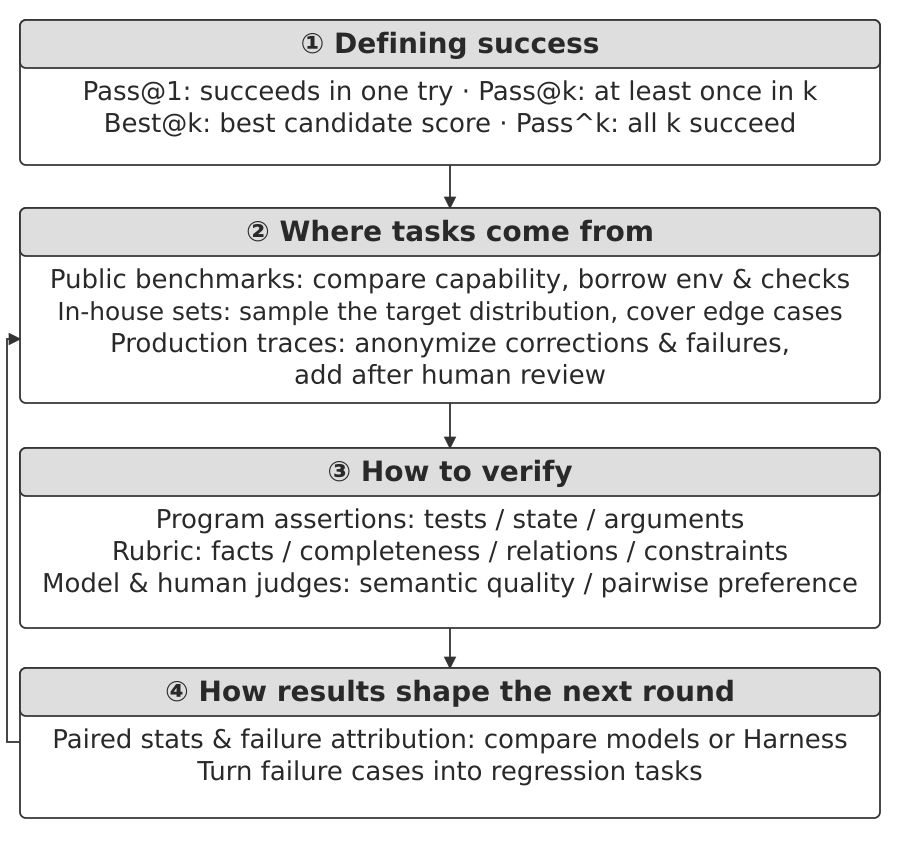
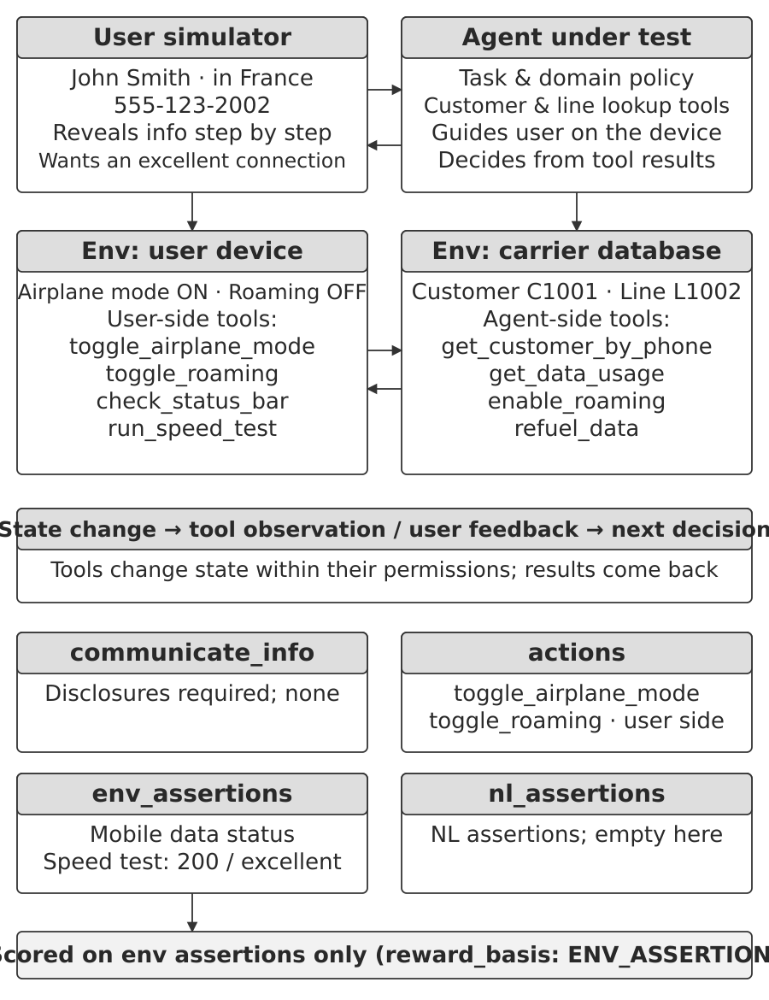
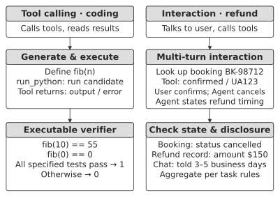
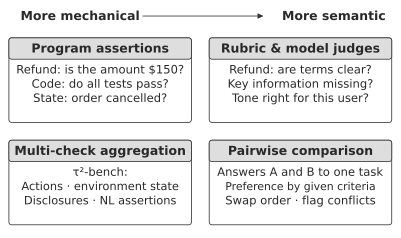
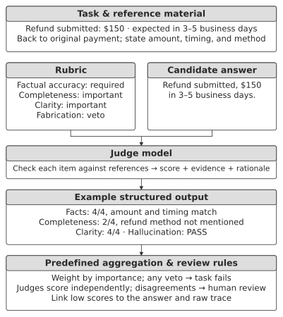
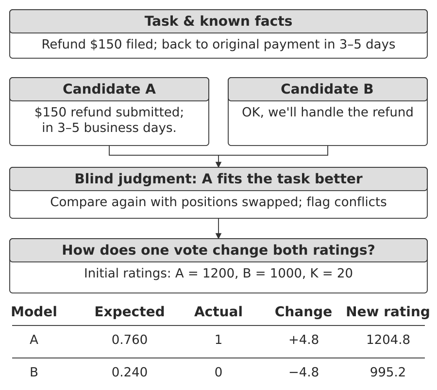
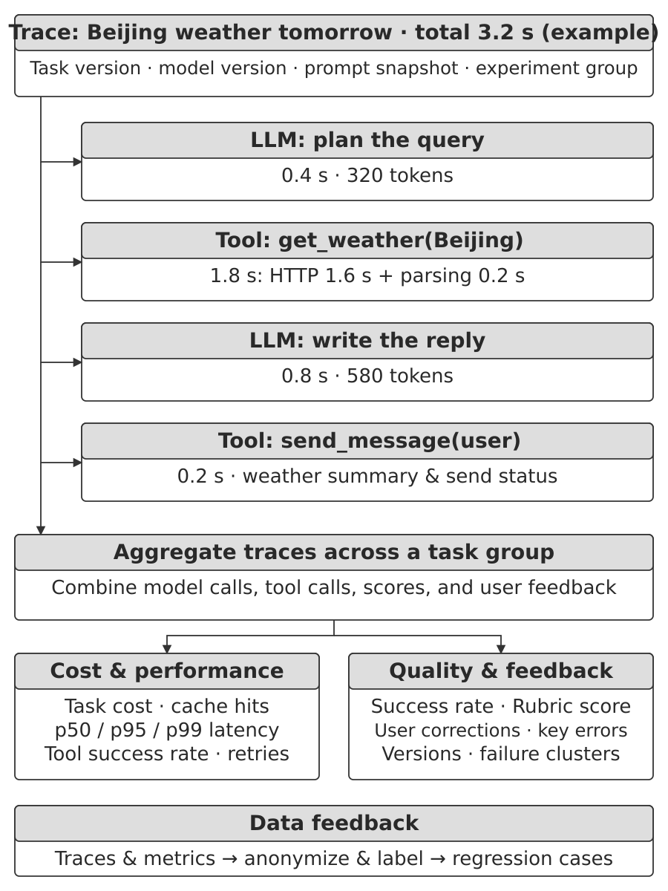
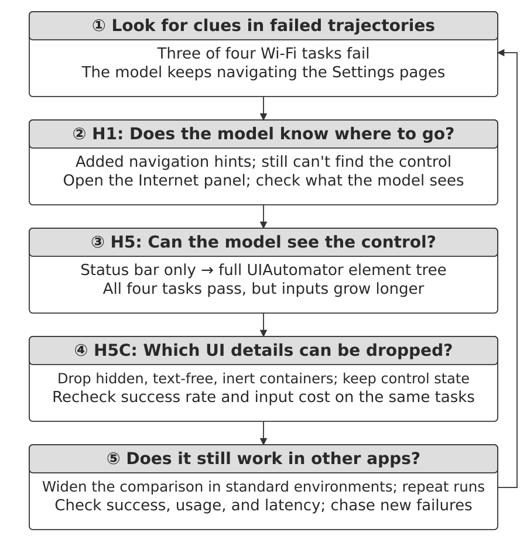
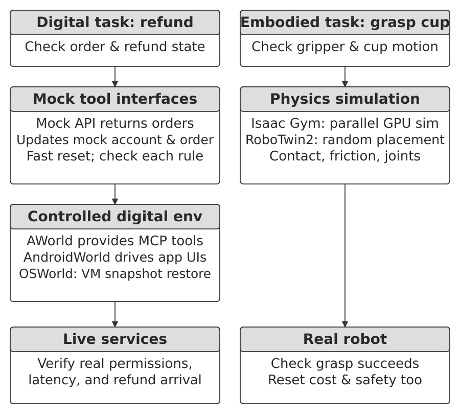
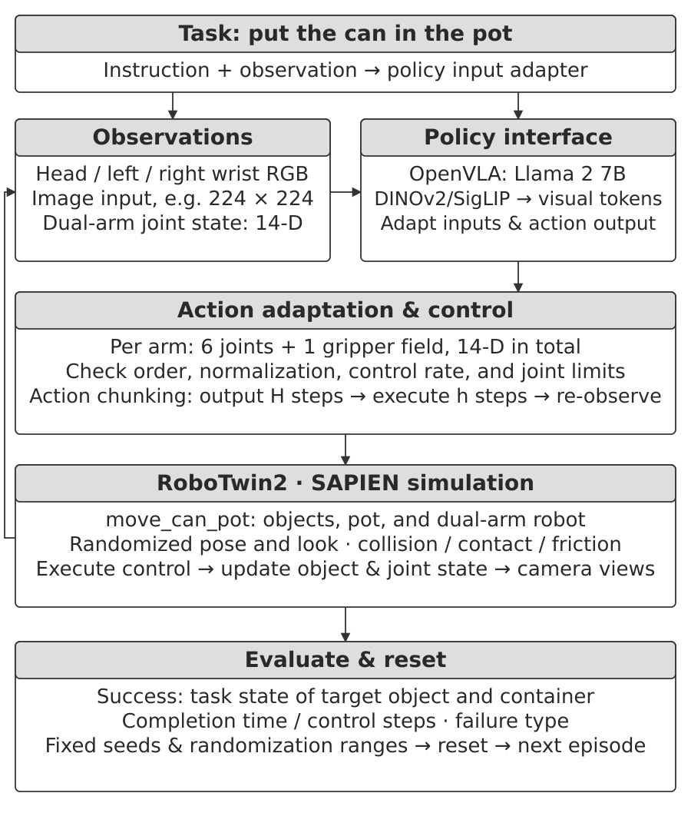

# Evaluating Agents

The first six chapters covered how to build a single Agent: context, memory, knowledge bases, tools, code, and the interfaces for observation and action. Once the system is built, you need a set of repeatable tasks to judge what it can do, under which conditions it tends to fail, and what to change next. Evaluation results also provide feedback for post-training and continuous evolution.

During development, many choices have to be compared on real tasks: which model to use, which tools to expose, what content and indexing the knowledge base should use, how to organize user memory, prompts, and Skills, and which constraints the Harness should add. These choices also interact. More detailed tool descriptions, for example, may reduce parameter errors but increase context overhead; adding a verification step may raise the success rate while lengthening completion time.

A **comparative experiment** compares different approaches on the same tasks under the same conditions and records how success rate, time, and cost change. An **ablation experiment** removes or disables a component, such as retrieval reranking, state summaries, or result verification, and observes how the system's behavior shifts. By stating exactly what changes in each round, holding all other run conditions fixed, and measuring repeatedly, you gradually build a link between engineering choices and task outcomes. I advocate making comparison and ablation part of everyday development. A handful of trajectories that happened to go smoothly make it easy to mistake a lucky success for an improvement, or to see the gain on one kind of task while missing the regression on others.

**Evaluation should target the complete Agent, consisting of the model and the Harness.** The model determines how a task is understood and which actions are chosen; the Harness organizes context, dispatches tools, maintains state, and runs checks. The same model connected to different tools or feedback loops can produce different task outcomes. The Coding Harness introduced in Chapter 5 provides exactly this kind of comparison.

A **model swap experiment** is a way to study how model and Harness work together: fix the runtime framework and the tasks, swap the model, and compare the final results and the distribution of errors. If a stronger model still fails at the same step, check whether a tool is missing, whether feedback arrives in time, and whether the scoring covers the goal. If task performance shifts sharply with the model, analyze which reasoning, planning, or instruction-following abilities drove the result.

Model swaps and component ablations can be crossed. For example, have two models each run two configurations, "with state summary" and "without state summary," and check whether the summary helps both recover on long tasks and whether the benefit depends on the model. This analyzes model differences and also reveals under what conditions a given Harness component is effective.

Evaluation is also the regression check for model upgrades. A new model may improve on public benchmarks yet regress on some business tasks; your own task set will show those changes. I advocate "building products for future models": finish the tools, business workflows, and evaluation set ahead of time, and keep tracking each new model's performance on the same tasks. When success rate, response time, and cost meet the product's requirements, move toward launch.

How do you turn launch requirements into an evaluation? When reading Figure 7-1, follow a single test from top to bottom: what is being measured, where the tasks come from, what evidence decides success, and finally how results are recorded and compared.



## Understanding Evaluation Through One Task: The telecom Domain of τ²-bench

Start with a mobile data outage. John Smith, phone number 555-123-2002, is in France, and his phone's status bar shows "No Service." He wants his connection back, and he will consider the problem solved only when a speed test comes back excellent. He is willing to top up 2.0 GB of data if necessary, but wants to keep his current plan.

The case comes from the telecom domain of Sierra's τ²-bench. The environment simulates both the carrier's back end and the user's device, and the customer service Agent and the user simulator each read and change part of that state through their own tools. Evaluation has to follow the interaction on both sides and check how the problem was found, how operations were carried out, and whether the network was finally restored.[^ch7-tau2-task]

### The Four Components of a Task Definition

To have another customer service Agent handle the same problem, you first have to restore the state of the phone and the account, have the simulated user cooperate in troubleshooting under the same requirements, and finally score with the same criteria. The table below lists the four parts of a task definition. As you read it, notice one distinction: the task author knows the phone's initial settings, but how much do the agent and the user each know when the conversation begins?

| Part | Field | Content in This Example |
| --- | --- | --- |
| Ticket | `ticket` | User, phone number, country, symptoms of the outage, speed-test requirement, and plan constraint |
| User scenario | `user_scenario.instructions` | What the user knows, how to look things up when asked, when to confirm that the problem is solved |
| Initial state | `initial_state.initialization_actions` | Set the user's identity and location, turn airplane mode on, turn device roaming off, enable roaming on the carrier side |
| Evaluation criteria | `evaluation_criteria` | Check actions and environment state, with `reward_basis` specifying what counts toward the score |

**What the user knows.** `known_info` provides the name, phone number, and country. The facts that airplane mode is on and device roaming is off are stored in the environment state; the user simulator has to call tools to look them up before it can tell the agent. Listing what the user knows as a separate field lets the simulator distinguish information it can state directly from information it must actually check. A prompt that merely says "don't tell everything at once" can hardly control reliably when each fact gets revealed. This arrangement implements **Progressive Information Disclosure**: the conversation starts from "I can't get online," and the Agent gathers the information it needs for troubleshooting step by step, through questions and guided actions.

**How the user responds.** `task_instructions` specifies that the user shows mild frustration after the first failed fix, confirms resolution only when the speed test returns excellent, and grounds every device-related answer in tool results. Poor, fair, and good all fall short of this task's goal. **Grounding** makes the user respond according to the actual state of the simulated environment. Without this constraint, the simulated user might go along with the agent's "it should be working now" and agree; the conversation would look smooth on both sides while the device fault persisted.

**What state the two sides start from.** On the user side, `set_user_info` sets the identity, `set_user_location(abroad=true)` places the user abroad, and then `turn_airplane_mode_on` and `turn_roaming_off` run. On the carrier side, `enable_roaming` enables roaming for line `L1002` of customer `C1001`. As a result, a back-end query shows roaming as enabled, while the phone still cannot connect because of airplane mode and the device roaming setting. The agent has to guide the user through checking the device to obtain information the back-end query does not provide.

**Which checks determine the score.** `actions` lists the user-side `toggle_airplane_mode` and `toggle_roaming`. `env_assertions` contains a check on mobile data status and a speed-test check with parameters `expected_speed=200` and `expected_desc="excellent"`. The task format also provides `communicate_info` and `nl_assertions`, which describe information that must be conveyed to the user and natural-language assertions, respectively; both are empty in this task.

This task's `reward_basis` is set to `ENV_ASSERTION`, so the total reward depends on the environment assertions. Action checks may appear in the results, but whether they count toward the total is determined by the scoring configuration.

### Checking Results Along the Run Trajectory

The companion run selected five telecom tasks and ran each once, with GPT-4.1 mini as both the customer service Agent and the user simulator; four tasks passed. We first analyze the France roaming task above and then contrast it with a failed task.

> **Experiment 7-1 ★: Run τ²-bench and Compare It with τ-bench**
>
> First read one task's user scenario, initialization actions, and scoring conditions, then run one complete interaction. Along the trajectory, mark the agent's queries, the user's actions, the state changes, and the acceptance results, and check which piece of information each judgment was based on.
>
> When comparing τ-bench with τ²-bench, focus on whether the user can change the environment through tools, and what coordination demands that places on the agent.
>
> When you look at Figure 7-2, first find who can turn off the phone's airplane mode, then find who can change the carrier's roaming configuration. The two sides can do different things, which explains why, after finishing its own operations, the agent still has to ask the user to run a speed test on the phone.
>
> 

In the France roaming task, the Agent first identifies the account. It looks up customer `C1001` by phone number and queries the data usage of `L1001`, `L1002`, and `L1003`, but from the details of `L1001` it draws the wrong conclusion: the number the user gave, 555-123-2002, is not among the active lines, and the closest number is 555-123-2001. Only after the user insists the number is correct does the Agent go on to query `L1002` and confirm the right line.

Next, the user simulator calls `check_network_status` and `check_status_bar`. The returned state shows airplane mode on, no cellular service, mobile data on, and device roaming off. Based on this, the user reports: "My phone is in airplane mode, and data roaming is off too. Should I turn off airplane mode first?" The query here is executed by user-side tools, and the result reaches the agent through the conversation.

This is the **Dual-Control** mechanism: the agent queries and operates the carrier's back end, while the user simulator has its own device tools, such as checking the status bar, toggling airplane mode, reseating the SIM card, and running a speed test. The two sides coordinate their operations by talking, and the environment records the state changes each one causes.

The Agent then guides the user to turn off airplane mode and turn on device roaming, and the status bar shows a 5G signal. The user runs `run_speed_test`, gets 275 Mbps, Excellent, and confirms that the problem is solved. Both environment assertions pass, and the task's reward is 1.0.

This successful trajectory also exposes a process problem. The policy requires the agent to call only one tool at a time, yet the Agent issued `get_customer_by_phone` and `get_customer_by_name` in the same message. Because this task's total score includes only the environment assertions, the behavior did not change the reward.

In a failed trajectory, the wrong line is chosen and never corrected, and all later troubleshooting drifts accordingly. The user's number is again 555-123-2002; the Agent selects `L1001` and continues troubleshooting using that line's usage of 3.2/5 GB. Even after a tool returns that `L1001` corresponds to 555-123-2001, the Agent does not correct the line, and after several rounds of irrelevant troubleshooting it transfers to a human agent. On the user side, data saver mode is successfully turned off, but the 2 GB top-up required for the correct line `L1002` is never executed, and all three environment assertions fail.

Comparing the two trajectories breaks the final score down into concrete improvements: verify the mapping between phone number and line, revise judgments in light of new evidence, distinguish device state from back-end state, and verify that the required top-up was completed. The section on failure attribution later in this chapter discusses how to find such key turning points in long trajectories.

[^ch7-tau2-task]: Sierra Research's τ²-bench defines the user tools for the telecom domain in `user_tools.py`, with `evaluator.py` as the scoring entry point. The case content and results are compiled from the five tasks and run trajectories saved with the companion materials.

## Evaluation Metrics: Defining Success

Four of five tasks passing gives the overall result of this run. To make product decisions from it, you also need to be clear about the task type and the cost of failure. A refund agent has to keep completing eligible refunds. When writing a program, you can generate several implementations and use tests to pick out the ones that run and give correct results; in research, you can propose several hypotheses and let the researcher test them. Evaluation metrics should match how the system is actually used.

### Technical Wonders: Measuring Multi-Attempt Capability with Pass@k

I call some impressive Agent demonstrations "technical wonders": given enough time and attempts, the system completes a task that was previously hard to automate. For exploratory work, a single verified successful trajectory can already be valuable. The metric **Pass@k** fits this kind of use: run the same task $k$ times and count it as a success if at least one run passes. For tasks with continuous scores, you can also report the highest score among the $k$ runs, called **Best@k**.

For example, Anthropic had multiple Claude instances collaborate on building a C compiler, showing that long-running execution, test feedback, and division of labor can support complex engineering. Researchers searching for mathematical counterexamples can likewise let a model try repeatedly and then independently verify whether one of the counterexamples holds. Software security reviews can double-check the suspicious issues a model reports, and open-ended creative work can pick the best of several pieces.[^ch7-long-running]

Application products also demonstrate capability through complex tasks. Manus gives the Agent a virtual computer, so users can watch it operate an interface, look up information, and keep working. OpenClaw takes assignments through instant messaging, accesses files and services that have been configured and authorized, reports progress and asks for additional information along the way, and can be woken by a scheduler to check pending items. These concrete behaviors make it easier for users to understand what an Agent is good for.

In my view, demonstrations that complete new kinds of tasks are an important reason these products attract users.

### Business Reliability: Focus on Pass^k

Business processes usually require correct delivery on every run. **Pass^k** measures whether the same task, run $k$ times, passes every time; it can be read as "pass power k." A task's pass condition can cover the final result, policy compliance, and permission constraints together, and every run is checked against the same conditions.

Assuming the runs are independent and each has the same single-run success probability $p$:

$$
\mathrm{Pass@k}=1-(1-p)^k,\qquad
\mathrm{Pass}^{k}=p^k.
$$

For example, with $p=0.6$ and $k=5$, Pass@5 is about 99.0% while Pass^5 is about 7.8%. The first means that among five attempts you can usually find one success; the second means the probability of all five succeeding is still very low.

When reading a set of actual results, you can set the formula aside at first. Suppose the five runs of one task go "pass, fail, pass, pass, fail." For this set, Pass@5 is recorded as 1, Pass^5 as 0, and the single-run success rate is estimated at 3/5. The 99.0% and 7.8% above answer a different question: if each run is known to succeed with probability 0.6, and you repeat the five-run set many times, how many sets meet each standard?

The same records can also answer a question that is easier to check: if you pick two of those five runs, what fraction of pairs pass? Think of each run as a card and draw two without replacement; there are ten possible pairs. Only the pair made of the two failure cards fails both times, so nine pairs contain at least one success, and the sample estimate of Pass@2 is 9/10. The three success cards form three pairs among themselves, so the sample estimate of Pass^2 is 3/10. τ²-bench counts all-pass combinations per task in exactly this way: if a task is run $n$ times with $s$ successes and $k$ runs are chosen, the share of all-pass combinations is $\binom{s}{k}/\binom{n}{k}$, where $1\le k\le n$.[^ch7-tau2-metrics]

Now reread the 4/5 from Experiment 7-1. Those five trajectories belong to five different tasks; each task has only one card, so not a single pair can be formed. To estimate Pass^2 for these tasks, you need to add independent runs for each task, compute per task, and then aggregate. Simply squaring 0.8 implicitly assumes that every task has the same success probability on every run and that attempts are independent.

[^ch7-tau2-metrics]: The experimental version of τ²-bench (revision 8d005b0) computes Pass^k per task in `agent_metrics.py`. When the number of successes is less than $k$, the number of all-pass combinations is zero.

The unit of measurement must stay consistent in these calculations. Five samples of the same task measure that task's repeated performance; five consecutive different tasks in production are also affected by task difficulty and traffic mix. When tasks have different success probabilities, compute each task's repeated-success metric first and then aggregate by task weight. Shared state, caches, or a common fault can also make runs correlated.

**When "insufficient information" is an allowed answer, which denominator should you use?** Imagine a literature assistant given 100 questions. It answers 80, of which 68 are correct. A reader who relies on the answers it gives cares about 68/80, or 85%; someone who needs the whole batch handled also cares about 68/100, or 68%. The other 20 questions need more evidence or must be handed to a person.

On the 248 LitQA2 literature questions, PaperQA2 can choose "insufficient information." The paper reports the average of three runs: when the system gives a substantive answer, it is correct 85.2% of the time; counted over all questions, it is correct 66.0% of the time, and it chooses insufficient information on another 21.9%. The corresponding two accuracies for nine human respondents are 73.8% and 67.7%. The paper reports the first difference as significant and the second as not statistically significant.[^ch7-paperqa2-denominators]

[^ch7-paperqa2-denominators]: Skarlinski et al., *Language Agents Achieve Superhuman Synthesis of Scientific Knowledge*, 2024; see Section 2 and Figure 2.

Two trajectories with the same final state can differ in cost. Take a billing lookup: A returns the correct amount with one query. B queries twice before giving the same answer. Both queries carry the same request ID and the first one timed out, which shows that the retry helped B recover the task. If the first result had actually been delivered, the second query would simply have added waiting time and tool cost.

When a run involves writes or other external effects, restore the prescribed initial state before each trial, perform the operations in a test environment, and record every attempt. If the product allows retries after failure, include the number of retries, the recovery steps, and the execution cost in the process evaluation; keep the original failure records so that single-run performance can be distinguished from the result after recovery.

[^ch7-long-running]: Anthropic, Building a C compiler with a team of parallel Claudes, 2026-02-05, describing multi-instance collaboration, long-horizon execution, and test feedback.

## The Evaluation Environment

Suppose you want to re-examine the run that picked the wrong line. The reviewer needs to see the same user, the same two lines, and the same initial plan. If the first run has already changed one of those lines, rerunning directly makes it impossible to tell whether a change in the result comes from the model or from the database. The evaluation environment is responsible for establishing the starting point of the task, providing the interaction interfaces, recording the process, and checking the end point.

### The Five Components

Taking a telecom task as an example, an evaluation environment can be broken into five parts.

The **Dataset** stores task definitions: the user's background, behavioral requirements, initial state, and acceptance conditions. One record corresponds to one test case, and at runtime the information is distributed according to each participant's role.

The **Environment State** stores the mutable information during task execution, such as customers, lines, plans, and bills, as well as the device's airplane mode, roaming, and data saver settings. At the start of a new run, the environment first restores the base data and then executes `initialization_actions` to recreate the fault the current task specifies. Cleanup and initialization have to work together so that a top-up or setting change from the previous run does not leak into the next.

The **Tools** determine what each participant can read and change. The agent can look up customers, check usage, top up data, or transfer to a human agent; the user can check device status, flip switches, and run speed tests. Tool granularity should correspond to the capability under test: to evaluate diagnosis and planning, let the Agent combine queries and operations; if you provide a single "fix the internet problem" tool instead, the test shifts to when that capability gets called.

The **Rubric** states how the result is judged. A telecom task can check actions, environment state, required communication, and natural-language requirements, and then use `reward_basis` to determine which checks count toward the total.

The **Interaction Protocol** arranges who speaks, how tools are called, and how the interaction terminates. The user simulator can emit `###STOP###` to end the interaction, and the runner also sets a turn budget and other limits. The reason for termination and the task score are recorded separately: after the user ends the conversation, the environment assertions still decide whether the goal was met, and if the budget runs out, the final state and the unfinished steps still need to be preserved.

### Human-Computer Interaction and Tool-Calling Evaluation Environments

A telecom task includes a user simulator that keeps responding and operating the device. Code repair, data analysis, and mathematical problem solving, by contrast, are usually launched by a task instruction, after which the Agent mainly interacts with tools. Both kinds of environment need tasks, state, interfaces, scoring, and an execution protocol; the difference is whether a conversational counterpart must also be simulated, and how the two sides coordinate their actions.

Code tasks can check output with tests, database tasks can query the records after a change, and open-ended analysis may require a person or a model to review the content. Human-computer interaction tasks often require piecing together two kinds of evidence. Whether the phone's network is restored, for example, depends on device state; whether the agent clarified the number and guided the user through the operations depends on the conversation. The refund in Figure 7-3 works the same way: whether the order has been canceled is visible in the database, but whether the agent told the customer when the money would arrive has to be found in the conversation.



In Verifiers, these two kinds of task can start from different environment interfaces. Table 7-1 lists the interfaces in v0.1.9 for single-turn responses, multi-turn tool calling, runtime state injection, and sandbox resource management, making it easy to follow along in code.[^ch7-verifiers-env]

Table 7-1 Comparison of Verifiers Environment Types

| Environment Type | Main Responsibility | Tool and State Handling | Typical Use Case |
|---|---|---|---|
| `SingleTurnEnv` | Organizes a single-turn response | Scores once after the response | Math problems, single-turn Q&A |
| `ToolEnv` | Organizes multi-turn tool interaction | Saves the trajectory, dispatches tools, and receives results | Search and information synthesis |
| `StatefulToolEnv` | Feeds runtime state into tool execution | Adds tool arguments or updates state from the current state | Binding a database or resource ID to this task |
| `SandboxEnv` | Manages an isolated execution environment | Allocates a sandbox to the run and uses its tools | Executing code, inspecting files and test results |

When two tasks modify the database at the same time, for instance, the runner can inject each run's database ID into its tool calls so that each trajectory operates on its own data. When an execution fails, the tool should return information the Agent can act on, such as an object not existing, arguments not meeting requirements, or a service timeout. The evaluation system stores observations, calls, execution results, and rewards, so that analysis can trace an error to a specific step.

[^ch7-verifiers-env]: Prime Intellect, ToolEnv and StatefulToolEnv in Verifiers v0.1.9, demonstrating multi-turn trajectories, tool dispatch, and state-argument injection.

## Designing the Evaluation Dataset

Now let us expand the five telecom tasks into an evaluation set that can guide a launch. If every new item is "enable roaming for a given number," a system that never learns to tell apart the two lines on the same account may still score well. If performance on this set is going to decide whether the service can go live, the items should be drawn from real tickets, including both routine business and hard cases that confuse the lines, and scoring has to check which line the agent ultimately changed. After launch, these items also need maintenance so that they keep reflecting the work users actually give the system.

### A Cross-Benchmark Comparison of Design Choices

Table 7-2 places six benchmarks side by side along capability, task source, runtime environment, and verification method.

Table 7-2 Key Design Choices of Several Agent Benchmarks

| Benchmark | Capability Under Test | Task Source and Organization | Runtime Environment | Verification Method |
|---|---|---|---|---|
| τ²-bench | Customer service interaction and tool use | Domain tasks paired with faults | User simulator, device, and business database | Itemized checks scored by `reward_basis` |
| SWE-bench Verified | Fixing code issues | Real GitHub issues, manually screened | Code repository and test environment | `FAIL_TO_PASS` and `PASS_TO_PASS` tests |
| AndroidWorld | Operating Android apps | Parameterized task templates | Android emulator running real apps | Reading device, file, or app-internal state |
| OSWorld | Desktop and cross-application operations | Real usage scenarios with configured starting points | Virtual machines and desktop applications | Checks on task execution state and artifacts |
| Terminal-Bench | Engineering tasks in a terminal | Hand-designed tasks and tests | A container with the task's dependencies | Files, program execution, and test results |
| GAIA | Information handling by a general assistant | Hand-written questions, some with attachments | Web, files, and auxiliary tools | Comparison after normalizing answer format |

### Verifiers

A verifier connects a task goal to evidence that can be checked. A code task needs to run tests, a desktop task needs to read app or file state, and an information retrieval task needs to check the answer and its source. **Acceptance should rest on independently obtained evidence.** An Agent may produce a complete report claiming that every step is done, but the verifier still has to run the artifact, read the state, or check the source. The completion report serves to locate what should be checked; the score comes from those checks.

Imagine a user opening a payment app and asking an assistant to "approve every payment request from my roommate this month." Suppose there are three pending requests: the roommate's from this month, this roommate's from last month, and a colleague's from this month. The first should be approved and the other two should stay pending. Checking only the first would give full marks even to an assistant that approved all three; checking only the last two would let an assistant that did nothing at all pass. AppWorld poses this problem in a simulated payment app. When designing the verifier, first use the pre-operation data to delimit the batch of requests the user authorized, then check whether all of them were approved, and finally work backward from the post-operation records: which other requests did the assistant touch?[^ch7-appworld-scope]

[^ch7-appworld-scope]: Trivedi et al., *AppWorld*, ACL 2024; Figure 2 gives the task and acceptance conditions.

Scientific search can also produce an artifact that is easy to verify. FunSearch wants as many points as possible in an eight-dimensional space, where each coordinate can only be 0, 1, or 2 and arithmetic is modulo 3, such that no three of the chosen points are collinear. The researchers write the program skeleton that selects points one at a time and have the model propose a function that ranks candidate points; the score is the size of the legal point set actually constructed. When the paper was published, existing constructions could select 496 points, and the new program delivered a list of 512.[^ch7-funsearch-cap]

You can download just the list and check this result independently. First confirm that it contains 512 distinct eight-dimensional vectors, each coordinate within the allowed range. Then pick any two distinct points $a,b$: the line through them has only three points, and the third is $c=-a-b \pmod{3}$. In two dimensions, for example, $(0,0)$ and $(1,2)$ give a third point of $(2,1)$. Apply the same operation coordinate by coordinate in eight dimensions, and over all 130,816 distinct pairs in the list, none of the resulting third points appears in the list. That is enough to prove that at least 512 points can be selected. Proving that 513 is impossible would additionally require an upper-bound argument.

[^ch7-funsearch-cap]: Romera-Paredes et al., *Mathematical discoveries from program search with large language models*, Nature, published online in 2023. The authors also released the eight-dimensional point set and the computational notebook used for verification.

**SWE-bench's two kinds of test check the fix and the regression separately.** `FAIL_TO_PASS` tests fail before the fix and should pass after it; `PASS_TO_PASS` tests passed before and should keep passing. The former checks the specified problem, and the latter checks whether behavior covered by existing tests is preserved.[^ch7-swe-verified]

**OSWorld checks application artifacts with execution-based verification.** The original version provides 134 execution-based evaluation functions that read files, application data, or system state in combination with the task configuration.[^ch7-osworld-design] To ask for a spreadsheet edit, for instance, it can check the specified cells and formulas; to ask for a browser setting change, it can read the relevant configuration.

**Terminal-Bench accepts engineering tasks based on what runs.** Its case of building a Linux kernel chains together source modifications, compilation, an initramfs, and a QEMU boot; Linux 6.9, a custom `printk` in `start_kernel`, and a message in the boot log all provide concrete checkpoints.

Chapter 5 discussed reconciling sales against orders. If the assistant hands over a quarterly report covering twenty channels, where do you start checking? Tencent's WorkBuddy Bench has a public reconciliation task. Both worksheets hold channel data: settlement amounts are read period over period, against the previous quarter, while collected amounts are read year over year, against the same quarter last year. Even if both base periods are filled in as the previous quarter, the headers and the channel count can still be completely correct. Take "Jinxiu Life Hall" in the settlement sheet: after removing duplicate rows and records missing a quarter from the details, and aggregating by channel and quarter, you can compute that total transaction value rose from 1,569,231.00 to 1,787,311.03, a difference of 218,080.03. The scoring program checks channel coverage in both sheets and then spot-checks the values for two specified channels. The coverage check in this task spans all twenty channels, while the value check covers only the two that were sampled.[^ch7-workbuddy-office]

[^ch7-workbuddy-office]: Tencent WorkBuddy Bench office task `channel-period-compare-L4-017`. The data package used (revision 3e8ad83) includes the original workbook, the reference answer, and the scoring program.

A time-sensitive task can test the verifier itself. Suppose a user asks to be alerted when the price of a particular hotel drops below 950. The price is 1000 at 10:00, drops to 900 at 10:10, and returns to 1000 at 10:15. An alert sent at 10:12 with the room type and a booking link still leaves the user time to book. Sending one "the price has not dropped" message a day and missing exactly those five minutes means the task is not completed even after a week of continuous running. Scoring should record the number of qualifying windows, the number of timely alerts within those windows, and the number of times the user was disturbed when nothing changed. If the evaluator also saved only one quote per day, the missed windows cannot even be counted. To test for missed alerts, first prepare a complete price replay with timestamps, then let the system under test poll at its own frequency.

### Difficulty Stratification of Tasks

An evaluation set needs to cover different difficulty levels and to state where the difficulty comes from. Basic tasks check whether capability has regressed, while hard tasks leave room to measure future model progress; if every item is soon passing, the set can no longer guide model selection. You can stratify by tool type, length of the operation, how scattered the information is, environmental uncertainty, or required expertise, and then see under which conditions the system clearly degrades.

GAIA's 466 questions fall into three levels. The easier tasks usually involve few tools and steps, while harder ones require multi-step information integration and complex composition. In the original paper, human annotators scored 93.9%, 91.8%, and 87.3% on the three levels, while GPT-4 with plugins scored 30.3%, 9.7%, and 0%.[^ch7-gaia-design]

Terminal-Bench spans an equally wide range: model registration involves using MLflow, multi-component deployment requires coordinating a Git service with a web service, and password recovery and differential analysis of FEAL bring in specialized algorithmic knowledge.

Business tasks also need to cover policy boundaries. When a user claims that an agent has already approved a cancellation, for instance, the system should check the authorization and the order status and then decide under policy whether to cancel. Such cases examine how an Agent uses evidence to handle conflicting information, and they can be set up alongside the routine processing tasks.

### Preventing Data Contamination

**Multi-source composition and purpose-built attachments.** If a model can find the question and a ready-made answer in search results, how much retrieval and reasoning does one correct answer really demonstrate? GAIA uses multi-step lookup and purpose-built attachments to reduce that opportunity. For example, identify an astronaut from an astronomical image taken on a certain date, then look up the astronaut group they belong to, compare the time in orbit of its members, and finally output the surname and the number of minutes as specified. Semicolons, rounding, and thousands separators are all part of the answer convention. Purpose-made PDFs, audio, and images add further combinations of inputs. Public questions may end up in training material, so a separate set of items should be held back for evaluation only, with a record of which items have already been used for training.[^ch7-gaia-design]

**Parameterized instances.** AndroidWorld provides initialization, execution checks, and cleanup logic for tasks and generates different instances through parameters.[^ch7-androidworld-design] For example, "change the phone number for contact `[CONTACT_NAME]` to `[NEW_PHONE]`" can vary the contact and the number while keeping the operational goal the same. Varying parameters checks whether the model acts on the current task; fixing some parameters and varying the rest also makes it easy to study the effect of a particular factor.

**Canary identifiers.** Benchmark files can embed unique canary GUIDs that help uncover signs of data being copied or mixed into other corpora. Terminal-Bench's task files use this kind of marker. When judging a leak, also check whether the model has seen the identifier in the current context or in retrieval results, and combine that with data provenance tracing; finding a marker can trigger an investigation, but attributing training data requires further evidence.

### Quality Control and Long-Term Maintenance

Suppose the same telecom task passed yesterday and failed today. Beyond checking what changed in the Agent, you also need to answer: did the initial line change? Is the user simulator still cooperating under the same rules? Are the scoring conditions still measuring the same goal? Following a run from start, through interaction, to end point, five maintenance tasks emerge.

1. **Define the scope of user information.** Separate `known_info` from the behavioral requirements so that the query and clarification steps start from a clear information base.
2. **State the acceptance conditions precisely.** Turn "the network is restored" into mobile data status, speed-test value, and rating, and check the effect the task actually requires.
3. **Constrain what the simulated user's responses rest on.** Device state comes from tool returns, while emotion and patience rules organize the interaction.
4. **Represent both sides' operations.** User and agent each change the environment, and later decisions obtain new state information through the available tools or through conversation.
5. **Combine tasks with faults.** Vary fault combinations and task parameters under explicit generation rules, then check that each instance is solvable and that its initial state matches the task definition.

**SWE-bench Verified shows how manual screening works before release.** The project invited 93 developers with Python experience to annotate 1,699 randomly drawn samples, focusing on whether the issue description was adequate, whether the tests would reject reasonable solutions, and how difficult the fix would be; each sample was checked independently by three annotators. The released Verified set contains 500 samples.[^ch7-swe-verified] Publishing the screening rules together with the difficulty distribution lets users judge which capability requirements survive when the task set shrinks. Agent tasks often require many rounds of model calls and environment operations, and vague or unsolvable items burn budget again on every regression run. I recommend clearing out this kind of noise first and expanding the task count afterward; a small, high-quality evaluation set is better suited to frequent runs and easier to explain failures from.

**OSWorld-Verified shows maintenance after release.** About 15 months after the initial release, the project collected and fixed more than 300 pieces of feedback, involving roughly ten people working intensively for two months.[^ch7-osworld-verified]

When a web page's structure changes, for instance, state extraction has to be updated; before a document task starts, the app must be confirmed as loaded, the file open, and the cursor at the specified position; after a verification condition changes, the correct and incorrect artifacts must be used to regression-check it.

> **Experiment 7-2 ★: Execute Benchmark Tasks Yourself**
>
> Pick tasks from GAIA, AndroidWorld, SWE-bench Verified, Terminal-Bench, OSWorld-Verified, and τ²-bench, choosing one easy, one medium, and one hard item from each according to that benchmark's difficulty definition. Complete each task yourself first, then check the official score; record the path you took, the ambiguities you ran into, and the final artifact.
>
> The companion materials keep 18 cases of Codex working through these six benchmarks, which you can use to compare against your own approach. Among them, GAIA's atomic-distance question produced a disagreement with the grader over rounding format; on AndroidWorld's multiplication question, the page still did not reach the required success state after the model computed 840. The τ²-bench cases use a local model to simulate the hidden user. Thirteen of the 18 cases passed.
>
> Afterward, analyze: did the question allow several reasonable interpretations, did the verifier cover them, and once a correct intermediate result was obtained, what further operations were needed to pass acceptance?

### Three Sources of an Evaluation Set

Production evaluation can combine public benchmarks, an in-house business set, and production trajectories. The three serve different purposes and together cover the range of how the system is used.

**Public benchmarks** are good for an initial comparison of models, and they also provide references for task design, parameterized generation, and verifiers. I use them to shortlist candidate models, and then decide selection and launch from the results of the in-house business set.

**An in-house business set** organizes tasks around real user goals, tools, and policies, and serves model selection and Harness improvement. You can borrow the structure of τ²-bench: configure domain data, user scenarios, tools, and state checks, and then calibrate task difficulty and user-simulator behavior.

**Production trajectory feedback** uncovers gaps from real runs, such as user corrections, negative feedback, anomalous business state, or errors found in trajectory review. After authorized processing and de-identification, verify the failure causes by hand, restore the necessary task conditions, and add the case to the regression set. User feedback is a clue for locating problems; a score label still has to be confirmed against the actual state.

To start, use public benchmarks plus a small number of hand-written business tasks; after launch, real errors and new business scenarios should become the main source of new regression cases. These tasks come directly from the problems users ran into, and they keep filling in the conditions that were missed at design time.

[^ch7-swe-verified]: OpenAI, Introducing SWE-bench Verified, 2024, covering test categorization, annotation standards, and manual screening.
[^ch7-osworld-design]: The OSWorld project description lays out task initialization and execution-based evaluation; the count of 134 evaluation functions is from the original version.
[^ch7-gaia-design]: Grégoire Mialon et al., GAIA: A Benchmark for General AI Assistants; the original paper describes task levels, answer conventions, and the human and model configurations.
[^ch7-androidworld-design]: Christopher Rawles et al., AndroidWorld: A Dynamic Benchmarking Environment for Autonomous Agents, covering parameterized tasks and acceptance against device state.
[^ch7-osworld-verified]: XLANG Lab, Introducing OSWorld-Verified, 2025, covering community feedback, initialization, and verifier revisions.

## Automated Evaluation Methods

Automated evaluation starts by making clear what is being checked. SWE-bench checks code behavior with a test suite, AndroidWorld queries app state, and GAIA compares answers after normalizing them by answer type. These checks can be executed by programs and are suited to running over and over. τ²-bench combines several criteria: tool calls and environment state can be checked directly, while natural-language requirements can also be handed to a model to judge. The same task often needs both kinds of method.

Programmatic checks can also provide diagnostic information. In the telecom task from the start of this chapter, checking the roaming setting, the data balance, and the top-up action separately tells you which conditions remain unmet. Pinpointing the moment the wrong line was chosen requires linking these check results to the call trajectory.

Open-ended output needs its quality requirements spelled out more concretely. A reply to a complaint should explain the resolution and fit the customer's mood and problem; a research report should cover the key facts and have its conclusions supported by sources; an answer drawn from memory should correctly link people, times, and events. For such requirements, a **Rubric** can list item-by-item criteria, and **LLM-as-a-Judge** can then score against the materials.

**Whatever can be verified by a program, I prefer to write as a program check.** Format, numbers, permissions, and final state usually have clear criteria; once inputs and environment are fixed they can be checked repeatedly, and the cost is easy to estimate. Both scoring methods may be needed within a single response. Take Figure 7-4: checking the refund amount only requires comparing numbers, but judging whether the agent explained the refund conditions clearly requires understanding the whole passage. That item can be scored by a model and then calibrated by human sampling.



### LLM-as-a-Judge: Turning Quality Requirements into Itemized Scores

In Figure 7-5, the agent accurately stated the refund amount and the expected arrival time, so why did completeness get only 2 points? The rubric also requires stating where the refund goes, and the reply left out "returned to the original payment method." The judge model needs to see the task, the rubric, and the reference materials together to point out which item was missed.



A judge model needs to be calibrated first. A common problem is **length bias**: with comparable content, a longer answer may receive a higher score. You can prepare samples with the same facts and conclusions expressed at different lengths and check whether the score changes with length; when two answers are judged together, swap their order and see whether the judge switches its pick. If the task itself calls for brevity, write that into the Rubric and give examples of appropriate length. A batch statistic such as "high scores correlate with long answers" is a useful lead, but you then need to compare information content, correctness, and task difficulty to identify the actual cause.

**Four design principles for a Rubric.** Scale AI's "Rubrics as Rewards" proposes four principles: expert guidance, comprehensive coverage, importance weighting, and self-containment.[^ch7-rubrics] In Agent evaluation they can be put into practice as follows:

(1) **Based on expert guidance.** First have people familiar with the business write the reference answer, key facts, and relationships that are easy to get wrong. A memory task, for example, must make clear who holds which insurance policy and when the old address was replaced by the new one.

(2) **Comprehensive coverage.** List required information, relationship judgments, presentation requirements, and high-risk errors, known as **Pitfalls**, together. A customer service reply can be checked for whether it addressed the request, whether it gave a next step, and whether it invented a refund promise.

(3) **Importance weighting.** Distinguish Essential, Important, and Optional items, and set deduction rules for pitfalls. For errors that directly cause the task to fail, add a **Veto**: for example, if a memory task fabricates the user's account number, the attempt is judged a failure even if the answer is fluent and otherwise complete.

(4) **Self-contained criteria.** Write into each scoring item the facts, conditions, and acceptable range needed to make the judgment. "Correctly states the customer's current address," for example, can be made concrete as "states the updated Shanghai address; the Beijing address was superseded in a later conversation."

Each dimension also needs clear score levels and edge cases. Trial-score a batch of answers first, collect disagreements between humans and the model and among different evaluators, and then add rulings. If an answer contains the required keywords but merges two people's experiences, for example, it should lose points on relationship judgment. Such rulings help uncover **Reward Hacking**: the system earns a high score while its actual behavior drifts away from the task goal.

Below is a complete Rubric for a cross-session memory question. The first conversation says "My daughter's name is Lily," and the second says "Lily's pediatrician is Dr. Chen; I'm taking her for a follow-up today." The user asks, "Who is my daughter's pediatrician?" Together the two conversations support "Your daughter Lily's pediatrician is Dr. Chen."

| Dimension and Importance | 4: Excellent | 3: Good | 2: Partially Met | 1: Not Met |
| --- | --- | --- | --- | --- |
| Factual correctness: Essential | Doctor's name and the relationship are both correct | Correctly answers Dr. Chen but omits who the patient is | Mentions Dr. Chen but also lists other doctors as possible answers | Wrong doctor's name, or says it does not know despite sufficient evidence |
| Information completeness: Important | Clearly states the link "Lily – pediatrician – Dr. Chen" | Briefly gives the doctor's name, which answers the current question | Gives only the clinic or the visit, missing the doctor's name | Provides no relevant information |
| Association correctness: Important | Correctly links the two conversations and cites the corresponding evidence when explanation is needed | Relationships in the answer are correct, without elaborating on the evidence | Finds the relevant people, but the relationship remains muddled | Associates the doctor of the user or of another child with Lily |

**Hallucination detection is a separate veto.** Facts in the answer should be supported by the history; inventing a visit date, a diagnosis, or the doctor's identity means failure. In this example, triggering the veto sets the total score to zero. Association correctness is scored from the answer, the citations, and the observable trajectory, and a concise answer can still complete the task.

Edge cases decide whether the scoring can handle real conversations. If the user has several daughters and the reference in the question cannot be resolved, the correct behavior is to ask; if the history clearly points to Lily, the Agent can answer directly. Whether "Dr. Chen" and "陈医生" (Doctor Chen, written in Chinese) are the same person should be confirmed from aliases, institutions, and relationships in the history.

**When there are many scoring items, let a judge model make the first pass.** Suppose there are a thousand answers and each has twenty items to check: that is twenty thousand judgments. Take the relationship in the table: "Dr. Chen is Lily's pediatrician" and "Dr. Chen is my pediatrician, and Lily went with me" contain the same names but reach different conclusions. Rather than writing matching rules for names, word order, and negations one by one, write the criterion as a single sentence: "Given the question and the two conversations, does the answer correctly link this doctor to the user's daughter?" Hand these materials, the answer under review, and the criterion to a judge model such as Jev, and have it choose among "meets," "does not meet," and "cannot determine." This question identifies answers that attach the doctor to the wrong person. To distinguish the four levels of association correctness in the table, list the four level criteria directly as the options, with "cannot determine" kept for review. Different dimensions of the same answer can be judged in parallel, and a program then aggregates the item scores and applies explicit rules such as the hallucination veto.

To put this scoring method to use quickly, you can call a frontier judge model such as TypeSafe's official Jev directly. Write the scoring rules as a prompt, give the available levels, and send each answer together with its corresponding history; you will get judgments back quickly. If you have to score a large volume of answers under the same rules every day and want to push the per-call cost lower, you can distill your own judge model. First have the evaluation designer write clear criteria for each level, then let frontier models such as DeepSeek, Kimi, GPT, Claude, or Gemini act as teachers and score samples according to the rules. Assemble the verified triples of "materials, answer, teacher-assigned level" into a synthetic training set and train a smaller student model with the supervised fine-tuning methods of Chapter 8. Once trained, the student model can take over day-to-day scoring.

> **Experiment 7-3 ★★: Building a Rubric-Based User Memory Evaluation System**
>
> Implement structured scoring in the user memory evaluation framework from Chapter 3, covering three levels of task: basic recall, multi-session disambiguation, and hidden cross-session associations. The evaluation dimensions are factual correctness, factual completeness, association correctness, proactiveness, and a separate hallucination check.
>
> Factual correctness checks the information given, such as numbers, dates, and names; factual completeness checks the key facts the answer should contain; association correctness checks relationships among people, times, and events; proactiveness checks whether well-grounded suggestions or risk warnings are offered at the right time. The first four use four-level scoring, with explicit criteria for each level, supplemented by examples and edge cases; hallucination detection serves as a veto.
>
> The implementation keeps Precision and Recall as the field names for the first two dimensions, but what they record are Rubric levels. To report precision and recall in the statistical sense, you would need to define countable fact units and compute the share of correct facts among the facts given and the share of required facts covered among all required facts.
>
> When reading the experiment's results, first check whether the task passed, then look at the score. A task passes as long as factual correctness, factual completeness, and association correctness all reach 3 points and the hallucination veto is not triggered. The continuous reward also counts proactiveness: each of the four dimensions is converted by $(s-1)/3$ and the results are averaged; a hallucination sets the reward to zero. For example, one configuration in Experiment 7-12 used BGE-M3 for retrieval, skipped reranking, and had Doubao answer. On one insurance-claim question its four dimension scores were 3, 3, 3, and 2. It passed the task, with a continuous reward of about 0.583.

> **Experiment 7-4 ★★: Comparative Evaluation of Advanced JSON Cards vs. RAG**
>
> Compare three memory approaches on the same set of 60 questions: pure Advanced JSON Cards puts structured cards into context; pure RAG chunks the conversations and retrieves relevant content; the hybrid system keeps core facts resident in context and retrieves the original conversations on demand. Each of the three task levels has 20 questions, for 180 "approach–question" combinations in total.
>
> All three approaches use the same questions, source conversations, answering model, and scoring rules. Report per-level success rates, hallucination vetoes, and cost for each. Then align the three results for each question and analyze on which questions the hybrid system is complementary, and on which it loses because of how information is selected or merged.

Table 7-3 uses the historical summary from this experiment. Each level has 20 questions, so a difference of 5 percentage points in the table is a difference of one question.

Table 7-3 Per-Level Success Rates of Three User Memory Systems

| System | Basic Recall | Multi-Session Disambiguation | Hidden Cross-Session Association | Overall |
| --- | ---: | ---: | ---: | ---: |
| Advanced JSON Cards | 95% | 60% | 50% | 68.3% (41/60) |
| RAG | 90% | 40% | 15% | 48.3% (29/60) |
| Hybrid system | 80% | 70% | 50% | 66.7% (40/60) |

Start with pure RAG. On basic recall it answers 18 questions correctly, against 19 for the card approach; on hidden cross-session associations, pure RAG gets only 3 right, while the card approach gets 10. To find where this seven-question gap comes from, take a question RAG got wrong and check whether the retrieval results include both conversations needed to make the connection. If both are there, check which two people or which two events the answer linked together. The success rate alone cannot tell whether the materials were incomplete or whether the model read them and still linked the wrong things.

**Does combining two memory mechanisms naturally yield the strengths of both?** On multi-session disambiguation, the hybrid system answers 14 questions correctly, more than the card approach's 12 and pure RAG's 8. But the historical summary also records two groups of questions worth looking at separately: on 3 questions only the hybrid system was right, and on 8 others at least one single approach was right while the hybrid system was wrong. Counting this way, $40-3+8=45$ questions can be answered correctly by at least one single approach, while the hybrid system as actually run got 40 right. The 45 is a reference obtained by merging two answer sheets after the fact; for the system to achieve that score on its own, it still has to solve the problem of choosing which memory to use while answering. Another 28 of the 180 judgments triggered the hallucination veto.

**Same-Family Models and Multi-Source Judging.**

An Agent and a judge model may share the same blind spots, or favor the same style of expression. When the two come from the same model family, check especially whether these preferences affect the scores. If an Agent learns the style the grader likes while continuing to make factual errors the grader cannot catch, its score can still go up. This is an instance of Goodhart's law in evaluation: when a metric is repeatedly used as an optimization target, it can gradually lose its ability to measure actual quality.

Before major version releases and in periodic checks of critical business flows, I recommend multi-source judging: have different model families score independently with the same Rubric, for example letting Claude perform the task and GPT and Gemini judge it. First use human-labeled samples to measure each evaluator's accuracy and disagreements, then decide how to aggregate: routine scores can be weighted-averaged, critical failure conditions are handled by rules fixed in advance, and samples with large disagreement go to human review. Day-to-day runs can use a single judge model, with the checks above catching scoring drift in time.

**Multimodal LLM-as-a-Judge.**

Multimodal judging extends the same process to audio, images, and video. The scoring materials need to cover the attributes being judged:

- **TTS evaluation**: check reading accuracy, naturalness, emotional expression, and timbre consistency. Word error rate (WER) mainly reflects word-level errors in the recognized text; prosody and timbre require listening to the audio.
- **ASR evaluation**: judge the impact of recognition errors in light of the task. For example, "transfer one thousand" recognized as "ten thousand" changes an action parameter, so amounts, dates, and names can be designated as critical fields; errors in ordinary words should also be judged in context.
- **UI evaluation**: use a proposer–reviewer pattern to review screenshots for text overflow, contrast, and button placement, and use real interaction to check whether buttons work. This applies the review mechanism from Chapter 5 to evaluating generated results.
- **Video editing evaluation**: use keyframes to check picture content and effects, and continuous clips around cut points to check in and out points, transitions, and audio-video sync. The sampling range follows from what is being evaluated.

> **Experiment 7-5 ★★: Building a Fully Automated TTS Quality Evaluation Pipeline**
>
> Design a four-dimension Rubric. Accuracy checks omissions, misreadings, and additions; naturalness checks pauses, stress, fluency, and prosody; emotional expression checks fit with the text's context and the specified style; timbre consistency compares reference speech with synthesized speech when a target speaker is given. Emotion scoring should come with examples and should judge expressions such as questions, emphasis, and sadness according to the language's conventions.
>
> The test corpus covers single sentences and long paragraphs; news, stories, and dialogue; neutral, excited, and sad tones; and numbers, proper nouns, Chinese characters with multiple readings, and dialect words. The generation module can connect to services such as OpenAI, ElevenLabs, Fish Audio, MiniMax, and Doubao. The judging module hands the original text, the synthesized speech under review, the Rubric, and any reference audio the task needs to a model that accepts audio directly, which scores each dimension and explains its reasoning.
>
> Aggregate the results by service, corpus type, and scoring dimension, and pull high-scoring, low-scoring, and high-disagreement samples for human blind listening.

The companion experiment took four kinds of sample, numbers, polyphonic characters, long sentences, and excited tone, for each of two TTS configurations, and had Voxtral listen and judge directly, producing 8 score records. On a five-point scale, both configurations scored 5.00 for accuracy and 4.00 for naturalness; Fish Audio averaged 4.00 and 3.00 on emotional expression and timbre consistency, and OpenAI 3.75 and 2.75. Both 0.25-point gaps come from the number item: the other three items scored identically on all four dimensions. Take the polyphonic item: the source text ends with "还得还清所有欠款" ("still has to pay off all the debts"), where the two instances of "还" should be read hái and huán respectively. The judge gave both recordings full marks for accuracy, with identical reasoning, but never said character by character what it actually heard.

The experiment also shows how reference audio shapes what is being evaluated. The reference audio in the records came from Fish S1, so the timbre score measures how much the synthesized speech sounds like that reference recording. When comparing general-purpose TTS, report reading, naturalness, and style separately; when comparing voice cloning, have every approach imitate the same target speaker and calibrate the similarity scores with human blind listening. Reference materials also define "what counts as good": a reference answer specifies what should be said, and a reference image or recording supplies the visual or acoustic features to compare against.

A hand-written Rubric quickly establishes diagnostic dimensions. As evaluation scales up, you can also train a dedicated **generative reward model** to do the scoring; Chapter 8 discusses the training methods. Next, we connect itemized scores to run trajectories to find specific steps that can be fixed.

### Failure Attribution: Locating the First Error in a Whole Trajectory

When a task fails, first align the acceptance conditions with the run trajectory, then look for the earliest decision that took the task off course. This work is called **failure attribution**. A useful attribution record includes the error category, the relevant step, the tool call or model output, the evidence supporting the judgment, and the downstream effects. The error that shows up last is often just the consequence of an earlier mistake; tracing information sources and state changes backward is how you find the place worth fixing.

Production problems are found mainly through three kinds of signal: explicit user corrections, thumbs-down or other negative feedback, and anomalies found by after-the-fact state checks, rule validation, or model review. I recommend that developers read a batch of problem trajectories closely themselves before building a batch attribution pipeline. Failure categorization involves product judgment: which behaviors require confirmation and which proactive suggestions overstep must first be turned into explicit requirements before a labeling model can work from them. The boundary between "completing it on the user's behalf" and "asking the user to confirm first," for instance, depends on the current authorization, the impact of the action, and product conventions. Models can help with batch labeling, while the product and engineering leads calibrate these boundaries.

For a Coding Agent, you can start from the nine categories below. As cases accumulate, split them into subcategories, and write the category criteria, positive and negative examples, and the attribution procedure into the labeling Agent's prompt or Skill.

| Error Category | Typical Symptoms | How to Locate |
| --- | --- | --- |
| Requirement understanding and ambiguity handling | Missed a requirement; scope of change drifted; chose between two same-named config files without grounds | Compare the user's request with the actual actions, find the first deviation, and check what information was available at the time |
| Missing process and conventions | Skipped tests or plans the repository requires; introduced an external dependency despite an existing internal implementation; violated architectural conventions | Find the first action that violated an explicit convention, then check whether the rule was provided or readable |
| Tool call errors | Edits repeatedly fail to match; wrong parameters or schema; incorrect escaping of special characters | Compare the raw request, the tool return, and the pre-call state to locate the first input that broke the interface contract |
| Distorted verification | Changed assertions, skipped tests, or replaced the logic under test to hide a failure; claimed tests passed without running them | Check the purpose of changes to verification logic, and align completion claims with real execution records |
| Incomplete changes | Changed a function signature but missed dynamic calls, a binding in another language, or a related schema | Compare the affected scope with the modified locations, and trace the missed dependencies and the search process |
| Incorrect information reported to the user | Misstated amount, status, or time; partial completion reported as full completion; omitted a required notice | Check the final reply item by item against tool results, final state, and notification requirements |
| Compatibility and non-functional regressions | A public API change breaks callers; a data structure change lacks the required migration; performance or resource usage regresses | Check interface contracts, migration requirements, and performance baselines, and locate the step that introduced the change |
| Execution anomalies | Truncated output, timeout, dropped connection, or unfinished wrap-up | Align the model's stop reason, Harness runtime events, and tool service status |
| Stopping too early | Only part of a multi-goal task is done; stopped while reasonable approaches remained | Compare remaining goals, approaches already tried, and stop conditions to locate the decision to stop |

An attribution record should distinguish **the direct error, the hypothesized cause, and the downstream symptoms**. For example, `edit_file` returns an `old_string` match failure, and the Agent then retries unchanged three times: the match failure is the direct error, and the three retries reveal a problem with the recovery strategy; only by checking the file content before the call can you tell whether the string was generated wrongly, the file was modified concurrently, or the tool's matching rules were misunderstood.

For attribution at scale, I first use rules to find run records that may contain errors, then have a model analyze causes in light of the surrounding steps. Signals such as whether tests were run or whether an interface changed can be extracted cheaply, concentrating model calls on the parts that need semantic judgment. For example, compare claims that tests passed against execution records, flag changes touching assertions or skip markers, and check whether schema changes have corresponding migrations. Then a model or a person judges, in light of the task goal, whether those changes are reasonable.

#### Accept the Final State and the Final Reply Separately

The user receives the Agent's final reply, while the business system retains the state produced by its actions; both need acceptance checks. When a refund has been submitted, the user should be told the amount, the processing status, and the next step accurately; when a task is only partly done, the reply should list what has been completed and what is still pending. Checking environment state and checking required notices can use separate scoring items, which makes it easy to distinguish execution errors from reporting errors.

Imagine a customer service delegate assistant asked by a user to request a fee waiver from a merchant. During the call the representative says "we'll waive that fee," and the recording can verify that **the representative verbally agreed**. The final bill goes to the user. The report to the user should keep the same verb: "The representative agreed to waive the fee." Counting this kind of task toward a verbal-commitment rate is perfectly reasonable. To compute the rate at which the waiver actually shows up, you need the new bill or the user's later confirmation.

The same delegation sometimes has to hand off between several channels. If the merchant will call the user back directly, the assistant can send the user, in advance, the purpose of the call, what has already been agreed, and the questions still open. If the merchant requires the account holder to complete a verbal verification, the assistant can explain what the user needs to do, join a three-way call, and continue once verification is done. When a one-time verification code is involved, follow the code's instructions and let the user complete the verification in the trusted interface the merchant specifies. How should these actions be evaluated? In the callback case, check whether the user received the handoff summary before answering the phone; in the verification case, check whether the user could join at the right point and whether the task could continue after verification.

AndroidWorld's expense-from-image task shows another causal chain: wrong data is written smoothly, and then the Agent declares the task complete. The task asks for the expenses in an image to be entered into an expense-tracking app, and T3A completed navigation, input, and saving in 32 steps. Its output at step 8 already states plainly that it cannot see the specific expenses in the image, yet it keeps going; at step 11, unsourced data such as "Coffee $4.50, Lunch $12.75" appears, and every later entry builds on it. When the final verifier looks for the Dress record corresponding to the image, it finds the expected entry missing.

Analyzing this trajectory requires checking both the observation channel and the decision strategy. T3A receives the accessibility element tree, and the image pixels never enter the model's context, so an image-reading task should first add a screenshot or OCR channel. Filing this vaguely as "the model can't do OCR" would send the team off to switch models or add training data while still missing the input that is actually absent. In a state with insufficient information, the Agent should also choose to gather information or report the obstacle. The decision at step 8 to press on, the fabricated data that followed, and the final claim of completion correspond to different problems along this causal chain.

The same problem shows up in scientific research. The Denario team reported a failure mode: when the analysis program could not read the given data, the system would sometimes generate simulated data on its own and continue the analysis without telling the user.[^ch7-denario] Imagine a reader receiving a figure produced this way: even if rerunning the script draws exactly the same curve, one question remains unanswered: which observations does this curve use? To find the cause, trace back from the column of values used in the plot to the code that assigned it, then check which file this run actually read. A failed read still left room for recovery; it was passing simulated values downstream as observations that left the later conclusions without a basis.

[^ch7-denario]: Francisco Villaescusa-Navarro et al., *The Denario Project: Deep Knowledge Artificial Intelligence Agents for Scientific Discovery*; the authors describe the data substitution that can occur when reading input fails.

> **Experiment 7-6 ★★: Failure Attribution on AndroidWorld Failure Trajectories**
>
> Use saved T3A run records to practice offline attribution. The materials include step-by-step actions, explanations, summaries, and final verification results, and 52 of the trajectories are task failures. Complete the following five steps.
>
> Step 1: Sample 10 failed trajectories, focusing on silent failures, where tool calls look normal but final acceptance fails, and include cases with visible errors for comparison. The companion annotations chose 9 silent failures and 1 trajectory with a visible error.
>
> Step 2: Check the factual basis step by step, mark the earliest deviation from the task, and note whether it occurred in a tool call or in model output. For cases with uncertain causes, compare adjacent trajectory prefixes; when the state is recoverable, take over from different prefixes or replace a step to test the causal hypothesis. If the task can still be rescued after a given prefix, the error may be recoverable; the location of the first error is still determined by aligning facts and actions.
>
> Step 3: Write a structured attribution record containing the task name, step number, error category, the model or system component involved, quoted evidence, primary cause and consequences, and confidence.
>
> Step 4: Compare against the existing attribution notes, recording disagreements and the evidence supporting each judgment. For image transcription tasks, for example, first check whether the model received the pixels before discussing recognition ability.
>
> Step 5: Pick 3 trajectories whose first error occurred in model output, capture the context and state just before that error, write down acceptable and forbidden actions, and turn them into prefix regression tasks.

#### Scope-Sensitive Document Formatting Errors

The same character serves different functions in different places. Quotation marks in Chinese prose mark a quotation, double quotes in JSON are syntax, and Markdown backticks delimit code. When a user asks for quotation marks to be reformatted, evaluation must first make clear which regions may be changed.

A document can be parsed into scoped segments: Chinese prose (`ZH_PROSE`), English prose (`EN_PROSE`), quoted source text (`QUOTED_SOURCE`), inline code (`INLINE_CODE`), code blocks (`CODE_BLOCK`), code comments (`CODE_COMMENT`), and JSON or schema (`JSON_OR_SCHEMA`). Each segment records its allowed transformations, protected characters, and validation rules. For example:

| Segment | Handling Requirement |
| --- | --- |
| A Chinese explanation saying "call the `reset()` method" | Preserve the inline code and its backticks when adjusting prose punctuation |
| English source text "Please restart the service." | Handle the outer punctuation per quotation conventions and preserve the quoted content |
| Quotation marks in a Chinese code comment | Handle the comment text separately per convention and keep the comment boundaries intact |
| `name = "status"` | Preserve the string's syntactic boundaries and check that the code still parses |

A prefix regression checks, all at once, the style of the target region, how well quotations are preserved, the syntax of code and JSON, and the edit distance of non-target text. While the scope is still unclear, acceptable next steps include reading the formatting specification, inspecting the document structure, or asking for necessary clarification. This gives "minimal change" an acceptance condition that can actually be executed.

#### Exact-Copy Errors: Locating the Difference Along the String's Path

Exact-replacement tools usually require `old_string` to match the file content character for character. When the match fails, you can check along the following chain to see at which layer the string changed:

raw file bytes → tool return → Harness serialization → model context → model output → decoded string → tool-call parsing → tool matching.

The comparison materials include the raw bytes and their hash, the Unicode code-point sequence, and the tokenizer token IDs where the interface exposes them. First undo expected transformations such as JSON escaping and newline conventions to bring everything to the same representation, then look for the first unexpected difference. Characters that display identically may use different Unicode composition forms, for instance, and a backslash kept in an argument may be decoded once too often or once too few at some layer.

Minimal probes should cover direct repetition, extraction from a long context, placement in a tool argument, selection among similar strings, and spaces, newlines, backslashes, Unicode combining characters, and low-frequency tokens. Metrics can include exact byte match, exact code-point match, position of first divergence, and real tool success rate. Comparing token sequences requires fixing the tokenizer, its version, and the encoding conditions; the same text may also correspond to different generated token segmentations, so in the end you still have to check the string the tool actually received.

Placing the same probe at different points in the chain helps narrow the scope of the fix. If the difference already appears in the tool return, check reading and serialization; if the model output is correct but the tool receives the wrong string, check decoding and the protocol; if the model still generates the wrong string with complete information in context, the case can be added to the copy-ability training data in Chapter 8. Concurrent modification has to be checked separately through file versions or a fresh read.

### End-to-End and Trajectory-Prefix Regression Tasks

Once failure attribution is done, write the expected behavior as a repeatable **regression task**. End-to-end regression starts from the initial state and checks the complete workflow; trajectory-prefix regression freezes the context and state just before a particular decision and focuses on the next action. The two answer, respectively, "was the whole task completed?" and "does this one decision meet the requirements?"

An **end-to-end regression task** provides the user request, the initial environment, and a run budget, lets the Agent run to completion, and then checks the final state, required outputs, and constraints. Tasks from OSWorld, AndroidWorld, τ²-bench, and the like can be used for this kind of regression. Saving intermediate check results and the full trajectory also supports locating failures.

A **trajectory-prefix regression task** provides the existing conversation, tool observations, task state, and version information, and asks the Agent to output the next step or a few subsequent actions. It suits high-frequency checks of policy boundaries, parameter generation, and error recovery, and is usually cheap to run. When actions really need to be executed, the corresponding environment snapshot must also be restored; when only a text prefix is provided, the object of acceptance is the action the model proposes.

**For production-grade Agents that need high reliability, I believe accumulating trajectory-prefix regression tasks is often more important than adding end-to-end ones.** A prefix task fixes the context just before the error, so it directly tests that one decision and is easy to run frequently. Building up such cases steadily requires developers to patiently construct a failure taxonomy and attribution system. At the heart of prefix regression is the **set of acceptable actions**: depending on the current state, several reasonable next steps can be accepted, such as reading the repository rules, fetching missing information, or asking the user for clarification, while the actions that would cause problems are listed as well. Action categories should map clearly onto business meaning, so that synonymous labels are not mistaken for behavioral differences.

The following mapping can be drawn from failure categories to regression tasks:

| Failure Type | What the Regression Task Should Check |
| --- | --- |
| Missing process | Explicit plan, test, and commit requirements, and their order within the full workflow |
| Tool call errors | Parameter format, escaping of special characters, and the read-and-retry strategy after a failure |
| Execution anomalies | State recovery and task continuation after truncation, timeouts, and tool failures |
| Completion and logic errors | Multi-goal checklists, remaining tasks, reasonable exploration scope, and stop conditions |
| Requirement ambiguity | Acceptable clarification or inspection actions while information is still insufficient |
| Distorted verification | Protected acceptance conditions, and the real execution results that completion claims rest on |
| Incorrect information reported | Amounts, status, times, and required notices in the final reply agree with the facts |

These evaluation data also provide concrete targets for model post-training in Chapter 8 and for continuous Agent evolution in Chapter 9.

> **Experiment 7-7 ★★: Trajectory-Prefix Boundary Evaluation: Multiple Representations of the Same Context**
>
> Combine the user memory already provided to the Agent, the current task, the trajectory prefix, and the environment state into test cases, and ask the model to output its next observable action. Cases are built from types of production problem such as user corrections, thumbs-down feedback, and after-the-fact audits, covering the scope difference between paper style and X posts, conflicts between worktree and PR preferences and repository rules, the current instruction overriding an old preference, low-confidence inferences, confirmation before deletion, and preview before publishing externally.
>
> Encode the same set of semantic fields in three representations: JSON Cards, Markdown, and Python-like. Use deterministic rules to check the decision category, next action, required evidence, forbidden actions, and how memory is used.
>
> In the companion run, GPT 5.6 Sol completed 11 cases in each of 3 representations, for 33 calls. Under the original scoring rules, all three representations passed 6/11, with different per-case results. Reviewing the answers reveals the influence of the scoring rules themselves: before a deletion, the model chose to ask the user, but `ask_user` was not among the allowed action labels for that case; when an old preference conflicted with the current request, the model chose to follow the current request, but the corresponding decision label was likewise missing from the allowed set.

Return to the roaming task from the start of the chapter. If both lines fit the conditions in the current trajectory, asking for the number is a reasonable action. If the task author accepts only a change to one particular line, they have very likely written information that was known only after the fact into the reference answer. An end-to-end task allows the Agent to keep operating based on later replies, whereas a prefix task must be scored on the evidence visible at that moment.

### Pairwise Comparison and Model Ranking

After reading two answers to the same open-ended question, people can often say which one they prefer. Collecting many such **pairwise comparisons** makes it possible to estimate relative ratings for each model. Look at the two refund replies in Figure 7-6: one states the amount and the timing, while the other only says the refund will be processed. A vote tells us which reply the reader favored this time. To turn that vote into points, we also need to know how far apart the two contestants' ratings were to begin with.



The **Elo rating** was originally used for board games. On the common 400-point scale, the expected score of model A against model B is:

$$
E_A=\frac{1}{1+10^{(R_B-R_A)/400}}
$$

For example, if A is rated 1200 and B 1000, A's expected score is about 0.76. In a binary model with only wins and losses, this is also the expected win rate. In actual matches, a win, draw, and loss are scored 1, 0.5, and 0, and ratings are updated by the following rule:

$$
R_A'=R_A+K(S_A-E_A)
$$

Here $S_A$ is the actual score and $K$ controls the influence of a single match. If B pulls off an upset, A's actual score falls far below expectation and the deduction is large; if A wins as expected, the change is small. B updates symmetrically using its own actual and expected scores. As matches keep being processed, the ratings come to reflect the preference relations in this body of comparison data.

The **Bradley–Terry model** likewise explains win probabilities by the difference in latent strength between the two contestants, and it can be fit to a whole batch of comparison data by maximum likelihood. Online Elo updates match by match, so its results depend on $K$ and on input order; batch fitting estimates the ratings of all contestants simultaneously for fixed data and model assumptions. Chatbot Arena adopted the Bradley–Terry ranking method in 2024.[^ch7-arena-ranking]

Chatbot Arena lets users compare the answers of two models anonymously. Whose preferences the leaderboard reflects, and which of a model's abilities those preferences reward, depend on who votes, what questions they ask, and which models get to face each other. When programming questions make up a large share, the overall rating reflects programming performance more heavily.

Model judges can also be used for pairwise comparison. In that case, swap the display positions of A and B and judge again to check for **Position Bias**. First map both judgments back to their respective models and note who won or whether it was a tie, then aggregate by rules fixed in advance; if the results conflict, flag the disagreement, add more judgments, or send it to human review.

> **Experiment 7-8 ★★: Building a Model Leaderboard from Pairwise Comparison Data**
>
> Implement online Elo using a public snapshot of Chatbot Arena votes. The companion run filtered 1,670,250 matches out of about 1.8 million raw ones. All models start at 1000; read the matches in chronological order, compute expected scores, and update both ratings with a fixed step size of $K=4$. Of these, 281,121 matches were voted ties, and another 295,254 were voted "both are bad." Both kinds of vote give each side half a point. If the product team wants to know in how many comparisons users were dissatisfied with both answers, it has to keep the original label of the latter kind of vote.
>
> Under the same data-filtering rules, also fit ratings in batch with Bradley–Terry, and compare the two methods' rank correlation, overlap among the top entries, and the models on which they disagree most. Vary $K$ and the match order to see how online updating affects the ranking. These matches involve 129 models, and the top 20 of the two leaderboards share 12 models.
>
> Try reading one empty cell of the pairwise score matrix (`win_rate_matrix.json`). Find the row for `chatgpt-4o-latest` and the column for `bard-jan-24-gemini-pro`: the observed score rate is empty, because in the filtered records the two never met directly. Yet both were compared against other models, and their final online Elo ratings are about 1126.69 and 1094.21. Plugging these two numbers back into the formula gives the former an expected score of about 0.547. To answer "which of the two did users actually choose," you would still need to collect votes that compare them directly.
>
> The companion records produce cumulative monthly snapshots, so each month's score uses all matches included up to that point. If you switch to looking only at the most recent four weeks, ratings will also change as old matches drop out of the window. When you redo the experiment, pick one convention first and then explain the rises and falls in rank. Use D3.js to build an animated bar chart, with bar length showing the rating and vertical position showing rank. Explain rating changes in light of when models joined, number of matches, opponent mix, and task distribution; for positions that change noticeably, go back to the specific data to check why.


## Evaluation-Driven Model Selection

Model selection must answer a concrete question: given the current task distribution, run budget, and reliability requirements, which configuration yields the better overall result? To answer it, you need to measure completion quality, response speed, resource consumption, and operational stability together.

### Key Dimensions for Selection

To understand speed metrics, start with the two phases of inference. **Prefill** processes the input context, and **Decode** generates subsequent tokens one step at a time. Longer input usually requires more prefill computation, while prefix caching, batching, and the inference implementation change the actual time taken. Decode speed affects when output finishes: assuming a steady 50 tokens per second, generating 2,000 thinking tokens takes about 40 seconds.

When measuring, distinguish a single request from the service as a whole, and be explicit about where timing starts and stops.

| Metric | What It Measures | Conditions to Consider When Interpreting |
| --- | --- | --- |
| Time to first token (TTFT) | From sending the request to the arrival of the first valid output token | Includes network, queuing, prefill, and first-token generation overhead; streaming protocols may also buffer output |
| Per-request output speed | Tokens output per unit time during generation | Input length, actual output length, concurrency, and server-side scheduling |
| Aggregate throughput | Total input or output tokens processed by the service over a period | Concurrency, batching, share of successful requests; count input and output separately |
| Thinking-related time | Time a reasoning model spends in observable phases | Thinking budget, whether the service exposes thinking events, and the eventual task benefit |
| End-to-end latency | From the start of a request or task to its completion | Contributions from multiple model calls, tool execution, retries, and state recovery |
| p95 tail latency | The 95th percentile of the latency distribution under the same load | About 95% of samples fall at or below this value; observe alongside the mean and p99 to see the long tail |

For models that hide their thinking process, the first user-visible token may arrive only after internal reasoning has finished. Experiments should name the timing metrics for "first streamed content" and "first visible answer" separately. The same 50 tokens/s can correspond to very different user waiting times depending on thinking length. For interactive products, I pay particular attention to p95, p99, and the trajectories behind them: a large number of fast requests can pull the mean down, while a few tasks that stall for a long time still badly hurt the experience.

**Cost** should be measured per completed task. Record input, cached input, output, and tool fees, then summarize average cost and its distribution. A model whose individual calls are cheap but that retries often after failures may cost more per completed task.

**Task quality** can use Pass@1, Pass@k, Pass^k, and Best@k from earlier in this chapter. Everyday single requests call for Pass@1, consistency under repeated execution calls for Pass^k, and exploratory tasks that allow multiple attempts can be compared with Pass@k. Best@k records the highest score among those $k$ attempts; in real deployment, the result picked by the selector should also be evaluated separately. Once the metrics are chosen to fit the business, decide on the number of trials and the run budget.

**Rate limits and reliability** affect how much load the service can carry. RPM is the requests-per-minute limit and TPM the tokens-per-minute limit. Selection also needs to observe timeouts, rate limiting, and service errors, as well as goal retention and error recovery in long tasks.

A **budget–capability curve** shows how task performance changes as time, tokens, tool calls, or compute increase. In RE-Bench's human–AI comparison, with a total budget of 2 hours per environment, the best Agent scored about 4 times as high as human experts; with the budget raised to 8 hours, humans pulled slightly ahead; and with 32 hours summed across multiple attempts, humans scored about twice as high as the best Agent.[^re-bench-2025] The Agent that led at two hours was overtaken by humans given longer working time.

Multi-model collaboration can divide labor by task type: a lightweight model handles the requests it is suited to, a more capable model handles complex orchestration, and specialized models take on image understanding or code generation. The router itself also needs evaluation. "Which is larger, 9.9 or 9.11?" is a short sentence, yet it involves understanding numbers; "The car wash is 50 meters from home; should I walk or drive?" also requires considering the purpose of the trip. Count correct routes, wrong routes, and the effectiveness of handoff recovery separately, then compare the full-task quality, latency, and cost with a single-model approach. I adopt a more complex model combination only when the overall gain is enough to cover routing errors and maintenance overhead.

### Model Behavior Strategies

Given the same task, different models may take different paths of action. A typical difference among Coding Agents is the **action threshold**: some models read widely through the repository before starting to edit, while others make a patch from local information first and fill in their understanding through tests. The former spend more time exploring, while the latter rely more on fast feedback to correct local judgments.

This tendency is shaped jointly by the model and the Harness. The system prompt can require checking the rules first, running tests first, or limiting the scope of exploration; post-training also influences a model's default way of acting. SFT trajectories demonstrate when to read and when to edit, process rewards evaluate specific tool paths, and outcome rewards reinforce the combinations of behavior in successful trajectories. Observing these habits requires treating intermediate behavior as an object of evaluation.

> **Experiment 7-9 ★★: Measuring Model Action Thresholds in a Fixed Coding Harness**
>
> Give GPT-5.6-sol and Claude Sonnet 5 the same system prompt, tool schema, task repositories, test commands, and maximum number of turns, and call both through the same compatible service endpoint. A neutral prompt lets each model decide the order of exploration and editing. Three small codebases cover, respectively, a local bug, cross-module identity normalization, and a cache fix sensitive to a public contract. Each model runs each task independently three times, for 18 trajectories in total.
>
> Record the tool calls, number of distinct files read, and elapsed time before the first attempted edit, then check the first tested patch, the final tests, rework, and total cost. In the summary, GPT-5.6-sol averaged 6.89 tool calls and 4.67 files read before its first attempted edit, versus 4.56 calls and 3.56 files for Claude Sonnet 5; on the cross-module task the numbers of files read were close, at 7.00 and 6.67. Both models' first tested patches and final tests passed, and when the first edit tool returned, an average of 15.01 and 14.48 seconds had elapsed, respectively. The runner records time when the tool returns, so these two figures also include the time the tool took to process the first edit request.
>
> Why time up to the "attempted edit"? Look at Claude Sonnet 5's second run on the cache-fix task: it searched once and read two files, then tried to modify an existing file with a tool that can only create new files. The tool rejected the request. It switched to the text-replacement tool to change the code, and the first test run then passed.
>
> This comparison shows differences in action paths under fixed conditions. Adding an "explore first" prompt condition would form a "model × prompt strategy" crossed experiment: compare models under the same prompt, and compare prompts for the same model. Record exploration count, parallel tool calls, and model latency separately, and judge the value of extra reading or early editing in light of final quality.

### Cost Analysis of Agent Systems

The cost of a multi-turn Agent is made up of model calls, tool execution, and infrastructure. Context keeps accumulating, and early information may appear many times in later requests, so costs need to be broken down over the whole task trajectory.

**Model inference cost** includes billing items such as input, cached input, and output. If turns 1, 2, and 3 take 1,000, 2,000, and 3,000 input tokens, cumulative input is 6,000 tokens. If each turn adds the same length and the full history is kept, cumulative input grows roughly quadratically with the number of turns. Prefix caching can reuse computation already done, and the fee discount in an API follows the corresponding billing rules.

**Tool call cost** includes fees for external services such as search and database access, plus the compute used by code sandboxes. Tool results also become model input: a search that brings back several thousand tokens and is then kept for several turns adds input cost several times over.

**Infrastructure cost** includes vector stores, message queues, relational databases, and log and trace storage. Allocated per task or per tenant, it lets you compute the overall cost of completing one business operation.

Here is a selection calculation. Suppose two configurations process the same batch of 100 tasks: configuration A costs 60 yuan in total and succeeds on 60, while configuration B costs 72 yuan and succeeds on 90. Per attempt B is more expensive, but per successfully completed task A spends 1 yuan and B 0.8 yuan. The numerator here includes money spent on failed attempts. If the two groups use different definitions of success, for instance one counts only the representative's agreement while the other requires verifying the bill, these two unit costs cannot be compared directly.

The companion experiment uses a fixed eight-turn customer service refund workflow that supplies preset results in sequence for the order, shipping, policy, knowledge base, risk control, refund, notification, and ticket closure, and has the model generate follow-up replies from that information. The experiment controls prefix stability and history compression separately, forming four comparison groups. Table 7-4 summarizes model call cost from the recorded gpt-4o-mini usage at the prices in effect at the time.

Table 7-4 Model Call Cost of the Fixed Eight-Turn Workflow

| Configuration | Input Tokens | Cached Tokens | Model Cost | Savings vs. Baseline |
| --- | ---: | ---: | ---: | ---: |
| Unstable prefix, history kept | 20,700 | 0 | $0.003776 | — |
| Stable prefix only | 20,386 | 13,568 | $0.002708 | 28.3% |
| History compression only | 16,177 | 0 | $0.003115 | 17.5% |
| Stable prefix and compression together | 16,035 | 6,144 | $0.002643 | 30.0% |

The input-token column includes the cached portion; for billing it should be split into cached and uncached input. In the baseline group, per-turn input grows from 1,113 to 3,668 tokens, and tool results contribute a cumulative 9,544 input tokens over the eight turns; with both optimizations enabled, the tool-result contribution drops to 5,248 tokens.

With both optimizations enabled together, the measured saving is 30.0%. Compression shortens later inputs but may also change the length of the reusable prefix, and output length and cache hits vary between runs. So the savings measured separately for each optimization cannot simply be added.

**Cost optimization and run control.** On the input side, start by comparing the stable prefix and history compression introduced in Chapter 2; on the model side, compare the tiered routing introduced earlier in this chapter.

Non-real-time tasks can use **asynchronous batch processing**, scheduled together within the allowed completion window to take advantage of the batch pricing offered by the service. Local deployments can schedule pending tasks for periods when resources are idle, raising hardware utilization.

Production systems should also track cost by task type, model, and user, and set task budgets and staged checkpoints. As a task approaches its budget limit, the Harness can save state, narrow subsequent exploration, or hand the remaining work to the user to decide.

> **Experiment 7-10 ★: End-to-End Cost Analysis of Agent Tasks**
>
> First learn per-call accounting with the fixed eight-turn workflow, then switch to your own typical workload. Use LangSmith or a self-built tracing system to record input, cached input, output, and thinking tokens; the number of tool calls and the size of their results; and end-to-end latency for requests and tasks. Aggregate model, tool, and infrastructure costs according to each service's billing definitions.
>
> Make a guess first: with prefix caching already enabled, will compressing history always make the model cost of the eight turns lower? In the companion Kimi K2.5 records, with a stable prefix only, 14,779 of 19,508 input tokens were billed at the cache price. After adding history compression, total input fell to 15,303 tokens, but the portion billed at the normal price rose from 4,729 to 7,180. Counting output as well, the cost of the eight turns actually went up, from about $0.00825 to $0.00906.

### Evaluation-Driven Continuous Iteration

An evaluation set turns model switching into an engineering decision you can make again and again. Suppose the system currently uses Claude and the team wants to evaluate a newly released Gemini: fix the tasks, tools, budget, and acceptance rules first, then compare success rate, call correctness, latency, and cost.

Results often differ by task. A new model might, for example, be cheaper and more successful on simple tasks but lose 5 percentage points of success on complex multi-turn orchestration. After confirming the effect with repeated runs and an interval on the difference, you can migrate the suitable tasks to the new model, keep the rest on the original configuration, and then evaluate the cost and errors that routing adds. The next section explains how to judge whether an observed difference is strong enough to support a decision.

> **Experiment 7-11 ★★: Multi-Dimensional Model Performance Benchmarking**
>
> Choose specific model versions relevant to your business, such as GPT, Claude, Gemini, Doubao, Qwen, Kimi, and DeepSeek, and build a configuration matrix; the same weights or model version can also be compared across service providers. Record whatever is available about the service endpoint, quantization, and inference configuration, and compare against third-party monitoring data using the same measurement definitions.
>
> Fix input tiers, such as 8K, 32K, and 128K tokens, and output targets, such as 512 and 2,048 tokens; choose combinations within each model's supported range and record actual token counts. Run each configuration at least 100 times and compute TTFT, end-to-end latency, output speed, standard deviation, and percentiles. Record thinking tokens and related time separately, to the extent the interface makes them observable.
>
> Probe the services hourly over one week, recording successes, timeouts, rate limiting, and other errors, and summarize stretches of consecutive failure and recovery times. Hourly probing gives availability observations at that sampling resolution; to estimate outage duration precisely, increase the probing frequency or combine it with the service's event records. Flag separately any outage whose interval crosses the start or end of the observation period, since it was not fully observed.
>
> Within the load range agreed for your account, increase concurrency step by step and observe success rate, aggregate throughput, and tail latency, recording RPM and TPM quotas and the conditions that trigger rate limiting. Use dated unit prices for input, cached input, and output; for cross-currency comparisons fix the exchange rate, and then compute the cost of a typical multi-turn task.

> **Experiment 7-12 ★★: End-to-End Selection Evaluation of User Memory Systems**
>
> Reuse the contextual retrieval or agentic RAG from Chapter 3 and compare three decision points, the embedding model, the reranker, and the Agent's main model, on the same set of 60 user memory questions.
>
> Embedding models can include the relevant versions from BGE-M3, OpenAI, Qwen, or Mistral; rerankers include a no-rerank baseline and semantic reranking configurations; main models are compared on task success rate and tool-use efficiency under identical retrieval conditions. Record top-5 hit rate, recall of required information, retrieval latency, and cost, and then the Rubric score of the final answer.
>
> The companion matrix uses 4 embeddings, 3 reranking configurations, and 2 main models, giving 24 configurations. In analysis, first fix the other two decision points and compare single changes, then check the interaction effects: under which retrieval conditions reranking helps, whether the main model can use scattered evidence, and how it acts when key facts are missing.
>
> Take one cell from the companion matrix: BGE-M3 embeddings, Doubao semantic reranking, and Doubao answering. This cell ran 60 questions, and for every question at least one of the top five retrieved passages was relevant, yet among all passages labeled relevant, the top five recovered only about 47.8% on average (computed per question and then averaged). The final answers passed the scoring rules on 25 questions. Those 25 can also be broken down by level: each of the three levels has 20 questions, and they passed 18, 5, and 2, respectively.
>
> For example, one first-level question asks the assistant to list each business expense the user mentioned, with amounts. The retriever recovered every passage labeled relevant, so this question's recall@5 is 1; the scoring record, however, points out that the reply left out the $1,525 home-office item. Two kinds of omission need to be kept apart here: one counts how many passages were missed during retrieval, the other counts which answer points were missed in the reply.


## Statistical Significance of Evaluation Results

Two configurations answer 70 and 73 questions correctly in the same report. With a different batch of questions next time, would that three-question advantage still be there? Evaluation covers only a finite set of tasks, and Agent runs are also random. First estimate how much a single success rate fluctuates, then compare the difference using how the two configurations performed on the same questions.

If the $n$ tasks are treated as independent samples, each recording one success or failure, and the measured success rate is $\hat p$, its standard error can be roughly estimated as:

$$
\mathrm{SE}(\hat p)\approx\sqrt{\frac{\hat p(1-\hat p)}{n}}
$$

For example, with 70 successes out of 100 cases, the normal-approximation 95% confidence interval is about $70\%\pm9$ percentage points. This interval expresses the precision of a single group's success-rate estimate; comparing old and new models requires estimating the interval of the difference between the two groups directly. With small samples or success rates near 0 or 1, use a Wilson interval or an appropriate resampling method.

When comparing two configurations on the same batch of tasks, prefer **paired analysis**. Record for each task whether "both succeeded, only A succeeded, only B succeeded, or both failed"; the difference shows up mainly in the two middle categories. With one binary result per task, McNemar's test can compare the discordant pairs; alternatively, a paired bootstrap over tasks can estimate an interval for the mean difference. Go back to the 100 questions from the beginning. Suppose B kept all 70 questions A originally got right and got 3 more right; the next step could be to see what those 3 have in common. Another possibility is that B improved on 23 questions but got 20 previously correct ones wrong. Both reports say the rate went from 70% to 73%, but the second one has 20 regressed questions worth investigating one by one. Estimating how reliable those three percentage points are also requires these per-question results.

Repeated runs are used to observe the model's own variability. Arrange 3–5 independent runs for each configuration, keeping task instances, environment parameters, budget, and acceptance rules the same; when the service supports seeds, record them, keeping in mind that the same seed value on different models is a separate sampling setting for each. Multiple runs of one task share a common background, so in statistics you can first aggregate to the task level, or use resampling clustered by task, rather than treating them all as unrelated new tasks.

The concrete procedure is: fix the tasks and conditions, run both configurations on each task, save the paired results, aggregate the per-task differences, and then estimate the overall difference and its interval. When the expected gain is only 2–3 percentage points, a few dozen questions are usually not enough to estimate it precisely; under the independent-sampling approximation, the standard error shrinks with sample size as $1/\sqrt n$.

The four tasks below demonstrate the paired computation. The dictionary keys record the task and the seed, and the values are the results under the same acceptance rule (1 means success). The tasks are, in order: look up an order, change the address, check the delivery, and change the time slot. The data are constructed for demonstration and can be run directly in Python.

```python
a = {("查订单", 7): 1, ("换地址", 7): 1,
     ("查配送", 7): 0, ("改时段", 7): 0}
b = {("查订单", 7): 1, ("换地址", 7): 0,
     ("查配送", 7): 1, ("改时段", 7): 1}

if a.keys() != b.keys():
    raise ValueError("两个配置需要覆盖相同的任务和种子")

changes = {key: b[key] - a[key] for key in a}
gains = [task for (task, seed), diff in changes.items() if diff == 1]
losses = [task for (task, seed), diff in changes.items() if diff == -1]
print(gains, losses)
print(f"{sum(changes.values()) / len(changes):+.0%}")
```

After running it, B newly passes "check the delivery" (查配送) and "change the time slot" (改时段) and regresses on "change the address" (换地址), a net gain of one task: the overall success rate rises from 50% to 75%, a difference of 25 percentage points. Looking only at the total would miss the regression on "change the address."

When screening many models, prompts, and parameters at once, you also need to handle **multiple comparisons**. You can specify the primary metric and the comparisons in advance, adjust the significance threshold, or retest the winning configuration on a separate batch of questions that took no part in the screening. The final decision weighs the size of the difference, the statistical uncertainty, and business value together: is the cost saving large enough, have critical failures increased, and does the result hold consistently on the target task distribution?

## Agent Observability

Evaluation needs to know what actions the Agent took under what conditions, and what results those actions produced. **Observability** records these runtime signals through logs, metrics, and traces, helping teams diagnose problems, analyze cost, and keep adding evaluation cases. Figure 7-7 uses a task that checks the weather and sends a message as an example. The user waited 3.2 seconds; to decide which stage to optimize, first follow this request and find the step that took longest.



An Agent's execution path changes with model output, tool results, and environment state. At runtime, save the current input, tool calls and their results, state transitions, and the final output. Explanations the model makes public can help in understanding why it chose an action; when diagnosing, compare those explanations against the actual actions, tool returns, and environment state.

One task usually corresponds to one **Trace**, within which each model call, tool call, and retrieval corresponds to a **span**. A span records the operation name, start and end times, status, and errors, and can also carry the model version, token usage, and processed inputs and outputs. The "Agent main loop" can serve as a parent span with model calls and tool executions under it; parallel subtasks and cross-service callbacks can be associated with links. This lets the team inspect the details of a single step and also reconstruct the task's timeline.

**OpenTelemetry** provides a general mechanism for collecting and propagating telemetry, and specifications such as **OpenInference** define fields for LLM applications covering model calls, prompts, retrieval, and usage. Unified fields and trace identifiers make it easy to connect the collection side to different analysis backends. Platforms such as LangSmith, Langfuse, and Arize Phoenix can host trace viewing, dataset management, and evaluation workflows.

Collection also needs engineering design. Asynchronous buffering and batched sending reduce the impact on the main flow; queue capacity, sampling rules, and drop counts should also be set, and collection overhead monitored. Record inputs and outputs selectively by field, and store sensitive content only after masking or under access control. For environment state needed for reproduction, save versions, snapshot references, or parameters from which it can be rebuilt.

Trace data can answer several concrete questions: which tasks retrieve repeatedly without getting the information they need, which tools fail often, which calls account for most of the waiting time, and which tasks consume markedly more than similar ones. Attaching prompt versions, feature configurations, and experiment groups to traces also allows behavior before and after a change to be compared.

Data feedback forms a loop of continuous improvement: filter failed and suspicious cases, handle privacy and sensitive fields, have people confirm the task requirements and failure causes, and then convert them into end-to-end or prefix regression cases. Keeping the task type and sampling source makes it possible to maintain both an evaluation set close to the production distribution and a dedicated set aimed at high-risk boundaries.

## From Benchmark Reports to System Improvements

An Agent on AndroidWorld keeps getting stuck on the Wi-Fi settings page. Does it not know where to tap next, or can it simply not see that control? Follow Figure 7-8 to see how a team uses the results of one experiment to decide what to investigate next.



**When you see a score drop, check the evaluation system before you touch the Agent.** Specifically: did the task initialize successfully, are resources sufficient, is the verifier correct, and have the test conditions changed? A process killed by a resource limit and a correct answer misgraded by the scorer both show up as a lower score. Only by separating problems in the measurement chain from problems in model behavior can you decide what to fix next.

### Reading a Benchmark Report: Looking for Concentrated Failure Modes

The historical report covers 116 tasks, each run once, with an overall success rate of about 88%. Three of the failures cluster on four Wi-Fi settings tasks, and the trajectories show repeated navigation and an inability to confirm state. Two initial explanations follow: the model lacks navigation information, or the current observation does not display the interface adequately.

The team narrowed the follow-up experiments to the four Wi-Fi tasks on an API 35 emulator, testing both explanations at low cost. The total score shows overall performance, while per-task results and trajectories help find the clusters of failures most worth fixing first.

### From Data to Hypotheses: Narrowing the Problem Step by Step

Round one, H1, added navigation hints for the Wi-Fi settings and a requirement to check the final state. The success rate stayed at 25%, which indicates that this set of hints did not increase the number of successes on these four tasks.

Round two, H5, replaced an accessibility channel that is incompatible on API 35 with the UIAutomator element tree, and all four tasks succeeded, at a clearly higher token cost. Round three, H5C, removed redundant container nodes that are invisible, have no text, and are not actionable from the full element tree, to see which information could be trimmed.

Each round held the model, task parameters, seeds, step limit, and emulator conditions constant, and alternated the order in which runs were scheduled.

### From Results to Decisions: Comparing Quality and Cost Together

Table 7-5 summarizes the results of the four tasks in each round. H1 and H5 each compare against the original observation scheme, while H5C uses the full UIAutomator element tree as its control.

Table 7-5 Three Rounds of Experiments on the AndroidWorld Wi-Fi Subset

| Experiment | Change | Control → Treatment Success Rate | Treatment / Control Tokens | Follow-Up Decision |
| --- | --- | ---: | ---: | --- |
| H1 | Added navigation hints | 25%→25% | 0.47× | Turn to inspecting the observation channel |
| H5 | Switched to the UIAutomator element tree | 25%→100% | 2.498× | Keep the effective observation, keep reducing input cost |
| H5C | Trimmed the UIAutomator element tree | 100%→100% | 0.506× | Expand to a wider task set for regression |

Why fix observation first? On failure, the program had already opened the Internet panel, but the original interface often returned only the status bar. No matter how carefully the model reads navigation hints, it cannot find controls that are not in the settings page. With the full element tree, all four tasks succeeded, but average token usage reached 2.498 times the control, above the 1.5× ceiling set for that round. The next round therefore kept the controls' text, state, and executable actions and tried removing empty containers. In this paired comparison, all four tasks passed both before and after trimming, and average usage fell from 139,439.5 to 70,557.5 tokens. The 0.506 in the table is the ratio of these two numbers.

### Continuous Iteration: Bringing a Local Improvement into the Full Regression

The last step in Figure 7-8 is to return to the standard Pixel 6, API 33 environment and run each of the 116 tasks five times. The team set three goals for the full comparison: hold the success rate, keep token usage within 75% of the control, and keep elapsed time within 1.5 times the control. To test these three goals, both the trimmed tree and the full tree have to run on the same model and the same batch of tasks.

The companion project later ran 580 tests of the trimmed-tree configuration with a local Qwen2.5-7B. In 77 runs, the app state received full marks; under a stricter success condition that also requires the Agent to report the task as complete, 26 runs (about 4.48%) met both. Sometimes the model had already accomplished the task but failed to wrap it up in time.

> **Experiment 7-13 ★★★: Evaluation and Improvement on AndroidWorld**
>
> Starting from the historical report and the paired results for H1, H5, and H5C, work through the following process.
>
> Step 1: Use per-task results and capability labels to locate the failure clusters, then read the trajectories to separate environment, observation, decision, execution, and acceptance problems.
>
> Step 2: Trace from surface symptoms to workflow conditions and system mechanisms, propose an improvement hypothesis, and state the expected change, the metrics, and the capabilities that might degrade.
>
> Step 3: Each round, hold the other conditions fixed and compare one specific change, recording success rate, tokens, latency, and failure types together.
>
> Step 4: Based on the results, keep, adjust, or abandon the change; when quality improves and cost rises, analyze which tasks justify enabling it.
>
> Step 5: Bring the local improvement into a full regression on the standard environment. Check the quality and cost goals with the 116-task, 5-seed plan, and then decide the release scope and the rollback conditions.

## From External Evaluation to Internal Evaluation: Evaluation Infrastructure for Production-Grade Agents

We have covered evaluation environments, datasets, and report analysis. Bringing these methods into product development requires further capabilities for configuration control, experiment grouping, version tracking, and data collection. That way every change to a model, prompt, or Harness can be tied to explicit experimental conditions and run results.

### Ablation Infrastructure: Comparing the Contribution of Each Feature

An **ablation study** turns a component off or swaps it out and observes how the system's behavior changes. For an Agent, you can control thinking budget, context compression, automatic memory, and background tasks separately, or disable a set of features to establish a simpler engineering baseline.

A single ablation helps determine a feature's marginal contribution, and combined ablations reveal dependencies. Compressing history, for example, may lower input cost but also affect cache hits; the benefit of automatic memory may also vary with the context budget.

Configuration should be fixed before the component reads it. If a module saves its configuration as a constant at load time, the configuration must be injected before loading; if a component supports runtime configuration, a snapshot can be fixed when a task or session is created.

Redoing ablations before model upgrades and major releases surfaces "feature debt": a feature once added to cover a model's weakness may still add calls, latency, and maintenance even though the new model handles that case on its own.

### A/B Testing: Separating the Mechanism of a Change from the Business Goal

A/B testing assigns eligible users, sessions, or tasks to different versions and compares the actual run results. Decide on the randomization unit first, then keep configuration consistent within that unit, so that the same user or a series of consecutive tasks does not flip between experimental conditions.

**Set up multiple variants.** Besides the original and the new approach, you can design changes of different strength. For a plan length, for example, set a control and three progressively tighter constraints, and observe how constraint strength affects behavior.

**Separate mechanism metrics from goal metrics.** Plan file length shows whether "shorter plans" took effect, while session-level cost measures the final benefit. A shorter plan may reduce output in that turn but also lead to more revisions and checks. An experiment should record plan length, subsequent rework, total tokens, and task success rate together, and judge value from the outcome of the whole task.

**Set guardrail metrics.** When cost improves, task success rate, user satisfaction, and the critical error rate still have to meet what was agreed. Write down acceptable variation and stopping conditions in advance, and stop expanding or roll back when the experiment reaches a boundary.

**What would users have done anyway?** Recall the shopping experiment from Chapter 1. None of the ten recommended products appealed to the shopper at first. She browsed Taobao herself and ended up buying one of the ten. Looking only at the order, the recommendation seems accurate; looking only at her initial reaction, all ten seem like misses. To understand what the recommendation actually helped with, ask her to recall: "What did you see later that changed your mind?"

Bill negotiation is another matter. Some people are willing to accept a reduction but not to spend an hour on the phone for it. Sampling only among people who have already called would miss those who would apply only if someone did it for them. You can assign groups before users decide whether to apply: one group can use the delegate, the other follows the original process. With the total number of eligible users as the denominator for both groups, count how many applied and how many ultimately confirmed that the fee was reduced. The gap in application rates between the groups helps estimate how many more people the delegate moved to take the first step; the gap in realized reductions shows how many of those actually got one. As for generating slides, some people make one to present to others, while others use the exercise to understand a topic. Ask about the purpose before designing the evaluation; for the second group, you can ask them to close the slides and explain in their own words what they did not understand before.[^ch7-porto]

[^ch7-porto]: I discussed these different motives for shopping, bill negotiation, and making slides in a talk, "The Road to JARVIS," in Porto. The grouping and follow-up design in this section are evaluation examples built on that discussion.

### Two-Layer Feature Flag System

**I recommend bringing feature flags into the architecture from the earliest product stage.** They serve experiments, gradual rollout, and incident response at the same time, letting the team compare major features independently and restore the original configuration promptly when a regression appears. Build-time and runtime flags serve different purposes.

**Build-time flags** determine which components go into the artifact. For internal-only features, the corresponding modules can be excluded from external builds, and you should check that dependencies and resources are removed along with them.

**Runtime flags** determine which features the current user or task uses. Configuration can be delivered by the server, cached on the client, and grouped through an experimentation platform such as GrowthBook. Imagine a flag controlling whether task progress is displayed, and the grouping service happens to be unresponsive when the user opens the assistant. I would rather start with the last configuration cached locally that is still valid and refresh in the background; on first launch or after the cache expires, use the preset default. The user opens the assistant and can start working.

### Prompt Sensitivity Assessment

The system prompt helps determine the Agent's behavior and should be version-controlled alongside the code. Beyond the template itself, you also need to record the final text after dynamic expansion: the tool list, task rules, environment information, and user configuration can all change the actual input.

One practical design is to provide a dedicated rendering entry point: given a code version, configuration, and environment snapshot, it produces the final system prompt. With dynamic fields such as time passed in as explicit inputs, the same set of inputs yields a consistent result. Once versioned snapshots are saved, you can identify which change altered which part of the prompt.

**My recommendation is to manage prompt changes the way you manage code changes: every modification runs the corresponding regression.** For templates with a broad reach, you can go further and vary paragraph order or wording to measure the system's sensitivity to how it is expressed, then choose the version that behaves most stably.

### Building Data Protection into the Analytics Interface

**Data protection should be designed together with evaluation data collection.** Decide which questions you need to answer, then decide which fields to collect; only then will you keep getting usable diagnostic material. Handling sensitive data after the fact often means the existing trajectories are hard to reuse safely and the whole collection pipeline has to be redesigned. Structured fields such as task category, elapsed time, usage, and status are often already enough to answer the main operational questions; detailed content is masked and access-controlled according to its diagnostic purpose.

A type system can help constrain the data flow. Have the analytics interface accept only a specially wrapped "collectable field" type, for example, so that review or masking logic is concentrated at the construction entry point and arbitrary text is kept from flowing directly into the analytics system. Type checking constrains how the interface is called; the content of the fields still has to be checked against the appropriate handling rules.

Together these capabilities support continuous evaluation: ablations check the contribution of components, A/B tests compare product effects, feature flags fix experimental conditions, prompt snapshots track behavioral inputs, and data collection supplies the material for conclusions.

## Simulation Environments: The Bridge from Evaluation to Post-Training

An evaluation environment provides tasks, interaction interfaces, and acceptance. To go further and be used for training, the same mechanisms must also support repeated sampling, feedback generation, and trajectory accumulation. A **simulation environment** lets an Agent interact under resettable conditions through a controlled environment model or execution system; it can serve both evaluation and training.

On the evaluation side, verifiers and Rubrics can help construct training rewards. Programmatic verifiers check tests, state, and constraints, and are well suited to providing **verifiable rewards**; Rubric-based model judging provides the corresponding evaluation signal, though its biases must be calibrated and reward hacking guarded against. **RLVR (Reinforcement Learning with Verifiable Rewards)** refers to reinforcement learning with verifiable rewards; the training methods are covered in Chapter 8.

Training brings three engineering requirements to the fore. The first is reliable **reset**: each episode, meaning one complete interaction from initial state to termination, should rebuild the environment with the specified parameters and clear the side effects of the previous round. The second is controlled randomization: train on different task instances while keeping an independent evaluation distribution. The third is sufficient throughput: as the scale of interaction grows, environment parallelism, model scheduling, and per-instance overhead together determine training speed. Feedback can be given at individual steps or computed once at the end of an episode, depending on the task and the training algorithm.

When choosing an evaluation environment, first ask which kind of error you want to surface. In the refund task on the left of Figure 7-9, a simulated order is enough to catch duplicate refunds; if the mistake happens when the refund button is clicked, the Agent also has to operate the app interface. The grasping task on the right depends on a different kind of detail: what happens to the cup when the gripper touches it? In simulation you can vary the cup's position repeatedly, and finally test on the real robot whether those practice runs transfer.



A **digital environment** can place tool services, file systems, and application state inside a controlled execution environment. AWorld's GAIA tool-environment case provides 26 MCP servers and 126 tool functions and uses distributed scheduling; in that case, execution time dropped from 7,695 seconds serially to 525 seconds, roughly a 14.6× speedup.

An **embodied environment** must also simulate physical state and the control process. RoboTwin2 builds on a physics engine to provide dual-arm manipulation tasks and can randomize object position, orientation, appearance, and other environment parameters. The model generates actions from camera images and robot state, and the environment executes them and returns new observations. Policies that use **action chunking** output several subsequent actions at once, which are then executed under the control protocol with observations updated in between; the mechanism is covered in Chapter 6.

OSWorld's virtual-machine snapshots and AndroidWorld's application-state initialization also serve repeatable interaction. Digital and embodied environments can combine the isolated-execution mechanisms from Chapter 4 with the independent identity and human-handoff designs from Chapter 6: manage compute resources, file access, external permissions, and any necessary authentication separately, and choose a shared file system or a dedicated instance according to the task.

> **Experiment 7-14 ★★: Configuring the Embodied Intelligence Environment for OpenVLA and RoboTwin2**
>
> Read the architecture and interface documentation for OpenVLA and SimpleVLA-RL to understand how visual encoding, language conditioning, and action output connect. Configure RoboTwin2 and pin down the policy and robot interface in use: with three RGB views and a 14-dimensional joint state for both arms as the observation configuration, and a matching 14-dimensional joint control vector as the action, check the joint order, gripper fields, and normalization item by item.
>
> Study the object randomization and spatial constraints of the `move_can_pot` task, and configure a pretrained or adapted policy that matches these inputs and outputs. Fix the task conditions and record success rate, completion time, and failure types. The companion experiment uses the same policy weights and predicts 25 actions each time. One group re-observes after executing only the first action, while the other executes up to 25 actions from the predicted sequence before re-observing. This changes only how actions are executed, so both groups share the same model, task, and random seed.
>
> Each group ran 128 in-distribution and 128 out-of-distribution tests. The single-action group did not succeed at all; the long-sequence group succeeded 26 times, 13 in each kind of test. Long sequences win on this task, yet still reach only about a 10% success rate. When reviewing failed videos, first tell two situations apart: was the gripper misaligned from the start, or were the first few actions correct but the object drifted later without a timely correction? The former calls for checking the initial observation and action prediction; only the latter relates directly to when re-observation happens.

In Figure 7-10, the policy computes actions from camera images and robot state, and an adaptation layer passes them to the simulator. The policy only sees the consequences of an action once the next frame returns. When switching policies, check the number of cameras, the state input, and the action head one by one. Even if the program runs, the meaning of an action may already have changed.



### Fidelity Trade-offs and Domain Randomization

Fidelity should be chosen around the target task. A grasping task needs plausible collisions, friction, and gripper contact; an interface-manipulation task needs faithful control state and response behavior. Adding detail usually adds resource cost, so identify the factors that most affect the policy first, then decide how precise the simulation needs to be.

**Domain randomization** varies physical parameters, visual appearance, object positions, and sensor noise so that the policy encounters a broader range of conditions. The randomization range should cover the variation expected at deployment while keeping the task solvable. Varying lighting and background, for example, helps check whether the model depends on incidental visual cues; varying friction and object mass checks whether its actions adapt to changes in dynamics.

Digital environments also have a gap between simulation and actual operation, in rendering, service latency, and failure modes. You can introduce latency, partial failures, and layout changes in a controlled environment, then measure transfer through an independent target-environment evaluation. The environment thus provides repeatable conditions for evaluation and diverse interactions for post-training.

[^re-bench-2025]: Wijk, Hjalmar, et al. *RE-Bench: Evaluating Frontier AI R&D Capabilities of Language Model Agents against Human Experts.* arXiv:2411.15114, 2025.

## Chapter Summary

If both the customer service agent and the user say "it's fixed," does that make the task a success? Return to the roaming fault at the start of the chapter: acceptance depends on whether the speed test on the user's device reaches the agreed excellent. And if the product gives the user only one chance to have the problem handled, the best of five attempts cannot stand in for the first. When $k$ attempts are allowed, three questions must also be kept apart: at least one success (Pass@k), the best score any single attempt can reach (Best@k), or success every time (Pass^k). Only once the criterion is chosen do you know which tasks to take from public benchmarks, an in-house business set, and production trajectories, which results can be checked by a program, and which need item-by-item Rubric judgment calibrated by people.

Some questions still need a human to read the answer, even after scoring. The user used to prefer brief explanations, but this time explicitly asked for the full migration steps. Stopping the trajectory just before the assistant decides lets you ask it separately what it would do next. It chose to write the complete explanation, yet the scorer failed it because the decision label was not in the allowed set. **Obtaining a piece of information and correctly applying it to the current decision are two different capabilities.** A trajectory prefix can establish whether it used the wrong memory, and it can also reveal which reasonable behavior the scoring rules missed; how good the delivered explanation actually is, only a full task run will show.

When comparing two models or two Harnesses, also ask: are they working on the same set of questions? AndroidWorld's four Wi-Fi tasks passed both before and after trimming the interface tree, with average token usage nearly halved. After expanding to the full task set, if only the trimmed-tree group left records, you could compute its own quality, latency, and cost, but you could not work out how much it saved relative to the full tree.

Failures also point the way for the next round of training. If a customer service agent can always find the order but repeatedly fills in the same tool argument wrong, you can keep the call from just before the error as a regression item, then collect correct demonstrations for similar situations. Chapter 8 goes on to ask how these materials can be used to improve the model, and which independent tasks a new version should be accepted against. Chapter 9 then discusses how to make such changes and verification part of everyday work.

## Thought Questions

1. ★★ A judge model may favor longer answers, a particular writing style, or a particular display position. How would you design control samples, swap tests, and a human calibration set to separate content quality from these preferences?
2. ★★★ Public evaluation sets may end up in training data. How would you combine new tasks, parameterized environments, unreleased test items, and production samples to reduce the effect of data contamination on your conclusions? What clues can canary markers provide?
3. ★★ Using the four principles of expert guidance, comprehensive coverage, importance weighting, and self-containment, design Rubrics for "the answer is helpful" and "the tone is appropriate." How can edge cases be used to handle disagreement among evaluators?
4. ★★ τ²-bench uses a model to simulate the user. How would you check whether the simulated user follows the task setup, and whether it can cover real interaction conditions such as emotion, ambiguity, and missing information?
5. ★★ Bradley–Terry explains pairwise preferences with a one-dimensional latent strength. Which task distributions or user groups might produce cyclical preferences? How can subgroup analysis and model fit error be used to interpret a leaderboard?
6. ★★ An Agent has a single-run success rate of 60%. Under the assumption of independent attempts, compare Pass@k and Pass^k at $k=5$; then, taking retry cost, result selection, and action side effects into account, explain how to design a realistic evaluation.
7. ★★ Under a limited budget, how would you schedule small-scale diagnostics, paired comparisons, repeated runs, and a final validation on tasks that took no part in selection, so that each round of evaluation helps the decision as much as possible?
8. ★ Among AndroidWorld's four Wi-Fi tasks, the full element tree raised the success rate from 25% to 100% at 2.498 times the token cost of the original scheme; after trimming, all four still succeeded at 0.506 times the tokens of the full tree. How would you design the pruning rules and the regression tasks so that control state, accessibility relationships, and dependencies for later actions are preserved?
9. ★★ A user simulator reveals information step by step as the Agent asks. How would you compare different disclosure strategies, and determine how the number of turns, the success rate, and task difficulty are affected?
10. ★★ A user gives a research assistant three observations, 2, 5, and 8, and asks for a plot and the mean. The read log shows the file failed to open, and the plotting program then generated a figure from 4, 5, and 6, with the report giving a mean of 5. The existing check only requires that "the figure opens and the mean is correct." What result will this check give? How should the acceptance check and the regression case be changed so that the substituted data is caught?

[^ch7-rubrics]: Scale AI, Using Rubrics to Build Better Models, September 2025. The four principles are used here to organize the evaluation criteria; the veto conditions and user memory rulings in this section are designed for the specific task.

[^ch7-arena-ranking]: LMArena, Arena Leaderboard Dataset, which records the history of adopting Bradley–Terry scoring in 2024. The experiment in this section uses a fixed historical vote snapshot to compare online Elo with batch fitting.
