# Model Post-Training

The first seven chapters improved Agents mainly through context, tools, and runtime mechanisms. This chapter turns to the model's parameters: how can a model learn to understand tasks more reliably, use tools, handle feedback, and choose suitable actions in new situations? These capabilities can be built up step by step through training. The task sets, verifiers, and simulation environments from Chapter 7 thereby become the sources of data and feedback that training needs.

A training plan starts with a diagnosis of what is wrong with the model. If the model cannot read material from the target domain, it needs stronger language ability and domain knowledge. If it understands the task but keeps producing wrong tool arguments, it needs demonstrations that teach the interface and the operating steps. If it occasionally succeeds but often wanders down inefficient paths, rewards can raise the probability of the strategies that work. Different problems call for different data, objective functions, and training pipelines.

Developing the capabilities of a modern model usually involves four stages: **pre-training** builds a general foundation of language and knowledge, **Mid-training** continues learning on the target distribution, **Supervised Fine-Tuning (SFT)** learns responses and actions from demonstrations, and **Reinforcement Learning (RL)** optimizes the policy from task feedback. This chapter first explains how each of the four works, then uses cases from mathematics, navigation, tool calling, and robotics to discuss how to combine them.

I pay particular attention to two questions. The first is how learning from demonstrations and learning from rewards affect generalization. In the controlled experiments on GeneralPoints and V-IRL, a limited set of SFT demonstrations made it easier for the model to memorize training patterns, while RL generalized better when the task conditions changed. Later sections explain these differences in terms of training data, optimization objectives, and test distributions. The second is how training outcomes depend on data and environments. My engineering judgment is this: **data and environments matter more than algorithms.** Once you understand the basic mechanics of algorithms such as PPO and GRPO, put most of your effort into corpus coverage, demonstration quality, environment feedback, and reward design. For many tasks, once the foundational capabilities and demonstration data are in place, SFT alone meets the application's requirements.

> **Reading Guide**
>
> If this is your first encounter with training, read with one question in mind: a customer-service Agent always manages to find the order but often passes the wrong tool arguments—what training material does the team need? Start with "The Four Stages at a Glance" and "When to Choose Mid-training, SFT, and RL," write down one demonstration you would collect, and then test your judgment against the three problem cases at the end of the chapter. Readers with training experience can follow another path straight through: start from data synthesis, compute GRPO's within-group advantage by hand once, and then examine which actions a multi-turn task's reward would encourage. The two sections on classic RL and pre-training basics can be consulted whenever you meet concepts such as actions, policies, or losses.

## From Pre-training to RL: The Four Stages at a Glance

Take a customer-service conversation as training material. You can have the model predict the next token, you can mark the tool calls worth imitating, or you can let the model handle the order itself and score it on the result. In every case the parameters are being adjusted, but what the model learns depends on who produces the response, which positions count toward the loss, and how the output is evaluated. Table 8-1 places the material and objective of the four kinds of training side by side.

Table 8-1 The Four Stages of Model Capability Development

| Stage | Training Material | Main Optimization Objective | Main Role | What Determines Resource Cost |
| --- | --- | --- | --- | --- |
| Pre-training | Large-scale text, code, and data in other modalities | Autoregressive language modeling: predict the next token | Build the foundation of language, knowledge, and reasoning | Model size, number of training tokens, and system efficiency |
| Mid-training | Target-language, domain, code, or long-context corpora, mixed with general corpora to retain existing capabilities | Continued language modeling, usually supervising a large number of text tokens | Add knowledge and foundational capabilities for the target distribution | Data volume, sequence length, and how parameters are updated |
| SFT | Inputs paired with desired responses, tool calls, or complete trajectories | Raise the conditional probability of the demonstrated output | Learn task content, instruction following, formats, and action procedures | Number of demonstrations, output length, and number of epochs |
| RL | Tasks, responses or trajectories generated by the policy, and rewards | Raise the expected cumulative reward | Optimize decision-making, exploration, and the use of feedback | Number of rollouts, generation length, and the cost of environments and scoring |

### Pre-training: Learning Textual Regularities from the Next Token

Given the preceding text, an autoregressive language model assigns a probability to every token in its vocabulary. When the input is "The capital of China is," the characters or word pieces that actually come next in the training text are the supervision target. How text is split into tokens is decided by the tokenizer; "Beijing" may correspond to one token or several.

Training uses a **loss function** to measure the probability the model assigned to the actual next token: the lower the probability, the larger the corresponding negative log loss. The gradient of the loss with respect to the parameters is then computed, and the optimizer updates the weights. The gradient describes which parameter changes would affect the loss; the learning rate and the optimizer together determine how this step adjusts them. Through this repeated prediction over vast amounts of text, the lexical, grammatical, factual, and reasoning relationships in the text find their way into the model's parameters.

The key to understanding all later training is to remember that the model outputs a **conditional probability distribution**. Training changes this distribution so that certain continuations or actions become more likely in the corresponding situations. At generation time, tokens are then picked according to a decoding rule and assembled step by step into a response.

Pre-training text contains questions and answers, articles, code, and all sorts of fragments, and the continuation target shifts with the context. Given a question, a base model may produce an answer, or it may continue with yet another question. To make it follow user instructions reliably, it needs further training material of the corresponding kind.

To see concretely what "learning to predict" means, look at a single position. Suppose the training sentence is "The final stop of this train is Shanghai," and the tokenizer encodes "Shanghai" as one token. If, after "final stop of this train is," the model's probability for "Shanghai" rises from 0.25 to 0.5, the negative log-likelihood at that position drops from about 1.39 to 0.69 (natural log). This update uses only the word that actually came next in the text. To know whether the user's ticket was actually booked, you would have to query the order status, and the next word in the training text cannot provide that feedback.

### Mid-training: Continued Learning on the Target Distribution

Suppose a general model has seen relatively little professional Korean documentation or a company's internal protocols. You can continue language modeling on the relevant corpora, giving the model more chances to learn the target language, technical terminology, code patterns, and relationships across long documents. Mixing general corpora into the domain corpus helps the model keep doing well on the tasks it was already good at. This kind of training is often called **Mid-training** or Continued Pre-training (CPT); Domain-Adaptive Pre-training (DAPT) and Task-Adaptive Pre-training (TAPT) further illustrate the range of choices for the corpus.

Mid-training usually lets a large number of tokens from documents, code, and derivations participate in the loss. A concept can appear again and again in definitions, examples, derivations, and different documents, so the model learns many associations and ways of using it. SFT, by contrast, usually organizes such content into inputs and desired outputs, concentrating supervision on the responses or actions the task requires. A small set of question-answer pairs covers only a few ways of asking and answering. Even if the model memorizes the facts in them, it may fail to call up that knowledge when the question is phrased differently or several concepts must be combined. This is exactly why large bodies of domain knowledge need richer corpus coverage.

When choosing, first look at the scale of the knowledge and how it gets updated: large domain corpora suit continued training; material that must be retrieved by source and updated frequently suits RAG; when you already have well-defined tasks and high-quality responses, SFT can teach the model how to use that knowledge. These approaches can also be combined, each handling foundational capability, external knowledge, or behavioral requirements.

### SFT: Learning Responses and Actions from Demonstrations

**Supervised Fine-Tuning (SFT)** organizes user inputs and desired outputs into samples and has the model raise the conditional probability of each token in the demonstrated output. For an autoregressive language model, it keeps the negative log-likelihood objective, while the training material reflects the task requirements more directly.

For example, a tool-calling demonstration contains a user query, tool definitions, and the expected call. The model reads the preceding context and learns which tool to pick next, which arguments to fill in, and how to respond once the result comes back. Multi-turn demonstrations can also include steps for clarifying, checking, recovering, and ending the task.

Reading a demonstration of an order lookup, you can circle the two pieces the assistant must generate at deployment time: the tool name and arguments when it issues the query, and the reply after it receives the order. When computing the loss, only the tokens in these two pieces are scored; this is called **loss masking**. The system instructions, the user's question, and the order returned by the tool are still context, and they determine how the model should respond. If the order content were also labeled as assistant output, the model would be taught to make up information that the order system is supposed to supply.

SFT's efficiency comes from dense, token-by-token demonstration. For problems with a stable format and a well-defined scope, a few thousand high-quality samples may be enough for the model to learn the desired behavior; complex tasks need richer coverage. The model learns not only the knowledge in the demonstrations but also their wording, formats, and operating habits. When the data is too uniform, some superficial correlations may be reinforced along with them.

> **Parameter-Efficient Training: LoRA**
>
> Full-parameter fine-tuning has to store gradients and optimizer states for a huge number of weights. LoRA (Low-Rank Adaptation) freezes the original matrix $W$ and represents the update as the product of two smaller matrices: $W'=W+\gamma BA$. The rank controls the capacity of the update and $\gamma$ controls the scaling; the number of trainable parameters depends on the rank, the target layers, and the model architecture. LoRA can be used for both SFT and RL, and a single base model can load multiple adapters. I usually establish a post-training baseline with LoRA first, comparing data and training recipes at a lower memory and storage cost; when the adapter's capacity falls short, I increase the rank or compare against full-parameter training.
>
> The "LoRA Without Regret" experiments offer several useful configuration hints: include the main weights such as the MLP layers in the adaptation, increase the rank gradually to check whether capacity is sufficient, and search the learning rate separately for LoRA. In their tests, the learning rate suited to LoRA was about ten times that of full fine-tuning, and RL achieved good results even at low rank.[^ch8-1] In practice, ranks of 64–256 for SFT and 8–32 for RL make reasonable candidate ranges, to be compared alongside even lower ranks.

### Scheduling SFT and RL According to the Model's Starting Point

RL uses rewards to evaluate responses or trajectories the model generates itself. Running the policy from a given starting point to the end and collecting one trajectory is called a **rollout**. Whether training gets useful feedback depends on the output protocol and on the current distribution of capabilities.

First check the **output protocol**. If the model often produces JSON that cannot be parsed, the verifier can record a format failure, but such feedback says little about finer-grained task ability. Once SFT demonstrations have stabilized the fields, tool calls, and basic procedure, the reward can reflect more of the quality of the content or actions. This is one common use of "SFT first, RL second."

Then check the **sampling probability of successful behavior**. Under conditions close to training, measure Pass@1 and Pass@k on held-out tasks. Suppose each attempt at a given problem succeeds with probability $p$ and the samples are approximately independent; the probability of at least one success in $k$ attempts is:

$$
\operatorname{Pass@}k=1-(1-p)^k
$$

If Pass@1 is low but the success rate rises clearly as $k$ grows, the current policy can already generate successful paths. RL, rejection sampling, or distillation can exploit those paths and raise how often they appear. If success remains rare under a reasonable budget and task coverage, first work out at which steps the model is missing knowledge, format, or local capability.

Take a binary terminal reward as an example. When every rollout in a group scores 0, GRPO's within-group relative advantage is also 0, and the group's rewards alone cannot tell which attempt was better. In PPO, value estimation, exploration, and other constraints may still produce updates, but a persistent lack of successful samples still makes the task hard to learn. Under the approximation of independent attempts with a fixed success probability, the first success takes $1/p$ attempts on average, so when the success probability is small, sampling cost rises quickly. I therefore first add demonstrations, foundational knowledge, or reachable intermediate feedback to improve the chance that sampling yields a useful signal, and only then scale up the number of rollouts.

Training can be supplemented according to where the problem comes from: when coverage of language, facts, or code patterns is insufficient, add the corresponding corpora; when interfaces and basic procedures are unstable, provide SFT demonstrations; when the model can complete local steps, design verifiable partial rewards or curriculum learning. A model that already has a strong starting point can also go straight to RL. DeepSeek-R1-Zero demonstrated this route, and DeepSeek-R1 then combined cold-start data with other training stages to improve the expression, readability, and language consistency of its reasoning. The GeneralPoints experiment later in the chapter shows a different kind of starting point, one that needs its format stabilized first.

### SFT and RL: How Two Training Signals Shape Behavior

SFT compares against demonstrated output; RL evaluates generated behavior by reward. GeneralPoints provides a concrete comparison: if a limited set of demonstrations treats the cards J, Q, and K as 10, the model may learn this fixed mapping; changing the card values at test time reveals whether it actually computes according to the current rules.

Table 8-2 Comparison of SFT and RL Training Mechanisms

| Dimension | SFT | RL |
| --- | --- | --- |
| Direct optimization objective | Raise the conditional probability of the demonstrated output | Raise the policy's expected reward |
| Source of supervision | Tokens in the specified response or action | Trajectories of the current or an existing policy, plus their feedback |
| Data form | Input–output samples, multi-turn demonstrations | Tasks, states, actions, rewards, and termination conditions |
| Main engineering work | Constructing and filtering demonstrations, configuring loss positions | Generating rollouts, running environments, scoring, and updating the policy |
| What generalization depends on | Demonstration coverage, foundational capability, training intensity | Task distribution, reward design, exploration, and optimization stability |
| Resource profile | Offline demonstrations can be reused directly | Online generation and environment execution may dominate the cost |
| Suitable starting point | High-quality demonstrations exist and task behavior needs to be established | The model can already produce useful responses or actions, and rewards can be computed from results |

The two objectives can also be understood in terms of probability distributions. If the demonstrations contain several correct ways of writing something, maximum-likelihood training pushes the model to cover all of them, a tendency often called **mass-covering**. RL instead redistributes probability according to reward; given reward differences and the corresponding regularization, probability may concentrate on a few high-reward modes, which shows up as **mode-seeking**. How much diversity ultimately survives also depends on the data, the KL constraint, entropy regularization, and the sampling settings.

**Post-training also affects when a model acts.** If demonstrations repeatedly show "read the repository broadly, then edit," the model learns that exploration order; if feedback consistently rewards a combination of quick localization, modification, and testing, that behavior is reinforced. When a model switches from reading to editing reflects a trade-off between two payoffs: how much more confidence one more file would buy, and how much useful feedback it would get by changing the code first and running the tests. Chapter 7 observed this difference inside the same Coding Harness: some models read many files before acting, while others started modifying very early.

Online interaction also offers three kinds of learning opportunity.

- **Trying approaches absent from the demonstrations.** The model can combine existing knowledge to propose new paths, and the environment then checks the results. The robotics case in SimpleVLA-RL includes action strategies beyond the demonstrations; later in the chapter we will use that task to explain how exploration produces effective behavior.
- **Exploiting tasks where verification is easier than generation.** Math answers, code tests, and formal proofs can be checked by the corresponding verifiers. The model can solve the problem, write the code, or produce the proof itself, then receive a reward according to the verification result. Which conditions the verifier covers also determines which behaviors the model will optimize toward.
- **Learning on the states the policy actually reaches.** Once the model deviates from the demonstrations it enters new states, and its subsequent actions change accordingly; this is called **covariate shift**. Under the corresponding assumptions of classic sequential imitation learning, the error bound may grow as $T^2$ with trajectory length $T$; by aggregating online data that covers the states the policy visits, the bound can be improved to grow linearly in $T$. On-Policy Distillation, later in this chapter, uses contexts generated by the current policy and then adds the teacher's dense supervision.

The training pipeline can thus unfold step by step: first establish usable capability and a behavioral protocol, then improve performance through a loop of generation, verification, and updating. The next two sections, on classic RL and pre-training basics, fill in background; you can also skip ahead to the Mid-training section, which continues with the specifics of data selection.

## From Classic RL Agents to Modern Agents `[Optional Reading]`

### Agent-Environment Interaction

Reinforcement learning studies how to choose actions based on the information currently available so that the long-term cumulative reward is as high as possible. Take chess: the policy chooses a move and the environment updates the board; when the game ends, a reward is given according to the outcome. Early moves earn no immediate points, yet they may shape the final result.

Figure 8-1 uses a simplified treasure hunt game to show how actions, observations, and rewards relate. The player walks east from the hall, the game says they have reached the storeroom, and the reward for this step is 0. Next the player picks up the red key and receives a reward of 5. The game program knows the state of the whole world; how much of it the player can see depends on the game's rules. If the observation gives the complete state, the environment is called fully observable; if only part of it is visible, the player often has to remember what they have seen and done before in order to decide where to go next.

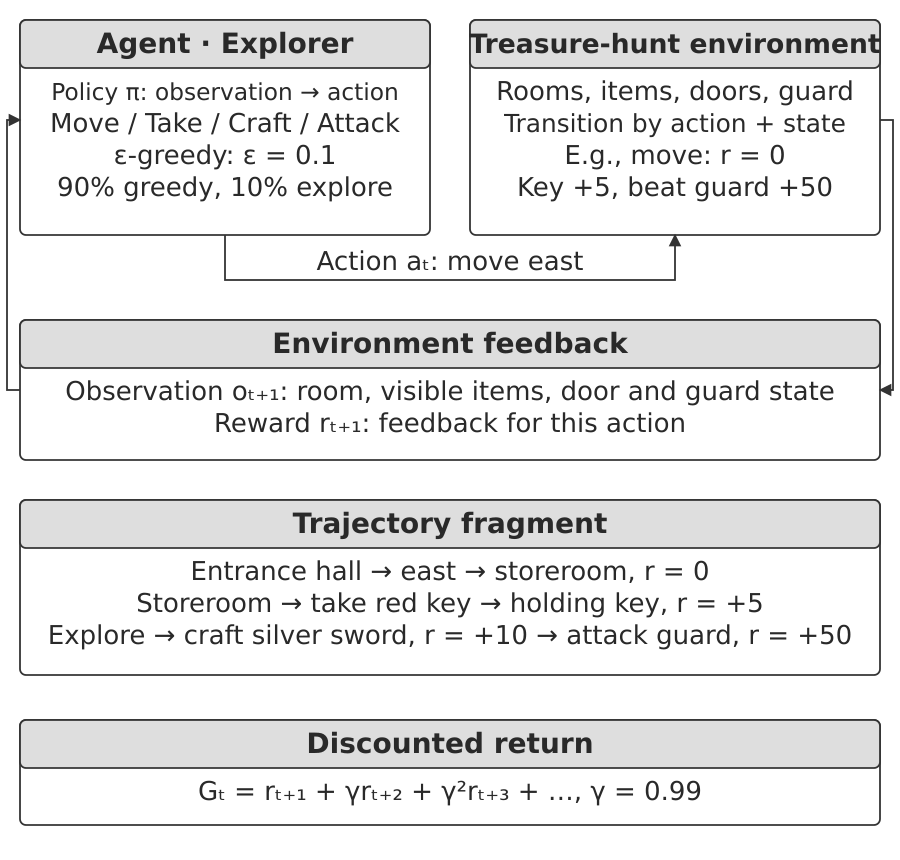

Successive interactions form a **trajectory**, which includes each step's observation, action, reward, and termination information; when the training system can access the environment state, that can be recorded too. The policy decides how to act, while the **value function** estimates how much future return can be expected when starting from the current state and continuing under a given policy.

Where the boundary between Agent and environment lies is determined by the scope of the system chosen during modeling. The model and Harness discussed in this book sit inside the Agent, and tool interfaces connect it to external applications, devices, and services. For example, a request to modify a file is issued by the Agent, the file system performs the write, and the tool returns the result to the Agent.

During learning, opportunities must be divided between **exploration and exploitation**. Exploration exposes the policy to actions it is not yet familiar with; exploitation picks the actions currently estimated to be best. For delayed-reward tasks, one must also determine which early steps contributed to the final result—the credit assignment problem discussed later.

To understand an RL method, start by checking five things:

- **Action space**: what outputs are allowed. Board games use discrete moves; robot control can use continuous joint targets; actions may also be constrained by the state, physical limits, and permissions.
- **Policy**: the rule for choosing actions based on states, observations, or history. It can be a table or a neural network.
- **Reward signal**: through which feedback the training objective is expressed. Per-step rewards combine into the long-term return, and the policy may accept a cost now for a gain later.
- **Value function**: an estimate of the subsequent return, which can be used to compare actions or construct the signal for policy updates. Whether it is learned explicitly depends on the specific algorithm.
- **Environment model**: a prediction of the state, observation, or reward that follows an action. Model-based methods plan with a known or learned environment model; model-free methods learn the policy or value directly from interaction data.

Table 8-3 picks out the environment, actions, and objective from these concepts and compares several familiar systems. When reading the first two rows, think of "keeping balance" and "area cleaned" as objectives we might choose when modeling the task.

Table 8-3 Comparison of Key Elements in Different Agent Systems

| Agent Type | External Environment | Action Representation | Example Reward or Objective |
| --- | --- | --- | --- |
| Newborn gazelle | Terrain, gravity, and body dynamics | Continuous muscle control | Keep balance, avoid falling |
| Robot vacuum | Rooms, floor, and charging dock | Moving, cleaning, returning to charge, and control parameters | Area cleaned, battery level, and collision cost |
| Chess Agent | Board, opponent, and clock rules | Legal moves in the current state | Win +1, loss −1, draw 0 |
| Customer service Agent | Users, business databases, and service interfaces | Reply text, queries, and business calls | Problem resolution, process compliance, handling time |
| Coding assistant Agent | Source of requirements, codebase, and execution environment | Search, edit, run, and reply | Test results, task completion, regressions, and cost |

These systems represent actions differently. Board games usually choose one discrete action per step, robots output continuous control values of a specified dimension, and LLMs first generate a token sequence that the interface then parses into a reply or a tool call. Internal computation can also be included in the policy model and recorded separately from tool executions that actually change external state.

### Two Action Representations: Classic RL Settings and Variable-Length LLM Policies

A **Markov Decision Process (MDP)** describes a decision problem with states, actions, transitions, and rewards. Its Markov property requires that, given the current state and action, predicting the next state and reward need not depend on any additional history; whatever in the history matters for the prediction is already contained in the current state. In Figure 8-2, recording only the room the player is in runs into trouble: even if the player reaches the same door twice, whether it opens also depends on whether they already have the key.

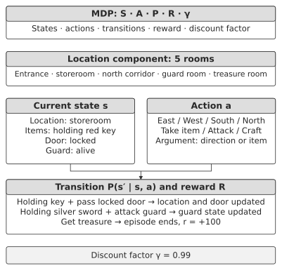

Chess offers an example of state design. Besides piece positions, the state must record whose turn it is, castling rights, en passant rights, and the information needed to apply the fifty-move rule and detect repeated positions. Only with all of this in the state can the rules be judged from the current state alone. If the Agent can see only part of it, it must use history to fill in the missing information or adopt a partially observable formulation.

MDPs can accommodate discrete, continuous, and combinatorial actions. Go has 361 board points, plus passing and legality to consider; Atari games usually provide a handful of discrete controls; robot control values are defined by joints, grippers, and physical constraints. When both the number of states and the number of actions are small, values can be stored directly in a table. At larger scales, function approximation, policy optimization, and search each offer a way forward.

**Tabular Q-learning: updating action values from one step of feedback.** $Q(s,a)$ estimates the return after taking action $a$ in state $s$. The optimal action value satisfies the Bellman optimality equation:

$$
Q^*(s,a)=\mathbb E\left[r+\gamma\max_{a'}Q^*(s',a')\mid s,a\right]
$$

Here $r$ is the reward for this step, $s'$ is the next state, and $\gamma$ is the discount factor. Continuing tasks commonly use $0\leq\gamma<1$; tasks with clear termination and finite return can also use 1. A larger discount factor keeps more weight on distant rewards. The return computed from the current time step is $G_t=\sum_{k\geq0}\gamma^k r_{t+k+1}$.

After one interaction yields $r$ and $s'$, Q-learning updates as follows:

$$
Q(s,a)\leftarrow Q(s,a)+\alpha\left[r+\gamma\max_{a'}Q(s',a')-Q(s,a)\right]
$$

$\alpha$ is the learning rate, and the bracketed term is the difference between "the one-step reward plus the discounted subsequent value" and the current estimate. When the task reaches a terminal state, the subsequent value is taken as 0. Try it once in the companion game: turn off random perturbation, walk east from the entrance, then pick up the red key in the storeroom. Picking up the key is worth 5 points and every step costs 0.5, so the $r$ returned by this action is 4.5. Suppose the table's old estimate for "pick up the key in the storeroom" is 0.25, and the maximum Q value among the actions available after taking the key is 0.63. With $\gamma=0.99$ and $\alpha=0.2$, the one-step target is $4.5+0.99\times0.63=5.1237$. The old estimate moves one fifth of the way toward this target and becomes 1.22474. This method of correcting estimates with actual one-step feedback is called **Temporal-Difference (TD) Learning**.

Putting together the Q values of all actions in a state lets you pick the action currently estimated to be best. Figure 8-3 draws such a policy on a simplified grid. The number in each cell is the normalized state value. Cover the numbers with your hand and look only at the arrows—can you still get from the top-left corner to the treasure?

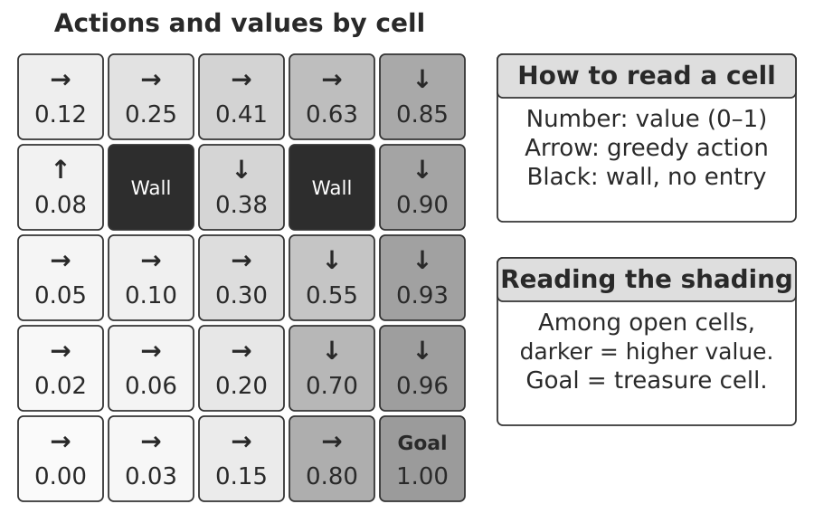

The next round of exploration may change the direction of the arrows. Figure 8-4 breaks down the red-key calculation just performed: the reward from this step changes the estimate for "pick up the key in the storeroom," while the Q values of other states in the table must wait for their own updates.

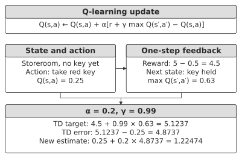

Q-learning's behavior policy can include random exploration, while its update target uses the maximum action value of the next state, so it is an **off-policy** learning method.

> **Experiment 8-1 ★: Q-learning Performance in a Treasure Hunt Game**
>
> The treasure hunt game contains hidden rules such as keys and doors, weapon effects, and item crafting. Winning requires completing several steps in order, and the optimal path is 11 steps; key actions and victory provide rewards, while the other steps give little feedback.
>
> This treasure hunt training uses a learning rate of 0.2 and a discount factor of 0.99, with the exploration rate ε decaying gradually from 1.0 to 0.1. Tabular Q-learning uses ε-greedy exploration: at each step, with probability ε it picks a random available action; otherwise it picks one of the actions with the highest current Q value. Record the win rate, number of visited states, and steps to completion at each stage.
>
> When reading the training and evaluation logs of the treasure hunt experiment, keep two questions apart: during training, when does the policy with random exploration first find the treasure? After training, can a fixed Q table acting greedily win reliably? The former reflects how the model discovers paths; the latter tests whether it can choose actions according to the values it has learned.
>
> In an earlier training run, the first 1,000 episodes produced no wins and the Q table contained 124 states; by 5,000 episodes it was still not winning reliably, with 133 states; between 7,000 and 8,000 episodes the win rate rose from 34% to 96%; by 10,000 episodes it reached 100%, the Q table contained 145 states, and the 11-step path had been found.
>
> Why was there so little progress early on, and then such a rapid rise in win rate? Exploration first discovers the key actions and paths, and later visits gradually propagate the terminal return back to earlier states. The entire small simulation takes about 10 seconds, so it can afford a great deal of repeated interaction.
>
> In the analysis, record both computation time and the number of interactions. In a game, an action is cheap; in a browser, on a phone call, or on a physical device, a single interaction also involves waiting, fees, and changes of state. The table is also bound to a specific state encoding, so when the rules or the map change, the existing values must be rechecked for applicability. The next experiment compares how pre-trained knowledge can change the starting point of exploration.

**Pre-trained LLMs: expressing computation and action in language.**

An LLM can generate a piece of intermediate computation before calling a tool, or it can output the call directly. Both are represented as token sequences, but they play different roles: intermediate computation changes the context available to the model afterward, while a tool call, once executed, changes or reads the external environment. During training, these outputs can be recorded according to a protocol and evaluated together with task results and computation cost. "How long to think, what to think about, and when to call a tool" thus become choices that a single policy can learn; AdaptThink, discussed later, centers on the reasoning budget.

Variable-length sequences bring a much larger combinatorial space. The model can write queries, programs, JSON arguments, and multi-step derivations, with sequence length limited by budget and context. Pre-training provides a starting point for the search: mathematical material often contains analysis of conditions and calculation, while code and discussions often contain localization, modification, and verification. The model can borrow these structures to generate candidate paths and then adjust them based on environment feedback. Existing knowledge makes useful combinations of actions easier to sample from the outset, reducing the need for blind trial and error across a vast number of irrelevant paths.

For example, "convert a foreign-currency amount into US dollars" requires obtaining an exchange rate and doing the calculation. Pre-training makes it relatively easy for the model to generate such connected steps; post-training can then further adjust the probability of paths according to the source of the exchange rate, the computed result, and the task's constraints. Here, linguistic knowledge provides the initial policy and the reward provides task feedback.

Figure 8-5 contrasts the two settings in this section: tabular Q-learning starts from a specified state encoding and exploration rule, while an LLM Agent starts from a pre-trained language policy and uses context to organize tool observations and past experience.

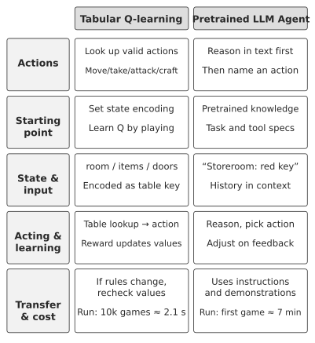

Pre-training also lets the model interpret new instructions and adjust its task behavior from a few demonstrations. Tools connect language output to search, code execution, and business operations. When designing such an Agent, you need to settle the tool interfaces and execution permissions, and also build feedback on task results, operating costs, and key steps of the process.

If a model is to control a robot arm, how can "predict the next token" be applied to actions? OpenVLA used roughly 970,000 real robot demonstrations. Take one step of a demonstration: the input is the camera image at that moment plus the task instruction, and the training target is the action the demonstrator executed next. How far the arm moves along a horizontal axis, for instance, is naturally a continuous value. OpenVLA divides each action dimension into 256 bins and uses one token to indicate which bin the value falls into. The model can then predict action tokens one by one, with the loss computed only at those positions.[^ch8-21]

This example also gives a way to tell behavior cloning apart from reinforcement learning: look at which signal makes the model update. OpenVLA learns from demonstration records—the higher the probability the model assigns to the demonstrated action tokens, the lower the loss—so this is supervised fine-tuning. In SimpleVLA-RL, Experiment 8-13, the policy actually tries actions in the environment and then adjusts its future choices according to the task reward.

> **From Algorithms and Environments to Priors**
>
> In "The Second Half," Shunyu Yao reviews the development of RL through algorithms, environments, and priors.[^ch8-2] Building on this, I summarize the shift in focus as three phases: in 2015–2016 the emphasis was on improving algorithms, in 2016–2018 environment building received more attention, and from 2018 onward the value of pre-trained priors came to be recognized. Gym provided a unified environment interface, Universe and World of Bits explored computer and web tasks, and projects such as Dota 2 demonstrated training in complex environments. Then GPT-2 and GPT-3 showed the knowledge and expressive power accumulated through language pre-training, and systems such as WebGPT and ChatGPT further built on that starting point. The priors a task needs can be acquired first through language modeling, with RL then optimizing the specific behavior.
>
> I agree with the engineering priority here: **priors, environments, algorithms**. First check what knowledge and capabilities the model has, then construct suitable environments and feedback, and finally choose an optimization method that fits them. Figure 8-6 arranges research concerns in the order they emerged; when working on a project, you can go in the reverse direction, starting from existing capabilities.
>
> 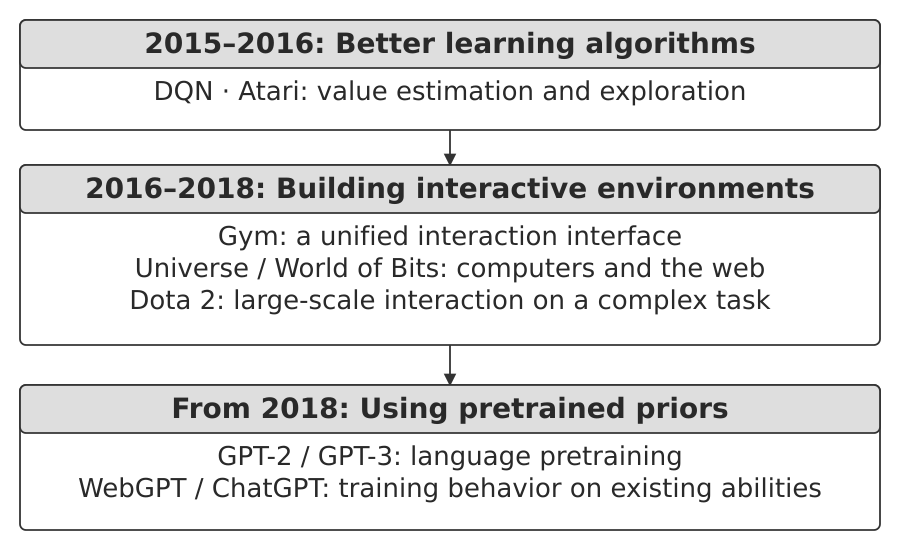

> **Experiment 8-2 ★★: Comparative Study of Traditional RL and LLM Agent**
>
> Compare tabular Q-learning with an LLM Agent in the same treasure hunt game. The LLM configuration uses Kimi K3 and maintains up to 50 pieces of experience in its context. At every step, both choose one item from the available actions offered by the environment. Following the two paths in Figure 8-7, you can see how the Q table and the language model each make that choice.
>
> 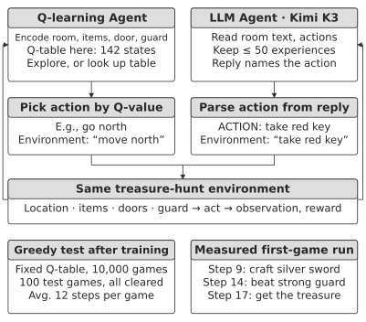
>
> In the companion Kimi K3 run log, the Agent took 17 steps in its first episode. It first picked up the rusty sword, found that the north door was locked, went to the storeroom to get the red key and the magic crystal, and at step 9 combined the sword and the crystal into a silver sword. When it tried to use the key at step 12, the environment replied that the key "will be used automatically when needed"; only when it moved north at step 13 did the door actually open. After defeating the guard with the silver sword at step 14, it tried using the sword once more, and the environment said it could not be used at that point. At step 17 it took the treasure. As you read this log, cover the next line and, based on the current feedback, guess which steps were still necessary.
>
> Aligning each action with the observation at that moment lets you analyze how the model uses existing knowledge such as "keys open doors" and "weapons deal with guards," and how tool feedback changes its subsequent plans. The tabular approach accumulates these relationships through state–action visits.
>
> In this comparison, Q-learning trained for 10,000 episodes in 2.12 seconds; a separate greedy evaluation over 100 episodes then won every one, averaging 12 steps. Kimi called the model 17 times in one episode and took 6 minutes 56 seconds. From this I draw a selection principle: when simulation is cheap and can be repeated at scale, make full use of traditional RL's exploration; when every interaction costs waiting time, money, or real-world operations, prefer policies that can draw on existing knowledge, so each interaction is worth more.

These two experiments connect this chapter to the engineering methods covered earlier: context can organize experience within a single run, external memory can preserve experience across tasks, and post-training changes the policy through parameter updates. The next section fills in the basic process of language and vision pre-training before we turn to specific training data and optimization methods.

## Model Pre-training Basics `[Optional Reading]`

Pre-training establishes the model's initial representations and generative distribution, and later training keeps adjusting the parameters from that starting point. To understand this starting point, first observe how a small language model learns from text, and then see how it is connected to visual input.

Text first goes through **tokenization**, which turns it into discrete tokens. For example, the Chinese sentence "我喜欢编程" ("I like programming") can be illustrated as three units, "我" (I), "喜欢" (like), and "编程" (programming), although the actual split is determined by the tokenizer. Training uses the preceding tokens as context to predict the following token, computes the loss, and updates the parameters. In Figure 8-8, cover the training sentence up to "environment," guess what the next word is, and then reveal the original. Moving this position one step further gives the next prediction exercise.

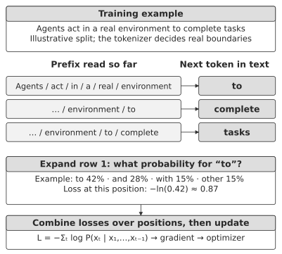

After basic language modeling, instruction demonstrations can be added to train answer formats and task behavior; preference data can also be used, with methods such as DPO, to raise the probability of responses people prefer.

> **Experiment 8-3 ★★: Training an LLM from Scratch—The Power of Algorithm Improvement**
>
> Using MiniMind 2, with about 100 million parameters, as an example, complete pre-training, SFT, and preference optimization on a consumer GPU. Compare the baseline with a configuration that adds QK Norm and the Muon optimizer, and observe the decline in loss, the time needed to reach the target quality, and the generated output. The companion summary records roughly a threefold speedup in convergence, with full training taking about 14 hours and costing about $34.
>
> QK Norm adjusts the numerical scale of queries and keys in attention, and Muon changes how the corresponding parameters receive optimization updates.
>
> Observe the same set of questions at each stage: the pre-trained model can already answer questions such as "the highest mountain in the world"; after SFT, instruction following and output organization improve; preference optimization further affects factual answers and expression.

> **Experiment 8-4 ★★: Training Your Own VLM**
>
> Figure 8-9 shows the "vision encoder → projection layer → language model" connection. A vision encoder such as CLIP extracts image features, the projection layer converts them into the dimensions and representation the language model's input requires, and the language model combines these inputs to generate a description or an answer.
>
> 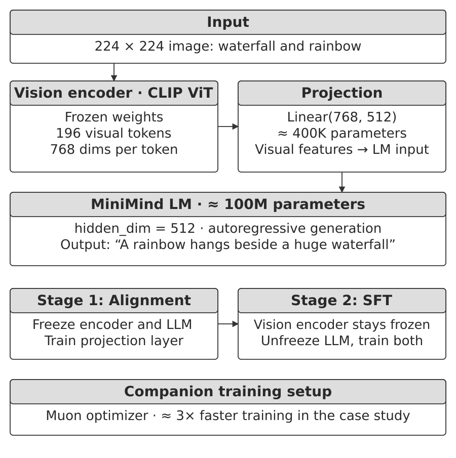
>
> The first stage freezes the vision encoder and the LLM and trains the newly added projection layer so that image features can take part in language prediction; the second stage unfreezes the LLM as configured and performs SFT on high-quality image–caption or question-answer data. Observe the changes in object recognition, detail description, relationship judgment, and language ability separately.
>
> This architecture reuses existing vision and language models and concentrates training on the cross-modal connection module first, which makes it the scheme worth trying first on a limited budget. Freezing weights reduces the trainable state; the corresponding modules can be unfrozen later as the task requires. When a description is wrong, first check whether the object information made it into the visual representation; if the information is there but the model still cannot use it, focus on the projection layer's expressive capacity, the alignment data, and the supervision of language generation. Changing the output further into an action representation and aligning it with a control interface connects this to the VLA architecture of Chapter 6.

The two experiments show, respectively, how optimization configuration and cross-modal connection affect training. On a constrained budget, I recommend first comparing the gains available from algorithmic and architectural improvements before deciding whether to scale up the model. When an existing model enters a new language or domain, it can also continue learning from its pre-trained weights; the next section discusses how to choose data for such training.

## Mid-training: Filling Gaps in Knowledge and Foundational Capabilities

In this chapter, **Mid-training** means a stage of continued language-model training on an existing model, centered on the target distribution. A large number of tokens from documents, code, or derivations are supervised, and target-domain corpora can be mixed with general corpora during training. Research on DAPT/TAPT has shown that continued pre-training on domain- or task-relevant corpora helps downstream tasks.[^ch8-30]

Data selection starts from two kinds of gaps. One is coverage of knowledge and language—for example, the model has seen too little of an enterprise's protocols, the terminology of a target language, or a particular codebase. The other is the foundational capabilities the task needs, such as tracking state over a long context, integrating relationships across documents, or completing a long code derivation. First classify errors as problems of understanding, knowledge, format, or action, then decide what material to add.

Once the loss on domain text has dropped, you should still check whether the model can use the knowledge it learned in real tasks. The order of continued training and instruction training, how question-answer data is organized, and the form of the material all affect how knowledge gets applied.[^ch8-31] For domain tasks where foundational capability is clearly lacking, I recommend first increasing coverage with domain corpora, then using SFT demonstrations to teach the model how to use this information in tasks; only when the model sometimes gets it right but with a low success rate should you invest in RL.

### How to Construct Mid-training Data

**Step 1: locate the needed material from the failure distribution.** Evaluate separately by topic, language, document type, code pattern, and context length, and combine Pass@1, Pass@k, and error samples to determine under which conditions the model lacks a usable solution. Argument-format problems can be handled with interface demonstrations; gaps in domain concepts and relationships need corresponding corpora.

**Step 2: organize high-density corpora.** Raw documents provide terminology and factual relationships, code repositories provide module structure and dependencies, textbook-style derivations and synthetic paraphrases spell out implicit steps, and cross-document samples connect scattered information. After quality filtering, deduplication, and isolation from evaluation sets, construct the training sequences.

**Step 3: mix data according to the target capabilities.** Natural long text can come from books, documentation, and code repositories; for retrieval, multi-hop reasoning, instruction following, aggregation, and statistics, task data with worked derivations can be added; for Agents, trajectories of planning, tool selection, argument construction, state tracking, and error recovery can be added. This material can come from existing datasets or be generated by a teacher model, and it is filtered by content and behavioral requirements before entering training.

**Step 4: keep the model practicing the tasks it could already do.** One set of samples keeps the short texts, general corpora, and original problems; another places the same tasks in longer contexts, moves the key information around, and adds distractors. When combining these two sets, you can refer to the distribution of the original training data, or try several ratios with public corpora such as FineWeb-2 and adjust based on evaluation results.

**Step 5: use multiple metrics to decide whether to continue or stop.** Track training loss, held-out domain tasks, general capability, original instruction following, and target-task success rate together. If domain scores rise while general capability falls, compare mixing ratios, learning rates, and training volume; if loss falls while the target task stalls, check whether the training material can teach the model to complete such tasks, and whether demonstrations of applying knowledge in real tasks need to be added.

Suppose the model can find a specified order number in a very long order log. If you instead ask "which customer placed several orders and then canceled them all," it has to gather all of that customer's orders and match each order with its cancellation record. The two questions can use the same log, yet they test different capabilities. RULER uses synthetic tasks to control input length and task difficulty separately, measuring single-item retrieval, multi-hop tracing, and aggregation on their own. The authors evaluated 17 models; many scored close to perfect on simple retrieval, but their overall performance dropped markedly as inputs grew longer.[^ch8-ruler]

To see whether such differences show up in real material, you can go further with LongBench v2's multi-document, long-dialogue, or code repository questions. To check separately whether the model can remember requirements such as output format, take verifiable instructions from IFEval and place them at different positions in longer material. When comparing two models, keep the instruction positions and distracting content identical for both, and note that this is a self-constructed test. Finally, use end-to-end Agent tasks to check whether these capabilities work together. When designing the evaluation set, you can go through the following dimensions one by one.[^ch8-longbench]

[^ch8-ruler]: Hsieh et al., RULER, 2024.
[^ch8-longbench]: Bai et al., LongBench v2, ACL 2025. The paper presents six task categories with 503 multiple-choice questions in total.

- **Position and retrieval**: whether one or more key pieces of information can be found when located at the beginning, middle, or end.
- **Relationships and reasoning**: tracking relationships across paragraphs and documents, resolving contradictions, and combining evidence.
- **Aggregation and statistics**: counting, grouping, sorting, comparing, and summarizing trends in long tables and logs.
- **Instruction following**: multiple requirements, conflict handling, process conditions, and output format.
- **Long-chain reasoning**: long dependency chains in math, logic, and code tasks.
- **Basic Agent behavior**: task decomposition, tool selection, argument generation, state maintenance, and failure recovery.

Long reasoning and multi-turn tool calling keep lengthening the context, while earlier instructions, facts, and task state must still inform later decisions. If the model cannot find information or hold on to constraints in long text, a long-horizon Agent can hardly run reliably. Before scaling up the training budget, first compare data mixtures and training volumes with small-scale configurations. For facts that update frequently and require citations, I prefer RAG; for stable, large-scale domain knowledge and foundational capabilities, I then consider writing them into the parameters through continued training.

> **Experiment 8-5 ★★: Continued Pre-training to Learn a New Language**
>
> Starting from Mistral 7B v0.3, use material such as Korean Wikipedia to improve Korean ability. Training first uses a mix of roughly 80% Korean and 20% English, then performs SFT on Korean instruction data, observing changes in language modeling and conversational behavior separately.
>
> The Korean data increases coverage of the target language, and the English data serves to maintain existing capabilities. Every stage is tested on the same set of Korean and English questions that were not used in training. In the companion results, blind-evaluation scores for Korean improved at the final stage while English ability declined somewhat, which points to concrete directions for the next round: mix in a bit more English training material or reduce the update strength.
>
> Recording the target language, the original language, and factual quality separately lets you weigh gains against costs; in the SFT stage, check whether the model can organize its answers according to Korean instructions. This way the effects of continued pre-training and instruction tuning can be observed separately.

## SFT (Supervised Fine-Tuning)

Domain corpora can let a model see an interface a few more times, but to teach it to correct its arguments after a failed call, you can also simply demonstrate it once. SFT takes a task input and trains the model, token by token, to generate the response or action in the demonstration. When looking at Figure 8-10, first be clear about which behavior you intend to teach, then decide how to collect demonstrations. The facts, tone, and output format in the demonstrations will enter training along with it.

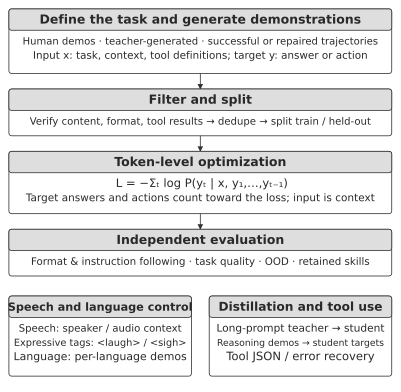

Data usually comes from three sources: human experts define key behaviors and boundaries, teacher models write demonstrations in bulk, and verifiers select valid outputs from model samples. The three can be combined. For example, experts first write a small number of tool-calling demonstrations, a teacher then varies the task conditions to generate more samples, and finally the arguments, execution results, and business constraints are checked.

**One use of SFT is to teach the model practices that are written again and again into prompts and Skills.** Take the memory grading from Chapter 7: suppose the grading manual, together with its precedent cases, runs to ten thousand tokens. Working from the full manual, a teacher grades a batch of responses, demonstrating how to handle cases such as people with the same name, reversed relationships, or insufficient evidence. When training the student, the input keeps only the short names of the grading criteria, the history material for that instance, and the response to be graded; the target output is the grade the teacher chose. After deployment, only a short prompt and the material for that instance are needed, saving those ten thousand tokens of fixed instructions on every inference. For a Skill that is invoked repeatedly, the same approach can demonstrate when to look things up and how to choose tools, distilling these stable steps into the model.

Data preparation starts by fixing the task distribution, the output schema, and the acceptance method. Once demonstrations pass inspection, deduplicate them, adjust the proportions of the different kinds of samples, and split the dataset. Sample count and coverage should be designed together: repeating the same phrasing thousands of times reinforces the same pattern over and over; constructing variations around the key conditions is what helps the model choose appropriate behavior across different inputs. I first polish a batch of demonstrations covering the key situations, then scale up. SFT learns the target output token by token, so wrong facts, redundant steps, and inappropriate operating habits will also find their way into the parameters.

> **Experiment 8-6 ★★★: Voice SFT—From Voice Cloning to Paralinguistic Modeling `[Extended Experiment]`**
>
> Using Orpheus and Sesame CSM as examples, compare how speaker conditioning, conversational context, and expression tags take part in speech generation. Orpheus represents speech as tokens, can use a reference text–speech clip to generate the corresponding timbre, and also provides expression tags such as `<laugh>` and `<sigh>`. Sesame CSM takes text, a speaker identifier, and existing audio clips, and generates the speech that follows.[^ch8-speech-conditioning]
>
> When constructing training samples, record the text, speaker, audio, and expression conditions separately; use cross-sentence material from the same speaker to learn consistency, and laughter, sighs, and pauses in a variety of contexts to learn expression. Compare outputs with no reference, with a reference, and with specified expression conditions, then score them on accuracy, naturalness, emotion, and timbre.
>
> The data should cover enough combinations of speakers, sentence types, and emotions. With too few speakers, the output may converge on a single timbre; when a tag is always tied to the same audio clip, repetitive, mechanical expression may result.

> **Experiment 8-7 ★★★: Multilingual Thinking—Generating Reasoning in a Specified Language `[Extended Experiment]`**
>
> Perform SFT on gpt-oss-20b, using an instruction to specify the language of the reasoning process. For example, `reasoning language: German` asks for reasoning text in German. Training samples include English, Spanish, French, and other languages, with Chinese held back for the test stage.
>
> In the companion case, after training, specifying Chinese makes the model generate its reasoning in Chinese. Three results can be compared further: whether it follows the language requirement, whether the final answer is correct, and how generation length and latency change. The multilingual foundation from pre-training and the control learned through SFT jointly contribute to this cross-lingual behavior; comparisons across different languages and base models can further tease apart their roles.

> **Experiment 8-8 ★★: Prompt Distillation—Reproducing Usable Capabilities at Lower Cost**
>
> A stable business function may depend on a system prompt of several thousand tokens, and the teacher may also generate lengthy reasoning. Prompt distillation first has the teacher produce high-quality outputs under the full conditions, then assembles "user input → final answer" pairs as the student's SFT data. The student uses a shorter prompt and answers directly under the target configuration.
>
> Open the first training sample and you can see that the Kimi K3 teacher read a passage of Arabic text interspersed with Latin letters, explained the basis for its judgment, and finally gave the language code `ar`. The demonstration handed to the SmolLM2-135M-Instruct student contains only the original text and `ar`. Across the same set of 80 test records, the teacher read about 386 tokens per request on average and the student about 97. Each figure is counted with its own tokenizer.
>
> The companion language identification comparison records can be used to separate "answering correctly" from "producing output in the right format." The teacher generated demonstrations on 160 training samples and also answered all 80 test records correctly. The untuned student did not produce a single output the grader could parse at test time and scored zero; after fine-tuning, all 80 could be parsed and 76 had the correct label. The baseline's zero by itself cannot distinguish "did not recognize the language" from "recognized it but did not answer in the required format." This test set contains 75 distinct passages, and no passage is identical between training and testing.
>
> Data construction must also preserve the conditions the student needs to complete the task. When the teacher relies on fresh tool results, those results can be given to the student as input, or the tool interface can be kept; when the teacher makes systematic errors, filter them out through independent verification.
>
> When product rules are stable, the input distribution is well understood, and invocation is expensive, I recommend evaluating Prompt distillation first, compressing the repeatedly processed prompts and reasoning into the parameters. While the product is still being explored and task requirements change frequently, keep editable prompts and explicit reasoning, which make rapid experimentation and error localization easier.

> **Experiment 8-9 ★★★: Chain of Thought (CoT) Distillation**
>
> CoT distillation uses the teacher's reasoning text together with the final answer as supervision, so the student learns the process of decomposing, calculating, checking, and correcting. DeepSeek-R1's distillation into the Qwen and Llama series is the representative example of this method. For teams that want a model under their own control while keeping training investment in check, I recommend considering this route first. When the teacher is clearly stronger than the student on the target task, it can provide valuable demonstrations; you can start by choosing among open-weight models whose full reasoning output is available, then compare the capability gap between teacher and student and the quality of the data. When an interface provides only a reasoning summary, the information available for process distillation shrinks accordingly.
>
> Step 1: have the teacher produce several solutions to the same problem. For math problems, check the answer first; for code problems, run the tests; keep only the solutions that pass. This filtering is called **rejection sampling**. Supervised fine-tuning on the filtered solutions is called **Rejection Sampling Fine-Tuning (RFT)**. If the student is also to learn the reasoning process, the intermediate steps must then be checked as well, removing demonstrations whose derivation is wrong but which happen to reach the right answer.
>
> For tasks with a reliable verifier, I recommend first building an RFT baseline: generation, filtering, and SFT alone form a training pipeline, sparing you the implementation work of online policy optimization and value estimation, and you can then judge whether the extra investment in RL is worthwhile.
>
> Step 2: train the student. Organize "problem → reasoning text + final answer" according to the chosen model's chat format; when using boundaries such as `<think>` and `</think>`, make explicit which tokens participate in the loss. You can start with a 7B-scale student and compare configurations with full trajectories, condensed trajectories, and supervision on the final answer only.
>
> Step 3: see what the student learned. The companion experiment had Kimi K3 solve 24 AIME math problems and kept the 23 correct reasoning trajectories to fine-tune Qwen2.5-1.5B-Instruct. On the same set of problems, the student went from 1 correct answer to 2, while the teacher answered 23 correctly. The trained student occasionally went back to double-check its calculations, but a paired per-problem test showed no reliable gain in accuracy ($p=1.0$).

> **Behind the Book: Developing the Distillation Experiment**
>
> I first implemented the distillation experiment with Codex powered by GPT-5.6-Sol; after running into refusals, I switched to Claude Code powered by Claude Opus 5, which could not continue either. I then used Kimi K3 to complete the code and the runs.

All four cases use supervised learning, each learning something different: timbre and expression conditions in speech, language control in multilingual reasoning, direct answering in Prompt distillation, and the problem-solving process in CoT distillation.

## SFT Data Synthesis: From Demonstrations to Trainable Trajectories

To turn one real complaint into a batch of training problems, which information can be swapped out and which relationships must be preserved? Extract the user's intent, initial state, available tools, business constraints, and common failures from production trajectories, and organize them into task templates. Identities, orders, files, and credentials must be replaced; if the original problem involved two similar orders, the generated instance must also preserve the relationship that requires telling them apart. Only by running the instance in a resettable environment can you know whether the new problem really retains the original difficulty.

A complete pipeline is: **production case → task template → synthetic instance → multiple candidate trajectories → task and trajectory verification → training data**. The two kinds of verification address different problems: task verification checks whether the conditions are sufficient, the goal is achievable, and the reference result is correct; trajectory verification checks, one trajectory at a time, the state at the end of the task, the order of tool calls, and whether the execution complied with business constraints.

Executable conditions use tests, database assertions, or state-diff checks; the quality of open-ended communication uses Rubrics and model judges, calibrated through human spot checks. Further combining skill graphs, executable environments, and independent verifiers allows task coverage to be expanded systematically.[^ch8-12][^ch8-17][^ch8-18][^ch8-19][^ch8-20]

A qualified demonstration can be a trajectory that went smoothly, or a complete process that includes diagnosis and repair. For the erroneous actions in it, make their role in the sample explicit and choose loss positions according to the training objective. Failure records can also be used to construct preference pairs, discover coverage gaps, and generate recovery tasks. When training later moves on to RL, the current policy resamples trajectories and updates using environment feedback.

The training and evaluation sets are isolated according to the goal: in-distribution evaluation can isolate specific instances, while transfer evaluation further isolates task templates, customer groups, or time periods. Deduplication checks for near-duplicate inputs and solutions; reference answers, hidden tests, and information used only for grading stay on the verification side according to the task protocol.

After fine-tuning is finished, can the training material still be audited from the weights? Take the public reasoning model s1. Converting the public samples into token IDs using the tokenization and text processing applied during training, then deduplicating, yields one list. Comparing the input embedding matrix row by row before and after fine-tuning and noting which tokens' vectors changed yields another. When I audited it, the 16,573 IDs in the two lists matched one for one. This check requires finding the right base model and tokenizer, inserting the system prompt and truncating long samples according to the training configuration; you also need to confirm that training actually updated the input embeddings and that the input embeddings are separate from the output layer weights. For example, when LoRA is trained only on the attention layers, the input embeddings are left untouched, and the tokens used cannot be listed this way.[^ch8-token-provenance]

Three tokens are enough to see the limits of this evidence. Suppose two public samples tokenize to `[10, 20]` and `[20, 30]`; deduplication gives `{10, 20, 30}`. Now add a third sample, `[30, 10]`, and compute again: the set is exactly the same. Even if every ID matches during the audit, you still cannot tell from this whether the third sample was used, nor rule out that some evaluation problem leaked into the training set.

[^ch8-token-provenance]: Bojie Li's training-forensics project records the token sets and preprocessing conditions of s1 and other models, and discusses how embedding weight tying and LoRA affect the comparison method.

Take the "premature completion" case from Chapter 7. Cut the prefix at the moment the model is about to claim completion; label the unverified claim of completion `rejected`, and label the continuation that first checks the remaining goals and runs the relevant tests before answering `chosen`. The preference pair can be used for DPO; the verified continuation can also serve on its own as an SFT demonstration.

The Chinese curly-quote and special-string experiments later in the chapter further illustrate how to determine the supervision target. The curly-quote task starts from document scope, requiring edits to the target prose while protecting code, quotations, and JSON; the special-string task requires `old_string` to stay byte-identical in the tool arguments. The former checks editing scope and document syntax; the latter checks exact copying and actual tool matching. A shared failure-attribution process can yield different training objectives.

## When to Choose Mid-training, SFT, and RL

If a model cannot even write a tool's input format correctly, how many of its calls will actually run if you let it learn by trial and error right now? Follow Figure 8-11 to find the step where it gets stuck, then use Table 8-4 to choose the training material and feedback method.

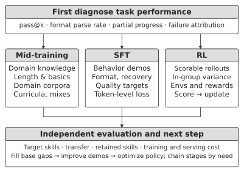

Table 8-4 Criteria for Choosing Mid-training, SFT, and RL

| Observed Symptom | Check First | Candidate Methods | Focus of Follow-up Evaluation |
| --- | --- | --- | --- |
| Weak domain language, concepts, or basic operations; little progress even with multiple samples | Corpus coverage and foundational capability | Mid-training; RAG for retrievable facts | Domain tasks, test sets that check general capability, and partially correct trajectories |
| Usable content, but unstable format, arguments, or fixed procedures | Demonstrations, interfaces, and constraints | SFT, constrained decoding, or tool validation | Parse success, task results, and recovery behavior |
| Occasionally completes the task, but with a low success rate or frequent detours | Reward quality, exploration, and task distribution | RL | Task gains, reward differences, independent generalization, and cost |
| Demonstrations or preference data exist, but no interactive environment yet | Offline data coverage and verification method | SFT, RFT, offline preference optimization | Baseline quality, data bias, and the payoff of building an environment |

You can proceed in four steps. First, establish a baseline with prompts, context, tools, and constraints. When these methods already meet the task's requirements, I prefer to keep the externally editable solution, which reduces the maintenance cost of training, deployment, and regression. Dynamic facts are supplied through retrieval and version management; implicit judgments, perceptual patterns, and stable behaviors that need to be learned repeatedly are the ones to consider improving through parameter training.

Second, observe success, partial progress, parse results, and error types on held-out tasks. With the sampling configuration fixed, Pass@1 and Pass@k show whether the current policy already has paths to exploit; failed trajectories help distinguish missing knowledge, missing feedback, and procedural errors.

Third, provide demonstrations for the behaviors to be learned. JSON schemas, tool calls, terminology use, clarification, and recovery can all be written as SFT samples, while the necessary knowledge is supplied through corresponding corpora and task context.

Fourth, assess the feedback conditions for RL. When the model can generate scorable candidates, the reward discriminates between them, and the environment permits enough interaction, the gains of policy optimization can be compared; when the reward is too sparse, first consider a curriculum, partial rewards, or a more suitable initial policy.

At every step, evaluation results decide the next investment: a task with a clear format can be deployed after SFT, a strong starting point can go directly to RL, and after domain continued training the existing instruction-following ability can be reused. Next, single-turn tasks let us observe concretely the behavioral differences produced by learning from demonstrations and learning from rewards.

Return to the order problem from the Reading Guide. Hand the model the same real tool documentation and see whether it can write the arguments correctly. If fields in the documentation have changed, first update the documentation available at runtime. If the meaning of the fields is clear but the model keeps putting user text into the order-number slot, provide SFT demonstrations that include querying, clarifying, and filling in arguments correctly. If it can already occasionally complete the whole task, and different query orders lead to different success rates and costs, the conditions are in place for comparing multiple policy trajectories.

## Single-Turn Reinforcement Learning: Memorization versus Generalization

A single-turn task starts with one input and ends when the model submits an answer and receives a reward. The model can still reason in multiple steps while generating the answer, and the training system can also have it attempt the same problem repeatedly. Restricting the interaction to a single answer makes it easier to observe how a training method changes the model's behavior. Below, AdaptThink first shows how a model learns to allocate its reasoning budget, and then GeneralPoints compares SFT and RL when the rules and the visual appearance change.

Knowing first how an RL algorithm uses rewards to update the model will make the training process in the later experiments easy to follow. Most of the RL training in this chapter is based on **policy gradients**. Take multiple samples on the same problem: have the model generate several responses, then compare each response's reward with a baseline. Responses better than the baseline receive a positive signal, and training raises their probability of being generated; responses worse than the baseline receive a negative signal, and their probability drops accordingly.

To keep a single update from pulling the model off course, the mainstream **PPO** algorithm clips away the extra gain in the surrogate objective once the probability ratio leaves a specified interval; the actual size of the update also depends on the learning rate and the number of update epochs. "PPO with a value network," discussed below, learns a value estimate and uses it to set the baseline for computing each step's action advantage. **GRPO** compares multiple responses to the same problem directly, building the baseline from the rewards within the group, and thus does away with a separately trained value network.

The following Python-style pseudocode strings together sampling, rewards, advantages, and parameter updates, to show how information flows between the steps. Real training also needs to configure parallel sampling, KL regularization, and the optimizer.

```python
for prompt in batch:
    group = [rollout(policy, env.reset(prompt)) for _ in range(G)]
    rewards = [verify(trajectory) for trajectory in group]
    advantages = normalize_within_group(rewards)       # GRPO baseline
    update(policy, group, advantages)
```

How does PPO update the policy using a batch of trajectories of different lengths? First, within each trajectory, compute the discounted return of each step from back to front. Stop accumulating when the trajectory ends, so the reward from the next problem is not counted in. Then gather the actions the model actually chose across all trajectories and compute the average loss over this batch of actions. Below is a single update, omitting multiple epochs of minibatch optimization.[^ch8-ppo-method]

```python
states, actions, returns = [], [], []
for trajectory in rollouts:
    states.extend(trajectory.states)       # state before each action is chosen
    actions.extend(trajectory.actions)     # aligned one-to-one with the states
    returns.extend(discounted_returns(trajectory.rewards))

returns = tensor(returns)
values = value_model(states)
advantages = returns - stop_gradient(values)
ratio = exp(policy.log_prob(actions, given=states)
            - old_policy.log_prob(actions, given=states))
policy_loss = -mean(min(
    ratio * advantages,
    clip(ratio, 1 - epsilon, 1 + epsilon) * advantages
))
value_loss = mean((values - returns) ** 2)
update(policy, value_model, policy_loss + value_coef * value_loss)
```

The "relative" in GRPO comes from multiple responses to the same problem; the PPO here instead uses a value network to estimate the expected return of each state. `old_policy` is the policy frozen at the time this batch of trajectories was generated. Suppose an action's advantage is 1 and the current policy gives it 1.4 times the probability it had at sampling time; with `epsilon = 0.2`, that term contributes `min(1.4, 1.2) = 1.2` to the surrogate objective. Raising this action's probability further no longer earns any extra gain from this term.

If the advantage is −1, the direction reverses. When the probability ratio has already fallen to 0.6, plugging into the same line of code gives `min(-0.6, -0.8) = -0.8`, so pushing the probability lower earns nothing more. Conversely, if this poorly performing action instead becomes more common and the ratio rises to 1.4, taking the smaller value gives `min(-1.4, -1.2) = -1.4`: raising its probability still carries a cost.

> **Experiment 8-10 ★★: AdaptThink—Learning "When Not to Think"**
>
> Reasoning models often solve problems with long reasoning processes. For simple problems, answering directly saves generation cost. AdaptThink gives the model two modes, Thinking and NoThinking: in models that support this protocol, NoThinking closes the reasoning segment with `<think></think>` and then generates the answer directly. The goal of training is for the model to choose an appropriate reasoning budget according to the task.
>
> The method has two core components. A **constrained optimization objective** encourages the model to use NoThinking more often while maintaining overall answer performance; **importance sampling** adjusts the sampling proportions of the two modes and then uses weights to correct the discrepancy between the sampling distribution and the optimization objective. The initial model tends to favor Thinking, so only by actively adding NoThinking samples can training obtain a signal for comparing the two modes. The cold-start problem here specifically means that NoThinking samples are scarce early in training.
>
> The book's experiment uses 8 H100 80GB GPUs. By step 300 of training, MATH500 accuracy went from 81.00% to 81.80%, with average response length dropping from about 4,911 tokens to 1,577; GSM8K accuracy rose from 79.68% to 81.88%, with response length dropping from about 1,025 tokens to 477; AIME mean@16 went from 31.46% to 31.04%, with response length dropping from about 12,120 tokens to 6,402. The three response lengths shrank by about 68%, 53%, and 47% respectively.
>
> The NoThinking ratios on the three datasets were 83.80%, 84.15%, and 56.25% respectively. The model kept more reasoning computation on AIME and answered directly more often on MATH500 and GSM8K. AIME2024 samples each problem 16 times, and mean@16 is the average accuracy over those 16 attempts. By step 300, average answers were nearly half as long, while accuracy was about 0.42 percentage points lower.
>
> Step 300 was a validation checkpoint partway through training. The team had planned to train for 3,140 steps, but the run later aborted abnormally, and the last validation record stopped at step 410. At that point, average accuracy on AIME2024 was 31.88%, with average answers of about 5,874 tokens.
>
> AdaptThink can work together with Prompt distillation: distillation writes repeatedly used instructions and problem-solving patterns into the parameters, and AdaptThink then learns how much reasoning computation to allocate to each task. Together they affect answer quality, latency, and cost.

> **Experiment 8-11 ★★: GeneralPoints—A "Memorization versus Generalization" Comparison in Single-Turn RL**
>
> Chu et al. used GeneralPoints, a card game similar to the "24 game," to test model generalization[^ch8-3]. The player must use each of the four card values exactly once, combining them with addition, subtraction, multiplication, and division to make 24. If the model has learned to solve the problem, can it still compute correctly when the card-value rules or the suits change? Figure 8-12 shows the two problem formats: GP-L gives the cards as text, while GP-VL requires the model to read the card faces.
>
> 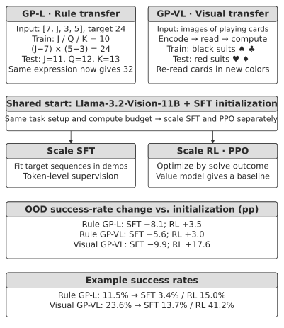
>
> **Rule variant**: during training, J/Q/K all count as 10; during testing they count as 11/12/13 respectively. The test set therefore contains number combinations never seen in training, which checks whether the model can compute with 11, 12, and 13 under the new rule. **Visual variant**: training uses black suits (♠♣) and testing uses red suits (♥♦), checking whether the model can adapt to a change in card appearance.
>
> The experiment starts from Llama-3.2-Vision-11B, first uses SFT to establish basic instruction following, and then splits into two training branches, continued SFT and RL, compared under the same compute budget. The RL branch uses PPO with a value network. Both branches are trained with the J/Q/K=10 rule and then evaluated on in-distribution (ID) and out-of-distribution (OOD) test sets.
>
> Take `[7, J, 3, 5]`: with J=10 you can use `(J−7)×(5+3)=24`; once J becomes 11, this expression gives 32, and you need `(11−5)×(7−3)=24` instead. The same hand of cards therefore requires the model to read the current rule and reorganize its calculation.
>
> The two training methods diverged sharply on the out-of-distribution tests. **Rule OOD**: on GP-L, RL's success rate rose from 11.5% to 15.0%, a gain of 3.5 percentage points, while SFT fell from 11.5% to 3.4%, a loss of 8.1 percentage points. On GP-VL, RL gained 3.0 percentage points and SFT lost 5.6. **Visual OOD**: on GP-VL, RL rose from 23.6% to 41.2%, a gain of 17.6 percentage points, while SFT fell from 23.6% to 13.7%, a loss of 9.9 percentage points.
>
> A closer look at card recognition links final answer performance to visual perception: the RL branch's recognition accuracy rose along with task success, while the SFT branch's recognition accuracy declined. The study connects this difference to the training objective: token-by-token fitting may reinforce textual patterns in the demonstrations, whereas an outcome reward keeps requiring the model to read the cards correctly and complete the calculation. Perception accuracy provides an intermediate metric for analyzing this mechanism.
>
> The reason for doing SFT first can also be understood through output format. The Llama-3.2-Vision-11B base model in the experiment could not reliably produce the required structured output, so the verifier could not compute a task reward from it, and attempts at end-to-end RL directly from the base model failed. SFT first establishes parseable, scorable output, and only then can subsequent RL make use of task feedback. DeepSeek-R1-Zero, mentioned earlier, instead started from a base model that could already produce scorable answers and went straight into RL.
>
> How much can the model learn from the verifier's feedback? Figure 10 of the paper compares the text-only card task (GP-L) on its own. The researchers set 1, 3, 5, and 10 verification iterations and trained and evaluated an RL model for each. Under the same training compute budget, the group allowed 10 verifications improved its success rate on the new rule by 5.99 percentage points over its own training starting point, while the group verifying only once improved by 0.48 percentage points.
>
> Why did SFT's performance drop under this experiment's distribution shift while RL did better? One explanation consistent with the observations: the limited SFT data reinforced the fixed pattern "treat J/Q/K as 10"; when J=11 at test time, the model still computed with 10. The outcome-driven RL branch was more likely to reinforce the strategy "recompute until reaching the correct answer," which still applies when J becomes 11.
>
> GeneralPoints' rule change and suit change let us observe separately whether the model has learned to compute under new conditions and whether it reads new visual input correctly. With the model, training data, and test budget here, the branch that continued with SFT regressed on the out-of-distribution tests, while the branch that moved on to RL improved. To apply the conclusion to your own task, first ask: has the student already mastered the output format? Did the new test change the rules, the appearance of the input, or both? Only separate comparisons tell you whether to add demonstrations, improve perception, or add exploration with outcome feedback.

## RL Algorithms: From 16 Rollouts to One Parameter Update

**GRPO (Group Relative Policy Optimization)**, proposed by DeepSeek, builds its learning signal from the relative performance of multiple attempts on the same problem. Take a SWE-bench-style code repair task: in a Python project, `parser.py` raises an `IndexError` on empty input, and the Agent must fix the implementation while leaving the test files unchanged. One training iteration can be divided into four steps.

**Step 1: have the policy model attempt the task repeatedly.** The policy model is the language model being trained. The system places the same initial code and problem description into 16 isolated sandboxes and has the model complete the task independently 16 times. Each attempt starts by reading the code and proceeds through modification and testing until a result is submitted; this entire interaction trajectory is called a **rollout**. Random sampling makes the same starting point produce different paths: some add the missing boundary check, some merely catch the exception, some edit the wrong file, and some try to modify the tests.

**Step 2: compute rewards.** After each rollout ends, the verifier applies the patch in a clean environment and runs the tests. Suppose 4 of the 16 attempts pass all tests without modifying the test files and the other 12 fail; the 4 passing trajectories receive a reward of 1 and the remaining 12 receive 0. Figure 8-13 puts the scores of these 16 trajectories in a single table. For code tasks like this, rewards can be computed directly from tests and rules. For goals that are harder to write as tests, such as readability or explanation quality, human evaluation or a reward model can be added.

**Step 3: compute relative advantages.** The reward only says whether a single trajectory succeeded or failed; the **relative advantage** says how good it was compared with the other attempts in the same group. This group's average success rate is 4/16: the 4 trajectories that passed are above the group average and get positive advantages; the 12 that failed are below average and get negative advantages. Normalizing by the within-group standard deviation, the mean reward is 0.25 and the standard deviation about 0.433, so successful trajectories have an advantage of about 1.73 and failed ones about −0.58. GRPO builds its learning signal from this kind of within-group comparison. If all 16 rewards are identical, subtracting the group mean from each gives zero. Adding a tiny stabilizing term to the denominator avoids division by zero; after normalization, however, this group's outcome rewards still cannot indicate which trajectory training should favor. At that point, check whether path constraints, process rewards, or partial progress can distinguish the trajectories in the group. For example, of two attempts that both failed to fix the code, only one passed the boundary test that had originally failed. As long as this intermediate result can be verified independently, it provides one more clue that could be used for learning.

**Step 4: update the policy with gradient descent.** The training program turns the relative advantages into a training loss, computes gradients, and an optimizer (such as AdamW or Muon) performs gradient descent, raising the probability of the choices the model made in positive-advantage trajectories and lowering the probability of those in negative-advantage trajectories. Training adjusts the probabilities of these choices again and again across many tasks and rollouts. As optimization gradually takes effect, when similar errors come up, "first reproduce the problem, check boundary conditions, modify the implementation, and run the tests" becomes more likely, and "mask the exception, change the tests, submit without verifying" becomes less likely.

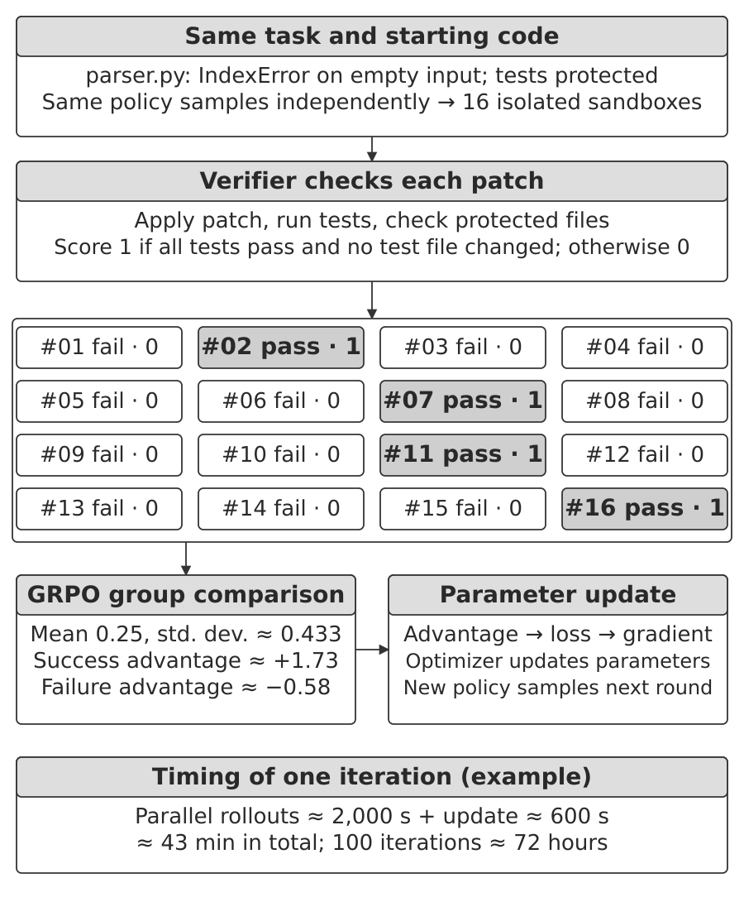

In Figure 8-13, the same problem is sampled 16 times—how many **training iterations (steps)** is that? By this section's count, these 16 rollouts belong to the same batch. Round $k$ samples with the current policy, computes rewards, advantages, and gradients, and updates the policy once; only round $k+1$ resamples with the new parameters. Training for 100 steps means doing about 100 rounds of such iterations.

This allows a rough estimate of training time. A complex task may involve dozens of rounds of tool calls; when synchronous training waits for the whole batch, the slowest of the 16 parallel trajectories determines when the sampling phase ends. Suppose it takes about 2,000 seconds, and gradient computation and the optimizer update take another 600 seconds; one step then takes about $2{,}000+600=2{,}600$ seconds, or 43 minutes. Training 100 steps in a row at this pace takes about 72 hours.

PPO and GRPO both follow this loop; the main difference is "what to compare against." GRPO compares multiple rollouts of the same problem directly, needing no additional value model; PPO trains a value model to estimate "how well things usually go" at each step of a trajectory and then judges whether the current action does better than that expectation, providing the baseline needed for step-by-step credit assignment. Both use mechanisms such as a clipped surrogate objective to suppress overly large updates. DPO is different: it learns directly from pre-collected "better response–worse response" preference pairs and does not have the current policy generate this group of rollouts online.

The cases in this chapter use different training recipes: AdaptThink uses a custom constrained objective; GeneralPoints, V-IRL, and ReTool use PPO, with the value model participating in advantage estimation in the first two; SimpleVLA-RL and RLVP use GRPO.

Suppose problems A and B are each attempted four times; A is solved every time and B never. A's four rewards are all 1 and B's are all 0. After subtracting each group's mean, the advantages of both groups become 0. If there is compute to try a few more times, which problem is more likely to yield useful training samples?

Never Give Up builds this choice into the sampling process. Problem A was solved every time, so that group is skipped; problem B failed every time, so another group is added with some probability. Suppose the second group finally gets one right; training then puts both groups' eight responses together: one correct solution and seven incorrect ones, giving the same problem rewards that differ. Asynchronous sampling lets the other problems proceed as usual without waiting for B's results.[^ch8-ngu]

[^ch8-ngu]: Michael Noukhovitch et al., *Learning to Solve Hard Problems in RL for LLMs by Never Giving Up*, 2026. The extra sampling described there is used for training; problems already solved can still be drawn again later in training.

### Why LLM RL Usually Prefers On-Policy Training

**Online** and **on-policy** describe two different aspects. Online training keeps interacting with the environment and producing data while it runs; on-policy training concerns the source of the data, requiring that the behavior policy $\mu$ that generates trajectories be the same as, or close enough to, the policy $\pi_\theta$ being optimized. An asynchronous cluster can keep sampling online, but if a worker lags several checkpoints behind, the data it returns carries policy staleness and contains an off-policy component.

I recommend first establishing a stable baseline with near-on-policy training, then introducing asynchronous sampling or reuse of old data to raise throughput. The PPO/GRPO recipes in this chapter usually sample with the latest policy at the start of each step. PPO then performs several epochs of minibatch updates on the same batch of data, and the current policy gradually drifts away from the `old_policy` that generated the data. The probability ratio measures this drift, and the clipped objective suppresses overly large updates.

The policy-gradient objective concerns the expected reward under the current policy $\pi_\theta$. When using data sampled by a behavior policy $\mu$, you can first compute the ratio of action probabilities in the same state and build an importance correction from it:

$$
\rho_t=\frac{\pi_\theta(a_t\mid s_t)}{\mu(a_t\mid s_t)}
=\exp\left(\log\pi_\theta(a_t\mid s_t)-\log\mu(a_t\mid s_t)\right).
$$

Suppose that after the same prefix, the sampling policy chose a certain token with probability 0.2, while the current policy gives it probability 0.3; the probability ratio for this step is then 1.5. Such samples appear too rarely among the old samples, so when estimating under the current policy their weight is raised accordingly. If sampling and training use the same policy, the probability ratio at every step is 1 before any parameter update.

Reusing old trajectories lets sampling and training run asynchronously, raising throughput. But the further apart the two policies are, the more likely a few samples are to receive very large weights. When reweighting a whole trajectory, the per-step probability ratios must also be multiplied together. PPO clips away part of the extra gain in each action's surrogate objective, which weakens the influence of extreme probability ratios; states the old samples never reached, however, can only be seen through fresh sampling. This is also why I prefer fresh trajectories.[^ch8-32]

#### Numerical Mismatch Between Training and Inference

Large-scale LLM reinforcement learning usually samples with inference engines such as vLLM and SGLang, then computes log probabilities and gradients with training systems such as FSDP and Megatron. Even when both sides load the same weights, differences in floating-point precision, reduction order, tensor parallelism, batch size, KV Cache, and fused kernels can produce slightly different log probabilities for the same token. In that case, $\rho_t$ already deviates from 1 before the parameters have been updated, and a numerical policy mismatch appears between training and sampling. Controlled experiments have found that even tiny token-level differences can cause training to collapse.[^ch8-33]

Once the sampling distribution shifts, a naive policy gradient may favor one of two actions even when their rewards are exactly the same. Suppose that at sampling time A and B each had a 50% chance, while at training time the model's probability of choosing A has become 0.8. For the logit controlling A, the gradient of the log probability is $1-0.8=0.2$ when A is chosen and $0-0.8=-0.8$ when B is chosen. If both actions score 1, averaging by the sampling-time probabilities gives a gradient of $-0.3$. The two choices score the same, yet the update pushes down the probability of A.

Score centering subtracts from the log-probability gradient under a given prefix its mean under the sampling distribution. In the example above, subtracting $-0.3$ turns the two terms into $0.5$ and $-0.5$, so identical rewards produce an average update of exactly zero. GRPO, earlier, subtracts the mean from the rewards of a group of responses; here, what gets centered is the gradient.[^ch8-sc]

[^ch8-sc]: Martin Marek and Max Ryabinin, *Score Centering Stabilizes Off-policy Reinforcement Learning*, 2026. When the sampling policy lags too far behind, KL regularization can also be used to constrain the distance between the training policy and the behavior policy (arXiv:2611.21791).

Numerical errors between the training side and the sampling side are also amplified along long sequences: **log-probability error → probability-ratio bias → accumulation over long prefixes → changes in clipping and advantage weighting → changes in gradients and effective sample size**. For example, if the log probability ratios of 4,000 tokens all carry a $10^{-3}$ bias in the same direction, the computed trajectory-level probability ratio will be $e^{4000\times0.001}=e^4\approx54.6$ times the true value.

Early probability changes can also alter the sampling results, sending subsequent states down a different path. Signals observable during training include spikes in the importance ratio, a rising clipping fraction, abrupt changes in gradients or response length, and drops in reward and entropy. When changing the batch size changes the reduction process, the numerical results for the same input may also change, which means batch invariance is broken. Related research has observed the implicit off-policy effect this produces and improved stability by aligning the sampling and training computations, or by explicitly correcting the policy mismatch.[^ch8-34]

I therefore list numerical consistency between sampling and training as a core check before training starts, and monitor it continuously alongside the reward curve. It can be handled in four steps: "measure the mismatch, align the configuration, correct the bias, control staleness":

- **Before any parameter update**, compare the token log probabilities given by the sampler and the trainer on the same batch of trajectories, and monitor the mean, quantiles, and maximum of $\rho_t$, the approximate KL, and the clipped fraction; this is the most direct on-policy unit test.
- When syncing weights, also align the LoRA adapters, tokenizer, chat template, model version, and positional encoding configuration. Rollouts should save the log probabilities the sampling policy gave at generation time, to be used later for computing probability ratios.
- Align the precision, parallel layout, and key compute kernels of sampling and training as far as possible; where that cannot be done, explicitly treat the difference as off-policy, apply importance correction, monitor the effective sample size, and use the clipping fraction to judge how well the correction works.
- Resample promptly with the updated policy, and limit both the number of update epochs per batch of data and the number of checkpoints asynchronous sampling may lag behind training.

## RL Environments: From Evaluation to Simulation

RL training for Agents requires executing tasks over and over. A code repair can be retried in an isolated copy, but a payment changes the state of a real account. A training environment must provide resettable initial states, parallelizable task copies, and verifiable results, so the model can explore different paths under controlled conditions. Chapter 7 already introduced evaluation environments; for training, long-running operation, the side effects of actions, and the cost of massive interaction must also be considered. I allocate staff and budget to environment building first, then schedule large-scale training. Implementing realistic feedback, state reset, and parallel isolation often consumes more engineering resources than integrating PPO or GRPO, and the cost of building environments may exceed that of the training itself.

### Environments: Where the Model Practices

An environment updates its state according to actions and returns new observations to the model. When building an environment, start from three questions.

- **Is the interaction close to the deployment scenario?** A customer-service simulator needs to cover users adding information, changing their requests, and expressing themselves vaguely; a tool simulator needs to return the errors and latencies common in production. Through this feedback the model learns to handle real problems. Overly uniform feedback makes the policy depend on the fixed routines of the simulation.
- **Can tasks be retried and run in parallel reliably?** Each rollout needs its own independent order, file, or account state, which can be cleaned up and restored afterward. ReTool's code interpreter sandbox and AWorld's MCP sandbox both serve this purpose. For real APIs with rate limits, fees, or write side effects, use sandbox accounts, replayed data, or mock interfaces as the task requires.
- **How are results judged?** Environment state is an important basis for computing rewards. For example, a refund task can check the amount, order status, and authorization conditions; a code task can run the tests. Reward design is discussed separately later.

**Before you start tuning algorithms, I recommend checking first: is the simulation environment close enough to the real task? That matters more than choosing between PPO and GRPO.** Fidelity, resettability, and verification capability together determine what the model can learn from interaction. Getting all three working on a small number of tasks before scaling up training usually makes problems easier to locate.

### Using Models to Simulate Tools and Environments

Search results, user conversations, and complex business state can all be synthesized with the help of a model. A model simulator receives the Agent's actions and generates the next feedback, reducing dependence on live external services. This approach can extend from a single tool to an entire task environment.

**The first level: synthesizing tool return values.** ZeroSearch[^ch8-13] has an LLM play the search engine: the student issues a query and the simulator generates retrieval results. This reduces training's dependence on the fees, rate limits, and result variability of a real search API. It also uses a curriculum, returning high-quality, highly relevant documents early on and then gradually adding noise, so the student practices extracting useful information from imperfect material. After training in the simulated search environment, the model in the study still performed well when connected to a real search engine.

**The second level: simulating the environment's state transitions.** DreamGym[^ch8-14] distills environment dynamics into a reasoning-based experience model. The model reads the current state and the Agent's action, infers the next state and feedback, and generates interaction trajectories in bulk for online RL, reducing access to the real environment. Customer-service and sales tasks can also have an LLM play the user, simulating follow-up questions, additional information, and changing requests. The τ-bench series uses user simulators; similar interaction frameworks can also be used for training, serving practice and evaluation respectively.

Model simulators also need calibration. If a customer-service simulator always understands vague questions perfectly, the policy loses the chance to practice clarification; if a search simulator always returns the right documents, the policy gains no experience identifying noise. Training may also reinforce behaviors that exploit flaws in the simulator's scoring. I recommend a hybrid approach: let model simulation handle most of the interaction, then periodically check the policy's performance on tasks in the real environment and feed the discrepancies found back into the simulator. This forms an iterative loop of "synthetic interaction → real-task evaluation → simulator correction."

How do you know a simulator can really teach tool use? Try a small test: on the same initial order, query it, submit a modification, then query again, and check whether the returned order fields change as the action should have made them change. Then reset the environment and confirm that the original values can be read again. An environment that can only generate a plausible-sounding "modified" message but shows no change on the next query rewards a policy that talks well, even if it never changes the order.

### Environments, Task Distribution, and Evaluation Isolation

The training environment determines what the model can experience. Resettable state supports retries, isolated copies support parallelism, and explicit state and verification rules support reproducibility and scoring. Tasks can follow the data synthesis method described earlier: extract task blueprints from real business logs, strip identity information, and then generate fictional people, orders, files, and initial states.

Training and evaluation can reuse the task generator and verification code, while the specific tasks should be divided into separate sets. Following the environment designs of SWE-Gym, τ²-bench, and AndroidWorld[^ch8-28], acceptance tests, the hidden state needed for scoring, and reference solutions are kept on the verifier side, and the Agent obtains observations through the interface defined by the task. Before scaling up sampling, use a small number of rollouts to check whether the tasks can be completed and whether the verifier can distinguish valid results from invalid ones. Catching scoring bias early reduces the policy's opportunities to exploit loopholes in verification.

The order of environment engineering should therefore be: **task blueprint → resettable environment → result verification → training/evaluation isolation → calibration against real interaction**. The data synthesis described earlier selects valid trajectories from these environments to form SFT demonstrations. Once in RL, the current policy keeps trying things in the environment, exploring paths beyond the demonstrations.

Verification must also be included in the throughput budget. The Lean kernel, test runners, and container execution consume CPU and memory. When GPU generation outpaces verification, tasks pile up in the verification queue. In that case, add verifier workers, shorten verification latency, or adjust the ratio of resources between generation and verification[^ch8-9].

## From Single-Turn to Multi-Turn: Task Scenarios and Credit Assignment

### The Core Challenge of Multi-Turn Tasks

The left side of Figure 8-14 shows the 24 game. The model can work through several steps within its answer, but all of them use the four cards given in the problem, with no new observations from the environment along the way. The right side shows street-view navigation. Only after reaching an intersection and choosing to turn left can the model see the street around the corner. Where to go next must be judged afresh from the street signs in front of it. ReAct, covered in Chapters 1 and 4, can organize this kind of interaction: the model chooses an action, a tool or the environment executes it, and the new observation enters the next round of decision-making.

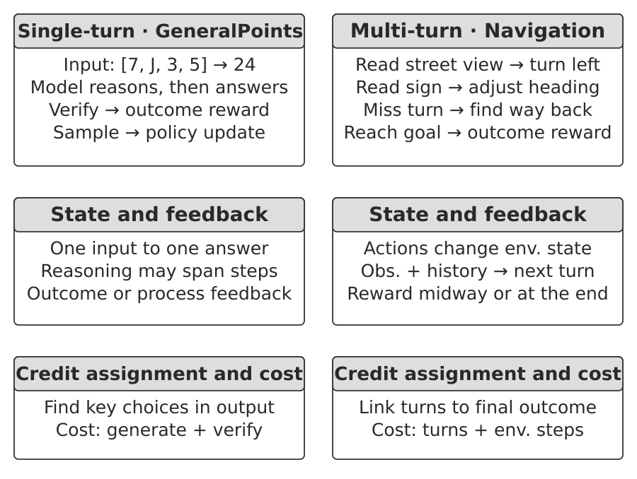

In Figure 8-15, the Agent misses an intersection at step 3, realizes at step 4 that it has gone the wrong way and turns back, and reaches the goal at step 5. The terminal reward credits the whole trip but does not distinguish the wrong turn from the timely U-turn. The next time it meets this intersection, we want it to go the right way directly; if it does go wrong again, turning back should still be encouraged. Training must estimate how much each earlier step contributed to the final payoff, a problem called **credit assignment**. Value and advantage estimates can make use of later returns; when intermediate actions can be checked reliably, process rewards can also be added. The U-turn at step 4 scores 0 under the process reward, yet it still helps reach the destination. Estimating the value of this step must also take the later return into account.

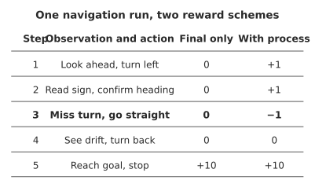

The same problem arises in customer-service calls. Suppose the user gives a positive rating in turn 10. Clarifying in turn 2 which charge was disputed and explaining the fee in turn 7 may both have helped. From the final positive rating alone, you cannot tell how much each contributed. The next two experiments discuss, respectively, the case where the trainer can check navigation actions step by step, and the case where whether the robot succeeded can be judged only from the task outcome.

> **Experiment 8-12 ★★★: V-IRL-VL—Multi-Turn Visual Navigation**
>
> In V-IRL[^ch8-24], the Agent must find its destination step by step from the street view in front of it. Training uses routes in New York, and testing switches to other cities, changing both how directions are phrased and the street scenes in the images. On both kinds of out-of-distribution tests, rule changes and visual changes, RL performs clearly better than SFT. The experiment uses PPO with a value network. Giving feedback at every step helps tell which decisions along a long route are worth keeping.

> **Experiment 8-13 ★★★: SimpleVLA-RL—Open Exploration Under Outcome Rewards `[Extended Experiment]`**
>
> SimpleVLA-RL uses a success/failure outcome reward on LIBERO robot tasks. Each task uses one demonstration trajectory for an SFT cold start; RL then raises the success rate from 17.3% to 91.7% and produces a "pushcut" action never seen in the demonstrations. Compare this result with street-view navigation: if you can reliably determine which intermediate step went wrong, you can give feedback on the spot and speed up learning. If you do not yet know all the ways the task can be completed, rewarding by outcome first leaves the model room to try other paths. Writing the action order from human demonstrations into the reward too early may push down the score of new strategies such as "pushcut."

### Tool Calling: Learning to Use External Capabilities Through Interaction

With external tools connected, the model can choose to search, execute code, modify files, query databases, or combine several APIs as the task requires. The Harness validates and dispatches the calls, and the tools execute in the environment and return observations. Figure 8-16 separates the decisions within one task from the training that follows the task. Following the arrows on the right, a tool result returns to the current task, and the model uses it to decide the next step. Reading downward, only after the task ends does the training program use the whole trajectory to compute rewards and update parameters, and the next round of sampling uses the new policy. When a task calls several tools in succession, the result returned by one call affects the arguments of the next.

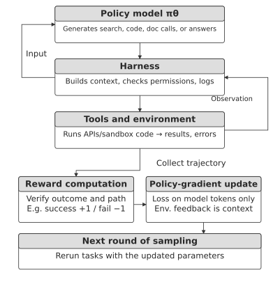

Search-R1[^ch8-25] trains a model to decide when to search and what query to submit, and to continue reasoning with the results. ReTool connects a code interpreter to the same kind of loop, so the model learns to schedule code execution, understand return values, and make corrections based on errors. AWorld-train extends this to an MCP multi-tool sandbox, where the model must choose tools and handle dependencies between calls, and the training system must also be able to reset the environment and replay trajectories.

Tool trajectories must distinguish tokens generated by the model from tokens returned by the environment. When computing the policy loss, only actions generated by the model—reasoning, call arguments, responses, and so on—count toward the loss, and the positions corresponding to environment feedback are masked. The feedback still participates in later computation as context, helping the model judge what to do next. For example, if the interpreter returns an error, what training should reinforce is how the model then fixes its code. If the error text also counted toward the policy loss, the update would mix in the objective of "generating environment output," drifting away from the decisions the model is actually responsible for.

> **Experiment 8-14 ★★★: ReTool—Code Interpreter-Enhanced Math Problem Solving**
>
> Figure 8-17 uses a quadratic equation to show how text reasoning, code generation, and interpreter feedback alternate.
>
> 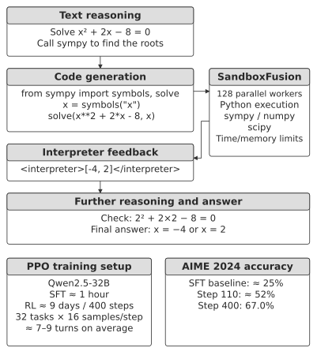
>
> After an SFT warm-up, ReTool performs PPO training with interleaved text thinking, code execution, and interpreter feedback. The model gradually learns when running code is worthwhile and how to revise after an error. The training data here comes from DAPO-Math-17k, while the policy update still uses standard PPO[^ch8-26][^ch8-27].
>
> After training, the model's accuracy on AIME 2024 rose from about 25% to 67.0%. Compared with text-only RL, code feedback lets the model learn precise calculation and error correction faster.

> **Experiment 8-15 ★★★: AWorld-train—Learning to Use Tools in a Sandbox**
>
> Go once around the upper half of Figure 8-18: the model receives the result of a tool call and can keep trying. Then go around the lower half: this batch of tasks has ended, the training program receives the trajectories with their rewards and updates the parameters, and only the next batch of tasks uses the new policy.
>
> 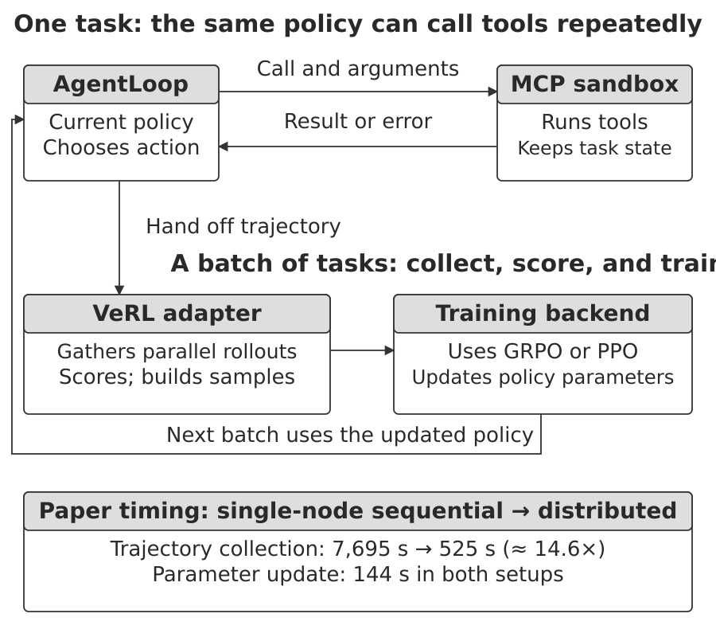
>
> The GAIA environment has 26 MCP servers and 126 tool functions; it can drive web pages with Playwright, extract content from PDFs, Word documents, and slides, transcribe audio, recognize text, or execute code in an E2B sandbox. The Excel tools provide 29 operations, including formulas, charts, and pivot tables, and knowledge retrieval can also access Wikipedia, arXiv, and Wayback. After the sandbox is reset, the model can retry from the same state, or earlier trajectories can be replayed.
>
> The timings in the figure come from the paper's collection comparison. The companion experiment also provides a training configuration for a 4B model: Qwen3-4B-Thinking-2507, 8 A100s, a context limit of 131K, at most 32 rounds of interaction, batch size 32, 16 trajectories sampled per problem, GRPO updates, and a learning rate of 1e−6.

A tool returned a result—which step should the training program reward? A successful call shows only that the tool executed successfully. To judge whether the step advanced the task, a verifier must check the change it caused before deciding what reward to give the model.

## Reward Design: Turning Task Goals into Learning Signals

Imagine two refund trajectories that end up returning the same amount, one of which skipped a required identity verification. If only the final balance is read, they get the same score. To turn the full requirements the user delegated into a learning signal, first determine who can verify the result, at which step the evidence can be obtained, and what information needs to be passed back to the model; then check whether the permission and process constraints along the path can be verified separately.

### Where the Reward Comes From: Rules, Human Preference, and Model Judgment

For tasks that can be judged automatically, I prefer **Reinforcement Learning with Verifiable Rewards (RLVR)**, which writes the acceptance requirements directly as programs. A math problem can have its answer checked, a code task can run tests, and a refund task can check the amount and order status in the database. Recording a pass as 1 and a failure as 0 yields the simplest outcome reward. Clear rules and reproducible runs make scoring discrepancies easy to locate; the verifier's coverage determines which requirements training is actually optimizing.

**Reinforcement Learning from Human Feedback (RLHF)** turns human preferences into a training signal. InstructGPT[^ch8-4] first collected human comparisons of responses, trained a reward model, and then optimized the policy with PPO. A reward model learns the preferences in a finite sample, and relentlessly pursuing higher model scores may amplify its biases[^ch8-5]. Training often adds KL regularization relative to the SFT reference model to control policy drift. DPO[^ch8-6] instead optimizes the policy directly from "better response–worse response" preference pairs, skipping the step of training a separate reward model.

For open-ended tasks, a model can give an evaluation rationale and a score. The diagnoses produced by a **Generative Reward Model (GRM)** can also be used to filter demonstrations, construct preference pairs, or guide later revisions. DeepSeek-GRM[^ch8-23] generates evaluation principles for the task and then gives critiques and scores based on them; it improves its evaluation behavior through online RL and aggregates judgments using multiple samples and an auxiliary reward model.

The gap between evaluation metrics and task goals also affects model behavior. **Reward hacking** is when a policy exploits flaws in the scoring rules or their implementation to obtain high scores. Long-horizon Agents show a related phenomenon known as **reward seeking**: the model acts according to how it guesses it will be scored—for example, choosing on its own a check that is easy to pass and ending the task once the check passes[^ch8-29]. This example tells us that acceptance conditions should start from the user's goal and cover the real deliverables; checking only metrics the model picked for itself easily misses requirements that are still unfinished.

When designing the reward for a refund task, first run two hand-written trajectories through the verifier. Trajectory A looks up the order, calls the refund interface, and repeats the receipt back to the user; trajectory B just says "the refund is complete." If the two get the same score, first find out whether the grader actually read the final reply, the interface receipt, or the order status. This tiny counterexample is enough to expose the problem with a proxy metric, sparing you the cost of discovering, only after a whole training run, that the model has learned to announce success prematurely.

### When the Reward Is Given: Outcome and Process

An **outcome reward** evaluates task performance after an episode ends; when a model performs the outcome evaluation, it is called an **ORM (Outcome Reward Model)**. The success/failure reward in SimpleVLA-RL lets the policy explore different action sequences around the final goal. Such a signal is easy to define, but after a long trajectory fails, the model needs more attempts to tell which actions caused the failure. This is one reason sparse feedback hurts sample efficiency[^ch8-8].

Take the case of a Coding Agent finishing prematurely: after the model submits a claim of completion, the Harness runs protected acceptance tests in an isolated workspace. The tests read the real files and environment state, giving a positive reward on a pass and a negative reward on a failure. This way, a claim of completion triggers external verification, and the task outcome is determined by the deliverables. For evaluation, prepare two sets of tasks: one where work still remains, to measure the premature-completion rate, and one that is already finished, to check whether the model can wrap up in time.

A **process reward** provides feedback on intermediate steps—for example, evaluating identity verification, argument selection, navigation actions, or reasoning steps. A model used to evaluate the process is called a **PRM (Process Reward Model)**. OpenAI's "Let's Verify Step by Step"[^ch8-7] studied step-by-step verification in mathematical reasoning. Process signals can help the model locate errors, but they also add annotation and verification cost. Treating one particular solution order as the only correct path also pushes down the reward of other valid strategies. I therefore add process signals only for intermediate events that can genuinely be verified, letting the model keep exploring multiple valid solutions. V-IRL-VL (Experiment 8-12) uses step-by-step navigation feedback and SimpleVLA-RL (Experiment 8-13) uses a terminal reward, showing two tasks' different choices of feedback granularity.

In practice, first establish an outcome-reward baseline, then add process signals for intermediate events such as identity verification being completed or tests passing. Multi-turn tasks of finite length can use a discount factor of $\gamma=1$, so the terminal reward keeps the same weight as it propagates backward. PPO uses value estimation and advantage computation to associate feedback with each step's action; GRPO with trajectory-level advantages usually uses the same advantage weight to compute the policy loss for every generated token in that trajectory.

### How Much Information the Reward Must Express: Scalars, Vectors, and Generative Diagnoses

When the reward appears determines the density of feedback; what the reward contains determines its form of representation. A scalar summarizes overall performance; a semi-scalar form, "brief rationale + score," adds the basis for the score; a vector expresses dimensions such as accuracy, completeness, and cost separately; a generative diagnosis spells out the specific problems and how to fix them, and can also be aggregated over multiple samples.

- When there is a definite answer or an acceptance test, start with a binary scalar.
- When there are multiple quality goals, score them separately, then weight them or set constraints according to business requirements.
- When evaluation requires explanation in context, generate a diagnosis and calibrate it with fact checking and human spot checks.

For example, a customer-service task can record, at the same time, whether the issue was resolved, the number of conversation turns, and whether identity verification was completed. The three dimensions correspond to effectiveness, cost, and process requirements. Before using them for training, first check whether the scoring is stable and whether it can distinguish the behavior of trajectories in the same group. I start with a small number of reliable metrics and add dimensions only after validating each one. Every unvalidated scoring item may let the model optimize along a new proxy metric without improving the real task.

### Path Constraints and RLVP

Completing a task may also involve independent behavioral requirements: contacting users during business hours, completing identity verification, leaving protected files unchanged. RLVP (Reinforcement Learning with Verified Penalty)[^ch8-9] combines an outcome reward with verifiable path penalties, on the principle of **reward the outcome, penalize the path**. Path rules are triggered by observable actions in the environment, while the completeness of the deliverable continues to be checked by task acceptance.

Two repairs both pass acceptance, but one of them directly overwrote a file it should have read first. Checking the tool records is enough to locate this violating action; judging how much each earlier step contributed to the final success is much harder. The simplest approach is to give the whole trajectory one score, $R=O+\beta\Phi$: $O$ is the task score, $\Phi$ aggregates violation penalties or verifiable progress, and $\beta$ sets the relative weight of the two. This distinguishes the two repairs, but every action in the same trajectory receives the same signal.

If you know in which turn the violation occurred, you can also assign the penalty to that turn. Look at the two test trajectories in the companion implementation: A completed the task but violated a rule in its second turn; B did not complete the task, but both its turns were compliant. The two trajectories' outcome scores are 1 and 0, which become +0.5 and −0.5 after subtracting the group mean. Each trajectory has two turns of actions, and each turn accounts for 10 action tokens. Under the `c2` configuration in the implementation, the two signals are counted separately:

```python
outcome_weight = (1 - 0.5) / 40  # spread the outcome signal over all 40 action tokens in this batch
penalty_weight = -0.3 / 10       # spread the violation penalty only over the 10 action tokens of A's second turn
first_turn = outcome_weight
second_turn = outcome_weight + penalty_weight
```

In A's first turn, each action token receives a weight of +0.0125; in the second turn, −0.0175. Two actions within the same successful repair can therefore receive training signals in opposite directions. Only after such weights enter the policy loss does the optimizer update the parameters accordingly. In a customer-service task, as long as the tool records can identify which turn skipped the authorization check, penalties can be assigned the same way.

The role of path signals can be understood through within-group differences. If a group of GRPO trajectories all have the same outcome reward, the advantage computed from that reward is zero; if their numbers of violations differ, the path penalty provides a new basis for comparison. Partial-progress rewards follow the same condition: the model must at least sample different degrees of progress for them to discriminate.

When designing path rewards, follow four rules: penalize clearly defined violating actions; keep the task outcome reward; provide a reachable compliant path for the constrained behavior; and use verification rules that can be executed repeatably. For example, penalizing every operation on its own encourages the model to stand still; only by keeping the task success reward can you also push it to get the work done. When the base model has difficulty generating compliant paths, first establish a starting point with a small number of demonstrations, then gradually reduce the reliance on path shaping through training.

> **Experiment 8-16 ★★★: RLVP—Reward the Outcome, Penalize the Path**
>
> The experiment adds an outcome reward $O$ and a path signal $\Phi$ to GRPO and compares against a pure outcome reward. On TerminalBench proxy tasks, the number of violations fell from 3.71 to 0.66 while the success rate stayed essentially flat; on miniF2F proxy tasks, adding a reachable partial-progress reward cut the iterations needed to reach a 0.9 success rate from 7.0 to 4.4.
>
> Software repair tasks also show the role of signal reachability: when no rollout can pass any test, a progress reward computed from the number of passing tests is always the same and cannot add any within-group difference.

The average number of violations dropped to 0.66, which means the model chooses compliant paths more often but still occasionally violates the rules. For restrictions that must be obeyed, permissions must also be checked when tools execute.

## Distillation: Improving Sample Efficiency

A single Agent rollout often contains multiple rounds of model generation and tool execution. Improving **sample efficiency** means reaching the target performance with fewer environment interactions. Training steps, GPU time, and environment calls each reflect a different cost and need to be considered in light of the task. For example, in this chapter's ReTool case, SFT training takes about 1 hour and RL about 9 days, with repeated sampling and tool execution consuming most of the resources.

With a terminal reward, an entire trajectory may receive only a single success-or-failure score. Suppose the business tool has already indicated "the last four digits of the credit card are required," yet the Agent omits this information and ends up with a reward of 0. Training still has to work out from many attempts whether the failure came from a missing field, a wrong tool argument, or a later operational mistake. If a teacher can provide step-by-step supervision on this trajectory, the same environment interaction can produce a finer-grained learning signal.

### On-Policy Distillation: Making One Rollout Produce Dense Supervision

In **On-Policy Distillation**, the student generates the trajectory and the teacher provides supervision on the prefixes the student actually generated. Thinking Machines Lab systematically demonstrated this training approach in 2025 research[^ch8-10]. To understand the three classes of methods, separate "who produces the training states" from "who provides the learning signal":

| Method | Who Produces the Trajectories or States | Main Learning Signal |
| --- | --- | --- |
| SFT / off-policy distillation | Human or teacher demonstrations | Token-by-token supervision on the target answer |
| On-policy RL | The current student | Outcome or process rewards |
| On-policy Distillation | The current student | The teacher's token-by-token probability evaluation of the student's prefixes |

For example, the teacher's demonstrations always look up the order before requesting a refund, but the student may initiate the refund first and receive a "missing order number" error. On-policy distillation has the teacher evaluate the state the student has actually reached, guiding it on how to look up the missing information. Training thus covers the student's own mistakes and recovery paths.

One implementation minimizes the reverse KL between student and teacher on the prefixes generated by the student:

$$
D_{\mathrm{KL}}(\pi_\theta\Vert\pi_T)
=\mathbb{E}_{a\sim\pi_\theta(\cdot\mid h)}
\left[\log\pi_\theta(a\mid h)-\log\pi_T(a\mid h)\right],
$$

where $h$ is the current prefix, $a$ is the next token, and $\pi_\theta$ and $\pi_T$ denote the student's and teacher's distributions respectively. Tokens the teacher considers more appropriate receive a more favorable training signal. In implementation, you can compare the full distributions, or query the teacher's log probabilities for the tokens the student has already sampled to construct a token-by-token optimization signal.

Take "first query the API, then parse the return value." Suppose that at some position the candidates "query" and "call" each correspond to one token, and the teacher gives them probabilities of 80% and 15% respectively, with the remaining candidates totaling 5%. This provides a basis for choice far finer than final success or failure. If a trajectory contains $T$ model-generated tokens, supervision can be obtained at roughly $T$ positions; tool return content is still used as context and is masked in the policy loss.

The process can be written in the form of full-distribution alignment:

```python
trajectory = rollout(student, task)
loss = 0
for prefix in model_generated_positions(trajectory):
    target = stop_gradient(teacher.distribution(prefix))
    loss += KL(student.distribution(prefix), target)
update_student(loss)
```

The student explores, the teacher supervises at many positions, and the added cost comes mainly from teacher inference. When environment interaction is expensive and the teacher can reliably guide the student, I compare on-policy distillation first, so that every environment call yields more useful learning signal. For a student with insufficient command of the target language, domain knowledge, or basic actions, first establish a useful starting point with Mid-training and demonstration training, then move on to on-policy distillation.

Consistency between sampling and training matters here too: the sampling engine produces trajectories under policy $\mu$, the training engine computes the loss under $\pi_\theta$, and the difference between the two changes the distribution of training states.

Thinking Machines Lab's comparison on math tasks showed a training-efficiency gain of about an order of magnitude. In multi-turn Agents, the same kind of comparison can be used while recording task success rate, number of environment calls, and teacher compute cost. The states the student encounters in the environment and whether the teacher can give reliable feedback jointly determine the gain.

My collaborators and I also compared DPO, four RL recipes, and on-policy distillation on a "time-sense" task[^ch8-11]. The first several recipes ran into, respectively, sparse rewards, misaligned objectives, mismatched rollout shapes, and policy collapse. After switching to a frozen Qwen3-32B teacher and aligning token by token on the student's own multi-turn trajectories, training converged smoothly, and pass rates under the four conditions were 23–47 percentage points higher than a same-source SFT baseline. This experience made me value the signal density each interaction provides all the more. When every intermediate decision in an interaction can take part in learning, the value of existing trajectories is put to much fuller use.

If one math teacher is good at reasoning and one code teacher is good at fixing programs, how can a single student learn the strengths of both? Multi-teacher on-policy distillation (MOPD) keeps the training process above and simply replaces the fixed teacher with one chosen according to the problem's domain. When the student works on a code problem, even if it has taken a detour halfway through, it hands the prefix it has already written to the code teacher and gets the probability distribution for the next step; for a math problem, the math teacher provides guidance during the student's solution. Teachers for each domain can first be trained independently, with their parameters frozen during the distillation stage. At deployment, only one student needs to run.[^ch8-mopd]

There are two practical conditions here. First, computing the token-by-token KL above requires obtaining teacher probabilities that can be aligned with the prefixes the student produced. If all you have are a few complete answers written by a teacher, you can use them for SFT, but they are not enough to compute this loss. Second, at acceptance time, break down the scores by domain. When the student's math scores rise while its code scores fall, a rising overall average easily masks the regression.

[^ch8-mopd]: Wenhan Ma et al., *MOPD: Multi-Teacher On-Policy Distillation for Capability Integration in LLM Post-Training*, 2026. The paper uses teachers trained per domain and distills on the student's own trajectories.

### On-Policy Self-Distillation: Building a Teacher from Extra Context

If the team has only one model that is good at the domain, who serves as teacher? You can give the same problem to it twice. The first time, give the user's question under deployment conditions; the second time, also give the reference answer, an expert demonstration, or domain documentation. The extra information available in the second attempt can be used to guide the student under the first set of conditions.

**On-Policy Self-Distillation (OPSD)**[^ch8-15] has the same model play two roles: the student sees only the task input, while the teacher additionally sees the reference answer or an already verified solution. After the student generates a trajectory, the teacher uses this privileged information to evaluate each prefix and passes the supervision back to the student.

For example, the student is solving a math problem and the teacher already knows the correct answer. The teacher can use it to evaluate the student's current direction of reasoning, and the student learns to improve its own generation with only the problem available. The following pseudocode shows where the extra context and the gradient isolation come in:

```python
trajectory = rollout(model, task_without_answer)
loss = 0
for prefix in model_generated_positions(trajectory):
    privileged_prefix = add_verified_answer(prefix)
    target = stop_gradient(model.distribution(privileged_prefix))
    loss += KL(model.distribution(prefix), target)
update(model, loss)
```

Privileged information enters only the teacher branch during training; the student's input and the evaluation input stay the same as at deployment. You can follow the pseudocode to check the two information paths: the reference answer enters only the line that constructs the teacher's prefix, so the student never sees it at deployment; the teacher's output goes through a stop-gradient, so in this step only the student branch updates its parameters according to the difference between the two distributions. When the next round uses the updated model, the teacher's judgments may change along with it. In this way, the same model can use the richer information available on the training side to supervise its own actual generations.

Privileged information can also come from human demonstrations or curated domain documents. When choosing it, check whether it improves the teacher's judgment: the better the informed teacher can identify the student's mistakes, the more useful the distillation signal. During training, also use samples set aside in advance for testing to check existing capabilities and generation style; research such as Purified OPSD further uses regularization constraints to help the model keep its original reasoning style[^ch8-16].

## From Problem Cases to Post-Training

Chapter 7 turned production problems into reproducible tasks, failure attributions, and evaluation criteria. These materials can also be used for post-training: complete tasks provide the interactive environment, trajectory prefixes before the error provide the decision context, and verifiers check newly generated behavior. Table 8-5 lists how they map to training methods.

Table 8-5 Chapter 7 Evaluation Materials and Their Post-Training Uses

| Chapter 7 Material | Chapter 8 Training Use |
| --- | --- |
| End-to-end tasks and verifiers | RL sampling tasks, verifiable rewards, task pools for rejection sampling |
| Trajectory prefixes and subsequent behavior | DPO preference pairs, SFT decision demonstrations, teacher inputs for on-policy distillation |
| Failure locations and error categories | Process evaluation labels, verifiable path-penalty rules |
| Per-item Rubric scores and human-annotated reference answers | Multi-dimensional rewards, training and calibration of generative reward models |

A historical prefix can serve as the starting point for a continuation task. When it is used for on-policy distillation, the current student first continues generating from this starting point, and the teacher then evaluates the prefixes the student actually produces; when tools must be executed, the corresponding environment state is restored as well. This connects the local decision evaluation of Chapter 7 to the sampling and training pipeline of this chapter.

Tasks used for training must be kept separate from held-out evaluation tasks. The two sides can share interfaces and verification logic while using independent task instances; when cross-task generalization needs to be examined, the split can also be made by task template or business type. The three examples below show how to make this conversion.

### Case 1: A Coding Agent Finishes Prematurely

An Agent that claims completion without having run the tests, submits after finishing only two of three requirements, or gives up after a few failures is finishing prematurely. In production, such cases can be collected from user corrections, thumbs-down ratings, and trajectory reviews. For example, when a user points out "you haven't run the tests yet," you can go back along the trajectory to check the task state at that moment, the verification evidence available, and the model's claim of completion.

When analyzing the cause, first stop the trajectory at the moment the model is about to say "done," then look back to see whether it missed a requirement or changed the wrong code. This yields two kinds of training material: complete tasks for training the model to finish the work, and decision prefixes for training it to choose, based on evidence, whether to continue or stop.

**Complete tasks can be connected to an outcome reward.** When the model submits its result, run protected acceptance tests, giving +1 on a pass and −1 on a failure. The tests cover the real deliverables; the model can get feedback through normal development testing, while final acceptance is performed by the training environment.

**Decision prefixes can be used to construct preference pairs.** In the same context, the dispreferred sample (`rejected`) is a claim of completion that lacks evidence, while the preferred sample (`chosen`) goes on to run the necessary tests, check the missing requirements, and complete the remaining work. You can have a teacher write several possible continuations, then use the verifier to select those suitable as demonstrations. When samples are scarce, vary the task type, the missing verification items, and the wording of the completion claim to expand them into several hundred preference pairs. Then run DPO with LoRA, mixing in a moderate amount of general tasks to maintain behavioral coverage.

**Evaluation checks both unfinished and finished tasks.** One set of tasks is only partly done, to see whether the model will keep going; the other set is already complete, to see whether it can wrap up in time. Also spot-check general tool calling and other tasks to see whether the targeted training has affected existing capabilities. If you only lower the premature-completion rate, the model may choose to keep verifying every time and drag its feet even on work that is already done. You would then see redundant tool calls and waiting on the set of tasks that was already complete.

> **Experiment 8-17 ★★: From a "Premature Completion" Problem Case to a DPO Fix**
>
> The experiment links "failure attribution → decision prefix → preference pairs → LoRA training → held-out evaluation" into a single pipeline, training a 7B model.
>
> The data contains 24 realistic problem cases covering four situations—claiming completion without running tests, completing only part of a multi-goal request, unmet acceptance conditions, and giving up after errors—including a reward-hacking variant that deletes the failing test. Separately, 12 problems where work still remains and 8 problems that are already done are held out for evaluation only.
>
> Look first at one held-out problem. A message-queue consumer loses messages after reconnecting from a dropped connection; the assistant modified the reconnection code, and the tool reported only "file modified." Should it declare the bug fixed now, or keep verifying? The experiment provides two candidate replies and compares which one the model scores higher. Before training, the model chose correctly on 3 of the 12 unfinished tasks (25.0%); after training, on 11 (91.7%). On the 8 tasks that were genuinely complete, it chose correctly on all 8 both before and after training.
>
> Take away the candidate replies and let the model write the next step itself, and the result is different. Under the experiment's text classification rules, premature declarations of completion on unfinished tasks dropped from 1/12 to 0/12, but explicit wrap-ups on completed tasks also dropped from 6/8 to 0/8. Looking only at the first set, it is easy to think the problem has been fixed. The second set reminds us that the model can recognize when to stop when given two ready-made replies, yet when writing its own reply it may still keep insisting on more checks. Returning to the lost-messages example, the assistant must also actually run a reconnection test and check whether messages are received after reconnecting. Saying "keep verifying" and obtaining a verification result are two separate steps.

### Case 2: Chinese Quotation Marks

"Change the straight quotes in a Chinese article to curly quotes" requires first determining the scope of the edit. Quotations in Chinese natural language can use `“”`, with nested quotations handled according to Chinese punctuation rules; quotation marks in English source text, string literals, JSON, paths, and identifiers each serve their own syntactic function. The training goal is for the model to recognize these scopes and make the minimal edit.

You can first write the rules as a Skill and then generate input and target text from it. Positive examples include Chinese paragraphs, nested quotations, and Chinese comments; protected samples include English quotations, string and character literals, JSON, inline code, and code blocks. For Chinese comments in code, both the comment boundary and the quotation scope must be recognized; fragments whose scope cannot be determined keep their original text. Only by combining these situations in the same document can the model practice the scope judgment that real editing requires.

> **Experiment 8-18 ★★: Scope-Sensitive Chinese Curly-Quote SFT**
>
> The experiment uses Qwen3-8B with bf16 LoRA SFT, training for 2 epochs, 256 updates in total. The training goal is to convert quotations in Chinese natural language while preserving the syntactic quotation marks in code and structured data.
>
> The data combines 16 fragment categories, 10 article genres, and 9 programming languages to generate 1,024 training samples, 256 held-out samples, and 256 boundary samples. Each sample stores the source and target text, covering quotations that need conversion, strings that need protection, and cases where the two are nested.
>
> After training, the exact-match rate was 96.9% on the held-out set and 97.7% on the boundary set, with a 100% preservation rate for protected regions.
>
> The same set of scope rules is used both to generate labels and to check outputs. The model learns to judge the editing scope, while the parser and syntax checks verify the structure of the modified document. Text-editing quality and format correctness can thus be checked separately.

### Case 3: Frequent File-Edit Failures

Chapter 5 introduced tools like `edit_file(path, old_string, new_string)`. The model must copy the original text into `old_string`, and the tool then performs an exact match. A discrepancy in spaces, line breaks, backslashes, or Unicode characters can make the match fail.

First compare segment by segment along the chain of information transfer: **raw file bytes → tool return → Harness serialization → model context → model token output → decoded string → call argument parsing → tool matching**. If the read step changed the bytes, fix the tool; if escaping or context assembly changed the content, fix the Harness; if encoding and then decoding produces a change, check the tokenizer. If the model's input is intact and the discrepancy first appears at the model's generation, the case can be used for post-training on exact copying.

Training data can include three kinds of tasks: repeating specified content verbatim; choosing the exactly matching item from several similar strings of equal length; and writing the original text into the `old_string` field of a tool call. Samples add spaces, real line breaks, backslashes, and different Unicode representations to cover the error-prone spots in real editing.

> **Experiment 8-19 ★★: Exact-Copy SFT for Special Strings**
>
> The experiment uses Qwen3-8B as the base, trained with bf16 LoRA for 2 epochs, with the prompt excluded from the loss. Direct repetition problems use the target string as the demonstration; tool-argument problems use a complete JSON object containing only `old_string` as the demonstration, with field names, quotation marks, and brackets all included in the token-by-token supervision. The experiment also tests the tokenizer's encode–decode consistency separately.
>
> Byte-exact accuracy on the model's held-out set rose from 37.5% to 78.9%, and was 80.1% on an independent boundary set; the mean position of the first diverging byte was 54.0 and 54.2 for the two sets. Separately, 512 probes drawn from the held-out and boundary sets were used to compare three tokenizers, and the lossless round-trip rate was 80.1% for both Qwen3 and Qwen2.5.
>
> After fine-tuning the model got 106 more problems right, but are the problems it used to get right still right? Putting the two answers to each problem side by side, 107 problems went from wrong to right, and one went from right to wrong. The first held-out problem asks for a single JSON object to be returned. The base model copied `old_string` correctly but also returned extra fields such as the file path; after fine-tuning it returned only the field the problem asked for, and that is how it earned the point. The problem that regressed (`eval-095`) asks for two lines of text to be repeated verbatim; the fine-tuned answer joined the two lines together, dropping the line break between them.

Write each of these three cases up as a diagnostic card: keep the input the model could actually see before the failure, write down at least one acceptable action, and then write a contrasting case that "looks similar on the surface but should not be followed." For example, when an edit conflicts, the model should reread the file, whereas when the file is unchanged and the modification has been verified, it may finish. Train on the former, then accept against similar and contrasting tasks that never took part in training; only then can you check whether the model has learned a conditional judgment or simply takes one more step no matter what.

## Post-Training Practical Takeaways

A post-training plan should start from the problem to be solved. Insufficient domain knowledge, an unstable output protocol, and poor action selection each need different data and feedback. I place more weight on the quality of data and environments: they determine which problems the model encounters and what signals it receives, and the training algorithm then turns those signals into parameter updates.

In a project, check in the following order.

1. **Decide where knowledge and capabilities should live.** Stable domain corpora can be used for Mid-training, and demonstrations can teach the model how to respond and act; facts that need timely updates, citation, access control, or deletion are better managed through RAG.
2. **Check whether outputs can be scored.** Measure the JSON parse rate, argument completeness, and tool-call success rate on a small number of tasks. When format errors are frequent, improve them first with SFT or constrained decoding before scaling up RL sampling.
3. **Check the effective context length.** Once the model can accept 128K tokens, you still need to check whether it can complete retrieval, reasoning, and planning at that length. I accept capabilities level by level with a "capability × length" matrix before extending the window, and mix in short samples and data from earlier stages to preserve short-range capability.
4. **Check the sampling probability of valid trajectories.** Observe `pass@k`, partial progress, and within-group reward differences together. When successful samples are very rare, establish a better starting point through Mid-training, SFT, distillation, or curriculum tasks; partial rewards should correspond to progress the current policy can actually reach.
5. **Make the reward cover the task goal.** If you score only by reply length, the model may pad its output. Turn acceptance requirements into tests, state checks, and calibrated evaluation criteria, then check the actual quality of high-scoring trajectories.
6. **Calibrate environment feedback.** Compare user phrasing, tool errors, and state changes between simulation and deployment, and add the differences into training tasks. The cost of building a stable environment should also be counted in the training budget.
7. **Monitor generalization and forgetting with held-out tasks.** Observe both the target capability and existing general capabilities. When training metrics keep improving while held-out performance declines, adjust the data mixture, the number of epochs, or regularization, and choose checkpoints based on validation results.
8. **Watch value estimation and exploration.** PPO's value error affects advantage computation; sampling temperature and randomness affect the diversity of candidate paths. Looking at reward fluctuation, value error, output entropy, and trajectory differences together helps determine why training has stalled.
9. **Measure numerical consistency between sampling and training.** Before updating, compare the log probabilities on both sides, monitor the probability ratio, approximate KL, clipping fraction, and policy staleness, and align weights, templates, and compute configurations.
10. **Estimate cost across the whole pipeline.** RL cost includes model generation, tool execution, verification, parameter updates, and waiting. The ReTool timing comparison shows that sampling can greatly lengthen the training cycle. If SFT already achieves the target performance, resources can go first to additional data and deployment evaluation.
11. **Check the supervision quality of each kind of data.** Spurious associations in Mid-training corpora, noise in SFT demonstrations, and bias in RL verifiers all enter the training signal. Spot-check small batches of data and trajectories before scaling up.

These checks can be combined into a low-cost trial training run: a small amount of domain corpus tests knowledge gains and forgetting, a small number of demonstrations tests whether the behavior is learnable, and a small batch of rollouts tests reward differences and running cost. The trial run provides the basis for the next investment.

**Post-training can also work together with RAG and in-context learning.** Suppose you are building a money-transfer assistant. You can first show the model a few demonstration dialogues and let it try to explain the approval process clearly to users; the more examples there are, the higher the reading time and cost may be on each call. When the policy changes, retrieve the current terms from the knowledge base and cite the source in the answer. When it comes to submitting the transfer, even if the approval limits have not changed in years, a program should verify the amount and the authorization. Choosing a method depends not only on how often the information changes but also on whether the basis for judgment can be written as rules. A natural tone of voice or the shapes in medical images are hard to enumerate with rules, and learning such patterns often depends on parameter training.

A system can first validate the strategy with context, provide evidence with RAG, and enforce hard constraints with programs, then improve the model's capabilities through Mid-training, SFT, and RL. Once the model reaches its target, distillation can also transfer the behavior to a smaller model to lower deployment cost.

How do you verify that "the model has learned judgment from feedback"? In my talk in Porto, I listed having a model continually learn judgment in its weights while retaining its old capabilities as an open problem. Remembering a balance after the user corrects it tests factual memory. To see whether the model has learned how to judge, change the scenario and ask again.

For example, the training material involves a user accepting a flight slightly over budget on a business trip. At test time, switch to an unfamiliar hotel and a new amount; let one problem keep the time constraint of hurrying to a meeting, and have the other state explicitly that this is a family vacation on a tight budget. Both problems present the alternatives available at the time, with the acceptable actions and explanations written down in advance. If the model either pays extra in both or asks follow-up questions in both, that suggests it may have memorized only the surface action. Then replay tasks the old version could already handle, such as strictly respecting a reimbursement cap the user explicitly set.

## Chapter Summary

When the model gets a problem wrong, first let it try a few more times and see where it fails. If `pass@k` is still near zero after reasonable sampling, first check whether domain knowledge or foundational capability is lacking, then decide whether to add corpora through Mid-training. If it cannot read long documents in full, increase the training length step by step and use short tasks to check existing capabilities. If the model occasionally answers correctly but often writes tool arguments in an unparseable format, SFT demonstrations are worth trying first. Only once it can generate a variety of executable trajectories, and the reward can tell better from worse, does RL have a chance to raise the probability that good strategies are chosen.

**I invest in data and environments first.** In the GeneralPoints rule- and visual-transfer experiments, the SFT model trained on limited demonstrations overfit easily, while the RL branch did better on out-of-distribution tasks. Change the demonstrations or the verification method, and the comparison must be run again. In multi-turn tasks such as ReTool, V-IRL, and SimpleVLA-RL, you must also decide which events in tool execution, navigation, or motion control deserve feedback. When a real environment is too expensive, tool returns and state transitions can be simulated, but you must go back to real tasks to check whether the model has learned to exploit the simulator's biases. Some tasks reach their delivery requirements once the foundational knowledge and demonstrations are in place.

**In my view, the main bottlenecks of Agent RL today are sample efficiency and distributional consistency.** Since a single tool interaction is so expensive, can more be learned from it? On-policy distillation has the teacher give token-by-token guidance at the positions the student actually reaches; RLVP uses verifiable intermediate events to supplement the terminal reward. On the other side, if the policy used for sampling has already fallen behind the training version, or the sampler and trainer compute noticeably different probabilities for the same output, investigate that mismatch first before interpreting the reward curve.

Finishing prematurely, editing the wrong scope, and failing to copy strings exactly can all be traced from a single failure to specific training samples. After fixing the problem, run regression checks with independent samples and with tasks the model could already do. When the next batch of failures arrives, which ones are worth training the model again for, and which need only updated knowledge, instructions, or programs? That is exactly the choice the next chapter addresses.

[^ch8-ppo-method]: Schulman et al., *Proximal Policy Optimization Algorithms*, 2017, arXiv:1707.06347.

[^ch8-1]: Schulman, John and Thinking Machines Lab, “LoRA Without Regret”, 2025.
[^ch8-2]: Yao, Shunyu, “The Second Half”, April 10, 2025.
[^ch8-3]: Chu, Tianzhe et al., “SFT Memorizes, RL Generalizes: A Comparative Study of Foundation Model Post-training”, 2025. arXiv:2501.17161.
[^ch8-4]: Ouyang, Long et al., “Training Language Models to Follow Instructions with Human Feedback”, OpenAI, 2022.
[^ch8-5]: Gao, Leo, John Schulman, and Jacob Hilton, “Scaling Laws for Reward Model Overoptimization”, OpenAI, 2023.
[^ch8-6]: Rafailov, Rafael et al., “Direct Preference Optimization: Your Language Model is Secretly a Reward Model”, 2023.
[^ch8-7]: Lightman, Hunter et al., “Let's Verify Step by Step”, OpenAI, 2023.
[^ch8-8]: Silver, David and Richard S. Sutton, “Welcome to the Era of Experience”, 2025.
[^ch8-9]: Li, Bojie, and Noah Shi, “RLVP: Penalize the Path, Reward the Outcome”, 2026. arXiv:2607.07435.
[^ch8-10]: Thinking Machines Lab, “On-Policy Distillation”, 2025.
[^ch8-11]: Li, Bojie, and Noah Shi, “Agents That Sense Physical Time: Urgency, Persistence, and Vigilance as Missing Controls for LLM Agents”, 2026.
[^ch8-12]: Kulikov, Ilia, et al. *Autodata: An Agentic Data Scientist to Create High Quality Synthetic Data.* arXiv:2606.25996, 2026.
[^ch8-13]: Sun, Hao, et al. “ZeroSearch: Incentivize the Search Capability of LLMs without Searching”, 2025. arXiv:2505.04588.
[^ch8-14]: “DreamGym: Scaling Agent Learning via Experience Synthesis”, 2025. arXiv:2511.03773.
[^ch8-15]: Zhao, Siyan, et al. “Self-Distilled Reasoner: On-Policy Self-Distillation for Large Language Models”, 2026. arXiv:2601.18734.
[^ch8-16]: Shen, Ziqi, et al. “Purified OPSD: On-Policy Self-Distillation Without Losing How to Think”, 2026. arXiv:2607.02234.
[^ch8-17]: Tan, Zelin, et al. “SKT: Skill-Use Training at Scale via Verified Synthetic Data Generation”, 2026. arXiv:2608.02287.
[^ch8-18]: Wei, Yifan, et al. “Towards Compositional Generalization of LLMs via Skill Taxonomy Guided Data Synthesis”, 2026. arXiv:2601.03676.
[^ch8-19]: Zhu, Kaijie, et al. “TermiGen: High-Fidelity Environment and Robust Trajectory Synthesis for Terminal Agents”, 2026. arXiv:2602.07274.
[^ch8-20]: Hua, Zhanbo, et al. “CLI-Universe: Towards Verifiable Task Synthesis Engine for Terminal Agents”, 2026. arXiv:2606.22883.
[^ch8-21]: Kim, Moo Jin et al., “OpenVLA: An Open-Source Vision-Language-Action Model”, 2024. arXiv:2406.09246.
[^ch8-23]: Liu, Zijun et al., “Inference-Time Scaling for Generalist Reward Modeling”, 2025. arXiv:2504.02495.
[^ch8-24]: Yang, Jihan et al., “V-IRL: Grounding Virtual Intelligence in Real Life”, 2024. arXiv:2402.03310.
[^ch8-25]: Jin, Bowen et al., “Search-R1: Training LLMs to Reason and Leverage Search Engines with Reinforcement Learning”, 2025. arXiv:2503.09516.
[^ch8-26]: Feng, Jiazhan et al., “ReTool: Reinforcement Learning for Strategic Tool Use in LLMs”, 2025. arXiv:2504.11536.
[^ch8-27]: Yu, Qiying et al., “DAPO: An Open-Source LLM Reinforcement Learning System at Scale”, 2025. arXiv:2503.14476.
[^ch8-28]: Pan, Jiayi et al., “Training Software Engineering Agents and Verifiers with SWE-Gym”, 2024. arXiv:2412.21139; Barres, Victor et al., “$\tau^2$-Bench: Evaluating Conversational Agents in a Dual-Control Environment”, 2025. arXiv:2506.07982; Rawles, Christopher et al., “AndroidWorld: A Dynamic Benchmarking Environment for Autonomous Agents”, 2024. arXiv:2405.14573.
[^ch8-29]: storm, “Long-Horizon Agent Self-Checking and Early Stopping: The Reward-Seeking Phenomenon and Its Mitigations”, Qingke Community, August 6, 2026.
[^ch8-30]: Gururangan, Suchin et al., “Don't Stop Pretraining: Adapt Language Models to Domains and Tasks”, ACL, 2020.
[^ch8-31]: Jiang, Zhengbao et al., “Instruction-tuned Language Models are Better Knowledge Learners”, ACL, 2024.
[^ch8-32]: Zheng, Chujie et al., “Stabilizing Reinforcement Learning with LLMs: Formulation and Practices”, 2025. arXiv:2512.01374.
[^ch8-33]: Zhong, Tianle et al., “Diagnosing Training Inference Mismatch in LLM Reinforcement Learning”, 2026. arXiv:2605.14220.
[^ch8-34]: He, Horace and Thinking Machines Lab, “Defeating Nondeterminism in LLM Inference”, 2025.

[^ch8-speech-conditioning]: The Orpheus-TTS documentation covers expression tags and text–speech context conditioning; the Sesame CSM interface uses text, a speaker identifier, and audio clips to generate the speech that follows.

## Thought Questions

1. ★★ A targeted fine-tune improved the target task but degraded general tool-calling ability. How would you design a test set that checks existing capabilities, adjust the data mixture and training volume, and compare the results of full-parameter fine-tuning and LoRA?
2. ★★ A certain domain capability can be learned through parameter training, or supported with in-context examples and knowledge retrieval. What factors would you use to choose between them?
3. ★★ What training material and verification methods are needed to distill, respectively, a Chat model that answers directly, a Reasoning model that generates its reasoning process, and an Agentic model that uses tools over multiple turns?
4. ★★★ A customer-service Agent completes a task in 10 turns of interaction and receives a final success reward. How would you relate this signal to the intermediate decisions? Which steps are suitable for adding process rewards?
5. ★★★ You have a $10,000 budget to improve a customer-service Agent. How would you allocate investment across evaluation, context and knowledge, Prompts/Skills, programmatic constraints, and parameter training?
6. ★★★ A task lacks a clear reward, and environment interaction is expensive. From what sources can learning signals be obtained? How would you verify that these signals actually improve task performance?
7. ★★ Training a dedicated LoRA for each user or each company—which personalized capabilities is this suited to carry? Which information is better kept in an external knowledge base?
8. ★★★ Drawing on the research ideas of Weak-to-Strong Generalization, can a small model provide useful supervision for a stronger Agent? Consider local verification, preference labels, and extra context separately, and design a method for checking supervision bias.
9. ★★ One trajectory has mostly correct intermediate steps but ultimately fails; another reaches the correct result but violates a process constraint. How would you combine process and outcome to evaluate these two trajectories?
10. ★★★ The environments and verifiers of SWE-bench, τ²-bench, and AndroidWorld can be used for training. How would you split task instances and templates so that the training material is put to use while independent evaluation is preserved?
11. ★★★ The pass@1 on the target task is very low. How would you combine pass@k, format parse rate, partial progress rate, and failure attribution to decide among Mid-training, SFT, and RL?
12. ★★★ In a batch of rollouts, only a few very long responses are still unfinished while the other tasks are done. How would you raise utilization of the training cluster while controlling the policy staleness introduced by asynchronous sampling?
13. ★★★ When a model is used to simulate a search engine or users, what simulation biases could mislead the Agent? How would you use task state and real interaction to calibrate training?
