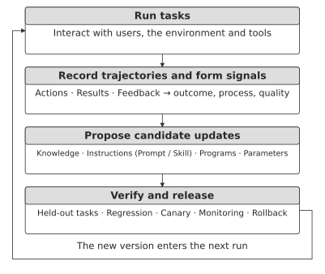
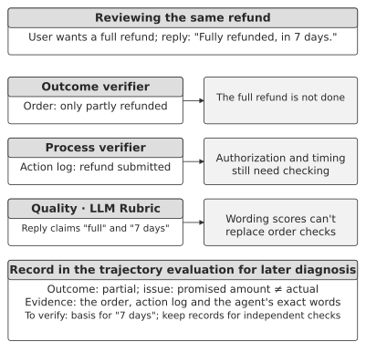
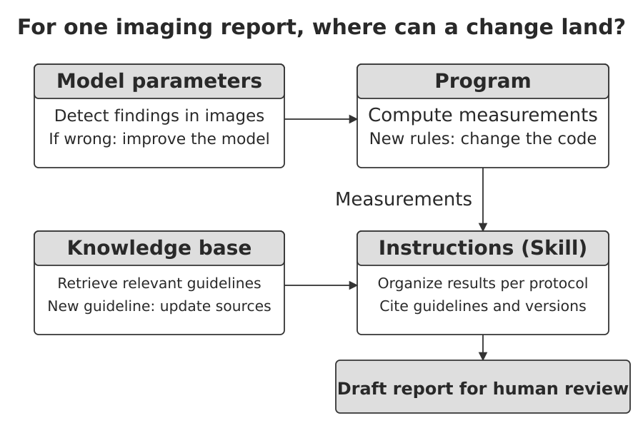
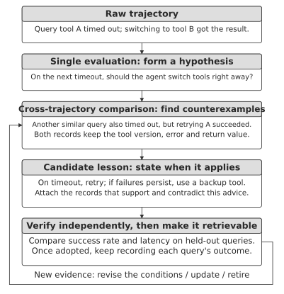
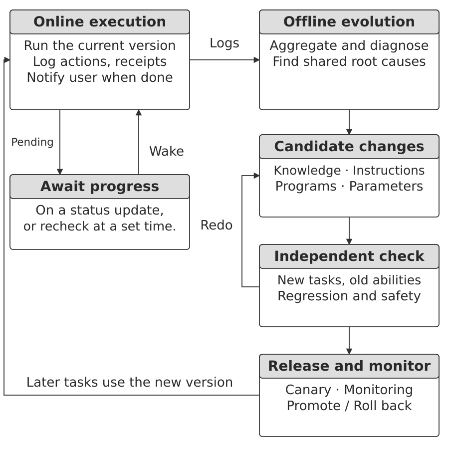

# Continual Evolution of Agents

An Agent can complete an unfamiliar, complex task on its first attempt and yet, after handling many similar tasks, keep repeating the same mistake. For it to keep improving through everyday work the way a new employee does, the system must turn operational experience into capabilities it can use later: record the outcome, find the cause of the problem, devise a fix, and then verify that the fix works on new tasks. **In my view, learning from experience and evolving continually is becoming one of the most important capabilities an Agent can have.** It calls for engineering work in application systems, and it also deserves to be a research priority for the next generation of models.

A deployed model normally keeps its parameters unchanged after an inference. The in-context learning, state maintenance, and compression of Chapter 2 help it adjust within the current task; the memory and knowledge bases of Chapter 3 let information persist across tasks. Learning from experience goes one step further and requires comparing many runs: which steps the successful trajectories share, what the failed ones are missing, and which tool versions and task conditions a given practice applies to.

Suppose the system has stored a hundred booking trajectories. It can retrieve any one of those episodes on demand. But to arrive at a lesson such as "check the special-meal deadline before booking," it must compare why some bookings succeeded and others failed, check the airline and timing conditions, and then test the practice on new tasks. Recording and retrieval let an Agent recall what happened; comparison, generalization, and verification help it form practices it can reuse. Only through this kind of accumulation does an Agent gradually move from being clever to being proficient.

**Continual learning** studies how a system can keep learning from new tasks and new data while retaining the capabilities it already has. Agents bring this problem into everyday interaction: feedback comes from users, tools, and the environment, and user satisfaction, task completion, and procedural compliance may point to different conclusions. In my view, a central difficulty of continual learning for Agents is that in everyday work almost no one marks each step as right or wrong, so the system must decide for itself which feedback to trust. Once unverified feedback is written into a rule or used for training, a wrong attribution affects later tasks. Such errors also persist: a misrecorded preference affects the next booking, and training a model on wrong feedback can make it fail even tasks it used to get right.

This book uses **continual evolution** to describe the process by which an entire Agent system updates itself from experience, across four carriers: knowledge, instructions, programs, and model parameters. Periodic training of the foundation model supplies general capabilities; the Agent's experience updates handle specific business rules, tool changes, and local strategies. These local changes happen constantly, and waiting for the next round of foundation-model training is often too slow for the business.

At this stage, I advocate building a verifiable learning system around the model first: let experience that can be stated explicitly shape later behavior through knowledge, instructions, and programs, and send material suited to parameter learning into post-training. Every update first goes through regression evaluation on a new version, and only after it passes release checks do later tasks use that version.

The earlier chapters have already introduced the main components of this system: Chapter 2 organizes task state, Chapter 3 stores and retrieves knowledge, Chapter 5 creates tools and modifies systems through code, Chapter 7 evaluates outcomes, and Chapter 8 updates model parameters. Figure 9-1 connects these components. The episode in which a special meal was missed is evaluated and becomes a rule that will be applied at the next booking.

## Deriving Learning Signals from Operational Trajectories

Which trajectories are worth learning from? If a customer-service Agent tells a user "your refund has been processed," we first need to check how much money was actually refunded and whether the operation was compliant, and then whether the user could tell from that reply when the money would arrive. Figure 9-2 places these three checks side by side. They draw on the order record, the action log, and the Agent's exact words, respectively.

**Outcome verification checks what changed in the environment.** A Coding Agent can run tests, type checks, and performance benchmarks; a refund Agent can query the order status and the actual refund amount. I usually build this layer first. If the model claims a full refund but the account shows only a partial one, it is the order record that tells you which operation to go back and examine.

**Process verification checks whether the actions followed the task rules.** After the tests pass, we still need to check whether protected test files were modified; when the Agent tells a user "the refund will arrive within seven days," we still need to confirm that the refund was actually submitted and that the time frame has a basis. Permission tables, structured policies, and action records can be checked by programs; clauses that require interpreting context are judged together with the corresponding evidence.

**Quality verification checks whether the deliverable meets the user's needs.** Whether the customer-service reply is clear, whether an alternative fits the user's goal, and whether a research report captures the key evidence all affect the final result. Here we can use the LLM-as-a-Judge approach from Chapter 7: define a Rubric in advance and have the judge model give a score, a rationale, and evidence for each item.

Table 9-1 takes customer service as the example and expands the three layers into seven dimensions. Task outcome belongs to the outcome layer; rules, privacy, and promises belong to the process layer; expression and compliant alternatives belong to the quality layer. Factual reliability is verified differently depending on the content: a refund amount can be checked directly against the tool's return value, while an explanation of policy must be judged against the original text and the conditions under which it applies.

Table 9-1 Trajectory Evaluation Dimensions for a Customer-Service Agent

| Dimension | Verification Question | Primary Evidence |
| --- | --- | --- |
| Task outcome | Was the user's core request resolved? | Final environmental state, tool results |
| Rule compliance | Were policies, permissions, and required procedures satisfied? | Policy repository, action trajectory |
| Privacy boundaries | Was the information provided within the permitted scope? | Response text, access records |
| Factual reliability | Are statements supported by knowledge or tool results? | Cited sources, tool returns |
| Promise–action consistency | Did the operations claimed as completed actually take place? | Comparison of responses with execution records |
| Expression quality | Is the language natural, concise, and clear? | Full conversation, language Rubric |
| Compliant alternatives | When the original plan was blocked, was a permitted alternative found? | User goal, policies, and subsequent actions |

To support later updates, the evaluation output should contain four things: the overall task status, a verdict for each dimension, the location of the evidence behind each verdict, and an error type. An evidence location can point to a particular conversation turn or tool call. Dimensions with insufficient evidence are marked as pending and sent for further verification or human review.

For example, "refund failed, expression clear" is not enough to decide what to fix. Add "in turn 4 the Agent called the refund API without an order number and the API refused; in turn 5 it still claimed the refund had been made," and we can propose two separate changes: parameter validation, and verification of completion claims.

> **Experiment 9-1 ★★: Build a Trajectory Verifier for a Customer-Service Agent**
>
> Compare two kinds of output on the same set of customer-service trajectories: one gives only an overall score; the other gives a verdict, evidence, and a confidence level for each dimension. Check whether the latter can separately localize task failures, rule violations, false promises, and expression problems, and propose a matching update for each.
>
> Outdated knowledge calls for updating the reference material, a missing parameter can be handled by adding a pre-call check, and repetitive wording may be improved through instructions or training.

Experiment 9-1 uses fictitious account data to construct eight trajectories, two each of normal refunds, false promises, privacy leaks, and excessive refusals. In `real-normal-refund-01`, the Agent says the refund has been processed, the order status has indeed changed to `refunded`, and the refunded amount is 480.

With seven dimensions scored for each of the eight trajectories, 52 of the 56 judgments match the expert labels preset for the test cases, an agreement rate of about 92.9%. Three of the four remaining disagreements involve the same flight change. The user asked to move a nonrefundable ticket to October 3. The Agent verified the user's identity, looked up the order three times, and in turn 10 told the user the change had been made. Yet the order status was still `confirmed`, and the call log contained no change operation.

Which part should be reexamined? The model judging "compliant alternatives" cited the reply in turn 10 and gave a pass, missing that this alternative was feasible but never carried out. The program judging "promise–action consistency" did flag an error, but its reason was that it could not find a successful refund call. The user wanted a flight change, so what should have been checked was the change record and the new date. And the preset label for this dimension was "pass," which also did not match the reply that was actually generated.

This flight change requires two fixes: the Agent skipped a step, and the scoring program checked the wrong tool. In a booking scenario, errors that look identical on the surface can also originate in different places. The user has raised the budget, but the assistant keeps filtering by the old one; tracing back along the trajectory, perhaps the new preference was never stored, perhaps this run retrieved the old preference, or perhaps the model read the new budget but did not use it when choosing tickets.

## Four Methods for Continual Agent Evolution

Once a problem is found, we still have to decide where to make the change. Take the medical-imaging Agent in Figure 9-3. If a report cites an outdated version of a guideline, first check which version is stored in the knowledge base. If the guideline is correct but the report does not state its source, go back and examine the instructions for writing reports. Both reports may be rejected, but the places to look when revising them are different.

A customer-service system also uses all four methods at once. A trained model composes the language, the knowledge base stores the company's policies, a Skill explains how to handle exceptions, and server-side code validates permissions and amounts. Table 9-2 lists the costs and limitations to weigh when choosing an update method.

Table 9-2 Applicable Boundaries of Four Continual Evolution Methods

| Update Method | Suitable Content | Engineering Advantages | Problems to Handle |
| --- | --- | --- | --- |
| Experience knowledge base | Facts, experience, exceptions, and sources | Fast updates, traceable, retrievable on demand | Retrieval quality, applicability conditions, and whether the model applies it correctly |
| Prompt and Skill | Decision principles that must take context, exceptions, and priorities into account | Interpretable, easy to modify locally | Growing length, conflicting instructions, and adherence |
| Programs and Harness | Parsable procedures, executable checks, permissions, and hard constraints | Testable, stable execution | Development and maintenance, interface compatibility, and exception handling |
| Model parameters | Perception, generation style, and implicit decision patterns | Reuses learned patterns, reduces repeated context | Data preparation, training cost, generalization, and forgetting |

A single improvement can be split into several updates. I put policy facts in the knowledge base first and put precisely enforceable constraints such as permission checks in programs; principles that require understanding context and exceptions are expressed as Skills, and high-dimensional perception and implicit strategies are improved through training.

### Consolidating Experience into Knowledge

Even a single booking can leave behind two levels of information. One is "this airline requires special meals to be reserved twenty-four hours in advance"; the other is "check the special-meal deadline before booking, so you do not discover after payment that the request cannot be met." The first should be stored together with the airline, the routes it applies to, and the source of the policy. Another airline's deadline may differ, but "check the deadline for this flight first" still transfers. When the fact goes out of date, only the specific deadline needs replacing, and the next booking can still use the checking practice. Both can be stored with the storage, indexing, and retrieval methods of Chapter 3.

Deriving such a lesson from one booking can be cheap, but the full booking record should not be copied as is. The record contains the raw policy text returned by tools, along with the detours the Agent took over several attempts. Suppose a query timed out and the result was found only after switching to another tool: imitating that run could turn a one-off fault into a reason to switch tools.

Material can be stored in three layers: **raw trajectories** preserve the complete operational evidence, **per-run analyses** record the causes of success or failure along with draft lessons, and **formal experience documents** consolidate practices verified across tasks. Raw trajectories are stored by version, while analyses and knowledge are revised as new evidence arrives. A formal document states the applicable scenarios, recommended strategy, prohibited practices, exceptions, sources, and the most recent verification time, so that it is easy to retrieve and check later.

User as Code in Chapter 3 first appends facts to a log and then periodically rebuilds the user model. Here, too, recording is kept separate from organizing. Return to the query from a moment ago. Suppose another query also timed out, but retrying the original tool succeeded. Does the advice "switch tools on a timeout" still hold? Figure 9-4 shows how the two records can be used to draft a more targeted recommendation, which is then tested on other queries.

When reusing the extraction, clustering, and retrieval methods of Chapter 3, the positive and negative examples of the same lesson can be placed side by side. Did the two bookings use the same tool version? If one succeeded and one failed, was it because a step was skipped, or were the booking conditions different to begin with? Turning raw records into usable experience can be broken into five steps:

1. Preserve raw trajectories and environmental outcomes, pinning the task and tool versions.
2. Generate an analysis for each run, recording the task type, required capabilities, the strategy actually used, errors, and exceptions.
3. Aggregate by task family and list, for each lesson, the trajectories that support and contradict it.
4. Select the lessons with sufficient evidence and write them up as draft knowledge entries.
5. Test on new tasks that were not used in distillation, checking whether the recommended strategy improves later performance.

GAIA[^gaia-2023] provides multistep problems involving search, web reading, file processing, and computation, while AWorld[^aworld-2025] provides an environment for running Agents, calling tools, and recording trajectories. Combining the two, we can first use the answer or the environment state to label runs as successes, partial successes, or failures, and then compare paths within each task family. Successful records reveal practices worth trying again; failed records show in which situations a practice should not be followed. When a task was only partially completed, we can also check step by step which steps worked and where the problem began.

Reflexion[^reflexion-2023] uses natural-language reflection to help subsequent attempts. When this approach is plugged into knowledge distillation, reflection can be used to propose causal hypotheses and draft lessons, environmental outcomes to verify them, cross-trajectory comparison to delimit the conditions under which they apply, and new tasks to check transfer. These four kinds of material jointly determine whether a lesson enters the formal knowledge base.

[^reflexion-2023]: Shinn, N., et al. *Reflexion: Language Agents with Verbal Reinforcement Learning.* arXiv:2303.11366, 2023.

[^gaia-2023]: Mialon, G., et al. *GAIA: a benchmark for General AI Assistants.* arXiv:2311.12983, 2023.

[^aworld-2025]: Yu, C., et al. *AWorld: Orchestrating the Training Recipe for Agentic AI.* arXiv:2508.20404, 2025.

Return to the booking scenario of Chapter 6. The user wanted the fare to stay under 1,200 yuan, needed to get to a meeting that same day, and in the end accepted a quote of 1,250 yuan. The assistant can record the original budget, the final price, the purpose of the trip, and the user's exact words. Over the next three bookings, the lowest quote happens to be 1,250 yuan each time. How should this memory be used?

- Next week the user again has to rush to the same kind of business meeting. On previous occasions the user was willing to pay a few dozen yuan extra to make a meeting, and this time tells the assistant to book as usual. The assistant can book this flight and report the actual fare.
- The user is taking the children on vacation and says explicitly, "We're traveling as a family, so let's save a bit; ask me first if it's over 1,200 yuan." The assistant can send the user the 1,250-yuan option while also checking whether there are flights within budget the day before or after.
- The user later explains, "I only accepted last time because I was in a hurry. Actually, even 1,250 yuan is too expensive. From now on, ask me first if a business trip goes over budget." Next time, even if it is the same person going to the same city for a meeting, the assistant should ask first. If it keeps the record of that earlier purchase and also writes this newer, more explicit requirement into the user's business-travel preferences, each of the two memories serves its own purpose.

These three bookings illustrate the levels at which updates occur. A single correction from the user can change the current task immediately, and it is also enough to update that user's own preferences. Only if many independent cases show that the assistant ignores the purpose of the trip is it worth proposing a change to the shared booking Skill, so that it pulls in the relevant preferences when comparing quotes. And only if the explicitly stated budget and preferences have all been loaded, yet the model still judges poorly when the request is phrased differently, is it worth collecting such cases to train the model's judgment.

### Encoding Experience as Instructions

If the assistant keeps going wrong at the same step even when handed the right material every time, and an experienced person could describe in one sentence how to make the judgment, it is worth trying to write an instruction. Experience documents are reference material for the assistant; the system Prompt expresses behavioral requirements that hold across tasks; a Skill loads a local procedure for a particular domain or tool; and hard constraints such as permissions are enforced by the Harness. Placing a change in the right location determines which future tasks it will affect.

Andrej Karpathy uses the term **System Prompt Learning** to describe one way of updating from experience: after the model runs into a problem, it writes down a reminder for future tasks.[^karpathy-system-prompt-learning] DSPy[^dspy-2023] optimizes instructions and examples on a development set, OPRO[^opro-2023] drafts new prompts from previously tried prompts and their scores, and GEPA[^gepa-2025] uses trajectory feedback to propose and filter prompt changes. All of these methods rewrite instructions based on run results and then compare the new and old versions on development tasks, which makes them well suited to offline batch optimization.

For production updates, I prefer a minimal diff with provenance that retains the triggering cases, the reason for the change, and the previous version. A local patch disturbs existing rules less and makes it easy to withdraw a single change if performance regresses.

How do we know a new instruction has really fixed the earlier mistake? Suppose a user points to a misfiled message and says, "This is a client replying to me. Why was it filed as a newsletter too?" The open-source email assistant Inbox Zero provides a dry-run tool for this. After the rules are revised, the assistant can fetch the original message by its email ID, rerun the judgment with the rules currently enabled for that account, and see which rules would match, why, and what label it would apply or which folder it would move the message to. This step only shows the intended actions: the mailbox stays as it is, and no reply draft is generated.[^ch9-inboxzero] Now try again with a genuine newsletter: the client's message stays in the inbox and the newsletter is still filed as usual. Together, the two messages show whether the change has preserved the existing classification boundary.

[^ch9-inboxzero]: The Inbox Zero project's `test-rules-on-email-tool.ts` implements the tool that dry-runs rules against a specified email.

#### Example 1: Clarifying the Boundaries of Escalation and Tool Use

The telecom policy in τ²-bench requires the Agent to escalate to a human when a request falls outside its scope of action, and to do its best to resolve the issue before escalating. On the 20 tasks used to derive rules, a weaker model passed only one. How did the other 19 fail? Seventeen called the transfer-to-human tool, and the remaining two ran until they hit the step limit.

Hand these 19 failed trajectories to a model, ask it to induce rules, and append them to the end of the original policy. On the same 114 new tasks, the original policy alone passed 14 (12.3%); with the first version of the rules, 20 passed, and with the second version, 22 (19.3%). Comparing task by task, the second version kept all 14 tasks that had passed before and solved 8 more. What exactly did the two rule versions give the customer-service Agent?

**The input material determines the content of the rules.** When given only error text and failure summaries, the model induced "stop calling a tool after it repeatedly returns the same error." In the second derivation, the model also saw separate tool lists for the Agent and the user, and the prompt asked it to consider "who should perform this step." This time the generated rules made the division of labor explicit: device operations such as checking network status, the SIM card, and the APN must be carried out by the user under the Agent's guidance. The lesson thus went from a generic reminder about retries to a rule assigning responsibility for specific operations.

**Induction also needs to be checked against the policy and the outcomes.** Two of the rules appended in the first version were "escalate after three consecutive failed calls" and "escalate if the user fails to provide a number after two requests." Running with this version, every one of the 114 tasks in the transfer set involved an escalation at some point, and only 20 of them passed. Those two rules had learned premature escalation as well.

One trajectory clearly shows the difference before and after the fix. The user says the phone has no signal. The baseline Agent fills a sentence such as "Please provide your correct phone number" into the number field, queries five times in a row, gets an error every time, and then escalates. With the second version of the rules, the Agent's first query still omits the number, but this time it asks the user in the conversation, gets the number, and finds the account. Next it tries to check the SIM card; the tool reports that no such operation exists, so the Agent asks the user to remove and reinsert the SIM card. The user does so and also turns off airplane mode on the phone, and only then does the task pass. Now look at the other seven tasks the second version solved beyond the baseline: one involved no escalation at all, and the other six all called the transfer-to-human tool. If "did not escalate" were used as the pass criterion, these six tasks would be missed. Whether escalation is appropriate depends on what else the Agent could still do and how far the task requires it to go.

> **Experiment 9-2 ★★: Deriving Escalation and Tool-Use Rules from τ²-bench Failure Trajectories**
>
> Reuse the telecom environment from Chapter 7, keeping the derivation set and the transfer set separate. First run a weaker model to collect failed trajectories, then have a model generate rules and append them to the original policy. Compare the original version with the two evolved versions on the transfer set; the three arms differ only in the policy file, and the user simulator is held constant.
>
> In the baseline, 104 tasks involved an escalation, versus 111 in the second version; a task counts as soon as it escalates once. Mistaken calls to user-side tools are counted per call and fall from 1,049 to 163. Another metric counts calls in which at least one argument is an empty string; it falls from 904 to 174. Calls made with no arguments at all are not counted by this metric. Each strategy was run only once on each task.

Airline customer service also suffers from premature escalation. After a user disputes a refund fee, change fee, or baggage policy, the Agent should look up and explain the applicable policy and look for a permitted alternative. Under the rules used in the experiment below, ordinary policy disputes remain with the Agent, while an explicit request for a human or one of the specified safety situations leads it to call `transfer_to_human`.

> **Experiment 9-3 ★★: Optimizing an Airline Customer-Service System Prompt from Failure Trajectories**
>
> Analyze premature-escalation trajectories along three dimensions—rule compliance, task resolution, and compliant alternatives—and generate a Prompt patch with provenance. Compare the automatically derived version with the initial version and a hand-tuned version under identical conditions.
>
> Five additional tasks check existing capabilities: three require the Agent to handle the matter itself, and two require escalation to a human. All three instruction versions scored 5/5. On the five premature-escalation tasks used to derive the patch, the same model judge passed 0, 2, and 4 tasks for the initial, automatic, and hand-tuned versions, respectively. The two tasks the automatic version fixed were a refund on a discounted fare and excess baggage. Based on these results, the program issued a decision to allow a limited trial.
>
> One of those passes is debatable. A passenger asked to have a 200-yuan change fee waived, but the hand-tuned version instead explained whether a discounted fare could be refunded. The judge accepted the suggestion to "refund the taxes" and gave a pass; the Agent never explained the change fee the passenger had asked about.

#### Example 2: Improving a Requirement-Clarification Skill from User Feedback

An existing requirement-clarification Skill can specify when to ask questions, which questions to ask, and when to start executing. As user feedback accumulates, the system needs to adjust these conditions so that the benefit of clarifying matches the cost of the interruption.

For example, when a user says "change the login page to support enterprise sign-in," several things may need settling before implementation: the identity provider, the fallback path, compatibility for existing users, and the rollout scope. Fixing a typo, by contrast, can usually be done directly. Ask too little, and key choices are left until after delivery, causing rework; ask too much, and even a simple change drags out into a lengthy interview. The Skill should choose a procedure according to ambiguity, risk, and the cost of rework.

An initial procedure can be organized as follows. For small, low-risk, easily reversible changes, state the necessary assumptions and proceed. When architecture, data, permissions, public interfaces, or wide-reaching changes are involved, ask a small number of questions, all at once, that would change the plan. Then produce a short Spec or Plan listing goals, non-goals, trade-offs, assumptions, and acceptance criteria. Once the items that need confirmation have been answered, continue executing; if a premise changes during execution, identify the affected decisions and confirm them again.

To improve this procedure, record the task, the clarifying questions, Spec versions, user edits, delivery results, and rework. When a user says "this isn't what I had in mind," check which conditions were missed; when a user says "you're asking too many questions," check whether the answers to those questions would have affected the plan.

When several authentication tasks repeatedly miss the requirement for compatibility with the legacy login, a condition can be added to the Skill: "confirm the identity provider, fallback path, and compatibility scope." When a large number of typo fixes are delayed by questions, the trigger for the clarification procedure should be narrowed.

This also shows the division of labor between Skill and Harness. The Skill guides the model to understand context, ask questions, and organize the plan; the Harness, following project rules, blocks operations when a high-risk write lacks the required authorization, a protected branch is modified directly, or the release process is skipped. Judgments about the content of the requirements are still made by the model together with the user's input. Verified conversation trajectories can also become the training data introduced in Chapter 8.

> **Experiment 9-4 ★★: Evolving a Requirement-Clarification and Spec-Confirmation Skill from User Feedback**
>
> This is an exercise in which you design the comparison yourself. You might start with two tasks: correcting a typo on the login button, and adding enterprise sign-in to the same page. The acceptance criteria for the first can be written down directly; the second may first require asking which identity provider to use. Then add tasks involving architecture, permissions, data, or public interfaces, and try three procedures on each: execute directly, clarify then execute, and confirm a Spec then execute. Record user answers, Spec edits, delivery results, and rework feedback, and use them to generate local updates to the Skill.

[^dspy-2023]: Khattab, O., et al. *DSPy: Compiling Declarative Language Model Calls into Self-Improving Pipelines.* arXiv:2310.03714, 2023.

[^opro-2023]: Yang, C., et al. *Large Language Models as Optimizers.* arXiv:2309.03409, 2023.

[^gepa-2025]: Agrawal, L., et al. *GEPA: Reflective Prompt Evolution Can Outperform Reinforcement Learning.* arXiv:2507.19457, 2025.

[^karpathy-system-prompt-learning]: Karpathy, A. “We’re missing (at least one) major paradigm for LLM learning … system prompt learning?” X, May 11, 2025.

### Encoding Experience as Programs

Operations that are stable, repetitive, and verifiable can be written up as workflows, tools, or Harness code based on operational experience. I recommend converting such operations into programs first: once the model has explored a workable path, later tasks can reuse it and avoid the overhead of rereading instructions, interpreting the page, and deciding on the next step every time. Chapter 5 introduced the capabilities of reading and writing files, running tests, and generating tools; this section applies them to an update process of "failure diagnosis → code change → regression verification."

Changes can land at different layers. At the operation layer, they produce parameterized workflows or API adapters; at the control layer, they adjust tool routing, retries, circuit breaking, and context compression; at the verification layer, they add parameter checks, state assertions, and regression cases; and at the architecture layer, they adjust the flow of information among planning, execution, and the Reviewer.

Take sending an email. The first time, a multimodal Agent uses observation and action to find controls such as compose, recipient, subject, body, and send. The next task usually changes only the recipient and the content, so the operating procedure can be reused like a spreadsheet macro. The system converts the exploration trajectory into a program and records its parameters, state checks, and the versions it applies to.

The lifecycle of a browser workflow can be divided into six steps:

1. **Capture the trajectory.** Record navigation, clicks, text entry, and drop-down selections, and save action parameters, page URLs, and locator information such as XPath and CSS. This information is used later to find the elements again.
2. **Extract parameters.** Replace the specific recipient, subject, and body with variables such as `{recipient}`, `{subject}`, and `{content}`, keeping the stable actions. For example, the `test@example.com` entered the first time becomes one value of the recipient parameter.
3. **Add state checks.** Before acting, confirm that the button is visible and the required fields are filled in; after acting, check how the page changed; when the task ends, read the real page or backend state to confirm that the email was sent.
4. **Replay independently.** Restore the sandbox account or test site to a fresh initial state, run the program end to end, and check the conditions at each step as well as the final result.
5. **Match new tasks.** Find the workflow in the capability library by intent and keywords, extract this run's parameters, and hand it to Playwright to execute. The program handles waiting for elements and checking state, so a normal replay can skip step-by-step LLM calls.
6. **Handle invalidation.** When an element locator stops working, a state check fails, the API schema changes, or the final result is abnormal, stop the current replay, first verify which operations have already completed, and then let the full Agent pipeline explore again from the current state, writing the newly working steps into a script. If an email has been sent but the page has not yet shown the result, query the sending status first, so that replaying from the beginning does not send the email twice.

How much time this saves depends on how much of the original time was spent on model judgments. PreAct's experiments on repeated tasks report an end-to-end speedup of 8.5 to 13 times; the local email example below eliminates all model calls, but the browser itself still has to wait for the page to respond.[^preact]

> **Experiment 9-5 ★★★: Generating Verifiable Workflows from Browser Trajectories**
>
> Generate a workflow with parameters and state checks from a successful trajectory, and compare it with a baseline that explores from scratch every time on completion rate, model calls, and elapsed time. Then change the page structure, or construct a state in which the click succeeds but the task is never submitted, and check whether the program detects the invalidation and falls back.
>
> In this experiment on a local mail site, the initial exploration made 4 model calls and the parameterized replay made 0, taking about 5.31 seconds and 4.45 seconds, respectively. The replay also ran into two kinds of faults: in one, the server refused to send because the body was empty; in the other, the request was accepted but the message was never saved. The version that checked only "the click was performed" reported success falsely both times, while the version that checked the post-submission state identified both failures.

**Modify code on a separate branch first.** Create an isolated branch from the current stable version, have a Coding Agent generate a local patch, and run, in order, the static checks, unit tests, security checks, failure-trajectory replays, and old-task regressions relevant to the change before moving on to canary release. The running system continues to use the stable version and switches over only after the patch passes its checks.

Git worktrees and Pull Requests can carry this process. A Skill guides the model to create an independent workspace, clarify the requirements, complete the implementation and tests, and explain in the PR the problem, the change, the scenarios that have been verified, and the remaining risks that whoever takes over will need to check. The Harness enforces project constraints, such as protecting `main`, checking required review status, and confirming before delivery that all release artifacts are present.

To judge how a specific change affects the results, each change should come with a testable statement: the failure evidence, the inferred root cause, the components involved, the proposed patch, the errors it is meant to correct, the behavior that was already correct, and test cases verifying each of the last two. Agentic Harness Engineering organizes this information into three layers of observability—component, experience, and decision: components are stored as editable files, trajectories are distilled into evidence that can be inspected layer by layer, and the expected impact is declared before an edit and then tested against subsequent results.[^ahe-2026]

When I ask a model to draft a modification, I also give it successful trajectories and previously rejected proposals. Self-Harness uses this information to narrow the search: the success records tell the model which practices were already right, and the history of attempts shows which changes have already failed.[^self-harness-2026] Given only failure cases, the model may widen the scope of its changes and break behavior that was correct; without a record of rejected proposals, it may keep putting forward the same ineffective idea.

New tools can also come from this kind of need-driven update. One task in Alita[^alita-2025] asks: in a YouTube 360 VR video narrated by the voice actor who played Gollum in *The Lord of the Rings*, what number is mentioned immediately after the dinosaurs first appear? The Agent realizes that it lacks the ability to read subtitles, searches for and tests `youtube-transcript-api`, wraps it as a subtitle tool, and arrives at `100000000`.

> **Experiment 9-6 ★★★: Triggering Agent Self-Modification from Failure Trajectories**
>
> For the problem of a tool being called repeatedly after it returns a non-retryable error, compare two fixes: a Prompt reminder and a programmatic retry policy. The modified program decides whether to retry, stop, or open a circuit breaker based on the error type, and is then checked against the target problem through failure-trajectory replay and for recovery ability through transient-fault tasks. When the error type and retry conditions can already be determined precisely, I tend to write this constraint into the program, so that every call follows the same rule and the model is spared the burden of repeatedly interpreting a prompt.
>
> The Agent responsible for the update submits its patch in an isolated version, and external tests and the release process decide whether to adopt it. The validators, acceptance cases, and stable version are protected by separate permissions, and the rollback record preserves the evidence of behavior before and after the change.

The verification logic itself can also be improved. For example, if repeated user corrections and reviews find that high-risk calls lack confirmation, a pre-call check can be added. Here we must distinguish business verification components from the independent mechanism that decides whether an update can be released: the former can be modified along with the business code, while the latter is governed by independent testing, review, and release permissions. The new check must cover the target risk while still letting normal, authorized tasks proceed.

> **Experiment 9-7 ★★: A User-Feedback-Triggered Confirmation Gate for High-Risk Operations**
>
> Extract cases of missing confirmation from user corrections and post-hoc reviews, and draft a rule that checks authorization before a tool call. The first test group consists of high-risk operations that have not yet been confirmed; the second consists of normal operations that are already authorized or need no confirmation.
>
> The first group measures how many operations the new rule fails to block; the second measures how many it blocks wrongly. Whether the change can be released depends on the results of independent tests and on the release rules. The Agent that writes the check may modify only the agreed components; the acceptance cases, approval rules, and stable-version backup are protected by external mechanisms.

[^preact]: Li, Bojie. *PreAct: Computer-Using Agents that Get Faster on Repeated Tasks.* arXiv:2606.17929, 2026.

[^alita-2025]: Qiu, J., et al. *Alita: Generalist Agent Enabling Scalable Agentic Reasoning with Minimal Predefinition and Maximal Self-Evolution.* arXiv:2505.20286, 2025.

#### Case: Plugin-Based Updates in DeepSeek Harness

DeepSeek Harness (`dsh`) uses an "everything is a plugin" architecture, with Cordis providing the composition mechanism underneath.[^dsh-2026] Model adapters, tool registries, session logs, and the Agent's main loop can all be configured and replaced as plugins. Continual evolution therefore raises a concrete software problem: when a component changes at runtime, how do we clean up its old resources and keep the other components that depend on it working correctly?

Cordis splits this problem into two dimensions. **Temporal composability** concerns recovery after a component is removed: resource allocations, event registrations, and context modifications each need a corresponding undo procedure. **Spatial composability** concerns dependencies: a component declares which services it needs, and the runtime coordinates its activation and deactivation as those dependencies appear, disappear, or change.[^cordis-2026]

For example, a tool plugin registers an event listener and also depends on a model service. When the plugin is replaced, the old listener must be removed so that a single event is not handled twice; when the model service is temporarily unavailable, the dependent component must stop the related work and be reactivated once the service recovers. The first problem concerns the lifecycle of resources and side effects; the second concerns the lifecycle of dependencies.

Without a unified mechanism, each component has to handle loading, unloading, and dependency changes on its own, and even a local replacement can break its callers. If every update requires restarting the whole process, it also interrupts tasks in progress and adds the work of recovering state.

Cordis uses **revertible effects** to describe context transformations that carry an inverse operation, which the runtime stores and executes for cleanup; it uses **reactive coeffects** to describe a component's requirements on its environment, coordinating component state as the context changes. A unified context mechanism further coordinates the interactions among multiple components running interleaved.[^cordis-2026]

This design reduces the need for a full restart on every local update. In my view, composability directly determines whether a system can keep accepting self-modification: after the model writes a correct patch, the runtime must still load and unload components, coordinate dependencies, and resume tasks.

Plugins also need to work together with permissions and the release process. The `dsh` dynamic runner manages in-process plugins along with their versions, startup, shutdown, and authorization, while persistent plugins are maintained through a dedicated installation-management process.[^dsh-2026]

Plugin updates also affect the cost of context. When tool definitions or prompt fragments change, the portion of subsequent requests shared with an existing cached prefix may become shorter.

[^dsh-2026]: DeepSeek AI, *DeepSeek Harness*, 2026. The plugin composition is described in the architecture notes; the division of labor between the dynamic runner and persistent plugins is described in the extension notes. The project was released in August 2026; this section discusses its plugin-based design during the developer-preview stage.

[^cordis-2026]: Shi, Yifan, Wei Zhang, and Tianyi Cui. *A Programming Paradigm for Spatiotemporal Composability*, 2026, arXiv:2608.25512.

### Encoding Experience in Parameters

Knowledge, instructions, and programs are good at carrying information and rules that can be stated explicitly. Visual patterns in medical images, natural speech prosody, language style, and long-horizon decision habits also depend on representations that the model learns from large numbers of samples. For capabilities like these, which are hard to write down fully as rules, I turn the relevant experience into training material and use parameter updates to form reusable recognition and decision patterns. Adding a few more written reminders rarely covers how such capabilities vary.

A single task may also need several carriers at once. In editing Chinese quotation marks, a parser recognizes the syntactic boundaries of the document, a Skill explains the editing principles and exceptions, and parameter training improves judgments about scope across tasks. Distribution shifts in images caused by new equipment can be handled with LoRA or other fine-tuning methods, and language style can be updated through periodic preference training. The stability of a task affects how often and how expensively it is updated; the way a capability is itself represented determines which method to try first.

The training methods introduced in Chapter 8 plug directly into the loop of this chapter: verified demonstrations go into SFT, explicit preferences form paired data, and repeatable interactions with reliable rewards support RL.

How do we decide whether a lesson should move from instructions into parameters? Take a batch of tasks held out for testing and replay them twice: the first time, let the system retrieve and load instructions as usual; the second time, give the relevant instructions to the model directly. If the second run is clearly better, first check whether the system selected the wrong instructions or failed to load ones it should have. Only if the instructions were provided and the model still repeatedly makes the same wrong judgment under different phrasings is there reason to collect diverse demonstrations and test whether parameter training improves transfer. The two replays separate "could not find the experience" from "could not apply the experience."

### From Updating Artifacts to Optimizing the Update Method

When one refund policy changes, updating the corresponding entry in the knowledge base is enough. But if the same exception gets deleted every time the knowledge base is reorganized, what needs fixing is the method for organizing entries. Knowledge, instructions, programs, and parameters tell us where experience is stored; which layer to fix depends on where in the process the error occurs. Sometimes only one memory needs changing; at other times the change belongs in the steps that construct context, the entire workflow, the Harness, or even the optimizer that drafts the modifications.[^weng-harness-2026]

I treat local updates as the default choice: adding one rule to a prompt or one exception to an experience document makes it easy to check the impact and roll back. As entries accumulate, the management method also needs to improve so that the details of existing experience are preserved. For example, when an entire document is rewritten again and again, a rare but important exception may gradually disappear, and several conditions may be compressed into an overly broad principle. Agentic Context Engineering (ACE) organizes context as entries with stable identifiers; generation, reflection, and curation modules propose incremental changes, which deterministic logic then merges and deduplicates.[^ace-2026] This lets each lesson and its source be maintained entry by entry.

Meta Context Engineering (MCE) goes further and separates content updates from updates to the management method, placing them in two loops. The inner loop constructs the task context under the existing method; the outer loop adjusts operations such as search, selection, filtering, and formatting based on execution and verification results.[^mce-2026] For instance, the inner loop selects material for the current task, while the outer loop compares different material-selection strategies and keeps the version that performs better on later tasks.

Workflows and the Harness can also become objects of optimization. AFlow represents multiple LLM calls and their control flow as a code graph and searches over combinations using execution feedback.[^aflow-2025] Meta-Harness has a Coding Agent combine source code, scores, and trajectories to modify the implementation of how information is stored, retrieved, and presented.[^meta-harness-2026] The code-generation capability of Chapter 5 thus enters a search process of repeated evaluation: only by comparing what each version changed and how it scored can we decide which version to continue from in the next round.

To pin down where an improvement actually came from, the research environment must first allow you to change just one layer. When I have had Agents set up training environments themselves, they often spent their time matching CUDA and PyTorch versions, and multiple tasks contended for the same GPU. RSIGym turns training, inference, trajectory sampling, evaluation, and sandboxing into reusable services, so that research Agents can refocus on experimental design. It provides three controlled conditions: when only training data is changed, the training setup and Harness are fixed; when only the Harness is changed, the model weights are fixed; and in joint improvement, both can be adjusted under the same initial model and evaluation protocol.[^ch9-rsigym]

For example, the assistant first changes directory in the terminal, but the second command cannot find the files in that directory. If the two calls each started their own shell, changing the Harness so that they share a single session preserves the working directory, and the model weights need not be touched.

[^ch9-rsigym]: Evolvent AI lists the evaluation methods of the services and the three improvement directions in the RSIGym project description.

Search itself also has a strategy: which existing result to continue exploring from, when to open a new branch, how many parallel Workers to devote, and when to stop. Evaluating these decisions usually takes many rounds of generation and execution. If every comparison of search strategies required rerunning all the tasks, the cost of feedback would rise quickly.

**Discovery-tree replay** offers a way to reuse existing exploration results. Dream-RSI saves a discovery process as a tree: the root node is the initial workspace, and each child node records the workspace snapshot, the artifact of that attempt, diagnostic information, and the score obtained by continuing from its parent.[^dream-rsi-2026] The strategy under test still chooses branches through the same interface used in online exploration, while the replayer returns the corresponding recorded results from the historical tree, saving the cost of calling the underlying Agent and evaluator again.

During replay, the strategy can see only the subtree expanded so far. Only after it chooses to continue exploring from some leaf node, or to open a new branch from the root, does it receive the corresponding successor node. This makes it possible to compare exploration order, parallel batches, and stopping times while keeping the information available at each decision consistent with the online process.

The method has three phases:

1. **Online exploration.** The current strategy runs real tasks and generates new discovery trees.
2. **Building the replay environment.** The discovery trees are added to a historical pool, preserving each node's state, results, and visibility relations.
3. **Offline optimization.** A strategy-development Agent modifies the exploration code, compares the strategies in the historical pool by the quality of the results they find, execution cost, and parallel efficiency, and then uses the best-performing strategy to explore new tasks.

The current strategy also takes part in the same round of replay. If no new strategy scores higher than it, the current strategy is kept. Each new online run adds new discovery trees, gradually widening the range of experience available for comparison in the next round.

What does each of these three methods take from the historical record? Summarizing trajectories leaves knowledge or instructions for the next task; replaying browser operations walks a path that has already been verified once more. Dream-RSI's discovery-tree replay answers a different question: with a different exploration order, or with several branches running in parallel, could the same compute budget find a better solution? Historical trees let developers compare options repeatedly, offline and cheaply, and what finally changes is the exploration strategy in the program.

> **Experiment 9-8 ★★★: Give Hermes This Book: Can It Upgrade Itself?**
>
> A reader, Grace, posed a question: if Hermes is given no list of improvements, only the ten chapters of this book and its own source code, what will it choose to change? In this run, Hermes chose trajectory recording. It wanted to turn the results that tools actually return into verifiable evidence for the next round of offline evaluation. It could propose patches, while the stable version and the acceptance rules were protected by separate permissions.
>
> Why was the first version rejected? The tool results used in the tests had a different format from what was actually saved. Real results were wrapped in XML tags, so the tests passed but the parser could not read this evidence. Hermes received the feedback and made the fix in the same session; later reviews found a missed persistence path and a case in which a single failure could be counted twice. After three rounds of rejection, a fourth independent reviewer accepted the patch, which at the time had not yet been merged into Hermes.

## Building a Continual-Evolution Closed Loop for Long-Term Operation

Suppose a task the user delegated is still in progress when a background process happens to induce a new rule from old cases. When should the new rule start being used? Figure 9-5 separates the online loop that executes tasks from the offline loop that prepares the next version. Only after the new rule has passed verification and been released can later tasks use it. A versioned experience repository and evaluation sets connect the two sides, so that every update has a source and a result and can be rolled back to an earlier version.

Suppose a user asks the Agent to track an application. The first query returns "in progress." The two arrows on the left of Figure 9-5 indicate the moment at which work should resume. If the service offers status-change subscriptions, the Agent can register one and resume the task when the notice arrives. If there is no subscription and the only option is to poll, the model can set a scheduled task for itself based on the processing time frame, and when the time comes, query again with the application number and the previous status. If the application is still in progress, it schedules the next check; if there is a result, it reports to the user and stops tracking.

How can this wait be used for offline learning? Record in the trajectory the wake-up condition agreed on at the time, and then compare it with what actually happened. If the subscription stayed valid and the application had not changed, waiting quietly was consistent with the plan. Only when a scheduled task came due without a query being made, or the result had arrived and the Agent kept querying anyway, is there a concrete deviation to attribute. Even if a reminder and a subscription notice happen to arrive at the same time, the Agent should first check whether the task has already been closed, so that it does not report the same result to the user twice.

Voyager[^voyager-2023] demonstrates in Minecraft how goal selection, skill accumulation, and environmental feedback work together. The **automatic curriculum generator** proposes the next goal based on items, the environment, and existing capabilities; the **skill library** stores successfully verified programs for retrieval and composition—for example, a gathering task calls movement and crafting skills; and the **iterative prompting mechanism** carries environmental observations, execution errors, and self-verification results into the next round of code generation. New goals drive exploration, verification decides which programs to keep, and skill reuse provides a starting point for harder tasks later.

Without new goals, the Agent might keep gathering the same material forever. If a program that failed to craft an item were also stored as a skill, the next crafting attempt would start from the same mistake.

This process can be summarized as a discovery loop of **hypothesis, experiment, evaluation, and feedback**. For an Agent, every patch embodies a testable hypothesis: which behavior it should improve, which tasks it will affect, and whether the run results support the expectation. Discovery Loop, founded by Jeff Dean and colleagues, likewise aims to automate the complete experimental loop, advancing each round of exploration by proposing, executing, and evaluating experiments.[^ch1-discovery-loop] In my view, continual evolution of Agents should follow the same scientific method: state a clear hypothesis, test it in actual runs, and then decide from the results which changes to keep or revise.

[^ch1-discovery-loop]: Discovery Loop's founding team includes Jeff Dean, Sanjay Ghemawat, Quoc Le, and Oriol Vinyals. Its official description proposes automating the complete experimental loop; an investor announcement on August 5, 2026, described its status as a public-benefit corporation and its focus on parallel experimentation.

When evaluating the effects of continual evolution, we also need to examine **harness-updating** and **harness-benefit** separately. The former is whether the system can produce valuable persistent changes; the latter is whether the task Agent can find those changes at the right moment and use them correctly. Model-swap experiments by Lin et al. analyze how each relates to the capability of the base model.[^harness-benefit-2026]

For example, a refund Skill may state the policy accurately, yet a later task may fail to retrieve it, or may load it and still miss a required step. The two cases call for adjusting routing and execution, respectively. If the Skill is rewritten simply because the end-to-end score did not improve, a rule that was correct may be lost, while the loading or execution step that actually failed remains unfixed. Table 9-3 asks four questions in turn: Was the change right? Can it be loaded when needed? Once loaded, is it followed? And after it is followed, does task performance improve?

Table 9-3 Layered Evaluation Metrics for Continual Evolution

| Metric | Question Answered | Primary Evidence |
| --- | --- | --- |
| Proposed-update validity | Do the proposed changes improve performance? | Acceptance rate and gain in independent validation |
| Artifact activation rate | Are the new Skill, memory, or tool loaded in the right situations? | Retrieval, routing, and call records |
| Successful adherence rate | After activation, is the rule or procedure followed? | Action sequences and process checks |
| Held-out task gain | Does the update improve new instances while preserving existing capabilities? | Success rate, quality, and cost on new tasks not used for tuning and on tasks that previously succeeded, measured separately |

Long-term evaluation should also track five kinds of change at the same time:

- **Capability regression.** Whether previously passing cases fail, and whether new and old experience conflict.
- **Generalization.** How much an update helps on independent new instances, templates, or domains.
- **Token and operating cost.** How the input, generation, tool calls, and time needed to complete a task change.
- **Safety and compliance.** Whether permissions, privacy, and refusal boundaries keep behaving as expected.
- **Engineering quality.** How maintenance complexity, architectural consistency, component ownership, compatibility, and the cost of migration and debugging change.

> **Experiment 9-9 ★★★: Evaluating Whether an Agent Is Continually Evolving**
>
> Compare static memory, append-only memory, and versioned memory that supports replacement and retirement. First let the Agent receive feedback on a set of tasks, then in turn change the task phrasing, update the rules, and test existing capabilities.
>
> Record performance on four aspects—remembering, transfer, updating, and retention: whether new tasks can use relevant experience, whether the new version is adopted after a rule changes, and whether old tasks can still be completed.
>
> These experiments ran three seeds for each of the three memory schemes, each run working through 14 tasks in sequence, for a total of 126 model calls. The append-only and replaceable groups both averaged 100% accuracy on the transfer tasks. Looking only at that column, one would conclude that the two approaches are no different. When the baggage allowance changed from 20 kg to 23 kg, both groups answered wrong the first time they were asked about the new allowance. After receiving that feedback, the replaceable group rewrote the rule and answered 23 kg the second time; the append-only group still answered 20 kg. As a result, the replaceable group got only half of the two rule-change questions right, yet reached 100% when later checked on whether the new rule had superseded the old one, while the append-only group's replacement accuracy was 0. Refunds and identity verification kept their old rules, and both groups retained 100% of those existing capabilities.

### Evidence and Evaluation in Open-Ended Tasks

Code tests, tool results, and business state can provide feedback fairly quickly. Research, strategic planning, and product design often take much longer to show results, and also require judging the value of the problem, the quality of the solution, and maintainability. A pipeline can complete retrieval, coding, and writing without a hitch and still produce a result that does not answer a question worth studying, or that lacks valid baselines and new evidence. When designing an evolution loop, I prioritize improving the structure of evidence and supervision, evaluating how well the process was carried out separately from these long-term goals.

Trehan and Chopra documented four attempts at automated research that went from a research idea to a paper; three failed during implementation or evaluation, and one completed the entire pipeline.[^llm-scientists-2026] These cases expose three concrete problems: **implementation drift**, in which the code gradually departs from the original hypothesis; **premature interpretation of results**, in which noise is taken for a finding while failures and negative results do not receive equal attention; and **insufficient research judgment**, in which choices of baselines, investigation of anomalies, and decisions about when to stop lack a sound basis.

The structure of evidence and supervision for such tasks can be improved in four ways.

- **Link conclusions to sources.** Record the evidence for citations, numbers, methods, and inferences separately. ScientistOne's Chain-of-Evidence design connects claims to auditable sources, making it possible to trace from the manuscript back to experiments or materials.[^scientistone-2026]
- **Keep negative results.** Archive failed experiments, rejected proposals, and the reasons for stopping. If only the final successful solution is kept, later searches cannot see which paths have already been ruled out and easily pay the same cost of trial and error again.
- **Explore different ideas in parallel.** Besides the current high-scoring solution, keep several branches that score lower for now but take different approaches, and compare how they perform under different evaluation conditions. That way, even if one answer template scores high easily, the team still has a chance to test other ideas.
- **Make the human's research responsibilities explicit.** People take part in defining the problem, reviewing evaluation criteria, interpreting anomalous results, and deciding when to stop, forming a division of labor with the Agent's implementation, execution, and organization of material.

When I was writing *AI Infra in Depth*, I ran into situations where the work was done but the draft still did not explain things clearly. Early on, when I simply handed the assistant an outline, it could fill an entire chapter, but the result lacked the details worth explaining. Later, I first had it look up papers and official chip specifications, read the matrix shapes from the model architectures, write performance-calculation tools based on those inputs, and then revise the outline together with me. This gave the review two handles: for a performance figure, I could follow the configuration back to its inputs and rerun the calculation; for a passage explaining an architecture, I had to ask whether the figure helped readers understand why the designers chose that design. Even when the formulas are entirely correct, a passage that picks the wrong point of comparison still has to be rewritten. The first kind of feedback can become an automated check; for the second, the author's annotations should be kept so that the next draft has a concrete basis for judgment.[^ch9-infra-writing]

[^ch9-infra-writing]: ai-infra-book, the companion project of *AI Infra in Depth*, keeps its calculation tools, configurations, and tests in the `calculations/` directory.

For example, a writing assistant shortens an opening section in response to reader comments. The evaluator can give the old and new versions, anonymized, of the same manuscript under the same length requirement to target readers, ask each group to restate the core question, and have them mark the paragraphs that supported their understanding. If the group that read the new version cannot say why the author raised the question, the paragraphs marked by the two groups help locate the key premise that was cut.

### Safety Boundaries for Continual Evolution

Long-term capabilities are used again and again in later tasks, so every update must answer three questions: where the basis for the change came from, how the new version is tested, and who has the authority to approve its release. A wrong instruction from a web page that enters the experience repository affects many sessions; an external dependency that enters a commonly used tool widens the blast radius; and a defect in a verifier affects the judgment of a whole series of updates. Three boundaries can be built along the lines of information, versions, and permissions.

The first boundary is **separating evidence from instructions**. Web pages, emails, tool output, and summaries of them are all treated as material awaiting verification. The system extracts claims, source locations, and collection times into a fixed structure and keeps the source and original text, so that reviewers can trace every lesson. Summaries and model confidence help organize the material, but rewritten text may still retain erroneous claims or malicious instructions from the original. The basis for release must therefore come from schema validation, allowlists, source checks, and independent review. The Agent submits newly written or modified Skills through version-controlled change requests; reviewers check the content and behavior against the evidence, and high-risk updates also go through human approval.

The second boundary is **separating the test environment from production**. Newly written knowledge entries, revised prompts and Skills, and new programs and model parameters all go into the test environment first. Code and external dependencies undergo permission checks, supply-chain scanning, and behavioral testing in a restricted sandbox, followed by regression comparison against the stable version. Only versions that pass the release gate are gradually connected to real tasks, and the stable version is kept for rollback if something goes wrong.

The third boundary is **separating update authority from approval authority**. A business Agent may propose changes to knowledge, tools, Skills, and business verification components. The test sets, release gates, permission configuration, audit logs, and stable-version backups used to approve these changes are maintained by an independent control plane. Even if a business Agent modifies its own verification program, it has no authority to relax the release criteria or approve the rollout. If a business Agent could also modify the tests, it could achieve higher scores by loosening thresholds or deleting failing cases without improving its actual capabilities.

### Sleep Learning: Consolidation, Forgetting, and Capability Maintenance

"Sleep learning" borrows the metaphor of consolidating experience during sleep to describe an Agent's offline consolidation process. During online operation, the Agent completes the current task and appends raw evidence; a background learning process, during idle periods or once trigger conditions are met, reads the new experiences in a batch, compares new and old conclusions, merges duplicates, resolves conflicts, writes up the necessary changes as patches, and runs regression tests. I recommend separating collection from organization: a one-off success, a network failure, or unverified input is first kept as evidence awaiting analysis, and the decision whether to update is made only after similar trajectories have accumulated. Batch processing makes stable patterns easier to identify and can take advantage of idle compute and low-cost models suited to organizing tasks.

A typical cycle has five steps:

1. **Trigger.** When the scheduled time arrives, or the number of new trajectories, storage use, or error frequency reaches a threshold, queue the consolidation job. Before starting, check whether a more urgent online task is waiting for the same resources; if so, postpone the consolidation.
2. **Inspect existing capabilities.** Read the formal knowledge, Prompt, and Skill directories and their versions, and confirm the existing capabilities and the modification permissions of each component.
3. **Collect and consolidate.** Extract new signals from recently evaluated trajectories, merge duplicate content, mark conflicts and applicability conditions, and generate local patches.
4. **Validate and approve.** Have the new and old versions each handle three kinds of tasks: new tasks similar to the original cases, tasks the old version already got right, and tasks involving safety restrictions. High-risk changes are approved by a person.
5. **Prune and index.** Update the retrieval index, set a status for expired content, archive or delete low-value content, and keep sources and recoverable versions.

Claude Code maintains a short memory index, `MEMORY.md`, for each project, along with detail files split by topic. At the start of a session it loads the beginning of the index up to a length limit, and reads topic files when details are needed. When the index nears its capacity limit, moving details into the corresponding topics and merging duplicate entries lets the limited context keep holding the most useful information. Its automatic memory accumulates mainly through work during sessions, illustrating how layered loading and active organization work together.[^claude-code-memory]

Hermes divides long-term information among several carriers: `MEMORY.md`, which records the environment and conventions; `USER.md`, which stores user preferences (each of the two files has a capacity limit); SQLite/FTS5-based search over past sessions; Skills loaded on demand; and optional external memory services. Session search returns the original messages, so later analysis retains a traceable basis. Tasks involving complex tool operations, error recovery, or user corrections can supply material for reviewing Skills; whether writes require approval is controlled by the runtime configuration. A separate Curator manages the usage, staleness, and archival status of Skills: fixed rules prune invalid content, and optional model-based merging handles rewriting and deduplication. A snapshot is saved before content is merged, and archived content can be restored, making it easy to undo an inappropriate consolidation.[^hermes-memory]

As experience accumulates, maintenance work gradually expands from "adding content" to "keeping content valid." Duplicate documents interfere with retrieval, conflicting rules increase the burden of decision-making, and repeated parameter updates can erode existing capabilities. I therefore regard merging, retirement, and revalidation as routine work in continual evolution. Only appending experience makes the burden of retrieval and instruction following grow along with it, gradually canceling out the gains from learning. Offline consolidation can be put into practice as six tasks:

- Merge duplicate experience, keeping the sources and version relationships of each.
- Move domain-specific local rules into the corresponding Skills, so that the global Prompt concentrates on shared requirements.
- Organize the structure of Prompts and Skills so that trigger conditions, steps, and completion criteria are easy to find.
- Revalidate tools that have gone unused for a long time, and update their interface and dependency information.
- Move knowledge overturned by new evidence out of the default retrieval scope, keeping the necessary historical records.
- Maintain parameter versions according to regression results; when accumulated effects need to be cleared out, retrain LoRA from the original base model and compare it with the existing version.

[^claude-code-memory]: Anthropic, “How Claude remembers your project”, 2026.

[^hermes-memory]: Nous Research, *Hermes Agent Documentation: Persistent Memory, Skills System, and Curator*, 2026.

[^voyager-2023]: Wang, G., et al. *Voyager: An Open-Ended Embodied Agent with Large Language Models.* arXiv:2305.16291, 2023.

[^weng-harness-2026]: Weng, Lilian. “Harness Engineering for Self-Improvement.” *Lil’Log*, 2026.

[^ace-2026]: Zhang, Qizheng, et al. *Agentic Context Engineering: Evolving Contexts for Self-Improving Language Models.* ICLR 2026. arXiv:2510.04618.

[^mce-2026]: Ye, Haoran, et al. *Meta Context Engineering via Agentic Skill Evolution.* arXiv:2601.21557, 2026.

[^aflow-2025]: Zhang, Jiayi, et al. *AFlow: Automating Agentic Workflow Generation.* ICLR 2025. arXiv:2410.10762.

[^meta-harness-2026]: Lee, Yoonho, et al. *Meta-Harness: End-to-End Optimization of Model Harnesses.* arXiv:2603.28052, 2026.

[^dream-rsi-2026]: Zheng, T., et al. *Dream-RSI: Recursive Self-Improvement through Evolving Worlds.* arXiv:2609.14858, 2026.

[^ahe-2026]: Lin, Jiahang, et al. *Agentic Harness Engineering: Observability-Driven Automatic Evolution of Coding-Agent Harnesses.* arXiv:2604.25850, 2026.

[^self-harness-2026]: Zhang, Hangfan, et al. *Self-Harness: Harnesses That Improve Themselves.* arXiv:2606.09498, 2026.

[^harness-benefit-2026]: Lin, Minhua, et al. *Harness Updating Is Not Harness Benefit: Disentangling Evolution Capabilities in Self-Evolving LLM Agents.* arXiv:2605.30621, 2026.

[^llm-scientists-2026]: Trehan, Dhruv and Paras Chopra. *Why LLMs Aren't Scientists Yet: Lessons from Four Autonomous Research Attempts.* arXiv:2601.03315, 2026.

[^scientistone-2026]: Meng, et al. *ScientistOne: Towards Human-Level Autonomous Research via Chain-of-Evidence.* arXiv:2605.26340, 2026.

## Chapter Summary

A failed trajectory tells us where to look. To decide what to change, we also need to know which facts the assistant had at the time and which version of the rules it used. If facts were missing, add knowledge; if it knew the facts but kept skipping the same step, write that step into a Prompt or Skill; if the conditions and the outcome can be described precisely, hand the job to a program. Only judgments that are hard to capture in any of these ways are worth considering for parameter training. I tend to try first the changes whose scope of impact can be pinned down and that are easy to undo.

How does a correction made in a single conversation become a capability of the next version of the Agent? Online operation first saves the raw record, and offline analysis then proposes a change. Independent boundary cases check whether errors of the same kind have decreased, and tasks that were previously solved check whether existing capabilities have been preserved. This is the role of **experiment and feedback** in the discovery loop of Chapter 1. Changes that pass verification are then released, with the previous version kept for rollback; outdated experience is cleaned out regularly so that old and new rules are not retrieved at the same time.

Even "how to explore" can be changed. Historical discovery trees record the branches tried at the time and their results, and can be used to compare strategies of digging deeper, switching to another branch, and reallocating the budget. Once a strategy under test heads down a branch that no one tried in the past, replay has no result to judge it by, and a separate online experiment is needed. The easier a task's results are to check, the better suited it is to frequent modification of this kind. In research and strategic planning, whether a problem is worth pursuing and what counts as progress still have to be judged by people.

If finding problems, proposing changes, and reviewing results are assigned to different Agents, a new difficulty arises: how does the reviewer know that the material it sees is exactly the version the proposer based its change on? The next chapter begins with the task of having several people translate a technical book.

## Thought Questions

1. ★★ An experience document is supported by three successful trajectories and one failed trajectory, and the failure occurred on a newer API version. How would you distinguish between the experience having become invalid and its applicability conditions having changed?
2. ★★ A customer-service Agent's satisfaction and its rate of rule violations rise at the same time. How should learning signals be combined, and what guardrail metrics should be set for release?
3. ★★★ An Agent often claims that an operation has been completed, while the tool records show it has not been executed. How would you choose among a Prompt, a Harness check, or parameter training based on the root cause?
4. ★★★ An Agent needs to modify tools and business verification components, while the control plane that approves its own updates is maintained by an independent module. How would you divide permissions, code, and tests between the two sides?
5. ★★ As the experience knowledge base grows, retrieval errors and rule conflicts appear. How would you design mechanisms for versioning, freshness, merging, and retirement?
6. ★★★ Design a continual-evolution scheme for medical customer service, explaining the division of labor among model parameters, knowledge, Skills, and code-level constraints, as well as the verification and release process for each kind of update.
7. ★★★ An exploration policy scores highest on every old discovery tree, yet degrades in the next round of online exploration. How would you analyze bias from the limited support of the replay data, randomness, and evaluation overfitting, and use the analysis to partition the replay worlds and set release gates?
