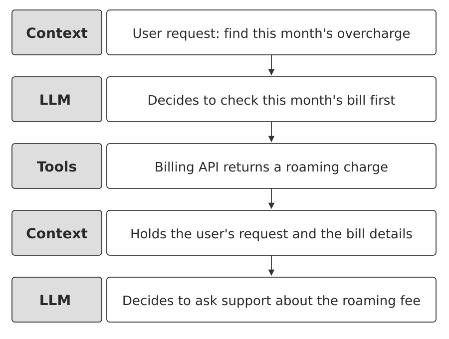
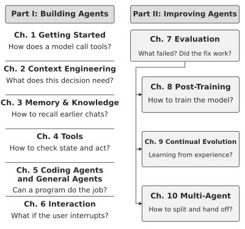

# Introduction {.unnumbered}

From August 2025 to early 2026, I taught an online video course, the "AI Agent Bootcamp," at Turing, the Chinese tech publisher. The course was about building AI Agents with engineering methods that can be explained, verified, and reused. It began by running an Agent and then asked why the Agent is built the way it is: what problem each design decision solves, what it costs, and which tasks it suits. This book grew out of the lecture notes and companion experiments from that course.

> **How this book was made: an exercise in human–AI collaboration**
>
> To prepare each lecture, I talked through the outline with Pine's voice Agent and had it research the topic and draft a first version. This dictation-based way of working is called **whisper coding**. After each class, I went back to check the examples and arguments wherever students had gotten stuck or an experiment had produced a surprising result.

Since 2025 I have watched an important shift: the center of gravity in AI research and industry practice has widened from making foundation models more capable to getting Agents to complete real tasks. As a result, model training and applications have become far more closely intertwined. Reasoning models such as DeepSeek-R1 have shown how much reinforcement learning can improve mathematics, programming, and reasoning.[^preface-r1] Agentic Reinforcement Learning brings tool calling and interaction with an environment into training, so that models learn to program and also to operate graphical interfaces. The latter kind of task is usually called Computer Use: the model reads the state of a page from a screenshot and then acts on it by clicking, typing, or scrolling. Products such as Manus, Claude Code, and OpenClaw let users delegate tasks directly, and they also show how "code generation + file system" can support a general-purpose Agent.

In September 2026, Meta launched Muse. Around that time, personal Agent products sprang up everywhere, in China and abroad. My team and I ran into many of the problems this book discusses much earlier, while building Pine. I am Chief Scientist at Pine AI, where my colleagues and I developed Pine, a personal Agent that runs errands for consumers. Pine launched in the United States in early January 2025. Users can ask it to call a business to negotiate a bill, request a refund, or cancel a subscription.

When a business agrees on the phone to waive a charge, what Pine can tell the user right then is "the representative agreed." To say "the money has been refunded," it has to wait until the refund shows up on a statement. To handle errands like this, we needed the model to remember what the user had authorized, to know what to check next, and to tell how far along the errand actually was. Many of the practices the industry later came to discuss under the names Skill, Harness, and loop engineering are ones we worked out on those phone calls.

- **Skill.** We loaded a prompt only when the task actually needed it. Once the number of tools grew, we had the model call tools through the command line, so we no longer had to list every tool definition in every request.
- **Harness.** We wrote the execution environment, the current time, and the user's work status into a status bar that the model could consult when making decisions. Models sometimes fabricate results, call the wrong tool, or skip instructions, and a dangerous operation can exceed what the user authorized. So we placed constraints on the execution process, and later we saw a similar approach in Claude Code.
- **Loop engineering.** Models sometimes declare a task done when it is only half finished. We had one Agent carry out the errand and another check the bill or the order; anything left undone was sent back to be completed. This is the proposer-reviewer division of labor.

Other model and Agent teams, working on similar problems, arrived independently at similar methods. That convinced me that many of the difficulties my team faced are common to every Agent system that moves into real use. Besides the "AI Agent Bootcamp," I have taught a hands-on Agent course at the University of Chinese Academy of Sciences continuously from 2024 to 2026. The questions students in both courses raised helped me see which lessons still needed to be explained more clearly. I am releasing this book as open source in the hope that more researchers and engineers will use, test, and improve these methods.

**Practice comes first; naming comes later.** For development teams, this carries a further implication: by the time a term becomes industry consensus, the leading teams have usually been exploring the problem for a long time. To build an engineering advantage of your own, you need to spot problems in real business early and try to solve them. In my view, two conditions are key.

**First, choose a real business that makes demanding enough requirements on the Agent's capabilities, and keep drawing feedback from it.** A single Pine task can run for hours or even weeks and require communicating with several parties: long phone calls, complex forms, many rounds of email. Throughout, every number must be right, every operation must stay under control, and the user's interests must be protected. Scenarios like these keep exposing the gap between what the model can do and what the business requires, and that pushes the team to improve its Harness. If a product's main value is merely making up for the weaknesses of one generation of models, the next model upgrade may wipe out that value, and the team will find it hard to build a lasting advantage.

**Second, build a systematic Evaluation mechanism.** After you change the system, a single successful bill negotiation might mean the assistant asked the right questions, or it might mean this particular representative happened to have the authority to grant a discount. Comparing the old and new versions repeatedly on the same set of cases shows whether a difference is stable. Chapter 7 explains in detail how to set success criteria, build an evaluation environment, analyze failures, and test changes.

At Pine, bill reductions taught us one technique: have the reviewer look at the money on the bill. Apply the same technique to rebooking a flight, and the reviewer has to check whether the new ticket was actually issued. The specific evidence changes from business to business, but a common principle lies beneath it: whether a task is complete depends on what result the action left in the outside world. **Good principles outlast model iteration cycles.**

## The Mission of This Book {.unnumbered}

Suppose someone hands an assistant a phone bill and asks it to contact the carrier and negotiate a reduction. Before starting, the assistant has to figure out which charge is in dispute. During the call, it has to listen to explanations and press for conditions. At the end, it has to tell the user exactly what the representative agreed to. At every step, the assistant must answer three questions: What does it know at this moment? What actions can it take? On what basis does it choose the next step? This book starts from these three questions to explain the structure of an Agent, how to build one, and where its capabilities end. The core formula is **Agent = LLM + Context + Tools**: the LLM handles understanding, planning, and decision-making; the context carries the information the current decision needs; and the tools connect to the external environment, either to gather observations or to take actions.

As an intuitive analogy, the LLM is the "brain," the context is the "current field of view for decisions," and the tools are the "senses and limbs." The field of view contains environmental information, conversation history, memory, and knowledge, as well as system instructions, tool definitions, and task state. Searching, reading, and taking screenshots bring information back; clicking, writing, and calling business interfaces change the state of the outside world. Figure 0-1 takes apart a single billing inquiry. When the model makes its first decision, it knows only that the user has a question about a charge; by the second decision, it can already identify which charge to ask about.



Readers familiar with Reinforcement Learning (RL) can also understand this division of labor in terms of policy, observations, and actions. The LLM chooses the next step based on the context, so its decision-making function roughly corresponds to a Policy; the context carries the specific observations and history used for this decision; and the tools provide the interfaces for observations and actions. The Observation Space describes which observations can be obtained, and the Action Space describes which actions are allowed; together they define the scope of the Agent's interaction with its environment.[^preface-spaces] Chapter 1 develops these concepts through tool-calling examples and introduces the division of labor between Model and Harness in production implementations.

> **Further Reflection: From Life to Designed Entities**
>
> Beyond engineering practice, Agents also raise questions about how intelligent systems evolve. Richard Sutton, Turing Award winner and pioneer of reinforcement learning, sums up the evolution of the universe in four stages: dust, stars, life, and "designed entities."[^preface-sutton] Living things evolve through random mutation and natural selection; designed entities, by contrast, can be built and improved purposefully by existing intelligent systems.
>
> An Agent can generate code, build new Agents, then analyze their behavior at run time, propose changes, and verify the results, gradually achieving bootstrapping and continuous evolution. It is as if one programmer wrote another programmer, who in turn helps build new systems. This possibility of understanding and improving oneself is one of the questions that interested me most while writing the chapters on code generation and continuous evolution.

## Book Structure {.unnumbered}

Figure 0-2 shows how the chapters connect. Suppose a user changes their request partway through a phone call, but the assistant keeps working from the old one. You could start from Chapter 6 in the left column to see how the assistant handles a user interrupting. Once you have fixed it, how do you know it will also take in new requests on other calls? That calls for the evaluation methods of Chapter 7 in the right column. The three arrows branching out of Chapter 7 indicate that, once you have evaluation results, you can choose different ways to improve depending on the cause of failure.



- **Chapter 1 (Getting Started with AI Agents)** uses products and tool-calling examples to introduce the core components, the run loop, the Harness, and orchestration approaches, establishing the conceptual framework for the whole book.
- **Chapter 2 (Context Engineering)** is the most important chapter in the book. It discusses how to organize the information the model needs right now, moving from prompt design and on-demand loading to history management, and uses the KV Cache to explain how these methods affect answer quality and running cost.
- **Chapter 3 (User Memory and Knowledge Bases)** discusses how to store and retrieve information across sessions. Moving from user memory to RAG, structured indexes, and knowledge updates, it shows how to retrieve and maintain persistent knowledge.
- **Chapter 4 (Tools)** discusses how an Agent gathers observations, takes actions, and requests collaboration. Through tool categories, interface design, MCP, and execution management, it explains how to connect external capabilities to the system.
- **Chapter 5 (Coding Agents and General-Purpose Agents)** puts forward a core architectural idea for general-purpose Agents: a Coding Agent as the execution core and the file system as the workspace. It first covers the development workflow, then uses cases such as multimedia and business systems to show how an Agent writes programs to solve problems, and from there creates tools and builds new Agents.
- **Chapter 6 (Interaction: Expanding the Observation and Action Spaces)** examines how Agents interact along two dimensions, modality and timing. Through asynchronous events, voice, Computer Use, and robotics, it explains continuous observation, fast and slow paths, and execution control.
- **Chapter 7 (Agent Evaluation)** answers how to judge a system's performance and the effect of a change. It first establishes success criteria, environments, and datasets, then covers verifiers, scoring, and statistical analysis, and finally shows how analyzing the causes of failure points the way to improvement.
- **Chapter 8 (Model Post-training)** discusses how to update a model's capabilities with data and environments, and argues for investing first in data quality and training environments. Through supervised fine-tuning, reinforcement learning, and reward design, it explains why learning from demonstrations and learning through exploration generalize differently, and why changing only the algorithm often yields little.
- **Chapter 9 (Continuous Agent Evolution)** discusses how to use operational experience to improve later versions of an Agent. It compares four kinds of updates—knowledge, instructions, programs, and parameters—and then manages long-term change with validation, release, and recovery processes.
- **Chapter 10 (Multi-Agent Collaboration)** discusses when multiple members add value and how they divide work, communicate, and coordinate. It first explains how context and control are allocated, then walks through collaboration mechanisms with case studies, analyzes the causes of failure, and considers what Agent societies and economies might look like.

## How to Read This Book {.unnumbered}

- **Building an Agent product from scratch**: Read the whole book. Use Chapters 1 through 6 to build an assistant that can get things done, then use Chapter 7 to find the tasks on which it tends to fail. The last three chapters discuss how to respond to those failures by improving the model, the system, or the division of labor among members.
- **Getting the big picture first**: Read Chapters 1, 2, 4, and 7 in that order. Follow a single tool call through: first learn the Agent's run loop, then see what information the model receives and what the tools actually do, and finally use evaluation to judge whether the result meets the user's needs. When Chapter 2 reaches the KV Cache, on a first reading you can take away the three conclusions stated at the start and come back to the underlying mechanics after doing the experiments.
- **Focusing on model training**: First use Chapters 1 and 2 to understand how an Agent runs, then read Chapter 8 alongside the evaluation methods of Chapter 7. This lets you connect training objectives to performance on real tasks.
- **Maintaining an Agent already in production**: Pick a batch of real tasks from Chapter 7 and evaluate them. Say the assistant quoted a user an outdated price: first check which version of the price list it received. If the knowledge or process is out of date, take this failure with you to Chapter 9. If the price list and the tools were all adequate, and the model still keeps choosing wrong after you have fixed the process, then read Chapter 8 to decide whether training data is worth preparing.

Every chapter includes experiments and thought questions. Experiments are numbered "Experiment X-Y," where X is the chapter number and Y is the order within the chapter. Star ratings indicate difficulty: ★ is suitable for beginners, ★★ requires some engineering experience, and ★★★ involves open-ended questions or complex system design. Most experiments come with runnable code, collected in the open-source repository:

> **Companion Code Repository**: `bojieli/ai-agent-book`

For your first experiment, you can start with "Experiment 1-1: The Critical Role of Context." If you use Git, run the following in a terminal:

```bash
git clone https://github.com/bojieli/ai-agent-book.git
cd ai-agent-book
```

You can also select **Code → Download ZIP** on the repository page and unzip it to get the same directory. Find number 1-1 in the Chapter 1 experiment index (`chapter1/README.en.md`) and open `chapter1/context/README.md`. From then on, whenever you meet "Experiment X-Y," you can look up its project and how to run it in `chapterX/README.en.md` in the repository. Experiments marked "Reproduction Guide" point to external projects and how to obtain them; installation commands and directory descriptions are collected in the READMEs.

## Prerequisites {.unnumbered}

This book is for readers with basic programming skills who want to understand and build Agents. The hands-on experiments draw on the following foundations.

**Required: Foundation for reading the entire book**

- **Python Programming**: Be familiar with the syntax, common data structures, and package management tools such as pip, so that you can read and modify the experiment code. Most experiments in the book are built on Python.
- **Experience Using LLMs**: Have used ChatGPT, Claude, or a similar product, and be familiar with the basic process of making a request, reading the reply, and following up.
- **General Software Engineering Knowledge**: Understand the command line, Git, JSON, and REST APIs well enough to run projects, inspect changes, and read interface data.

For the hands-on experiments, I strongly recommend picking one of Claude Code, Codex, Cursor, or TRAE. Have it help you debug a piece of code, and watch which files it reads and which tools it calls. Later, when you read about the run loop and context management, you will have a firsthand experience to compare against.

**Recommended: Background for specific chapters**

- **Machine Learning Basics (Chapter 8)**: Training and inference, loss functions, gradient descent, and overfitting help in understanding how a model is updated.
- **Basic Mathematics (Chapters 2, 3, 7, and 8)**: Vectors and matrices help in understanding embeddings and attention; probability and statistics help in understanding evaluation metrics and expected rewards. The book emphasizes intuitive explanations and practical uses.
- **Web Development Basics (Chapter 6)**: HTTP, WebSocket, and the division of work between front end and back end help in understanding asynchronous event architectures and real-time voice communication.
- **Transformer Basics (Chapters 2 and 8)**: Knowing how attention and model architecture work helps in understanding context computation and post-training. Readers who want to study the subject systematically can read *Hands-On Large Language Models* (by Jay Alammar and Maarten Grootendorst; the Chinese edition was translated by Li Bojie and published by Turing). It uses illustrations to explain the Transformer, pre-training, and fine-tuning, and complements this book's engineering perspective.

Apart from the post-training material in Chapter 8, the chapters use little mathematics or machine learning; basic programming experience is enough to start reading.

## Acknowledgments {.unnumbered}

I thank editors Meng Ge and Liu Meiying at Turing for editing this book and for the care they put into organizing the "AI Agent Bootcamp," and I thank Professor Liu Junming for offering the hands-on Agent course at the University of Chinese Academy of Sciences. I thank the students in both courses: your questions, experimental feedback, and suggestions helped me keep improving my explanations and deepened my own understanding of these concepts.

I thank all my colleagues at Pine AI. The challenges of a real business and our discussions as a team are the source of many of the methods and cases in this book. Your practice and insights have allowed these ideas to keep improving.

I thank my friends across the AI industry. In conversation after conversation, you offered candid feedback and shared different experiences and judgments, helping me understand models and Agents more deeply.

Most of all, I thank my family, especially my wife, Meng Jiaying. She supported the writing of this book throughout and offered many valuable suggestions on the manuscript.

[^preface-r1]: DeepSeek-AI, *DeepSeek-R1: Incentivizing Reasoning Capability in LLMs via Reinforcement Learning*, 2025.
[^preface-spaces]: Gymnasium documentation, "Spaces" section.
[^preface-sutton]: Richard Sutton, interview with Dwarkesh Patel, 2025-09-26, "Succession to AI" segment.
