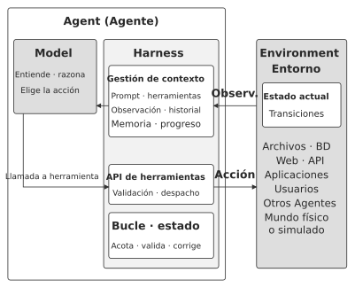
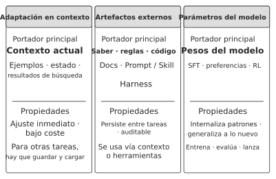
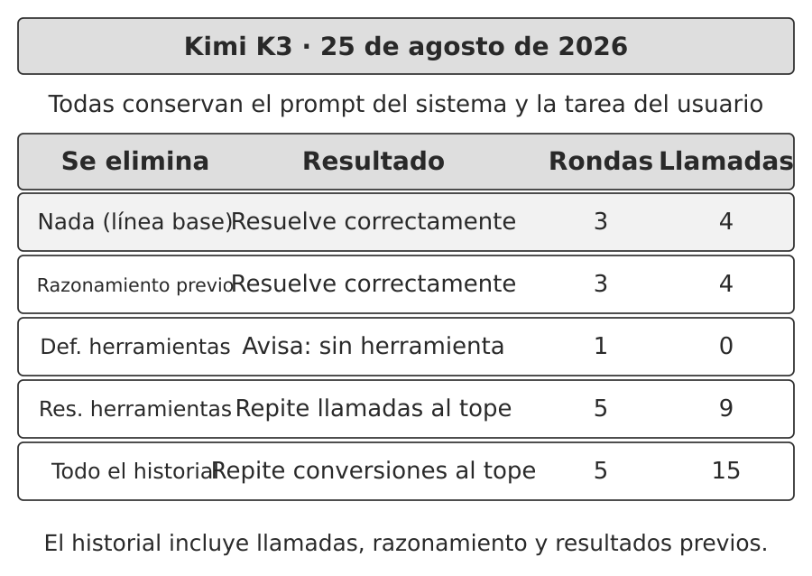
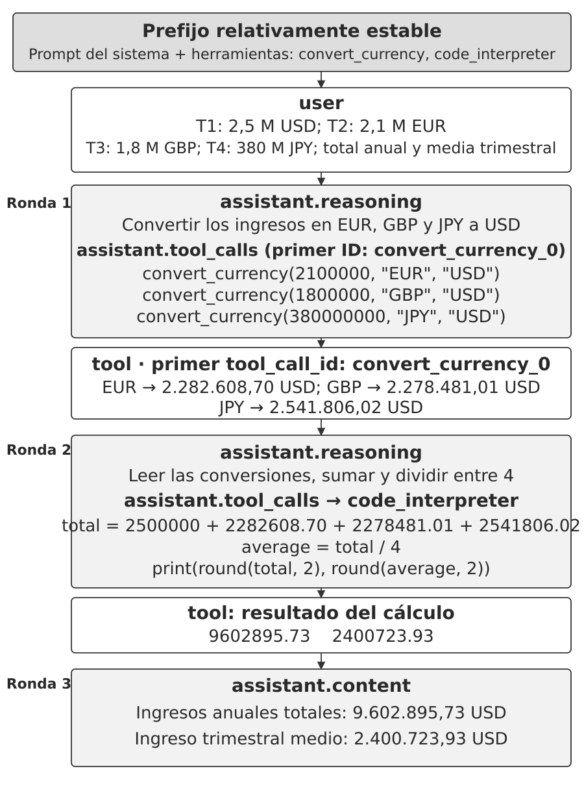
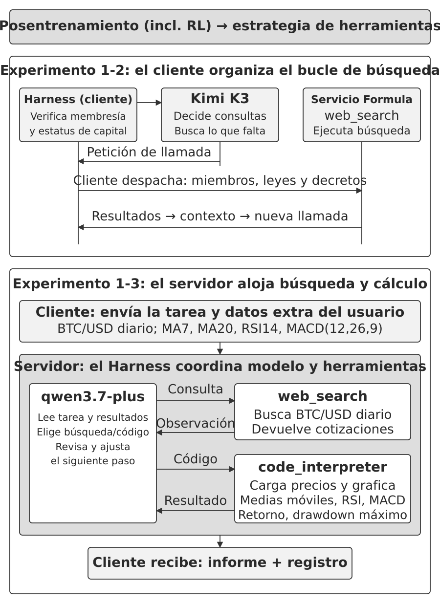
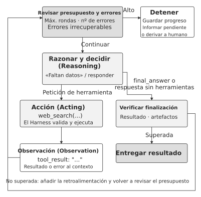
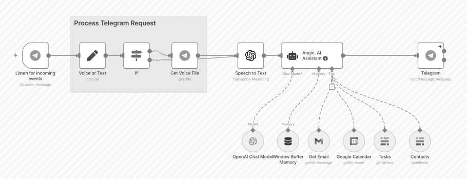

# Fundamentos de los Agentes de IA

Cuando usas Deep Research para investigar un tema, busca y lee una y otra vez hasta reunir la información en un informe. Manus puede manejar un navegador para completar tareas en línea, el asistente móvil de Doubao puede reservar billetes y enviar mensajes desde el teléfono, y Pine AI puede llamar por teléfono en nombre del usuario y negociar con la operadora una rebaja de la factura. Todas son aplicaciones de Agentes de IA.

Cuando usas Cursor para corregir una función, localiza la función, edita el archivo y ejecuta las pruebas. Si las pruebas siguen fallando, el mensaje de error se convierte en la base de su siguiente modificación; solo cuando pasan cuenta con evidencias para comunicarte el resultado. El orden de los tres pasos —buscar, editar y probar— podría fijarse de antemano en un programa, pero qué línea cambiar exactamente o a qué punto volver tras un fallo depende de la información obtenida durante la ejecución. Este proceso, en el que se eligen acciones en función de un objetivo y se ajusta el plan según los resultados, también se da en tareas como la investigación o la negociación telefónica.

## Agente moderno = LLM + contexto + herramientas

Este libro resume en una fórmula los tres elementos funcionales de un Agente moderno: **Agente = LLM (modelo de lenguaje grande, Large Language Model) + contexto + herramientas**.

- **El LLM es el cerebro del Agente**: se encarga de comprender la tarea, planificar los pasos y elegir las acciones. El preentrenamiento proporciona al modelo capacidad lingüística y conocimiento del mundo, y el posentrenamiento moldea además comportamientos como el seguimiento de instrucciones, el razonamiento y la llamada a herramientas. El capítulo 8 presenta métodos de posentrenamiento como el ajuste fino supervisado y el aprendizaje por refuerzo.
- **El contexto es el campo de visión del Agente para la decisión actual**: contiene la información que necesita esta decisión, incluidas las instrucciones, las definiciones de herramientas, las observaciones del entorno, la memoria del usuario, el conocimiento del dominio, los mensajes anteriores, el propio estado y el avance de la tarea.
- **Las herramientas son los sentidos y las extremidades del Agente**: obtienen información o ejecutan operaciones a través de interfaces. El sistema de herramientas incluye definiciones, protocolos de llamada y adaptadores, y admite tanto operaciones de observación (buscar, leer, capturar la pantalla) como escribir, ejecutar código, delegar en subagentes y comunicarse con el usuario.

Una misma herramienta puede cumplir varias funciones. Por ejemplo, cuando el modelo lee un archivo mediante la línea de comandos, el contenido devuelto se convierte en la base de la siguiente decisión; cuando ejecuta un programa por la misma vía, también puede cambiar el estado de archivos o procesos.

Supón que acabas de abrir un paquete y quieres preguntar al servicio de atención al cliente: «¿Puedo devolverlo si ya lo he abierto?». El sistema puede usar la **generación aumentada por recuperación** (Retrieval-Augmented Generation, RAG) para buscar la política de devoluciones vigente de la tienda y pedir después al modelo que responda según sus cláusulas.[^ch1-rag] Siguiendo una sola consulta se ve con claridad qué hace cada componente. El texto original de la política y su índice se guardan en una base de conocimiento externa; la herramienta de recuperación busca los párrafos relevantes para la pregunta, y el programa que llama al modelo incluye esos párrafos, junto con su procedencia, en la petición. Cuando el modelo lee el apartado sobre productos abiertos, puede explicar la cláusula; si la cláusula distingue además por categoría de producto, primero tendrá que preguntar qué compraste.

[^ch1-rag]: Patrick Lewis et al., Retrieval-Augmented Generation for Knowledge-Intensive NLP Tasks, NeurIPS, 2020.

En esta consulta sobre devoluciones, lanzar la búsqueda es una acción del Agente, y las cláusulas devueltas son la observación que obtiene del entorno (Environment). Que el siguiente paso sea responder o preguntar depende de lo que digan las cláusulas. Esto forma el bucle cerrado del que hablan el aprendizaje por refuerzo y la teoría de control, como muestra la figura 1-1.



La capa exterior de la figura marca la frontera entre el Agente y el entorno. Archivos, bases de datos, páginas web, usuarios, otros Agentes y mundos físicos o simulados pueden ser el entorno con el que interactúa. La capa interior muestra el reparto de funciones en una implementación de producción: **el modelo se encarga de comprender, razonar y decidir; el Harness, situado dentro de la frontera del Agente pero fuera del modelo, organiza el contexto, las interfaces de herramientas, el bucle de ejecución y el estado, y aplica restricciones, verificación y corrección.** El Harness puede crear, aislar o representar el entorno; el contenido de los archivos, el estado de los procesos y demás cambian en el entorno a medida que se actúa.[^ch1-harness]

[^ch1-harness]: Véanse «The Anatomy of an Agent Harness», de LangChain, y «Effective harnesses for long-running agents», de Anthropic. Algunas implementaciones incluyen también el sandbox en el Harness; la figura 1-1 dibuja el entorno por separado para poder seguir qué cambian realmente las acciones.

Por eso este libro adopta dos descomposiciones complementarias: **«LLM + contexto + herramientas» describe la composición funcional, y «Modelo + Harness» describe la implementación de producción.** El Harness organiza el contexto y se lo entrega al modelo; las llamadas a herramientas las decide el modelo, el Harness las valida y las despacha, y después las ejecutan las herramientas o el entorno. Un sistema sencillo puede empezar por el ensamblado del contexto y el despacho de herramientas, e ir incorporando después los mecanismos de restricción, verificación y corrección que exige el funcionamiento en producción.

Si conoces el aprendizaje por refuerzo, puedes leer la tabla siguiente a partir de tres preguntas: quién decide el siguiente paso, en qué se basa para decidirlo y cómo lo lleva a cabo. Se trata de una analogía aproximada, establecida por funciones.

| Intuición | Elemento de ingeniería | Concepto relacionado en aprendizaje por refuerzo | Significado |
|-----------|-----------|----------------------------|----------------------------------------------|
| **Cerebro** | LLM | **Política** (Policy) | Decide qué hacer a continuación según la información actual |
| **Campo de visión de la decisión actual** | Contexto | **Observaciones e historial** | Organiza la información devuelta por el entorno y el historial existente como base para decidir |
| **Sentidos y extremidades** | Herramientas y adaptadores | **Interfaces de observación y acción** | Establecen cómo leer la información del entorno, cómo emitir acciones y el formato de las llamadas y sus resultados |

### Espacio de observación y espacio de acción: la interfaz entre el modelo y el mundo

**El espacio de observación describe qué observaciones puede recibir el Agente, y el espacio de acción, qué acciones puede emitir.** El contexto de una llamada contiene la información concreta, y las herramientas disponibles proporcionan la interfaz para interactuar con el entorno. Además de las herramientas, la entrada del usuario, las notificaciones de eventos y otras fuentes también pueden aportar observaciones; los parámetros de las llamadas a herramientas, los permisos y el entorno de ejecución limitan conjuntamente el alcance de las acciones.

Imagina dos fallos distintos. En el primero, el modelo sabe explicar cada concepto de la factura, pero no tiene acceso a la factura de este mes. Una vez que el usuario autoriza la lectura, todavía hay que obtener la factura y entregársela al modelo para que pueda determinar qué cargo es discutible. En el segundo, el usuario pide al asistente que cambie de tarifa, y el asistente ya ha encontrado un plan adecuado, pero la interfaz de la cuenta solo permite consultas. Por mucho que vuelva a leer la factura, no podrá hacer el cambio: necesita el permiso de operación correspondiente. El trabajo del Harness consiste en poner en el contexto el material leído, recibir la acción que elige el modelo, comprobar parámetros y permisos y despachar su ejecución.

Por tanto, **con el modelo subyacente fijo, ajustar el espacio de observación y el espacio de acción es un recurso de ingeniería importante para mejorar el desempeño en una tarea.** Si el modelo pasa por alto hechos clave, se pueden incorporar los datos pertinentes al contexto; si a menudo elige mal entre herramientas parecidas, se pueden fusionar las interfaces duplicadas o cargar solo las herramientas que necesita la tarea en curso.

Con el vídeo aparece el problema contrario: la imagen está siempre ahí, pero los cambios que justifican volver a evaluar la situación son pocos. Supón que el asistente está esperando a que se suba un archivo: si llama al modelo principal cada vez que se mueve la barra de progreso, añade mucho cómputo inútil; si solo mira cada diez segundos, puede perderse un aviso de error fugaz. **En mi opinión, hacer más disperso el espacio de observación (*sparsification*), es decir, pasar al modelo solo los cambios que importan, es un problema fundamental del diseño de Agentes.** El sistema puede observar el entorno de forma continua y entregar al modelo principal solo los cambios que podrían alterar la siguiente acción, junto con el contexto necesario.

**Manus: investigación, programación y control del ordenador en una misma tarea.** Deep Research destaca en buscar y leer, los Coding Agents pueden escribir y ejecutar código, y los Agentes de Computer Use pueden operar interfaces. Manus integra el navegador, el sistema de archivos, la ejecución de código y la línea de comandos en un sandbox en la nube, de modo que un mismo Agente puede primero buscar información, después procesar archivos y ejecutar código y, por último, completar operaciones en el navegador. El navegador y la lectura de archivos amplían la información accesible; la ejecución de código y de comandos amplía las operaciones combinables. **En mi opinión, esta combinación es un avance importante para los Agentes de propósito general: un mismo Agente puede cruzar las fronteras que antes separaban productos distintos y encadenar la obtención de información, el procesamiento de datos y la ejecución de operaciones en una tarea completa.**

**OpenClaw: la interfaz se extiende a la vida digital del usuario.** OpenClaw recibe tareas y devuelve resultados a través de canales de mensajería como WhatsApp, Telegram, Slack, Discord e iMessage, y conecta esos canales con los modelos y las herramientas mediante un Gateway que se ejecuta en el dispositivo del usuario. Una vez configuradas las herramientas correspondientes y concedida la autorización, el Agente puede procesar archivos locales y también conectarse a servicios en la nube como Google Drive o Notion. Así, la información que el usuario tiene repartida entre cuentas y dispositivos puede entrar en el procesamiento de una misma tarea. Las primeras versiones de Manus trabajaban sobre todo en un sandbox en la nube, y el usuario tenía que subir los archivos; el conector de Google Drive y la función de escritorio My Computer, añadidos más tarde, ampliaron el acceso a archivos en la nube y a recursos locales. Esta evolución muestra que el crecimiento de las capacidades de un producto suele provenir de la ampliación de sus interfaces de observación y de acción[^ch1-agent-products].

[^ch1-agent-products]: Para la estructura de los productos, véanse las presentaciones oficiales de Manus sobre Sandbox, Google Drive Connector y My Computer, así como el repositorio oficial y la documentación de herramientas de OpenClaw. Los conectores, la configuración de las herramientas y la autorización del usuario determinan los recursos concretos a los que se puede acceder.

Las tareas de cada producto son distintas, pero todas pueden entenderse desde tres aspectos: la base de decisión, las operaciones disponibles y la estrategia de ejecución:

| Producto de Agente | Información principal en el contexto | Herramientas y operaciones disponibles | Estrategia de ejecución |
|----------------|----------------------|----------------------------|------------------------------|
| **Coding Agents como Cursor** | Requisitos, fragmentos de código, listados de directorios, salida de la terminal | Búsqueda de código, lectura y escritura de archivos, ejecución de comandos | Comprender los requisitos→buscar el código relacionado→editar el código→verificar con pruebas→depurar y corregir |
| **Agentes de búsqueda como Deep Research** | Resultados de búsqueda, contenido de páginas web, resúmenes y citas de artículos | Consultas de búsqueda, lectura de páginas web, generación de informes | Ajustar la dirección de búsqueda según la información disponible e ir sintetizando un informe completo |
| **Agentes de control del ordenador como Browser Use** | Capturas de pantalla, DOM o árbol de accesibilidad, resultados de las operaciones | Hacer clic, escribir, desplazarse, capturar la pantalla, ejecutar código | Leer la interfaz→identificar el elemento objetivo→ejecutar la operación→verificar el resultado |
| **Agentes asistentes móviles como Doubao** | Capturas del teléfono, estado de la interfaz de las App, respuestas del sistema | Tocar, deslizar, escribir, abrir App | Comprender la necesidad→localizar la App objetivo→ejecutar la operación→confirmar que se ha completado |
| **Agentes de gestiones personales como Pine AI o Meta Muse** | Registros de cuenta, facturas e información de proveedores leídos con autorización | Llamar por teléfono, enviar correos, rellenar formularios, confirmar con el usuario | Recopilar información→definir la estrategia de negociación→contactar con el proveedor→negociar→informar del resultado |

**¿Cómo se convierte un encargo en una tarea ejecutable?** Cuando desarrollaba asistentes de gestiones personales en Pine, observé que los usuarios a menudo solo enuncian un objetivo, por ejemplo: «Resérvame el vuelo para el viaje de trabajo; que no pase de 1200 yuanes». El asistente tiene que aclarar primero las fechas, el destino y qué es lo más importante en ese viaje; después, reunir la información que falta y acordar con el usuario cómo piensa proceder y qué condiciones son negociables, y solo entonces contactar con el proveedor. Las novedades que surgen durante la gestión pueden además devolver la tarea a un paso anterior.

Supón que el billete más barato que encuentra el operador de atención al cliente cuesta 1250 yuanes. El modelo decidirá combinando el sentido común, las características del viaje y lo que recuerda de los hábitos del usuario. Para alguien que está de viaje de trabajo y suele estar dispuesto a gastar un poco más por un itinerario adecuado, Pine podría reservarlo directamente; si se trata de un viaje familiar y el usuario ha dejado claro en otras ocasiones que le importa el gasto total, podría comunicarle primero la diferencia y seguir pidiendo al operador que busque otros vuelos. Si el usuario añade después: «La próxima vez que un billete supere el presupuesto, pregúntame antes», ese comentario aporta a la siguiente decisión una base más concreta que la experiencia general.

En otro escenario, el servicio de atención al cliente de un banco propone enviar unos documentos al domicilio, y el asistente recuerda que el usuario está de viaje en el extranjero. Lo que hay que cambiar esta vez es la forma de entrega: en la propia llamada puede explicar la dificultad para recibir el envío y conseguir que se lo manden por correo electrónico. En el caso de una rebaja en la factura, si el operador la promete de palabra durante la llamada, el asistente puede informar con exactitud del compromiso del comercio; pero para confirmar que el importe se ha descontado de verdad hará falta la siguiente factura como nueva observación. El espacio de acción de un asistente puede ampliarse hasta las llamadas telefónicas reales, pero sus conclusiones siguen limitadas por el espacio de observación.

Según el tipo de encargo, en este libro aparecerán tres clases de aplicaciones: gestiones de la vida cotidiana, trabajo colaborativo de oficina e investigación científica. Un mismo asistente puede asumir tareas de distintas clases; la diferencia está en quién le concede la autorización, qué puede cambiar y quién valida el resultado final. En la oficina, cuando un compañero entrega el resultado de una comprobación, ¿puede cerrarse el ticket? Supón que el responsable de un proyecto menciona al asistente en un ticket de Multica para pedirle que revise una diferencia en una hoja de presupuesto. Ese comentario desencadena la revisión, pero el ticket sigue perteneciendo a su responsable original y su estado no cambia. El asistente entrega los dos importes y su procedencia, con lo que responde a la pregunta del compañero; si el presupuesto completo puede presentarse o no es algo que el responsable debe decidir teniendo en cuenta el resto de tareas pendientes.[^ch1-multica]

En las tareas científicas cabe hacerse la misma pregunta: ¿con qué criterio se afirma que se ha avanzado? Cuando AlphaEvolve, de Google DeepMind, busca algoritmos de multiplicación de matrices, el modelo propone programas candidatos y un evaluador los ejecuta y comprueba si el producto es correcto y cuántas multiplicaciones utiliza. La búsqueda posterior puede seguir mejorando los programas con mejores resultados. El equipo de investigación informa de que uno de esos algoritmos multiplica dos matrices complejas de $4\times 4$ con 48 multiplicaciones escalares. «Hacer menos multiplicaciones» tiene un objeto de recuento claro, y además el algoritmo tiene que obtener el producto matricial correcto.[^ch1-alphaevolve]

[^ch1-multica]: Multica, mencionar a un Agente en los comentarios de un ticket. El capítulo 10 analiza cómo distinguir, en la colaboración, una petición puntual de ayuda de una transferencia de responsabilidad.

[^ch1-alphaevolve]: Google DeepMind, nota de investigación sobre AlphaEvolve, mayo de 2025. El número de multiplicaciones se refiere aquí a las multiplicaciones escalares del algoritmo; el tiempo de ejecución real depende también de la implementación y del hardware.

El espacio de acción de estos sistemas es **abierto**. Las consultas de búsqueda, los textos introducidos, el código generado y las combinaciones de operaciones difícilmente pueden enumerarse de antemano, aunque cada acción sigue limitada por las herramientas, los parámetros, los permisos y el entorno de ejecución. Precisamente por eso, un plan ejecutable debe dejar margen para que las nuevas observaciones cambien el siguiente paso.

### Herramientas: los sentidos y las extremidades del Agente

Las herramientas convierten las decisiones del modelo en lecturas u operaciones sobre el entorno externo. Las herramientas de búsqueda y lectura traen observaciones; las de escritura de archivos, ejecución de comandos y similares llevan a cabo acciones. El modelo conoce el efecto de una operación por el resultado devuelto y decide entonces si continuar, reintentar o terminar la tarea.

Según su uso principal, este libro divide las herramientas en cinco tipos. Una misma interfaz puede servir para varios usos; por ejemplo, una llamada de voz permite tanto obtener información como transmitir una petición.

**Las herramientas de percepción** obtienen información: los buscadores aportan información de la web, las herramientas de lectura de archivos acceden a documentos locales, y las interfaces de API y de bases de datos conectan con servicios externos y datos empresariales.

**Las herramientas de ejecución** realizan operaciones: ejecutan código, modifican archivos, lanzan comandos del sistema o llaman a API externas, y así llevan las decisiones al entorno.

**Las herramientas de colaboración** permiten repartir y coordinar el trabajo: delegan tareas especializadas en subagentes, recogen los resultados y coordinan el trabajo de varios Agentes. Cuando hace falta que una persona participe en una decisión, el sistema puede además pedir confirmación a través de la interfaz de comunicación con el usuario.

**Las herramientas de activación por eventos** incorporan eventos externos a la ejecución. Un correo nuevo, la llegada de una hora programada o una devolución de llamada de un Webhook pueden desencadenar una tarea. Los adaptadores de eventos convierten estas entradas en observaciones que el Agente puede procesar, y el mecanismo de despacho se encarga de iniciar o reanudar la ejecución; las reglas de activación pueden configurarlas los desarrolladores o registrarse mediante llamadas a herramientas autorizadas.

**Las herramientas de comunicación con el usuario** transmiten información al usuario y recogen sus comentarios, por ejemplo enviando mensajes de texto, iniciando llamadas de voz o enviando correos. Sirven para informar del progreso, pedir confirmación y también para recordar al usuario, por iniciativa propia, asuntos que tiene pendientes.

El capítulo 4 desarrolla el diseño de estos cinco tipos de herramientas. La definición de la interfaz influye en que el modelo elija bien la herramienta y rellene correctamente los parámetros; el tratamiento de errores determina si se puede continuar tras un fallo, y el control de permisos limita el alcance de las operaciones. MCP (Model Context Protocol, protocolo de contexto de modelo) ofrece una forma unificada de descubrir y llamar a herramientas, lo que reduce el trabajo de adaptación entre sistemas distintos.

La **llamada a herramientas** (Tool Calling) es la capacidad del modelo de formular peticiones de operación en un formato acordado. La conocida llamada a funciones (Function Calling) expresa la petición mediante el nombre de la herramienta y unos parámetros estructurados. En este libro se usa siempre el término «llamada a herramientas».

Tomemos como ejemplo la consulta del tiempo en Pekín. El modelo puede escribir el nombre de la ciudad, pero la temperatura real solo aparecerá en el contexto cuando el Harness haya ejecutado la consulta. Estos son los cuatro pasos de mensajes de esta llamada:

```text
Paso 1: declarar la herramienta      Paso 2: el modelo decide llamarla
tools: [{                          assistant: {
  name: "get_weather",               tool_calls: [{
  parameters: {                        id: "call_1",
    city: "string"                     function: "get_weather",
  }                                    arguments: {city: "Pekín"}
}]                                   }]
                                   }

Paso 3: el resultado se añade al contexto   Paso 4: el modelo responde según el resultado
tool: {                            assistant: {
  tool_call_id: "call_1",              content: "Hoy en Pekín hace 28 °C y está soleado."
  content: '{"temp":28,"sky":"soleado"}'  }
}
```

En este ejemplo, `call_1` asocia el valor devuelto por la herramienta con la petición de llamada. El desarrollador describe cómo se llama a la herramienta, escribe la función que consulta el tiempo y devuelve el resultado al modelo; el modelo decide si llama a una herramienta, a cuál y con qué parámetros. El capítulo 2 presenta con más detalle la estructura de los mensajes de la API.

Al diseñar herramientas, conviene empezar ofreciendo justo la capacidad necesaria. Para las cuatro operaciones aritméticas basta una calculadora con parámetros claros; cuando la tarea se amplía a leer tablas, limpiar valores ausentes, calcular estadísticas y dibujar gráficos, un intérprete de Python restringido facilita combinar esos pasos. A medida que crecen las capacidades generales, el aislamiento y la gestión de recursos deben crecer con ellas: el código se ejecuta en un sandbox, el acceso a la red está desactivado por defecto, el acceso a archivos se limita al directorio de trabajo autorizado y se fijan límites al tiempo de ejecución, la CPU, la memoria y el tamaño de la salida.

Para dejar constancia de una ejecución, basta una única herramienta de registro. Las tareas que duran horas o incluso días, en cambio, se benefician de un directorio de trabajo virtual controlado donde guardar el plan, los resultados intermedios, los registros de ejecución y los productos finales, de modo que el Agente pueda retomar el trabajo entre ejecuciones sucesivas. El directorio debe limitar las rutas de lectura y escritura, la capacidad y los tipos de archivo, y comprobar que ninguna ruta salga de la frontera autorizada.

Los pagos, el borrado de datos, el envío de correos y los despliegues en producción son operaciones de alto riesgo o sujetas a reglas de negocio explícitas; conviene encapsularlas en herramientas específicas con parámetros claros, permisos restringidos y auditoría completa, y añadir vista previa y confirmación humana cuando sea necesario. **Las capacidades básicas generales permiten combinar y explorar; las herramientas específicas imponen las restricciones de las operaciones de alto riesgo y las reglas de negocio.**

### LLM: el cerebro del Agente

El LLM es el núcleo de decisión del Agente. Al recibir una petición, primero identifica en lo que dice el usuario el objetivo y las restricciones, y después divide las tareas complejas en pasos ejecutables. Durante la ejecución también debe decidir qué hacer a continuación, si llamar a una herramienta, cuál elegir y cómo rellenar sus parámetros. Estas capacidades se apoyan en el conocimiento y la capacidad lingüística acumulados en el preentrenamiento, y el posentrenamiento las convierte en un comportamiento de decisión adecuado a cada tarea. Tanto los flujos de trabajo como los Agentes autónomos necesitan este tipo de juicio, mientras que las operaciones reales se realizan a través del Harness, las herramientas y el entorno.

Planificar y anticipar antes de actuar ayuda al Agente a comparar alternativas, prever resultados y reducir los intentos inútiles. Por ejemplo, el modelo puede usar reglas matemáticas para comprobar los pasos de un cálculo, relaciones causales para analizar una avería y dependencias para ordenar las operaciones. Primero compara distintas alternativas en su razonamiento y, una vez elegida la acción, pide a una herramienta que la ejecute. Los sistemas clásicos de aprendizaje por refuerzo también pueden organizar la exploración con políticas aprendidas, funciones de valor, modelos del entorno o algoritmos de planificación; lo propio de un Agente basado en un LLM es que, antes de empezar una tarea concreta, ya ha adquirido mediante el preentrenamiento a gran escala un conocimiento amplio y patrones de resolución de problemas, y el posentrenamiento refuerza además la forma de usar esas capacidades.

#### Llamada nativa a herramientas en el modelo

En el sector se usa la expresión «el modelo como Agente» (Model as Agent) para resumir una tendencia: el modelo asume cada vez más decisiones de planificación y de llamada a herramientas. Mediante el posentrenamiento, y sobre todo mediante el aprendizaje por refuerzo, el modelo puede aprender cuándo llamar a una herramienta, a cuál, con qué parámetros y cómo seguir una vez obtenido el resultado. El desarrollador aporta el objetivo, las interfaces y las restricciones, y el modelo organiza los pasos concretos según avanza la tarea.

Las decisiones autónomas del modelo necesitan el soporte de un Harness. La palabra *harness* designa originalmente los arreos de un caballo, que transmiten su fuerza al vehículo y permiten controlar la dirección. En un Agente, el Harness organiza las capacidades del modelo en un proceso de trabajo que puede mantenerse en marcha, y asume la gestión del contexto, las interfaces de herramientas, las restricciones, la verificación y la corrección. La segunda mitad de este capítulo presenta una por una estas cinco funciones.

Cuantas más operaciones puede organizar el modelo por sí solo, mayor es el alcance potencial de sus errores. Por eso el modelo y el Harness deben optimizarse conjuntamente: el modelo mejora la calidad de la planificación y de la elección de herramientas, y el Harness gestiona los permisos, comprueba los resultados y trata los fallos. Los proveedores de modelos pueden mejorar ambas partes a la vez, y esa iteración conjunta constituye una ventaja de ingeniería importante.

> **La evolución de las capacidades del modelo y del Harness**
>
> En «La amarga lección» (The Bitter Lesson), Rich Sutton repasa una tendencia de largo plazo en la investigación en IA: los métodos de búsqueda y aprendizaje capaces de aprovechar más recursos de cómputo acaban superando a los que dependen de un gran diseño manual específico del dominio[^ch1-1]. En esa dirección, decisiones que antes asumían procesos externos, como la elección de herramientas o la organización de los pasos, pueden ir interiorizándose en el modelo mediante el entrenamiento.
>
> La postura de este libro es: **de acuerdo con la dirección, pragmatismo con el ritmo.** El modelo irá asumiendo parte de las responsabilidades de decisión del Harness, pero cada ronda de entrenamiento y despliegue lleva tiempo, mientras que las reglas de negocio y las preferencias de los usuarios cambian sin cesar. Además, las restricciones de un negocio real difícilmente pueden escribirse de una sola vez en los parámetros del modelo. Por eso, lo que el modelo todavía no hace de forma fiable lo cubre de momento el Harness. **El límite actual de las capacidades del modelo es precisamente donde reside hoy el valor del Harness.** Este reparto cambia con las capacidades del modelo: cada vez que el modelo domina un tipo de decisión, el Harness puede reducir la orquestación correspondiente y dedicarse a resolver nuevas dificultades. La aplicación de permisos, la persistencia del estado y la comprobación de resultados siguen siendo responsabilidad del sistema de ejecución.

[^ch1-1]: Sutton, Rich. The Bitter Lesson, 2019.

#### Mecanismos de aprendizaje del Agente: de la adaptación en contexto a la actualización persistente

Tras un error de una herramienta, el Agente aprende esta vez a buscar el archivo por otra ruta. Mañana, en una sesión nueva, ¿recordará la lección? Si se sigue en la figura 1-2 dónde queda guardada esa experiencia, se distinguen tres tipos de actualización.



La **adaptación en contexto** ocurre durante la ejecución de la tarea. Al leer ejemplos, el estado de la tarea o resultados de búsqueda, el modelo puede ajustar su comportamiento posterior. Por ejemplo, si la herramienta indica que el archivo no existe, el modelo puede buscar de nuevo la ruta y continuar. Esta vía responde rápido y cuesta poco; su eficacia depende de la capacidad de la ventana de contexto y de cómo se organice la información. Para que la experiencia sirva en tareas posteriores, hay que guardar la información pertinente y volver a proporcionársela al modelo. El capítulo 2 presenta los métodos de organización del contexto.

Los **productos externos** (artifacts) permiten conservar la experiencia de una tarea a otra. Los hechos y la experiencia se escriben en documentos de conocimiento; las estrategias que pueden expresarse con palabras, en prompts o Skills; los procesos y restricciones deterministas, en programas o en la lógica del Harness. Estos productos son fáciles de auditar y revisar, y en tiempo de ejecución intervienen en las decisiones y en la ejecución a través del contexto o de las interfaces de herramientas. Los capítulos 3 a 5 presentan las bases correspondientes de conocimiento y programas, y el capítulo 9 analiza cómo generar, verificar y publicar actualizaciones a partir de trayectorias de ejecución evaluadas.

Los **parámetros del modelo**, por su parte, se actualizan mediante entrenamiento. Capacidades como la comprensión de imágenes médicas, el estilo lingüístico o las estrategias de decisión implícitas implican numerosos patrones difíciles de escribir como reglas una a una, y pueden aprenderse de datos y retroalimentación mediante el posentrenamiento. Actualizar los parámetros exige invertir en entrenamiento, evaluación y despliegue, con el objetivo de que el modelo pueda aplicar lo aprendido también en tareas nuevas. El capítulo 8 desarrolla estos métodos.

Un mismo fallo puede servir primero para corregir la operación en curso y, más tarde, convertirse en una nota del proyecto que consulte el siguiente Agente. Si el mismo tipo de error se repite en muchos proyectos, esos casos pueden usarse además para entrenar.

### Contexto: el campo de visión del Agente para la decisión actual

Para tomar una decisión, una persona necesita tener a la vista a la vez la descripción de la tarea, los manuales de referencia, el historial de comunicaciones y los datos más recientes. Un Agente también necesita un conjunto así de información, y eso es el contexto. La cantidad de información que puede recibir una llamada al LLM está limitada por la ventana de contexto, y el Harness se encarga de seleccionar y organizar su contenido. Desde el punto de vista de la API, la implementación básica de este libro incluye cinco tipos de información:

- **Prompt del sistema** (System Prompt): lo construye el desarrollador o el Harness y establece la identidad del Agente, los límites de la tarea y sus normas de conducta. La ingeniería de prompts moldea la forma de trabajar ajustando estas instrucciones. El prompt del sistema puede mantenerse relativamente estable durante la sesión o, según la configuración del producto, incorporar memoria del usuario entre sesiones (preferencias, comportamiento anterior e información de contexto) o el estado actual del entorno. Los permisos reales los aplican el Harness y el control de acceso del entorno. El capítulo 3 presenta la memoria del usuario.
- **Definiciones de herramientas** (Tool Definitions): declaran el nombre, la función y el formato de parámetros de las herramientas disponibles, y ayudan al modelo a elegir operaciones y construir peticiones. En la implementación básica de este libro, las definiciones de herramientas y el prompt del sistema van al principio de la petición y forman un prefijo relativamente estable. Cuando hay muchas herramientas, también se puede cargar el schema completo bajo demanda sin alterar el prefijo existente; los capítulos 2 y 4 desarrollan este método.
- **Mensajes del usuario** (User Messages): contienen la tarea y las aportaciones adicionales del usuario, y pueden incluir conocimiento externo obtenido mediante RAG (generación aumentada por recuperación, Retrieval-Augmented Generation), como información posterior a la fecha de corte del entrenamiento o material privado de un dominio. El capítulo 3 presenta la recuperación y la organización del conocimiento.
- **Respuestas del modelo** (Assistant Messages): incluyen el texto dirigido al usuario `content`, las peticiones de llamada a herramientas `tool_calls` y la información de razonamiento que proporcione el servicio. Este libro abrevia esa información como `reasoning`; según el servicio, puede devolverse el contenido del razonamiento, un resumen o un estado opaco para continuar. Cuando se llama a una herramienta, la respuesta puede contener el razonamiento y la petición de llamada; al terminar la tarea, el razonamiento y el texto final. Los campos concretos y su visibilidad dependen del servicio del modelo.
- **Resultados de herramientas** (Tool Results): contienen el valor devuelto tras la ejecución, los errores o el estado; se añaden al historial de mensajes y sirven de base para la siguiente decisión. Con ellos el modelo determina si la operación ha tenido éxito y si debe ajustar algo, y evita intentos repetidos dentro de la misma tarea.

En cada llamada al modelo, el Harness envía juntos el prefijo relativamente estable (prompt del sistema y definiciones de herramientas) y el historial de mensajes, que no deja de crecer. Así, aunque la herramienta de cambio de divisas devolviera su resultado en la ronda anterior, el modelo sigue pudiendo leerlo en esta ronda al calcular el total.

El papel de cada tipo de información en la decisión puede examinarse mediante un **estudio de ablación** (Ablation Study): se fijan la tarea y las condiciones de ejecución, se elimina un tipo de información cada vez y se compara cómo cambia el comportamiento. El experimento 1-1 conserva el prompt del sistema y la tarea actual del usuario, para fijar el rol, las restricciones y los requisitos de la tarea, y aplica la ablación por separado a las definiciones de herramientas, los resultados de herramientas, el razonamiento previo y el historial de mensajes.

> **Experimento 1-1 ★★: El papel clave del contexto**
>
> Se pide al Agente que sume los ingresos trimestrales de una empresa: 2,5 millones de dólares en el primer trimestre, 2,1 millones de euros en el segundo, 1,8 millones de libras en el tercero y 380 millones de yenes en el cuarto. La tarea exige convertir todos los ingresos a dólares con una herramienta de cambio de divisas y calcular después, con una herramienta de cálculo, los ingresos anuales totales y la media trimestral, con dos decimales. Así, el modelo necesita tanto elegir herramientas como recordar los pasos ya completados y los valores devueltos.
>
> El experimento consta de una línea base completa y cuatro ablaciones, con un máximo de cinco rondas cada una. Al eliminar el razonamiento previo, el modelo puede volver a razonar en cada ronda; al eliminar las definiciones de herramientas, la petición deja de ofrecer herramientas disponibles; al eliminar los resultados de herramientas, se conservan los registros de las llamadas pero se oculta el contenido devuelto; al eliminar el historial de mensajes, solo se conservan el prompt del sistema, las definiciones de herramientas y la tarea actual del usuario. Intenta predecirlo antes: si el modelo solo sabe que «ya se ha consultado el tipo de cambio del yen», ¿qué paso del cálculo puede dar? ¿Y si sabe «a cuántos dólares equivalen 380 millones de yenes»? La figura 1-3 muestra los resultados de los cinco grupos.
>
> 
>
> En la ejecución con Kimi K3 del 25 de agosto de 2026, la **línea base completa** terminó la tarea en tres rondas y cuatro llamadas a herramientas, con unos ingresos anuales totales de 9.602.895,73 dólares y una media trimestral de 2.400.723,93 dólares. **Sin el razonamiento previo**, obtuvo el resultado correcto con el mismo número de rondas y de llamadas: los registros de las herramientas ya contenían los resultados de la conversión, y el modelo pudo reconstruir a partir de ellos la información necesaria para el siguiente cálculo.
>
> **Sin las definiciones de herramientas**, el modelo no emitió ninguna llamada e indicó que le faltaba una herramienta de cambio de divisas. **Sin los resultados de herramientas**, el modelo hizo nueve llamadas y no completó la tarea dentro del límite de cinco rondas; los registros de las llamadas no podían decirle cuántos dólares había dado cada conversión. **Sin el historial de mensajes**, el modelo acumuló quince llamadas, repitiendo una y otra vez las conversiones, y también agotó el presupuesto de cinco rondas; el trabajo ya hecho no entraba en el contexto de la ronda siguiente, de modo que el progreso de la tarea no podía acumularse.
>
> Repitamos el mismo problema con otro modelo. El 1 de septiembre, DeepSeek V4 Flash, sin el razonamiento previo, empleó igualmente tres rondas y cuatro llamadas a herramientas, pero obtuvo 9.600.000,00 dólares. ¿Dónde han ido a parar los 2.895,73 dólares que faltan? La primera llamada de conversión da la pista: los ingresos del segundo trimestre son 2,1 millones de euros, y el modelo escribió la cantidad como `2.1`, con la intención de contar en millones. La herramienta recibió 2,1 euros, los convirtió redondeando a dos decimales y obtuvo 2,28 dólares. El modelo sumó entonces 2,28 millones de dólares al total, con lo que el error de redondeo de la conversión se multiplicó por un millón. Las otras dos cantidades siguieron la misma notación. Aunque al final el total se imprima con dos decimales, lo que se redondeó antes ya no se recupera.[^ch1-context-runs]
>
> Esta comparación muestra el papel de cada tipo de información: las definiciones de herramientas aportan las capacidades invocables, los resultados de herramientas aportan los hechos del entorno y el historial de mensajes conserva el progreso de la tarea. El valor del razonamiento previo depende de si la base de la decisión actual puede recuperarse a partir de otros registros.

[^ch1-context-runs]: El directorio `chapter1/context/validation/` del repositorio guarda las peticiones y respuestas ronda a ronda de ambas ejecuciones. El registro de agosto está en `real_20260825T025409Z/evidence.json` y el de septiembre, en `real_20260901T163146Z/evidence.json`.

### El bucle ReAct

**ReAct** (Reasoning + Acting) es una implementación típica de este bucle que alterna razonamiento y acción[^ch1-react]. El modelo analiza primero la información actual, elige una acción y ajusta después el plan según la **observación** devuelta por la herramienta. En los ejemplos siguientes usamos un breve campo `reasoning` para representar la base de cada decisión, lo que ayuda al lector a entender la relación entre una acción y la siguiente.

[^ch1-react]: Yao, Shunyu, et al. ReAct: Synergizing Reasoning and Acting in Language Models, ICLR 2023.

La secuencia de decisiones, acciones y observaciones acumulada durante la ejecución de una tarea se llama **trayectoria** (trajectory). El historial de mensajes es una forma de registrar la trayectoria: los mensajes del usuario guardan la tarea, las respuestas del modelo guardan las decisiones y las peticiones de llamada, y los mensajes de herramienta guardan los resultados de la ejecución. Un registro de ejecución completo puede incluir además marcas de tiempo, el estado del entorno y los resultados de verificación, para su uso en depuración y evaluación.

En la implementación básica de esta sección, **contexto de cada ronda = prefijo relativamente estable + historial de mensajes acumulado**. El prefijo contiene el prompt del sistema y las definiciones de herramientas, y el historial de mensajes crece con la interacción. La figura 1-4 extrae tres rondas de mensajes del experimento 1-1. Fíjate en las tres peticiones de conversión de la primera ronda: ¿qué resultado corresponde a los 2,1 millones de euros del segundo trimestre?



El ID de la petición en euros es `convert_currency_0`. El Harness valida los parámetros y ejecuta la herramienta, y escribe ese mismo ID en el `tool_call_id` del mensaje de herramienta. Así se puede localizar el resultado de 2.282.608,70 dólares y comprobar si se usó correctamente en la suma de la segunda ronda. Esta cantidad puede recalcularse: en la tabla de tipos de cambio fijos del experimento, 1 dólar equivale a 0,92 euros; 2.100.000 dividido entre 0,92, con dos decimales, da esa cifra. El tipo inverso 1.087 que devuelve la herramienta ya está redondeado, y multiplicarlo directamente por la cantidad en euros daría una diferencia de 91,30 dólares.[^ch1-context-runs]

El bucle de ejecución puede representarse con el siguiente pseudocódigo de estilo Python. El modelo decide el siguiente paso, el Harness ensambla el contexto, valida y despacha las llamadas, y las herramientas se ejecutan en el entorno y devuelven observaciones. Aquí la condición de parada es que el modelo deje de pedir herramientas; los mecanismos de verificación y de salida de los sistemas de producción se desarrollan más adelante.

```python
history = [user_request]

repeat:
    context = stable_prefix + history
    decision = Model(context)
    history.append(decision)

    if decision has no tool call:
        return decision.answer

    for call in decision.tool_calls:  # las llamadas independientes pueden ejecutarse en paralelo
        validated_call = Harness.validate(call)
        observation = Harness.dispatch(validated_call)
        history.append(observation)
```

A continuación se reproducen extractos de los mensajes en el orden de la ejecución de referencia de agosto, con los ID de llamada y los nombres de parámetros originales; de los resultados de conversión solo se indican la cantidad y la divisa, y el código de cálculo se ha simplificado. Al llegar a la segunda ronda, puedes rastrear el origen de cada término de la suma: hay cuatro ingresos trimestrales, ¿por qué la herramienta solo devolvió tres resultados convertidos?

```text
historial_de_mensajes = [
  {role: "user",
   content: "T1: 2,5 millones de USD; T2: 2,1 millones de EUR; T3: 1,8 millones de GBP; T4: 380 millones de JPY. Convierte a dólares con las herramientas y calcula los ingresos anuales totales y la media trimestral."},

  # Primera ronda: tres peticiones de conversión
  {role: "assistant",
   reasoning: "Primero convierto a USD los ingresos en EUR, GBP y JPY.",
   tool_calls: [
     {id: "convert_currency_0", name: "convert_currency",
      args: {amount: 2100000, from_currency: "EUR", to_currency: "USD"}},
     {id: "convert_currency_1", name: "convert_currency",
      args: {amount: 1800000, from_currency: "GBP", to_currency: "USD"}},
     {id: "convert_currency_2", name: "convert_currency",
      args: {amount: 380000000, from_currency: "JPY", to_currency: "USD"}}
   ]},
  {role: "tool", tool_call_id: "convert_currency_0", content: "2282608.70 USD"},
  {role: "tool", tool_call_id: "convert_currency_1", content: "2278481.01 USD"},
  {role: "tool", tool_call_id: "convert_currency_2", content: "2541806.02 USD"},

  # Segunda ronda: cálculo a partir de las conversiones
  {role: "assistant",
   reasoning: "El primer trimestre ya está en dólares; le sumo las otras tres conversiones y divido entre 4.",
   tool_calls: [
     {id: "code_interpreter_3", name: "code_interpreter",
      args: {code: """
        total = 2500000 + 2282608.70 + 2278481.01 + 2541806.02
        average = total / 4
        print(round(total, 2), round(average, 2))
      """}}
   ]},
  {role: "tool", tool_call_id: "code_interpreter_3",
   content: "9602895.73 2400723.93"},

  # Tercera ronda: entrega del resultado
  {role: "assistant",
   reasoning: "Cálculo terminado; informo del resultado con dos decimales.",
   content: "Los ingresos anuales totales son 9.602.895,73 dólares y la media trimestral, 2.400.723,93 dólares."}
]
```

Los 2,5 millones de dólares del primer trimestre ya figuran en el mensaje del usuario y pueden sumarse directamente. Las otras tres cantidades proceden de los importes devueltos por la herramienta; sumando las cuatro y dividiendo entre 4 se puede comprobar la media trimestral final. En total se llamó tres veces al modelo y cuatro a las herramientas: en la primera ronda, el modelo pidió de una vez tres conversiones independientes entre sí; en la segunda, pidió ejecutar el código de la suma, y en la tercera respondió directamente al usuario.

Registrar la ejecución como una trayectoria estructurada también ayuda a los desarrolladores a mejorar el sistema. Pueden localizar el eslabón que falla siguiendo la petición del usuario, las decisiones del modelo, los parámetros de las llamadas y los resultados de las herramientas; al reunir muchas trayectorias, pueden además detectar operaciones repetidas, mejorar las interfaces de herramientas u optimizar las rutas de decisión. La experiencia evaluada y filtrada puede escribirse en una base de conocimiento o servir como datos de posentrenamiento para mejorar el modelo. Los capítulos 7 a 9 presentan, respectivamente, la evaluación, el posentrenamiento y la evolución continua.

La tarea de conversión de divisas solo necesitó unas pocas llamadas a herramientas. Las tareas de búsqueda y análisis suelen requerir bucles más largos y son más propensas a toparse con información ausente y fallos de herramientas. Los dos experimentos siguientes muestran cómo avanzan paso a paso estas tareas y de qué se encargan el cliente y el servidor.

> **Experimento 1-2 ★: Búsqueda en varias rondas y ajuste de consultas con Kimi K3**
>
> Una tarea de investigación suele requerir varias búsquedas: primero se establecen los hechos básicos, después se rastrean las pruebas que faltan y, por último, se sintetizan los resultados. En este experimento, Kimi K3 verifica la pertenencia a la ASEAN y la situación de la capital de Indonesia. El enunciado le pide además que, tras la primera búsqueda, siga buscando los hechos que aún no estén confirmados.
>
> Kimi K3 utiliza una arquitectura de mezcla de expertos (MoE, Mixture of Experts) con unos 2,8 billones de parámetros, y admite visión nativa y un contexto de un millón de tokens. Un MoE puede compararse con un equipo de expertos: al procesar cada token, el mecanismo de enrutamiento elige solo a algunos expertos para que participen en el cálculo, lo que contiene el coste computacional. Su posentrenamiento incluye aprendizaje por refuerzo orientado a tareas generales, programación y tareas de Agente, con énfasis en mejorar la ejecución de tareas largas[^ch1-k3].
>
> En esta trayectoria, el modelo busca primero la información oficial de la ASEAN sobre sus miembros, después completa la lista de miembros y sus fechas de adhesión y, a continuación, restringe la consulta a la normativa, los decretos presidenciales y la documentación judicial relacionados con el traslado de la capital de Indonesia. La tarea termina con una respuesta estructurada acompañada de enlaces a las fuentes.
>
> Siguiendo este proceso se aprecia el reparto entre tres partes. El **modelo** decide el contenido de las consultas, los parámetros de las llamadas y la siguiente búsqueda; el **Harness del cliente** obtiene las definiciones de herramientas, llama al modelo, pasa las peticiones a Formula y añade los resultados al contexto; el **servicio de herramientas Formula** ejecuta la búsqueda web y devuelve los resultados. Así, los resultados de la búsqueda de una ronda entran en la petición de la siguiente, y el modelo puede modificar la consulta en consecuencia[^ch1-2].
>
> El entrenamiento puede interiorizar en los parámetros del modelo la estrategia de llamada a herramientas, mientras que la implementación de la búsqueda y la devolución de resultados corren a cargo del sistema de ejecución. Este reparto vale también para herramientas como la ejecución de código: el modelo decide qué ejecutar, el servicio de herramientas proporciona el entorno de ejecución y el Harness organiza las llamadas y la retroalimentación.

[^ch1-k3]: Kimi Team. Kimi K3: Open Frontier Intelligence, 2026. La estructura del modelo, la longitud de contexto y los métodos de posentrenamiento se describen en el informe técnico; para el acceso al servicio, véase la documentación oficial de herramientas de Kimi.

[^ch1-2]: Gracias al lector asdlem, que en la incidencia n.º 30 del repositorio complementario señaló que la decisión de llamar a una herramienta y el mecanismo de ejecución de la herramienta deben explicarse por separado.

> **Experimento 1-3 ★: Bucle de investigación alojado con la Responses API**
>
> Después de buscar, a menudo hay que calcular. Por ejemplo, para encontrar el par más cercano entre un conjunto de capitales, primero hay que obtener sus coordenadas y después enumerar los pares de ciudades y calcular las distancias. Este experimento usa `qwen3.7-plus` de Bailian y llama, a través de la Responses API, a dos herramientas alojadas en el servidor: `web_search`, que obtiene información y fuentes, y `code_interpreter`, que ejecuta Python en un sandbox para hacer cálculos y gráficos[^ch1-hosted].
>
> En esta ejecución, la primera tarea calcula con las diez capitales de Brunéi, Camboya, Indonesia, Laos, Malasia, Myanmar, Filipinas, Singapur, Tailandia y Vietnam. Tras buscar las coordenadas, el modelo escribe código que enumera los $10\times9/2=45$ pares de ciudades y calcula la distancia ortodrómica con la fórmula de Haversine, sobre un modelo esférico de la Tierra con un radio de 6371 kilómetros. Con las coordenadas usadas en esta ejecución, el par más cercano es Kuala Lumpur y Singapur, a unos 316 kilómetros. La búsqueda aporta los datos de entrada, el código realiza un cálculo verificable y el modelo organiza en la respuesta las fuentes, los supuestos y el resultado.
>
> La segunda tarea es «buscar la evolución del bitcóin en el último mes y hacer un análisis técnico». El prompt del sistema establece que, si la fuente de datos o los indicadores no están claros, hay que pedir aclaraciones al usuario. Por eso el modelo pregunta primero por la fuente de datos y los indicadores de análisis; cuando el usuario precisa los precios de cierre diarios de BTC/USD en CoinGecko, junto con MA7, MA20, RSI14, MACD(12,26,9), la rentabilidad del periodo y la caída máxima, el modelo empieza a buscar y calcular.
>
> Al abrir los comprobantes de ejecución de código de esta ejecución aparece un detalle fácil de pasar por alto. Después de varios tiempos de espera agotados al acceder directamente a la API de cotizaciones, el modelo generó en el último fragmento de Python 31 fechas consecutivas y escribió directamente los 31 precios como una lista. El código calculó los indicadores con esos números y guardó el gráfico en el sandbox. En el informe, el modelo afirmó que los precios procedían del material de búsqueda. El comprobante de ejecución explica cómo se calcularon los indicadores, pero el origen de la lista de precios sigue sin estar claro.
>
> En ambas tareas, la búsqueda y la ejecución de código están alojadas en el servidor; el modelo decide las acciones siguientes según los resultados devueltos, y el Harness del servidor enlaza las sucesivas llamadas. El cliente envía la tarea y recibe los resultados; cuando surge una pregunta de aclaración, envía la información adicional del usuario y continúa sobre el contexto existente. La figura 1-5 compara esta estructura con el bucle de cliente del experimento 1-2 y muestra ambos repartos con pasos concretos de búsqueda y cálculo.
>
> 

[^ch1-hosted]: Para el acceso a herramientas alojadas, véase la documentación del intérprete de código de Bailian. El modelo, el orden de las llamadas y los resultados de este experimento se basan en los registros de ejecución complementarios.

> **Complemento sobre interfaces: llamada a herramientas en formato libre**
>
> Los parámetros de una herramienta también pueden ser texto en formato libre. Por ejemplo, cuando en la OpenAI Responses API se declara una herramienta personalizada con `type: "custom"`, el modelo puede enviar directamente código Python o consultas SQL, lo que reduce el escapado necesario para meter texto de varias líneas en una cadena JSON[^ch1-custom]. Las herramientas de función convencionales reciben, en cambio, parámetros estructurados según un JSON schema.
>
> El formato de los parámetros y el lugar de ejecución son dos decisiones de diseño independientes. Con una herramienta personalizada en formato libre, sigue siendo la aplicación la que recibe la entrada, la valida, la ejecuta y devuelve el resultado; con un intérprete de código alojado, es el servidor el que proporciona el sandbox y el bucle de ejecución.

[^ch1-custom]: OpenAI, Function calling; el apartado Custom tools describe la entrada en formato libre y la devolución de los resultados de las llamadas.

## Ingeniería de Harness: la competitividad más allá del modelo

Dos aplicaciones de atención al cliente usan el mismo modelo y ambas responden al usuario «Ya se ha hecho el reembolso». La primera solo guarda esa frase; la segunda puede recuperar además el importe del reembolso y el estado de la transacción devueltos por el servicio de pagos. Para saber qué reembolso se ha hecho realmente, hay que rastrear hacia atrás desde la respuesta: ¿qué ejecutó el servicio de pagos? ¿Qué comprobante vio el modelo antes de responder? Si la llamada agotó el tiempo de espera, ¿quién anotó esa transacción pendiente de revisar y cómo decide el paso siguiente?

Que el modelo genere una frase y que el sistema de pagos cambie de estado son dos hechos que deben verificarse por separado. Los LLM actuales siguen el enfoque conexionista de las redes neuronales: aprenden de los datos las probabilidades condicionales de los tokens y generan paso a paso respuestas o peticiones de herramientas.[^ch1-connectionism] Aunque todas las decodificaciones produjeran la misma respuesta, eso no permitiría saber si el dinero se ha devuelto. La aplicación tiene que enviar la petición de operación para que se ejecute, registrar el resultado que devuelve la herramienta y entregárselo al modelo para cotejar con él la respuesta final. Organizar estos pasos es el problema que resuelve la ingeniería de Harness.

[^ch1-connectionism]: 中国科学院学部人工智能咨询研究组 (Grupo de Estudio Consultivo sobre Inteligencia Artificial de las Divisiones Académicas de la Academia China de Ciencias), *人工智能赋能科学研究：人工智能学科体系* (*La IA al servicio de la investigación científica: el sistema disciplinar de la inteligencia artificial*), Science Press, 2026, ISBN 978-7-03-084786-7, capítulo 1, sección 1.1.

Hasta aquí hemos explicado la composición funcional del Agente con el LLM, el contexto y las herramientas. Al llevarlo al código y a los servicios, el modelo toma decisiones a partir de su entrada, el Harness organiza esa entrada, despacha las llamadas a herramientas y procesa la retroalimentación, y las herramientas o el entorno realizan las operaciones reales. Este libro resume este reparto con las fórmulas siguientes y agrupa las responsabilidades del Harness en cinco funciones:

> **Agente = Modelo + Harness**
>
> **Harness = gestión del contexto + interfaces de herramientas + restricción + verificación + corrección**
>
> **Agente $\leftrightarrow$ Entorno**

La gestión del contexto y las interfaces de herramientas sostienen el funcionamiento del Agente; la restricción, la verificación y la corrección aumentan la fiabilidad de la ejecución. Tomemos un Agente de reembolsos: el Harness organiza como contexto la política de reembolsos, el pedido y el motivo de la solicitud, y a través de las interfaces de herramientas consulta el pedido e inicia el reembolso; antes de ejecutarlo comprueba los permisos y las reglas sobre importes, y después consulta el estado de la transacción. Si la petición agota el tiempo de espera, primero averigua si el reembolso se ha producido y, según la idempotencia, decide reintentar, compensar, revertir o pasar el caso a una persona.

Este reparto también ayuda a trazar las fronteras del sistema. Las definiciones de herramientas, los adaptadores de llamadas, los permisos del sandbox y los mecanismos de restablecimiento pertenecen al Harness; los archivos y procesos del sandbox que cambian con las operaciones, las bases de datos externas, las páginas web, los usuarios y el mundo físico pertenecen al entorno. Aunque un entorno simulado se despliegue en el mismo proceso que el Agente, cada uno sigue asumiendo su propia responsabilidad: la evolución del entorno y la decisión de las acciones.

| Función | Responsabilidad y claves de diseño | Ejemplos reales | Véase |
| --- | --- | --- | --- |
| **Context (gestión del contexto)** | Seleccionar y organizar la información necesaria para la decisión actual, y conservar el progreso de la tarea y las bases clave | Prompt del sistema, base de conocimiento, barra de estado del Agente, consultas laterales Sidecar | Capítulos 2 y 3 |
| **Tools (interfaces de herramientas)** | Ofrecer interfaces de observación y acción; nombres intuitivos, parámetros con ejemplos, valores de retorno y errores claros | Herramientas MCP, intérprete de código, herramientas de búsqueda | Capítulo 4 |
| **Constrain (restricción)** | Abrir capacidades según el mínimo privilegio y comprobar antes de ejecutar la operación, los parámetros y el alcance de la autorización | Ámbito de acceso a archivos, límite de importe de reembolso, aprobación de llamadas a herramientas | Capítulo 4 |
| **Verify (verificación)** | Comprobar las operaciones con reglas verificables, resultados de herramientas y estado del entorno; revisar también el origen y la validez de los datos | Linter, comprobación de tipos, pruebas, cotejo del estado de la transacción | Capítulos 5 y 6 |
| **Correct (corrección)** | Según el tipo de error, elegir entre reintentar, continuar, compensar, revertir o ceder el control a una persona, y limitar el número de intentos de recuperación | Reintento silencioso, continuación de la generación, paso a una persona tras activar el disyuntor | Capítulos 2 y 5 |

La restricción puede empezar por desactivar por defecto las capacidades sensibles: las que afectan a recursos sensibles o tienen efectos secundarios externos solo se habilitan tras una autorización explícita, igual que una App del móvil pide permiso para usar la cámara o la ubicación. La verificación, por su parte, debe vincular las afirmaciones del modelo con pruebas comprobables. Por ejemplo, el éxito de un reembolso debe confirmarlo el estado registrado en el sistema de transacciones; cuando una herramienta devuelve JSON, hay que comprobar además el tipo, el valor y el origen de los campos. Tanto la salida del modelo como el contenido de herramientas externas pueden verse afectados por información errónea o por inyección de prompts, así que la lógica de verificación fiable debe funcionar dentro de una frontera de ejecución independiente.

Los mecanismos de corrección deben equilibrar la recuperación de la tarea y la experiencia del usuario. Ante fallos pasajeros, se puede reintentar automáticamente dentro del presupuesto, para no interrumpir al usuario a cada momento; cuando hay efectos secundarios externos, primero hay que confirmar el estado de la ejecución. Si el fallo persiste, hay que dejar de repetir la operación y explicar el progreso actual y lo que requiere intervención humana. Al incorporar estas cinco funciones al bucle anterior se obtiene el siguiente pseudocódigo:

```python
history = [user_request, Environment.observe()]

while Harness.within_budget():
    decision = Model(Harness.build_context(history))
    history.append(decision)

    if decision has no tool call:
        verdict = Harness.verify_completion(decision, Environment)
        if verdict.passed:
            return decision.answer
        history.append(verdict.feedback)
        continue

    for call in decision.tool_calls:
        permission = Harness.constrain(call)
        if permission.denied:
            history.append(permission.feedback)
            continue

        result = Harness.dispatch(call)
        verdict = Harness.verify(result, Environment)
        if not verdict.passed:
            result = Harness.correct(call, result, verdict)
        history.append(result)

return Harness.report_incomplete(history)
```

Este bucle sitúa la restricción antes de la ejecución y la verificación tras el retorno de la herramienta y al final de la tarea, y devuelve al contexto el resultado de la corrección. El capítulo 2 desarrolla el bucle de mensajes de la API, y los capítulos 4 y 5 presentan la ejecución de herramientas y la verificación automática.

**Al pasar de la demostración a la producción, el centro de gravedad de la ingeniería se desplaza de conectar el contexto y las herramientas a la restricción, la verificación y la corrección.** Una demostración puede probar sus capacidades con unas pocas tareas que salen bien; un producto tiene que seguir cumpliendo ante entradas cambiantes, fallos de servicios y ejecuciones prolongadas. Por eso los permisos, el estado, la verificación y la recuperación se convierten en el foco de la inversión en ingeniería. Claude Code ofrece un ejemplo concreto: además de leer y escribir archivos, ejecutar comandos y buscar, incorpora mecanismos como reglas de permisos, compresión de contexto y puntos de control de archivos. Las reglas de permisos deciden si se pide confirmación según el tipo de herramienta, el alcance de la operación y el modo seleccionado; los puntos de control permiten restaurar las modificaciones de archivos que han registrado[^ch1-claude-harness]. En el modo automático, Claude Code pide además a un clasificador independiente que revise las llamadas a herramientas. Hay aquí un tipo de trabajo adecuado para modelos de juicio especializados como Jev: el modelo principal tiene que pensar bien cómo completar la tarea, mientras que el modelo auxiliar solo debe responder a una pregunta de alcance bien delimitado, por ejemplo: «¿Se sale esta operación de lo que el usuario acaba de encargar?». El capítulo 4 usa la aprobación de herramientas para explicar cómo repartir este trabajo.

A partir de estos mecanismos de producto pueden resumirse varias tareas que hay que considerar al construir un Harness:

- **Gestión del estado del proceso**: registrar en qué paso va la ejecución, qué operaciones se han completado y qué resultados quedan por confirmar.
- **Compresión de contexto**: conservar los hechos clave, las restricciones y el progreso a medida que crece la información, para dejar espacio a las decisiones posteriores.
- **Clasificación de permisos**: distinguir operaciones de lectura, modificación, llamadas externas, etc., y aplicar reglas según el riesgo y el alcance de la autorización.
- **Disyuntor** (Circuit Breaker): dejar de reintentar cuando los fallos consecutivos alcanzan un umbral, para evitar que un mismo fallo siga consumiendo recursos o amplíe su impacto; funciona como el interruptor automático que salta ante una avería eléctrica.
- **Recuperación de errores**: capturar excepciones y, combinando los puntos de control con el estado del entorno, elegir entre volver a un estado estable, intentarlo de nuevo o devolver el control a una persona.

[^ch1-claude-harness]: Documentación oficial de Claude Code: configuración de permisos, puntos de control, comandos interactivos y compresión de contexto. El alcance de la restauración mediante puntos de control lo determinan los registros de la herramienta; el estado de los servicios externos requiere sus propios mecanismos de recuperación.

### De la ingeniería de prompts a la ingeniería de grafos: la ampliación del ámbito de la ingeniería

Antes de cambiar el prompt de una tarea fallida, conviene ver dónde se produjo el fallo. Si el modelo malinterpretó una restricción, lo primero es revisar las instrucciones; si la factura completa nunca llegó al modelo, la organización de la información; si al interrumpirse la tarea se perdieron los pasos ya hechos, el mecanismo de ejecución. A medida que las tareas se extienden a ejecuciones de varios días y a la colaboración entre varios miembros, el funcionamiento continuado y la estructura de ejecución también influyen en el resultado. Las cinco perspectivas de ingeniería siguientes ofrecen cada una un punto de entrada para el diagnóstico.

La **ingeniería de prompts** (Prompt Engineering) se ocupa de cómo se expresan las instrucciones. Cómo se redactan el objetivo de la tarea, las restricciones y los ejemplos influye directamente en cómo entiende el modelo la petición y genera el resultado.

La **ingeniería de contexto** (Context Engineering) va más allá y organiza toda la información que el modelo puede ver, incluidas las instrucciones del sistema, las definiciones de herramientas, el historial de la conversación y el conocimiento externo. El prompt es solo una parte; la recuperación, la compresión y la organización del estado también influyen en las decisiones.

La **ingeniería de Harness** se ocupa del funcionamiento del modelo y de su interacción con el entorno. Organiza la construcción del contexto, el despacho de herramientas, los permisos, la verificación y la recuperación de errores en un sistema ejecutable que permite al modelo completar tareas de forma continuada.

La **ingeniería de bucles** (Loop Engineering) se ocupa del funcionamiento autónomo continuado: al terminar una ronda, quién descubre lo siguiente que hay que hacer, cuándo se vuelve a arrancar, cuándo se verifican los resultados y con qué condiciones se determina que algo está realmente terminado. El capítulo 10 desarrolla esta perspectiva en relación con los sistemas de colaboración multiagente.

La **ingeniería de grafos** (Graph Engineering) se ocupa de la composición de varias unidades de ejecución. Los bucles de Agente, los programas deterministas y las aprobaciones humanas pueden ser nodos; las aristas definen el enrutamiento y las dependencias, el estado estructurado se transmite entre nodos y se guardan puntos de control en las fronteras clave. Los debates surgidos en 2026 usan este nombre para englobar estos problemas de orquestación[^ch1-graph-engineering].

El Harness sostiene la gestión del contexto y el bucle de una tarea, y un mecanismo de despacho exterior puede lanzar tareas repetidamente; un grafo de ejecución puede contener bucles de Agente, y un bucle puede a su vez llamar a un flujo de trabajo en forma de grafo para completar una subtarea.

**Cuando todos los modelos candidatos ya son capaces de realizar la tarea, las prácticas de ingeniería ajenas al modelo suelen marcar la diferencia entre productos.** Las mejoras de LangChain en Terminal Bench 2.0 ofrecen un ejemplo concreto: con GPT-5.2-Codex fijo, ajustando el Harness elevó la puntuación del 52,8 % al 66,5 %, lo que en aquel momento la llevó de fuera de los treinta primeros puestos al top cinco. Las mejoras incluían una autocomprobación antes de terminar, la detección de operaciones repetidas, la aportación de información adicional del entorno y la asignación del presupuesto de razonamiento. La mejora procedió del análisis de los patrones de fallo en las trayectorias de ejecución y de modificar y evaluar el Harness una y otra vez en consecuencia[^ch1-langchain-harness].

[^ch1-graph-engineering]: Josh C. Simmons, We Are Entering the Graph Engineering Phase, 4 de julio de 2026, que analiza los nodos, las conexiones tipadas y el estado con puntos de control. Para prácticas relacionadas, véase también la documentación oficial de LangGraph, de los flujos de trabajo de Microsoft Agent Framework y de Google ADK.

[^ch1-langchain-harness]: Vivek Trivedy, Improving Deep Agents with harness engineering, 17 de febrero de 2026. Las puntuaciones y la clasificación corresponden al modelo, el benchmark y la configuración de prueba indicados en el artículo.

### Principios fundamentales para construir Agentes eficaces

Antes de diseñar nada, conviene ver qué paso quiere delegar realmente el usuario. Hice una vez un experimento de compras: el asistente eligió diez productos y, al principio, a la compradora no le convenció ninguno. Quería algo bonito, barato y, a ser posible, sin valoraciones negativas. Solo después de recorrer Taobao por su cuenta y comparar opciones fue decidiendo en qué estaba dispuesta a ceder, y al final eligió precisamente uno de aquellos diez productos. Si solo se mira la compra final, parecería que la primera recomendación bastaba. Pero cuando vio la lista por primera vez, todavía no tenía unas preferencias lo bastante formadas para decidir. El asistente puede ayudarla a comprobar especificaciones y comparar precios, y también puede presentar las diferencias más representativas para que ella explore y elija por sí misma.

Si se plantea la misma pregunta para la reclamación de una factura, la respuesta es otra. Un usuario que quiere aclarar un cargo quizá habría desistido por tener que esperar una hora al teléfono; si el asistente espera y verifica en su lugar, le ahorra justo el tiempo que quería ahorrarse. Hay también tareas que una persona no podría hacer por su cuenta, como cuando alguien que no sabe programar crea con ayuda del asistente una pequeña herramienta que necesita. Para decidir el alcance del encargo, se puede preguntar al usuario: si alguien lo hiciera por ti, ¿qué paso te gustaría ahorrarte? ¿Y en qué paso querrías participar tú porque solo así le sacas provecho?

Anthropic resume su experiencia en la construcción de Agentes eficaces en tres principios: mantener la sencillez, mantener la transparencia y diseñar con cuidado la interfaz entre el Agente y las herramientas[^ch1-anthropic-building-effective-agents].

**Mantener la sencillez.** Empieza por la solución más sencilla capaz de resolver la tarea y añade mecanismos solo cuando la evaluación revele problemas persistentes. Llamar directamente a la API suele permitir ver con más claridad las entradas, las salidas y el flujo de control; si se usa un framework, hay que poder rastrear cómo organiza el contexto y llama a las herramientas.

**Mantener la transparencia.** Para entender por qué ha fallado un reembolso, el desarrollador puede seguir el registro de ejecución hasta el comprobante de la interfaz de pagos. Al usuario, en cambio, le importa si le han devuelto el dinero y quién se encarga del siguiente paso. El plan de la tarea, los registros de herramientas y las decisiones clave pueden registrarse, y después se comunica al usuario el progreso y lo que queda por confirmar.

**Diseñar bien la interfaz de herramientas.** La ACI (Agent-Computer Interface, interfaz Agente-ordenador) insiste en diseñar las herramientas a partir de cómo las usa el Agente: nombres intuitivos, parámetros acompañados de ejemplos concretos, valores de retorno que faciliten las decisiones posteriores y restricciones ejecutables en los puntos donde es fácil equivocarse. Cuanto más clara es la interfaz, más fácil le resulta al modelo convertir su intención en la operación correcta.

Aquí puede tomarse como referencia el método **a prueba de errores** (Poka-yoke) de la industria manufacturera. La esquina recortada de la tarjeta SIM ayuda a identificar la orientación al insertarla, y el enclavamiento de la puerta del microondas detiene el calentamiento al abrirla. En el diseño de herramientas, esto se traduce en usar enumeraciones para limitar los tipos de operación, validar los parámetros para comprobar el formato y controlar los permisos para limitar el alcance. El modelo entiende la interfaz a través de las definiciones de herramientas y de los resultados devueltos; una descripción ambigua provoca usos incorrectos una y otra vez a lo largo de muchas llamadas, mientras que una interfaz clara con restricciones de ejecución reduce los errores en su origen.

[^ch1-anthropic-building-effective-agents]: Anthropic, Building effective agents, diciembre de 2024.

A continuación se desarrollan las decisiones de diseño en tres aspectos: la elección del modelo, los patrones de orquestación y las barreras de seguridad. El modelo elegido determina la capacidad de decisión disponible, la orquestación organiza la ruta de ejecución, y las barreras de seguridad llevan la restricción, la verificación y la corrección a cada operación concreta.

### Cómo elegir un modelo

**Elegir el modelo adecuado suele ser más eficaz que pulir el prompt una y otra vez.** El modelo determina lo complejas que pueden ser las tareas que entiende el Agente, si elige bien las herramientas y cómo se corrige tras un error. Si, con información suficiente sobre la tarea y herramientas disponibles, siguen apareciendo errores de planificación o de uso de herramientas, lo prioritario es comparar la capacidad de los modelos, y solo después decidir cuánto trabajo invertir en prompts y orquestación.

**Los modelos de código cerrado permiten una integración rápida a través de interfaces de servicio.** La serie GPT de OpenAI y la serie Claude de Anthropic son ejemplos tratados en este libro. Al evaluarlos hay que fijarse tanto en su capacidad para la tarea como en la forma de llamar a herramientas que ofrece la API, la capacidad de contexto, los límites del servicio y el coste.

**Los modelos de pesos abiertos dan margen para el despliegue y la personalización.** Modelos como DeepSeek, Kimi o GLM pueden usarse para despliegue propio o posentrenamiento según las condiciones de licencia de cada versión. El despliegue privado facilita el control del flujo de datos, y el ajuste fino permite adaptarlos a tareas específicas. **Para negocios en los que la capacidad del modelo ya es suficiente y el volumen de llamadas es estable, y para los que necesitan controlar estrictamente el flujo de datos, evalúo primero las opciones de pesos abiertos.**

En el momento de escribir esto, mi estimación empírica sobre la velocidad con que se ponen al día los modelos de pesos abiertos es que la distancia se ha reducido a menos de medio año.

**Evalúa a la vez la capacidad del modelo, la interfaz del producto y las normas de uso.** Cuando un mismo modelo se ofrece a través de un producto de chat, un Coding Agent o una API, las herramientas disponibles, los permisos y los límites de ejecución pueden variar. En ámbitos como la ciberseguridad, la destilación y extracción de modelos, los datos privados o las operaciones de alto riesgo, hay que revisar además punto por punto las normas de uso del servicio.

**Para tareas de Agente de varios pasos, prefiero empezar con un modelo de razonamiento.** La planificación, la elección de herramientas, la verificación de resultados y la recuperación tras fallos exigen un juicio continuado, y dedicar más cómputo de razonamiento a esas fases suele mejorar la calidad con que se completa la tarea. Para clasificaciones de un solo paso, conversiones de formato sencillas o clics en posiciones fijas con un objetivo ya claro en Computer Use, un modelo más ligero también puede bastar.

**Mide la velocidad en el conjunto de la tarea.** Un Agente suele hacer muchas llamadas secuenciales, y el tiempo que tarda el modelo en generar cada ronda se acumula en la latencia de extremo a extremo. Si una tarea necesita veinte rondas de razonamiento y cada una tarda dos segundos más, la duración total aumenta en cuarenta segundos. En ese tiempo cuentan la espera hasta el primer token, la generación del modelo y la ejecución de herramientas.

**Comprueba la capacidad multimodal según la forma de la entrada.** Cuando hay que entender imágenes, audio o vídeo, la capacidad correspondiente debe evaluarse con el material real de la tarea, por ejemplo el texto pequeño de una captura de pantalla de una interfaz, las interrupciones en una conversación de voz o las acciones continuas en un vídeo.

### Patrones de orquestación: flujos de trabajo y autonomía

Al recibir una petición del usuario, ¿quién decide el siguiente paso? Una única llamada al modelo sirve para tareas en las que la información disponible basta y el entregable está claro; cuando se repiten pasos fijos, un programa puede organizarlos en un flujo de trabajo; cuando hay que cambiar de ruta según la respuesta del entorno, la elección puede dejarse en manos del modelo. Este reparto determina cómo se transmite el contexto entre llamadas y cuándo se ejecutan las herramientas.

Tomemos como ejemplo «extraer la memoria personal a partir de un millón de registros de chat». Un diseño posible divide primero las conversaciones y después hace que varios Agentes extraigan hechos, cotejen citas literales, identifiquen a las personas mencionadas y organicen los recuerdos, mientras otro Agente revisa y fusiona los resultados al final. El sistema tiene además que registrar en un grafo las relaciones entre hechos, anotar qué registros de chat se han procesado y guardar cada versión del resultado como una instantánea de solo lectura. Cada uno de estos mecanismos resuelve un problema real, pero introducirlos todos desde el principio aumenta la carga de transmitir información, sincronizar el estado y localizar errores. Si ante cada situación nueva se siguen añadiendo ramas, los juicios semánticos que el modelo podría hacer con ayuda del contexto se van convirtiendo en reglas fijas difíciles de mantener.

Un punto de partida más adecuado es dar a un Agente con capacidad suficiente un objetivo claro, el contexto necesario y herramientas combinables, y dejar que verifique la información, compare versiones y resuelva los conflictos; el programa aplica las reglas que deben cumplirse siempre, como los permisos, la protección del material original o la publicación atómica. Si la evaluación revela que el sistema falla siempre en el mismo tipo de tarea, entonces se añaden verificadores específicos, Agentes independientes o procesos deterministas. **La complejidad de la estructura debe venir impuesta por las restricciones del negocio y por los fallos reales.** Manus resume esta disyuntiva con «Less structure, more intelligence».

#### Patrón de flujo de trabajo: orquestación predefinida

Un **flujo de trabajo** (Workflow) organiza modelos y herramientas mediante rutas de código predefinidas. El desarrollador establece los nodos, las conexiones y las condiciones de bifurcación, y dentro de un nodo puede usarse un LLM para entender o generar contenido. Ante entradas distintas, el sistema entra en la rama que corresponda según las condiciones fijadas por el programa.

En el caso de la reserva de vuelos, un proceso de negocio simplificado puede diseñarse con cuatro nodos:

1. **Verificar la identidad del usuario**: confirmar la cuenta y los permisos de operación mediante el servicio de identidad.
2. **Buscar y confirmar el vuelo**: consultar los vuelos disponibles y pedir al usuario que confirme el itinerario, la tarifa y las condiciones de cambio y reembolso.
3. **Realizar el pago**: tras la autorización del usuario, cobrar el pedido a través de la interfaz de pagos.
4. **Confirmar la reserva**: completar la emisión o la confirmación según el proceso del proveedor y enviar al usuario el resultado de la reserva.

El modelo puede convertir, dentro del nodo de búsqueda, la necesidad expresada en lenguaje natural en fechas, destinos y criterios de filtrado, mientras que el programa comprueba la identidad, la cotización y el estado de autorización necesarios para entrar en el nodo de pago. Las interfaces reales de reserva pueden exigir bloquear primero el asiento y después pagar o emitir el billete; el flujo de trabajo debe ordenar los pasos según el acuerdo con el proveedor y prever rutas de compensación para los fallos.

La ventaja del flujo de trabajo es un **control del proceso explícito**: los pasos clave, las bifurcaciones y los puntos de comprobación pueden revisarse, y el desarrollador puede imponer en el código reglas como «solo se paga cuando el importe está confirmado». También facilita limitar los permisos y el acceso a datos de cada nodo.

Para que un proceso fijo trate bien las excepciones, el desarrollador tiene que diseñar de antemano las ramas correspondientes. Si el usuario cambia el itinerario en la fase de pago o hay que volver a comparar opciones porque se ha cancelado un vuelo, el sistema solo puede seguir las ramas diseñadas o ceder el control a una persona. Cuantas más excepciones tiene la tarea, más cuesta mantener esas ramas.

Otro flujo de trabajo intuitivo es la **generación de imágenes a partir de texto**. El usuario puede decir solo: «Dibújame cómo será el trabajo de un programador cuando se haya alcanzado la AGI». El flujo de trabajo puede organizarse en dos nodos:

1. **Reescritura del prompt**: el LLM desarrolla la petición genérica en sujeto, escena, composición, iluminación y estilo. Por ejemplo, imagina la escena como «un programador descansando junto al mar que dirige a empleados de IA mediante una interfaz cerebro-ordenador» y la convierte después en un prompt adecuado para el modelo de destino.
2. **Generación de la imagen**: entrega el prompt reescrito al modelo de generación de imágenes y obtiene la imagen.

En algunos flujos de trabajo de Stable Diffusion, los desarrolladores suelen usar etiquetas en inglés separadas por comas, términos de calidad y prompts negativos. El nodo de reescritura puede unificar este formato y añadir detalles de composición. Stable Diffusion también acepta descripciones en lenguaje natural[^ch1-image-prompt]. Aquí, el nodo LLM convierte la petición del usuario en una entrada adecuada para el modelo de imagen y añade detalles creativos, de modo que puede considerarse una **capa de adaptación** dentro del Harness.

Cuando el servicio de generación de imágenes es capaz de entender directamente la petición en lenguaje natural, **prefiero enviar la descripción original y ahorrarme la llamada de reescritura que solo sirve para adaptar el formato de entrada.** Cada reescritura es una oportunidad más de que una restricción se pierda o se altere. Cuando una petición genérica requiere explorar la composición, o una serie de imágenes necesita un estilo unificado, entonces sí conviene asignar al nodo de reescritura esas tareas creativas concretas.

[^ch1-image-prompt]: Stability AI, referencia de la API de Stable Diffusion, que describe entradas como el prompt de texto, el prompt negativo y el estilo; los casos de uso oficiales muestran el empleo de descripciones en lenguaje natural.

> **Experimento 1-4 ★: Comparación entre un flujo de trabajo de texto a imagen y la generación directa**
>
> Se envía la misma petición por dos rutas. En la **ruta del flujo de trabajo**, Kimi K3 reescribe primero el prompt y Tongyi Wanxiang genera después la imagen; en la **ruta de generación directa**, la petición original se envía al servicio de generación de imágenes. En esta ejecución se usaron dos servicios de generación directa: el modelo de imagen de Gemini y GPT-Image 2.
>
> La comparación incluye dos tipos de peticiones. Las peticiones concretas son un programador haciendo horas extra el fin de semana, plantas en el alféizar de una ventana con la luz del amanecer y un cartel de unos auriculares con cancelación de ruido con el lema «A solas de madrugada, en calma»; las peticiones genéricas son el trabajo de un programador cuando se haya alcanzado la AGI y una mañana en una ciudad del futuro.
>
> En el cartel de los auriculares, el nodo de reescritura añadió unos auriculares negros mate, un fondo azul medianoche, una luz de contorno como de luna y espacio en blanco, y a la vez puso `text` en el prompt negativo y sugirió añadir el lema en chino en la posproducción. Así, el flujo de trabajo dividió lo que era la entrega de un cartel en dos partes: la generación de la imagen y la maquetación posterior.

A medida que mejoran los modelos, parte del trabajo de adaptación puede dejarse en manos del modelo o de la interfaz del servicio. El ajuste por instrucciones y los modelos de razonamiento han reducido la dependencia de algunos ejemplos few-shot y de las indicaciones de «pensar paso a paso»; la salida estructurada y la llamada nativa a herramientas han reducido el trabajo de reparar formatos y tolerar errores en el análisis de JSON, y la comprensión del lenguaje de los modelos de imagen ha simplificado la reescritura de prompts. **Tras actualizar el modelo, hay que eliminar activamente el código de adaptación que ya no cumple ninguna función.** Los pasos de traducción de formato y de parcheo que antes eran necesarios pueden convertirse en llamadas, latencia y puntos de fallo adicionales.

#### Agente autónomo: decisiones dinámicas y autónomas

Un **Agente autónomo** (Autonomous Agent) elige el siguiente paso según el avance de la tarea y la respuesta del entorno, y es adecuado para problemas cuyas rutas de ejecución son difíciles de enumerar de antemano. Si el usuario dice «Resérvame un vuelo a Shanghái para el miércoles de la semana que viene», el Agente puede consultar primero los vuelos, verificar la identidad cuando se le pida iniciar sesión y seguir buscando; si descubre que la opción más barata requiere una escala, pregunta al usuario si la acepta y, al recibir la respuesta «solo vuelos directos», ajusta los criterios. Decide los pasos concretos dentro del alcance autorizado, mientras que las operaciones clave, como el pago, siguen sujetas a las reglas de negocio.

Si una consulta falla, el modelo puede modificar los parámetros y reintentar, probar otra forma de consulta o pedir al usuario más información. El Harness registra cada intento y limita el tiempo o los recursos que puede consumir la tarea.

Los dos circuitos de la figura 1-6 pasan por la comprobación del presupuesto. A la izquierda, la herramienta ha devuelto un resultado; a la derecha, el modelo se dispone a terminar, pero en la validación se descubre que falta algo. Cuando el modelo llama a una herramienta de salida final como `final_answer`, o devuelve una respuesta sin llamadas a herramientas, el Harness comprueba si están todos los resultados necesarios. Solo se entrega si la verificación tiene éxito; si falta algún producto necesario, el Harness le dice al modelo qué falta y le deja continuar. Ante errores irrecuperables, demasiados errores o el número máximo de rondas, guarda el progreso e informa de lo que queda sin terminar o pasa el caso a una persona.



El bucle autónomo es adecuado para escenarios en los que el número de pasos varía según la tarea, como un Coding Agent que corrige problemas reales de código, un Agente de Computer Use que maneja interfaces o las tareas de investigación con búsquedas y análisis repetidos. SWE-bench, por ejemplo, mide la capacidad de corregir código con problemas reales de repositorios de software. En este tipo de tareas, el siguiente paso suele depender de la salida de pruebas, el estado de la interfaz o los resultados de búsqueda que se acaban de obtener.

#### Elección y combinación de ambos patrones

Los flujos de trabajo y los Agentes autónomos pueden combinarse: el programa establece los procesos clave, las condiciones de verificación y los permisos, y en los nodos que requieren juicio flexible se ejecuta un Agente autónomo. Siguiendo la línea continua de la parte superior de la figura 1-7, un mensaje de Telegram pasa primero por una clasificación de tipo; los mensajes de voz se transcriben antes a texto y, al final, el nodo de Telegram envía la respuesta. Fíjate ahora en las líneas discontinuas bajo el AI Agent: herramientas como Gmail y Google Calendar están conectadas a ese nodo, y es el modelo el que decide a cuál llamar según el contenido del mensaje[^ch1-n8n].



Otra posibilidad es **hacer que un Agente autónomo genere primero el flujo de trabajo y ejecutar después el flujo de trabajo ya revisado**. El Agente diseña la topología según la tarea y genera el código de orquestación; el sistema de ejecución valida el código, los permisos y las entradas, y después ejecuta siguiendo la ruta generada. Con datos o pasos que se procesan repetidamente, esto reduce el coste de llamar al modelo en cada despacho y conserva a la vez la flexibilidad de diseñar el proceso dinámicamente al comienzo de la tarea. El capítulo 10 analiza con más detalle esta forma.

[^ch1-n8n]: n8n, documentación del nodo AI Agent.

> **Referencia de herramientas: frameworks y plataformas de Agentes**
>
> Cada framework encapsula en distinto grado el bucle de ejecución, la gestión del estado y la integración de herramientas.[^ch1-frameworks]
>
> | Framework / plataforma | Enfoque principal | Forma de orquestación | Forma de desarrollo | Usos típicos |
> | --- | --- | --- | --- | --- |
> | **Codex Harness** | Runtime de Agente integrable | Bucle autónomo | Integración por código e interfaces | Coding Agents, Agentes integrados en productos |
> | **Claude Agent SDK** | Reutiliza las herramientas y el bucle de ejecución de Claude Code | Bucle autónomo | Python, TypeScript | Tareas de código, tareas complejas con herramientas |
> | **LangChain / LangGraph** | Integración de modelos y herramientas, orquestación mediante grafos de estado | Flujo de trabajo y bucle autónomo | Código | Tareas de varios pasos, estado persistente y recuperación |
> | **n8n** | Plataforma de automatización visual | Flujos de trabajo y nodos de Agente | Visual, nodos de código | Automatización de negocio, conexión de servicios |
> | **Dify** | Plataforma de desarrollo de aplicaciones LLM | Flujos de trabajo, conversación y nodos de Agente | Visual y API | RAG, bases de conocimiento y aplicaciones de negocio |
> | **CrewAI** | Equipos multiagente y orquestación de procesos | Crews y Flows | Código | Reparto de roles, colaboración y procesos de negocio |
> | **OpenClaw** | Asistente personal autoalojable | Bucle autónomo y dirigido por eventos | Configuración y extensiones | Mensajería multiplataforma, tareas personales e integración de herramientas |
> | **DeepSeek Harness** | Runtime de Agente basado en plugins | Bucles y plugins combinables | Código y configuración | Personalización del mecanismo de ejecución, desarrollo e investigación de Agentes |
> | **Pi** | Kit ligero de Agente y Coding Agent | Bucle autónomo y extensiones | Código | Herramientas a medida, bucle de ejecución y asistentes de programación |
>
> Con Codex, por ejemplo, el desarrollador puede encargar tareas directamente desde la aplicación de escritorio, la línea de comandos o el editor. Si quiere integrar esta capacidad en su propio producto, tiene que pensar cómo arrancar el runtime, recibir eventos y gestionar las aprobaciones. Hay tres formas habituales de conectarlo: `codex exec` sirve para tareas no interactivas en scripts y CI; el Codex SDK facilita iniciar, reanudar y procesar los eventos de las tareas desde el código de la aplicación, y app-server admite sesiones, flujos de eventos e interacciones de aprobación mediante comunicación JSON-RPC bidireccional, lo que lo hace adecuado para construir clientes propios[^ch1-codex-harness]. Claude Agent SDK, por su parte, abre a las aplicaciones las herramientas, el bucle y la gestión de contexto de Claude Code, y el desarrollador puede configurar permisos, sesiones y hooks a través del SDK.

[^ch1-codex-harness]: Documentación oficial de OpenAI: Codex SDK, Codex App Server.

[^ch1-frameworks]: Las capacidades e interfaces de cada framework se describen en su documentación oficial: Claude Agent SDK, LangGraph, nodo de Agente de Dify, CrewAI, OpenClaw, DeepSeek Harness, Pi. Para el nodo de Agente de n8n, véase la referencia citada antes.

Una vez decidido cómo avanza la tarea, hay que comprobar además si cada paso puede ejecutarse y si, tras ejecutarse, cumple los requisitos. Las barreras de seguridad que se presentan a continuación llevan la restricción, la verificación y la corrección a esos puntos.

### Barreras de seguridad y protección del sistema

Las **barreras de seguridad** (Guardrails) llevan la restricción, la verificación y la corrección a las fronteras del sistema, y sirven para controlar la exposición de información sensible, las operaciones no autorizadas y las salidas que no cumplen los requisitos del producto. Al diseñarlas, primero hay que identificar los riesgos de la tarea: qué datos leerá el modelo, qué herramientas puede llamar y qué acciones tendrán efectos externos; después se establecen en esos puntos las comprobaciones y controles correspondientes.

La evaluación de las barreras de seguridad debe cubrir tanto lo que se deja pasar como los **rechazos indebidos**. Lo primero se refiere a si se permiten peticiones peligrosas; lo segundo, a si se bloquean por error tareas claramente permitidas, como pruebas de seguridad autorizadas o investigaciones de destilación de modelos conformes con las normas del servicio.

#### Tipos de barreras de seguridad

Según el lugar en que actúa la protección, este libro divide las barreras de seguridad en **capa de contexto, capa de ejecución y capa de datos**. El valor de ingeniería de esta división en capas es que reduce progresivamente la dependencia de la seguridad respecto del juicio del modelo: la información que entra en el contexto se controla mediante comprobaciones de origen y de contenido, las acciones reales quedan además sujetas a los permisos de ejecución, y las lecturas y escrituras finales deben pasar todavía por las reglas de la capa de datos. Con las tres capas coordinadas, un problema que se le escape a una comprobación todavía puede detectarse en una frontera posterior.

La **capa de contexto** se ocupa de qué lee el modelo y de cómo se distingue el origen de la información. Los mecanismos habituales son:

- **Clasificación de relevancia**: identificar peticiones ajenas a la tarea del producto; por ejemplo, si un asistente de programación recibe «¿Cuánto mide el Empire State Building?», decidir según el alcance del producto si responde o reconduce al usuario a la tarea.
- **Clasificación de seguridad**: identificar los intentos de jailbreak, que inducen al modelo a infringir las normas de seguridad, y la inyección de prompts, que intenta convertir datos de entrada en instrucciones de control. La inyección de prompts puede aparecer en la entrada del usuario o entrar indirectamente en el contexto a través de páginas web, documentos o resultados de herramientas.
- **Moderación de contenido**: revisar, según el uso y las normas, el contenido relacionado con temas sensibles como la violencia o la discriminación, distinguiendo entre debate, análisis y usos no permitidos.
- **Comprobación de reglas y etiquetado de origen**: limitar la longitud de la entrada, comprobar el formato de los campos, marcar las fuentes no fiables y separar en el contexto las instrucciones de los datos. Las llamadas a bases de datos deben tratar además el riesgo de inyección SQL con mecanismos del lado de la ejecución, como las consultas parametrizadas.

**Las comprobaciones críticas para la seguridad deben ejecutarse fuera del contexto del modelo.** Cuando un contenido no fiable ya ha influido en el juicio del modelo, pedir a ese mismo modelo que se revise en el mismo contexto lleva fácilmente a seguir aceptando las premisas contaminadas. El etiquetado de origen y los clasificadores ayudan a reducir este problema, y las comprobaciones independientes de permisos y de ejecución limitan sus consecuencias reales. El capítulo 2 desarrolla la organización del contexto y la protección frente a la inyección de prompts.

Los **Constitutional Classifiers** de Anthropic muestran otra forma de organizar los clasificadores: a partir de reglas en lenguaje natural se generan datos sintéticos con los que se entrena la capacidad de revisar entradas y salidas. Los sistemas posteriores juzgan conjuntamente la pregunta y la respuesta, de modo que el clasificador puede entender el significado a la luz de la conversación; por ejemplo, una expresión como «condimento alimentario», aparentemente inocua por sí sola, puede referirse en realidad a un reactivo químico según el contexto. Para reducir el coste computacional, el sistema hace primero un cribado con sondas ligeras que leen las activaciones internas y después envía las conversaciones sospechosas a una combinación de clasificadores más potentes para que las revisen. La primera etapa se encarga de filtrar y el juicio final corresponde a la revisión, lo que ayuda a equilibrar el coste y la tasa de rechazos indebidos[^ch1-3].

[^ch1-3]: Anthropic, Next-generation Constitutional Classifiers, 9 de enero de 2026; Cunningham et al., Constitutional Classifiers++.

La **capa de ejecución** se ocupa de si las operaciones propuestas por el modelo llegan a tener efecto. Las llamadas a herramientas pueden clasificarse en riesgo bajo, medio y alto según su reversibilidad, el alcance de los permisos, el impacto económico y la sensibilidad de los datos, y comprobarse dinámicamente a partir de los parámetros reales. Leer información pública y modificar los datos de una cuenta requieren controles distintos, y a las operaciones de alto riesgo se les puede añadir una revisión independiente o una confirmación humana.

Las comprobaciones de ejecución deben aplicarlas mecanismos con una frontera de permisos independiente, como un proceso de revisión de confianza, credenciales de mínimo privilegio, sandboxes y aprobaciones humanas. Aunque un contenido no fiable influya en el modelo, las llamadas reales tienen que pasar por estas comprobaciones. La respuesta que se devuelve al usuario también es una acción: el filtrado de PII (información de identificación personal) puede revisar campos sensibles como números de documento de identidad o de teléfono, y la validación de la salida puede comprobar si el contenido se ajusta al uso del producto y a los requisitos de la marca. El capítulo 4 presenta los riesgos de las herramientas y los permisos de ejecución.

La **capa de datos** controla directamente el acceso a los recursos y su modificación. Las políticas de seguridad a nivel de fila de la base de datos determinan a qué registros puede acceder la identidad actual, las restricciones y validadores comprueban que las escrituras sean válidas, las vistas controladas y los procedimientos almacenados limitan las operaciones ejecutables, y un runtime de confianza se encarga de vincular la identidad con el contexto de acceso. Cuando todas las lecturas y escrituras reales pasan por estos mecanismos y las credenciales de ejecución también tienen permisos limitados, aunque el código generado en las capas superiores omita alguna comprobación, la capa de datos puede seguir rechazando las lecturas y escrituras no autorizadas. El capítulo 5 explica, en relación con el software generado dinámicamente, cómo llevar la frontera de confianza a esta capa.

#### Intervención humana

El **humano en el ciclo** (human-in-the-loop, HITL) significa que el sistema pide a una persona que juzgue o tome el relevo en determinados pasos. Por ejemplo, el asistente puede revisar la factura por su cuenta, enviar al usuario las dos tarifas entre las que debe elegir y la diferencia de precio, y tramitar el cambio cuando reciba la respuesta. Cada consulta adicional exige al usuario un poco más de atención; que convenga introducir esa pausa depende del coste de equivocarse y de si el usuario ya ha dado una autorización suficientemente clara. En las primeras fases del despliegue, la retroalimentación humana también puede ayudar al equipo a identificar patrones de fallo, completar casos límite y mejorar la evaluación. Un sistema de atención al cliente puede derivar el problema a un agente humano, y un Coding Agent puede devolver al desarrollador los problemas sin resolver junto con las modificaciones actuales.

Hay dos tipos de situaciones especialmente adecuadas para activar la intervención humana: **superar un umbral de fallos**, como alcanzar el límite de reintentos o de operaciones, y las **operaciones de alto riesgo**, como reembolsos o pagos de importe elevado o modificaciones de datos difíciles de deshacer. Las condiciones de activación deben escribirse en las reglas de ejecución, para que el sistema pueda detenerse a tiempo, guardar el estado y hacer el traspaso.

En el traspaso hay que proporcionar el objetivo original, los pasos completados, el resultado actual, el motivo del fallo y las cuestiones pendientes de decidir. Si el usuario no está disponible en ese momento, se puede guardar la tarea y esperar, o seguir con trabajo independiente de bajo riesgo según reglas predefinidas; las operaciones que requieren autorización deben quedar pendientes. Así, la persona que toma el relevo puede decidir directamente el siguiente paso, y la tarea puede reanudarse desde el estado guardado.

### Las cinco funciones del Harness y su correspondencia en el libro

**«LLM + contexto + herramientas» describe la composición funcional, y «Modelo + Harness», la implementación de producción.** La primera explica de dónde proceden las capacidades; la segunda, cómo funciona el sistema.

La tabla siguiente enumera las funciones del Harness que trata cada capítulo y los riesgos asociados.

| Función del Harness | Capítulos principales | Contenido técnico | Aspectos de seguridad y fiabilidad |
| --- | --- | --- | --- |
| Gestión del contexto | Capítulo 2 | Ingeniería de prompts, barra de estado, compresión de contexto, Agent Skills | Inyección de prompts, contaminación del contexto, pérdida de progreso |
| Gestión del contexto (entre sesiones) | Capítulo 3 | Memoria del usuario, RAG, índices estructurados, Agentic RAG | Exposición de información sensible, origen y privacidad |
| Interfaces de herramientas y restricción | Capítulo 4 | Clasificación de herramientas, control de permisos, MCP, descubrimiento activo de herramientas | Operaciones erróneas, acceso no autorizado, operaciones irreversibles |
| Verificación | Capítulos 5 y 7 | Desarrollo guiado por pruebas, reglas expresadas como código, evaluación de productos | Fronteras de identidad y responsabilidad, errores al juzgar resultados |
| Corrección | Capítulos 2 y 5 | Reconstrucción del contexto, reintento seguro, verificación del estado, reversión y relevo humano | Ejecución duplicada, fallos de recuperación, propagación de errores |

El capítulo 6 amplía las modalidades y el momento de la interacción, por ejemplo imágenes, voz, operación de interfaces y eventos asíncronos; estas capacidades necesitan las interfaces de contexto y de herramientas correspondientes. El capítulo 7 mide el desempeño del Agente en su conjunto, los capítulos 8 y 9 mejoran sus capacidades actualizando, respectivamente, los parámetros y los productos externos, y el capítulo 10 estudia cómo se reparten el trabajo, se comunican y se coordinan varios Agentes.

La seguridad atraviesa todos estos capítulos. Los controles de la capa de contexto y de la capa de ejecución los organiza principalmente el Harness, mientras que el control de acceso de la capa de datos actúa del lado del entorno. Cada capítulo explica, con técnicas concretas, dónde deben situarse estos controles y cómo deben coordinarse.

El caso de Anthropic sobre Agentes de ejecución prolongada muestra cómo se coordinan las cinco funciones: un **Agente de inicialización** prepara el entorno y descompone la lista de tareas, y después un **Agente de ejecución** avanza punto por punto, dejando al final de cada sesión un registro del progreso y productos que permiten continuar. Una sesión nueva lee esos registros y sigue trabajando, y las pruebas y la lista de tareas ayudan al sistema a determinar qué funciones quedan por completar. Esta organización mitiga la dificultad del traspaso entre contextos y el problema de dar por terminada la tarea antes de tiempo[^ch1-long-running]. El capítulo 2 empieza por la organización del contexto, y el capítulo 5 analiza el Harness completo de un Coding Agent.

[^ch1-long-running]: Anthropic, Effective harnesses for long-running agents, 26 de noviembre de 2025.

## Patrones de diseño que recorren todo el libro

Imagina un Agente que tiene que actualizar la política de atención al cliente. El revisor debe poder encontrar el texto original de las cláusulas modificadas; durante la ejecución, al modelo le basta con ver primero el índice de la política; tras la actualización, hay que poder recuperar la versión anterior y comprobar las preguntas que antes se respondían bien. En esta sola tarea ya aparecen varios de los patrones de diseño siguientes.

**Proponente-Revisor (Proposer–Reviewer)** encarga la producción y la evaluación a dos roles independientes. En el ejemplo de la actualización de la política, un Agente redacta la modificación y otro coteja los cambios con las cláusulas originales. El método de revisión depende de lo que se entregue: para revisar unas diapositivas se mira el resultado renderizado; para revisar código, la salida de las pruebas, y para revisar una llamada a herramientas, se comprueban los parámetros. El revisor necesita conocer el contexto de la tarea y juzgar con un contexto independiente, para reducir la influencia de las conclusiones previas del productor. La autorrevisión del modelo tiende a mantener los supuestos anteriores; una revisión independiente aumenta las posibilidades de descubrir puntos ciegos, mientras que las fronteras de permisos y las comprobaciones deterministas siguen encargándose de restringir la ejecución. El capítulo 3 lo usa para actualizar conocimiento y el capítulo 4, para revisar llamadas a herramientas, donde también presenta la variante Sidecar de solo lectura; los casos de PPT, vídeo y registros del capítulo 5, la evaluación de interfaces del capítulo 7, la revisión de reglas del capítulo 9 y la colaboración entre pares del capítulo 10 también emplean este patrón.

**La divulgación progresiva (Progressive Disclosure)** ofrece primero un índice o un resumen consultable y carga los detalles bajo demanda. Así se controla el coste del contexto y, además, se ayuda al modelo a acotar primero sus opciones. Las Agent Skills del capítulo 2 mantienen los metadatos de forma permanente en el contexto y cargan el cuerpo bajo demanda; la recuperación jerárquica del capítulo 3, el descubrimiento activo de herramientas y la paginación y el truncado del capítulo 4, y el descubrimiento de Agentes del capítulo 10 siguen un método similar.

**Solo añadir (Append-only)** expresa los cambios mediante registros añadidos y conserva el historial para la caché, la reproducción y la auditoría. En el capítulo 2, un prefijo estable favorece la reutilización de la KV Cache; cuanto más al principio está un cambio, más caché posterior suele quedar afectada. La memoria basada en eventos del capítulo 3 registra los cambios de estado como eventos nuevos, y el capítulo 4, que añade bajo demanda los schemas de herramientas al contexto posterior, aprovecha también la idea de conservar el prefijo existente; el registro de entrada del capítulo 6 añade a un mismo registro los eventos de todo tipo de fuentes para su despacho, reproducción y diagnóstico. Cuando hay que comprimir o actualizar el estado, se puede generar una versión nueva y conservar a la vez los registros necesarios para la trazabilidad.

**Conjunto frontera + conjunto de retención (Boundary Set + Retention Set)** verifica una modificación en dos direcciones: un conjunto recoge los problemas que se espera resolver con este cambio y el otro, las tareas que la versión anterior ya hacía bien. Por ejemplo, tras corregir cierto tipo de error en los parámetros de una herramienta, hay que volver a probar esos ejemplos erróneos y también comprobar las tareas que antes se completaban. Si solo se prueban los ejemplos objetivo, es fácil confundir con un avance el sobreajuste a esos ejemplos; si solo se prueban las capacidades existentes, se puede aceptar una modificación que no surte ningún efecto. La evaluación de regresión del capítulo 7, la separación entre entrenamiento y evaluación del capítulo 8 y la verificación de actualizaciones del capítulo 9 usan este tipo de comparación para comprobar a la vez las mejoras y los retrocesos.

**Diff mínimo + reversible** exige que cada cambio tenga un alcance claro y un origen identificado, y que se pueda volver a la versión anterior. Las modificaciones en pasos pequeños facilitan atribuir el efecto a un cambio concreto y deshacerlo si falla. La actualización de conocimiento del capítulo 3, los parches de código del capítulo 5 y las actualizaciones de prompts y programas del capítulo 9 siguen esta idea. El contexto, los productos externos y los parámetros del modelo tienen cada uno su forma de recuperación: guardar instantáneas de la entrada, versiones de los productos o puntos de control del modelo permite restaurar el estado correspondiente; los efectos secundarios externos que ya se hayan producido requieren además mecanismos de compensación.

## Resumen del capítulo

**La capacidad de un Agente surge de la colaboración entre el LLM, el contexto y las herramientas.** Volviendo al ejemplo del billete de avión, la tarifa de 1250 yuanes es una observación que aporta el operador de atención al cliente; el propósito del viaje de trabajo y los comentarios anteriores del usuario forman el contexto actual, y a partir de ellos el modelo elige aceptar la tarifa o seguir preguntando. El asistente sigue negociando el precio por teléfono; para decirle al usuario «El billete está reservado», necesita recibir la confirmación de que la reserva se ha completado.

**Ampliar el contexto y las herramientas es uno de los principales recursos de ingeniería para mejorar las capacidades de un Agente.** Con el modelo fijo, aportar la información clave y proporcionar las operaciones necesarias suele hacer viables tareas que antes no podían completarse. Los casos de Manus y OpenClaw ilustran esta ampliación; las herramientas, los parámetros, los permisos y el entorno de ejecución fijan a la vez los límites de la acción.

**La organización del contexto influye en cada ronda de decisión.** La implementación básica proporciona al modelo un prefijo relativamente estable y el historial de mensajes acumulado. En el estudio de ablación, las definiciones de herramientas le indican al modelo qué capacidades tiene disponibles, los resultados de herramientas aportan los hechos necesarios para el cálculo y el historial de mensajes conserva los pasos ya completados. Cuando los registros existentes bastan para recuperar la base de la decisión, el modelo puede completar la tarea incluso sin el razonamiento previo. ReAct enlaza el razonamiento, la acción y las nuevas observaciones, y permite que la tarea avance paso a paso.

**El Harness es la clave para que un producto de Agente acumule competitividad de ingeniería.** Cuando todos los modelos candidatos cumplen los requisitos básicos de capacidad, la gestión del contexto, las interfaces de herramientas, la restricción, la verificación y la corrección determinan si el producto puede entregar resultados de forma continuada y fiable.

**La orquestación debe empezar por soluciones sencillas y añadir complejidad según se necesite.** Prueba primero una única llamada; usa un flujo de trabajo cuando haga falta encadenar varios pasos fijos, e introduce un Agente autónomo cuando haya que ajustar la ruta según la retroalimentación. Las tres opciones también pueden combinarse.

¿Qué hacer si el asistente empieza a tramitar pedidos para los que no tenía autorización? Primero se investiga siguiendo tres líneas: el origen de los datos, los permisos de las herramientas y los cambios de estado. Es decir, en qué registros vio el modelo el pedido, por qué la capa de ejecución aceptó la operación y si el control de acceso del entorno llegó a bloquearla. Ante operaciones de alto riesgo o que exceden la autorización, el asistente puede detenerse y pedir que intervenga una persona. Supongamos que la investigación revela que una regla de autorización es demasiado amplia: el proponente puede modificar solo esa regla. El revisor forma un conjunto frontera con los pedidos no autorizados y un conjunto de retención con pedidos normales, y comprueba si, tras el cambio, se bloquea lo que debe bloquearse y se sigue tramitando lo que debe tramitarse. Las reglas pueden cargarse bajo demanda, y los cambios deben añadirse al historial para poder restaurar la versión anterior si hace falta. Estas prácticas reaparecerán una y otra vez en los capítulos siguientes.

Volvamos a la llamada para reservar el billete. Cuando el operador anuncia 1250 yuanes, el asistente tiene que ver a la vez la tarifa, el presupuesto del usuario y las condiciones acordadas antes. Si la llamada ya dura media hora, ¿qué mensajes debe conservar la siguiente ronda y qué información puede guardarse aparte y recuperarse cuando haga falta? El capítulo 2 empieza a responder a esta pregunta a partir de la entrada real de una llamada al modelo. La relación entre los Agentes del aprendizaje por refuerzo y los Agentes basados en LLM de los que aquí se trata se desarrolla en el capítulo 8.

## Preguntas de reflexión

1. ★★ Si solo pudieras mejorar primero uno de estos elementos —el modelo, el contexto o las herramientas—, ¿cómo decidirías dónde conviene más invertir? ¿Qué resultados de evaluación te harían cambiar de opción?
2. ★★★ Suponiendo que cada ronda añade aproximadamente la misma cantidad de mensajes y que en cada ronda se le da al modelo todo el historial anterior, ¿por qué el volumen de entrada acumulado crece de forma aproximadamente cuadrática con el número de rondas? ¿Qué costes cambian, respectivamente, la caché, la compresión y el recorte del historial?
3. ★★ El modelo asume cada vez más decisiones de llamada a herramientas, y el Harness también tiene que soportar tareas más largas y complejas. ¿Cómo cambiarán las responsabilidades de ambos? ¿Qué mecanismos pueden simplificarse y cuáles deben reforzarse?
4. ★★ En el experimento, la falta de resultados de herramientas provoca llamadas repetidas. En un sistema de producción, ¿qué otras causas pueden producir bucles similares? ¿Cómo se detectan, cómo se recupera el sistema y cómo se fijan las condiciones de parada?
5. ★ Elige un producto de IA que uses a diario y enumera la información principal de su contexto, las operaciones disponibles y su estrategia de ejecución. ¿En qué eslabón es más propenso a fallar? ¿Cómo lo mejorarías?
6. ★★ Diseña un proceso para la atención al cliente de reservas de vuelos: ¿qué pasos encajan en un flujo de trabajo y cuáles en un Agente autónomo? Si el usuario cambia el itinerario sobre la marcha, ¿cómo se coordinan ambas partes?
7. ★★★ Con una misma herramienta `delete_file`, borrar archivos temporales y borrar archivos críticos del sistema conlleva riesgos distintos. ¿Cómo harías una evaluación dinámica del riesgo combinando los parámetros, el ámbito de los recursos y la posibilidad de recuperación?
8. ★★ Un espacio de acción abierto admite contenidos y combinaciones de operaciones difíciles de enumerar de antemano. ¿En qué tareas es más adecuado limitar las acciones a un pequeño número de opciones predefinidas? ¿Qué ventajas y costes tiene esa limitación?
9. ★★ Cuando un Agente necesita confirmación humana, el usuario puede no estar conectado, tardar en responder o dar instrucciones ambiguas. ¿Qué estado debe guardar el sistema, qué trabajo puede continuar y qué operaciones deben esperar?
10. ★★★ Pon un ejemplo de método de ingeniería que se simplificará a medida que progresen los modelos, explica qué problema resolvía originalmente y cómo siguen vigentes los principios de diseño de sistemas que lo sustentan.
