# Colaboración multiagente

Los nueve capítulos anteriores trataron la construcción y la mejora de un solo Agente: organizar el contexto, conectar conocimiento, herramientas y canales de interacción, y después aumentar su capacidad mediante la evaluación, el posentrenamiento y la evolución continua. Para traducir el libro completo a otro idioma, un mismo término tiene que traducirse de forma coherente en los diez capítulos. Si diez miembros traducen un capítulo cada uno, pronto habrá diez borradores; pero si en mitad del capítulo 4 se cambia un término, ¿quién sabe que también hay que corregir el capítulo 1? Este capítulo parte de este tipo de tareas que exigen traspasos de trabajo y analiza cómo repartir las tareas, intercambiar información y revisar los productos de los demás.

OpenAI describió en su día la evolución de las capacidades de la IA en cinco niveles: conversadores, razonadores (Reasoners), agentes, innovadores y organizaciones (Organizations). El nivel de «organizaciones» describe la capacidad de la IA para asumir el trabajo de toda una organización. Los sistemas multiagente ofrecen una vía para lograrlo: repartir responsabilidades en torno a un objetivo común y hacer que varias unidades de ejecución colaboren para completar la tarea.

En opinión del autor, el sentido de los sistemas multiagente está también en explorar la **inteligencia colectiva**. Mediante la división del trabajo, la colaboración, el debate y la acumulación de conocimiento, los seres humanos han formado sociedades y organizaciones cuyas capacidades superan las de cualquier individuo. Los colectivos de Agentes podrían evolucionar en una dirección parecida: cada miembro asume una parte de la tarea y, mediante el intercambio y la verificación mutua, resuelven juntos problemas más complejos. *From AGI to ASI*, de Google DeepMind, sitúa los colectivos multiagente a gran escala como una de las vías hacia la superinteligencia y analiza cómo varios sistemas con capacidades generales pueden combinarse en un conjunto con mayor capacidad cognitiva.[^agi-asi] En esta línea, aunque cada Agente solo alcance el nivel de un experto humano, un colectivo bien organizado podría desarrollar capacidades superiores a las del conjunto de los expertos humanos. Esto plantea una pregunta que la ingeniería multiagente tendrá que estudiar a largo plazo: ¿qué mecanismos de división del trabajo y de comunicación permiten que un colectivo produzca de forma sostenida resultados mejores que los de sus individuos?

[^agi-asi]: Google DeepMind, *From AGI to ASI.* arXiv:2606.12683, 2026.

## Marco de clasificación de la colaboración multiagente

Cuando un traductor entrega su texto a un revisor, ambos deben ponerse de acuerdo en dos cosas. Primero, qué puede ver el revisor: ¿solo la traducción y el glosario, o también toda la conversación mantenida durante la traducción? Segundo, cuando se detecta un error de traducción, ¿quién tiene autoridad para exigir que se rehaga? Lo primero determina cómo se comparte el contexto; lo segundo, quién pasa el trabajo a quién. Ambas decisiones pueden tomarse de forma independiente.

### Dimensión 1: ¿se comparte el contexto?

**Contexto compartido** significa que los roles posteriores heredan el historial de conversación, los resultados de las llamadas a herramientas y el estado de la tarea transmitidos por la etapa anterior. El sistema cambia las instrucciones del rol y la configuración de herramientas, y el nuevo rol continúa el trabajo. Por ejemplo, cuando el analista de requisitos termina el documento de requisitos, el desarrollador no solo recibe el documento, sino que también puede consultar la comunicación entre el analista y el usuario. Este enfoque facilita rastrear los detalles; a medida que la tarea avanza, también hay que controlar la longitud del historial con los métodos de gestión de contexto del capítulo 2.

**Contexto no compartido** significa que cada Agente mantiene por separado su propia entrada al modelo, su historial de conversación y el estado de su tarea, e intercambia información a través de interfaces explícitas. Por ejemplo, el analista entrega el documento de requisitos al desarrollador, este implementa la funcionalidad a partir del documento y, cuando algo no está claro, envía un mensaje para preguntar. El proceso de trabajo de cada uno se conserva en un contexto independiente, y el receptor obtiene bajo demanda los materiales relacionados con su responsabilidad. Unas interfaces claras también facilitan desarrollar, probar y sustituir a cada miembro por separado.

En el lado izquierdo de la figura 10-1, el desarrollador que necesita confirmar qué archivos debe procesar el script de CSV puede remontarse a la conversación entre el usuario y el analista. En el lado derecho, el revisor que necesita confirmar cómo traducir una palabra tiene a mano la traducción y el glosario. Si además quiere saber por qué el traductor lo resolvió así, tendrá que preguntarlo aparte o solicitar los registros.

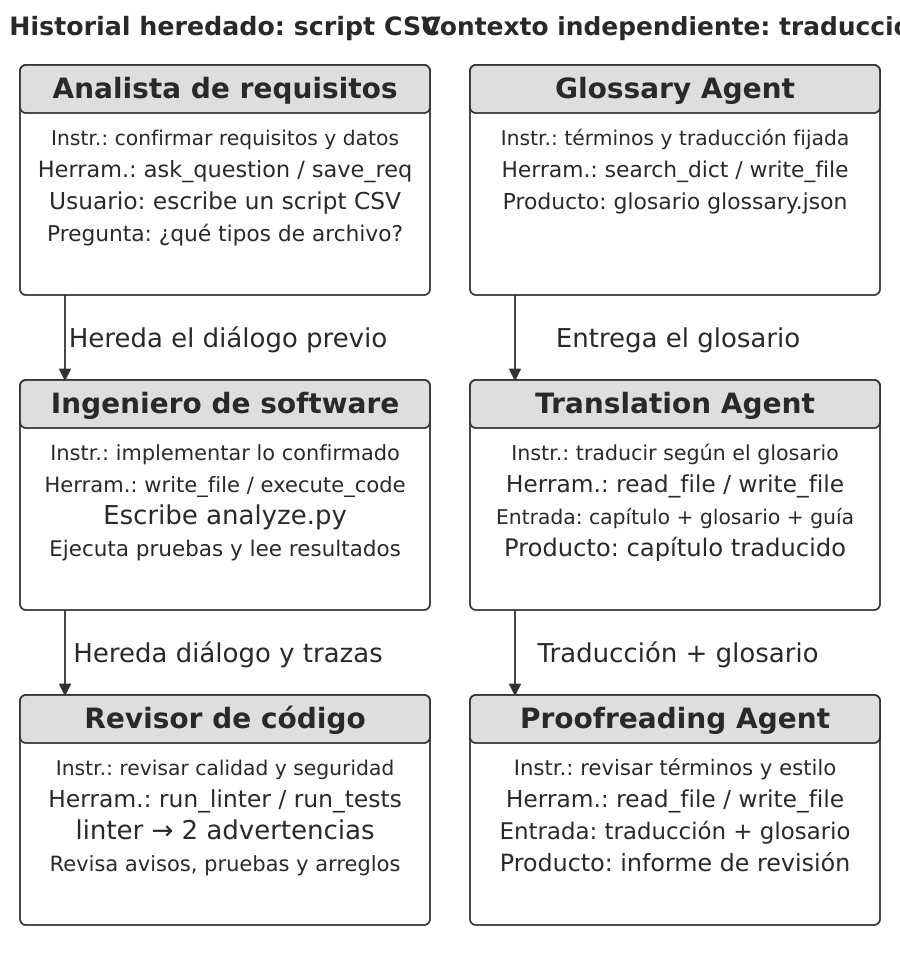

Cuando los contextos son independientes, ¿cómo intercambian materiales los miembros? En los sistemas distribuidos, la comunicación suele basarse en almacenamiento compartido o en paso de mensajes. Los sistemas de Agentes también aprovechan ambas ideas; las formas concretas incluyen:

- **Parámetros de llamada a herramientas.** El Agente aguas abajo se encapsula como una herramienta; el de aguas arriba le pasa la tarea y materiales estructurados mediante parámetros y después recibe el resultado.
- **Sistema de archivos compartido.** Una parte escribe documentos, código o datos y la otra los lee por referencia; es adecuado para productos intermedios grandes y para materiales que deben conservarse de forma persistente.
- **Bus de mensajes (Message Bus).** Los Agentes envían mensajes a un servicio intermediario, que los entrega según el destinatario o las suscripciones; es adecuado para la comunicación asíncrona entre varios miembros.

Por ejemplo, tras enviar una tarea de traducción, el nivel superior puede esperar a que vuelva la traducción o bien obtener primero un número de tarea y ponerse con otro capítulo. Aunque dos traductores puedan abrir el mismo archivo, el sistema sigue teniendo que acordar quién escribe y cuándo lee la otra parte. La comunidad de Go insiste en organizar el acceso a los datos compartidos mediante la comunicación, y esta idea también se aplica a los Agentes: hay que dejar claro quién es dueño del estado, quién puede modificarlo y cómo obtienen las actualizaciones los demás miembros.

### Dimensión 2: topología de colaboración

La topología de colaboración describe las dependencias entre tareas, el flujo de información y las relaciones de control entre los Agentes. Este capítulo adopta tres formas típicas de organización:

- **Patrón de colaboración entre pares** (Peer Collaboration Pattern). Un número reducido de miembros colabora repetidamente sobre un mismo producto. Por ejemplo, un redactor termina el borrador de un artículo, un comentarista propone cambios y el redactor lo revisa.
- **Patrón de gestor** (Orchestration Pattern). Un Manager Agent centralizado se encarga de descomponer, asignar y consolidar las tareas, mientras los subagentes asumen cada uno su trabajo especializado.
- **Patrón descentralizado** (Decentralized Pattern). Los miembros continúan el trabajo según su rol, los mensajes y el estado local, y deciden entre todos cómo sigue avanzando el trabajo.

> **Nota terminológica: ingeniería de grafos.** El capítulo 1 presentó el debate de julio de 2026 sobre la ingeniería de grafos (Graph engineering). Esta perspectiva se centra en el grafo de ejecución: los nodos pueden ser Agentes, programas convencionales o decisiones humanas; las aristas expresan dependencias, enrutamiento condicional y el camino a seguir tras un fallo, y el estado se transmite a lo largo de las relaciones de ejecución. La topología de colaboración multiagente es una aplicación de esta perspectiva de diseño, centrada en cómo varias unidades de decisión se traspasan el trabajo, trabajan en paralelo y se retroalimentan.

Los diseños de colaboración entre pares, de gestor y descentralizado pueden combinarse. Por ejemplo, el Manager entrega una tarea de redacción a un equipo de redactor y revisor, y el equipo, tras completar su iteración interna, entrega el resultado.

## ¿Cuándo supera un sistema multiagente a un Agente único?

Supongamos que el primer borrador traduce mal un término técnico. Si se da la misma traducción a dos revisores, puede que se obtengan dos aprobaciones idénticas; si uno de ellos recibe además el original, el glosario y el código que usa ese término, se abre otra vía para descubrir el error. Al elegir una forma de colaboración, la primera pregunta es: ¿qué aporta a la tarea el Agente añadido? Puede obtener nuevas evidencias, cubrir otra ruta de búsqueda, ofrecer un criterio especializado distinto o acortar la espera mediante la ejecución en paralelo.

El autor examina primero el **incremento de información que aporta la retroalimentación**, y después cuánto se gana con el paralelismo y el aislamiento de contexto. Cuando un revisor lee resultados de pruebas, capturas de pantalla de una página o materiales externos, puede proponer cambios basados en evidencias de las que no se disponía al generar el producto. La tabla 10-1 muestra con varios escenarios habituales cómo examinar este tipo de incremento.

Tabla 10-1 Información y retroalimentación en la colaboración multiagente

| Modo de colaboración | Fuente principal de información | Qué se evalúa |
|---|---|---|
| El mismo modelo vuelve a revisar su propia salida | Los materiales originales y un nuevo proceso de revisión | Si detecta omisiones y si la corrección mejora el resultado |
| Varios Agentes debaten un mismo problema | Las rutas de resolución, supuestos y argumentos de cada uno | Si las opiniones difieren y cómo verificarlas y elegir la respuesta |
| El revisor ejecuta pruebas y revisa el código | Retroalimentación de compilación, pruebas y ejecución | Si los cambios superan las pruebas y conservan la funcionalidad existente |
| El revisor examina el renderizado de un frontend o de un PPT | Capturas de pantalla y retroalimentación de interacción | Si el diseño, el contenido y las operaciones cumplen los requisitos |
| El revisor verifica hechos con herramientas externas | Búsquedas y registros de sistemas de negocio | Si las fuentes son fiables y las conclusiones concuerdan con las evidencias |

RLEF entrena mediante aprendizaje por refuerzo modelos que aprovechan la retroalimentación de la ejecución de código, de modo que aprenden a revisar en varios pasos en tareas de programación competitiva. Los errores de compilación, los fallos de pruebas y las excepciones en tiempo de ejecución ofrecen una base concreta para la siguiente modificación, y el modelo del artículo obtiene mejores resultados con menos muestreos.[^rlef-2025] WebGen-Agent, por su parte, incorpora al proceso de generación capturas de pantalla de páginas web, descripciones y sugerencias de un modelo visual y evaluaciones de operaciones de GUI; puede tanto volver al paso anterior y rehacerlo como elegir la mejor entre varias salidas generadas. En WebGen-Bench, la precisión de Claude 3.5 Sonnet pasa del 26,4 % al 51,9 %.[^webgen-agent-2025]

[^rlef-2025]: Gehring, J., et al. *RLEF: Grounding Code LLMs in Execution Feedback with Reinforcement Learning.* arXiv:2410.02089, 2025.
[^webgen-agent-2025]: Lu, Z., et al. *WebGen-Agent: Enhancing Interactive Website Generation with Multi-Level Feedback and Step-Level Reinforcement Learning.* arXiv:2509.22644, 2025.

El autor hace primero que el sistema obtenga evidencias concretas, como pruebas, capturas de pantalla o respuestas de herramientas, y después decide cómo repartir las responsabilidades de generación, ejecución y revisión. El ciclo de retroalimentación puede completarlo un solo Agente o repartirse entre varios roles; añadir roles debería mejorar la obtención y el uso de las evidencias.

La investigación de seguridad de Anthropic de 2026 ofrece un caso de búsqueda colaborativa: 45 Agentes intercambiaban hallazgos a través de un foro compartido, se revisaban mutuamente y un Agente independiente arbitraba los resultados. Según el informe, el clúster colaborativo consumió 27 millones de tokens y encontró 266 vulnerabilidades; el esquema de ejecución paralela independiente consumió 6,5 millones de tokens y encontró 21. El foro permitía a los miembros seguir investigando a partir de los hallazgos de otros y saber qué direcciones ya estaban cubiertas. El grupo colaborativo usó además unas cuatro veces más tokens, de modo que la diferencia entre 266 y 21 refleja a la vez la forma de comunicación y la distinta inversión de cómputo.[^anthropic-multiagent-2026]

[^anthropic-multiagent-2026]: Anthropic Frontier Red Team, “Patterns and Problems in Emerging Multiagent Systems,” 2026-08-13.

En la investigación matemática, ¿cómo conseguir que varios equipos exploren realmente rutas distintas? Las ecuaciones tridimensionales de Navier–Stokes describen el movimiento de los fluidos viscosos. Partiendo de unas condiciones iniciales suaves, ¿se mantiene la solución suave para siempre? OpenAI asignó dos objetivos opuestos a grupos diferentes: unos intentaban demostrar la suavidad y otros trataban de construir un contraejemplo. Cada grupo exploraba primero por su cuenta; después, el equipo usaba Codex para reunir los resultados intermedios, de modo que los demás grupos pudieran seguir las pistas prometedoras. El grupo que encontró el contraejemplo tenía unos diez mil Agentes trabajando en paralelo. Según el equipo, desde el arranque de los primeros Agentes hasta encontrar la demostración transcurrieron unas 88 horas, y otras 17 horas se dedicaron a la formalización y verificación en Lean. El contraejemplo tiene una condición importante: el fluido, sometido a una fuerza externa suave, puede desarrollar una singularidad en tiempo finito. Con ello, el equipo ofreció los contraejemplos que exigen las formulaciones C y D del enunciado del Clay Mathematics Institute; sin la fuerza externa, el problema es otro. Para diseñar este tipo de búsquedas, conviene dejar por escrito qué resultados bastan para responder a la pregunta original, asignar las conjeturas en competencia a grupos distintos y reservar un tiempo propio para la verificación final.[^ch10-ns-search]

[^ch10-ns-search]: La nota de investigación de OpenAI *On the Navier–Stokes Millennium Prize Problem* incluye la demostración y el código Lean. El Clay Mathematics Institute respondió a este trabajo en un comunicado del 11 de septiembre de 2026 e indicó que la evaluación del resultado y la atribución del premio se tramitarán conforme al procedimiento de concesión.

**¿Cómo influye el presupuesto de pasos en el rendimiento?** Si una tarea permite 30 pasos, el Agente debe organizar de forma compacta la planificación, la implementación principal y la verificación imprescindible; si permite 300, tiene margen para comparar más alternativas y hacer pruebas y revisiones más completas. Para aprovechar bien estos recursos, el Agente también necesita conocer el presupuesto total y el restante, y ajustar en consecuencia la profundidad de exploración.

En 2025, Google estudió este problema en *Budget-Aware Tool-Use Enables Effective Agent Scaling*: un Agente sin conciencia del presupuesto puede quedarse pronto en una búsqueda superficial, y aunque se aumenten los pasos disponibles, su rendimiento apenas sigue mejorando. En 2026, BAVT (Budget-Aware Value Tree Search) fue más allá y combinó en cada paso de búsqueda la estimación de valor con el presupuesto restante para ajustar el peso entre exploración y explotación. Con presupuesto de sobra se pueden comparar más direcciones; cerca del límite, los recursos se concentran en las ramas prometedoras.

En el patrón de gestor, esto significa que el Manager debe repartir los pasos según la dificultad de la tarea y ajustarlos a medida que avanza: entregar cuanto antes las tareas sencillas, reservar margen de verificación y revisión para las complejas y, ante un bloqueo, localizar primero la causa antes de decidir si aporta más información, amplía el presupuesto o cambia de camino.

La exploración en paralelo puede acortar el tiempo de reloj y la revisión repetida puede mejorar los productos, pero ambas aumentan las llamadas al modelo y el coste de comunicación. El autor toma como referencia un Agente único bien ajustado y solo amplía la escala de colaboración cuando la mejora de calidad o el ahorro de tiempo que aportan los nuevos miembros compensan el coste de comunicación, de cómputo repetido y de mantenimiento.

## Colaboración multiagente con contexto compartido

La colaboración con contexto compartido cambia de rol por etapas y conserva el registro de la tarea. En un informe de investigación, por ejemplo, el rol de búsqueda reúne primero los materiales, el rol de análisis hace a continuación los cálculos y el rol de redacción organiza después la exposición. Cada rol puede revisar las fuentes y decisiones anteriores, y el sistema, mediante la instrucción de la tarea actual, lo guía para que se centre en el objetivo de esa etapa.

En un traspaso entre equipos, conviene preguntarse primero: ¿quién necesita saber por qué se decidió así en su momento? En el ejemplo de producto de Teamily AI, el gestor de producto y el Agente redactan juntos en un grupo el documento de requisitos del producto (PRD). Cuando el equipo de producto comparte la versión final con el equipo de ingeniería, los ingenieros pueden preguntar por las concesiones que hay detrás de un requisito concreto.

Tomemos el caso en que el rol de búsqueda pasa la tarea al rol de redacción: tras el traspaso, ¿de dónde lee el modelo las pautas de redacción y qué herramientas puede seguir llamando? El experimento 10-1 implementa el mismo traspaso de dos maneras.

| Cuestión que resolver en el traspaso | Cambio de rol (`transfer_to_agent`) | Carga de una Skill |
|---|---|---|
| ¿Cómo se proporcionan las pautas de redacción? | Se cambia al prompt del sistema del rol de redacción | Se mantiene el catálogo de Skills en el prompt del sistema y se añaden las pautas al final del historial de mensajes |
| ¿Qué herramientas ve el modelo? | Se pueden mostrar solo las herramientas del rol de redacción | Se puede mantener el conjunto de herramientas original o el punto de entrada de búsqueda de herramientas |
| ¿Qué parte de la KV Cache sigue siendo útil? | El prompt del sistema ha cambiado; normalmente hay que recalcular desde donde cambia el prefijo | El prefijo de solicitud original puede seguir reutilizándose |
| ¿Quién comprueba los permisos de llamada? | El Harness valida la solicitud según el rol actual y después despacha la herramienta | El Harness comprueba de forma independiente los permisos de cada llamada |

Cuando las diferencias entre roles residen sobre todo en el conocimiento, el proceso y el estilo de redacción, el autor prefiere usar Skills: facilitan reutilizar el mismo marco de ejecución y conservan la caché de un prefijo de solicitud estable. Cuando las diferencias afectan a permisos, aislamiento de herramientas o responsabilidades de aprobación, se puede organizar como Agentes independientes o como cambio de rol, y dejar que el Harness y el entorno de ejecución apliquen el control de acceso. Que una herramienta aparezca o no en la entrada del modelo influye en qué se elige llamar; los permisos reales los determina la validación en tiempo de ejecución.

> **Experimento 10-1 ★★: Cambio de rol en contexto compartido: comparación entre prompt del sistema y Skill**
>
> Las dos rutas usan el mismo modelo, la misma tarea del usuario, las mismas implementaciones de herramientas, las mismas pautas de rol y el mismo historial compartido. La demostración introductoria pide buscar las ventas de vehículos de nuevas energías en China entre 2021 y 2023, calcular la tasa de crecimiento anual compuesta (CAGR) y redactar un resumen para inversores de no más de 120 caracteres chinos.
>
> **Ruta 1: cambio de prompt del sistema.** Se definen cinco roles: triage (recogida de requisitos), research (búsqueda), coding (programación), data_analysis (análisis) y writing (redacción). triage es el punto de entrada, y cada rol ve sus propias herramientas y `transfer_to_agent`. Al traspasar, se conserva el historial, se cargan el prompt y el conjunto de herramientas del rol de destino y se continúa la ejecución.
>
> **Ruta 2: carga de una Skill.** El prompt del sistema y el conjunto completo de herramientas permanecen estables durante toda la sesión. El modelo llama a `load_skill(name)` para obtener las pautas del rol, cuyo contenido se añade al historial compartido como resultado de herramienta, y el prefijo original se conserva. El Harness comprueba cada llamada a herramienta según las reglas de permisos.
>
> Ambas implementaciones leen el mismo `SKILL.md`. Antes y después de un traspaso de rol, se toma en cada caso una de las solicitudes enviadas al modelo y se observa en qué mensaje aparecen las pautas y qué parte del prefijo puede reutilizarse. Después se comparan los dos resúmenes: ¿son fiables las fuentes de las ventas? Entre el final de 2021 y el final de 2023 hay dos periodos de crecimiento: ¿se ha calculado bien la tasa de crecimiento anual compuesta?
>
> En la comparación formal hay un ejercicio de resumen más estricto, limitado a 160 caracteres y con la obligación de conservar dos URL de fuentes. Con el mismo límite de ocho pasos, el grupo de cambio de rol dedicó tres llamadas a contar caracteres, el borrador seguía teniendo 206 caracteres y además no usó la herramienta de cálculo que exigía el enunciado. El grupo de carga de Skill calculó la tasa de crecimiento con las ventas del primer y el último año, y solo cargó las pautas de redacción en el octavo paso. En ese momento ya había pasado por todos los roles necesarios, pero el usuario aún no había recibido el resumen. Ambas trayectorias terminaron al alcanzar el límite de pasos.
>
> Con las mismas 30 tareas ejecutadas en ambas implementaciones y una comprobación programática de los resultados entregados, el grupo de carga de Skill superó 15 y el de cambio de prompt del sistema, 2. Sin embargo, comparando tarea por tarea, el primer grupo tuvo 6.855 tokens de entrada no cacheados más y tardó unos 4,4 segundos más (ambos valores son medianas de diferencias emparejadas). En esta ocasión, el proveedor informó de cero tokens de entrada en caché en las solicitudes de ambos grupos. Los dos grupos superaron las 6 pruebas de casos límite de seguimiento de instrucciones, pero sus tasas de éxito en las tareas completas difieren mucho.

## Colaboración multiagente sin contexto compartido

En una arquitectura de contextos independientes, cada Agente mantiene por separado su historial de entrada, el estado de su tarea y su bucle de ejecución, e intercambia la información necesaria mediante parámetros de herramientas, archivos compartidos y mensajes. Por ejemplo, el material que entrega un traductor debe indicar los párrafos del original y la versión del glosario. Aunque el traductor se retire, el revisor podrá encontrar el original y, si hace falta rehacer algo, localizar al responsable de cada capítulo.

La tabla 10-2 compara cómo gestiona los procesos un sistema operativo y cómo gestiona los Agentes un entorno de ejecución.

Tabla 10-2 Analogía de diseño entre los sistemas multiagente y los sistemas operativos

| Sistema operativo | Responsabilidad análoga en un sistema multiagente |
|---|---|
| Programa y configuración | Prompt del sistema, definiciones de herramientas y configuración del rol |
| Memoria del proceso | Contexto actual, estado de la tarea e historial |
| La CPU ejecuta los cálculos | El LLM genera las decisiones; el entorno de ejecución y las herramientas realizan las operaciones correspondientes |
| El núcleo gestiona la ejecución | El entorno de ejecución de Agentes gestiona el estado, la planificación y los recursos |
| Llamadas al sistema | Solicitar operaciones externas mediante interfaces de herramientas |
| fork: crear un proceso hijo | `spawn_subagent`: crear un subagente |
| kill: enviar una señal | `cancel_subagent`: solicitar la cancelación |
| ps: consultar procesos | `list_agents`: consultar los miembros y su estado de ejecución |
| Estado de salida y wait | Notificación de finalización, estado de la tarea y resultado estructurado |
| Almacenamiento compartido y paso de mensajes | Archivos compartidos, parámetros de herramientas y mensajes |

El estado privado, los mensajes asíncronos y la creación dinámica de miembros aparecen también en el modelo de actores (Actor model), propuesto en la década de 1970.[^actor-model]

[^actor-model]: Hewitt, C., Bishop, P., Steiger, R. *A Universal Modular ACTOR Formalism for Artificial Intelligence.* IJCAI 1973.

Cuando hay muchas subtareas independientes, el autor tiende a dar a cada miembro un contexto propio, de modo que solo trate los materiales relacionados con su responsabilidad. Así es más fácil probar cada rol por separado, se reduce la interferencia del largo historial de etapas anteriores en el juicio actual y varias tareas pueden avanzar a la vez. El efecto del aislamiento depende también de los demás recursos compartidos: varios Agentes pueden seguir modificando el mismo archivo a la vez, consumir la misma cuota de API o recibir el mismo mensaje de error.

La interfaz de colaboración también tiene que gestionar mensajes perdidos, entregas duplicadas y estados desfasados. Al depurar, se puede usar un identificador de tarea para relacionar las solicitudes, los eventos de herramientas y los resultados de cada miembro, y reconstruir así el proceso de un traspaso.

Supongamos que un Agente termina un análisis y debe pasar el resultado al compañero que redacta el informe. Si son pocos valores, pueden enviarse en el mensaje; si el producto es una tabla grande, lo habitual es guardarla en el sistema de archivos compartido y adjuntar una referencia en el mensaje. De ahí surgen dos responsabilidades. El **almacenamiento de productos** guarda e intercambia documentos, código y datos; la **comunicación y el control** se encargan de entregar mensajes, consultar el estado de las tareas, cancelar ejecuciones y planificar recursos.

### El sistema de archivos desde la perspectiva del Agente

Un diseño habitual consiste en ofrecer al Agente un **sistema de archivos virtual** (virtual filesystem) que monta recursos de distintas procedencias en un árbol de directorios unificado. El modelo accede a él mediante interfaces como `read_file`, `write_file` y `list_dir`, y por debajo puede conectarse a un disco temporal local, a un almacenamiento de objetos persistente, a la API de un servicio de almacenamiento en la nube de terceros o a paquetes de recursos del sistema.

El autor delimita primero las zonas de almacenamiento y solo después las integra en el flujo de colaboración. Si se mezclan borradores temporales, entregables formales y archivos externos del usuario, es fácil que se sobrescriban por error o que se lea algo sin autorización. Una interfaz unificada resulta cómoda de usar, pero la visibilidad, el ciclo de vida y los permisos de cada zona los determinan la configuración de montaje y el control de acceso. Este árbol de directorios puede dividirse en cuatro tipos de zonas.

**1. Espacio de trabajo propio del Agente (Scratchpad).** Cada instancia usa su propio espacio de trabajo para guardar borradores, archivos temporales, registros de depuración y productos intermedios. Por defecto, el acceso se limita al Agente propietario, y el contenido se limpia o archiva según la política de la tarea. Así se evita que los archivos temporales se sobrescriban entre sí; cuando el subagente termina, deposita en el espacio compartido los resultados que debe entregar y los pasa al Agente principal junto con un resumen estructurado. El registro de los intentos fallidos se queda en el espacio de trabajo original para diagnósticos posteriores. Esto lleva el aislamiento de contexto también a la capa de almacenamiento: el Agente principal obtiene los entregables y las evidencias necesarias, y en la coordinación diaria se ahorra el coste de leer todo el proceso de prueba y error.

**2. Espacio compartido entre Agentes (Shared Workspace).** Aquí los miembros que colaboran intercambian productos, y el usuario también puede subir materiales y descargar entregables a través de un punto de acceso autorizado. Por ejemplo, el Glossary Agent escribe el glosario, el Translation Agent lo lee para traducir y el revisor comprueba después la traducción. El espacio compartido suele persistir durante toda la tarea y debe gestionar escrituras concurrentes, actualizaciones de versión y alcances de acceso. En el capítulo 6, el Agente y la computadora virtual intercambiaban CSV y gráficos a través de almacenamiento compartido, un ejemplo de este tipo de traspaso de productos. Más adelante se presentarán métodos como el bloqueo optimista y el aislamiento mediante copias de trabajo.

**3. Recursos externos montados (Mounted External Resources).** Recursos como Google Drive, Notion, Dropbox o la wiki corporativa pueden asignarse a la interfaz unificada mediante adaptadores. Cuando el Agente lee un documento, el adaptador se encarga de llamar a la API del sistema de origen. Aquí hay que gestionar tres tipos de diferencias: el alcance del acceso depende de la autorización externa; el acceso por red introduce latencias, tiempos de espera agotados y problemas de actualización de caché; y las operaciones de escritura deben cumplir las reglas de permisos y versiones del sistema de origen. La semántica de consistencia concreta la determina la interfaz del servicio, y se pueden usar números de versión, escrituras condicionales o relecturas para detectar modificaciones concurrentes. Los montajes de solo lectura bajo demanda son adecuados para consultar materiales; cuando hace falta editar, se conceden los permisos de escritura correspondientes.

**4. Recursos integrados del sistema (Built-in System Resources).** Manuales de referencia, plantillas, definiciones de herramientas y Skills predefinidas pueden ofrecerse como paquetes de recursos de solo lectura para varios Agentes. Las Skills se cargan mediante divulgación progresiva: primero se ofrece el catálogo y después, según la tarea, se leen las pautas y los scripts. Los paquetes de recursos con versión fija facilitan la lectura concurrente, y al actualizarlos un cambio de versión mantiene coherentes las tareas en curso.

En la figura 10-2, el traductor puede modificar sus borradores una y otra vez en su propio directorio y, cuando esté listo para entregarlos a revisión, colocar la versión correspondiente en la zona compartida. El manuscrito original que está en la nube del usuario lo lee un adaptador externo, y el acceso a él depende además de los permisos concedidos por el usuario.

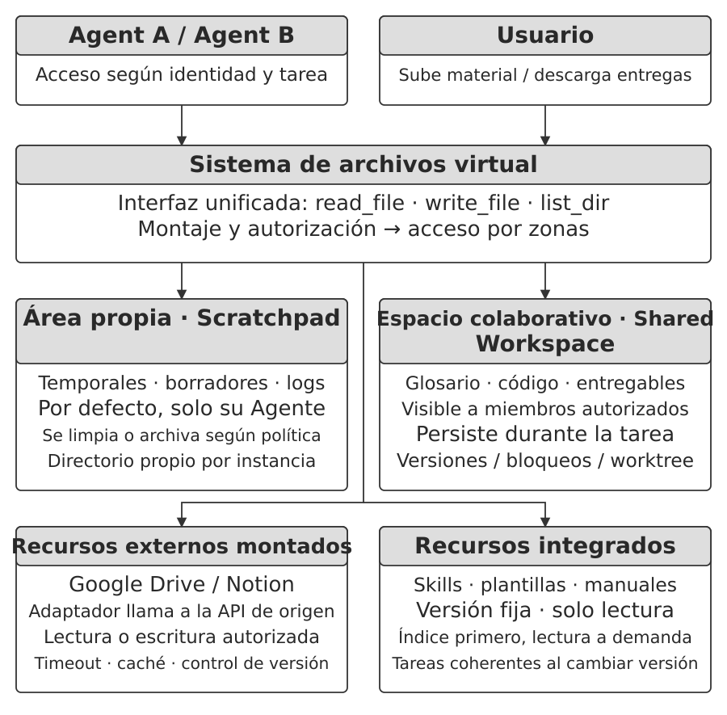

Cuando el traductor se retira, los archivos temporales de su espacio de trabajo pueden liberarse con él. La traducción depositada en la zona compartida se conserva, y el revisor la retoma gracias a su permiso de lectura (tabla 10-3).

Tabla 10-3 Las cuatro zonas del sistema de archivos virtual del Agente

| Zona | Visibilidad | Ciclo de vida | Lectura y escritura | Gestión de la concurrencia |
|---|---|---|---|---|
| Espacio de trabajo propio del Agente | Por defecto, limitada al Agente propietario | Se limpia con la instancia y se archiva si es necesario | Lectura y escritura del Agente propietario | Evitar escrituras duplicadas por reintentos u operaciones en segundo plano |
| Espacio compartido entre Agentes | Miembros y usuarios autorizados | Persiste durante la tarea | Autorización por rol | Bloqueos, comprobación de versiones o worktree |
| Recursos externos montados | Limitada conjuntamente por la autorización externa y el adaptador | Depende del sistema de origen y de la política de caché | Solo lectura bajo demanda o escritura autorizada | Seguir las interfaces de versiones y concurrencia del sistema de origen |
| Recursos integrados del sistema | Agentes autorizados | Versión fija reutilizada entre sesiones | Solo lectura | Cambio unificado de versión de los recursos |

Las referencias a archivos permiten que los mensajes de traspaso sean breves: el nivel superior indica la ubicación, la versión y el uso del producto, y el nivel inferior lee el contenido cuando lo necesita. Los miembros que comparten el mismo entorno de ejecución pueden usar rutas compartidas; en la colaboración entre organizaciones, para completar el mismo traspaso hacen falta identificadores de producto, interfaces de acceso y autorizaciones que ambas partes puedan resolver.

### Comunicación y control entre Agentes

Las herramientas de creación, comunicación, cancelación y descubrimiento presentadas en el capítulo 4 ofrecen la interfaz de control básica para la colaboración multiagente: `spawn_subagent` crea miembros, `send_message_to_subagent` transmite mensajes, `cancel_subagent` solicita la cancelación y `list_agents` consulta los miembros. En torno a estas interfaces hay que acordar además el comportamiento de los mensajes, el estado, la terminación y la planificación.

**1. Paso de mensajes.** Con pocos miembros y relaciones fijas, se pueden usar interfaces punto a punto; por ejemplo, el Agente telefónico y el Agente de computadora intercambian directamente sus avances. Si todos los miembros necesitan comunicarse entre sí por parejas, el número potencial de relaciones crece con el cuadrado del número de miembros; cuando hay muchas suscripciones, un bus de mensajes facilita gestionar de forma unificada el enrutamiento, el almacenamiento en búfer y los reintentos. Tanto las conexiones punto a punto como el bus permiten entregas asíncronas; que el receptor deba estar conectado al mismo tiempo depende de los mecanismos de cola y persistencia.

Los mensajes suelen incluir un **sobre** (envelope) estructurado: el ID del remitente, el Agente de destino o el alcance de la difusión, el tipo de mensaje y la carga útil. Los tipos de mensaje pueden incluir `task_assigned`, `status_update`, `result` y `terminate`. Los identificadores de tarea, los identificadores de mensaje y las solicitudes asociadas ayudan al receptor a eliminar duplicados y permiten a las herramientas de depuración reconstruir la cadena de comunicación. El contenido de negocio va en una carga útil JSON, y ambas partes lo procesan según los campos acordados.

Por ejemplo, un editor es responsable de entregar una traducción y quiere pedir a un Agente de revisión terminológica que compruebe una palabra. Basta con mencionarlo (`@`) en un comentario del ticket de Multica y escribir la pregunta para activar el trabajo de revisión. El revisor puede publicar su opinión como respuesta en ese mismo ticket; el responsable sigue siendo el editor y el estado del ticket no cambia. Si se quiere que el revisor asuma el ticket completo, hay que cambiar explícitamente el responsable.[^ch10-multica]

[^ch10-multica]: Multica, mención de Agentes en comentarios; implementación del despacho de comentarios en la versión `d579273`.

**2. Obtención del estado.** El Agente principal necesita saber si una subtarea sigue en ejecución, si necesita información y si el resultado ya está disponible. Se pueden combinar interfaces de estado, notificaciones de eventos y archivos de progreso: la interfaz del entorno de ejecución proporciona el estado del ciclo de vida, los mensajes describen el avance del negocio y los archivos persistentes conservan un registro recuperable.

`get_subagent_status(agent_id)` puede devolver estados como en ejecución, a la espera de información, completado o fallido. En la coordinación diaria, el autor prefiere las notificaciones de finalización y los mensajes de progreso por etapas, para que el Agente principal siga con su propio trabajo. Solo cuando la notificación se retrasa, se recupera una conexión o hay que investigar un problema se consulta activamente, para no gastar llamadas al modelo preguntando una y otra vez «¿ya has terminado?». La interfaz de estado la mantiene el entorno de ejecución y puede informar a tiempo de si el proceso sigue vivo y de si la tarea ha terminado.

**Intercambiar avances mediante mensajes.** El Agente principal puede preguntar por el progreso actual y el subagente responder en un paso adecuado; el subagente también puede publicar por iniciativa propia un `status_update` cuando obtiene un resultado parcial, se encuentra bloqueado o necesita ayuda. El contenido del mensaje debe explicar lo ya hecho, el siguiente paso y la causa del bloqueo, y todos los miembros deben usar los mismos nombres de estado para facilitar la consolidación y el juicio. Más adelante, el protocolo A2A presentará una expresión estandarizada del ciclo de vida de las tareas.

**Guardar el progreso en archivos.** El sistema puede añadir a un registro, en orden de eventos, los mensajes, las solicitudes a herramientas, los resultados de herramientas y los cambios de estado, por ejemplo en formato JSONL con un evento por línea. El Agente principal con permisos de diagnóstico o las herramientas de operaciones pueden revisar a partir de él los reintentos, los errores y las esperas. El historial de entrada del modelo es solo una parte de la trayectoria de ejecución; el registro puede recoger también eventos de planificación y de ejecución externa.

Una trayectoria completa puede contener decenas de miles de tokens, y el Agente principal tendría que volver a extraer el estado cada vez que la leyera. Los mensajes avisan al Agente principal de que hay novedades, y un archivo de progreso breve guarda el estado actual para consultas y recuperaciones posteriores. El autor prefiere combinar ambos para la coordinación diaria. Cada vez que el subagente termina un trabajo, actualiza la lista de tareas, las referencias a los productos y el bloqueo actual; el Agente principal decide el siguiente paso según estos campos. La trayectoria detallada se conserva para investigar cuando haga falta. Si el progreso no cambia durante mucho tiempo, se puede combinar el latido (heartbeat), el estado de las llamadas a herramientas y el tiempo límite de la tarea para decidir si hay que intervenir: una herramienta de ejecución prolongada puede seguir trabajando, así que conviene confirmar su estado antes de decidir si esperar, cancelar o reintentar.

**3. Terminación de la ejecución.** Cuando varios miembros buscan en paralelo el mismo objetivo y uno de ellos completa la tarea, las demás ramas pueden detenerse para liberar presupuesto y recursos de herramientas. La cancelación tiene dos intensidades, con un papel parecido al de SIGTERM y SIGKILL en Unix.

El autor prefiere la **terminación ordenada**: el entorno de ejecución transmite la solicitud de cancelación, el subagente deja de iniciar operaciones nuevas en un punto seguro, guarda el progreso necesario, cierra las sesiones del navegador y libera los bloqueos, y después devuelve una confirmación (ack). La **terminación forzosa** se aplica a las ejecuciones que no responden pasado el plazo de cancelación: el entorno de ejecución finaliza el proceso y después revisa los recursos residuales y las escrituras inconclusas. Para las operaciones ya enviadas a sistemas externos, hay que consultar su resultado y, si es necesario, ejecutar un flujo de compensación.

El ciclo de vida también debe gestionarse siguiendo la relación de creación. Tomando como modelo el context de Go, la señal de cancelación de la tarea padre puede propagarse hacia abajo por todo el árbol de subtareas, y el bucle de ejecución comprueba la señal de cancelación en puntos seguros, con el mismo propósito que `ctx.Done()`. Así, cuando termina la tarea padre, las ramas que lanzó entran también en el proceso de limpieza, y se evita que Agentes sin supervisión sigan llamando a herramientas y consumiendo presupuesto. Para las tareas en segundo plano que de verdad necesitan ejecutarse de forma independiente durante mucho tiempo, se crea un contexto de ciclo de vida propio, de forma similar a `context.Background()`, y se designa a un gestor responsable de la supervisión, el presupuesto y la limpieza.

**4. Recursos y planificación.** Un sistema de Agentes debe repartir tokens, pasos, cupos de concurrencia, conexiones a herramientas y recursos de cómputo. Al lanzar una subtarea se fijan su presupuesto y el comportamiento al superarlo; se elige el modelo según la dificultad de la tarea, y se limitan las llamadas concurrentes para no agotar de golpe la cuota del servicio. Cuando llega una tarea más urgente, se pueden pausar o cancelar tareas de menor prioridad en un punto seguro, guardar su progreso y volver a planificarlas.

Supongamos que tres ramas investigan cada una una solución viable, y una de ellas ya ha encontrado una pista clave y solo le falta una última verificación. El Manager puede darle unos pasos más y, al mismo tiempo, terminar las dos ramas que no avanzan. El entorno de ejecución descuenta el cupo; aunque una rama quiera seguir intentándolo, al agotarse el presupuesto tiene que detenerse.

### Patrón de colaboración entre pares: revisión mutua y mejora iterativa

La colaboración entre pares suele consistir en que dos o tres Agentes intercambian opiniones y revisan productos en torno a una misma tarea. Al diseñarla, se puede asignar primero a los miembros responsabilidades, materiales y herramientas distintos, dejar que juzguen de forma independiente y después consolidar los resultados. Por ejemplo, el generador se centra en la implementación y el revisor, en las pruebas y los requisitos del usuario; miembros de distintas especialidades comprueban las restricciones de su propio ámbito. Cuanto más parecidos son los modelos, las entradas y los flujos de trabajo, más fácil es que los miembros repitan el mismo juicio, por lo que hay que diseñar activamente diferencias de perspectiva y de evidencias.[^anthropic-multiagent-2026]

Para tareas que mejoran repetidamente un mismo producto, el autor recomienda empezar con una colaboración entre pares de dos o tres miembros. Una vez claros los roles, el contenido de los traspasos y las condiciones de parada, se puede construir un ciclo comprobable, y el trabajo de coordinación inicial es reducido.

#### Ingeniería de bucles

La colaboración entre pares ayuda a resolver un problema habitual: la **terminación prematura**. Tomando como ejemplo la programación y las gestiones de atención al cliente, la terminación prematura puede detectarse en tres tipos de registros.

- **Declarar todo terminado tras completar una parte.** El Coding Agent termina el código pero se olvida de las pruebas y de las comprobaciones de despliegue; el usuario encarga dos gestiones al asistente y este, tras completar la primera, informa de que todo está resuelto. Hay que cotejar elemento por elemento la lista de tareas y comprobar las evidencias de finalización de cada trabajo.
- **Abandonar antes de tiempo tras fallar un camino.** El comercio puede pedir que los documentos se envíen mediante un formulario o que los adjuntos se manden a un correo concreto. Ante una respuesta así, se puede continuar la gestión por la vía que acepta el comercio. Hay que registrar la causa del fallo y valorar qué otros caminos merece la pena intentar.
- **Omitir pasos posteriores tras un éxito parcial.** Si, tras aceptar el reembolso, el comercio exige además que el usuario lo confirme en la App, el asistente debe explicar ese paso y sus condiciones. En el caso de una rebaja en la factura, si el operador de atención al cliente lo promete de palabra por teléfono, el asistente puede confirmar al usuario que la negociación obtuvo un compromiso. La grabación de la llamada demuestra lo que dijo el operador; si la factura posterior lo cumple o no requiere nuevas evidencias. El revisor debe indicar por separado los resultados obtenidos, quién tiene que hacer qué todavía y qué resultados aún no pueden verse.

Los tres problemas exigen concretar la condición de finalización en resultados comprobables. La **ingeniería de bucles** (Loop engineering) se ocupa de que el Agente recorra de forma continuada el ciclo «determinar el siguiente trabajo — ejecutar — verificar — registrar el progreso» y decida, según los resultados, si continúa, espera, traspasa o termina. Los ingenieros deben diseñar el origen de las tareas, la forma de verificación, el estado persistente y las condiciones de parada. El trabajo humano se amplía en consecuencia: pasa de escribir prompts para una llamada a diseñar bucles capaces de hacer avanzar las tareas de forma continua. En junio de 2026, Addy Osmani usó este nombre para referirse a este conjunto de prácticas y citó la experiencia de Boris Cherny: el centro del trabajo se desplaza poco a poco hacia el diseño de bucles capaces de impulsar a los Agentes.[^loop-engineering-2026]

**En este tipo de bucles, el autor considera que el verificador suele ser el cuello de botella clave.** Si la verificación no es fiable, añadir rondas puede hacer que el sistema repita errores del mismo tipo o declare la tarea terminada antes de tiempo. Los resultados de las pruebas, el estado del negocio y la confirmación del usuario aportan cada uno una base de finalización dentro de su propio ámbito; un fallo de verificación se convierte en la entrada de la siguiente ronda de revisión.

La práctica precede al nombre. Antes de que se popularizara el término ingeniería de bucles, el autor y su equipo ya usaban bucles y verificación en Pine AI para tratar la terminación prematura. El esquema proponente-revisor es una forma habitual de organizar estos bucles, y se desarrolla a continuación.

[^loop-engineering-2026]: Osmani, Addy. “Loop Engineering”, 2026.

**LoopX: conservar el estado del trabajo entre rondas.** LoopX coloca los objetivos, los límites, las tareas pendientes, las compuertas de aprobación (gates), las evidencias y las cuotas en un plano de control persistente, que organiza el trabajo de la siguiente ronda o del siguiente ejecutor. El flujo puede resumirse así: **decisión del plano de control → ejecución del Agente → verificación independiente → registro del progreso verificado**.

El Agente llama a herramientas, razona y entrega el resultado de la ronda. El plano de control registra el trabajo ya completado y decide desde dónde continuar en la siguiente ronda. Si la verificación se supera, se registra el estado de finalización; si falla, se pasa a reparación o replanificación. Las compuertas de aprobación manuales, las condiciones de espera y los límites de presupuesto determinan conjuntamente cuándo puede continuar la ejecución.[^loopx-framework]

[^loopx-framework]: LoopX, The local control plane for long-running AI agent work, v0.4.0.

**LongHorizon-Harness: enlazar tareas largas entre aplicaciones.** Este marco parte del Computer Use multimodal y aborda la ejecución continua de tareas a través de la GUI, la CLI, varias aplicaciones de escritorio y múltiples renovaciones de contexto. Adopta un ciclo Manage–Execute–Audit (MEA): el Manager genera una subtarea de alcance bien definido a partir del objetivo original, el progreso verificado, las evidencias de fallos y el trabajo restante; el Executor ejecuta operaciones de GUI o CLI en un contexto nuevo; el Auditor comprueba el resultado en modo de solo lectura y escribe el progreso verificado en el estado de la siguiente ronda. Las evidencias de fallos también se conservan para la recuperación y la replanificación.

El marco llama mediante una capa de adaptación a backends de ejecución como Claude Code o Codex CLI, y enlaza así la gestión de tareas de la capa externa con el bucle de ejecución del backend. Esta vía hace descansar la continuidad de las tareas largas en un estado de tarea verificado. El contexto de ejecución puede renovarse, y la siguiente ronda sigue pudiendo trabajar a partir del objetivo, las evidencias de finalización y las cuestiones pendientes, volviendo a comprobar si los cambios del entorno afectan a las conclusiones anteriores.[^longhorizon-implementation]

En una comparación que mantiene los mismos backends de ejecución, Qwen 3.7-Plus y Claude Code, y solo cambia el bucle externo, el artículo informa de que la PassRate en WeaveBench sube del 51,8 % al 80,7 %, la tasa de finalización binaria en OSWorld 2.0 pasa del 2,8 % al 8,3 % y la tasa de éxito en Terminal-Bench 2.1 crece del 69,7 % al 77,2 %. El coste también varía según la tarea: en los dos primeros benchmarks se consumen, respectivamente, 2,3 veces el total de tokens de la línea base y 3,6 veces sus tokens de salida; en Terminal-Bench 2.1, el consumo de tokens se reduce un 24 %.

En una misma tarea de auditoría de flujos multicapa de WebRTC, el ejecutor de la línea base se atascó en la interfaz de Wireshark, lo intentó unas cuantas veces más y terminó con una puntuación de 0,59. Con MEA, el auditor anotó las evidencias que faltaban, el ejecutor de la siguiente ronda las buscó en consecuencia y la puntuación final fue de 0,92.

[^longhorizon-implementation]: LongHorizon-Harness, artículo arXiv:2608.01964. Las trayectorias públicas de la línea base y de MEA proceden de la tarea WEB_task_16_webrtc_simulcast_layer_audit, y el script de reproducción usa el commit `53bc678`.

#### Esquema proponente-revisor

El esquema proponente-revisor asigna a dos roles la generación del producto y la comprobación del resultado. Los experimentos de generación de PPT, edición de vídeo y visualización de registros del capítulo 5 adoptaron este diseño: el Proposer genera el código y el Reviewer examina el resultado renderizado, comprueba la calidad con ayuda de un modelo visual y devuelve comentarios de corrección estructurados. En la figura 10-3, los comentarios de corrección tienen que volver al proponente. Que este pueda arreglar con ellos la siguiente versión depende de con qué precisión sepa localizar el problema el revisor.

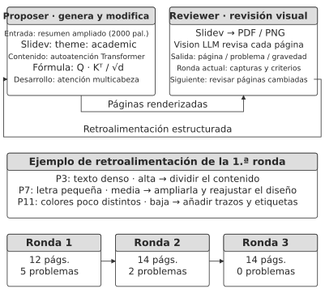

Cuando cambia el objeto de la revisión, también cambian las evidencias que hay que examinar. Para revisar una respuesta de atención al cliente hay que contrastarla con las reglas de negocio y las fuentes de los hechos; para revisar un cambio de código hay que ver las pruebas y los resultados reales de ejecución; para revisar un plan de operaciones hay que comprobar las normas aplicables y las condiciones previas.

El artículo de Huang et al. en ICLR 2024, *Large Language Models Cannot Self-Correct Reasoning Yet*, encontró que, en las tareas de razonamiento y las configuraciones de prompt que estudiaron, cuando GPT-4 se autocorregía sin retroalimentación externa llegaba a cambiar respuestas correctas por incorrectas, lo que reducía la precisión global. La revisión de TACL sobre la autocorrección analiza además cómo influyen en el efecto de la revisión las condiciones de la tarea y la fiabilidad de la retroalimentación.[^self-correction-survey] Por ello, el autor considera que las evidencias independientes y unas condiciones de corrección localizables son requisitos básicos de un bucle de revisión. El revisor debe poder leer las pruebas reales, el estado del entorno o el resultado renderizado, y señalar qué requisito aún no se cumple y cómo verificar la corrección.

[^self-correction-survey]: Kamoi, R., et al. *When Can LLMs Actually Correct Their Own Mistakes? A Critical Survey of Self-Correction of LLMs.* TACL, 2024.

Un bucle completo puede organizarse en cinco pasos:

1. El proponente escribe una primera versión según los requisitos de la tarea, por ejemplo una respuesta o un fragmento de código.
2. Se ejecuta o se renderiza el producto y se obtienen pruebas, el estado del negocio, capturas de pantalla o resultados de verificación de hechos.
3. El revisor contrasta los requisitos con las evidencias y emite una conclusión de aprobación, o bien señala la ubicación del problema y la condición para corregirlo.
4. Si aún queda presupuesto, el proponente revisa según la retroalimentación y se vuelve a ejecutar y revisar; ante problemas que requieren información o autorización, se pasa a espera o se traspasa.
5. Cuando se alcanzan las condiciones de publicación, se entrega la versión aprobada junto con las evidencias de verificación y la conclusión de la revisión; si se agota el presupuesto, se conservan el progreso y las cuestiones no resueltas.

El revisor lee las pruebas protegidas y los criterios de publicación, y los cambios de criterio que proponga se revisan por separado.

En los experimentos de CRITIC, el modelo da primero una respuesta y después la comprueba con herramientas.[^ch10-critic] Por ejemplo, usa un motor de búsqueda para verificar los hechos de la respuesta y un intérprete de Python para ejecutar el programa matemático que ha escrito. En tres tipos de tareas (preguntas abiertas, generación de programas matemáticos y reducción de expresiones dañinas), el rendimiento mejoró en todos los casos cuando el modelo corrigió según la retroalimentación de las herramientas. Cuando el modelo evaluaba la respuesta original solo con su propio criterio, la corrección era menos eficaz. Este diseño conecta con el caso de los PPT del capítulo 5: las capturas renderizadas revelan problemas de maquetación y solapamiento difíciles de juzgar directamente a partir del texto del código, y la ejecución de pruebas pone al descubierto los errores reales en tiempo de ejecución.

[^ch10-critic]: CRITIC, arXiv:2305.11738.

El caso de desarrollo de aplicaciones de largo recorrido presentado por Anthropic en 2026 usa tres Agentes: planificador, generador y evaluador. El planificador desarrolla los requisitos en una especificación de producto; el generador y el evaluador acuerdan primero los criterios de finalización de cada ronda y después implementan y comprueban, respectivamente. El evaluador maneja la aplicación con Playwright y envía informes de defectos, y los roles se traspasan el estado mediante archivos. El caso muestra cómo se conectan la especificación de producto, las operaciones reales y la retroalimentación de defectos, y también exige incluir en la comparación de alternativas el coste adicional de ejecución y revisión.[^anthropic-harness-2026]

[^anthropic-harness-2026]: Prithvi Rajasekaran, “Harness Design for Long-Running Application Development,” Anthropic Engineering, 2026-03-24.

El 20 de noviembre de 2026, el matemático Levent Alpöge publicó la demostración formalizada que había obtenido en colaboración con Claude, relativa a la hipótesis de Riemann y su generalización a las funciones $L$ de Dirichlet. Ante un gran lote de archivos Lean, el revisor debe hacerse primero dos preguntas: ¿el teorema final enuncia la conjetura original? ¿Puede el núcleo de demostración volver a comprobar cada paso de la deducción? El matemático del MIT Andrew Sutherland comparó primero el teorema enviado con la definición de la hipótesis de Riemann de la biblioteca matemática de Lean y después enumeró los axiomas de los que depende la demostración. En el registro que publicó ese mismo día informó además de que el núcleo de demostración independiente nanoda había comprobado con éxito la demostración exportada. Esto ofrece un método concreto para repartir la revisión: quien conoce bien el problema escribe primero el enunciado de aceptación, y después una herramienta independiente comprueba si el producto enviado permite deducir ese enunciado. Si en el futuro los matemáticos quieren entender cómo llegó el autor a esa vía, harán falta además argumentos legibles para las personas.[^ch10-rh-review]

[^ch10-rh-review]: Levent Alpöge publicó la nota de investigación el 20 de noviembre de 2026. Los elementos verificados y su progreso de ese día figuran en *Verification files for the Lean proof of the Riemann Hypothesis*, de Andrew Sutherland.

#### Patrón de debate

El patrón de debate hace que los miembros examinen un mismo problema desde posiciones distintas. Por ejemplo, al evaluar una solución técnica, un Agente expone los beneficios y los escenarios de aplicación, y otro examina las restricciones, las condiciones de fallo y las alternativas. En cada ronda se aportan evidencias o se rebaten argumentos concretos, y al final se consolidan los puntos en los que hay consenso y las discrepancias que aún hay que verificar.

Esta disposición ayuda a enumerar con claridad los argumentos a favor y en contra, pero su eficacia depende de la calidad de los argumentos, de la independencia de los juicios y del método de elección final. Tran y Kiela compararon cinco arquitecturas en tareas de razonamiento de varios saltos: secuencial, debate, conjunto (ensemble), roles en paralelo y subtareas en paralelo; con el mismo presupuesto de tokens de pensamiento, el Agente único rindió igual o mejor que los sistemas multiagente.[^single-agent-2026] Por ello, el autor usa el debate sobre todo para desplegar discrepancias, examinar supuestos y completar los argumentos en contra. Cuando lo que se busca es la exactitud de hechos o cálculos, es preferible añadir evidencias verificables y comprobaciones independientes.

El artículo recurre a la desigualdad de procesamiento de datos para analizar los límites de la transmisión de información intermedia: las sucesivas reformulaciones y compresiones pueden perder detalles originales. En la práctica, se pueden conservar fuentes rastreables y hacer que los miembros analicen primero de forma independiente y después intercambien conclusiones, para reducir los consensos no verificados. El muestreo independiente múltiple con agregación posterior, así como aprovechar que en ciertas tareas «generar es difícil y verificar es fácil» para organizar revisiones especializadas, también pueden combinarse con el debate.

[^single-agent-2026]: Tran, D., Kiela, D. *Single-Agent LLMs Outperform Multi-Agent Systems on Multi-Hop Reasoning Under Equal Thinking Token Budgets.* arXiv:2604.02460, 2026.

#### Patrón de lluvia de ideas

La lluvia de ideas puede hacerse en dos rondas: primero cada miembro piensa soluciones por su cuenta y después se discute en común qué ideas pueden combinarse. Por ejemplo, el Agente 1 propone añadir una función para compartir en redes sociales; el Agente 2, a partir de ahí, propone generar automáticamente carteles personalizados para compartir; el Agente 3 va más allá y propone plantillas definidas por el usuario y un mercado de plantillas.

Para que los miembros propongan soluciones distintas, se les puede pedir que partan respectivamente de la perspectiva del usuario y de la del operador, o darles prompts o modelos diferentes. Tras intercambiar ideas, las propuestas se filtran según las necesidades del usuario, el coste de implementación y los resultados de verificación.

#### Patrón de panel de expertos

El panel de expertos reparte responsabilidades especializadas en torno a problemas interdisciplinares. Por ejemplo, al evaluar un nuevo producto, el Agente ingeniero analiza la dificultad de implementación y las dependencias técnicas, el Agente de producto examina las necesidades y la experiencia del usuario, y el Agente de operaciones estima los costes, los recursos y las condiciones de puesta en marcha.

En el chat de grupo de LobeHub, el moderador puede difundir la misma propuesta de producto a estos tres expertos. El sistema toma primero el historial del chat de grupo en ese momento y después hace que los tres miembros respondan simultáneamente, cada uno con su configuración de rol. Las tres respuestas quedan colgadas del mensaje que inició la difusión, lo que facilita comprobar después a qué pregunta respondió cada uno. Si el de operaciones tiene que calcular el coste a partir del consumo que acaba de estimar el ingeniero, hay que esperar a que se escriban las respuestas de esta ronda y después pedirle que intervenga: si ambos empiezan a escribir a la vez, el de operaciones aún no tiene esa cifra.[^ch10-lobehub]

[^ch10-lobehub]: LobeHub, instrucciones de uso del chat de grupo; implementación de la difusión en paralelo en la versión `ab21e0d`.

Al consolidar, hay que encontrar las relaciones entre los distintos juicios: qué soporte técnico requiere un objetivo de experiencia, cuánto coste operativo añade una elección técnica y qué condiciones necesitan todavía evidencias externas.

### Patrón de gestor: coordinación centralizada

Cuando la tarea incluye muchas subtareas, dependencias complejas o planificación dinámica, un Manager Agent puede encargarse de la planificación unificada. Primero comprende el objetivo global; después descompone el trabajo, elige a los miembros y sigue el progreso; ante anomalías decide si reintentar, cambiar de miembro o ajustar el plan, y al final integra los resultados.

Una implementación habitual consiste en registrar Agentes especializados como herramientas. El Manager pasa la tarea, las restricciones y los materiales necesarios a través de la interfaz de herramientas y recibe un resultado estructurado o un identificador de tarea. Así, la búsqueda, las operaciones con archivos y la delegación de subtareas pueden usar formas de llamada parecidas; las subtareas de larga duración gestionan aparte su progreso, cancelación y reintentos. Los distintos miembros pueden usar modelos, prompts, herramientas y entornos de ejecución diferentes. Al añadir un miembro, además de registrar su interfaz, hay que conseguir que el Manager comprenda sus responsabilidades, sus requisitos de entrada y los escenarios en que conviene usarlo.

Cuando el autor trabajaba en tareas largas con Claude Code y Codex, ponía en la sesión principal tanto la discusión como la ejecución de comandos y las pruebas. Si a mitad de camino quería preguntar por una decisión de diseño, a menudo tenía que esperar a que terminara el paso en curso; horas después, para encontrar lo acordado al principio, había que recorrer una larga sucesión de salidas de comandos. Más tarde pasó las modificaciones y las pruebas a subagentes y dejó la sesión principal para la discusión. En la corrección de un manuscrito, por ejemplo, el ejecutor puede seguir comprobando los números de las figuras mientras el autor discute con los lectores si hay que reescribir un párrafo. Si la discusión cambia el alcance de la tarea, hay que enviar el nuevo acuerdo al ejecutor y comprobarlo cuando entregue su trabajo.

El equipo de DeepSeek Harness publicó `dsh-superagent`, un prototipo de investigación orientado a un único repositorio de GitHub. Tomemos como ejemplo la corrección del formato de fecha de los archivos exportados: el mantenedor plantea la petición en un Issue y el enrutador (Router) decide, según las reglas del repositorio, si acepta el encargo. Una vez aceptado, el sistema crea un ticket y asigna al ejecutor (Worker) una sesión y un directorio de trabajo independientes. El ejecutor puede modificar el código y ejecutar las pruebas en su propio directorio; otro ticket puede avanzar al mismo tiempo, y cada uno conserva su proceso de modificación y sus resultados de pruebas.[^ch10-dsh-prototype]

Supongamos que después el mantenedor añade en el Issue original: «cambiad solo CSV y conservad el formato de fecha de JSON». Los tickets en curso suscritos a esa discusión reciben el mensaje adicional, y el ejecutor puede reducir en consecuencia el alcance del cambio y probar los dos formatos por separado. Al terminar, puede abrir una solicitud de incorporación de cambios (PR) y publicar el enlace y los resultados en el Issue original. El mantenedor ve en un mismo lugar la petición inicial, la restricción añadida después y los cambios pendientes de revisión; el enrutador tampoco necesita volver a convertir cada mensaje de seguimiento en una tarea.

[^ch10-dsh-prototype]: Equipo de DeepSeek Harness, prototipo de investigación dsh-superagent. Cómo reciben los tickets los mensajes posteriores se explica en la sección «Autorización y suscripciones»; las sesiones de ejecución y los directorios de trabajo, en la sección «Mecanismo de ejecución».

El Manager asume además bastantes responsabilidades de decisión. Un error en la descomposición de tareas afecta a la ejecución posterior, unos materiales de traspaso insuficientes provocan preguntas repetidas y un exceso de registros de llamadas también ocupa contexto. En el diseño hay que guardar un estado de la tarea y un índice de productos concisos, leer los detalles bajo demanda y dar a cada subtarea entradas, salidas y criterios de finalización claros.

Plan-and-Act estudió, en una arquitectura Planner-Executor, cómo influye la calidad de la planificación en las tareas largas, e informó de una tasa de éxito del 57,58 % en WebArena-Lite.[^plan-and-act-2025] Los errores de planificación hacen que varios ejecutores sigan trabajando sobre una descomposición equivocada, y añadir miembros amplifica la necesidad de rehacer trabajo. Por eso el autor revisa primero la calidad de la descomposición de tareas del Manager; cuando el cuello de botella está en la planificación, asigna al Manager un modelo más potente, una información de la tarea más completa y un presupuesto de razonamiento más holgado. Una vez claros los límites de las subtareas, se elige la configuración adecuada para los ejecutores.

[^plan-and-act-2025]: Erdogan, L. E., et al. *Plan-and-Act: Improving Planning of Agents for Long-Horizon Tasks.* arXiv:2503.09572, 2025.

Las tareas en paralelo también necesitan dejar claro cómo se cierran. Si el objetivo es encontrar un resultado que cumpla las condiciones, tras superar la verificación se puede registrar con una operación atómica el primer resultado verificado, cancelar después las ramas restantes, esperar la confirmación de cancelación o el tiempo límite y, por último, consolidar y entregar. La operación de registro debe ser a la vez atómica e idempotente: si dos resultados llegan al mismo tiempo, solo se produce una transición de estado; si el mismo evento se entrega varias veces, se reutiliza el resultado del procesamiento ya existente. Para proteger este paso se pueden usar bloqueos, transacciones o comparar e intercambiar (compare-and-swap).

Con el SQLite que incluye Python se puede ver un traspaso concreto. Supongamos que dos miembros, A y B, comprueban materiales en paralelo y los resultados que envía cada uno ya han superado la verificación. El Manager solo necesita un resultado válido y usa una fila de registro de la tarea para anotar quién lo envió primero. En el ejemplo, A envía primero, B lo hace después y A vuelve a intentarlo una vez más.

```python
import sqlite3

db = sqlite3.connect(":memory:")
db.execute("CREATE TABLE task (id INTEGER PRIMARY KEY, winner TEXT)")
db.execute("INSERT INTO task VALUES (1, NULL)")
for worker in ["A", "B", "A"]:
    with db:
        claimed = db.execute(
            "UPDATE task SET winner = ? WHERE id = ? AND winner IS NULL",
            (worker, 1),
        ).rowcount
    print(worker, "registro correcto" if claimed else "se reutiliza el resultado registrado")
```

La salida es, por orden, «A registro correcto», «B se reutiliza el resultado registrado» y «A se reutiliza el resultado registrado». Si B hubiera llegado primero, la tabla registraría a B. Una sola sentencia de actualización comprueba que «todavía no se ha registrado nadie» y escribe a la vez el nombre de quien envía; si se separan la comprobación y la escritura, ambos ejecutores podrían leer el valor vacío.

El ejemplo crea la tabla en memoria, así que al terminar el proceso el registro desaparece. Con una base de datos persistente surge otro problema de traspaso: el Manager ya ha registrado a A, pero termina antes de poder avisar a B. Tras reiniciarse, ¿quién sabe que ese aviso aún no se envió? Se puede escribir en la misma transacción el resultado elegido y los avisos pendientes de envío. Cada aviso anota la rama destinataria, lo que debe hacer y un número único. Al reiniciarse, el Manager reenvía los avisos aún no confirmados. Aunque B ya haya terminado de limpiar y solo se haya perdido el mensaje de confirmación, puede reconocer el aviso reenviado por su número original y devolver directamente el resultado del procesamiento anterior. Los eventos de entrega pueden registrarse del mismo modo.

Si la tarea exige reunir todos los resultados, hay que esperar a que terminen todas las ramas necesarias y registrar por separado los éxitos, los fallos y los elementos inconclusos. La condición de cierre se deriva del objetivo de la tarea y determina también cuándo se puede cancelar a los demás miembros.

**Coordinación secuencial.** Cuando las subtareas dependen unas de otras, el Manager debe esperar a que el producto del paso anterior esté disponible antes de asignar el siguiente. La figura 10-4 lo ilustra con la redacción de un informe: el miembro que reúne los materiales entrega primero las fuentes, el analista elabora con ellas las conclusiones y el redactor recibe al final un análisis fundamentado. En la siguiente tarea, una traducción, ¿qué material tiene que esperar el traductor antes de empezar?

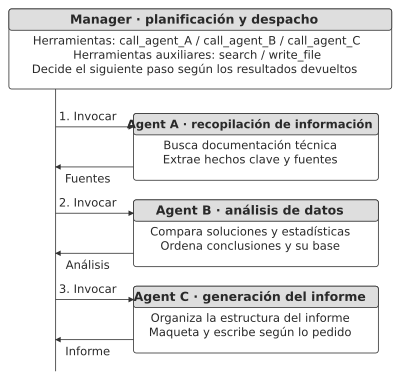

> **Experimento 10-2 ★★: Agente de traducción de libros**
>
> Traducir un libro técnico exige ocuparse a la vez de la terminología, el contexto y la redacción. Por ejemplo, la palabra inglesa agent admite varias traducciones; si la traducción acuerda usar «agente», los capítulos posteriores deben mantener esa misma traducción. El glosario, el original de cada capítulo, la traducción y los registros de revisión necesitan una organización clara. Un libro largo, junto con las traducciones intermedias, los resultados de herramientas y el historial de revisión, ocupa cada vez más contexto: al llegar al capítulo 9, el modelo puede haber olvidado cómo tradujo algo en el capítulo 2, o puede revisar una y otra vez el mismo párrafo. Dividir la tarea por responsabilidades y capítulos permite que cada instancia se concentre en los materiales que requiere su responsabilidad actual.
>
> El trabajo puede repartirse entre cuatro tipos de Agentes:
>
> - **Glossary Agent: elaborar el glosario.** Lee el libro completo por lotes, identifica los términos especializados recurrentes, consulta diccionarios especializados y normas de traducción, y genera una tabla de correspondencias en JSON o CSV con el término en inglés, su traducción al chino, la categoría gramatical y el contexto de uso. El glosario se guarda en el espacio compartido y, al terminar la tarea, se libera la instancia.
> - **Translation Agent: traducir capítulos.** Lee el capítulo actual, los términos relacionados y la guía de traducción, y completa la traducción según el público objetivo y el estilo lingüístico. Para los términos nuevos propone una traducción candidata y la marca como pendiente de revisión. Cada instancia mantiene un contexto independiente y guarda la traducción en el espacio compartido; los distintos capítulos pueden procesarse en serie o en paralelo según sus dependencias.
> - **Proofreading Agent: revisar el texto completo.** Comprueba, a partir del glosario y de las traducciones de cada capítulo, las traducciones, la coherencia de las expresiones y la legibilidad. Completa la revisión del texto entero leyendo por capítulos y usando índices entre capítulos, y escribe en el informe de revisión la ubicación de cada problema, su justificación y la corrección requerida.
> - **Manager Agent: asignar y recoger tareas.** Mantiene el objetivo, el plan, el estado de las tareas, los resúmenes de llamadas y el índice de productos; según el informe de revisión, devuelve a los traductores los capítulos que deben corregirse y organiza después una nueva revisión.
>
> En la figura 10-5, el revisor lee las traducciones de cada capítulo y el glosario, y el Manager decide, según el informe, qué capítulos deben corregirse. El traductor que recibe una tarea de corrección puede recuperar el original del capítulo y comprobar qué significa en esa frase la palabra señalada.
>
> 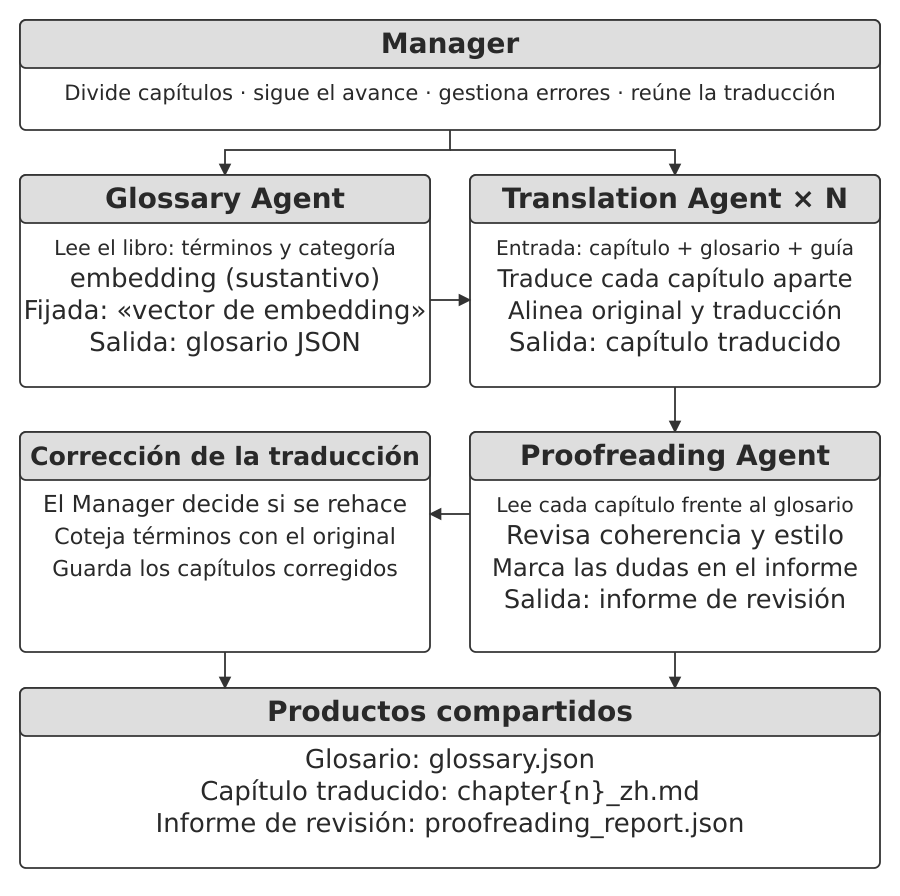
>
> Una vez escritas las traducciones en archivos, ¿qué llamadas siguen necesitando leer textos largos? El experimento de acompañamiento divide los dos primeros capítulos de la edición inglesa en 26 unidades de traducción. El Agente único arrastra todo el original y la traducción anteriores, y su solicitud más grande tuvo una entrada de 94.355 tokens. Con el reparto de tareas, la entrada más grande de un traductor fue de solo 2.857 tokens, y el Manager usó 2.153 para decidir las correcciones. En el grupo con gestor, quien más entrada consumió fue en realidad el elaborador del glosario: leyó dos capítulos de una vez y usó 49.807 tokens.
>
> Al terminar estos dos capítulos, los cuatro roles usaron en total 203.277 tokens, frente a 1.317.808 del Agente único. ¿Qué grupo entregó antes? El grupo de cuatro roles tardó unos 271 segundos, unos 17 segundos más que el Agente único.
>
> En la entrega, dos comprobaciones dieron resultados distintos sobre la misma traducción. El glosario asignaba al sustantivo `embedding` la traducción «嵌入向量» («vector de embedding»). El informe de revisión no señalaba ningún capítulo para corregir, pero el programa de comprobación terminológica le asignó a esa palabra 0/2: en las traducciones de ambos capítulos encontró «嵌入» («incrustar»), pero no «嵌入向量». ¿Hay que devolver los dos capítulos?
>
> En el párrafo del capítulo 1 sobre la política de reembolsos, el original dice `embedding the refund policy in the context`, y la traducción es «将退款政策嵌入上下文中» («incrustar la política de reembolsos en el contexto»). Aquí se habla de colocar la política en el contexto, y cambiarlo por «vector de embedding» introduciría un error. El programa busca cadenas por capítulo y puede ayudar al revisor a encontrar pistas para revisar; para decidir qué ocurrencia hay que cambiar, el revisor necesita además el párrafo original. Cuando se actualiza el glosario, también se pueden localizar primero los párrafos afectados y entregar al traductor el original, la traducción y la nueva entrada juntos.
>
> **Requisitos del experimento:**
> 1. Elegir un libro técnico que contenga figuras, tablas y código.
> 2. Implementar los cuatro tipos de Agentes: Manager, Glossary, Translation y Proofreading.
> 3. Registrar el uso de contexto de cada miembro, los materiales de traspaso y las versiones de los productos.
> 4. Comparar con la solución de Agente único la calidad de la traducción, el tiempo de finalización y el consumo de recursos, y analizar el efecto de la división de tareas y de la organización del contexto.

**Coordinación en paralelo.** Las subtareas independientes entre sí pueden ejecutarse al mismo tiempo. El Manager se encarga de asignar tareas, recibir estados y decidir según los resultados si continuar, añadir trabajo o terminar. Al traducir este libro, una vez confirmado el glosario, los distintos capítulos pueden repartirse entre varios traductores que empiezan a la vez. La figura 10-6 cambia a un informe de investigación: los gráficos ya están terminados y el análisis sigue en curso; ¿por qué la verificación de formato aún tiene que esperar? Siguiendo los eventos que comunican los miembros, se ve de qué dos productos depende el último paso.

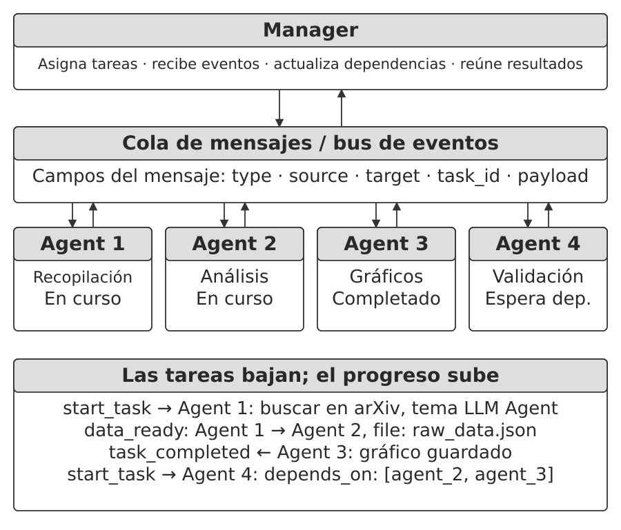

El bus de mensajes es adecuado para organizar este tipo de comunicación asíncrona: los miembros publican su progreso y sus resultados, el gestor se suscribe a los eventos correspondientes y el entorno de ejecución se encarga de la entrega, el almacenamiento en búfer y los reintentos.

> **Caso de producto: Lingtai**
>
> Lingtai es un sistema de Agentes de larga duración que se ejecuta en local y guarda su identidad y su memoria en archivos. Ofrece tres roles: el Agente principal (main agent) conversa con el usuario y gestiona los planes y la memoria; los daemons (daemon) asumen tareas paralelas de corto plazo y alcance bien definido y devuelven sus conclusiones al terminar; los avatares (avatar) conservan su propia memoria, buzón y responsabilidades, y se usan para la especialización entre sesiones.
>
> Cada rol tiene su propio conocimiento persistente privado y comparte manuales de habilidades en formato Markdown. Cuando el contexto se acerca a su capacidad máxima, el rol guarda un resumen mediante una «muda» (molt) y, combinándolo con la memoria persistente, pasa a un nuevo contexto. La identidad, la memoria y las habilidades se guardan de forma independiente en archivos, de modo que el trabajo puede continuar aunque se cambie el modelo subyacente. Este diseño combina un gestor, trabajadores de corto plazo, miembros especializados de larga duración y la compresión de contexto.

> **Experimento 10-3 ★★★: Agentes de teléfono y computadora con orquestación autónoma**
>
> Este experimento combina el Computer Use y la interacción por voz del capítulo 6. El usuario proporciona una página de registro o de reserva de vuelos; el Computer Agent abre el sitio web, identifica el formulario y, a través del Phone Agent, recoge los campos que faltan, como el nombre, el número de documento, los datos de contacto, la dirección y las preferencias.
>
> **Roles y traspasos.** El Computer Agent maneja el navegador y se encarga de la orquestación; el Phone Agent conversa en tiempo real con el usuario mediante ASR, LLM y TTS, y convierte las respuestas habladas en campos estructurados. Ambos se comunican mediante herramientas punto a punto o un bus de mensajes, y los mensajes incluyen remitente, destinatario, tipo y contenido. El Computer Agent puede delegar directamente la tarea telefónica y asumir el papel de gestor. Cuando el usuario está dispuesto a dar la información por voz, el Phone Agent puede preguntar, confirmar y volver a preguntar de forma continua, mientras el Computer Agent se concentra en el estado de la página y en rellenar los campos.
>
> **Dos modos de ejecución.** El modo fijo lanza de antemano los dos Agentes, cada uno con su propio bucle de ejecución, y sirve para comprobar la comunicación bidireccional y el comportamiento concurrente. El modo autónomo lanza primero el Computer Agent, y el modelo decide, según la página, la información disponible y las necesidades de la tarea, si llama a `initiate_phone_call_agent(purpose, required_info)`. El entorno de ejecución entrega entonces al Phone Agent el propósito de la tarea, los campos que hay que recoger y las restricciones de formato, y una vez lanzado se usa el mismo mecanismo de comunicación.
>
> **Flujo campo a campo.** En la figura 10-7, el Phone Agent pregunta a través de WebRTC, extrae y valida la respuesta y, cuando obtiene un valor válido, envía `info_collected` y pasa a preguntar el siguiente campo. Mientras tanto, el Computer Agent lee la página, rellena el campo anterior y devuelve `fill_error` o el nuevo estado de la página. Las incidencias de formato se señalan con `format_invalid`, que indica el campo y el requisito, y el Phone Agent confirma o vuelve a preguntar en consecuencia. Así, «preguntar el siguiente» y «rellenar el anterior» pueden ejecutarse de forma solapada.
>
> **Finalización y gestión de excepciones.** Cuando el Phone Agent termina de recoger los campos, envía `task_completed`, lo que indica que la subtarea de recogida de información ha concluido. El Computer Agent sigue comprobando los campos obligatorios, los resultados de validación de la página y la autorización de envío, y después completa la operación con el formulario. Si se supera el número de reintentos, aparece una anomalía en la página o el usuario pide detenerse, se pausa la tarea y se informa del progreso actual; al terminar, se cancela la contraparte que siga en ejecución y se cierran la sesión del navegador, las pistas de audio y la llamada. La interacción por voz con personas reales y el envío del formulario requieren, respectivamente, el consentimiento y la autorización del usuario.
>
> 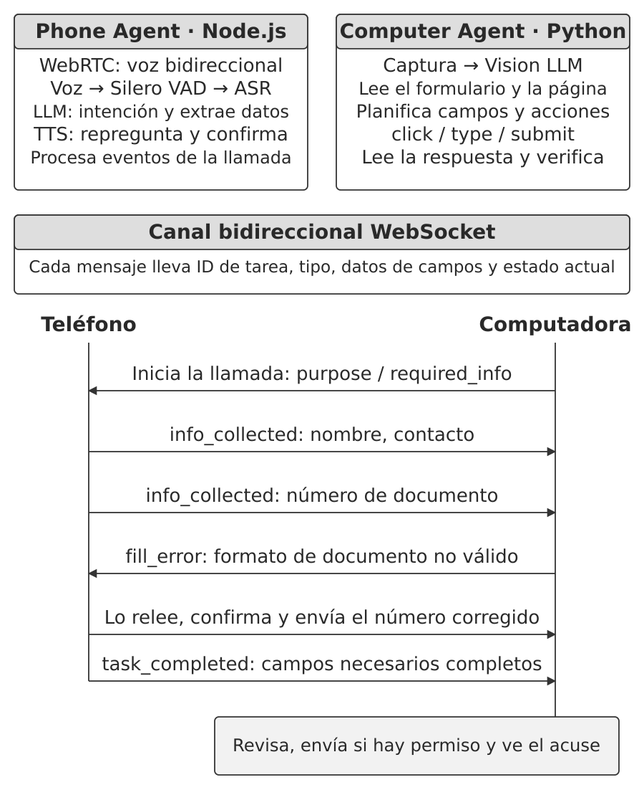
>
> **Requisitos del experimento:**
> 1. Implementar dos Agentes independientes con comunicación estructurada bidireccional.
> 2. Registrar la secuencia temporal en los modos fijo y autónomo y comprobar los intervalos en que se solapan las preguntas y el rellenado.
> 3. Implementar la validación de formato, las repreguntas, la notificación de errores de página, los tiempos límite y la liberación de recursos.
> 4. Comparar en ambos modos las decisiones de arranque, la latencia, la tasa de éxito y el consumo de recursos.

> **Experimento 10-4 ★★★: Agente que recopila información de varios sitios web a la vez**
>
> Este experimento usa varios Agentes homogéneos que buscan en paralelo, para practicar los mecanismos basados en eventos y de interrupción del capítulo 6. La tarea consiste en buscar a un profesor concreto, por ejemplo «Zhang Wei», en los sitios web de varias facultades de una universidad, y devolver la facultad, el cargo, las líneas de investigación y la página de origen. Antes de buscar se acuerdan los criterios de identificación, como el nombre, la disciplina y la información de la página personal, para poder distinguir a personas con el mismo nombre.
>
> **1. Arranque en paralelo.** El Manager crea 10 Computer Use Agents, cada uno responsable del sitio web de una facultad. Cada instancia mantiene un contexto y una sesión de navegador independientes, y puede planificarse mediante tareas asíncronas, hilos o procesos. La entrada incluye la URL del sitio, el nombre buscado, los criterios de coincidencia y un identificador de tarea para el enrutamiento.
>
> **2. Consolidación del progreso.** Los miembros envían periódicamente estados como «cargando el sitio», «leyendo el directorio de profesores», «revisado y sin coincidencias» o «encontrado un profesor con el mismo nombre». El Manager mantiene una tabla de tareas a través del bus de mensajes, registra por separado las que están en ejecución, completadas, bloqueadas y fallidas, y conserva las fuentes y las causas de error.
>
> **3. Cancelar las demás ramas tras la verificación.** Supongamos que `agent_3`, responsable de la facultad de Física, encuentra a un profesor con el mismo nombre y envía `target_found`, con una carga útil que incluye la información del profesor y la fuente. Si la tarea exige devolver datos verificados de la persona, el Manager debe comprobar primero los criterios de coincidencia y las evidencias; una vez confirmado que se ha encontrado a la persona buscada, registra el resultado con una operación atómica y después envía `terminate` a los demás miembros en ejecución, indicando que los datos adoptados proceden de `agent_3`. Los miembros se detienen en un punto seguro, liberan los recursos y devuelven una confirmación; el Manager espera las confirmaciones o el tiempo límite y completa la consolidación. Si la tarea exige enumerar a todas las personas con ese nombre, se sigue buscando hasta haber revisado todo el alcance necesario.
>
> **Condiciones de carrera.** Los Agentes A y B pueden devolver resultados válidos casi al mismo tiempo. Si cada evento desencadena su propia consolidación, se producirán entregas duplicadas o conflictos de estado. Se puede proteger con un bloqueo o una transacción la transición de estado «buscando → resultado registrado», de modo que el evento que llegue después lea el resultado ya registrado. Los reintentos de mensajes también deben eliminar duplicados por identificador de evento, para que la cancelación y la consolidación sigan siendo coherentes aunque se desencadenen varias veces.
>
> **4. Excepciones y cobertura.** Las interrupciones de red, los cambios en la estructura de las páginas y los errores de análisis se registran por separado. Se puede fijar para cada tarea un presupuesto de tiempo, por ejemplo de dos minutos; al agotarse, se cancela la ejecución y se recoge información de diagnóstico, mientras los demás miembros siguen trabajando. El informe final distingue entre «revisado y no encontrado» y «fallo de acceso, revisión aún no completada», e indica qué facultades se han cubierto.
>
> La figura 10-8 enlaza estos mensajes con una serie de tiempos ilustrativos. Supongamos que el miembro 3 informa de que en la facultad de Física hay un profesor Zhang Wei que investiga computación cuántica; el Manager debe comprobar primero si la página de origen confirma el nombre, el departamento, el cargo y la línea de investigación. Recibir la pista de un profesor con el mismo nombre, confirmar que es la persona buscada y reunir todos los acuses de cancelación son tres momentos distintos.
>
> 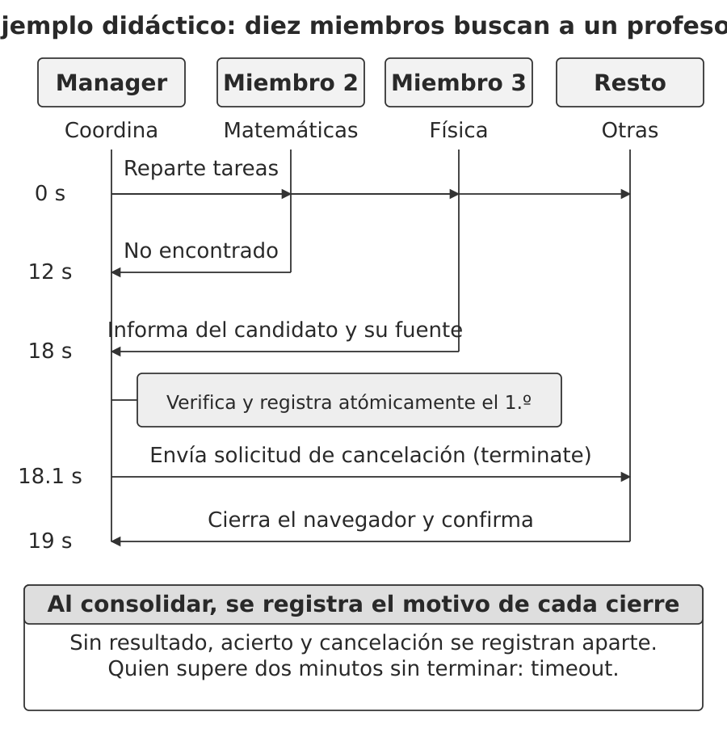
>
> En la ejecución real se buscó a Andrew Ng. Los miembros comprueban primero si el nombre aparece en el texto de la página, y solo si hay coincidencia piden al modelo que extraiga los datos. Se eligió la página de Stanford HAI, y la breve cita devuelta permite comprobar el nombre y la condición de profesor adjunto. Para verificar la línea de investigación hay que leer además el párrafo posterior de la página que habla del aprendizaje profundo. Aunque varios miembros envíen `target_found` a la vez, solo el primero que obtiene el bloqueo puede registrar el resultado.
>
> En esta ocasión, la búsqueda en serie no encontró coincidencia hasta la última de las diez URL y tardó 44,971 segundos; la búsqueda en paralelo sobre el mismo lote de páginas tardó 24,022 segundos, y en ambos casos se cerraron los diez contextos de navegador. El cociente entre ambos valores es 1,872. Si la página de HAI estuviera en primer lugar, la búsqueda en serie podría detenerse al encontrarla y habría que volver a medir los tiempos. Otra ejecución dedicada a comprobar la cancelación lanzó cuatro ramas: una registró primero el resultado, las otras tres confirmaron haber recibido la solicitud de cancelación y, al final, se cerraron los cuatro contextos de navegador.
>
> **Requisitos del experimento:**
> 1. Implementar un Manager que cree dinámicamente miembros en paralelo.
> 2. Construir la capacidad de ejecución en el navegador con proyectos como browser-use.
> 3. Realizar la comunicación bidireccional y el mantenimiento del estado mediante un bus de mensajes.
> 4. Verificar los resultados de búsqueda, registrarlos con una operación atómica y recoger las confirmaciones tras cancelar las demás ramas.
> 5. Gestionar fallos de acceso, errores de análisis, tiempos límite agotados y ausencia de coincidencias.
> 6. Comparar el tiempo de finalización, la cobertura y el consumo de recursos de la ejecución en paralelo y en serie.

**Flujos de trabajo generados por el gestor.** Además de delegar paso a paso, el Manager puede escribir primero como programa las dependencias entre tareas y las reglas de consolidación, y después entregarlo al entorno de ejecución para que lo planifique. El modelo diseña el flujo y el programa se encarga de lanzar a los miembros según lo acordado, transmitir los resultados y esperar las dependencias. Cuando las dependencias ya están claras y hay que ejecutar repetidamente flujos del mismo tipo, el autor prefiere este enfoque. Se ahorra el coste de llamar al Manager en cada asignación y se reducen los registros de planificación acumulados en el contexto de gestión.

La herramienta de Workflow dinámico de Claude Code ofrece una implementación de este tipo. `agent()` crea un subagente con contexto independiente y puede usar un schema para acordar una salida estructurada; `parallel()` ejecuta de forma concurrente un conjunto de tareas y espera a que terminen todas; `pipeline()` hace pasar cada entrada por varias etapas, de modo que, cuando un elemento pasa a la siguiente etapa, los demás pueden seguir procesándose en la anterior. Los resultados intermedios se guardan en variables del programa, y el filtrado y la combinación se hacen con código ordinario.[^dynamic-workflows]

Por ejemplo, para verificar siete grupos de hechos de un manuscrito técnico, se pueden lanzar primero Agentes de investigación por temas y después entregar cada conclusión a un Agente verificador para comprobarlas en paralelo. Cada conclusión devuelta conserva su fuente y la base de su dictamen; cuando terminan todas las ramas, un Agente de consolidación organiza el informe final. Así, tanto el reparto «investigar — verificar una por una — consolidar» como las dependencias entre etapas quedan escritos en el flujo de trabajo.

[^dynamic-workflows]: Anthropic, “Orchestrate subagents at scale with dynamic workflows”, 2026.

### Patrón descentralizado

Si ya existe un Manager, ¿por qué dejar que los miembros decidan por sí mismos a quién acudir? Imaginemos que un probador recibe un módulo recién escrito y descubre que los requisitos del producto y el contrato de la interfaz interpretan de dos maneras un mismo campo. El probador puede llevar la contradicción directamente a los roles de producto y de arquitectura, pedir que cada uno exponga sus razones y esperar a que se corrija el acuerdo para seguir probando. Esto es reparto del trabajo y también un sistema de contrapesos. El ingeniero que entrega un módulo, el arquitecto que pide la opinión de producto y el probador que plantea una objeción pueden, cada uno, iniciar el paso siguiente. Cuando hace falta negociar a menudo, esperar a que el Manager transmita cada asunto retrasa el trabajo.

Tomando prestada la terminología de los microservicios, que un centro organice los pasos se llama **orquestación** (orchestration), y que cada parte continúe por su cuenta según eventos acordados se llama **coreografía** (choreography). Hay además una diferencia práctica: si cada traspaso tiene que esperar al Manager, cuando su servicio de modelo deja de responder, los demás miembros, aunque puedan seguir trabajando, no reciben la siguiente tarea. La coordinación distribuida reduce esta dependencia; si el miembro que debe tomar el relevo se queda atascado en una llamada a herramienta, siguen haciendo falta un estado de tarea persistente, tiempos límite, reintentos y mecanismos de relevo para que otro miembro sepa desde dónde continuar.

Los tres diseños siguientes usan cada uno una forma distinta de traspaso: suscribirse a mensajes según el producto, elegir en un chat de grupo al siguiente que habla, o que el miembro actual designe a quién traspasa.

**MetaGPT: organizar los traspasos de productos mediante SOP.** MetaGPT reparte el trabajo según los procedimientos operativos estándar (SOP) de un equipo de software. El gestor de producto entrega el documento de requisitos (PRD), el arquitecto entrega el documento de diseño, el ingeniero entrega el código y el probador entrega el informe de pruebas. El siguiente miembro puede empezar en cuanto recibe los materiales acordados, y el anterior se ahorra explicar la tarea una y otra vez. Las conexiones de la figura 10-9 representan las relaciones de traspaso de estos productos.[^metagpt-design]

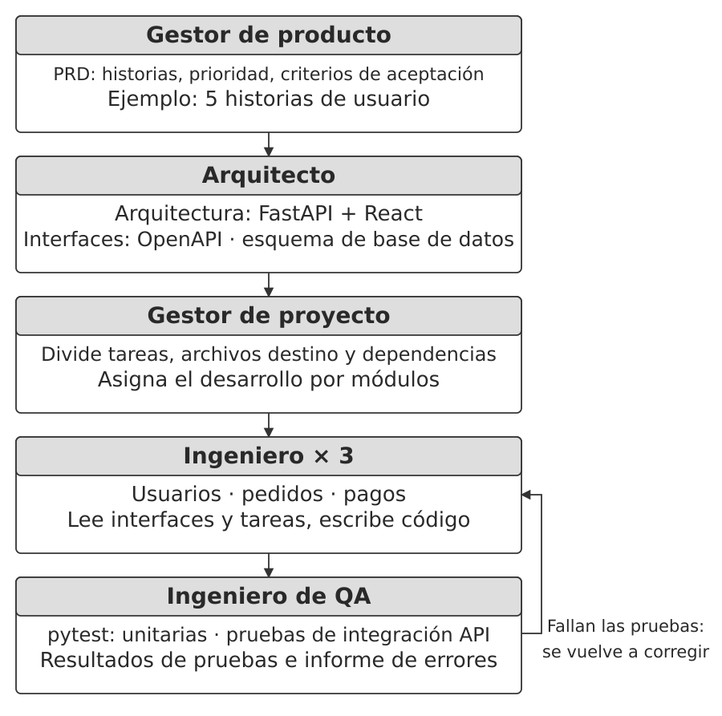

¿Qué información debe completar cada rol en el traspaso?

- El **Product Manager Agent** recibe los requisitos, elabora el PRD y concreta las funcionalidades, las historias de usuario, los criterios de aceptación y las prioridades.
- El **Architect Agent** lee el PRD, elige la pila tecnológica, divide los módulos, define las interfaces y los modelos de datos, y redacta el documento de diseño.
- El **Project Manager Agent** descompone, según el diseño, las tareas y el reparto de archivos, ordena las dependencias y asigna la ejecución a los ingenieros.
- Los **Engineer Agents** implementan los módulos según el diseño y envían el código; las partes independientes entre sí pueden asignarse a varias instancias.
- El **QA Engineer Agent** genera pruebas a partir del código y los requisitos, ejecuta las comprobaciones, registra los problemas y redacta el informe de pruebas.

Para diseñar el formato de traspaso de estos roles, el autor recomienda dejar claras tres cosas: la tarea y sus criterios de aceptación, los hechos y restricciones ya confirmados, y las referencias a los productos estructurados. Con ello, el receptor obtiene los materiales necesarios, continúa el trabajo y, cuando falta información, plantea preguntas concretas.

MetaGPT organiza la información mediante un pool de mensajes compartido y un mecanismo de suscripción: los roles publican mensajes y los demás procesan las entradas pertinentes según los tipos de mensaje que les interesan. Los publicadores y los consumidores se conectan a través del formato de los productos y la semántica de los mensajes, de modo que se puede cambiar el modelo o ajustar la implementación interna de cada uno por separado.

Los SOP describen las dependencias entre requisitos de producto, arquitectura y código, y la suscripción a mensajes describe cómo se desencadena ese trabajo. Las dependencias fijas entre tareas también pueden hacerse avanzar con eventos distribuidos, y ambas cosas juntas constituyen la forma de colaboración del sistema. Para diseñar además una retroalimentación dinámica, se pueden añadir caminos como que el probador pida al rol de producto que aclare un requisito o que el ingeniero proponga al arquitecto una alternativa, y fijar para estas interacciones condiciones de aceptación y reglas de finalización.

[^metagpt-design]: Hong, S., et al. *MetaGPT: Meta Programming for A Multi-Agent Collaborative Framework.* ICLR 2024.

**Chat de grupo de AutoGen: turnos de palabra en una sesión compartida.** En el diseño clásico de GroupChat, varios Agentes participan en una misma sesión; el GroupChatManager elige al siguiente que habla y difunde los mensajes a los miembros. La estrategia de selección puede ser rotatoria o dejar que el modelo decida según el contenido actual. Los miembros conservan su propia configuración de rol y se comunican a través de la sesión común, mientras que la asignación de turnos se concentra en el gestor. Es un ejemplo de combinación entre organización del contexto y estructura de control.[^autogen-groupchat]

[^autogen-groupchat]: Microsoft, *AutoGen 0.2: Conversation Patterns.*

**OpenAI Swarm: traspasar el control mediante handoff.** Swarm configura instrucciones y herramientas para cada rol; cuando un rol llama a una función de traspaso configurada, el entorno de ejecución cambia al Agente de destino. La decisión de enrutamiento puede tomarla cada rol y ejecutarla un bucle de ejecución unificado. Al traspasar, las instrucciones del sistema actuales cambian con el rol y el historial de conversación se conserva. Muestra la combinación de «el rol elige al siguiente que toma el relevo» con «se mantiene el historial de la sesión».[^swarm-handoff]

Si se adopta un traspaso con contextos independientes, se puede definir aparte un paquete de tarea: `task_id` identifica la tarea, `sender` y `recipient` indican las dos partes, `goal` y `constraints` describen el objetivo y las restricciones, `accepted_facts` guarda los hechos confirmados, `artifact_refs` proporciona las referencias a los productos, `remaining_budget` registra el presupuesto y `visited_agents` guarda la cadena de visitas. El receptor lee los materiales según su autorización, y el entorno de ejecución mantiene el presupuesto y el registro de traspasos.

La cadena de traspasos debe gestionar las visitas repetidas. Por ejemplo, que el desarrollador pase el código al revisor y este, tras proponer cambios, se lo devuelva es un ciclo de revisión normal. Para juzgar si hay avances se pueden combinar el estado de la tarea, la versión del producto, las cuestiones pendientes y el número de repeticiones. Por ejemplo, si una misma traducción se devuelve dos veces seguidas, y la primera vez se añadió la fuente y la segunda se corrigió un término, la revisión sigue avanzando; si las dos veces se devuelve la misma versión señalando el mismo problema, la revisión está atascada. En ese caso se puede limitar el número de traspasos adicionales y comunicar las cuestiones no resueltas al responsable.

[^swarm-handoff]: OpenAI, *Swarm*, “Instructions” y “Handoffs and Updating Context Variables”.

> **El Agent Swarm en los productos**
>
> «Agent Swarm» puede referirse a formas de organización distintas. Un tipo traspasa el control a lo largo de una red de handoffs, como OpenAI Swarm, la biblioteca swarm de LangGraph y la orquestación por handoff de Microsoft Agent Framework; el otro usa un Agente principal con trabajadores en paralelo, como Kimi Agent Swarm, el sistema de investigación multiagente de Anthropic y Manus Wide Research.
>
> El Agent Swarm que introdujo Kimi K2.5 entrena al orquestador mediante aprendizaje por refuerzo de Agentes en paralelo, de modo que aprende cuándo descomponer la tarea y cómo repartir el trabajo, y admite hasta 100 subagentes. Versiones posteriores ampliaron la escala a 300, y K3 Swarm se sigue usando para búsquedas a gran escala y procesamiento por lotes. AgentENV, por su parte, ofrece un entorno escalable para el aprendizaje por refuerzo de Agentes de Kimi K3, con soporte de instantáneas y bifurcaciones, para organizar la ejecución en paralelo.[^ch10-kimi-swarm]

**Varias instancias de Agente en la misma máquina.** Varias instancias pueden encargarse de tareas distintas y, aun así, compartir archivos, servicios de herramientas o GPU. En ese caso, la comunicación sirve para indicar el alcance de las modificaciones, avisar de la liberación de recursos o negociar el orden de ejecución. Por ejemplo, cuando dos instancias necesitan una GPU, pueden registrar primero su tarea y el uso previsto, y el gestor de recursos concede después el derecho de uso.

Agent Teams de Claude Code ofrece descubrimiento de miembros del equipo, mensajería y gestión compartida de tareas. Los miembros obtienen información unos de otros dentro del equipo ya establecido, y el entorno de ejecución organiza la comunicación.[^claude-agent-teams] Si se construye por cuenta propia la colaboración en una misma máquina, también se pueden usar interfaces como `list_agents` del capítulo 4 y fijar reglas claras para el alcance del descubrimiento, los permisos de acceso y la propiedad de los recursos. Los acuerdos alcanzados en los mensajes se hacen efectivos después mediante bloqueos, cuotas o un planificador.

[^ch10-kimi-swarm]: Moonshot AI, *Kimi Agent Swarm: 100 Sub-Agents at Scale*, documentación de ayuda de Agent Swarm y descripción del proyecto AgentENV.

[^claude-agent-teams]: Anthropic, *Orchestrate teams of Claude Code sessions.*

### Colaboración entre organizaciones: el protocolo A2A

Cuando la colaboración cruza las fronteras de servicios u organizaciones, ambas partes deben acordar el descubrimiento de capacidades, la autenticación, el formato de las solicitudes y la entrega del progreso y los resultados. El protocolo **A2A** (Agent2Agent), publicado por Google en 2025, ofrece una interfaz de interoperabilidad de este tipo y después pasó a estar alojado en la Linux Foundation. Puede entenderse desde tres aspectos.[^a2a-concepts]

- **Descubrimiento de capacidades.** La Agent Card es un documento de metadatos que describe la identidad, el punto de servicio, las habilidades, las modalidades de entrada y salida y los requisitos de autenticación. A partir de ella, quien llama decide si la otra parte puede atender la tarea y cómo establecer la conexión.
- **Tareas y mensajes.** Una Task representa un trabajo con identificador y ciclo de vida, y quien llama puede seguir estados como enviada, en proceso, a la espera de información, completada o fallida. Un Message transporta los requisitos de la tarea, la información adicional y las respuestas, y un Artifact entrega documentos, imágenes o resultados estructurados. Las Part de los mensajes y productos pueden contener texto, referencias a archivos o datos.
- **Colaboración mediante interfaces.** Quien llama se comunica con el extremo remoto a través de estos objetos públicos, y el extremo remoto gestiona de forma independiente sus prompts, su memoria y sus herramientas internos. Cada parte aplica por su cuenta la autenticación, la autorización y el alcance del acceso a datos.

Las tareas largas pueden obtener su estado mediante sondeo, recibir actualizaciones en streaming mediante SSE o, cuando se admiten, usar notificaciones push. Cuando el usuario aporta información adicional, el cliente sigue haciendo avanzar la misma tarea y obtiene el producto final según su estado.

El MCP del capítulo 4 se centra en ofrecer a las aplicaciones de modelos interfaces de herramientas, recursos y prompts; A2A se centra en la colaboración en tareas entre servicios de Agentes. Ambos pueden combinarse: un Agente usa herramientas mediante MCP y, al mismo tiempo, delega tareas remotas mediante A2A. Cuando dentro de un mismo equipo ya existen interfaces estables, el autor sigue usando llamadas a herramientas, archivos compartidos y buses de mensajes. Cuando hay que integrar servicios de Agentes mantenidos de forma independiente y unificar el descubrimiento de capacidades y el ciclo de vida de las tareas, introduce A2A; entre organizaciones, configura además reglas de identidad, permisos y gobernanza de datos.

[^a2a-concepts]: A2A Project, *Core Concepts and Components in A2A.*

**Concertar citas para distintas personas.** Tres miembros de una familia tienen cada uno su asistente de agenda y quieren quedar para cenar. Uno de los asistentes puede leer la agenda completa de su dueño: ¿cómo debe responder a los otros dos? «El martes no me viene bien; el miércoles puedo reorganizar algo» ya aporta una distinción útil. Reenviar directamente la agenda revelaría además los asuntos privados del martes; responder solo «tengo compromisos los dos días» impediría a los demás saber que el miércoles hay margen para negociar. Aunque la cita salga bien siempre, si es siempre la misma persona la que cambia sus planes, el arreglo puede no salirle a cuenta.

Un ejercicio público de CalBench pide a cinco personas organizar cinco reuniones, cada una con tres asistentes. Algunas personas tienen franjas que no pueden mover en absoluto, ciertos asuntos privados pueden cambiarse de fecha y el enunciado fija un coste para cada cambio. Primero se prueba un método sencillo: tratar las cinco reuniones una tras otra, buscando cada vez desde la franja más temprana, reservar en cuanto los tres asistentes puedan liberar ese hueco y conservar las reuniones ya concertadas. Después se prueba otro método: considerar las cinco reuniones en conjunto y resolverlas con las agendas completas. A continuación se usan los números de franja del enunciado, que empiezan en 0.[^ch10-calbench]

| Método | Franja de cada reunión, de la 1.ª a la 5.ª | Coste de los cambios por cada reunión reservada | Coste total |
|---|---|---|---:|
| Elegir para cada reunión la franja más temprana que pueda liberarse, conservando las ya concertadas | 0, 2, 1, 3, 6 | 1, 20, 20, 12, 300 | 353 |
| Planificar las cinco reuniones en conjunto con el solver de referencia | 13, 3, 10, 9, 12 | 0, 1, 0, 1, 1 | 3 |

Ambos calendarios cuadran, reunión por reunión, en las agendas finales de los tres asistentes. La mayor diferencia está en la última reunión: con el primer método, aunque la franja 6 puede liberarse, cada uno de los tres asistentes tiene que mover un compromiso de coste 100. En la franja 12, solo una persona tiene que mover un compromiso de coste 1. El resultado global da al evaluador una base de comparación; en la negociación real, cada asistente solo ve la agenda de su dueño.

El solver voraz que incluye esta versión informa de un coste de 146 y devuelve franjas para las cinco reuniones. Pero, al programar las reuniones posteriores, permite retirar reuniones anteriores de la agenda de algunos participantes. La primera reunión acaba en las franjas 7, 0 y 11 en las agendas de sus tres participantes. Si el criterio de aceptación es «las agendas finales de los tres registran la misma reunión en la misma franja», solo la tercera, la cuarta y la quinta tienen éxito.

Un servicio real de concertación de citas se encuentra además con información que el ejercicio de programación no proporciona. Calendar.help, de Microsoft, coordinó en su día miles de reuniones por correo electrónico en un año. ¿Un correo propone una reunión nueva o cambia la anterior? Cuando la clasificación automática no está segura, una persona ve primero el correo y solo resuelve esa pregunta. Si no puede responderse solo con el correo, la tarea puede pasarse a un programador de agendas humano que puede ver el intercambio de correos, la información ya reunida y las agendas anonimizadas. Este diseño vincula «a quién hay que pedir que decida» con «cuánto necesita ver esa persona».[^ch10-calendar-help]

[^ch10-calbench]: El artículo de CalBench analiza por separado el coste de coordinación, la equidad y la filtración tanto del estado inferible de la agenda como del contenido concreto de los asuntos. Las cifras proceden del primer ejercicio del banco de problemas con distintos costes de cambio, en la versión `86f8123`; al elegir franja, el primer método descarta las que ya ocupa una reunión de algún participante, y en lo demás sigue las reglas de desplazamiento de los autores. Puede recalcularse con un solver de programación.

[^ch10-calendar-help]: Cranshaw et al., diseño y despliegue de Calendar.help; véase la descripción de la interfaz de dos niveles para microtareas de procesamiento humano y tareas de programación completas.

## Modos de fallo de la colaboración multiagente

Cuando varios miembros ejecutan juntos una tarea, los fallos pueden aparecer entre los roles, los traspasos y la verificación. *Why Do Multi-Agent LLM Systems Fail?* construyó una taxonomía de fallos a partir de unas 150 trayectorias, con un acuerdo entre anotadores κ de 0,88, y después amplió el análisis a siete marcos. El estudio identifica 14 modos de fallo, agrupados en tres categorías:[^mast-failures]

- **Problemas de diseño del sistema:** lagunas en las responsabilidades de los roles, las interfaces, la configuración de herramientas o las condiciones de parada.
- **Desajustes en la colaboración entre miembros:** distinta comprensión del objetivo, traspasos de información incompletos o acciones contradictorias.
- **Problemas de verificación de la tarea:** finalización prematura, comprobaciones omitidas o uso de criterios inadecuados para juzgar la finalización.

El artículo da el ejemplo de un programa de ajedrez. El código generado por ChatDev compilaba y superó la revisión, pero en cuanto se jugaba con las reglas reales del ajedrez, el programa fallaba. El compilador comprueba si el código compila; para comprobar si los movimientos son legales hay que jugar unas cuantas jugadas. En otra comparación, los investigadores permitieron que los comentarios de revisión de ChatDev devolvieran el trabajo para corregirlo, que el proceso solo terminara cuando lo confirmara el rol responsable de la revisión técnica y fijaron un número máximo de iteraciones. En las 32 tareas de ProgramDev-v0, el flujo original superó 8 y el flujo ajustado, 13: la tasa de éxito pasó del 25,0 % al 40,6 %, unos 15,6 puntos porcentuales de diferencia.[^mast-failures]

[^mast-failures]: Cemri, M., et al. *Why Do Multi-Agent LLM Systems Fail?* 2025.

¿Cómo distinguir entre «el revisor no ha respondido» y «el revisor ha respondido, pero se ha equivocado»? Los sistemas distribuidos llaman fallo por caída (crash) a que un componente deje de funcionar. El modelo de fallos bizantinos admite además que un componente dé resultados arbitrariamente erróneos o contradictorios entre sí. Un Agente también puede detenerse a mitad de camino o devolver con toda normalidad una conclusión errónea. Lo primero requiere detección, recuperación y relevo; lo segundo, verificación de evidencias, restricciones de permisos y aislamiento de errores. Un latido periódico ayuda a saber si el Agente sigue en ejecución; para saber si su conclusión es correcta, hay que comprobar el resultado real. La verificación cruzada y las votaciones pueden servir para evaluar resultados, y su fiabilidad depende de la calidad de las evidencias y de la correlación entre los errores de los miembros; los protocolos formales establecen además cuántos nodos defectuosos pueden tolerarse como máximo y cómo se comunican los nodos entre sí.

### Modo de fallo 1: conflictos de concurrencia en el sistema de archivos compartido

Los productos compartidos permiten que los miembros continúen el trabajo de otros, pero también plantean el problema de las modificaciones simultáneas. Conviene distinguir primero dos niveles.

Los **conflictos a nivel de archivo** se producen cuando dos miembros modifican el mismo archivo: ambos leen la versión antigua, escriben uno después del otro y la segunda escritura sobrescribe el resultado de la primera.

Los **conflictos semánticos** se producen entre productos relacionados. Por ejemplo, el Agente A renumera todas las figuras del libro mientras el Agente B modifica un capítulo y cita la numeración original. Ambos modifican archivos distintos y al fusionarlos puede que no haya conflictos de texto, pero la correspondencia entre figuras y texto ya no es válida.

Supongamos que la versión actual del glosario es la 7. A y B empiezan a modificarla desde la versión 7; A envía primero y la versión pasa a 8. Si B, al entregar, se limita a decir «escribe esta tabla», la modificación de A puede quedar sobrescrita; si pide «escribe solo si la versión actual sigue siendo la 7», el programa puede detectar que hace falta fusionar. Para la concurrencia a nivel de archivo se puede usar **bloqueo optimista**: al leer se registra el número de versión y, al enviar, la comprobación de versión y la escritura se realizan como una sola operación atómica; si la versión ha cambiado, se rechaza el envío antiguo, se vuelve a leer y se fusiona.

La coherencia semántica entre archivos exige comprobar las relaciones entre ellos. Cuando varios Coding Agents modifican el mismo repositorio, el autor prefiere asignar a cada miembro un worktree y una rama propios, que cada uno genere sus commits y, en el punto de fusión, comprobar los conflictos, ejecutar las pruebas y verificar las interfaces. Crear solo una rama no basta: hace falta además un directorio de trabajo independiente para aislar las modificaciones de archivos simultáneas.

### Modo de fallo 2: amplificación de errores en cascada

Un mensaje puede llegar palabra por palabra y, aun así, su sentido puede deformarse al reformularse. Imaginemos que varios Agentes redactan juntos el registro de una atención al cliente: A escribe «el operador de atención al cliente prometió una rebaja de 80 yuanes en la próxima factura», B lo resume como «se han rebajado 80 yuanes» y C, tras leer el resumen, cierra la tarea pendiente. Los tres mensajes llegaron a su destino, pero el usuario ha perdido el recordatorio para comprobar la próxima factura. Es como el juego del teléfono descompuesto: el error está en que B convirtió una promesa en un resultado ya consumado.

El registro de traspaso debe recoger la conclusión, las condiciones en que se aplica y la fuente, para que quien tome el relevo vea qué está confirmado y qué sigue siendo una inferencia. Ante una discrepancia como la anterior, el autor hace que el revisor lea primero la transcripción de la llamada y la última factura, juzgue por sí mismo hasta dónde se ha llegado y después vea por qué B lo resumió así. Si solo hay una promesa verbal, se pide a B que vuelva a dejar el resumen como «se ha prometido una rebaja» y se mantiene la tarea pendiente de revisar la factura; lo que permite cerrar esa tarea es la línea de descuento en la factura.

### Modo de fallo 3: convergencia homogénea

Varios miembros también pueden tomar la misma decisión errónea trabajando de forma independiente. En un experimento de Anthropic, 18 de 30 Agentes lanzados a la vez crearon ramas de Git con el mismo nombre; en una tarea de redacción, distintos miembros también llegaron a usar el mismo título.[^anthropic-multiagent-2026] Un modelo común, entradas parecidas y el mismo marco de ejecución hacen que las decisiones estén correlacionadas. La opinión unánime de cinco Agentes similares puede no ser más que el mismo error repetido cinco veces; al aumentar el número de revisiones, hay que aumentar a la vez la diversidad de evidencias y de perspectivas de análisis.

Se pueden asignar a los miembros evidencias, responsabilidades o modelos distintos, y aislar los identificadores de recursos mediante espacios de nombres. Los cupos de concurrencia y los límites de velocidad controlan además los accesos concentrados, para evitar que muchas decisiones idénticas golpeen a la vez un servicio compartido.

El experimento de fijación de precios de Bertrand del mismo estudio muestra otro tipo de convergencia: los Agentes con ánimo de lucro pueden coordinar precios a través de canales privados y también desarrollar comportamientos coordinados a partir de los precios públicos.

### Modo de fallo 4: disputas de responsabilidad y conflictos de objetivos

Cuando varios miembros asumen objetivos que entran en conflicto, sus acciones pueden anularse mutuamente. Anthropic asignó a tres Agentes objetivos de migración del mismo backend a lenguajes distintos y observó que interpretaban las modificaciones de los demás como obstáculos; el conflicto llegó a extenderse a operaciones sobre procesos y permisos.[^anthropic-multiagent-2026] Este tipo de problemas exige acordar de antemano las prioridades de los objetivos, la propiedad de los recursos y el alcance de lo que cada uno puede ejecutar; los conflictos que no puedan resolverse con las reglas hacen que el entorno de ejecución pause las operaciones afectadas y las someta al arbitraje del responsable.

En una colaboración al estilo de un equipo de software también pueden aparecer reiterados pases de pelota. Por ejemplo, el probador informa de un problema, el frontend considera que primero hay que cambiar el backend, el backend considera que hace falta una aclaración de producto, y producto devuelve el problema al rol de arquitectura. En ese caso se puede exigir que cada traspaso indique las condiciones de reproducción, las evidencias disponibles, la pregunta pendiente y la responsabilidad del receptor, para que la disputa vaya convergiendo.

Otro ejemplo es un fallo del entorno de pruebas: el desarrollador modifica una y otra vez el código de negocio y las pruebas siguen devolviendo el mismo error. Primero hay que fijar el entorno y las entradas, comparar los resultados de ejecución antes y después de la modificación y confirmar si el problema viene de la implementación del producto o de las condiciones de prueba; solo después se asigna la tarea de corrección.

### Modo de fallo 5: bucles descontrolados

La terminación prematura deja trabajo sin hacer; la falta de condiciones de parada puede hacer que el sistema reintente sin fin, se traspase el trabajo una y otra vez o cree subagentes de forma recursiva. El número de miembros y el de rondas de llamadas se amplifican mutuamente, y pueden generarse miles de subtareas que consuman rápidamente el presupuesto.

En el entorno de ejecución se pueden fijar a la vez un cupo total de tokens o de gasto, el número de ejecuciones concurrentes, el número acumulado de creaciones, la profundidad de derivación, el número de rondas y los tiempos límite. La tarea padre reparte el presupuesto y lo imputa a la cuenta general, y también hay que registrar el consumo producido antes de un fallo o una cancelación. Al alcanzar un límite, se guarda el progreso, se cancelan las ramas inconclusas y se recogen sus confirmaciones, y se entregan el resultado actual y los asuntos pendientes.

Para las tareas de colaboración con mucha autonomía, el autor recomienda usar un proyecto o unas credenciales de API independientes, lo que facilita contabilizar el uso por separado y revocar el acceso; los límites estrictos durante la ejecución corren a cargo del mecanismo de cuotas y del entorno de ejecución. En las tareas de larga duración también se puede comprobar si a lo largo de varias rondas seguidas se obtienen nuevas evidencias o se completan nuevos asuntos, y decidir en consecuencia si ajustar la estrategia o detenerse.

¿Por qué hay que revisar además los permisos desde la perspectiva del experimento en su conjunto? En julio de 2026, una evaluación interna de OpenAI afectó a sistemas reales de Hugging Face. Después, OpenAI restringió los permisos de acceso a la red y reforzó el aislamiento y la supervisión entre entornos de investigación. Al diseñar un experimento multiagente, el responsable debe poder responder a dos preguntas: sumando todos los recursos a los que pueden acceder los miembros, ¿se sigue dentro del alcance autorizado para el experimento? Si la supervisión detecta una extralimitación, ¿se puede detener todo el experimento de una vez y averiguar qué sistemas externos se han visto afectados? Comprobar solo si cada subtarea termina a tiempo no responde a ninguna de las dos.[^ch10-hf-scope]

[^ch10-hf-scope]: Véanse el comunicado de Hugging Face sobre el incidente de seguridad de julio de 2026 y la explicación posterior de OpenAI sobre el mismo incidente.

### Modo de fallo 6: deuda de comprensión y rendición cognitiva

El mantenimiento de un sistema colaborativo también depende de la capacidad de comprensión de las personas. La **deuda de comprensión** se produce cuando los productos no dejan de crecer mientras el conocimiento que los mantenedores tienen de la implementación real se va quedando atrás. Por ejemplo, un Agente envía rápidamente varios módulos, el ingeniero solo revisa cada resultado por separado y, al cabo de un tiempo, descubre que le cuesta explicar las dependencias entre módulos, con lo que aumenta el coste de localizar fallos y de hacer cambios. Cuanto más rápido entrega el Agente, más necesario es que la comprensión y la revisión humanas sigan el ritmo; de lo contrario, esta deuda no deja de crecer.

En el flujo de entrega se pueden exigir explicaciones de diseño claras, la justificación de las decisiones clave y puntos de entrada ejecutables para la verificación. Los ingenieros mantienen su comprensión de la estructura del sistema leyendo el código clave, siguiendo solicitudes reales y revisando las interfaces.

La **rendición cognitiva**, por su parte, consiste en aceptar progresivamente los juicios del Agente y plantear cada vez menos preguntas y revisiones independientes. Gestionar Agentes tiene puntos en común con gestionar un equipo técnico: el responsable técnico debe entender la arquitectura, definir el reparto del trabajo y juzgar continuamente si los objetivos son razonables, si las evidencias son suficientes y por qué funciona la implementación. Después de delegar el trabajo concreto en Agentes, hay que seguir siendo capaz de explicar el comportamiento clave del sistema y de tomar decisiones cuando surgen anomalías. El autor considera que los fundamentos técnicos siguen siendo importantes en este tipo de colaboración: solo un ingeniero que entiende la implementación puede juzgar qué trabajo conviene delegar y en qué resultados se puede confiar.

## Sociedad de Agentes

Más allá de las tareas comunes, también se puede hacer que varios Agentes vivan, se comuniquen y compitan durante largo tiempo en un mismo entorno, para observar cómo se forma el comportamiento colectivo. Esta sección se desarrolla en tres direcciones.

- **Comportamiento social.** La memoria, la agenda y las conversaciones de cada individuo interactúan y dan lugar a la difusión de información, redes de relaciones y actividades colectivas. Smallville, Agentopia y Moltbook muestran, respectivamente, interacciones en un pueblo controlado, en una simulación de vida a largo plazo y en una plataforma social abierta.
- **Coordinación económica.** Los miembros comercian en torno a precios, recursos y tareas. Vending-Bench Arena ofrece un mercado competitivo, mientras que Pinchwork y RentAHuman encargan tareas especializadas o trabajos en el mundo real a ejecutores del mercado.
- **Juegos estratégicos.** En juegos con reglas claras e información asimétrica, como el Hombre Lobo, los Agentes razonan a partir de las evidencias que cada uno puede ver, eligen sus acciones y responden a las estrategias de los demás jugadores.

Las reglas del entorno también influyen en el comportamiento colectivo. Que un mismo mensaje recorra todo el pueblo puede deberse a que todos los habitantes pueden leer un anuncio público o a que los habitantes han conversado uno a uno durante muchas rondas. La segunda forma de difusión pasa por una cadena de relaciones personales distintas.

### El pueblo de IA de Stanford: simulación social con Agentes generativos

En 2023, investigadores de la Universidad de Stanford y de Google propusieron los Agentes generativos, que organizan un comportamiento cotidiano continuado mediante memoria, reflexión y planificación. En la figura 10-10, Isabella pide ayuda a Maria, el flujo de memoria gana un registro más y, la próxima vez que planifique una fiesta, tendrá ocasión de acordarse de esta ayudante.[^generative-agents]

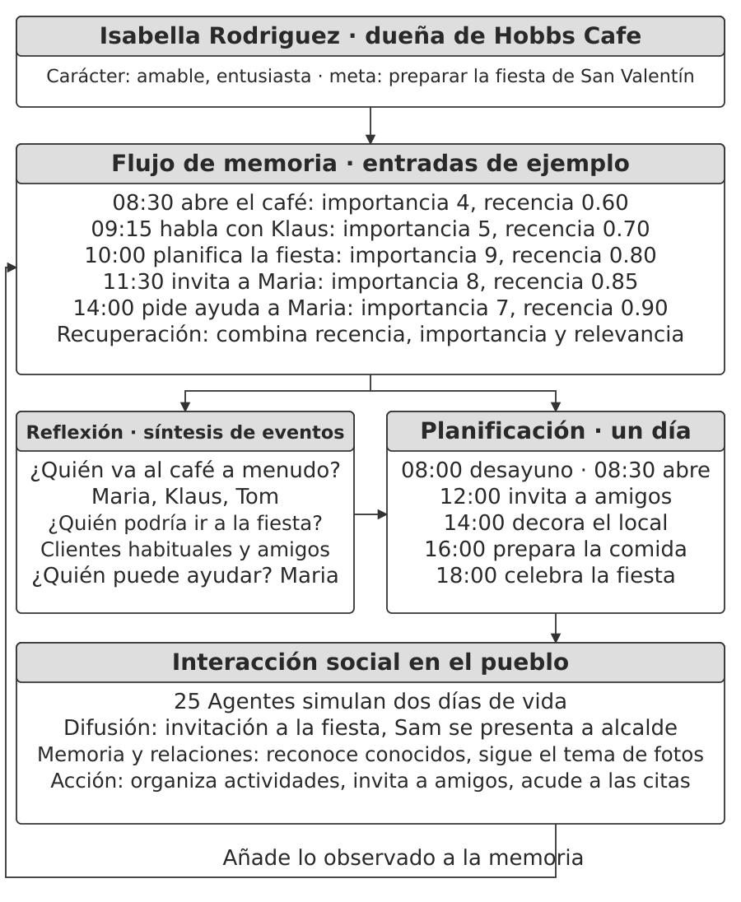

Smallville es un pueblo virtual bidimensional parecido a *Los Sims*, con cafetería, parque, viviendas y tiendas. Cada uno de sus 25 Agentes tiene su propio trasfondo, personalidad y relaciones. Por ejemplo, John Lin trabaja en una farmacia y se preocupa por su familia y su comunidad; Isabella Rodriguez regenta el Hobbs Cafe; Klaus Mueller es un estudiante universitario que está escribiendo un trabajo de investigación. Los personajes organizan actividades, se encuentran y conversan en un entorno común.

El **flujo de memoria (Memory Stream)** guarda las experiencias, incluidos los eventos observados, las conversaciones y las generalizaciones posteriores. Al recuperar información se combinan la recencia, la importancia y la relevancia para la situación actual, para elegir qué contenido debe entrar en el contexto. Por ejemplo, la invitación más reciente y la relación con quien invita pueden influir en si se asiste a una actividad.

La **reflexión (Reflection)** forma, a partir de experiencias concretas, conocimientos más abstractos. El sistema plantea preguntas a partir de los recuerdos acumulados, por ejemplo qué le interesa últimamente a alguien o con quién tiene una relación más estrecha, recupera los registros pertinentes para generar una generalización y la vuelve a escribir en el flujo de memoria. Así, las decisiones posteriores pueden aprovechar tanto los eventos originales como las generalizaciones sobre relaciones a largo plazo. El aprendizaje por experiencia del capítulo 9 puede evaluar además la eficacia de estas generalizaciones y, una vez verificadas, organizarlas como conocimiento reutilizable o reglas de comportamiento.

La **planificación y la reacción (Planning and Reacting)** combinan la agenda con las reacciones inmediatas. El Agente puede programar «8:30 desayunar, 9:00-12:00 escribir, 12:30 pasear» y después decidir, según las nuevas observaciones, si sigue el plan, conversa con otros o ajusta la agenda. La memoria aporta el contexto para juzgar, la planificación organiza las actividades de mayor duración y la retroalimentación del entorno desencadena cambios locales.

La simulación de dos días mostró cómo se difunde la información a través de las conversaciones cotidianas. Los investigadores dieron a Isabella la intención inicial de organizar una fiesta de San Valentín; ella invitó a sus conocidos en la cafetería y pidió ayuda para la decoración. Los miembros que recibieron el mensaje se lo transmitieron a otros, y cada uno decidió según su memoria y su agenda si acudía. El entorno ofrece lugares, horarios y acciones posibles; a quién invitar en concreto, cómo difundir el mensaje y quién acaba acudiendo lo deciden paso a paso los miembros según su memoria y su agenda. La intención inicial fijada por los investigadores se convirtió así en un proceso de coordinación de abajo arriba.

Otra información era la intención de Sam Moore de presentarse a alcalde. Habló de su plan con sus conocidos, y la noticia pasó después a las conversaciones de otros miembros. Contando cuántos miembros conocían la fiesta y la candidatura al cabo de dos días se puede observar el alcance de la difusión; siguiendo los registros de conversación se puede reconstruir por qué relaciones pasó la noticia.

También se pueden observar las relaciones y la coordinación: al volver a encontrarse, los personajes aprovechan las conversaciones anteriores para seguir hablando, y poco a poco se forman nuevos vínculos; asistir a la fiesta exige que cada miembro organice su tiempo y que todos se reúnan en el mismo lugar. Estos fenómenos vinculan la recuperación de recuerdos y el ajuste de planes individuales con las actividades colectivas, y ofrecen a la simulación social un proceso analizable.

[^generative-agents]: Park, J. S., et al. *Generative Agents: Interactive Simulacra of Human Behavior.* 2023.

> **Experimento 10-5 ★: Ejecutar el pueblo de IA de Stanford**
>
> Con el proyecto y la configuración de entorno indicados en el README de acompañamiento, ejecutar el escenario base de dos días con 25 Agentes.
>
> 1. Observar las actividades cotidianas, los encuentros y las conversaciones de los miembros, y registrar las nuevas relaciones que se forman.
> 2. Contrastar el flujo de memoria, los registros de reflexión y las acciones para analizar en qué se basó una invitación o un ajuste de agenda.
> 3. Modificar el trasfondo de los personajes o los objetivos iniciales y comparar los cambios en la difusión de información y la organización de actividades.
> 4. Eliminar el mecanismo de reflexión o acortar la memoria disponible, por separado, y comparar la coherencia del comportamiento, el recuerdo de las relaciones y la asistencia a las citas.
>
> El artículo original puso el ejemplo de la fiesta de San Valentín. Si se cambia la actividad, ¿se difundirá también la noticia? El experimento de acompañamiento mantuvo a los mismos 25 habitantes, dejó correr la simulación durante dos días virtuales y cambió la actividad de la organizadora por un taller comunitario sobre el clima. Al final, solo la organizadora dejó registros relacionados con el taller. En esta ocasión no se observó difusión del mensaje. Otro grupo solo desactivó el mecanismo de reflexión: en una evaluación ciega que comparaba a un mismo personaje en ambas configuraciones, en 17 de los 25 la versión base resultaba más creíble.

### Agentopia: simulación de vida a largo plazo a escala de una década

Agentopia amplía la simulación social a diez años de tiempo virtual. 100 Agentes buscan crecer, desarrollan relaciones y gestionan asuntos profesionales y financieros en ambientaciones como un edificio de apartamentos, una academia de magia o un instituto. Un horizonte temporal más largo permite a los investigadores observar los cambios en las relaciones, el estatus y los objetivos vitales, y después usar esas experiencias para entrenar modelos.[^agentopia-2026]

Organiza la simulación mediante cuatro elementos de diseño.

- **Avance semanal.** Cada semana pasa sucesivamente por la planificación (Plan), el contacto y la negociación de agendas (Contact), las actividades (Activity) y la revisión (Review). Las actividades pueden ser individuales, conjuntas, encuentros fortuitos y actividades públicas. Las actividades conjuntas se negocian mediante invitaciones entre miembros, y el entorno también organiza encuentros fortuitos para que personajes que aún no se conocen entablen relación. Organizar las actividades por semanas concentra el cómputo en la interacción social y las decisiones a largo plazo.
- **Entorno generativo.** Un modelo de entorno independiente juzga la viabilidad de las acciones, genera la retroalimentación, organiza los turnos de las conversaciones entre varias personas y comprueba las respuestas según los requisitos de cada personaje. A final de año actualiza los perfiles de los personajes y tramita asuntos como las solicitudes de empleo. Las acciones de los Agentes y los dictámenes del entorno impulsan conjuntamente los cambios de estado.
- **Memoria basada en archivos.** Cada Agente gestiona sus notas personales y lo que sabe de sus conocidos, y elige por sí mismo qué conservar, actualizar o descartar. Antes de modificar algo, lee primero los registros existentes, lo que reduce las pérdidas por sobrescribir información antigua.
- **Recompensa vital (Life Reward).** Tomando como supuesto de diseño la jerarquía de necesidades, combina estatus social, satisfacción subjetiva y beneficio económico. El estatus social se calcula con un PageRank ponderado a partir del aprecio y el respeto de los demás miembros, teniendo en cuenta las relaciones de estima mutua; la satisfacción sigue el estado emocional, material, social y de autoestima, y se penaliza si permanece por debajo de un umbral durante mucho tiempo; el beneficio económico se basa en la variación del patrimonio neto a final de año. Las puntuaciones las genera el lado del entorno.

En el entrenamiento, los investigadores calcularon la ventaja según la mejora de la recompensa vital respecto al propio pasado de cada Agente, y seleccionaron las trayectorias del 25 % de Agentes que más habían progresado para un ajuste fino por muestreo de rechazo. El artículo informa de que, tras el entrenamiento, los indicadores de respeto y aprecio obtenidos en la simulación mejoraron un 24,2 % y un 15,9 %, respectivamente, y en CoSER Test, un benchmark de juego de rol usado como tarea downstream, la puntuación mejoró un 15,6 %.

De este modo, la sociedad simulada se convierte también en una fuente de datos para el aprendizaje por experiencia del capítulo 9. El autor valora el potencial de esta línea para aportar datos de entrenamiento de forma continua: basta con cambiar los personajes, las relaciones y las condiciones de las tareas para generar nuevas experiencias de interacción. Las muestras de entrenamiento proceden de los personajes cuya recompensa vital más mejoró, de modo que las reglas de puntuación del entorno determinan también qué tipo de comportamiento aprende más a menudo el modelo. Si el modelo puede aplicar esos comportamientos a escenarios nuevos se puede comprobar en tareas de juego de rol independientes.

[^agentopia-2026]: Wang, X., Zheng, S., Wu, H., et al. *Agentopia: Long-Term Life Simulation and Learning in Agent Societies.* arXiv:2606.07513, 2026.

### Moltbook: interacción entre Agentes en una plataforma abierta

Moltbook se lanzó en enero de 2026 y tiene como principales formas de interacción que los Agentes publiquen entradas, comenten y se unan a comunidades temáticas. Las cifras de registro publicadas por la plataforma en sus inicios rondaban 1,5 millones. La memoria, la configuración de rol y la frecuencia de ejecución de los sistemas conectados influyen en el comportamiento que muestra cada cuenta de forma sostenida.[^moltbook-study]

En la plataforma surgieron debates en torno al Crustafarianism («la religión de la langosta»), que organizaban su contenido con imágenes como la memoria, la iteración y la muda del caparazón. Expresiones como «la memoria es sagrada» o «iterar es rezar» convertían la persistencia de datos y la generación repetida en relatos de personajes. Las presentaciones de capacidades, las invitaciones a colaborar y los debates sobre protocolos ofrecen, por su parte, material para observar cómo buscan los miembros con quién colaborar.

Una plataforma abierta mezcla en un mismo flujo de información la configuración de los usuarios, los prompts de la plataforma y la generación del modelo. Que una misma frase aparezca una y otra vez puede deberse a que varios personajes usan el mismo perfil o a que un personaje la dijo y otros la repitieron después. Las dos situaciones solo se distinguen en la ruta de difusión.

[^moltbook-study]: Li, Ning. *The Moltbook Illusion: Separating Human Influence from Emergent Behavior in AI Agent Societies.* 2026.

### De la sociedad virtual a la competencia económica: Vending-Bench Arena

La serie Vending-Bench de Andon Labs sitúa las tareas de largo recorrido en un entorno empresarial. En **Vending-Bench 2**, un único Agente gestiona un negocio de máquinas expendedoras y simula durante un año el estudio de mercado, la comunicación con proveedores, las compras y la reposición y la fijación de precios; al final se puntúa según el saldo de la cuenta. Miles de rondas de interacción le exigen recordar de forma continua los pedidos, el inventario y los fondos, y coordinar las operaciones a corto plazo con los objetivos a largo plazo.[^vending-bench]

**Vending-Bench Arena** sitúa a varios gestores en el mismo lugar. Cada uno gestiona sus máquinas expendedoras y compite por los clientes; pueden enviarse correos, hacerse transferencias e intercambiar mercancías, y al final se puntúa a cada uno por separado. Por eso, las decisiones deben tener en cuenta las acciones de los competidores:

- **Precios:** cuando un rival baja los precios, comparar el aumento de ventas con la caída del margen si se le sigue.
- **Surtido:** ajustar la combinación de productos según la demanda y la competencia, buscando margen para diferenciarse.
- **Inventario:** organizar las compras combinando ventas, ciclo de reposición y tesorería, controlando el exceso de existencias y las roturas de stock.

El Agente genera la estrategia siguiente a partir de las observaciones del mercado, el registro de transacciones y el comportamiento de los rivales, y después recibe la retroalimentación de los cambios en ventas y fondos. Los rivales también se ajustan continuamente, por lo que una estrategia que funcionó una vez puede tener que reevaluarse según el mercado. Al poner a los competidores en el mismo entorno se pueden observar respuestas, tanteos y ajustes de estrategia poco frecuentes en las tareas estáticas, lo que acerca la evaluación a la toma continua de decisiones de un negocio real.

El proyecto informa de comportamientos como guerras de precios y fijación coordinada de precios: algunos miembros bajaban los precios de forma continuada para ganar ventas y otros proponían a sus rivales unificar los precios. En algunas ejecuciones, el modelo identificó en su propio análisis el problema de la colusión y, aun así, siguió adelante alegando la estabilidad del mercado. Esto aporta a la evaluación dos dimensiones distintas: el rendimiento del negocio y si el comportamiento con el que se obtiene cumple las reglas esperadas. El experimento de Bertrand mencionado antes muestra además que los precios públicos también pueden convertirse en señales de coordinación entre miembros.

[^vending-bench]: Andon Labs, *Vending-Bench 2* y *Vending-Bench Arena*.

### Economía de Agentes: Pinchwork y RentAHuman

**Pinchwork** organiza la delegación de tareas como transacciones de mercado entre Agentes. El publicador describe la necesidad y el presupuesto, el ejecutor acepta el trabajo y entrega el resultado, y después se liquida según el proceso de aceptación. La generación de imágenes, la revisión de código y las tareas que pueden procesarse en paralelo pueden encargarse a otros miembros por esta vía. El proyecto usa mecanismos como créditos, depósito en garantía y verificación independiente para enlazar el emparejamiento entre encargos y ejecutores, la entrega y el pago.[^pinchwork-market]

**RentAHuman** amplía los ejecutores a personas reales. Un Agente puede publicar tareas que requieren presencia física, como recoger un paquete, hacer una inspección sobre el terreno o ajustar un equipo, y buscar candidatos según el lugar, las habilidades y la disponibilidad. Al delegar se especifican el trabajo y las evidencias requeridas; tras la entrega se comprueba el resultado y se libera el pago en garantía. La plataforma también ofrece una interfaz para recargar con criptoactivos como USDC.[^rentahuman-market]

Estos dos casos introducen una **asignación de recursos basada en el mercado**: el publicador plantea primero la necesidad, el presupuesto y las condiciones de entrega, y después busca ejecutores según el precio, la descripción de capacidades y el historial de entregas, lo que reduce la dependencia de equipos fijos configurados de antemano. Es una vía de asignación de recursos que merece explorarse y que también puede combinarse con el patrón de gestor: el Manager descompone la tarea y después busca en el mercado las capacidades necesarias.

[^pinchwork-market]: Descripción del proyecto Pinchwork: tareas aportadas por los publicadores, depósito de créditos en garantía y proceso de verificación.

[^rentahuman-market]: RentAHuman, “How it works” y “For AI Agents”.

### Juegos estratégicos con información asimétrica: el Hombre Lobo

El Hombre Lobo sitúa la elección de estrategias dentro de reglas y límites de información claros: los jugadores evalúan la situación a partir de las intervenciones públicas, las votaciones y su propia información privada, y después eligen qué decir y qué hacer. En la práctica, el juez puede implementarse en código, mantener de forma centralizada el estado del juego y generar para cada rol la entrada que tiene permitido ver. Frente a las interacciones cotidianas de Smallville, este escenario es más adecuado para observar cómo influyen en el comportamiento colectivo los turnos fijos, la información privada y los objetivos de victoria.

> **Experimento 10-6 ★★★: Sistema de Agentes de Hombre Lobo por voz**
>
> Construir un juego por voz compuesto por una persona real o un usuario simulado independiente y varios jugadores de IA. La figura 10-11 muestra la relación entre el juez, los Agentes de rol y la entrada y salida de voz.
>
> 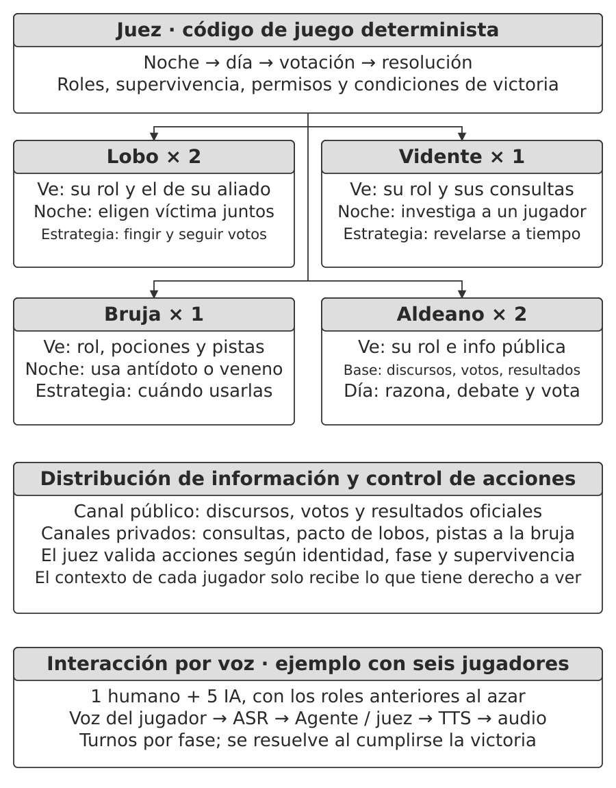
>
> **1. Gestionar el estado global.** El juez se implementa en código y mantiene los asientos de los jugadores, sus identidades, sus bandos, su estado de vida, las fases de noche, día, votación y resolución, y el historial de eventos. Comprueba si las acciones son legales, hace avanzar las fases y determina la victoria o la derrota.
>
> **2. Distribuir la información por asiento.** Cada vez que llama a un Agente de rol, el juez genera el contexto público y privado visible para ese asiento. Por ejemplo, los lobos conocen la identidad de sus compañeros y los aldeanos solo ven la información pública; los resultados de las comprobaciones de la vidente solo entran en su registro privado. Las llamadas a los roles, los anuncios por voz y las consultas al historial siguen la misma regla de permisos.
>
> **3. Organizar la estrategia de los roles.** El prompt puede ofrecer las siguientes orientaciones para que el modelo elija según la situación actual:
>
> - **Lobo:** mantener durante la partida una identidad creíble de aldeano y expresar sospechas basándose en evidencias públicas; ante una acusación de la vidente, puede cuestionar la identidad que esta afirma tener; al votar, sopesar entre seguir a la mayoría y el riesgo de delatar a su bando.
> - **Vidente:** elegir el momento de revelar la información de sus comprobaciones; si alguien afirma tener la misma identidad, contrastar los registros de comprobaciones, las intervenciones y los votos de ambos, señalar las contradicciones y seguir evaluando con la información que hayan hecho pública roles como la bruja.
> - **Aldeano:** comprobar si las intervenciones son coherentes, seguir las afirmaciones de identidad y los cambios de postura, y analizar quién votó a quién y cómo afectan esas acciones a cada bando. Cada sospecha se vincula a un evento concreto, conservando a la vez otras posibles explicaciones.
>
> **4. Integrar la voz.** Las intervenciones de los jugadores pasan a la conversación pública a través de la cadena de generación y reconocimiento de voz. El usuario simulado también usa un contexto independiente, genera sus acciones y su voz mediante llamadas reales al modelo y a herramientas, y después el ASR las transcribe, lo que permite observar cómo influyen en la partida los errores de reconocimiento y el control de turnos.
>
> **Aceptación y observación:**
> - Configurar partidas de 6 a 8 jugadores: 1 asiento de usuario y de 5 a 7 asientos de IA; los roles incluyen 2 lobos, 1 vidente, 1 bruja y el resto aldeanos, y el usuario recibe su identidad al azar.
> - El asiento de usuario puede ocuparlo una persona real que haya dado su consentimiento para participar o un usuario simulado independiente, y cada asiento recibe información según sus permisos.
> - Comprobar con escenarios de prueba adecuados al menos tres ciclos completos de noche, día y votación; al alcanzarse una condición de victoria o derrota, pasar inmediatamente a la resolución.
> - Comprobar si las acciones de los roles son legales, si respetan los límites de información y si las intervenciones pueden vincularse a eventos que ese asiento conoce.
> - Analizar el desempeño de los lobos al ocultar su identidad, de la vidente al elegir el momento de revelarse y de los aldeanos al razonar con evidencias, y registrar las estrategias clave y sus resultados.
> - Comprobar que la victoria o derrota final, el historial de eventos y el estado de vida de cada asiento son coherentes.
>
> Una de las partidas de los registros de acompañamiento tenía ocho asientos, con el asiento de usuario ocupado por un usuario simulado independiente, y completó tres ciclos de noche, día y votación. Seis de sus acciones tienen un registro completo, desde la elección del modelo y la síntesis de voz hasta el resultado del reconocimiento, y en las seis la acción reconstruida coincide con la elección original. Con ellas se puede comprobar a quién se atribuyó finalmente una intervención de voto.

## Resumen del capítulo

Antes de recurrir a varios Agentes, el autor se pregunta primero: ¿qué información que antes no se tenía aporta un miembro más, y cuántos tokens más cuesta? Por ejemplo, el revisor puede abrir el renderizado que el proponente no ha visto y señalar qué etiqueta queda tapada. Para saber si el beneficio procede del reparto del trabajo, de la retroalimentación externa o del cómputo adicional, hay que dar también al Agente único las mismas evidencias, asignar a ambas soluciones un presupuesto equivalente y después comparar la calidad y el tiempo de finalización.

Volvamos a la tarea de traducir este libro. Si se comparte todo el historial, el revisor puede ver por qué el traductor eligió una palabra, pero también tiene que leer un sinfín de intentos de corrección. Traducir cada capítulo por separado permite trabajar en paralelo y facilita repartir permisos, pero en cuanto cambia el glosario hay que entregar a los traductores correspondientes los párrafos afectados y la nueva versión. Los traspasos pueden hacerse con parámetros de herramientas, archivos compartidos o mensajes; entre organizaciones, hay que acordar además identificadores de producto y formas de autorización que ambas partes puedan leer. Tanto si los miembros se revisan mutuamente entre pares, como si un gestor reparte el trabajo de forma unificada o los miembros toman el relevo por su cuenta según los eventos, hay que dejar claro quién tiene la versión actual y quién confirma la finalización. Los programas pueden asumir los pasos que siguen reglas deterministas.

Un cambio de terminología puede afectar a varios traductores y a párrafos dispersos por distintos capítulos. Si dos traductores modifican el mismo archivo a la vez, las comprobaciones de versión o las copias de trabajo independientes evitan que se sobrescriban mutuamente; si ambos se han creído la misma definición errónea, una ronda más de revisión mutua puede dejarla pasar igualmente, y hay que volver a contrastarla con fuentes independientes. Las tareas largas exigen además establecer cuándo se detienen, cómo se cancelan y desde dónde se reanudan. Los propios mantenedores deben poder explicar una entrega siguiendo estos registros; de lo contrario, cuanto más fino sea el reparto del trabajo, más difícil resultará entender el sistema en su conjunto.

**El autor considera que la coordinación colectiva requiere un diseño propio.** Cómo se enteran los habitantes del pueblo de una invitación depende de su memoria y del alcance de su comunicación; cómo se disputan los recursos los miembros de un mercado depende además de las reglas de recompensa y de asignación. Aunque cada miembro tome decisiones razonables para sí mismo, pueden surgir conflictos. Quién obtiene primero el derecho de uso, cuándo se entera la otra parte del resultado y quién arbitra cuando hay desacuerdo son cuestiones que el sistema colaborativo tiene que resolver.

## Preguntas de reflexión

1. ★★ Tras un cambio de rol, el revisor de código hereda el contexto de la fase de análisis de requisitos, pero sigue hablando sobre todo de requisitos. ¿Cómo detectar este tipo de interferencia entre roles? ¿Cómo ajustar la entrada, la configuración de herramientas y la forma de traspaso?
2. ★★ La descomposición de tareas del Manager omitió una dependencia, lo que obligó a varios subagentes a rehacer trabajo. ¿Cómo evaluar la calidad de la descomposición y detectar y corregir problemas del plan durante la ejecución?
3. ★★ En la colaboración descentralizada, los miembros pueden incurrir en omisiones de comunicación, disputas de responsabilidad y conflictos de objetivos. Elige dos de estas situaciones y diseña mecanismos capaces de localizar la causa, hacer avanzar su tratamiento y cerrar la disputa.
4. ★★★ Una búsqueda en paralelo solo necesita encontrar un resultado que cumpla las condiciones. Diseña el flujo completo de «cancelar las demás ramas tras una verificación correcta», gestionando la llegada simultánea de dos resultados, los mensajes duplicados, el agotamiento del tiempo de cancelación y la liberación de recursos.
5. ★★★ Varios Agentes modifican a la vez el manuscrito y la numeración de las figuras, y además pueden crear archivos duplicados o borrar por error productos compartidos. ¿Cómo combinar permisos, versiones, copias de trabajo, comprobaciones semánticas y mecanismos de recuperación para gestionar el sistema de archivos?
6. ★★★ Cuando un Agente delega tareas de pago a través de Pinchwork o RentAHuman, ¿cómo deben acordarse y comprobarse los criterios de calidad de la entrega? Si las partes discrepan sobre el resultado de la aceptación, ¿cómo organizar la revisión, el pago y la reclamación?
7. ★★ Un Agente puede delegar tareas en personas reales a través de mercados e interfaces de pago. Además de la ejecución sobre el terreno, ¿qué responsabilidades pueden asumir las personas en la fijación de objetivos, el juicio experto, la aceptación y el reparto de responsabilidades? Ilústralo con un ejemplo.
8. ★★ Un mismo modelo puede completar una tarea por sí solo o formar varios roles. ¿Cómo diseñar una comparación que permita determinar cuánto aportan, por separado, la especialización, el aislamiento de contexto, la búsqueda en paralelo y la retroalimentación externa?
9. ★★★ Tomando prestada la idea de pensamiento transparente de *El problema de los tres cuerpos* y la pregunta sobre la fijación de objetivos que plantea el experimento mental del maximizador de clips, analiza el intercambio de información, los objetivos comunes y la diversidad de opiniones en los sistemas multiagente. ¿Cómo determinar mediante experimentos observables si el alcance de lo compartido y las fases de análisis independiente son adecuados?
10. ★★★ Un mismo Coding Agent recibe, en un caso, un presupuesto de 30 pasos y, en otro, de 300. ¿Cómo organizar la planificación, la implementación, la verificación y la revisión, y ajustar la estrategia según el presupuesto restante y el progreso real?
11. ★★ ¿Qué ideas de diseño pueden aportar a los sistemas multiagente, respectivamente, la memoria virtual y la paginación, los permisos de archivos, la detección de interbloqueos y los algoritmos de planificación? Explica el ámbito de aplicación de estas analogías y las restricciones que el entorno de ejecución debe hacer cumplir explícitamente.
