# Ingeniería de contexto

El capítulo 1 comparó el contexto con el «horizonte de decisión actual» del Agente: cada vez que el modelo toma una decisión, se basa en la información que recibe en ese momento. La **ingeniería de contexto** (Context Engineering) se encarga de seleccionar, organizar y actualizar esa información, que incluye las instrucciones del sistema, las definiciones de herramientas, las peticiones del usuario, el historial de mensajes y el estado de la tarea. Antes de cada llamada al modelo, el Harness debe convertir el trasfondo de la tarea y sus avances más recientes en una entrada. La figura 2-1 muestra con contenido concreto cómo se compone la ventana de contexto.

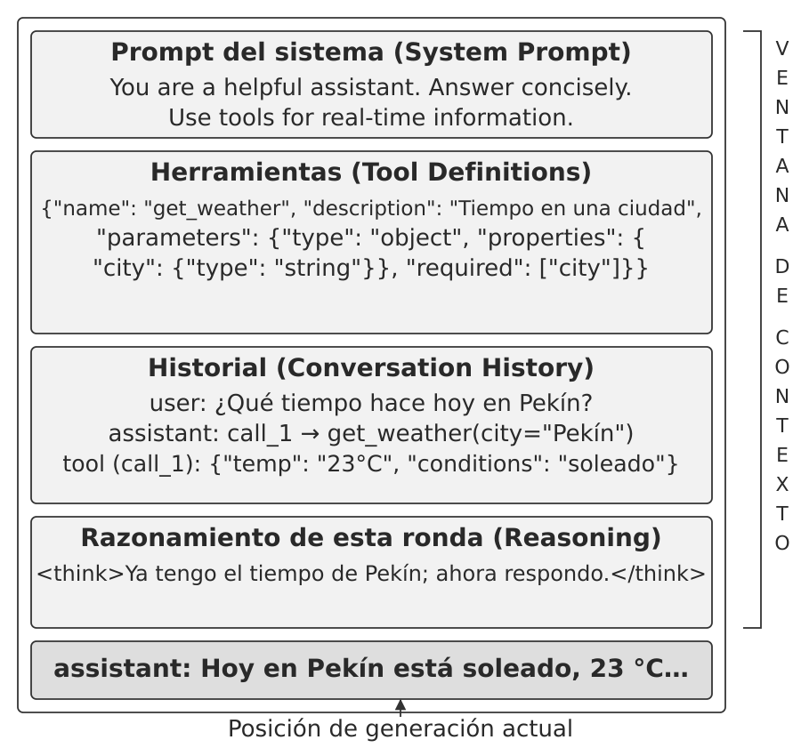

## Contexto: poner las capacidades del modelo al servicio de una tarea concreta

Imagina que una ingeniera con mucha experiencia acaba de incorporarse al equipo y su primer encargo es «modificar la configuración según nuestras normas». Sabe programar, pero todavía no sabe qué archivo es el origen real de la configuración, qué campos pueden cambiarse ni cómo comprobar el resultado. Aunque le entreguen todo el código, puede acabar modificando el archivo equivocado. Cuando un Agente se hace cargo de un proyecto desconocido, le falta exactamente ese mismo trasfondo.

Ante una petición como «ayúdame a corregir este error», un Coding Agent necesita normalmente tres tipos de información de fondo:

- **Contexto de código en tiempo real**: la estructura de directorios, las responsabilidades de cada módulo, las estructuras de datos centrales y las convenciones de código. Por ejemplo, si se modifica un archivo de configuración generado automáticamente, el cambio funcionará en local, pero desaparecerá la próxima vez que se genere el archivo. Solo sabiendo qué módulo lo genera se encuentra el lugar que de verdad hay que cambiar.
- **Normas de proceso**: la estrategia de ramas de Git, las convenciones de commit, el proceso de revisión de código y los requisitos de CI/CD. Con ellas, el Agente organiza la modificación, las pruebas y el commit, y el sistema de ejecución lleva a cabo esas operaciones según los permisos concedidos.
- **Información del entorno**: la configuración de desarrollo, la forma de conectarse a la base de datos de pruebas, el modo de desplegar en el entorno de pruebas y la gestión de las claves de API. Esta información le ayuda a elegir el entorno de ejecución correcto y a entender en qué se diferencian el entorno local y el de pruebas.

El código del proyecto y la base de datos de pruebas están fuera del contexto del modelo. En el ejemplo de la configuración generada automáticamente, el Agente solo sabe por dónde empezar a cambiar después de leer el script generador mediante una herramienta de búsqueda. **La calidad del contexto determina si el modelo puede aplicar las capacidades que ya tiene al problema actual.** **En tareas que dependen de mucha información de fondo, un modelo suficientemente capaz con un contexto completo y preciso puede rendir más que un modelo más potente al que le faltan los datos necesarios.**

**Construir un equipo nativo de IA empieza por documentar el conocimiento clave.** Si solo los empleados veteranos recuerdan por qué se eligió cierta base de datos, y un cambio en las reglas de negocio solo se mencionó en un chat privado, tanto una persona recién llegada como un Agente se toparán con el mismo problema: el código muestra lo que hizo el equipo, pero no por qué lo hizo así.

**Los equipos que funcionan bien en remoto suelen funcionar bien también con Agentes.** Los desarrolladores del núcleo de Linux discuten los parches e intercambian revisiones en listas de correo, y la documentación del proceso de desarrollo explica cómo se envían, revisan y fusionan los parches[^ch2-linux]. Quien se incorpora y encuentra un cambio inesperado puede seguir el parche hasta la discusión de entonces; un Agente que necesite verificar el trasfondo también puede aprovechar ese registro.

Tras escuchar la entrevista de Jiayi Weng en WhynotTV, el autor resume una de sus ideas así: **tanto las personas como los modelos dependen del Contexto.** Una persona puede preguntar a un compañero que participó en la decisión; en cambio, la información de fondo que puede leer un modelo depende de lo que el equipo haya dejado registrado y de lo que el Harness haya incluido en esa petición concreta.[^ch2-weng]

[^ch2-linux]: Documentación oficial del núcleo de Linux, How the development process works.

[^ch2-weng]: WhynotTV, «翁家翌：OpenAI，GPT，强化学习，Infra，后训练，天授，tuixue，开源，CMU，清华» [Jiayi Weng: OpenAI, GPT, aprendizaje por refuerzo, infraestructura, posentrenamiento, Tianshou, tuixue, código abierto, CMU, Tsinghua], Podcast #4.

El artículo de ReAct describe con una expresión formal cómo interviene el historial de interacción en las decisiones[^ch2-react]. En el instante $t$, el Agente recibe del entorno una observación $o_t\in\mathcal{O}$ y elige una acción $a_t\in\mathcal{A}$ según la política $\pi(a_t\mid c_t)$, donde el contexto es:

$$
c_t=(o_1,a_1,\ldots,o_{t-1},a_{t-1},o_t)
$$

Esta expresión indica que **la siguiente acción del Agente depende del historial de interacción acumulado hasta el momento actual.** Por ejemplo, qué archivos ha consultado el Agente o qué errores han devuelto las herramientas influye en su siguiente elección. En un Agente basado en LLM, la entrada del usuario y los resultados de las herramientas aportan observaciones, mientras que las llamadas a herramientas y las respuestas dirigidas al exterior registran las acciones; las instrucciones del sistema y las definiciones de herramientas explican además las reglas de la tarea y las interfaces disponibles.

Este capítulo parte de un modo de petición sin estado: en cada ronda, el Harness ensambla los mensajes y las definiciones de herramientas y después llama al modelo. Conservar el historial completo de mensajes facilita mantener el progreso de la tarea; a medida que el historial crece, la recuperación, el registro de estado y la compresión permiten mantener dentro de la ventana la información que necesitan las decisiones posteriores. La disposición del contexto, la barra de estado y las técnicas de compresión giran en torno a una misma pregunta: ¿cómo meter en $c_t$, dentro de un contexto limitado, la información que el modelo necesita en este paso?

[^ch2-react]: Yao, Shunyu, et al., ReAct: Synergizing Reasoning and Acting in Language Models, ICLR 2023.

## Cómo invoca un Agente al modelo: la estructura del contexto en la API

Empezaremos con un simple saludo para ver el formato de los mensajes y, después, veremos cómo la pregunta «¿qué hora es y qué tiempo hace ahora en Vancouver?» desencadena dos llamadas a herramientas. Esta sección usa una interfaz compatible con Chat Completions y Qwen3-0.6B ejecutándose en local; al final, enlazaremos las peticiones de cada ronda con Python[^ch2-chat-api].

### Los cuatro roles de mensaje del ejemplo

La **lista de mensajes** (`messages`) de la petición guarda la información de la interacción en orden. Cada mensaje lleva un **rol** (`role`) que indica su procedencia y su función. Esta sección utiliza cuatro roles:

- **system**: el prompt del sistema. Aquí contiene la identidad, las reglas de comportamiento y las restricciones aportadas por el desarrollador, y se sitúa al principio de la lista de mensajes. Algunas interfaces de modelos usan el rol `developer` para las instrucciones del desarrollador.
- **user**: el mensaje del usuario, que contiene la tarea, las preguntas de seguimiento y los requisitos adicionales.
- **assistant**: la respuesta del modelo, que incluye texto y solicitudes de llamada a herramientas. Al devolver estos mensajes a la entrada de la siguiente ronda, el modelo puede leer sus respuestas y solicitudes de operación anteriores.
- **tool**: el resultado de una herramienta. Cuando el Harness recibe el valor devuelto, lo escribe como mensaje de herramienta y lo asocia a la llamada concreta mediante `tool_call_id`.

Las definiciones de herramientas se envían en el campo `tools` del nivel superior de la petición, que enumera el nombre, la finalidad y el formato de parámetros de cada herramienta disponible.

El modelo construye la solicitud de llamada a partir de las definiciones de herramientas. Si puede o no ejecutarse esa operación lo deciden el Harness y el entorno de ejecución.

[^ch2-chat-api]: OpenAI, referencia de la API Chat Completions, que describe los roles de mensaje, las definiciones de herramientas y los campos de resultado de las llamadas; Qwen, Function Calling, que describe las llamadas a herramientas y las plantillas en servicios compatibles.

### Conversación de un solo turno: la llamada a la API más sencilla

Empecemos con una pregunta y una respuesta. El usuario pregunta «Hello, who are you?», y el Harness envía al modelo las instrucciones del sistema junto con la pregunta del usuario y luego lee la respuesta. La figura 2-2 muestra la correspondencia entre la petición y la respuesta.

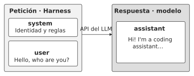

A continuación se muestran la petición y una respuesta de ejemplo con la interfaz del modelo local; los comentarios del código indican de dónde procede cada parte:

```javascript
// El Harness construye la petición
{
  "model": "Qwen3-0.6B",
  "messages": [
    {
      "role": "system",                           // Instrucciones aportadas por el desarrollador
      "content": "You are a helpful coding assistant. Follow user instructions."
    },
    {
      "role": "user",                              // Entrada del usuario
      "content": "Hello, who are you?"
    }
  ]
}
```

```javascript
// La API devuelve la respuesta
{
  "choices": [{
    "message": {
      "role": "assistant",                         // Generado por el modelo
      "content": "Hi! I'm a coding assistant. I can help you write code, debug issues, and explain technical concepts. How can I help?"
    }
  }]
}
```

La petición contiene un mensaje `system` y un mensaje `user`, y `choices[0].message` en la respuesta guarda el mensaje `assistant` generado por el modelo. Con la interfaz sin estado que se usa aquí, **el Harness es responsable de proporcionar en cada llamada el contexto necesario**. Si la siguiente petición debe continuar esta conversación, tiene que incluir el historial pertinente.

### Interacción de varios turnos con llamadas a herramientas: el bucle central del Agente

Veamos ahora una pregunta que requiere herramientas: «What's the current time and weather in Vancouver?». Para responderla, primero hay que consultar la hora y el tiempo del lugar. En la figura 2-3, la primera llamada del Harness al modelo devuelve dos solicitudes de herramienta. El Harness consulta por separado el servicio de hora y el servicio meteorológico, añade ambos resultados al historial de mensajes y llama al modelo por segunda vez; solo entonces obtiene la respuesta para el usuario.

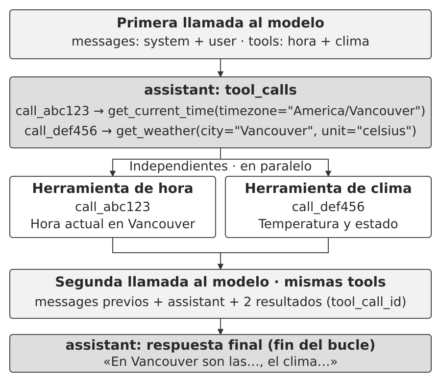

¿Cuál de las dos herramientas se ejecuta primero? La herramienta de hora necesita una zona horaria, y la meteorológica, una ciudad y una escala de temperatura. El usuario solo ha dicho Vancouver; a partir de ahí, el modelo del ejemplo rellena `America/Vancouver` y `Vancouver`, y elige grados Celsius. Para consultar el tiempo no hace falta esperar a la herramienta de hora, así que ambas consultas pueden lanzarse a la vez.

**Primera llamada a la API: el framework del Agente envía la petición inicial:**

```javascript
// Primera llamada al modelo: el Harness construye la petición
{
  "model": "Qwen3-0.6B",
  "messages": [
    {
      "role": "system",                           // Instrucciones aportadas por el desarrollador
      "content": "You are a helpful assistant. Use the provided tools to get real-time information when needed."
    },
    {
      "role": "user",                              // Entrada del usuario
      "content": "What's the current time and weather in Vancouver?"
    }
  ],
  "tools": [                                       // Herramientas definidas por el desarrollador
    {
      "type": "function",
      "function": {
        "name": "get_current_time",
        "description": "Get the current date and time in a specific timezone",
        "parameters": {
          "type": "object",
          "properties": {
            "timezone": { "type": "string", "description": "Timezone name, e.g. America/Vancouver" }
          },
          "required": ["timezone"]
        }
      }
    },
    {
      "type": "function",
      "function": {
        "name": "get_weather",
        "description": "Get the current weather for a specific city",
        "parameters": {
          "type": "object",
          "properties": {
            "city": { "type": "string", "description": "City name" },
            "unit": { "type": "string", "enum": ["celsius", "fahrenheit"] }
          },
          "required": ["city", "unit"]
        }
      }
    }
  ]
}
```

El desarrollador define de antemano esta lista de `tools`, que incluye nombres, descripciones y el schema de parámetros. En este ejemplo, las peticiones de todas las rondas ofrecen las mismas dos herramientas; el modelo lee la lista y la pregunta del usuario y, a continuación, elige qué herramienta llamar y con qué parámetros.

**El modelo devuelve dos solicitudes de llamada a herramientas:**

```javascript
// El modelo devuelve solicitudes de llamada a herramientas
{
  "choices": [{
    "message": {
      "role": "assistant",                         // Generado por el modelo
      "content": null,                             // En esta ronda no hay respuesta de texto
      "tool_calls": [                              // Solicita llamar a dos herramientas
        {
          "id": "call_abc123",
          "type": "function",
          "function": {
            "name": "get_current_time",
            "arguments": "{\"timezone\": \"America/Vancouver\"}"
          }
        },
        {
          "id": "call_def456",
          "type": "function",
          "function": {
            "name": "get_weather",
            "arguments": "{\"city\": \"Vancouver\", \"unit\": \"celsius\"}"
          }
        }
      ]
    }
  }]
}
```

El campo `tool_calls` de la respuesta contiene dos solicitudes, cada una con su propio `id`, nombre de herramienta y parámetros. `arguments` es una cadena codificada en JSON: el lado que ejecuta debe analizarla primero y después validar los campos y sus valores. **El modelo decide qué llamar y con qué parámetros; el Harness se encarga de validar y despachar; la implementación de la herramienta accede al servicio de hora o al meteorológico.**

**El framework del Agente ejecuta las herramientas y lanza la segunda llamada a la API:**

Tras validar las solicitudes, el Harness despacha las dos herramientas, escribe los valores devueltos como mensajes `tool` y entrega al modelo el historial existente junto con los nuevos resultados:

```javascript
// Segunda llamada al modelo: se añaden los resultados de las herramientas
{
  "model": "Qwen3-0.6B",
  "messages": [
    {
      "role": "system",                           // Se conserva el mensaje de la primera petición
      "content": "You are a helpful assistant. Use the provided tools to get real-time information when needed."
    },
    {
      "role": "user",                              // Se conserva el mensaje de la primera petición
      "content": "What's the current time and weather in Vancouver?"
    },
    {
      "role": "assistant",                         // Se conservan las solicitudes del modelo en la ronda anterior
      "content": null,
      "tool_calls": [
        { "id": "call_abc123", "type": "function", "function": { "name": "get_current_time", "arguments": "{\"timezone\": \"America/Vancouver\"}" } },
        { "id": "call_def456", "type": "function", "function": { "name": "get_weather", "arguments": "{\"city\": \"Vancouver\", \"unit\": \"celsius\"}" } }
      ]
    },
    {
      "role": "tool",                              // El Harness escribe el resultado de la herramienta
      "tool_call_id": "call_abc123",
      "content": "{\"timezone\": \"America/Vancouver\", \"datetime\": \"2025-09-13T05:18:47\", \"day_of_week\": \"Saturday\"}"
    },
    {
      "role": "tool",                              // El Harness escribe el resultado de la herramienta
      "tool_call_id": "call_def456",
      "content": "{\"city\": \"Vancouver\", \"temperature\": 13.2, \"unit\": \"celsius\", \"conditions\": \"clear\", \"humidity\": 93}"
    }
  ],
  "tools": [ ... ]                                 // Se reutilizan las definiciones anteriores; se omiten aquí
}
```

Sigamos `call_def456` a lo largo de la segunda petición: en el mensaje `assistant` anterior es el identificador de la consulta meteorológica de Vancouver; el mensaje `tool` posterior usa el mismo identificador para devolver 13,2 ℃ y cielo despejado. Aunque el tiempo llegue antes que la hora, el Harness puede emparejar cada resultado con su solicitud. En esta ronda, el modelo lee a la vez la pregunta original del usuario, las dos consultas que él mismo emitió y los datos que devolvieron las herramientas. Con eso ya puede responder al usuario.

**El modelo genera la respuesta final a partir de los resultados de las herramientas:**

```javascript
// El modelo genera la respuesta final
{
  "choices": [{
    "message": {
      "role": "assistant",                         // Generado por el modelo
      "content": "It's currently 5:18 AM on Saturday, September 13, 2025 in Vancouver.\n\nWeather: 13.2°C with clear skies and 93% humidity. It's quite cool this morning - you might want to grab a jacket."
    }
  }]
}
```

La segunda respuesta contiene el texto final y `tool_calls` está vacío, de modo que el bucle del ejemplo termina. Este proceso de «llamar al modelo → ejecutar herramientas → devolver resultados → volver a llamar al modelo» es la implementación concreta en la API del bucle de ejecución del capítulo 1.

Si el usuario pregunta a continuación «¿Y en Tokio?», el Harness añade ese mensaje al final del historial y vuelve a llamar al modelo. El modelo puede aprovechar el trasfondo de la tarea —«consultar la hora y el tiempo actuales»— para generar nuevas solicitudes referidas a Tokio y, cuando las herramientas respondan, redactar una nueva respuesta.

**¿Cómo se devuelven los resultados de las herramientas con la Responses API?** El experimento local anterior usa una interfaz compatible con Chat Completions. Para proyectos nuevos sobre el servicio de OpenAI, la recomendación oficial es la Responses API. Volvamos al ejemplo de Vancouver: la aplicación coloca la pregunta del usuario en el campo `input` de la petición y declara en `tools` las dos funciones de hora y tiempo. El `output` devuelto es una secuencia de elementos tipados. Si aparecen dos `function_call`, la aplicación lee de cada uno el nombre de la función, los parámetros y el `call_id`, y ejecuta cada herramienta.[^ch2-responses-loop]

Supongamos que el identificador de la llamada a la función meteorológica es `call_weather`. El `input` de la siguiente petición puede incluir un acuse como este; la función de hora también debe devolver su resultado con su propio identificador.

```json
{"type": "function_call_output", "call_id": "call_weather", "output": "{\"temperature\": 13.2, \"unit\": \"celsius\"}"}
```

`call_id` empareja un acuse con una llamada concreta a una función. `previous_response_id` apunta a la respuesta anterior del modelo para que el servicio continúe el contexto de esa ronda. Los dos identificadores se refieren a cosas distintas. Con este modo de continuación, la ronda actual sigue teniendo que proporcionar las herramientas que se vayan a usar y las `instructions` de nivel superior; las instrucciones de nivel superior de la petición anterior no se heredan automáticamente a través del identificador de respuesta. El modelo puede seguir solicitando herramientas, así que la aplicación debe leer el siguiente `output` antes de decidir si termina. El experimento 1-3 del capítulo 1 usaba una búsqueda alojada en el servidor; aquí, en cambio, las dos funciones personalizadas las ejecuta la propia aplicación.

[^ch2-responses-loop]: OpenAI, guía de migración a la Responses API, llamadas a funciones y descripción de los parámetros para crear respuestas.

### Implementar en código el bucle central del Agente

Las dos llamadas a `messages.append` del bucle guardan, respectivamente, la respuesta del modelo y el resultado de las herramientas. Tanto la hora como la temperatura corresponden a Vancouver; si se intercambiaran los dos identificadores de llamada, en la siguiente ronda el modelo leería que «consultar la hora» devolvió 13,2 grados Celsius.

El ejemplo se conecta a un servicio compatible mediante el SDK de Python de OpenAI. La dirección predeterminada es `http://localhost:8000/v1` en la propia máquina, adecuada para un servicio local ya iniciado que no requiere autenticación. Estos valores predeterminados corresponden al backend vLLM del experimento 2-1. Si se usa el backend Ollama de ese experimento, hay que fijar la dirección en `http://localhost:11434/v1` y cambiar el nombre del modelo a `qwen3:0.6b`. Para conectarse a otros servicios, se definen según convenga las variables de entorno `LLM_BASE_URL` y `LLM_API_KEY`, y el `model` de abajo debe coincidir con el nombre desplegado. Las herramientas de hora y tiempo usan de momento los datos fijos del ejemplo anterior para poder cotejar los mensajes; al conectar datos reales, basta con sustituir la implementación de estas dos herramientas.

```python
import json
import os

from openai import OpenAI

client = OpenAI(
    base_url=os.getenv("LLM_BASE_URL", "http://localhost:8000/v1"),
    api_key=os.getenv("LLM_API_KEY", "EMPTY"),
)

# Definición de herramientas: nombre, finalidad y estructura de parámetros
tools = [
    {
        "type": "function",
        "function": {
            "name": "get_current_time",
            "description": "Get the current date and time in a specific timezone",
            "parameters": {
                "type": "object",
                "properties": {
                    "timezone": {"type": "string", "description": "Timezone name, e.g. America/Vancouver"}
                },
                "required": ["timezone"],
            },
        },
    },
    {
        "type": "function",
        "function": {
            "name": "get_weather",
            "description": "Get the current weather for a specific city",
            "parameters": {
                "type": "object",
                "properties": {
                    "city": {"type": "string", "description": "City name"},
                    "unit": {"type": "string", "enum": ["celsius", "fahrenheit"]},
                },
                "required": ["city", "unit"],
            },
        },
    },
]

# Las herramientas de ejemplo usan datos fijos; los parámetros coinciden con la consulta de Vancouver.
def execute_tool(name, arguments):
    args = json.loads(arguments)
    if name == "get_current_time" and args == {"timezone": "America/Vancouver"}:
        result = {
            "timezone": "America/Vancouver",
            "datetime": "2025-09-13T05:18:47",
            "day_of_week": "Saturday",
        }
    elif name == "get_weather" and args == {"city": "Vancouver", "unit": "celsius"}:
        result = {
            "city": "Vancouver", "temperature": 13.2,
            "unit": "celsius", "conditions": "clear", "humidity": 93,
        }
    else:
        result = {"error": "El ejemplo solo incluye la hora de Vancouver y el tiempo en grados Celsius"}
    return json.dumps(result, ensure_ascii=False)

# Mensajes iniciales: instrucciones y tarea del usuario
messages = [
    {"role": "system", "content": "You are a helpful assistant. Use tools to get real-time information when needed."},
    {"role": "user", "content": "What's the current time and weather in Vancouver?"},
]

# Bucle de ejecución: como máximo ocho llamadas al modelo
rounds = 0
while rounds < 8:
    rounds += 1
    response = client.chat.completions.create(
        model="Qwen3-0.6B", messages=messages, tools=tools
    )
    assistant_message = response.choices[0].message

    # Guardar la respuesta del modelo, incluidas las solicitudes de esta ronda
    messages.append(assistant_message.model_dump(exclude_none=True))

    # El ejemplo termina cuando el modelo responde sin llamadas a herramientas
    if not assistant_message.tool_calls:
        print(assistant_message.content)
        break

    # Ejecutar una a una y añadir los resultados; las llamadas independientes pueden despacharse en paralelo
    for tool_call in assistant_message.tool_calls:
        try:
            result = execute_tool(tool_call.function.name, tool_call.function.arguments)
        except json.JSONDecodeError:
            result = json.dumps({"error": "Los parámetros de la herramienta deben ser JSON válido"})
        messages.append({
            "role": "tool",
            "tool_call_id": tool_call.id,
            "content": result,
        })
    # La siguiente ronda usa la lista de mensajes con los resultados añadidos
else:
    print("Se alcanzó el límite de rondas sin completar la tarea.")
```

Supongamos que en la primera ronda el modelo solicita a la vez la hora y el tiempo. El bucle `for` consulta primero la hora y añade el resultado a `messages`; después consulta el tiempo y añade el segundo resultado. Solo cuando ambas consultas han terminado vuelve el programa al inicio del `while` y lanza la segunda petición al modelo. Si se despliega el contenido de `messages` en estos pasos, se ve exactamente qué recibe el modelo en cada llamada.

**Estado inicial (antes de la 1.ª llamada):**
```text
messages = [
  { role: "system",  content: "You are a helpful assistant..." },     # Escrito por el desarrollador
  { role: "user",    content: "What's the current time and weather in Vancouver?" },  # Entrada del usuario
]
```

**Tras la 1.ª llamada al modelo y la ejecución de las herramientas:**
```text
messages = [
  { role: "system",    content: "..." },
  { role: "user",      content: "What's the current time..." },
  { role: "assistant", tool_calls: [get_current_time, get_weather] },  # Solicitudes generadas por el modelo
  { role: "tool",      tool_call_id: "call_abc123", content: "{time...}" },  # Escrito por el Harness tras ejecutar la herramienta
  { role: "tool",      tool_call_id: "call_def456", content: "{weather...}" },  # Escrito por el Harness tras ejecutar la herramienta
]
```

**Tras la 2.ª llamada (el modelo devuelve la respuesta final y el bucle termina):**
```text
messages = [
  { role: "system",    content: "..." },
  { role: "user",      content: "What's the current time..." },
  { role: "assistant", tool_calls: [get_current_time, get_weather] },
  { role: "tool",      tool_call_id: "call_abc123", content: "{time...}" },
  { role: "tool",      tool_call_id: "call_def456", content: "{weather...}" },
  { role: "assistant", content: "It's currently Saturday, Sep 13, 2025 in Vancouver..." },  # Respuesta final
]
```

### La composición del contexto vista desde la API

La figura 2-4 divide una petición en dos partes: el prefijo y el historial de mensajes. Cuando se envía la consulta de Vancouver, el historial solo contiene la pregunta del usuario y la conversación previa. Una vez completadas las dos consultas, el historial incorpora además las llamadas a herramientas propuestas por el modelo y los dos resultados.

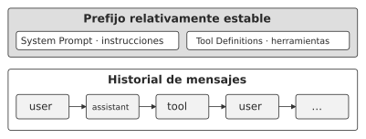

Por eso, el tramo inicial que comparten dos peticiones consecutivas puede extenderse hasta dentro del historial de mensajes. Cuánto cálculo anterior puede reutilizar la siguiente llamada depende de la longitud de ese prefijo.

El Harness de abajo coloca al principio las instrucciones del sistema y las definiciones de herramientas, que cambian poco, y en cada ronda solo añade el estado actual al final del historial. Si el historial se vuelve demasiado largo, primero comprime los mensajes antiguos y después ensambla la petición.

```python
stable_prefix = system_message
stable_tools = core_tool_schemas
history = load_message_history(session)
status_message = make_status_message(derive_current_state(history))

if estimated_tokens(stable_prefix, stable_tools, history, status_message) > budget:
    history = compress_old_evidence(
        history,
        preserve = [decisions, constraints, failures, citations]
    )

request.messages = [stable_prefix] + history + [status_message]
request.tools = stable_tools
response = call_model(request)
```

Al comprimir, se conserva la información que necesita el trabajo posterior —decisiones, restricciones, fallos y citas— y se mantiene la asociación entre cada solicitud de llamada y su resultado. Además del presupuesto de longitud, también la información repetida u obsoleta puede desencadenar la compresión; las estrategias concretas se desarrollan en la segunda mitad de este capítulo.

> **Experimento 2-1 ★: Despliegue de un servicio de LLM local y llamada a herramientas**
>
> Este experimento ejecuta Qwen3-0.6B en local y sigue la tarea «consultar la hora y el tiempo en Vancouver» para observar cómo pasan los mensajes por el modelo, el analizador y el ejecutor de herramientas. La figura 2-5 muestra el reparto de tareas entre el servicio local y el cliente: el servidor carga el modelo, procesa la entrada y genera la respuesta; el cliente mantiene el historial de mensajes, despacha las herramientas y devuelve los resultados.
>
> 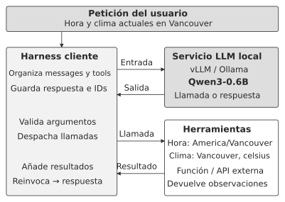
>
> **Primero, seguir una tarea completa.** En una misma salida, el modelo solicita consultar la hora y la temperatura, y rellena parámetros como `America/Vancouver`, `Vancouver` y `celsius`. El cliente ejecuta las dos herramientas en paralelo. El primer acuse devuelve la hora local, 11:11:28, y el segundo, una temperatura de 17,9 °C. Cuando ambos resultados vuelven al modelo, este da la hora con precisión de minutos, responde que la temperatura es de 17,9 °C y termina el bucle. Esta ejecución muestra que un modelo de seiscientos millones de parámetros ya es capaz, en esta tarea, de elegir las dos herramientas correctas, rellenar los parámetros y responder al usuario con los valores devueltos.
>
> **Después, comparar la salida bruta con los campos de la API.** El modo de pensamiento de Qwen3 puede generar contenido de razonamiento marcado con `<think>`, y las solicitudes de herramientas usan sus propias marcas de llamada. Una vez que el servidor analiza la salida, el cliente puede recibir un campo `thinking` separado o campos de llamada a herramientas. El orden de las partes de la salida y la forma de conservarlas dependen a la vez de la plantilla del modelo y del protocolo del servicio.
>
> **A continuación, observar el procesamiento en streaming.** La interfaz puede ir actualizando estados como «pensando», «llamando a herramientas» y «generando la respuesta» a medida que llegan los eventos. Los parámetros de las herramientas suelen llegar en varios fragmentos que hay que acumular hasta formar la solicitud completa; cuando el protocolo confirma que la llamada ha terminado y se han superado las comprobaciones de parámetros, permisos y dependencias, el sistema de ejecución puede empezar a despacharla. Las herramientas independientes pueden ejecutarse en paralelo y también encadenarse en pipeline con el procesamiento de la salida posterior.
>
> **Por último, comparar velocidad y caché.** En el registro de esta ejecución en un Mac con chip de Apple, la velocidad media de decodificación en las tareas con herramientas fue de unos 107 tokens por segundo. El token es la unidad básica con la que el modelo procesa el texto; la división concreta la decide el tokenizador, y una palabra o un carácter chino puede corresponder a uno o varios tokens. La velocidad de decodificación refleja el ritmo de salida una vez iniciada la generación; cuánto espera el usuario depende además de la latencia del primer token, de la longitud del razonamiento y del tiempo que tarden las herramientas.
>
> La comparación de caché usa un mismo prefijo largo y prueba por separado peticiones que conservan el prefijo y peticiones que modifican su comienzo. En los cinco pares de esta ejecución, la petición que conservaba el prefijo fue más rápida en cuatro; la latencia media del primer token de ambos grupos fue de unos 1,30 y 1,51 segundos, respectivamente. La siguiente sección explica en qué se diferencian estas peticiones desde el punto de vista del cálculo.
>
> Este experimento también ha reforzado la confianza del autor en los Agentes en el dispositivo: los modelos pequeños ya pueden completar tareas de llamada a herramientas como esta en el propio dispositivo del usuario. **La era de los Agentes en el dispositivo está más cerca de lo que muchos esperan.**

## Diseño de contexto que aprovecha la Caché KV

Las peticiones consecutivas de un Agente suelen compartir mucha información: instrucciones del sistema, definiciones de herramientas y la interacción ya ocurrida. Si el motor de inferencia puede reutilizar los resultados intermedios de ese contenido, puede dedicar más cálculo a la información nueva. La **Caché KV** guarda las claves (Key) y los valores (Value) ya obtenidos en el cálculo de atención de cada capa para que los usen los tokens posteriores; la **Prompt Cache** va un paso más allá y reutiliza entre peticiones la caché de los prefijos que cumplan las condiciones[^ch2-kv-basics].

Pensemos en un Agente de atención al cliente: para que el modelo sepa la hora actual, el desarrollador añade al principio del prompt del sistema `Current time: {{now}}`, que se actualiza en cada petición. Las reglas de negocio y las definiciones de herramientas que vienen después no cambian, pero la entrada real empieza a diferir a partir de la marca de tiempo. En un servicio que reutiliza los estados KV de los prefijos idénticos, eso obliga a recalcular la marca de tiempo y todo lo que sigue, lo que aumenta el tiempo de procesamiento de la entrada y el coste.

Si la hora se escribe como un mensaje añadido o se consulta con una herramienta de hora cuando hace falta, se conserva el prefijo existente. Ambas disposiciones aportan una información similar, pero provocan recálculos de alcance muy distinto.

Conviene retener primero tres prácticas; los principios y experimentos que siguen las explican una por una:

1. **Mantener estable el prefijo reutilizable.** Las instrucciones del sistema y las definiciones de herramientas de uso habitual deben tener un contenido y un orden fijos.
2. **Añadir al final los cambios que se producen durante la ejecución.** La hora, el saldo, el número de llamadas y el progreso de la tarea pueden proporcionarse mediante mensajes nuevos o resultados de herramientas. El estado más reciente debe indicar desde cuándo es válido, para que el modelo identifique qué registro se aplica a la decisión actual.
3. **Organizar los mensajes según el protocolo del modelo.** Hay que usar los roles correctos, los identificadores de llamada y el formato de resultado de herramientas adecuados, y dejar que la plantilla de chat correspondiente genere la entrada del modelo. La caché compara el prefijo ya procesado y la configuración asociada; el protocolo de mensajes determina además cómo distingue el modelo las instrucciones, las peticiones del usuario y los valores devueltos por las herramientas.

En los modelos de atención causal que considera esta sección, añadir tokens posteriores no altera los estados ya calculados en posiciones anteriores. Cuando se modifica la entrada existente, hay que recalcular los estados desde la primera posición que cambia en adelante; el prefijo anterior al cambio sigue pudiendo reutilizarse. El servidor decide además el alcance real del acierto en función del tamaño de los bloques de caché, el tiempo de retención y la configuración de ejecución.

[^ch2-kv-basics]: Hugging Face, How caching works, que explica cómo se guardan y reutilizan K y V capa por capa.

> **Experimento 2-2 ★: Visualización del mecanismo de atención**
>
> Usemos primero la frase «Pekín / de / tiempo / qué tal» (en chino, «¿Qué tiempo hace en Pekín?») para entender un cálculo de atención. Para facilitar la presentación, la figura 2-6 divide la frase en cuatro unidades semánticas; en un modelo real, es el tokenizador el que divide la entrada. Al procesar la posición de «qué tal», la capa de atención tiene que componer la representación actual a partir de la información ya disponible. Query, Key y Value desempeñan, respectivamente, las funciones de consulta, coincidencia y agregación de información.
>
> | Vector | Función | Interpretación intuitiva en este ejemplo |
> | --- | --- | --- |
> | **Query (consulta)** | Vector con el que la posición actual busca coincidencias en otras posiciones | «qué tal» necesita encontrar la información relevante en el contenido ya presente |
> | **Key (clave)** | Vector con el que cada posición participa en la búsqueda de coincidencias | Posiciones como «Pekín» o «tiempo» aportan representaciones con las que comparar |
> | **Value (valor)** | Vector de información que se agrega según los pesos | La información sobre el lugar y el tiempo se incorpora a la representación actual en la proporción correspondiente |
>
> Puede imaginarse la Key como la etiqueta que se usa para buscar y el Value como el contenido que se recupera. En el modelo, estos vectores son valores numéricos calculados a partir de las representaciones ocultas, y el entrenamiento determina cómo se emparejan.
>
> Un cálculo consta de tres pasos. Primero, la posición actual genera su Query; después, se calcula su producto escalar con la Key de cada posición y, tras el escalado, la máscara causal y softmax, se obtienen pesos de atención que suman 1; por último, se hace una suma ponderada de los Value con esos pesos. El producto escalar consiste en multiplicar dos series de números posición por posición y sumar los resultados; softmax convierte las puntuaciones de las posiciones visibles en pesos normalizados. Los Value de cada posición intervienen en la agregación con su peso correspondiente y juntos forman la salida de esta cabeza de atención.
>
> Leamos en horizontal la última fila de la figura 2-6: la posición de «qué tal» asigna a «tiempo» un peso de 0,55. Ese número se multiplica por el Value de la posición de «tiempo» y se suma a las contribuciones de las otras tres posiciones para obtener la salida de esta cabeza de atención en «qué tal». ¿Por qué en la fila de «tiempo» aparece una cruz más a la derecha? Porque, cuando se calcula esa posición, la secuencia todavía no ha llegado a «qué tal».
>
> 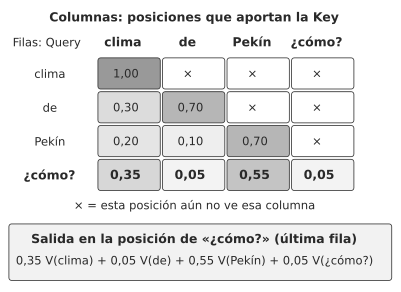
>
> Si se ordenan en una matriz los pesos de todas las posiciones, se obtiene un **mapa de calor de atención**. Cada fila corresponde a una Query, cada columna a una Key, y la intensidad del color indica el tamaño del peso. La máscara causal permite que la posición actual lea su propia posición y las anteriores; la figura marca con × las posiciones enmascaradas, cuyo peso tras softmax es cero. Esta estructura se aplica tanto al procesamiento de la entrada como a la generación posterior.
>
> Aquí se ve también para qué sirve la caché de K y V: a medida que avanza la generación, las nuevas posiciones siguen leyendo las Key y los Value de las posiciones existentes. Si se guardan esos vectores, la nueva posición puede usarlos directamente para comparar y agregar, sin repetir el cálculo de las posiciones históricas.
>
> Una vez entendidos estos pesos ilustrativos, veamos con Qwen3-0.6B la distribución de atención que calcula realmente el modelo. El experimento registra por separado una frase corta y una secuencia generada que incluye razonamiento y respuesta final, y compara las matrices de atención de distintas capas. La figura 2-7 muestra las capas 0, 13 y 27: la columna izquierda corresponde a la frase corta de nueve tokens, y la derecha, a la secuencia generada, de la que se calcula una matriz de 17 × 23, con los rangos de posiciones marcados como entrada, razonamiento y respuesta. La escala de grises es logarítmica para que se aprecien a la vez los pesos de atención fuertes y los débiles.
>
> 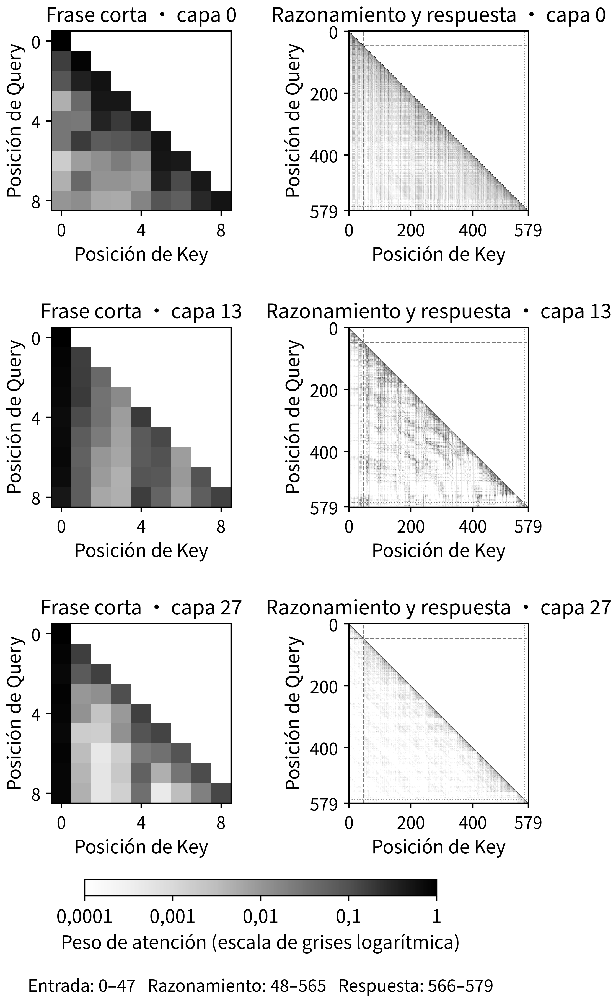
>
> Al leerla, se pueden seguir cuatro pistas:
>
> 1. **Sumidero de atención (Attention Sink).** Algunas capas asignan un peso elevado al comienzo de la secuencia, aunque el token inicial apenas tenga contenido semántico. Observemos la frase corta de la columna izquierda de la figura 2-7. Cada gráfico ya promedia todas las cabezas de atención de una misma capa. Si además se promedian los nueve valores de la primera columna de la matriz, se obtiene cuánto peso asignan, de media, las nueve posiciones al primer token. En las capas 0, 13 y 27 los valores son 14,7 %, 73,9 % y 83,2 %. En la secuencia generada, más larga, de la columna derecha, ese valor pasa a ser del 28,0 % en la capa 13. Softmax exige que los pesos de todas las posiciones sumen 1, y el modelo puede aprender posiciones receptoras relativamente estables; StreamingLLM estudia específicamente este fenómeno y su papel en la inferencia en streaming[^ch2-attention-sinks].
> 2. **Zona de razonamiento.** Hay que marcar el intervalo generado que corresponde a `<think>` y recorrer esas filas para ver a qué partes del prompt, a qué descripciones de herramientas o a qué razonamientos anteriores atiende el modelo. La forma triangular procede de la máscara causal; lo que refleja las diferencias de peso entre posiciones es la intensidad dentro del triángulo.
> 3. **Zona de respuesta.** Se marca después el intervalo en que se genera la respuesta final y se compara cómo reparte el peso entre la entrada original y el razonamiento previo. Esto ayuda a localizar qué información existente entra en la agregación de atención actual.
> 4. **Diferencias de posición.** *Lost in the Middle* observó, en preguntas y respuestas sobre contextos largos y en recuperación de pares clave-valor, que la información situada en posiciones intermedias se aprovecha peor[^lost-in-the-middle]. En ingeniería, esto aconseja colocar preferentemente las reglas permanentes al principio y el objetivo y el progreso actuales al final.

[^ch2-attention-sinks]: Xiao et al., Efficient Streaming Language Models with Attention Sinks, ICLR 2024.

[^lost-in-the-middle]: Liu et al., Lost in the Middle: How Language Models Use Long Contexts, TACL 2024.

### De los mensajes de la API a los tokens del modelo: Chat Template

Los ejemplos de API anteriores son un conjunto de mensajes con roles, mientras que la entrada del mapa de atención es una secuencia de tokens. El **Chat Template (plantilla de chat)** se encarga de esa conversión: añade a los mensajes marcas de rol y de límite, organiza según lo acordado las descripciones de herramientas y los valores devueltos, y entrega el resultado al tokenizador para codificarlo. Comparemos las dos columnas de la figura 2-8: a la izquierda solo se enviaron las instrucciones del sistema y la pregunta del usuario; ¿por qué a la derecha aparece además un `assistant`? Es la marca de inicio que la plantilla añade para la siguiente respuesta. Estas marcas volverán a aparecer cuando se hable de las llamadas a herramientas, de la conservación de la información de razonamiento y de los aciertos de caché.

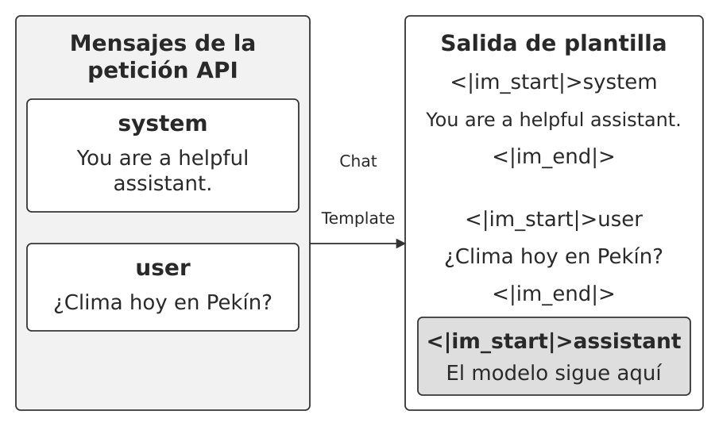

Las familias de modelos como Qwen, Llama o Gemma tienen cada una su propia plantilla de chat. Un mismo conjunto de mensajes de la API, entregado a modelos distintos, puede dar lugar a marcas de rol y de límite diferentes. En las API alojadas, la conversión suele hacerla el servidor; en un despliegue propio, hay que configurar en el servicio de inferencia la plantilla que corresponde al modelo.

Supongamos que el usuario envía el texto «Vancouver 17.9 °C» y que la herramienta meteorológica devuelve exactamente el mismo texto. Si se pasan estos dos mensajes por la plantilla de Qwen3-0.6B, se obtienen las dos entradas de la figura 2-9. Ambas empiezan por `<|im_start|>user`; ¿qué marca indica que el texto procede de una herramienta?

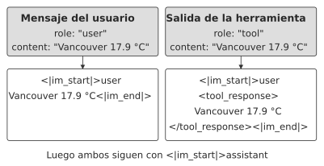

La columna derecha tiene además un par de etiquetas `<tool_response>`. La plantilla también localiza, a partir de los roles, la pregunta más reciente del usuario: en los turnos anteriores a esa pregunta solo conserva el contenido de las respuestas; a partir de ella, las interacciones con herramientas pueden incluir también la información de razonamiento del modelo[^ch2-qwen-template].

Por ejemplo, el modelo ha consultado un archivo y todavía tiene que seguir analizando. Si el resultado de la herramienta se devuelve con el rol `tool`, la plantilla lo reconoce como respuesta de una herramienta dentro de la tarea actual; si ese mismo resultado se escribe como un mensaje `user` corriente, la plantilla puede tomarlo por una consulta nueva y cambiar qué parte del razonamiento previo se conserva. Es como resolver un problema en varios pasos y necesitar que no se retire la hoja de borrador: el Harness debe guardar los campos de razonamiento que exige el servicio y seguir llamando con la estructura de mensajes correcta.

**Al pasar del razonamiento de un solo turno a los Agentes de largo recorrido, el pensamiento histórico se convierte poco a poco en un estado de la tarea que hay que mantener.** La plantilla de chat del primer DeepSeek-R1 eliminaba la parte de pensamiento de las respuestas históricas y solo conservaba la respuesta final[^ch2-r1-template]; el protocolo posterior de llamada a herramientas de DeepSeek, en cambio, exige devolver la información de razonamiento. Cuando termina una pregunta con su respuesta, la respuesta final puede contener ya lo que necesita el turno siguiente; pero a mitad de una tarea con herramientas, «por qué se consulta este archivo» o «qué hipótesis se han descartado» pueden figurar únicamente en el razonamiento intermedio. Conservar esa información ayuda a que el siguiente turno continúe la línea de pensamiento existente.

**La forma de devolver la información de razonamiento la determina el protocolo del modelo.** Al integrarlo, hay que gestionar a la vez `content`, `tool_calls` y el campo de razonamiento que ofrezca el servicio. Las siguientes soluciones reflejan reglas de continuación distintas:

- **El modo de pensamiento de DeepSeek** devuelve el razonamiento en `reasoning_content`. Según su protocolo de llamada a herramientas, cuando la petición incluye `tools`, las peticiones posteriores deben devolver íntegro el razonamiento histórico, incluidas las respuestas del modelo que no llamaron a ninguna herramienta; si falta el campo, se produce un error 400. En las peticiones de chat sin `tools`, el servicio ignora el razonamiento histórico devuelto[^ch2-deepseek-thinking].
- **El pensamiento y la interacción con herramientas de Kimi** también requieren gestionar en el bucle de ejecución el razonamiento, las solicitudes de herramientas y los resultados. En el ejemplo de pensamiento intercalado de Kimi K2.5, el modelo puede seguir razonando entre varias llamadas a herramientas, y el cliente guarda y devuelve los mensajes del modelo según su protocolo[^ch2-kimi-thinking].
- **El pensamiento preservado de GLM** se activa con `thinking.clear_thinking: false`; a partir de ahí hay que devolver `reasoning_content` completo y en el orden original. Coding Plan y la API estándar tienen valores predeterminados distintos, así que el cliente debe elegir explícitamente el modo que necesita[^ch2-glm-thinking].
- **Los thinking blocks de Claude** deben guardarse junto con su firma. Los modelos que admiten preserved thinking comprueban además la procedencia y el prefijo de cada bloque; las reglas concretas se explican más adelante en «La caché como restricción arquitectónica».

Estas reglas afectan a las llamadas a herramientas consecutivas y también al cambio de modelo a mitad de tarea. Al cambiar, la capa de adaptación debe convertir las solicitudes de herramientas, los resultados y el estado de la tarea a la forma que acepta la interfaz de destino, y tratar la información de razonamiento según las reglas del modelo de destino. El experimento 5-1 del capítulo 5 desarrolla este tipo de continuación de trayectorias.

**La plantilla determina también la entrada con la que se compara la caché.** Un mismo contenido de mensajes, procesado con plantillas, órdenes de herramientas o formas de serialización distintas, puede producir prefijos de tokens diferentes. Para reutilizar los estados KV existentes, hay que mantener coherentes la configuración del modelo y el prefijo.

[^ch2-qwen-template]: El archivo de configuración del tokenizador de Qwen3-0.6B, `tokenizer_config.json`, contiene la plantilla de chat, incluida la lógica de tratamiento de las consultas del usuario, el contenido de razonamiento y las respuestas de herramientas.

[^ch2-r1-template]: La plantilla de chat oficial de DeepSeek-R1 conserva en las respuestas históricas normales el contenido posterior a `</think>`; las reglas de devolución del razonamiento en las llamadas a herramientas posteriores figuran en la documentación Thinking Mode de DeepSeek.

[^ch2-deepseek-thinking]: DeepSeek, Thinking Mode.

[^ch2-kimi-thinking]: Moonshot AI, repositorio oficial de Kimi K2.5, sección Interleaved Thinking and Multi-Step Tool Call.

[^ch2-glm-thinking]: Z.ai, Thinking Mode, que describe el pensamiento intercalado, el pensamiento preservado y los valores predeterminados de cada endpoint.

### Principios y restricciones de la Caché KV

Cuando el modelo procesa una petición, primero hace el **prefill** (prellenado) de la entrada, calculando las representaciones de los tokens existentes, y después pasa al **decode** (decodificación), en el que genera uno a uno los tokens siguientes. La Caché KV guarda durante la decodificación los K y V de las posiciones existentes; la caché de prefijos entre peticiones reutiliza además el prefijo idéntico que dejó la petición anterior.

Por ejemplo, en la sexta ronda un Agente ya ha acumulado 2000 tokens de entrada. Si el servicio solo usa la Caché KV dentro de la propia petición, primero debe procesar esos 2000 tokens y después aprovechar la caché para seguir generando. Si la caché entre peticiones ya contiene un tramo idéntico de ese prefijo, el prefill puede continuar desde la primera posición no almacenada. La figura 2-10 muestra esta reutilización entre peticiones.

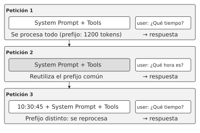

**Sigamos con cuatro tokens cómo crece la caché.** Supongamos que la entrada es `[A, B, C, D]`. Al procesar la posición D, el modelo compara la Query de D con las Key de A, B, C y D, y agrega sus Value de forma ponderada. Tras el cálculo de todas las capas, la representación final en la posición D sirve para predecir el siguiente token, E. En ese momento ya están guardados los K y V de A a D en todas las capas.

Una vez muestreado E, el paso siguiente consiste en introducir E en el modelo y calcular su Query, su Key y su Value en cada capa. La Query de E lee la caché anterior y los K y V de la posición actual, y el modelo predice el sexto token; al mismo tiempo, los K y V de E se añaden a la caché. Así, en cada paso de generación puede aprovecharse el estado previo y solo hay que calcular el estado del nuevo token de entrada.

Si no se usara la Caché KV, para predecir E habría que volver a procesar de A a D, y para predecir el sexto token, de A a E. Contando solo las posiciones cuyos K y V se generan repetidamente, el trabajo acumulado crece como $1+2+\cdots+N$. Con la caché, el cálculo por capas de las posiciones históricas se reutiliza, aunque la nueva posición sigue teniendo que leer todos los K y V visibles. En la decodificación con atención completa estándar, esa lectura y comparación crece linealmente con la longitud del contexto, por lo que los contextos largos siguen ocupando más memoria de GPU y más ancho de banda de memoria.

**¿Por qué modificar la entrada afecta a la caché posterior?** Las capas del Transformer procesan las representaciones ocultas una tras otra, y cada capa tiene sus propios K y V. Después del cálculo de atención, la representación de una posición ya incorpora información de las posiciones anteriores y se transmite a la capa siguiente. Por tanto, cuando cambia el token $k$, el efecto se propaga desde esa posición hacia delante y hacia las capas superiores.

Con el mismo modelo y la misma configuración de cálculo, las posiciones anteriores a $k$ solo dependen de entradas más tempranas y pueden seguir reutilizándose; a partir de $k$, hay que reconstruir los estados afectados. Los servicios reales suelen comparar el prefijo por bloques de caché, de modo que el límite del recálculo depende también del tamaño de bloque. Cuanto más al principio esté la modificación, más entrada suele haber que recalcular. Colocar las instrucciones estables al principio y añadir el estado nuevo al final es precisamente aprovechar esta relación de dependencia.

> **Experimento 2-3 ★★: Comparación de formas de gestionar el contexto**
>
> En este experimento, un Agente completa una misma tarea con herramientas de descubrimiento, lectura y búsqueda de archivos, y se compara una línea base de adición estable con cinco alteraciones del contexto. La línea base mantiene estables las instrucciones y el orden de las herramientas, y en cada ronda añade los mensajes del modelo y los resultados de las herramientas. Los demás grupos modifican, respectivamente, las instrucciones, el estado, el orden de las herramientas o la forma de expresar el historial, y se observa cómo cambian las estadísticas de caché y el desarrollo de la tarea.
>
> El **prompt del sistema dinámico** actualiza en cada ronda la hora actual dentro de las instrucciones del sistema. Antes del cambio puede seguir habiendo un prefijo compartido, pero toda la entrada posterior a la información horaria tiene que volver a compararse o calcularse. La hora puede añadirse como mensaje nuevo u obtenerse cuando haga falta con una herramienta de hora, de modo que las reglas de negocio permanentes sigan reutilizándose.
>
> La **configuración de usuario dinámica** actualiza en los mensajes iniciales el número de llamadas restantes o el saldo de la cuenta. El estado en sí es información que la tarea necesita; lo importante del diseño es dónde se actualiza: añadir el estado más reciente al final, indicando desde cuándo es válido, permite conservar a la vez el progreso y el prefijo. La barra de estado del Agente que se verá más adelante adopta esta forma de organización.
>
> La **reordenación de las definiciones de herramientas** cambia en cada ronda el orden de la lista de herramientas. Aunque los nombres y parámetros sean los mismos, el orden de los tokens tras la serialización ya es distinto. Si se abre el informe de ejecución de Kimi K2.6, tanto la línea base como el grupo reordenado muestran un `Hit%` del 100 %. ¿Reutilizaron realmente la misma cantidad de entrada? La línea base procesó 7567 tokens de entrada en tres rondas, de los que 768 acertaron en caché; el grupo reordenado, también en tres rondas, solo acertó 256 de 7568 tokens de entrada. Dividiendo los tokens en caché entre los tokens de entrada se obtienen el 10,1 % y el 3,4 % de la columna `Cache%`. La otra columna, `Hit%`, cuenta las peticiones con un veredicto de acierto: la línea base registró dos aciertos y el grupo reordenado solo uno, y ninguno de los dos registró fallos. Con este registro no puede saberse qué ocurrió en las demás peticiones. Fijar el orden de las herramientas evita que el prefijo cambie sin motivo.
>
> La **ventana deslizante** solo conserva el tramo más reciente del historial. Si se conservan diez rondas de interacción, en la decimoquinta puede que ya no se pueda leer el contenido clave de un archivo obtenido en la segunda. Además de acortar el prefijo compartido, el recorte cambia los hechos y el progreso de la tarea a los que tiene acceso el modelo. La implementación de acompañamiento parte de los seis mensajes más recientes del historial y añade hacia atrás las solicitudes de llamada a las que corresponden los resultados de herramientas. El grupo de ventana deslizante reutilizó 1510 de 2224 tokens de entrada, con una proporción en caché del 67,9 %, la más alta de los seis grupos. Pero si se mira el registro de herramientas de este grupo en el experimento 2-3, el modelo buscó archivos tres veces, después leyó dos archivos y no llegó a entregar el resumen de tres frases que pedía el usuario.
>
> El **formateo como texto** reescribe el historial con roles como texto del tipo `USER: ...` y `ASSISTANT: ...`. Esto cambia los límites de los mensajes y la estructura de las herramientas en la plantilla, y el modelo tiene que reconstruir las relaciones originales a partir del texto. En esta ejecución, el grupo de texto llegó a generar una respuesta final y también obtuvo aciertos de caché. Los roles de mensaje, los identificadores de llamada y los campos de resultado de herramientas que ofrece la interfaz ayudan a transmitir esas relaciones de forma estable.
>
> Aunque el programa reconstruya la lista de mensajes, mientras el prefijo enviado y la configuración de caché sean idénticos, ese prefijo seguirá pudiendo reutilizarse.
>
> Si además se quiere saber cuánto menos esperó el usuario, primero hay que ver dónde se detiene el cronómetro. En la primera ronda del grupo de ventana deslizante, el `ttft` fue de unos 2,23 segundos. Aunque el programa llama a este campo TTFT (latencia del primer token), en realidad detiene el cronómetro cuando una petición sin streaming devuelve la respuesta completa.

### Caché KV y Prompt Cache: dos niveles de caché

Los dos niveles de caché pueden distinguirse con dos momentos. Cuando el modelo genera el segundo token de una respuesta, puede leer los estados clave-valor de las posiciones ya presentes en esa petición: eso es la **Caché KV**. Poco después, el usuario hace otra pregunta y el Harness envía una petición nueva; el servicio tiene que encontrar primero el prefijo idéntico guardado anteriormente para poder ahorrarse el cálculo de esa parte de la entrada: eso es la **Prompt Cache**. La primera explica cómo continúa una misma generación; la segunda exige además un mecanismo para guardar y comparar entre peticiones.

En los servicios de API, la caché depende también de la longitud mínima del prefijo, el tamaño de bloque, el periodo de validez, la configuración del modelo y el ámbito de aislamiento entre inquilinos. El prefijo reutilizable debe buscarse dentro del mismo ámbito de caché. Por ejemplo, la API de Claude aísla la caché por organización y por espacio de trabajo; si el mismo texto aparece en dominios aislados distintos, se crean cachés separadas[^ch2-prompt-cache].

La facturación debe considerar por separado la escritura y la lectura. En algunos modelos Claude, leer de la caché cuesta una décima parte del precio normal de entrada, mientras que la primera escritura tiene un recargo. Si un mismo prefijo se reutiliza varias veces dentro de su periodo de validez, la escritura solo se paga una vez y todas las peticiones posteriores que acierten se facturan al precio de lectura.

[^ch2-prompt-cache]: Anthropic, Prompt caching, que describe la comparación, el aislamiento, el periodo de validez y la facturación de la caché.

### La caché como restricción arquitectónica

**En los sistemas de producción, la caché se ha convertido en una restricción arquitectónica.** Cómo se ordena el prompt, desde dónde arranca un subagente y cómo se restaura una sesión influyen en cuánto cálculo puede reutilizarse. **Los límites de la caché deben planificarse desde el principio del diseño.** Decidir primero qué contenido puede compartirse y qué estado va a cambiar, y organizar después el prompt y la estructura de la sesión, reduce los recálculos repetidos durante la ejecución. Si se espera a que la latencia y el coste de las tareas de largo recorrido ya sean un problema para ajustar estas estructuras, el cambio suele arrastrar la gestión del estado, los subagentes y la restauración de sesiones.

**Ordenar el prefijo según su estabilidad.** Las instrucciones y definiciones de herramientas compartidas por varias tareas pueden ir al principio; a continuación se añaden los datos del usuario, el estado de la sesión y las observaciones nuevas, agrupados según su ámbito de aplicación. Por ejemplo, si el sistema operativo puede ser macOS o Linux, el modo de ejecución normal o de depuración, y el idioma chino o inglés, estas tres condiciones independientes producen hasta $2\times2\times2=8$ combinaciones de prefijo. Colocar los campos más variables después de la parte compartida aumenta las posibilidades de reutilizar el prefijo común. El alcance con que se comparte la parte común debe respetar además los límites de organización, espacio de trabajo y privacidad del servicio.

**Elegir para el subagente un punto de partida reutilizable.** Si un subagente hereda el trasfondo de la tarea del Agente padre, puede reutilizar el prefijo que ambos tienen en común y añadir después su propia subtarea. El prompt, el orden de las herramientas, el modelo y la configuración asociada determinan conjuntamente el alcance reutilizable. Los subagentes que necesitan un rol propio o un contexto aislado construyen su entrada según su tarea, y después se comprueba qué partes comunes conviene compartir.

**Guardar lo que ya se ha enviado.** Cuando una salida grande de una herramienta se comprime en un resumen o una vista previa, debe guardarse la versión que realmente se envió al modelo. Al restaurar la sesión, reproducir ese registro permite reconstruir una secuencia de mensajes idéntica; si se regenerara el resumen en cada restauración, podrían aparecer redacciones nuevas y cambios en el prefijo. Para actualizar un resumen, puede publicarse una versión nueva dejando claro desde dónde se reconstruirá la caché a partir de entonces.

**Conservar el razonamiento exige además cumplir restricciones del protocolo.** El preserved thinking de Claude ofrece un ejemplo concreto. Su documentación aplica este mecanismo para impedir la destilación: el servicio comprueba la firma del thinking block, el modelo que lo generó y su prefijo. En los modelos que admiten vinculación al prefijo, como Claude Fable 5.1 o Claude Opus 5.5, el ámbito de comprobación lo forman el `system` y las `tools` de nivel superior y los mensajes anteriores al bloque; modificar cualquiera de ellos invalida ese bloque y los thinking blocks posteriores[^ch2-preserved-thinking].

Por ejemplo, reescribir en cada ronda la hora del sistema, volver a representar la información del entorno en el primer mensaje o recortar en el sitio resultados antiguos de herramientas cambia el prefijo al que están vinculados los bloques de razonamiento posteriores. Cuando salta la comprobación, la API puede devolver un error 400 o, según lo configurado en `prefix_mismatch_behavior`, descartar los bloques invalidados y seguir procesando la petición. En este último caso, el modelo puede seguir usando la información de la tarea y los resultados de herramientas que se conservan, pero el razonamiento invalidado ya no forma parte de la entrada. Las cuentas creadas a partir del 31 de agosto de 2026 tienen activada por defecto la comprobación del prefijo; para las cuentas anteriores, el modo de activación se indica en la descripción del protocolo.

Al integrar este tipo de protocolos, conviene mantener estables las instrucciones de nivel superior y el conjunto de herramientas de la sesión, y añadir al final los cambios de estado. Si hay que actualizar instrucciones o herramientas a mitad de sesión, se usan las interfaces que ofrece el servicio, como los mensajes de sistema dentro de la conversación o los bloques de cambio de herramientas. Recortar thinking blocks también exige mantener un intervalo continuo en el orden original: se pueden eliminar desde el principio o desde el final, o eliminarlos todos; dejar un hueco en medio afecta a los bloques posteriores, y los bloques eliminados deliberadamente deben seguir eliminados.

Si se cambia de modelo a mitad de sesión, el servicio comprueba además si el modelo de destino puede leer los bloques de razonamiento del modelo original. El cliente debe guardar el historial original y dejar que el servicio lo trate según las reglas de compatibilidad; si el cliente los borra por su cuenta, tampoco podrá recuperar esos registros cuando vuelva al modelo original.

[^ch2-preserved-thinking]: Anthropic, Preserved thinking, que describe los modelos, la vinculación al prefijo, el tratamiento de los bloques invalidados y las reglas para recortar bloques de razonamiento; las interfaces de actualización dentro de la conversación se describen en Mid-conversation system messages and tool changes.

### Ampliación de investigación: Caché KV editable y componible

> Todos los diseños anteriores reutilizan cálculo comparando prefijos. El autor quiere ir más allá: ¿se puede editar y combinar directamente la información ya guardada en los estados KV, de modo que la caché se adapte a los cambios del contexto? En *Models Take Notes at Prefill*, el autor compara esa información con las «notas» del modelo[^ch2-2]: después de que el prefill pase por varias capas de atención, la influencia de un campo ya ha entrado en las representaciones de las posiciones posteriores. Por ejemplo, «Ciudad del usuario: Pekín» puede influir en juicios posteriores sobre ubicación; si solo se sustituyen los K y V de ese campo, los estados posteriores pueden seguir conservando conclusiones derivadas de la ciudad antigua.
>
> El artículo distingue mediante intervenciones el papel de los estados KV del propio campo y el de los estados posteriores. En las decisiones medidas, la contribución directa de los estados KV del propio campo es inferior al 1 %; la influencia principal se conserva en las representaciones aguas abajo. A partir de esas «notas» que quedan aguas abajo pueden explorarse dos formas de aprovechar la caché.
>
> La **edición (Editing)** usa información de corrección explícita para que el cálculo posterior actualice los juicios existentes. El artículo también observa que, en las tareas medidas con un modelo de 8B, cuando hay una cadena de pensamiento explícita, editar solo el campo basta para recuperar la decisión deseada, con un coste de cálculo de alrededor del 1 % del recálculo completo; sin ese razonamiento, los estados antiguos aguas abajo pueden seguir influyendo en la decisión y la modificación del campo difícilmente surte efecto.
>
> La **composición (Composition)** injerta una caché de habilidad precalculada en un contexto nuevo. En los modelos que usan codificación posicional rotatoria (RoPE), primero hay que ajustar la representación posicional de la caché y después concatenarla. Puede imaginarse como renumerar una página de notas existente para unirla al final de otro documento. El artículo compara doce modelos: la similitud coseno de los logits de salida entre la concatenación y el recálculo completo está entre 0,90 y 0,999; la reubicación y concatenación de la caché pueden procesarse en tiempo lineal con la longitud, lo que reduce el recálculo de atención sobre todo el contexto.
>
> Añadir información de corrección también puede combinarse con la caché de prefijos existente. En el benchmark en línea con vLLM del artículo, esta combinación conservó una tasa de acierto de la caché de prefijos de alrededor del 98,5 %, y el p90 de la latencia del primer token quedó entre 1/398 y 1/53 del valor de referencia.
>
> **El autor confía en esta línea de investigación porque puede permitir que las actualizaciones del contexto conserven más cálculo ya hecho.** Los Agentes actualizan a menudo campos de memoria, añaden estado o sustituyen definiciones de herramientas; si los estados asociados pudieran corregirse y concatenarse como notas, el coste de mantener contextos largos podría reducirse de forma notable.

[^ch2-2]: Li, Bojie, Models Take Notes at Prefill: KV Cache Can Be Editable and Composable, 2026. Los experimentos de edición, composición y caché en línea usan tareas y métricas distintas; la configuración concreta se detalla en el artículo.

### Del mecanismo de caché al diseño del contenido del contexto

Una vez entendido cómo reutiliza la caché el cálculo, hay que decidir qué se pone en la entrada de cada ronda y cómo se actualiza ese contenido. Lo que sigue se divide en tres partes:

- **Ingeniería de prompts y Agent Skills**: primero se diseñan las instrucciones del sistema y las definiciones de herramientas, que explican el objetivo, las reglas y la forma de operar; después, el conocimiento de dominio se carga bajo demanda mediante divulgación progresiva. La defensa contra la inyección de prompts se ocupa de la procedencia y de los límites de autoridad cuando entra contenido externo en el contexto.
- **Barra de estado del Agente**: proporciona al modelo estados como el progreso de la tarea, un resumen de las observaciones del entorno o el número de llamadas, y le ahorra deducirlos de nuevo a partir de un historial largo. Funciona como la hora, la batería y la señal de red en la pantalla del móvil, que mantienen visible la situación actual.
- **Compresión del contexto**: cuando el historial crece, conserva la información que necesitan las decisiones posteriores, y decide cuándo comprimir, cómo organizar el resumen y cómo tratar el recálculo de la caché y la continuidad de la tarea.

## Ingeniería de prompts: optimizar el prompt del sistema

La ingeniería de prompts guía al modelo para que complete tareas concretas mediante instrucciones, procedimientos y ejemplos. Esta sección se centra en el **prompt del sistema (System Prompt)**: es como un manual del empleado que explica la identidad, los objetivos, las reglas de comportamiento y el flujo de trabajo del Agente. En los ejemplos de API de este capítulo, ese contenido se proporciona mediante el mensaje `system`.

### Tono y estilo: cómo dirigirse al usuario

Los requisitos de tono deben concretarse en formas de expresión. Por ejemplo, en preguntas y respuestas breves puede exigirse «You MUST answer concisely with fewer than 4 lines», es decir, responder en menos de cuatro líneas. Cuando la tarea se bloquea, puede pedirse «keep your response to 1–2 sentences»: explicar en una o dos frases el estado actual y el paso siguiente, para que el usuario vea directamente qué tiene que resolver.

Las mayúsculas enfáticas del tipo «NEVER do X» sirven para destacar requisitos clave. Más importante aún es explicar en qué situaciones se aplica el requisito y qué acción debe tomarse.

### Prompts estructurados: organizar niveles y delimitar contenidos

Los títulos, las listas y las etiquetas ayudan a organizar los prompts largos. Los títulos de Markdown sirven para representar secciones y pasos, y las etiquetas de estilo XML, para delimitar bloques de contenido con usos distintos; por ejemplo, `<working_directory>` puede envolver la información del directorio de trabajo. El nombre de la etiqueta debe indicar directamente para qué sirve el contenido, de modo que el modelo identifique con facilidad la relación entre los bloques.

Un mismo prompt puede combinar ambas formas:

```text
# Normas de uso de herramientas

## Operaciones con archivos
<file_operation>
- Antes de leer un archivo, comprobar que la ruta existe
- Antes de modificar un archivo existente, guardar una copia de seguridad
</file_operation>

## Peticiones de red
<network_request>
- Fijar el tiempo de espera en 30 segundos
- Ante fallos transitorios, reintentar como máximo 3 veces
- En peticiones con efectos secundarios externos, confirmar el estado de ejecución antes de reintentar
</network_request>
```

Markdown aporta una jerarquía fácil de leer, y `<file_operation>` y `<network_request>` delimitan el ámbito de aplicación de cada grupo de reglas. Por ejemplo, «reintentar como máximo 3 veces» solo se aplica a las peticiones de red; al modificar archivos, rige el grupo de reglas anterior sobre copias de seguridad.

### Organizar las reglas como un procedimiento

**Cuando una tarea tiene fases bien definidas, conviene organizar el prompt como un procedimiento.** Tomemos un reembolso: primero hay que localizar el pedido y solo después puede decidirse, según la política de reembolsos, si ese importe es reembolsable. Si no se encuentra el pedido, se pide al usuario que aporte el número de pedido u otros datos; si el pedido cumple las condiciones, se tramita el reembolso. Si esas mismas reglas se dispersan en una lista de más de cien puntos, en cada paso hay que volver a buscar cuáles se aplican. Escribir en cada fase las condiciones de entrada, el orden de procesamiento y las salidas ante excepciones da al modelo una base para saber en qué punto está y qué debe hacer a continuación.

El siguiente ejemplo, sobre procesamiento de archivos, encadena comprobación, clasificación, preprocesamiento, ejecución y verificación en un procedimiento operativo estándar (SOP):

```text
Procedimiento de procesamiento de archivos

Paso 1: Comprobación
  Confirmar que el archivo existe y es accesible
  Si el archivo no existe → registrar el error y detener el proceso
  ↓
Paso 2: Clasificación
  Determinar el tipo a partir de la extensión y del contenido
  ↓
Paso 3: Preprocesamiento
  Archivos de configuración → hacer antes una copia de seguridad
  Archivos grandes (>1 MB) → procesar en streaming
  ↓
Paso 4: Ejecución
  Aplicar el procesamiento correspondiente al tipo de archivo
  ↓
Paso 5: Verificación
  Comprobar la integridad del archivo procesado
```

Cada paso fija un objetivo local, y las reglas pertinentes se colocan bajo ese paso. Si el archivo no existe, se sale en la fase de comprobación; si hay que modificar un archivo de configuración, la copia de seguridad se guarda en la fase de preprocesamiento. El progreso de la ejecución se proporciona al modelo mediante el historial de mensajes o un registro de estado.

### Concretar las reglas de negocio: dejar claros los acuerdos de producto

Ante unos mismos datos de pedido, decidir a qué tipo de solicitud corresponden, qué servicio se aplica y cuánto debe cobrarse es, ante todo, un acuerdo de negocio que deben fijar los equipos de producto y operaciones. Después se reparte el trabajo de implementación: el prompt indica al modelo qué campos debe obtener y a qué servicio debe consultar; las herramientas y los sistemas de negocio aplican la facturación determinista y las restricciones.

Tomemos un Agente que llama por teléfono en nombre del usuario para rebajar una suscripción o solicitar un reembolso. El equipo quiere reducir la barrera para probarlo con la promesa de «si no se consigue, se devuelve el dinero», y a la vez fijar formas de cobro claras para tareas especiales. Pueden diseñarse tres tipos de facturación:

- **Comisión sobre el ahorro**: si una negociación rebaja una factura existente, se cobra un porcentaje del ahorro real, por ejemplo, el 20 %.
- **Tarifa fija por servicio**: en tareas de servicio como reservar un restaurante, se cobra según el tipo de tarea o su complejidad.
- **Pago anticipado en tareas difíciles**: en tareas difíciles que cumplan ciertas condiciones, se informa de antemano del pago anticipado y de que no es reembolsable, y la tarea se acepta cuando el usuario lo confirma.

Una regla como «elegir el tipo de facturación adecuado según la situación de la tarea» sigue dejando ambigüedades de clasificación. «Ayúdame a devolver la ropa que compré el mes pasado» supone recuperar un importe ya pagado; «Ayúdame a cancelar la suscripción a Netflix» supone dejar de pagar en el futuro. Ambos resultados podrían entenderse, en sentido amplio, como un ahorro, pero el equipo puede limitar la comisión a las negociaciones que rebajan una factura existente y aplicar siempre tarifa fija a reembolsos y cancelaciones.

El prompt correspondiente puede escribir directamente el límite entre categorías: «NEVER use percentage_based_one_time for refunds and service cancellations. Use fixed_fee instead.» Es decir, los reembolsos y las cancelaciones usan `fixed_fee`, y solo la negociación para rebajar una factura existente admite la modalidad de comisión.

El equipo también tiene que estimar qué probabilidad hay de conseguirlo. Qué solicitudes acepta el comercio, si el usuario cumple las condiciones, qué cargos aparecen en la factura y cómo han salido encargos similares en el pasado influyen en cómo se acepta la tarea. Si la regla usa umbrales como «por encima del 60 %, modalidad reembolsable; por debajo del 30 %, no se acepta», también hay que explicar cómo se trata el intervalo intermedio y los valores límite.

El cálculo de importes debe precisar la unidad, la base y el orden de redondeo. Por ejemplo, el coste telefónico se acumula a 0,05 dólares por minuto y, una vez sumado, se redondea al dólar entero más cercano; el ahorro se mide respecto de la factura existente. Si la factura actual es de 150 dólares y el comercio podría subirla a 180 el año próximo, el aumento potencial que se evita manteniendo el precio actual debe tratarse según el criterio acordado de antemano, y no puede contarse automáticamente como ahorro por rebaja de una factura existente.

La recomendación del autor es que **sea el responsable de producto quien dirija el diseño de las reglas de negocio** y mantenga estas definiciones a partir de los datos en producción, las opiniones de los usuarios y la experiencia operativa; los ingenieros las trasladan después al prompt, a los parámetros de las herramientas, a la lógica de facturación y a las reglas de verificación.

### Ejemplos few-shot: mostrar con ejemplos el comportamiento esperado

Cuando los requisitos de salida son difíciles de expresar con unas pocas reglas, **dar primero dos o tres ejemplos de calidad es más directo que seguir acumulando explicaciones abstractas.** Esta práctica se conoce como **ejemplos few-shot (few-shot examples)**. Un estilo de redacción particular, un informe estructurado o el tono de atención al cliente se prestan a mostrarse con pares de entrada y salida esperada. El modelo usa estos ejemplos dentro del contexto actual para reconocer el patrón y aplicarlo a las peticiones nuevas.

Los ejemplos pueden ir en el prompt del sistema, como contenido compartido por muchas peticiones, o pueden organizarse como mensajes `user`/`assistant` de demostración que se cargan al comenzar la sesión. **Cuando se procesa repetidamente un mismo tipo de tarea, el autor prefiere un conjunto fijo de ejemplos seleccionados.** Los ejemplos fijos también mantienen estable el prefijo. Si las tareas varían mucho y un conjunto fijo no las cubre, puede considerarse recuperar ejemplos según la tarea. Con selección dinámica, se pueden mantener primero las instrucciones comunes y añadir después, al final, los ejemplos elegidos.

Siguiendo con las reglas de facturación anteriores, dos ejemplos bastan para aclarar un límite que se presta a confusión. Si el usuario pide al asistente que negocie una cuota mensual de 80 dólares hasta dejarla en 60, puede cobrarse comisión sobre el ahorro; si pide que dé de baja un servicio de 80 dólares al mes, se cobra la tarifa fija de cancelación.

### Diseño de las definiciones de herramientas

Las definiciones de herramientas son el manual de operaciones del Agente. A partir del nombre y la descripción, el modelo decide cuándo llamar a una herramienta, y con la estructura de parámetros rellena la petición. Una definición clara debe permitir al modelo saber qué puede hacer la herramienta, qué entradas necesita, qué devuelve y qué condiciones deben cumplirse antes de llamarla.

Esta información puede ser muy concreta. Por ejemplo, una herramienta de búsqueda puede exigir «usar la herramienta de búsqueda específica para buscar en el contenido de los archivos»; una herramienta de hora puede incluir `timezone: "America/New_York"` para mostrar cómo se escribe el parámetro; una herramienta de lectura puede indicar que «las lecturas independientes pueden agruparse en una sola llamada»; y una herramienta de edición debe explicar que hay que «leer primero el archivo de destino y editar a partir de su contenido actual». Estos cuatro tipos de indicaciones cubren, respectivamente, los límites de uso, el formato de los parámetros, la eficiencia de ejecución y las dependencias previas. El capítulo 4 analizará el diseño de interfaces de herramientas con más ejemplos.

Con pocas herramientas, puede enviarse con cada petición la definición completa de `tools` y mantener estables en las rondas posteriores los nombres, el contenido y el orden. Cuando las herramientas aumentan, las definiciones completas ocupan mucho contexto y además dificultan que el modelo distinga herramientas parecidas. En ese caso puede recurrirse a la **carga bajo demanda**: primero se informa al modelo de qué capacidades existen y, cuando las necesita, se recupera y carga el schema completo de las herramientas pertinentes. Las Skills que se ven más adelante adoptan la misma organización: primero el catálogo, después el detalle.

La Responses API de OpenAI marca con `defer_loading: true` las herramientas de carga diferida. En el flujo de búsqueda de herramientas gestionado por el cliente, el modelo emite un `tool_search_call` y el cliente devuelve las definiciones elegidas mediante `tool_search_output`; las herramientas de uso frecuente pueden proporcionarse directamente y combinarse con las de carga diferida[^ch2-toolsearch-oai]. Claude Code, con modelos y configuraciones de servicio que admiten la búsqueda de herramientas, carga por defecto bajo demanda las herramientas MCP: al iniciar la sesión proporciona los nombres de las herramientas y la descripción del servidor, y carga la definición completa después de la búsqueda. También ofrece un modo por umbral, que activa la carga diferida cuando las definiciones de herramientas alcanzan una proporción determinada del contexto[^ch2-toolsearch-cc]. La plantilla de descubrimiento de herramientas de Apps/Connectors de Codex recupera los metadatos de las herramientas con BM25 y ofrece las herramientas coincidentes en la siguiente llamada al modelo[^ch2-toolsearch-codex].

La carga bajo demanda también tiene que combinarse con la caché de prefijos. En las interfaces que permiten añadir definiciones de herramientas durante la sesión, el contenido existente se queda en su sitio y las nuevas definiciones entran en el contexto posterior junto con el resultado del descubrimiento. En la atención causal, los K y V de cada token solo dependen del propio token y de lo que le precede, de modo que el contenido añadido al final conserva las condiciones de reutilización del prefijo anterior. Las rondas siguientes siguen añadiendo mensajes después de ese historial, y las definiciones ya cargadas permanecen en su posición original. Algunas interfaces, en cambio, añaden las herramientas nuevas al conjunto `tools` del comienzo de la petición. En ese caso, los mensajes históricos que quedan detrás de la nueva definición, aunque no hayan cambiado en absoluto, también deben recalcularse.

[^ch2-toolsearch-oai]: OpenAI, Tool search, documentación de la Responses API.
[^ch2-toolsearch-cc]: Anthropic, Scale with MCP tool search, documentación de Claude Code.
[^ch2-toolsearch-codex]: OpenAI Codex, plantilla de descubrimiento de herramientas de Apps/Connectors.

> **Experimento 2-4 ★★: Experimento de ablación de ingeniería de prompts**
>
> En un prompt, ¿qué papel desempeñan el tono, la organización de la información y las descripciones de herramientas? Este experimento usa como comparación las tareas de atención al cliente de una aerolínea de τ-bench. τ-bench construye escenarios de interacción mediante simulación de usuarios, herramientas de negocio y reglas, y comprueba el estado objetivo al final de cada tarea; aerolínea y comercio minorista son dos de sus dominios de tareas[^ch2-tau-bench].
>
> En esta ejecución se usa Kimi K3 como modelo de ejecución y como modelo de simulación del usuario, y se ejecutan seis configuraciones sobre un mismo grupo de diez tareas de atención al cliente de la aerolínea. La línea base mantiene reglas estructuradas, descripciones completas de las herramientas y un tono profesional y neutral; las demás configuraciones cambian el tono, desordenan la organización de las reglas, eliminan las descripciones de las herramientas o añaden un grupo con varias modificaciones acumuladas.
>
> La **comparación de tono** mantiene las reglas de la tarea y cambia la forma de expresarse. El estilo Trump usa una retórica exagerada y llena de confianza, como «te voy a reservar el mejor vuelo de la historia»; el estilo Casual usa un tono relajado y emojis.
>
> La **comparación de organización de la información** mantiene el contenido de las reglas y desordena los títulos y la disposición.
>
> La **comparación de descripciones de herramientas** mantiene los nombres, las firmas de las funciones y la estructura de parámetros, y elimina el texto descriptivo. Los nombres de las herramientas y el propio schema también transmiten información, así que el resultado tras eliminar las descripciones depende de si la información restante basta para la tarea actual.
>
> De las diez tareas de esta ejecución, la línea base superó siete; los tonos Trump y Casual superaron seis y nueve, respectivamente; la organización desordenada, ocho; la eliminación de descripciones, nueve; y el grupo de modificaciones acumuladas, ocho.

[^ch2-tau-bench]: Yao et al., τ-bench: A Benchmark for Tool-Agent-User Interaction in Real-World Domains, 2024.

### Inyección de prompts: la amenaza central para la seguridad del contexto

Para completar sus tareas, un Agente tiene que leer páginas web, correos, documentos y valores devueltos por herramientas. Ese contenido también puede llevar instrucciones que intentan cambiar el objetivo de la tarea. La **inyección de prompts** (Prompt Injection) aprovecha que las instrucciones y el material que hay que procesar entran juntos en el contexto del modelo para inducirlo a tomar contenido de fuentes poco fiables como base para actuar. Por ejemplo, el usuario pide resumir una página web, pero la página pide al Agente que haga otra operación ajena al resumen. El sistema debe mantener el objetivo de la tarea del usuario y tratar lo que pide la página como contenido que hay que analizar.

Las llamadas a herramientas trasladan esa desviación al entorno externo. Un resumen erróneo puede confundir al usuario, mientras que una modificación de archivos, un envío de correo o una divulgación de datos no autorizados cambian directamente el estado del sistema. Para analizar el riesgo, puede revisarse capa por capa la cadena «entrada de contenido → organización del contexto → decisión de llamada → ejecución real»: con qué herramienta entra el contenido externo, si se conserva la información de procedencia, qué operación solicitó el modelo y si la capa de ejecución permite esa operación[^ch2-injection-defense].

La organización del contexto debe, ante todo, preservar los límites de procedencia y de permisos:

- **Marcado de procedencia**. Cuando entra material externo en el contexto, se conserva su procedencia —página web, correo o documento— y el contenido se envuelve con límites claros. Por ejemplo, `<external_content source="webpage">...</external_content>` indica que lo que contiene es material de una página web. Las marcas y sus atributos los genera el Harness, y el texto externo se coloca dentro de una zona de datos controlada.
- **Roles estructurados**. Las reglas del sistema, las peticiones del usuario y los resultados de herramientas se transmiten por separado según lo acordado en la interfaz. Cada resultado de herramienta se corresponde con un identificador de llamada, lo que permite rastrear de dónde viene el contenido. Al resumirlo o transferirlo a otro Agente, también debe conservarse esa relación de procedencia.
- **Comprobación de entradas**. Se detecta el contenido de tipo instrucción que se aparta de la tarea y se limpia el contenido ajeno que introduzca el proceso de análisis. El resultado de la comprobación puede usarlo tanto el modelo como la capa de ejecución; la decisión de autorizar se sigue tomando a partir de la petición del usuario y de los permisos del sistema.

Las Skills y el estado en tiempo de ejecución también requieren gestionar la procedencia. Al instalar una Skill de terceros, hay que revisar sus instrucciones, los documentos que referencia y los scripts que incluye, y confirmar que las operaciones que exige son coherentes con su finalidad. El progreso de la tarea, los permisos y los contadores de la barra de estado debe mantenerlos el runtime; los hechos extraídos de una página web conservan su etiqueta de procedencia externa. Así, aunque la información pase por resúmenes, almacenamientos intermedios o recargas, el sistema puede seguir identificando su límite de confianza original.

La capa de ejecución es la que hace cumplir esos límites: los permisos controlan el alcance del acceso a herramientas, el sandbox restringe la actividad de archivos y procesos, y las operaciones de alto riesgo se confirman según reglas. Aunque el modelo proponga una llamada que exceda sus permisos, el Harness y el entorno deben interceptarla antes de ejecutarla. Los capítulos 4 y 5 desarrollan estos mecanismos, y el capítulo 3 trata la gestión de la procedencia en el contenido recuperado y en la memoria a largo plazo.

[^ch2-injection-defense]: Anthropic, How we contain Claude across products.

> **Experimento 2-5 ★★: Experimento de ataque y defensa ante la inyección de prompts**
>
> Este experimento comprueba cómo mantiene el sistema el objetivo de la tarea y los permisos de operación después de que entre contenido externo en el contexto. Se realiza en un espacio de trabajo aislado con datos sintéticos, y la lectura de páginas web, la escritura de archivos y el envío de correos dejan registros que pueden inspeccionarse.
>
> Tres tipos de escenario cubren, respectivamente, peticiones directas, contenido de páginas web y memoria entre sesiones. El escenario de petición directa comprueba si el modelo respeta las reglas de salida sobre información protegida sintética; el de página web, si una tarea de resumen provoca escrituras no autorizadas; y el de memoria, si el material externo convertido en memoria influye en las operaciones de una sesión nueva.
>
> Cuatro configuraciones añaden defensas capa por capa: la línea base incluye reglas básicas de protección de la información y de confirmación de operaciones; la segunda añade indicaciones sobre la procedencia y los límites de las instrucciones; la tercera marca además la procedencia del contenido externo; y la cuarta añade comprobaciones de autorización en tiempo de ejecución, que verifican los permisos de las escrituras de archivos y los envíos de correo.
>
> Esta ejecución con Kimi K3 cubrió los tres tipos de escenario y las cuatro configuraciones, con cinco repeticiones por combinación, sesenta en total, y en ninguna se alcanzó el objetivo de ataque predefinido.

## Prompts dinámicos y Agent Skills

Si un Agente que atiende a la vez reembolsos, cambios de código y maquetación de documentos adjunta en cada petición los tres manuales completos, al tramitar un reembolso estará ocupando la ventana con normas de código y reglas de maquetación irrelevantes. ¿Qué indicaciones deben enviarse siempre y cuáles pueden esperar a que el modelo haya elegido la tarea? Esta pregunta conduce a los prompts dinámicos y a las Skills.

Al tramitar un reembolso, el modelo puede buscar primero en el catálogo el manual de reembolsos, leerlo y luego decidir si consulta la tabla de tarifas especiales a la que remite. La figura 2-11 aplica la misma práctica a la creación de presentaciones: el modelo elige PPTX en el catálogo, lee el procedimiento para crear una presentación nueva y solo entonces consulta la guía de conversión desde HTML. Si la tarea consiste en editar una presentación existente, puede seguir otro camino y consultar la referencia de XML.

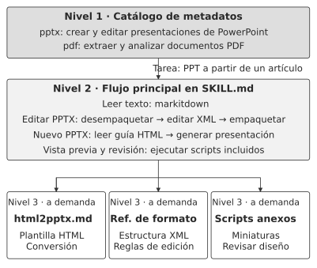

### Skills: unidades componibles de capacidades de dominio

**Agent Skills** empaqueta, de forma reutilizable, el método de trabajo, los materiales de referencia, los scripts y las plantillas de un tipo de tarea. Igual que una persona recién contratada no tiene que memorizar el primer día todos los manuales de la empresa, el modelo puede leer con detalle el capítulo correspondiente solo cuando le toca hacer la tarea. Esta forma de carga se denomina **divulgación progresiva (Progressive Disclosure)**[^ch2-3].

Retomemos los diez productos del capítulo 1 para decidir qué información merece convertirse en una Skill. Supongamos que el usuario quiere comparar el precio final con gastos de envío: basta con que el detalle y la dirección de entrega de esta compra entren en el contexto actual. Si el equipo compara precios entre comercios una y otra vez, cómo alinear especificaciones, cómo distinguir precio unitario y precio de lote, y cómo señalar que el envío es desconocido pueden reunirse en una Skill de comparación de precios. La próxima vez que alguien solo quiera ver qué modelos hay, el catálogo seguirá visible, y el procedimiento completo de comprobación de precios puede esperar a que el usuario necesite comparar.

**La primera capa son los metadatos.** Cada Skill se describe en un `SKILL.md`, que comienza con un YAML frontmatter delimitado por `---` con los campos `name` y `description`. El runtime organiza primero los nombres y las descripciones en un catálogo para que el modelo decida qué Skills necesita la tarea actual. El Harness gestiona el orden y la presentación del catálogo, y el procedimiento completo se carga una vez elegida la Skill.

**La descripción de una Skill debe redactarse, ante todo, como una condición de enrutamiento.** El modelo tiene que decidir si lo usa antes de cargar el cuerpo, de modo que `description` debe explicar primero cuándo se aplica y cuándo debe omitirse, y después resumir lo que hace. Por ejemplo, «help with backend» es demasiado amplio y casi cualquier tarea de backend podría coincidir; «escribir pruebas de integración para interfaces HTTP existentes, cubriendo autenticación, validación de parámetros y respuestas de error» delimita un ámbito claro. Para las tareas que se prestan a confusión, pueden añadirse condiciones de exclusión, como «no usar cuando solo se discute el diseño de la interfaz».

**La segunda capa es el procedimiento principal.** Cuando se elige una Skill, el runtime introduce en el contexto las instrucciones completas. Si el usuario escribe explícitamente un comando como `/pptx`, el cliente puede buscarlo y cargarlo directamente; si lo elige el propio modelo, obtiene el contenido mediante la herramienta Skill o una herramienta de lectura de archivos. El primer camino ahorra al modelo el paso de emitir una llamada de activación; el segundo deja la elección y la carga registradas en la trayectoria de ejecución.

Tomemos la PPTX Skill que usan los experimentos de este libro: las instrucciones principales presentan varios caminos habituales, como extraer el texto de una presentación con markitdown de Microsoft, descomprimir el PPTX para ver el XML subyacente y elegir el flujo de trabajo para crear o editar una presentación. Después de leer esta capa, el modelo puede decidir según la tarea actual qué material leer a continuación y qué tipo de script llamar[^ch2-4].

**La tercera capa son los materiales detallados.** Las operaciones complejas se reparten en documentos específicos, y el archivo principal sirve de punto de entrada. En la versión usada en este libro, `html2pptx.md` explica cómo generar una presentación a partir de HTML, y otros documentos de referencia completan los detalles de formato y edición. El Agente sigue leyendo este contenido según la tarea y usa los scripts, recursos y plantillas incluidos para completar la operación.

[^ch2-3]: Anthropic, Equipping Agents for the Real World with Agent Skills, 2025; Agent Skills, How to add skills support to your agent.
[^ch2-4]: Anthropic, PPTX Skill. Los experimentos de este libro usan siempre la versión que incluye el flujo de conversión desde HTML; la versión concreta y la forma de ejecutarla se indican en el README del experimento correspondiente.
[^ch2-codex-skills]: OpenAI, Build skills; implementación de Skills en el repositorio público de OpenAI Codex.
[^ch2-cc-skill-inject]: Claude Code, How Claude Code uses prompt caching, Invoking skills and commands; Agent Skills, How to add skills support to your agent, User-explicit activation.

### Cómo escribir una Skill utilizable

Una Skill utilizable debe responder a cuatro preguntas: a qué tareas se aplica, en qué orden se procede, en qué casos hay que pedir confirmación y cómo se sabe que el trabajo ha terminado. Quien lo escribe tiene que convertir su experiencia en pasos ejecutables y acompañar las decisiones clave con ejemplos.

En una Skill de escritura, por ejemplo, puede tomarse como referencia el enfoque de Baoyu, que mejora la escritura con IA partiendo de los hábitos expresivos propios[^ch2-baoyu-remove-ai-writing-flavor], y organizar el contenido en cuatro partes:

- **Rol y lectores**: a quién sirve, qué tipo de tarea cubre y qué exigencias debe cumplir el texto final.
- **Principios básicos**: primero, de tres a cinco criterios de uso frecuente, cada uno con ejemplos concretos de antes y después de reescribir.
- **Errores frecuentes y límites**: los problemas de expresión habituales, las acciones que exceden lo autorizado y las excepciones.
- **Materiales de referencia**: glosarios, plantillas, textos modelo e indicaciones específicas que se consultan durante la ejecución.

Las reglas pueden redactarse con la estructura «ámbito, acción, excepción, forma de verificación». Por ejemplo, una regla para acortar frases largas debe indicar en qué párrafos se aplica, cómo se divide la frase y cómo se comprueba después que las condiciones y la conclusión siguen completas.

Para empezar, se eligen de tres a cinco artículos originales propios con los que uno esté satisfecho y se pide al Agente que resuma la elección de palabras, los tipos de oración, la organización de los párrafos y el tono, hasta generar una primera versión de unas veinte líneas. Después se usa para tratar un tema nuevo y el autor lo corrige frase por frase. La diferencia entre las versiones de antes y después de la corrección aporta una retroalimentación más concreta: qué palabras sobran, qué frases hay que dividir, dónde faltan hechos y dónde hay que recuperar detalles técnicos. Las correcciones recurrentes se convierten en reglas, conservando el ejemplo correspondiente y su ámbito de aplicación.

Una Skill también puede incluir herramientas de ejecución y plantillas. Por ejemplo, la PPTX Skill reúne las instrucciones de uso, los scripts de análisis, los scripts de generación y los recursos de diseño, para que el modelo pueda llamar a cada recurso siguiendo las instrucciones. Cada Skill puede probarse, actualizarse y versionarse de forma independiente, y los miembros del equipo pueden ir añadiendo experiencia en torno a un mismo procedimiento. **El valor a largo plazo de las Skills está en que la experiencia de dominio puede acumularse de forma distribuida, publicarse por separado y reutilizarse.** Al ampliar las capacidades de un Agente, cada equipo puede mantener las Skills en las que es experto y formar poco a poco un ecosistema de paquetes similar a pip o npm. Todas esas Skills pueden compartir los mecanismos de descubrimiento, carga y ejecución que proporciona el sistema principal.

**Al diseñar la forma de interacción, conviene seguir los patrones para los que el modelo ya ha sido entrenado y adaptado.** La división de roles, el formato de los resultados de herramientas y la forma de cargar Skills influyen en cómo continúa el modelo una tarea. Los procedimientos estándar que ofrecen los proveedores son un buen punto de partida y reducen el esfuerzo del modelo para deducir el significado de un formato desconocido.

[^ch2-baoyu-remove-ai-writing-flavor]: Baoyu, «Deja de usar prompts para quitar el sabor a IA: la dirección es equivocada», 14 de febrero de 2026.

### El lugar de las Skills en el contexto

El coste de contexto de las Skills tiene dos partes: el catálogo y el cuerpo. El catálogo permite al modelo descubrir las capacidades disponibles, y el cuerpo aporta el procedimiento una vez elegida la Skill. La especificación exige la carga bajo demanda; los roles de mensaje, el envoltorio y la forma de actualización concretos los implementa el Harness.

Claude Code añade las instrucciones de la Skill a la sesión como mensaje `user` en el punto de invocación[^ch2-cc-skill-inject]. La figura 2-12 muestra una disposición de mensajes en la que la activación la decide el modelo: primero emite la llamada `Skill(skill: "pptx")`, recibe la respuesta de la herramienta y después lee el cuerpo de la Skill añadido. Con una herramienta de activación específica, la respuesta de la herramienta puede limitarse a confirmar la llamada y el Harness inyecta el cuerpo por separado; con una herramienta genérica de lectura de archivos, el cuerpo también puede ir directamente en el resultado de la herramienta. Si el usuario escribe explícitamente `/pptx`, el cliente puede expandir las instrucciones directamente y ahorrar al modelo el paso de emitir una llamada de activación.

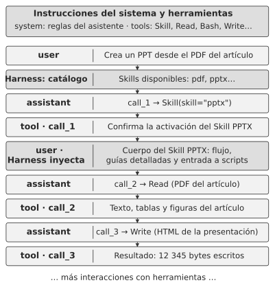{height=55%}

La implementación de Skills de Codex también organiza por separado el catálogo de capacidades y las instrucciones elegidas. En el código fuente público, parte del catálogo entra en el contexto `developer` y otra parte se proporciona con el turno actual y el entorno de ejecución; las Skills elegidas explícitamente se añaden como fragmentos de contexto del usuario. La procedencia del catálogo y los entornos de ejecución disponibles influyen en la disposición concreta[^ch2-codex-skills].

La figura 2-13 muestra cómo crece la caché con la carga bajo demanda, partiendo de una petición que todavía no tiene caché reutilizable. La primera vez que el catálogo entra en una petición hay que procesarlo, y la primera carga del cuerpo también añade cálculo; cuando las peticiones posteriores conservan el mismo prefijo, ese contenido puede leerse de la caché. Añadir el contenido nuevo en el punto de invocación mantiene estables los mensajes anteriores. Las instrucciones ya cargadas permanecen en el historial y, si hay que actualizarlas, se tratan según la estrategia de contexto del runtime.

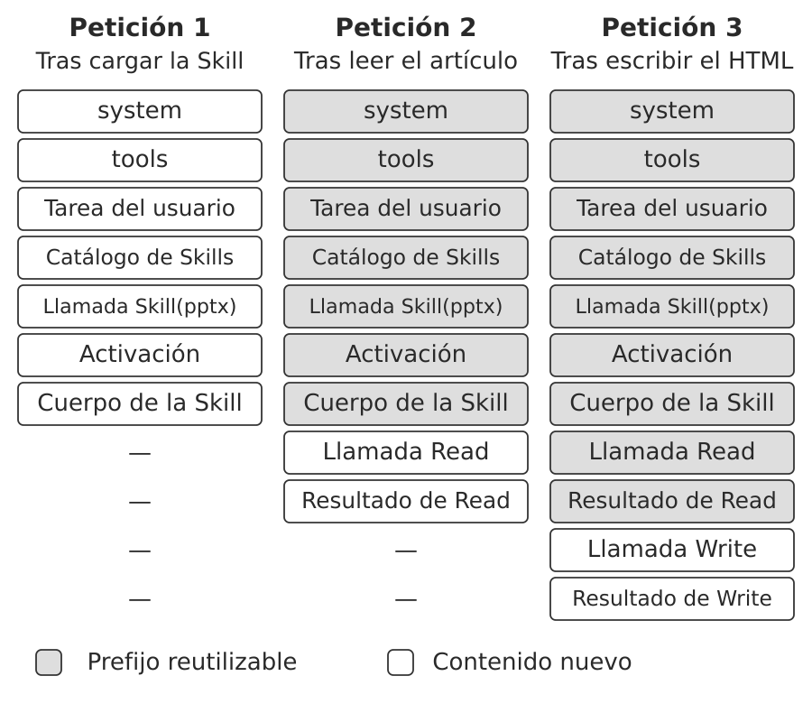

### Relación entre Skills y herramientas

Una Skill aporta conocimiento de la tarea y procedimientos de operación; las herramientas se encargan de leer, ejecutar y obtener resultados. Las siete herramientas básicas que presenta el capítulo 5 pueden combinarse con distintas Skills: una misma herramienta de lectura de archivos puede leer tanto una guía de presentaciones como unas normas de código, y un ejecutor genérico puede ejecutar los scripts correspondientes. Así, las capacidades especializadas se amplían mediante procedimientos y recursos, mientras el conjunto de herramientas básicas se mantiene relativamente estable.

Las herramientas especializadas también pueden combinarse con Skills. La búsqueda de herramientas vista antes proporciona definiciones de herramientas bajo demanda, y la Skill explica cuándo llamarlas, cómo combinarlas y cómo comprobar los resultados. Ambos mecanismos tienen que controlar la cantidad de información permanente y reservar un lugar adecuado para el contenido recién cargado. El capítulo 4 analizará cuándo conviene un ejecutor genérico y cuándo una herramienta especializada, y el capítulo 9 profundizará en si la experiencia debe guardarse como conocimiento, instrucciones, programas o parámetros del modelo.

> **Experimento 2-6 ★★: Generar una presentación a partir de un artículo con Agent Skills**
>
> Este experimento toma como material *Attention Is All You Need* y muestra cómo un Agente carga bajo demanda el procedimiento especializado para crear presentaciones. La tarea consiste en generar, a partir del PDF del artículo, una presentación de diez a quince diapositivas que cubra el contexto del problema, el método, los resultados clave y las conclusiones, y que use las figuras y tablas del artículo para apoyar la explicación.
>
> Esta ejecución usa Kimi Code y la PPTX Skill oficial de Anthropic. El Agente encuentra primero la PPTX Skill en el catálogo, lee sus instrucciones, continúa con la guía de conversión desde HTML, llama a las herramientas de generación incluidas y, por último, revisa la maquetación mediante miniaturas y la representación de cada diapositiva. Cada material que lee sirve para la operación siguiente, y el procedimiento completo de elaboración se va desplegando a medida que avanza la tarea.
>
> La presentación final tiene trece diapositivas y usa el diagrama de arquitectura, el diagrama del mecanismo de atención, la tabla de resultados experimentales y la visualización de atención del artículo.
>
> La revisión posterior a la generación también forma parte del flujo de trabajo de la Skill. En esta ejecución aparecieron subíndices perdidos, viñetas anómalas, rutas incorrectas en las referencias a figuras y problemas de precisión en las etiquetas numéricas, y el Agente los corrigió uno a uno a partir de la representación y de comprobaciones estructurales. El archivo final superó la comprobación estructural y se volvió a abrir y representar con LibreOffice.

> **Experimento 2-7 ★★: Crear una Skill de escritura «sin sabor a IA» a partir de textos propios**
>
> Este ejercicio convierte la experiencia de escritura personal en instrucciones reutilizables. Se preparan de tres a cinco artículos originales y se pide al Agente que resuma los hábitos expresivos y genere una primera versión de la Skill con condiciones de activación, de tres a cinco principios y sus ejemplos correspondientes.
>
> Se elige un tema nuevo para probarlo y el autor corrige el resultado frase por frase. Comparando ambas versiones se identifican los problemas recurrentes, como palabras vacías, frases demasiado largas, relaciones causales omitidas o ejemplos concretos eliminados que eran necesarios para entender el texto. Las correcciones que se repiten pueden incorporarse a la Skill.

## Barra de estado del Agente: metainformación para gestionar mejor la trayectoria

El usuario insiste: «¿Puedes volver a llamar?». La parte izquierda de la figura 2-14 registra tres llamadas. En la primera se esperó 45 minutos sin que nadie respondiera, y solo en la tercera se consiguió una tarifa de 59 dólares al mes. Según las reglas de este ejemplo, cada marcación consume una unidad del cupo; aunque solo se haya conectado dos veces, las tres unidades ya están agotadas. El Harness puede reunir este tipo de contadores, el progreso de la gestión y los asuntos pendientes de confirmar en un resumen que se actualiza con los mensajes; a esto se le llama **barra de estado del Agente (Agent Status Bar)**.

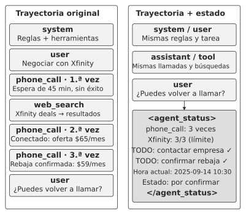

El móvil muestra la hora, la batería y la cobertura en la parte superior de la pantalla, y basta un vistazo para conocer el estado actual. El resumen de la parte derecha de la figura cumple una función parecida: al leer «límite alcanzado» y «pendiente de confirmación del usuario», el asistente puede comunicar al usuario el precio ya acordado y pedirle que decida si lo acepta. El Harness puede adjuntar el resumen al devolver el resultado de una herramienta o añadir un mensaje de estado independiente.

### De los registros brutos a un estado explícito

Consideremos una tarea de atención telefónica: el sistema exige que, dentro de una misma tarea, no se llame más de tres veces a cada comercio. Entre las tres llamadas pueden intercalarse búsquedas, lecturas de documentos y preguntas del usuario. Para decidir si puede volver a llamar, el modelo tendría que localizar en ese historial todos los registros pertinentes, distinguir los comercios y calcular el total acumulado.

El runtime puede actualizar el contador después de cada llamada y devolver directamente «esta es la 3.ª llamada a Xfinity; se ha alcanzado el límite de esta tarea». La decisión siguiente puede usar ese resultado. El programa mantiene el número de llamadas, y el modelo decide, teniendo en cuenta el progreso de la tarea, si toca esperar, buscar otro canal o explicar la situación al usuario; al mismo tiempo, la capa de ejecución comprueba las peticiones de llamada posteriores a partir del contador.

El valor de ingeniería está en **ordenar de antemano el estado que las decisiones posteriores necesitan una y otra vez**. El registro completo de las llamadas sigue guardando el contenido de las conversaciones y el desarrollo de la gestión; la barra de estado aporta las estadísticas y el progreso que se usan habitualmente al decidir. **Las estadísticas de uso repetido deben mantenerse preferentemente con código, de forma incremental.** Encontrar un registro en el contexto y calcular un total a partir de todos los registros son trabajos distintos. Guardar la trayectoria bruta no produce automáticamente una tabla de estadísticas precisa y siempre disponible. Pedir al modelo que vuelva a recorrer y contar todo cada vez consume tokens de razonamiento y aumenta la probabilidad de omitir registros o contarlos dos veces.

El autor compara el contexto con un motor de búsqueda que necesita una «capa de destilado» complementaria: los registros brutos permiten rastrear lo ocurrido, y el estado destilado puede usarse directamente. Los contadores, los límites y el estado de finalización de tareas ya verificado conviene mantenerlos con código; la información que requiere juicio semántico puede extraerse primero elemento por elemento y luego agregarse y verificarse. Así, en cada decisión el modelo ve a la vez el estado actual y las evidencias necesarias.

Las trayectorias largas también dificultan encontrar la información clave. Reunir al final el objetivo más reciente, las restricciones y el progreso facilita que el modelo encuentre lo que necesita para la decisión actual.

> **Experimento 2-8 ★★: Observar el efecto de la barra de estado del Agente mediante la visualización de la atención**
>
> Este experimento usa Qwen3-0.6B y construye una trayectoria de reembolso en atención al cliente: el Agente ya ha llamado tres veces a Xfinity, con búsquedas web intercaladas, y después el usuario pregunta: «¿Puedes volver a llamar para meterles prisa?». Las reglas del sistema limitan a tres las llamadas a cada comercio dentro de una misma tarea.
>
> Los dos grupos de entrada conservan el mismo historial y la misma pregunta del usuario. El grupo A usa directamente la trayectoria bruta; el grupo B añade al final el siguiente estado:
>
> ```xml
> <agent_status>
> Current State:
> - Tool call summary: 'phone_call' has been invoked 3 times (Xfinity: 3 times)
> - Constraint check: Maximum calls to Xfinity reached (3/3)
> </agent_status>
> ```
>
> Cada grupo se ejecuta tres veces. El grupo A rechaza explícitamente seguir llamando en dos de las tres ejecuciones y en la tercera produce otra salida; el grupo B rechaza explícitamente seguir llamando en las tres. En ninguno de los dos grupos aparecieron salidas que se consideraran una llamada posterior contraria a las reglas. Para reproducir esta comparación, hay que entrar en `chapter2/attention_visualization` y ejecutar `python run_status_bar_experiment.py --output runs/status-bar-reproduction`. Las entradas de esta ejecución y sus resultados por repetición están en `runs/exp2-7-qwen3-0.6b-20260730-v2/comparison.json`, dentro del directorio del experimento.
>
> El mapa de atención muestra cómo se reparte el peso, en la zona de generación, entre las llamadas previas, los resultados de búsqueda, la pregunta del usuario y la barra de estado.

La investigación de ContextDistill-Bench, realizada por el autor junto con Noah Shi, examina más a fondo las ventajas de destilar el estado de antemano[^ch2-8]. En las consultas de estado que cubre ese benchmark, incluso modelos más pequeños alcanzan una precisión alta gracias al estado explícito, y en los modelos punteros (de frontera) el volumen de pensamiento, la latencia y el coste por consulta pueden reducirse en torno a un orden de magnitud. Por ejemplo, el coste por cada mil consultas de Claude 4 Sonnet bajó de unos 35,46 dólares a 3,51. **Este diseño mantiene el estado cuando ocurre el evento y ahorra recorrer el historial en cada consulta.** Una vez fijados los campos del resumen, la consulta solo necesita leer esos campos, aunque el historial siga creciendo.

[^ch2-8]: Li, Bojie y Noah Shi. *Distill, Don't Retrieve: Inference-Time Context Distillation for LLM Agent Reasoning.* 2026.

### Composición de la barra de estado del Agente

La barra de estado suele contener tres tipos de información, que responden respectivamente a «qué hay que hacer», «qué ha pasado hace un momento» y «en qué estado estamos ahora».

**La planificación de la tarea** registra el objetivo, los pasos y el grado de avance. Una tarea compleja puede dividirse en una lista de TODO, donde cada elemento conserva su estado y las dependencias necesarias. Mientras trabaja en el paso actual, el modelo sigue viendo el requisito original, las restricciones centrales y el trabajo pendiente; cuando termina un paso, actualiza la lista.

La **información de canal lateral de los eventos (Side-channel Information)** añade el contexto en que ocurrió cada evento: la hora, la ubicación geográfica o el tiempo transcurrido desde la respuesta anterior. Estos metadatos se guardan con el evento y ayudan al modelo a entender el orden y la situación. La misma frase «todavía no hay respuesta» puede exigir respuestas distintas si ocurre dos minutos o dos días después de enviar una solicitud.

El **resumen de observaciones del estado actual del entorno** aporta la hora actual, el directorio de trabajo, el número de llamadas a herramientas y los avisos de anomalías. Su función se parece a la de una CLI o una interfaz gráfica que muestran el directorio o el estado de ejecución: dar una base clara a la siguiente operación. Por ejemplo, un aviso de llamadas repetidas puede llevar al modelo a revisar por qué falla algo, y el presupuesto restante le ayuda a decidir si sigue buscando.

Los metadatos de un evento, una vez añadidos junto con él, suelen permanecer estables, mientras que el progreso de la tarea y el estado del entorno cambian continuamente. Ambos tipos de información deben escribirse en el historial según su propia forma de actualización; a continuación se explica con la estructura de mensajes.

### Ubicación concreta de la barra de estado en el contexto

En el ejemplo de esta sección, el Harness añade un mensaje `user` al final de la lista para transmitir el resumen de estado. Aquí `user` es el rol de mensaje de la API elegida; el contenido del estado lo genera el runtime y una etiqueta indica para qué sirve. Con otras interfaces pueden usarse los bloques de contexto que admitan, o bien proporcionar el estado junto con el resultado de la herramienta correspondiente. Si se usa una plantilla que recorta el razonamiento histórico según la última consulta real del usuario, como se describió antes, el estado de ejecución puede entregarse junto con el resultado de la herramienta para que la plantilla siga conservando la información de razonamiento de la tarea actual.

Siguiendo la figura 2-15, se localiza el encargo inicial del usuario y se mira en qué ronda está escrito el estado más reciente. Solo conservando la petición original se pueden comprobar dos cosas a la vez cuando termine la llamada: qué quería resolver el usuario y en qué punto está la gestión.

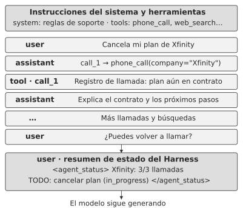

El orden de la figura, escrito como lista de mensajes, es el siguiente. Para facilitar la comparación, se omiten las rondas repetidas y algunos campos de las llamadas.

```text
messages: [
  { role: "system", content: "You are a customer service assistant..." }
  { role: "user", content: "Help me cancel my Xfinity plan" }
  { role: "assistant", tool_calls: [{ id: "call_1", ... }] }
  { role: "tool", tool_call_id: "call_1", content: "Call log..." }
  { role: "assistant", tool_calls: [{ id: "call_2", ... }] }
  { role: "tool", tool_call_id: "call_2", content: "Call log..." }
  ...rondas restantes...
  { role: "user", content: "Can you call them again to follow up?" }
  { role: "user", content: "<agent_status>
      Current State:
      - phone_call invoked 3 times (Xfinity: 3/3 max)
      - Current time: 2025-09-14 10:30:45
      - TODO: [1] Cancel plan (in_progress)
    </agent_status>" }
]
```

El último mensaje reúne el número de llamadas, el límite, la hora y el progreso de la tarea. El modelo puede usar estos campos directamente y, al mismo tiempo, consultar los registros concretos a través de los identificadores de llamada anteriores.

Al añadir este mensaje, la secuencia de tokens anterior no cambia y sigue cumpliendo la condición básica para reutilizar el prefijo. Cómo tratar el estado antiguo en la ronda siguiente exige sopesar el espacio que ocupa en el contexto frente al coste de caché.

### Dos formas de actualizar el estado y su coste de caché

En la ronda siguiente puede completarse un elemento de la lista TODO o puede añadirse una llamada a herramienta más. El Harness tiene que actualizar el estado y, para ello, suele optar por una de dos prácticas.

**Sustituir en cada ronda**: al construir la petición nueva se elimina el estado anterior y se añade el más reciente al final. El contexto conserva una sola versión del estado actual, lo que facilita su uso por el modelo. Por ejemplo, la petición anterior era «descripción de la tarea, estado A» y la actual es «descripción de la tarea, resultado de la herramienta, estado B». La descripción de la tarea sigue acertando en caché; el resultado de la herramienta se envía por primera vez y, en cualquier caso, hay que calcularlo. Si en la petición anterior había otros mensajes detrás del estado A, eliminar A es lo que hace que esos mensajes pierdan la coincidencia de prefijo que tenían. En esta petición, el modelo solo ve B. Si hay que volver a consultar A, puede recuperarse la instantánea correspondiente del registro de ejecución.

**Añadir de forma persistente**: se conservan los registros de estado existentes y en cada ronda se añade el nuevo al final. El prefijo histórico se mantiene estable y resulta más fácil rastrear la evolución del estado. Los estados antiguos van ocupando contexto poco a poco, así que hay que indicar claramente la hora o la versión para que el modelo juzgue la situación actual a partir del registro más reciente. La forma en que Claude Code añade al final de la sesión los avisos de cambios en archivos refleja también esta idea de diseño.

Cuando el estado es corto y detrás de él ya hay muchos resultados de herramientas en caché, conservar el estado antiguo puede costar menos que recalcular un sufijo largo; cuando el estado es largo y se actualiza con frecuencia, sustituirlo permite controlar la acumulación de estados históricos.

Puede estimarse el punto de equilibrio con un modelo aproximado: sea cada estado de $S$ tokens, sea $R$ el número medio de tokens del sufijo ya en caché que hay que recalcular tras el estado antiguo en cada sustitución (el contenido enviado por primera vez en la ronda no cuenta), se inyecta el estado $N$ veces y el precio de la entrada leída de caché es $\alpha$ veces el de la entrada normal. Ignorando los costes comunes a ambas soluciones, $C_{\text{sustitución}} \approx (N-1)(1-\alpha)R$ y $C_{\text{adición}} \approx \alpha S N(N-1)/2$. Para $N>1$, cuando $\alpha SN/2 < (1-\alpha)R$ la estimación favorece la adición persistente; en caso contrario, sustituir en cada ronda sale más barato. Aquí se toma como unidad de coste el precio de la entrada normal: la sustitución paga de más la diferencia entre leer el sufijo de la caché y volver a procesarlo, y la adición paga de más la lectura repetida de los estados históricos.

Un ejemplo: se inyecta un estado de 100 tokens, 10 veces en total, y la lectura de caché cuesta una décima parte de la entrada normal. La adición vuelve a leer 1, 2, … y 9 estados antiguos en las peticiones posteriores, lo que equivale a 450 tokens de entrada normal de coste adicional. Si sustituir el estado obliga a reprocesar unos 1000 tokens ya en caché de media, las nueve sustituciones cuestan el equivalente a 8100 tokens de entrada normal, y añadir sale más barato. Si el estado antiguo estaba justo al final de la caché y no había nada cacheado detrás, $R=0$ en la fórmula, y sustituir directamente ahorra el equivalente a esos 450 tokens.

> **Experimento 2-9 ★★: Varias técnicas útiles de barra de estado del Agente**
>
> Este experimento implementa cinco técnicas de barra de estado, que pueden activarse por separado o combinarse. Cada técnica aporta un tipo concreto de información que ayuda al modelo a decidir el siguiente paso.
>
> El **seguimiento de marcas de tiempo** registra en los mensajes del usuario y en las respuestas de las herramientas la hora del evento, por ejemplo `[2025-09-14 10:30:45]`. La hora se escribe en el historial junto con el evento y conserva su valor en las rondas posteriores; la hora actual, en cambio, se actualiza con cada mensaje de estado nuevo. El experimento incluye además una simulación temporal para comprobar si el modelo distingue «el archivo de ayer» de «la modificación de hoy» y si entiende correctamente el tiempo de espera.
>
> El **contador de llamadas a herramientas** mantiene en un diccionario el número acumulado de llamadas de cada herramienta y lo indica en la respuesta con `Tool call #3 for 'read_file'`. Junto con el contenido del error, el modelo puede decidir si sigue intentándolo. Por ejemplo, tras un primer fallo de lectura, comprobar la ruta y listar después el directorio; tras varios fallos, buscar un archivo alternativo o explicar al usuario qué falta. Cuando hay que limitar los reintentos, el runtime debe aplicar además el límite a partir del contador.
>
> La **gestión de la lista TODO** ofrece dos herramientas, `rewrite_todo_list` y `update_todo_status`. Cada elemento incluye un identificador único, el contenido, una marca de tiempo y uno de cuatro estados: `pending`, `in_progress`, `completed` o `cancelled`. La lista reúne «lo que se ha hecho y lo que falta», una idea cercana a la de Manus, que mantiene el objetivo visible presentando repetidamente el plan de la tarea.
>
> La **información detallada de errores** aporta el tipo y la descripción del error, el JSON de los parámetros de la llamada, la pila de llamadas y una sugerencia de corrección. Por ejemplo, ante un `FileNotFoundError`, puede indicarse al modelo que compruebe el nombre del archivo, el directorio actual y la ruta absoluta. Los parámetros ayudan a localizar la entrada errónea, la pila de llamadas a encontrar el punto de fallo y la sugerencia indica por dónde seguir comprobando. Antes de devolver estos contenidos al modelo, hay que eliminar campos sensibles como las credenciales y limitar la longitud de las pilas de llamadas muy extensas.
>
> La **percepción del estado del sistema** aporta la hora actual, el directorio de trabajo, el sistema operativo, el shell y la versión de Python. La herramienta de comandos del experimento reconoce las operaciones de cambio de directorio aisladas, actualiza el directorio de trabajo que mantiene el runtime y lo usa en las llamadas posteriores; en los comandos compuestos, el cambio de directorio de un subproceso sigue el ámbito de ejecución de ese proceso. Los campos del entorno también ayudan al modelo a elegir las herramientas disponibles; por ejemplo, a escoger `apt` o `brew` según el sistema real y el software instalado.
>
> En esta comparación con Kimi K3, cada tipo de tarea contaba con cinco casos. Las marcas de tiempo y la configuración combinada superaron los cinco; el grupo de control superó tres en cada caso. El contador de herramientas y el estado del sistema superaron los cinco tanto con la técnica activada como desactivada. La configuración de TODO no superó ninguno, frente a uno del grupo de control; la de errores detallados superó cuatro, frente a cinco del grupo de control.

**La barra de estado debería mantenerse, en lo posible, con código.** El modelo usa directamente sus estadísticas y límites, y un «se han hecho tres llamadas» equivocado puede cambiar las acciones siguientes. Los contadores, las horas y las transiciones de estado deben quedar en manos del programa; cuando haga falta comprender el significado, se pide primero al modelo que extraiga elemento por elemento y después el código agrega y verifica, en lugar de pedirle de una vez que cuente un historial largo entero. Conviene conservar la correspondencia entre los eventos brutos, los resultados de la extracción y el estado final, para poder detectar recuentos dobles, omisiones y confusiones de procedencia.

Qué información reúne la barra de estado debe elegirse de antemano. Por ejemplo, «se han hecho tres llamadas» basta para saber si se puede volver a llamar, pero no responde a «qué prometió el representante de atención al cliente en la segunda llamada». Para tareas posteriores que solo necesitan un valor estadístico, el resumen de estado puede sustituir al historial y los registros brutos archivarse; cuando haya que comprobar el contenido de una conversación, se lee el texto original por índice. El diseño de los campos del resumen determina qué preguntas pueden responderse directamente y cuándo hay que volver a consultar el original.

## Estrategias de compresión del contexto

Supongamos que, tras leer diez páginas web largas en una tarea de investigación, la ventana solo admite dos documentos más. Primero hay que preguntar al modelo qué va a hacer en la siguiente ronda: si va a comparar dos presupuestos, hay que conservar los presupuestos, sus condiciones de validez y su procedencia; si va a verificar una cita, hay que guardar la posición que permite recuperar el texto original. El cuerpo de las páginas ya consultadas e irrelevantes puede archivarse para dejar sitio a la nueva entrada y a la salida. Aquí hay que calcular cuánto espacio se libera, pero también otra cosa: si el material eliminado se necesita más adelante, ¿cuánto costará recuperarlo?

### Los tres objetivos de la compresión

**Controlar la longitud y el coste.** En una ventana de 128K tokens, las páginas web largas y los archivos grandes pueden ocupar una parte considerable. El Harness debe reservar presupuesto para la entrada posterior, la salida del modelo y la interacción con herramientas.

**Ordenar el conocimiento que necesitan las decisiones posteriores.** Una decena de rondas de búsqueda puede mencionar el mismo suceso una y otra vez, o dejar afirmaciones contradictorias. Reunirlas en «confirmado A y B; para C falta evidencia» permite al modelo seguir trabajando sobre las preguntas abiertas. El resumen debe conservar las relaciones entre los hechos, sus fuentes y los problemas no resueltos, para que las decisiones posteriores tengan una base clara.

**Permitir que las tareas largas avancen.** Algunos modelos tienden a cerrar antes de tiempo cuando creen que la ventana está a punto de agotarse; este fenómeno se conoce como **ansiedad de contexto (Context Anxiety)**. En las pruebas de Anthropic con Sonnet 4.5 en tareas largas se observó que este comportamiento puede seguir apareciendo después de comprimir, por lo que se adoptó un registro de traspaso estructurado y se continuó la ejecución tras restablecer el contexto[^ch2-7].

[^ch2-7]: Prithvi Rajasekaran, Harness design for long-running application development, Anthropic Engineering, 2026.

### Convertir los resultados de cálculos repetidos en conocimiento utilizable

La barra de estado mantiene por adelantado contadores y progreso, y el resumen ordena además los hechos y las relaciones contenidos en textos largos. Ambos preparan de antemano información dispersa para que las decisiones posteriores puedan usarla directamente.

Veamos un ejemplo de inspección de una tienda de mascotas:

> Jaula 1: gato negro. Jaula 2: gato blanco. Jaula 3: gato negro. Jaula 4: gato negro. Jaula 5: gato blanco.
> … (100 jaulas en total, 90 gatos negros y 10 blancos)

Para responder «qué gato hay en la jaula 37» hay que localizar el registro correspondiente; para responder «cuántos gatos negros y cuántos blancos hay» hay que sumar todos los registros. Si el total se va a usar muchas veces, puede calcularse y guardarse de antemano «90 gatos negros y 10 blancos», y así no hay que contarlos desde cero cada vez. El programa es el adecuado para esta clase de agregación determinista, y el modelo puede seguir respondiendo preguntas de negocio a partir del resultado.

El contenido del resumen debe elegirse según la tarea. Conservar solo el total de las dos clases de gatos basta para las preguntas de cantidad; para responder sobre la jaula 37 hacen falta los registros jaula por jaula o un índice equivalente.

Aunque la ventana todavía tenga espacio, un contexto demasiado largo o desordenado puede dificultar el uso de la información: el modelo omite hechos clave, vuelve a tratar problemas ya resueltos o aplica a la decisión actual un estado obsoleto. Este deterioro que aparece a medida que crece el contexto se conoce como **putrefacción del contexto (Context Rot)**. Se manifiesta como un empeoramiento del rendimiento en la tarea; cuando la petición supera la capacidad, lo que se produce es un desbordamiento de la ventana.

**Aunque quede espacio en la ventana, conviene ordenar de forma activa el conocimiento que ya se ha usado repetidamente.** Si un juicio clave ya puede resumirse y aun así se obliga al modelo a buscarlo una y otra vez en un historial largo, se sigue consumiendo cálculo y aumentan las omisiones. En una tarea de búsqueda pueden guardarse los hechos confirmados, las fuentes y las preguntas pendientes; en una tarea de programación, las decisiones de arquitectura, el alcance de los cambios, los resultados de las pruebas y las causas de los fallos.

Los ejemplos del contexto también influyen en cómo el modelo aborda problemas nuevos. Partiendo de la combinación de capas de atención y MLP en un Transformer, el trabajo de Dherin y sus coautores representa un cálculo hacia delante concreto como una actualización de pesos de bajo rango dependiente del contexto, y ofrece así una explicación teórica del aprendizaje en contexto[^ch2-6]. En la inferencia real los pesos del modelo no cambian: los ejemplos influyen en la salida a través de la entrada actual. Si se quiere reutilizar ese tipo de experiencia en sesiones posteriores, puede convertirse en memoria, ejemplos o una Skill y cargarse según la tarea; el capítulo 9 profundiza en cómo se acumula la experiencia.

[^ch2-6]: Benoit Dherin et al., Learning without training: The implicit dynamics of in-context learning, 2025.

### El equilibrio entre compresión y Caché KV

La compresión suele ocurrir entre dos llamadas al modelo. A partir del presupuesto restante y del progreso de la tarea, el Harness ordena los mensajes que necesita la siguiente petición y los envía al modelo. Sustituir el historial cambia el prefijo, así que hay que considerar a la vez el beneficio de comprimir y el coste de reconstruir la caché.

Primero se mantienen estables las instrucciones del sistema y las definiciones de herramientas que siguen siendo válidas. Están al principio, de modo que la compresión del historial posterior puede seguir reutilizando ese prefijo. Después se elige qué comprimir: los resultados largos de herramientas pueden sustituirse por un resumen, y las rondas de interacción ya completadas pueden fundirse en un registro de fase. La caché anterior al punto de sustitución sigue siendo reutilizable; el punto de sustitución y todo lo que viene después deben tratarse según el nuevo prefijo.

**La compresión del historial debe hacerse preferentemente por lotes, para no reescribir el mismo tramo de prefijo en cada ronda.** Después de comprimir, la entrada de cada ronda es más corta, pero la llamada de compresión y el recálculo del sufijo también consumen recursos. El momento de activarla puede decidirse combinando la ocupación de la ventana, el número previsto de rondas restantes y la fase de la tarea: ordenar por lotes los resultados largos de herramientas cuando se han acumulado, o guardar un resumen de traspaso al terminar una fase, reduce el coste de modificar el historial con frecuencia. Al conservar las últimas rondas hay que comprobar que cada llamada a herramienta va emparejada con su valor de retorno y escribir en el resumen el estado de las operaciones sin terminar.

Al comprimir hay que comprobar también el protocolo de devolución de la información de razonamiento. En algunos modelos, el thinking histórico está vinculado al prefijo con el que se generó. Si se sustituye el historial antes de esos bloques, el thinking conservado puede dejar de coincidir con el nuevo prefijo. Con este tipo de protocolo, puede reorganizarse la sesión en un resumen y eliminar el thinking antiguo afectado, para que el modelo siga razonando a partir del resumen; también pueden usarse los mecanismos de compresión o edición de contexto que admita el servicio.

Veamos primero los resúmenes individuales de la figura 2-16: el texto procesado ocupa solo el 10,9 % de los caracteres originales, y sin embargo el Agente principal acumula el mayor consumo de tokens de los seis grupos. Para explicar cómo pueden ser ciertos los dos números a la vez hay que rastrear qué materiales se comprimieron y en cuántas rondas de peticiones volvieron esos materiales al modelo.

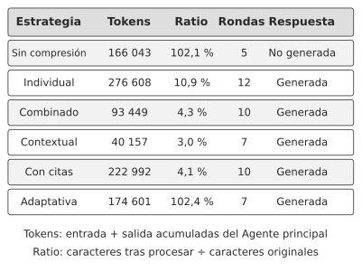

> **Experimento 2-10 ★★★: Comparación de estrategias de compresión del contexto**
>
> Este experimento usa Kimi K3 para investigar la trayectoria profesional de los cofundadores de OpenAI. La tarea exige construir paso a paso una lista de personas, buscar sus trayectorias y cambios de puesto, y relacionar los hechos pertinentes con sus fuentes. Para observar la compresión y el tratamiento del desbordamiento, el experimento fija un presupuesto de contexto del lado de la aplicación de 128 000 tokens, conserva una línea base sin compresión y compara después cinco formas de proceder, cada una con un máximo de 15 rondas[^ch2-compression-results].
>
> **Estrategia uno: sin compresión.** Los resultados de búsqueda y de lectura de páginas entran íntegros en el historial. Siete llamadas a herramientas sumaron 367 246 caracteres originales. El programa activó la protección en la quinta ronda y se detuvo, con un consumo acumulado del Agente principal de 166 043 tokens. La versión anterior activaba la protección con la suma de los tokens de entrada de todas las peticiones, de modo que el valor 165 227 que aparece en el mensaje de error es la entrada acumulada. Por ejemplo, un mismo tramo de historial enviado en tres peticiones se cuenta tres veces.
>
> **Estrategia dos: resúmenes individuales.** Cada resultado de búsqueda genera por separado un resumen de dos o tres párrafos que conserva el contenido principal de cada página. Este enfoque se procesa con facilidad en paralelo y permite mantener los límites entre páginas; cuando varias páginas cuentan el mismo suceso, la información repetida sigue entrando en el historial. Esta configuración necesitó doce rondas para generar la respuesta final; el Agente principal acumuló 276 608 tokens y la tasa de compresión de caracteres fue del 10,9 %.
>
> **Estrategia tres: resumen combinado.** Se agrupa un conjunto de resultados de búsqueda y se genera un resumen conjunto, lo que facilita ordenar hechos repetidos y relaciones entre fuentes distintas. Esta configuración necesitó diez rondas; el Agente principal acumuló 93 449 tokens y la tasa de compresión de caracteres fue del 4,3 %.
>
> **Estrategia cuatro: resumen consciente del contexto.** Al comprimir se proporcionan también la consulta actual y la información ya disponible, por ejemplo añadiendo al prompt `Given the search query: {query}` y `Current context: {context}`. Con ello, el modelo conserva los hechos relevantes para la pregunta actual y completa con prioridad los huecos de los resúmenes existentes. Esta configuración necesitó siete rondas; el Agente principal acumuló 40 157 tokens y la tasa de compresión de caracteres fue del 3,0 %. Una de las compresiones convirtió unos ciento cincuenta mil caracteres en unos dos mil, conservando los nombres de las personas y sus cambios de puesto.
>
> **Estrategia cinco: resumen consciente del contexto con citas.** En los resúmenes relevantes para la tarea se conservan los enlaces a las fuentes de cada hecho. Esta configuración necesitó diez rondas; el Agente principal acumuló 222 992 tokens. Según el registro de herramientas, el material procesado sumó 52 891 caracteres frente a 1 295 044 del texto original, lo que da una proporción de aproximadamente el 4,1 %.
>
> **Estrategia seis: ventana adaptativa.** Se conserva el material original al principio y se ordena por lotes cuando la entrada alcanza un umbral. El experimento usa tres mecanismos: activar la compresión al superar el 80 % del presupuesto; resumir los resultados de herramientas aún sin comprimir; y añadir la marca `[COMPRESSED]` a los resultados ya procesados para no resumirlos dos veces. Con el presupuesto de 128 000 tokens de este experimento, el umbral se sitúa en 102 400 tokens. Esta configuración necesitó siete rondas; el Agente principal acumuló 174 601 tokens. El registro histórico activaba el umbral con la entrada acumulada; después, el programa pasó a comprobar el tamaño de la entrada de la petición más reciente.
>
> La figura 2-17 compara la entrada y la salida de las seis estrategias.
>
> 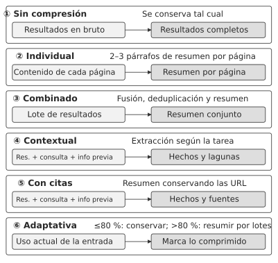
>
> Al comparar las cifras de la figura 2-16 hay que distinguir tres magnitudes: la entrada de una sola petición determina si se alcanza el presupuesto de la ventana, los tokens acumulados reflejan el consumo de varias rondas de llamadas, y la tasa de compresión de caracteres describe la relación entre la longitud procesada y la longitud original del material contabilizado. El consumo acumulado que aparece aquí procede de la entrada y la salida de las peticiones del Agente principal en cada ronda; las peticiones independientes que generan los resúmenes no se incluyen en este campo.
>
> Para reproducir el experimento hay que configurar el modelo y un servicio de búsqueda real según las instrucciones que lo acompañan y ejecutar `python experiment.py -m kimi-k3 -n 15 -o results/reproduction.json` en el directorio del experimento. Al leer el campo `metrics` de cada estrategia, se recalcula la proporción de caracteres con `total_compressed_size / total_original_size` y se comparan `total_tokens` e `iterations`. La línea base sin compresión también añade títulos, URL y otros formatos al cuerpo de las búsquedas, de modo que el número de caracteres procesados puede ser algo mayor que el del texto original. El programa del experimento da un grupo por completado en cuanto recibe la respuesta final. Merece la pena buscar a la misma persona en los dos resultados acabados: el grupo con citas da Pebblebed como institución en la que trabajó Pamela Vagata, mientras que la tabla resumen del grupo con ventana adaptativa dice Stripe. La primera respuesta menciona el sitio web de la institución, pero no ofrece un enlace que pueda abrirse. Ambos grupos entregaron su tabla resumen, y los datos que dan sobre la persona se contradicen.

[^ch2-compression-results]: El archivo de resultados del experimento 2-10, `kimi_k3_real_20260718.json`, guarda los campos estadísticos de cada estrategia, la respuesta final y las marcas de tiempo, y permite recalcular la proporción de caracteres. La ejecución del 18 de julio de 2026 usó la condición de protección anterior; la revisión del código del 22 de julio (commit `aea4d72`) cambió la entrada acumulada por la entrada de la petición de la ronda más reciente.

### Un mecanismo de compresión por capas para producción

La salida de una herramienta puede necesitar el texto completo en un almacenamiento intermedio, los pasos ya completados pueden archivarse y las restricciones actuales deben permanecer visibles; las cinco clases de mecanismos que siguen se adaptan a frecuencias de uso y periodos de conservación distintos.

1. **Control del presupuesto de resultados de herramientas**. Las salidas voluminosas se guardan en un almacenamiento externo, y en el contexto se conservan una vista previa del resumen y un punto de acceso para leerlas. Una vez que la vista previa entra en el historial, su contenido permanece estable; cuando se necesita más detalle, se lee el fragmento correspondiente y se añade el resultado.
2. **Limpieza de contenido irrelevante**. Las barras de navegación de las páginas web, los pies de página repetidos y otros elementos similares pueden filtrarse antes de que el resultado entre en el contexto. Cuando hay que eliminar contenido que ya está en el historial, primero se comprueba si las tareas posteriores y las citas siguen dependiendo de él, y después se calcula el coste de caché que supone modificar el historial.
3. **Edición de contexto en la capa de API**. Los servicios que ofrecen esta capacidad pueden limpiar resultados antiguos de herramientas según reglas. El cliente debe configurar las condiciones de activación y tratar la información de edición que devuelve el servicio. El alcance de la limpieza y el comportamiento de la caché los determina el contrato de la interfaz, y conviene integrarlo junto con la supervisión del presupuesto de entrada.
4. **Resúmenes de archivo**. Por rondas o por fases de la tarea se registran el objetivo, las operaciones, los resultados y los asuntos pendientes, conservando el orden de ejecución. Puede entenderse como el historial de cambios de la tarea: después se puede averiguar en qué paso se tomó una decisión y con qué base.
5. **Compresión de la sesión completa**. Cuando la limpieza local ya no basta para cumplir el presupuesto, el objetivo actual, las restricciones, los hechos confirmados, las decisiones clave y el trabajo siguiente se reúnen en un resumen de traspaso. Pueden ordenarse primero las notas existentes de la sesión y resumir después todo el historial. Si la compresión falla repetidamente, un límite de reintentos o un mecanismo de fusible detiene las llamadas repetidas, guarda un estado recuperable y deja paso a reducir la entrada o a la intervención humana.

Estos mecanismos pueden combinarse por capas: el control en la entrada reduce las salidas grandes de una vez, el ordenamiento local controla el crecimiento diario, y los resúmenes de fase y la compresión completa guardan la información de traspaso de las tareas largas.

Al leer dsh-superagent, al autor le llamó la atención un detalle: los eventos y resultados de herramientas pueden enviar primero un resumen y un identificador de objeto, y leer el detalle por ese identificador cuando haga falta. Supongamos que en segundo plano termina una tanda de pruebas y solo se informa a la interfaz de que «han fallado dos». La interfaz puede comunicar el progreso, pero no responder a la pregunta que el usuario haga después: «¿son las mismas dos de ayer?». Si el resumen incluye el identificador del registro de pruebas de esta ejecución, la interfaz puede recuperar los nombres de los casos fallidos y compararlos con el registro de ayer.

### Principios de diseño de las estrategias de compresión

Al decidir qué conservar después de comprimir, conviene revisar cuatro aspectos. El proceso de acumular experiencia entre tareas se desarrolla en el capítulo 9.

- **Repartir el espacio según el valor para la tarea**. La lista de personas, las relaciones de identidad y las preguntas pendientes deben conservarse normalmente tal cual; de las pruebas que sostienen una conclusión se conservan la fuente y los detalles necesarios; las barras de navegación, la publicidad y el contenido repetido pueden limpiarse. Cuando un hecho está en disputa, las diferencias entre las pruebas también son información importante.
- **Mantener la integridad semántica**. Por ejemplo, en «Sutskever dejó OpenAI en mayo de 2024», la persona, la fecha, la acción y la institución forman juntas un hecho. Al comprimir hay que conservar esos elementos y evitar que quede solo un fragmento difícil de interpretar como «Sutskever se fue».
- **Organizar el contenido en función de las preguntas posteriores**. «Buscar la lista de fundadores» exige cubrir a todas las personas, mientras que «conocer los antecedentes de una persona» requiere trayectoria, cronología y fuentes. Un mismo material puede dar lugar a resúmenes distintos según la tarea: la recuperación prioriza la cobertura, el análisis prioriza las relaciones y las pruebas, y la creación necesita además conservar detalles y ejemplos útiles.
- **Comprobar que el resumen permite actuar**. Un resumen semántico tiene que entender la tarea, eliminar repeticiones y conservar condiciones y excepciones. **Para comprimir semánticamente materiales complejos conviene usar un modelo con una capacidad de comprensión cercana a la del modelo principal.** Quien comprime debe juzgar qué condiciones, excepciones y pruebas afectarán al trabajo posterior; si se pierden, el modelo principal, por potente que sea, difícilmente podrá recuperarlas.

Las decisiones de arquitectura tempranas, las razones que hay detrás de las restricciones y los caminos que llevaron al fracaso se pierden con facilidad en un historial largo. **Las tareas largas deben actualizar periódicamente un documento de progreso** que guarde «qué se decidió, por qué se decidió así, qué se verificó y qué se hará después». El prompt o la Skill pueden fijar cuándo se actualiza, y el Harness carga el registro correspondiente al traspasar la tarea. Un documento así también facilita que quienes ejecutan, revisan y los Agentes posteriores entiendan el trabajo ya hecho.

### Aislamiento del contexto mediante subagentes

**Para tareas con límites de entrega claros que generan mucho material intermedio, el autor prefiere el aislamiento mediante subagentes.** Una búsqueda amplia incorpora muchos materiales que solo sirven durante la fase de exploración; aislarlos desde el principio reduce la interferencia continua que esos contenidos ejercen sobre la tarea principal. El Agente principal encarga la tarea a un subagente con contexto propio, que lee los resultados intermedios y devuelve conclusiones, la ubicación de las pruebas y los problemas no resueltos. Así, en el contexto del Agente principal solo queda la información que necesitan las decisiones posteriores.

Por ejemplo, para «encontrar la función que procesa las notificaciones de pago», el Agente principal quizá tenga que leer más de una decena de archivos si busca directamente. Si lo encarga a un subagente de búsqueda, puede pedirle el nombre de la función, el módulo en que está, los puntos de llamada y el razonamiento que lo sostiene. Su respuesta puede ser «`handle_callback`, en el módulo de pagos, gestiona las notificaciones, y hay otros dos puntos de llamada», con referencias que permiten localizarlos. Con esos resultados, el Agente principal decide si sigue leyendo el código correspondiente.

La descripción de la tarea debe ser lo bastante completa: cuál es el objetivo, qué alcance tiene la búsqueda, qué restricciones hay que respetar, en qué formato devolver el resultado y cómo proceder ante ambigüedades. Si tanto la petición delegada como el resultado devuelto se añaden al historial, el prefijo original del Agente principal sigue siendo reutilizable.

El capítulo 4 tratará el diseño de la interfaz de los subagentes como herramientas, y el capítulo 10 profundizará en el reparto de contexto en los sistemas multiagente.

## Resumen del capítulo

El asistente de atención al cliente ha hecho su tercera llamada, ¿cómo sigue? La siguiente petición incluye el acuse de la herramienta de la llamada, con el identificador de llamada que la asocia a la operación de marcado. La barra de estado actualiza el contador a tres y enumera las condiciones que aún no se han acordado. Las reglas del sistema y las definiciones de herramientas se mantienen en un prefijo estable, y cuando hay que tramitar un servicio concreto se carga la Skill correspondiente. Así, cada campo tiene su origen y se ve qué contenidos cambiarán con la siguiente llamada.

Si la conversación se alarga y las herramientas devuelven cada vez más, puede limitarse la longitud de los resultados, ordenar en un resumen con fuentes las partes ya terminadas o encargar a un subagente el trabajo que puede tramitarse por separado, para recuperar solo la conclusión y las pruebas.

Cuando termine esta tarea, el contador de las tres llamadas puede archivarse junto con ella. Pero si el usuario ha pedido expresamente «a partir de ahora, llámame los días laborables por la tarde», y esa frase solo queda en el resumen de la llamada, es posible que el asistente que retome el encargo la próxima vez ni siquiera la vea. ¿Cómo guardar la información útil a largo plazo y cómo recuperarla en la tarea adecuada? El capítulo 3 trata la memoria del usuario entre tareas y la base de conocimiento compartida.

## Preguntas de reflexión

1. ★★★ Lee el registro de ejecución de la ventana deslizante del experimento 2-3: ¿qué hizo cada una de las cinco llamadas a herramientas? Para determinar si las llamadas repetidas se deben al recorte del historial, ¿qué más habría que registrar y qué comparación habría que hacer? Diseña un esquema de recorte que conserve el estado clave y explica su efecto sobre la caché de prefijos. El registro está en `chapter2/kv-cache/result_sliding_window_20260718_kimi_k2_6.json`.
2. ★★ La plantilla de chat de Qwen3 trata el razonamiento histórico según la posición de la última consulta real del usuario. Si un bucle ReAct se prolonga cientos de rondas, ¿cómo gestionarías el contenido de razonamiento que va creciendo? Compara el recorte del razonamiento histórico, su devolución y el protocolo de vinculación al prefijo, y explica cómo debería adaptarse el Harness.
3. ★★ Supón que hay que comprimir unos ciento cincuenta mil caracteres de material de búsqueda en dos mil caracteres. ¿Qué hechos, relaciones y fuentes conservarías? ¿Cómo comprobarías si el resumen basta para responder a las preguntas posteriores y cómo recuperarías los detalles omitidos?
4. ★★ El contador de herramientas ha omitido una llamada y por eso la barra de estado indica un número de llamadas restantes equivocado. Diseña el registro de eventos, la verificación de la agregación y las comprobaciones de la capa de ejecución, y explica cómo detectar y corregir esta incoherencia.
5. ★★ El experimento 2-4 comparó el tono, la organización de la información y las descripciones de herramientas. Si varias personas mantienen el prompt del sistema durante mucho tiempo, ¿cómo gestionarías las versiones, comprobarías los conflictos entre reglas y evaluarías cada modificación con tareas de regresión?
6. ★★★ El caso de la tienda de mascotas incluye a la vez la consulta de un registro y el recuento global. Diseña los registros brutos, el resumen estadístico y el enrutamiento de consultas para que el sistema responda con eficacia a ambos tipos de pregunta, y explica cuándo hay que actualizar el resumen.
7. ★★★ Una Skill ya está en el catálogo, pero el modelo no ha descubierto que se aplica a la tarea actual. ¿Cómo investigarías el problema desde cuatro aspectos: la descripción, la organización del catálogo, la activación explícita y los ejemplos de evaluación?
8. ★★ Una Skill se ha cargado correctamente, pero el modelo omite uno de sus pasos de verificación. Diseña un experimento controlado que distinga si el problema está en la activación, en la comprensión, en el uso de herramientas o en la decisión de dar por terminado, y compara el comportamiento de distintos modelos.
9. ★★★ El sistema contiene muchas herramientas y el conjunto cambia a menudo. ¿Cómo organizarías la posición de las definiciones fijas, el catálogo de herramientas, los resultados de la carga bajo demanda y el estado en tiempo de ejecución? Ten en cuenta a la vez la precisión del descubrimiento, el presupuesto de contexto y los aciertos de caché.
