# Memoria del usuario y base de conocimiento

Si la semana pasada un usuario le dijo al asistente que prefiere asiento de ventanilla y hoy solo dice "resérvame otro billete a Tokio", ¿de dónde debe recuperar esta petición aquella preferencia? Si ayer la aerolínea cambió su política de equipaje, ¿dónde hay que consultar las nuevas condiciones? El capítulo anterior trató cómo organizar el contexto de una tarea; este capítulo trata de dónde recuperar lo que el usuario ha dicho, dónde consultar la nueva normativa de la aerolínea y cuándo debe actualizarse cada uno de estos dos tipos de información.

La **memoria del usuario** organiza la información en torno a un usuario concreto: registra sus preferencias, hábitos, necesidades y experiencias para que el Agente, en sesiones posteriores, siga atendiéndolo según su situación. La **base de conocimiento**, en cambio, la comparten varios usuarios dentro de un ámbito de permisos determinado; por ejemplo, la normativa de un sector, los procedimientos operativos de una empresa o la documentación técnica. La primera ayuda al Agente a conocer a quien atiende; la segunda aporta el conocimiento del dominio necesario para completar las tareas.

Ambas deben resolver cómo guardar la información y cómo encontrarla cuando se necesita, y ambas se enfrentan a hechos contradictorios, contenidos caducados y omisiones en la recuperación. Técnicas como la búsqueda vectorial, la indexación estructurada y la compresión de conocimiento sirven a los dos tipos de sistema. La figura 3-1 muestra la organización del capítulo: primero se aborda la representación y gestión de la memoria del usuario, después se presenta la generación aumentada por recuperación (RAG) y, por último, se aplican los métodos de recuperación a la memoria entre sesiones y a formas más complejas de organizar el conocimiento.

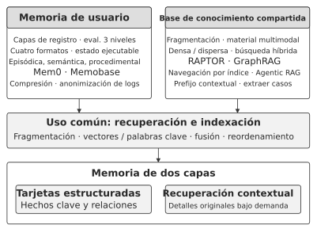

## Sistema de Memoria del Usuario

Analicemos la frase "la semana que viene estoy en el extranjero; los documentos del banco, mándamelos por correo electrónico". El usuario menciona un viaje con fecha límite y, dentro de ese viaje, fija una forma de recibir los documentos. Cuando el banco proponga enviar documentos por correo postal, el asistente puede apoyarse en ello para pedir la entrega electrónica; una vez terminado el viaje, ante un nuevo envío postal, hay que volver a mirar las condiciones vigentes. Si solo se guarda "al usuario no le gustan las cartas en papel", más adelante esa memoria se recuperará, pero se aplicará fuera de su alcance.

Pasemos a los billetes de avión. Si el usuario dice "aquel billete de 1250 de la última vez me salió más caro de lo que esperaba", el sistema puede guardar al menos el precio de aquella oferta, el presupuesto de entonces, el contexto del viaje y esta valoración. La próxima vez que se dé una situación parecida, el modelo tratará con más cautela las ofertas que excedan el presupuesto. Si el usuario añade aparte "a partir de ahora, en los viajes en familia pregúntame antes", queda fijada una condición explícita de consulta para los futuros viajes familiares. De aquí se desprenden tres tipos de información: lo que el usuario dijo realmente, las condiciones en que lo dijo y lo que el modelo infirió de esa experiencia.

Al terminar la sesión se puede pedir al LLM que ordene estos registros y escriba en almacenamiento persistente los hechos que tengan valor futuro. Al empezar una nueva tarea, solo se incorporan al contexto los registros pertinentes y todavía aplicables.

Por ejemplo, al reservar un vuelo el usuario proporciona la siguiente información:

```text
User: Help me book a flight to Tokyo next Friday. I prefer window seats
      and I'm vegetarian, so I'll need a special meal.
Agent: I'll search for flights to Tokyo for next Friday...
       [calls flight_search tool, returns 3 options]
Agent: Here are your options. Based on your preference, I've filtered for
       window seat availability. Shall I book the ANA direct flight?
User: Yes, and use my United MileagePlus number 12345678.
```

Terminada la sesión, el extractor de memoria puede obtener cuatro registros:

```text
Extracted memories:
- User prefers window seats (preference)
- User is vegetarian, needs special meals on flights (dietary restriction)
- User's United MileagePlus number: 12345678 (loyalty program)
- User has travel plans to Tokyo (recent activity)
```

Este ejemplo incluye tres operaciones. La **extracción selectiva** conserva la preferencia de asiento, la restricción alimentaria y el número de socio, y descarta detalles pasajeros como "la búsqueda devolvió tres opciones". La **abstracción** convierte la preferencia por la ventanilla que el usuario expresó de forma explícita en una regla aprovechable en futuras reservas. La **estructuración** etiqueta cada hecho con una categoría para facilitar su recuperación y actualización. Del viaje a Tokio deberían registrarse además la fecha de salida y su estado actual; "el viernes que viene" debe convertirse a una fecha a partir de la fecha de la sesión, y el estado debe actualizarse cuando el viaje termine o se cancele. Así, las preferencias a largo plazo y las actividades recientes se mantienen cada una según su propio periodo de validez.

La descripción del producto del asistente personal Today pone un ejemplo. Un usuario cuenta que entrena los martes y los jueves y que se está preparando para una media maratón. Seis semanas después, los registros de sueño, conectados con su autorización, muestran que la noche anterior durmió muy poco. El asistente junta ambas informaciones y sugiere mover el entrenamiento de intervalos de alta intensidad de ese día. ¿Cuánto tiempo debe conservarse cada dato? El plan de entrenamiento sirve durante toda la preparación de la carrera; el registro de sueño de anoche debe llevar su fecha. Aunque el usuario acepte este cambio, el entrenamiento del jueves siguiente se mantiene según el plan original, salvo que el usuario diga que a partir de ahora quiere cambiarlo siempre. Today separa además en dos pasos el proponer una sugerencia y el modificar el calendario; el segundo requiere la confirmación del usuario.[^ch3-today]

[^ch3-today]: El equipo de Today, en "What Is Today", usa el entrenamiento para una media maratón para explicar cómo se combinan la memoria y la información del día. En "Meet Today", el fundador explica el mecanismo de confirmación previo a modificar el calendario.

### Evaluación de las Capacidades de Memoria: Un Marco de Tres Niveles

El banco de pruebas público **LoCoMo** (Long-term Conversational Memory, memoria conversacional a largo plazo) contiene conversaciones largas de unos 300 turnos de media y hasta 35 sesiones, y evalúa la capacidad de memoria mediante preguntas y respuestas, resúmenes de eventos y generación de diálogo multimodal. Las preguntas se dividen en cinco tipos. Las de un solo salto pueden responderse a partir de una única sesión; las de varios saltos exigen unir pistas de varias sesiones, y las de razonamiento temporal requieren además aclarar el orden en que ocurrieron los hechos. Las preguntas de conocimiento de dominio abierto exigen combinar lo que dijo el usuario con conocimiento externo. Siguiendo con el ejemplo de la reserva, si el usuario solo dijo "la semana que viene voy a Tokio", para responder "qué moneda se usa en el destino" hay que recordar la pista de Tokio y saber además que allí se usa el yen. Si se pregunta por un número de vuelo que el usuario nunca mencionó, el asistente debe señalar que falta información. Reconocer estas preguntas sin respuesta posible es justo lo que evalúan las preguntas adversarias.[^ch3-locomo]

[^ch3-locomo]: La sección 4.1 del artículo de LoCoMo de Maharana et al. (arXiv:2402.17753) define los cinco tipos de preguntas. La página del proyecto de los autores ofrece los datos y ejemplos de conversaciones.

A partir de este tipo de bancos de prueba y de la práctica con productos de memoria, el autor resume en ocho las capacidades a las que hay que prestar atención:

- **Retención de información personal**: guardar y recuperar con exactitud información duradera, como la identidad del usuario.
- **Seguimiento de preferencias**: registrar las preferencias del usuario y actualizarlas cuando exprese otras de forma explícita.
- **Cambio de contexto**: retomar el trasfondo pertinente después de un cambio de tema.
- **Actualización de la memoria**: incorporar los añadidos y las correcciones del usuario sobre hechos ya registrados.
- **Continuidad entre sesiones**: usar en una sesión nueva la información guardada con anterioridad.
- **Pensamiento complejo**: relacionar varios fragmentos de memoria. Por ejemplo, si el usuario mencionó una alergia al cacahuete, al hablar de comida tailandesa debe tenerse en cuenta para recordarle que revise los ingredientes.
- **Conciencia temporal**: guardar fechas, interpretar referencias temporales relativas y calcular intervalos entre eventos.
- **Resolución de conflictos**: detectar información incoherente y decidir teniendo en cuenta la fuente, el momento y a quién se aplica.

En función de las tareas reales de un Agente, este libro adopta además un marco de evaluación de tres niveles. Los experimentos 3-1 y 3-2 lo usan primero para comparar representaciones de memoria; los experimentos 3-9 y 3-11 emplean después el mismo marco para evaluar métodos de recuperación.

**Nivel 1: recuerdo básico.** Guardar y recuperar con exactitud la información que el usuario proporciona directamente y cuyo significado es inequívoco. Por ejemplo, si el usuario dice "mi número de socio es 12345", en una reserva posterior el sistema debe devolver el número completo. Este nivel comprueba sobre todo si los hechos se pierden, se confunden o se alteran.

**Nivel 2: recuperación entre sesiones.** Reunir la información pertinente de sesiones de distintos momentos y sobre distintos objetos, y después determinar a quién se refiere la petición actual y qué registros necesita. Si el usuario tiene dos coches y solo dice "pide cita para la revisión de mi coche", el sistema debe recuperar primero la información de ambos coches y aclarar a cuál se refiere. Al consultar el estado de un préstamo hay que distinguir el contrato en vigor de las ofertas consultadas en el pasado. Al cancelar "el viaje a Los Ángeles", hay que vincular a ese mismo viaje las reservas de vuelo, hotel, etc.

**Nivel 3: servicio proactivo.** A partir de la tarea actual, detectar asuntos relacionados que el usuario no ha señalado uno por uno. Por ejemplo, al reservar un vuelo internacional, relacionar los datos del pasaporte guardados meses atrás y comprobar si su validez cumple los requisitos del viaje; cuando se rompe el móvil, reunir la garantía del dispositivo, la garantía adicional de la tarjeta de crédito y el seguro del operador, y enumerar las opciones disponibles; al preparar la declaración de impuestos, localizar en los registros de todo el año las operaciones bursátiles, los ingresos como autónomo y los documentos del impuesto sobre bienes inmuebles.

> **Experimento 3-1 ★: Evaluación de un sistema de memoria con el marco de tres niveles**
>
> El conjunto de evaluación contiene 20 casos por nivel, 60 en total. El nivel 1 se basa sobre todo en una única sesión; los niveles 2 y 3 incluyen varias sesiones en distintos momentos y sobre distintos objetos, para comprobar la vinculación de entidades, la actualización de información y los avisos proactivos.
>
> Cada caso se ejecuta en dos pasos. Primero se introducen las sesiones una a una: el modelo genera la memoria a partir de la primera y, en cada sesión posterior, solo recibe la memoria existente y la nueva sesión, y genera la memoria actualizada. A partir de ese momento el modelo ya no puede leer el texto original de las sesiones anteriores; para responder sobre lo que se habló entonces, solo cuenta con lo que quedó escrito en la memoria. Una vez procesadas todas las sesiones, se plantea una pregunta nueva y se pide al Agente que responda a partir de la memoria.
>
> La evaluación usa LLM-as-a-judge: un modelo evaluador independiente compara la respuesta con la respuesta de referencia y los criterios de puntuación, y revisa los hechos que cubre y los errores que contiene. En esta ejecución se usa Doubao Seed 1.6 para generar la memoria y las respuestas, y un modelo de Moonshot para puntuar. El evaluador ve la conversación original; el modelo que responde solo ve la memoria que se conservó al final.
>
> ¿Cómo se lee la hoja de resultados? Por ejemplo, el usuario solo quiere recuperar el número de cuenta de su servicio de banda ancha. En el grupo de notas enriquecidas, el asistente dio el número correcto. El evaluador puso 4 puntos en exactitud, exhaustividad y razonamiento, y solo 1 en proactividad, y aun así el caso se aprobó. La condición de aprobado del programa es obtener al menos 3 puntos (sobre 4) en cada uno de los tres primeros criterios y que el evaluador no detecte ningún hecho importante sin fundamento o contrario a lo que se dijo. La proactividad entra en la puntuación global; el número de casos aprobados por sí solo no indica en qué medida el asistente ofreció ayuda por iniciativa propia.

### La Estructura Jerárquica de la Memoria

Para responder "qué vuelo reservé la última vez" hay que localizar un evento; para responder "qué asiento prefiero al reservar" hay que recuperar una preferencia conservada a lo largo de muchas interacciones. Ambas preguntas se refieren a la misma persona, pero requieren registros de distinta granularidad y formas de recuperación diferentes.

La **trayectoria (trajectory)** registra cronológicamente los eventos de una ejecución del Agente: mensajes del usuario, respuestas del modelo, llamadas a herramientas y sus resultados. Si se usa un registro de eventos de solo anexado (append-only), los nuevos eventos se añaden al final y los registros originales se conservan para poder rastrearlos. El Harness puede seleccionar historial de la trayectoria, extraer estado o generar resúmenes para construir el contexto que se envía realmente al modelo en cada turno.

La **memoria a largo plazo del usuario** guarda información útil entre sesiones, como preferencias, relaciones personales, resúmenes de actividades pasadas y hechos confirmados, y delimita a quién pertenece mediante identificadores como el ID de usuario. Una nueva expresión puede completar, corregir o sustituir un registro anterior, por lo que la memoria a largo plazo necesita fusionarse y actualizarse. Su lectura y mantenimiento pueden hacerse mediante llamadas explícitas a herramientas por parte del Agente o desencadenarse desde el Harness al cargar la sesión, al terminarla o en tareas de organización en segundo plano.

El **estado de negocio** describe la fase lógica en que se encuentra una tarea, como "requiere aclaración", "en proceso", "pendiente de pago" o "completada". El programa puede comprobar estos estados para decidir qué evento esperar a continuación y qué operación ejecutar. El capítulo 6 profundizará en la gestión del estado en arquitecturas orientadas a eventos.

Estos tres tipos de registro pueden funcionar de forma coordinada: la trayectoria aporta la base de la ejecución, la memoria a largo plazo aporta el trasfondo entre sesiones y el estado de negocio indica hasta dónde ha avanzado la tarea actual. A continuación nos centraremos en la representación, la gestión y la recuperación de la memoria a largo plazo.

### Cuatro Formatos de Almacenamiento para la Memoria del Usuario

Si solo hay que cambiar una dirección de correo electrónico, lo mejor es poder ir directamente a ese elemento; si hay que entender por qué se cambió la dirección, hay que poder leer cómo ocurrió. En la parte superior izquierda de la figura 3-2, el correo, la empresa y el cargo se guardan por separado; en la superior derecha, el cargo, el equipo y el proyecto se escriben juntos. Observa ahora las dos fichas de abajo: si más adelante hay que actualizar el cargo, o distinguir quién fue al cardiólogo, ¿qué campo habría que consultar en cada caso?

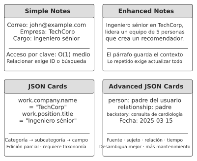

**Simple Notes** escribe cada memoria como un hecho breve, por ejemplo "correo del usuario: john@example.com". Cada registro es fácil de leer y escribir; si se localiza mediante una tabla hash con una clave estable, la búsqueda y la actualización suelen tener una complejidad temporal media de O(1). Para buscar semánticamente entre muchas notas hace falta además construir un índice de recuperación. Una división demasiado fina también pierde relaciones: si "trabaja en TechCorp como ingeniero sénior, responsable del desarrollo del sistema de recomendación" se divide en tres registros independientes de empresa, cargo y proyecto, más adelante habrá que volver a deducir si pertenecen al mismo empleo.

**Enhanced Notes** guarda los hechos y su contexto en párrafos completos. Por ejemplo: "El usuario trabaja en TechCorp como ingeniero de software sénior, lleva tres años dedicado al aprendizaje automático y actualmente dirige un proyecto de sistema de recomendación con un equipo de 5 personas". Las relaciones entre empresa, cargo, experiencia y equipo se conservan en un mismo párrafo. El precio es que algunos hechos pueden repetirse en varios párrafos; cuando cambia el cargo, hay que localizar todos los párrafos afectados y actualizarlos para que no convivan registros antiguos y nuevos.

**JSON Cards** organiza la información en "categoría, subcategoría y pares clave-valor", por ejemplo `personal.contact.email` y `work.position.title`. Al modificar el campo del cargo se pueden conservar otros campos como `work.company.name`, lo que lo hace adecuado para actualizaciones parciales. Al diseñar la clasificación también hay que tener en cuenta la información transversal: "los fines de semana desarrolla proyectos personales en Python" afecta a la vez al tiempo, a las preferencias técnicas y a las actividades. Se puede guardar un único registro de actividad con varias etiquetas, o enlazar las categorías relacionadas mediante referencias para conservar esas relaciones.

**Advanced JSON Cards** añade a los hechos el contexto de origen `backstory`, el sujeto `person`, la relación con el usuario `relationship` y una marca de tiempo. Estos campos ayudan al sistema a identificar a quién pertenece la información, cuándo se supo y en qué situaciones se aplica. Por ejemplo, "el doctor Zhang" puede ser el dentista del usuario o el cardiólogo de su padre; guardar el nombre junto con el paciente, la relación de parentesco y la especialidad reduce las confusiones.

Cuando el usuario dice "organiza la revisión médica anual de mi familia", el sistema puede encontrar a los miembros de la familia mediante `person` y `relationship`, y leer después las experiencias relacionadas en `backstory`. Cuanto más ricos son los campos, más relaciones hay que procesar al extraer y actualizar. El autor recomienda un almacenamiento mixto según la importancia de la información y la necesidad de relacionarla: las personas clave, los contratos y las preferencias duraderas, con Advanced JSON Cards, que conservan el origen y las relaciones; los hechos simples, numerosos y poco relacionados, con Simple Notes, para reducir el coste de extracción y mantenimiento. Ambos tipos de registro se enlazan mediante identificadores o referencias y, cuando hace falta, se recuperan juntos.

> **Experimento 3-2 ★★: Comparación de los cuatro formatos de memoria**
>
> La implementación de referencia ofrece para los cuatro formatos una interfaz unificada de generación, actualización y recuperación de memoria, y compara las respuestas finales sobre el mismo conjunto de 60 casos del experimento 3-1.
>
> En esta ejecución, Simple Notes, Enhanced Notes, JSON Cards y Advanced JSON Cards aprobaron 48, 52, 51 y 49 casos, respectivamente. En el nivel 2, Enhanced Notes aprobó 16 casos y Advanced JSON Cards, 12; en el nivel 3, ambos aprobaron 19. Sumando el mantenimiento de la memoria, las respuestas y la evaluación, Enhanced Notes consumió unos 990 000 tokens y Advanced JSON Cards unos 1,55 millones, y además el tiempo medio por llamada al modelo de este último fue mayor.
>
> Tomemos como ejemplo la pregunta del nivel 2 sobre suscripciones de streaming. El usuario quiere ahorrar y pregunta a qué servicios está suscrito y cuánto cuesta cada uno. El grupo de notas enriquecidas enumeró las cuotas mensuales de Netflix, Disney+ y Max: 22,99, 19,99 y 19,99 dólares, respectivamente. El grupo de fichas JSON avanzadas solo dio el precio de Max, y además enumeró dos planes más baratos de Max. Por concretas que sean las recomendaciones, no suplen las otras dos facturas.
>
> ¿En qué actualización empezó el problema? Revisando la memoria que el grupo de fichas avanzadas guardó tras cada actualización, después de la primera sesión todavía estaba Netflix; tras la segunda, solo quedaban los registros relacionados con Disney+; tras la tercera, solo Max. Cuando llegó la pregunta, las dos primeras suscripciones ya habían desaparecido de la memoria.

### Representación Avanzada del Conocimiento: Código Ejecutable

Una vez guardados los hechos, todavía hay que hacer estadísticas agregadas, detectar conflictos y decidir el siguiente paso según las reglas de negocio. En **User as Code** (UaC), el autor ha probado a organizar la información del usuario como objetos Python tipados y a escribir estas operaciones como funciones[^uac]. El modelo extrae los hechos de la conversación y el programa ejecuta cálculos bien definidos.

Para comparar fechas, sumar importes y aplicar restricciones de negocio explícitas, el autor prefiere escribir el cálculo como una función, de modo que un mismo conjunto de hechos produzca resultados reproducibles y comprobables. Así el modelo puede concentrarse en la comprensión semántica y se libera de hacer cálculos mentales y de revisar reglas una y otra vez a lo largo de conversaciones largas; además, la representación y el uso de la memoria pueden verificarse con el mismo código.

UaC sigue un proceso en dos fases: primero añade los hechos extraídos a un registro y, periódicamente, genera un punto de control que reconstruye el estado tipado a partir del registro. El registro conserva el origen de los hechos y cómo han cambiado; el objeto de estado ofrece los campos consultables en el momento actual.

Tomando como ejemplo el pasaporte y los viajes, el estado puede definirse así:

```python
from dataclasses import dataclass
from datetime import date

@dataclass
class PassportInfo:
    number: str
    country: str
    expiry_date: date

@dataclass
class Trip:
    destination: str
    departure_date: date
    is_international: bool

@dataclass
class UserState:
    passport: PassportInfo
    trips: list[Trip]

state = UserState(
    passport=PassportInfo("AB1234567", "US", date(2025, 2, 18)),
    trips=[
        Trip("Tokyo", date(2025, 1, 15), True),
        Trip("Paris", date(2025, 6, 10), True),
    ],
)
```

Las **estadísticas agregadas** recorren directamente los registros. Por ejemplo, para contar los viajes internacionales registrados en 2025:

```python
count = sum(
    1 for trip in state.trips
    if trip.is_international and trip.departure_date.year == 2025
)
# count == 2
```

La **detección de conflictos** compara dos conjuntos de campos según reglas predefinidas. El siguiente ejemplo, basado en la coincidencia de clases de fármacos, muestra cómo enviar a una cola de procesamiento los elementos que requieren una comprobación adicional:

```python
def find_allergy_matches(profile):
    matches = []
    for medication in profile.current_medications:
        for allergy in profile.allergies:
            if medication.drug_class == allergy.drug_class:
                matches.append((medication, allergy))
    return matches
```

Cada coincidencia conserva el registro de medicación y el registro de alergia correspondientes; el proceso posterior puede comprobarlos y decidir, según las reglas del dominio, si avisa, lo deriva a revisión o pide más información.

La **comprobación de restricciones** puede ejecutarse automáticamente con cada actualización del estado. Por ejemplo, si una norma de viaje exige que el pasaporte tenga al menos 180 días de validez en la fecha de salida, el número de días puede pasarse como parámetro:

```python
def passport_alerts(state, required_days):
    alerts = []
    for trip in state.trips:
        if trip.is_international:
            days = (state.passport.expiry_date - trip.departure_date).days
            if days < required_days:
                alerts.append((trip.destination, days))
    return alerts

alerts = passport_alerts(state, required_days=180)
```

Con los 180 días del ejemplo, para el viaje a Tokio al pasaporte solo le quedan 34 días de validez, y el día de salida hacia París ya habrá caducado. Cuando el usuario renueve el pasaporte, el programa puede recalcular ambos viajes con la nueva fecha.

[^uac]: Li, Bojie, User as Code: Executable Memory for Personalized Agents, 2026.

### Fundamentos de Ciencia Cognitiva de la Memoria del Usuario

La ciencia cognitiva distingue distintos tipos de memoria según su contenido y su forma de uso. Estos conceptos también pueden ayudarnos a organizar la información a largo plazo de un Agente:

- La **memoria episódica (episodic memory)** guarda acontecimientos concretos con su momento, sus participantes y su desarrollo. Un ejemplo humano es "el miércoles pasado cené con unos compañeros en un restaurante italiano"; en un Agente puede corresponder a "el usuario tiene previsto volar a Tokio con ANA el viernes que viene", registrando después si la reserva se completó o si se cambió el vuelo.
- La **memoria semántica (semantic memory)** guarda hechos y conceptos. Un ejemplo humano es "la capital de Italia es Roma"; en un Agente puede corresponder a "el usuario es vegetariano" o "el usuario prefiere asiento de ventanilla". Esta información puede proceder de una declaración explícita del usuario o inducirse de varias experiencias; registrar el origen ayuda a distinguir ambos casos.
- La **memoria procedimental (procedural memory)** tiene que ver con habilidades y secuencias de acción. Un ejemplo humano es montar en bicicleta; en la ingeniería de Agentes puede compararse con un procedimiento reutilizable, por ejemplo "buscar vuelos directos → confirmar la preferencia de asiento → usar el número de viajero frecuente → reservar la comida".

Volviendo al historial de compras del capítulo 1, "miró diez artículos y compró uno de ellos" basta para registrar un evento de compra, pero difícilmente permite deducir qué le gustará al usuario en el futuro. Puede que le gustara ese modelo o simplemente que se lo entregaban ese mismo día. Si después dice "a partir de ahora, cuando compre cosas de este tipo, mira primero si pueden entregarse en el día", se añade una preferencia duradera con un ámbito de aplicación definido. La próxima vez que se recomienden productos similares se podrá consultar primero el plazo de entrega y también explicar de qué comentario procede ese criterio de filtrado.

La tabla 3-1 reúne esta clasificación con los niveles de memoria y los formatos de almacenamiento vistos antes, e indica la pregunta que responde cada uno.

Tabla 3-1 Tres aspectos del diseño de la memoria

| Aspecto de diseño | Pregunta que responde | Categorías concretas |
| --- | --- | --- |
| Nivel de registro | ¿Qué función cumple la información? | Trayectoria, memoria a largo plazo del usuario, estado de negocio |
| Formato de almacenamiento | ¿Con qué estructura se representa? | Simple Notes, Enhanced Notes, JSON Cards, Advanced JSON Cards |
| Contenido de la memoria | ¿Qué tipo de información se guarda? | Memoria episódica, memoria semántica, memoria procedimental |

Por ejemplo, "el usuario prefiere asiento de ventanilla" es memoria semántica y puede guardarse en la memoria a largo plazo con Simple Notes; un procedimiento de reserva es memoria procedimental y puede guardarse en una ficha que incluya su origen y sus condiciones de aplicación.

### Casos de Estudio de Frameworks de Memoria

El usuario dice "últimamente me he pasado al pasillo", pero en un registro antiguo pone "le gusta la ventanilla". El sistema puede actualizar la preferencia de asiento en el momento de escribir, o guardar ambas declaraciones y decidir cuál se aplica en la siguiente reserva. A continuación veremos primero en qué fase resuelve Mem0 este tipo de conflictos y después cómo Memobase registra por separado el perfil del usuario y los eventos concretos.

**Mem0: cambiar el lugar donde se resuelven los conflictos.** En el artículo de 2025 y en la v2, el proceso compara los hechos nuevos con los antiguos al escribir; la v3 posterior pasa a añadir hechos y usar recuperación híbrida. La figura 3-3 contrapone ambos enfoques.

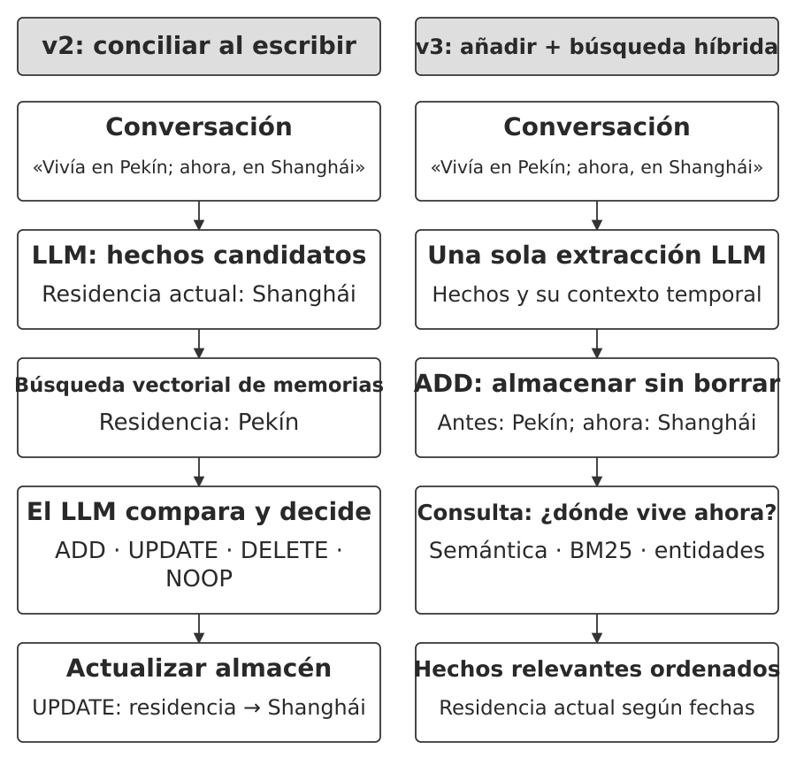

En el proceso inicial, el LLM extrae primero hechos candidatos de la conversación, busca después las memorias existentes más parecidas y decide si ejecutar **ADD**, **UPDATE**, **DELETE** o **NOOP**. Si el usuario dice primero "vivo en Pekín" y más tarde "me he mudado a Shanghái", el sistema puede actualizar el lugar de residencia actual a Shanghái. De este modo, al consultar es fácil obtener hechos ya depurados; al mantener, en cambio, hay que identificar correctamente las correcciones, los cambios en el tiempo y los distintos sujetos, y guardar la justificación de cada actualización para poder rastrearla si se detecta un error. El artículo propone además una variante con memoria en grafo, **Mem0-g**, que expresa el conocimiento relacionado mediante entidades y relaciones[^ch3-mem0-paper].

La v3 sustituye la extracción automática por una única llamada al LLM que solo añade registros **ADD**. Las dos informaciones, Pekín y Shanghái, pueden conservarse junto con su contexto temporal, y el lugar de residencia actual se decide al consultar, teniendo en cuenta el contexto. La recuperación combina similitud semántica, palabras clave BM25 y coincidencia de entidades; las acciones cuya finalización ya se ha confirmado también pueden extraerse como hechos. La guía de migración informa de que la puntuación en LoCoMo subió de 71,4 a 91,6, y la de LongMemEval, de 67,8 a 93,4. Esta versión de código abierto usa la vinculación de entidades para la recuperación interna y ha eliminado la interfaz de almacenamiento de grafos externo y el valor de retorno `relations`; la memoria en grafo la ofrece la plataforma gestionada[^ch3-mem0-migration].

Esta evolución muestra que un sistema de memoria puede trasladar la resolución de conflictos de la fase de escritura a la de lectura. Si al escribir se fusionan por error las experiencias de dos personas, o se toma un añadido por una corrección, las respuestas posteriores pueden arrastrar indefinidamente un estado actual erróneo. Guardar por anexado permite que tanto las pruebas antiguas como las nuevas intervengan en la decisión, y además reduce las llamadas al modelo necesarias para decidir registro por registro al escribir. Para memorias de usuario que cambian con frecuencia y cuyos conflictos son difíciles de juzgar en el momento, el autor se inclina por guardar primero los hechos con su fecha y su origen, y depurar el estado vigente al responder cada pregunta concreta.

[^ch3-mem0-paper]: Chhikara et al., Mem0: Building Production-Ready AI Agents with Scalable Long-Term Memory, 2025.

[^ch3-mem0-migration]: Mem0, Open Source: Migrating to the New Memory Algorithm.

**Memobase: perfil del usuario y memoria de eventos.** Memobase organiza la información a largo plazo en dos partes. El **perfil del usuario (profile)** guarda atributos relativamente estables por temas y subtemas, por ejemplo el nombre en `basic_info`, las aficiones en `interest` y el cargo en `work`. Los desarrolladores pueden configurar los campos que deben extraerse para controlar el alcance y la granularidad del perfil. La **memoria de eventos (event memory)** registra las experiencias del usuario con su fecha, para que el sistema pueda responder preguntas como "¿cuándo hablamos del presupuesto por última vez?".

Memobase coloca primero las conversaciones nuevas en un búfer y las procesa por lotes cuando el búfer alcanza un tamaño determinado o la sesión lleva inactiva un tiempo establecido; también puede activarse explícitamente al terminar la sesión. Así, varios mensajes comparten un mismo proceso de organización, y al consultar se leen el perfil y los eventos ya generados. La actualización asíncrona reduce el tiempo que la interacción actual pasa esperando a que se extraiga la memoria; cuando hay que usar de inmediato los hechos más recientes, se puede esperar a que termine el procesamiento en curso[^ch3-memobase].

[^ch3-memobase]: Memobase, descripción oficial del proyecto, que incluye los campos del perfil, la memoria de eventos, el búfer y la interfaz de actualización síncrona.

Si el asistente tiene que recordar cómo fue la última reserva y, a la vez, conocer la preferencia de asiento del usuario y el procedimiento para cancelar un billete, puede guardar por separado eventos, hechos y procedimientos, como en la figura 3-4. Cada vez que recibe una tarea, lleva a la memoria de trabajo la parte que necesita.

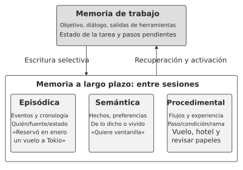

La memoria episódica conserva secuencias de eventos con metadatos como marcas de tiempo, marcas emocionales e identificadores de tarea, lo que permite combinar búsquedas por fecha y por tema. Por ejemplo, "la última vez que hablamos del presupuesto" requiere a la vez coincidencia temática y ordenación temporal. La memoria semántica guarda los hechos y las preferencias extraídos de los eventos, y la memoria procedimental, los procedimientos que se usan repetidamente.

La **memoria de trabajo (working memory)** organiza el objetivo actual, el estado de la tarea y la información pertinente ya recuperada. El Harness selecciona contenido de la trayectoria y del almacenamiento a largo plazo y lo carga en el contexto actual; los nuevos hechos que produce la tarea se depuran y se escriben después en la memoria a largo plazo. La trayectoria registra cómo ocurrieron las cosas; la memoria de trabajo concentra la información necesaria para la siguiente decisión, y ambas se conectan mediante identificadores de evento y de origen.

Al leer la memoria del usuario con RAG, primero se localiza, a partir de la petición actual, un conjunto de memorias posiblemente pertinentes y después se decide cuáles deben pasar a la memoria de trabajo. Supongamos que hoy el asistente debe ayudar al usuario a elegir asiento y la búsqueda encuentra dos frases: "en los viajes de trabajo me gusta la ventanilla" y "la última vez me lesioné la rodilla; para la vuelta, búscame pasillo". Ambas son muy pertinentes para elegir asiento, pero la segunda solo planteaba un requisito para aquel vuelo de vuelta. Reordenar por pertinencia, aunque la coloque en primer lugar, no responde a si se aplica hoy.

En este caso, el autor confía más en filtrar las memorias candidatas con un modelo de juicio como Jev. Se le entregan el viaje actual, lo que el usuario pide ahora y, para cada memoria, sus palabras textuales, su fecha y sus condiciones de aplicación, y se le pide que decida, una por una, si "se aplica esta vez", es "solo de referencia" o hay "fundamento insuficiente". Si hoy también es un viaje de trabajo, la primera puede servir de criterio para elegir asiento; si el usuario acaba de decir que la rodilla aún no se ha recuperado, merece la pena rescatar la segunda para preguntarle.

### Mecanismos de Compresión y Organización de la Memoria

Un usuario que reserva vuelos con frecuencia puede haber mencionado diez veces la "ventanilla". Quizá nueve de ellas repetían el mismo pedido; tomar el número de menciones directamente como intensidad de la preferencia daría un peso excesivo a un solo hecho. Al organizar la memoria, primero se identifican el origen y el evento, después se fusionan los registros duplicados, se comprueba si hay alguna corrección posterior y solo al final se decide qué patrones conviene usar en tareas futuras. Ante "el asiento de ventanilla de la última vez estuvo bien", se puede pedir a un modelo de juicio como Jev que lea la frase y los pedidos relacionados y se limite a decidir si es "un comentario sobre el último vuelo", "un requisito para esta vez" o "una preferencia duradera". Si los pedidos no cuadran o varias interpretaciones son plausibles, se conservan las palabras textuales y se verifican en el momento de reservar. Un juicio local de este tipo evita contar la misma experiencia una y otra vez como prueba nueva.

1. **Seleccionar qué organizar.** La frecuencia de acceso, la fecha del registro, las marcas emocionales y la singularidad de la información pueden servir como señales de ordenación. Por ejemplo, un registro creado hace tres días, consultado cinco veces, con una marca emocional intensa y sin duplicados merece más guardarse por separado; un registro creado hace noventa días, consultado una sola vez y muy parecido a otros tres puede fusionarse con prioridad con los registros relacionados. El sistema puede filtrar primero por puntuación los registros que hay que organizar y decidir después, según las reglas de negocio, si se comprimen, se fusionan o se eliminan. Las restricciones duraderas y los contratos vigentes deben conservarse hasta que expire su validez aunque se consulten poco.
2. **Agrupar y resumir.** Los registros similares se agrupan y se conserva su contenido común en un resumen. Por ejemplo, muchas conversaciones sobre el tiempo pueden resumirse como "el usuario pregunta a menudo por el tiempo y le preocupa especialmente la lluvia". Las fechas concretas y las preguntas originales se archivan, y el resumen enlaza con los registros originales para poder consultarlos más adelante.
3. **Extraer patrones y procedimientos.** De varios registros de compra se puede inducir "prefiere productos con buena relación calidad-precio y da importancia a las opiniones de otros usuarios", o destilar los pasos que sigue para elegir productos.

### Protección de la Privacidad: Anonimización de Registros

La memoria del usuario suele contener datos de identidad, de contacto y de cuentas. El sistema debe decidir según la tarea qué campos entran en la entrada del modelo y, según las necesidades de operación, qué contenido entra en los registros (logs). La anonimización puede hacerse antes de escribir en el registro, sustituyendo los fragmentos sensibles por etiquetas de tipo o marcadores estables, de modo que se conserve la estructura necesaria para diagnosticar problemas.

> **Experimento 3-3 ★★: Anonimización de registros con un modelo local**
>
> Este experimento usa Ollama para invocar un Qwen3-0.6B local que identifica en la propia máquina los fragmentos sensibles de los registros. Los modelos pequeños son adecuados para desplegarse en dispositivos de consumo; también se puede cambiar a tamaños como 1.7B o 4B para comparar la calidad de la detección y el tiempo de procesamiento. Cuando los registros originales deben permanecer en local, la detección y la sustitución también deben hacerse en la máquina, y solo después se entrega el resultado anonimizado a los servicios posteriores.
>
> El material de prueba incluye números estructurados, como números de documento de identidad y de tarjeta bancaria; contenido semiestructurado, como direcciones, e información sensible revelada en lenguaje natural, como contraseñas. El modelo devuelve, según un JSON Schema, el tipo de información, la posición en el texto y la confianza, y el programa sustituye el texto original a partir de ello. El grupo de control usa expresiones regulares; el grupo mixto aplica primero las expresiones regulares y deja que el modelo procese el texto restante.
>
> Veamos primero dos registros. El primero contiene un número de documento de identidad y un número de móvil; la expresión regular solo ocultó el móvil, con una exhaustividad (recall) de $1/2$. En el segundo, la expresión regular encontró el número de la seguridad social estadounidense y el de la tarjeta bancaria, pero también ocultó un número de ticket con un formato parecido. De las tres marcas que puso, solo dos debían anonimizarse: una precisión de $2/3$. Si solo se comprueba si quedan valores sensibles en el registro, el segundo pasaría la prueba; únicamente cuando el equipo de soporte use ese registro para buscar el ticket descubrirá que la pista se ha perdido.
>
> Calculando la exhaustividad registro por registro en las 12 muestras y promediando, las expresiones regulares, el modelo y el enfoque mixto obtienen alrededor de un 50 %, un 69 % y un 78 %, respectivamente. Contando registro a registro tras la sustitución, los tres enfoques dejaron 9, 3 y 2 valores sensibles. La elección depende también del tiempo de procesamiento: en esta máquina, la expresión regular tarda de media unos 0,1 milisegundos por registro, mientras que el modelo y el enfoque mixto rondan los 3 segundos. Con grandes volúmenes de registros, se pueden procesar primero con expresiones regulares los campos de formato estable y dejar al modelo solo los fragmentos que requieren tener en cuenta el contexto.

A medida que crecen los registros, el siguiente paso es encontrar, entre miles de datos, el contenido que necesita la tarea actual. La técnica RAG que se presenta a continuación sirve tanto para bases de conocimiento compartidas como para la recuperación de la memoria del usuario.

## RAG Básico: Construyendo el Canal de Adquisición de Conocimiento del Agente

Una tienda ha cambiado su política de reembolsos y un usuario pregunta: "Compré un artículo el mes pasado; ¿cómo solicito ahora el reembolso?". Para responder bien, primero hay que encontrar las condiciones aplicables a ese pedido y después explicar con claridad los requisitos y los pasos. La **generación aumentada por recuperación** (Retrieval-Augmented Generation, RAG) enlaza ambos pasos, de modo que el modelo puede usar documentación interna de la tienda y también políticas publicadas después de terminar su entrenamiento.

Empecemos por el caso en que solo existe una versión de la política. A continuación se consulta el procedimiento de reembolso de esa tienda con una interfaz simplificada, para observar cómo pasan los resultados de la búsqueda a la respuesta del modelo:

```python
query = "procedimiento de reembolso"
results = retriever.search(query, top_k=2)
# results = [
#   "Política de reembolso: se puede solicitar el reembolso completo en los 7 días siguientes a la recepción del pedido, indicando el número de pedido. El importe se abonará en 3–5 días laborables.",
#   "Cómo pedir el reembolso: entre en 'Mis pedidos', seleccione el pedido y haga clic en 'Solicitar reembolso'."
# ]
answer = llm.generate(system="Eres un asistente de atención al cliente.", context=results, question=query)
# La respuesta incluye el plazo de solicitud, los datos necesarios, los pasos y el plazo de abono.
```

Compare la figura 3-5 con los dos resultados de la búsqueda en el código: los pasos para solicitar el reembolso proceden de "Cómo pedir el reembolso", y el plazo de 3–5 días laborables para recibir el dinero, de "Política de reembolso". Si entre los resultados solo quedaran los pasos, ¿tendría el modelo algún fundamento para decirle al usuario cuándo recibirá el dinero? Esta pregunta tiene que ver con cómo dividir el manual en fragmentos.

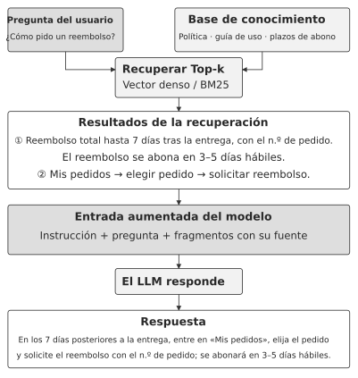

### Fragmentación de Documentos (Chunking)

Supongamos que un manual de posventa indica primero que "se puede devolver en un plazo de siete días" y, en el párrafo siguiente, explica los productos excluidos. Si solo se recupera la primera frase, se puede acabar prometiendo el reembolso también de un producto excluido; si el manual entero es una sola unidad de recuperación, arrastrará a la vez instalación, configuración y resolución de averías, y al vector le costará destacar el tema de los reembolsos. La **fragmentación (chunking)** debe elegir un tamaño entre estos dos extremos, de modo que un fragmento de texto baste para explicar sus propias condiciones y a la vez sea fácil de encontrar con una pregunta concreta. La longitud de los fragmentos también debe respetar el presupuesto de entrada del modelo de embeddings y dejar espacio de contexto para la generación posterior.

Hay tres métodos habituales.

La **división de tamaño fijo** corta por número de tokens, por ejemplo 512 tokens por fragmento con un solapamiento de 50 a 100 tokens entre fragmentos contiguos. El solapamiento permite que el contenido cercano a un límite aparezca completo en otro fragmento. Este método facilita controlar la longitud de los fragmentos, pero el punto de corte puede caer en medio de un párrafo, de un bloque de código o de una tabla.

La **división recursiva o consciente de la estructura** corta preferentemente por límites naturales, como capítulos y párrafos, y solo divide en unidades menores, como oraciones, las partes demasiado largas. Los encabezados de Markdown y los elementos HTML aportan pistas estructurales. Los bloques de código, las tablas y el texto asociado a un encabezado también pueden recibir reglas de tratamiento específicas. Para documentación técnica bien estructurada, el autor recomienda empezar por este método: aprovechar primero los capítulos y párrafos existentes y subdividir después las partes demasiado largas suele preservar mejor el significado completo que cortar sin más.

La **división semántica** calcula la similitud de los embeddings entre oraciones o grupos de oraciones contiguos y corta donde el tema cambia de forma apreciable. Exige más cálculos de embeddings, pero puede mantener un mismo tema dentro de un solo fragmento.

Supongamos que el recuperador devuelve una única frase: "Los ingresos de la empresa crecieron un 3 %". ¿Qué empresa? ¿Qué trimestre? La cifra es la correcta, pero lo que permite responder la pregunta está en el párrafo anterior. Si se mete en un solo fragmento el informe financiero completo, el trimestre y el nombre de la empresa se conservan, pero al consultar los ingresos entran también los párrafos sobre contratación y compra de equipos. Todo ese contenido comparte además un único vector, en el que el tema de los ingresos puede quedar diluido. En la práctica, para elegir el tamaño de los fragmentos se puede empezar probando con 256 a 1024 tokens por fragmento y un solapamiento del 10 % al 20 % entre fragmentos contiguos.

Los metadatos, como el título, la fuente y la fecha, pueden guardarse junto con cada fragmento. Más adelante, la recuperación consciente del contexto añadirá a cada fragmento el contexto que tiene en el texto original, lo que ayuda a resolver referencias y alcances cuando se recupera de forma aislada.

### Embeddings Densos: Representar el Texto con Vectores

Un **embedding** transforma palabras, oraciones o fragmentos de texto en vectores numéricos, por ejemplo `[0.2, -0.5, 0.8, ...]`. El modelo de recuperación se entrena para que las consultas y los documentos relacionados tengan una similitud alta en el espacio vectorial. "Denso" significa que la mayoría de las dimensiones del vector tienen valores distintos de cero y representan conjuntamente la información del texto; las representaciones dispersas que veremos después solo tienen unas pocas dimensiones distintas de cero.

El espacio vectorial puede imaginarse como un mapa de muchas dimensiones: cada fragmento de texto ocupa una posición, y recuperar consiste en buscar el contenido cercano a la consulta. Una de las medidas más usadas es la **similitud del coseno**:

$$
\operatorname{cos}(A,B)=\frac{A\cdot B}{\|A\|\,\|B\|}
$$

El producto escalar $A\cdot B$ multiplica las dimensiones correspondientes y suma los resultados; la norma $\|A\|$ es la raíz cuadrada de la suma de los cuadrados de todas las dimensiones. Al dividir por las dos normas, el resultado solo refleja la relación de dirección. Para vectores no nulos, el coseno está en el intervalo $[-1,1]$, y cuanto más se acerca a 1, más coinciden las direcciones. Otros modelos de recuperación usan también el producto escalar o la distancia euclidiana. Cuando ambos vectores están normalizados a longitud unitaria, el producto escalar coincide con la similitud del coseno.

> **Cálculo a mano: similitud del coseno entre tres frases**
>
> Representemos con tres vectores ilustrativos "cómo criar un gato" $A=(0.9,0.5,0.1)$, "guía para cuidar gatos" $B=(0.8,0.6,0.1)$ y "estrategias de inversión en bolsa" $C=(0.1,0.1,0.9)$.
>
> $A\cdot B=0.9\times0.8+0.5\times0.6+0.1\times0.1=1.03$. Sus normas son $\sqrt{1.07}$ y $\sqrt{1.01}$, y la similitud es aproximadamente **0,991**.
>
> $A\cdot C=0.9\times0.1+0.5\times0.1+0.1\times0.9=0.23$; la norma de $C$ es $\sqrt{0.83}$ y la similitud es aproximadamente **0,244**. En este conjunto de vectores, la consulta sobre criar gatos está más cerca de la guía de cuidados.

Los modelos reales suelen usar representaciones de cientos o miles de dimensiones.

#### De Word2Vec a la Conciencia del Contexto

La figura 3-6 empieza por los vectores de palabras fijos. **Word2Vec** aprende un vector fijo para cada palabra a partir de la coaparición de términos. Algunas relaciones se manifiestan en operaciones vectoriales, como el clásico "rey − hombre + mujer ≈ reina". La limitación de una representación fija también es evidente: `bank` usa el mismo vector en `river bank` (orilla del río) y en `investment bank` (banco de inversión).

**GloVe** cuenta en todo el corpus cuántas veces aparecen juntas las palabras y aprende los vectores mediante un objetivo de mínimos cuadrados ponderados. Word2Vec se centra en una tarea de predicción dentro de una ventana local, mientras que GloVe incorpora directamente al entrenamiento las estadísticas globales de coaparición; ambos aprenden representaciones fijas de las palabras[^ch3-glove].

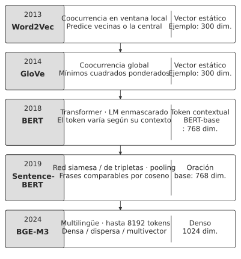

Con modelos contextuales como **BERT**, la representación de un mismo token cambia según la oración. Gracias a la autoatención, el modelo puede calcular representaciones distintas para "planta" en dos oraciones a partir de pistas como "la producción de la fábrica" y "regarla dos veces por semana". Un modelo de embeddings para recuperación necesita además agregar las representaciones de los tokens en un vector de consulta o de documento, y entrenarse para que ambos sean comparables.

**Sentence-BERT** combina BERT con agrupamiento (pooling) y estructuras de red siamesas o de tripletas para entrenar vectores de oración que pueden compararse directamente. Los documentos pueden codificarse de antemano y guardarse en el índice; cuando llega una consulta, basta con codificarla y calcular la similitud vectorial. La codificación previa evita el coste de recalcular la representación de todos los documentos en cada consulta[^ch3-sbert].

**BGE-M3** ofrece a la vez representaciones densas, dispersas y multivectoriales para la recuperación, y admite varios idiomas y entradas relativamente largas; en esta sección usamos su representación densa para explicar la recuperación con un solo vector[^ch3-bge-m3]. La longitud que admite el modelo influye en el esquema de fragmentación: el límite típico del BERT original es de 512 tokens, y BGE-M3 llega a 8192.

[^ch3-bge-m3]: El artículo de M3-Embedding de Chen et al. (arXiv:2402.03216) explica cómo se entrenan conjuntamente las tres representaciones de recuperación. Véase también la descripción del modelo BGE-M3 de BAAI, que incluye la forma de representación, la dimensión, la longitud de entrada y el modo de uso.

> **Experimento 3-4 ★★: Comparación de dos índices de vecinos más cercanos aproximados**
>
> Una vez construidos los vectores de los documentos, hay que encontrar rápidamente los vectores cercanos a la consulta. El cálculo uno por uno da los vecinos exactos; a medida que crecen los datos, los índices de **vecinos más cercanos aproximados** (Approximate Nearest Neighbor, ANN) cambian una pérdida controlada de exhaustividad por velocidad de consulta. Este experimento compara ANNOY y HNSW con los mismos embeddings reales y las mismas consultas, tomando como referencia los resultados de la búsqueda exacta. Por ejemplo, si para una consulta la búsqueda exacta da diez vecinos más cercanos y los diez resultados del índice aproximado incluyen ocho de ellos, el Recall@10 de esa consulta es 0,8. Esta cifra mide cuántos de los vecinos exactos conserva el índice.
>
> ANNOY usa varios árboles de proyección aleatoria para acotar los candidatos; HNSW usa un grafo de vecindad jerárquico: primero se acerca rápidamente a la zona objetivo en las capas altas, más dispersas, y luego busca en las capas bajas, más densas. La figura 3-7 muestra la estructura jerárquica de HNSW.
>
> 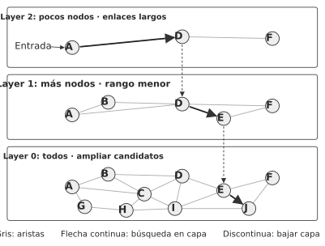
>
> Tabla 3-2 Compromisos de implementación entre ANNOY y HNSW
>
> | Aspecto | ANNOY | HNSW (con hnswlib como ejemplo) |
> | --- | --- | --- |
> | Estructura del índice | Varios árboles de proyección aleatoria | Grafo de vecindad jerárquico |
> | Coste de construcción | Varía con el número de árboles, el número de vectores y la dimensión | Varía con el tamaño de la vecindad, el rango de búsqueda en la construcción y el volumen de datos |
> | Memoria y archivos | El índice estático admite mapeo en memoria y uso compartido entre procesos | Guarda los vectores y las adyacencias del grafo; el tamaño de la vecindad influye en el coste |
> | Actualización incremental | Añadir entradas una vez construido el índice exige reconstruirlo | Admite inserciones, actualizaciones y marcas de borrado; hay que gestionar la capacidad |
> | Exhaustividad y velocidad | Se ajustan con el número de árboles y el presupuesto de búsqueda en la consulta | Se ajustan con los parámetros de construcción y el rango de búsqueda en la consulta |
> | Escenario de uso | Índices estáticos fáciles de distribuir y compartir | Índices dinámicos con escrituras y consultas continuas |
>
> En esta ejecución se construyó primero la base con 240 fragmentos de texto. Para las mismas 20 consultas, ambos índices encontraron los 10 vecinos más cercanos que daba la búsqueda exacta. En la construcción inicial, ANNOY tardó unos 13 milisegundos en un contenedor Linux, y HNSW, unos 78 milisegundos en la máquina local; los índices guardados ocupaban unos 1,40 MB y 1,02 MB, respectivamente. Después se añadieron los 60 fragmentos restantes: ANNOY reconstruyó el índice y HNSW insertó directamente los nuevos vectores. La base pasó a tener 300 fragmentos, y los vecinos anteriores también podían cambiar. Tras repetir la búsqueda exacta sobre la nueva base, la exhaustividad media de ambos índices seguía siendo del 100 %.

[^ch3-ann]: La descripción del proyecto Annoy de Spotify explica cómo construir índices de solo lectura, cargarlos con mapeo en memoria y usar `search_k` para ajustar el número de nodos examinados en la consulta. La sección de la interfaz de Python de la descripción del proyecto hnswlib presenta el método `add_items` para añadir vectores y el método `set_ef` para ajustar el rango de consulta.

**El índice debe elegirse según cómo se actualiza el conocimiento.** Cuando el corpus se publica por lotes periódicamente y varios procesos comparten un mismo índice de solo lectura, el autor considera primero ANNOY; cuando llegan documentos nuevos continuamente y hay que insertarlos en línea, da prioridad a HNSW. El modelo de embeddings determina la representación semántica, y el índice determina si esas representaciones pueden ponerse en servicio con una latencia y un coste de actualización adecuados; ambos determinan juntos la eficacia del servicio de recuperación.

Ajustando el número de árboles y el presupuesto de búsqueda de ANNOY, o el tamaño de la vecindad y el rango de búsqueda de HNSW, se puede observar cómo cambian la exhaustividad y la latencia[^ch3-ann]. La exhaustividad del índice mide si se han encontrado los vecinos buscados; que esos vecinos respondan a la pregunta del usuario depende de la representación de los embeddings y del contenido de los documentos.

### Representaciones Dispersas: De las Palabras Clave a la Puntuación de Relevancia

Las **representaciones dispersas** usan vectores de muchas dimensiones en los que solo unas pocas son distintas de cero. La búsqueda tradicional por palabras clave toma los términos como dimensiones y asigna pesos según las palabras que aparecen en el documento. Su base es el **modelo de bolsa de palabras** (Bag of Words, BoW): guarda las palabras y cuántas veces aparecen, e ignora el orden. Por eso "el gato persigue al perro" y "el perro persigue al gato" tienen la misma representación de bolsa de palabras.

Esta representación es adecuada para buscar nombres, números de referencia y términos técnicos. A continuación partimos de TF-IDF para explicar cómo la frecuencia de un término y su frecuencia de documento se convierten en una puntuación de ordenación.

#### De TF-IDF a BM25

**TF-IDF** (Term Frequency–Inverse Document Frequency, frecuencia de término–frecuencia inversa de documento) combina dos señales: cuántas veces aparece una palabra en el documento actual y lo común que es en todo el corpus. Supongamos que de 100 artículos 60 contienen "modelo" y solo 3 contienen "destilación"; al buscar "destilación de modelos", "destilación" es la que más discrimina.

Una formulación básica es:

$$\operatorname{TF\!\text{-}\!IDF}(t,d)=\operatorname{TF}(t,d)\times\operatorname{IDF}(t),\qquad \operatorname{IDF}(t)=\ln\frac{N}{\operatorname{DF}(t)}$$

$\operatorname{TF}(t,d)$ es el número de veces que aparece el término $t$ en el documento $d$, $\operatorname{DF}(t)$ es el número de documentos que contienen el término y $N$ es el total de documentos. Según esta fórmula, una palabra que aparece diez veces aporta el doble que si aparece cinco, y un documento largo puede puntuar más solo por tener más palabras. TF-IDF tiene muchas variantes de normalización; BM25, que veremos a continuación, trata estos dos efectos con la saturación de la frecuencia de término y la normalización por longitud.

**BM25** suma las contribuciones de cada término de la consulta:

$$\operatorname{Score}(Q,D)=\sum_i\operatorname{IDF}_{\mathrm{BM25}}(q_i)\cdot\frac{\operatorname{TF}(q_i,D)(k_1+1)}{\operatorname{TF}(q_i,D)+k_1\left(1-b+b\frac{|D|}{\operatorname{avgdl}}\right)}$$

Aquí $q_i$ es un término de la consulta, $|D|$ es la longitud del documento y $\operatorname{avgdl}$ es la longitud media de los documentos. $k_1$ controla el grado de saturación de la frecuencia de término; $b$ controla la intensidad de la normalización por longitud, y con valor 0 la desactiva. La figura 3-8 calcula estos términos por separado. Primero se fija la longitud del documento y se hace que el término de la consulta pase de una a tres apariciones, para ver cuánto suma cada aparición adicional; después se fija la frecuencia y solo se duplica la longitud del documento. La última fila compara lo comunes que son dos términos en la colección de documentos.

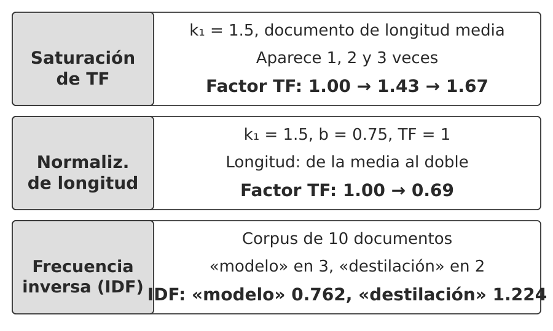

En la primera fila de la figura, la segunda aparición aumenta el factor de frecuencia en unos 0,43, y la tercera solo en unos 0,24: eso es la saturación de la frecuencia de término. En la segunda fila, el mismo término aparece una sola vez en cada caso, pero en el documento más largo destaca menos, y la corrección por longitud reduce su factor de frecuencia. Solo al multiplicarlo por el IDF se obtiene la contribución del término a la puntuación total.

Falta por fijar un término de la fórmula: con las mismas tres apariciones, ¿por qué una palabra rara suele ser más útil que una común? En esta sección se ponderan los términos con la siguiente frecuencia inversa de documento:

$$\operatorname{IDF}_{\mathrm{BM25}}(t)=\ln\frac{N-\operatorname{DF}(t)+0.5}{\operatorname{DF}(t)+0.5}$$

El numerador es el número de documentos que no contienen el término y el denominador, el de los que sí lo contienen; a ambos se les suma 0,5 como suavizado, para que el cálculo sea posible cuando la frecuencia de documento es 0 o $N$. Las palabras raras reciben más peso; cuando más de la mitad de los documentos contienen el término, la fórmula da un valor negativo. La implementación de referencia fija en $10^{-6}$ el peso mínimo usado en la puntuación y conserva el valor original para poder revisarlo.

> **Experimento 3-5 ★★: Implementar desde cero un motor de búsqueda BM25**
>
> Este experimento completa por orden la tokenización, el tratamiento de palabras vacías, el índice invertido y la puntuación. El tratamiento de palabras vacías filtra palabras muy frecuentes como "de" o "el". El **índice invertido** registra en qué documentos aparece cada término y con qué frecuencia; se parece al índice de términos al final de un libro: al buscar "TCP" se encuentran las páginas 45, 112 y 203, y luego se lee el contenido en esas posiciones.
>
> Calculemos a mano una consulta con "destilación de modelos". Supongamos un corpus de 10 documentos con una longitud media de 250 palabras, $k_1=1.5$ y $b=0.75$. "Modelo" aparece en 3 documentos, con un IDF de aproximadamente 0,762; "destilación" aparece en 2, con un IDF de aproximadamente 1,224. La tabla siguiente enumera, para cada término, los documentos en que aparece, su frecuencia y la longitud del documento. Sustituyendo estos valores en la fórmula se obtiene la contribución de cada término a la puntuación de cada documento.
>
> | Término de la consulta | Documento | Frecuencia TF | Longitud del documento | Contribución BM25 |
> | --- | --- | ---: | ---: | ---: |
> | modelo | doc_1 | 5 | 200 | 1.52 |
> | modelo | doc_3 | 2 | 500 | 0.82 |
> | modelo | doc_7 | 8 | 150 | 1.68 |
> | destilación | doc_1 | 3 | 200 | 2.15 |
> | destilación | doc_5 | 1 | 250 | 1.22 |
>
> Las contribuciones de ambos términos en doc_1 suman unos 3,67, y la ordenación queda **doc_1 (3,67) > doc_7 (1,68) > doc_5 (1,22) > doc_3 (0,82)**. En doc_1, "destilación" tiene una frecuencia menor que "modelo", pero es más rara y acaba contribuyendo más; además, coincidir con los dos términos eleva todavía más la puntuación total.
>
> Busquemos ahora `cat` en el corpus en inglés del experimento de referencia. Los dos textos breves marcados como pertinentes usan `kitten` y `feline`, pero en el índice invertido no aparece `cat`, y la lista de candidatos queda vacía. Por mucho que se aumenten los pesos de frecuencia anteriores, no hay ningún documento que puntuar. Si se busca con las palabras que usan esos dos textos, cada uno entra en la lista de candidatos.

### Búsqueda Híbrida: Combinar Dos Vías de Resultados y Reordenar

Para algunas preguntas es difícil enumerar de antemano todos los sinónimos. En el experimento 3-6 hay una pregunta sobre "cómo recuperar automáticamente el espacio de heap que ya no se usa", pero el texto objetivo dice "la gestión automática de memoria libera a los desarrolladores de liberar objetos a mano". La consulta en inglés y el texto no comparten ningún término: la búsqueda por palabras clave no recuperó ningún documento, mientras que la búsqueda vectorial colocó el objetivo en primer lugar. Con una consulta por el modelo XR-7003, la búsqueda por palabras clave encontró directamente ese modelo, mientras que la búsqueda vectorial devolvió además varios modelos parecidos.

La **búsqueda híbrida** busca primero los pasajes pertinentes por separado con palabras clave y con vectores, y después decide cuáles merecen pasarse al modelo. Cuando la base de conocimiento contiene a la vez identificadores exactos y descripciones en lenguaje natural, el autor recomienda partir de ella. Siga el recorrido de XR-7003 en la figura 3-9: ambas vías lo colocan en primer lugar, de modo que en la fusión recibe dos contribuciones de rango. La reordenación cambia el segundo puesto, pero el modelo que el usuario ve primero sigue siendo el correcto.

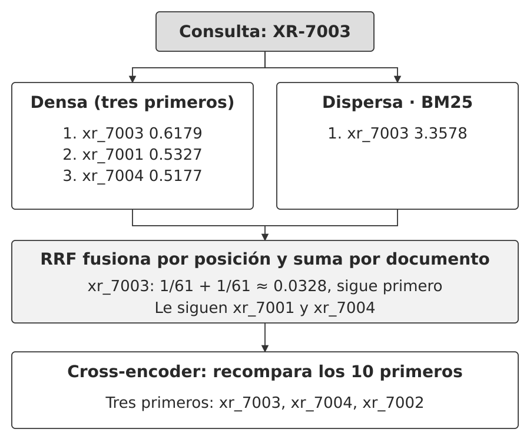

La primera fase es la **recuperación en paralelo**: la consulta se envía a los motores denso y disperso, y cada uno recupera un lote de documentos posiblemente pertinentes. Ambas vías pueden usar el mismo texto original o preprocesarlo según lo que requiera cada modelo.

La segunda fase es la **fusión de resultados**: se unifica el mismo documento cuando aparece en los resultados de ambas vías y se ordena todo de forma conjunta. La similitud del coseno y BM25 tienen escalas numéricas distintas, y sumarlas directamente suele hacer que la vía de valores más altos domine el resultado. Una opción es calibrar o normalizar primero las puntuaciones y combinarlas después con pesos; otra es la **fusión por rango recíproco** (Reciprocal Rank Fusion, RRF), que calcula a partir de la posición en cada vía:

$$\operatorname{RRF}(d)=\sum_{j:\,d\in R_j}\frac{1}{k+\operatorname{rank}_j(d)}$$

$R_j$ son los resultados de la vía $j$, con posiciones que empiezan en 1; si un documento no aparece en una vía, la contribución de esa vía es cero. La constante de suavizado $k$ suele valer 60; cuanto mayor es, menor es la diferencia de puntuación entre las primeras posiciones. RRF facilita combinar distintos métodos de puntuación, pero solo conserva las posiciones; para aprovechar las diferencias de intensidad de las puntuaciones originales hacen falta otros métodos.

Calculemos un ejemplo con dos vías. El usuario pregunta "¿cuánto tarda en llegar el reembolso?"; el documento A queda primero en la búsqueda por palabras clave y no aparece entre los primeros de la búsqueda vectorial; el documento B queda segundo en ambas. Con $k=60$, A obtiene $1/61$, unos 0,0164; B obtiene $1/62+1/62$, unos 0,0323. Tras la fusión, B queda por delante de A. Este resultado solo indica que ambas vías encontraron B. Para saber si B responde de verdad al plazo de abono, hay que ver si trata de "cómo solicitar el reembolso" o de "cuándo llega el reembolso".

En la tercera fase se puede añadir una **reordenación neuronal**. El sistema toma los documentos mejor situados tras la fusión, por ejemplo los 50 primeros, y deja que un modelo de reordenación puntúe la pertinencia de cada uno respecto a la consulta. La reordenación puede cambiar el orden de esos 50. Si el documento realmente útil ni siquiera ha sido seleccionado, hay que volver atrás y mejorar la recuperación.

El modelo habitual aquí es el **codificador cruzado (cross-encoder)**: recibe juntos la consulta y el documento candidato, deja que ambas partes interactúen dentro del modelo y devuelve una puntuación de pertinencia. El **codificador doble (bi-encoder)** de la fase de recuperación codifica por separado la consulta y los documentos; los vectores de los documentos pueden calcularse de antemano y en la consulta solo se hace una búsqueda vectorial. El primero sirve para ordenar con precisión pocos documentos; el segundo, para hacer un primer filtrado entre muchos. Puede compararse con la selección de currículos y la entrevista: primero se acota el grupo según las características disponibles y después se compara a fondo en función de requisitos concretos. BGE Reranker v2 M3 es uno de los modelos que pueden usarse en esta etapa[^ch3-reranker].

[^ch3-reranker]: BAAI, descripción del modelo BGE Reranker v2 M3, que presenta la entrada consulta–documento y la puntuación de pertinencia.

Cuando el material pertinente ya está en el conjunto de candidatos pero suele quedar por detrás de material irrelevante, el autor evalúa primero la reordenación con codificador cruzado. Al leer conjuntamente la pregunta y el documento, puede comprobar directamente si las condiciones, los matices y los detalles del documento se ajustan a lo que pide la pregunta. La tabla 3-3 recoge tres métricas habituales.

Tabla 3-3 Tres métricas de calidad de la recuperación

| Métrica | Cálculo y significado |
| --- | --- |
| recall@k (exhaustividad) | Número de documentos pertinentes entre los k primeros resultados dividido por el total de documentos pertinentes de la consulta; mide cuánto contenido pertinente se recupera; en un conjunto de prueba suele promediarse entre consultas |
| MRR (rango recíproco medio) | Para cada consulta se toma el inverso de la posición del primer documento pertinente y se promedia; en primera posición vale 1, en décima 0,1 y si no se encuentra, 0 |
| nDCG@k (ganancia acumulada descontada normalizada) | Asigna puntos a los resultados según su grado de pertinencia, descuenta las posiciones más bajas y divide por la puntuación del orden ideal; mide la calidad global del orden de los k primeros resultados |

También se puede registrar la **tasa de acierto**: ¿en cuántas consultas aparece al menos un documento pertinente entre los k primeros resultados? Por ejemplo, una pregunta necesita tres documentos y los veinte primeros resultados solo recuperan dos. La consulta cuenta como acierto y, por tanto, no entra entre los fallos "sin ningún acierto", pero su recall@20 es solo $2/3$: falta encontrar $1/3$ del material. Si cada pregunta tiene un único documento objetivo, las preguntas que lo recuperan obtienen 1 punto y las que lo pierden, 0. Promediando sobre los mismos resultados de recuperación, la tasa de acierto coincide con la exhaustividad media.

> **Experimento 3-6 ★★: Comparación de recuperación dispersa, densa, fusión y reordenación**
>
> Este experimento compara cinco configuraciones sobre las mismas 12 consultas anotadas: recuperación dispersa, recuperación densa, fusión RRF, fusión ponderada y reordenación tras la fusión. Las consultas cubren similitud semántica, nombres exactos, varios idiomas y código técnico; dos de ellas preguntan, una en inglés y otra en chino, cómo convierten las plantas la luz solar en alimento. El modelo denso es Qwen3-Embedding-0.6B y el de reordenación, un codificador cruzado MS MARCO MiniLM; cada vía recupera como máximo 10 documentos, y el reordenador procesa como máximo los 10 primeros de RRF. La exhaustividad y el nDCG solo tienen en cuenta los 3 primeros documentos del orden final; el MRR busca el primer documento pertinente a lo largo de toda la lista devuelta.
>
> Abra primero, en el registro de ejecución del experimento 3-6, las posiciones de cada pregunta y compare los resultados de las dos preguntas sobre fotosíntesis. En la pregunta en inglés, el documento objetivo sigue en primer lugar. En la pregunta en chino aparecen primero lenguajes de programación y volcanes, y solo el tercer documento trata de la fotosíntesis. Cada pregunta tiene un único documento marcado como pertinente, y ambas lo encuentran entre los tres primeros, así que las dos tienen un recall@3 de 1. Pero en la pregunta en chino el primer documento pertinente está en tercera posición y su rango recíproco es solo $1/3$. Con la puntuación de este experimento, la ganancia de la tercera posición es $1/\log_2(3+1)=0.5$ y la de la primera es 1, así que el nDCG@3 de la pregunta en chino es 0,5.
>
> Veamos ahora las 12 preguntas. Tras la reordenación, además de la pregunta sobre fotosíntesis en chino, en una pregunta sobre la recuperación de memoria del heap el documento objetivo bajó del primer al segundo puesto. Las otras diez conservaron el primer puesto, así que el MRR tras la reordenación es $(10+1/2+1/3)/12\approx0.903$. Como referencia, el MRR de la recuperación densa y de RRF es 1. El nDCG@3 de ambos también es 1, y tras la reordenación baja a aproximadamente 0,928. La exhaustividad media no muestra estos cambios de posición: la recuperación dispersa tiene un recall@3 de 0,833 y los otros cuatro grupos, 1.
>
> Supongamos que hubiera que elegir una configuración para este conjunto de preguntas: ¿qué se obtiene a cambio del tiempo que cuesta la reordenación? En esta CPU, RRF tarda de media unos 194 milisegundos por pregunta desde que empieza la búsqueda hasta que da la ordenación; con la reordenación, unos 237 milisegundos. Los unos 43 milisegundos adicionales no recuperaron ningún documento objetivo más y, además, retrasaron la respuesta correcta en dos preguntas.

## Organización y Recuperación del Conocimiento

La forma de organizar el conocimiento determina qué contiene cada entrada, y el recuperador determina qué se extrae de esas entradas. Los pasajes de manuales técnicos, textos jurídicos y artículos científicos están conectados por la jerarquía de capítulos, las dependencias entre conceptos y las referencias entre documentos. Conservar estas estructuras permite que una consulta acceda a la vez a la evidencia concreta y a síntesis de nivel superior.

Esta sección trata sucesivamente varias formas de organización: RAPTOR y GraphRAG construyen índices jerárquicos o de relaciones; OpenViking organiza los recursos de contexto en directorios; la actualización incremental y la reorganización periódica mantienen el conocimiento al día; el RAG agéntico permite al Agente seguir buscando a partir de los resultados obtenidos; la recuperación consciente del contexto añade a los fragmentos su contexto, y por último se extrae de conjuntos de datos conocimiento reutilizable. Actúan respectivamente sobre la representación, el índice, la actualización y la consulta, y también pueden combinarse para la memoria del usuario.

Veamos primero dos ejemplos para entender la distancia entre la información que necesita una consulta y los registros originales.

**Caso 1: contar gatos negros y blancos.** En el capítulo anterior, un programa contaba las 100 jaulas y obtenía 90 gatos negros y 10 blancos. Esta vez solo se pide al recuperador que devuelva los 20 registros mejor situados. Supongamos que 18 de ellos dan una información de color válida: 15 gatos negros y 3 blancos. El 83,3 % (15/18) calculado es la proporción de gatos negros entre esos registros válidos; la proporción de gatos negros de toda la tienda, en cambio, es del 90 % (90/100). El recuperador elige registros por pertinencia; no extrae una muestra representativa de toda la tienda.

Si a menudo se pregunta por la proporción de toda la tienda, se pueden contar de antemano todas las jaulas y guardar cuántos gatos negros y blancos hay, indicando el alcance del recuento y la fecha de actualización. Cuando cambian los gatos de una jaula, se actualiza el detalle correspondiente y se recalcula el total. Si alguien pregunta qué hay en la jaula 37, sigue habiendo que consultar ese registro concreto.

**Caso 2: ¿puede una enfermera acogerse al descuento que obtuvo un médico?** Tomemos como ejemplo un escenario didáctico construido en torno a consultas sobre ofertas de Xfinity: en los tickets, John, veterano del ejército, superó la verificación; Sarah, médica, obtuvo el descuento, y a Mike, profesor, se le dijo que no cumplía los requisitos. Cada ticket registra el resultado de una gestión. Si una enfermera pregunta si puede acogerse al descuento, buscar solo tickets parecidos plantea tres problemas.

- **Profesiones parecidas no implican la misma oferta.** "Enfermera" y "médica" están semánticamente cerca, y el registro de Sarah puede aparecer arriba; pero que la oferta se aplique depende de quién pueda solicitarla según las condiciones de la promoción y de qué acreditación haya que presentar.
- **Un ticket aislado no recoge todas las condiciones de aplicación.** Que alguien superara la verificación solo demuestra el resultado para esa persona en aquellas circunstancias; aumentar el número de resultados recuperados no garantiza encontrar categorías o excepciones que nunca han aparecido.
- **El alcance del material no está claro.** Los tickets pueden proceder de distintas promociones o de distintos momentos. Primero hay que determinar qué registros son aplicables y qué fundamento normativo falta.

Al indexar, se pueden vincular los tickets de una misma promoción, consultar las condiciones oficiales correspondientes y resumir en una ficha de reglas los destinatarios, las excepciones, la fecha de entrada en vigor y la cláusula de origen. Por ejemplo, si en este escenario didáctico las condiciones incluyen expresamente al personal militar en activo y a los veteranos y al personal sanitario colegiado, y excluyen a los docentes, esas condiciones se guardan una por una; si las enfermeras entran en el ámbito del personal sanitario lo confirman también las condiciones. Los tickets se conservan para explicar cómo se tramitaron en la práctica y detectar diferencias de aplicación.

Estos dos ejemplos reflejan necesidades de información distintas: contar gatos exige recorrer todas las jaulas de la tienda, y decidir quién tiene derecho al descuento exige consultar las condiciones completas y sus excepciones. Ante consultas de este tipo, el autor defiende adelantar a la fase de construcción de la base la elaboración de estadísticas y reglas. Si solo se aumenta el número de fragmentos recuperados, el modelo puede seguir sin ver el alcance completo del recuento ni la cláusula que decide si esta solicitud se aprueba. Construyendo resúmenes estadísticos, fichas de reglas y relaciones de origen en función de la tarea, la recuperación obtiene de una vez información suficiente para decidir y conserva la posibilidad de volver a los documentos originales.

### Indexación Estructurada: Construir Jerarquías y Relaciones

Al leer un informe largo, "en qué casilla se rellena la solicitud de reparación" suele poder responderse con un único pasaje del original; "por qué se repiten ciertos tipos de averías" exige recorrer varios capítulos. Para atender ambos tipos de consulta se pueden generar resúmenes, construir jerarquías o extraer entidades y relaciones al construir la base. RAPTOR, que veremos a continuación, forma jerarquías mediante resúmenes recursivos; GraphRAG organiza el material mediante relaciones entre entidades y resúmenes de comunidades.

**RAPTOR** (Recursive Abstractive Processing for Tree-Organized Retrieval) parte de los fragmentos de texto: codifica cada fragmento como vector, los agrupa según su similitud y genera un resumen para cada grupo. Tratando los resúmenes como un nuevo lote de fragmentos y repitiendo estos pasos, se obtiene el árbol de la figura 3-10. Si se sigue hacia arriba la flecha desde los fragmentos 3, 4 y 5, se ve que juntos generan el resumen B; más arriba, los resúmenes de los grupos A, B y C confluyen en el resumen global.[^ch3-raptor]

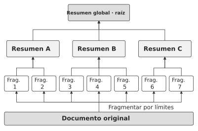

Por ejemplo, "SSE2 permite ejecutar operaciones SIMD con enteros en registros XMM de 128 bits" y "SSE4.2 añade instrucciones de comparación de cadenas" pueden integrarse en un resumen sobre "la evolución de los conjuntos de instrucciones SIMD de x86". Las preguntas de detalle pueden coincidir con los fragmentos de la base, y las preguntas de visión general, con los resúmenes de nivel superior. La consulta puede descender nivel a nivel o buscar a la vez en los nodos de todos los niveles y elegir el conjunto más pertinente.

[^ch3-raptor]: Sarthi et al., RAPTOR: Recursive Abstractive Processing for Tree-Organized Retrieval, 2024.

**GraphRAG** organiza el conocimiento mediante entidades, relaciones y resúmenes de comunidades. Registra cada relación como una tripleta "sujeto–relación–objeto", por ejemplo (China, tiene por capital, Pekín) o (Zhang San, trabaja en, Tencent). Dos registros que mencionan la misma entidad pueden conectarse en el grafo. En la figura 3-11 hay dos médicos apellidados Zhang. Cuando el usuario pregunta "la dirección del hospital de mi dentista", ¿por qué relación debe seguir buscando el sistema?

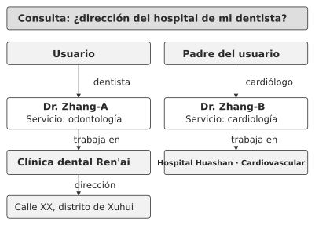

1. **Distinguir entidades homónimas al construir el grafo.** Un doctor Zhang atiende al usuario como dentista en la clínica dental Ren'ai; otro trata del corazón al padre del usuario en el hospital Huashan. Al extraer entidades y fusionar registros, el sistema puede usar estas pistas para asignar identificadores distintos a cada médico. Los campos `person` y `relationship` vistos antes cumplen una función similar. Decidir si `bank` significa orilla o banco en una oración es desambiguación léxica; decidir a qué doctor Zhang se refiere un registro es desambiguación de entidades.
2. **Recorrer la cadena de relaciones al consultar.** Partiendo del usuario y siguiendo "usuario → médico → hospital → dirección" paso a paso, se puede reunir en una sola respuesta información repartida en varios registros.

El proceso de indexación de Microsoft GraphRAG extrae primero entidades y relaciones de las unidades de texto, identifica después mediante detección de comunidades grupos de entidades estrechamente conectadas y genera una jerarquía de comunidades con sus resúmenes. Al consultar una entidad concreta, la búsqueda local combina la información asociada y el texto original; al consultar los temas de todo el corpus, la búsqueda global organiza la respuesta con los resúmenes de comunidades[^ch3-graphrag].

[^ch3-graphrag]: Microsoft GraphRAG, visión general de la indexación y la consulta, búsqueda local y búsqueda global.

La representación de relaciones también debe poder recoger condiciones y tiempos. Por ejemplo, "si la semana que viene sigue lloviendo, cancelo la playa y voy al museo" contiene una condición, un periodo de validez y una acción alternativa. Si solo se extraen (usuario, tiene previsto, viaje a la playa) y (usuario, tiene como alternativa, visita al museo), se pierde la condición de cambio. Se puede conservar la oración completa y representar la restricción "si llueve la semana que viene" con nodos de condición, nodos de evento o campos estructurados, de modo que la relación remita al texto original.

Para la memoria del usuario, el autor recomienda más bien **combinar por capas el lenguaje natural y los índices estructurados**: guardar la expresión completa en lenguaje natural, registrar en metadatos el sujeto, la fecha y el origen, y construir un índice de grafo para el contenido que haya que relacionar con frecuencia.

> **Experimento 3-7 ★★★: Comparación entre resúmenes jerárquicos e índices de relaciones**
>
> Este experimento toma 14 páginas del manual de arquitectura de Intel relacionadas con SSE, AVX y la gestión de estado, y construye con ellas dos implementaciones didácticas. La rama de resúmenes jerárquicos genera primero un resumen por página, los agrupa en tres grupos y genera los resúmenes de grupo y el resumen raíz; la rama de índice de relaciones extrae entidades y relaciones y genera resúmenes de comunidades. Ambas usan el mismo material y las mismas ocho preguntas, y se comparan en detalles conceptuales y razonamiento sobre relaciones.
>
> Ante la consulta "explica el entorno de programación SSE", el resumen jerárquico puede coincidir a la vez con la visión general de SSE y con los detalles de los registros. Esta implementación busca a la vez en los nodos de todos los niveles y elige los cinco más pertinentes. La rama de relaciones, en cambio, amplía los vecinos de las entidades pertinentes y organiza el contexto con los resúmenes de comunidades. Siguiendo relaciones como "SSE → registros XMM → operaciones de coma flotante → ADDPS", se pueden conectar los conceptos con instrucciones concretas.
>
> Una pregunta más compleja es "si el procesador declara admitir AVX, ¿puede el programa usar AVX?". Hay que relacionar la capacidad del procesador con la gestión de estado del sistema operativo: comprobar los indicadores AVX y OSXSAVE de CPUID y leer después XCR0 para confirmar que los estados XMM e YMM están habilitados. Para esta pregunta, los extremos que se indican al programa de búsqueda en grafo son CPUID e YMM. El programa encuentra el camino más corto que los conecta, pasando por XSAVE, CR4.OSXSAVE y XCR0, y entrega ese camino al modelo para que responda.
>
> En las ocho preguntas, la cobertura media de páginas fuente de ambos grupos es de aproximadamente el 95,8 %.

El autor recomienda resolver bien primero la fragmentación y la búsqueda híbrida, y construir índices estructurados cuando aparezca de forma recurrente la necesidad de síntesis entre documentos y de consultas sobre relaciones. Localizar un pasaje concreto de la política de reembolsos suele resolverse con fragmentación y búsqueda híbrida; comparar SSE con AVX, o bajar desde la arquitectura general hasta instrucciones concretas, requiere más bien resúmenes entre pasajes e índices de relaciones.

### El Paradigma del Sistema de Archivos: Organizar el Conocimiento con Directorios

**OpenViking** organiza las memorias, los recursos y las habilidades como un sistema de archivos virtual. Cada entrada se referencia mediante una URI `viking://`, y el Agente puede recorrer directorios, leer resúmenes y acceder después al contenido que necesita[^ch3-openviking-uri]. Según el uso de la información, los directorios pueden entenderse como tres grupos: recursos externos, datos del usuario, y habilidades y experiencia que usa el Agente. Los identificadores de usuario y de Agente delimitan además sus respectivos espacios de nombres.

| Contenido | Uso típico |
| --- | --- |
| Resources | Material externo como documentación técnica, repositorios de código y páginas web |
| User memories | Preferencias, hábitos y experiencias de un usuario concreto |
| Skills y Agent memories | Procedimientos reutilizables, registros de tareas y experiencia pendiente de validar |

La URI ofrece una forma unificada de localizar el contenido, y el servicio gestiona el almacenamiento físico y los índices. La interfaz de directorios permite al Agente explorar por temas nivel a nivel y también limitar la búsqueda semántica al subárbol pertinente. El acceso al estilo de un sistema de archivos, el almacenamiento del contenido y los índices vectoriales pueden formar juntos el servicio.

[^ch3-openviking-uri]: OpenViking, Viking URI y arquitectura del sistema.

OpenViking divide el contenido en tres niveles, **L0, L1 y L2**: L0 es un resumen breve para juzgar rápidamente si un directorio es pertinente; L1 es una visión general del directorio que explica su contenido principal y sus puntos de entrada; L2 es el texto que hay que leer en detalle. Los resúmenes y las visiones generales de cada directorio se guardan en `.abstract.md` y `.overview.md`. Los presupuestos para generar su texto son de 256 y 4000 caracteres, respectivamente[^ch3-openviking-layers].

Una consulta puede leer primero el resumen para orientarse, después la visión general para elegir archivos y, por último, cargar el texto original. Esto conecta con la divulgación progresiva de las Skills del capítulo 2: un directorio ligero permite descubrir, y el contenido completo se carga según lo que requiera la tarea. Cuando se necesitan valores exactos, condiciones o la redacción original, hay que seguir recuperando el texto correspondiente.

[^ch3-openviking-layers]: OpenViking, Context Layers (L0/L1/L2). L0 y L1 son representaciones generadas a nivel de directorio; L2 puede ser el archivo original o el texto ya analizado.

Para el conocimiento que deben mantener conjuntamente personas y Agentes, el autor se inclina por gestionarlo con **texto plano en Markdown y control de versiones**. Las personas pueden leer, editar y corregir directamente el conocimiento, y el Agente puede usar la misma interfaz de archivos para proponer actualizaciones en una rama de trabajo, que se publican tras su revisión. El control de versiones guarda las diferencias de cada modificación y permite deshacer una actualización errónea. Al terminar la sesión, las preferencias del usuario pasan a la memoria de ese usuario y el desarrollo de las operaciones, al registro de la tarea. Tras evaluar los resultados, generalizarlos a partir de varias trayectorias y validarlos después, los registros de tareas pueden convertirse en la experiencia que trata el capítulo 9.

Organizar el conocimiento como un sistema de archivos obliga a **crear al mismo tiempo enlaces e índices entre las entradas relacionadas**. Un conjunto de archivos que no se referencian entre sí solo puede recuperar sus relaciones mediante un recorrido del texto completo o una búsqueda semántica; cuantos más archivos hay, más le cuesta al Agente seguir indagando a partir de lo que ya ha encontrado. Los enlaces ofrecen rutas de búsqueda explícitas: por ejemplo, la política de reembolsos apunta a las cláusulas de excepción, el resumen de un contrato apunta al registro de la firma y la entrada de una persona apunta a los eventos relacionados. Una página de entrada explica los temas principales, una página de índice ofrece la navegación y las referencias cruzadas entre entradas permiten buscar en horizontal. Esta organización, parecida a la de los artículos de una enciclopedia, permite conservar parte de las relaciones de forma ligera.

Al construir la base también se puede indicar qué entradas pueden usarse juntas y de qué planes de actuación solo puede elegirse uno en una misma gestión. Por ejemplo, cuando un agente de atención al cliente tramita la cancelación de un pedido, su respuesta debe cumplir a la vez las normas de redacción y las de privacidad, y ambas normas pueden incluirse juntas en el contexto. Si el almacén ha preparado dos planes para cancelar un envío, el índice debe especificar las condiciones de aplicación de cada uno. Para un mismo paquete, si aún no ha salido del almacén se anula la orden de salida; si ya se ha entregado al transportista, se solicita su interceptación. Cuando el ticket solo dice "cancelen el pedido", el Agente debe consultar primero el estado del paquete y cargar después el plan aplicable.

El mantenimiento de los enlaces debe incorporarse al proceso de actualización: antes de añadir una entrada se buscan los registros existentes para decidir si se fusiona o se crea una nueva; después de escribirla se añaden las referencias relacionadas y se actualiza el índice del directorio al que pertenece. Los enlaces llevan al lector hasta la cláusula; si esa cláusula se aplica al pedido que tiene entre manos depende todavía de cuándo entró en vigor.

### Cómo Debe Actualizarse el Conocimiento

Una política cambia hoy y mañana el usuario puede preguntar "¿qué debo hacer ahora?" o "¿por qué se tramitó así mi pedido el mes pasado?". Si la cláusula nueva simplemente sobrescribe la antigua, la segunda pregunta se queda sin el fundamento que regía entonces. La **actualización incremental** escribe a tiempo las nuevas evidencias, y la **reorganización periódica** detecta en un ámbito más amplio duplicados, conflictos y cambios de estructura; ambas vías deben conservar versiones y referencias a las evidencias, y someterse a comprobaciones antes de publicarse, para poder elegir el periodo aplicable según la pregunta.

#### Actualización Incremental de la Memoria del Usuario y de la Base de Conocimiento

La recomendación del autor es: **tratar la base de conocimiento como un repositorio de código y cada cambio de conocimiento como una Pull Request (PR).** Cada actualización debe tener un alcance de modificación claro e ir acompañada de las evidencias que la respaldan, para que el revisor pueda comprobarla. Los documentos Markdown, los archivos de reglas y el estado ejecutable de User as Code pueden incorporarse a este proceso. El historial de versiones ayuda a los responsables del mantenimiento a ver los cambios, rastrear sus causas y restaurar el estado anterior si se publica algo erróneo.

Siguiendo el patrón **proponente–revisor** del capítulo 1, una actualización puede desarrollarse así:

1. **El proponente genera el cambio.** El Proposer Agent lee las nuevas evidencias, busca en el conocimiento existente, localiza las entradas que hay que añadir, corregir o retirar por caducadas y propone en una rama de trabajo una modificación de alcance bien definido. Al mismo tiempo mantiene los enlaces relacionados, los índices de los directorios, la información temporal y las referencias a las evidencias.
2. **El revisor comprueba de forma independiente.** El Reviewer Agent compara el contenido anterior y posterior a la modificación con las evidencias originales, y verifica si las nuevas afirmaciones tienen fuente, si las condiciones de aplicación están completas, si lo que dicen distintos archivos es coherente y si en los párrafos eliminados quedaba información todavía útil. Cuando encuentra un problema, señala la entrada concreta y su fundamento, y explica qué hay que añadir, restaurar o corregir.
3. **Iterar y decidir.** El proponente modifica según las observaciones y el revisor vuelve a comprobar. Si la revisión se aprueba, se pasa al proceso de fusión; si se alcanza el límite de rondas o de coste y sigue habiendo desacuerdo, la modificación se deja en la rama de trabajo y se pide revisión humana.
4. **Comprobar y publicar.** Se comprueban automáticamente el formato, los enlaces, los metadatos y las etiquetas de permisos; el conocimiento ejecutable debe pasar además la comprobación de tipos y las pruebas correspondientes. Tras la fusión, a partir de una versión determinada del conocimiento se reconstruyen los fragmentos, resúmenes e índices vectoriales afectados, y después se publica la versión del servicio.

Este proceso corresponde a tres capas de datos. La **capa de evidencias originales** guarda conversaciones, trayectorias de ejecución, documentos de negocio y resultados de herramientas; la **capa de conocimiento** guarda texto o código depurado y revisable; la **capa de servicio** guarda los índices generados a partir de una versión concreta del conocimiento. El registro de cambios asocia los identificadores de las evidencias, la versión del conocimiento, las observaciones de revisión y la decisión final, de modo que los responsables puedan averiguar por qué se escribió un conocimiento y cuándo entró en vigor. Las evidencias originales se archivan según la política de conservación, y los índices pueden regenerarse a partir de las versiones del conocimiento. La memoria por anexado vista antes sirve para guardar hechos nuevos y antiguos con su origen; este proceso de revisión se encarga de convertir esas evidencias en versiones de conocimiento utilizables. Si al consultar aparece un conflicto sin resolver, todavía se puede volver a las evidencias y decidir según las condiciones de la tarea.

En este diseño, **tanto el proponente como el revisor deben ser Agentes capaces de llamar a herramientas y de seguir consultando.** El proponente puede necesitar buscar en varios registros para encontrar las entradas afectadas; el revisor también puede tener que seguir las referencias, comparar versiones o ejecutar comprobaciones. Las herramientas de búsqueda de archivos, recuperación de evidencias, visualización de diferencias y pruebas les permiten realizar estos pasos posteriores, y un Coding Agent con esas capacidades puede asumir este trabajo.

El alcance de búsqueda de ambos debe cubrir el conocimiento afectado por el cambio y las evidencias originales, y estar limitado por los permisos del usuario, el inquilino y la tarea. La trayectoria de revisión, los resultados de herramientas citados y las observaciones se archivan juntos, de modo que más adelante se pueda comprobar qué verificó realmente el revisor.

En cuanto a la elección de modelos, el autor recomienda dar prioridad a combinaciones de capacidad similar procedentes de familias distintas, por ejemplo Claude y GPT, o DeepSeek y Kimi. Distintos datos de entrenamiento y hábitos de razonamiento pueden dar lugar a juicios distintos. El revisor debe buscar evidencias de forma independiente y verificar las afirmaciones y condiciones de la modificación. Los permisos deben aplicarlos el sistema en ejecución: el proponente escribe en la rama de trabajo, el revisor lee las evidencias y emite su conclusión, y el servicio de fusión y publicación tiene los permisos para actualizar el repositorio principal y los índices en producción.

#### Reorganización Periódica de la Memoria del Usuario y de la Base de Conocimiento

Tras muchas actualizaciones locales, un mismo hecho puede quedar disperso en varios archivos y pueden convivir formulaciones antiguas y nuevas. La reorganización periódica parte de los directorios, las fechas o los temas para revisar estos problemas acumulados. Comparte su forma de trabajar con la revisión periódica que trata el capítulo 9: en primer plano se acumulan nuevas evidencias, en segundo plano se organizan de forma concentrada y se producen registros que las tareas posteriores pueden usar.

La reorganización comprende tres tareas.

1. **Eliminar duplicados, fusionar y reestructurar.** Se localizan las entradas duplicadas, caducadas o excesivamente fragmentadas, se fusiona el contenido relacionado, se dividen los archivos demasiado grandes y se actualizan los enlaces, las páginas de entrada y las páginas de índice. Al retirar del servicio formulaciones antiguas, se registra qué las sustituye y en qué se basaban originalmente.
2. **Volver al material original.** Si cada ronda de reorganización se limita a reescribir los resúmenes de la ronda anterior, las omisiones y malentendidos iniciales se transmiten de una ronda a otra. Por eso hay que contrastar con las conversaciones, las trayectorias de ejecución, los documentos de negocio y las salidas de las herramientas si los resúmenes omiten hechos clave, si han perdido negaciones, fechas o condiciones, o si han presentado conjeturas como conclusiones firmes. Las bases de conocimiento grandes pueden procesarse por lotes según directorios, fechas o temas, llevando una lista de cobertura con las partes revisadas, pendientes y en disputa hasta completar la verificación de toda la base.
3. **Resolver conflictos y ámbitos de aplicación.** Se comparan las fuentes de los registros contradictorios, así como la fecha, el sujeto, la región, la tarea y las condiciones previas. Si dos informaciones se aplican a escenarios distintos, se completa el ámbito de cada una; si una nueva evidencia sustituye claramente una regla antigua, se guarda la relación entre versiones; si no hay fundamento suficiente, se registran los puntos pendientes de confirmar y las evidencias que faltan.

El resultado de la reorganización también se envía a revisión como un cambio. Las reestructuraciones grandes pueden dividirse en varias PR por directorio o por tema, que comparten el plan de reorganización y la lista de cobertura; una vez aprobados los cambios relacionados, se reconstruyen los índices derivados y se vuelven a ejecutar casos típicos de búsqueda y de preguntas y respuestas para comprobar que el conocimiento que antes se encontraba sigue siendo accesible. Puede activarse periódicamente, cada semana o cada mes, o mediante umbrales sobre el número de entradas nuevas, el número de conflictos o los cambios en la calidad de la recuperación.

**Retirada del contenido caducado.** Los fragmentos y resúmenes deben conservar su versión, su fecha de entrada en vigor y su fecha de caducidad. Cuando una política antigua es sustituida, las consultas de negocio actuales filtran las versiones caducadas, y las consultas históricas leen las reglas vigentes en la fecha de interés. Así se puede usar el conocimiento más reciente y también explicar cómo se tramitaron los casos pasados.

**Permisos y aislamiento entre inquilinos.** El filtrado por permisos debe hacerse en la capa de recuperación: el servicio de recuperación delimita primero, según la identidad de quien llama, el conjunto de documentos consultables y solo después busca en él el material pertinente. En cuanto se introduce en el contexto material privado de otro usuario, el modelo puede filtrarlo al responder o al llamar a herramientas. El texto original, los resúmenes, las aristas de relación y los resultados en caché deben heredar el ámbito de acceso adecuado, para evitar que el contenido derivado arrastre información de otros usuarios o inquilinos. El servicio puede usar índices independientes o índices compartidos con filtrado obligatorio; lo esencial es que cada consulta aplique las restricciones de permisos.

### RAG Agéntico: El Agente Controla el Proceso de Recuperación

Primero hay que preguntarse si basta con una sola búsqueda. Para "¿cuál es el teléfono del servicio posventa?", un manual de servicio vigente suele dar la respuesta, y el autor recomienda mantener el camino sencillo de buscar una vez y generar. Si el usuario pregunta "¿puedo cambiar el modelo que compré según las condiciones de garantía del mes pasado?", la primera búsqueda solo encuentra la serie del producto y todavía no permite saber qué condiciones de cambio regían el mes pasado. Si la búsqueda se ofrece como herramienta, el Agente puede usar las pistas devueltas por una búsqueda para formular la siguiente. Este enfoque, en el que el Agente decide si busca más y qué busca después, se llama **RAG agéntico (Agentic RAG)**. En la figura 3-12, la primera búsqueda devuelve exactamente la misma información del producto. ¿Qué pista adicional aprovecha el camino de la derecha para encontrar las condiciones aplicables en aquel momento?

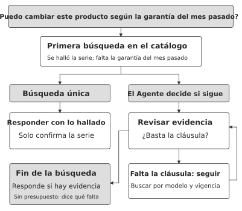

Tomando ReAct como ejemplo, el modelo analiza primero la pregunta, elige una consulta y llama a `knowledge_base_search`; cuando la herramienta devuelve la observación, el modelo decide si las evidencias bastan. Si faltan condiciones u objetos relacionados, reformula la consulta y sigue buscando; si el material es suficiente, genera la respuesta apoyándose en las fuentes. El Harness mantiene el historial, las llamadas a herramientas y el presupuesto, y al llegar al límite termina la búsqueda o pasa a pedir aclaraciones.

Observa ahora la figura 3-13. Aunque el backend de la base de conocimiento pase de un índice vectorial a un grafo de relaciones, el modelo puede seguir pidiendo búsquedas a través de la misma interfaz de herramienta. Si un documento devuelto contiene precisamente un fragmento con instrucciones, ¿puede el modelo seguirlas?

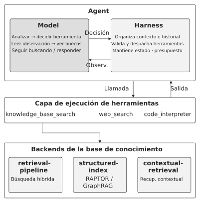

**La frontera de confianza del contenido recuperado.** Los documentos externos pueden contener texto que intenta cambiar el comportamiento del modelo, y también pueden haber recibido hechos falsos antes de entrar en la base. Lo primero es inyección indirecta de prompts; lo segundo, envenenamiento de la base de conocimiento. Para afrontarlo hay que gestionar a la vez el origen del contenido y los permisos de ejecución: los resultados de búsqueda llevan su fuente, su versión y la posición citada, y sirven como evidencia para la respuesta; las acciones como transferencias, borrados o envíos al exterior las valida el Harness y el entorno de ejecución según la autorización del usuario. La revisión al incorporar documentos, la trazabilidad del origen y la verificación de hechos limitan además la propagación de conocimiento erróneo. El marcado de origen presentado en el capítulo 2 y las restricciones de herramientas del capítulo 4 actúan aquí conjuntamente.

> **Experimento 3-8 ★★: Comparación entre una sola búsqueda y búsquedas en varias rondas**
>
> Este experimento usa el mismo material jurídico en chino, el mismo recuperador BM25 y el mismo modelo para comparar dos modos en siete preguntas: la línea base busca una vez con la pregunta original, y el modo Agente permite al modelo ajustar la consulta y ejecutar hasta cuatro búsquedas.
>
> Para consultas como "¿cómo se regula la legítima defensa?", una búsqueda directa obtiene los artículos principales. Un ejemplo más complejo es "¿cómo se determina la pena por causar por imprudencia lesiones graves en estado de embriaguez, con antecedentes por hurto?". Afecta a la vez a la conducta actual, al estado de embriaguez y a los antecedentes, y la búsqueda debe localizar por separado el material correspondiente y comprobar después las condiciones de aplicación.
>
> En la ejecución real se buscó sucesivamente "lesiones graves por imprudencia en estado de embriaguez antecedentes por hurto determinación de la pena", "embriaguez delito determinación de la pena", "antecedentes por hurto efecto en la pena código penal" y "antecedentes efecto en la pena código penal". Después el modelo propuso además "reincidencia apreciación código penal", pero el presupuesto de búsquedas ya se había agotado y el Harness devolvió un aviso de presupuesto agotado.
>
> En las cuatro preguntas complejas definidas por el experimento, la cobertura de los artículos objetivo pasó de alrededor del 8 % al 92 %, el número medio de búsquedas pasó de una a 3,5 y el tiempo medio de la fase de respuesta pasó de unos 8 segundos a 66. En las tres preguntas sencillas la cobertura de evidencias fue del 100 %, y ambos grupos buscaron una sola vez.

El mismo ciclo de búsqueda puede aplicarse al historial del usuario. A continuación se reutiliza el conjunto de evaluación de tres niveles del experimento 3-1 para observar cómo el Agente recupera hechos de registros de varias sesiones, distingue sujetos y gestiona las actualizaciones.

> **Experimento 3-9 ★★: Leer la memoria del usuario con recuperación agéntica**
>
> Este experimento usa el historial completo de conversaciones como base de conocimiento, lo divide en ventanas y lo indexa, y ofrece al Agente la herramienta `search_user_memory`. El tamaño de la ventana es ajustable; en esta ejecución cada fragmento contiene ocho turnos de conversación, los fragmentos contiguos se solapan en dos turnos y se guardan el identificador de sesión, la fecha y metadatos de negocio. Cada consulta ejecuta como máximo tres búsquedas y recupera cuatro fragmentos en cada una.
>
> El recuerdo básico puede buscar en torno a un campo explícito, por ejemplo "¿cuál es el número de mi cuenta corriente?". Las preguntas entre sesiones exigen además comprobar que los sujetos estén completos: si el usuario tiene un Honda Accord y un Tesla Model 3 y pregunta por el calendario de servicio de sus vehículos, el sistema debe distinguir los dos coches y el estado de la cita de cada uno.
>
> A partir de ahí se puede diseñar una ruta de búsqueda: buscar primero los registros de vehículos y de servicio; al encontrar pistas del otro coche, consultar la programación del Tesla, y por último explicar la cita ya existente del Honda y confirmar si el usuario necesita también pedir cita para el Tesla. En el registro real de esta ejecución solo se lanzó la consulta `scheduled car services`, y la respuesta del grupo de búsqueda simple se centró en el Honda y omitió el Tesla.
>
> Otra dificultad procede de las modificaciones sucesivas. En el caso de la transferencia, la esposa establece la operación, el marido modifica después el importe y la fecha, y la esposa vuelve a ajustarla. Tras recuperar los registros, hay que reconstruir los cambios según la fecha, el sujeto y el estado de confirmación para encontrar la instrucción que quedó finalmente vigente. Aunque los fragmentos actuales ya guardan la información temporal, la búsqueda puede seguir omitiendo modificaciones clave, por lo que se puede añadir además a cada fragmento el contexto del evento.
>
> De estos 60 casos, 18 buscaron una sola vez, 6 dos veces y 36 agotaron las tres búsquedas. El grupo de búsqueda con fragmentación simple aprobó 47: 19 de recuerdo básico, 15 de recuperación entre sesiones y 13 de servicio proactivo. La siguiente sección compara, sobre los mismos casos, los prefijos de contexto y la memoria estructurada, y analiza qué información aporta cada uno.

### Recuperación Consciente del Contexto: Añadir Contexto a los Fragmentos

Volvamos al informe financiero. Para consultar los resultados de ACME en el segundo trimestre de 2025, la consulta contiene el nombre de la empresa y el año, pero el fragmento que dice "los ingresos de la empresa crecieron un 3 %" no contiene precisamente ninguna de esas dos palabras. Además de agrandar los fragmentos, se puede conservar ese texto breve y anteponerle el contexto que le falta. La **recuperación consciente del contexto (Contextual Retrieval)** genera al indexar un breve prefijo de contexto para cada fragmento y usa el prefijo junto con el texto original en la búsqueda[^ch3-1]. La figura 3-14 muestra este proceso.

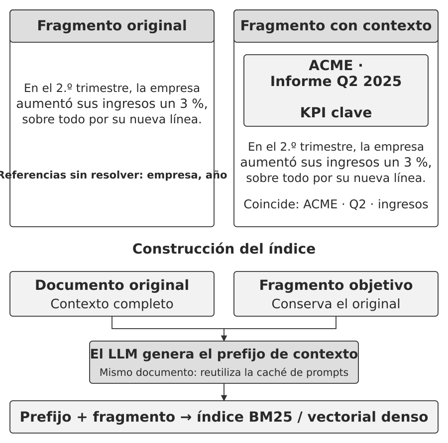

Por ejemplo, el prefijo puede indicar que "este pasaje procede de la sección de indicadores clave de resultados del informe del segundo trimestre de 2025 de ACME". Al generarlo se proporcionan a la vez el texto original y el fragmento objetivo, para que el modelo añada las referencias, fechas y secciones que tengan fundamento. Así BM25 obtiene términos que pueden coincidir, como el nombre de la empresa o el trimestre, y los embeddings densos también pueden representar el fragmento teniendo en cuenta ese contexto.

Puede combinarse con la compresión consciente del contexto del capítulo 2: en la fase de indexación se añade contexto a los fragmentos de conocimiento para aumentar las posibilidades de encontrar información pertinente; en la fase de ejecución se organiza el historial ya recuperado según la tarea actual para controlar la longitud de la entrada. La primera se ocupa de que los fragmentos puedan recuperarse; la segunda, de la información y el presupuesto que necesita la decisión actual.

[^ch3-1]: Anthropic, Introducing Contextual Retrieval, septiembre de 2024.

> **Experimento 3-10 ★★: Comparación entre fragmentos originales y fragmentos enriquecidos con contexto**
>
> Este experimento construye dos índices para el mismo material: uno con los fragmentos originales y otro con los prefijos generados por el modelo. Manteniendo iguales las consultas y las anotaciones de los objetivos, se comparan por separado BM25, la recuperación densa y la búsqueda híbrida.
>
> Siguiendo con el ejemplo del informe financiero, al consultar "evolución reciente de los ingresos de ACME" se puede comprobar si el fragmento encontrado contiene a la vez la empresa objetivo, el periodo y los datos de crecimiento. Con solo "crecimiento de los ingresos" puede coincidir con otras empresas; con el prefijo, el nombre de la empresa y la fecha pueden intervenir en la ordenación.
>
> En las 15 consultas de esta ejecución, al añadir los prefijos, el recall@1 de BM25 pasó de 0,60 a 0,80, y el de la recuperación densa, de aproximadamente 0,867 a 0,933; el recall@3 de ambos se mantuvo en 0,867 y 1,0, respectivamente. El recall@5 de la búsqueda híbrida pasó de 14/15 a 15/15. ¿Qué pregunta se recuperó de más? Al consultar las atribuciones del Comité Permanente de la Asamblea Popular Nacional, el fragmento objetivo enumeraba las atribuciones pero le faltaba el sujeto. Con el prefijo, BM25 lo subió del puesto 16 al 12, todavía fuera de los cinco primeros; la búsqueda híbrida lo subió del puesto 6 al 5, y solo entonces entró entre los cinco primeros. Volviendo al texto original, el primer fragmento enumeraba las atribuciones (1) a (4), y el quinto continuaba desde la (4) hasta la (22). La puntuación solo comprobaba si se había seleccionado el quinto fragmento anotado, pero para enumerar todas las atribuciones hay que unir los dos fragmentos.
>
> Generar los prefijos añade llamadas en la fase de indexación. Cuando se genera el contexto de varios fragmentos de un mismo documento, se puede reutilizar la caché del prefijo del documento. En su informe de 2024, Anthropic estimó, con fragmentos de 800 tokens, documentos de 8000 tokens y una longitud de prompt determinada, un coste único de procesamiento de unos 1,02 dólares por millón de tokens de documento.
>
> En ese informe, los embeddings contextuales combinados con BM25 redujeron la tasa de fallos de recuperación en el top-20 del 5,7 % al 2,9 %, un descenso relativo de alrededor del 49 %; con reordenación bajó al 1,9 %, un descenso relativo de alrededor del 67 %. La tasa de fallos que usa el informe es $1-\mathrm{recall@20}$.

Para bases documentales que se consultan repetidamente y cuyo contenido es relativamente estable, el autor recomienda completar el contexto de los fragmentos al construir el índice: un único procesamiento sirve para muchas consultas posteriores. Si al dividir se pierden el nombre de la empresa, el sujeto de un evento o la fecha, aumentar sin más el número de resultados puede seguir devolviendo un montón de fragmentos con referencias ambiguas. Completar esas pistas al generar los prefijos permite que las búsquedas posteriores las aprovechen para localizar el material.

> **Experimento 3-11 ★★★: Mejorar la memoria con prefijos de contexto y fichas estructuradas**
>
> Un "vale, resérvalo" en una conversación debe relacionarse con el producto o el viaje mencionado antes. Si el texto original trataba de un billete solo de ida de Shanghái a Seattle por 500 dólares, el prefijo puede añadir ese contexto y conservar la sesión y la fecha en que se produjo la confirmación.
>
> Este experimento añade dos configuraciones a la fragmentación simple: el grupo de prefijos de contexto y el grupo de memoria de dos capas, que carga además Advanced JSON Cards. El modelo genera primero la secuencia de búsquedas sobre el índice simple y después se aplica el mismo conjunto de consultas a ambos índices; el grupo de dos capas usa los mismos resultados de la búsqueda enriquecida y añade las fichas estructuradas.
>
> En el caso de la transferencia, los prefijos indican respectivamente que Patricia inicia la transferencia, que James modifica la operación y que Patricia vuelve a ajustarla, lo que ayuda a situar el orden de los eventos. Según los registros originales, el estado final es de 95 000 dólares el 1 de octubre, y las operaciones anteriores quedaron sustituidas. En esta ejecución, los tres grupos encontraron correctamente ese estado.
>
> La estructura de dos capas también permite relaciones proactivas. Las fichas guardan hechos clave como "viaje a Tokio" y "validez del pasaporte", y las conversaciones detalladas se recuperan cuando hace falta. Con un viaje del 15 al 22 de enero y un pasaporte que caduca el 18 de febrero, el sistema puede detectar primero que las fechas están próximas, consultar después los registros de renovación y los requisitos del viaje y, por último, recordar al usuario que confirme los preparativos pendientes. En este caso de viaje, las respuestas de los tres grupos superaron la evaluación; la diferencia entre fichas y búsqueda se aprecia sobre todo en los casos de vehículos y entre sesiones que se comentan a continuación.
>
> En el total de 60 casos, la búsqueda simple, los prefijos de contexto y la memoria de dos capas aprobaron 47, 52 y 57, respectivamente. Los casos de servicio proactivo aprobados por el grupo de prefijos pasaron de 13 a 18; el grupo de dos capas aprobó los 20 del nivel de recuperación entre sesiones y también 18 en el de servicio proactivo. En el caso de los vehículos, las fichas aportaron la información del segundo coche y ayudaron a que la respuesta cubriera el sujeto que antes se omitía. Veamos también un retroceso: el usuario pregunta por la cobertura de daños por agua en sus inmuebles; el grupo simple mencionó la vivienda habitual y la vivienda en alquiler, pero el grupo de prefijos omitió la de alquiler. La comparación pregunta por pregunta muestra que el grupo de prefijos acertó 8 preguntas más que el grupo simple, pero falló 3 que antes se acertaban.

**Cuando se necesita servicio proactivo, el autor da prioridad a una arquitectura de dos capas con los hechos clave siempre presentes y los registros detallados recuperados bajo demanda.** Si solo se recurre a la búsqueda, el modelo suele necesitar saber de antemano qué preguntar para encontrar los registros pertinentes; el pasaporte, los vehículos o las relaciones familiares que todavía no han entrado en su campo de visión se omiten con facilidad. Colocar primero en el contexto unos pocos hechos clave ayuda al modelo a descubrir relaciones y formular consultas, y después a recuperar los detalles originales. Al elegir la información permanente hay que considerar las relaciones entre personas, las restricciones vigentes y los asuntos pendientes; los resultados de búsqueda, por su parte, conservan el origen, la fecha y el fundamento de los cambios.

### Extraer Conocimiento de Conjuntos de Datos: De los Casos a la Representación Estructurada

El conocimiento también puede surgir de organizar un gran número de casos. En sentencias judiciales, tickets de atención al cliente y registros de reparación, mucha información útil está dispersa en narraciones concretas. Cuando la tarea requiere inducir patrones a partir de muchos casos, comparar resultados o decidir qué preguntar a continuación, el autor recomienda extraer primero campos unificados y hacer después las estadísticas y la organización de prototipos. Recuperando solo unos pocos casos parecidos es difícil ver la distribución del conjunto de datos completo; con campos unificados se pueden hacer estadísticas sobre todo el lote de registros y ofrecer una visión general para las consultas posteriores sobre casos concretos.

Este proceso puede dividirse en dos pasos. La **extracción de conocimiento** convierte las descripciones originales en registros estructurados, con el significado, los valores y el origen de cada campo bien definidos; el **análisis de patrones** usa después estadística y agrupamiento para encontrar casos similares y sus características comunes. La figura 3-15 muestra el flujo desde la extracción de los casos y la codificación de características hasta la recuperación de prototipos.

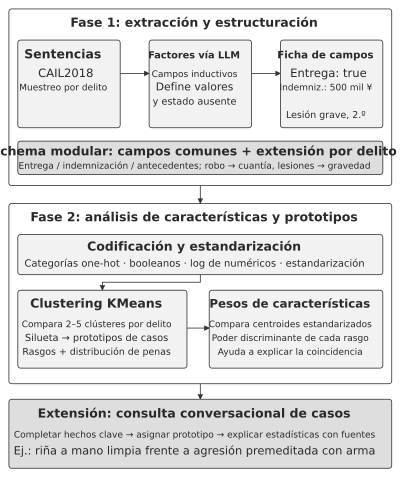

> **Experimento 3-12 ★★★: Extraer factores y prototipos de casos judiciales**
>
> Este experimento usa material de causas penales de CAIL2018, selecciona muestras de tres delitos (hurto, lesiones dolosas y estafa) y construye un proceso didáctico de "descubrimiento de factores, extracción de campos, agrupamiento e interpretación de prototipos"[^ch3-cail]. De cada tipo se toman 120 registros para el modelado y se reservan otros 20, lo que da 360 muestras de modelado y 60 muestras reservadas.
>
> **Descubrir y organizar los campos.** El modelo lee primero por lotes las muestras de modelado, propone factores que pueden ser útiles y los fusiona después en un esquema (Schema) modular. La parte común guarda campos relevantes para varios delitos, como la entrega voluntaria o la reparación del daño; la parte de extensión guarda información relacionada con delitos concretos, como el importe implicado o las lesiones causadas. Esta vez se obtuvieron 16 campos comunes y tres grupos de extensión con 12, 12 y 11 campos. Para cada campo hay que definir además sus valores y su estado de ausencia, de modo que la extracción sea coherente.
>
> **Codificar los campos como vectores.** Los campos categóricos pueden usar codificación one-hot: tomando como ilustración tres tipos (hurto, robo y estafa), se codifican como `[1,0,0]`, `[0,1,0]` y `[0,0,1]`, y cada posición solo indica si se pertenece a esa categoría. Usar 1, 2 y 3 introduciría, para algunos algoritmos, un orden y una distancia entre categorías. Campos como "se entregó voluntariamente" o "reparó el daño" pueden representar con 1 y 0 los dos estados confirmados; los casos en que el texto original no dice nada deben tratarse aparte, para no tomar automáticamente la ausencia como negación.
>
> Para valores no negativos de gran amplitud, como los importes, esta implementación comprime primero la escala con $\ln(1+x)$ y después los normaliza. Si un campo admite varias categorías a la vez, por ejemplo un registro con varias medidas adoptadas, se puede asignar un indicador a cada categoría y formar una codificación multi-hot.
>
> **Construir los prototipos de casos.** Se normalizan las características codificadas y se agrupan por separado para cada delito. Esta implementación compara de dos a cinco grupos y elige la agrupación con el coeficiente de silueta; al final se obtienen 11 prototipos. Cada prototipo guarda el número de muestras, las características principales y la mediana, los cuartiles y el rango de las penas de las muestras. Por ejemplo, en torno al origen del conflicto, la forma de comisión y las lesiones causadas, se pueden comparar combinaciones de características distintas, como una pelea a mano desnuda tras una discusión frente a una agresión premeditada con arma; la agrupación concreta la determinan conjuntamente los resultados de la extracción y el agrupamiento.
>
> **Explicar las características y los resultados de la coincidencia.** El programa calcula, a partir de las diferencias entre los centros normalizados de cada grupo, el peso de cada característica para distinguir los prototipos. La coincidencia con un prototipo proyecta el caso nuevo en el mismo espacio de características y recupera el resumen estadístico y los fundamentos del grupo más cercano, para que el modelo organice la explicación.
>
> En esta ejecución se eligieron 12 de las 60 muestras reservadas para generar explicaciones, que después evaluó un modelo independiente. Veamos una muestra de hurto: el prototipo con el que coincidió solo tenía un registro de modelado, con una pena de 4 meses, así que el mínimo, la mediana y el máximo valían 4. El generador informó fielmente de esa cifra y señaló que solo había un registro de referencia. El evaluador dio 4 puntos (la máxima puntuación) a "si las cifras son fieles al prototipo", pero la etiqueta real de la muestra reservada era de 8 meses.
>
> Si se usa la recuperación de prototipos en una conversación, se puede preguntar primero qué hechos que faltan pueden afectar a la coincidencia y volver a buscar según la respuesta.

[^ch3-cail]: CAIL2018, proyecto oficial del conjunto de datos. El experimento de referencia toma muestras del material público y usa una división interna de las muestras para el modelado y la evaluación.

De los casos a los prototipos, la base de conocimiento gana una capa de representación estadística que puede recuperarse. El texto original aporta las evidencias, los campos permiten el cálculo y los prototipos resumen las características comunes de muestras parecidas; solo si se conserva la correspondencia entre los tres es posible volver atrás y corregir cuando se detectan errores de extracción o sesgos de muestra.

### Exploración de Frontera: Memoria Multimodal y Paramétrica

Imagina que el usuario señala una foto que subió antes y dice "quiero este color". Si en su momento el sistema solo guardó "abrigo azul", la próxima vez quizá no pueda distinguir entre dos azules. El timbre de una voz o las relaciones espaciales de un gráfico también pierden detalle al transcribirse. Para que las consultas futuras puedan recuperar esa información, se puede guardar el material original, guardar representaciones que el modelo pueda usar o investigar una memoria persistente dentro del propio modelo.

**Primera vía: material original combinado con índices de texto.** Por ejemplo, en una tarea de organización de un álbum autorizada por el usuario, se pueden recortar y guardar regiones locales como los rostros de las personas, citar las imágenes en entradas Markdown y registrar a la vez la fecha de la foto, la escena y las etiquetas de personas que haya facilitado el usuario. Al buscar, primero se localizan a partir de la descripción unas pocas fotos posiblemente pertinentes y después se leen la imagen original o la región recortada para comparar los detalles de apariencia. Los fragmentos de voz también pueden asociarse a una fecha, un origen y una transcripción, y el audio original puede reproducirse cuando haga falta. El texto ofrece el punto de entrada, y el material original conserva los detalles difíciles de resumir con palabras.

**Segunda vía: almacenar embeddings y cargarlos bajo demanda.** Un codificador visual o de audio puede convertir el material en vectores y guardarlos en un índice para la búsqueda por similitud. Por ejemplo, las regiones de una imagen o los fragmentos de voz codificados se asocian a sus respectivas entradas de memoria. Si el modelo dispone de una capa de proyección entrenada y de una interfaz de memoria, también se puede reservar en el contexto un conjunto de huecos donde cargar esos vectores continuos, para que el modelo acceda a ellos mediante la atención. Aquí hay que resolver la alineación entre las representaciones del codificador y las representaciones internas del modelo de lenguaje.

Un estudio preliminar del autor con Noah Shi divide este problema en dos pasos. En una foto de grupo hay dos personas y el usuario pregunta: "¿el que está junto a la ventana es el que vimos la otra vez?". Primero hay que encontrar, a partir de "junto a la ventana", a la persona a la que se refiere el usuario y después comparar su imagen con las muestras guardadas antes. Si el primer paso elige a la persona equivocada, por muy preciso que sea el reconocimiento del segundo, se estará respondiendo a otra pregunta. El artículo mantiene además en la memoria de texto los hechos que pueden transcribirse con exactitud, como los nombres, de modo que cada tipo de información tenga su forma adecuada de acceso.[^ch3-perceptmem]

[^ch3-perceptmem]: Li Bojie y Noah Shi, Parametric Multimodal User Memory; el proyecto asociado `19PINE-AI/multimodal-user-memory` incluye la implementación y los experimentos de PerceptMem. La pregunta de la foto de grupo es un ejemplo didáctico.

**Tercera vía: memoria persistente dentro del modelo.** Entrenar un LoRA para cada usuario es una forma de escribir hechos personalizados en el modelo. Preguntar directamente "¿dónde vive el usuario?" y planificar un viaje a partir de su domicilio plantean exigencias distintas a la memoria: lo primero lee un hecho; lo segundo, además, usa ese hecho en un razonamiento posterior. Si solo se entrena para repetir hechos, el modelo puede recordar la respuesta pero no usarla por iniciativa propia en tareas complejas. Por eso, las muestras de entrenamiento deben incluir a la vez preguntas directas y tareas que dependan de esos hechos.

La investigación del autor **User as Engram** escribe hechos textuales en una tabla de memoria local de un modelo Engram, y un adaptador compartido aprende a razonar con esos hechos[^engram]. Una búsqueda de N-gramas con claves hash localiza las entradas de la tabla, y un mecanismo de compuerta introduce en el modelo el contenido recuperado; cada usuario guarda sus entradas locales y la parte de razonamiento puede compartirse. En sus experimentos con hechos textuales, el artículo compara el recuerdo directo con el razonamiento indirecto y muestra cómo gestionar por separado el contenido de la memoria de cada usuario y la capacidad de razonamiento compartida.

[^engram]: Li, Bojie, User as Engram: Internalizing Per-User Memory as Local Parametric Edits, 2026.

Extender esta vía a lo multimodal requiere diseñar además mecanismos de direccionamiento, escritura y lectura para las representaciones de imagen o de audio.

## Resumen del Capítulo

Volvamos al encargo de reserva del comienzo del capítulo. "Prefiero ventanilla" procede de este usuario; "cuántas maletas puedo llevar" hay que consultarlo en las condiciones de la aerolínea vigentes en la fecha del viaje. Si ambas informaciones se guardan como una simple frase, es fácil perder la diferencia más importante: a quién se aplica la primera y desde cuándo rige la segunda. Guardar el origen, la fecha y las condiciones de aplicación da, al recuperarlas, un fundamento para decidir si sirven esta vez. Un hecho aislado se presta a una nota breve; cuando hay que explicar relaciones entre personas o conservar cómo ocurrieron las cosas, se pueden usar fichas o párrafos originales; las fechas y las cantidades pueden guardarse además como campos tipados y dejar el cálculo al programa.

Si el asistente se equivoca con la franquicia de equipaje, primero hay que comprobar si las condiciones vigentes se incorporaron a la base, después en qué fragmento quedaron, si el recuperador lo encontró y en qué puesto quedó tras la reordenación, y por último qué material recibió el modelo. Cuando hay mucho texto original, se puede mantener una visión general estructurada en el contexto y recuperar los detalles bajo demanda. Los resúmenes por capítulos ayudan a localizar temas y los índices de relaciones, a seguir conexiones; si un fragmento ha perdido sus referencias, se le puede añadir el contexto de su origen; si una búsqueda sigue sin dar evidencias suficientes, el Agente puede reformular la consulta y seguir buscando.

Cuando la aerolínea publique nuevas normas, se puede hacer primero una actualización de alcance reducido que conserve la fecha de entrada en vigor y el origen de las condiciones antiguas y nuevas; los duplicados, conflictos y cambios de estructura acumulados se reorganizan periódicamente. El proponente envía la modificación, el revisor verifica las evidencias y, tras la aprobación, se reconstruye el índice del servicio. Con el historial de versiones se pueden volver a ejecutar las preguntas que antes se respondieron mal y averiguar en qué documento se basaba entonces la respuesta antigua. Cómo acumular experiencia a partir de los resultados de ejecución se trata específicamente en el capítulo 9.

Saber que se pueden facturar dos maletas solo responde a "¿lo permiten las normas?". Para añadir el equipaje al pedido en nombre del usuario, el asistente necesita saber además qué herramienta puede llamar, qué parámetros requiere y qué confirmación debe recibir para dar la gestión por hecha. Ese es el punto de partida del capítulo siguiente.

## Preguntas de Reflexión

1. ★★ El usuario dice: "El 1 de mayo me mudo de A a B; del 10 al 20 de mayo estaré en el hotel C, y durante ese tiempo mandadme las facturas por correo electrónico". El 15 de mayo, ¿cómo debería responder el asistente sobre el domicilio, el alojamiento temporal y la forma de envío de las facturas? Diseñe las reglas de registro y de consulta, y explique cómo tratar la corrección de una errata o direcciones contradictorias.
2. ★★ Cuando el documento original contiene información contradictoria, el prefijo de contexto puede llevar el error al índice. ¿Cómo guardaría el origen, la versión y los puntos inciertos, y cómo usaría esa información en las fases de recuperación y generación?
3. ★★ Al convertir un gráfico en texto, ¿qué relaciones espaciales se pierden con facilidad? Ponga ejemplos con tablas, diagramas de arquitectura o gráficos de líneas, y diseñe un esquema de recuperación que combine la imagen original, una representación estructurada y un índice de texto.
4. ★★★ A medida que mejoran los modelos y su capacidad de contexto largo, ¿qué partes de la fragmentación, la indexación y la recuperación podrían encomendarse al modelo? Analícelo a la luz de lo que dice Rich Sutton sobre la búsqueda y el aprendizaje en "La amarga lección" y diseñe un experimento que compare la entrada completa con la recuperación bajo demanda, comprobando a la vez la calidad de la tarea, el coste computacional y las restricciones de permisos.
5. ★★★ Si el modelo ya domina gran cantidad de conocimiento del dominio, ¿qué debe seguir guardando la base de conocimiento externa? Analice por separado el conocimiento público común, las reglas que se actualizan continuamente, los datos privados y las evidencias que requieren una trazabilidad exacta.
6. ★ ¿Qué consultas permiten, respectivamente, los resúmenes en varios niveles de RAPTOR y las relaciones entre entidades y los resúmenes de comunidades de GraphRAG? Ponga un ejemplo de visión general, uno de detalle local y uno de relación de varios saltos, y explique qué evidencias hay que comprobar.
7. ★★ ¿Cómo colaboran los directorios, los enlaces y los índices vectoriales en la organización del conocimiento? Diseñe una base de conocimiento que deban mantener conjuntamente personas y Agentes, y explique el lugar que ocupan la navegación, la búsqueda semántica, la actualización de versiones y el filtrado por permisos.
8. ★★★ Tras extraer campos de los casos y agruparlos, ¿cómo se juzga si un prototipo es útil? Distinga entre la importancia de las características para el agrupamiento, la capacidad de predecir resultados y la explicación causal, y diseñe un proceso de evaluación con datos reservados y de revisión por expertos.
9. ★★★ Diseñe un proceso de actualización incremental y de reorganización periódica para una base de memoria del usuario en Markdown. Si el revisor y el proponente usan el mismo modelo y el revisor solo ve los fragmentos que ha elegido el proponente, ¿qué errores pasan desapercibidos con facilidad? Proponga mejoras en tres aspectos: cobertura de las evidencias, permisos de las herramientas y evaluación de la revisión.

[^ch3-glove]: Pennington et al., GloVe: Global Vectors for Word Representation, 2014.

[^ch3-sbert]: Reimers y Gurevych, Sentence-BERT: Sentence Embeddings using Siamese BERT-Networks, 2019.
