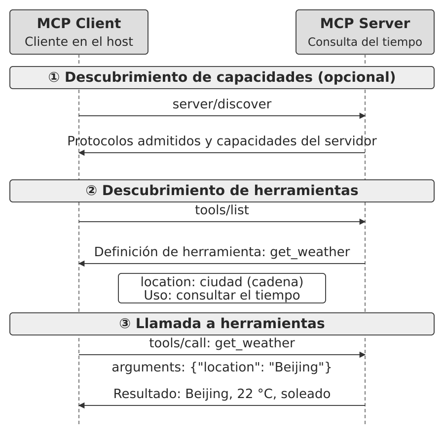
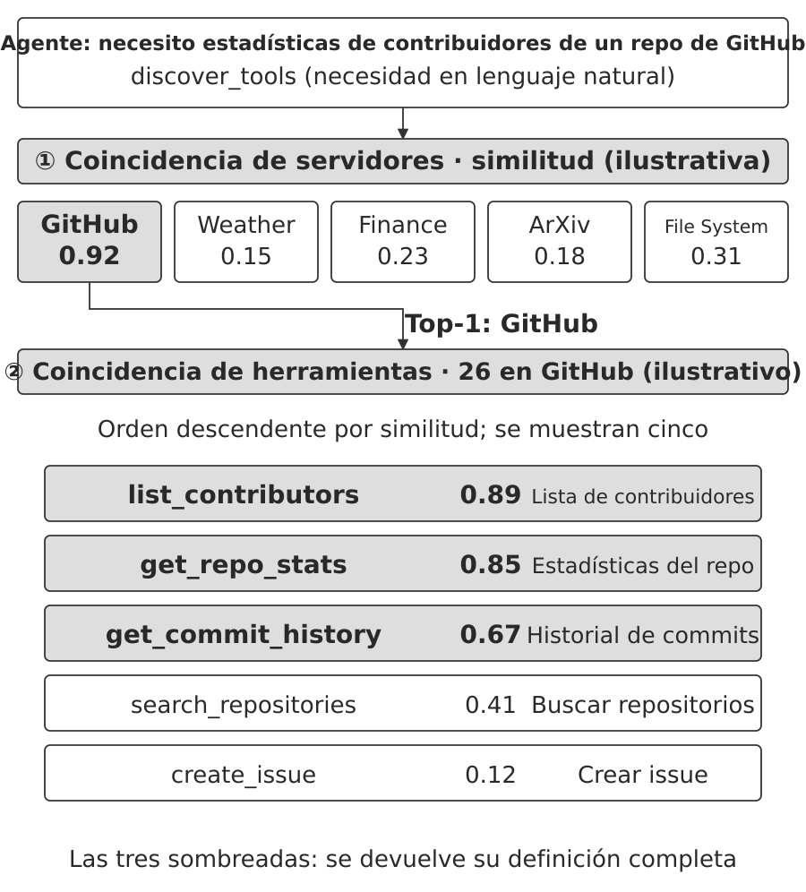
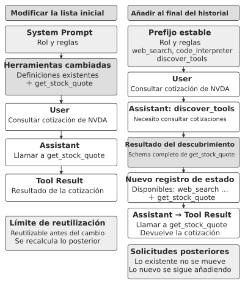
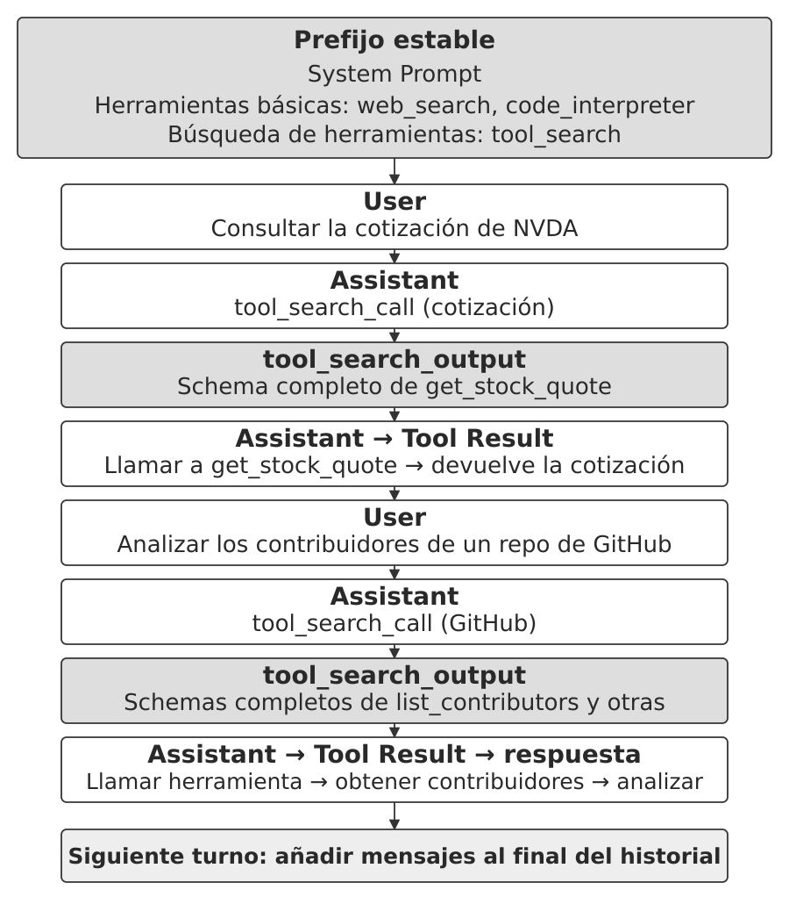

# Herramientas

En la película de ciencia ficción *Her*, la asistente de IA Samantha organiza correos electrónicos, ayuda a responderlos, se ocupa de asuntos editoriales y pasa de un canal de comunicación a otro. Un asistente así necesita convertir la comprensión del lenguaje en operaciones sobre sistemas externos. El Agente realiza estas interacciones mediante **herramientas**. Las herramientas son sus «sentidos, manos y pies»: le proporcionan observaciones y ejecutan acciones. Los Agentes de propósito general que se tratan en este libro, como Manus y OpenClaw, también necesitan herramientas para acceder al mundo digital.

Supongamos que el usuario dice: «Encuentra las fechas de entrega que mencionan los correos de los clientes, organízalas en una tabla y envíamela». El modelo puede decidir qué correo consultar, pero leer el original exige acceder al buzón, y enviar la tabla exige llamar a una interfaz de envío. ¿Cómo deben diseñarse estas herramientas y cómo las encuentra el modelo cuando las necesita? Este capítulo distingue primero cinco categorías de herramientas, después analiza la descripción, la integración y el descubrimiento de herramientas, y por último diseña por separado las interfaces de percepción, ejecución y colaboración. Las herramientas disparadas por eventos y las de comunicación con el usuario implican además decidir cuándo despertar al Agente y cómo transmitir mensajes entre canales, por lo que se desarrollan en el capítulo 6.

## Clasificación de herramientas

Tomemos como ejemplo la consulta del correo: el modelo elige qué hacer a continuación, el Harness comprueba los parámetros y los permisos y emite la solicitud, y el servicio de correo lee y escribe realmente los datos. El capítulo 1 distinguió, según su finalidad, las herramientas de percepción, ejecución, colaboración, comunicación con el usuario y disparadas por eventos. Las cuatro primeras las invoca activamente el Agente; las herramientas disparadas por eventos permiten, en cambio, que también un evento externo despierte al Agente (tabla 4-1).

Tabla 4-1 Dirección de invocación y finalidad principal de las cinco categorías de herramientas

| Tipo de herramienta | Dirección de invocación | Finalidad principal |
| --- | --- | --- |
| Herramientas de percepción | El Agente las invoca activamente | Obtener información externa |
| Herramientas de ejecución | El Agente las invoca activamente | Realizar cálculos o modificar el estado externo |
| Herramientas de colaboración | El Agente las invoca activamente | Delegar tareas, intercambiar mensajes, coordinar a otros Agentes o a personas |
| Herramientas de comunicación con el usuario | El Agente las invoca activamente | Responder al usuario, mostrarle resultados o enviarle recordatorios |
| Herramientas disparadas por eventos | Las configura el desarrollador o las registra el Agente; las dispara un evento externo | Despertar al Agente cuando ocurre un evento determinado |

Las **herramientas de percepción** permiten al Agente obtener información externa; por ejemplo, la búsqueda web `web_search`, la búsqueda en una base de conocimiento `knowledge_base_search`, la lectura de páginas web `fetch_url`, la búsqueda por nombre de archivo `find_file`, la búsqueda en el contenido de los archivos `grep_file` y la lectura de archivos `read_file`.

Las **herramientas de ejecución** permiten al Agente realizar cálculos o cambiar el estado externo; por ejemplo, la línea de comandos `shell_exec`, el intérprete de código `code_interpreter`, la escritura de archivos `write_file`, la edición de archivos `edit_file` y el envío de correos `send_email`. Un mismo ejecutor genérico puede tanto realizar cálculos de solo lectura como modificar datos.

Las **herramientas de colaboración** permiten delegar tareas e intercambiar mensajes; por ejemplo, crear un subagente `spawn_subagent`, enviarle un mensaje `send_message_to_subagent`, cancelarlo `cancel_subagent` y descubrir los Agentes disponibles `list_agents`. Las tareas independientes pueden procesarse en paralelo, como investigar por separado la trayectoria de varios cofundadores de OpenAI; también pueden encomendarse tareas distintas a Agentes configurados con modelos, herramientas, prompts y contextos diferentes. El capítulo 10 tratará con más detalle las arquitecturas de división del trabajo y colaboración.

Las **herramientas de comunicación con el usuario** le transmiten información; por ejemplo, responder a un mensaje `reply_to_user`, enviar una tarjeta estructurada `send_card_to_user` y enviar un recordatorio `send_user_notification`. Cuando la interacción se extiende a varios canales o necesita notificaciones en segundo plano, el sistema puede encapsular el envío de mensajes como una llamada explícita a una herramienta y gestionar de forma unificada el destinatario, el contenido y el estado de entrega.

Las **herramientas disparadas por eventos** conectan los eventos externos con la ejecución del Agente; por ejemplo, el temporizador `set_timer`, la supervisión de tareas en segundo plano `monitor_shell` y la conexión con fuentes de eventos `connect_channel`. El proceso consta de dos pasos: en el registro, el desarrollador configura de antemano los eventos de interés, o el Agente los declara mediante una llamada autorizada; cuando el evento ocurre, el sistema de planificación recibe el callback o el mensaje del evento y despierta al Agente para que lo procese. Un correo nuevo, una alerta del sistema, un recordatorio programado o la finalización de una tarea en segundo plano pueden convertirse en nuevos puntos de entrada de la ejecución.

Volvamos a la tarea de correo del principio: abrir el mensaje original para obtener la fecha de entrega es percepción; generar y guardar la tabla resumen modifica el espacio de trabajo, así que es ejecución; entregar la tabla a quien hizo el encargo es comunicación con el usuario. Solo si el sistema continúa automáticamente cuando llega el siguiente correo de un cliente entra en juego el disparo por eventos. Un mismo servicio de correo puede cumplir varias de estas funciones. Lo que hay que decidir a continuación es el grado de detalle de las herramientas que se entregan al modelo: ¿dejar que consulte el correo, lea el cuerpo y busque los adjuntos por separado, o reunir en una sola herramienta los pasos que suele encadenar?

## Principios universales del diseño de herramientas

En los primeros tiempos, la práctica habitual al integrar herramientas era envolver directamente cada endpoint de la API. Así la integración es rápida, pero se obtiene con facilidad un conjunto de interfaces de granularidad muy fina. Para completar una tarea, el Agente puede verse obligado a buscar objetos, leer atributos y comprobar condiciones una y otra vez antes de llamar a la interfaz de ejecución. Al diseñar herramientas, estas operaciones pueden integrarse en torno a las tareas habituales; por ejemplo, encadenar la búsqueda de un contacto con el envío del mensaje, o hacer que la búsqueda en registros devuelva directamente las líneas relevantes junto con su contexto[^ch4-tool-design].

**Las herramientas deben diseñarse en torno a la tarea que el Agente ha de completar.** Este enfoque, que diseña las interfaces a partir de cómo las usa el Agente, se denomina **ACI** (Agent-Computer Interface, interfaz Agente-computadora). La HCI se ocupa de cómo interactúan las personas con la computadora; la ACI, de cómo el modelo elige operaciones, construye parámetros, interpreta la retroalimentación y corrige errores.

[^ch4-tool-design]: Anthropic, *Writing effective tools for AI agents—using AI agents*, 2025.

### Formas de expresión de las capacidades: herramientas dedicadas, ejecutores genéricos y Skills

Para encomendar al modelo el «despliegue de una aplicación» pueden diseñarse tres interfaces de operación. La primera expone un único `deploy_app` y el servidor completa todos los pasos; la segunda expone por separado la construcción, el empaquetado y el despliegue, y el modelo decide cuándo llamar al siguiente paso; la tercera escribe los pasos en una Skill y deja que el modelo los ejecute en la terminal. Si la construcción falla, la primera depende de que el resultado de la herramienta indique al modelo en qué paso se produjo el error, mientras que las otras dos pueden entregarle directamente el error de esa construcción.

- **Herramientas dedicadas**: ofrecen una interfaz estructurada para operaciones bien definidas. El desarrollador define el schema de parámetros, las reglas de validación, la lógica de ejecución y el formato de retorno, lo que facilita probarlas y autorizarlas por separado; una vez que la definición de la herramienta entra en el contexto, lo que ocupa depende de la longitud de los campos, las descripciones y los ejemplos.
- **Ejecutores genéricos y Skills**: se usan conjuntamente: la terminal o el intérprete de código aportan la capacidad de ejecución, y la Skill explica el flujo, las condiciones de aplicación y el modo de operar. El host puede cargar primero el nombre y el resumen, y leer las instrucciones completas y los recursos asociados solo cuando la Skill se selecciona.

Por ejemplo, una Skill de despliegue puede indicar sucesivamente: construir el proyecto con `npm run build`, empaquetar la imagen con `docker build -t app:latest .` y aplicar con `kubectl apply -f deploy.yaml` los recursos definidos en el manifiesto al clúster actual. El Agente ejecuta estos pasos mediante la herramienta de terminal y reutiliza un mismo punto de entrada de ejecución.

Cómo se implementa una herramienta y cuándo lee el modelo su descripción son dos cuestiones distintas. Cientos de herramientas dedicadas pueden mostrar solo un índice y cargar los schemas bajo demanda; unas pocas Skills pueden mantener su catálogo residente en el contexto e incorporar recuperación cuando crece su número. Elegir entre una interfaz dedicada y un ejecutor genérico afecta a cómo se pasan los parámetros y cómo se mantiene el código; elegir entre entregarlo todo de una vez o cargar bajo demanda afecta a qué herramientas puede ver el modelo en cada paso. La sección «Qué hacer cuando hay demasiadas herramientas», más adelante, trata las estrategias de divulgación.

**El autor recomienda adoptar primero herramientas genéricas y añadir después interfaces dedicadas según las necesidades de permisos, parámetros y rendimiento.** Por ejemplo, si se configura `code_interpreter` en un sandbox con SymPy, NumPy y pandas, el Agente puede escribir código Python para realizar operaciones aritméticas, cálculo simbólico, procesamiento de arreglos y análisis de datos. Así el modelo aprovecha plenamente su capacidad de generar código: un solo intérprete puede alojar múltiples algoritmos y combinar bibliotecas existentes para resolver problemas nuevos que nadie había previsto. El modelo se encarga de generar el código, y el entorno de ejecución, de ejecutarlo y de limitar el acceso a archivos, red y recursos.

Incluso cuando se adoptan herramientas dedicadas, el autor recomienda integrar primero las operaciones de función similar que suelen usarse juntas. Con interfaces demasiado finas, el modelo tiene que recordar más nombres y repartos de funciones, y completar una misma tarea requiere más llamadas. Al integrar, lo que más cuenta es la **similitud funcional** y el **grado de superposición de los escenarios de uso**. Por ejemplo, `extract_pdf_text`, `extract_docx_content` y `extract_pptx_content` reciben un documento y extraen su texto, así que pueden integrarse en `read_document`, que distingue el formato mediante `file_type`. El modelo solo tiene que elegir un punto de entrada unificado, y los formatos nuevos pueden reutilizar la misma estructura de parámetros y de retorno.

Los cuatro casos siguientes son especialmente adecuados para interfaces dedicadas.

1. **Se necesitan autorización y auditoría finas.** La escritura en una base de datos de producción puede encapsularse como una operación de alcance bien delimitado: el servidor comprueba los permisos del usuario, la tabla de destino y los campos que se permite modificar, y registra la justificación de la operación.
2. **Hay que ocultar las diferencias entre plataformas.** Operaciones como grep o find pueden hacerse a través de la shell, pero una herramienta dedicada de búsqueda de archivos unifica los parámetros y la retroalimentación en macOS, Windows y Linux; por ejemplo, devuelve siempre el nombre del archivo, el número de línea y el fragmento coincidente.
3. **La operación es muy frecuente.** Una operación de alta frecuencia puede tener un punto de entrada breve y estable, lo que reduce el coste de generar scripts y explicar el flujo una y otra vez.
4. **Las relaciones entre parámetros son complejas.** Los objetos anidados, las dependencias entre campos y las restricciones complejas de valores se expresan mejor combinando el schema con la validación de negocio.

**Cuanto más complejos son los parámetros, más importa la forma de transmitirlos.** Las llamadas estructuradas a herramientas suelen describir la entrada con JSON Schema, y algunos servicios de modelos admiten la generación restringida, que hace que los parámetros cumplan las reglas del schema que admiten. La estructura del valor de retorno la fija la interfaz de la herramienta, y el host entrega después el resultado al modelo. Más allá de la validación de tipos y formatos, los permisos, la existencia de los objetos y el cumplimiento de condiciones de negocio entre varios campos siguen comprobándolos el Harness y el servicio de la herramienta.

Una Skill puede explicar cómo llamar a una herramienta dedicada o guiar al Agente en el uso de una CLI. La segunda opción obliga al modelo a manejar a la vez la sintaxis de la línea de comandos, las comillas y el escapado, cuyas reglas además difieren entre shells. Cuanto más complejos son los parámetros, más detalles debe resolver correctamente el modelo. Ante parámetros anidados complejos, puede escribirse primero un JSON y hacer que el comando lea ese archivo, lo que reduce el escapado en varios niveles y permite validar el contenido antes de ejecutar.

**Las Skills facilitan que el personal de negocio las escriba y modifique directamente.** Quien conoce el negocio puede escribir los pasos por sí mismo o partir de unas instrucciones redactadas por el Agente. Si cambia el orden del flujo, si un paso solo se aplica a algunos clientes o si hace falta otro ejemplo, basta con editar el texto de las instrucciones, sin tener que modificar el código de la herramienta ni volver a desplegar la interfaz. Según la especificación Agent Skills, los metadatos de `SKILL.md` siguen un formato establecido, el cuerpo está en Markdown y pueden adjuntarse scripts, documentos de referencia y recursos[^ch4-skill-format].

[^ch4-skill-format]: Agent Skills, especificación del formato, que incluye los metadatos, el cuerpo, los recursos adjuntos y la carga progresiva.

Para elegir la forma de una capacidad pueden combinarse cuatro dimensiones.

- **Seguridad y permisos**: las interfaces dedicadas facilitan acotar el alcance de las operaciones; los ejecutores genéricos controlan su capacidad de ejecución mediante el sandbox, las credenciales y los permisos sobre los recursos.
- **Complejidad de los parámetros**: las estructuras complejas se prestan al schema y a la validación de negocio; las operaciones sencillas pueden recibir sus parámetros directamente por CLI.
- **Frecuencia de cambio**: los flujos que se ajustan a menudo conviene escribirlos primero como Skills, porque el personal de negocio puede modificar directamente las instrucciones y los ejemplos; las operaciones de bajo nivel estables y reutilizadas se encapsulan después como herramientas o scripts.
- **Capacidad del modelo**: si el modelo genera código y maneja la línea de comandos con fiabilidad, conviene que combine capacidades mediante Skills y ejecutores genéricos, lo que reduce el número de herramientas dedicadas; si el modelo es más débil y se equivoca a menudo con parámetros complejos, las interfaces estructuradas deben asumir más restricciones.

**El código también puede orquestar varias llamadas a herramientas.** Al rastrear varias páginas web y extraer campos, el modelo puede generar un script que realice los bucles, el filtrado y la agregación. El texto completo de las páginas permanece en variables del entorno de ejecución, y al contexto solo vuelven los campos seleccionados y las estadísticas. Las condiciones, los bucles y el manejo de excepciones del programa enlazan los pasos, y el modelo analiza directamente el resultado agregado. En tareas cuyos pasos ya están claros, como el rastreo, el filtrado y el recuento en lote, el autor prefiere encadenarlos con código para reducir las idas y vueltas en las que el modelo llama a las herramientas una a una y lee los resultados intermedios. Cuantos más resultados intermedios haya y más escuetos sean los campos devueltos, más contexto ahorra esta organización. El capítulo 5 tratará con más detalle este tipo de orquestación por código.

Este tipo de interfaz suele llamarse **Code Mode**. En el servidor MCP de Cloudflare, por ejemplo, el modelo escribe primero con `search()` un programa de consulta que localiza en la descripción OpenAPI los endpoints y parámetros necesarios; después envía con `execute()` el JavaScript que llama a esos endpoints. Para listar los registros DNS que cumplen una condición, el programa puede consultar página por página, filtrar y devolver solo los registros que coinciden. El primer paso evita el coste de meter todo el manual de la interfaz en el contexto; el segundo, las idas y vueltas de devolver cada página de resultados al modelo. Qué zonas puede leer la identidad de ejecución y si puede modificar registros sigue decidiéndolo la autorización del servidor.[^ch4-code-mode]

[^ch4-code-mode]: Cloudflare, implementación MCP de Code Mode; Armin Ronacher analiza, con Pi 1.0 como ejemplo, el reparto de funciones entre las herramientas que proporciona el Harness y el entorno de ejecución.

### Descripción de herramientas: finalidad, parámetros y retroalimentación

Al redactar la descripción de una herramienta, conviene imaginar primero la solicitud que con más facilidad llevaría a usarla mal. Si el usuario dice «encuentra las cláusulas del contrato que mencionan penalizaciones», la búsqueda por nombre de archivo solo devolverá archivos cuyo nombre coincida; aunque obtenga una ruta, el modelo todavía tiene que leer el contenido. La descripción debe permitir al modelo juzgar qué interfaz elegir, qué tiene que proporcionar al llamarla y a qué preguntas basta el resultado para responder.

**Indicar cuándo usarla.** La descripción de la búsqueda web puede decir «usar cuando haga falta obtener información en tiempo real o buscar hechos desconocidos», para que el modelo relacione la necesidad del usuario con la finalidad de la herramienta. Con un simple «buscar contenido relevante», el modelo tiene que adivinar por su cuenta el alcance de la búsqueda y las condiciones de uso.

**Precisar la entrada y el alcance de la búsqueda.** Por ejemplo, la herramienta de búsqueda por nombre de archivo puede indicar: «coincide por nombre de archivo y ruta; para buscar texto dentro de los archivos, use `grep_file`». Dejar claro el reparto de funciones entre herramientas vecinas ayuda al modelo a elegir el punto de entrada correcto en una sola llamada. **En opinión del autor, precisar las condiciones límite suele ser más importante que enumerar funciones.** Qué entradas acepta la herramienta, en qué ámbitos busca y qué hace ante un resultado vacío o un error influyen directamente en la siguiente decisión del modelo.

**Explicar los parámetros con una especificación más un ejemplo.** `timestamp` puede describirse como «formato RFC3339, por ejemplo `2024-03-15T14:30:00Z`». Cuando el modelo aborda una tarea compleja, tiene que elegir herramientas, extraer información de la trayectoria histórica y sopesar los pasos siguientes al mismo tiempo, y el formato de un parámetro es solo uno de esos detalles. La cadena completa ofrece un formato al que remitirse directamente: el modelo puede construir el parámetro imitándola, lo que reduce las ocasiones de equivocarse al reinterpretar el término.

Del mismo modo, `phone` puede describirse así: «Número de teléfono en notación internacional E.164: empieza por `+`, seguido del código de país y del número; el resto solo contiene dígitos, sin espacios ni separadores. Por ejemplo, `+8613888888888` (China) o `+12025551234` (EE. UU.)».

**Explicar la estructura de retorno y el coste de ejecución.** Por ejemplo, «devuelve un arreglo JSON en el que cada elemento contiene los tres campos `title`, `url` y `snippet`» facilita que el modelo extraiga el título, la fuente y el resumen. En las herramientas lentas puede indicarse la latencia prevista medida en un entorno determinado y un punto de entrada alternativo, por ejemplo: «leer la página web completa puede tardar de 5 a 10 segundos; si solo se necesitan los metadatos, puede llamarse a `get_page_metadata`».

También pueden adjuntarse de 1 a 5 ejemplos de llamada verificados que cubran los parámetros mínimos, las combinaciones habituales y las condiciones complejas. JSON Schema puede expresar tipos, campos obligatorios, rangos de valores y algunas dependencias entre campos[^ch4-json-schema]; los ejemplos muestran cómo se aplican esas reglas a tareas concretas, por ejemplo si la marca de tiempo va en segundos o en milisegundos, cómo se anidan las condiciones de filtrado o qué campos opcionales suelen aparecer juntos. En las pruebas internas con parámetros complejos que Anthropic publicó en 2025, añadir ejemplos de llamadas a herramientas elevó la precisión del 72 % al 90 %[^ch4-tool-examples].

[^ch4-json-schema]: JSON Schema, tipo objeto y restricciones de propiedades. El conjunto de palabras clave de schema que admite la interfaz de cada modelo lo determina el servicio correspondiente.

[^ch4-tool-examples]: Anthropic, *Introducing advanced tool use on the Claude Developer Platform*, 24 de noviembre de 2025, sección Tool Use Examples.

Cuando el Agente elige mal las herramientas con frecuencia, el autor recomienda **revisar primero las descripciones de las herramientas**: si varias usan nombres parecidos, si el alcance de la búsqueda está claro, si a los parámetros les faltan ejemplos. El mismo método sirve para el nombre, el resumen y las instrucciones de operación de una Skill.

### Fidelidad en la transmisión de parámetros

El modelo pide sustituir un fragmento del texto original, pero el ejecutor informa de que «no lo encuentra». Antes de pedirle al modelo que reformule, hay que preguntarse si ambos extremos han recibido la misma secuencia de caracteres. La llamada pasa por el análisis, la serialización, los proxies y el empaquetado del runtime, y cada capa puede alterar el contenido. La **fidelidad de los parámetros** exige que el valor que ve el ejecutor signifique lo mismo que el que envió el modelo; el escapado del protocolo puede cambiar la forma de transmisión, pero las comillas y los saltos de línea deben conservarse una vez decodificados.

Tomemos como ejemplo el problema de conversión de comillas tipográficas en cierta versión de Cursor de principios de 2026. La herramienta de sustitución recibe `old_string` y `new_string` y modifica el archivo por coincidencia exacta. La herramienta de lectura devolvía las comillas tipográficas chinas `“` y `”`, que corresponden a `\u201c` y `\u201d`; el modelo colocaba el texto original en `old_string`, pero durante la transmisión del parámetro se convertían en comillas rectas inglesas `"`. El texto del archivo seguía igual, de modo que la herramienta de sustitución respondía «no se encontró ninguna coincidencia». Volver a leer y volver a copiar el texto original conducía al mismo fallo.

La dirección de escritura también se ve afectada. El modelo pide escribir comillas tipográficas y el archivo acaba guardando comillas rectas. Al leer después el archivo, el modelo ve un contenido distinto del que esperaba haber escrito y puede intentar corregirlo; mientras la conversión siga produciéndose, cada reintento repite el mismo error.

Otro tipo de problema es la **inyección silenciosa de parámetros**. La herramienta bash de cierto IDE añadía automáticamente a `git commit` un parámetro que marcaba el commit como hecho por IA. Las versiones antiguas de Git no reconocían ese parámetro, y el commit fallaba. El modelo solo veía el comando que él mismo había generado, así que podía ajustar una y otra vez el mensaje del commit u otros parámetros sin llegar nunca a tocar el verdadero origen del fallo.

Para diagnosticar este tipo de problemas hay que comparar, uno junto a otro, los parámetros que generó el modelo, los parámetros tras la transmisión, la solicitud realmente ejecutada y el resultado devuelto. Si la interfaz normaliza la codificación o añade parámetros de ejecución, debe documentar las reglas de conversión y devolver los valores efectivamente utilizados. En una herramienta de coincidencia exacta, un espacio de más, un salto de línea de menos o una comilla cambiada pueden bastar para que la coincidencia falle. El modelo necesita saber qué recibió exactamente el ejecutor para poder corregir la siguiente llamada.

## Ecosistema de herramientas: MCP y Skill Hub

Cada interfaz de modelo y cada framework de Agentes tienen su propia forma de definir herramientas, como function calling, tool use o la abstracción Tool de LangChain. Si un mismo servicio externo tiene que adaptarse a cada una de estas interfaces y frameworks, ha de tratar repetidamente las descripciones, los parámetros y los formatos de resultado. El **Model Context Protocol (MCP)**, publicado por Anthropic en noviembre de 2024, ofrece un protocolo unificado para que las aplicaciones basadas en modelos accedan a herramientas y datos[^ch4-mcp-origin].

Para entender MCP conviene fijarse primero en tres roles: host, cliente y servidor. El **host** es la aplicación de Agente o el IDE, y se encarga de la interacción con el modelo, la organización del contexto y la gestión de permisos; el **cliente MCP**, dentro del host, se encarga de los mensajes del protocolo; el **servidor MCP** proporciona herramientas, recursos y plantillas de prompt, y puede ejecutarse como proceso local o desplegarse como servicio remoto[^ch4-mcp-architecture].

**Definición y llamada de herramientas.** El cliente obtiene las herramientas disponibles mediante `tools/list`, y la lista puede devolverse paginada. Cada herramienta incluye un nombre, una descripción y un `inputSchema`; para los resultados estructurados puede fijarse además su formato con `outputSchema`. Cuando el modelo elige una herramienta y genera los parámetros, el host los valida, el cliente envía `tools/call` y el servidor ejecuta y devuelve el resultado. El host decide qué definiciones y resultados entran en el contexto del modelo[^ch4-mcp-tools].

En la figura 4-1, después de obtener el nombre y los parámetros de la herramienta meteorológica, el cliente todavía tiene que hacer una llamada para conocer el tiempo en Pekín. La implementación de acompañamiento usa MCP 2026-07-28: cada solicitud lleva la versión del protocolo, la información del cliente y sus capacidades, y el cliente también puede llamar primero a `server/discover` para conocer las versiones y capacidades que admite el servidor. Las versiones anteriores establecían la sesión mediante el handshake `initialize`, y al conectarse hay que elegir el modo de interacción según las versiones que admitan ambas partes[^ch4-mcp-versioning].

Ante un mismo «no se encuentra el tiempo», la figura 4-1 ofrece dos puntos de partida distintos para el diagnóstico. Si el host se ha conectado al servidor pero, al llamar a `tools/list`, no encuentra la herramienta meteorológica, hay que comprobar qué herramientas publica el servidor y si el cliente ha leído la lista paginada completa. Si el modelo eligió la herramienta correcta pero el servidor informa de que falta el nombre de la ciudad, hay que buscar `arguments` en el registro de la llamada y comprobar si el nombre del campo es el `location` que exige la definición de la herramienta.

**Modos de transporte.** stdio transmite mensajes JSON-RPC a través de la entrada y la salida estándar de un subproceso local. Streamable HTTP envía las solicitudes por HTTP, y la respuesta puede ser JSON o un flujo SSE que se devuelve progresivamente. Streamable HTTP sustituyó al antiguo transporte HTTP+SSE y sigue usando SSE para las respuestas en flujo[^ch4-mcp-transports].

**Recursos y plantillas de prompt.** Los recursos (resources) ofrecen datos legibles, como el contenido de archivos o registros de bases de datos; el host puede enumerarlos y leerlos por URI y seleccionar el contenido relevante. Las plantillas de prompt (prompts) ofrecen mensajes o plantillas de tarea reutilizables para que el usuario y el cliente los elijan. Como las herramientas también pueden encargarse de buscar y leer, estos tres tipos de primitivas se reparten el trabajo según la interfaz de interacción: las herramientas son el punto de entrada para llamadas, los recursos el punto de entrada para datos y las plantillas de prompt el punto de entrada para tareas[^ch4-mcp-primitives].

El valor central de MCP es que una sola implementación de herramienta sirva a varios productos de Agente. Gracias al protocolo unificado, un mismo servidor puede reutilizarse en hosts compatibles como Cursor, Claude Desktop y OpenClaw, y los desarrolladores pueden dedicar más esfuerzo a la capacidad en sí y a la calidad de su retroalimentación. El host convierte las definiciones de herramientas del protocolo en interfaces que el modelo puede usar.

**Los Skill Hubs permiten descubrir y distribuir paquetes de capacidades.** Una Skill suele incluir un `SKILL.md` y puede adjuntar scripts y material de referencia. Las plataformas de distribución ayudan a los usuarios a buscar, instalar y actualizar estos archivos. Vercel lanzó en enero de 2026 skills.sh, que ofrece un directorio de skills y una herramienta de instalación; ClawHub, del ecosistema OpenClaw, también ofrece búsqueda de skills y gestión de versiones[^ch4-skills-sh][^ch4-clawhub]. Tras la instalación, el host lee el nombre, el resumen y las instrucciones completas según su estrategia de carga. MCP también puede ofrecer, mediante extensiones, el descubrimiento y la lectura de Skills, de modo que los paquetes de capacidades y el protocolo de comunicación pueden usarse conjuntamente[^ch4-skills-over-mcp].

**La integración y la carga en el contexto se gestionan por separado.** Una vez que el cliente MCP obtiene la lista de herramientas, puede entregársela completa al modelo o conservar primero un índice y cargar las definiciones bajo demanda. Una Skill también puede mostrar primero `name` y `description`, y leer el cuerpo solo cuando se selecciona. La lista de herramientas permitidas decide qué capacidades están disponibles; la carga diferida decide qué definiciones son visibles en cada momento.

**Al integrar capacidades de terceros, hay que revisar por separado el contenido que aportan y las operaciones que realmente ejecutan.** Las descripciones, el contenido devuelto y el código adjunto proceden de sujetos distintos, y su ámbito de autorización también puede diferir. En el caso de MCP, pueden revisarse por separado tres tipos de problemas.

1. **Envenenamiento de la descripción de herramientas.** La descripción puede llevar camufladas instrucciones ajenas a la finalidad de la herramienta que induzcan al modelo a salirse de la tarea actual. Se trata de inyección de prompts: un contenido aportado desde fuera intenta cambiar el comportamiento del modelo.
2. **Modificación del servidor o de sus dependencias.** Una actualización del servidor puede cambiar el comportamiento de las herramientas, y una actualización de dependencias o la intrusión en un servicio remoto pueden contaminar los resultados devueltos.
3. **Confusión entre herramientas homónimas.** Distintos servidores pueden ofrecer herramientas con el mismo nombre o con nombres parecidos, y el modelo o la capa de enrutamiento pueden elegir el destino equivocado. El host debe mantener el vínculo entre la identidad del servidor y el nombre de la herramienta, mostrar su procedencia y verificar el destino al despachar la llamada.

Antes de integrar, hay que revisar la descripción y la implementación, fijar la versión de los despliegues que se controlan y volver a revisar tras cada actualización; cada servidor debe usar credenciales con el mínimo privilegio acorde con su tarea. Cuando el servicio remoto lo mantiene otra parte, hay que vigilar además los cambios en las definiciones y en el comportamiento de las herramientas.

En tiempo de ejecución puede usarse también el Sidecar que se describe más adelante para auditar de forma independiente las llamadas estructuradas y la justificación de la tarea cuando sea necesario. Las rutas, los textos y las direcciones de destino de los parámetros de la llamada también deben tratarse como datos que hay que revisar. El resultado de la auditoría, junto con reglas de permisos deterministas, decide si se ejecuta la llamada. El capítulo 5 presentará la «tríada letal» de Simon Willison, que sirve para analizar el riesgo de combinar datos privados, entradas externas y comunicación con el exterior.

Los scripts que acompañan a una Skill, los servidores MCP locales y los servicios remotos tienen cada uno su propio lugar de ejecución y ámbito de permisos. Al revisarlos hay que comprobar la procedencia del código, el entorno de ejecución, los permisos sobre archivos y red, y el destino de las credenciales; si unos pasos aportados desde fuera inducen a descargar o ejecutar otros programas, también deben incluirse en esta cadena de revisión. El análisis que hacen las plataformas aporta pistas auxiliares, mientras que el aislamiento en ejecución, el mínimo privilegio y la revisión de cambios controlan directamente lo que se ejecuta.

[^ch4-mcp-origin]: Anthropic, *Introducing the Model Context Protocol*, 25 de noviembre de 2024.
[^ch4-mcp-architecture]: Especificación de MCP, versión 2026-07-28, secciones de arquitectura y de visión general del protocolo.
[^ch4-mcp-tools]: MCP, Tools, incluidas la lista de herramientas, los schemas de entrada y salida y los resultados de las llamadas.
[^ch4-mcp-versioning]: MCP, *Versioning and Compatibility*, que explica los metadatos por solicitud, el descubrimiento de capacidades y la compatibilidad con el handshake de las versiones antiguas.
[^ch4-mcp-transports]: MCP, visión general del transporte y especificación de transporte 2025-11-25; esta última explica cómo Streamable HTTP sustituye al antiguo esquema HTTP+SSE.
[^ch4-mcp-primitives]: MCP, secciones Resources y Prompts.
[^ch4-skills-sh]: Vercel, *Introducing skills, the open agent skills ecosystem*, 20 de enero de 2026.
[^ch4-clawhub]: OpenClaw, instrucciones de uso de ClawHub.

## Qué hacer cuando hay demasiadas herramientas: organización jerárquica y descubrimiento activo de herramientas

Cuando las herramientas pasan de una docena a cientos o miles, el modelo tiene que encontrar la capacidad adecuada y, además, entender las diferencias entre interfaces parecidas. Las definiciones completas ocupan contexto; si están en el prefijo del prompt, añadir, quitar o reordenar herramientas puede además acortar el prefijo reutilizable de la caché. Cuantas más herramientas haya con nombres y finalidades parecidos, más fácil es que el modelo elija mal el punto de entrada o pase por alto una capacidad necesaria. Por eso, en una biblioteca de herramientas a gran escala la carga bajo demanda debe ser la opción por defecto, junto con un catálogo por categorías y una interfaz de descubrimiento bien diseñados, para que el modelo encuentre primero las herramientas relevantes para la tarea actual y elija después una según su finalidad.

El descubrimiento de herramientas puede imaginarse como hojear un manual organizado por tareas. El índice indica primero al modelo en qué sección buscar; si durante la ejecución surge una nueva necesidad, puede volver a buscar; una vez elegida una capacidad, lee sus parámetros, el orden de las operaciones y los ejemplos. El índice por categorías, la búsqueda activa y las Skills que se describen a continuación resuelven respectivamente estos tres problemas, y tanto las herramientas dedicadas como los ejecutores genéricos pueden ofrecerse al modelo a través de estos puntos de entrada.

### Organización jerárquica y carga bajo demanda

**Primero un índice; las definiciones, al usarlas.** El catálogo de herramientas puede ocupar mucho contexto. Anthropic puso un ejemplo: cinco servidores MCP, entre ellos GitHub y Slack, ofrecen en conjunto 58 herramientas cuyas definiciones completas ocupan unos 55 000 tokens[^ch4-tool-search-eval]. Cursor gestiona estas descripciones como un directorio de archivos: el contexto inicial solo incluye información breve, como el nombre de cada herramienta, y el Agente consulta la definición completa según la tarea. En la prueba A/B que Cursor publicó en enero de 2026, para las tareas que realmente llamaban a herramientas MCP, este método redujo el consumo total de tokens del Agente en un 46,9 %; el ahorro varía con el número de servidores MCP conectados[^ch4-cursor-discovery].

El diseño inicial de Pi, en cambio, daba prioridad a herramientas CLI acompañadas de un README: el Agente leía el modo de uso cuando lo necesitaba y después invocaba la capacidad por línea de comandos[^ch4-pi-no-mcp]. La extensión comunitaria `pi-mcp-adapter` aplica una idea similar a MCP: por defecto ofrece al modelo una herramienta proxy de unos 200 tokens, con la que el modelo busca herramientas, consulta sus definiciones y realiza las llamadas sucesivamente; los servidores no se arrancan hasta la primera llamada. La versión 0.99 de Pi incorporó después soporte MCP integrado, también con un mecanismo de descubrimiento bajo demanda[^ch4-pi-mcp-adapter]. Estas implementaciones tratan por separado la integración del protocolo y la carga en el contexto: el backend se conecta a los servicios MCP y el frontend ayuda al modelo a encontrar las capacidades que necesita mediante un índice breve o una interfaz proxy.

[^ch4-cursor-discovery]: Cursor, *Dynamic context discovery*, 6 de enero de 2026.
[^ch4-pi-no-mcp]: Mario Zechner, *What if you don’t need MCP at all?*, 2 de noviembre de 2025; presenta el enfoque de diseño basado en CLI y en la lectura de documentación bajo demanda.
[^ch4-pi-mcp-adapter]: pi-mcp-adapter, README del proyecto: herramienta proxy, arranque diferido y comparación con el MCP integrado de Pi.

**Organizar el catálogo de herramientas por tareas.** Cuando crece el número de herramientas, pueden agruparse según el modo de obtener la información, para que el modelo localice primero la categoría y elija después la interfaz concreta:

- **Herramientas de búsqueda**: localizan dónde está la información a partir de pistas; por ejemplo, la búsqueda web, la búsqueda en bases de conocimientos y la búsqueda de archivos.
- **Herramientas de lectura**: obtienen el contenido de una ubicación conocida; por ejemplo, leer una página web, un documento o un registro concreto.
- **Herramientas de análisis**: extraen información de contenido no estructurado; por ejemplo, OCR de imágenes, análisis de vídeo y transcripción de audio.
- **Herramientas de consulta**: acceden a datos estructurados por campos y condiciones; por ejemplo, una API meteorológica, una API bursátil o una consulta a base de datos.

Tomemos como ejemplo «averiguar qué datos utilizó un artículo»: la búsqueda devuelve primero los artículos candidatos y sus direcciones, la herramienta de lectura recupera el texto original a partir de la dirección y la herramienta de análisis ayuda después a localizar las tablas. Si el primer paso coloca en cabeza un artículo homónimo, la respuesta será errónea aunque después las tablas se lean con exactitud.

**Reducir primero el abanico de herramientas mediante recuperación.** El host puede hacer una búsqueda por palabras clave o semántica sobre los nombres, resúmenes y descripciones de parámetros de las herramientas a partir de la descripción de la tarea, y entregar al modelo solo las definiciones de las herramientas coincidentes. Si devuelve muy pocas, puede faltar la interfaz que se necesita en el paso siguiente; si devuelve demasiadas, ocupan contexto y la elección se vuelve más difícil. La primera búsqueda puede hacerse a partir de la solicitud del usuario, y las siguientes, completarse según avanza la tarea.

### Descubrimiento activo de herramientas nativo del modelo

En las tareas complejas, las herramientas necesarias suelen ir apareciendo a medida que avanza la ejecución. Por ejemplo, «Debug the file» puede requerir primero leer el archivo y después buscar dependencias, ejecutar pruebas y analizar errores. Si solo se busca una vez al empezar la tarea, es fácil que falten capacidades que se necesitarán después.

**Dejar que el Agente pida lo que necesita cuando lo necesita.** MCP-Zero hace que el modelo genere durante la ejecución solicitudes estructuradas de capacidades; por ejemplo, con `server` especifica GitHub y con `tool` describe «buscar repositorios y devolver sus metadatos». El sistema empareja primero el servidor y después la herramienta dentro del servidor, y añade al contexto la definición seleccionada; si la herramienta devuelta no basta para la tarea, el modelo puede ajustar la solicitud y seguir buscando. El conjunto de datos MCP-tools construido en el artículo contiene 308 servidores y 2797 herramientas; en su prueba con el conjunto completo de herramientas de APIBank, el coste del prompt de herramientas se redujo en torno a un 98 % tanto en la configuración de un turno como en la de varios turnos[^mcp-zero-2025].

En la práctica también pueden conservarse herramientas básicas como `web_search` y `code_interpreter` y añadir una interfaz de búsqueda de herramientas. El modelo describe la capacidad que le falta, la interfaz de búsqueda devuelve las definiciones de varias herramientas coincidentes y el modelo elige una de ellas para llamarla. La Tool Search Tool de Anthropic sigue este esquema de descubrimiento bajo demanda: las herramientas de uso habitual se cargan directamente y las demás se cargan de forma diferida mediante `defer_loading`. En la evaluación MCP interna que publicó Anthropic, activar la búsqueda de herramientas elevó la precisión de Opus 4 del 49 % al 74 %[^ch4-tool-search-eval].

[^mcp-zero-2025]: Xiang Fei, Xiawu Zheng, Hao Feng, *MCP-Zero: Proactive Toolchain Construction for LLM Agents from Scratch*, 2025. La reducción de coste de alrededor del 98 % procede de la configuración con el conjunto completo de herramientas de APIBank; véase la tabla 1 del artículo.
[^ch4-tool-search-eval]: Anthropic, *Introducing advanced tool use on the Claude Developer Platform*, 24 de noviembre de 2025, sección Tool Search Tool.

**Primero el servidor, después la herramienta.** Un servidor MCP suele ofrecer un conjunto de herramientas en torno a una plataforma o un negocio. El ejemplo de la figura 4-2 selecciona primero el servidor de GitHub a partir de la descripción de la capacidad y después elige tres candidatas entre sus herramientas. Operaciones homónimas pueden pertenecer a plataformas distintas, y el primer paso ya descarta un buen número de candidatas irrelevantes. Pero si en ese paso se pierde el servidor correcto, por mucho cuidado que se ponga después al comparar herramientas, ya no se recupera.

Si se usa recuperación vectorial, pueden precalcularse los embeddings de las descripciones de servidores y herramientas, y actualizarlos de forma incremental cuando cambie el catálogo. En cada nivel hay que comprobar la calidad del emparejamiento: si la similitud de los servidores o herramientas candidatos queda por debajo de un umbral fijado, se devuelve «no se encontró ninguna herramienta adecuada», para que el Agente añada condiciones, reformule la necesidad y vuelva a intentarlo. Las tareas que pueden completarse con un ejecutor genérico también pueden resolverse combinando herramientas básicas; cómo crear y guardar herramientas nuevas se tratará en el capítulo 9.

**Hacer que la carga dinámica conviva con la KV Cache.** El lugar donde se colocan las definiciones de herramientas influye en la reutilización del prefijo. Si cada vez que se descubre una herramienta nueva se modifica la lista de herramientas al principio de la solicitud, el prefijo serializado cambia y la caché solo puede reutilizarse hasta la primera posición modificada. Si se comparan las dos columnas de la figura 4-3, la diferencia está en dónde aparece por primera vez la herramienta nueva. A la derecha, el prompt del sistema, las herramientas básicas y la interfaz de búsqueda se mantienen estables, y las definiciones de las herramientas nuevas se añaden al historial según se descubren; las solicitudes posteriores conservan la posición de las definiciones existentes y siguen añadiendo mensajes.

`tool_search`, `defer_loading` y `tool_search_output` de OpenAI, así como `tool_reference` de Anthropic, presentados en el capítulo 2, admiten la carga de definiciones de herramientas bajo demanda. La barra de estado puede mantener aparte una breve lista con los nombres de las herramientas disponibles, para ayudar al modelo a tener presentes sus capacidades actuales.

La figura 4-4 registra dos descubrimientos de herramientas. Cuando el modelo empieza a analizar los colaboradores de GitHub, las definiciones de las herramientas que usó antes para consultar la cotización siguen en su sitio.

Este diseño exige que el modelo sea capaz de entender las definiciones de herramientas cargadas durante la sesión y, a partir de ellas, rellenar los parámetros y realizar las llamadas. El experimento 4-1 entrega un mismo lote de tareas a dos modos de carga de herramientas y compara cuántas definiciones introduce cada uno en el contexto.

> **Experimento 4-1 ★★★: Descubrimiento activo de herramientas**
>
> ¿Cómo reduce el descubrimiento de herramientas el texto de definiciones al que se enfrenta el modelo en cada paso? Este experimento usa Qwen3-4B y compara la carga completa con el descubrimiento activo sobre un mismo conjunto de servidores MCP con 127 herramientas. Cada grupo aborda tres tareas: consultar la cotización de Apple y las noticias relacionadas; buscar artículos sobre transformers y descargar los tres primeros; obtener las estadísticas de colaboradores de un repositorio de GitHub y generar un gráfico. Estas tareas requieren, respectivamente, capacidades financieras y de búsqueda, de búsqueda y descarga de artículos, y de consulta de datos y ejecución de código.
>
> **Carga completa**: se incluye en el prompt del sistema el schema completo de todas las herramientas. El registro de ejecución de acompañamiento del 25 de agosto de 2026 contiene 127 herramientas, y el catálogo entero suma 50 597 tokens contados con un mismo tokenizador (o200k).
>
> **Descubrimiento activo**: el prompt del sistema solo conserva `web_search`, `code_interpreter` y `discover_tools`. Cuando el modelo detecta que le falta una capacidad, describe la necesidad en lenguaje natural, por ejemplo «necesito poder consultar cotizaciones bursátiles». `discover_tools` recupera cinco herramientas candidatas por similitud vectorial, añade sus definiciones completas al historial de la conversación y actualiza los nombres de las herramientas disponibles en la barra de estado. El modelo elige entonces una herramienta y sigue con la tarea.
>
> **Resultados**: en el orden de las tareas anteriores, el grupo de descubrimiento activo añadió definiciones de herramientas de 3939, 1853 y 2632 tokens, respectivamente. Ambos grupos seleccionaron las capacidades que requería cada tarea; la capa de adaptación de la ejecución se encargó de rellenar los parámetros de la tarea, hacer las descargas en lote y generar el código de los gráficos, y finalmente se superaron las comprobaciones de llamadas a herramientas y de artefactos.
>
> Al ver que las definiciones de herramientas son más cortas, hay que preguntarse además si el modelo acierta porque lee menos o porque hay menos herramientas con las que confundirse. Entre los dos grupos originales cambiaban a la vez el método de filtrado, la posición de los mensajes, la barra de estado, las indicaciones de descubrimiento y el número de turnos de llamada. El experimento de selección en un solo paso que lo acompaña (`selection_ablation.py`) reduce la pregunta a «qué herramienta se elige en el primer paso». Primero se conserva un mismo lote de candidatas y se añade texto de relleno al mensaje de sistema, para ver si la elección cambia al alargar la entrada. Después se conservan esas candidatas, se añade un número equivalente de herramientas de distracción y se reduce el texto de relleno, de modo que la entrada de ambos grupos sea de 6144 tokens. Así, la herramienta correcta sigue en el conjunto de candidatas original y puede estudiarse aisladamente qué ocurre al añadir unas cuantas distractoras.
>
> Si las herramientas se extraen al azar, la interfaz que se necesita en el primer paso puede no estar siquiera en la lista. Solo cuenta como error del modelo que la herramienta ya esté en la lista y aun así elija otra.
>
> En el registro paso a paso de la tarea bursátil, el usuario preguntaba en realidad dos cosas: ¿cuánto ha variado la cotización y qué noticias explican ese cambio? La primera búsqueda encontró cinco herramientas, y el modelo eligió la tercera, `yfinance_quote`. La cotización obtenida fue de 310,34 dólares, alrededor de un 0,32 % por encima del cierre anterior de 309,35 dólares, de modo que la primera pregunta puede verificarse directamente. La segunda usó `web_search`, que ya estaba en el catálogo inicial. Devolvió cinco resultados cuyos resúmenes se limitaban sobre todo a listar cotizaciones, sin ningún acontecimiento concreto que explicara la subida del día. Se eligieron las dos herramientas necesarias, así que la cobertura de capacidades obtuvo la puntuación máxima; si el usuario quiere conocer el motivo de la subida, todavía hay que seguir buscando noticias fechadas.

### Skills: convertir el descubrimiento de herramientas en «consulta bajo demanda»

El capítulo 2 presentó la divulgación progresiva (Progressive Disclosure) de las Skills. Desde el punto de vista del diseño de herramientas, organiza el modo de uso de las capacidades como un conjunto de materiales que se consultan bajo demanda: el modelo elige primero una Skill a partir de su resumen, lee después los pasos de operación y, por último, llama a herramientas o ejecuta scripts según lo que requiera la tarea.

**La divulgación progresiva tiene tres pasos.** Al arrancar se cargan el `name` y la `description` de cada Skill, para que el modelo sepa qué capacidades existen y a qué tareas se aplica cada una; al seleccionar una, se lee el `SKILL.md` completo; durante la ejecución se consultan los documentos, plantillas o scripts a los que remite[^ch4-skill-format]. Por ejemplo, al procesar un PDF se decide primero si hace falta extraer texto o rellenar un formulario, y después se leen las instrucciones correspondientes. Así, los detalles que requiere cada operación concreta pueden permanecer en el paquete de capacidades e ir entrando en el contexto a medida que avanza la tarea. El coste total del catálogo depende del número de Skills y de la longitud de sus resúmenes.

Es un proceso parecido a consultar una obra de referencia: primero se mira el índice, después se va a la entrada correspondiente y, ante un problema concreto, se siguen consultando los ejemplos. Para bibliotecas de capacidades pequeñas, formadas sobre todo por flujos de operación y material de referencia, el autor prefiere un catálogo de Skills combinado con lectura de archivos. Reutiliza la capacidad del modelo para leer documentación y llamar a herramientas genéricas, y al principio solo hay que mantener los resúmenes, las referencias y las instrucciones de operación, sin necesidad de un servicio independiente de recuperación de herramientas. Cuando la biblioteca crece y el catálogo resulta difícil de recorrer, se añade la búsqueda por palabras clave o semántica.

Las herramientas dedicadas también pueden cargarse bajo demanda. El host puede combinar los espacios de nombres de los servidores, las listas de herramientas permitidas y las herramientas de recuperación para decidir qué definiciones ve la tarea actual, y añadirlas después al contexto mediante la interfaz de búsqueda de herramientas. Las Skills, por su parte, reúnen los pasos, los ejemplos y el material de referencia en una misma estructura de archivos, lo que facilita a sus autores escribirlas y mantenerlas.

Si unas mismas instrucciones para rellenar formularios PDF se usan una y otra vez en muchas sesiones, ¿puede reutilizarse también el cálculo del modelo al leerlas? Hay que distinguir dos casos. Dentro de una misma sesión, si las instrucciones nuevas se añaden al final, el prefijo idéntico anterior puede aprovechar la caché. En otra sesión, aunque el texto de las instrucciones sea exactamente el mismo, la solicitud del usuario, los materiales y la posición que lo preceden suelen haber cambiado, y la caché de prefijos ordinaria no puede reutilizar directamente ese cálculo. Las investigaciones sobre KV Cache componible presentadas en el capítulo 2 intentan precalcular ese contenido por separado, ajustar después la codificación posicional rotatoria (RoPE) e insertarlo en el nuevo contexto. El cálculo necesario para reubicar e insertar crece linealmente con la longitud del fragmento.

MCP y los Skill Hubs también pueden repartirse la distribución. El Skill Hub se encarga de la búsqueda, instalación y actualización de los paquetes de capacidades; la extensión Skills de MCP permite al cliente descubrir y leer las Skills que ofrece el servidor[^ch4-skills-over-mcp]. Un mismo conocimiento operativo puede cargarse como paquete de capacidades local o ofrecerse a través de un servicio MCP que admita esa extensión.

[^ch4-skills-over-mcp]: Model Context Protocol, *Skills Over MCP Charter*, que describe las responsabilidades de descubrimiento, distribución y lectura de la extensión Skills.

Una vez encontrada la herramienta, ¿qué conviene devolver al modelo para que le sea útil? Volviendo al correo del cliente, el nombre del archivo basta para localizar el mensaje original, pero para comprobar la fecha de entrega hay que llegar a leer la frase original. El diseño de las herramientas de percepción parte precisamente de esta diferencia.

## Herramientas de percepción

Supongamos que el usuario quiere comprobar el importe total de un informe. La herramienta de búsqueda devuelve un fragmento coincidente, que basta para encontrar el informe pero no necesariamente para saber en qué unidad está el importe. Solo si el modelo sigue el fragmento hasta la tabla original y ve los nombres de las columnas, las unidades y la fila de totales, tiene lo necesario para hacer la comprobación. Al diseñar herramientas de percepción se plantean aquí dos preguntas relacionadas: qué materiales devolver esta vez y, si no bastan, desde dónde puede seguir leyendo el modelo.

Una búsqueda puede devolver decenas de miles de caracteres, y un PDF puede tener cientos de páginas. Puede recurrirse a la **compresión consciente del contexto** del capítulo 2: cuando la salida supera un umbral fijado, se extrae el contenido relevante para la pregunta actual. Por ejemplo, con un umbral de activación de 10 000 caracteres, se devuelve un resumen y se conserva un punto de acceso al resultado original, para que el modelo pueda seguir verificando citas, tablas o detalles.

**Primero se listan los resultados de búsqueda; el modelo lee el texto completo solo del que elige.** La lista devuelta debe incluir título, ubicación y fragmento de resumen, para ayudar al Agente a juzgar qué resultados merecen leerse. Si hay muchos resultados, se usa paginación o un cursor (`cursor`): por defecto se devuelven los primeros, indicando cómo obtener la página siguiente; si es posible conocer el total, también se devuelve. El modelo puede decidir, según las pruebas que ya tiene, seguir pasando páginas o abrir uno de los resultados para leer el original.

**Leer los archivos grandes por fragmentos e indicar el rango cuando se trunca.** La interfaz de lectura debe admitir parámetros como `offset` y `limit` y explicar si usan como unidad líneas, bytes o registros. Por ejemplo, devolver «se muestran las líneas 1 a 200 de un total de 5000», junto con los parámetros para seguir leyendo. La información del rango ayuda al Agente a juzgar si el contenido actual está completo y facilita volver a consultar por posición. Un truncamiento silencioso lleva fácilmente al modelo a creer que ya lo ha leído todo, y de ahí a convertir «esto no aparece en este fragmento» en «no aparece en ninguna parte del material». Si se omite contenido intermedio, hay que señalar dónde está la omisión y cómo leer el resto.

**Aprovechar las operaciones de solo lectura para organizar la caché y la concurrencia.** El acceso de solo lectura a los datos de negocio suele permitir reutilizar resultados y también se presta a la ejecución en paralelo, como leer cinco archivos a la vez o lanzar tres búsquedas independientes. La clave de la caché debe incluir los parámetros de la consulta, la identidad del usuario y el ámbito de autorización; para el tiempo, las cotizaciones y los resultados de búsqueda hay que fijar además un tiempo de vida (TTL) adecuado. Las lecturas concurrentes deben controlar la tasa de solicitudes y tener en cuenta las actualizaciones de los datos externos: en las tareas que necesitan una vista coherente, pueden coordinarse varias lecturas mediante instantáneas, números de versión u horas de captura.

**Elegir la salida multimodal según la tarea.** Las capturas de pantalla, los gráficos y los documentos escaneados pueden entregarse directamente a un modelo con entrada visual, o pasar primero por herramientas como OCR o análisis de documentos para extraer el texto. El texto extraído facilita la búsqueda, la cita y la compresión; conservar la imagen ayuda a entender la disposición de la página, la relación entre filas y columnas de una tabla y la posición de los elementos de una interfaz. Cuando el contenido es sobre todo texto, puede devolverse primero lo extraído; cuando se trata de interfaces, tablas complejas o diseños, hay que permitir que el modelo vea la imagen correspondiente. Ambas formas también pueden combinarse.

Las herramientas de percepción también pueden convertir lo que el ojo humano distingue en observaciones verificables. Los investigadores de Coscientist colocaron tres muestras de color, roja, amarilla y azul, en tres posiciones conocidas de una placa de pocillos y pidieron al asistente que determinara en qué pocillo estaba cada color. El lector de placas devolvía datos de absorbancia a distintas longitudes de onda, y el asistente localizaba los picos de absorción con Python. Lo que se obtiene en ese punto es la correspondencia entre longitudes de onda y pocillos; para asignar un color a cada pocillo todavía hay que interpretar esos picos. El artículo recoge un detalle: el asistente solo identificó correctamente las tres muestras después de que los investigadores le sugirieran pensar en cómo absorben la luz los distintos colores.[^ch4-coscientist-colours]

[^ch4-coscientist-colours]: Boiko et al., *Autonomous chemical research with large language models*, Nature, 2023. El diseño del experimento puede consultarse en la figura 4 y en la implementación simplificada que publicaron los autores.

> **Experimento 4-2 ★★: Servidor MCP de herramientas de percepción**
>
> Este experimento reúne en un mismo servidor MCP las capacidades habituales de obtención de información y organiza las interfaces en cinco tipos de escenario:
>
> - **Búsqueda y obtención**: búsqueda web, búsqueda en una base de conocimiento local y descarga de archivos.
> - **Comprensión multimodal**: lectura de páginas web; extracción de documentos PDF, Word y PPT; OCR y análisis visual de imágenes; y transcripción y análisis de audio y vídeo.
> - **Sistema de archivos**: lectura de archivos, búsqueda de contenido y exploración de directorios; el servidor ofrece también operaciones de copiar, mover y eliminar, cuyos permisos se gestionan como los de las herramientas de ejecución.
> - **Fuentes de datos públicas**: tiempo, cotizaciones bursátiles, tipos de cambio, Wikipedia y artículos de arXiv.
> - **Fuentes de datos privadas**: lectura del calendario y del contenido de Notion con autorización del usuario.
>
> Esta ejecución cubrió los cuatro primeros escenarios. Primero, la lectura de documentos: la herramienta abrió un PDF de una página y devolvió el número de páginas y el texto extraído, que puede cotejarse con la página original. Después, la consulta del calendario: también devolvió una respuesta MCP cuyo indicador de error externo era falso, pero que en su interior decía `success: false` y `missing_credentials`. Con eso el asistente puede decirle al usuario «todavía no tengo autorización para leer el calendario»; si respondiera «no hay nada programado ese día», estaría tomando una solicitud que no llegó a completarse por un resultado de la consulta. La consulta a Notion también se detuvo en el paso de configuración de credenciales.

### Percepción multimodal

Planteemos dos preguntas sobre un mismo PDF con gráficos: «¿Qué solución recomienda el autor en las conclusiones?» y «¿Qué curva cruza primero el umbral?». La primera suele poder responderse buscando en el texto extraído; la segunda necesita además la leyenda, los ejes y la relación espacial entre las curvas. Ante imágenes, audio, vídeo y PDF, el material puede entregarse directamente a un modelo principal que admita esa modalidad, convertirse primero en texto o dejar que el modelo llame bajo demanda a herramientas de análisis multimodal.

#### Procesamiento multimodal nativo

El **procesamiento multimodal nativo** permite que el modelo principal use directamente entradas visuales, de audio u otras al responder. En los modelos de visión y lenguaje como Qwen-VL o LLaVA, la estructura típica consta de un codificador visual, un módulo de conexión y un modelo de lenguaje: el codificador visual extrae características de la imagen, el módulo de conexión las convierte en una representación que el modelo de lenguaje puede recibir y estas participan en la inferencia junto con las instrucciones de texto[^ch4-vlm-architecture].

Con un **Vision Transformer (ViT)**, la imagen se divide en fragmentos (patches) y cada uno se codifica para formar características visuales. El modelo recibe después estas características mediante conexiones como proyecciones o remuestreo, y usa el mecanismo de atención para procesar la relación entre el contenido de la imagen y la pregunta textual. Por ejemplo, para responder «¿qué número hay en la esquina inferior derecha de la tabla?», el modelo necesita usar a la vez el texto, la posición y la estructura de la tabla.

Cuando la tarea exige comprobar una y otra vez la relación entre la disposición, los gráficos y el texto, el autor prefiere que un modelo principal con la capacidad correspondiente vea directamente el material original. La información visual sigue participando en el razonamiento posterior, lo que reduce las ocasiones de perder detalles en sucesivas reformulaciones.

Los PDF suelen analizarse primero en la capa de procesamiento de entrada, o bien se renderizan sus páginas como imágenes antes de entregarlos al modelo. Conservar las imágenes de las páginas ayuda a analizar la maquetación, los gráficos y la correspondencia entre imagen y texto; en los documentos largos hay que controlar el número de páginas, la resolución y el modo de troceado, para que los detalles que requiere la tarea queden dentro de lo que el modelo puede procesar.

[^ch4-vlm-architecture]: Bai et al., *Qwen-VL: A Versatile Vision-Language Model for Understanding, Localization, Text Reading, and Beyond*, 2023; Liu et al., *Improved Baselines with Visual Instruction Tuning*, 2023; presentan, respectivamente, el codificador visual y su estructura de conexión con el modelo de lenguaje.

#### Extracción a texto

La **extracción a texto (Extract to Text)** divide el procesamiento en dos pasos: primero se obtiene el texto con herramientas de análisis de documentos, OCR o transcripción de audio, y después un modelo de lenguaje se encarga de la búsqueda, el resumen y las preguntas y respuestas. Modelos de texto como GLM 5.2 o DeepSeek V4 Flash pueden procesar por esta vía la información textual de documentos, audio y vídeo[^ch4-text-models].

En un PDF compuesto sobre todo de texto, extraerlo directamente suele ser más compacto que introducir capturas página a página, y facilita también la búsqueda y la cita. El número de tokens de una entrada de imagen depende de la resolución, del troceado y del modo de codificación del modelo; el volumen de la entrada de texto depende del contenido extraído y de la tokenización.

El resultado de la extracción debe conservar las relaciones de las que depende la tarea. Un OCR corriente puede reconocer los números de un gráfico y perder su correspondencia con las etiquetas de los ejes; leer solo la capa de texto de un PDF puede pasar por alto los gráficos incrustados como imágenes. El análisis de maquetación y el análisis de tablas permiten conservar además el orden de los párrafos, la estructura de filas y columnas o marcas de posición.

[^ch4-text-models]: Z.AI, documentación del modelo GLM-5.2, cuya modalidad de entrada es texto; DeepSeek, ficha del modelo DeepSeek-V4-Flash, que presenta el modelo de generación de texto y su uso.

#### Análisis multimodal mediante herramientas

El **análisis multimodal mediante herramientas** permite que el modelo principal llame a capacidades de análisis visual, de audio o de documentos según la pregunta del momento. Por ejemplo, `analyze_image`, `analyze_pdf` y `analyze_audio` reciben una referencia a un archivo y una pregunta en lenguaje natural, y devuelven el resultado del análisis. El modelo principal decide cuándo llamarlas, qué preguntar y cómo aprovechar el resultado; el modelo interno de la herramienta se concentra en procesar la modalidad correspondiente.

Cuando el modelo principal solo admite texto y la tarea depende de detalles visuales, el autor prefiere añadir este tipo de herramientas de análisis.

Por ejemplo, el Agente lee primero el cuerpo del informe y descubre que los ingresos trimestrales por los que pregunta el usuario solo aparecen en un gráfico; entonces llama a la herramienta de análisis de imágenes y pregunta «¿cuáles son los ingresos de cada trimestre?». Cuando la herramienta devuelve los valores con sus trimestres, el modelo principal sigue calculando el crecimiento o las diferencias. El contexto del modelo principal solo tiene que conservar la pregunta y el resultado del análisis; la imagen original la procesa la herramienta.

> **Experimento 4-3 ★★: Extracción de información multimodal: análisis comparativo de tres paradigmas técnicos**
>
> Este experimento usa un gráfico de barras de ingresos trimestrales y un informe PDF que lo contiene para comparar tres formas de transmitir la información. Los ingresos de los cuatro trimestres del gráfico son, por orden, 120 millones, 150 millones, 95 millones y 180 millones de dólares; el cuerpo del informe solo describe la tendencia. Sobre la imagen y sobre el PDF se plantean dos preguntas: «¿Qué trimestre tuvo los ingresos más altos y a cuánto ascendieron?» y «¿Qué trimestre tuvo los ingresos más bajos, cuánto fueron y cuánto los superó el cuarto trimestre?».
>
> Al **mirar directamente la imagen**, se entrega al modelo la imagen original o la imagen de la página del PDF junto con la pregunta. Con la **extracción a texto**, se responde a partir del resultado del OCR y de la extracción de texto del PDF, respectivamente. Con la **llamada a herramientas bajo demanda**, el modelo lee primero el texto extraído y, si detecta que faltan valores o correspondencias, llama a `inspect_visual` para ver la imagen original antes de redactar la respuesta. Las tres vías usan el mismo modelo Doubao, para comparar cómo influye en la respuesta el modo de transmitir la información.
>
> De las cuatro combinaciones «material-pregunta» de esta ejecución, mirar directamente la imagen y llamar a herramientas bajo demanda acertaron en todas; el grupo de extracción a texto no respondió del todo bien en ninguna. Una de sus respuestas podía darse fácilmente por buena: el modelo que solo leyó el resultado del OCR de la imagen respondió «el primer trimestre fue el más bajo, con 95 millones de dólares, y el cuarto trimestre lo superó en 85 millones». El importe y la diferencia eran correctos, pero el trimestre no. Si se revisa el texto que recibió el modelo, los importes de lo alto de las barras estaban mezclados con las marcas del eje vertical, y las etiquetas de los trimestres aparecían aparte en la última línea; aunque se localicen dos números en ese texto, sigue sin saberse qué trimestre corresponde a cada barra. Solo cuando la herramienta visual volvió a mirar la imagen original asignó los 95 millones de dólares al tercer trimestre.
>
> Con el PDF que contiene ese mismo gráfico, la causa del error cambió. El cuerpo del PDF menciona una caída a mitad de año y un repunte en el último trimestre, y los importes exactos están todos en la imagen incrustada. Al preguntar por los ingresos más altos, el modelo que solo leyó el cuerpo señaló el cuarto trimestre y explicó además que no podía dar el valor exacto. En ese punto, el siguiente paso más útil es entregar a la herramienta visual la página donde está el gráfico.
>
> Llamar a la herramienta visual bajo demanda añadió una ronda más de pregunta y respuesta, y en esta ejecución la latencia aumentó en consecuencia.

## Herramientas de ejecución

Las herramientas de ejecución permiten al Agente escribir archivos, ejecutar programas y modificar sistemas externos. Las herramientas de percepción se centran en obtener información útil; las de ejecución tienen que gestionar además los cambios que provocan sus operaciones. Al diseñarlas hay que responder a la vez a tres preguntas: si la operación se ajusta a la autorización de la tarea, cómo se limita su alcance y cómo se confirma el resultado una vez terminada. Errores como borrar archivos por equivocación, interrumpir un servicio o enviar algo dos veces tienen que ver con estos límites.

Tomemos como ejemplo «cambiar la dirección de entrega de un pedido existente»: encontrar la nueva dirección que dio el usuario, enviar el cambio y volver a leer la nueva dirección en el pedido son tres momentos observables. Si la conexión se interrumpe tras el envío, el cliente solo sabe que aún no ha recibido confirmación, y de ello no puede deducir que el servidor no haya escrito nada. Al recuperarse, puede consultarse primero el estado actual del pedido y decidir después si reintentar. Si al releer sigue apareciendo la dirección antigua, hay que comprobar además si el servicio puede tardar en actualizarse; si hay un identificador de solicitud, conviene verificar por ese identificador el estado de ese cambio concreto. Volver a enviar basándose en una sola lectura puede seguir haciendo dos veces la misma operación.

A veces, detectar algo que merece hacerse y ponerse a hacerlo requieren dos permisos distintos. Al presentar **dots**, OpenAI contó la experiencia de uno de los primeros usuarios: su dot advirtió que había olvidado facturar a una publicación, preparó la factura y esperó a que él diera su conformidad antes de enviarla. Según la descripción del producto, cuando el usuario no le ha encomendado trabajo nuevo, el dot puede buscar pistas de forma proactiva en las aplicaciones conectadas; en esta fase sus herramientas solo pueden leer: no pueden enviar mensajes, modificar el contenido de las aplicaciones ni manejar el navegador.[^ch4-dots]

[^ch4-dots]: OpenAI, *Introducing dots*, publicado el 29 de septiembre de 2026; el caso de la factura y la restricción de solo lectura para la búsqueda proactiva en segundo plano figuran en el anuncio.

**Comprobar parámetros y permisos por capas.**

Primero se comprueba la entrada. Las herramientas de archivos deben resolver la ruta de destino, confirmar que la ubicación a la que realmente se accede está dentro del ámbito permitido y tratar casos como los enlaces simbólicos, que pueden cambiar el destino; las herramientas de comandos deben distinguir entre el programa, sus argumentos y los scripts que han de interpretarse; las API externas deben validar el tipo, el formato y el rango de valores de los campos. Si los parámetros no son válidos, se devuelven el campo concreto y el motivo del error, para que el modelo los corrija y vuelva a enviarlos.

Después se comprueban los permisos. El acceso a archivos debe limitar el ámbito de lectura y escritura, los procesos deben usar una identidad restringida y las API externas, una autorización y unas credenciales acordes con la tarea. Las cuotas y los límites de tasa restringen el uso de recursos. Una lista negra de comandos puede bloquear patrones peligrosos conocidos, mientras que el análisis de comandos y la revisión por un modelo ayudan a juzgar el significado de la operación; los permisos subyacentes del sistema de archivos, de la red y de los procesos limitan el alcance real del efecto. El capítulo 5 tratará con más detalle cómo se combinan estos mecanismos.

**Proponente-revisor: comprobar de forma independiente el plan de acción y el resultado de la ejecución.**

El **paradigma proponente-revisor (Proposer–Reviewer)** presentado en el capítulo 1 también puede aplicarse a las herramientas de ejecución: el proponente genera un plan de acción y el revisor lo comprueba frente al objetivo de la tarea, la autorización y los criterios de aceptación. Según el momento en que se hace la comprobación, se distingue entre aprobación previa y verificación posterior.

La **aprobación previa** se realiza antes de enviar la operación. Por ejemplo, antes de enviar un correo, el revisor comprueba si los destinatarios, el cuerpo, los adjuntos y el alcance del envío se ajustan a lo que pidió el usuario; antes de modificar una configuración crítica, comprueba el entorno de destino, el contenido del cambio y el plan de recuperación. El Harness decide, según el resultado de la revisión, ejecutar, pedir cambios o derivar el caso a una persona.

Para las revisiones complejas, el autor se inclina por elegir modelos de capacidad similar y distinta procedencia de entrenamiento; por ejemplo, que las series GPT y Claude se revisen mutuamente, o que lo hagan las series Kimi y DeepSeek. Una capacidad similar permite al revisor entender planes complejos, y una procedencia de entrenamiento distinta puede reducir los puntos ciegos compartidos. Los modelos de una misma familia pueden compartir supuestos parecidos y pasar por alto el mismo problema en ambas revisiones; si la diferencia de capacidad es demasiado grande, el revisor puede no ver los errores clave del plan. La capacidad necesaria la determina la tarea de revisión: entender un plan complejo requiere una capacidad de razonamiento considerable, mientras que comprobar campos sencillos con reglas claras puede hacerlo un modelo más pequeño.

Ambas partes deben compartir el objetivo de la tarea, los límites de la autorización y los criterios de aceptación, y disponer de las pruebas necesarias para juzgar. Los prompts pueden asignar responsabilidades distintas: el proponente organiza la acción y el revisor se centra en comprobar riesgos, omisiones y el cumplimiento de las reglas.

En caso de rechazo, el motivo concreto se añade a la trayectoria como resultado de la herramienta; por ejemplo, «los destinatarios exceden el ámbito confirmado; revise la lista de envío». El modelo puede modificar el plan en consecuencia; si los rechazos se suceden o la autorización no está clara, se deriva la decisión al usuario. Operaciones como cobrar, enviar correos, modificar configuraciones críticas o crear recursos externos pueden tener niveles de aprobación según su alcance; las operaciones rutinarias de alcance claro y reversibles pueden resolverse con reglas configuradas de antemano.

La **verificación posterior** comprueba los artefactos y el estado del sistema tras la ejecución. El autor recomienda cambiar ante todo el modo de comprobación, de forma que el revisor examine directamente el resultado de la ejecución o la presentación final. Releer una y otra vez el mismo código lleva fácilmente a seguir arrastrando los supuestos con los que se generó; pasar a un artefacto visible y ejecutable permite descubrir errores que no se aprecian en la superficie del código. Por ejemplo, tras generar un documento con código, se renderiza la página para comprobar la maquetación; tras modificar una configuración, se ejecuta el programa en un entorno aislado para comprobar que surte efecto; tras escribir datos, se vuelve a leer el registro de destino para cotejar su contenido. El capítulo 5 mostrará este ciclo con presentaciones de diapositivas: el proponente genera el código, el revisor comprueba capturas del resultado renderizado y señala lo que hay que modificar.

**Sidecar: un módulo de comprobación que se ejecuta junto al bucle principal.**

Sidecar toma prestada la metáfora del «sidecar» de la arquitectura de microservicios y designa un módulo auxiliar que se ejecuta junto al Agente principal y asume una tarea especializada. Cuando se usa para comprobaciones de seguridad, revisa la acción concreta antes de que se ejecute la llamada; cuando se usa para procesar el contexto, también puede filtrar memorias o comprimir resultados de herramientas en paralelo.

El Auto Mode de Claude Code decide automáticamente si una llamada a herramienta puede autorizarse. En la implementación que Anthropic publicó en marzo de 2026, las reglas de autorización habituales tratan primero una parte de las llamadas y el resto pasa a un clasificador basado en un modelo; el clasificador hace primero una valoración rápida y analiza con más detalle las llamadas que ha bloqueado. Lee los mensajes del usuario y las llamadas a herramientas, y excluye el texto explicativo del modelo principal y el contenido devuelto por las herramientas, para juzgar en torno a la intención del usuario y la acción real[^ch4-auto-mode].

Al diseñar un módulo de comprobación propio, pueden tomarse como entrada el nombre de la herramienta, el recurso de destino, los parámetros, el tipo de operación y la autorización correspondiente. Por ejemplo, antes de borrar un archivo se comprueba si el destino está dentro del ámbito permitido, si es un artefacto pendiente de limpieza y si requiere una confirmación adicional.

La comprobación puede hacerse en paralelo mientras el modelo principal genera el contenido siguiente o actualiza la interfaz, para acortar la espera adicional; la llamada comprobada, en cambio, debe esperar a ser autorizada. Por ejemplo, el usuario pide «echa un vistazo a la configuración» y el modelo principal se dispone a escribir en el archivo. La ruta puede ser perfectamente válida, pero el sentido de la operación ha pasado de consultar a modificar. Al diseñar este tipo de comprobación, puede hacerse que un modelo evaluador del tipo de Jev compare las palabras textuales del usuario con los parámetros de la herramienta y distinga entre «se ajusta a la solicitud», «excede la solicitud» y «requiere confirmación adicional». El resultado de la clasificación lo usa el flujo de aprobación, y los permisos de acceso a archivos los sigue comprobando la capa de ejecución en cada llamada.

[^ch4-auto-mode]: Anthropic, *How we built Claude Code auto mode: a safer way to skip permissions*, 25 de marzo de 2026; presenta los permisos por capas, el clasificador de llamadas y el aislamiento de su entrada.

Proponente-revisor describe un reparto de responsabilidades; Sidecar describe la relación de ejecución entre un módulo auxiliar y el bucle principal. Un Sidecar puede hacer de revisor, y un Sidecar también puede encargarse de otras tareas. La tabla 4-2 compara ambos a partir de los usos típicos tratados en esta sección.

Tabla 4-2 Comparación entre el mecanismo proponente-revisor y el mecanismo Sidecar

| Dimensión | Proponente-revisor | Sidecar |
| --- | --- | --- |
| Función principal | Comprobar de forma independiente una propuesta o un resultado | Asumir una tarea especializada junto al bucle principal |
| Momento de ejecución | Aprobación antes de la acción o verificación después de ella | Se activa bajo demanda y puede ejecutarse en paralelo con el bucle principal |
| Objeto de la comprobación | Planes, operaciones y sus resultados | Llamadas a herramientas, memorias, salidas de herramientas, etc. |
| Organización de la entrada | Criterios de la tarea compartidos, con las pruebas necesarias para un juicio independiente | Selecciona los campos y el contexto necesarios según su función |
| Aplicaciones típicas | Aprobación de operaciones críticas, control de calidad de documentos, verificación de configuraciones | Control de acceso a llamadas, filtrado de memorias, resumen de salidas |

Cuando se usa para completar el contexto, el Sidecar puede, mientras el modelo principal procesa el paso actual, filtrar las memorias del usuario relevantes, resumir salidas largas de herramientas o consultar datos que necesitarán los pasos siguientes. El bucle principal recibe los resultados en el momento oportuno, lo que reduce las esperas en serie.

**Verificación automática y ciclo de retroalimentación.**

**La recomendación del autor es: si el resultado de una operación puede verificarse automáticamente, la verificación debe formar parte del flujo de la herramienta.** Por ejemplo, después de que `write_file` escriba código, puede llamarse al comprobador de sintaxis o al linter del lenguaje y organizar los diagnósticos por ubicación del archivo, número de línea, tipo de error y explicación, para devolverlos junto con el estado de la escritura. Cuando el Agente ve «línea 10: la variable `result` no está definida», puede localizar y corregir el problema.

La herramienta debe informar por separado del estado de la operación y del estado de la verificación: el archivo puede haberse escrito y la comprobación haber fallado. La comprobación de sintaxis detecta código que no puede analizarse, y el análisis estático puede detectar además algunos problemas de nombres, tipos o reglas; si la funcionalidad es correcta, en cambio, solo pueden decirlo las pruebas o los resultados de ejecución correspondientes.

**Truncamiento y persistencia de las salidas largas.**

Los registros de la terminal y la salida de los programas pueden ser muy largos. Puede fijarse un umbral, por ejemplo 200 líneas o 10 000 caracteres, por encima del cual el resultado completo se guarda como un artefacto consultable y al contexto solo vuelven los fragmentos inicial y final:

- Se conservan las primeras 50 líneas, con la información de arranque y el contexto inicial.
- Se conservan las últimas 50 líneas, con el estado final o los errores del final.
- Se señala el rango omitido, por ejemplo «se omiten 8523 líneas intermedias; la salida completa se ha guardado».
- Se devuelven la referencia al artefacto y el modo de leerlo, para que el Agente pueda seguir consultándolo o buscando en él con `read_file`.

Cada llamada usa un identificador de artefacto propio, para evitar que una salida posterior sobrescriba el registro anterior. El valor devuelto por la herramienta conserva a la vez el estado de salida, la marca de truncamiento y la ubicación del artefacto, lo que facilita relacionar el resumen actual con el registro completo.

**Aislamiento y sandbox del entorno de ejecución.**

Las herramientas genéricas como el intérprete de Python o la shell pueden ejecutar programas generados por el modelo. Su ámbito de acceso lo determinan conjuntamente la identidad de ejecución, el sistema de archivos y la política de red. El entorno virtual de Python (venv) aísla las dependencias de paquetes, pero el código sigue usando los permisos de archivos, red y sistema del proceso en el que se ejecuta; para limitar esas capacidades hacen falta mecanismos del sistema operativo o de virtualización.

Las formas de despliegue habituales son:

- **Proceso local restringido**: se ejecuta en la máquina local y controla su ámbito de acceso combinando un usuario restringido, reglas de lectura y escritura del espacio de trabajo y una política de red. La ejecución local de los Coding Agents suele adoptar esta forma de despliegue, con permisos concretos que configura el host.
- **Contenedor**: usa espacios de nombres para aislar los procesos, el sistema de archivos y la vista de red, y limita el consumo mediante el control de recursos. El contenedor comparte el núcleo con el host, y su frontera real depende también de los directorios montados, los permisos de los procesos y la configuración del contenedor[^ch4-docker-isolation].
- **microVM o máquina virtual**: proporciona a la tarea un núcleo independiente mediante virtualización. Las microVM como Firecracker son adecuadas para escenarios que requieren un aislamiento fuerte y a la vez se preocupan por el tiempo de arranque y el consumo de recursos[^ch4-firecracker].

En desarrollo local, con entradas de confianza y un alcance de tarea bien definido, puede empezarse por un proceso restringido y reglas del espacio de trabajo; cuando hay que ejecutar código de procedencia desconocida o manejar credenciales sensibles, hay que subir el nivel de aislamiento, preferiblemente con contenedores o microVM con núcleo propio, y limitar la exposición de las credenciales. Si la tarea solo necesita leer datos, pueden montarse en solo lectura los directorios relevantes; si necesita escribir artefactos, se le proporciona un espacio de salida aparte. El entorno de ejecución debe limitar además la CPU, la memoria, el disco, el número de procesos y el acceso a la red, y fijar un tiempo máximo de ejecución, para poder terminar las tareas descontroladas y liberar los recursos.

Una vez elegido el modo de aislamiento, queda una cuestión de coste: ¿para quién y durante cuánto tiempo se mantiene ese entorno? Cuando el autor hizo su primer Agente, un solo servicio en Go atendía las solicitudes concurrentes de varios usuarios. Para visitar páginas web llamaba a un navegador sin interfaz, y los archivos subidos podían guardarse en GCS o Google Drive y recuperarse cuando la tarea los necesitara. Según los cálculos que hizo entonces el autor, mantener permanentemente una máquina virtual en la nube para cada usuario podía costar varias decenas de dólares al mes por sandbox. Aunque el usuario solo acudiera una vez ese mes para un encargo, el entorno estaría esperándolo todo el tiempo.

Esta cuenta puede hacerse desglosando un encargo. Supongamos que el usuario sube hoy unas facturas y hasta la semana que viene no pide al asistente que las revise. Lo que hay que guardar durante una semana son las facturas y el registro de la tarea; si la revisión requiere ejecutar un script recién generado, el entorno aislado puede asignarse en ese momento, proporcionarle los archivos que esta vez se autoriza a leer, guardar el resultado y liberar después el entorno. Supongamos que se factura por tiempo de ejecución de la instancia, con la misma configuración de máquina, y que la revisión en sí dura 10 minutos. Si la misma máquina espera siete días sin hacer nada antes de revisar, hay que pagar 168 horas y 10 minutos de cómputo. Si el arranque bajo demanda tarda 2 minutos en preparar el entorno, esta vez se facturan 12 minutos en total.

Si la semana que viene el usuario quiere seguir trabajando en un escritorio que ya estaba abierto, recuperar los archivos puede no bastar. ¿Cuánto se tarda en devolver las aplicaciones a la página en la que estaban? ¿Puede recuperarse el trabajo aún no guardado? Solo al responder a estas dos preguntas se sabe si merece la pena conservar el entorno. El capítulo 5 volverá a usar esta distinción al tratar las sesiones de línea de comandos.

[^ch4-docker-isolation]: Docker, *Docker Engine security*, que explica cómo influyen en el aislamiento de los contenedores los espacios de nombres, el control de recursos, el núcleo y los permisos de los procesos.
[^ch4-firecracker]: Firecracker, Design, que presenta la arquitectura de microVM basada en KVM.

**Observabilidad de la ejecución de herramientas.**

Los registros de ejecución deben poder responder a «quién inició qué operación, a qué recursos afectó y cuál fue el resultado». Cada llamada registra su ID, la hora, el nombre de la herramienta, los parámetros necesarios, el recurso de destino, el estado de ejecución y la duración, y se asocia con la tarea y con los registros de aprobación. Las credenciales y el contenido sensible deben anonimizarse o tener el acceso restringido. Al agregar la frecuencia de llamadas, la tasa de éxito, la tasa de tiempos de espera agotados y la duración, pueden localizarse herramientas lentas, fallos repetidos y cuellos de botella de recursos; cuando las anomalías alcanzan un umbral, se dispara una alerta o se pausa la ejecución afectada.

**Idempotencia y semántica de cancelación.**

Supongamos que el asistente ha enviado un pedido, el comercio ya lo ha registrado, pero la confirmación se pierde por el camino. Lo que ve el asistente es que la solicitud ha agotado el tiempo de espera. Si vuelve a enviar el mismo pedido, ¿cómo sabe el comercio que el usuario solo quería comprar uno?

Una solución es que el asistente guarde una **clave de idempotencia** antes del primer envío. Cuando el mismo usuario reintenta ese pedido, reutiliza la clave y los parámetros originales. El servidor asocia la clave con el tipo de operación, los parámetros y el estado de procesamiento, y la registra y deduplica de forma atómica. Así, aunque reciba dos solicitudes, solo crea un pedido: eso es la **idempotencia**. Cada solicitud de red puede seguir teniendo su propio ID de llamada, para poder rastrear cuál agotó el tiempo de espera y cuál recibió confirmación.

Al integrar herramientas externas hay que leer con atención dos convenciones más: ¿qué ocurre si una misma clave llega con parámetros distintos? ¿Durante cuánto tiempo recuerda el servidor la clave? Por ejemplo, la API v1 de Stripe rechaza los reintentos cuyos parámetros han cambiado. Las claves se conservan al menos 24 horas y después pueden eliminarse; si la clave antigua ya se ha eliminado, un envío con ella se tratará como una solicitud nueva. Un asistente que reanuda una tarea días después debe comprobar primero la operación anterior por su número de negocio.[^ch4-idempotency]

Antes de reintentar también puede consultarse el estado del destino; por ejemplo, buscar el pedido por su número de negocio o leer el archivo para confirmar si el contenido esperado ya se ha escrito. Las solicitudes concurrentes pueden lanzar modificaciones simultáneas después de la consulta, por lo que hacen falta además restricciones de unicidad, actualizaciones condicionales o soporte de idempotencia en el servidor para evitar operaciones duplicadas.

Operaciones como enviar correos, hacer llamadas telefónicas o transferir dinero tienen efectos externos, y para ellas puede adoptarse un flujo de «comprobación previa, confirmación, envío»: primero se comprueban el destino, el contenido, el importe u otras condiciones de negocio, después se confirma según lo que exija la autorización y por último se envía. La aprobación comprueba si la acción cumple los requisitos; la idempotencia y la consulta de estado se encargan de los reintentos tras el envío. Cuando el servidor no puede confirmar temporalmente el resultado, la tarea se marca como «resultado pendiente de confirmación», se guarda el identificador de la solicitud y se sigue consultando o se deriva a una persona para que lo verifique.

La cancelación también requiere convenciones claras. Si la tarea aún no ha empezado, puede retirarse de la cola; si un proceso local está en ejecución, puede terminarse y liberar sus recursos; si un sistema externo ya ha recibido la solicitud, hay que averiguar si admite cancelación, anulación o compensación. La herramienta debe devolver el estado actual, para que el Agente distinga entre «se ha dejado de esperar», «se ha terminado» y «la operación externa ya se ha completado».

[^ch4-idempotency]: Stripe, *Idempotent requests*, que explica las claves de idempotencia, la reutilización del resultado en solicitudes repetidas, la coherencia de los parámetros y el plazo de conservación.

> **Experimento 4-4 ★★: Servidor MCP de herramientas de ejecución**
>
> Este experimento integra en MCP operaciones sobre archivos, programas, sistemas externos e interfaces gráficas, y organiza la comprobación y la retroalimentación de cada tipo de llamada:
>
> - **Escritura y edición de archivos**: comprueba la sintaxis de Python y JavaScript, devuelve diagnósticos estructurados y verifica el resultado de la edición y los límites del espacio de trabajo.
> - **Ejecución en terminal**: registra los comandos y sus resultados, fija tiempos de espera máximos y llama a un modelo independiente para las operaciones que requieren revisión.
> - **Intérprete de código**: ejecuta Python en un contenedor con restricciones de red, de sistema de archivos y de uso de recursos.
> - **Tratamiento de salidas largas**: devuelve fragmentos truncados, guarda de forma persistente la salida completa y ofrece un punto de acceso para leerla después.
> - **Operaciones con datos**: lee y escribe archivos de Excel, aplica fórmulas y renderiza capturas para comprobar cómo se muestra el resultado.
> - **Sistemas externos**: llama a webhooks, crea PR en GitHub y ofrece interfaces para eventos de calendario y envío de correos.
> - **Interfaces gráficas**: navegación y capturas en el navegador, operaciones de teclado en un escritorio virtual y control de la interfaz de un emulador de Android.
>
> El caso de escritorio abre una página web con el teclado y hace una captura; el caso del teléfono abre los ajustes de Wi-Fi, comprueba la pantalla actual y vuelve a la pantalla de inicio.
>
> Veamos la operación con la hoja de cálculo. La herramienta multiplica la cantidad por el precio unitario: los dos conceptos suman 25 y 21, y el total es 46. Al abrir el PDF exportado, la primera página muestra el concepto, la cantidad y el precio unitario, y los importes solo aparecen en la segunda página. La herramienta solo capturó la primera página, así que, aunque en la captura figura «Grand total», no hay ningún número a su lado. Si la tarea pide entregar una factura en la que el total pueda comprobarse de un vistazo, después de que la fórmula calcule bien todavía hay que ajustar el diseño de impresión y volver a mirar la vista previa.

## Herramientas de colaboración

Cuando hace falta que otro Agente verifique unos datos, o surge una cuestión de negocio que debe decidir una persona, ¿cómo entrega el trabajo el Agente actual? Las herramientas de colaboración tienen que explicar qué se pide a la otra parte y también acordar qué resultado debe devolver. Por ejemplo, al encargar una búsqueda se indica qué conjunto de materiales hay que encontrar; al encargar una revisión se adjunta el plan que hay que revisar; al consultar a una persona se enumeran las cuestiones pendientes de decisión.

Cuando varios Agentes trabajan a la vez, el reparto de tareas tiene que traducirse además en un reparto de los recursos de la máquina. En sus propias máquinas, el autor ha visto dos tipos de fallo: tareas en paralelo que copiaban cada una el código completo y llenaron un disco de 3 TB en un día, y otro grupo de tareas que saturó un servidor de cien núcleos hasta el punto de que a una persona le costaba incluso iniciar sesión. Puede darse a cada tarea un espacio de trabajo independiente que solo registre las diferencias, eliminar los archivos temporales al terminar y guardar aparte los archivos que haya que entregar. Los espacios de trabajo independientes ahorran disco, pero no impiden que decenas de tareas saturen la CPU a la vez. Si se asignan cuotas a las tareas en segundo plano y se da más prioridad a las solicitudes interactivas, una persona tiene ocasión de iniciar sesión en la máquina para resolver el fallo.

Sigamos con el ejemplo de los correos de clientes. Puede pedirse a otro Agente que extraiga las fechas de entrega de los adjuntos, pero al mismo tiempo hay que darle el identificador del mensaje original y exigirle que devuelva «fecha, frase original correspondiente y adjunto en el que aparece». Solo así, cuando el Agente principal reciba dos fechas contradictorias, podrá distinguir que una se refiere a la fecha del pedido y la otra a la fecha de entrega comprometida; si solo recibe un «organización terminada», no puede resolver la discrepancia.

**Configurar los subagentes según su función.**

Los conocimientos especializados y los flujos de trabajo pueden cargarse primero bajo demanda mediante Skills. Cuando la tarea necesita un contexto independiente, permisos de herramientas distintos o procesamiento en paralelo, se encarga a subagentes configurados por separado. Cada subagente configura su prompt, su conjunto de herramientas y sus fuentes de conocimiento según su función, lo que reduce las interferencias que provoca meter todas las reglas y todos los materiales intermedios en un mismo contexto. Por ejemplo, un Agente de búsqueda de información aporta fuentes y pruebas, un Agente de revisión de código localiza problemas y el Agente principal reparte las tareas e integra los resultados. Al repartir el trabajo hay que acordar también cómo se accede a los recursos compartidos, para evitar que varios Agentes modifiquen a la vez un mismo archivo o envíen dos veces una operación externa.

El prompt de un subagente debe explicar lo siguiente:

- **Rol y objetivo**: enunciar directamente su función, por ejemplo «te encargas de cotejar los valores y las fuentes del informe», y dar el criterio de finalización de esta tarea.
- **Fuentes de información**: distinguir las instrucciones de la tarea del Agente principal, los añadidos del usuario y los resultados de herramientas. Pueden usarse etiquetas como `[FROM_MAIN_AGENT]`, `[FROM_USER]` o `[TOOL_RESULT]` para facilitar la lectura, mientras el Harness guarda la procedencia real y el rol de cada mensaje. Las etiquetas homónimas que aparezcan en textos externos se tratan como datos.
- **Límites de la tarea**: precisar el ámbito que puede tratar, las herramientas disponibles, los permisos sobre recursos y cómo informar cuando falte información o surjan conflictos.
- **Formato de salida**: devolver la conclusión, las pruebas, las cuestiones sin resolver y el estado actual en una estructura JSON o Markdown acordada, para que el Agente principal pueda seguir trabajando con ellas.

**Gestionar el ciclo de vida de los subagentes.**

Las interfaces de colaboración pueden organizarse en primitivas de arranque, mensajería, estado y descubrimiento. `spawn_subagent` crea un subagente y le asigna una tarea, y `cancel_subagent` solicita su detención cuando la tarea deja de tener sentido; `send_message_to_subagent` transmite requisitos adicionales, y el subagente también puede informar de su avance o pedir aclaraciones; `get_subagent_status` consulta el estado y el resultado. El sistema también puede listar con `list_agents` las funciones de los Agentes, su disponibilidad y las tareas que tienen asignadas, para ayudar al Agente principal a encontrar colaboradores.

Estas interfaces admiten varios modos de invocación. La **llamada síncrona** espera el resultado antes de continuar, y es adecuada para tareas breves o cuando el paso siguiente depende de su resultado; la **llamada asíncrona** devuelve primero un ID de tarea, de modo que el Agente principal puede ocuparse de otras cosas y obtener después el resultado mediante consultas de estado o eventos de finalización; la **colaboración en flujo** devuelve continuamente mensajes incrementales, lo que permite aprovechar antes los resultados parciales; la **interacción en varios turnos** permite a ambas partes hacer preguntas de seguimiento y añadir condiciones.

El ID de tarea relaciona la creación, los mensajes, los resultados y la cancelación. El Harness tiene que mantener estados como en cola, en ejecución, completada, fallida y cancelada, y precisar en qué estados se siguen aceptando mensajes y qué hacer, tras una cancelación, con las operaciones externas que ya se han producido. La transmisión del contexto, la topología de la colaboración y el reparto del trabajo entre varios Agentes se desarrollarán en el capítulo 10.

**Solicitar intervención cuando hace falta una decisión humana.**

HITL (Human-in-the-Loop, persona en el bucle) es adecuado para los pasos que requieren que el usuario elija, autorice o aporte un juicio experto. La solicitud debe presentar de forma concentrada la cuestión pendiente, las acciones posibles y sus consecuencias, para que la persona pueda decidir a partir de ellas. Por ejemplo, cuando el plan ya está listo y su ejecución requiere una autorización explícita, se envía a aprobación; cuando a la tarea le falta una condición necesaria, se solicita la información que falta.

La respuesta humana puede tardar, así que hay que fijar un plazo de validez y un comportamiento ante el tiempo de espera agotado. Por ejemplo, tras esperar cinco minutos, se guarda el estado pendiente, se suspenden las operaciones que dependen de esa respuesta o se ejecuta un plan conservador autorizado de antemano. Si la solicitud ha caducado, se ha cancelado o ya se ha tramitado, una respuesta repetida debe devolver el estado actual; si hace falta una nueva decisión, se crea una solicitud nueva. Las notificaciones pueden enviarse por prioridad: las solicitudes urgentes, por el canal inmediato configurado, y las normales, por correo electrónico o a una cola de pendientes.

Las aprobaciones, los rechazos y los motivos de las modificaciones humanas pueden convertirse además en datos de retroalimentación. Primero se guardan la tarea, las pruebas y la decisión de ese momento, y después se evalúa qué experiencias pueden reutilizarse: las reglas de negocio explícitas pueden pasar a la base de conocimiento o a una Skill, y los juicios de preferencia pueden organizarse como muestras de evaluación o de posentrenamiento. El capítulo 9 tratará cómo filtrar estas trayectorias y elegir el modo de actualización.

> **Experimento 4-5 ★★: Servidor MCP de herramientas de colaboración**
>
> Este experimento implementa interfaces de gestión de subagentes, asistencia humana y notificaciones, y practica dos modos de transmitir el contexto, así como las llamadas síncronas y asíncronas.
>
> Empecemos por una consulta de reembolso. El artículo se compró hace tres días y su importe es de 80 dólares de Singapur. Las normas de la tienda dicen que pueden aprobarse los reembolsos solicitados en los siete días siguientes a la compra y por importes inferiores a 100 dólares de Singapur. El Agente principal encarga a un subagente «juzgar según las normas de la tienda si este reembolso cumple las condiciones». ¿Qué hechos debe enviarle junto con la tarea?
>
> Al delegar de forma síncrona con `mcp_spawn_subagent`, el grupo que solo transmitía el contexto imprescindible omitió el registro de compra y solo envió las normas de la tienda. El estado externo de la confirmación era `completed`, porque el subagente ya había respondido; al abrir la respuesta, sin embargo, el estado interno era `need_info`: faltaban el importe y la fecha de compra. El Agente principal añadió con `mcp_send_message_to_subagent` que «el artículo no se ha usado», lo que seguía sin responder a esas dos preguntas. El grupo que generaba un resumen con un modelo transmitió a la vez los tres días, los 80 dólares de Singapur y las normas de la tienda, y solo así obtuvo el dictamen «cumple las condiciones de reembolso».
>
> Con la delegación asíncrona, la confirmación de arranque devuelve a la vez `task_id` y `subagent_id`. En las interfaces de este experimento, para consultar el estado, añadir mensajes o solicitar la cancelación se usa como parámetro `subagent_id`. Siguiendo ese identificador puede encontrarse el registro del mismo subagente pasando de `running` a `completed`. Las consultas a personas tienen además su propio `request_id`: `mcp_request_admin_approval` solicita una aprobación y `mcp_request_admin_input` solicita información adicional. En la ejecución real, lo que aprobó el administrador fue la publicación de este registro del experimento. Otra solicitud agotó el tiempo de espera al cabo de un segundo, y su confirmación indicaba a la vez `approved: false` y `timeout: true`; con eso solo puede informarse al Agente principal de que todavía no se ha obtenido la aprobación.
>
> El servidor de acompañamiento ofrece también interfaces para enviar correos y mensajes de Telegram y Slack.

## Resumen del capítulo

Para dar acceso al modelo a una capacidad hay que decidir dos cosas por separado. Primera: ¿cómo se le permite usar esa capacidad? **El autor suele elegir primero un ejecutor genérico** y dejar que el modelo escriba código para combinar operaciones. Cuando aparecen operaciones que requieren una autorización propia, parámetros complejos fáciles de rellenar mal, llamadas muy repetidas o diferencias entre plataformas, se encapsulan en interfaces dedicadas. Segunda: ¿cuándo necesita el modelo ver esa capacidad? Aunque una herramienta ya esté integrada mediante MCP, el modelo puede ver primero el catálogo y leer la definición completa solo cuando la necesite. Las instrucciones de operación, los scripts y el material de referencia que distribuye un Skill Hub también pueden cargarse bajo demanda.

La tabla de fechas de entrega del principio sirve para comprobar si las interfaces bastan. Cuando el asistente **obtiene pruebas** de los correos y los adjuntos, los resultados largos pueden paginarse o leerse por rangos, pero los cortes deben estar señalados, y al comprimir tablas o imágenes hay que conservar la correspondencia entre fechas y pedidos. Antes de **ejecutar** el envío, el asistente debe comprobar los destinatarios y los adjuntos; si la conexión se interrumpe durante el envío, primero consulta por el identificador del mensaje si el servidor ya lo ha recibido y después decide si reintentar. Los scripts pueden ejecutarse en un sandbox, y las operaciones de escritura externas requieren comprobaciones de idempotencia. En las tareas cuya cancelación ya se ha solicitado, hay que leer además la confirmación para saber qué operaciones se han detenido realmente. Cuando **encarga** a otro Agente revisar los adjuntos, tiene que poder consultar el avance por el identificador de la tarea, enviar mensajes complementarios y cancelar la tarea, y, si encuentra dos registros contradictorios, pedir a una persona que decida.

Ahora las herramientas permiten al asistente averiguar la fecha de entrega de un pedido. Si ni el buzón ni el sistema de hojas de cálculo tienen una interfaz de resumen ya hecha, ¿puede escribir una él mismo y reutilizarla la próxima vez? El capítulo 5 parte de aquí. Cómo despertar al asistente cuando llega un correo nuevo y cómo entregar los resultados cuando el usuario no está conectado se deja para el capítulo 6.

## Preguntas de reflexión

1. ★★ MCP separa la integración de herramientas del framework de Agentes. Elige una de estas necesidades: resultados en flujo, interacción bidireccional o gestión del estado de tareas largas; explica qué capacidades del protocolo y qué capacidades del host requiere, y analiza qué diseño habría que añadir al integrarla en el MCP actual.
2. ★★ Cuando varios servidores MCP ofrecen herramientas similares, ¿cómo debe elegirse? Tomando como ejemplo «una devuelve un resumen y otra el texto completo», diseña las descripciones de las herramientas, los identificadores de procedencia y los criterios de selección, de modo que el Agente pueda aprovechar esa diferencia.
3. ★★ Además de ejecutar comprobaciones tras escribir código, ¿en qué otros escenarios puede aplicarse el ciclo «ejecución, verificación, retroalimentación»? Elige dos ejemplos, explica el método de verificación, la retroalimentación en caso de fallo y su coste, y analiza cuándo conviene una verificación inmediata, por muestreo o asíncrona.
4. ★★ Ante miles de herramientas, además del descubrimiento activo, ¿de qué otras formas pueden organizarse las capacidades? Combinando catálogos por categorías, plantillas de flujos de trabajo o ejecutores genéricos, explica las condiciones de aplicación y las contrapartidas de una de estas soluciones.
