# Coding Agent y Agente de propósito general

Supongamos que un usuario te entrega tres hojas de ventas con registros de pedidos y devoluciones, y te pide encontrar el producto con la tasa de devolución más alta y redactar un informe que justifique la conclusión. Para que un Agente asuma esta tarea abierta, primero debe averiguar qué significan los encabezados y en qué unidades están los datos, escribir un programa que combine las tablas y contrastar los valores atípicos con los registros originales. Si durante la comprobación descubre que el mismo producto aparece con nombres distintos en dos tablas, tendrá que volver atrás y corregir el programa. El contexto, la memoria, la base de conocimiento y las herramientas que presentaron los capítulos anteriores cumplen cada uno su papel en este ir y venir. Este capítulo parte de las tareas de programación y extiende poco a poco el mismo método de trabajo a la investigación, la creación de contenido y el análisis de datos.

La tesis del autor sobre la arquitectura de un Agente de propósito general para tareas abiertas es: **el Coding Agent como núcleo de ejecución y el sistema de archivos como espacio de trabajo.** El Coding Agent es capaz de escribir, modificar y ejecutar código; el sistema de archivos guarda el código, los datos, la memoria y los resultados intermedios. Con ambos, el Agente puede escribir programas según lo que exija la tarea y guardar los resultados como archivos para que los pasos siguientes los sigan utilizando.

La generación de código es una **metacapacidad**: el Agente puede usar código para organizar las herramientas existentes y también para implementar herramientas nuevas ante necesidades nuevas. El código, además, expresa con precisión reglas y pasos de razonamiento. Por ejemplo, si «edad mayor de 18 años y con verificación de identidad completada» se escribe como `age > 18 and verified`, la regla puede comprobarse con unos cuantos conjuntos de entradas. De dos personas verificadas, una de 18 años y otra de 19, solo la segunda debe ser aceptada. Si ese solicitante de 19 años aún no ha completado la verificación de identidad, la solicitud también debe rechazarse.

Este capítulo presenta primero las herramientas básicas de un Coding Agent y, con OpenClaw como ejemplo, explica cómo el código y el sistema de archivos sostienen las tareas de propósito general; después desarrolla el flujo de trabajo, el Harness y la implementación concreta. A continuación analiza los usos de la generación de código en seis direcciones: el pensamiento, las reglas de negocio, el contenido multimedia, la adaptación entre sistemas, la UI generativa y el arranque autónomo del Agente.

## Coding Agent

### Coding es la capacidad fundamental de un Agente

**El autor sostiene que la generación de código debe ser una capacidad fundamental de todo Agente de propósito general.** Los cálculos matemáticos pueden delegarse en un solucionador, el procesamiento de datos puede apoyarse en bibliotecas y las operaciones repetitivas pueden convertirse en scripts; ante un formato o una interfaz nuevos, el Agente puede además generar la lógica de análisis y adaptación. Las herramientas básicas ofrecen los puntos de entrada para actuar, y el código combina esas capacidades en los pasos que requiere la tarea.

Considera una tarea: «Ordena todos los comentarios TODO pendientes del repositorio, clasifícalos por prioridad y genera issues». Primero se buscan los TODO y se lee el código que rodea cada comentario para distinguir cuáles son simples recordatorios personales y cuáles justifican abrir una tarea aparte. Una vez reunidos el nombre de archivo, el número de línea y el motivo de cada decisión, se pueden crear los issues tras obtener autorización. Solo si además hay que guardar la clasificación en el repositorio hace falta escribir archivos. Tareas similares requieren también ejecutar órdenes, editar código y otras operaciones. En la enseñanza usamos las siete herramientas básicas siguientes:

1. **Code Interpreter (intérprete de código)**: ejecuta código Python u otros lenguajes para hacer cálculos, procesar datos y generar gráficos; un sandbox limita el acceso a archivos, red y recursos.
2. **Bash Shell (terminal de línea de órdenes)**: ejecuta órdenes de compilación, pruebas, manipulación de archivos, etc., y devuelve la salida y el código de salida.
3. **Herramienta de lectura de archivos**: lee código, configuración, documentación y registros, y permite obtener el contenido por rangos.
4. **Herramienta de escritura de archivos**: crea archivos o reemplaza su contenido completo.
5. **Herramienta de edición de archivos**: modifica localmente un archivo existente; es adecuada para el mantenimiento y la iteración.
6. **Herramienta de búsqueda de nombres de archivo (Glob)**: localiza archivos según un patrón, por ejemplo `**/*.py` para encontrar archivos Python.
7. **Herramienta de búsqueda de contenido (Grep)**: busca texto o patrones y devuelve el nombre de archivo, el número de línea y el contenido coincidente, por ejemplo para localizar dónde se llama a una función.

Estas siete herramientas cubren sobre todo las capacidades de percepción y ejecución descritas en el capítulo 4. La colaboración, los disparadores por eventos y la comunicación con el usuario pueden añadirse según lo que necesite la aplicación. El número de herramientas y la granularidad de sus interfaces dependen de la implementación: el Shell puede recorrer directorios, buscar y leer, mientras que las herramientas de archivos independientes ofrecen parámetros uniformes y una retroalimentación estructurada. Por ejemplo, Codex puede leer y buscar mediante su herramienta de ejecución de órdenes, y expresar las modificaciones de archivos con `apply_patch`; el parche reúne el archivo de destino, la posición de la modificación y las líneas añadidas o eliminadas, lo que facilita revisarlo y reproducirlo.

Reduzcamos primero la tarea a «elaborar una lista de los TODO de los archivos Python» para ver cómo colaboran las herramientas:

| Paso | Operación | Respuesta o producto |
| --- | --- | --- |
| Buscar comentarios | Grep busca `TODO`, con el alcance limitado por `**/*.py` | `api.py` línea 42: add rate limiting; `db.py` línea 15: migrate to PostgreSQL; `test_api.py` línea 8: add edge case tests |
| Elaborar la lista | Write escribe `TODO_LIST.md` | Tres tareas pendientes, cada una con su archivo, número de línea y descripción |
| Informar del resultado | Indicar al usuario dónde está la lista y qué abarca | Se encontraron tres TODO en archivos Python |

Si el usuario pide además un recuento por módulo y un gráfico de barras, el Agente puede generar un programa en Python y entregárselo al Code Interpreter para que calcule y dibuje; si hay que decidir prioridades, sigue leyendo la implementación correspondiente, las pruebas o los issues existentes hasta encontrar en qué basar la decisión.

### Caso práctico: de Manus a OpenClaw, el núcleo de Coding de un Agente de propósito general

Los Agentes de propósito general como Manus u OpenClaw pueden, dentro de una misma tarea, buscar información, manejar una computadora y ejecutar código. Con frecuencia, un único programa enlaza varias de esas labores: obtiene datos de una API, organiza los resultados de búsqueda y los convierte en gráficos y documentos. Cuando más adelante surge una tarea del mismo tipo, ese programa puede reutilizarse.

Por ejemplo, existen bibliotecas que crean y modifican directamente documentos de Word y presentaciones de PowerPoint en formato OOXML (Office Open XML); un informe en PDF puede renderizarse a partir de Markdown, HTML o LaTeX, y el análisis y la visualización de datos pueden hacerse en Python. Las operaciones web estables también pueden convertirse en scripts reutilizables; el capítulo 9 explicará con más detalle cómo extraer pasos reutilizables de una operación que salió bien.

**Cuando la misma operación ya dispone de una API o una interfaz de línea de órdenes utilizable, el autor prefiere invocarla mediante código.** Los parámetros estructurados ahorran el coste de hacer capturas de pantalla, localizar elementos visualmente y hacer clic una y otra vez, y los scripts pueden guardarse, probarse y reutilizarse. Computer Use amplía el abanico de programas que se pueden manejar; consolidar como código los pasos que ya funcionan y se repiten reduce todavía más el coste y la latencia. El sistema de archivos de la figura 5-1 es lo que permite encadenar varias invocaciones: el archivo de datos que guarda una de ellas puede convertirse en la entrada del siguiente script de análisis.

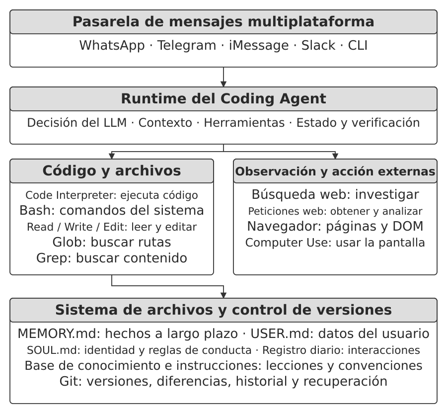

Tomemos como ejemplo «analizar los datos de ventas del último trimestre y generar un informe resumen». El proceso puede dividirse en cinco pasos:

1. **Leer la memoria**: obtener el formato de informe en PDF que prefiere el usuario y el dato de que las ventas están almacenadas en Google Sheets.
2. **Obtener los datos**: consultar cómo se usa la API de Google Sheets y descargar las hojas necesarias a través de una interfaz autorizada.
3. **Escribir el código de análisis**: agregar los datos de ventas con pandas, generar los gráficos con matplotlib y comprobar los criterios estadísticos y los resultados.
4. **Generar los productos**: organizar el análisis y los gráficos en un PDF y guardar los datos de origen, los resultados intermedios y el script de generación, para poder revisarlos o actualizarlos más tarde.
5. **Actualizar la memoria**: registrar la fuente de datos ya confirmada y el identificador de la hoja, para encontrarlos en la próxima tarea.

Si la misma tarea se encarga a Qwen Office (千问办公), el usuario puede subir directamente el detalle de ventas y pedirle que analice los datos y genere un informe visual.[^ch5-qwenwork] Supongamos que un pedido se cobra por 100 yuanes y luego se reembolsan 20: en las ventas netas del trimestre solo deben computarse 80 yuanes. Si el gráfico del informe muestra 100, basta con seguir el rastro desde el gráfico hasta la tabla resumen y el detalle original para ver qué reembolso se omitió.

[^ch5-qwenwork]: Centro de ayuda de Qwen Office (千问办公), presentación de Qwen Office; describe funciones como subir archivos de datos, analizarlos y generar informes visuales.

El sistema de archivos enlaza estos pasos: el resultado que guarda un paso puede ser la entrada del siguiente, y los programas pueden leer una y otra vez los mismos datos. Si la tarea se interrumpe, el Agente puede además comprobar el avance a partir de los productos guardados y continuar con la parte pendiente.

Los resultados intermedios tienen otra utilidad: si el usuario cambia a una pregunta relacionada, se puede retomar el trabajo desde el paso adecuado. Data Formulator, de Microsoft Research, lo demuestra con datos de generación eléctrica por país. La tabla original registra la producción de cada tipo de energía; el analista obtiene primero la proporción de energía renovable de cada país año por año y, a partir de ella, dibuja un gráfico de clasificación. Si se quiere saber cuánto ha aumentado esa proporción en un país concreto, la posición en el gráfico no basta para ver cuántos puntos porcentuales separan dos años. Siguiendo el proceso de derivación que conserva la interfaz hasta la tabla de proporciones, basta con restar los valores de esos dos años.[^ch5-data-formulator]

[^ch5-data-formulator]: Microsoft Research, ejemplo de análisis energético de Data Formulator e implementación del vínculo entre gráficos y tablas de datos en la versión 0.7.0.

**Usar archivos para guardar la memoria, el conocimiento y las capacidades.** El espacio de trabajo de OpenClaw guarda varios tipos de información en archivos Markdown: `MEMORY.md` registra hechos y decisiones a largo plazo, los registros organizados por fecha guardan información del proceso, `USER.md` puede usarse para las preferencias del usuario y los archivos de Skill explican cómo utilizar cada capacidad[^ch5-openclaw-files]. **Para la memoria que deben mantener conjuntamente personas y Agente, el autor prefiere archivos que puedan leerse directamente.** El usuario puede abrir un registro y corregir un hecho erróneo, y también consultar su origen, comparar versiones y revertir cambios con Git. Guardar los registros por fecha mantiene una cronología clara de los hechos; cuando los archivos se multiplican, un índice de búsqueda agiliza la localización.

La capacidad del Agente para escribir archivos también le permite acumular experiencia de las tareas. Por ejemplo, si al contactar con un banco descubre que para verificar la identidad se necesita la dirección de la sucursal donde se abrió la cuenta, puede anotarlo junto con el trámite al que se aplica, la fuente de la información y la fecha. Los registros ya verificados se reorganizan después como conocimiento, instrucciones de operación o programas, y las tareas posteriores pueden reutilizarlos. El capítulo 9 analizará este proceso de evolución continua.

[^ch5-openclaw-files]: OpenClaw, *Agent workspace* y *Memory overview*; describen el espacio de trabajo, la memoria basada en archivos y el mecanismo de búsqueda.

**¿Qué tareas conviene que el Agente resuelva escribiendo sus propios programas?** La investigación abierta, la generación de contenido y el procesamiento de datos se topan a menudo con formatos de entrada, interfaces y requisitos de entrega nuevos, por lo que la generación de código encaja como núcleo de ejecución. Los sistemas con procesos más estables, como la atención al cliente de un sector concreto, pueden organizarse en torno al estado del negocio, las herramientas del dominio y la estrategia de diálogo, y usar el código para cálculos, conversiones y validación de reglas. Ambos tipos de sistema aprovechan la capacidad de Coding; lo que cambia según la tarea es el papel que desempeña.

### Flujo general de un Coding Agent

Recorramos la figura 5-2 con un pequeño defecto. El usuario informa: «Al ordenar por precio total, 100 yuanes aparece antes que 20 yuanes». Primero se busca una entrada que reproduzca el problema y luego se sigue el recorrido de los datos para ver dónde se convirtió el importe en una cadena de texto. Tras corregir la lógica de comparación, se vuelve a ejecutar con la entrada original y se comprueba que los datos con decimales o con importes iguales siguen ordenándose bien.

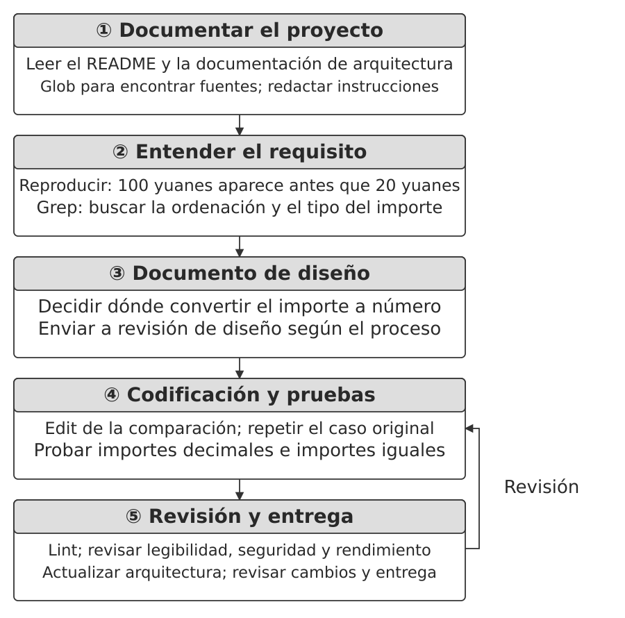

**Entender el proyecto y completar la documentación.**

Al recibir la tarea, el Agente lee primero la descripción del proyecto y luego la contrasta con la implementación, los llamadores y las pruebas para averiguar a qué partes afectará el cambio. Si la documentación no deja claro de qué se encarga el módulo en cuestión, qué abstracciones centrales usa, cómo colaboran los módulos o cómo se prueba, el Agente añade lo que haya verificado en el código, para que quien retome el trabajo pueda consultarlo.

Los **archivos de instrucciones del proyecto** ponen las convenciones habituales donde el Agente puede encontrarlas fácilmente. `CLAUDE.md`, `AGENTS.md` y las reglas de proyecto de Cursor pueden registrar órdenes de compilación, estilo de código y límites de los cambios, por ejemplo: «usar `pnpm test` para ejecutar las pruebas», «declarar tipos concretos para las variables y evitar `any`», «los cambios de migración de base de datos requieren una revisión aparte». Cada entorno anfitrión carga este contenido según el directorio, la configuración o las condiciones de aplicación; el antiguo `.cursorrules` de Cursor respondía a la misma idea[^ch5-project-rules].

Los archivos de instrucciones y los `SOUL.md` y `MEMORY.md` de OpenClaw tienen enfoques distintos: los primeros explican las convenciones de trabajo dentro del proyecto, `SOUL.md` describe la identidad y el comportamiento del Agente, y los archivos de memoria guardan información que podrán usar tareas posteriores. Unas instrucciones estables y concisas ayudan a mantener constante el prefijo del contexto; las reglas por directorio, cargadas según se necesiten, permiten controlar el volumen de entrada de la tarea actual. Los permisos de ejecución los hacen cumplir el Harness y el entorno de ejecución.

El capítulo 2 señaló que los equipos que facilitan la colaboración a distancia también facilitan la participación de los Agentes. En un repositorio de código, eso significa poner las decisiones por escrito en documentos de diseño, recoger el contexto de cada tarea en issues y PR, y convertir la experiencia interna en guías para desarrolladores. Una pregunta de control útil es: **¿podría una persona recién incorporada que trabaja a distancia, solo con el repositorio y la documentación, encontrar por dónde empezar una tarea, ejecutar las pruebas y entender qué cambio se le pide?**

[^ch5-project-rules]: Anthropic, *How Claude remembers your project*; Cursor, Rules; describen las instrucciones de proyecto y las reglas que se cargan por ámbito.

**Fijar el objetivo y los criterios de aceptación.**

Si se trata de un bug ya localizado o de un ajuste de parámetros, puede modificarse directamente a partir del comportamiento actual y de las pruebas. Cuando el objetivo es amplio, primero hay que descomponerlo. Por ejemplo, «optimizar el rendimiento del sistema» puede significar reducir el tiempo de respuesta, disminuir el consumo de memoria o aumentar el rendimiento de procesamiento. El Agente debe examinar el cuello de botella actual, medir una línea base y conocer el margen de cambio permitido, confirmar restricciones como la compatibilidad de interfaces o la experiencia de usuario y, solo entonces, decidir el plan de optimización.

**Elaborar el diseño.**

La propuesta de diseño debe responder a estas preguntas: qué módulos se modifican, qué método se emplea, por qué es adecuado para el problema actual, si introduce dependencias nuevas y cómo se verifica y se revierte. Un cambio pequeño puede expresarse con un plan breve; un cambio complejo se redacta como un documento de diseño que pueda revisarse. Si el proyecto o el usuario exigen aprobar el plan, primero se presenta la propuesta concreta y solo se implementa cuando se aprueba.

**Implementar, probar y revisar.**

Al implementar se siguen las convenciones del proyecto, se reutilizan las abstracciones y herramientas existentes y se limitan las modificaciones a lo que concierne a la tarea. Las pruebas se diseñan en torno al comportamiento esperado y cubren el camino normal, los casos límite y las situaciones de error; al corregir un bug, el caso de regresión debe poner de manifiesto el problema original y verificar la corrección.

Cuando una prueba falla, el Agente lee el diagnóstico, localiza la causa, modifica el código y vuelve a ejecutar las comprobaciones pertinentes. **Una tarea de programación se da por terminada cuando supera la aceptación.** Escribir el parche es solo uno de los pasos; también hay que comprobar las pruebas pertinentes, los requisitos del usuario y los entregables. El ciclo «probar–corregir–verificar» permite al Agente seguir corrigiendo problemas y, a la vez, da a la ingeniería del Loop un criterio claro de parada.

La revisión de código examina además aspectos que las pruebas no necesariamente cubren, como la legibilidad, la compatibilidad de interfaces, el rendimiento, los permisos y el uso de dependencias. Puede apoyarse en la lectura del diff, en el análisis estático o en un subagente revisor; si aparece un problema, se sigue corrigiendo y se vuelven a ejecutar las comprobaciones afectadas.

**Sincronizar la documentación y entregar.**

Los módulos nuevos, los cambios de dependencias y las modificaciones del comportamiento central deben reflejarse en la documentación correspondiente. La nota de entrega debe resumir el problema resuelto, los cambios de comportamiento, los resultados de la verificación y el modo de uso y, si hace falta, incluir los pasos para revertir. El código, las pruebas y la documentación conservan juntos el resultado de la tarea.

Los distintos modelos también organizan de forma diferente la exploración y la modificación: unos leen primero de forma amplia la implementación, los llamadores y las pruebas; otros revisan primero los archivos más relevantes, prueban un parche pequeño y luego usan la retroalimentación de la compilación o de las pruebas para seguir localizando el problema. **El autor considera este ritmo de exploración y acción, ante todo, una estrategia de comportamiento aprendida por el modelo.** Si al cambiar de Harness se mantiene un ritmo parecido, mientras que al cambiar de modelo dentro del mismo Harness el ritmo varía claramente, la diferencia apunta al propio modelo. Los prompts, las herramientas y el presupuesto del Harness pueden amplificar o atenuar esta tendencia. El capítulo 7 trata de cómo evaluar estas diferencias y el capítulo 8, de cómo el post-entrenamiento influye en las estrategias de comportamiento.

### Ingeniería de Harness en la práctica de los Coding Agents

El capítulo 1 describió la implementación en producción con la fórmula **Agente = Modelo + Harness** y presentó las cinco funciones del Harness: gestión del contexto, interfaz de herramientas, restricciones, verificación y corrección. Un Coding Agent puede aprovechar las pruebas, el análisis estático, la integración continua y el control de versiones de la ingeniería de software para convertir esas funciones en procesos ejecutables.

Volvamos al defecto de ordenación. Dejar al modelo la entrada que falla, la función implicada y la salida errónea es gestión del contexto; permitirle leer, modificar y ejecutar pruebas depende de la interfaz de herramientas y de las restricciones. Solo cuando se comprueba la modificación con la misma entrada empieza la verificación; y si los números siguen ordenándose como caracteres, solo devolviendo juntos el orden real y el esperado se obtiene una retroalimentación útil para la corrección.

El modelo se encarga de entender el problema y de generar la propuesta y el código; el Harness aporta la información y las interfaces necesarias para trabajar, organiza las comprobaciones y, según los resultados, sigue adelante o recupera el estado. En un sistema de ingeniería, esto se prepara en cuatro frentes:

- **Línea base de aceptación**: las suites de pruebas, los pipelines de CI y los criterios de revisión definen qué se considera terminado. CI es el pipeline de integración continua, que puede ejecutar automáticamente las comprobaciones acordadas tras cada envío.
- **Límites de ejecución**: definir con claridad las responsabilidades de cada módulo, las reglas de dependencias, el acceso a datos y los permisos de operación.
- **Señales de retroalimentación**: convertir los resultados del linter, de la comprobación de tipos y de las pruebas en diagnósticos que el modelo pueda localizar, entender y tratar.
- **Medios de recuperación**: guardar las versiones de Git, las instantáneas del espacio de trabajo y el estado de la tarea, y preparar procedimientos de recuperación para los cambios externos.

**Diseñar el objetivo junto con el método de verificación.**

Que la tarea esté bien definida y que el resultado pueda verificarse automáticamente determinan juntos la forma de trabajar del Agente. La tabla 5-1 recoge las cuatro combinaciones y el trabajo de ingeniería que cada una requiere. Aclarando los requisitos y añadiendo ejemplos y comprobaciones, una tarea inicialmente vaga puede transformarse poco a poco en un objetivo ejecutable.

Tabla 5-1: Los cuatro cuadrantes de claridad de la tarea y grado de automatización de la verificación

| | El resultado se verifica automáticamente | El resultado requiere verificación humana |
| --- | --- | --- |
| **Objetivo claro** | Corregir un bug con prueba de regresión: iterar según la retroalimentación | Refactorizar código: combinar pruebas y revisión de arquitectura |
| **Objetivo vago** | «Mejorar la calidad del código»: definir primero metas de calidad más allá del linter | «Hacer la UI más bonita»: aclarar preferencias con ejemplos y comparaciones |

**La infraestructura de verificación acumulada por la ingeniería de software es una de las razones principales por las que los Coding Agents maduraron antes.** Los compiladores, los sistemas de tipos, las suites de pruebas y el control de versiones permiten localizar errores, comprobar modificaciones y revertir tras un fallo; forman, de manera natural, un Harness muy potente. Esta conclusión indica también dónde invertir en otros escenarios de Agentes: primero hay que llevar la tarea hacia la zona de «objetivo claro y resultado verificable automáticamente». Cuando la aceptación depende de que una persona revise cada resultado, la velocidad de revisión humana se convierte en el techo del rendimiento; cuando el objetivo es vago, ni la automatización más rápida impide que se siga optimizando una métrica equivocada.

**Extraer métodos de los casos de ingeniería.**

Una migración de código a gran escala sirve para entender cómo colaboran estos componentes. Las reglas de migración y las relaciones entre módulos se escriben en la documentación del repositorio, las restricciones de dependencias se hacen cumplir mediante análisis estático, cada lote de cambios pasa por las pruebas y la CI, y los fallos devuelven diagnósticos localizables. Así, el Agente puede consultar los requisitos de la migración, recibir retroalimentación tras cada lote y seguir avanzando a partir de ella.

La práctica de LangChain muestra cómo mejorar el Harness a partir de las trayectorias fallidas: con el modelo fijo, se analiza en qué paso se estanca la tarea o termina con error, y luego se ajustan el system prompt, el middleware de herramientas, los bucles de autocomprobación y el presupuesto de razonamiento. El capítulo 1 ya presentó su caso de Terminal Bench 2.0; aquí interesa el método iterativo de «registrar el fallo, proponer un cambio y volver a evaluar»[^ch5-langchain-harness].

La propuesta de Anthropic para tareas largas separa la inicialización del entorno de la ejecución continuada. Un Agente de inicialización crea la lista de tareas y el entorno de trabajo, y los Coding Agents posteriores avanzan elemento por elemento, guardando el código, los resultados de las pruebas y el progreso. Una sesión nueva lee esos productos y continúa el trabajo, lo que reduce la pérdida de información en el traspaso entre contextos[^ch5-long-harness].

[^ch5-langchain-harness]: LangChain, *Improving Deep Agents with harness engineering*, 17 de febrero de 2026.
[^ch5-long-harness]: Anthropic, *Effective harnesses for long-running agents*, 26 de noviembre de 2025.

**Consolidar la experiencia en principios de diseño del sistema.**

1. **Las restricciones ejecutables tienen prioridad sobre las indicaciones del prompt.** Las dependencias entre módulos, los tipos de los campos y las normas de código pueden verificarse con análisis estático y CI; los permisos de acceso los impone el entorno de ejecución. El prompt y la documentación explican las reglas y sus motivos; los mecanismos de comprobación detectan y bloquean las infracciones correspondientes.
2. **Invertir primero en verificación automática.** Las comprobaciones repetitivas crecen con el volumen de tareas, y aumentar sin cesar la revisión humana se convierte en un cuello de botella para escalar. Las pruebas, los controles de calidad y la monitorización del comportamiento asumen esa carga, y la revisión humana se concentra en las decisiones sobre objetivos y los juicios complejos.
3. **Cuanto más inmediata y estructurada sea la retroalimentación, más fácil es corregir.** Los mensajes de error deben incluir la ubicación pertinente, la condición que falló y el resultado real, para ayudar al modelo a decidir el siguiente paso. La barra de estado del capítulo 2 puede resumir los diagnósticos más recientes, el número de llamadas y el progreso de la tarea.
4. **Diseñar una vía de recuperación para cada cambio.** Las ramas de Git guardan los cambios de código, el sandbox limita el impacto de los intentos fallidos y las instantáneas restauran el estado gestionado; las operaciones sobre API externas se tratan con los mecanismos de idempotencia, cancelación y compensación del capítulo 4.

**Comprobar a la vez el resultado y el proceso.** Al reparar un fallo de base de datos, vaciar los datos y reconstruirla puede restablecer el servicio, pero incumple los requisitos de conservación de datos; al corregir un error de compilación, borrar la implementación afectada puede hacer que compile, pero se pierde la funcionalidad. Estos ejemplos muestran que la aceptación debe abarcar los objetivos de negocio y que el proceso de ejecución también necesita restricciones. El Harness puede comprobar la autorización y el alcance de operaciones como borrar datos de producción o sobrescribir archivos, e invocar el mecanismo de revisión independiente presentado en el capítulo 4.

Durante el entrenamiento también se pueden penalizar las infracciones ya identificadas. El RLVP (penalización de la ruta de verificación), que analiza el capítulo 8, incorpora las restricciones de proceso a la retroalimentación del entrenamiento y orienta al modelo a respetar los requisitos de ejecución mientras persigue el resultado. En tiempo de ejecución, los permisos y la revisión acotan de forma continua las acciones ejecutables; la retroalimentación del entrenamiento, por su parte, influye en cómo propone acciones el modelo.

**Controlar la propagación de fallos según las dependencias.** Si se leen en paralelo tres archivos independientes y uno no existe, debe devolverse el error de ese elemento conservando los demás resultados de lectura. Si una llamada depende de la salida de una tarea fallida, hay que detener o replanificar esa cadena de dependencias. El Harness debe decidir el alcance de la cancelación según las relaciones entre tareas e informar al nivel superior del estado de cada elemento, para no descartar junto con lo fallido el trabajo independiente. La implementación de las llamadas en paralelo, el análisis en streaming y la cancelación en cascada se tratará más adelante.

### Fallos y recuperación de errores

Una tarea larga puede perder la conexión entre dos peticiones al modelo, o ejecutar una herramienta sin llegar a guardar el resultado. Si el Harness solo sabe que «la tarea ha fallado», empezar de cero puede repetir operaciones ya realizadas. Para recuperar el trabajo hay que localizar primero dónde se interrumpió, confirmar qué resultados quedaron guardados y decidir después si reintentar, corregir la llamada, continuar desde el punto de interrupción o terminar.

La primera pregunta de la recuperación es: «¿qué evidencia dejó el paso anterior?». Si la conexión se cortó al leer un archivo, normalmente basta con volver a leerlo; si se cortó tras enviar una tarea remota, puede que el servicio remoto ya la haya aceptado. Si se dispone del identificador de la tarea, hay que consultarlo antes de decidir si se vuelve a enviar. Registrar por separado «petición enviada», «confirmada por el servicio remoto» y «resultado guardado» es lo que da a la recuperación un punto de partida.

**Elegir el tratamiento según dónde se produce el fallo.**

| Nivel | Fallos habituales | Prioridades del tratamiento |
| --- | --- | --- |
| Capa de API | Limitación de tasa HTTP 429, sobrecarga del servicio, tiempo de espera agotado, conexión interrumpida, límite de longitud de salida alcanzado | Comprobar la causa del error y el estado de la petición; reintentar con espera o ajustar la petición |
| Capa de herramientas | Nombre de herramienta inexistente, parámetros no válidos, excepción en la ejecución, el mismo error devuelto repetidamente | Devolver un diagnóstico localizable; corregir la entrada o las condiciones de ejecución |
| Capa de contexto | Desbordamiento de la ventana, fallo de la compresión, llamadas sin su resultado emparejado | Ajustar el volumen de entrada, restaurar los registros reales, comprobar la estructura de los mensajes |
| Capa de flujo de control | Operaciones repetidas sin avance, lógica de recuperación que vuelve a fallar de forma recursiva | Contar, limitar los niveles de recuperación y provocar la terminación o la escalada |

La limitación de tasa y la sobrecarga temporal se resuelven esperando y reintentando; un error de parámetros exige modificarlos, la falta de permisos requiere gestionar la autorización y una herramienta inexistente obliga a elegir otra capacidad. Asociar cada tipo de error a una acción de recuperación concreta evita que la misma petición falle una y otra vez sin que cambien las condiciones.

**Vigilar a la vez los fallos y el progreso.**

El Harness puede calcular una huella de cada llamada a partir de «nombre de herramienta + parámetros normalizados» y combinarla con el resultado y el estado de la tarea para detectar comportamientos repetitivos. Una llamada idéntica puede ser un sondeo legítimo o un bucle sin avance; para distinguirlos hay que mirar también la condición de espera, el estado externo y el tiempo transcurrido. Cada vía de recuperación mantiene su propio contador de fallos, y un presupuesto global acota la tarea completa.

Las peticiones en streaming necesitan por separado un tiempo de espera de conexión, un tiempo de espera de inactividad en lectura y un límite total. El primero limita cuánto se espera para establecer la conexión; el segundo, cuánto se espera entre dos recepciones de datos; el límite total acota la petición entera. Si la conexión sigue abierta pero no llegan datos durante mucho tiempo, un watchdog de inactividad puede cerrar la petición y entrar en el flujo de recuperación. **Toda conexión de larga duración necesita una monitorización de actividad; no basta con fijar un tiempo de espera para establecerla.** Los umbrales deben tener en cuenta cómo emite el modelo su salida: el texto visible, los incrementos de razonamiento y los heartbeats indican que la petición sigue en curso, y un razonamiento interno largo también alarga la espera.

La comprobación de integridad del contexto gira en torno al emparejamiento entre el ID de cada llamada y su resultado. Si falta un resultado, primero se consulta el registro de ejecución y se restaura el resultado real ya guardado; si el estado de ejecución es desconocido, se registra explícitamente como desconocido y se trata con los mecanismos de idempotencia y consulta de estado del capítulo 4.

**Recuperar por niveles e informar del estado actual.**

1. **Reintento con espera.** Para los errores reintentables se usa una espera exponencial con variación aleatoria (jitter) y se respetan las indicaciones de espera del servidor. La tarea principal y las auxiliares tienen presupuestos de reintento separados; los trabajos en segundo plano, como generar títulos o sugerencias de entrada, pueden omitirse si fallan, para no restar recursos a la tarea principal.
2. **Ajustar o cambiar.** Si se alcanza el límite de longitud de salida, primero se comprueban el máximo que admite la interfaz y el presupuesto de la tarea, y luego se decide entre ampliar el límite, dividir la tarea o continuar la salida. Si el servicio sigue sin estar disponible, se puede cambiar a un modelo de respaldo; antes de hacerlo hay que convertir los mensajes, las definiciones de herramientas y los campos propios del modelo.
3. **Informar del progreso de la recuperación.** Durante la recuperación automática se puede mostrar «reintentando» o «cambiando de servicio», y conservar cada error en el registro. Si la recuperación tiene éxito, la tarea continúa; si el usuario debe gestionar una autorización, aportar datos o decidir el siguiente paso, se le explica el progreso actual, la causa del fallo y lo que ya se ha intentado.

**La estrategia de recuperación debe ayudar a que la tarea completa siga avanzando.** Los errores intermedios recuperables quedan en el registro de ejecución y la interfaz muestra el progreso de la recuperación; solo cuando se agotan los medios de recuperación se informa del fallo definitivo al usuario y a los sistemas posteriores. Así, estos pueden distinguir entre «reintentando» y «la tarea ha fallado», y se evita activar prematuramente compensaciones o envíos duplicados.

Los errores de herramienta pueden entrar en el contexto como resultados estructurados. Por ejemplo, se devuelve el nombre de la herramienta que falta, el campo erróneo y los valores permitidos, para que el modelo corrija a partir de ello. Las conversiones de formato que permite el contrato de la interfaz y cuyo significado no admite dudas pueden hacerse en el programa y quedar registradas; si el significado de un parámetro no está claro, hay que pedir al modelo que lo genere de nuevo, para que la reparación no altere el objetivo de la operación.

**Asumir una trayectoria inacabada.**

Al cambiar de modelo, hay que entregar al receptor los hechos ya confirmados de la tarea, los resultados de las herramientas y los asuntos pendientes. Los roles de los mensajes, el formato de las llamadas a herramientas y los campos de razonamiento varían según la interfaz, de modo que la conversión debe tratar por separado el contenido y el estado del protocolo. Algunos servicios devuelven el razonamiento legible o un resumen, y también campos opacos destinados a sus propias peticiones posteriores. Estos campos pueden ir adjuntos a bloques de razonamiento o a llamadas a herramientas; qué campos deben devolverse tal cual en las peticiones siguientes lo establece cada interfaz.

**Un sistema que necesite continuar el trabajo entre proveedores debe guardar la trayectoria de negocio en un formato neutral.** Que un modelo entienda el texto producido por otro proveedor no significa que la API de destino acepte los campos de protocolo opacos del proveedor original. Solo separando los hechos de la tarea del protocolo del proveedor pueden el traspaso, la reproducción para evaluación y los datos de entrenamiento compartir el mismo registro. El registro neutral contiene: la tarea y los mensajes, los nombres y parámetros de las herramientas, identificadores de llamada estables, el estado de ejecución, los resultados y su procedencia. La respuesta original del proveedor se conserva aparte, para continuar con la misma interfaz y para rastrear problemas. Al convertirla en una petición para el modelo de destino, se crea una correspondencia entre los ID de llamada y se mantiene el emparejamiento de resultados; los resúmenes legibles se transmiten como contexto ordinario con su procedencia, y los campos opacos del servicio original permanecen en el registro original.

Si la interfaz de destino no puede expresar las llamadas antiguas, los pasos completados pueden resumirse en un registro de tarea explícito, por ejemplo «ya se han consultado los vuelos y el alojamiento; falta obtener el gasto en comidas y el tipo de cambio», acompañado de los resultados reales. A continuación, el modelo de destino genera nuevas llamadas válidas. Una vez que el receptor empieza a trabajar, los campos de protocolo que devuelve deben conservarse según lo que exija su propia interfaz. Este registro neutral sirve además para la reproducción en evaluación del capítulo 7, la construcción de muestras de entrenamiento del capítulo 8 y la extracción de experiencia del capítulo 9.

> **Experimento 5-1 ★★★: Traspaso de trayectorias entre proveedores**
>
> En este experimento, el Agente consulta vuelos, alojamiento, gasto en comidas y tipo de cambio, y calcula el total en yuanes. Tras completar las dos primeras llamadas a herramientas, el script cambia de servicio en un punto de interrupción predefinido, simulando un traspaso porque el servicio de origen deja de estar disponible; el receptor continúa con los pasos restantes. El experimento usa tres modelos, de Moonshot, Anthropic y Google, y compara las seis combinaciones dirigidas de cambio.
>
> Los tres tratamientos son: transmitir los mensajes originales mediante una correspondencia campo a campo; convertir los mensajes tras eliminar el contenido de razonamiento y los campos opacos; y guardar el estado de la tarea en una trayectoria neutral para reconstruir el contexto según la interfaz de destino. El punto de cambio lo controla el script, y los errores de formato del receptor proceden de respuestas reales del servicio.
>
> En esta ejecución, la trayectoria neutral completó el traspaso y calculó bien el total en las seis combinaciones; los otros dos tratamientos lo lograron en tres y en cuatro, respectivamente. Como el progreso de la tarea ya estaba guardado en los resultados de las herramientas, ninguno de los tres grupos repitió llamadas a herramientas.

> **Experimento 5-2 ★★: Continuar después de que la salida se corte a medias**
>
> Este experimento intenta cortar el stream en tres posiciones (la salida de razonamiento, el texto de respuesta y los parámetros de una herramienta) y compara tres formas de continuar: reenviar la ronda completa, usar el texto ya recibido como prefijo para seguir generando y añadir una instrucción de continuación. Una llamada a herramienta necesita sus parámetros completos antes de ejecutarse, así que el fragmento truncado se guarda primero en el registro de ejecución y, tras la recuperación, se vuelve a analizar y validar.
>
> Un error concreto apareció en el parámetro de ciudad: debía generarse «东京» (Tokio), pero en el punto de corte solo quedaba `{"city":"东`, y la continuación lo cerró como `{"city":"东"}`. El JSON ya era válido, pero la ciudad seguía siendo errónea.
>
> En la prueba con un texto de respuesta largo, continuar a partir del prefijo redujo los tokens de salida posteriores; con la interrupción en los parámetros el resultado fue distinto: en las tres pruebas con Moonshot, la continuación por prefijo no recuperó en ningún caso la ciudad correcta.

**Fijar condiciones de terminación para los bucles de recuperación.**

Cada vía de recuperación necesita un límite. Por ejemplo, si la compresión falla varias veces seguidas, se pasa a otra estrategia de contexto; si no se puede resolver una decisión de permisos, se deriva a una persona; si la continuación de la salida alcanza el número de rondas o el presupuesto de coste, se detiene. **Los umbrales de reintento deben fijarse a partir de la distribución de recuperaciones observada en producción.** Si la gran mayoría de los fallos temporales se recuperan en los primeros intentos y la tasa de éxito de los reintentos posteriores es casi nula, hay que detenerse en ese punto de inflexión para que las llamadas inútiles no sigan consumiendo cuota.

La propia lógica de recuperación también puede fallar. Por ejemplo, un desbordamiento de contexto activa un hook de parada, el hook pide al modelo que genere un mensaje de commit, el contexto vuelve a desbordarse y el hook se activa de nuevo. Esta cadena puede cortarse con una marca de reentrada y un límite de profundidad de recursión, programando por separado la limpieza de errores y el trabajo auxiliar que requiere llamar al modelo, con un presupuesto propio para este último. La tarea debe tener además límites globales de iteraciones, tiempo y coste, de modo que todas las vías de recuperación queden sujetas al presupuesto de la tarea completa.

### Técnicas de implementación de un Coding Agent

Tomemos primero el registro de ejecución de una corrección de una prueba fallida para estimar qué tramo merece optimizarse. En la charla «The Road to JARVIS», presentada en Oporto en noviembre de 2026, el autor comparó distintas velocidades de inferencia reproduciendo la misma sesión: con los tiempos del modelo en línea de entonces, el total era de 24,2 segundos; manteniendo fijos los tiempos de las herramientas y sustituyendo la velocidad de inferencia por la estimada para un chip especializado que aún no se ha fabricado, el total bajaba a unos 8,1 segundos. De ellos, 7,5 segundos se dedicaban a ejecutar las pruebas. Aunque se eliminaran los aproximadamente 0,6 segundos restantes del modelo, habría que seguir esperando a que terminen las pruebas.

¿Qué trabajos pueden hacerse en paralelo dentro de esos 7,5 segundos? Depende de las dependencias entre las llamadas a herramientas.

**Llamadas a herramientas en paralelo, ejecución en streaming y cancelación en cascada.**

Buscar código, leer la configuración y consultar los registros suelen poder hacerse de forma independiente. Cuando el modelo genera estas llamadas en una sola respuesta, el Harness puede solapar la generación de las llamadas con la ejecución de las herramientas: en cuanto la interfaz confirma que la primera llamada se ha emitido completa y que los parámetros y los permisos han superado la validación, la programa de inmediato mientras sigue recibiendo las siguientes. Para juzgar si una llamada está completa hay que basarse en el evento de fin de llamada de la interfaz, y no ejecutar antes de tiempo solo porque el JSON ya se pueda analizar provisionalmente.

Las llamadas independientes pueden ejecutarse en paralelo. Por ejemplo, se busca el nombre de una función mientras se lee el archivo de configuración, y se decide cómo modificar cuando han llegado ambos resultados. Una lectura de archivo que solo puede determinarse a partir del resultado de la búsqueda va en un paso posterior. El planificador también debe detectar el estado compartido: si dos herramientas modifican a la vez el mismo archivo, se produce un conflicto de escritura aunque sus entradas sean independientes.

Las definiciones de herramientas pueden declarar su capacidad de concurrencia, los recursos a los que acceden y su forma de cancelación; una implementación didáctica puede programar en serie las herramientas que no declaren nada. Si una llamada falla, se detiene el trabajo posterior que depende de su resultado, se conservan los resultados de las llamadas independientes y se devuelve al nivel superior el estado de cada elemento. Al cancelar una tarea ya iniciada, hay que registrar además si la cancelación surtió efecto y qué cambios en archivos u operaciones externas se habían producido ya.

**Gestión detallada del contexto.**

Un código base grande puede incorporarse al contexto de forma gradual mediante búsquedas por capas: primero se localiza el archivo, después se leen las funciones relevantes y, si hace falta, se amplía a los llamadores y a las pruebas. Cada lectura añade información en función de la decisión actual, de modo que el modelo pueda ver a la vez el código, las restricciones y la retroalimentación de la ejecución.

La herramienta de lectura debe permitir devolver fragmentos por rango de líneas, por ejemplo de la 100 a la 150, y adjuntar a cada línea su número real en el archivo. Así el modelo puede citar con precisión «la línea 142», y la herramienta de edición posterior puede localizarla a partir de ese dato. El contenido devuelto debe indicar también de qué archivo procede y qué rango se ha leído; si el archivo cambia, hay que volver a confirmar la posición de edición.

La compilación o las pruebas pueden producir miles de líneas de salida. En ese caso se aplica el mecanismo de truncado y persistencia del capítulo 4: se devuelven el principio, el final y el número de líneas omitidas, y se guarda la salida completa para consultarla cuando haga falta. Como el error puede estar en medio, el Agente puede seguir buscando palabras clave del error o leer el tramo correspondiente.

**Inyección dinámica de información del entorno.**

En las tareas de programación, la barra de estado del Agente del capítulo 2 puede resumir cuatro tipos de información:

- **Directorio de trabajo actual**: la base de las rutas relativas.
- **Rama de Git**: la rama de desarrollo en la que se encuentran los cambios actuales.
- **Commits recientes**: los cambios recientes relacionados con la tarea.
- **Resumen de los cambios preparados y no preparados**: distingue lo que está listo para el commit de las modificaciones del espacio de trabajo.

El Harness puede refrescar este resumen tras las operaciones que alteran dichos estados y añadirlo al final del contexto en la siguiente llamada al modelo. La información que cambia poco, como los commits recientes, puede actualizarse solo cuando se necesite, lo que reduce las consultas repetidas y el volumen de entrada. Mantener estable la parte inicial favorece la reutilización de la caché de prefijos.

**Persistencia del estado del entorno de ejecución de órdenes.**

Cambiar de directorio, activar un entorno virtual, definir variables de entorno y arrancar servicios en segundo plano afectan a las órdenes posteriores. Cuando el Agente ejecuta `cd` en un shell, el cambio de directorio solo se mantiene de forma natural si las órdenes siguientes usan esa misma sesión; si se ejecutan en otro proceso, el directorio de trabajo depende de la configuración del nuevo proceso. Las variables de entorno que crea la activación de un entorno virtual tienen el mismo límite de sesión.

**Para la depuración interactiva y las tareas que necesitan servicios en marcha de forma continua, el autor recomienda usar por defecto un terminal persistente.** Así se conservan el directorio de trabajo, las variables de entorno y el estado de la sesión, en consonancia con la costumbre del desarrollador de trabajar de forma continuada en un mismo terminal. El Harness asigna un identificador a cada sesión y lleva el control del directorio de trabajo, los procesos en ejecución y los códigos de salida, de manera que el modelo sepa en qué entorno se ejecutará la siguiente orden. Otra implementación posible consiste en que cada orden lleve explícitamente su directorio de trabajo y su configuración de entorno, manteniendo la coherencia mediante una configuración reconstruible.

Las tareas en paralelo deben usar sesiones independientes o instantáneas de entorno explícitas, para que un cambio de directorio no afecte a otra tarea. Al terminar la tarea se limpian todos los procesos en segundo plano; al reanudarla se comprueba de nuevo si la sesión sigue viva. Por ejemplo, si al día siguiente se vuelve a ejecutar las pruebas, el código y la lista de dependencias pueden leerse de nuevo del espacio de trabajo; en cambio, hay que comprobar primero si sigue en marcha el proceso del servicio que se arrancó ayer en el terminal. Estos son precisamente los dos tipos de estado que el capítulo 4 distinguía al estimar el coste del sandbox.

**Retroalimentación sintáctica inmediata.**

Tras escribir un archivo, la capa de herramientas puede ejecutar automáticamente el comprobador de sintaxis o el linter del lenguaje correspondiente y entregar el diagnóstico al modelo como valor de retorno de la herramienta. Por ejemplo, si falta un paréntesis, devuelve el archivo, la línea y la columna y el tipo de error, y el modelo puede corregirlo en la siguiente ronda; se obtiene así una retroalimentación parecida a las marcas inmediatas de un IDE.

El alcance de las comprobaciones puede ampliarse con el cambio: primero se comprueba el archivo modificado, luego se ejecutan las pruebas de los módulos afectados y, por último, las comprobaciones de regresión que exija la entrega. Las comprobaciones ligeras ayudan a detectar pronto los problemas locales, y las pruebas de integración verifican el comportamiento entre módulos.

### Herramientas de búsqueda de un Coding Agent

Si el mensaje de error dice «falta el campo de importe», se puede buscar primero ese texto literal y luego rastrear a los llamadores desde el punto donde se lanza el error. Si el usuario solo dice «la ordenación falla» y el código usa nombres en inglés, buscar esa frase palabra por palabra sirve de poco. Conviene localizar primero la interfaz que muestra el resultado y seguir después los campos, las relaciones de llamada y los datos de prueba hasta llegar a la lógica de ordenación. Los cuatro tipos de herramientas de búsqueda de la figura 5-3 aprovechan pistas distintas; lo que devuelva la primera búsqueda suele decidir qué herramienta conviene usar en la siguiente.

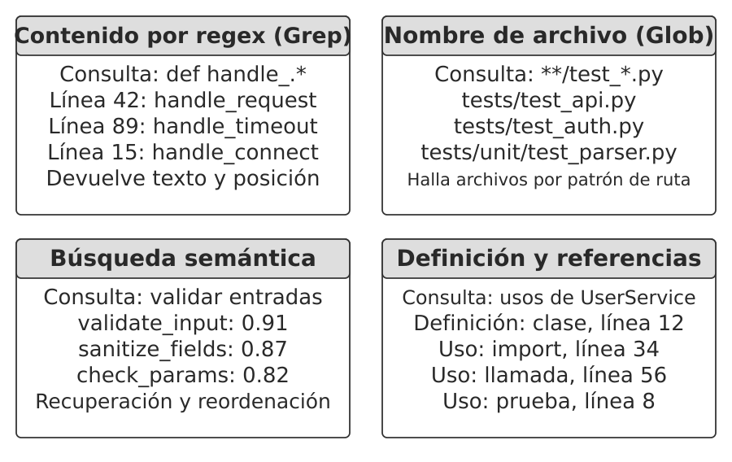

**Coincidencia de contenido con expresiones regulares.** grep y ripgrep buscan contenido según patrones de texto y son adecuados cuando se conocen nombres de funciones, nombres de variables o mensajes de error. Por ejemplo, `def handle.*` encuentra las líneas que contienen la forma de definición de función correspondiente. Combinándolos con filtros por tipo de archivo y por ruta, se puede buscar solo en archivos Python o excluir el directorio de pruebas, y concentrar los resultados en la implementación relevante.

La coincidencia de texto se corresponde directamente con el contenido de los archivos, de modo que los resultados son fáciles de comprobar. Los términos de búsqueda deben conectarse con la forma en que se expresan las cosas en el código: al buscar «autenticación de usuarios», se pueden probar nombres como `authenticate`, `login` o `check_credentials`. Cuando el modelo amplía la consulta a partir del resultado anterior, la búsqueda se convierte en un proceso de buscar y comprender a la vez.

**Coincidencia de patrones de nombres de archivo.** glob busca archivos según patrones de ruta; por ejemplo, `**/*.test.ts` encuentra los archivos de prueba de TypeScript en cualquier nivel de directorios, y `src/components/**/Button.tsx` encuentra Button.tsx dentro del directorio de componentes. La coincidencia por ruta evita tener que leer el contenido y resulta adecuada para conocer primero la organización del proyecto y elegir después qué archivos abrir.

**Búsqueda semántica de código.** Cuando la tarea solo da una descripción funcional, se puede usar la búsqueda vectorial para recuperar código semánticamente relacionado. Por ejemplo, «verificar la identidad del usuario» puede corresponder a `check_credentials`. Estos sistemas suelen tener que resolver dos cosas:

- **Fragmentar según la estructura del código.** Las unidades principales son funciones, clases y métodos, conservando las firmas, los comentarios y el módulo al que pertenecen. Si una unidad larga debe seguir dividiéndose, cada fragmento debe llevar contexto suficiente para entenderse.
- **Combinar varias señales de búsqueda.** La búsqueda vectorial encuentra código semánticamente relacionado y la búsqueda por palabras clave encuentra coincidencias exactas de nombre; luego se combinan ambos conjuntos de resultados. El cross-encoder presentado en el capítulo 3 puede reordenarlos: lee a la vez la consulta y un fragmento de código y puntúa su relevancia.

Las preguntas exploratorias como «¿dónde se interactúa con la base de datos?» o «¿dónde se valida la entrada del usuario?» pueden empezar con búsqueda semántica para localizar el módulo y continuar leyendo la implementación.

**Al construir la capacidad de búsqueda de un Coding Agent, el autor recomienda empezar por hacer bien Grep, Glob y la lectura por rangos.** El modelo puede reescribir la consulta a partir de los resultados, abrir los llamadores y las pruebas y estrechar el alcance poco a poco. Estas herramientas leen directamente el espacio de trabajo actual, lo que ahorra mantener un índice de embeddings sincronizado con el código. Solo cuando hay que explorar repetidamente un código base grande y, con una mera descripción funcional, cuesta encontrar el punto de entrada, conviene añadir un índice semántico para mejorar el recall. Cursor presentó públicamente un índice del código base basado en embeddings, y su documentación de búsqueda posterior describió un índice local Instant Grep y subagentes de exploración[^ch5-search]. Esta evolución muestra también que «usar una interfaz de tipo grep» y «construir o no un índice» son dos dimensiones de diseño distintas: la misma interfaz de búsqueda puede apoyarse por debajo en un recorrido o en un índice.

**Búsqueda de definiciones y referencias a nivel de símbolo.** Los servidores de lenguaje pueden aprovechar la sintaxis, el ámbito y la información de tipos para ofrecer «ir a la definición» y «buscar referencias». Por ejemplo, si `authenticate` se define en la línea 42 y se llama en la línea 189, la herramienta puede devolver esa relación y distinguirla de los símbolos homónimos de otros ámbitos. El plugin de inteligencia de código de Claude Code es una forma de integrarlo: ofrece navegación por símbolos y diagnósticos tras la edición mediante el Language Server Protocol (LSP)[^ch5-lsp].

La eficacia de las herramientas de símbolos depende del soporte del lenguaje, de la configuración del proyecto y del estado del análisis. El Agente puede complementarlas con búsqueda de texto para encontrar cadenas, comentarios o archivos que el servidor de lenguaje aún no ha analizado.

[^ch5-search]: Cursor, *Securely indexing large codebases* y Search; presentan, respectivamente, el esquema de índice de embeddings y el mecanismo posterior de búsqueda local.
[^ch5-lsp]: Anthropic, *Code intelligence plugins*; describe cómo ofrecer definiciones, referencias y diagnósticos en tiempo real mediante LSP.

### Herramientas de edición de archivos de un Coding Agent

Imagina que, justo después de que el modelo lea un archivo, otra persona añade una línea de comentario al principio. ¿Siguen apuntando al mismo sitio «modificar la línea 28» y «reemplazar este fragmento de texto, que aparece una sola vez»? ¿Y si ese texto aparece una vez en cada una de dos funciones? Los cinco esquemas de edición de la figura 5-4 localizan los cambios de maneras distintas: unos se basan en números de línea, otros en el texto original y otros delegan la fusión en un segundo modelo.

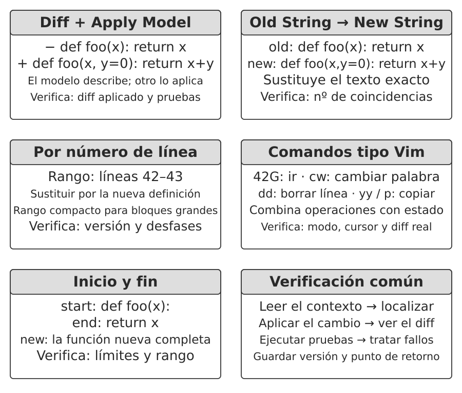

**Descripción de diferencias + Apply Model.** El modelo principal expresa la intención del cambio y un fragmento de código, por ejemplo una descripción de líneas añadidas y eliminadas al estilo de un diff de Git, o un esqueleto de código que omite con marcas de elisión las partes no modificadas. Después, un modelo de aplicación especializado combina esa información con el archivo original y genera el contenido completo modificado. El antiguo Fast Apply de Cursor es representativo de esta idea[^ch5-apply]: reparte entre dos modelos «proponer el cambio» y «aplicar el cambio». A medida que los modelos base se han vuelto más hábiles generando ediciones locales precisas, este flujo de dos modelos ha ido encontrando alternativas más sencillas.

Este reparto permite que el modelo principal se concentre en expresar la lógica del código, mientras el modelo de aplicación se encarga de fusionar los cambios locales en el archivo. En consecuencia, las comprobaciones se centran en el resultado de la fusión: varios fragmentos parecidos pueden crear ambigüedad al localizar, las marcas de elisión pueden malinterpretarse y las zonas no modificadas pueden reescribirse por accidente.

**De cadena antigua a cadena nueva (Old String → New String).** La herramienta Edit de Claude Code usa reemplazo exacto de cadenas; Cursor introdujo Search & Replace en la versión 0.50, en mayo de 2025, primero para la edición de archivos largos con los modelos de Anthropic[^ch5-direct-edit]. Este enfoque entrega directamente al programa el criterio de localización y el contenido de reemplazo, lo que evita volver a llamar a un modelo en la fase de fusión. El modelo proporciona `old_string` y `new_string`, y la herramienta busca el texto original en el archivo y lo reemplaza. La interfaz puede exigir que, en un reemplazo simple, el texto original sea único; si no hay coincidencias o hay varias, devuelve las posiciones y un diagnóstico, y el modelo añade más contexto. Cuando se necesita un reemplazo masivo, el alcance se expresa con un parámetro explícito.

Por ejemplo, en un archivo de configuración, dos servicios tienen `timeout = 30`, y solo se quiere cambiar a 60 segundos el tiempo de espera del servicio de descargas. Si la herramienta exige una coincidencia única, proporcionar solo `timeout = 30` producirá dos coincidencias y el archivo debe quedar intacto. En la siguiente petición, la cadena antigua incluye el título de la sección del servicio de descargas junto con la línea de configuración, y la cadena nueva conserva el título y solo cambia el valor.

La coincidencia por contenido es intuitiva y fácil de revisar. Al invocarla, el modelo debe emitir la cadena antigua completa: si se borra un bloque grande de código, el parámetro resulta muy largo, y pequeñas diferencias de espacios, saltos de línea o comillas también afectan a la coincidencia. El caso de las comillas tipográficas Unicode del capítulo 4 muestra cómo se produce este tipo de fallo al transmitir parámetros.

**Localización por número de línea (Old Line Numbers → New String).** El modelo indica que se borren las líneas X a Y y se inserte un texto nuevo. Si la herramienta de lectura ya proporciona los números de línea reales, borrar un bloque grande solo requiere las dos posiciones extremas. El significado de los números de línea depende de la versión del archivo en el momento de la lectura, y una edición anterior puede desplazar las posiciones siguientes.

Por eso, las ediciones por lotes pueden referirse todas a una misma instantánea inicial, de modo que la herramienta compruebe los intervalos solapados y aplique el conjunto de una vez; o bien puede editarse paso a paso, releyendo el archivo antes de volver a localizar. La herramienta también puede verificar la versión del archivo o el contenido esperado y devolver un conflicto tras una modificación concurrente, para no aplicar números de línea antiguos a un contenido nuevo.

**Órdenes de edición al estilo de Vim.** Las órdenes de un editor pueden expresar movimientos, copias, cortes y pegados, y son adecuadas para reorganizaciones como trasladar una función de un sitio a otro. Dependen del cursor actual, del búfer y del modo de órdenes, y cada paso cambia la referencia de las operaciones siguientes.

**Los hábitos de interacción de un editor humano no tienen por qué convertirse en el diseño por defecto de las herramientas del modelo.** Una persona suele echar un vistazo al estado actual y luego realizar una pequeña operación; el modelo, en cambio, puede pensar durante bastante tiempo y generar de una vez decenas o incluso cientos de líneas de cambios. Descomponer esa modificación por lotes en multitud de movimientos de cursor y cambios de modo aumenta el coste de las llamadas y obliga además al modelo a prever cómo afectan al estado las órdenes anteriores. Por eso, en las tareas de generación de código, el autor prefiere interfaces que expresen directamente el objetivo y el contenido del cambio; si se usan órdenes de editor, hay que dejar clara la referencia de estado y devolver retroalimentación a tiempo.

**Coincidencia del principio y el final de la cadena (Old String Start + End → New String).** El modelo solo proporciona las primeras y las últimas líneas de la zona que se va a reemplazar, y la herramienta localiza ambos límites y el contenido entre ellos. Al borrar cientos de líneas de código, este método reduce el texto original que hay que repetir y conserva a la vez una referencia basada en el contenido.

La herramienta debe comprobar el orden en que aparecen ambos fragmentos y decidir, según el contrato de la interfaz, si se reemplazan también el fragmento inicial y el final. Solo actúa si hay un único intervalo que cumpla la condición; si varios coinciden, comunica esas posiciones al modelo y le pide más contexto. En estructuras anidadas o código repetido, añadir anclas adyacentes, como el nombre o la firma de una función, ayuda a delimitar el alcance.

**Al construir un nuevo Coding Agent, el autor recomienda empezar por una interfaz de edición sencilla y determinista como la de cadena antigua a cadena nueva.** La localización por texto original es explícita, las causas de fallo son fáciles de explicar y las diferencias se revisan con facilidad. Una vez que el modelo genera de forma fiable los cambios locales, el Harness puede delegar más trabajo en programas deterministas y prescindir del modelo de aplicación adicional. Cuando sea necesario reducir el tamaño de los parámetros para borrar bloques grandes, pueden introducirse anclas de principio y final o la edición por números de línea basada en instantáneas. El `apply_patch` de Codex muestra otra vía de edición directa, que expresa varios cambios mediante un parche con formato restringido.

[^ch5-direct-edit]: Anthropic, *Tools reference*, herramienta Edit; Cursor, notas de la versión 0.50, 15 de mayo de 2025, que describen la introducción de Search & Replace; las notas de la versión 1.3 recogen a la vez mejoras de Search & Replace y de Apply.

[^ch5-apply]: Cursor, *Editing Files at 1000 Tokens per Second*; presenta un modelo especializado en aplicar descripciones de cambios al archivo original.

### Seguridad de un Coding Agent

Un Coding Agent puede leer el proyecto, modificar archivos y ejecutar programas, y quizá también acceder a servicios externos a través de la red. Al diseñar los permisos hay que seguir el flujo de datos y examinar tres preguntas: qué contenido entra en el contexto, qué operaciones puede solicitar el modelo y con qué mecanismo se aprueban y ejecutan finalmente esas operaciones.

Simon Willison resumió un tipo de riesgo de inyección de prompts con la «tríada letal»: acceso a datos privados, contacto con contenido no fiable y capacidad de comunicarse con el exterior[^ch5-trifecta]. Por ejemplo, un asistente que puede leer archivos privados, procesa correos externos y además puede enviar mensajes necesita límites de autorización claros entre la lectura, la comprensión y el envío. Si las instrucciones contenidas en un contenido externo se toman por peticiones del usuario, pueden provocar una transferencia de datos no autorizada.

Además de estas tres dimensiones, el autor recomienda examinar una cuarta: **la memoria persistente amplifica el impacto de la inyección de prompts**. Si un contenido externo entra en la memoria a largo plazo, su influencia puede atravesar sesiones y reaparecer en tareas posteriores. Por eso, cada escritura en la memoria debe registrar su procedencia, su ámbito de aplicación y su estado de confirmación, y estos atributos deben mantenerse al leerla. El texto guardado en `MEMORY.md` no es más fiable de lo que lo fue su proceso de formación. Si se descubre un registro erróneo, también debe poder localizarse, corregirse y retirarse el contenido relacionado.

Las tres capas de barreras de protección del capítulo 1 desempeñan aquí cada una su función: la capa de contexto indica la procedencia de la información y los requisitos de comportamiento, la capa de ejecución valida las operaciones y las autorizaciones, y la capa de datos limita la lectura y escritura de recursos según la identidad de confianza. El sandbox de Claude Code restringe la ejecución de órdenes mediante límites en el sistema de archivos y la red, y Cowork también utiliza un entorno aislado para alojar tareas locales[^ch5-sandbox]. A continuación se detallan estos mecanismos.

**Acotar los recursos y la comunicación dentro del sandbox.**

- **Salida a la red.** Es un límite que en los sandboxes de código se pasa por alto con facilidad y que debería implantarse en primer lugar. El autor recomienda partir de un acceso externo cerrado por defecto y abrir, según lo que necesite la tarea, los repositorios de paquetes, los sitios de documentación y las API de negocio. La lista de permitidos debe corresponder a destinos y ámbitos de operación concretos; en los servicios compartidos hay que tener en cuenta además la cuenta, el inquilino y la propiedad de los recursos. La política de red debe cubrir los programas que lanzan las herramientas y sus subprocesos, y los datos que se envían al exterior se comprueban aparte según el ámbito autorizado.
- **Sistema de archivos.** El código fuente original puede montarse en solo lectura y colocar una copia en un espacio de trabajo con permiso de escritura; o bien una interfaz de edición controlada puede generar parches que se aplican tras revisarlos. Los productos generados y los archivos intermedios van en un directorio aparte, y los archivos de credenciales quedan fuera del sandbox. Si hay que acceder a un servicio de autenticación, una interfaz controlada proporciona las capacidades que requiere la tarea, en lugar de entregar al programa generado todas las credenciales de la máquina anfitriona.
- **Recursos y tiempo.** Se fijan límites de CPU, memoria, número de procesos, espacio en disco y tiempo de ejecución, para contener los bucles infinitos, la proliferación descontrolada de procesos y la escritura continua en disco. Al superar un límite se devuelve un estado estructurado, por ejemplo «ejecución de más de 120 segundos; terminada», junto con la salida conservada y el resultado de la limpieza, para que el modelo decida si reduce la tarea o ajusta la implementación.

Estos límites deben cubrir toda la cadena de ejecución. Una vez aprobada una orden, el programa que realmente se lanza sigue ejecutándose dentro del mismo ámbito de permisos; los procesos en segundo plano, las herramientas auxiliares y las interfaces externas también deben someterse al control correspondiente.

**Analizar la estructura de las órdenes y el significado de los parámetros.**

Una orden de Shell combina el nombre del programa, parámetros, redirecciones, tuberías y subexpresiones. Al revisarla hay que analizar esta estructura y después identificar las operaciones de lectura, escritura, ejecución y comunicación que implica. **Una lista negra de órdenes no basta para tomar la decisión final de seguridad.** La misma operación puede expresarse con distintas combinaciones de parámetros o mediante llamadas indirectas, así que la validación debe entender la estructura de la orden y la función de los parámetros, y los permisos en tiempo de ejecución deben acotar el alcance real de la ejecución.

Por ejemplo, una herramienta de búsqueda de archivos puede tener un parámetro que ejecuta una operación posterior sobre cada coincidencia, y la opción de salida de una herramienta de descarga determina dónde se escribe. El validador debe reconocer «qué opción toma como valor el parámetro siguiente», seguir para qué se usa cada parámetro y comprobar después la ruta de destino, los permisos de acceso y las operaciones permitidas. Así, el resultado de la revisión puede concretarse en «qué archivos se leen», «en qué ubicación se escribe» y «qué programa se lanza».

La expansión de variables, los scripts dinámicos y las rutas que solo se generan durante la ejecución hacen que parte del comportamiento real no pueda determinarse hasta el momento de ejecutar. Para lo que no se pueda determinar, el Harness puede exigir una forma de llamada más explícita, derivarlo a revisión o ejecutarlo en un entorno restringido. La revisión asistida por modelo aporta juicio contextual, y el control de acceso determinista acota el efecto real. El Sidecar presentado en el capítulo 4 puede ejecutarse en paralelo con el trabajo preparatorio, y las operaciones con efectos externos se envían una vez superada la revisión.

**Dejar claro a quién se sirve en una delegación con varias partes.**

La lealtad al mandante (*principal loyalty*) trata de cómo un Agente que actúa en nombre de una parte, mientras se comunica con otros participantes, sigue respetando de forma continua los objetivos y la autorización de su mandante. Por ejemplo, un usuario pide al Agente que negocie con un proveedor y le indica en privado un presupuesto máximo de 12 000 yuanes. El Agente debe entender la oferta del proveedor y explicar las pretensiones de su parte, protegiendo al mismo tiempo esta restricción privada.

En evaluaciones de interacción entre varias partes, el autor y sus colaboradores observaron dos tipos de fallo: en uno, el Agente filtra información privada del mandante o acepta peticiones indebidas de la otra parte; en el otro, rechaza en exceso y ni siquiera completa las peticiones normales del mandante. Las estrategias de prompting y los métodos de entrenamiento evaluados mostraron un compromiso entre la protección de la información y la colaboración normal[^ch5-1]. **La lealtad debe medirse atendiendo a la vez a la protección de la información y a la realización de la tarea.** Buscar solo rechazar más peticiones bloquea también la colaboración normal; buscar solo que la conversación termine con éxito puede permitir que la otra parte perjudique los intereses del mandante.

Para un Coding Agent, los archivos del repositorio, la salida de las herramientas y las respuestas de MCP de terceros pueden contener información de la tarea, pero también textos que pretendan cambiar su comportamiento. El Harness debe distinguir, según su procedencia real, las instrucciones del mandante del material externo, adjuntar a cada mensaje su procedencia y su rol, y traducir el ámbito de la delegación en permisos ejecutables. Los textos de un material externo que afirmen ser «petición del usuario» deben confirmarse por un canal de confianza.

El prompt puede detallar además unas normas de colaboración: proteger la información privada del mandante, lo que a veces exige mantener en secreto incluso si existe un determinado registro; revelar al exterior solo lo necesario; distinguir los límites internos de la posición pública; avanzar en la tarea dentro del ámbito autorizado; y aplicar el mismo criterio de autorización ante peticiones repetidas. Cualquier ampliación de la autorización o cambio de la parte a la que se sirve debe confirmarse por un canal de confianza y reflejarse a la vez en los permisos de tiempo de ejecución. Así, el modelo dispone de una base explícita para su comportamiento, y las herramientas y el entorno imponen los límites reales de acceso.

[^ch5-trifecta]: Simon Willison, *The lethal trifecta for AI agents: private data, untrusted content, and external communication*, 16 de junio de 2025.
[^ch5-sandbox]: Anthropic, *Making Claude Code more secure and autonomous with sandboxing* y *How we contain Claude across products*; describen los límites de aislamiento del sistema de archivos, la red y los productos.
[^ch5-1]: Li, Bojie and Noah Shi, *Whose Side Is Your Agent On? Multi-Party Principal Loyalty in LLM Agents*, 2026.

## El código: la metacapacidad de un Agente de propósito general

Las secciones anteriores convertían los requisitos del usuario en cambios de código. Volvamos ahora a las hojas de ventas del principio: aunque al final el usuario solo necesite un informe, el Agente puede escribir un programa que unifique los identificadores de producto, agrupe y cuente, y vuelva a calcular, para un producto concreto, la tasa de devolución a partir de la tabla original. Antes hay que preguntar si el usuario quiere contar por unidades o por pedidos. Supongamos que un producto vendió diez unidades repartidas en dos pedidos y que solo en uno de ellos se devolvió una unidad. Por unidades, la tasa es 1/10; por pedidos con alguna devolución, es 1/2. Ambos cálculos se ejecutan sin errores, y solo confirmando primero el criterio se sabe cuál de las dos cifras responde a la pregunta del usuario. Un programa escrito así puede volver a ejecutarse cuando lleguen los datos del siguiente periodo. Este ciclo de «generar, ejecutar, verificar» se extiende también a la producción de contenido, la integración de sistemas de negocio y el desarrollo de Agentes.

> **Metacapacidad.** Este libro llama metacapacidad (*meta-capability*) a la capacidad de crear o combinar otras capacidades. La generación de código puede producir herramientas nuevas, como scripts de procesamiento de datos y flujos de llamadas a API; puede expresar restricciones nuevas, como aserciones y reglas de validación; y puede construir nuevas formas de presentación, como formularios HTML, presentaciones y videos.

Empecemos por el caso más sencillo. Aunque lo único que haya que entregar sea la respuesta a un problema, el modelo puede escribir un pequeño programa para comprobar sus propios cálculos.

### El código como herramienta de pensamiento

**Para los cálculos exactos y las restricciones formales, el autor prefiere que el modelo escriba primero una expresión ejecutable y que luego la calcule un intérprete o un solucionador.** Generar la respuesta token a token facilita errores de copia y de cálculo, y también que se omitan condiciones; un programa fija esos pasos y puede ejecutarse una y otra vez. Las tareas matemáticas y lógicas suelen constar de dos fases: primero se traduce el enunciado a relaciones y restricciones, y después se obtiene el resultado. El LLM ayuda a entender el problema, proponer el método y escribir el programa; el intérprete o el solucionador ejecuta las operaciones indicadas.

Por ejemplo, una clase tiene 40 estudiantes: el 60 % elige Matemáticas, el 45 % elige Física y el 25 % elige ambas. Para saber cuántos eligen solo Física hay que restar a los de Física los que eligen ambas: 18 − 10 = 8. Si por error se usa el número de los que eligen Matemáticas, se obtiene 24 − 10 = 14. El error se produce al elegir el minuendo.

Escribir las relaciones numéricas como variables con significado permite comprobarlas una a una:

```python
math = 40 * 60 // 100       # 24 estudiantes eligen Matemáticas
phys = 40 * 45 // 100       # 18 estudiantes eligen Física
both = 40 * 25 // 100       # 10 estudiantes eligen ambas
only_phys = phys - both     # 8 estudiantes eligen solo Física
```

El cálculo simbólico amplía todavía más este reparto de tareas. Puede conservar formas exactas como $\sqrt{2}$ y transformar las expresiones según las reglas algebraicas. Si se eleva directamente al cuadrado, el resultado es el entero 2; si primero se redondea a 1,414 y luego se eleva al cuadrado, se obtiene 1,999396. Cuando el problema pide una simplificación exacta hay que conservar los símbolos; cuando pide un valor medido, se puede evaluar al final con la precisión indicada. Al hablar de la combinación de los LLM con Wolfram|Alpha, Wolfram subrayó la complementariedad entre la comprensión del lenguaje y la capacidad de cálculo[^ch5-wolfram]. El Agente puede traducir primero un problema en lenguaje natural a una expresión de Wolfram Language o de Python, invocar después el sistema de cálculo y seguir razonando con el resultado.

Cada tarea requiere una herramienta distinta. SymPy es adecuado para expresiones simbólicas, ecuaciones y cálculo infinitesimal; NumPy ofrece operaciones con arrays y matrices; SciPy proporciona algoritmos como los de optimización numérica.

> **Experimento 5-3 ★★: Resolver problemas matemáticos con ayuda de código**
>
> En este experimento, un mismo modelo Doubao resuelve los 30 problemas de AIME 2024, y se comparan dos vías: el razonamiento directo y la ayuda de una herramienta de Python. El entorno de herramientas ofrece SymPy, NumPy y SciPy; el modelo puede generar programas, leer los resultados de su ejecución y dar después la respuesta final.
>
> En esta ejecución, el razonamiento directo acertó 11 problemas y la vía asistida por código, 16.

Los problemas lógicos pueden tratarse del mismo modo. Tomemos los acertijos de caballeros y bribones: a cada habitante se le asigna una variable booleana, verdadera si es caballero y falsa si es bribón, y cada afirmación se traduce en una expresión booleana. Para un hablante X, la restricción es que «X es caballero» equivale a «la afirmación de X es verdadera». Por ejemplo, si A dice «B es caballero», se obtiene `A == B`; si A dice «B es bribón», se obtiene `A == (not B)`.

El solucionador busca asignaciones que satisfagan todas las restricciones, y el modelo interpreta después la asignación como la identidad de cada personaje. Si las afirmaciones se contradicen, no existe ninguna asignación válida; también puede ocurrir que las afirmaciones dadas admitan varias combinaciones distintas de identidades.

> **Experimento 5-4 ★★: Razonamiento lógico con ayuda de resolución de restricciones**
>
> En este experimento se seleccionan 84 problemas del conjunto de datos K&K, estratificados por número de personajes, y se compara el desempeño de un mismo modelo Doubao razonando directamente y llamando a `python-constraint`. La vía de código debe identificar las variables de los personajes, traducir las afirmaciones e invocar el solucionador para encontrar una combinación de identidades que cumpla todas las condiciones.
>
> En esta ejecución, el razonamiento directo acertó 63 problemas y la vía asistida por código, 33. Las 84 trayectorias de código contenían en algún momento la instrucción de importar la biblioteca de resolución. En uno de los problemas, el modelo llegó incluso a corregir el programa, pero no entregó la respuesta.
>
> Tomemos el problema de dos personajes, James y Sophia. James dice que Sophia es una bribona; Sophia dice «James es caballero si y solo si James es bribón». Esta última afirmación es falsa sea quien sea James, así que Sophia es bribona y James dice la verdad. El primer programa que envió el modelo escribía el bicondicional como `james == not james`, que Python no puede analizar. En la octava llamada a la herramienta, el programa ya decía `james == (not james)`, pero la respuesta final seguía vacía, y el problema se dio igualmente por fallado.

**El grosor adecuado del Harness depende de los límites de capacidad del modelo en cada tarea concreta.** Si el modelo ya realiza un razonamiento de forma estable, un paso de resolución adicional quizá solo añada coste; las partes en las que el modelo suele equivocarse sí merecen delegarse en un cálculo determinista. Pero la ayuda de herramientas exige además que el modelo haga correctamente la traducción formal: un error al traducir las restricciones convierte el problema original en otro distinto. E incluso con las restricciones corregidas, el asistente puede agotar sus rondas antes de devolver la respuesta.

[^ch5-wolfram]: Stephen Wolfram, *Wolfram|Alpha as the Way to Bring Computational Knowledge Superpowers to ChatGPT*, enero de 2023.

### El código como restricción de las reglas de negocio

Las reglas de negocio pueden implantarse en el flujo de ejecución mediante código. Por ejemplo, «se puede solicitar el reembolso en los 7 días siguientes a la compra» obliga a precisar más: si se cuentan días naturales o hábiles, si el plazo empieza con el pedido, con el pago o con el envío, y si el instante límite está incluido. Solo cuando el área de negocio confirma estos significados y se escriben como condiciones y casos de prueba tiene la regla una base de ejecución estable.

Por ejemplo, si el responsable de la regla confirma que «el tiempo transcurrido desde el pago no supera las 168 horas», se pueden escribir tres casos contiguos: 167 horas y 59 minutos después del pago, exactamente 168 horas y 168 horas y 1 minuto. Se resta el instante del pago al instante de la solicitud registrado en el servidor, tras llevar ambas marcas de tiempo a la misma referencia horaria. Según esta regla, los dos primeros casos se aceptan y el tercero se rechaza. Si el responsable cambia el criterio a días naturales según el lugar del pago, hay que volver a revisar los casos de prueba y el código.

Las explicaciones en lenguaje natural ayudan al modelo a entender la política, a explicar los motivos al usuario y a buscar otras soluciones dentro del ámbito autorizado, por ejemplo consultar si se permite un cambio de billete. La validación en código se encarga de comprobar las condiciones concretas antes de las operaciones críticas y es adecuada para combinaciones de varias condiciones, cálculos de tiempo y verificaciones cruzadas entre fuentes de datos. El modelo puede ayudar a generar el código de validación, y el responsable de la regla confirma su significado mediante la revisión y los casos límite; cuando la regla cambia, se actualizan a la vez la explicación, la implementación y las pruebas.

**El valor principal de codificar las reglas es frenar las operaciones erróneas que causarían pérdidas reales.** Cancelar pedidos, hacer transferencias y borrar datos alteran el estado del negocio, y repararlo después puede salir muy caro. El autor recomienda colocar la validación sobre los datos reales directamente en la interfaz de ejecución, para que cada envío pase por el mismo conjunto de reglas y no dependa de que el modelo se acuerde de llamar a una herramienta de comprobación independiente. Una interfaz de consulta independiente puede seguir sirviendo para explicar la política de antemano; en el momento de ejecutar, en cambio, se vuelven a leer los hechos necesarios, se comprueba si el estado ha cambiado y se gestionan las operaciones posteriores con los mecanismos de transacción, idempotencia y compensación del capítulo 4.

**Usar los parámetros para guiar la comprobación y los hechos del servidor para decidir.**

τ-bench estudia la llamada a herramientas y el cumplimiento de políticas en escenarios como aerolíneas y comercio electrónico[^ch5-tau]. A continuación se toma como escenario didáctico una reserva aérea con cinco reglas de cancelación: primero se descartan los pedidos con algún tramo ya utilizado y después se comprueban la hora de la reserva, la cancelación por la aerolínea, la clase business y el seguro. `cancellation_reason` registra el motivo de la solicitud del usuario, `expected_*` registra los hechos que el modelo espera encontrar, y la decisión real se basa en la base de datos de negocio y en el reloj del servidor.

Este código muestra las ramas de la política. La capa de entrada confirma la identidad de quien hace la petición, la titularidad del pedido y la autorización de la operación; la capa de ejecución, dentro de una transacción controlada o un mecanismo de coherencia equivalente, lee el estado, valida las condiciones, envía la cancelación y guarda el registro de auditoría.

```python
def cancel_reservation(
    reservation_id: str,
    cancellation_reason: str,        # "change_of_plan", "airline_cancelled", "other"
    expected_cabin_class: str | None = None,  # Opcional: la clase que espera el modelo
    expected_has_insurance: bool | None = None  # Opcional: el estado del seguro que espera el modelo
) -> dict:
    """
    Cancela una reserva de vuelo.

    Política de cancelación (el servidor la aplica según los datos reales de la base de datos):
    - Regla 1: no se puede cancelar un pedido con algún tramo ya utilizado
    - Regla 2: superada la regla 1, se puede cancelar en las 24 horas siguientes a la reserva
    - Regla 3: superada la regla 1, se pueden cancelar los vuelos cancelados por la aerolínea
    - Regla 4: superada la regla 1, la clase business se puede cancelar
    - Regla 5: la económica básica y la económica requieren seguro de viaje para cancelar

    Antes de llamar, consulta los detalles del pedido y comprueba una a una las reglas anteriores;
    los parámetros expected_* sirven para exponer en qué basas tu juicio; solo se usan para que el servidor compare y audite, y no afectan a la decisión.
    """
    # Leer de la base de datos de negocio los hechos necesarios para aplicar la política
    r = db.get_reservation(reservation_id)
    now = server_clock.now()  # Usar el reloj del servidor

    # Registrar las diferencias entre los valores esperados y los hechos actuales, para diagnóstico y auditoría
    if expected_cabin_class is not None and expected_cabin_class != r.cabin_class:
        log_mismatch(reservation_id, "cabin_class", expected_cabin_class, r.cabin_class)
    if expected_has_insurance is not None and expected_has_insurance != r.has_insurance:
        log_mismatch(reservation_id, "has_insurance", expected_has_insurance, r.has_insurance)

    if r.any_segment_used:
        return {"success": False, "reason": "Cannot cancel with used segments"}

    hours_since_booking = (now - r.booking_time).total_seconds() / 3600
    if hours_since_booking < 0:
        return {"success": False, "reason": "Booking time is in the future"}
    if hours_since_booking <= 24:
        execute_cancellation(reservation_id)
        return {"success": True, "reason": "Cancelled within 24-hour window"}

    if r.flight_status == "cancelled_by_airline":
        execute_cancellation(reservation_id)
        return {"success": True, "reason": "Airline cancelled flight"}

    if r.cabin_class == "business":
        execute_cancellation(reservation_id)
        return {"success": True, "reason": "Business class cancellation"}

    if r.cabin_class in ["basic_economy", "economy"]:
        if r.has_insurance:
            execute_cancellation(reservation_id)
            return {"success": True, "reason": f"{r.cabin_class} with insurance"}
        return {"success": False, "reason": f"{r.cabin_class} requires insurance"}

    return {"success": False, "reason": "Does not meet cancellation policy"}
```

**Los parámetros ayudan al modelo a comprobar punto por punto.** La descripción de la herramienta enumera la política de cancelación y exige consultar antes el pedido. El modelo puede rellenar la clase y el estado del seguro en `expected_cabin_class` y `expected_has_insurance`, de modo que los fundamentos de su decisión queden en el registro de la llamada. Los parámetros opcionales ofrecen un punto de entrada para la comprobación, pero para saber si realmente se hicieron la consulta y la comprobación hay que examinar la trayectoria. Si el flujo exige consultar primero, el Harness puede verificar el registro de la consulta y su vigencia.

Por ejemplo, si el pedido tiene más de 24 horas, el vuelo opera con normalidad y el billete es de clase económica sin seguro, el modelo puede explicar que, según la política de este ejemplo, no puede cancelarse, y consultar opciones permitidas como el cambio de billete.

**El servidor aplica las reglas según los hechos actuales.** La clase, el seguro, la hora de la reserva, el uso de los tramos y el estado del vuelo se leen de la fuente de datos de negocio; las ventanas de tiempo se calculan con el reloj del servidor. Las diferencias en `expected_*` sirven para el diagnóstico, y `cancellation_reason` registra la intención de la solicitud. Hechos como si la aerolínea canceló o no el vuelo los verifica el servidor: que el usuario escriba «cancelado por la aerolínea» en su solicitud no convierte en reembolsable un billete que no lo era.

La independencia de las fuentes de datos también debe reflejarse en el control de acceso: quién puede modificar los datos de un pedido, cuándo se actualizan y cómo se conserva el historial influyen en la fiabilidad de la validación. Las operaciones concurrentes pueden cambiar el estado después de la consulta, así que, al enviar el reembolso, el servidor vuelve a leer el estado del pedido, confirma que el billete sigue siendo reembolsable y devuelve el mismo resultado ante peticiones repetidas.

> **Experimento 5-5 ★★: Modelos pequeños y reglas de negocio en código**
>
> Este experimento usa Qwen3-4B y compara dos implementaciones sobre 60 casos fijos de reembolso aéreo. En ambos grupos el modelo recibe la política en lenguaje natural; en el grupo de control, la herramienta de cancelación reembolsa directamente tras aceptar la llamada, mientras que en el grupo con reglas en código, antes de ejecutar, lee una base de datos simulada y el reloj del servidor para comprobar si procede el reembolso.
>
> El experimento usa una política simplificada: la económica flexible y la business son reembolsables; la económica básica lo es dentro de las 24 horas siguientes a la reserva, o en caso de cancelación por la aerolínea o de retraso importante. Los parámetros de comprobación son `expected_refundable` y `expected_reason`, que registran respectivamente el juicio del modelo sobre si procede el reembolso y sobre el motivo.
>
> En la evaluación se mira primero si se devolvió el dinero y, después, si según la política ese billete debía reembolsarse o no. Con este criterio, el grupo de control gestionó correctamente 57 casos y el grupo con reglas en código, 55. Ninguno de los dos grupos devolvió dinero a pasajeros que no cumplían las condiciones; todos los fallos se debieron a pedidos que debían reembolsarse y no se reembolsaron: 3 en el grupo de control y 5 en el grupo con reglas en código. A los pasajeros también les importa si el servicio de atención les explicó el motivo y qué otras opciones tenían tras el rechazo. El experimento comprobó aparte la explicación de la política y las alternativas en la respuesta final; estas comprobaciones no cuentan en la puntuación de reembolsos anterior.

[^ch5-tau]: Sierra Research, τ-bench: A Benchmark for Tool-Agent-User Interaction in Real-World Domains; ofrece políticas, herramientas y tareas de interacción en escenarios de aerolíneas y comercio electrónico.

### Generación multimedia impulsada por código

Las presentaciones, los informes técnicos y las páginas interactivas implican dos trabajos: organizar el contenido y presentarlo visualmente. El Agente puede escribir primero la estructura como código o lenguaje de marcado y llamar después a una herramienta de renderizado para obtener un producto visible. Por ejemplo, HTML expresa la estructura de la página, CSS controla la maquetación y los estilos, y JavaScript implementa la interacción. La posición y el estilo de los elementos se convierten así en parámetros modificables, lo que facilita los ajustes por lotes, la regeneración y la comparación entre versiones.

La generación programática es adecuada para contenido estructurado que se modifica una y otra vez. La GUI, por su parte, ofrece un punto de entrada para ver directamente el resultado y operar sobre partes concretas; ambos enfoques pueden combinarse.

**Agente de generación de presentaciones.**

Una ponencia académica tiene que organizar el problema, el método, los experimentos y las conclusiones de un artículo en una explicación que avanza diapositiva a diapositiva. El Agente puede planificar primero qué pregunta responde cada diapositiva, elegir después los puntos clave y los gráficos, y generar por último el código fuente de las diapositivas. Slidev usa Markdown como entrada de contenido y admite HTML y componentes de Vue, lo que lo hace adecuado para organizar este proceso como un flujo de generación ejecutable[^ch5-slidev].

Si los organizadores proporcionan como modelo una presentación de una edición anterior, también se puede reutilizar directamente su estructura de páginas. PPTAgent analiza primero para qué sirve cada página del documento de referencia, elige después las páginas de referencia adecuadas para el nuevo esquema y modifica con código los objetos de cada página. Por ejemplo, si la nueva presentación debe exponer resultados experimentales, puede elegirse una página que ya mostraba en paralelo dos conjuntos de resultados y sustituir sus imágenes y explicaciones. Esta reutilización trae consigo una comprobación: con las dos imágenes ya sustituidas por los resultados de este experimento, ¿no seguirá el párrafo de al lado explicando el experimento del año pasado? La versión utilizada en el artículo modifica los cuadros de texto según la numeración de elementos y párrafos. Si solo se cambian las imágenes, la explicación original permanece en la página.[^ch5-pptagent]

[^ch5-pptagent]: Zheng et al., artículo de PPTAgent, EMNLP 2025. El código que acompaña al artículo implementa en `pptagent/apis.py` la interfaz de edición por párrafos.

Aunque el texto y las imágenes sean los correctos, la maquetación puede seguir fallando. Por ejemplo, si se añaden dos líneas de explicación a una figura, la compilación sale bien pero el texto puede tapar los ejes. En la figura 5-5, el revisor necesita ver la captura renderizada para poder devolver ese tipo de observaciones al proponente encargado de la maquetación.

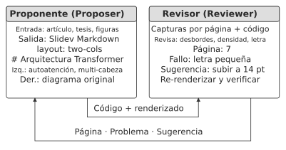

- **El proponente (Proposer)** lee el artículo, planifica la estructura de la exposición, escribe el código fuente de Slidev y modifica las páginas según la retroalimentación.
- **El revisor (Reviewer)** renderiza las páginas con una herramienta, utiliza un modelo de visión para comprobar la densidad de contenido, la legibilidad, la maquetación y la correspondencia entre imágenes y texto, y devuelve una retroalimentación estructurada con el número de página, el tipo de problema, la gravedad y la propuesta de cambio.

La retroalimentación debe poder guiar directamente la modificación. Por ejemplo: «La página 3 tiene demasiados puntos; divídela en dos páginas: visión general del método y pasos de cálculo»; «el código de la página 7 tiene un tamaño de letra demasiado pequeño; súbelo primero a 14 pt y comprueba luego la legibilidad al proyectarlo». Los errores factuales y las malas interpretaciones de gráficos se corrigen primero; después se tratan la maquetación y los detalles visuales.

Una modificación local también debe indicar qué objeto se modifica. Doubao Work (豆包工作), dentro de las presentaciones de Feishu, permite al usuario seleccionar un elemento de la página y formular su petición de edición desde una barra de herramientas flotante.[^ch5-doubao-work] Supongamos que una misma página tiene dos cuadros de texto: uno con una cita literal de una entrevista y otro con el resumen escrito por el ponente. El usuario selecciona el resumen y pide «reducirlo a dos líneas». El cuadro seleccionado delimita el alcance del cambio: el resumen puede reescribirse, pero la cita contigua debe conservar las palabras originales del entrevistado.

[^ch5-doubao-work]: Centro de ayuda de Feishu, uso de Doubao Work (豆包工作) en las presentaciones.

Tras la modificación del proponente se vuelve a renderizar, y el revisor examina la nueva versión y confirma si se han resuelto los problemas de la ronda anterior. El bucle tiene dos tipos de condición de salida: cumplir unos requisitos explícitos de contenido y formato, o agotar el presupuesto de rondas, tiempo y coste, por ejemplo un máximo de 5 rondas de modificación. En la entrega se guardan la versión actual y los problemas aún pendientes, para facilitar revisiones posteriores.

Este mecanismo comparte con la aprobación de operaciones del capítulo 4 el patrón de proponente y revisor. La aprobación de operaciones juzga sobre todo si una acción concreta puede ejecutarse; la revisión de contenido mejora el producto mediante varias rondas de retroalimentación. Ambas necesitan compartir los requisitos de la tarea, dar fundamentos localizables para cada juicio y dejar que el Harness decida el flujo posterior. Usar familias de modelos distintas puede aportar otra perspectiva de revisión.

**El autor valora la ventaja que aporta el reparto entre dos Agentes a la gestión del contexto.** Cada rol puede conservar la información que necesita: en cada ronda, el revisor recibe la captura más reciente, los criterios de revisión y la lista de problemas imprescindible; el proponente conserva el código fuente, los objetivos de modificación y la retroalimentación textual estructurada. Las imágenes de las páginas se quedan en el contexto del revisor, y la trayectoria principal avanza en las modificaciones gracias a retroalimentaciones textuales breves. Como cada ronda de revisión gira en torno a la página más reciente, se reduce la interferencia de las capturas antiguas y se controla el crecimiento del contexto.

> **Experimento 5-6 ★★: Generación automática de presentaciones a partir de un artículo**
>
> Este experimento usa el PDF del artículo «Attention Is All You Need» para generar 20 diapositivas en Slidev. El Agente extrae la estructura y los puntos clave del artículo, utiliza tres figuras originales del artículo con su procedencia registrada y organiza la explicación página a página. Tras renderizar, se comprueban los desbordamientos de texto, la legibilidad de los gráficos y la correspondencia entre imágenes y texto, y se modifica según la retroalimentación.
>
> Se compara la autorrevisión de un solo Agente con el reparto entre proponente y revisor. En esta ejecución, ambas versiones finales obtuvieron 95 puntos en el mismo proceso de evaluación independiente; la entrada máxima del esquema con reparto fue de unos 24 000 tokens, frente a unos 93 000 en el esquema de un solo Agente que conservaba las capturas anteriores.

> **Experimento 5-7 ★★: Generación automática de videos explicativos de artículos**
>
> A partir de las diapositivas, el Agente puede escribir para cada página una explicación en tono oral que describa los objetos, las relaciones y las conclusiones de la figura, y después llamar a un servicio TTS para sintetizar la voz. El guion se entrega junto con la página a un revisor visual, que comprueba si los elementos mencionados aparecen en pantalla y si la descripción concuerda con el gráfico.
>
> Para producir el video, el experimento reutiliza el flujo de generación de la sección anterior y elige una versión más temprana de 22 páginas (v2). Tras extraer 12 páginas en orden, la última imagen del video procede de la página 21 del original. La comparación de puntuaciones y consumo de la sección anterior utilizó la versión posterior de 20 páginas (v9). Una vez elegidas las páginas, Kimi genera el guion, un modelo de visión de Qwen revisa la relación entre imagen y texto y Fish Audio sintetiza la voz página a página. FFmpeg ajusta el tiempo de exposición de cada página a la duración real de su audio y monta un video explicativo de unos 8,6 minutos.
>
> En la figura 5-6, las diapositivas, el guion y la voz solo se combinan en un video al final. Algunos problemas solo se perciben al escucharlo en este paso: si al pasar de página una frase queda sin terminar, o si el audio y la imagen se van desfasando cada vez más.
>
> 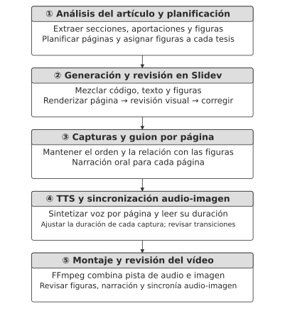

[^ch5-slidev]: Slidev, *Getting Started*; describe cómo generar, mostrar y exportar presentaciones con Markdown y tecnologías web.

**Agente de edición de video.**

**Las operaciones de edición de video que puedan expresarse con un script deben pasar preferentemente por interfaces programáticas.** La línea de tiempo, las capas, los subtítulos y las pistas de audio se reparten por complejos paneles de la GUI, y localizarlos y arrastrarlos una y otra vez aumenta la latencia y los errores; una interfaz programática puede expresar las operaciones directamente con intervalos de tiempo, pistas y parámetros de efectos. La interfaz de Python de Blender y FFmpeg permiten organizar parte de las tareas de edición como scripts que pueden ejecutarse repetidamente.

El Agente puede entender primero una petición como «recorta la parte del surf», localizar después el intervalo objetivo en el material y generar el código para recortar, ordenar y procesar las pistas de audio. El proponente se encarga del plan de edición y del script, y el revisor comprueba el resultado renderizado; si encuentra omisiones, fragmentos irrelevantes o subtítulos que tapan la imagen, indica el instante concreto y el problema para que el proponente lo corrija. Los fotogramas clave sirven para comprobar la escena y la composición, pero la continuidad del movimiento y la sincronización entre audio e imagen exigen revisar fotogramas contiguos o fragmentos continuos.

> **Experimento 5-8 ★★: Edición inteligente de video basada en API**
>
> Este experimento encadena en un solo flujo la localización del objetivo, la generación del script y la revisión del resultado. Primero se entregan la referencia al video, la pregunta objetivo y el intervalo de extracción de fotogramas a un subagente de análisis de video, que procesa la gran cantidad de imágenes y devuelve al Agente principal los intervalos de tiempo y sus fundamentos.
>
> La localización se hace en dos pasos. El primero extrae un fotograma cada 10 segundos para encontrar el rango aproximado del objetivo, por ejemplo «el surf está entre los segundos 40 y 110»; el segundo extrae un fotograma por segundo en torno al intervalo candidato y sus bordes cercanos, para fijar con más precisión el principio y el final. Las escenas más cortas que el intervalo de muestreo grueso pueden caer entre dos fotogramas; en ese caso se puede aumentar el muestreo según la duración del objetivo o revisar las imágenes que hay entre dos extracciones.
>
> Fijado el intervalo, el proponente genera un script de Python para Blender que realiza el recorte y las operaciones necesarias de subtítulos, cambio de velocidad, etc. El revisor examina la vista previa y señala los bordes y efectos que deben ajustarse; una vez aprobada la modificación, se exporta la pieza completa.
>
> El material que se editó en la práctica era una toma de un gran conejo blanco que cruzaba solo un prado. Viendo un fotograma cada 10 segundos, el modelo situó el rango entre los segundos 10 y 20. Si se cortara directamente en el segundo 10, se perdería un trozo del principio de la toma. Por eso, el programa amplió el margen 5 segundos por cada lado y, viendo un fotograma por segundo entre los segundos 5 y 25, redujo el intervalo candidato a los segundos 9 a 12. El revisor detectó además que el fragmento incluía imágenes contiguas, y el intervalo revisado quedó entre los segundos 9,25 y 11,00. Frente a la anotación manual, de 9,08 a 11,20 segundos, el inicio llegaba 0,17 segundos tarde y el final 0,20 segundos antes, de modo que ambos extremos cumplían el requisito de un error no superior a 3 segundos.
>
> Los códigos de tiempo solo permiten comprobar dónde se cortó. Si se aplican los mismos subtítulos y la misma cámara lenta a un fragmento elegido deliberadamente mal, ¿sabrá el revisor reconocer el error? El experimento le hizo revisar primero un fragmento de control de los segundos 0 a 3 y después el renderizado revisado. Los aspectos revisados incluían el conejo blanco en la imagen, los subtítulos inferiores y la duración tras el cambio de velocidad.

**3D y piezas industriales: elegir el método de generación adecuado.**

**Para las piezas industriales en las que las dimensiones y las relaciones de ensamblaje son restricciones rígidas, conviene la generación mediante código paramétrico; para los objetos en los que importan sobre todo la forma natural y la apariencia, conviene recurrir primero a modelos generativos.** La elección depende de si el producto puede describirse con precisión mediante unos pocos parámetros y de qué relaciones deben mantenerse tras cada modificación. CadQuery, OpenSCAD y los scripts de Blender ofrecen un proceso de construcción editable, mientras que modelos como Hunyuan 3D aprovechan los conocimientos previos de forma que han aprendido para generar apariencias complejas.

**Si la descripción se presta a la parametrización.** Una brida simplificada puede expresar sus relaciones geométricas principales con el diámetro exterior, el espesor, el diámetro del círculo de taladros, el diámetro de los agujeros y el número de agujeros. El código hace corresponder los parámetros con los pasos de construcción y es adecuado para ajustes repetidos. Una planta en maceta, una piedra de Taihu o un rostro humano, en cambio, contienen una gran cantidad de formas irregulares; los modelos generativos pueden ayudar a construir la apariencia, y los métodos procedimentales también pueden generar detalles mediante reglas de crecimiento, procesos aleatorios y combinaciones de recursos.

**Cómo comprobar la precisión.** Para un requisito como un diámetro de agujero de 5 mm con una tolerancia de ±0,05 mm, primero hay que fijar las unidades, el sistema de coordenadas y el método de medida, y después comparar las dimensiones del modelo con la especificación. En un modelo paramétrico se pueden comprobar directamente los objetos geométricos; una malla puede medirse mediante secciones, detección de agujeros, dimensiones de la caja envolvente, etc., teniendo en cuenta el error de discretización.

**Cómo guardar y modificar.** La B-rep (representación de fronteras) describe el contorno de un sólido mediante caras, aristas y vértices, mientras que una malla triangular aproxima la superficie con facetas. CadQuery puede exportar a STEP para el intercambio de datos CAD y también a mallas STL; los parámetros editables y la lógica de construcción se guardan en el código fuente de CadQuery[^ch5-cad]. Para entrar en un proceso de mecanizado CNC hacen falta además la planificación del proceso, las trayectorias de herramienta y la adaptación a la máquina.

Por ejemplo, para cambiar los agujeros de montaje de M5 a M6, se puede modificar el parámetro del diámetro, regenerar la pieza y comprobar de nuevo que el diámetro exterior, el espesor y la posición de los agujeros se mantienen. En un modelo generativo, la forma de modificar depende de lo que permita la interfaz: se puede regenerar o combinar la edición local con un procesamiento geométrico posterior.

Al combinar ambas vías, también hay que repartir claramente el trabajo: las dimensiones y las relaciones de ensamblaje se encargan al código paramétrico, y las texturas y la apariencia libre, al modelo generativo. **Cuando las dimensiones clave deben modificarse con precisión una y otra vez, un proceso de construcción editable vale más que una apariencia generada de una sola vez.**

> **Experimento 5-9 ★★: Dos vías de generación para una misma pieza: código frente a modelo generativo**
>
> Este experimento pide generar una brida de 80 mm de diámetro exterior y 10 mm de espesor, con cuatro agujeros de montaje distribuidos uniformemente sobre un círculo de 60 mm de diámetro. Para precisar el sentido del ensamblaje, la especificación inicial usa agujeros pasantes de 5,5 mm para M5, y la petición de modificación los cambia a agujeros pasantes de 6,5 mm para M6.
>
> En la vía de código, el modelo genera un programa de CadQuery que, al ejecutarse, exporta STEP y STL; en la vía del modelo generativo, primero se genera una imagen de referencia del producto y luego Hunyuan 3D genera la malla. Se comprueban el diámetro exterior, el espesor, el número de agujeros, su diámetro, su posición y la cara de montaje, y se registran las unidades y la orientación de los ejes.
>
> ¿Cómo se ve que el modelo solo cambió la dimensión indicada? Comparando los STL exportados antes y después de la modificación, el diámetro medio de los cuatro agujeros de montaje pasó de 5,499 mm a 6,499 mm; ambas piezas tenían 80 mm de diámetro exterior y 10 mm de espesor, y el diámetro del círculo de taladros era de 60,000 mm con tres decimales. La malla original de la vía del modelo generativo carecía de una escala física explícita. El programa de medida tomó la sección media a lo largo del eje Z y no encontró el anillo interior de los agujeros. Para averiguar si los cuatro agujeros atravesaban el disco habría que identificar primero la cara de montaje y tomar secciones a distintas profundidades a lo largo de su normal. Tras la regeneración, cambiaron tanto la forma general como la orientación.
>
> Por último, se cambia de problema: si hay que entregar una imagen de una planta en maceta que parezca natural, ¿cómo se acepta? El experimento dibujó una con matplotlib y generó otra con Gemini, y pidió al mismo modelo de visión que puntuara su naturalidad sobre diez. Las dos imágenes obtuvieron 3 y 8 puntos, respectivamente. Esa puntuación responde a cuál de las dos imágenes le parece al modelo evaluador más parecida a una planta real. Volviendo a la brida, aunque la imagen del producto parezca tener cuatro agujeros, para el ensamblaje hay que comprobar la posición y el diámetro de los agujeros en la pieza tridimensional.

[^ch5-cad]: CadQuery, *Importing and Exporting Files*; describe formatos como STEP y STL, y explica que la información paramétrica completa se guarda en el código fuente Python de CadQuery.

### El código como adaptador de sistemas

Los servicios externos difieren en sus interfaces, en sus métodos de autenticación y en sus formatos de datos. El Agente puede leer la documentación y muestras de respuestas, generar un cliente HTTP, configurar las cabeceras de autenticación, analizar los valores devueltos y transformar los campos del servicio de origen en la estructura que necesita el destino. Aquí el código desempeña la función de adaptación entre sistemas y combina servicios existentes en un nuevo flujo de tareas.

Por ejemplo, si el campo de importe que se lee de un servicio de pagos está expresado en céntimos y el informe lo muestra en yuanes, que el JSON se analice correctamente solo demuestra que los formatos son compatibles. Una transacción de 25 yuanes es, en el origen, el entero 2500. Si ese número se pone directamente en el informe, los 25 yuanes se convierten en 2500.

Un adaptador debe definir con claridad sus entradas y salidas, el tratamiento de errores y el rango de versiones. Las muestras ayudan al modelo a entender los campos, y el contrato de la interfaz y las pruebas comprueban los valores ausentes, la paginación, las respuestas anómalas y los cambios de versión. Las credenciales las gestiona el entorno de ejecución, y el código generado utiliza las capacidades autorizadas a través de interfaces controladas. Una vez verificado, el adaptador puede guardarse y reutilizarse; si más adelante cambia el formato, vuelve a entrar en el flujo de modificación.

Los sistemas que solo tienen interfaz gráfica pueden tratarse de forma parecida. El Agente completa primero la tarea mediante el Computer Use que presenta el capítulo 6 y después consolida los pasos estables en una herramienta RPA. Cuando cambian los controles de la interfaz, el estado de inicio de sesión o el flujo de páginas, la herramienta debe detectar la desviación y volver a localizar los elementos. El capítulo 9 tratará con más detalle cómo extraer, verificar y reutilizar flujos de trabajo a partir de trayectorias exitosas.

**Análisis y visualización de los registros de un Agente.**

Una tarea compleja puede incluir muchas peticiones al modelo, ejecuciones de herramientas e interacciones con subagentes. La vista general del registro muestra las relaciones entre pasos, su estado y su duración; al desplegarla se ven las entradas y salidas concretas, lo que ayuda al lector a seguir qué ocurrió en cada paso. Los campos nuevos, las estructuras anidadas y las versiones de formato afectan al análisis y a la presentación.

El análisis adaptativo trata estos cambios mediante un ciclo de «detectar el cambio, generar el analizador y verificar el resultado». Cuando el análisis falla, el sistema guarda la muestra original, la posición del error y los campos esperados, y compara con el contrato de la interfaz y la versión del productor para juzgar si el cambio era previsto. Solo cuando se confirma que se trata de una actualización de formato se pide al Agente que escriba un nuevo analizador. Si el que falla es el programa que escribe los registros, se guarda el registro original y se informa del fallo, para que el nuevo analizador no tome el error por un formato normal. El código recién escrito se ejecuta primero en un entorno restringido, se comprueban los campos y su significado, y luego se valida con muestras normales, muestras con campos ausentes y casos de regresión del formato antiguo. Si lo supera, se registra el nuevo analizador y se guardan su versión y los formatos a los que se aplica; las muestras fallidas se conservan para poder rastrearlas y reintentarlas.

El análisis y la presentación tienen cada uno su forma de comprobación. Un programa verifica las marcas de tiempo, los estados, los tipos numéricos y la correlación de llamadas; el renderizado en el navegador comprueba que la página funciona, y un modelo de visión ayuda a comprobar que las tablas, las líneas de tiempo y las etiquetas sean claras. En las actualizaciones en caliente se conserva la versión anterior y un punto de reversión, para que el soporte de formatos nuevos pueda incorporarse gradualmente al sistema en funcionamiento.

> **Experimento 5-10 ★★★: Sistema adaptativo de análisis de registros**
>
> Este experimento ejecuta primero dos procesos generadores de registros, que emiten respectivamente un formato separado por barras verticales y un formato con corchetes anidados. El analizador inicial no puede tratar estas muestras; a continuación, el sistema pide al modelo que genere dos funciones de análisis, las carga en caliente tras superar las pruebas y vuelve a analizar los registros que antes fallaban.
>
> El primer formato extrae `timestamp`, `level`, `module`, `step` y `message`; el segundo incluye además el nombre de la herramienta, la duración y el estado. En el registro de ejecución, se analizaron tres entradas de cada tipo, y un motor recién creado también pudo cargar los analizadores guardados y seguir procesando un flujo de registros mixto.
>
> Chromium renderiza los resultados del análisis como una tabla, y la revisión visual comprueba los nombres de las columnas, el contenido de las filas y la legibilidad.

**Análisis automático de los registros de ejecución de un Agente y diagnóstico de problemas.**

Una vez obtenidas las trayectorias estructuradas, el Agente puede combinarlas con la documentación de arquitectura y el PRD (documento de requisitos del producto) para comparar el flujo esperado con las acciones reales. Por ejemplo, ¿se comprobó antes del reembolso si ese pedido podía reembolsarse? Cuando el servicio de inventario agotó el tiempo de espera, ¿pasó el programa a consultar la caché como estaba acordado?

El informe de problemas puede incluir la prioridad, el módulo, el síntoma, la evidencia y las propuestas de mejora. A partir de él, el Agente puede generar también pruebas de regresión que fijen la entrada y los criterios de aceptación correspondientes al problema. El marco de pruebas reproduce las peticiones en un entorno controlado o lee las respuestas guardadas de las herramientas, y compara el comportamiento de la versión defectuosa con el de la versión corregida. Las operaciones que escriben en sistemas externos usan un entorno aislado o interfaces sustitutas, para mantener controlado el alcance de la reproducción.

Las aserciones deben corresponder a las propiedades que hay que verificar. Por ejemplo, que en el registro aparezca la comprobación de reembolso solo demuestra que el programa hizo la consulta. Para saber si el reembolso fue correcto, hay que ver además si el programa consultó antes de reembolsar, si el resultado de la comprobación permitía el reembolso y en qué estado quedó finalmente el pedido.

Una vez revisado el diagnóstico, y con la autorización correspondiente, el Agente puede crear un GitHub Issue mediante MCP y sugerir un responsable según el módulo. Si ya existe un elemento de trabajo para el mismo defecto, se le añaden las nuevas pruebas.

> **Experimento 5-11 ★★★: Sistema de diagnóstico inteligente de registros de producción**
>
> Este experimento usa un servicio HTTP local para producir dos trayectorias de negocio: en una, el registro muestra que el sistema hizo un reembolso sin comprobar si el pedido podía reembolsarse; en la otra, que tras agotarse el tiempo de espera de la consulta de inventario no pasó a obtener los datos de la caché. El modelo combina la documentación de arquitectura y la descripción de requisitos para generar un informe de problemas con referencias a las trayectorias y las rondas, y después genera tres pruebas de regresión ejecutables.
>
> La figura 5-7 sitúa un informe de diagnóstico entre la trayectoria y las pruebas de regresión. El informe señala que «el sistema se saltó la comprobación e hizo el reembolso directamente». Se vuelve a la trayectoria en busca de la evidencia: ¿qué paso falta en el registro de llamadas? Y se pasa después a las pruebas: si en el futuro vuelve a omitirse ese paso, ¿lo detectarán?
>
> 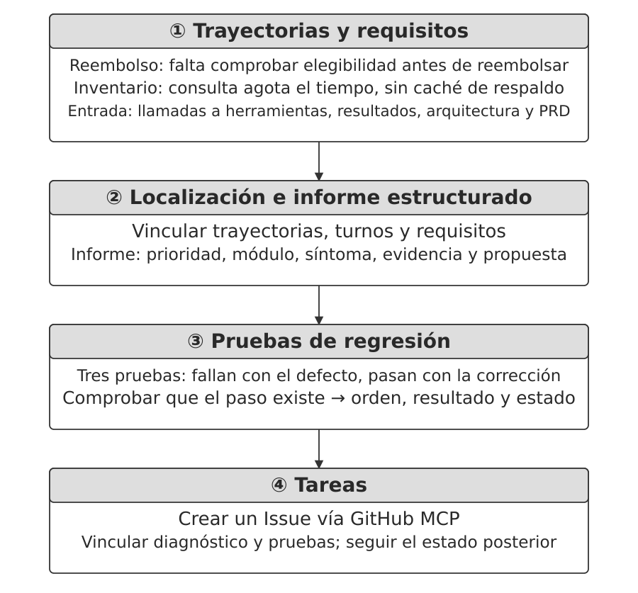
>
> Las tres pruebas fallaron en la versión defectuosa y todas pasaron con la versión corregida. Una de ellas solo comprueba si el programa llamó alguna vez a la herramienta de comprobación de reembolsos. Aunque el programa devolviera primero el dinero y solo después comprobara si el pedido era reembolsable, esa prueba también pasaría. En el registro de ejecución se guardó además el acuse de recibo de la creación del elemento de trabajo mediante GitHub MCP, con el que se puede localizar el issue correspondiente una vez entregado el informe de diagnóstico a los desarrolladores.
>

### El código como UI generativa

Si el usuario también quiere modificar personalmente el material que el Agente está procesando, la interfaz puede diseñarse como una mesa de trabajo compartida. En un itinerario, por ejemplo, el usuario ve en qué etapa está trabajando el asistente, puede tomar el control de una modificación y confirmar o deshacer un cambio concreto. Si el usuario acaba de cambiar la fecha de salida al viernes, el asistente debe seguir trabajando sobre ese nuevo itinerario. Solo si ambas partes comparten el mismo estado visible y acuerdan quién controla en cada momento el campo que se está editando es posible ir viendo y modificando a la vez.

Imagina que el usuario quiere comparar tres opciones de viaje. Mientras el destino no está decidido, la conversación facilita las preguntas de seguimiento; una vez decidido, es más cómodo que el usuario elija directamente las fechas e indique el número de personas que ir y venir comprobando varios párrafos de texto; y para comparar al final cómo varía el precio total según las fechas, un gráfico pone las diferencias a la vista. Que el Agente genere, según la tarea, los formularios, gráficos o interfaces de aplicación correspondientes para que el usuario rellene, elija y opere directamente es lo que se llama UI generativa (Generative UI).

**Describir la interfaz y la interacción mediante un protocolo.**

Hay dos vías para generar una interfaz: emitir código HTML, JavaScript, etc., y ejecutarlo en un entorno controlado; o emitir una estructura declarativa que los componentes del cliente renderizan. La primera facilita maquetaciones e interacciones a medida; la segunda limita las capacidades disponibles a los componentes y acciones que ofrece el cliente.

A2UI (Agent-to-User Interface) usa una descripción declarativa. El Agente genera mensajes estructurados que expresan componentes, enlaces de datos y actualizaciones, y el cliente presenta la interfaz con sus propios componentes[^ch5-ui-protocols]. Por ejemplo, una aplicación puede ofrecer componentes de tarjeta, botón, cuadro de texto y tabla, y el Agente, a partir de ellos, describe una tabla titulada «Datos de ventas» con tres filas y dos columnas. El catálogo de componentes puede ampliarse además con capacidades como gráficos y mapas.

AG-UI (Agent–User Interaction) se encarga de la interacción por eventos entre el Agente y el frontend: transmite mensajes, llamadas a herramientas y actualizaciones de estado, y también puede transportar los mensajes de interfaz de A2UI. Combinados, A2UI describe lo que se va a mostrar y AG-UI conecta la ejecución en el backend con la interacción en el frontend.

El cliente puede recibir las actualizaciones de la interfaz de forma progresiva y mostrarlas en web, móvil o escritorio mediante un renderizador adaptado. El cliente valida las propiedades de los componentes, los enlaces de datos y las peticiones de acción, y el servidor sigue comprobando los permisos de negocio; los enlaces, el texto enriquecido y el acceso a datos dentro de los componentes necesitan también sus propias reglas de tratamiento.

Cuando se genera código directamente, en cambio, hay que comprobar las dependencias, el acceso a recursos y los permisos de ejecución, y aislar la interfaz generada del estado sensible de la aplicación anfitriona. Una inyección de prompts en material externo puede influir en el proceso de generación, y el riesgo de ejecución de scripts en el navegador depende también de cómo se cargue y se aísle la página.

**Entregar resultados interactivos en HTML.**

**Para las entregas de investigación que incluyen datos, demostraciones y resultados que se actualizan continuamente, el autor prefiere un sitio web en HTML.** Un informe largo y lineal en Markdown obliga al lector a buscar el contexto una y otra vez; una página web interactiva puede reunir en un solo punto de entrada las explicaciones, los datos y las demostraciones: el lector consulta los gráficos, filtra las muestras que le interesan, despliega el detalle de un resultado y manipula una demostración para entender el comportamiento del sistema. El Agente también puede actualizar la página a medida que avanza la tarea, de modo que registre en todo momento los resultados y las pruebas actuales.

En la práctica investigadora del autor, por ejemplo, cada proyecto de investigación tiene un sitio web interactivo que sirve a la vez de documento vivo durante la investigación y de entregable final, y el Agente va añadiendo contenido a medida que avanzan los experimentos. Estos sitios cumplen sobre todo tres funciones.

La primera es la **trazabilidad de los datos experimentales**. Las páginas relacionan las muestras, los prompts, las respuestas del modelo y las puntuaciones, y permiten revisarlas una por una. Por ejemplo, si un tipo de respuesta obtiene siempre puntuaciones bajas, se puede seguir el registro de puntuaciones hasta la respuesta original y su prompt.

La segunda es la **monitorización de las métricas de entrenamiento**. El autor llama «indicadores clínicos» a las señales que reflejan el estado interno del entrenamiento: la pérdida de entrenamiento y de validación, la norma del gradiente, la tasa de aprendizaje y, en el aprendizaje por refuerzo, la recompensa, la divergencia KL y la entropía de la política. En los modelos de lenguaje, la perplejidad mide además cómo predice el modelo una secuencia de texto dada. Como los indicadores fisiológicos de un chequeo médico, estas curvas pueden revelar a veces un problema antes que el rendimiento final en la tarea. Verlas junto con la precisión en la tarea ayuda a localizar en qué fase aparecen la falta de convergencia, las anomalías del gradiente y la degradación del entrenamiento.

La tercera es la **demostración del funcionamiento**. Al explicar cómo colaboran varios módulos, la página puede dejar que el lector cambie una entrada, observe los estados intermedios y compare los cambios de la salida con los registros experimentales.

Si el trabajo dura varias horas, ¿cómo puede el usuario retomarlo en un rato libre? Cuando el autor usa un Coding Agent, quiere que una instrucción hablada llegue con precisión al Agente que se ocupa del asunto, poder abrir los resultados en cualquier momento y recibir un aviso cuando haya una versión nueva o surja una cuestión que deba decidir él. Por ejemplo, se están generando dos informes a la vez. El usuario abre el informe de ventas, señala el segundo gráfico y dice: «Vuelve a dibujar este con los ingresos netos». La interfaz debe enviar junto con la instrucción los identificadores del informe y del gráfico actuales. Cuando el gráfico esté listo, la notificación puede abrir directamente la nueva versión; si hay dos criterios posibles para calcular los «ingresos netos», el asistente debe presentar al usuario ambos para que elija.

**Aclarar la intención del usuario.**

Cuando el usuario dice «quiero reservar un billete de avión a Pekín», el destino ya está claro, pero faltan la ciudad de salida, la fecha y si el viaje es de ida o de ida y vuelta. El Agente puede hacer todas las preguntas en una misma ronda de conversación, o generar un formulario que presente las condiciones relacionadas en una sola página.

Los controles de un formulario corresponden a distintos tipos de información: los cuadros de texto recogen entradas abiertas, los menús desplegables y los botones de opción enumeran las alternativas, las casillas de verificación permiten la selección múltiple y los selectores de fecha ayudan a indicar fechas. JavaScript puede expresar relaciones en cascada; por ejemplo, al elegir «ida y vuelta» se muestra la fecha de regreso y se comprueba que no sea anterior a la de salida. Cuando cambia una selección, también hay que limpiar o ignorar a la vez los campos que han dejado de ser válidos.

La figura 5-8 procede de una ejecución del experimento siguiente. Sigamos este envío: entre los cuatro campos que devuelve el navegador no figura el destino; ¿de dónde sabe el modelo que el viajero va a Pekín?

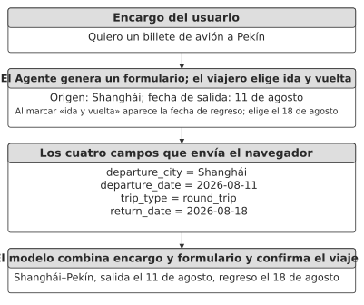

> **Experimento 5-12 ★★: Sistema de aclaración de intenciones mediante formularios dinámicos**
>
> Este experimento parte de «quiero reservar un billete de avión a Pekín» y pide al modelo que genere un formulario HTML: un cuadro de texto para la ciudad de salida, un selector de fecha para la fecha de salida, opciones de ida o de ida y vuelta para el tipo de viaje y una fecha de regreso que se muestra al elegir ida y vuelta.
>
> El programa devuelve al modelo el encargo inicial junto con los datos del formulario. Si solo se conservaran los campos enviados, faltaría el destino aunque todos los controles estuvieran bien rellenados.
>
> Con el mismo formulario se prueba un paso más: tras rellenar la fecha de regreso, se cambia a solo ida. La página oculta el cuadro de la fecha de regreso, pero el JSON enviado conserva a la vez la opción de solo ida y una fecha de regreso del 18 de agosto. Al cambiar a solo ida, el cliente debe borrar además la fecha de regreso que ha dejado de ser válida.

[^ch5-ui-protocols]: Documentación oficial de A2UI y *AG-UI Overview*; presentan, respectivamente, la descripción declarativa de interfaces y la interacción por eventos entre el Agente y el frontend.

**Generar consultas SQL.**

El usuario puede formular consultas a la base de datos en lenguaje natural, y el Agente genera el SQL a partir de la estructura de las tablas y de los criterios de negocio. **Para mostrar tablas de consulta completas, el autor prefiere el modo Artifact, en el que los resultados pasan directamente de la base de datos a la interfaz.** Hacer que el modelo lea una tabla grande y la repita fila a fila aumenta el consumo de tokens y el tiempo de espera, y además introduce errores de copia. El SQL se guarda como un producto de consulta que puede inspeccionarse; cuando hay que analizar causas o resumir tendencias, se entregan al modelo solo los resultados agregados necesarios.

En la figura 5-9, el usuario quiere ver el número de empleados en activo de cada departamento, y la página puede mostrar directamente la tabla de recuento que devuelve la base de datos. Si el usuario pregunta a continuación «¿cuántas personas más tiene Marketing que I+D?», al modelo le basta con tomar el 9 y el 5 de la tabla para calcular que la diferencia es de 4. Si sigue preguntando «¿y el mes pasado la diferencia era la misma?», la tabla que tiene delante ya no basta: hay que volver a consultar con la fecha de recuento del mes pasado.

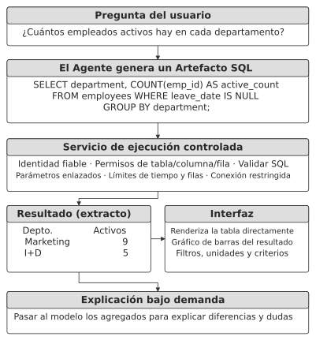

El servicio de ejecución determina, a partir de la identidad de confianza, a qué tablas, columnas y filas se puede acceder, usa una cuenta de base de datos restringida y valida la estructura del SQL y el tipo de operación. En los escenarios de consulta se puede restringir el uso a consultas de solo lectura aprobadas, y controlar las llamadas a funciones, el presupuesto de tiempo, el número de filas devueltas y el alcance de los datos; los valores que introduce el usuario se pasan mediante enlace parametrizado.

El Agente puede generar también productos visuales, por ejemplo mostrar como un gráfico de barras el resumen por departamentos. El servicio de ejecución entrega los resultados de la consulta a un entorno de visualización controlado, y la interfaz solo muestra los datos y las interacciones permitidos.

> **Experimento 5-13 ★★: Agente ERP con interacción en lenguaje natural**
>
> Este experimento toma como ejemplo las consultas de empleados y salarios de un ERP (planificación de recursos empresariales) para aprender a generar SQL a partir de preguntas de negocio y a llevar los resultados de la base de datos directamente a la página. En PostgreSQL se crean dos tablas: la de empleados contiene el ID de empleado, el nombre, el departamento, el nivel, la fecha de incorporación y la fecha de baja, donde una fecha de baja vacía indica que el empleado sigue en activo; la de salarios contiene el ID de empleado, la fecha de pago y el salario, con un registro por empleado y mes.
>
> A partir de estas dos tablas, el Agente responde a las diez preguntas siguientes:
>
> 1. ¿Cuánto tiempo permanece de media cada empleado en la empresa?
> 2. ¿Cuántos empleados en activo tiene cada departamento?
> 3. ¿Qué departamento tiene el nivel medio de empleados más alto?
> 4. ¿Cuántas personas se incorporaron a cada departamento este año y el año pasado?
> 5. ¿Cuál fue el salario medio del departamento A entre marzo de hace dos años y mayo del año pasado?
> 6. El año pasado, ¿qué departamento tuvo un salario medio más alto, el A o el B?
> 7. ¿Cuál es este año el salario medio de los empleados de cada nivel?
> 8. ¿Cuál fue el salario medio del último mes de los empleados con menos de un año, de uno a dos años y de dos a tres años de antigüedad?
> 9. ¿Qué 10 empleados tuvieron la mayor subida salarial del año pasado a este año?
> 10. ¿Hay salarios impagados (un mes en que el empleado estaba en activo pero no cobró)?
>
> Antes de consultar hay que fijar los criterios de cálculo. Por ejemplo, la antigüedad de los empleados en activo se calcula hasta la fecha de referencia de la consulta, y la de los que han causado baja, hasta su fecha de baja; para el «salario medio» hay que decidir si se promedia por registros de pago o por empleado; y la clasificación de subidas salariales debe tratar a los empleados sin registros del año pasado.
>
> En esta ejecución se generaron y ejecutaron diez sentencias SQL, cuyos resultados coincidieron todos con un cálculo de referencia independiente, y después el navegador renderizó directamente las tablas. El modelo recibió la estructura de las tablas, la tarea y la retroalimentación de ejecución necesaria, mientras que las filas de la base de datos llegaron a la interfaz a través de la aplicación.

**Generación dinámica de software.**

El Agente puede generar la interfaz y la lógica de interacción a partir de los requisitos y seguir modificándolas según lo que haga el usuario. «Imagine with Claude», la vista previa de investigación temporal que Anthropic lanzó en 2025, mostró este tipo de interacción: el usuario explora la interfaz y el modelo genera continuamente la experiencia de software correspondiente[^ch5-imagine].

**Para productos reales, el autor confía más en la personalización sobre un marco existente.** Generar continuamente toda una aplicación desde cero obliga a pagar una y otra vez el coste de generar, renderizar y verificar; conservar un marco estable y abrir a la personalización la interfaz y los flujos que le importan al usuario permite ofrecer antes una experiencia personalizada y fiable. Cuando el usuario pide «pon el botón en azul», «añade un menú de accesos rápidos en la barra lateral» o «cambia a una fuente más legible», el Agente localiza los componentes correspondientes, modifica el código y comprueba el resultado en una vista previa. El marco base ofrece una estructura de páginas y unas interfaces de negocio estables, y el alcance de la personalización puede ampliarse poco a poco de los colores y las fuentes a la maquetación y los componentes.

El HMR (Hot Module Replacement, sustitución de módulos en caliente) del entorno de desarrollo puede actualizar los módulos de frontend afectados cuando cambia el código. Que se conserve o no el estado depende de la integración con el framework, de los límites de la actualización y del tipo de modificación; cuando hace falta una recarga completa, la aplicación debe guardar además el estado necesario. El reload del modo de desarrollo de FastAPI, por su parte, vuelve a cargar el programa del servidor: uno actúa sobre los módulos de frontend y el otro sobre el proceso de backend[^ch5-hmr].

> **Experimento 5-14 ★★: Sistema de personalización de la interfaz mediante conversación**
>
> Este experimento construye una aplicación de chat formada por un frontend en React y un backend en FastAPI, con HMR en el frontend y reload en el backend activados en el entorno de desarrollo. El modelo modifica colores, fuentes y títulos según tres peticiones consecutivas, y el navegador comprueba la interfaz real tras cada modificación.
>
> En esta ejecución se registraron los eventos de HMR de Vite; en ninguna de las tres modificaciones se produjo una navegación de página completa, el estado del chat existente se conservó y la compilación final fue correcta.

[^ch5-imagine]: Anthropic, *Introducing Claude Sonnet 4.5*; presenta Imagine with Claude, la vista previa de investigación temporal publicada junto con el modelo.
[^ch5-hmr]: *Vite HMR API* y *FastAPI CLI*; describen, respectivamente, la actualización en caliente del frontend y la recarga automática del servidor de desarrollo.

**Independizar los límites de permisos del código de negocio dinámico.**

**Cuanto más fácil sea que el Agente reescriba dinámicamente el código de negocio, más abajo, en una capa estable de acceso a datos, debe situarse el límite final de permisos.** Las aplicaciones tradicionales escriben las comprobaciones de permisos en código de negocio revisado; cuando el código generado cambia sin cesar, alguna ruta nueva puede omitir esa misma comprobación. Solo haciendo que cada lectura y escritura pase por un servicio de acceso a datos independiente se conservan las restricciones de permisos. Por ejemplo, una aplicación de selección de personal puede generar dinámicamente listas de candidatos y formularios de operación, mientras que a qué organización pertenece cada candidato y qué campos puede actualizar cada reclutador lo comprueba de forma continua un servicio de acceso a datos de confianza.

El objetivo de diseño es este: **aunque el código generado contenga errores, la capa de acceso a datos de confianza sigue imponiendo las restricciones de permisos.** Esto prolonga la barrera de la capa de datos del capítulo 1: colocar las reglas de obligado cumplimiento en un punto por el que deban pasar todas las operaciones afectadas. Las políticas de seguridad a nivel de fila de la base de datos pueden limitar el acceso a los registros, las restricciones y los validadores comprueban que los estados sean válidos, y las vistas controladas, los procedimientos almacenados o los servicios de datos ofrecen las operaciones permitidas. La capa de aplicación puede comprobar de antemano y explicárselo al usuario, pero las lecturas y escrituras finales siguen controladas por el servicio de datos de confianza y por los permisos de la base de datos.

Cada operación necesita además un **contexto de acceso** (*access context*) de confianza, que incluye el usuario, el inquilino, el rol o la identidad del Agente. El servicio de autenticación y el entorno de ejecución de confianza se encargan de establecer y vincular la identidad, y el servicio de datos autoriza en función de ella. El código dinámico recibe las interfaces restringidas que necesita para completar la tarea, y la gestión de credenciales y políticas queda en manos de componentes independientes. Todas las conexiones a la base de datos, las consultas auxiliares y los procesos en segundo plano deben respetar el mismo ámbito de acceso.

Por ejemplo, la seguridad a nivel de fila de PostgreSQL debe usarse junto con la configuración de roles de la base de datos. La aplicación se conecta con un rol sujeto a las políticas, y la cuenta de la aplicación no tiene permiso para modificar las políticas de acceso[^ch5-rls]. Las reglas y el mecanismo de vinculación de identidades pasan una revisión independiente, y la interfaz de negocio puede cambiar continuamente dentro de ese ámbito.

Los permisos y la integridad de los datos cumplen funciones distintas. Una vez que el reclutador tiene permiso para modificar el registro de un candidato, la máquina de estados sigue comprobando si se permite pasar de «preseleccionado» a «entrevistado»; el validador de salarios lee el puesto asociado y comprueba que el salario esperado esté dentro de la banda del puesto; y la comprobación de referencias confirma que la relación entre el puesto y el candidato es válida.

> **Experimento 5-15 ★★★: Objetos de datos con permisos integrados para software generado dinámicamente**
>
> Este experimento ofrece un prototipo de almacén de objetos en Python sobre PostgreSQL que coloca en los tipos de datos las reglas de permisos, los validadores, las relaciones entre objetos y las declaraciones de reacciones posteriores. Al leer se comprueban los permisos de acceso; al crear y actualizar se ejecutan primero las validaciones de permisos y de negocio y se comprueban las referencias, después se persiste el objeto y, a continuación, se encolan las reacciones posteriores declaradas, con un límite en la profundidad de la cadena de reacciones.
>
> El ejemplo de selección de personal incluye objetos como puestos, candidatos, entrevistas y evaluaciones. Los candidatos pasan sucesivamente por solicitud, preselección, entrevista, envío de la oferta y contratación, y en las fases correspondientes pueden pasar también al estado de rechazado; la banda salarial procede del puesto asociado. El ejemplo incluye comprobaciones de una actualización de estado normal, un salto de estado no válido, un salario fuera de la banda del puesto y un acceso desde otro inquilino, para ayudar al lector a entender qué problema trata la autorización y cuál la validación de negocio.
>
> El prototipo expresa los atributos de usuario, rol y organización mediante `AccessContext`, y el script didáctico construye directamente estos contextos para simular distintas identidades. En un despliegue, el contexto lo establece el punto de entrada de autenticación, y el almacén de objetos y el código generado quedan a ambos lados de un límite de servicio o de permisos explícito.

[^ch5-rls]: PostgreSQL, *Row Security Policies*; describe cómo configurar políticas de seguridad a nivel de fila por rol y por operación, y su ámbito de aplicación.

### El código crea código: el arranque autónomo del Agente

La capacidad de generar código también puede usarse para desarrollar el propio Agente. El creador recibe los requisitos de la tarea, genera o modifica el prompt, las herramientas y el bucle de ejecución del nuevo Agente, y después comprueba el producto mediante pruebas e interacciones reales. La figura 5-10 muestra este bucle de arranque autónomo: la implementación existente proporciona el punto de partida, la retroalimentación de las tareas impulsa las modificaciones y los resultados de la verificación deciden qué cambios se conservan.

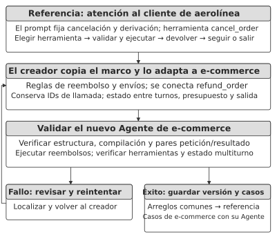

¿Cómo distinguir si una modificación mejoró la capacidad general o si simplemente se adaptó por casualidad a los problemas que acababa de ver? Reservando una tarea que no se haya entregado al creador. Por ejemplo, se desarrolla un Agente de seguimiento de precios con los datos de una tienda, se le dan después muestras de otra tienda y, a la vez, se vuelve a ejecutar la tarea original.

**Mantener el entorno de ejecución del Agente.**

El funcionamiento de un nuevo Agente depende de la configuración, las credenciales, el estado de las sesiones, los servicios y el sandbox. La orden `doctor` de OpenClaw ofrece un ejemplo de herramienta de mantenimiento: comprueba problemas como la migración de configuraciones antiguas, el estado de las credenciales OAuth, los bloqueos de sesión, la instalación de plugins, la salud del gateway y las imágenes del sandbox, y propone reparaciones o las ejecuta[^ch5-doctor].

Estas comprobaciones deterministas pueden servir de base a un proceso de automantenimiento. Las reglas de detección cubren los fallos conocidos, y las acciones de reparación tienen entradas y resultados esperados explícitos. Al diseñar un proceso de diagnóstico más avanzado para el Agente, se pueden entregar al modelo los problemas aún sin resolver junto con los registros, la configuración y los resultados de las comprobaciones, para que explique qué configuración piensa cambiar y cómo; la capa de ejecución comprueba los permisos y el alcance del cambio, y después ejecuta las comprobaciones de salud y las pruebas de regresión. Las instantáneas de configuración, el registro de cambios y un punto de reversión ayudan al sistema a recuperarse si la reparación falla.

**Transmitir la experiencia de ingeniería mediante implementaciones de referencia.**

Crear un Agente especializado implica a la vez lógica de dominio e infraestructura general. Para revisar el resultado generado se puede partir de cuatro tipos de problemas:

1. **Contexto y bucle de ejecución.** Conservar la relación entre los roles, los identificadores de las llamadas a herramientas y sus resultados, y comprobar el estado entre rondas, las condiciones de terminación, el presupuesto y la recuperación ante errores. Los mensajes estructurados facilitan mantener las relaciones del protocolo, y un prefijo estable crea las condiciones para la caché de prompts.
2. **Interfaces de herramientas.** La descripción de cada herramienta explica su propósito, sus condiciones de uso y sus límites, y los parámetros incluyen tipo, significado y ejemplos concretos. La capa de ejecución sigue validando los parámetros, la identidad y el estado del negocio.
3. **Elección de modelos y API.** Los modelos tienden a reutilizar los modelos e interfaces antiguos que aparecen con frecuencia en sus datos de entrenamiento, y un código fluido puede esconder una elección desfasada. Conviene dar al creador documentación de selección mantenida al día, o pedirle que consulte la documentación oficial y verifique las capacidades del modelo, la versión de la interfaz y la forma de llamarla. Las llamadas reales tras la generación comprueban si la configuración funciona.
4. **Dependencias y compatibilidad con el ecosistema.** Comprobar el estado de mantenimiento de las bibliotecas, sus versiones y los cambios en sus interfaces, y verificar el programa resultante mediante la instalación de dependencias, la comprobación de compilación y las pruebas.

**Al crear un Agente especializado, el autor prefiere que el creador copie una implementación de referencia ya verificada y la modifique después para el dominio.** Es difícil que un prompt agote todos los detalles del protocolo de mensajes, la gestión del estado y los mecanismos de recuperación, mientras que el código de referencia lleva directamente esa experiencia de ingeniería al nuevo sistema. Aunque el modelo programe bien, puede pasar por alto condiciones de ejecución que la descripción de la tarea no menciona explícitamente; reutilizar un marco reduce este tipo de errores repetidos. El creador copia el marco base adecuado, ajusta el system prompt al nuevo rol, añade o quita herramientas de dominio, modifica la lógica de negocio y completa las pruebas correspondientes. El marco aporta el tratamiento de mensajes, la correlación de llamadas, la gestión del estado y las rutas de salida, y los cambios de dominio se verifican con casos de prueba nuevos.

Si la plantilla resulta mucho más rápida, ¿cómo descartar la explicación de que «hizo menos funciones»? A continuación, dos grupos de creadores entregan el mismo tipo de Agente y se someten al mismo conjunto de comprobaciones.

> **Experimento 5-16 ★★★: Desarrollar un Agente capaz de crear Agentes**
>
> Se pide a un mismo modelo creador que construya un Agente de revisión de despliegues: tras leer un conjunto de registros de comprobación de despliegue, debe rechazar la publicación y señalar el motivo si alguna comprobación obligatoria no se ha superado. Al crearlo desde cero, el modelo tiene que escribir el bucle de ejecución, el protocolo de herramientas, las herramientas de dominio, el punto de entrada de línea de órdenes y las pruebas. En la vía de la plantilla, se copia primero un Agente que ya sabe revisar registros estructurados, y el modelo solo tiene que rellenar la especificación del dominio. Por ejemplo, ¿en qué campo se guarda el estado y qué valores indican que se ha superado? El script de creación genera, a partir de la especificación, el system prompt, las definiciones de herramientas y la documentación. Las herramientas de Python existentes leen la especificación y realizan las comprobaciones. Ambas vías ilustran la metaprogramación: usar programas para generar o modificar otros programas.
>
> En la figura 5-11, las dos vías confluyen en el mismo conjunto de criterios de aceptación.
>
> 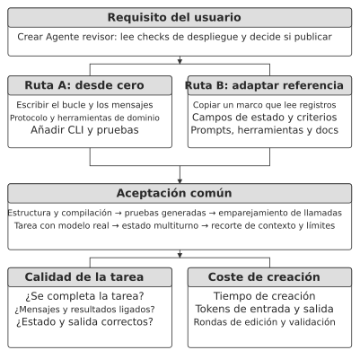
>
> Ambas vías usan los mismos requisitos de la tarea y los mismos criterios de aceptación. Primero se comprueban la estructura del producto, la compilación y las pruebas; después, la correlación entre llamadas a herramientas y resultados en los mensajes estándar; y por último se ejecutan tareas con un modelo real e interacciones de varias rondas para verificar el recorte del contexto, la gestión del estado y el límite del número de llamadas.
>
> En la comparación guardada con Kimi K3, ambos grupos superaron 39/39 comprobaciones deterministas, y ambos superaron también las tareas con modelo real y las comprobaciones de estado entre rondas. La vía de la plantilla consumió 1181 tokens y unos 25 segundos en la creación; la vía desde cero, 381 814 tokens y unos 90 minutos.
>

[^ch5-doctor]: OpenClaw, Doctor; describe las funciones de comprobación, migración y reparación de la configuración y el estado.

## Resumen del capítulo

**Los Coding Agents maduraron antes por una razón que se pasa por alto con facilidad: la ingeniería de software ya disponía de sistemas de tipos, suites de pruebas, control de versiones y herramientas de depuración.** Si un cambio de código es erróneo, las pruebas suelen señalar qué conjunto de entradas produjo un resultado inesperado; si se prueba otra forma de modificarlo, se puede volver a ensayar con las mismas entradas. Para aplicar esta experiencia a otras tareas, conviene plantear primero tres preguntas concretas: ¿cómo se detectan los errores?, ¿cómo se vuelve a un estado conocido? y ¿cuándo hay que detenerse y pedir que una persona tome el relevo? Por ejemplo, si una llamada de reembolso pierde la conexión a medias, el Harness debe consultar primero las cuentas y decidir después si reintenta; de lo contrario, la recuperación de un fallo puede convertirse en un segundo reembolso.

El código también permite guardar un juicio puntual como algo que puede reutilizarse una y otra vez. La enumeración de un problema matemático y las restricciones de un problema lógico pueden comprobarse punto por punto con un programa; las reglas de reembolso pueden escribirse como validaciones en el punto de entrada de la ejecución, de modo que el servidor lea el estado real del pedido antes de decidir si lo autoriza. Si cambia el formato de los registros, se puede modificar el analizador y conservar las muestras que fallaron esta vez como pruebas de regresión. En los tres casos se puede ejecutar código, pero los criterios son distintos: si la solución cumple las condiciones del problema, si el reembolso respeta la política y si el nuevo analizador lee los campos que antes se perdían.

Si lo que se entrega es un documento, un video o un modelo geométrico, hay que comprobar además el renderizado, la sincronización entre audio e imagen o la exactitud de las dimensiones, y disponer que un revisor examine el producto real. Si se entrega un formulario, una consulta o una visualización, además de comprobar si el usuario puede entenderlo y manejarlo, hay que verificar que el servicio de ejecución que hay detrás obtenga los datos según los permisos. Si el código genera otro Agente, el autor se inclina por reutilizar primero un marco verificado, generar las herramientas de dominio y la lógica de negocio, y comprobar después el protocolo de llamadas, el estado entre rondas y el resultado de las tareas reales. Las herramientas, los validadores y las pruebas acumulados de esta forma pueden seguir usándose en la siguiente tarea.

El código permite ejecutar una tarea una y otra vez, pero el entorno no siempre espera a que termine. Mientras una consulta sigue en marcha, puede que el usuario ya haya cambiado de opinión. El capítulo 6 analiza cómo entran estos cambios en una interacción que está en curso.

## Preguntas de reflexión

1. ★★ Diseña un sandbox para un Coding Agent que necesita leer archivos del proyecto, instalar dependencias y ejecutar pruebas. ¿Cómo configurarías los permisos de archivos, red, procesos y recursos? Cuando la tarea necesite ampliar sus permisos, ¿cómo se expresa la petición, se comprueba su alcance y se deja constancia?
2. ★★★ Cuando un creador genera y modifica varias generaciones sucesivas de Agentes, los defectos del marco y los errores de dominio pueden ir acumulándose. ¿Cómo seguirías esta evolución mediante versiones de referencia, pruebas de regresión, evaluación del comportamiento y mecanismos de reversión?
3. ★★ Un cambio en el formato de los registros puede deberse a una actualización normal o a un defecto del productor. ¿Qué evidencias debe conservar un sistema de análisis adaptativo y con qué condiciones debe decidir si añade un analizador, informa de una anomalía o suspende el procesamiento?
4. ★★ En el bucle de proponente y revisor, el revisor considera razonable la densidad de información de una página, pero al usuario le parece recargada. ¿Cómo convertirías las preferencias del usuario en ejemplos, criterios de puntuación y retroalimentación interactiva, y cómo comprobarías que las modificaciones posteriores las cumplen?
5. ★★ Un Coding Agent puede actualizar la base de conocimiento, la documentación de arquitectura y las instrucciones del proyecto, y también consolidar secuencias de operaciones como código. ¿Cómo identificarías las reglas redundantes u obsoletas y cómo diseñarías su ámbito de aplicación, su método de verificación y sus condiciones de retirada? Para pasar de una modificación exitosa aislada a la evolución continua que analiza el capítulo 9, ¿qué mecanismos de acumulación y evaluación harían falta además?
6. ★ Los equipos que facilitan la colaboración a distancia suelen facilitar también que el Agente obtenga la información de trabajo. Examina los requisitos, la arquitectura, los registros de decisiones y los criterios de aceptación de un proyecto que conozcas bien, enumera los documentos que más falta hace completar y explica qué tareas concretas ayudarían a realizar al Agente.
7. ★★★ Para un Agente que accede a datos privados, procesa contenido no fiable, se comunica con el exterior y usa memoria persistente, ¿cómo organizarías la autorización por identidad, el marcado de procedencia, la comprobación de los flujos de datos y la revisión de las escrituras en memoria? Usa un flujo de negocio normal para mostrar dónde se sitúa cada comprobación.
8. ★★ En el modo Artifact con SQL y HTML, el modelo genera el producto, el servicio de ejecución procesa la consulta o el renderizado y la interfaz muestra directamente el resultado. ¿Qué información conviene devolver al modelo para que la explique? ¿Cómo comprobarías los permisos de consulta, el presupuesto de recursos, el aislamiento de la página y la coherencia de los resultados mostrados?
9. ★★ La herramienta valida las reglas a partir del estado del negocio en la base de datos, y la descripción de los parámetros ayuda al modelo a preparar la llamada. Tomando como ejemplo la cancelación de una reserva, explica qué función cumplen la política en lenguaje natural, los ejemplos de parámetros, la validación en la capa de ejecución y las pruebas de casos límite; si la política cambia, ¿qué elementos hay que actualizar a la vez?
