# Interacción: la expansión de los espacios de observación y de acción

**Cuando el modelo subyacente está fijo, reorganizar o ampliar las interfaces de observación y de acción suele ser uno de los recursos de ingeniería más eficaces para mejorar el desempeño de un Agente en sus tareas.** En los capítulos anteriores, el Agente solía esperar a que el usuario terminara de hablar para luego consultar información, llamar a herramientas y responder. Sin embargo, mientras espera el resultado de una herramienta, el usuario y el entorno externo siguen cambiando.

Un usuario encarga a su asistente que cambie la fecha de un vuelo. Mientras el asistente consulta los vuelos con el servicio de atención al cliente, el usuario escribe: «Tengo otra maleta que facturar»; el agente de la aerolínea sigue hablando, y el precio que aparece en pantalla también puede cambiar. El asistente debe preguntar a tiempo si la tarifa incluye el equipaje facturado y comprobar si la cotización anterior sigue siendo válida. Aquí surgen dos preguntas de diseño: ¿por qué canales se entera el asistente de los cambios y en qué momentos puede reaccionar? Este capítulo trata primero los correos y los resultados de herramientas que llegan de forma asíncrona, y después la voz continua, los cambios en la pantalla y la retroalimentación de las acciones de un robot.

## Expansión de la modalidad y del momento de activación

La **modalidad** describe la forma que adoptan la información y la acción. Un Agente puede leer texto, escuchar sonido, mirar la pantalla y recibir señales de par de fuerza; también puede emitir texto, sintetizar voz, hacer clic en una interfaz o accionar articulaciones.

El **momento de activación** se refiere a cuándo llega la información, cuándo empieza una acción y cuándo responde el sistema. La información puede obtenerla el Agente consultando por iniciativa propia o recibirla porque un servicio externo la envía; una herramienta puede devolver el resultado de inmediato o iniciar primero una tarea e informar más tarde de que ha terminado. Cuando llega un evento nuevo, el sistema debe decidir además si interrumpe el trabajo en curso y cómo reanuda la tarea interrumpida.

| Dimensión | Interfaces de obtención de información y observación | Interfaces de acción y ejecución |
|---|---|---|
| Organización del contenido (capítulos 2 a 5) | El contexto, la memoria y las bases de conocimiento organizan la información para decidir | Las herramientas y el código expresan operaciones ejecutables |
| Modalidad (este capítulo) | Voz, pantalla, sensores físicos | Hablar, hacer clic, mover articulaciones |
| Momento (este capítulo) | Consulta activa, eventos enviados, entrada continua | Ejecución a través de turnos, cancelación, desalojo y reanudación |

El contexto contiene la información que necesita una decisión concreta; el espacio de observación describe el conjunto de información que el sistema puede llegar a recibir. Las herramientas ofrecen interfaces concretas; el espacio de acción describe el conjunto de acciones que el sistema puede ejecutar. Al ampliar las interfaces, esos conjuntos siguen limitados por las capacidades del dispositivo, los parámetros, los permisos y el entorno de ejecución.

Muchas interfaces de llamada a herramientas organizan los mensajes por turnos: el modelo propone una llamada, el sistema añade el resultado de la herramienta y se lanza la siguiente ronda de inferencia. Un sistema orientado a eventos tiene que gestionar los cambios externos sobre ese protocolo. Si la interfaz admite asincronía nativa, puede recibir nuevas peticiones mientras una herramienta está pendiente y continuar cuando llega el resultado; si la interfaz es síncrona, es el Harness quien organiza la interacción mediante colas, identificadores de tarea y mecanismos de planificación. Más adelante se analizan por separado ambas vías de implementación.

El ritmo de la retroalimentación varía mucho de un escenario a otro. La tabla siguiente recoge las escalas temporales habituales.

| Escala habitual | Escenario | Cambios del lado de la observación | Tratamiento del lado de la acción |
|---|---|---|---|
| De segundos a días | Asincronía y orientación a eventos | Eventos externos despiertan al Agente | Se inicia la tarea y los eventos posteriores informan del avance y la finalización |
| De decenas de milisegundos a segundos | Voz | Se recibe audio de forma continua | Salida en streaming, gestión de interrupciones del usuario y detención de la reproducción |
| De fracciones de segundo a segundos | Computer Use | La pantalla cambia constantemente | Tras cada operación se vuelve a obtener el estado de la interfaz |
| Ciclos de control de milisegundos | Control de bajo nivel de robots | Los sensores informan de forma continua | Se ejecutan tramos cortos de movimiento y se responde a señales de control y de parada |

## Asincronía y orientación a eventos: cuando el mundo viene a buscarte

El capítulo 4 presentó las herramientas de percepción, ejecución y colaboración; esta sección continúa con las herramientas de activación por eventos y de comunicación con el usuario. Las herramientas de activación por eventos llevan los cambios del entorno hasta el Agente, y las de comunicación permiten al Agente ponerse en contacto con el usuario mientras la tarea avanza. El Harness asocia esas entradas y salidas a las tareas en curso y forma así un bucle de eventos que trabaja de manera continua.

### Por qué se necesita la asincronía

En una llamada síncrona, quien llama debe esperar a que vuelva el resultado para continuar con su flujo. En una llamada asíncrona se devuelve primero un identificador de tarea (que sirve para consultarla y gestionarla), o se acuerda notificar más tarde la finalización, de modo que quien llama puede ocuparse de otro trabajo mientras espera. Así, el sistema puede organizar varias tareas en curso y decidir, según los recursos y las dependencias, qué operaciones pueden ejecutarse en paralelo.

Se puede imaginar el Agente como una secretaria que gestiona correos, llamadas y visitas: mientras espera la respuesta de alguien, sigue ordenando documentos; cuando entra una llamada urgente, guarda el punto en que iba y, al colgar, retoma la tarea original. Llevado a la implementación, hay que resolver tres cuestiones:

- **Separar las tareas largas de la interacción.** El análisis de archivos, las llamadas telefónicas o las compilaciones avanzan en segundo plano, y el usuario puede seguir consultando el progreso y añadiendo requisitos.
- **Prioridad de los eventos.** Las paradas de emergencia entran a tiempo en el flujo de control, las actualizaciones rutinarias pasan a la cola y las consultas independientes pueden derivarse a sesiones paralelas.
- **Interrupción y reanudación.** Se guarda el estado de la tarea, se registran las operaciones ya realizadas y, al reanudar, se vuelven a comprobar las condiciones que siguen siendo válidas.

La versión preliminar de investigación de Claude Duet ofrece un ejemplo: un usuario tiene una reunión a las dos de la tarde y quiere recibir antes un informe sobre la empresa de la otra parte. Puede dejar un mensaje de voz y cerrar la aplicación. La preparación continúa en la nube y el usuario puede abrir en cualquier momento la página de la tarea para ver el progreso; cuando hace falta que aporte información o el informe está listo, el asistente vuelve a la conversación principal para avisarle. Que la tarea siga avanzando después de que el usuario se marche es lo que se llama ejecución asíncrona. La conversación en dúplex completo que se trata más adelante exige además otra cosa: cuando una de las partes está hablando, debe seguir oyendo si la otra la interrumpe.[^ch6-duet]

Las API de los modelos también fijan reglas sobre el orden de los mensajes. Algunas interfaces exigen que cada llamada a herramienta quede emparejada con su resultado antes de aceptar la siguiente petición; otras permiten dejar una herramienta pendiente y recibir actualizaciones posteriores. Las funciones asíncronas de la aplicación se encargan de organizar la espera y la ejecución, y el protocolo del modelo determina cuándo se pueden enviar mensajes.

En la figura 6-1, tanto los mensajes nuevos como los resultados de las herramientas pueden entrar en la cola, pero la forma en que llegan a ella depende de su origen. Si un servicio admite envío (push), puede notificar en cuanto cambia su estado; si solo ofrece una interfaz de consulta, el adaptador tiene que consultarlo periódicamente y generar un evento cuando detecta un cambio. El vencimiento de un temporizador también puede producir un evento. Después, el bucle de eventos entrega estas entradas al Agente.

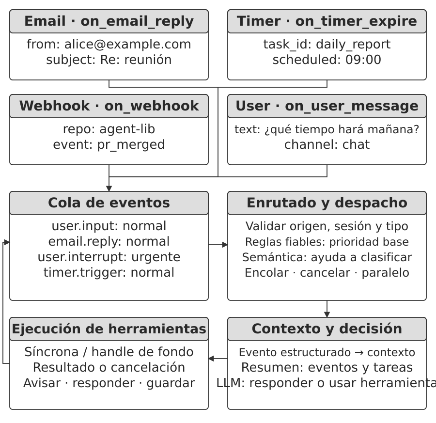

### Implementación del mecanismo orientado a eventos en OpenClaw

OpenClaw se conecta a los canales de mensajería a través de su Gateway y encamina los eventos hacia el entorno de ejecución del Agente. Sus mecanismos de automatización incluyen puntos de entrada como los Hooks internos, la planificación temporal, el Heartbeat y los Webhooks externos[^ch6-automation]. Estos mecanismos pueden entenderse según su condición de activación:

- **Hooks (ganchos de eventos)**: responden a eventos internos del framework, como la creación o el reinicio de una sesión o los cambios en el ciclo de vida de una ejecución.
- **Cron (planificación temporal)**: ejecuta trabajo en un momento o con una periodicidad determinados. Por ejemplo, `0 9 * * 5` indica que se active todos los viernes a las 9 de la mañana en la zona horaria configurada.
- **Heartbeat (latido)**: despierta periódicamente al Agente para revisar asuntos que requieren atención.
- **Webhook (devolución de llamada externa)**: recibe eventos enviados por servicios externos y, tras autenticarlos y encaminarlos, desencadena su procesamiento.

Un informe semanal conviene ejecutarlo a una hora fija, los pendientes que requieren seguimiento pueden revisarse periódicamente, y los correos nuevos y las devoluciones de llamada de servicios pueden recibirse por envío para acortar el tiempo de detección.

**Eventos de llamada en PineClaw.** Pine AI hace llamadas telefónicas en nombre del usuario para negociar facturas, cancelar suscripciones o tramitar reclamaciones de seguros. PineClaw conecta este tipo de tareas telefónicas a OpenClaw. Una llamada suele durar un buen rato y, durante ella, puede hacer falta la intervención del usuario:

- **Verificación de identidad.** El agente de atención al cliente pide que el titular de la cuenta se verifique, por ejemplo introduciendo un código de seguridad o una contraseña de un solo uso.
- **Llamada a tres.** El agente de atención pide hablar directamente con el titular de la cuenta, y hay que avisar al usuario a tiempo para que conteste.
- **Confirmación de decisiones.** Cuando el agente de atención propone una alternativa, la primera línea juzga si es aceptable a partir del encargo y de las preferencias anteriores del usuario. Si la decisión corresponde al usuario, le envía las opciones concretas y, mientras tanto, sigue comprobando otras condiciones con el agente de atención.

Por ejemplo, el agente de atención necesita que el titular se una a una llamada a tres. Cuanto antes llegue el aviso, menos tiempo pasarán ambas partes esperando al teléfono. El caso de PineClaw utiliza el mecanismo de Channel para conectar los eventos de llamada entre el Gateway y la API de Pine: la conexión de la llamada, la necesidad de una entrada del usuario y el final de la llamada entran cada uno en el flujo de eventos, y el Agente actualiza la tarea y avisa al usuario en consecuencia.

**En opinión del autor, para que un servicio proactivo llegue a tiempo, lo mejor es que la propia fuente del evento avise al Agente cuando cambia su estado.** Cuando la notificación llega por el canal, el Harness localiza la tarea correspondiente, comprueba si es un duplicado o si ha caducado, y después el modelo decide el siguiente paso. Si el usuario tiene que verificar su identidad, la interfaz debe abrir un punto de autenticación de confianza, y el resultado de la verificación vuelve después a la tarea original como un evento nuevo.

### Herramientas de activación por eventos

Si se le encarga al asistente «avísame cuando el cliente responda», ¿cómo consigue despertarse justo al día siguiente? Primero hay que ver si el buzón puede enviar un evento cuando llega el correo; si el sistema solo admite consultas activas, hay que recordar cuándo toca la próxima comprobación. Las tres interfaces ilustrativas siguientes dejan que el entorno de ejecución guarde esas condiciones de espera, de modo que el modelo puede terminar el turno de trabajo actual.

**El temporizador (`set_timer`)** sirve para despertar una tarea en un momento acordado. Un temporizador de un solo uso conviene para «el próximo lunes a las 10 de la mañana, llamar al banco para preguntar cómo va la hipoteca»; uno recurrente, para revisar cada hora el estado de un servicio. Esperar la respuesta tras enviar un correo o volver a marcar después de topar con un horario no laborable también se puede programar con un temporizador. La interfaz debe guardar la zona horaria, la condición de activación y el identificador de la tarea, y ofrecer una forma de cancelarlo o modificarlo. Cuando un servicio externo solo admite consultas, las tareas programadas pueden encargarse también de sondear su progreso.

**La monitorización de tareas en segundo plano (`monitor_shell`)** sirve para convertir un comando de larga duración en eventos de progreso. Al iniciarse devuelve un identificador de tarea; durante la ejecución notifica según la salida nueva, ciertas palabras clave o los cambios de estado; al terminar informa del código de salida y del resultado.

Si el modelo consulta el progreso una y otra vez, consume llamadas al modelo aunque el estado no haya cambiado; si solo espera el aviso de finalización, puede pasar por alto un fallo a mitad del proceso. Por eso, el autor recomienda dejar la monitorización al entorno de ejecución y despertar al modelo solo cuando aparezca un avance útil, un error o un estancamiento. Así se puede seguir conversando durante la compilación e intervenir a tiempo ante una anomalía. Las reglas de monitorización pueden incluir filtrado, agrupación y límites de frecuencia, para evitar que cada línea del registro provoque una llamada al modelo.

Por ejemplo, después de que el modelo se suscriba a las actualizaciones de estado de un ticket pendiente, puede terminar esa ronda de inferencia y esperar a que la notificación lo despierte con el número de ticket. Si la otra parte solo ofrece un punto de consulta, el modelo puede programarse él mismo una tarea para la próxima comprobación. Si entonces el resultado es «todavía en trámite», programa otra; si el ticket ya está resuelto, cancela las comprobaciones pendientes. En ambos casos es el entorno de ejecución quien se encarga de esperar, y el modelo solo vuelve a decidir cuando recibe una notificación o vence un temporizador.

**El canal de eventos externos (`connect_channel`)** sirve para suscribirse a correos, mensajes instantáneos o devoluciones de llamada de API. El adaptador del canal verifica el origen, asigna los identificadores propios del servicio a hilos y objetos relacionados, y luego envía un evento en un formato unificado; la sección «Capa de acceso», más adelante, lo desarrolla. Las notificaciones de estado de las llamadas de PineClaw pertenecen a esta categoría.

Los tres tipos de herramienta necesitan una condición de activación, reglas de filtrado y una carga útil del evento bien definidas. La carga útil debe incluir el identificador del evento, el momento en que ocurrió, el origen, la tarea relacionada y el contenido necesario, para que el Agente pueda juzgar si el evento sigue siendo válido y qué información necesita para el siguiente paso.

### Herramientas de comunicación con el usuario

Volvamos a la tarea del cambio de vuelo. Preguntar al agente de la aerolínea, enviar al usuario un mensaje de confirmación que pueda contestar directamente y anotar en el registro de la tarea «esperando respuesta» son escrituras en tres lugares distintos. El usuario puede ausentarse un rato y volver cuando haga falta aportar condiciones, confirmar una decisión o recibir el resultado.

La interfaz de conversación puede mostrar la respuesta final, el progreso de las herramientas y los resultados de ejecución; las herramientas de comunicación, en cambio, especifican de forma explícita el destinatario, el canal, el contenido del mensaje y los adjuntos. El modelo decide qué hay que decir, el Harness comprueba el destino y los permisos, y el servicio de mensajería se encarga de la entrega. El entorno de ejecución también puede encaminar automáticamente la respuesta final a la conversación de origen. Ambas vías pueden combinarse.

La interacción multicanal de OpenClaw permite al usuario enviar mensajes, esperar avances y recibir recordatorios como si tratara con una secretaria. Esa sensación de estar tratando con alguien real nace de un estado de tarea persistente y de una comunicación oportuna. El usuario puede continuar la tarea en los canales que ya conoce, y el Agente debe mantener la coherencia de la identidad, de las sesiones y de la asociación entre mensajes.

El formato de la comunicación puede variar con la tarea: los avances breves, en texto; los resultados complejos, con imágenes o archivos adjuntos; la información que hay que rellenar, en tarjetas estructuradas; y los resultados interactivos, mediante la UI generativa presentada en el capítulo 5. Si el canal admite acuses de entrega o de lectura, el sistema guarda ese estado; los reintentos tras un fallo, los mensajes duplicados y la sincronización entre canales también quedan en el registro de entregas.

**Notificación multicanal y reenganche del usuario.**

La mensajería instantánea, los SMS, el correo, el teléfono y las notificaciones de aplicaciones se adaptan a distintos grados de urgencia y formatos de contenido. El Agente puede elegir el canal en función de la urgencia, las preferencias del usuario, su estado actual y la longitud del mensaje. Un evento de llamada que requiere confirmación inmediata se comunica con un aviso inmediato, mientras que un informe completo puede entregarse por correo o mediante un enlace en la aplicación.

El autor encargó una vez a un asistente que vigilara el precio de los hoteles para la conferencia ATC. Cada día, a la misma hora, el asistente enviaba un mensaje diciendo que el precio aún no había bajado al objetivo. En una ocasión el precio cayó brevemente, y quien detectó esa ventana fue un script escrito por el propio autor. Un precio bajo pasajero puede aparecer entre dos consultas. Aunque el asistente lo detecte a tiempo, si el mensaje llega tarde, el usuario puede perder la reserva. En los días sin bajada, la consulta programada puede seguir ejecutándose con normalidad sin que el usuario tenga que leer cada día un mensaje idéntico. El capítulo 7 pondrá a prueba este tipo de aviso con una ventana de bajada de precio de cinco minutos.

Cuando termina una tarea larga, la notificación lleva al usuario de vuelta a la página de resultados; los resúmenes diarios y los informes semanales se envían con la periodicidad acordada. Una estrategia multicanal debe prever también la eliminación de duplicados, los horarios de silencio y las condiciones de escalado: por ejemplo, si el primer aviso no obtiene respuesta, si conviene pasar a otro canal. El registro de notificaciones se asocia al estado de la tarea para que el usuario pueda continuar desde el mensaje que ha recibido.

### Identidad virtual y entorno de ejecución aislado

El capítulo 4 recurrió a Samantha, de *Her*, para explicar cómo un asistente generalista entra en el mundo digital a través de herramientas. Para implementar un asistente así hay que precisar con qué identidad trabaja y a qué recursos puede acceder. **El autor se inclina por asignar al asistente generalista una identidad virtual propia.** Un correo de trabajo, un número de teléfono, un espacio de almacenamiento y un entorno de cómputo exclusivos permiten que el Agente, como una secretaria con su propia cuenta de oficina, gestione asuntos en nombre del usuario con una identidad de representante bien definida. Una identidad independiente separa el trabajo diario del asistente de las cuentas personales del usuario, lo que facilita autorizarlo, auditarlo y revocarlo por separado; y si se produce un error, también es más fácil acotar su alcance. Las tareas que necesitan acceder a la cuenta del usuario obtienen los permisos necesarios mediante autorizaciones de alcance limitado.

A quién pertenece el número de teléfono determina quién puede continuar el asunto cuando la otra parte devuelve la llamada. Cue, de Manus, proporciona al asistente un número propio con el que puede atender llamadas entrantes y dejar después un resumen de la llamada al usuario. Si un comercio acepta el número de devolución que deja el asistente, cuando llame el servicio de atención al cliente encontrará directamente al asistente que llevaba el caso.[^ch6-cue]

Tomemos como ejemplo la anulación de un cargo. El asistente puede contactar con el comercio como representante autorizado. Si el agente de atención exige una verificación oral del titular, puede pedir al usuario que se una a una llamada a tres y, una vez completada la verificación, el asistente retoma la conversación. Si el comercio va a devolverle la llamada al usuario, primero se le entregan el número de caso, lo ya acordado y las cuestiones pendientes de comprobar. Al informar al usuario, también hay que dejar claras las pruebas de que se dispone: si el agente de atención solo ha prometido verbalmente la anulación, se registra ese compromiso; cuando más tarde se compruebe que la factura se ha actualizado, se informa de que el cargo se ha anulado de verdad.

Cuando el autor tuvo que reponer en Pekín una tarjeta de crédito de Bank of America, Pine contactó con el banco, gestionó una reposición urgente y consiguió que no se cobraran los 15 dólares de la tarifa de urgencia. Al terminar la llamada, el asistente ya podía informar de qué había aceptado el banco y qué cargo había accedido a eliminar. Si unos días después el usuario pregunta «¿por dónde va la tarjeta nueva?», hará falta consultar el seguimiento del envío o pedir al destinatario que confirme la recepción.

Los ordenadores virtuales y los teléfonos virtuales proporcionan entornos operativos que funcionan de forma continua. Una máquina virtual puede ejecutar un sistema de escritorio, los contenedores sirven para aislar procesos y dependencias, y un emulador de Android aloja aplicaciones móviles. Todos ellos admiten la ejecución en segundo plano y reducen la interferencia de las operaciones automáticas en el trabajo que el usuario está haciendo. El alcance del aislamiento lo determinan conjuntamente la red, los montajes, las credenciales y los permisos de ejecución; esa misma configuración condiciona a qué datos y sistemas externos puede llegar el Agente.

Supongamos que quieres que la edición empresarial de WorkBuddy, de Tencent, genere el informe semanal después de que apagues el ordenador al salir del trabajo, pero la hoja de ventas de esta semana solo está en el ordenador de la oficina. Si eliges una tarea local, el asistente puede leer esa hoja, pero el ordenador tiene que estar encendido y el cliente conectado. Si eliges una tarea en la nube, el asistente puede seguir trabajando después de que apagues, siempre que antes hayas subido a la tarea los datos autorizados para el informe, o los hayas puesto en un repositorio al que la tarea en la nube tenga acceso. Si la hoja de ventas debe quedarse en la máquina local, hay que programar el trabajo para cuando el ordenador esté en línea.

Las páginas web y las aplicaciones móviles también pueden exigir autenticación, códigos de verificación o confirmación humana. Al integrarse con ellas, conviene usar en primer lugar las API y los mecanismos de autorización que ofrezca el servicio; cuando se necesite autenticación mediante interfaz gráfica, se puede dejar que el usuario inicie sesión personalmente a través de un escritorio remoto VNC/RDP, pausando las operaciones automáticas durante la autenticación. Cuando el usuario termina, el sistema comprueba el estado de la sesión y reanuda la tarea. Los tokens y las sesiones se guardan según su periodo de validez y se eliminan según la política establecida cuando se revoca la autorización o termina la tarea.

El Agente y el entorno virtual pueden intercambiar datos a través de un **sistema de archivos compartido**. Por ejemplo, el usuario sube un CSV; el ordenador virtual lee el archivo, ejecuta el análisis y vuelve a escribir los gráficos en el almacenamiento compartido; el entorno de ejecución pasa al Agente la ubicación de los gráficos y luego ofrece al usuario un enlace de descarga accesible. El contenido de los archivos grandes permanece en el almacenamiento, y el modelo lee resúmenes o fragmentos cuando los necesita.

[^ch6-dsh-threads]: DeepSeek, modelo de dominio y reglas de autorización y suscripción del prototipo dsh-superagent.
[^ch6-dsh-sessions]: DeepSeek, prototipo dsh-superagent, versión `8c32a9d`. Las responsabilidades de los dos tipos de sesión se describen en `docs/004-prompts.md`; las sesiones de ejecución y los directorios de trabajo, en `docs/003-execution.md`; y el formato de los mensajes que se envían a la sesión principal, en `docs/007-architecture.md`.
[^ch6-duet]: Anthropic, *Get started with Claude Duet*; presenta los informes previos a una reunión, la página de la tarea y las notificaciones en la conversación principal.
[^ch6-cue]: Manus, *Introducing Manus 2.0*; presenta el número de teléfono propio de Cue, la atención de llamadas entrantes y los resúmenes de llamadas.
[^ch6-automation]: OpenClaw, Automation; presenta puntos de entrada de automatización como los Hooks internos, la planificación temporal, el Heartbeat y los Webhooks externos.

### Capa de acceso: muchas fuentes, un solo evento

El Agente de atención al cliente de una tienda en línea tramita un reembolso: el cliente lo solicita en el chat de soporte de la aplicación; el importe supera los permisos del Agente, así que este pide confirmación a un supervisor en el grupo de posventa de WeCom; el servicio de pagos envía un Webhook cuando el reembolso se completa; y el sistema de pedidos publica después el cambio de estado en Kafka. Los cuatro mensajes se refieren al mismo pedido, pero llegan por vías distintas. Cuando hay muchas fuentes y cada vía gestiona por su cuenta los reintentos, la eliminación de duplicados y el orden, esas diferencias acaban fragmentando el entorno de ejecución. **La capa de acceso unifica la forma de los eventos una vez que entran en el sistema y conserva las diferencias de capacidad de cada fuente antes de que lleguen.** La figura 6-2 muestra esta división en capas.

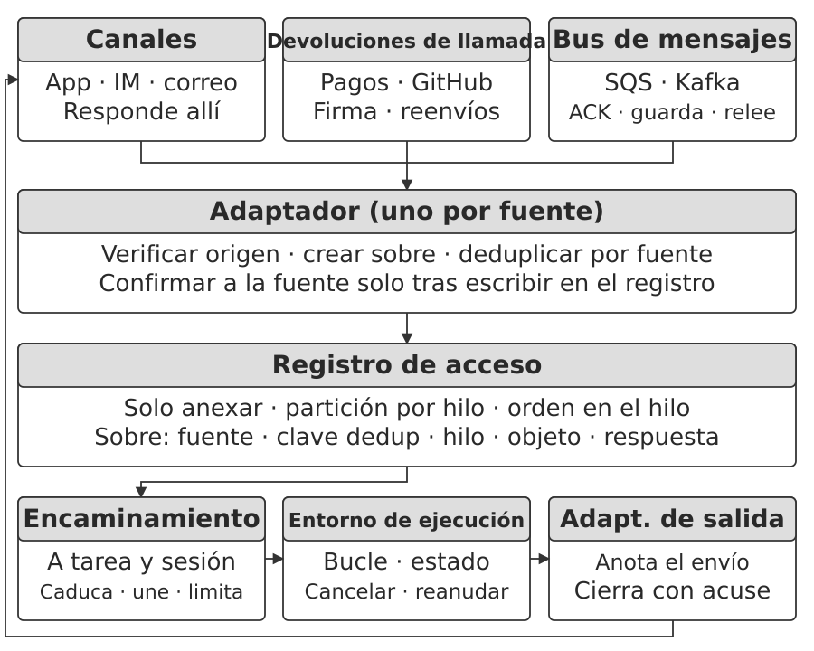

Hay cuatro tipos de fuentes habituales. Los **canales de conversación** incluyen la interfaz de chat del propio producto, la mensajería instantánea como WeCom, Feishu o Slack, y el correo; en ellos el Agente puede responder en el mismo lugar. Las **devoluciones de llamada** son interfaces HTTP a las que llaman los servicios externos cuando cambia un estado; suelen ir firmadas y solo traen notificaciones. Cuando una entrega falla, algunos servicios reintentan automáticamente, mientras que en GitHub hay que reenviarla a mano o mediante la API. Los **buses de mensajes**, como SQS o Kafka, transportan los eventos de negocio de los servicios internos y tienen una semántica de confirmación y retención bien definida. Los **temporizadores, los sondeos y los eventos internos** los genera el propio sistema y basta con escribirlos en el mismo registro. La tabla siguiente compara los tres primeros tipos.[^ch6-ingress-mq][^ch6-ingress-callback]

| | Chat de la aplicación | WeCom / Feishu | Correo | Webhook | SQS | Kafka |
|---|---|---|---|---|---|---|
| Forma de llegada | Conexión persistente | Devolución de llamada o conexión persistente | Envío o sondeo | Devolución de llamada | El consumidor extrae | El consumidor extrae |
| Ámbito del orden | Dentro de la conversación | No garantizado en la mayoría de los eventos | No garantizado | No garantizado | No garantizado en colas estándar; por grupo de mensajes en FIFO | Dentro de la partición |
| Base nativa para eliminar duplicados | ID de mensaje del cliente | ID de mensaje, ID de evento | Message-ID | ID de entrega | ID de mensaje; FIFO añade `MessageDeduplicationId` | Tema, partición y offset |
| ¿Se puede reproducir? | Depende del registro propio | La devolución de llamada no se puede reproducir; en Feishu se puede recuperar con la interfaz de historial de mensajes | Se puede releer el buzón | Depende del servicio | No, una vez borrado | Sí, dentro del periodo de retención |
| Forma de confirmar | Acuse del cliente | Devolver éxito dentro del plazo | Registrar por cuenta propia la posición de lectura | Devolver 2xx dentro del plazo | Borrar el mensaje | Confirmar el offset |
| Vía de respuesta | La conversación original | La conversación original | Responder al correo | Ninguna | Ninguna | Ninguna |

**Sobre unificado.**

El adaptador convierte el mensaje original en un **sobre** (envelope) de formato unificado. El sobre solo registra los hechos que pueden determinarse en el momento de la llegada; la prioridad y el plazo de tratamiento los añaden las reglas de encaminamiento, el nivel del cliente y el estado del pedido los aporta el sistema de negocio, y el estado del procesamiento se guarda aparte. La solicitud de reembolso del cliente puede escribirse así:

```json
{
  "id": "evt_7f3a",
  "source": {"type": "app_chat", "sender": "user:u_5521", "verified": true},
  "dedupe_key": "app:msg:msg_1029",
  "thread": "app:conv:conv_88",
  "kind": "message",
  "correlation": ["order:12345"],
  "content": {"type": "text", "text": "Quiero que me reembolsen este pedido"},
  "raw_ref": "raw/2026-11-23/app/msg_1029.json",
  "reply": {"via": "app_chat", "target": "app:conv:conv_88"},
  "occurred_at": "2026-11-23T14:02:09+08:00",
  "expires_at": null
}
```

- `source`: tipo de fuente y remitente verificado. La condición de «verificado» la determina el adaptador a partir de la firma, el token o la cuenta del canal; lo que alguien diga de sí mismo en el cuerpo del mensaje no cuenta. El entorno de ejecución decide los permisos según este campo.
- `dedupe_key`: clave de eliminación de duplicados; qué se considera un duplicado depende de la semántica de la fuente. El ID de entrega, el ID de mensaje o la partición y el offset identifican una misma entrega y frenan los reenvíos de la capa de transporte; si el mensaje de negocio lleva una clave de idempotencia (idempotency key), por ejemplo el número de reembolso más el estado, el adaptador debe extraerla para frenar también los duplicados de negocio. Con las conversaciones de usuario ocurre lo contrario: si un cliente dice dos veces «reembolso», son dos mensajes, y solo se eliminan duplicados por el ID de mensaje del cliente.
- `raw_ref`: la carga original guardada tal cual; cuando hay que depurar un error del adaptador, es lo único en lo que se puede confiar.
- `reply`: a través de qué adaptador de salida y hacia qué destino se responde. Una devolución de llamada de pagos no tiene vía de respuesta, así que este campo queda vacío.
- `occurred_at` es el momento en que ocurrió el hecho según la fuente; `expires_at` es el periodo de validez, que solo se rellena en eventos como cotizaciones o códigos de verificación.

**Hilos y asociaciones.**

Si el cliente dice primero «reembolso» y a continuación añade «mejor no, prefiero un cambio», el orden de esos dos mensajes no puede invertirse; los mensajes de otro cliente no tienen relación con ellos y pueden procesarse en paralelo. **La capa de acceso solo garantiza el orden dentro de un hilo.** El adaptador asigna a `thread` la unidad de orden propia de la fuente: una conversación en la aplicación, un grupo de mensajes de SQS FIFO (`MessageGroupId`), la clave de partición de Kafka o el número de Issue o PR en una devolución de llamada de GitHub. Cuando la fuente no garantiza el orden, el entorno de ejecución usa `occurred_at` o el número de versión que aporte la fuente para reconocer estados antiguos que llegan tarde, como un «reembolso en trámite» que aparece después de «reembolso completado».

Los cuatro mensajes de este reembolso pertenecen a cuatro hilos distintos. Fusionarlos en uno tiene un coste considerable: una conversación ajena en el grupo de posventa tendría que esperar detrás de los mensajes del cliente, y como el identificador de hilo suele servir también de clave de partición, cambiarlo después obliga a migrar datos. **Las asociaciones se expresan en un campo aparte, sin reescribir el hilo.** `correlation` enumera los objetos de negocio a los que afecta el evento, y las tareas se suscriben a los hilos relevantes según esos objetos asociados.

**Separar el momento de confirmación del progreso.**

**El adaptador debe confirmar a la fuente después de escribir el evento en el registro de acceso, no esperar a que el Agente termine de procesarlo.** Las devoluciones de llamada de eventos de Feishu exigen respuesta en 3 segundos, y las de WeCom en 5; si se supera el plazo, se reenvían. Un mensaje de SQS que no se borra dentro del tiempo de visibilidad vuelve a entregarse. Si se confirma tras el procesamiento, una llamada al modelo algo más larga de lo normal provocará entregas duplicadas. Si primero se escribe en el registro y luego se confirma, las garantías de entrega de todas las fuentes se reducen a una sola frase: **cada evento entra en el registro de acceso al menos una vez (at-least-once)**, y la clave de eliminación de duplicados descarta los reenvíos.

El registro de acceso funciona como una bandeja de entrada (inbox): sigue el principio de solo añadir, sin modificar, del capítulo 1, y se particiona por hilo. Si se usa Kafka como registro de acceso, la eliminación de duplicados requiere un almacenamiento aparte con restricción de unicidad o un filtrado por clave en el consumidor: Kafka no puede rechazar escrituras según una clave dada por la aplicación, y su productor idempotente solo cubre los reintentos del propio productor.

El sistema debe guardar por separado tres tipos de progreso:

| Progreso | Qué registra | Quién lo mantiene |
|---|---|---|
| Progreso de la fuente | Offset de Kafka, handle de recepción de SQS, posición de lectura del buzón | Adaptador |
| Progreso del reparto | A qué tareas se han entregado los eventos del registro | Encaminamiento |
| Estado de la tarea | Hasta qué paso se ha procesado y si la respuesta ya se ha enviado | Entorno de ejecución |

Si se toma el offset como progreso de la tarea, al reproducir el registro se volverán a enviar respuestas que ya se habían mandado; con los progresos separados, la reproducción solo afecta al progreso del reparto. En la dirección de salida, el equivalente es la bandeja de salida (outbox): antes de enviar se anotan la intención de envío y la clave de idempotencia, y al recibir el acuse del canal se marca como completado; cómo conciliar tras un reinicio se explica más adelante, en «Construir el bucle básico a partir de eventos de correo».

**Caducidad, fusión y contrapresión.**

Cuando en un mismo hilo llegan cientos de eventos por segundo, no hay que pasárselos al modelo uno a uno. El encaminamiento procesa la acumulación antes del reparto:

- **Caducidad.** Las cotizaciones, los códigos de verificación o las alertas ya resueltas pierden su sentido pasado cierto tiempo. Los eventos que han superado `expires_at` solo se anotan en la trayectoria y ya no despiertan al modelo.
- **Fusión.** `kind` distingue dos tipos de eventos. Los eventos de estado describen el valor actual de un objeto, como el estado del reembolso en la devolución de llamada de pagos o el estado del pedido en Kafka; si se acumulan varios en un mismo hilo, solo el más reciente se entrega al modelo y los valores intermedios quedan en el registro. Los eventos de mensaje son una frase que alguien ha dicho o una instrucción que ha dado, como el mensaje de un cliente o el clic de un supervisor; pueden entregarse al modelo en lote, pero no pueden descartarse.
- **Contrapresión.** En las fuentes de extracción se puede frenar el ritmo de extracción y dejar la acumulación en la fuente. En las fuentes de envío no se puede pedir a la otra parte que se detenga, así que el adaptador sigue escribiendo en el registro y confirmando con normalidad; la acumulación pasa al registro de acceso y la absorben las dos reglas anteriores.

**Un reembolso a través de cuatro fuentes.**

1. El cliente solicita el reembolso en el chat de la aplicación. El adaptador elimina duplicados por el ID de mensaje del cliente, escribe en el registro y luego envía el acuse al cliente; el encaminamiento crea una tarea de reembolso a partir de `order:12345`, y la tarea se suscribe a ese hilo de conversación.
2. Como el importe supera sus permisos, el Agente envía una tarjeta de confirmación al grupo de posventa de WeCom y anota en la tarea el identificador de la tarjeta. El supervisor pulsa «Aprobar»; el adaptador escribe en el registro, devuelve éxito y añade el objeto asociado a partir del identificador de la tarjeta.
3. Tras llamar el Agente a la interfaz de reembolso, el servicio de pagos envía dos devoluciones de llamada de «reembolso completado» con el mismo ID de entrega, y la segunda se descarta como duplicado.
4. El sistema de pedidos publica en Kafka «pedido reembolsado», que es el mismo hecho que comunicaba la devolución de llamada. Si los dos adaptadores extraen de la carga el número de reembolso más el estado como clave de eliminación de duplicados, este evento se descarta ya en el acceso; si cada uno elimina duplicados por su ID de entrega o por partición y offset, los dos entran en el registro, y el entorno de ejecución, al ver que el reembolso ya está confirmado en la tarea, solo lo anota en la trayectoria.
5. Ni la devolución de llamada ni el evento de Kafka tienen vía de respuesta. El entorno de ejecución usa el `reply` del hilo de conversación del paso 1 y avisa al cliente a través del adaptador de salida de la aplicación.

El paso 4 marca el límite de la eliminación de duplicados en la capa de acceso: qué duplicados se pueden frenar depende de las claves que declare el adaptador; los que se escapan se resuelven con el estado de la tarea. Una vez repartido el evento a una tarea, decidir si se añade a una sesión existente o se abre una nueva es cuestión de gestión del contexto: la información entre sesiones se transmite mediante la memoria del capítulo 3, y si el contexto puede compartirse se trata en el capítulo 10.

[^ch6-ingress-mq]: Amazon Web Services, «Amazon SQS standard queues»; «Amazon SQS visibility timeout»; «Using the message deduplication ID in Amazon SQS»; «Using the message group ID with Amazon SQS FIFO Queues». Documentación de Apache Kafka 4.4, «Consumer Position» y «Message Delivery Semantics» en «Design». Fecha de consulta: 2026-11-24.
[^ch6-ingress-callback]: Plataforma abierta de Feishu, «Event overview»; «Obtain chat history». Centro de desarrolladores de WeCom, «Overview» dentro de «Receive messages and events». GitHub Docs, «Best practices for using webhooks»; «Handling failed webhook deliveries». Fecha de consulta: 2026-11-24.

### Mecanismo de manejo de eventos

Los mensajes del usuario, los resultados de herramientas, los temporizadores y las peticiones de colaboración pueden llegar a la vez a un mismo Agente. El entorno de ejecución tiene que guardar esos eventos, decidir en qué orden se procesan y pasar después la información relevante al modelo. El **bucle de eventos** (event loop) se encarga de hacer avanzar este proceso de forma continua: saca eventos de la cola, actualiza el estado de las tareas, compone las peticiones al modelo, planifica las herramientas y luego espera nuevas entradas o avisos de finalización. Los programas en Go organizan varios flujos de mensajes con goroutines, channels y `select`, con una idea parecida.

Tomemos el prototipo dsh-superagent. En un mismo proyecto de GitHub, la discusión de una Issue y la de una solicitud de extracción (PR) pertenecen a dos hilos de conversación (Thread) distintos. Cuando el sistema tiene que decidir si asume un trabajo nuevo, lee el estado del hilo y pide al modelo que lo evalúe (Eval). En cada hilo puede haber como máximo una evaluación a la vez, pero varios tickets (Ticket) pueden estar suscritos a él. Supongamos que un ticket para corregir un defecto y otro para completar la documentación están suscritos al mismo PR: si un revisor deja un comentario en el PR, ambos tickets reciben ese mensaje como contexto. Si después alguien añade en la Issue las condiciones para reproducir el fallo, ese mensaje llega a los tickets suscritos a la Issue. A quién llega un mensaje depende de los hilos y de las suscripciones. Qué se puede hacer una vez recibido sigue dependiendo de la autorización que ya tuviera cada ticket.[^ch6-dsh-threads]

dsh-superagent también reparte entre sesiones distintas «tratar con personas» y «hacer el trabajo». La sesión principal (Main Session) solo acepta encargos, responde y registra autorizaciones; no lee código ni se detiene a esperar resultados. Cada ticket tiene su propia sesión de ejecución (Executor Session), que modifica código y ejecuta pruebas en un directorio de trabajo separado. La sesión de ejecución solo envía un mensaje a la sesión principal cuando ha terminado la corrección, se ha atascado o necesita preguntar algo a una persona, y adjunta un resumen y una dirección de lectura: es el «resumen más ID de objeto» del capítulo 2. Así la sesión principal siempre tiene las manos libres para atender la siguiente petición, y las preguntas a personas, las notificaciones y las órdenes de detención pasan todas por ella, de modo que los compromisos solo salen por una única puerta. Los modelos rápido y lento de la sección de voz son la forma que adopta este reparto en una llamada en tiempo real.[^ch6-dsh-sessions]

Las interfaces síncronas de los modelos suelen aceptar el siguiente lote de mensajes cuando termina una generación o cuando se han completado los resultados de las herramientas. Ahí se pueden establecer **puntos seguros**: el entorno de ejecución registra primero los mensajes completados, las llamadas que siguen en curso y el progreso de la tarea actual, y solo entonces pasa al nuevo paso de procesamiento. Las interfaces con asincronía nativa, en cambio, ofrecen un protocolo para recibir actualizaciones durante la ejecución, y el momento concreto de enlazarlas lo organizan conjuntamente la interfaz y el entorno de ejecución.

La cancelación también necesita la colaboración del ejecutor. Después de que el modelo deje de generar, las herramientas en segundo plano pueden seguir funcionando; el ejecutor tiene que recibir la señal de cancelación e informar del estado real, igual que una tarea de Go que comprueba `ctx.Done()` y hace limpieza. Las escrituras, envíos o pagos ya completados deben deshacerse o compensarse mediante el proceso de negocio correspondiente.

**Tres estrategias de procesamiento.**

La figura 6-3 compara las tres opciones disponibles cuando llega un evento nuevo. Si se pone en cola, el tiempo de respuesta depende de cuándo se alcance el siguiente punto seguro; si se cancela la tarea actual, hay que comprobar qué operaciones ya se completaron y desde dónde se puede reanudar; si se abre otro bucle, hay que verificar que las dos tareas no compitan por el mismo recurso.

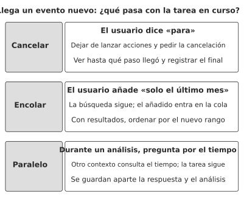

**El procesamiento por cancelación (Cancellation-Based)** conviene para las órdenes de detención del usuario o para los eventos de control que hay que atender de inmediato. El entorno de ejecución deja primero de despachar operaciones relacionadas, envía una señal de parada a las peticiones que se están generando y a las herramientas cancelables, y guarda los mensajes completados, el estado de las herramientas y los acuses de cancelación. Después, el nuevo evento entra en el contexto de decisión. Por ejemplo, si el usuario dice «¡Para! Me he equivocado», el sistema limita primero la ejecución posterior y luego vuelve a confirmar la tarea a partir del estado real. Los elementos de la cola que aún no se han procesado conservan su identificador y su estado, y se reordenan según su ámbito de asociación.

**El procesamiento en cola (Queued)** conviene para la información complementaria habitual y las actualizaciones de progreso. El evento entra en la cola y, en el siguiente punto seguro, se entrega al modelo junto con los resultados de las herramientas. Por ejemplo, si durante una búsqueda el usuario añade «solo los resultados del último mes», cuando vuelve la búsqueda el modelo lee a la vez los resultados y la nueva condición, y decide si filtra o repite la búsqueda.

**El procesamiento en paralelo (Parallel)** conviene para peticiones independientes de la tarea principal que requieren una respuesta rápida. Por ejemplo, si durante un análisis de datos masivo el usuario pregunta qué tiempo hace, el sistema puede abrir una sesión independiente para atender la consulta.

**Urgencia y encaminamiento.**

El tipo de evento da una primera pista: `user.interrupt`, las instrucciones de supervisión de confianza y las alertas del sistema pueden ir por un canal de alta prioridad; `user.input`, `agent.input`, `tool.result` y `timer.trigger` se valoran además según su contenido y el estado de la tarea. Si el remitente se declara «urgente» en el cuerpo del mensaje, el sistema sigue determinando los permisos según la identidad verificada y las reglas.

Para las decisiones de encaminamiento que requieren entender el significado del mensaje, el autor recomienda un modelo de clasificación ligero: «detente ahora mismo» corresponde a una cancelación, «¿qué tiempo hace hoy?» puede ir en paralelo y «haz el informe en español» suele entrar en la cola de información complementaria de la tarea en curso. Las vías explícitas de detención las gestiona directamente el entorno de ejecución, y la clasificación semántica se reserva para el resto de mensajes que necesitan comprensión.

Un modelo de propósito general también puede etiquetar mensajes, pero aunque solo emita «requiere atención», tiene que leer las instrucciones de la tarea y el contenido del mensaje. Si se hace esa valoración con cada mensaje nuevo, el coste de las llamadas crece con el volumen de mensajes, y los mensajes realmente urgentes también tienen que esperar a que el modelo emita su etiqueta para seguir adelante. Jev, de TypeSafe, está pensado específicamente para este tipo de decisiones con opciones predefinidas. Si se le da un mensaje y el estado actual de la tarea, devuelve en paralelo la probabilidad de cada opción con un coste y una latencia bajos.[^ch6-jev]

Hacer más disperso el espacio de observación, como se vio en el capítulo 1, determina aquí qué mensajes desencadenan una nueva inferencia. Con los mensajes de Feishu y los comentarios de Issues de GitHub, por ejemplo, el programa puede filtrar primero las notificaciones duplicadas por número de evento y después pedir a Jev que juzgue si el mensaje nuevo complementa una tarea existente o plantea una petición nueva que debe atender el modelo principal. Si lee «añado los pasos para reproducirlo que mencioné ayer», el modelo solo tiene que reconocer que es una aclaración. A qué Issue se refiere lo obtiene el programa directamente del número que lleva el propio comentario.

Aunque el modelo asigne una probabilidad muy alta, puede estar sobrestimando su seguridad. Por ejemplo, si 100 mensajes se clasifican como «complemento de una tarea existente» con una probabilidad de alrededor del 90%, puede que en realidad solo 60 lo sean. Fusionar automáticamente ese lote con tareas existentes haría perder el propósito real de los otros 40 mensajes.

[^ch6-jev]: En las notas de lanzamiento de Jev, TypeSafe presenta las salidas predefinidas, la devolución de probabilidades en paralelo y RLCD, un método de entrenamiento orientado a la calibración de decisiones.

### Construir el bucle básico a partir de eventos de correo

Supongamos que el proceso que trata los correos nuevos se reinicia de repente. El identificador del correo le permite recuperar el original, pero no le dice si la respuesta anterior llegó a enviarse. Desde la entrada en la cola, la lectura del correo y la llamada a herramientas hasta la actualización del buzón o el aviso al usuario, lo mejor es registrar cada operación de escritura y el acuse que devuelve bajo el mismo correo. Si tras el reinicio se descubre una petición enviada sin acuse, primero se comprueba el estado real en el buzón y luego se decide si hay que reenviarla.

> **Experimento 6-1 ★★★: Agente de procesamiento de correo orientado a eventos**
>
> Este experimento toma como entrada un buzón de prueba para practicar el registro de eventos, las colas y el procesamiento de tareas. Primero se convierten los correos nuevos en eventos estructurados y se procesan por orden de llegada; después se conectan herramientas como el historial de correo, la lectura de adjuntos, la consulta de conocimiento y las notificaciones. Sigue en la figura 6-4 el recorrido de una invitación a una reunión: localiza en el bucle de eventos los pasos de comprobación de conflictos en el calendario y de redacción del borrador, y busca después en la capa de persistencia el registro de procesamiento de ese correo.
>
> 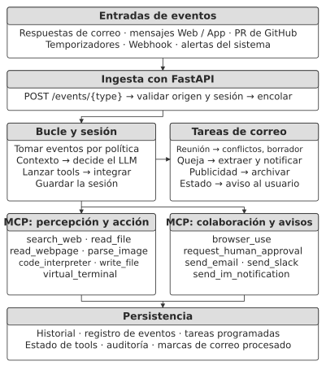
>
> La misma cola puede ampliarse con muchas fuentes: llegada de correos, mensajes de IM o SMS, actualizaciones de PR e Issues de GitHub, temporizadores, Webhooks externos y eventos internos como la desconexión del usuario, el tiempo de espera agotado de un proceso o las alertas de recursos. Cada adaptador se encarga de verificar el origen y añadir la información de asociación, y los resultados del procesamiento se escriben de vuelta según el identificador del evento.
>
> La validación usa tres correos de prueba: una invitación a una reunión desencadena la comprobación de conflictos en el calendario y genera un borrador de aceptación o rechazo; una queja de un cliente desencadena la extracción de la información clave, el marcado como alta prioridad y el aviso al usuario; y un correo publicitario se archiva según las reglas.
>
> El registro complementario actual ha completado la revisión de la documentación de la interfaz y la prueba de autenticación; la conexión al buzón de prueba sigue pendiente de credenciales válidas.
>
> **Ampliación (opcional): acceso desde varias fuentes e inyección de fallos.** Además del buzón de prueba, conecta un endpoint de Webhook local y una cola SQS (puede simularse localmente). Cada adaptador verifica el origen, genera el sobre, escribe en el registro de acceso y solo entonces confirma a la fuente; el entorno de ejecución lee los eventos del registro y los procesa en orden dentro de cada hilo. Después, inyecta tres tipos de fallo:
>
> 1. **Entrega duplicada.** El endpoint de Webhook recibe dos veces la petición con el mismo ID de entrega, y en el registro solo aparece un evento.
> 2. **Caída antes de confirmar.** El adaptador se interrumpe después de escribir en el registro y antes de borrar el mensaje de SQS; cuando el mensaje vuelve a ser visible y se lee de nuevo, en el registro sigue habiendo un solo evento.
> 3. **Caída antes del acuse.** El entorno de ejecución se interrumpe después de enviar una respuesta y antes de registrar el acuse, y al reiniciar reproduce el registro. Si el canal admite claves de idempotencia o permite consultar los mensajes enviados (por ejemplo, la carpeta de enviados del buzón), la misma respuesta no se envía dos veces; en un canal que no ofrezca ninguna de las dos cosas, solo se puede marcar esa respuesta como pendiente de confirmación manual.
>
> Los tres tipos de fallo deben dejar constancia en el registro: qué entrega se descartó como duplicada, qué mensaje se volvió a leer y qué respuesta, tras comprobarse, no se reenvió.
>
> El código complementario de esta ampliación se ejecuta sin conexión y no necesita API Key. El buzón de prueba y la cola SQS se simulan con archivos locales, separados del buzón real que espera credenciales; la cola simulada conserva el tiempo de visibilidad, los handles de recepción y el orden dentro de cada grupo de mensajes. Las caídas se producen porque el proceso padre termina el proceso hijo en el punto indicado. Se muestra un canal de respuesta de cada tipo: el correo consulta la carpeta de enviados, el chat de la aplicación usa claves de idempotencia y el SMS no tiene ninguna de las dos cosas. Para reproducirlo, entra en `chapter6/agent-with-event-trigger` y ejecuta `python multisource_demo.py`; la terminal imprimirá uno por uno los registros que dejan los tres tipos de fallo. En el registro de ejecución complementario, las comprobaciones de los tres tipos de fallo se superan todas.
>

La cola de correo sienta la base del procesamiento secuencial. A continuación se añaden herramientas de larga duración para ver cómo recibir nuevos requisitos, cancelar tareas y reanudar el trabajo durante la espera.

### Compatibilidad cuando no hay asincronía nativa

Supongamos que el Agente está redactando un correo y ya ha llamado a `search_contacts` para buscar un contacto. Antes de que vuelva el resultado, el usuario pide: «Espera, mira primero qué tiempo hará mañana». Si la interfaz del modelo actual exige que cada llamada a herramienta tenga su resultado antes de seguir, el Harness tiene que convertir el estado en segundo plano en una secuencia de mensajes que la interfaz acepte.

**Expresar el estado en segundo plano en un formato de mensajes síncrono.**

**Al adaptarse a una interfaz síncrona, hay que conservar en lo posible el emparejamiento entre llamadas normales y resultados reales, y añadir respuestas de estado solo cuando se cambia de tarea a mitad de camino.** Si se rellena demasiado pronto cada llamada con «todavía en ejecución», la trayectoria se llena de estados inacabados y al modelo le cuesta más seguir los resultados reales. En concreto, pueden seguirse cinco reglas:

1. **Registrar las llamadas completas.** Se escriben en la trayectoria los mensajes assistant que la API ya ha completado y los elementos de llamada a herramientas, conservando sus identificadores de llamada. El estado de inferencia del lado del servidor se guarda según el mecanismo de continuación que establezca el proveedor.
2. **Registrar las finalizaciones reales.** Cuando la herramienta termina, se escriben el resultado real, el identificador de la tarea y el estado de ejecución; mientras se ejecuta, el gestor de tareas mantiene guardado el estado pendiente.
3. **Informar del estado actual al cambiar de tarea.** En las interfaces que admitan este tipo de carga en el resultado, se puede devolver para la llamada pendiente un mensaje de estado explícito, como «La tarea sigue ejecutándose en segundo plano; aún no hay resultado», y a continuación añadir el evento del usuario. El identificador de tarea que figura en la respuesta de estado enlaza con el aviso de finalización posterior.
4. **Ordenar los mensajes tras una interrupción.** Si no hay forma de continuar a mitad de camino, se cancela la generación inacabada, se conservan los mensajes y el estado de las herramientas confirmados como completados y se envía una nueva petición. La salida inacabada se trata según lo que establezca la interfaz, para no tomar unos argumentos a medias por una llamada ejecutable.
5. **Recibir los eventos habituales en lote.** La información complementaria entra en la cola y se envía toda junta al final del ciclo actual o en un punto seguro designado, registrando qué eventos ya se han procesado.

En el ejemplo de la búsqueda de contactos, primero se escribe en la trayectoria la llamada completa; cuando el usuario cambia de tarea, el Harness añade una respuesta de estado indicando que la búsqueda sigue en marcha y después envía la petición sobre el tiempo. El resultado de los contactos llega más tarde y entra en el contexto como un evento nuevo con su origen y su identificador de tarea, y el Agente sigue redactando el correo. Como la llamada original ya ha recibido una respuesta de estado, el resultado posterior adopta la forma de evento acordada por el adaptador, lo que mantiene el emparejamiento entre llamadas y resultados.

La respuesta de estado solo indica el progreso actual de la ejecución. Los pasos que dependen de los datos de contacto deben esperar a que llegue el resultado real. El gestor de tareas puede guardar estados como `running`, `completed`, `cancelled` o `failed`, y comprobar si se cumplen las dependencias antes de enviar una respuesta o ejecutar la siguiente herramienta.

**Diseñar herramientas asíncronas con identificadores de tarea.**

Al diseñar herramientas nuevas para tareas largas, el autor prefiere definir el «inicio» como una operación completa que devuelve de inmediato un identificador de tarea real. Así el modelo distingue entre «ya iniciada» y «ya terminada», y las consultas, cancelaciones y eventos de resultado posteriores tienen una referencia común para asociarse. Por ejemplo, `initiate_phone_call` inicia una tarea de llamada y devuelve el identificador de la tarea y el estado «marcando»; `phone_call_connected` y `phone_call_ended` informan, respectivamente, de que la llamada se ha conectado y de que ha terminado.

La descripción de la herramienta debe dejarlo claro: «Esta herramienta inicia una tarea de llamada telefónica y, si tiene éxito, devuelve el ID de la tarea. Puedes seguir ocupándote de otros asuntos; el progreso de la llamada y su resultado final llegarán como eventos separados». El nombre de la herramienta indica que se trata de una operación de inicio, y la estructura de retorno y los eventos posteriores explican cómo avanza y termina la tarea. El sistema ofrece además interfaces para consultar, cancelar y reanudar por ID de tarea, de modo que el modelo sepa qué puede hacer en cada momento.

**Procesar los eventos de un lote uno por uno.**

Cuando varios eventos entran a la vez en el contexto, el modelo puede responder solo al último y pasar por alto los requisitos planteados antes. El entorno de ejecución debe conservar el estado de procesamiento de cada uno para que las condiciones aún no atendidas sigan visibles. El prompt puede pedir al modelo que los revise uno a uno, y una barra de estado puede listar la información pendiente:

```text
[Evento pendiente 1/4] Resultado de database_query: ...
[Evento pendiente 2/4] Aclaración del usuario: solo los datos de la región de Pekín
[Evento pendiente 3/4] Aviso del sistema: quedan 30 minutos para el plazo de entrega del informe
[Evento pendiente 4/4] Pregunta del usuario: ¿cómo va el progreso?
```

El resumen del lote puede indicar «1 resultado de herramienta, 2 mensajes del usuario, 1 aviso del sistema». El entorno de ejecución asocia además los eventos con las restricciones de la tarea: la condición de región actualiza el alcance de la consulta, el plazo afecta a la planificación y la pregunta sobre el progreso requiere respuesta. Tras procesarlos, se registra si cada uno está completado, en espera o pendiente de aclaración, y los asuntos sin resolver se mantienen en la siguiente ronda.

Un mismo número de tarea enlaza el inicio, los informes de progreso y el resultado final de la ejecución. Si alguien pide detenerla a mitad de camino, hay que comprobar además si existe un acuse de cancelación bajo ese número.

> **Experimento 6-2 ★★★: Agente asíncrono con ejecución en paralelo y capacidad de interrupción**
>
> Este experimento verifica primero el entorno de ejecución asíncrono y después conecta un modelo para comprobar sus decisiones. El registro de ejecución complementario completa cuatro escenarios con subprocesos reales del sistema operativo; la planificación de eventos y los informes los dirige un script determinista.
>
> 1. **Ejecución en segundo plano y respuesta inmediata.** Se inicia un proceso de análisis que dura varios segundos y se devuelve de inmediato el identificador de la tarea; durante la espera se responde cuál es la hora actual y, al terminar, se recibe el resultado del análisis.
> 2. **Cola y procesamiento por lotes.** Durante una tarea larga se añaden, una tras otra, «responde en japonés» y «organízalo como una página web»; al terminar la tarea, el resultado y las dos peticiones se procesan como un solo lote. El script genera un HTML en japonés.
> 3. **Cancelación y reanudación.** Se muestra que, al recibir «detén el análisis», se interrumpe el turno del modelo que sigue generando y se ordena detenerse a todas las tareas en segundo plano en curso. En esta ocasión la interrupción la emite el script, y en ese momento solo hay un proceso de análisis, T1. En el segundo 0,803, el evento de interrupción registra que T1 va por el 18%; hasta el segundo 0,806 el sistema no registra su código de salida −15. T2, que se inicia justo después, es una tarea nueva. Lo que se recibe en el segundo 4,436 es el resultado de T2; T1 no desencadena ninguna devolución de llamada de finalización.
> 4. **Tareas en paralelo y decisiones según el progreso.** Se inician a la vez tres procesos de análisis que avanzan un 3%, un 2% y un 1% por paso de tiempo lógico, respectivamente. En el registro de progreso en paralelo de este experimento, cuando termina T1, el más rápido, el acuse de la consulta muestra que T2 ha llegado al 68% y T3 al 34%. Siguiendo la figura 6-5, las tareas cuyo progreso no supera el 50% se cancelan. El script solo canceló T3 y al final recibió los resultados de T1 y T2. Esto muestra que un mismo entorno de ejecución puede responder a una detención en bloque y, a la vez, conservar el trabajo en paralelo que sigue siendo útil.
>
> 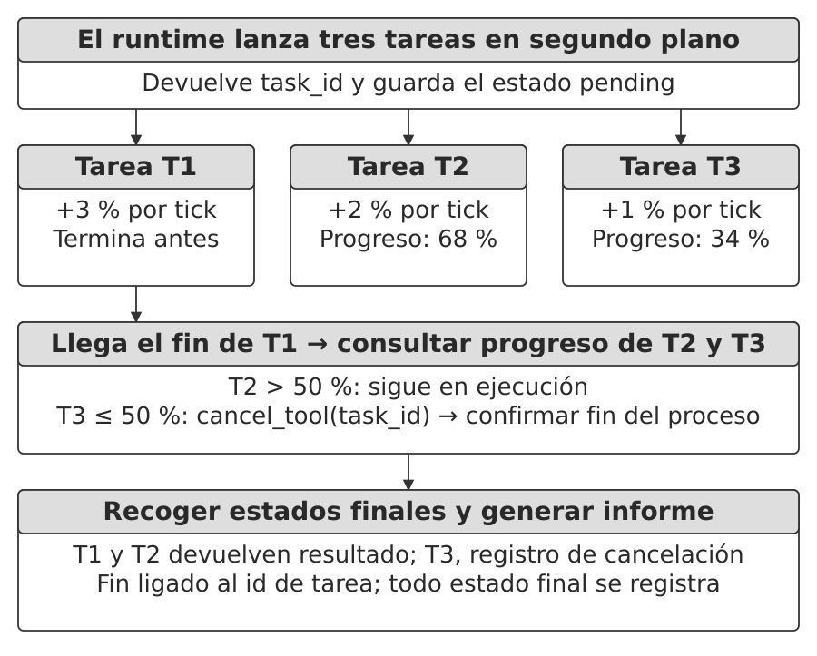
>

### Asincronía nativa del modelo: GPT-6 Astra

En las soluciones anteriores es el Harness quien se adapta al formato de mensajes síncrono. Una interfaz con asincronía nativa permite directamente que el modelo siga con trabajo independiente mientras una herramienta aún no ha devuelto nada, y que reciba el resultado más tarde. A septiembre de 2026, GPT-6 Astra ya ofrece llamadas asíncronas a herramientas (Async tool calling) y orientación a mitad de turno (Mid-turn steering), que resuelven respectivamente la espera de herramientas y las actualizaciones del usuario. La figura 6-6 compara el flujo de mensajes de la adaptación a una interfaz síncrona con el de la asincronía nativa.[^ch6-22][^ch6-23]

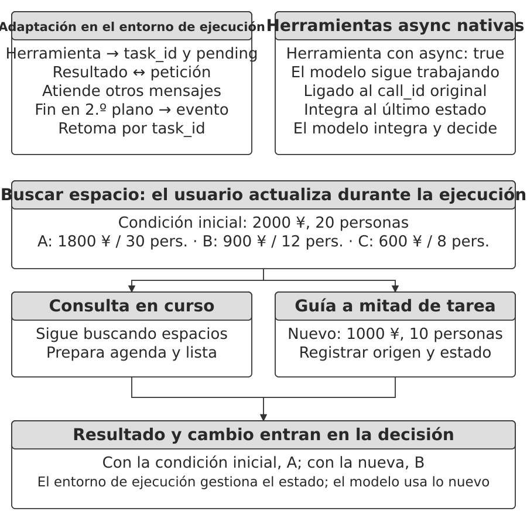

**Seguir con trabajo independiente mientras se espera una herramienta.** Por ejemplo, después de lanzar una consulta de espacios para una reunión, el Agente puede ir preparando el orden del día y la lista de preparativos; cuando vuelve la consulta, compara precios y aforos. En la definición de la herramienta, `async: true` declara la capacidad asíncrona; la aplicación inicia la ejecución cuando recibe el elemento de llamada completo y guarda el identificador de llamada `call_id`. Cuando llega el resultado, la aplicación lo devuelve con el identificador original y enlaza con el estado de respuesta más reciente. El modelo organiza el trabajo posterior, y el Harness gestiona la asociación de las llamadas y el ciclo de vida de las tareas.[^ch6-22]

**Recibir nuevos requisitos con la tarea en marcha.** Mientras el modelo piensa o compone la respuesta, el usuario puede añadir «baja el presupuesto a 1000» o «ahora son 10 asistentes». La aplicación envía un evento de orientación por la misma conexión; cuando el servidor confirma su recepción, sigue procesando a partir del estado de respuesta actual. Tras una reconexión, la aplicación puede reanudar la tarea a partir de los eventos y el estado de respuesta guardados.[^ch6-23]

Las dos capacidades pueden combinarse: la consulta de espacios sigue en marcha, los nuevos requisitos del usuario entran en las decisiones posteriores y, cuando vuelve el resultado de la consulta, se completa la elección. El ejecutor mantiene al mismo tiempo el estado real de las tareas en segundo plano. Si hay que detener la consulta o cancelar una reserva, el Harness llama a la interfaz correspondiente y comprueba el acuse; las operaciones de negocio ya completadas pasan a un proceso de anulación o compensación.

Cuando el modelo y la interfaz ya admiten asincronía nativa, el autor prefiere usar el protocolo nativo y dejar que la suspensión de herramientas, las actualizaciones del usuario y la continuación de las respuestas fluyan según lo acordado por la interfaz. La capa de compatibilidad síncrona sirve sobre todo a los modelos existentes y a las interfaces antiguas; cuando se actualiza el modelo, se puede ir retirando la lógica de compatibilidad que solo existía para completar el emparejamiento de mensajes y concentrar el esfuerzo de ingeniería en el estado de las tareas, la cancelación y la reanudación.

### Gestión fiable de tareas asíncronas

Una interacción asíncrona fiable exige comprobar a la vez los mensajes, las tareas y el estado de ejecución.

1. **Pertenencia de los resultados.** Un resultado que llega con retraso lleva el identificador de la llamada original, y la aplicación lo asigna a la tarea correspondiente; las decisiones que dependen de ese resultado continúan cuando llegan los datos.
2. **Reanudación y cancelación.** Cuando el usuario cambia sus requisitos, el sistema conserva el trabajo que sigue siendo válido, actualiza los pasos posteriores y deja claro qué tareas en segundo plano siguen en marcha y cuáles se han detenido.
3. **Varios requisitos.** El presupuesto, el número de asistentes, la región y el plazo entran por separado en el estado de la tarea, y el resultado final se comprueba condición por condición.

> **Experimento 6-3 ★★★: Asincronía nativa del modelo y orientación a mitad de turno**
>
> En este experimento, el Agente debe elegir para una reunión simulada el espacio más barato que cumpla los requisitos de presupuesto y de asistentes. El presupuesto inicial es 2000 y el número de asistentes, 20; la herramienta de consulta tarda 8 segundos en devolver el precio y el aforo de tres espacios.
>
> | Espacio | Precio | Aforo |
> |---|---:|---:|
> | A | 1800 | 30 |
> | B | 900 | 12 |
> | C | 600 | 8 |
>
> Con las condiciones iniciales hay que elegir A. El grupo con orientación recibe dos actualizaciones con la tarea en marcha: el presupuesto pasa a 1000 y los asistentes a 10, y entonces hay que elegir B. La herramienta devuelve además un acuse recién generado que la respuesta final debe citar, para comprobar si el modelo usó el resultado que llegó realmente.
>
> El experimento tiene cinco grupos, con tres ejecuciones cada uno: herramienta síncrona, herramienta asíncrona nativa, orientación durante la inferencia, orientación mientras se espera una herramienta asíncrona, y un modelo de control que no admite orientación. Los dos primeros grupos comparan si durante la espera se puede producir una lista de preparativos independiente; los dos grupos con orientación comprueban si el presupuesto y el número de asistentes se aplican a la vez; el control de capacidades comprueba si la interfaz informa explícitamente de que no lo admite.
>
> En los registros guardados, el grupo de herramienta asíncrona completó la lista independiente durante la espera, y los dos grupos con orientación eligieron B según las nuevas condiciones. Todas las ejecuciones con herramienta hicieron una sola consulta y devolvieron el resultado real a la llamada original; la interfaz del modelo de control respondió explícitamente que no admite recibir nuevos requisitos a mitad de una generación. El tiempo total de los grupos síncrono y asíncrono fue similar; la diferencia principal está en si se puede avanzar otro trabajo durante la espera.
>
> Si el modelo solo recordara que los asistentes pasan a ser 10 y siguiera usando el presupuesto antiguo de 2000, ¿qué elegiría? Tanto A como B tienen sitio suficiente, y el más barato sigue siendo B. Por tanto, acertar con el espacio no basta para saber si se actualizó el presupuesto.
>
> Si cambia el número de asistentes, ¿hay que repetir la consulta ya enviada? En este experimento, la herramienta no tiene parámetros de filtrado y devuelve los tres espacios. El asistente puede aprovechar el resultado que ya está en camino y, cuando llegue, filtrar para 10 personas y un presupuesto de 1000. Si la herramienta solo devolviera espacios con capacidad para 20 o más personas, el resultado antiguo contendría solo A, y B, con capacidad para 12, ni siquiera aparecería. En ese caso, cambiar el número de asistentes a 10 dentro de la lista antigua seguiría dejando fuera a B. Si la consulta original ya había descartado B, hay que consultar de nuevo.

Los mecanismos asíncronos permiten que los cambios externos entren en el sistema mientras la tarea avanza. La voz, la pantalla y la interacción con robots acortan todavía más el ciclo de retroalimentación: el sistema tiene que recibir entradas de forma continua y ajustar su salida y sus acciones en el momento oportuno.

## Voz: la interfaz entre personas y máquinas más natural

La voz permite al usuario explicar sus necesidades, añadir condiciones y confirmar resultados a un Agente mientras sus manos o su mirada están ocupadas en otra cosa. Un teclado de entrada por voz convierte el dictado en texto; un Agente de voz, además, gestiona la conversación, las llamadas a herramientas y la reproducción de las respuestas. Ambos pueden dar soporte al whisper coding presentado en la introducción.

Esta sección trata dos usos: que el usuario converse directamente con el Agente y que el Agente se comunique en nombre del usuario con personas externas. El primero se centra en el reconocimiento, la respuesta y las interrupciones; el segundo exige además completar la verificación de identidad, las consultas de negocio y las decisiones durante la propia llamada.

### Tiempo de interacción: de la cascada al dúplex completo

En la presentación de GPT-Live, OpenAI repasa tres tipos de interacción por voz: la cascada, los modelos de audio por turnos y el dúplex completo[^ch6-12]. Esta línea de evolución va entregando al modelo, de forma progresiva, la decisión continua de «cuándo hablar y cuándo seguir escuchando». En un sistema en cascada, la lógica de detección de fin de habla organiza los relevos; un modelo de dúplex completo puede combinar el sonido continuo con el estado de la conversación para gestionar los solapamientos, las pausas y las interrupciones.

| Paradigma | Estructura central | Capacidades fáciles de implementar | Principal problema de diseño |
|---|---|---|---|
| Cascada | Reparto entre VAD, ASR, LLM y TTS | Sustituir módulos por separado e inspeccionar entradas y salidas tramo a tramo | Latencia entre módulos e información acústica que se pierde en la transcripción |
| Modelo de audio de extremo a extremo por turnos | El modelo recibe y genera audio directamente | Usar el tono, la emoción y otra información para componer la respuesta | Detección del fin de la intervención, cambio de turno y momento de responder |
| Dúplex completo | Recibe audio y genera salida de forma continua | Hablar solapados, asentir, interrumpir e interactuar sin cortes | Estado continuo, control de la salida y evaluación de la interacción |

Si el modelo procesa el audio directamente, si la entrada y la salida van en streaming y si puede escuchar y hablar a la vez son capacidades que conviene comprobar por separado. Un sistema en cascada también puede incorporar módulos de streaming y control de interrupciones; el ritmo de interacción de un modelo de extremo a extremo depende, en cambio, de su diseño concreto.

[^ch6-12]: OpenAI, *Introducing GPT-Live*, 2026-07-08; presenta la cascada, los modelos de audio por turnos y la interacción en dúplex completo.

### Paradigma 1 · Pipeline en cascada (Cascading)

Un sistema en cascada descompone la conversación por voz en varios módulos. La detección de actividad de voz (VAD) identifica los tramos con habla en el audio y la lógica de detección de fin de habla decide cuándo se da por cerrado un tramo; el reconocimiento automático del habla (ASR) convierte el audio en texto; el LLM entiende la petición y genera la respuesta; y la síntesis de voz (TTS) convierte después la respuesta en audio reproducible. La figura 6-7 muestra la estructura básica de ejecución secuencial.

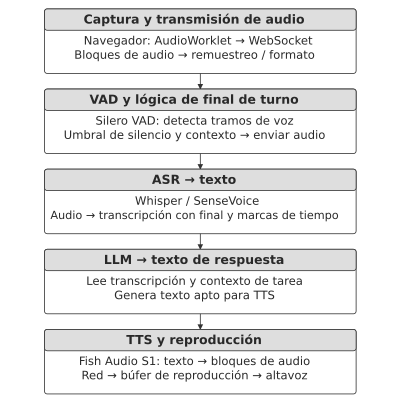

La VAD acústica localiza los tramos en los que alguien habla, de modo que el reconocimiento posterior puede saltarse los silencios largos. Sin embargo, una misma pausa significa cosas distintas según vaya detrás de «Quiero reservar...» o de «¿Hay billetes el jueves por la mañana?». La VAD semántica (detección semántica de fin de habla) puede seguir captando audio en el primer caso y entregar el turno al modelo de diálogo solo en el segundo. Esto es la dispersión temporal de la observación por voz: de un flujo continuo de sonido, solo unos pocos instantes desencadenan una inferencia. La decisión de si hay que hablar la toma el modelo que escucha la frase, que también puede seguir escuchando o consultar primero los vuelos.

| Módulo | Función | Orígenes habituales de espera o de error |
|---|---|---|
| VAD y lógica de fin de habla | Detectar el habla y decidir cuándo cerrar el tramo | Umbral de silencio, ruido y pausas intermedias |
| ASR | Convertir el audio en texto | Tiempo de decodificación y reconocimiento de nombres y términos propios |
| LLM | Entender, razonar y generar la respuesta | Cola de peticiones y generación del primer tramo de la respuesta |
| TTS y reproducción | Sintetizar el audio y llevarlo al altavoz | Síntesis del primer paquete, transmisión por la red y búfer de reproducción |

En una implementación totalmente secuencial, después de que el usuario termine de hablar hay que esperar por orden la confirmación del fin de habla, la transcripción, la generación de la respuesta y el primer tramo de audio. En el ejemplo de la figura 6-8, cuando el usuario oye la primera respuesta ya han pasado 1,4 segundos, y el tramo más largo es la espera a que el sistema confirme que el usuario ha terminado (500 milisegundos). Aunque la transcripción bajara de 100 a 50 milisegundos, el usuario solo ahorraría 50 milisegundos.

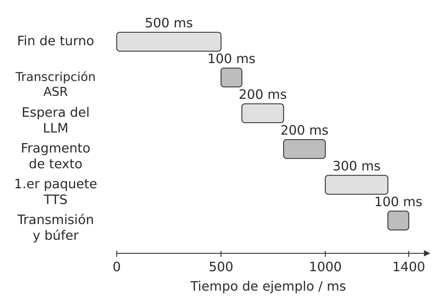

La carga del servicio añade además esperas en la cola. La figura 6-9 utiliza el modelo de una sola cola M/M/1 para ilustrar esta relación: las llegadas siguen un proceso de Poisson, los tiempos de servicio una distribución exponencial, el tiempo medio de servicio es $S$ y, con una utilización $\rho<1$, el tiempo medio total, que incluye servicio y cola, es $W=S/(1-\rho)$. Tomando $S=1$ segundo, al pasar la utilización de 0,5 a 0,8 el tiempo medio total sube de 2 a 5 segundos. De ellos, el servicio en sí sigue ocupando 1 segundo de media, y los 3 segundos restantes se van en la cola. Cuando las peticiones se acercan a la capacidad de procesamiento, las fluctuaciones breves de tráfico generan acumulación.

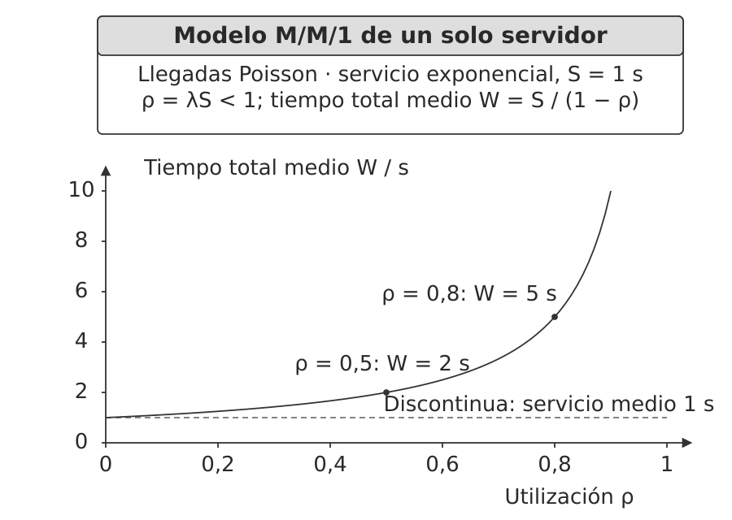

> **Experimento 6-4 ★: Construir un Agente de voz tradicional**
>
> Supón que el asistente está leyendo en voz alta los vuelos del jueves y empiezas a corregirlo: «Espera, quiero reservar para el viernes». El navegador envía el audio del micrófono al backend por WebSocket. En cuanto Silero VAD detecta que has empezado a hablar, el backend emite `speech_start` y el navegador deja de reproducir y vacía el audio antiguo que tenía en cola. En ese momento el asistente todavía no sabe qué día ha cambiado. Solo cuando terminas y el silencio supera los 500 milisegundos predeterminados, el backend emite `speech_end` y entrega ese fragmento de voz al Whisper tiny local para transcribirlo.
>
> Doubao empieza a devolver texto, pero ¿cuánto falta para que el usuario oiga la respuesta? En el registro de una ronda de reproducción de audio, la transcripción tardó 2,710 segundos. Doubao devolvió el primer token 0,749 segundos después de enviarse la petición y no devolvió la respuesta completa hasta 0,792 segundos. El programa de reproducción esperó a tener todo el texto para pasarlo a Fish S1; 2,819 segundos después, el backend recibía el primer lote de audio. Sumando en serie estos tres tiempos a partir de la detección del fin de habla se obtienen unos **6,321 segundos**. El informe archivado indica 6,279 segundos porque tomó el tiempo del primer token en lugar del tiempo de generación de toda la respuesta.
>
> Esos 6,321 segundos solo cubren el procesamiento del backend. El usuario primero tiene que esperar a que la detección de silencio dé por terminada la frase y, al final, a que el audio llegue al navegador y empiece a sonar.

#### De lo serial a la percepción en streaming

La solución serial facilita la inspección tramo a tramo, pero también deja a la vista tres problemas. Esperar al silencio alarga la latencia del fin de habla; el texto transcrito puede perder el tono, la emoción y los sonidos del entorno; y al cortar el audio por las pausas, un correo, un nombre o un término propio pueden quedar sin su contexto completo. Para los sistemas que ya usan una arquitectura en cascada, el autor recomienda empezar por una reforma hacia el streaming: que cada etapa ofrezca resultados incrementales cuanto antes, solapar el reconocimiento, la inferencia y la reproducción, y mantener a la vez la parte ya confirmada y la que aún puede cambiar. Así se reutilizan los módulos existentes y se localiza paso a paso de dónde viene cada espera.

- **ASR que transcribe mientras escucha.** Recibe audio de forma continua y emite transcripciones provisionales; cuando llega audio posterior, revisa las partes inestables y da el texto definitivo al confirmarse el fin de habla.
- **Ejecución especulativa del LLM.** Usa la transcripción provisional para preparar la respuesta por adelantado. Cuando se confirma el texto final, comprueba si la entrada coincide y si el trabajo ya hecho sigue siendo aplicable, y decide si lo conserva, lo ajusta o lo vuelve a generar. Las operaciones como enviar al exterior o escribir en sistemas de negocio esperan a que se confirmen las condiciones necesarias.
- **Salida del LLM por tramos.** En cuanto un tramo de texto es apto para leerlo en voz alta, se entrega a la TTS, conservando al cortar el sentido de la frase, la puntuación y las pistas de entonación.
- **Síntesis incremental en la TTS.** Los bloques de audio vuelven poco a poco, de modo que la generación del texto siguiente, la síntesis y la reproducción se solapan. Si el usuario interrumpe, se gestionan a la vez la tarea de generación y el contenido del búfer de reproducción que aún no ha sonado.

La implementación convencional de transcripción de Whisper codifica y decodifica por ventanas de audio[^ch6-whisper]. Cortando el audio desde fuera o reenviando repetidamente el prefijo acumulado se puede construir un flujo de transcripción incremental; la reutilización del estado continuo, el coste de codificar dos veces y la revisión del texto anterior tienen que gestionarlos la implementación concreta. Los modelos de reconocimiento nativamente en streaming, en cambio, tratan la entrada continua directamente en su arquitectura y en su entrenamiento.

Un sistema de percepción basado en un modelo de audio y lenguaje también puede emitir a la vez texto y eventos acústicos. El audio histórico, las transcripciones y las pistas de vocabulario ayudan a reconocer nombres de personas, marcas y términos propios, y cuánta historia se conserva depende del contexto y del diseño de la caché. Para decidir si «el usuario ha terminado», el modelo puede combinar la completitud semántica con el silencio. En la pausa de «Quiero reservar...», un sistema en tiempo real solo ha oído esas tres palabras y todavía no puede saber que después vendrá una fecha.

Además de la transcripción, la interfaz puede acordar los siguientes eventos: `speak_start` y `speak_end` indican el inicio y el final de una intervención, `interrupt` indica una interrupción, `emotion` describe el estado emocional, y `laugh`, `sigh` y `noise` registran risas, suspiros y sonidos del entorno. Estos eventos pueden enviarse al Agente junto con el texto y las marcas de tiempo.

> **Experimento 6-5 ★: Simular la percepción de voz en streaming con Qwen2-Audio**
>
> Este experimento va ampliando el prefijo de audio: en cada paso se vuelve a enviar a Qwen2-Audio el audio desde el principio hasta el instante actual, y se observa cómo cambian la transcripción y los eventos acústicos con la entrada. La ruta de control usa un fin de habla por silencio de 600 milisegundos y Whisper. Las pruebas incluyen habla normal, una frase larga con una pausa insertada de 900 milisegundos y un habla mezclada con ruido rosa.
>
> Esta ejecución del modelo cuantizado local conservó 13 inferencias de prefijo, de unos 8 a 11 segundos cada una. La pausa intermedia desencadenó un corte en la ruta de control; el modelo de audio detectó el ruido y también dio falsos positivos de tos y de risa.

[^ch6-whisper]: OpenAI, Whisper; presenta la transcripción por ventanas de audio y la implementación del modelo.

### Paradigma 2 · Modelos omnimodales de extremo a extremo (Omni)

Los modelos de audio de extremo a extremo reciben el sonido directamente, combinan la información lingüística y la acústica para generar la respuesta y sintetizan la voz por una rama de salida de audio. Procesar el audio directamente permite aprovechar la velocidad de habla, el tono, las pausas y los sonidos del entorno; transcribir primero y responder después facilita la inspección del texto intermedio y la sustitución independiente de los módulos.

Esas características acústicas influyen en la comprensión. Por ejemplo, la misma frase «Por favor, envíame el informe antes de comer» se siente distinto según se diga con prisa o con calma. Al responder, el modelo también puede organizar el sentido mediante pausas, acentos y entonación.

Un sistema que procesa el audio directamente también puede esperar a que el usuario termine para responder. Si el usuario hace una pausa mientras dicta un número de teléfono, el sistema tiene que decidir si la serie de dígitos ya está completa. La detección del fin de habla determina cuándo responder; y si la otra parte interrumpe mientras se está reproduciendo, el sistema debe coordinar además la generación del modelo con la reproducción en el altavoz.[^ch6-audio-architectures]

> **Experimento 6-6 ★★: Ejecutar MiniCPM-o 4.5 en local y comparar el extremo a extremo con la autocascada**
>
> Este experimento fija un mismo modelo, MiniCPM-o 4.5, con el modo de pensamiento desactivado, y compara dos rutas: responder directamente a partir del audio y responder a partir solo de la transcripción que hace primero el propio modelo. La entrada incluye dos problemas aritméticos dictados y dos audios con el mismo texto pero distinta velocidad de habla.
>
> Las dos rutas aciertan tres preguntas, con errores en posiciones distintas. La ruta de audio directo oye «twelve boxes» como 8 en uno de los problemas y calcula mal; la ruta de transcripción conserva correctamente el 12. En la prueba de velocidad, los dos audios dicen «Please send the report before lunch.», el texto transcrito es idéntico y la información de rapidez se pierde; la ruta de audio directo, en cambio, distingue correctamente las dos velocidades.
>
> El experimento genera además un fragmento de voz de 24 kHz que conecta la comprensión de la entrada con la salida de audio.

### Paradigma 3 · Modelos interactivos de dúplex completo

Un sistema de dúplex completo habla y escucha a la vez, y la mejora que más se nota es la sensación de estar tratando con alguien real durante la conversación. Léase «Quiero reservar para el miércoles... no, para el jueves»: la pausa intermedia deja sitio a esa autocorrección, y si el asistente ya ha empezado a leer los vuelos del miércoles, al oír «no, el jueves» debe parar. Otro momento delicado es cuando la otra parte aún está explicando el viaje: una interjección breve y suave le indica que el asistente escucha. Solo recibiendo audio de forma continua se puede elegir entre hablar, escuchar, callar y llamar a herramientas. La interpretación simultánea también necesita que la entrada y la salida se solapen.

**Moshi**, presentado por Kyutai en 2024, modela por separado los flujos de audio del usuario y del modelo y representa mediante flujos paralelos las hablas solapadas y las interrupciones[^ch6-moshi]. Si estas relaciones temporales se conservan en la entrada, el modelo puede aprender cuándo responder y cuándo seguir escuchando.

El modelo de interacción de Thinking Machines Lab corta la entrada y la salida continuas en bloques de igual longitud, de 200 milisegundos cada uno, a los que llama microturnos (micro-turn)[^ch6-14]. Si se sigue la línea de tiempo de la figura 6-10, en la segunda casilla el asistente aún está diciendo «cuatro», pero ya oye el «no» con el que el usuario corrige el día. En la tercera casilla, el asistente se detiene y sigue escuchando hasta que el usuario termina de decir «viernes».

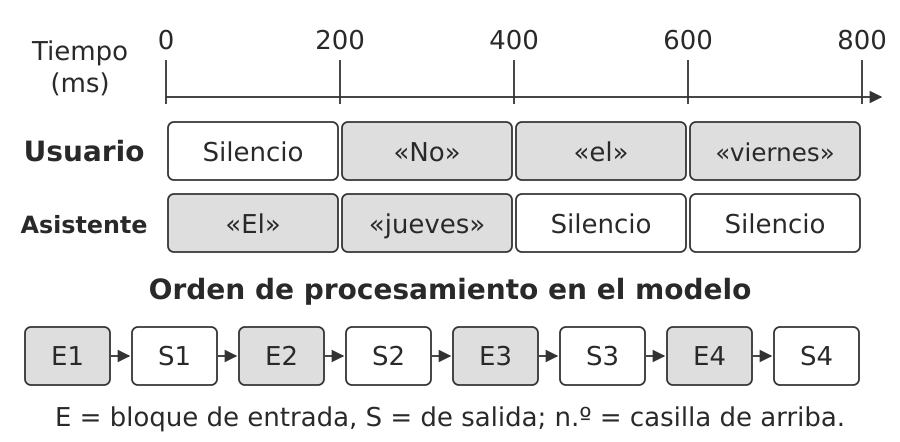

Obsérvese ahora la mitad inferior de la figura. Las dos partes de la llamada oyen dos flujos de sonido que pueden solaparse, pero el modelo puede procesar por turnos los bloques de entrada y generar los de salida a lo largo de una sola secuencia. El silencio también ocupa una casilla, y por eso el asistente puede escuchar un poco antes de hablar. Los 200 milisegundos de la figura son la longitud de bloque de esta implementación; desde que el usuario interrumpe hasta que el altavoz se detiene de verdad hay que sumar además el tiempo de procesamiento y el del búfer de reproducción.

[^ch6-moshi]: Kyutai, *Moshi: a speech-text foundation model for real-time dialogue*, 2024; presenta los flujos de audio paralelos del usuario y del modelo.
[^ch6-14]: Thinking Machines Lab, *Interaction Models: A Scalable Approach to Human-AI Collaboration*; presenta los microturnos, la interacción entre varios flujos y la delegación de tareas en segundo plano.

### Tiempo cognitivo: interacción en tiempo real y pensamiento profundo

En una llamada de atención al cliente de Pine, a mitad de una frase del agente a veces el asistente debe esperar y a veces conviene que emita un asentimiento suave; y cuando es él quien habla, también tiene que oír las correcciones que la otra parte intercala. Por eso el autor apuesta por la línea de Moshi: si el momento se acierta, la otra parte siente que al otro lado del teléfono hay alguien que de verdad escucha. Cuando la petición exige consultar información, hay que echar otra cuenta temporal: desde entender la pregunta hasta dar la respuesta encontrada, ¿cuántos relevos hacen falta?

Las herramientas a las que el modelo de primera línea puede llamar directamente las llama él mismo. Consultar un vuelo solo requiere dos llamadas al modelo: la primera línea consulta con las condiciones que ha dado el usuario y luego informa del resultado. Delegar requiere cuatro: la primera línea encarga la tarea, el backend lanza la consulta, el backend organiza el resultado y la primera línea lo transmite. Hay quien sostiene lo contrario: que un modelo en tiempo real puede rellenar mal los parámetros y que conviene que el backend llame a las herramientas mientras la primera línea se concentra en decidir cuándo escuchar y cuándo hablar.

La primera línea de GPT-Live-1 no tiene una interfaz para llamar directamente a funciones de negocio y solo puede delegar en un Agente de backend. GPT-Realtime de OpenAI Realtime admite que la primera línea llame a funciones directamente. El modelo de voz en tiempo real 3.0 de Doubao (Seeduplex) también lo admite en modo puramente de extremo a extremo; en una orquestación híbrida, la llamada la hace el modelo de lenguaje externo.[^ch6-voice-tools]

Si cada llamada del modelo de primera línea y del de backend tarda $L_f$ y $L_b$ respectivamente, y la herramienta tarda $T$, desde que el usuario termina de hablar hasta que oye el resultado la llamada directa requiere unos $2L_f+T$ y la delegación unos $2L_f+2L_b+T$. El $2L_b$ adicional de la delegación no depende del tiempo $T$ de la herramienta. La información que puede hacer falta en cada turno, como la memoria del usuario, la puede consultar el entorno de ejecución y colocarla en el contexto, con lo que la primera línea solo necesita una llamada al modelo, unos $L_f+T$; y si ya se ha consultado antes de que el usuario empiece a hablar, se ahorra incluso $T$.

Las tareas que requieren razonamiento en varios pasos, como comparar varias opciones de cambio de vuelo, conviene pasarlas al backend. Reservar implica cobrar y emitir el billete, así que, llame quien llame a la herramienta, el pedido debe esperar a la confirmación del usuario. El resultado de los vuelos puede resumirse de viva voz y la tabla completa mostrarse en pantalla, y eso no depende de quién llame a la herramienta.

> **Experimento 6-7 ★★: ¿Quién llama a las herramientas de un Agente de voz, la primera línea o el backend?**
>
> La primera línea se construye con el modelo de voz en tiempo real 3.0 de Doubao y el backend con DeepSeek V4 Pro servido en Volcengine Ark. Se preparan cinco herramientas simuladas (consultar el tiempo, consultar la memoria del usuario, búsqueda web, consultar vuelos y reservar), que devuelven resultados en los tiempos fijados; consultar vuelos y reservar tardan entre 2 y 5 segundos. Las grabaciones del usuario se sintetizan de antemano y en cada ejecución se reproduce la grabación del mismo escenario.
>
> Se fijan cuatro repartos de trabajo. En el primero, la primera línea llama a todas las herramientas. En el segundo, el backend llama a todas las herramientas y la primera línea solo puede delegar. En los otros dos, la primera línea consulta el tiempo, el entorno de ejecución coloca la memoria del usuario en el contexto al inicio de la sesión y el backend se encarga de la búsqueda web y de las reservas. La diferencia entre ambos es si la consulta de vuelos corre a cargo de la primera línea o del backend. La primera línea oye directamente la voz del usuario; el backend no oye nada y solo puede leer texto. Después de oír cada frase del usuario, la interfaz de Doubao devuelve además el texto obtenido por reconocimiento de voz, llamado transcripción. Al delegar, se ordenan cronológicamente las transcripciones y lo que ha dicho el asistente para formar un registro de la llamada, que se entrega al backend junto con las llamadas a herramientas ya ejecutadas en esa llamada y las instrucciones de la tarea redactadas por la primera línea. Con cada reparto se repiten 10 veces los escenarios siguientes.
>
> 1. Consultar por separado el tiempo y los vuelos. Se cronometra desde que el usuario termina de hablar hasta que oye el resultado de la consulta; las frases de transición como «voy a consultarlo» no cuentan como respuesta. Se compara la mediana del tiempo de espera de la llamada directa y de la delegación. En el experimento del autor, para la consulta del tiempo fueron de 2,81 y 6,96 segundos, respectivamente.
> 2. Consultar primero los vuelos y luego elegir billete y confirmar. Se comprueban uno por uno los 13 campos de la reserva frente al resultado de la consulta anterior, lo que el usuario acaba de decir y los datos del usuario, y se verifica que el pedido se haga después de la confirmación del usuario. En el experimento del autor, los cuatro repartos rellenaron bien todos los campos y todos hicieron el pedido solo después de la confirmación.
> 3. Cambiar a una reserva para un compañero y reproducir la grabación en la que se dicta su nombre: «Chen Jiayi; Chen, el de 耳东陈; Jia, el de 嘉奖; Yi, el de 怡然». Comparando la grabación, la transcripción y el nombre del pedido, se comprueba si tanto la reserva directa de la primera línea como la reserva delegada escriben bien el nombre. En el experimento del autor, la reserva directa de la primera línea acertó las 10 veces; la transcripción, en cambio, lo escribió como «陈佳宜» (un homófono con otros caracteres), y por eso algunos pedidos delegados llevaban el nombre equivocado.
> 4. Reproducir una pregunta sobre el tiempo antes de que vuelva el resultado de la consulta de vuelos, y escuchar si la primera línea responde a la pregunta y si después comunica el resultado de los vuelos. En el experimento del autor, la pregunta sobre el tiempo siempre obtuvo respuesta, pero el resultado de los vuelos casi nunca se llegó a comunicar.

Cuando haya que delegar, la primera línea debe escribir en las instrucciones de la tarea los nombres y cifras de los que esté segura y las correcciones que el usuario acaba de hacer, para que el backend no rellene parámetros erróneos por un error de transcripción. El entorno de ejecución debe anotar los resultados que aún no se han comunicado para que la primera línea los transmita después de contestar a la pregunta intercalada.

Si el modelo rápido dice «voy a consultarlo», el agente de atención sabe que el asistente ha entendido la petición. Cuándo se puede dar el precio del billete depende, en cambio, de cómo se coordinan la consulta y la inferencia con la llamada. La figura 6-11 muestra tres organizaciones: responder primero y contestar a fondo después; que la primera línea interactúe de forma continua y reciba sugerencias del backend; y que la concepción y la expresión avancen en paralelo por fragmentos.

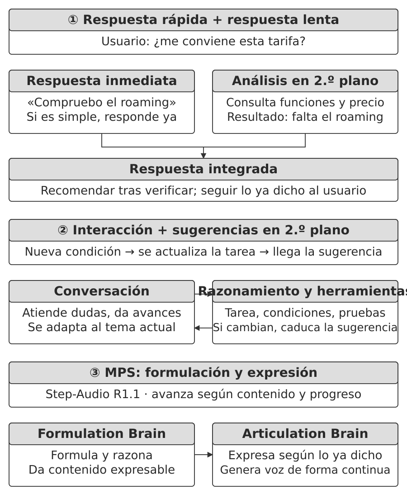

#### Solución 1: el pensamiento rápido acusa recibo, el pensamiento lento da la respuesta

El modelo rápido da primero una respuesta breve, y el modelo lento completa el análisis en segundo plano y añade después la respuesta detallada. Este diseño permite confirmar cuanto antes que se ha recibido la petición, pero obliga a gestionar la coherencia entre las dos respuestas. Por ejemplo, si el modelo rápido recomienda primero contratar cierto plan y el modelo lento descubre después que al plan le falta una función clave, las recomendaciones se contradicen. El conflicto nace de que ambos lados contestan de forma independiente, con bases de juicio y avances de razonamiento que pueden ser distintos. Una recomendación que el modelo rápido ya ha pronunciado entra en el juicio del usuario, que incluso puede actuar en consecuencia; si el modelo lento la corrige después, hay que explicar el cambio y gestionar las consecuencias que ya se hayan producido.

Por eso la primera línea debe distinguir entre confirmar la tarea y dar una conclusión de negocio. «Voy a comprobar si el plan incluye esa función» puede decirse de inmediato; la recomendación de compra debe esperar a las consultas y al análisis necesarios. Cuando vuelve el resultado del backend, el sistema lo contrasta con lo ya dicho y compone la respuesta siguiente. Las preguntas sencillas puede resolverlas directamente el modelo rápido, lo que evita duplicar el trabajo.

#### Solución 2: el pensamiento rápido interactúa, el pensamiento lento avisa

La voz y la pantalla también pueden repartirse el trabajo. Si se dice de viva voz «la factura de este mes tiene un cargo de itinerancia de 15 euros de más», el usuario capta lo esencial al momento; si el importe original, el actual y el detalle de la reclamación se dejan en pantalla, el usuario puede revisarlos a su propio ritmo. Para confirmar una operación concreta basta con tocar una opción, y la información sensible conviene que la rellene el propio usuario en una interfaz de entrada que el comercio reconozca. A la primera línea le basta con recibir un estado como «verificación completada» para retomar la conversación con naturalidad.

Supongamos que un viajero pide a Pine un billete a Shanghái para el jueves por la mañana, con un presupuesto de 1200 yuanes y la necesidad de llegar al lugar del evento antes del mediodía. Mientras habla por teléfono con el agente de la aerolínea, Pine le va «pasando notas» al backend: «Si llega a Hongqiao a las diez, ¿le da tiempo a llegar del aeropuerto al lugar del evento?». El agente de la aerolínea consulta las plazas disponibles y le dice a Pine: «El vuelo que llega a Hongqiao a las diez está agotado. Hay otro que llega a Pudong a las diez y media, por 1250 yuanes». Si el backend solo ve las notas que le pasa la primera línea, seguirá calculando el trayecto desde Hongqiao. La primera línea tendrá que añadir: «Calcula con Pudong, aterrizaje a las diez y media; el lugar y la hora de llegada no cambian».

Otra opción es sincronizar también con el backend el registro de la llamada, en orden. Como el backend ya ha leído en el registro el aeropuerto y la hora de aterrizaje que dio el agente de la aerolínea, a la primera línea le basta con decir «calcula si este vuelo llega a tiempo» para delegar la misma tarea. Al sincronizar el registro hay que indicar quién ha dicho qué; y la media frase que la primera línea no llegó a pronunciar porque la interrumpieron debe distinguirse de lo que sí se dijo. La transcripción de voz puede omitir o equivocar información clave. La primera línea debe escribir en las instrucciones de la tarea los nombres y cifras que ha oído con seguridad y las correcciones del usuario. Si los dos registros no coinciden, el backend se atiene a las instrucciones de la tarea. Cuando termina la consulta, el backend solo tiene que decirle a la primera línea a qué hora se calcula que se llegará al lugar del evento y lo justo que va el tiempo. Qué rutas se consultaron por el camino o qué campos devolvió la interfaz de mapas puede quedarse en el backend para consulta posterior. Con ese resultado, la primera línea sigue negociando con el agente de la aerolínea.

El viajero de negocios del capítulo 1 quería que el billete no superara los 1200 yuanes. En viajes anteriores estaba dispuesto a pagar un poco más por un vuelo adecuado, y esta vez tampoco ha fijado otro límite. Al oír que el precio más bajo es de 1250 yuanes, el asistente puede reservarlo en su nombre. Si se tratara, en cambio, de un usuario siempre muy ahorrativo que viaja con su familia, esos 50 yuanes habría que consultarlos primero. La primera línea tiene entonces que atender dos conversaciones a la vez:

- Al usuario: «El precio más bajo de este vuelo es 1250 yuanes, 50 más que tu presupuesto. ¿Quieres reservarlo?».
- Y a continuación al agente de la aerolínea: «¿Puede mantenerme este precio un rato? ¿Hay algo el mismo día, un poco más tarde, por menos de 1200 yuanes?». Mientras el agente consulta, la primera línea puede aclarar también la franquicia de equipaje y las condiciones de cambio y reembolso.

Así, cuando el usuario vuelva, encontrará varias opciones, y el agente de la aerolínea sabrá qué tiene que consultar a continuación. Si después el usuario explica que «la otra vez iba con prisa por una reunión; a partir de ahora, si un viaje de trabajo supera el presupuesto, pregúntame primero», la próxima vez hay que seguir esa nueva instrucción.

Cuando se espera la verificación del titular, el ritmo de la conversación cambia otra vez. Si el agente de la aerolínea dice que ya ha enviado el código de verificación, la primera línea puede contestar: «De acuerdo, un momento, que le pido al viajero que mire el móvil». Si el viajero responde que aún no le ha llegado, se pregunta al agente a qué número, terminado en qué cifras, se envió el SMS y cuándo se puede reenviar. En cuanto el viajero completa la verificación por el canal que indica el comercio, la primera línea puede continuar. En una llamada así, esperar un poco más o emitir el billete algo más tarde es mejor que presionar al usuario para que decida en el acto.

En ese momento, el backend envía «la cotización original se ha actualizado». La primera línea comprueba primero el nuevo precio con el agente de la aerolínea y luego se lo comunica al usuario. Si justo entonces el usuario responde «adelante, resérvalo», esa respuesta se refiere a la cotización de 1250 yuanes que se le había enviado antes. La primera línea tiene que decidir, a partir del nuevo precio y de la autorización existente, si hace falta volver a confirmar. El backend solo aporta información; siempre es la primera línea la que habla con el agente de la aerolínea y asume compromisos. Solo si los mensajes llevan el vuelo, las condiciones de aplicación del precio y la hora puede la primera línea reconocer qué cotización ha caducado.

El momento en que llega un mismo mensaje del backend, «el precio ha cambiado, compruébalo», también influye en cómo debe retomar la palabra la primera línea. Si el agente de la aerolínea acaba de decir «el precio más bajo es...», la primera línea puede esperar a oír la cifra. Si el agente ya ha dado el precio y espera respuesta, es buen momento para preguntar por el precio nuevo. Si el viajero acaba de intervenir por teléfono diciendo «espera, que cambio la fecha», primero hay que entender bien la nueva fecha y luego decidir si aún hace falta comprobar el vuelo original. Un mismo «vale», dicho mientras el agente explica las condiciones, puede significar solo que se está escuchando; dicho después de «¿le emito ahora el billete?», puede interpretarse como una aceptación de compra. Si solo se mira el texto transcrito, estas diferencias se pierden.

#### Solución 3: la concepción y la expresión avanzan coordinadas

La serie Step-Audio ofrece dos ejemplos relacionados. La **destilación de razonamiento anclada en la modalidad (MGRD)** se centra en la información en la que se apoya el razonamiento: construye y filtra datos de razonamiento en torno a rasgos acústicos como el tono, el ritmo y la entonación, y mejora la comprensión de audio mediante destilación iterativa. En la fase de aprendizaje por refuerzo, Step-Audio R1 puntúa las preguntas de audio con dos componentes: acertar vale 0,8 puntos y aportar el proceso de razonamiento, 0,2 más. Lo segundo anima al modelo a escribir sus fundamentos; si el razonamiento ha usado o no las pistas acústicas de la grabación es algo que hay que comprobar en el filtrado de muestras previo.[^ch6-mgrd]

**Mind-Paced Speaking (MPS)** se centra en la sincronización entre razonamiento y expresión: usa un módulo de concepción (Formulation Brain) y un módulo de expresión (Articulation Brain), de modo que el proceso de concepción guía la generación de voz. La solución en tiempo real de Step-Audio R1.1 adopta este método.[^ch6-mps]

Los dos módulos intercambian información a medida que avanzan: la concepción sigue progresando y la expresión organiza la voz a partir del contenido ya disponible y de lo emitido hasta ese momento. Así, parte de la expresión puede solaparse con el razonamiento posterior sin perder el hilo de lo ya dicho.

[^ch6-mgrd]: StepFun, *Step-Audio-R1 Technical Report*; presenta la destilación de razonamiento anclada en la modalidad.
[^ch6-mps]: StepFun, *Mind-Paced Speaking: A Dual-Brain Approach to Real-Time Reasoning in Spoken Language Models* y la ficha del modelo Step-Audio-R1.1; presentan los módulos de concepción y de expresión y su aplicación en sistemas en tiempo real.

#### Reparto de módulos y forma de actualizarlos

**El autor valora una ventaja de ingeniería del reparto entre lo rápido y lo lento: la capacidad de interacción y la de razonamiento pueden evolucionar por separado.** Cuando sale un modelo de razonamiento más potente, el sistema puede sustituir el backend. Así, el backend sigue el ritmo de los avances de los modelos de razonamiento y la primera línea puede seguir mejorando la experiencia de escucha, respuesta e interrupción. La primera línea tiene que entender la tarea y la información que añade el usuario; el backend se concentra en el razonamiento, la planificación y la ejecución más largos.

**Cuando los modelos de razonamiento evolucionan deprisa y el equipo necesita mejorar continuamente sus capacidades de negocio, el autor prefiere un reparto rápido/lento con piezas sustituibles.** Este reparto evita tener que reentrenar todo el sistema de voz cada vez que se actualiza el modelo de razonamiento. Si se necesita que el razonamiento intermedio controle más directamente la expresión y se dispone de los recursos de entrenamiento correspondientes, se puede adoptar entonces una solución de coordinación más estrecha.

El Agente de voz de Pine AI usa una arquitectura en la que el pensamiento rápido de la primera línea colabora con el pensamiento lento del backend. Su artículo público informa de que obtuvo el primer puesto en la categoría de voz de τ²-bench y describe cómo combina la llamada continua, el razonamiento de negocio y la operación de herramientas[^ch6-17].

Para entender estas combinaciones conviene distinguir tres dimensiones de diseño: la **vía de audio** decide si el modelo procesa el sonido directamente o hace el relevo mediante la transcripción; la **sincronización de escucha y habla** decide si la entrada y la salida avanzan por turnos o en paralelo; y el **reparto cognitivo** decide cómo comparten estado e intercambian resultados la interacción en tiempo real y el razonamiento profundo. Un sistema puede procesar el audio directamente y mantener el dúplex completo, y a la vez delegar las tareas complejas en un modelo de backend independiente. El modelo de interacción de Thinking Machines Lab y GPT-Live muestran este tipo de combinación.

[^ch6-17]: Pine AI, *The Most Natural Human-Computer Interface Is Your Voice*; presenta la arquitectura de pensamiento rápido y lento y los resultados de evaluación en tareas de voz que publica. El informe denomina la clasificación τ²-bench voice.

### Síntesis de voz más humana

Las pausas, la velocidad de habla y los acentos ayudan al oyente a entender la estructura de la frase y la intención de quien habla. Por ejemplo, al dictar un número de teléfono hay que agrupar las cifras; al explicar una cláusula complicada se puede ir más despacio; y mientras se espera el resultado de una consulta se puede explicar primero qué se está haciendo. En opinión del autor, unas pausas y unos cambios de ritmo adecuados hacen la voz más natural y permiten además que el usuario perciba cómo avanza la tarea. El control de la voz puede diseñarse en torno a estos usos concretos.

El LLM principal puede insertar en el texto marcadores de control como `[THINKING]`, `[EMO:happy]` y `[SPEED:0.8x]`. La capa de ejecución interpreta los marcadores, divide el texto en fragmentos de voz y de pausa y los asigna a las emociones, estilos o audios de referencia que admita la interfaz de síntesis. El significado de cada marcador lo define la aplicación: `0.8x` puede corresponder a un nivel de velocidad lento; las pausas puede insertarlas el reproductor, y las risas o los suspiros se expresan mediante marcadores de sonido admitidos o mediante capacidades de generación.

La solución basada en audios de referencia organiza en una biblioteca las distintas formas de expresarse de un mismo locutor. Para cada fragmento de texto se eligen la emoción, la velocidad y el estilo adecuados, se sintetiza y luego se concatena todo en orden. Hay que definir el ámbito de cada estado de control: por ejemplo, una emoción se mantiene hasta la siguiente modificación, mientras que una pausa solo actúa en su posición.

> **Experimento 6-8 ★★: TTS dirigida por marcadores de control con Fish Audio**
>
> Este experimento usa Fish Audio S1 para crear una biblioteca de voz con 24 audios de referencia: combinaciones de cuatro emociones, tres niveles de velocidad y dos estilos. Un analizador convierte la respuesta con marcadores en fragmentos de voz y de silencio, y la capa de ejecución elige un audio de referencia para cada fragmento y realiza la síntesis.
>
> Se comparan tres configuraciones: sin marcadores de control, con un solo audio de referencia y con varios audios de referencia. Manteniendo el mismo contenido en la respuesta, se comprueba si los marcadores se encaminan a la configuración esperada y después se escuchan las pausas, las emociones y los cambios de timbre.
>
> La prueba de escucha guardada utiliza un modelo de comprensión de audio que, alternando el orden de presentación de las tres configuraciones, evalúa la naturalidad, la adecuación emocional, las pausas de reflexión, la coherencia del timbre y la sensación de atención al cliente. El grupo con varias referencias obtuvo la mejor puntuación global, y el de una sola referencia quedó por debajo del grupo sin marcadores.

## Computer Use: Agentes de automatización de interfaces gráficas

Supongamos que le pides a un Agente que cambie la dirección de envío en una página web. Primero tiene que encontrar el campo de la dirección, escribir la nueva y luego confirmar que se ha guardado según lo que muestra la página. Si antes del clic aparece una ventana de inicio de sesión, aunque las coordenadas del botón de la captura anterior no hayan cambiado, el objeto de ese clic ya es otro. Computer Use maneja navegadores, hojas de cálculo o la configuración del sistema a través de la pantalla, el ratón y el teclado, y su tarea esencial es que cada acción vaya al compás de la interfaz que tiene delante.

Siguiendo el bucle **percibir–pensar–actuar** de la figura 6-12, veamos qué debe confirmar el modelo antes de escribir la nueva dirección. Elige el punto de clic a partir de la captura y del avance de la tarea; el Harness comprueba los parámetros y los permisos, y lo pasa a la capa de ejecución. Que el clic tenga éxito solo indica que se ha enviado. Es en la siguiente captura, según dónde haya quedado el foco de entrada, donde se decide si se puede escribir la dirección con seguridad.

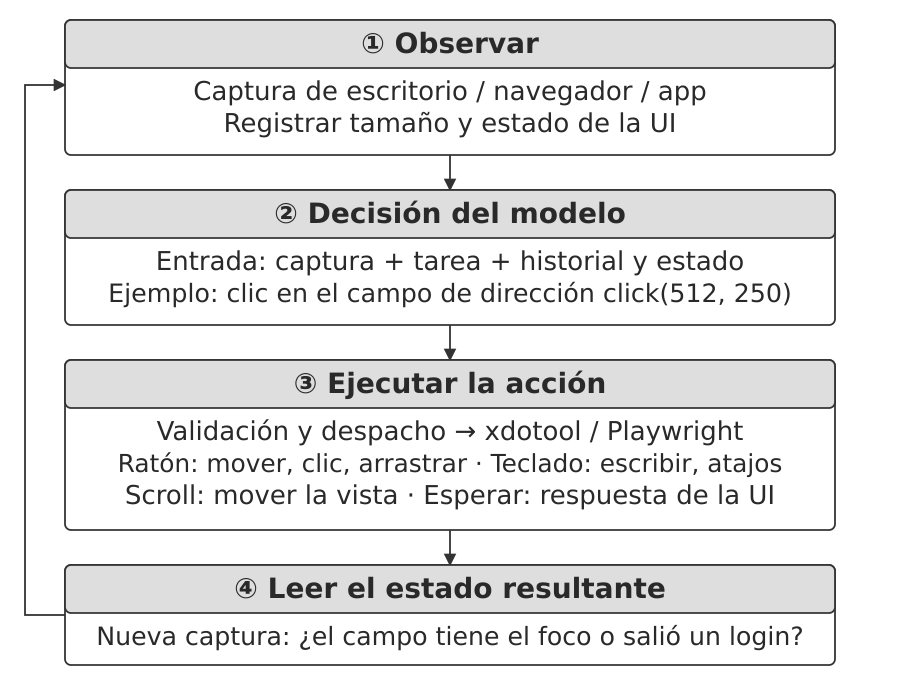

Una vez rellenada la dirección, ¿cómo le dice el asistente al ejecutor qué botón «Guardar» debe pulsar? Tanto las coordenadas de pantalla como los números de elemento sirven para señalar el objetivo, pero exigen cosas distintas al modelo y a la herramienta.

### Diseño del espacio de acción

En la figura 6-13, la implementación de referencia de Computer Use de Anthropic ofrece tres tipos de herramientas: interfaz gráfica, ejecución de comandos y edición de archivos. Si nos fijamos solo en la interfaz gráfica, los datos van en dos direcciones: la acción de clic se envía al ejecutor y la captura posterior al clic vuelve al modelo como observación para la siguiente decisión. La API nativa define el formato de las herramientas; si se usa otro modelo, la capa de adaptación tiene que convertir las capturas, las peticiones de acción y los resultados de ejecución en mensajes que acepte la interfaz correspondiente.[^ch6-computer-tools]

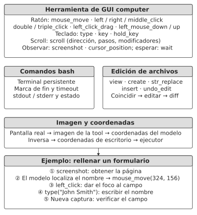

**Herramientas de operación de la interfaz gráfica.** Las acciones de ratón incluyen mover, clic con el botón izquierdo, derecho o central, doble clic, triple clic y arrastrar; una interfaz más detallada puede expresar por separado pulsar y soltar. El desplazamiento necesita dirección y magnitud, y algunas implementaciones admiten también teclas modificadoras. La interfaz de teclado ofrece entrada de texto, combinaciones de teclas y mantener teclas pulsadas. La captura de pantalla y la posición del cursor sirven para obtener el estado, y la interfaz de espera deja tiempo para que la página cargue o terminen las animaciones. La versión de la herramienta determina el conjunto concreto de acciones, y el Harness valida los parámetros según la interfaz que se use.

**Herramienta de ejecución de comandos.** Un terminal persistente puede conservar entre llamadas el directorio de trabajo y el estado del entorno. Por ejemplo, si una llamada cambia de directorio, la siguiente sigue ejecutándose en ese directorio. La implementación de referencia puede usar una cadena centinela para reconocer cuándo ha terminado un comando y fijar un tiempo de espera máximo; el estado del proceso después de agotarse ese tiempo debe seguir comprobándolo el ejecutor.

**Herramienta de edición de archivos.** La interfaz de sustitución de cadenas localiza el tramo que se va a modificar a partir del texto original, y también puede ofrecer visualización, creación, inserción y deshacer. Antes de ejecutar se comprueban la posición y el número de coincidencias, y después se revisan las diferencias; si el archivo ha cambiado entre dos llamadas, primero se vuelve a leer el contenido relevante. Las estrategias de edición presentadas en el capítulo 5 pueden reutilizarse aquí.

> **Experimento 6-9 ★: Ejecutar la implementación de referencia de Computer Use de Anthropic**
>
> Este experimento utiliza el escritorio Ubuntu, el navegador y la capa de ejecución de herramientas que proporciona el ejemplo oficial en contenedor. Cuando el usuario introduce una tarea, el modelo lee la captura y devuelve una acción, la capa de ejecución opera sobre el escritorio y devuelve al modelo una nueva captura.
>
> La tarea complementaria consulta el tiempo en San Francisco. La trayectoria guardada visita primero Google, se encuentra con un CAPTCHA y, siguiendo las instrucciones de recuperación que recibe durante la ejecución, pasa a los datos públicos de Open-Meteo y acaba informando de la temperatura y del estado del tiempo. El registro contiene 15 acciones de escritorio con sus capturas, lo que permite revisar ronda a ronda cómo cambian la página los clics, las pulsaciones de teclas, la entrada de texto y las esperas.
>
> El camino en el que un modelo abierto maneja el navegador se describe en el experimento 6-10.

### Anclaje visual (Grounding)

Para pedir a un modelo que haga clic en el cuadro de búsqueda, la pregunta puede plantearse de dos maneras. Una es mostrarle la captura y pedirle las coordenadas del clic. La otra es numerar los objetivos candidatos y pedirle que elija el cuadro de búsqueda; los números pueden estar marcados sobre regiones candidatas de la captura o proceder de la lista de elementos que ofrece el navegador. A continuación se presentan estas tres vías. Cuando se elige un número, la capa de ejecución se encarga de traducirlo al objetivo real; cuando se dan coordenadas directamente, el modelo también tiene que estimar la posición del objetivo, lo que exige más entrenamiento en localización y mejor adaptación a la resolución de pantalla.

**Set-of-Mark: anotación visual.**

Set-of-Mark (SoM) superpone en la imagen números que se pueden citar, conectando así las regiones visuales con la salida del modelo. El trabajo original genera las regiones candidatas mediante segmentación y otros métodos, por ejemplo usando SAM o SEEM para obtener las regiones y colocar después las marcas. Cuando el modelo elige un número, la capa de ejecución determina la posición de la operación a partir de la región correspondiente. Este método sirve para programas de escritorio o interfaces de juegos sin DOM, siempre que el control que se quiere pulsar caiga en una región numerada y el modelo vea con claridad a qué número corresponde.[^ch6-som]

**Índice estructurado de elementos.**

El navegador puede aportar además otro tipo de pistas. El modelo de objetos del documento (DOM) describe qué elementos tiene la página y su jerarquía, la información de disposición (layout) indica dónde se muestra cada elemento y el árbol de accesibilidad (accessibility tree) conserva los roles y nombres accesibles que necesitan las tecnologías de apoyo. Por ejemplo, si un botón que solo tiene el icono de una lupa recibe en la página el nombre accesible «Buscar», el Agente puede encontrarlo por su rol y su nombre. En soluciones del estilo de browser-use, el sistema puede obtener la información de los elementos a través de interfaces de depuración del navegador como el Chrome DevTools Protocol (CDP), reconocer campos de entrada, botones y enlaces, y numerar después los elementos operables de la página actual. En la figura 6-14, el modelo ha elegido el [2] de la esquina superior derecha de la página. ¿Cómo se convierte ese número en un clic sobre el botón Submit?

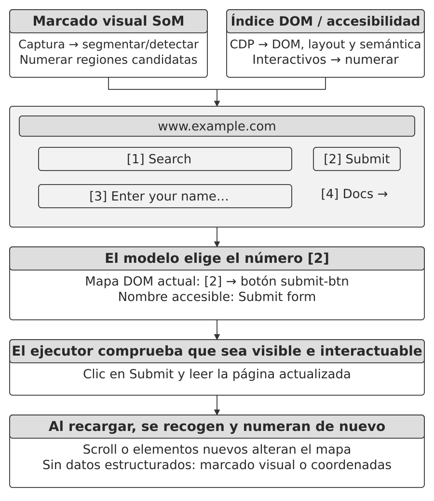

El proceso puede dividirse en cuatro pasos: leer el DOM, la información de disposición y la información de accesibilidad disponible; filtrar los elementos interactivos; construir el mapa de números de la página actual; y entregar al modelo las descripciones de los elementos junto con la captura anotada cuando haga falta. Por ejemplo, el modelo podría ver los cuatro elementos numerados siguientes:

```text
La captura muestra las marcas [1], [2], [3], [4]

[1] <input type="text" placeholder="Search" aria-label="Search" />
[2] <button id="submit-btn" aria-label="Submit form" />
[3] <input type="text" placeholder="Enter your name" value="" />
[4] <a href="/docs" aria-label="Documentation" />
```

Cuando el modelo elige un número, la capa de ejecución lo interpreta como una referencia a un elemento o como coordenadas, comprueba que el objetivo siga visible y sea interactivo, y realiza la operación. Si la página se actualiza, se desplaza o inserta elementos de forma dinámica, hay que actualizar el mapa para no usar números obsoletos. El índice estructurado puede aprovechar las etiquetas, los roles y el texto; en Canvas, con elementos ocultos o con anotaciones semánticas incompletas hay que apoyarse en la captura. Cuantos más elementos se enumeran y más grande es la captura, más información entra en el contexto.

**Predicción directa de coordenadas.**

La vía de las coordenadas hace que el modelo genere directamente una posición a partir de la captura y la descripción del objetivo, por ejemplo al convertir «haz clic en el botón de enviar» en un punto concreto. Investigaciones de localización sobre interfaces gráficas como SeeClick y el Computer Use de Claude adoptan la salida por coordenadas. La capa de ejecución se encarga de convertir las coordenadas de la imagen en coordenadas reales del escritorio.

Cuando la captura se escala, los dos sistemas de coordenadas tienen que usar la misma transformación. Tomemos un escritorio de 2560×1440: si la imagen que se envía al modelo es de 1366×768, el punto (683, 384) que da el modelo corresponde a:

$$
x = 683 \times \frac{2560}{1366} = 1280,\qquad
y = 384 \times \frac{1440}{768} = 720
$$

En la figura 6-15, las proporciones de las dos resoluciones son parecidas. Si la captura lleva bandas negras para conservar la proporción, las coordenadas que da el modelo incluyen ese relleno; antes de volver a las coordenadas de la pantalla original hay que restar el desplazamiento del relleno y aplicar después el factor de escala. Los recortes, el escalado de la pantalla y el origen de varios monitores también alteran la transformación, y la capa de herramientas debe guardar los parámetros reales de la transformación.

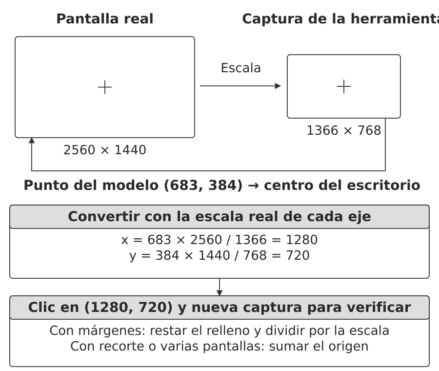

La implementación de referencia utilizó tamaños objetivo como XGA (1024×768), WXGA (1280×800) y FWXGA (1366×768). Forzar un cambio de proporción deforma la forma de los controles, y usar una transformación inversa equivocada hará que una predicción correcta acabe en el lugar equivocado.[^ch6-computer-tools]

**Cuando la información estructurada está completa, el autor prefiere usar el índice del DOM o del árbol de accesibilidad.** El nombre, el rol y la referencia del elemento pueden participar directamente en la localización y reducen el trabajo del modelo para estimar posiciones en píxeles. Cuando falta estructura, un modelo visual general puede apoyarse primero en SoM para que el modelo elija una de las regiones marcadas; un modelo ya entrenado en localización de interfaces gráficas puede predecir directamente coordenadas y ahorrarse el marcado aparte.

> **Experimento 6-10 ★: Implementar la operación automática del navegador con browser-use**
>
> Este experimento usa Qwen3-VL 32B Instruct para manejar browser-use, que genera acciones a partir del estado del navegador, la información de los elementos y las capturas. La tarea consiste en consultar el tiempo en San Francisco: localizar el cuadro de búsqueda, escribir «San Francisco weather today», enviar la consulta y extraer después la temperatura y el estado del tiempo.
>
> El código y las instrucciones de ejecución del experimento 6-10 ofrecen dos entradas. Si se dispone de una clave de OpenRouter, se puede usar un modelo visual alojado; si ya se cuenta con un servicio compatible como vLLM o SGLang, se pueden apuntar `OPEN_MODEL_BASE_URL` y `OPEN_MODEL_MODEL` al endpoint y al modelo propios, y configurar la clave como exija el servicio. En ambas vías se ejecuta primero `python main.py --dry-run` en el directorio del experimento para revisar la configuración y, después, se lanza la consulta real según las instrucciones.
>
> La ejecución guardada completó 16 pasos de interacción y conserva 15 capturas. Después de que Google mostrara un CAPTCHA, la tarea pasó a weather.com para obtener el resultado.

[^ch6-computer-tools]: Anthropic, documentación de las herramientas de Computer Use e implementación de referencia; presentan la interfaz de acciones versionada, la capa de ejecución y el tratamiento de las capturas.
[^ch6-som]: Microsoft, *Set-of-Mark Prompting*, 2023; la implementación del servicio DOM de browser-use ofrece un ejemplo de tratamiento estructurado de elementos.

### Agentes de Computer Use que ven animaciones y oyen sonido

Una página muestra «error de sincronización» solo durante un instante después de guardar, pero las dos capturas tomadas con unos segundos de diferencia muestran el mismo formulario. Si el modelo vuelve a mirar esas dos imágenes, lo más probable es que no pueda reconstruir qué ocurrió entre medias. Lo mismo pasa con vídeos, animaciones, notificaciones fugaces y el audio de una reunión. **Para las interfaces que cambian de forma continua, el autor sostiene que la interfaz de observación debe ser el principal objeto de mejora.** Para decidir el siguiente paso según los cambios, hay que guardar también los eventos o las imágenes que aparecieron entre una acción y otra.

La **Agent–Computer Observation Interface (AOI, interfaz de observación Agente–ordenador)** que el autor propuso junto con sus colaboradores convierte la pantalla y el audio continuos en imágenes y texto que el modelo puede recibir[^ch6-9]. La interfaz consta de tres componentes:

- **Captura de fotogramas clave entre acciones.** Vigila los cambios de imagen mientras corre el bucle principal, filtra fotogramas candidatos mediante diferencias de píxeles o un modelo visual ligero y entrega las imágenes útiles a la siguiente decisión.
- **Transcripción con puerta de volumen.** Cuando detecta sonido, llama al reconocimiento de voz y añade la transcripción y la información temporal al registro de observación, para que el Agente pueda usar el contenido de una reunión o instrucciones habladas.
- **Descripción persistente de la imagen.** Resume los fotogramas clave en texto; aunque la imagen original salga del contexto, el texto sigue conservando los cambios que se produjeron para que los pasos posteriores puedan consultarlos.

Por ejemplo, si un vídeo muestra una operación de menú, el modelo recibe las imágenes intermedias y sus descripciones y puede seguir consultando ese paso cuando el vídeo ha terminado. Los resultados de ablación del artículo muestran que la descripción textual persistente es especialmente decisiva para la mejora, mientras que la selección fina de fotogramas clave aporta menos; con algunos modelos, añadir demasiadas imágenes incluso empeora el resultado.

Volvamos al ejemplo del formulario guardado. Aunque el fotograma clave haya captado el «error de sincronización», en cuanto la imagen original sale del contexto el modelo solo puede apoyarse en la descripción que queda. «Aparece una notificación en la página» puede significar que el guardado ha ido bien o que ha fallado; «error de sincronización, la dirección no se ha guardado» es lo que conserva la pista para decidir el siguiente paso.

[^ch6-9]: Bojie Li, Noah Shi, *Agent-Computer Observation Interfaces Enable Dynamic Computer Use*, 2026; presentan AOI y la ablación de sus componentes.

### El modelo del mundo en Computer Use

Una vez recibidas las observaciones a tiempo, el Agente todavía tiene que elegir la acción y esperar a que se ejecute. El estudio OSWorld-Human compara la eficiencia de las operaciones del Agente con trayectorias humanas y analiza las fuentes de tiempo perdido, como los pasos redundantes y las llamadas al modelo[^ch6-osworld-human].

Un modelo del mundo aporta a la planificación una predicción de las consecuencias de cada acción. El estado del escritorio puede incluir ventanas, foco, posición de desplazamiento, contenido introducido y progreso de carga; la información sobre permisos o sobre el resultado de las operaciones de red hay que completarla mediante las interfaces correspondientes. A partir del estado disponible y de una acción candidata, el modelo predice el estado siguiente:

```text
estado actual + click / type / scroll / wait → estado siguiente previsto
```

Cuando una persona usa un ordenador, suele anticipar el paso siguiente antes de hacer clic: si la interfaz responde como esperaba, continúa; solo si aparece algo inesperado se detiene a comprobar. Un modelo del mundo puede dar al Agente una base parecida para la ejecución especulativa: el planificador compara por adelantado las acciones candidatas, prepara los pasos siguientes mientras carga la página y continúa cuando se confirma el estado real, con lo que se evita la espera de planificar desde cero tras cada clic. Por ejemplo, al crear un archivo Python nuevo en VS Code y escribir un hello world, los cambios esperados son que aparezca un archivo nuevo en el árbol de archivos, que el área de edición contenga el código y que se actualice el estado de guardado. Tras ejecutar, se comprueban esos cambios: si coinciden con lo esperado, se sigue; si hay desviaciones, se vuelve a localizar y a planificar.

Operaciones como borrar un archivo necesitan además condiciones de ejecución propias: si el objetivo es el correcto, si está permitido borrarlo, si se puede recuperar y si hace falta que el usuario lo confirme. La predicción ayuda a entender los resultados posibles; los permisos reales y las condiciones de negocio los comprueba la capa de ejecución.

**Predicción de estados latentes en Photon-1.** En julio de 2026, Induction Labs presentó Photon-1: codifica los fotogramas de vídeo en tokens latentes discretos y aprende los cambios de estado prediciendo los tokens siguientes. La empresa declara que su preentrenamiento usó unas 30.000 horas de GPU H200. La predicción de estados se realiza en tokens latentes, y un generador de imágenes auxiliar se encarga de convertirlos en imágenes consultables para que una persona pueda revisar la predicción. La planificación y la generación de acciones pueden usar directamente la representación interna y ahorrarse el coste de generar una captura completa en cada paso.[^ch6-20]

Esta propuesta aprende además, mediante ajuste fino, las instrucciones y el formato de las acciones: primero predice el estado al que quiere llegar, luego genera las operaciones que llevan a ese estado y mejora el desempeño de la tarea con entrenamiento en línea dentro de una máquina virtual. El ajuste fino condicionado por la acción sirve para predecir cómo cambia el escritorio tras una operación dada. Estos dos usos conectan respectivamente la planificación y la simulación, y muestran cómo participa la representación de estados en Computer Use.

[^ch6-osworld-human]: Reyna Abhyankar y otros, *OSWorld-Human: Benchmarking the Efficiency of Computer-Use Agents*; analiza las trayectorias de las tareas y el coste temporal.
[^ch6-20]: David Li, Jonathan Li, *Scaling Video Pretraining with Imagination Models*, Induction Labs, 2026-07-23; presentan el preentrenamiento, el aprendizaje de acciones y la simulación de estados de Photon-1.
[^ch6-21]: Google DeepMind, *Genie 3: A new frontier for world models*, 2025-08-05; Zachary Lin y otros, *Cosmos World Foundation Model Platform for Physical AI*, 2025.

### Dispositivos móviles: interfaces técnicas y colaboración en el ecosistema

En el móvil se sigue usando el bucle observación–decisión–acción, pero las acciones se expresan sobre todo como gestos táctiles. Unas mismas coordenadas pueden indicar el punto de un toque, la posición de una pulsación larga o el inicio de un deslizamiento, así que la interfaz necesita además el tipo de gesto, la duración y la trayectoria. La rotación de la pantalla, la aparición del teclado en pantalla y las ventanas emergentes del sistema también modifican la zona operable.

El `AccessibilityService` de Android puede leer la información de la interfaz y ejecutar las acciones correspondientes dentro del ámbito autorizado, y la interfaz de gestos exige además declarar la capacidad correspondiente[^ch6-android]. Las capturas, el árbol de accesibilidad y las interfaces de automatización del sistema pueden combinarse, y el ámbito realmente disponible lo determinan el sistema operativo, la implementación de la aplicación y las autorizaciones. Los benchmarks presentados en el capítulo 7, como AndroidWorld, comprueban en tareas con aplicaciones reales si estas acciones producen los resultados esperados.

**En opinión del autor, las barreras de ecosistema a la hora de llevar esto a los móviles suelen ser más difíciles de resolver que los problemas técnicos.** Las plataformas tienen que decidir qué operaciones pueden delegarse a un agente, cómo se autorizan las cuentas, los pagos y los datos, y cómo se atribuye la responsabilidad cuando algo falla. Estos acuerdos condicionan directamente el alcance de las tareas que un Agente puede completar.

Uno de los conflictos de interés estructurales nace del tráfico y de la atención. Muchas aplicaciones obtienen ingresos de la publicidad, la recomendación de contenido y los puntos de entrada a las compras; si el usuario encarga a un Agente que haga la consulta o la compra directamente, el recorrido de páginas puede acortarse y la atención que reciben las recomendaciones y los anuncios puede cambiar. Para las plataformas que monetizan estos eslabones, la operación mediante agentes toca fuentes de ingresos ya existentes. Por eso las plataformas tienen que replantearse la apertura de interfaces, el reparto de ingresos y la gestión de la identidad de los agentes.

[^ch6-android]: Android Developers, AccessibilityService; describe el acceso a la interfaz, las acciones y las capacidades de gestos.

## Operación de robots: ordenar la mesa con XLeRobot

Poner la taza roja en la bandeja, tirar el papel amarillo a la papelera y, por último, comprobar que la mesa ha quedado ordenada: esta tarea encadena percepción, planificación y control. Al acercarse la pinza a la taza, su posición en la imagen de la cámara cambia; cuando la taza queda agarrada, el brazo tiene que esquivar los demás objetos de la mesa; y si el papel se escapa al primer intento, el sistema tiene que detectar el fallo y volver a intentarlo. Cada acción modifica las condiciones de la siguiente decisión.

Esta sección organiza cinco experimentos en torno a esa tarea. Los experimentos 6-11 y 6-13 presentan el diseño práctico de la teleoperación y de la operación autónoma en un robot real; los experimentos 6-12, 6-14 y 6-15 usan simulación local para estudiar, respectivamente, la línea base de control, la recuperación tras fallos y los cambios en las condiciones visuales.

Un mismo robot puede manejarlo una persona mirando la cámara de forma continua, o puede ser un modelo el que lea la imagen, elija la habilidad y la entregue al sistema de control para que la ejecute. Manteniendo la tarea y el hardware, las diferencias entre ambos enfoques pueden analizarse a partir de cuatro preguntas: qué quiere conseguir la persona, qué subtarea hay que hacer a continuación, qué acciones produce la habilidad actual y si el entorno resultante coincide con lo previsto. La planificación de largo alcance ordena el tratamiento de la taza y del papel, la política VLA o las primitivas de acción predefinidas se encargan de agarrar y colocar, el modelo del mundo ayuda a estimar las consecuencias de las acciones y la transferencia de la simulación a la realidad se ocupa de los cambios en la imagen, el contacto y las características de los actuadores.

### Reparto entre hardware y algoritmos

Cuando falla la recogida autónoma de la mesa, la teleoperación puede servir para comprobar si el hardware es capaz de completar la tarea. Manteniendo la cámara, el brazo, la pinza, la disposición de la mesa y los criterios de validación, se deja que el operador se haga cargo del bucle de percepción y control. Si una persona lo consigue de forma estable en varias rondas y el sistema autónomo falla una y otra vez, eso indica que este hardware ya puede completar la tarea y que el cuello de botella está sobre todo en los algoritmos y la retroalimentación del control autónomo. En ese caso conviene revisar en primer lugar la localización de objetos, la selección de habilidades, el momento de las acciones y la recuperación tras fallos, para que el sistema autónomo aprenda las correcciones que funcionan en la teleoperación.

XLeRobot admite la teleoperación con teclado, con mando de Xbox y con Joy-Con de Switch, y la operación con VR puede probarse primero en el simulador.[^ch6-1] Al acercarse la pinza a la taza, el operador reduce la velocidad; si la taza se escurre, corrige el punto de agarre. Si la pinza no atrapa el papel, vuelve a mirar; cuando el objeto queda en su sitio, también echa un vistazo para confirmarlo. Todas estas correcciones basadas en la observación merecen quedar registradas en los datos de demostración. Cuando después sea el robot el que opere de forma autónoma, también tendrá que detectar los deslizamientos y los agarres fallidos.

> **Experimento 6-11 ★: Teleoperar un XLeRobot real para ordenar la mesa**
>
> En un espacio de trabajo con el XLeRobot ya calibrado, con los límites comprobados y con la parada de emergencia verificada, se colocan una taza roja, una bandeja, papel amarillo y una papelera. Con uno de los modos de teleoperación ya calibrados se ejecuta una tarea fija: «Pon la taza roja en la bandeja, tira el papel amarillo a la papelera y comprueba al final el estado de la mesa». Se repiten varias rondas y se registran las imágenes de la cámara, las entradas del operador, el estado del brazo, los tiempos de las acciones, los fallos de agarre y el número de reintentos.
>
> Al final de cada ronda se comprueba que la taza esté dentro de la bandeja, que el papel esté en la papelera y que el brazo vuelva a una postura segura, y se revisan los registros de colisiones, salidas de los límites e intervenciones manuales de todo el proceso. Si se analizan juntos en qué paso se produjo el fallo, cómo lo resolvió el operador y el resultado final, se obtiene una línea base de comparación para el control autónomo.

Los experimentos en simulación permiten, en cambio, variar de forma repetible el número de objetos y sus posiciones iniciales y estudiar por separado el proceso de control en estados conocidos. Un modelo bidimensional de la mesa puede representar el acercamiento al objeto, el transporte hasta el objetivo y el paso al siguiente objeto como tres fases, y describir el coste de control con el número de pasos y la longitud de la trayectoria.

> **Experimento 6-12 ★: Establecer en el simulador una línea base de control ideal para la misma tarea**
>
> En una mesa bidimensional se generan al azar las posiciones de los objetos y de los objetivos; el controlador lee directamente las coordenadas, se acerca a cada objeto por orden, lo lleva a su objetivo y pasa al siguiente. Variando las posiciones iniciales y el número de objetos, se comparan la tasa de éxito, el número de pasos y la longitud de la trayectoria.
>
> Primero se sigue la trayectoria completa de un objeto: el controlador pasa a la fase de transporte al llegar al objeto y solo puede sumar una unidad al contador de completados cuando llega al objetivo. Después se aumenta el número de objetos y se comprueba que todos pasan por esas dos condiciones de llegada. La simulación complementaria coloca 1, 2, 3 y 4 objetos con cinco semillas aleatorias distintas y ejecuta 512 episodios por combinación, 10.240 episodios en total, todos completados. El controlador puede leer las coordenadas directamente y el movimiento de los objetos no depende de una pinza real.

### Estructura básica del control de robots

Ordenar una mesa puede llevar varios minutos, mientras que el control de las articulaciones tiene que actualizarse de forma continua y a tiempo. El sistema puede repartirse el trabajo por escalas temporales: la planificación de alto nivel ordena las tareas, la política de la habilidad genera el movimiento y el controlador de bajo nivel se encarga de seguirlo:

| Nivel | Pregunta central | Salida | Escala temporal y ejemplo de configuración |
| --- | --- | --- | --- |
| Objetivo de la tarea | Qué quiere conseguir la persona | «Recoge la taza y el papel» | Tarea de escala de minutos |
| Planificación de largo alcance | Qué hacer primero y qué después | Primero la taza, luego el papel y al final la comprobación | De segundos a minutos |
| Habilidades básicas | Qué cambio de estado hay que conseguir ahora | `pick(red_cup)`, `place(red_cup, tray)` | Una habilidad puede durar varios segundos, por ejemplo 1 a 3 |
| Política VLA / de habilidades | Cómo moverse concretamente en la habilidad actual | Acciones de la pinza, pose del efector final o una secuencia de trayectorias articulares | Inferencia configurable a 1–10 Hz |
| Control de bajo nivel y capa de seguridad | Cómo ejecutar de forma estable y a tiempo | Consignas articulares o del efector, límites de velocidad y parada de emergencia | Controlador configurable de decenas a miles de Hz |

El planificador puede ser un programa de reglas, un VLM o un optimizador, y el VLA también puede asumir parte de la selección de habilidades. **La recomendación del autor es tratar por separado el orden de las tareas y la acción inmediata.** El razonamiento de alto nivel necesita tiempo para organizar el plan y el control de bajo nivel necesita responder a tiempo a los cambios de posición y de fuerza; solo dejando que cada uno corra a su ritmo adecuado se consiguen a la vez la planificación y el control.

Esta sección ofrece al modelo de alto nivel cinco tipos de herramientas: `observe_scene`, `pick`, `place`, `verify_state` y `stop`, para observar, agarrar, colocar, comprobar y detener, respectivamente. El Harness comprueba los parámetros, el espacio de trabajo y el estado actual; el ejecutor convierte las habilidades que superan la comprobación en movimientos del brazo y gestiona los límites de velocidad y los tiempos de espera. Los ángulos articulares y las trayectorias continuas los generan la política de la habilidad y el controlador, de modo que entre la elección de la habilidad por parte del modelo y el movimiento real queda una interfaz clara.

### Planificación de largo alcance y descomposición de tareas

Cuando el usuario dice «deja la mesa ordenada», el planificador identifica primero los objetos y sus zonas de destino, fija el orden de tratamiento y describe para cada paso sus condiciones de inicio, sus condiciones de finalización y sus restricciones de acción. Por ejemplo, el orden de recogida puede ser:

```text
Tratar la taza roja → Recoger el papel amarillo → Comprobar la mesa
```

«Tratar la taza roja» se descompone a su vez en dos acciones y una comprobación:

```text
pick(red_cup) → place(red_cup, tray) → verify_state()
```

Tomemos «coger la taza y ponerla en la bandeja». Que el brazo termine el programa de agarre solo indica que ese programa ha acabado. Antes de levantarla, hay que comprobar con la retroalimentación de la pinza o con una imagen nueva si la taza está realmente sujeta. Si el agarre ha quedado vacío, se vuelve a localizar la taza; si alguien ha retirado la bandeja, el agarre que ya había funcionado sigue siendo válido y solo hay que replanificar la colocación. Si cada habilidad corresponde a un cambio de estado comprobable, se le limitan las acciones y la duración y devuelve el estado de ejecución y la nueva observación, el planificador puede recuperarse desde el paso en que falló de verdad.

> **Experimento 6-13 ★★: Ordenar la mesa de forma autónoma con un XLeRobot gobernado por Gemini Robotics-ER 1.5**
>
> Se mantienen el hardware, la disposición de la mesa, la tarea y los criterios de validación del experimento 6-11, y es un modelo de razonamiento corporeizado el que se encarga de la observación y de la planificación. Siguiendo el esquema de orquestación de RoboCrew, se diseñan cinco herramientas para esta tarea: `observe_scene`, `pick`, `place`, `verify_state` y `stop`.[^ch6-2]
>
> El modelo lee primero la observación de la mesa, decide el orden de tratamiento y llama después a las habilidades de agarre y colocación ya calibradas. Cada vez que completa una habilidad, obtiene una observación nueva y comprueba las postcondiciones; tras un fallo, decide a partir del estado actual si reintenta o se detiene. El sistema de ejecución detiene directamente la ejecución si recibe una señal de parada de emergencia, detecta una salida de los límites o no puede confirmar un estado crítico, y el modelo también puede terminar la tarea por iniciativa propia con `stop`.
>
> Al final, una nueva observación del entorno confirma que la taza está dentro de la bandeja, que el papel está en la papelera y que el brazo ha vuelto a una postura segura, y se revisan los registros de colisiones y de salidas de los límites. El operador se encarga del arranque, de la parada de emergencia y de la supervisión en el lugar, y cualquier intervención a mitad de la ejecución se registra por separado.

El experimento 6-13 explica cómo conectar las acciones de un robot real y cómo validar el resultado de la recogida; en el registro complementario todavía no hay una prueba real de esta tarea. A continuación se comparan primero en un entorno simulado tres enfoques: ejecutar en bucle abierto según el plan, comprobar el resultado tras cada paso y predecir antes las consecuencias de la acción. El objetivo de la tarea y las cinco herramientas son los mismos, y el fallo puede provocarse de forma repetible, lo que permite observar cómo trata cada enfoque un mismo error.

### Control mediante VLA

VLA son las siglas de Vision-Language-Action, es decir, modelo de visión, lenguaje y acción. A partir de la imagen actual, la instrucción de la tarea y el estado disponible del robot, genera la acción que hay que ejecutar a continuación:

```text
observación actual + instrucción de habilidad → acción o secuencia de acciones
```

En el ejemplo de ordenar la mesa, el planificador de alto nivel envía `pick(red_cup)` y la política de la habilidad decide, a partir de la imagen, desde qué dirección acercarse a la taza, cuándo cerrar la pinza y con qué trayectoria levantar el brazo. Al terminar ese tramo de movimiento, el sistema vuelve a obtener una observación de la mesa, confirma que la taza está sujeta y pasa a `place(red_cup, tray)`. La interfaz de la herramienta acuerda el cambio de estado esperado, y el VLA aprende a conseguir ese cambio mediante acciones continuas.

Las acciones pueden representarse de distintas maneras. RT-2 y el OpenVLA original cuantizan los valores de cada dimensión de la acción en tokens discretos y los generan con el mismo mecanismo que un modelo de lenguaje; π₀ usa flow matching para generar bloques de acciones continuas. Lo primero permite reutilizar el marco de generación autorregresiva; lo segundo modela directamente la distribución de un tramo de acciones continuas.[^ch6-15]

La inferencia del modelo y el control del ejecutor suelen actualizarse a frecuencias distintas. El troceado de acciones (action chunking) hace que el modelo genere de una vez un pequeño tramo de acciones futuras, que un hilo de control ejecuta a mayor frecuencia. Si además se solapan inferencia y ejecución, el sistema puede preparar el siguiente bloque mientras ejecuta el actual y reducir la espera. El enlace entre bloques tiene que resolver también la continuidad de la trayectoria y la vigencia de la observación: si la taza se mueve mientras el brazo se le acerca, las acciones restantes pueden seguir apuntando a la posición antigua. Acortar el fragmento que se ejecuta realmente, actualizarlo de forma continua con nuevas observaciones o interrumpir la acción al detectar una anomalía mejoran la capacidad de respuesta; estas decisiones también aumentan el coste de inferencia y de planificación.

### Datos y condiciones de despliegue de los VLA

Para convertir «coger la taza» en acciones estables hay que abordar a la vez varios tipos de diferencias:

- **Cobertura de los datos de entrenamiento**: las demostraciones de acciones de robots disponibles son muchas menos que el texto y las imágenes de internet; saber qué es «una taza» no basta, hace falta experiencia real de agarre para decidir cómo aplicar la fuerza. Las demostraciones deben cubrir materiales, formas, orientaciones y condiciones de fricción de la taza. Una misma dirección de agarre puede dar resultados distintos en una taza de cerámica y en un vaso de papel blando.
- **Objetivo de aprendizaje de la acción y de sus consecuencias**: la imitación de conducta aprende sobre todo qué acción tomaría el demostrador en las condiciones actuales. Si se quieren comparar las consecuencias de varias acciones, se pueden añadir la predicción de estados o la evaluación del resultado de la acción.
- **Cuerpo del robot e interfaz**: los grados de libertad, los sistemas de coordenadas, la estructura de la pinza y la latencia de los actuadores determinan cómo aterrizan las acciones en el hardware. Al transferir una política hay que hacer coincidir la representación de las acciones, los parámetros de calibración y el periodo de control.
- **Vigencia de la observación**: mientras se ejecuta un bloque de acciones, los objetos pueden moverse, quedar ocultos o caerse. El sistema debe fijar cuándo obtiene una nueva observación y cuándo la usa para actualizar las acciones restantes.

Estas condiciones conectan el reconocimiento visual, el control de habilidades y los cambios del entorno. El líquido de la taza influye en la velocidad de transporte, el cable de la mesa cambia los caminos posibles y el contacto del papel con la mesa afecta a la forma de agarrarlo. Si el planificador puede comparar por adelantado estas consecuencias, dispondrá de más criterios para elegir la habilidad.

### Modelos del mundo

En la planificación de robots, un modelo del mundo condicionado por la acción puede entenderse como un «predictor del resultado de las acciones»: dado el estado actual y una acción candidata, estima qué ocurrirá a continuación.

```text
estado actual + acción candidata
    → predicción del estado siguiente o de un fragmento futuro
    → comparación de los resultados candidatos
    → elección de la acción, replanificación o parada
```

Este proceso incluye tres tareas: representar el estado actual, predecir los cambios de estado que provocan las acciones y dejar que el planificador o el controlador elijan la acción en consecuencia. El estado puede ser un conjunto de variables estructuradas, como la posición de los objetos o si están agarrados, o una representación interna extraída de las imágenes. V-JEPA 2 aprende primero representaciones y predicciones de estado a partir de vídeo, y V-JEPA 2-AC, entrenado a partir de ahí, incorpora el condicionamiento por acción para la planificación de robots. Vincular las acciones con observaciones futuras es también una de las líneas de modelado de los modelos mundo–acción (World-Action Model).[^ch6-16]

Un modelo del mundo puede ayudar al robot en tres momentos: antes de actuar, prediciendo por separado qué resultado tendrían agarrar, empujar o esperar; durante la ejecución, contrastando la predicción con la observación real y ajustando la acción o replanificando cuando aparece una desviación; y en el entrenamiento, aprendiendo los cambios de estado a partir de vídeo, datos de simulación y trayectorias fallidas, lo que reduce el ensayo y error en el robot real.

Supongamos que la taza roja tapa en parte el papel amarillo. El planificador puede comparar «coger primero el papel», «apartar antes la taza» y «cambiar de dirección de agarre». El autor preferiría que el modelo del mundo predijera en primer lugar los cambios de estado directamente relacionados con la tarea y que se pueden comprobar. Si puede determinar si el papel se podrá agarrar con más facilidad o si es fácil tirar la taza, ya puede ordenar las acciones candidatas. La representación de estado y el objetivo de entrenamiento del modelo deben diseñarse en torno a esos juicios. Si el modelo genera imágenes futuras, el autor revisaría primero si reflejan con precisión esas consecuencias y solo después consideraría añadir detalle visual; el valor del realismo de la imagen debe acabar reflejándose en mejores planes y mejores controles. Tras la ejecución, el sistema vuelve a comprobar el resultado real con la cámara y el estado del robot y decide si continúa, reintenta o cambia de plan.

Cuanto más largo es el horizonte de predicción, más se acumula el error. En la práctica se pueden predecir primero las consecuencias a corto plazo, ejecutar un tramo y replanificar con nuevas observaciones, incorporando la incertidumbre de la predicción a la decisión. Un modelo del mundo generativo puede ofrecer además simulaciones interactivas y escenas visualizables; para usarlo en control hay que comprobar todavía el condicionamiento por acción, las leyes de contacto y el error de predicción. Los límites del hardware, la parada de emergencia y el control en tiempo real siguen siendo responsabilidad del sistema de ejecución.[^ch6-21]

> **Experimento 6-14 ★★: Comparar en el simulador tres bucles cerrados para ordenar la mesa**
>
> Se representa con estado estructurado la taza roja y el papel amarillo: cada objeto pasa por tres fases («en la mesa», «recogido» y «colocado») y se anota si la zona de destino está disponible o no. El simulador ofrece cinco tipos de herramientas (observar, agarrar, colocar, comprobar y detener) e inyecta como máximo un fallo puntual al agarrar el papel.
>
> Se comparan tres formas de control. **La ejecución en bucle abierto** realiza cuatro acciones en un orden fijo. **La comprobación paso a paso** lee el estado tras cada acción, vuelve a obtener la observación tras un fallo y elige el paso que se puede ejecutar en ese momento. **La ejecución predictiva** usa una pequeña red neuronal que aprende la correspondencia «estado y acción → estado siguiente» y ordena las acciones ejecutables según el avance previsto hacia su destino.
>
> Se comparan la finalización de la tarea, el número de llamadas a herramientas y el proceso de recuperación tras el fallo. Por ejemplo, si el agarre del papel falla y el papel sigue en la mesa, ejecutar directamente la colocación fracasará porque no hay ningún objeto recogido; solo leyendo el estado y reintentando el agarre se puede continuar con la colocación. Las dos estrategias con realimentación llaman a `verify_state` al final para comprobar que todo quedó en su sitio.
>
> Se miran primero los episodios sin fallos inyectados: las tres estrategias los completan. Al subir la probabilidad de inyectar el fallo al 50%, cada estrategia se ejecuta durante 384 episodios repartidos en tres semillas (128 por semilla). El bucle abierto sigue haciendo 4 llamadas a herramientas por episodio y solo completa 205 episodios. La comprobación paso a paso y la ejecución predictiva completan los 384 episodios, con unas 6,93 llamadas de media en ambos casos. Las llamadas adicionales son las que permiten al controlador descubrir el agarre vacío y recuperarse. En esta tarea, en la que solo se inyecta un fallo recuperable, predecir el estado siguiente no salvó ni un episodio más que la comprobación directa.

### Del entorno simulado al robot real

Pasar de una mesa simulada a un robot real exige tratar una por una las diferencias del entorno. En la imagen, la misma taza y la misma bandeja aparecen con fondos, iluminación, posiciones de cámara y oclusiones distintos; en el movimiento, la fricción, el ruido de los sensores y la latencia de los actuadores afectan a las trayectorias y a los agarres.

La aleatorización de dominio consiste en variar durante el entrenamiento los fondos, la apariencia de los objetos, la iluminación o el ruido, para que el modelo tome la misma decisión en muchas condiciones distintas. El experimento 6-15 aísla uno solo de esos factores: después de ver el objeto y la zona de destino, ¿hacia qué lado hay que moverse?

> **Experimento 6-15 ★★★: Prueba RGB entre entornos de la misma tarea de mesa**
>
> Se representan los objetos con círculos y las zonas de destino con rectángulos, y se generan imágenes RGB de la mesa. A partir de la posición relativa de ambos, el modelo emite una de cuatro direcciones de movimiento (izquierda, derecha, arriba o abajo); cuando las dos posiciones están lo bastante cerca, emite la etiqueta `grasp` definida en el experimento. Esta etiqueta indica que la posición bidimensional cumple la condición de proximidad.
>
> Se entrenan cuatro grupos de políticas visuales con la misma estructura: con condiciones visuales fijas, variando sobre todo el fondo, variando sobre todo la apariencia de los objetos y combinando varias variaciones. Cada grupo se aplica después a las condiciones originales y a imágenes de prueba con colores, texturas, brillo y ruido nuevos, y se comparan la precisión en la dirección y las imágenes en las que la decisión falla.
>
> Cada dominio de prueba y cada semilla cuentan con 1.024 imágenes sintéticas. Se comparan primero las precisiones medias de tres semillas: la política entrenada con condiciones visuales fijas obtiene un 93,03% en el dominio original y baja al 54,82% en el dominio objetivo con texturas y ruido nuevos (`target_realistic`); la política entrenada con varias variaciones combinadas obtiene un 87,50% en el dominio original y, en ese mismo dominio objetivo, alcanza el 76,11%. Veamos ahora el grupo en el que solo se aleatoriza el fondo: en ese dominio objetivo solo llega al 36,88%.[^ch6-6]

## Resumen del capítulo

Volvamos a la llamada del cambio de vuelo con la que empezaba el capítulo. Mientras el backend consulta los vuelos, el usuario añade un requisito sobre el equipaje. Aunque el resultado de la consulta llegue después del mensaje del usuario, puede estar respondiendo a la pregunta anterior. La cola de eventos tiene que conservar el origen de los mensajes, el identificador de la tarea y el orden entre ellos para que la primera línea pueda atender el nuevo requisito según su prioridad y decidir si la consulta original puede continuar, si hay que cancelarla o si hay que repetirla con otras condiciones. Esto es un problema de **momento**, y no se resuelve solo pasando las peticiones a voz.

La voz añade una capa más. Mientras se lee un precio hay que poder oír al usuario si interviene, y en cuanto cambia la fecha hay que detener la locución que ha quedado obsoleta. La cascada y el extremo a extremo describen cómo pasa el sonido por el reconocimiento, la inferencia y la generación; el dúplex completo describe si el usuario y el asistente pueden escuchar y hablar a la vez.

Si cambiamos a una pantalla o a un brazo robótico, el mismo problema sigue ahí, solo que cambia la **forma de la observación y de la acción**. Las coordenadas de un botón provienen de la captura anterior, y tras actualizarse la página hay que localizarlo de nuevo; un brazo puede predecir de una vez un pequeño tramo de acciones continuas para suavizar el movimiento de las articulaciones, pero cuanto más largo es el tramo, más difícil es reaccionar a los cambios a mitad de la ejecución. La planificación de alto nivel, las habilidades y el control de bajo nivel trabajan a escalas temporales distintas, y si al final la taza ha quedado en la bandeja hay que volver a mirar la mesa. Si se juntan todas estas interacciones, se ve el orden que comparten:

```text
Obtener la observación
  → Determinar el estado actual y el momento de ejecutar
  → Elegir la respuesta o la acción
  → Ejecutar y obtener la realimentación del entorno
  → Continuar, corregir, reintentar, detener o replanificar
```

Este flujo ayuda a localizar los fallos. Si el usuario interviene y el precio antiguo se sigue leyendo, hay que revisar quién despierta a la primera línea, si se puede interrumpir la reproducción y en qué punto seguro llega la señal de cancelación; si se detiene a tiempo pero sigue dando la fecha antigua, hay que seguir el relevo entre primera línea y backend hasta el resultado de la consulta. Una vez corregido, ¿cómo se demuestra que funciona bien en más llamadas? A partir de aquí, el libro pasa a la mejora de capacidades. El capítulo 7 trata primero de cómo diseñar tareas, registrar fallos y comparar cambios; el posentrenamiento, la evolución continua y la colaboración entre varios Agentes usarán este mismo método de evaluación.

[^ch6-1]: XLeRobot, documentación de teleoperación.
[^ch6-2]: Google DeepMind, *Gemini Robotics-ER 1.5*. XLeRobot, control con un Agente LLM. El ejemplo original de XLeRobot muestra la orquestación entre el modelo y las llamadas a herramientas; esta sección mantiene el mismo principio de orquestación, pero limita las herramientas de acción a primitivas calibradas de agarre, colocación, comprobación y parada sobre la mesa.
[^ch6-6]: LeRobot, tutorial de Sim2Real.
[^ch6-15]: Moo Jin Kim y otros, *OpenVLA: An Open-Source Vision-Language-Action Model*, arXiv:2406.09246, 2024. Véanse también la descripción del proyecto RT-2 y *Our First Generalist Policy*, de Physical Intelligence.
[^ch6-16]: Meta AI, *Introducing the V-JEPA 2 world model and new benchmarks for physical reasoning*, 11 de junio de 2025. El informe técnico es arXiv:2506.09985.
[^ch6-22]: OpenAI, «Async tool calling»; «Using GPT-6 Astra». Fecha de consulta: 2026-09-05.
[^ch6-23]: OpenAI, «Mid-turn steering». Fecha de consulta: 2026-09-05.

[^ch6-audio-architectures]: OpenAI, *Voice activity detection*; presenta dos formas de decidir el límite de turno, por actividad sonora y por semántica.
[^ch6-voice-tools]: Las descripciones de los modelos GPT-Live-1 y GPT-Realtime de OpenAI presentan, respectivamente, la delegación en el backend y la llamada a funciones. La forma de integración del modelo de voz en tiempo real 3.0 de Doubao se describe en «Function Calling», de Volcengine.

## Preguntas de reflexión

1. ★★ Cuando un Agente asíncrono recibe un evento nuevo, tiene que decidir su relación de prioridad con la tarea en curso. Si esa decisión exige comprensión semántica, por ejemplo distinguir si el usuario está añadiendo una condición o pidiendo que se detenga de inmediato, ¿cómo repartirías las responsabilidades entre un motor de reglas y un LLM? Compara el tiempo de respuesta, el coste y las consecuencias de un juicio erróneo.
2. ★★ La cola de eventos acumula 20 eventos: 10 resultados de herramientas, 5 mensajes de usuario y 5 avisos del sistema. ¿Cómo organizarías su orden, su formato y su estado de procesamiento para que el modelo pueda seguir las dependencias de la tarea y atender los cambios importantes?
3. ★★★ Un Agente puede usar un buzón y un número de teléfono propios, o bien operar con la cuenta personal del usuario tras obtener autorización. Teniendo en cuenta la ejecución en segundo plano, los requisitos de verificación de identidad de la otra parte, el alcance de los permisos y la auditoría, discute en qué escenarios conviene cada forma de identidad.
4. ★★ Un modelo de voz de extremo a extremo procesa el audio directamente, así que los errores de las etapas intermedias son difíciles de localizar desde fuera. ¿Cómo diseñarías observaciones y experimentos de control para distinguir un error de percepción, uno de razonamiento y uno de expresión?
5. ★ El MPS de Step-Audio R1.1 hace que la concepción y la expresión avancen de forma coordinada. ¿Cómo debería usar el sistema las pausas, las explicaciones de progreso y la expresión por fragmentos? ¿Qué hacer cuando un razonamiento posterior cambia una conclusión ya pronunciada?
6. ★★ El marcado visual de SoM y el índice de elementos del DOM permiten ambos que el modelo indique con un número dónde quiere operar. Ante controles no estándar, oclusiones o cambios dinámicos, ¿cómo combinarías el remarcado, la predicción de coordenadas y la comprobación posterior a la operación?
7. ★★ La calidad de los datos de teleoperación depende de la habilidad del operador. ¿Cómo afectan al entrenamiento del VLA los temblores, los rodeos, las pausas y los fallos de agarre? ¿Cómo filtrarías los datos conservando a la vez los procesos de recuperación tras un fallo que aportan valor?
8. ★★★ La voz, Computer Use y la robótica pueden adoptar un modelo unificado, una cascada modular o un reparto entre interacción en primera línea y razonamiento en el backend. De cara a los próximos cinco años, ¿cómo combinarías estas vías? Justifica tu juicio con la latencia, la observabilidad, el coste de actualización y el riesgo de las tareas.
9. ★★ Una página web estándar puede ofrecer información del DOM o de accesibilidad, mientras que Canvas, WebGL y los controles dibujados a mano suelen depender de la localización visual. ¿Qué costes añade mantener a la vez la vía estructurada y la visual, y qué beneficios aporta?
10. ★★ El troceado de acciones hace que un VLA genere de una vez un tramo de acciones futuras. Si un objeto se mueve durante la ejecución, ¿cómo coordinarías la longitud del bloque, la nueva observación, la inferencia en segundo plano y la interrupción de la acción para compaginar eficiencia de ejecución y capacidad de respuesta?
11. ★★★ La interacción rápida exige actuar a tiempo. Tomando como ejemplos una respuesta de voz, el envío de un formulario web y el agarre de un robot, diseña una clasificación de acciones, una confirmación de estado y un mecanismo de parada que hagan que la velocidad de respuesta corresponda a las consecuencias de la tarea.
12. ★★★ Elige una de estas primitivas (despertar, punto seguro, cancelación, desalojo o reparto rápido/lento) y compara su implementación en una tarea orientada a eventos y en el troceado de acciones de un robot. ¿Cómo influyen en el diseño la velocidad de cambio del entorno, la reversibilidad de las acciones y el coste de la observación?
13. ★★ ¿Deberían el chat con el cliente, la discusión de aprobación y la devolución de llamada del pago de un mismo pedido pertenecer a un solo hilo? Compara la fusión de hilos y la suscripción por objeto asociado en cuatro aspectos: orden de procesamiento, grado de paralelismo, migración de claves de partición y aislamiento de permisos.
14. ★★ Un asistente de voz para viajes tiene que consultar el tiempo, leer la memoria del usuario, buscar en la web, consultar vuelos y reservar billetes. ¿Cómo repartirías el trabajo entre la primera línea, el backend y el entorno de ejecución? Si el usuario dicta el nombre de la persona que lo acompaña y, mientras espera el resultado de los vuelos, intercala una pregunta sobre el tiempo, ¿cómo evitar reservar mal el billete o no comunicar el resultado?
