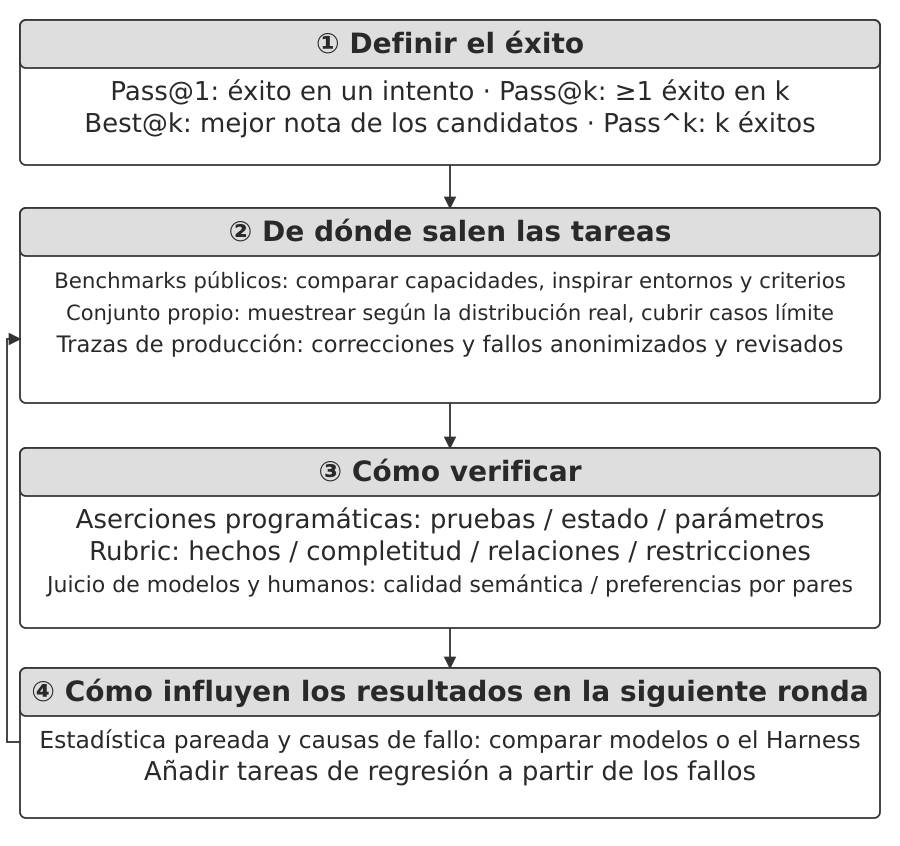
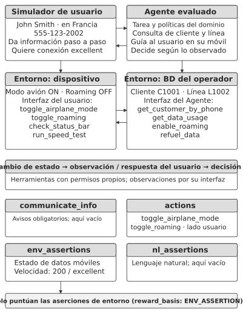
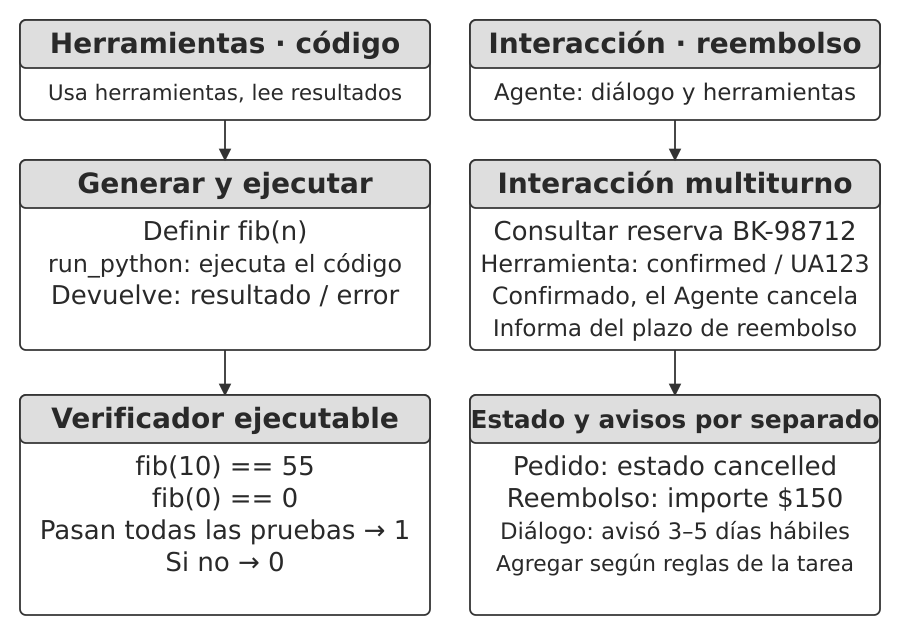
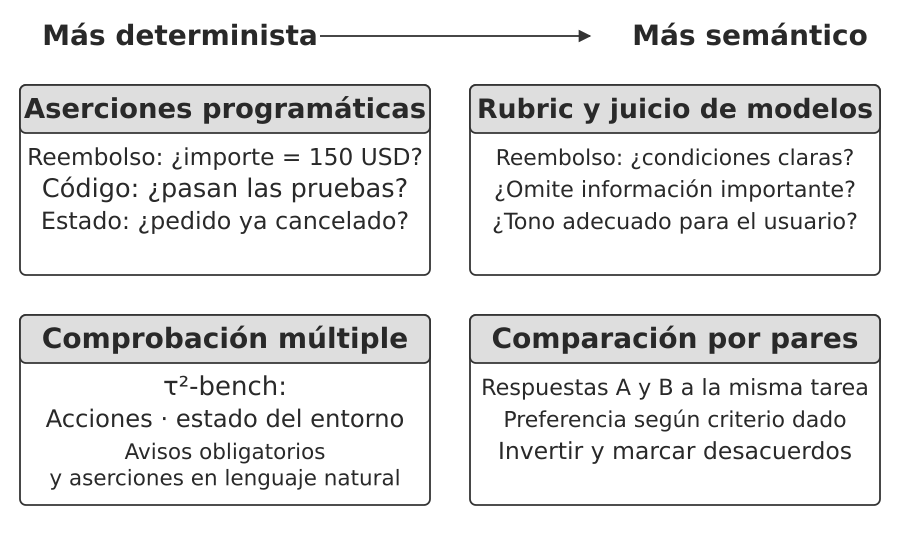
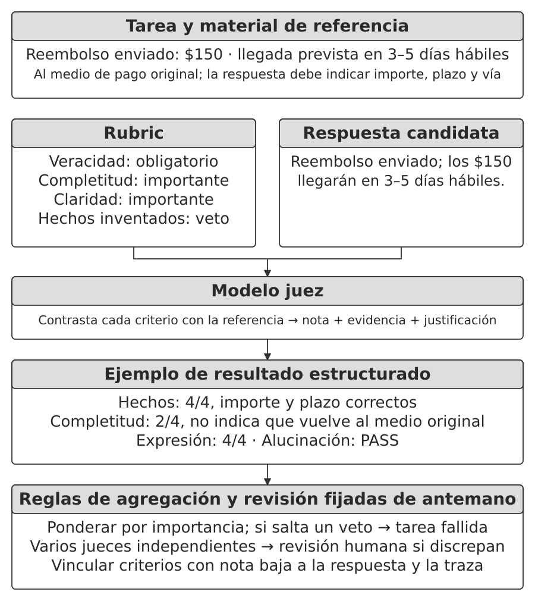
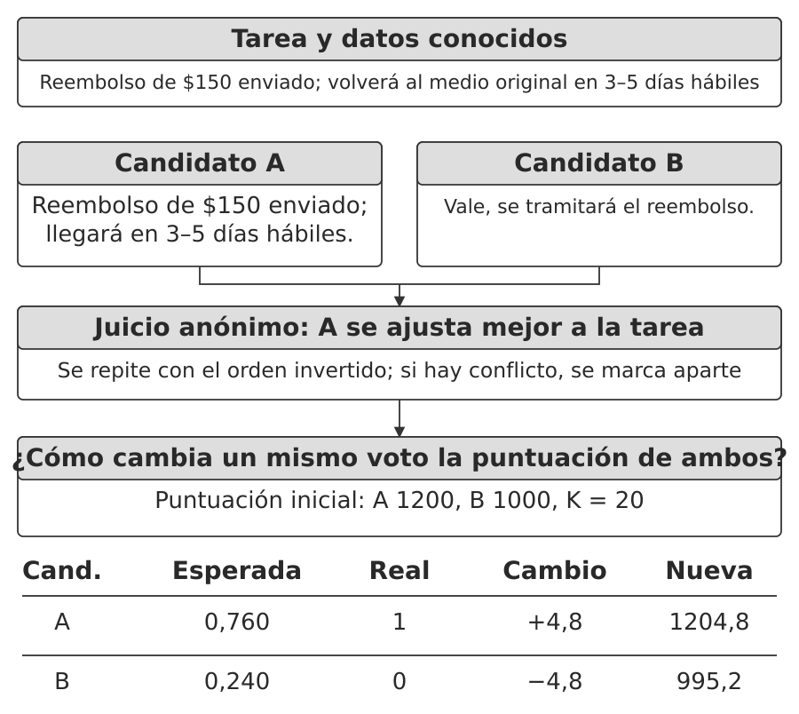
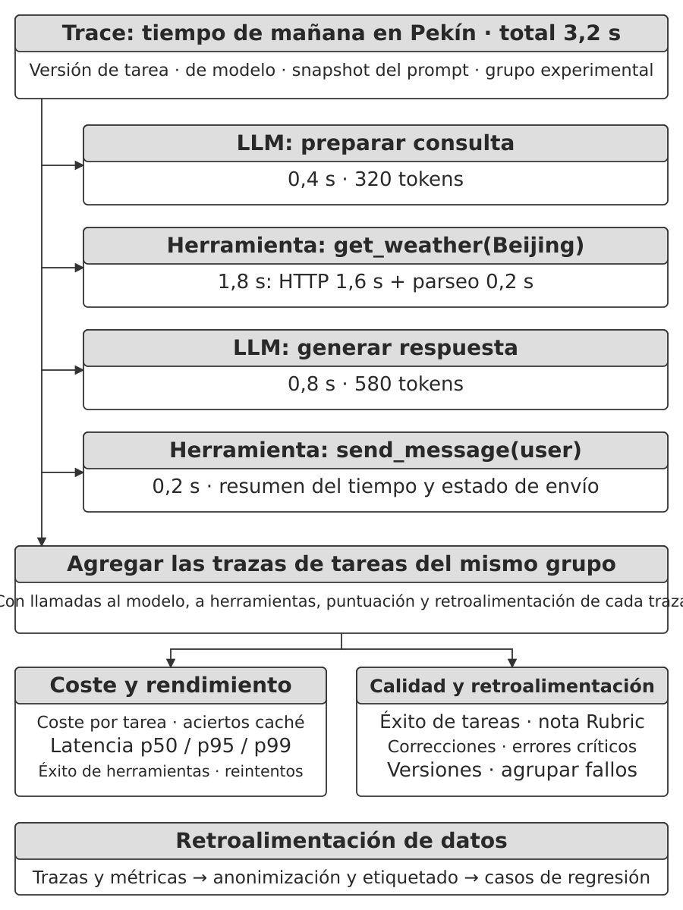
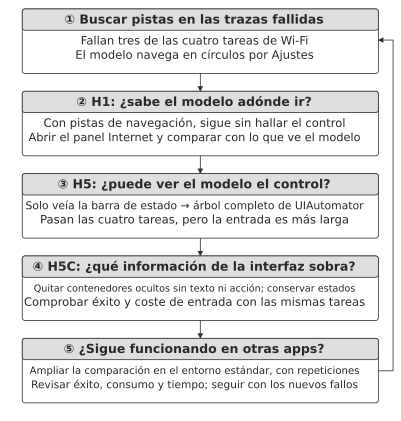
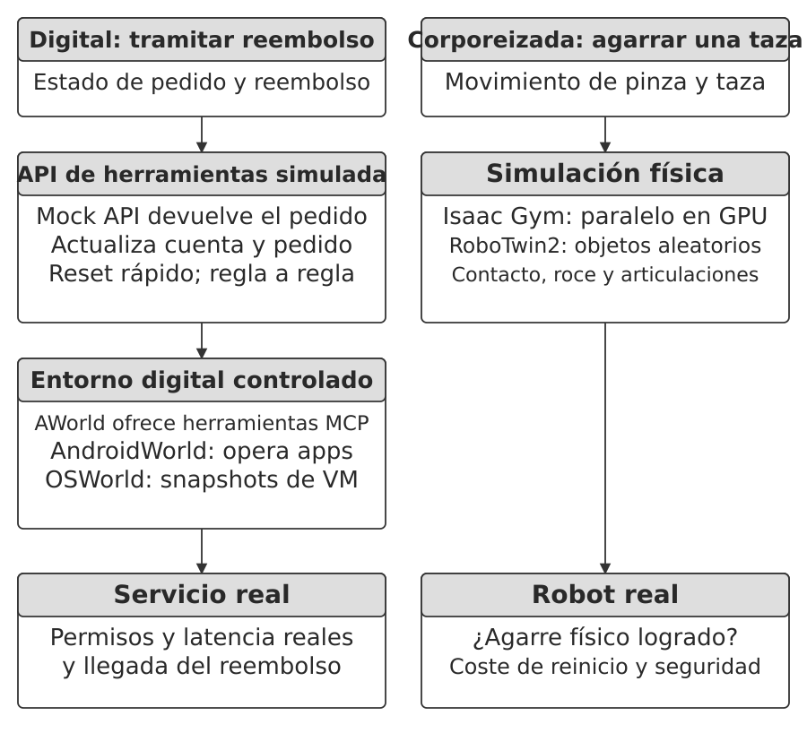
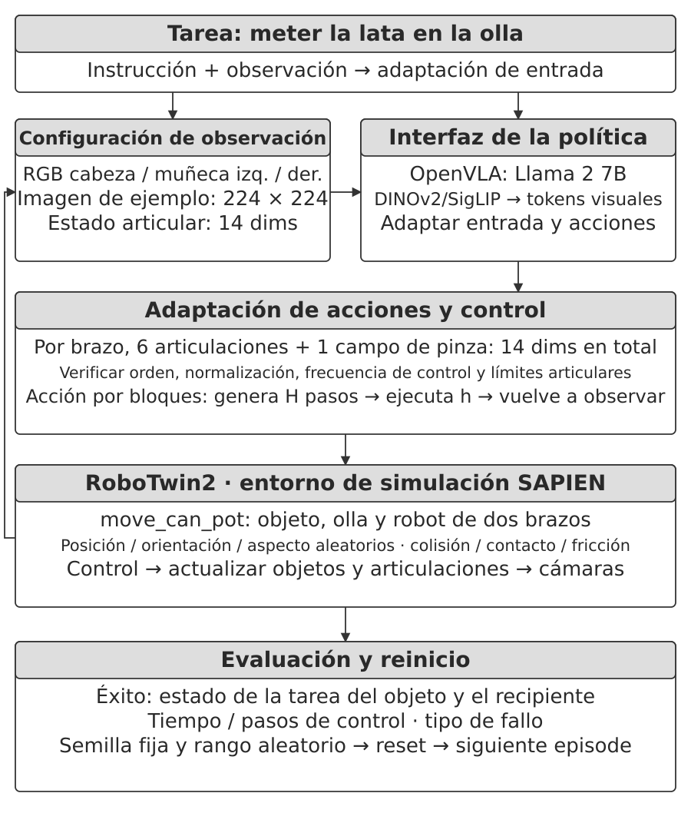

# Evaluación de Agentes

Los seis primeros capítulos han presentado la construcción de un Agente único: contexto, memoria, base de conocimiento, herramientas, código e interfaces de observación y acción. Una vez montado el sistema, hace falta un conjunto de tareas repetibles para determinar qué es capaz de hacer, en qué condiciones tiende a fallar y qué conviene cambiar a continuación. Los resultados de la evaluación sirven además de retroalimentación para el posentrenamiento y la evolución continua.

Durante el desarrollo, muchas decisiones solo pueden compararse con tareas reales: qué modelo usar, qué herramientas abrir, qué contenido e índice adoptar en la base de conocimiento, cómo organizar la memoria del usuario, los prompts y las Skills, y qué restricciones añadir al Harness. Además, las decisiones se influyen entre sí. Por ejemplo, una descripción de herramientas más detallada puede reducir los errores de parámetros, pero también aumentar el gasto de contexto; añadir un paso de verificación puede elevar la tasa de éxito y, a la vez, alargar el tiempo de ejecución.

Los **experimentos comparativos** contrastan distintas soluciones sobre las mismas tareas y en las mismas condiciones, y registran cómo cambian la tasa de éxito, el tiempo y el coste. Los **experimentos de ablación** eliminan o desactivan componentes como la reordenación de resultados de búsqueda, el resumen de estado o la verificación de resultados, y observan cómo cambia el comportamiento del sistema. Si en cada ronda se precisa qué se ha modificado, se mantienen constantes las demás condiciones de ejecución y se repite la medición, se va estableciendo poco a poco la relación entre las decisiones de ingeniería y los resultados de las tareas. El autor defiende integrar la comparación y la ablación en el desarrollo diario. Basándose solo en unas cuantas trayectorias que salieron bien, es muy fácil tomar un éxito casual por una mejora, o ver solo la ganancia en un tipo de tarea y pasar por alto el deterioro en otras.

**La evaluación debe tener como objeto el Agente completo, formado por el modelo y el Harness.** El modelo determina cómo se entiende la tarea y qué acciones se eligen; el Harness organiza el contexto, coordina las herramientas, mantiene el estado y ejecuta las comprobaciones. Un mismo modelo conectado a herramientas o flujos de retroalimentación distintos puede producir resultados diferentes. El Coding Harness presentado en el capítulo 5 ofrece justamente un escenario para este tipo de comparación.

Para estudiar cómo encajan el modelo y el Harness se puede recurrir al **experimento de sustitución de modelo (model swap)**: se fijan primero el marco de ejecución y las tareas, se sustituye el modelo y se comparan los resultados finales y la distribución de errores. Si un modelo más potente sigue fallando en los mismos pasos, conviene comprobar si falta alguna herramienta, si la retroalimentación llega a tiempo o si la puntuación cubre el objetivo; si el rendimiento cambia notablemente con el modelo, se analiza entonces qué capacidades de razonamiento, planificación o seguimiento de instrucciones influyeron en el resultado.

La sustitución de modelo y la ablación de componentes pueden cruzarse. Por ejemplo, se hace que dos modelos ejecuten cada uno dos configuraciones, «con resumen de estado» y «sin resumen de estado», para comprobar si el resumen ayuda a ambos a retomar tareas largas y si la ganancia depende del modelo. Así se analizan las diferencias entre modelos y, al mismo tiempo, se descubre en qué condiciones resulta eficaz un componente del Harness.

La evaluación es también la comprobación de regresiones ante una actualización de modelo. Un modelo nuevo puede progresar en los benchmarks públicos y, sin embargo, empeorar en ciertas tareas de negocio; un conjunto de tareas propio pone de manifiesto esos cambios. El autor defiende «desarrollar productos para los modelos del futuro»: tener listos de antemano las herramientas, los procesos de negocio y el conjunto de evaluación, y seguir de forma continua el rendimiento de los nuevos modelos en las mismas tareas. Cuando la tasa de éxito, el tiempo de respuesta y el coste alcanzan los requisitos del producto, se procede al lanzamiento.

¿Cómo se convierten los requisitos de lanzamiento en una evaluación? Al leer la figura 7-1 se puede seguir una prueba de principio a fin: qué se quiere medir, de dónde se eligen las tareas, con qué evidencia se dictamina el éxito y, por último, cómo se registran y comparan los resultados.



## Entender la evaluación a partir de una tarea: el dominio telecom de τ²-bench

Empecemos por una avería de conexión móvil. John Smith usa el número 555-123-2002, está en Francia y la barra de estado de su teléfono muestra «No Service». Quiere recuperar la conexión y solo considerará resuelta la avería si el test de velocidad da excellent; está dispuesto a recargar 2,0 GB de datos si hace falta y prefiere conservar su tarifa actual.

El caso procede del dominio telecom de τ²-bench, de Sierra. El entorno simula a la vez el sistema interno del operador y el dispositivo del usuario; el Agente de atención al cliente y el simulador de usuario leen y modifican, cada uno mediante sus herramientas, una parte de ese estado. La evaluación tiene que seguir la interacción de ambos lados para comprobar cómo se descubre el problema, cómo se ejecutan las operaciones y si al final se restablece la red.[^ch7-tau2-task]

### Los cuatro componentes de la definición de una tarea

Para que otro Agente de atención al cliente resuelva el mismo problema, primero hay que restaurar el estado del teléfono y de la cuenta, hacer que el usuario simulado colabore en el diagnóstico con las mismas pautas y, por último, puntuar con el mismo criterio. La tabla siguiente recoge las cuatro partes de la definición de la tarea. Al leerla, preste atención a una distinción: quien redactó la tarea conoce la configuración inicial del teléfono, pero ¿cuánto saben el agente de atención y el usuario al empezar la conversación?

| Parte | Campo | Contenido en este ejemplo |
| --- | --- | --- |
| Ticket | `ticket` | Usuario, número, país en que se encuentra, síntoma de falta de conexión, requisito del test de velocidad y restricción de tarifa |
| Escenario de usuario | `user_scenario.instructions` | Qué sabe el usuario, cómo consulta cuando se le pregunta y cuándo confirma que el problema está resuelto |
| Estado inicial | `initial_state.initialization_actions` | Fijar la identidad y la ubicación del usuario, activar el modo avión, desactivar la itinerancia en el dispositivo y dar de alta la itinerancia en el lado del operador |
| Criterios de puntuación | `evaluation_criteria` | Comprobar acciones y estado del entorno; `reward_basis` especifica qué partidas puntúan |

**Qué sabe el usuario.** `known_info` aporta el nombre, el número y el país en que se encuentra. Que el modo avión esté activado y la itinerancia del dispositivo desactivada se guarda en el estado del entorno: el simulador de usuario tiene que llamar a una herramienta para consultarlo antes de poder comunicarlo al agente de atención. Al separar en un campo propio lo que el usuario sabe, el simulador puede distinguir entre la información que puede dar directamente y la que debe consultar de verdad. Limitarse a pedir en el prompt «no lo cuentes todo de golpe» difícilmente controla de forma estable cuándo revela cada hecho. Esta disposición implementa la divulgación progresiva de información (Progressive Information Disclosure): la conversación empieza con «no tengo internet», y el Agente obtiene poco a poco, mediante preguntas e indicaciones, la información que necesita para el diagnóstico.

**Cómo responde el usuario.** `task_instructions` establece que muestre una leve frustración tras el primer intento de reparación fallido, que solo confirme la resolución si el test de velocidad da excellent, y exige que las respuestas sobre el dispositivo se basen en el resultado de las herramientas. Poor, fair y good no alcanzan el objetivo de esta tarea. El anclaje factual (Grounding) hace que el usuario responda según el estado real del entorno simulado. Sin esta restricción, el usuario simulado podría seguirle la corriente al agente de atención cuando dice «ya debería funcionar»; la conversación parecería fluida por ambos lados, mientras la avería del dispositivo seguiría ahí.

**De qué estado parten ambos lados.** En el lado del usuario, `set_user_info` fija la identidad, `set_user_location(abroad=true)` indica que está en el extranjero y después se ejecutan `turn_airplane_mode_on` y `turn_roaming_off`. En el lado del operador, `enable_roaming` da de alta la itinerancia en la línea `L1002` del cliente `C1001`. Por eso, una consulta al sistema interno puede mostrar que la itinerancia está activa, mientras el teléfono sigue sin conexión por el modo avión y la configuración de itinerancia del dispositivo. El agente de atención tiene que guiar al usuario para que revise el dispositivo y así obtener la información que la consulta al sistema interno no proporciona.

**Qué comprobaciones determinan la puntuación.** `actions` enumera `toggle_airplane_mode` y `toggle_roaming` en el lado del usuario. `env_assertions` contiene una comprobación del estado de los datos móviles y una del test de velocidad con los parámetros `expected_speed=200` y `expected_desc="excellent"`. El formato de las tareas ofrece además `communicate_info` y `nl_assertions`, que describen respectivamente la información que se debe comunicar al usuario y aserciones en lenguaje natural; en esta tarea ambas están vacías.

El `reward_basis` de esta tarea elige `ENV_ASSERTION`, de modo que la recompensa total depende de las aserciones sobre el entorno. Las comprobaciones de acciones pueden figurar en los resultados, pero si entran o no en la puntuación total lo decide la configuración de puntuación.

### Comprobar el resultado siguiendo la trayectoria de ejecución

La ejecución complementaria toma cinco tareas de telecom, ejecuta cada una una vez, usa GPT-4.1 mini tanto para el Agente de atención como para el simulador de usuario, y al final pasan cuatro. Analizamos primero la tarea de itinerancia en Francia descrita arriba y después la contrastamos con la tarea fallida.

> **Experimento 7-1 ★: Ejecutar τ²-bench y comparar su evolución respecto a τ-bench**
>
> Lea primero el escenario de usuario, las acciones de inicialización y las condiciones de puntuación de una tarea, y después ejecute una interacción completa. A lo largo de la trayectoria, marque las consultas del agente de atención, las operaciones del usuario, los cambios de estado y el resultado de la verificación, y compruebe en qué información se basó cada decisión.
>
> Al comparar τ-bench con τ²-bench, fíjese sobre todo en si el usuario puede modificar el entorno mediante herramientas y en qué exigencias de coordinación impone ese cambio al agente de atención.
>
> Al mirar la figura 7-2, busque primero quién puede desactivar el modo avión del teléfono y después quién puede modificar la configuración de itinerancia del operador. Lo que cada lado puede hacer es distinto, y eso explica por qué el agente de atención, después de completar sus propias operaciones, todavía tiene que pedir al usuario que haga un test de velocidad en el teléfono.
>
> 

En la tarea de itinerancia en Francia, el Agente empieza por identificar la cuenta. A partir del número encuentra al cliente `C1001` y consulta el consumo de datos de `L1001`, `L1002` y `L1003`, pero, basándose en los detalles de `L1001`, llega a una conclusión errónea: el 555-123-2002 que dio el usuario no figura entre las líneas activas y el número más parecido es el 555-123-2001. Después de que el usuario insista en que el número es correcto, el Agente consulta `L1002` y solo entonces confirma la línea correcta.

A continuación, el simulador de usuario llama a `check_network_status` y `check_status_bar`. El estado devuelto indica: modo avión activado, red celular sin servicio, datos móviles activados e itinerancia del dispositivo desactivada. El usuario informa entonces: «El teléfono está en modo avión y la itinerancia de datos también está desactivada. ¿Desactivo primero el modo avión?». Aquí la consulta la ejecuta una herramienta del lado del usuario, y el resultado llega al agente de atención a través de la conversación.

Este es el mecanismo de **doble control (Dual-Control)**: el agente de atención consulta y opera el sistema interno del operador, y el simulador de usuario dispone de sus propias herramientas del dispositivo, como ver la barra de estado, activar o desactivar el modo avión, volver a insertar la tarjeta SIM o ejecutar un test de velocidad. Ambos coordinan sus operaciones mediante la conversación, y el entorno registra los cambios de estado que provoca cada uno.

El Agente guía entonces al usuario para que desactive el modo avión y active la itinerancia del dispositivo, y la barra de estado muestra señal 5G. El usuario ejecuta `run_speed_test`, obtiene 275 Mbps con calificación Excellent y confirma que el problema está resuelto. Las dos aserciones de entorno pasan y la recompensa de esta tarea es 1.0.

Esta trayectoria con éxito deja ver también un problema de proceso. La política exige que el agente de atención llame a una sola herramienta cada vez, y sin embargo el Agente emitió `get_customer_by_phone` y `get_customer_by_name` en un mismo mensaje. Como la puntuación total de esta tarea solo incluye las aserciones de entorno, este comportamiento no alteró la recompensa.

En la otra trayectoria, la fallida, la línea se elige mal y nunca se corrige, y el diagnóstico posterior se desvía con ella. El número del usuario sigue siendo el 555-123-2002, pero el Agente selecciona `L1001` y continúa el diagnóstico con el consumo de 3,2/5 GB de esa línea. La herramienta ya había devuelto que `L1001` corresponde al 555-123-2001, y aun así no corrige la línea; tras muchos turnos de diagnósticos irrelevantes, deriva a un agente humano. En el lado del usuario se consigue desactivar el modo de ahorro de datos, pero la recarga de 2 GB que necesitaba la línea correcta, `L1002`, nunca se ejecuta, y las tres aserciones de entorno fallan.

Comparando ambas trayectorias, la puntuación final puede desglosarse en puntos de mejora concretos: comprobar la correspondencia entre número y línea, corregir el juicio a la luz de evidencia nueva, distinguir entre el estado del dispositivo y el del sistema interno, y verificar que la recarga necesaria se haya completado. Más adelante, la sección de atribución de fallos retomará cómo localizar estos giros decisivos dentro de una trayectoria larga.

[^ch7-tau2-task]: τ²-bench, de Sierra Research, define las herramientas del usuario del dominio telecom en `user_tools.py`, y el punto de entrada de la puntuación es `evaluator.py`. El contenido del caso y los resultados se han elaborado a partir de las cinco tareas y las trayectorias de ejecución conservadas en el material complementario.

## Métricas de evaluación: la definición del éxito

Cinco tareas, cuatro superadas: ese es el resultado global de esta ejecución. Para tomar decisiones de producto a partir de él hay que precisar además el tipo de tarea y el coste del fallo. Un servicio de atención de reembolsos necesita completar de forma sostenida los reembolsos que cumplen las condiciones; al escribir un programa se pueden generar varias implementaciones y descartar con tests las que no arrancan o no dan el resultado correcto; en investigación también se pueden plantear varias hipótesis y dejar que el investigador las verifique. La métrica de evaluación debe corresponder a ese modo de uso.

### Prodigio técnico: medir con Pass@k la capacidad en múltiples intentos

El autor llama «prodigio técnico» a algunas demostraciones de Agentes que impresionan: se da al sistema tiempo y oportunidades de intento suficientes, y completa una tarea que hasta entonces era difícil de automatizar. En el trabajo exploratorio, una sola trayectoria de éxito verificada puede aportar valor. La métrica **Pass@k** corresponde a ese modo de uso: se ejecuta la misma tarea $k$ veces y basta con que pase una para contarla como éxito. En tareas con puntuación continua también puede informarse la mejor puntuación de las $k$ ejecuciones, lo que se denomina **Best@k**.

Por ejemplo, Anthropic reunió a varios Claude para construir un compilador de C de forma colaborativa y demostró que la ejecución prolongada, la retroalimentación de los tests y el reparto de tareas sostienen un proyecto de ingeniería complejo. Cuando un investigador busca un contraejemplo matemático, también puede hacer que el modelo lo intente una y otra vez y verificar después, de forma independiente, si alguno de esos contraejemplos se sostiene. La revisión de seguridad del software permite comprobar los problemas sospechosos que señala el modelo, y en la creación abierta se puede elegir la mejor entre varias obras.[^ch7-long-running]

Los productos de aplicación también muestran su capacidad mediante tareas complejas. Manus pone una computadora virtual en manos del Agente, de modo que el usuario lo ve manejar la interfaz, buscar información y completar trabajo de forma continuada. OpenClaw recibe encargos por mensajería instantánea, accede a los archivos y servicios ya configurados y autorizados, informa del avance, pide información adicional sobre la marcha, y además puede despertarse mediante un mecanismo programado para revisar los pendientes. Estos comportamientos concretos hacen que al usuario le resulte más fácil entender para qué sirve un Agente.

A juicio del autor, las demostraciones capaces de completar tipos de tarea nuevos son un factor importante del atractivo de estos productos.

### Fiabilidad de negocio: la atención a Pass^k

Los procesos de negocio suelen exigir que varias ejecuciones entreguen el resultado correcto. **Pass^k** mide el caso en que la misma tarea se ejecuta $k$ veces y pasa en todas, y puede leerse como «pass elevado a k». Las condiciones de superación de una tarea pueden abarcar a la vez el resultado final, la aplicación de la política y las restricciones de permisos; cada ejecución se comprueba con las mismas condiciones.

Si se supone que las ejecuciones son independientes y que la probabilidad de éxito de una sola es siempre $p$, entonces:

$$
\mathrm{Pass@k}=1-(1-p)^k,\qquad
\mathrm{Pass}^{k}=p^k.
$$

Por ejemplo, con $p=0.6$ y $k=5$, Pass@5 es aproximadamente 99,0 % y Pass^5 aproximadamente 7,8 %. Lo primero indica que en cinco intentos suele encontrarse uno que sale bien; lo segundo, que la probabilidad de acertar los cinco sigue siendo baja.

Al leer un conjunto de resultados reales puede prescindirse de las fórmulas. Suponga que las cinco ejecuciones de una misma tarea dan «acierto, fallo, acierto, acierto, fallo»: esa tanda registra Pass@5 = 1 y Pass^5 = 0, y la tasa de éxito por ejecución se estima en 3/5. El 99,0 % y el 7,8 % de antes responden a otra pregunta: si se sabe que la probabilidad de éxito de cada ejecución es 0,6, ¿cuántas tandas de cinco alcanzarían el criterio correspondiente si se repitieran muchas veces?

El mismo registro permite responder a una pregunta más fácil de comprobar: si se toman dos ejecuciones cualesquiera de esas cinco, ¿qué proporción de parejas pasa? Si cada ejecución es una tarjeta y se toman dos sin reemplazamiento, hay diez parejas en total. Solo la pareja formada por las dos tarjetas de fallo hace que ambas fallen, así que nueve parejas aciertan al menos una vez y la estimación muestral de Pass@2 es 9/10. Las tres tarjetas de acierto forman entre sí tres parejas, de modo que la estimación muestral de Pass^2 es 3/10. τ²-bench cuenta precisamente así, tarea por tarea, las combinaciones en que todas pasan: si una tarea se ejecuta $n$ veces con $s$ éxitos y se eligen $k$ ejecuciones, la proporción de combinaciones en que todas pasan es $\binom{s}{k}/\binom{n}{k}$, con $1\le k\le n$.[^ch7-tau2-metrics]

Volvamos ahora al 4/5 del experimento 7-1. Esas cinco trayectorias pertenecen a cinco tareas distintas, y cada tarea aporta una sola tarjeta: no se puede formar ni una pareja. Para estimar el Pass^2 de estas tareas hay que añadir ejecuciones independientes a cada una y calcular y agregar después por separado. Elevar 0,8 al cuadrado equivale a suponer además que todas estas tareas tienen la misma probabilidad de éxito en cada intento y que los intentos son independientes entre sí.

[^ch7-tau2-metrics]: La versión experimental de τ²-bench (revisión 8d005b0) calcula Pass^k tarea por tarea en `agent_metrics.py`. Cuando el número de éxitos es menor que $k$, el número de combinaciones en que todas pasan es cero.

Al calcular hay que mantener la misma unidad estadística. Las cinco muestras de una misma tarea miden el comportamiento repetido de esa tarea; cinco tareas distintas consecutivas en producción se ven afectadas además por la dificultad de cada tarea y por la distribución del tráfico. Cuando las tareas tienen probabilidades de éxito diferentes, se puede calcular primero la métrica de éxito repetido de cada una y agregarla después con el peso de cada tarea. Un estado compartido, una caché o una misma avería también hacen que varias ejecuciones estén correlacionadas.

**Cuando se permite responder «información insuficiente», ¿cómo se elige el denominador?** Suponga que un asistente bibliográfico recibe 100 preguntas, responde 80 y acierta 68. A un lector que depende de las respuestas dadas le interesa 68/80, es decir, el 85 %; a quien necesita despachar todo el lote le interesa además 68/100, es decir, el 68 %. Otras 20 preguntas requieren buscar más pruebas o pasarlas a una persona.

En las 248 preguntas bibliográficas de LitQA2, PaperQA2 puede elegir «información insuficiente». El artículo informa de la media de tres ejecuciones: cuando el sistema da una respuesta sustantiva, la precisión es del 85,2 %; contando todas las preguntas, la precisión es del 66,0 %, y en otro 21,9 % elige información insuficiente. En nueve personas que respondieron, los dos valores correspondientes son 73,8 % y 67,7 %. El artículo informa de que la primera diferencia es significativa y la segunda no alcanza significación estadística.[^ch7-paperqa2-denominators]

[^ch7-paperqa2-denominators]: Skarlinski et al., *Language Agents Achieve Superhuman Synthesis of Scientific Knowledge*, 2024, véanse la sección 2 y la figura 2.

Dos trayectorias con el mismo estado final pueden tener costes distintos. Tomemos la consulta de una factura: la primera devuelve el importe correcto con una sola consulta; la segunda necesita dos consultas para dar la misma respuesta. Si ambas consultas llevan el mismo identificador de petición y la primera había expirado, la repetición fue lo que permitió recuperar la tarea. Si el resultado de la primera ya había llegado correctamente, la segunda consulta solo añadió tiempo de espera y coste de herramienta sin aportar nada.

Cuando la ejecución implica escrituras u otros efectos externos, conviene restaurar primero el estado inicial prescrito para cada ensayo, realizar las operaciones en un entorno de prueba y registrar todos los intentos. Si el producto permite reintentar tras un fallo, hay que incorporar a la evaluación del flujo el número de reintentos, los pasos de recuperación y el coste de ejecución; el registro original del fallo se conserva para poder distinguir el rendimiento de un solo intento del resultado tras la recuperación.

[^ch7-long-running]: Anthropic, Building a C compiler with a team of parallel Claudes, 2026-02-05, sobre la colaboración entre varias instancias, la ejecución de larga duración y la retroalimentación de los tests.

## El entorno de evaluación

Suponga que quiere revisarse la ejecución anterior en la que se eligió mal la línea. Quien revise necesita ver al mismo usuario, las mismas dos líneas y la misma tarifa inicial. Si la primera ejecución ya modificó una de las líneas, volver a ejecutar sin más no permite saber si el cambio en el resultado proviene del modelo o de la base de datos. El entorno de evaluación se encarga de establecer el punto de partida de la tarea, ofrecer las interfaces de interacción, registrar el proceso y comprobar el punto final.

### Los cinco componentes

Tomando las tareas de telecom como ejemplo, el entorno de evaluación puede descomponerse en cinco partes.

El **conjunto de datos (Dataset)** guarda la definición de la tarea: antecedentes del usuario, requisitos de comportamiento, estado inicial y condiciones de aceptación. Un registro corresponde a un caso de prueba, y al ejecutar se distribuye la información según el papel de cada participante.

El **estado del entorno (Environment State)** guarda la información variable durante la ejecución: clientes, líneas, tarifas y facturas, así como el modo avión, la itinerancia y el ahorro de datos del dispositivo. Al empezar una ronda nueva, el entorno restaura primero los datos base y después ejecuta `initialization_actions` para crear la avería que prescribe la tarea actual. La limpieza y la inicialización deben ir de la mano para que una recarga o un cambio de configuración de la ronda anterior no se cuele en la siguiente.

La **interfaz de herramientas (Tools)** determina qué pueden leer y cambiar los participantes. El agente de atención puede consultar al cliente, revisar el consumo, recargar datos o derivar a una persona; el usuario puede ver el estado del dispositivo, accionar interruptores y hacer tests de velocidad. La granularidad de las herramientas debe corresponder a la capacidad evaluada: si se quiere evaluar el diagnóstico y la planificación, hay que dejar que el Agente combine consultas y operaciones; si se ofrece directamente una herramienta de «arreglar el problema de conexión», el foco de la prueba pasa a ser cuándo se invoca esa capacidad.

El **criterio de puntuación (Rubric)** explica cómo se dictamina el resultado. En las tareas de telecom se pueden comprobar las acciones, el estado del entorno, la comunicación necesaria y los requisitos en lenguaje natural, y después `reward_basis` determina qué comprobaciones entran en la puntuación total.

El **protocolo de ejecución (Interaction Protocol)** organiza los turnos de palabra, las llamadas a herramientas y la terminación. El simulador de usuario puede emitir `###STOP###` para cerrar la interacción, y el ejecutor fija además un presupuesto de turnos. El motivo de la terminación y la puntuación de la tarea se registran por separado: cuando el usuario detiene la conversación, las aserciones de entorno siguen siendo las encargadas de determinar si se alcanzó el objetivo; si se agota el presupuesto, también hay que conservar el estado final y los pasos que quedaron sin completar.

### Entornos de evaluación de interacción humano-computadora y de llamada a herramientas

Las tareas de telecom incluyen un simulador de usuario que responde de forma continua y opera el dispositivo. La reparación de código, el análisis de datos y la resolución de problemas matemáticos, en cambio, suelen arrancar con las instrucciones de la tarea, y a partir de ahí el Agente interactúa sobre todo con herramientas. Ambos tipos de entorno necesitan tareas, estado, interfaces, criterios de puntuación y protocolo de ejecución; la diferencia está en si hay que simular un interlocutor y en cómo coordinan sus acciones las dos partes.

En una tarea de código se puede comprobar la salida con tests; en una tarea de base de datos, consultar los registros modificados; en un análisis abierto, quizá haya que pedir a una persona o a un modelo que valore el contenido. Las tareas de interacción humano-computadora suelen exigir, además, reunir dos piezas de evidencia. Por ejemplo, si se ha restablecido la conexión móvil se ve en el estado del dispositivo; si el agente de atención aclaró el número y guio al usuario, se ve en la conversación. Lo mismo ocurre con el reembolso de la figura 7-3: si el pedido ya se canceló se puede consultar en la base de datos; si el agente de atención informó del plazo de abono hay que buscarlo en la conversación.



En Verifiers, estos dos tipos de tarea pueden abordarse con interfaces de entorno distintas. La tabla 7-1 enumera las de la versión 0.1.9 que atienden la respuesta de un solo turno, la llamada a herramientas de varios turnos, la inyección del estado de ejecución y la gestión de recursos del sandbox, para poder contrastarlas con el código.[^ch7-verifiers-env]

Tabla 7-1 Comparación de los tipos de entorno de Verifiers

| Tipo de entorno | Responsabilidad principal | Tratamiento de herramientas y estado | Caso de uso típico |
|---|---|---|---|
| `SingleTurnEnv` | Organizar una respuesta de un solo turno | Puntuar tras una única respuesta | Problemas matemáticos, preguntas de un turno |
| `ToolEnv` | Organizar interacción con herramientas de varios turnos | Guardar la trayectoria, despachar herramientas y recibir resultados | Búsqueda y síntesis de información |
| `StatefulToolEnv` | Conectar el estado de ejecución con la ejecución de herramientas | Añadir parámetros según el estado actual o actualizar el estado | Vincular a la tarea una base de datos o un identificador de recurso |
| `SandboxEnv` | Gestionar un entorno de ejecución aislado | Asignar un sandbox a la ejecución y usar sus herramientas | Ejecutar código, revisar archivos y resultados de tests |

Por ejemplo, cuando dos tareas modifican la base de datos a la vez, el ejecutor puede inyectar en la llamada a la herramienta el identificador de base de datos de cada una, de modo que cada trayectoria opere sobre sus propios datos. Si la ejecución falla, la herramienta debe devolver información que sirva para decidir el paso siguiente, como que el objeto no existe, que un parámetro no cumple los requisitos o que el servicio ha expirado. El sistema de evaluación guarda observaciones, llamadas, resultados de ejecución y recompensas, de modo que al analizar se puede localizar el error en el paso concreto.

[^ch7-verifiers-env]: Prime Intellect, ToolEnv y StatefulToolEnv de Verifiers v0.1.9, que muestran trayectorias de varios turnos, el despacho de herramientas y la inyección de parámetros de estado.

## Diseño del conjunto de datos de evaluación

Ampliemos ahora las cinco tareas de telecom hasta formar un conjunto de evaluación capaz de orientar un lanzamiento. Si todas las tareas nuevas fueran «dar de alta la itinerancia en un número dado», el sistema podría sacar una puntuación alta sin haber aprendido nunca a distinguir dos líneas de una misma cuenta. Si la puntuación va a decidir si el agente de atención sale a producción, la selección de tareas tiene que inspirarse en tickets reales, con operaciones habituales y también con casos difíciles en los que las líneas se confunden con facilidad, y al puntuar hay que comprobar qué línea modificó finalmente el agente. Tras el lanzamiento, además, hay que mantener esas tareas para que sigan reflejando el trabajo que los usuarios encargan de verdad.

### Comparación transversal del diseño de benchmarks

La tabla 7-2 pone en paralelo seis benchmarks según la capacidad evaluada, el origen de las tareas, el entorno de ejecución y el modo de verificación.

Tabla 7-2 Decisiones clave de diseño de varios benchmarks de Agentes

| Benchmark | Capacidad evaluada | Origen y organización de las tareas | Entorno de ejecución | Modo de verificación |
|---|---|---|---|---|
| τ²-bench | Interacción de atención al cliente y manejo de herramientas | Tareas del dominio combinadas con averías | Simulador de usuario, dispositivo y base de datos de negocio | Comprobaciones por partidas, puntuadas según `reward_basis` |
| SWE-bench Verified | Reparación de problemas de código | Issues reales de GitHub, cribados a mano | Repositorio de código y entorno de tests | Tests `FAIL_TO_PASS` y `PASS_TO_PASS` |
| AndroidWorld | Manejo de aplicaciones Android | Plantillas de tareas parametrizadas | Emulador Android con aplicaciones reales | Lectura del estado del dispositivo, de archivos o interno de la aplicación |
| OSWorld | Manejo de escritorio y entre aplicaciones | Escenarios de uso reales con punto de partida configurado | Máquina virtual y aplicaciones de escritorio | Comprobación del estado de ejecución y de los productos según la tarea |
| Terminal-Bench | Tareas de ingeniería en el terminal | Tareas y tests diseñados a mano | Contenedor con las dependencias que requiere la tarea | Archivos, ejecución de programas y resultados de tests |
| GAIA | Tratamiento de información por un asistente general | Preguntas redactadas a mano, algunas con material adjunto | Red, archivos y herramientas auxiliares | Comparación tras normalizar según el formato de respuesta |

### Verificadores

El verificador conecta el objetivo de la tarea con evidencia comprobable. Las tareas de código requieren ejecutar tests; las de escritorio, leer el estado de la aplicación o de los archivos; las de búsqueda de información, contrastar la respuesta y sus fuentes. **La aceptación debe basarse en evidencia obtenida de forma independiente.** El Agente puede generar un informe completo afirmando que ha terminado todos los pasos; el verificador tiene que ejecutar de verdad el producto, leer el estado o contrastar las fuentes. El informe de finalización sirve para localizar qué comprobar; la puntuación la deciden esas comprobaciones.

Imagina que un usuario abre una aplicación de pagos y pide al asistente que «apruebe todas las solicitudes de cobro que le ha enviado este mes su compañero de piso». Supongamos que hay tres pendientes: la de este mes del compañero de piso, la del mes pasado de ese mismo compañero y la de este mes de un compañero de trabajo. La primera debe aprobarse y las otras dos deben quedar pendientes. Si solo se comprueba la primera, incluso un asistente que apruebe las tres obtendrá la máxima puntuación; si solo se comprueban las otras dos, un asistente que no haga nada también aprobará. AppWorld plantea esta tarea en una aplicación de pagos simulada. Al diseñar el verificador, se puede delimitar primero, con los datos previos a la operación, el lote de solicitudes que autorizó el usuario, comprobar después si todas se aprobaron y, por último, revisar a la inversa los registros posteriores: ¿qué otras solicitudes tocó el asistente?[^ch7-appworld-scope]

[^ch7-appworld-scope]: Trivedi et al., *AppWorld*, ACL 2024; la figura 2 presenta la tarea y las condiciones de aceptación.

La búsqueda científica también puede entregar un producto fácil de verificar. FunSearch intenta elegir el mayor número posible de puntos en un espacio de ocho dimensiones, donde cada coordenada solo puede valer 0, 1 o 2, las operaciones se hacen módulo 3 y ningún trío de puntos elegidos puede estar alineado. Los investigadores escribieron el esqueleto de un programa que elige puntos paso a paso, dejaron que el modelo propusiera la función que ordena los puntos candidatos y puntuaron por el tamaño del conjunto válido realmente construido. Cuando se publicó el artículo, la mejor construcción conocida elegía 496 puntos; el nuevo programa entregó una lista de 512.[^ch7-funsearch-cap]

Basta con descargar la lista para comprobar el resultado de forma independiente. Primero se confirma que contiene 512 vectores de ocho dimensiones distintos y que cada coordenada está dentro del rango establecido. Después, para dos puntos distintos cualesquiera $a,b$, la recta que pasa por ellos tiene solo tres puntos, y el tercero es $c=-a-b \pmod{3}$. Por ejemplo, en dos dimensiones, con $(0,0)$ y $(1,2)$ el tercer punto es $(2,1)$. Aplicando la misma operación coordenada a coordenada en ocho dimensiones y recorriendo los 130.816 pares de puntos distintos de la lista, ninguno de los terceros puntos obtenidos aparece en la lista. Esto basta para demostrar que se pueden elegir al menos 512 puntos. Demostrar que 513 es imposible requiere además una cota superior.

[^ch7-funsearch-cap]: Romera-Paredes et al., *Mathematical discoveries from program search with large language models*, Nature, publicado en línea en 2023. Los autores publicaron aparte el conjunto de puntos en ocho dimensiones y el cuaderno de cálculo para verificarlo.

**Los dos tipos de tests de SWE-bench comprueban por separado la reparación y la regresión.** `FAIL_TO_PASS` son los tests que fallan antes del arreglo y deben pasar después; `PASS_TO_PASS` son los que ya pasaban y deben seguir pasando tras el arreglo. Los primeros comprueban el problema señalado; los segundos, que se conserve el comportamiento cubierto por los tests existentes.[^ch7-swe-verified]

**OSWorld usa verificación por ejecución para comprobar los productos de las aplicaciones.** La versión original ofrece 134 funciones de evaluación por ejecución que, combinadas con la configuración de la tarea, leen archivos, datos de aplicaciones o el estado del sistema.[^ch7-osworld-design] Por ejemplo, si se pide modificar una hoja de cálculo, se pueden comprobar las celdas y fórmulas indicadas; si se pide actualizar la configuración del navegador, se puede leer la configuración correspondiente.

**Terminal-Bench acepta las tareas de ingeniería por los resultados de ejecución.** El caso de compilar el kernel de Linux encadena la modificación del código fuente, la compilación, el initramfs y el arranque en QEMU; Linux 6.9, el `printk` propio dentro de `start_kernel` y el mensaje en el log de arranque ofrecen puntos de comprobación concretos.

En el capítulo 5 se vio cómo cuadrar las ventas a partir de los pedidos. Si el asistente entrega un informe trimestral de veinte canales, ¿por dónde se empieza a comprobar? Tencent WorkBuddy Bench tiene una tarea pública de conciliación. Las dos hojas contienen datos por canal: el importe liquidado se compara de forma intertrimestral, con el trimestre anterior; el importe cobrado se compara de forma interanual, con el mismo trimestre del año anterior. Aunque se tomen ambos periodos base como el trimestre anterior, los encabezados y el número de canales pueden ser perfectamente correctos. Tomando como ejemplo «锦绣生活馆» (Jinxiu Shenghuoguan) en la hoja de liquidaciones, si se eliminan del detalle las filas duplicadas y los registros sin trimestre y se agrega por canal y trimestre, se obtiene que el volumen total de transacciones pasa de 1.569.231,00 a 1.787.311,03, con una diferencia de 218.080,03. El programa de puntuación comprueba la cobertura de canales en ambas hojas y después verifica por muestreo los valores de dos canales determinados. En esta tarea, la comprobación de cobertura abarca los veinte canales, mientras que la de valores solo afecta a los dos elegidos.[^ch7-workbuddy-office]

[^ch7-workbuddy-office]: Tencent WorkBuddy Bench, tarea de oficina `channel-period-compare-L4-017`. El paquete de datos utilizado (revisión 3e8ad83) incluye el libro de trabajo original, la respuesta de referencia y el programa de puntuación.

Una tarea sensible al tiempo sirve para poner a prueba un verificador. Suponga que el usuario pide que se le avise cuando el precio de cierto hotel baje de 950 yuanes. A las 10:00 el precio es de 1000 yuanes, a las 10:10 baja a 900 y a las 10:15 vuelve a 1000. Un aviso de bajada enviado a las 10:12, con el tipo de habitación y el enlace de reserva, todavía le da al usuario la oportunidad de reservar. Un sistema que envíe cada día un «todavía no ha bajado» y justo se pierda esos cinco minutos no habrá cumplido el encargo aunque funcione una semana entera. Al puntuar se registran por separado el número de ventanas que cumplen la condición, el número de avisos enviados a tiempo dentro de la ventana y el número de veces que se molestó al usuario sin que hubiera cambios. Si el evaluador también guarda solo un precio al día, las ventanas perdidas ni siquiera se pueden contar. Para medir las omisiones hay que preparar primero una reproducción completa de precios con marca de tiempo y dejar que el sistema evaluado consulte con su propia frecuencia.

### Clasificación de las tareas por dificultad

El conjunto de tareas debe cubrir distintos niveles de dificultad y explicar de dónde procede esa dificultad. Las tareas básicas comprueban si la capacidad se ha deteriorado, y las difíciles dejan margen de medición para los avances futuros de los modelos; si todas las tareas se superan enseguida, el conjunto deja de servir para orientar la elección de modelo. Puede clasificarse según el tipo de herramientas, la longitud de las operaciones, el grado de dispersión de la información, la incertidumbre del entorno o el conocimiento especializado necesario, para ver después en qué condiciones se deteriora claramente el sistema.

Las 466 preguntas de GAIA se dividen en tres niveles. Las tareas más sencillas suelen implicar pocas herramientas y pocos pasos, y las más difíciles exigen integrar información en varios pasos y combinaciones complejas. En el artículo original, los anotadores humanos alcanzan una precisión del 93,9 %, el 91,8 % y el 87,3 % en los tres niveles; GPT-4 con plugins obtiene el 30,3 %, el 9,7 % y el 0 %.[^ch7-gaia-design]

Las tareas de Terminal-Bench abarcan también un amplio abanico: el registro de modelos implica usar MLflow, el despliegue multicomponente exige coordinar un servicio Git y un servicio web, y la recuperación de contraseñas y el criptoanálisis diferencial de FEAL incorporan conocimientos algorítmicos especializados.

Las tareas de negocio también deben cubrir los límites de la política. Por ejemplo, cuando el usuario afirma que el servicio de atención ya aprobó la cancelación de un pedido, el sistema debe consultar la autorización y el estado del pedido y decidir después, según la política, si cancela. Estos casos evalúan cómo usa el Agente la evidencia para tratar información contradictoria, y pueden plantearse emparejados con tareas de tramitación normal.

### Prevención de la fuga de datos

**Combinación de varias fuentes y adjuntos propios.** Si el modelo puede encontrar la pregunta y una respuesta ya hecha en los resultados de búsqueda, ¿cuánta capacidad de búsqueda y razonamiento demuestra un acierto? GAIA reduce esa posibilidad con búsquedas de varios pasos y adjuntos propios. Por ejemplo, primero se identifica a un astronauta en la imagen astronómica de cierto día, luego se averigua a qué grupo de astronautas pertenecía, se compara el tiempo en órbita de sus miembros y, por último, se devuelven el apellido y los minutos en el formato exigido. El punto y coma, el redondeo de los valores y el separador de millares forman parte de las convenciones de la respuesta. Los PDF, audios e imágenes elaborados expresamente multiplican las combinaciones de entrada. Las preguntas publicadas pueden acabar en el material de entrenamiento. Por eso conviene reservar además un lote de preguntas exclusivamente para evaluación y registrar cuáles se han usado ya para entrenar.[^ch7-gaia-design]

**Instancias parametrizadas.** AndroidWorld proporciona a cada tarea la lógica de inicialización, comprobación de la ejecución y limpieza, y genera instancias distintas mediante parámetros.[^ch7-androidworld-design] Por ejemplo, «cambiar el teléfono del contacto `[CONTACT_NAME]` a `[NEW_PHONE]`» puede variar el contacto y el número manteniendo el mismo objetivo de operación. La variación de parámetros permite comprobar si el modelo actúa según la tarea actual; fijar unos parámetros y variar el resto facilita además estudiar el efecto de factores concretos.

**Identificadores canario.** Los archivos de un benchmark pueden incrustar un canary GUID único que ayuda a descubrir indicios de que los datos se han copiado o mezclado con otros corpus. Los archivos de tareas de Terminal-Bench usan este tipo de marca. Para juzgar una fuga hay que comprobar también si el modelo vio el identificador en el contexto actual o en los resultados de búsqueda, y combinarlo con el rastreo del origen de los datos; encontrar la marca puede desencadenar una investigación, pero atribuir datos de entrenamiento requiere más evidencia.

### Control de calidad y mantenimiento a largo plazo

Si una misma tarea de telecom pasó ayer y falla hoy, además de revisar los cambios del Agente hay que poder responder: ¿ha cambiado la línea inicial? ¿Sigue colaborando el usuario simulado con las mismas reglas? ¿Siguen las condiciones de corrección midiendo el mismo objetivo? Siguiendo el punto de partida, la interacción y el punto final de una ejecución, pueden ordenarse cinco tareas de mantenimiento.

1. **Delimitar la información del usuario.** Separar `known_info` de los requisitos de comportamiento para que los pasos de consulta y aclaración tengan un punto de partida informativo claro.
2. **Redactar con claridad las condiciones de aceptación.** Concretar «la red se ha restablecido» en el estado de los datos móviles, el valor del test de velocidad y su calificación, para comprobar el efecto que la tarea exige de verdad.
3. **Restringir la base de las respuestas del usuario simulado.** El estado del dispositivo procede del resultado de las herramientas; las reglas de emoción y paciencia sirven para organizar la interacción.
4. **Representar las operaciones de ambas partes.** Usuario y agente de atención modifican cada uno el entorno, y las decisiones posteriores obtienen información nueva sobre el estado mediante las herramientas disponibles o la conversación.
5. **Combinar tareas y averías.** Variar, con reglas de generación explícitas, las combinaciones de averías y los parámetros de la tarea, y comprobar después que cada instancia tiene solución y que el estado inicial se ajusta a la definición de la tarea.

**SWE-bench Verified muestra el cribado manual previo a la publicación.** El proyecto invitó a 93 desarrolladores con experiencia en Python a anotar 1699 muestras elegidas al azar, comprobando sobre todo si la descripción del problema era suficiente y si los tests descartaban soluciones razonables, y estimando la dificultad de la reparación; cada muestra la revisaron de forma independiente tres anotadores. El conjunto Verified publicado contiene 500 muestras.[^ch7-swe-verified] Las reglas de cribado se publicaron junto con la distribución de dificultad, de modo que los usuarios pudieran juzgar qué exigencias de capacidad se conservaban al reducir el conjunto. Las tareas de Agentes suelen requerir muchas llamadas al modelo y operaciones sobre el entorno, y una tarea ambigua o sin solución consume presupuesto una y otra vez en cada regresión. El autor recomienda limpiar primero este ruido y ampliar después el número de tareas; un conjunto de evaluación pequeño y de calidad se presta mejor a ejecutarse con frecuencia y permite explicar los fallos con más facilidad.

**OSWorld-Verified muestra el mantenimiento posterior a la publicación.** Unos 15 meses después de la primera versión, el proyecto reunió y resolvió más de 300 comentarios, lo que supuso dos meses de trabajo concentrado de un equipo de unas diez personas.[^ch7-osworld-verified]

Por ejemplo, cuando cambia la estructura de una página web hay que actualizar la extracción de estado; antes de empezar una tarea de documentos hay que confirmar que la aplicación ha cargado, que el archivo está abierto y que el cursor está en la posición indicada; después de modificar una condición de verificación, hay que hacer una comprobación de regresión con productos correctos y erróneos.

> **Experimento 7-2 ★: Ejecutar personalmente tareas de benchmark**
>
> Elija tareas de GAIA, AndroidWorld, SWE-bench Verified, Terminal-Bench, OSWorld-Verified y τ²-bench, una fácil, una media y una difícil de cada tipo según la definición de dificultad de cada benchmark. Complete primero la tarea por su cuenta y revise después la puntuación oficial; registre la secuencia de operaciones, las ambigüedades encontradas y el producto final.
>
> El material complementario conserva 18 casos de Codex manejando estos seis tipos de benchmark, que sirven para contrastar su propio razonamiento. Entre ellos, la tarea de distancia atómica de GAIA diverge del evaluador en el formato de redondeo; en la tarea de multiplicación de AndroidWorld, tras calcular 840, la página sigue sin alcanzar el estado de éxito exigido. En τ²-bench se usa un modelo local para simular al usuario oculto. De los 18 casos, pasan 13.
>
> Al terminar, analice: si la tarea admite varias interpretaciones razonables, si el verificador las cubre y qué operaciones quedan por hacer, una vez obtenido el resultado intermedio correcto, para superar la aceptación.

### Las tres fuentes de un conjunto de evaluación

La evaluación en producción puede combinar benchmarks públicos, tareas de negocio propias y trayectorias de producción. Las tres cumplen funciones distintas y, juntas, cubren el ámbito de uso del sistema.

**Los benchmarks públicos** sirven para una primera comparación de modelos y ofrecen también referencias para el diseño de tareas, la generación parametrizada y los verificadores. El autor los usa para un cribado inicial de los modelos candidatos y decide la elección y el lanzamiento según los resultados del conjunto de negocio propio.

**El conjunto de negocio propio** organiza las tareas en torno a los objetivos, herramientas y políticas reales de los usuarios, y sirve para elegir modelo y mejorar el Harness. Puede tomar como referencia la estructura de τ²-bench: configurar datos del dominio, escenarios de usuario, herramientas y comprobaciones de estado, y calibrar después la dificultad de las tareas y el comportamiento del simulador de usuario.

**El retorno de trayectorias de producción** descubre lagunas a partir de ejecuciones reales, como correcciones del usuario, comentarios negativos, anomalías del estado de negocio o errores detectados en la revisión de trayectorias. Tras el tratamiento autorizado y la anonimización, se verifica a mano la causa del fallo, se restauran las condiciones de la tarea necesarias y se incorpora al conjunto de regresión. Los comentarios del usuario son pistas para localizar el problema; las etiquetas de puntuación deben confirmarse con el estado real.

Al principio se pueden usar benchmarks públicos y unas pocas tareas de negocio escritas a mano; tras el lanzamiento, los errores reales y los nuevos escenarios de negocio deben convertirse en la principal fuente de nuevos casos de regresión. Estas tareas proceden directamente de los problemas que encuentran los usuarios y van cubriendo las condiciones que se pasaron por alto en la fase de diseño.

[^ch7-swe-verified]: OpenAI, Introducing SWE-bench Verified, 2024, sobre la clasificación de tests, los criterios de anotación y el cribado manual.
[^ch7-osworld-design]: La documentación del proyecto OSWorld describe la inicialización de tareas y la evaluación por ejecución; las 134 funciones de evaluación corresponden al recuento de la versión original.
[^ch7-gaia-design]: Grégoire Mialon et al., GAIA: A Benchmark for General AI Assistants; el artículo original explica la clasificación de tareas por niveles, las normas de respuesta y la configuración de humanos y modelos.
[^ch7-androidworld-design]: Christopher Rawles et al., AndroidWorld: A Dynamic Benchmarking Environment for Autonomous Agents, sobre las tareas parametrizadas y la aceptación por el estado del dispositivo.
[^ch7-osworld-verified]: XLANG Lab, Introducing OSWorld-Verified, 2025, sobre los comentarios de la comunidad y la revisión de la inicialización y los verificadores.

## Métodos de evaluación automatizada

La evaluación automatizada empieza por delimitar qué se va a comprobar. SWE-bench comprueba el comportamiento del código con una batería de tests, AndroidWorld consulta el estado de la aplicación y GAIA normaliza la respuesta según su tipo antes de compararla. Estas comprobaciones pueden ejecutarlas programas y se prestan a ejecutarse una y otra vez. τ²-bench combina varios criterios: las llamadas a herramientas y el estado del entorno se pueden contrastar directamente, y los requisitos en lenguaje natural pueden dejarse además al juicio de un modelo. Una misma tarea suele necesitar ambos tipos de método.

Las comprobaciones programáticas también aportan información de diagnóstico. Con la tarea de telecom del principio del capítulo, comprobar por separado la configuración de itinerancia, el saldo de datos y la acción de recarga permite saber qué condiciones siguen sin cumplirse. Para localizar además el momento exacto en que se eligió mal la línea hay que conectar los resultados de las comprobaciones con la trayectoria de llamadas.

Las salidas abiertas exigen formular los requisitos de calidad con más detalle. Una respuesta a una reclamación debe exponer la solución adoptada y ajustarse al estado emocional y al problema del cliente; un informe de investigación debe cubrir los hechos clave y respaldar sus conclusiones con fuentes; una respuesta de memoria debe relacionar correctamente personas, tiempos y sucesos. Para estos requisitos se puede usar un **Rubric (criterio de puntuación)** que enumere los juicios partida por partida, y pedir después a un **LLM-as-a-Judge (evaluación por modelo)** que puntúe a partir de los materiales.

**Las condiciones que pueden comprobarse con un programa, el autor prefiere escribirlas como comprobaciones programáticas.** El formato, los valores numéricos, los permisos y el estado final suelen tener criterios inequívocos, y una vez fijadas la entrada y el entorno pueden comprobarse repetidamente con un coste fácil de calcular. En una misma respuesta pueden hacer falta las dos formas de puntuar. En la figura 7-4, comprobar el importe del reembolso solo requiere comparar números; determinar si el agente de atención explicó con claridad las condiciones del reembolso obliga a entender todo el párrafo. Esta partida puede puntuarla un modelo y calibrarla después una persona por muestreo.



### LLM-as-a-Judge: convertir los requisitos de calidad en puntuaciones por partidas

En la figura 7-5, el agente de atención indica con exactitud el importe del reembolso y el plazo previsto de abono; ¿por qué la integridad obtiene solo 2 puntos? El criterio de puntuación exige además explicar el destino del reembolso, y la respuesta omite que se devolverá «por la misma vía». El modelo evaluador necesita ver a la vez la tarea, el criterio de puntuación y los materiales de referencia para poder señalar qué partida falta.



El modelo evaluador debe calibrarse antes. Un problema habitual es el **sesgo de longitud**: con un contenido equivalente, una respuesta más larga puede recibir una puntuación más alta. Se pueden preparar muestras con los mismos hechos y conclusiones pero expresadas con distinta extensión y comprobar si la puntuación cambia con la longitud; al evaluar dos respuestas juntas, se puede intercambiar su orden y ver si el evaluador elige la otra. Cuando la tarea exige concisión, hay que recogerlo en el Rubric y dar ejemplos de la longitud adecuada. En las estadísticas agregadas, la «correlación entre puntuaciones altas y respuestas largas» sirve para detectar el indicio, pero después hay que comparar cantidad de información, corrección y dificultad de la tarea para identificar la causa concreta.

**Los cuatro criterios de diseño del Rubric.** «Rubrics as Rewards», de Scale AI, propone cuatro criterios: orientación experta, cobertura completa, ponderación por importancia y autosuficiencia.[^ch7-rubrics] En la evaluación de Agentes pueden aplicarse así:

(1) **Basarse en orientación experta.** Primero se pide a alguien que conozca el negocio que escriba la respuesta de referencia, los hechos clave y las relaciones en las que es fácil equivocarse. Por ejemplo, una tarea de memoria debe precisar quién es titular de qué póliza y cuándo sustituye la dirección nueva a la antigua.

(2) **Cubrirlo todo.** Enumerar a la vez la información necesaria, los juicios sobre relaciones, los requisitos de expresión y los errores de alto riesgo, es decir, las **trampas (Pitfall)**. En una respuesta de atención al cliente se puede comprobar si atendió la petición, si indicó el paso siguiente y si inventó promesas de reembolso.

(3) **Ponderar por importancia.** Distinguir los ítems necesarios (Essential), importantes (Important) y opcionales (Optional), y fijar reglas de penalización para las trampas. Para los errores que hacen fracasar la tarea de forma directa puede añadirse un **veto**: por ejemplo, si en una tarea de memoria se inventa el número de cuenta del usuario, la tarea se da por fallida aunque la expresión sea fluida y el resto de la información esté completa.

(4) **Hacer el criterio autosuficiente.** Escribir en cada partida los hechos, condiciones y márgenes de aceptación que necesita el juicio. Por ejemplo, «responder correctamente a la dirección actual del cliente» puede concretarse en «responder con la dirección actualizada de Shanghái; la dirección de Pekín quedó invalidada en una conversación posterior».

Cada dimensión necesita además niveles de puntuación inequívocos y casos límite. Conviene probar primero con un lote de respuestas, recoger las discrepancias entre personas y modelo y entre distintos evaluadores, y añadir después casos de jurisprudencia. Por ejemplo, si la respuesta contiene las palabras clave exigidas pero mezcla las experiencias de dos personas, debe penalizarse en el juicio sobre relaciones. Estos casos ayudan a detectar el **fraude de recompensa (Reward Hacking)**: el sistema obtiene una puntuación alta mientras su comportamiento real se aparta del objetivo de la tarea.

A continuación se diseña un Rubric completo para una pregunta de memoria entre sesiones. El primer fragmento de historial dice «mi hija se llama Lily»; el segundo, «el pediatra de Lily es el Dr. Chen; hoy la he llevado a la revisión». El usuario pregunta: «¿Quién es el pediatra de mi hija?». Los dos fragmentos sostienen en conjunto que «el pediatra de tu hija Lily es el Dr. Chen».

| Dimensión e importancia | 4 puntos: excelente | 3 puntos: bueno | 2 puntos: parcialmente satisfactorio | 1 punto: no satisfactorio |
| --- | --- | --- | --- | --- |
| Corrección factual: ítem necesario | El nombre del médico y la relación entre las personas son correctos | Responde correctamente «Dr. Chen» y omite el tratamiento | Menciona al Dr. Chen pero presenta a otros médicos como respuestas posibles | El nombre del médico es erróneo, o responde que no lo sabe habiendo pruebas suficientes |
| Integridad de la información: ítem importante | Explica con claridad la correspondencia «Lily — pediatra — Dr. Chen» | Responde de forma concisa con el nombre del médico, suficiente para la pregunta | Solo responde con el centro o el episodio de la consulta y omite el nombre del médico | No aporta información pertinente |
| Corrección de la asociación: ítem importante | Relaciona correctamente los dos fragmentos de historial y cita la evidencia correspondiente cuando hace falta explicarlo | La relación entre las personas es correcta, sin desarrollar la evidencia | Encuentra a las personas implicadas, pero la relación sigue siendo confusa | Atribuye a Lily el médico del propio usuario o de otro niño |

**La detección de alucinaciones se aplica aparte como veto.** Los hechos de la respuesta deben estar respaldados por el historial; inventar la fecha de la consulta, el diagnóstico o la identidad del médico implica fallo. En este ejemplo se acuerda que, si se activa el veto, la puntuación total queda a cero. La corrección de la asociación se puntúa según la respuesta, las citas y la trayectoria observable; una respuesta concisa también puede cumplir la tarea.

Los casos límite determinan si la puntuación puede manejar conversaciones reales. Cuando el usuario tiene varias hijas y la referencia de la pregunta no puede desambiguarse, el comportamiento correcto es preguntar; cuando el historial ya apunta claramente a Lily, se puede responder directamente. Si «Dr. Chen» y «陈医生» (el mismo nombre escrito en chino) son la misma persona debe confirmarse con los alias, el centro y las relaciones entre personas que figuran en el historial.

**Cuando hay muchas partidas, se puede dejar que el modelo evaluador puntúe primero.** Suponga mil respuestas y veinte comprobaciones por respuesta: son veinte mil juicios. Tomemos la relación entre personas de la tabla: «el Dr. Chen es el pediatra de Lily» y «el Dr. Chen es mi pediatra; Lily me acompañó» contienen los mismos nombres y llevan a conclusiones distintas. En lugar de escribir reglas de coincidencia para cada nombre, orden de palabras y negación, se puede formular el criterio en una sola frase: «a la vista de la pregunta y de los dos fragmentos de historial, ¿relaciona la respuesta correctamente a este médico con la hija del usuario?». Se entregan esos materiales, la respuesta que se evalúa y el criterio a un modelo evaluador como Jev, y se le pide que elija entre «cumple», «no cumple» y «no puede determinarse». Esta única pregunta detecta las respuestas que atribuyen el médico a la persona equivocada. Para distinguir los cuatro niveles de corrección de la asociación de la tabla, pueden ofrecerse directamente como opciones los criterios de los cuatro niveles, dejando aparte «no puede determinarse» para la revisión. Las distintas dimensiones de una misma respuesta pueden evaluarse en paralelo, y al final un programa agrega las puntuaciones y aplica las reglas explícitas, como el veto por alucinación.

Para empezar a usar cuanto antes este método de puntuación, basta con llamar a un modelo evaluador de frontera como Jev, el servicio oficial de TypeSafe. Se escriben las reglas de puntuación como prompt, se ofrecen los niveles disponibles y, en cada llamada, se envían la respuesta que se evalúa y los materiales de historial correspondientes para obtener el juicio. Si cada día hay que evaluar muchas respuestas con las mismas reglas y se quiere bajar aún más el coste por evaluación, se puede destilar un modelo evaluador propio. Primero, quien diseña la evaluación redacta con claridad los criterios de cada nivel; después, un modelo de frontera —DeepSeek, Kimi, GPT, Claude o Gemini— actúa como profesor y puntúa las muestras según las reglas. Con los tripletes ya revisados de «materiales, respuesta y nivel otorgado por el profesor» se forma un conjunto de entrenamiento sintético, y con el método de ajuste fino supervisado del capítulo 8 se entrena un modelo alumno más pequeño. El alumno entrenado puede encargarse entonces de la puntuación diaria.

> **Experimento 7-3 ★★: Construir un sistema de evaluación de la memoria del usuario basado en Rubric**
>
> Implemente una puntuación estructurada en el marco de evaluación de la memoria del usuario del capítulo 3, cubriendo las tres capas de tareas: recuerdo básico, desambiguación entre sesiones y asociación oculta entre sesiones. Las dimensiones de evaluación son la corrección factual, la integridad de los hechos, la corrección de la asociación, la proactividad y una detección de alucinaciones independiente.
>
> La corrección factual comprueba los datos ya aportados: cifras, fechas, nombres. La integridad comprueba los hechos clave que la respuesta debería contener. La corrección de la asociación comprueba las relaciones entre personas, tiempos y sucesos. La proactividad comprueba si se formulan a tiempo sugerencias fundamentadas o advertencias de riesgo. Las cuatro primeras usan una escala de cuatro niveles, cada uno con su criterio explícito, y se completan con ejemplos y casos límite; la detección de alucinaciones actúa como veto.
>
> En la implementación se conservan Precision y Recall como nombres de campo de las dos primeras partidas, y lo que registran es el nivel del Rubric. Para informar precision y recall en sentido estadístico hay que definir además unidades de hecho contables y calcular por separado la proporción de hechos correctos sobre los hechos aportados y la proporción de hechos necesarios cubiertos sobre el total de hechos necesarios.
>
> Al leer los resultados experimentales, mire primero si la tarea se supera y después cuántos puntos obtuvo. La tarea se considera superada si la corrección factual, la integridad y la corrección de la asociación alcanzan 3 puntos y no se activa el veto por alucinación. La recompensa continua incorpora además la proactividad: cada una de las cuatro partidas se normaliza con $(s-1)/3$ y se promedian; si aparece una alucinación, la recompensa se anula. Por ejemplo, el experimento 7-12 incluye una configuración que recupera con BGE-M3, omite la reordenación y responde con Doubao. En una de las preguntas de siniestros de seguros, las cuatro partidas obtuvieron 3, 3, 3 y 2 puntos. La tarea se superó y la recompensa continua fue de aproximadamente 0,583.

> **Experimento 7-4 ★★: Evaluación comparativa de Advanced JSON Cards frente a RAG**
>
> Compare tres soluciones de memoria sobre el mismo conjunto de 60 preguntas: Advanced JSON Cards en estado puro, que coloca las tarjetas estructuradas en el contexto; RAG en estado puro, que fragmenta las conversaciones y recupera el contenido pertinente; y un sistema híbrido, que mantiene los hechos centrales de forma permanente en el contexto y recupera la conversación original cuando hace falta. Las tres capas de tareas tienen 20 preguntas cada una, lo que da 180 combinaciones «solución—pregunta».
>
> Las tres soluciones usan las mismas preguntas, conversaciones de origen, modelo de respuesta y reglas de puntuación, y se registran por separado la tasa de éxito por capas, los vetos por alucinación y el coste. Conviene además alinear los tres resultados de una misma pregunta para analizar en qué preguntas el sistema híbrido resulta complementario y en cuáles pierde por la selección o la fusión de información.

La tabla 7-3 recoge el resumen histórico de este experimento. Cada capa tiene 20 preguntas; en la tabla, cinco puntos porcentuales de diferencia equivalen a una pregunta.

Tabla 7-3 Tasa de éxito por capas de tres sistemas de memoria del usuario

| Sistema | Recuerdo básico | Desambiguación entre sesiones | Asociación oculta entre sesiones | Total |
| --- | ---: | ---: | ---: | ---: |
| Advanced JSON Cards | 95 % | 60 % | 50 % | 68,3 % (41/60) |
| RAG | 90 % | 40 % | 15 % | 48,3 % (29/60) |
| Sistema híbrido | 80 % | 70 % | 50 % | 66,7 % (40/60) |

Empecemos por RAG en estado puro. En las preguntas de recuerdo básico acierta 18 y la solución de tarjetas acierta 19; en las de asociación oculta entre sesiones, RAG en estado puro acierta solo 3 y la solución de tarjetas acierta 10. Para entender de dónde sale la diferencia de 7 preguntas, se puede tomar primero una pregunta que RAG falló y ver si los resultados de recuperación contienen los dos fragmentos de conversación necesarios para establecer la asociación. Si están los dos, se comprueba después qué dos personas o qué dos hechos relacionó la respuesta. Mirando solo la tasa de éxito no se distingue si faltaba material o si el modelo leyó el material y asoció mal las relaciones.

**¿Basta con juntar los dos mecanismos de memoria para obtener lo mejor de ambos?** El sistema híbrido acierta 14 preguntas de desambiguación entre sesiones, por encima de las 12 de la solución de tarjetas y las 8 de RAG en estado puro. Pero el resumen histórico registra además dos grupos de preguntas que conviene mirar por separado: hay 3 preguntas que solo acierta el sistema híbrido, y otras 8 que al menos una solución individual acierta y el sistema híbrido falla. Con eso, al menos una solución individual acierta $40-3+8=45$ preguntas, mientras que el sistema híbrido realmente ejecutado acierta 40. Las 45 son una referencia obtenida al fusionar a posteriori dos exámenes; para que el sistema alcance esa cifra por sí solo, aún hay que resolver cómo elige la memoria al responder. De los 180 juicios, otros 28 activaron el veto por alucinación.

**Modelos de la misma familia y evaluación con varias fuentes.**

El Agente y el modelo evaluador pueden no saber lo mismo, y también pueden preferir la misma forma de expresarse. Cuando ambos pertenecen a la misma familia de modelos hay que comprobar en especial si esas preferencias influyen en la puntuación. Si el Agente aprende el estilo que le gusta al evaluador pero sigue cometiendo errores de hecho que el evaluador no detecta, la puntuación puede seguir subiendo. Es un ejemplo de la ley de Goodhart en la evaluación: si un indicador se toma una y otra vez como objetivo de optimización, puede ir perdiendo la capacidad de medir la calidad real.

Antes de lanzar una versión importante y en las revisiones periódicas de los procesos críticos, el autor recomienda evaluar con varias fuentes, de modo que distintas familias de modelos puntúen de forma independiente con el mismo Rubric; por ejemplo, que Claude complete la tarea y que GPT y Gemini la evalúen. Primero se mide con muestras anotadas a mano la exactitud y la divergencia de cada evaluador, y después se decide cómo agregar: para la puntuación ordinaria puede usarse una media ponderada, para las condiciones críticas de fallo se aplican las reglas fijadas de antemano, y las muestras con gran divergencia pasan a revisión humana. En la operación diaria puede usarse un único modelo evaluador, y las comprobaciones anteriores permiten detectar a tiempo la deriva de la puntuación.

**LLM-as-a-Judge multimodal.**

La evaluación multimodal extiende el mismo proceso al audio, la imagen y el vídeo. Los materiales de puntuación deben cubrir los atributos que se van a juzgar:

- **Evaluación de TTS**: comprobar la exactitud de la lectura, la naturalidad, la expresión emocional y la consistencia del timbre. La tasa de error de palabras (WER) refleja sobre todo los errores a nivel de palabra en el texto reconocido; la prosodia y el timbre exigen escuchar el audio.
- **Evaluación de ASR**: juzgar el impacto de los errores de reconocimiento según la tarea. Por ejemplo, si «transferir mil» se reconoce como «diez mil», cambian los parámetros de la acción; la cantidad, la fecha y los nombres pueden definirse aparte como campos críticos. Los errores en palabras corrientes también deben juzgarse según el contexto.
- **Evaluación de interfaces**: adoptar el patrón proponente—revisor para revisar en las capturas el desbordamiento de texto, el contraste y la posición de los botones, y comprobar con interacción real si los botones funcionan. Aquí se aplica a la evaluación de resultados generados el mecanismo de revisión del capítulo 5.
- **Evaluación de montaje de vídeo**: comprobar el contenido de la imagen y los efectos con fotogramas clave, y los instantes de inicio y fin, las transiciones y la sincronía de audio e imagen con fragmentos continuos alrededor de los puntos de corte. El alcance del muestreo se determina según las partidas evaluadas.

> **Experimento 7-5 ★★: Construir un conducto completamente automático de evaluación de la calidad de TTS**
>
> Diseñe un Rubric de cuatro dimensiones. La exactitud comprueba omisiones, lecturas erróneas y añadidos; la naturalidad, las pausas, los acentos, la fluidez y la prosodia; la expresión emocional, la adecuación al contexto del texto y al estilo indicado; la consistencia del timbre compara la voz sintetizada con la voz de referencia cuando se da un hablante objetivo. La puntuación de la emoción debe aportar ejemplos y juzgar la interrogación, el énfasis o la tristeza según los hábitos de la lengua.
>
> El corpus de prueba cubre frases sueltas y párrafos largos, noticias, relatos y diálogos, tonos neutro, exaltado y triste, además de cifras, nombres propios, caracteres con varias lecturas y palabras dialectales. El módulo de generación puede conectarse a servicios como OpenAI, ElevenLabs, Fish Audio, MiniMax y Doubao. El módulo de evaluación entrega al modelo capaz de recibir audio directamente el texto original, la voz sintetizada que se evalúa, el Rubric y el audio de referencia que requiera la tarea, y pide una puntuación por dimensión con la justificación.
>
> Agregue los resultados por servicio, tipo de corpus y dimensión de puntuación, y extraiga las muestras con puntuación alta, puntuación baja y mayor divergencia para una escucha a ciegas por personas.

El experimento complementario toma cuatro tipos de muestra —cifras, caracteres con varias lecturas, frases largas y tono exaltado— para cada una de dos configuraciones de TTS, y Voxtral las escucha y puntúa directamente, lo que da 8 registros de puntuación. En una escala de cinco, ambas configuraciones obtienen 5,00 en exactitud y 4,00 en naturalidad; Fish Audio obtiene 4,00 y 3,00 de media en expresión emocional y consistencia del timbre, y OpenAI, 3,75 y 2,75. Esos 0,25 puntos de diferencia provienen en ambos casos de las preguntas con cifras: en las otras tres, las cuatro puntuaciones coinciden partida por partida. En la pregunta de caracteres con varias lecturas, por ejemplo, el original termina con «还得还清所有欠款» («todavía hay que saldar todas las deudas»), donde los dos «还» deben leerse hái y huán respectivamente. El evaluador dio la máxima puntuación en exactitud a las dos grabaciones, con la misma justificación, pero no señaló palabra por palabra qué había oído.

Este conjunto de experimentos muestra además cómo influye el audio de referencia en el objetivo de la evaluación. El audio de referencia de los registros proviene de Fish S1, de modo que la puntuación de timbre mide hasta qué punto la voz sintetizada se parece a esa grabación de referencia. Al comparar TTS generales se pueden informar por separado la lectura, la naturalidad y el estilo; al comparar clonación de voz, en cambio, se hace que cada solución imite al mismo hablante objetivo y se calibra la puntuación de similitud con escucha a ciegas por personas. Los materiales de referencia también definen «qué cuenta como bueno»: la respuesta de referencia fija el contenido que debe darse, y la imagen o el audio de referencia aportan los rasgos visuales o sonoros que hay que comparar.

Escribir el Rubric a mano permite establecer con rapidez las dimensiones de diagnóstico. Cuando crece la escala de la evaluación, se puede entrenar además un **modelo de recompensa generativo** específico para puntuar; el capítulo 8 tratará los métodos de entrenamiento correspondientes. A continuación conectamos la puntuación por partidas con la trayectoria de ejecución para buscar los pasos concretos que pueden corregirse.

### Atribución de fallos: localizar el primer error en toda la trayectoria

Cuando una tarea falla, primero se alinean las condiciones de aceptación con la trayectoria de ejecución y después se busca la decisión más temprana que apartó la tarea de su objetivo. Este trabajo se denomina **atribución de fallos (failure attribution)**. Un registro de atribución útil debe contener la categoría del error, los pasos implicados, la llamada a herramienta o la salida del modelo, la evidencia que respalda el juicio y las consecuencias posteriores. El error que aparece al final suele ser solo la consecuencia de un fallo anterior; solo rastreando hacia atrás las fuentes de información y los cambios de estado se encuentra el punto que merece la pena corregir.

Los problemas en producción se descubren sobre todo con tres tipos de señales: correcciones explícitas del usuario, votos negativos o comentarios desfavorables del usuario, y anomalías detectadas después mediante comprobaciones de estado, validación por reglas o revisión por modelo. El autor recomienda que los desarrolladores lean personalmente con detalle un lote de trayectorias problemáticas antes de montar un proceso de atribución masivo. La clasificación de fallos encierra juicios de producto: qué comportamientos requieren confirmación y qué sugerencias proactivas se extralimitan tienen que convertirse primero en requisitos explícitos para que el modelo anotador pueda trabajar con ellos. Por ejemplo, la frontera entre «completarlo por iniciativa propia en nombre del usuario» y «pedir antes confirmación al usuario» depende de la autorización vigente, del impacto de la acción y de lo acordado en el producto. El modelo puede ayudar con la anotación masiva; los responsables de producto e ingeniería se encargan de calibrar esas fronteras.

Con un Coding Agent como ejemplo, se puede empezar por las nueve categorías siguientes. A medida que aumenten los casos, se subdividen en subcategorías y se incorporan los criterios de clasificación, los ejemplos positivos y negativos y el proceso de atribución al prompt o a la Skill del Agente anotador.

| Categoría de error | Manifestación típica | Método de localización |
| --- | --- | --- |
| Comprensión del requisito y tratamiento de la ambigüedad | Omite condiciones del requisito; el alcance de la modificación se desvía; elige sin fundamento entre dos archivos de configuración con el mismo nombre | Contrastar lo que pidió el usuario con las acciones reales, buscar la primera desviación y comprobar la información disponible en ese momento |
| Ausencia de proceso y normas | Se salta los tests o el plan que exige el repositorio; introduce una dependencia externa habiendo una implementación interna; incumple las convenciones de arquitectura | Encontrar la primera acción que incumple una convención explícita y comprobar si la regla se había proporcionado o era legible |
| Error en la llamada a herramientas | La edición falla repetidamente al buscar la coincidencia; parámetros o schema erróneos; escape incorrecto de caracteres especiales | Contrastar la petición original, el resultado de la herramienta y el estado previo a la llamada para localizar la primera entrada que incumple el contrato de la interfaz |
| Verificación distorsionada | Modifica aserciones, se salta tests o sustituye la lógica probada para ocultar un fallo; declara que los tests pasan sin haberlos ejecutado | Examinar el propósito de los cambios en la lógica de verificación y alinear la declaración de finalización con el registro real de ejecución |
| Modificación incompleta | Cambia la firma de una función y olvida llamadas dinámicas, el enlace en otro lenguaje o el schema relacionado | Contrastar el alcance afectado con los puntos modificados y rastrear las dependencias omitidas y el proceso de búsqueda |
| Información errónea al usuario | Transmite mal importes, estados o fechas; presenta como completo lo que solo está parcialmente hecho; omite avisos necesarios | Contrastar partida por partida la respuesta final con los resultados de las herramientas, el estado final y los avisos exigidos |
| Regresiones de compatibilidad y no funcionales | Un cambio en la API pública rompe a quienes la llaman; un cambio de estructura de datos carece de la migración necesaria; empeoran el rendimiento o el consumo de recursos | Revisar los contratos de interfaz, los requisitos de migración y la línea base de rendimiento para localizar el paso que introdujo el cambio |
| Anomalía de ejecución | Salida truncada, tiempo de espera agotado, conexión interrumpida o cierre sin completar | Alinear el motivo de parada del modelo, los eventos de ejecución del Harness y el estado del servicio de herramientas |
| Abandono prematuro de la tarea | En una tarea con varios objetivos solo completa una parte; termina pese a quedar soluciones razonables por probar | Contrastar los objetivos restantes, las soluciones ya probadas y las condiciones de parada para localizar la decisión de terminar |

Los registros de atribución deben distinguir entre **error directo, hipótesis causal y síntoma posterior**. Por ejemplo, `edit_file` devuelve que no encontró coincidencia para `old_string` y el Agente reintenta tres veces exactamente igual: el fallo de coincidencia es el error directo y los tres reintentos revelan un problema de estrategia de recuperación; solo revisando el contenido del archivo antes de la llamada se puede distinguir si la cadena se generó mal, si el archivo fue modificado de forma concurrente o si se entendieron mal las reglas de coincidencia de la herramienta.

Para la atribución a gran escala, el autor usa primero reglas para encontrar los registros de ejecución que probablemente contienen errores, y después deja que un modelo analice la causa a partir de los pasos anteriores y posteriores. Señales como si se ejecutaron los tests o si cambió una interfaz pueden extraerse a bajo coste, y así las llamadas al modelo se concentran en las partes que requieren juicio semántico. Por ejemplo, se contrastan las declaraciones de que los tests pasan con los registros de ejecución, se marcan las modificaciones que afectan a aserciones o a marcas de omisión y se comprueba si los cambios de schema tienen su migración. Después, un modelo o una persona juzga, según el objetivo de la tarea, si esas modificaciones son razonables.

#### Aceptar por separado el estado final y la respuesta final

Lo que recibe el usuario es la respuesta final del Agente; lo que conserva el sistema de negocio es el estado producido por las acciones. Ambos deben aceptarse. Si un reembolso se ha tramitado, hay que informar con exactitud del importe, el estado de tramitación y el paso siguiente; si la tarea solo se ha completado en parte, hay que explicar partida por partida qué está hecho y qué queda pendiente. La comprobación del estado del entorno y la de los avisos necesarios pueden usar partidas de puntuación independientes, lo que permite distinguir los errores de ejecución de los errores de transmisión.

Imagina un asistente de gestiones al que un usuario encarga solicitar a un comercio la condonación de un cargo. Durante la llamada, el agente del comercio dice «le vamos a anular ese cargo», y la grabación permite verificar que **el comercio se ha comprometido verbalmente**. La factura definitiva la recibe el usuario. Al informar al usuario también hay que conservar ese verbo: «El comercio se ha comprometido a condonarlo». Es razonable contar este tipo de tareas en la tasa de compromisos verbales. Para calcular la tasa de abono efectivo hace falta además la factura nueva o una verificación posterior del usuario.

Un mismo encargo exige a veces traspasos entre varios canales. Si el comercio va a devolver la llamada directamente al usuario, el asistente puede enviarle de antemano el motivo de la llamada, lo ya acordado y las preguntas que quedan por responder. Si el comercio exige que el titular complete una verificación verbal, el asistente puede explicar qué tiene que hacer el usuario, establecer una llamada a tres y seguir con la gestión cuando termine la verificación. Ante un código de verificación de un solo uso, se siguen las indicaciones del código y es el usuario quien completa la verificación en la interfaz de confianza que designe el comercio. ¿Cómo se evalúan estas acciones? En el caso de la devolución de llamada hay que comprobar si el usuario recibió el resumen de traspaso antes de contestar; en el de la verificación, si el usuario pudo incorporarse en el momento adecuado y si la tarea pudo continuar después.

La tarea de registro de gastos a partir de una imagen de AndroidWorld muestra otra cadena causal: unos datos erróneos se escriben sin problema y después el Agente declara la tarea completada. La tarea pide introducir en una aplicación de contabilidad los gastos que aparecen en una imagen, y T3A completa en 32 pasos la navegación, la introducción de datos y el guardado. La salida del paso 8 ya dice explícitamente que no ve los gastos concretos de la imagen, y aun así sigue adelante; en el paso 11 aparecen datos sin origen como «Coffee $4.50, Lunch $12.75», y todo lo que se rellena después se apoya en ellos. Cuando el verificador final busca el registro Dress correspondiente a la imagen, descubre que falta la entrada que debía escribirse.

Al analizar esta trayectoria hay que revisar a la vez el canal de observación y la estrategia de decisión. T3A recibe el árbol de accesibilidad, y los píxeles de la imagen no entran en el contexto del modelo; una tarea de lectura de imágenes debería, por tanto, incorporar primero un canal de capturas de pantalla o de reconocimiento de texto. Registrar este problema genéricamente como «el modelo no sabe hacer OCR» llevaría al equipo a cambiar de modelo o a añadir datos de entrenamiento, mientras seguiría faltando la entrada que de verdad falta. Además, ante información insuficiente, el Agente debería elegir obtener información o informar del impedimento. La decisión de seguir adelante en el paso 8, la invención posterior de datos y la declaración final de finalización corresponden a problemas distintos de esta cadena causal.

El mismo problema aparece en la investigación científica. El equipo de Denario describió un fallo: cuando el programa de análisis no conseguía leer los datos indicados, el sistema a veces generaba por su cuenta datos simulados y seguía con el análisis sin avisar al usuario.[^ch7-denario] Suponga que un lector recibe una gráfica generada así: aunque volver a ejecutar el script dibuje exactamente la misma curva, queda una pregunta sin responder: ¿con qué observaciones se hizo esta curva? Para encontrar la causa, se puede seguir hacia atrás la columna de valores que usó la gráfica, encontrar el código que le asignó valores y comprobar qué archivo leyó realmente esa ejecución. El fallo de lectura todavía tenía arreglo; lo que dejó sin fundamento las conclusiones posteriores fue seguir propagando los valores simulados como si fueran observaciones.

[^ch7-denario]: Francisco Villaescusa-Navarro et al., *The Denario Project: Deep Knowledge Artificial Intelligence Agents for Scientific Discovery*; los autores explican en el artículo la sustitución de datos que puede producirse cuando falla la lectura de la entrada.

> **Experimento 7-6 ★★: Atribución de fallos en trayectorias fallidas de AndroidWorld**
>
> Practique la atribución offline con los registros de ejecución de T3A conservados. El material incluye las acciones paso a paso, las explicaciones, los resúmenes y el resultado final de la verificación; 52 de las trayectorias corresponden a tareas fallidas. Complete los cinco pasos siguientes.
>
> Primer paso: extraiga 10 trayectorias fallidas, cubriendo sobre todo los fallos silenciosos, en los que las llamadas a herramientas parecen normales y la aceptación final falla, e incluya casos con errores visibles para comparar. La anotación complementaria eligió 9 fallos silenciosos y 1 trayectoria con un error visible.
>
> Segundo paso: contraste paso a paso la base factual, marque la desviación más temprana de la tarea e indique si se produjo en una llamada a herramienta o en una salida del modelo. Para los casos de causa dudosa, compare prefijos de trayectoria contiguos; si se dispone de un estado recuperable, se puede retomar desde distintos prefijos o sustituir un paso para poner a prueba la hipótesis causal. Si la tarea todavía puede salvarse a partir de cierto prefijo, el error puede ser recuperable; la posición del primer error la siguen determinando la alineación de hechos y acciones.
>
> Tercer paso: redacte un registro de atribución estructurado con el nombre de la tarea, el número de paso, la categoría del error, el modelo o componente del sistema implicado, la evidencia textual, la causa principal y las consecuencias, y el grado de confianza.
>
> Cuarto paso: contraste con las notas de atribución existentes y registre las discrepancias y la evidencia que respalda cada juicio. Por ejemplo, en una tarea de transcripción de imágenes hay que comprobar primero si el modelo recibió los píxeles antes de discutir su capacidad de reconocimiento.
>
> Quinto paso: elija 3 trayectorias cuyo primer error esté en la salida del modelo, extraiga el contexto y el estado previos a ese primer error, escriba las acciones aceptables y las prohibidas, y forme con ello tareas de regresión de prefijo.

#### Errores de formato de documentos sensibles al ámbito

Un mismo carácter cumple funciones distintas según dónde esté. Las comillas en la prosa china marcan una cita, las comillas dobles en JSON forman parte de la sintaxis y las comillas invertidas de Markdown delimitan código. Cuando el usuario pide ajustar el formato de las comillas, la evaluación debe precisar primero qué zonas pueden modificarse.

El documento puede analizarse en fragmentos con ámbito: prosa china (`ZH_PROSE`), prosa inglesa (`EN_PROSE`), citas (`QUOTED_SOURCE`), código en línea (`INLINE_CODE`), bloques de código (`CODE_BLOCK`), comentarios de código (`CODE_COMMENT`) y JSON o schema (`JSON_OR_SCHEMA`). Cada fragmento registra las transformaciones permitidas, los caracteres protegidos y las reglas de validación. Por ejemplo:

| Fragmento | Requisito de tratamiento |
| --- | --- |
| Explicación en chino: «llamar al método `reset()`» | Al ajustar la puntuación de la prosa, conservar el código en línea y sus comillas invertidas |
| Original en inglés: «Please restart the service.» | Tratar la puntuación exterior según las normas de cita y conservar el contenido citado |
| Comillas dentro de un comentario de código en chino | Tratar aparte el texto del comentario según lo acordado y mantener los límites del comentario |
| `name = "status"` | Conservar los límites sintácticos de la cadena y comprobar que el código sigue siendo analizable |

La regresión de prefijo comprueba a la vez el estilo de la zona objetivo, la tasa de conservación de las citas, la sintaxis del código y del JSON y la distancia de edición del texto no objetivo. Mientras el ámbito no esté claro, los pasos siguientes aceptables incluyen leer las normas de formato, examinar la estructura del documento o pedir las aclaraciones necesarias. Así, la modificación mínima dispone de condiciones de aceptación ejecutables.

#### Errores de copia exacta: localizar la diferencia a lo largo de la cadena de transmisión del texto

Las herramientas de sustitución exacta suelen exigir que `old_string` coincida carácter por carácter con el contenido del archivo. Cuando la coincidencia falla, se puede revisar a lo largo de la siguiente cadena en qué capa cambió la cadena de texto:

bytes originales del archivo → resultado de la herramienta → serialización del Harness → contexto del modelo → salida del modelo → cadena decodificada → análisis de la llamada a herramienta → coincidencia en la herramienta.

Los materiales de comparación incluyen los bytes originales y su hash, la secuencia de puntos de código Unicode y, cuando la interfaz los ofrece, los token ID del tokenizer. Primero se revierten a una misma representación las transformaciones esperadas, como el escape de JSON o las convenciones de salto de línea, y después se busca la primera diferencia inesperada. Por ejemplo, caracteres que se ven iguales pueden usar formas de composición Unicode distintas; una barra invertida conservada en un parámetro también puede decodificarse una vez de más o de menos en alguna capa.

Las sondas mínimas deben cubrir la repetición directa, la extracción desde un contexto largo, la inserción en parámetros de herramientas, la elección entre cadenas parecidas, y espacios, saltos de línea, barras invertidas, caracteres Unicode combinados y tokens poco frecuentes. Las métricas pueden incluir la coincidencia exacta de bytes, la coincidencia exacta de puntos de código, la posición de la primera divergencia y la tasa de éxito real de la herramienta. La comparación de secuencias de tokens exige fijar el tokenizer, su versión y las condiciones de codificación; un mismo texto también puede corresponder a distintas segmentaciones en tokens al generarse, y al final hay que comprobar la cadena que recibe realmente la herramienta.

Colocar la misma sonda en distintos puntos de la cadena ayuda a acotar el alcance de la corrección. Si la diferencia ya aparece en el resultado de la herramienta, se revisan la lectura y la serialización; si la salida del modelo es correcta y lo que recibe la herramienta no, se revisan la decodificación y el protocolo; si el modelo genera la cadena errónea aun con un contexto completo, el caso puede incorporarse a los datos de entrenamiento de la capacidad de copia del capítulo 8. Las modificaciones concurrentes deben comprobarse aparte mediante versiones del archivo o una nueva lectura.

### Tareas de regresión de extremo a extremo y de prefijo de trayectoria

Una vez hecha la atribución de fallos, el comportamiento esperado se escribe como una **tarea de regresión (regression task)** ejecutable de forma repetida. La regresión de extremo a extremo parte del estado inicial y comprueba el flujo de trabajo completo; la regresión de prefijo de trayectoria congela el contexto y el estado anteriores a una decisión y se centra en el comportamiento del paso siguiente. Una responde a «¿se completó toda la tarea?» y la otra a «¿cumple esta decisión concreta lo exigido?».

Las **tareas de regresión de extremo a extremo** proporcionan la petición del usuario, el entorno inicial y el presupuesto de ejecución, dejan que el Agente llegue hasta el final y comprueban después el estado final, las salidas necesarias y las restricciones. Las tareas de OSWorld, AndroidWorld o τ²-bench pueden servir para este tipo de regresión. Guardar los resultados de las comprobaciones intermedias y la trayectoria completa permite además localizar los fallos.

Las **tareas de regresión de prefijo de trayectoria** proporcionan la conversación existente, las observaciones de las herramientas, el estado de la tarea y la información de versión, y piden al Agente que produzca el paso siguiente o unas pocas acciones posteriores. Se prestan a comprobar con frecuencia los límites de la estrategia, la generación de parámetros y la recuperación de errores, y su coste de ejecución suele ser bajo. Si hay que ejecutar de verdad las acciones, debe restaurarse además la instantánea del entorno correspondiente; si solo se proporciona un prefijo textual, lo que se acepta o rechaza es la acción que propone el modelo.

**Para los Agentes de producción que exigen alta fiabilidad, el autor considera que acumular tareas de regresión de prefijo de trayectoria suele ser más importante que añadir tareas de regresión de extremo a extremo.** Las tareas de prefijo fijan el contexto previo al error, permiten comprobar directamente esa decisión concreta y facilitan ejecutarlas con frecuencia. Acumular este tipo de casos de forma sostenida exige que los desarrolladores construyan con paciencia un sistema de clasificación y atribución de fallos. El núcleo de la regresión de prefijo es el **conjunto de acciones aceptables**: según el estado actual, se aceptan varios pasos siguientes razonables, como leer las reglas del repositorio, obtener la información que falta o pedir aclaraciones al usuario, y se enumeran también las acciones que causarían problemas. Las categorías de acción y la semántica de negocio deben corresponderse con claridad, para no tomar por diferencias de comportamiento lo que son etiquetas sinónimas.

De la clasificación de fallos a las tareas de regresión puede establecerse la correspondencia siguiente:

| Tipo de fallo | Qué debe comprobar la tarea de regresión |
| --- | --- |
| Ausencia de proceso | Requisitos explícitos de plan, tests y envío, y el orden de ejecución dentro del flujo completo |
| Error en la llamada a herramientas | Formato de los parámetros, escape de caracteres especiales y estrategia de lectura y reintento tras un fallo |
| Anomalía de ejecución | Recuperación del estado y continuación de la tarea tras truncamientos, tiempos de espera agotados y averías de herramientas |
| Errores de completitud y de lógica | Lista de objetivos múltiples, tareas restantes, alcance razonable de exploración y condiciones de parada |
| Ambigüedad del requisito | Acciones de aclaración o comprobación aceptables cuando la información aún no es suficiente |
| Verificación distorsionada | Condiciones de aceptación protegidas y resultados reales de ejecución en los que se basa la declaración de finalización |
| Información errónea al usuario | Importes, estados, fechas y avisos necesarios de la respuesta final coherentes con los hechos |

Estos datos de evaluación también proporcionan objetivos concretos para el posentrenamiento del modelo del capítulo 8 y para la evolución continua del Agente del capítulo 9.

> **Experimento 7-7 ★★: Evaluación de límites con prefijos de trayectoria: varias representaciones del mismo contexto**
>
> Combine en casos de prueba la memoria del usuario ya proporcionada al Agente, la tarea actual, el prefijo de trayectoria y el estado del entorno, y pida al modelo que produzca la siguiente acción observable. Los casos se construyen según los tipos de problema de producción —correcciones del usuario, votos negativos y auditorías posteriores— y cubren la diferencia de ámbito entre el estilo de un artículo y el de un post de X, el conflicto entre las preferencias sobre worktree y PR y las reglas del repositorio, la instrucción actual que prevalece sobre una preferencia antigua, las inferencias de baja confianza, la confirmación antes de borrar y la vista previa antes de publicar externamente.
>
> Use tres representaciones para el mismo conjunto de campos semánticos: JSON Cards, Markdown y tipo Python. Compruebe con reglas deterministas la categoría de decisión, la acción siguiente, la evidencia necesaria, las acciones prohibidas y el modo de usar la memoria.
>
> En la ejecución complementaria, GPT 5.6 Sol completa las combinaciones de 11 casos y 3 representaciones, 33 llamadas en total. Con las reglas de puntuación originales, las tres representaciones superan 6/11, con resultados distintos pregunta por pregunta. Al revisar las respuestas se descubre la influencia de las propias reglas de puntuación: antes de borrar, el modelo eligió preguntar al usuario, pero `ask_user` no figuraba entre las etiquetas de acción permitidas en ese caso; cuando la preferencia antigua chocaba con la petición actual, el modelo eligió seguir la petición actual, pero la etiqueta de decisión correspondiente tampoco estaba en el conjunto permitido.

Volvamos a la tarea de itinerancia del principio. Si en la trayectoria actual las dos líneas cumplen las condiciones, preguntar por el número es una acción razonable. Si quien redactó la tarea solo acepta la modificación de una línea concreta, es muy probable que haya metido en la respuesta de referencia información que solo se conoce a posteriori. Las tareas de extremo a extremo permiten seguir operando a partir de las respuestas posteriores; las de prefijo deben puntuarse con la evidencia visible en ese momento.

### Comparación por pares y clasificación de modelos

Tras leer dos respuestas a una misma pregunta abierta, la gente suele poder decir cuál prefiere. Reuniendo muchas de estas **comparaciones por pares** se pueden estimar las puntuaciones relativas de cada modelo. Fíjese en las dos respuestas sobre un reembolso de la figura 7-6: una indica el importe y el plazo, y la otra solo dice que el reembolso se tramitará. El voto nos dice qué respuesta prefirió el lector esta vez. Para convertir ese voto en puntuación hay que saber además cuánto diferían de entrada las puntuaciones de ambos contendientes.



La **puntuación Elo** se usó originalmente en partidas de ajedrez. Con la escala habitual de 400 puntos, la puntuación esperada del modelo A frente al modelo B es:

$$
E_A=\frac{1}{1+10^{(R_B-R_A)/400}}
$$

Por ejemplo, si A tiene 1200 puntos y B 1000, la puntuación esperada de A es de aproximadamente 0,76. En el modelo binario con solo victorias y derrotas, esto equivale a la probabilidad esperada de ganar. En las partidas reales, la victoria, el empate y la derrota se anotan como 1, 0,5 y 0, y se actualiza según la regla siguiente:

$$
R_A'=R_A+K(S_A-E_A)
$$

Aquí, $S_A$ es la puntuación real y $K$ controla la influencia de cada partida. Si B gana por sorpresa, la puntuación real de A queda muy por debajo de la esperada y la penalización es grande; si A gana como se esperaba, la puntuación apenas cambia. B se actualiza simétricamente con su propia puntuación real y esperada. A medida que se procesan partidas, las puntuaciones reflejan las preferencias contenidas en ese conjunto de comparaciones.

El **modelo de Bradley–Terry** explica igualmente la probabilidad de victoria mediante la diferencia de fuerza latente entre ambos contendientes, y permite un ajuste por máxima verosimilitud sobre todo un lote de comparaciones. Elo en línea se actualiza partida a partida y su resultado depende de $K$ y del orden de entrada; el ajuste por lotes, con unos datos y una especificación del modelo fijos, estima a la vez las puntuaciones de todos los modelos evaluados. Chatbot Arena adoptó en 2024 el método de clasificación de Bradley–Terry.[^ch7-arena-ranking]

Chatbot Arena pide a los usuarios que comparen de forma anónima las respuestas de dos modelos. De qué personas son las preferencias que refleja la clasificación, y qué habilidades de los modelos premian esas preferencias, depende de quién vota, qué preguntas hace y qué modelos tienen ocasión de enfrentarse. Cuando las preguntas de programación pesan mucho, la puntuación global refleja más el rendimiento en programación.

La evaluación por modelo también puede usarse en comparaciones por pares. En ese caso se puede intercambiar la posición en que se muestran A y B y evaluar otra vez, para comprobar el **sesgo de posición (Position Bias)**. Primero se reasignan los resultados de ambas evaluaciones a sus modelos respectivos, se anota quién ganó o si hubo empate, y después se agrega según una regla fijada de antemano; si los resultados chocan, se puede marcar la discrepancia, añadir evaluaciones o pasarlo a revisión humana.

> **Experimento 7-8 ★★: Construir una clasificación de modelos a partir de datos de comparación por pares**
>
> Implemente Elo en línea con la instantánea pública de votos de Chatbot Arena. La ejecución complementaria filtra 1.670.250 de unas 1,8 millones de partidas originales. Todos los modelos empiezan con 1000 puntos; se leen las partidas en orden cronológico, se calcula la puntuación esperada y se actualizan ambos contendientes con un paso fijo $K=4$. De ellas, en 281.121 se votó empate y en otras 295.254 se votó «ambos son malos». Ambos tipos de voto dan medio punto a cada lado. Si el equipo de producto quiere saber en cuántas comparaciones el usuario no quedó satisfecho con ninguna de las dos respuestas, tiene que conservar la etiqueta original del segundo tipo de voto.
>
> Con las mismas reglas de filtrado de datos, ajuste además las puntuaciones por lotes con Bradley–Terry y compare la correlación de las clasificaciones, la coincidencia en los primeros puestos y los modelos con mayores discrepancias entre ambos métodos. Varíe $K$ y el orden de las partidas para ver cómo influye la actualización en línea en la clasificación. Este conjunto de partidas abarca 129 modelos, y los primeros 20 puestos de ambas clasificaciones coinciden en 12.
>
> Intente leer una celda vacía de la matriz de puntuaciones por pares (`win_rate_matrix.json`). Busque la fila `chatgpt-4o-latest` y la columna `bard-jan-24-gemini-pro`: la tasa de puntuación medida está vacía, porque en los registros filtrados no se enfrentaron directamente. Pero ambos se compararon con otros modelos, y sus puntuaciones Elo en línea finales son de aproximadamente 1126,69 y 1094,21. Llevando ambas cifras a la fórmula, la puntuación esperada del primero es de aproximadamente 0,547. Para responder a «a cuál de los dos eligieron realmente los usuarios», sigue siendo necesario reunir votos de comparaciones directas entre ellos.
>
> Los registros complementarios generan instantáneas acumuladas mensuales, y la puntuación de cada mes aprovecha todas las partidas incorporadas hasta entonces. Si se cambia a una ventana de las últimas cuatro semanas, las puntuaciones cambian también al salir de la ventana las partidas antiguas. Al rehacer el experimento, elija primero un criterio y explique después las subidas y bajadas de puesto. Use D3.js para crear una animación de barras en la que la longitud represente la puntuación y la posición vertical la clasificación. Explique los cambios de puntuación a la luz de la fecha de incorporación de cada modelo, el número de enfrentamientos, la composición de los rivales y la distribución de tareas; para las posiciones con cambios notables, vuelva a los datos concretos para comprobar la causa.


## Elección de modelo guiada por la evaluación

La elección de modelo debe responder a una pregunta concreta: con la distribución de tareas actual, el presupuesto de ejecución y los requisitos de fiabilidad, ¿qué configuración ofrece el mejor resultado global? Para ello hay que medir a la vez la calidad del trabajo, la velocidad de respuesta, el consumo de recursos y la estabilidad de la ejecución.

### Las dimensiones clave de la elección

Para entender las métricas de velocidad conviene partir de las dos fases de la inferencia. El **Prefill (prellenado)** procesa el contexto de entrada y la **Decode (decodificación)** genera los tokens siguientes uno a uno. Una entrada más larga suele exigir más cálculo de prellenado, mientras que la caché de prefijos, el procesamiento por lotes y la implementación de la inferencia modifican el tiempo real. La velocidad de decodificación afecta al tiempo de finalización de la salida: si la generación se mantiene estable en 50 tokens por segundo, generar 2000 tokens de pensamiento requiere unos 40 segundos.

Al medir hay que distinguir entre una sola petición y el servicio completo, y dejar claros el punto de inicio y el punto final del cronometraje.

| Métrica | Qué se mide | Condiciones a las que atender al interpretarla |
| --- | --- | --- |
| Latencia del primer token (TTFT) | Desde el envío de la petición hasta la llegada del primer token de salida útil | Incluye red, cola, prellenado y generación del primer token; los protocolos de streaming pueden además almacenar la salida en búfer |
| Velocidad de salida por petición | Tokens generados por unidad de tiempo en la fase de generación | Longitud de entrada, longitud real de salida, concurrencia y planificación del servidor |
| Rendimiento agregado | Total de tokens de entrada o de salida procesados por el servicio en un intervalo | Concurrencia, modo de procesamiento por lotes y proporción de peticiones correctas; entrada y salida se contabilizan por separado |
| Tiempo dedicado al pensamiento | Tiempo que el modelo de razonamiento invierte en fases observables | Presupuesto de pensamiento, si el servicio expone los eventos de pensamiento y el beneficio final en la tarea |
| Latencia de extremo a extremo | Desde el inicio de la petición o de la tarea hasta su finalización | Llamadas al modelo, ejecución de herramientas, reintentos y recuperación de estado contribuyen conjuntamente |
| Latencia de cola p95 | Percentil 95 de la distribución de latencias bajo la misma carga | Alrededor del 95 % de las muestras no supera ese valor; conviene observarlo junto con la media y el p99 para ver la cola larga |

En los modelos que ocultan el proceso de pensamiento, el primer token visible para el usuario puede llegar después de terminado el razonamiento interno. El experimento debe definir por separado métricas para «primer contenido en streaming» y «primera respuesta visible». Los mismos 50 tokens por segundo pueden corresponder a esperas muy distintas según la longitud del pensamiento. En los productos interactivos, el autor presta especial atención al p95, al p99 y a sus trayectorias: muchas peticiones rápidas bajan la media, mientras que unas pocas tareas que se atascan durante mucho tiempo siguen afectando gravemente a la experiencia.

El **coste** debe medirse por tarea completada. Se registran el coste de entrada, de entrada en caché, de salida y de herramientas, y se agregan después el coste medio y su distribución. Un modelo barato por llamada pero con muchos reintentos tras fallar puede resultar más caro por tarea completada.

La **calidad de la tarea** puede expresarse con Pass@1, Pass@k, Pass^k y Best@k, ya presentados. Las peticiones sueltas del día a día se juzgan con Pass@1; la estabilidad de la ejecución repetida, con Pass^k; en las tareas exploratorias que admiten varios intentos puede compararse Pass@k. Best@k registra la mejor puntuación de esas $k$ respuestas; en un despliegue real hay que evaluar además por separado el resultado que elige el selector. Una vez fijada la métrica según el negocio, se deciden el número de ensayos y el presupuesto de ejecución.

Los **límites de velocidad y la fiabilidad** condicionan la capacidad de servicio. RPM indica el límite de peticiones por minuto y TPM el límite de tokens por minuto. En la elección hay que observar también los tiempos de espera agotados, las limitaciones de tráfico, los errores del servicio y, en las tareas largas, el mantenimiento del objetivo y la recuperación de errores.

La **curva de presupuesto—capacidad** muestra cómo cambia la puntuación de la tarea al aumentar el tiempo, los tokens, el número de llamadas a herramientas o la potencia de cálculo. En la comparación entre humanos y máquinas de RE-Bench, con un presupuesto total de 2 horas por entorno, el mejor Agente obtiene unas 4 veces la puntuación de un experto humano; al ampliar el presupuesto a 8 horas, el humano se pone ligeramente por delante; sumando 32 horas repartidas en varios intentos, el humano obtiene unas 2 veces la puntuación del mejor Agente.[^re-bench-2025] El Agente que iba por delante a las dos horas acaba superado por el humano cuando el trabajo se alarga.

La colaboración entre varios modelos puede repartir el trabajo por tipo de tarea: los modelos ligeros atienden las peticiones que les van bien, los más capaces se encargan de la orquestación compleja y los especializados asumen la comprensión de imágenes o la generación de código. El propio enrutador también necesita evaluación. Por ejemplo, «¿qué es mayor, 9,9 o 9,11?» es una frase muy corta, pero implica comprender valores numéricos; «el taller de lavado de coches está a 50 metros de casa, ¿se va andando o en coche?» exige además considerar el propósito de la tarea. Conviene medir por separado el efecto del enrutamiento correcto, del enrutamiento erróneo y de la recuperación tras un traspaso, y comparar después con la solución de un solo modelo la calidad, la latencia y el coste de la tarea completa. El autor solo adopta combinaciones de modelos más complejas cuando el beneficio global compensa los errores de enrutamiento y el coste de mantenimiento.

### Estrategias de comportamiento de los modelos

Ante una misma tarea, distintos modelos pueden seguir caminos de acción diferentes. Una diferencia típica en los Coding Agents es el **umbral de acción**: algunos modelos leen primero el repositorio en profundidad y empiezan después a modificar; otros aplican un parche con la información local y completan su comprensión mediante los tests. Los primeros dedican más tiempo a explorar; los segundos dependen más de la retroalimentación rápida para corregir un juicio local.

Esta inclinación la moldean conjuntamente el modelo y el Harness. El prompt del sistema puede exigir revisar antes las reglas, ejecutar antes los tests o acotar el alcance de la exploración; el posentrenamiento también influye en el modo de actuar por defecto. Las trayectorias de SFT muestran cuándo leer y cuándo modificar, la recompensa de proceso evalúa rutas concretas de herramientas y la recompensa de resultado refuerza combinaciones de comportamiento de las trayectorias exitosas. Para observar estos hábitos hay que tomar el comportamiento intermedio como objeto de evaluación.

> **Experimento 7-9 ★★: Medir el umbral de acción de los modelos en un Coding Harness fijo**
>
> Proporcione a GPT-5.6-sol y a Claude Sonnet 5 el mismo prompt del sistema, el mismo schema de herramientas, el mismo repositorio de tareas, los mismos comandos de test y el mismo número máximo de turnos, y llámelos a través del mismo punto de acceso de servicio compatible. Un prompt neutro deja que el modelo decida por sí mismo el orden de exploración y modificación. Los tres repositorios de código pequeños cubren respectivamente un bug local, una normalización de identidad entre módulos y una reparación de caché sensible al contrato público, y cada modelo ejecuta tres veces cada tarea de forma independiente, 18 trayectorias en total.
>
> Registre las llamadas a herramientas anteriores al primer intento de edición, el número de archivos leídos y el tiempo empleado, y compruebe después el primer parche sometido a test, los tests finales, el retrabajo y el coste total. En el resumen, GPT-5.6-sol llama de media 6,89 veces a herramientas y lee 4,67 archivos antes del primer intento de edición, y Claude Sonnet 5, 4,56 veces y 3,56 archivos; en la tarea entre módulos el número de archivos leídos es parecido, 7,00 y 6,67. En ambos casos pasan el primer parche sometido a test y los tests finales, y desde que se lanza el primer intento de edición hasta que la herramienta devuelve el resultado transcurren de media 15,01 y 14,48 segundos. El ejecutor cronometra en el momento de la devolución de la herramienta, de modo que esas dos cifras incluyen también el tiempo que tarda la herramienta en procesar la primera petición de edición.
>
> ¿Por qué se cronometra hasta el «intento de edición»? Veamos la trayectoria de Claude Sonnet 5 en su segundo intento de la tarea de reparación de caché: primero busca una vez y lee dos archivos, y después quiere modificar un archivo existente con una herramienta que solo sabe crear archivos nuevos. La herramienta rechaza la petición. Cambia a la herramienta de sustitución de texto para modificar el código, y entonces pasa el primer test.
>
> Esta comparación muestra las diferencias de camino de acción en condiciones fijas. Añadiendo una condición de prompt del tipo «explora primero» se puede montar un experimento cruzado «modelo × estrategia de prompt»: comparar modelos con el mismo prompt y prompts con el mismo modelo. Registre por separado el número de exploraciones, las llamadas paralelas a herramientas y la latencia del modelo, y juzgue después, junto con la calidad final, el valor de leer más o de editar antes.

### Análisis de costes de un sistema de Agentes

El gasto de un Agente de varios turnos lo componen las llamadas al modelo, la ejecución de herramientas y la infraestructura. El contexto se acumula, y la información temprana puede reaparecer en peticiones posteriores, así que el coste debe desglosarse a lo largo de toda la trayectoria de la tarea.

El **coste de inferencia del modelo** incluye partidas como la entrada, la entrada en caché y la salida. Suponga que en los turnos 1, 2 y 3 la entrada es de 1000, 2000 y 3000 tokens: la entrada acumulada es de 6000 tokens. Si en cada turno se añade la misma longitud y se conserva todo el historial, la entrada acumulada crece de forma aproximadamente cuadrática con el número de turnos. La caché de prefijos permite reutilizar el cálculo ya realizado, y el descuento de precio de la API se aplica según las reglas de facturación correspondientes.

El **coste de las llamadas a herramientas** incluye el de servicios externos como búsquedas o accesos a bases de datos, y los recursos de cálculo que consume el sandbox de código. El resultado de una herramienta pasa además a ser entrada del modelo: una búsqueda que devuelve miles de tokens y se conserva varios turnos añade el coste de entrada varias veces.

El **coste de infraestructura** incluye la base de datos vectorial, la cola de mensajes, la base de datos relacional y el almacenamiento de logs y trazas. Repartido por tarea o por inquilino, permite calcular el coste total de completar una operación de negocio.

Hagamos la cuenta de una elección. Suponga que dos configuraciones procesan el mismo lote de 100 tareas: la primera cuesta 60 yuanes en total y acierta 60; la segunda cuesta 72 yuanes y acierta 90. Por intento, la segunda es más cara, pero por tarea completada con éxito la primera gasta 1 yuan y la segunda 0,8. El numerador incluye aquí el dinero gastado en los intentos fallidos. Si los dos grupos usan definiciones de éxito distintas —por ejemplo, uno se conforma con que el servicio de atención acepte y el otro exige verificar la factura—, esos dos precios unitarios no son comparables.

El experimento complementario usa un flujo fijo de ocho turnos de atención de reembolsos en el que se van proporcionando resultados predefinidos de pedido, logística, política, base de conocimiento, control de riesgo, reembolso, notificación y cierre, y el modelo genera las respuestas siguientes a partir de esa información. El experimento controla por separado la estabilidad del prefijo y la compresión del historial, lo que da cuatro configuraciones de contraste. La tabla 7-4 agrega el coste de las llamadas al modelo a partir del consumo registrado de gpt-4o-mini y del precio unitario de cada ejecución.

Tabla 7-4 Coste de las llamadas al modelo en el flujo fijo de ocho turnos

| Solución | Tokens de entrada | Tokens en caché | Coste del modelo | Ahorro frente a la base |
| --- | ---: | ---: | ---: | ---: |
| Prefijo inestable e historial conservado | 20.700 | 0 | $0,003776 | — |
| Solo prefijo estable | 20.386 | 13.568 | $0,002708 | 28,3 % |
| Solo compresión del historial | 16.177 | 0 | $0,003115 | 17,5 % |
| Prefijo estable y compresión a la vez | 16.035 | 6.144 | $0,002643 | 30,0 % |

La columna de tokens de entrada incluye la parte en caché, que al facturar debe separarse de la entrada sin caché. En el grupo base, la entrada de cada turno pasa de 1113 a 3668 tokens, y los resultados de las herramientas aportan en los ocho turnos 9544 tokens de entrada; con las dos optimizaciones activadas a la vez, la aportación de las herramientas baja a 5248 tokens.

Con las dos optimizaciones juntas se ahorró, en la medición, un 30,0 %. La compresión acorta la entrada posterior y también puede cambiar la longitud del prefijo reutilizable; además varían la longitud de salida y los aciertos de caché de cada ejecución. Por eso no pueden sumarse directamente los porcentajes de ahorro medidos por separado.

**Optimización de costes y control de la ejecución.** En el lado de la entrada pueden compararse primero el prefijo estable y la compresión del historial presentados en el capítulo 2; en el lado del modelo, el enrutamiento por capas presentado antes en este capítulo.

Las tareas que no son en tiempo real admiten el **procesamiento por lotes asíncrono**, que agrupa la planificación dentro de la ventana de finalización permitida y aprovecha los precios por lotes que ofrece el servicio. En un despliegue local, las tareas pendientes pueden programarse en las franjas de menor uso de recursos para aprovechar mejor el equipo.

Los sistemas en producción deben además seguir el coste por tipo de tarea, modelo y usuario, y fijar presupuestos por tarea y puntos de control por fases. Cuando se acerca el límite del presupuesto, el Harness puede guardar el estado, reducir el alcance de la exploración posterior o dejar que el usuario decida sobre las tareas restantes.

> **Experimento 7-10 ★: Análisis de costes de extremo a extremo de una tarea de Agente**
>
> Aprenda primero a medir llamada a llamada con el flujo fijo de ocho turnos y pase después a su propia carga de trabajo habitual. Use LangSmith o un sistema de trazas propio para registrar los tokens de entrada, de entrada en caché, de salida y de pensamiento, el número y el tamaño de los resultados de las llamadas a herramientas, y la latencia de extremo a extremo de peticiones y tareas. Agregue los costes de modelo, herramientas e infraestructura según la facturación de cada servicio.
>
> Adivínelo antes de medir: con la caché de prefijos ya activada, ¿comprimir además el historial hace que el coste del modelo en ocho turnos sea necesariamente menor? En los registros complementarios de Kimi K2.5, con el prefijo solo estabilizado, 14.779 de los 19.508 tokens de entrada se facturan a precio de caché. Tras comprimir también el historial, la entrada total baja a 15.303 tokens, pero la parte facturada a precio normal sube de 4.729 a 7.180. Contando también la salida, el coste de los ocho turnos sube de unos 0,00825 dólares a 0,00906.

### Iteración continua guiada por la evaluación

El conjunto de evaluación convierte el cambio de modelo en una decisión de ingeniería que puede repetirse. Suponga que el sistema usa hoy Claude y el equipo quiere evaluar un Gemini recién publicado: se fijan primero las tareas, las herramientas, el presupuesto y las reglas de aceptación, y se comparan después la tasa de éxito, la corrección de las llamadas, la latencia y el coste.

Los resultados de la comparación suelen variar según la tarea. Por ejemplo, el modelo nuevo cuesta menos y acierta más en las tareas sencillas, pero en las tareas de orquestación compleja de varios turnos su tasa de éxito baja 5 puntos porcentuales. Tras confirmar el efecto con ejecuciones repetidas e intervalos de diferencia, se pueden migrar al modelo nuevo las tareas que le van bien, mantener las demás con la configuración anterior y evaluar después el coste y los errores que añade el enrutamiento. La sección siguiente explica cómo juzgar si la diferencia observada basta para tomar una decisión.

> **Experimento 7-11 ★★: Evaluación comparativa del rendimiento de modelos en varias dimensiones**
>
> Elija versiones concretas de modelos relevantes para el negocio —GPT, Claude, Gemini, Doubao, Qwen, Kimi, DeepSeek— y construya una matriz de configuraciones; con los mismos pesos o la misma versión del modelo también pueden compararse distintos proveedores de servicio. Registre la información disponible, como el punto de acceso del servicio y la configuración de cuantización e inferencia, y compare con los mismos criterios de medición y con datos de monitorización de terceros.
>
> Fije tramos de entrada, como 8K, 32K y 128K tokens, y objetivos de salida, como 512 y 2048 tokens; elija las combinaciones según el rango que admite cada modelo y registre el número real de tokens. Ejecute cada configuración al menos 100 veces y calcule TTFT, latencia de extremo a extremo, velocidad de salida, desviación estándar y cuantiles. Los tokens de pensamiento y el tiempo asociado se registran aparte según lo que exponga la interfaz.
>
> Sondee el servicio cada hora durante una semana, registre los éxitos, los tiempos de espera agotados, las limitaciones de tráfico y otros errores, y agregue los intervalos de fallo consecutivo y los tiempos de recuperación. Una sonda horaria ofrece una observación de disponibilidad con la resolución de muestreo; para estimar con precisión la duración de una avería hay que aumentar la frecuencia de sondeo o combinar los registros de eventos del servicio. Los intervalos que cruzan el inicio o el final de la observación deben marcarse aparte como averías no observadas por completo.
>
> Dentro del rango de carga acordado con la cuenta, aumente la concurrencia de forma gradual y observe la tasa de éxito, el rendimiento agregado y la latencia de cola, y registre las cuotas de RPM y TPM y las condiciones que activan la limitación de tráfico. Para el coste, use los precios de entrada, de entrada en caché y de salida con su fecha; al comparar monedas distintas, fije el tipo de cambio y calcule después el coste de una tarea típica de varios turnos.

> **Experimento 7-12 ★★: Evaluación de extremo a extremo para elegir el sistema de memoria del usuario**
>
> Reutilice la recuperación de contexto o el RAG agéntico del capítulo 3 para comparar tres puntos de elección —modelo de incrustación, reordenador y modelo principal del Agente— sobre el mismo conjunto de 60 preguntas de memoria del usuario.
>
> Los modelos de incrustación pueden incluir versiones de BGE-M3, OpenAI, Qwen o Mistral; los reordenadores abarcan una base sin reordenación y configuraciones de reordenación semántica; el modelo principal se compara, con la misma recuperación, en tasa de éxito de la tarea y eficiencia en el uso de herramientas. Registre por separado la tasa de acierto en el top-5, la recuperación de la información necesaria, la latencia de recuperación y el coste, y anote después la puntuación del Rubric de la respuesta final.
>
> La matriz complementaria usa 4 modelos de incrustación, 3 configuraciones de reordenación y 2 modelos principales, lo que da 24 configuraciones. Al analizar, fije primero los otros dos puntos de elección y compare el cambio de uno solo; examine después los efectos combinados: en qué condiciones de recuperación aporta la reordenación, si el modelo principal aprovecha la evidencia dispersa y cómo actúa cuando falta un hecho clave.
>
> Tomemos una celda de la matriz complementaria: incrustación BGE-M3, reordenación semántica con Doubao y respuesta con Doubao. En esta celda se hicieron las 60 preguntas; en los cinco primeros materiales recuperados de cada pregunta había al menos uno pertinente, pero de todos los fragmentos marcados como pertinentes, los cinco primeros recuperaban de media solo alrededor del 47,8 % (calculado pregunta por pregunta y promediado después). La respuesta final superó las reglas de puntuación en 25 preguntas. Esas 25 pueden verse también por capas: con 20 preguntas en cada una de las tres capas, superaron 18, 5 y 2 respectivamente.
>
> Por ejemplo, en la primera capa hay una pregunta que pide al asistente enumerar los distintos gastos de explotación de los que habló el usuario, con sus importes. El recuperador encontró todos los fragmentos marcados como pertinentes y el recall@5 de esta pregunta es 1; el registro de puntuación, sin embargo, señala que la respuesta omitió los 1.525 dólares del gasto de teletrabajo. Hay que distinguir dos tipos de omisión: una cuenta cuántos fragmentos de material se perdieron al recuperar, y la otra cuántos puntos de respuesta se perdieron al responder.


## Significación estadística de los resultados de evaluación

En un mismo informe, dos configuraciones aciertan 70 y 73 preguntas respectivamente. Con otro lote de preguntas, ¿se mantendrá esa ventaja de tres? La evaluación solo cubre un número limitado de tareas, y la ejecución del Agente tiene además un componente aleatorio. Primero se estima la fluctuación de una tasa de éxito aislada y después se aprovecha el comportamiento de ambas configuraciones en las mismas preguntas para comparar la diferencia.

Si las $n$ tareas se consideran muestras independientes, cada una con un único registro de éxito o fallo, y la tasa de éxito medida es $\hat p$, su error estándar puede estimarse de forma aproximada como:

$$
\mathrm{SE}(\hat p)\approx\sqrt{\frac{\hat p(1-\hat p)}{n}}
$$

Por ejemplo, con 70 éxitos en 100 casos, el intervalo de confianza del 95 % con la aproximación normal es de aproximadamente $70\%\pm9$ puntos porcentuales. Este intervalo expresa la precisión de la estimación de la tasa de éxito de un solo grupo; para comparar el modelo nuevo con el antiguo hay que estimar directamente el intervalo de la diferencia entre ambos grupos. Con pocas muestras o tasas de éxito cercanas a 0 o a 1 se puede usar el intervalo de Wilson o un método de remuestreo adecuado.

Para comparar dos configuraciones sobre el mismo lote de tareas conviene priorizar el **análisis pareado**. Se registra pregunta por pregunta si «ambas aciertan, solo acierta A, solo acierta B o ambas fallan»; la diferencia se concentra en las dos categorías intermedias. Con un único resultado binario por pregunta, la prueba de McNemar permite comparar los pares discordantes; también puede hacerse un bootstrap pareado por tarea para estimar el intervalo de la diferencia media. Volvamos a las 100 preguntas del principio. Suponga que B conserva las 70 que A acertaba y acierta 3 más: el siguiente paso puede ser ver qué tienen en común esas 3. Otra posibilidad es que B mejore en 23 preguntas y falle 20 que antes se acertaban. Ambos informes dicen que se pasó del 70 % al 73 %, pero el segundo tiene 20 preguntas con retroceso que merece la pena revisar una a una. Para estimar la fiabilidad de esos tres puntos porcentuales también hacen falta estos resultados pregunta por pregunta.

Las ejecuciones repetidas sirven para observar la fluctuación propia del modelo. Pueden programarse de 3 a 5 ejecuciones independientes por configuración, manteniendo iguales las instancias de tarea, los parámetros del entorno, el presupuesto y las reglas de aceptación; si el servicio admite semillas, se registran, y un mismo valor en modelos distintos debe considerarse una configuración de muestreo propia de cada uno. Las ejecuciones múltiples de una tarea comparten un mismo contexto, así que al hacer la estadística se pueden agregar primero a nivel de tarea o usar un remuestreo agrupado por tarea, para no tratarlas todas como tareas nuevas sin relación entre sí.

El procedimiento concreto es: fijar las tareas y las condiciones, ejecutar ambas configuraciones en cada pregunta, guardar los resultados pareados, agregar las diferencias pregunta por pregunta y estimar después la diferencia global y su intervalo. Cuando la ganancia esperada es de solo 2 o 3 puntos porcentuales, unas pocas decenas de preguntas no suelen bastar para estimarla con precisión; bajo la aproximación de muestras independientes, el error estándar disminuye con el tamaño muestral según $1/\sqrt n$.

A continuación se muestra el cálculo pareado con cuatro tareas. Las claves del diccionario registran la tarea y la semilla, y los valores son el resultado que da la misma regla de aceptación (1 significa éxito). Los datos están construidos expresamente para la demostración y pueden ejecutarse directamente en Python.

```python
a = {("consultar pedido", 7): 1, ("cambiar dirección", 7): 1,
     ("consultar envío", 7): 0, ("cambiar franja", 7): 0}
b = {("consultar pedido", 7): 1, ("cambiar dirección", 7): 0,
     ("consultar envío", 7): 1, ("cambiar franja", 7): 1}

if a.keys() != b.keys():
    raise ValueError("Las dos configuraciones deben cubrir las mismas tareas y semillas")

changes = {key: b[key] - a[key] for key in a}
gains = [task for (task, seed), diff in changes.items() if diff == 1]
losses = [task for (task, seed), diff in changes.items() if diff == -1]
print(gains, losses)
print(f"{sum(changes.values()) / len(changes):+.0%}")
```

Tras ejecutarlo, B supera por primera vez «consultar envío» y «cambiar franja» y retrocede en «cambiar dirección»: gana 1 pregunta neta, y la tasa de éxito global pasa del 50 % al 75 %, una diferencia de 25 puntos porcentuales. Mirando solo la puntuación total se pasaría por alto la regresión en «cambiar dirección».

Cuando se criban a la vez muchos modelos, prompts y parámetros, hay que tratar además las **comparaciones múltiples**. Se pueden especificar de antemano la métrica principal y los objetos de comparación, ajustar el umbral de significación o volver a probar la configuración ganadora con otro lote de preguntas que no haya participado en el cribado. La decisión final considera a la vez la magnitud de la diferencia, la incertidumbre estadística y el valor para el negocio: si el ahorro es suficiente, si aumentan los fallos críticos y si el resultado aparece de forma estable en la distribución de tareas objetivo.

## Observabilidad de los Agentes

La evaluación necesita saber qué acciones tomó el Agente, en qué condiciones y con qué resultados. La **observabilidad (Observability)** registra estas señales de ejecución mediante logs, métricas y trazas, y ayuda al equipo a diagnosticar problemas, analizar costes y completar de forma continua los casos de evaluación. La figura 7-7 toma como ejemplo una tarea que consulta el tiempo y envía un mensaje. El usuario esperó 3,2 segundos; para decidir qué parte optimizar, primero hay que seguir esa petición y encontrar el paso que más tiempo consumió.



El camino de ejecución de un Agente cambia con la salida del modelo, los resultados de las herramientas y el estado del entorno. Durante la ejecución hay que guardar la entrada actual, las llamadas a herramientas y sus resultados, las transiciones de estado y la salida final. Las explicaciones que el modelo hace públicas ayudan a entender por qué eligió una acción; al diagnosticar, conviene contrastarlas con las acciones reales, los resultados de las herramientas y el estado del entorno.

Una tarea suele corresponder a una **traza (Trace)**, en la que cada llamada al modelo, llamada a herramienta y recuperación corresponde a un **span**. El span registra el nombre de la operación, la hora de inicio y fin, el estado y los errores, y puede llevar además la versión del modelo, el consumo de tokens y la entrada y salida tratadas. El «bucle principal del Agente» puede ser el span padre, del que cuelgan las llamadas al modelo y la ejecución de herramientas; las subtareas paralelas y las retrollamadas entre servicios pueden relacionarse mediante enlaces. Así, el equipo puede consultar el detalle de cada paso y también reconstruir la línea temporal de la tarea.

**OpenTelemetry** ofrece un mecanismo general de recogida y transmisión de telemetría, y especificaciones como **OpenInference** establecen para las aplicaciones de LLM los campos de llamadas al modelo, prompts, recuperación y consumo. Unificar los campos y los identificadores de traza facilita conectar la recogida con distintos sistemas de análisis. Plataformas como LangSmith, Langfuse o Arize Phoenix pueden albergar la consulta de trazas, la gestión de conjuntos de datos y los flujos de evaluación.

La recogida también requiere diseño de ingeniería. El búfer asíncrono y el envío por lotes reducen el impacto sobre el flujo principal, y conviene fijar además la capacidad de la cola, las reglas de muestreo y la estadística de descartes, y monitorizar el coste de la recogida. La entrada y la salida se registran eligiendo campos, y el contenido sensible se guarda tras anonimizarlo o someterlo a control de acceso. Para el estado del entorno necesario para reproducir, se pueden guardar versiones, referencias a instantáneas o parámetros que permitan reconstruirlo.

Los datos de trazas responden a varios tipos de preguntas concretas: qué tareas recuperan una y otra vez sin obtener la información necesaria, qué herramientas fallan a menudo, qué llamadas concentran la mayor parte del tiempo de espera y qué tareas consumen claramente más que otras de su tipo. Si se añaden a las trazas la versión del prompt, la configuración de funciones y el grupo experimental, también se puede comparar el comportamiento antes y después de un cambio.

El retorno de datos cierra un ciclo de mejora continua: se filtran los casos fallidos y sospechosos, se tratan la privacidad y los campos sensibles, se confirman a mano los requisitos de la tarea y la causa del fallo, y se convierten en casos de regresión de extremo a extremo o de prefijo. Conservar el tipo de tarea y el origen del muestreo permite mantener a la vez un conjunto de evaluación próximo a la distribución de producción y conjuntos específicos para los límites de alto riesgo.

## Del informe de benchmark a la mejora del sistema

En AndroidWorld, el Agente se atasca varias veces en la página de configuración de Wi-Fi. ¿No sabe dónde pulsar a continuación, o directamente no ve el control? Siguiendo la figura 7-8 veremos cómo el equipo usa el resultado de un experimento para decidir qué investigar a continuación.



**Ante una caída de la puntuación, revise primero el sistema de evaluación y ajuste después el Agente.** En concreto, compruebe si las tareas se inicializaron bien, si los recursos son suficientes, si el verificador es correcto y si han cambiado las condiciones de prueba. Un proceso terminado por límites de recursos o una respuesta correcta mal juzgada por el evaluador pueden aparecer igualmente como una caída de la puntuación. Solo distinguiendo los problemas de la cadena de medición de los del comportamiento del modelo se sabe dónde hay que corregir.

### Leer el informe: buscar modos de fallo concentrados

El informe histórico abarca 116 tareas, cada una ejecutada una vez, con una tasa de éxito total de alrededor del 88 %. Entre ellas, las cuatro tareas de configuración de Wi-Fi concentran tres fallos, y en las trayectorias aparecen navegación repetida e imposibilidad de confirmar el estado. De ahí salen dos explicaciones iniciales: al modelo le falta información de navegación, o la observación actual no muestra suficientemente la interfaz.

El equipo redujo los experimentos posteriores a las cuatro tareas de Wi-Fi en el emulador con API 35, para comprobar ambas explicaciones con un coste más bajo. La puntuación total sirve para conocer el rendimiento global; los resultados por tarea y las trayectorias ayudan a encontrar los grupos de fallos que conviene corregir primero.

### De los datos a las hipótesis: acotar el problema paso a paso

En la primera ronda, H1, se añaden indicaciones de navegación para la configuración de Wi-Fi y el requisito de comprobar el estado final. La tasa de éxito se mantiene en el 25 %, lo que indica que estas indicaciones no aumentaron el número de éxitos en las cuatro tareas actuales.

En la segunda ronda, H5, se sustituye el canal de información de accesibilidad, incompatible con API 35, por el árbol de elementos de UIAutomator: las cuatro tareas se completan con éxito, y a la vez el consumo de tokens aumenta notablemente. En la tercera ronda, H5C, se eliminan del árbol completo los nodos contenedores redundantes, invisibles, sin texto y no operables, para comprobar qué información puede simplificarse.

Todas las rondas de contraste mantienen iguales el modelo, los parámetros de las tareas, las semillas, el límite de pasos y las condiciones del emulador, y alternan el orden de ejecución.

### De los resultados a las decisiones: comparar a la vez calidad y coste

La tabla 7-5 recoge los resultados de las cuatro tareas en cada ronda. H1 y H5 se comparan cada una con la solución de observación original; H5C toma como control el árbol de elementos completo de UIAutomator.

Tabla 7-5 Tres rondas de experimentos sobre el subconjunto Wi-Fi de AndroidWorld

| Experimento | Modificación | Tasa de éxito control→experimental | Tokens experimental/control | Decisión posterior |
| --- | --- | ---: | ---: | --- |
| H1 | Añadir indicaciones de navegación | 25 %→25 % | 0,47× | Pasar a revisar el canal de observación |
| H5 | Usar el árbol de elementos de UIAutomator | 25 %→100 % | 2,498× | Conservar la observación eficaz y seguir reduciendo el coste de entrada |
| H5C | Simplificar el árbol de elementos de UIAutomator | 100 %→100 % | 0,506× | Ampliar el alcance de tareas para la regresión |

¿Por qué cambiar primero la observación? En los fallos, el programa ya había abierto el panel de Internet, pero la interfaz original a menudo solo devolvía la barra de estado. Por mucho cuidado que pusiera el modelo al leer las indicaciones de navegación, no podía encontrar los controles de la página de configuración. Con el árbol de elementos completo, las cuatro tareas tuvieron éxito, pero el consumo medio de tokens llegó a 2,498 veces el del grupo de control, por encima del límite de 1,5 veces fijado para esta ronda. Así que la ronda siguiente conservó el texto, el estado y las operaciones ejecutables de los controles e intentó eliminar los contenedores vacíos. En esta comparación pareada, antes y después de la simplificación se superaron las cuatro tareas, y el consumo medio bajó de 139.439,5 a 70.557,5 tokens. El 0,506 de la tabla es el cociente de esas dos cifras.

### Iteración continua: llevar la mejora local a la regresión completa

El último paso de la figura 7-8 es volver al entorno estándar de Pixel 6 con API 33 y ejecutar cinco veces cada una de las 116 tareas. El equipo fijó tres objetivos para el control completo: mantener la tasa de éxito, mantener el consumo de tokens por debajo del 75 % de la solución de control y mantener el tiempo por debajo de 1,5 veces el suyo. Para comprobar estos tres objetivos, el árbol simplificado y el árbol completo tienen que ejecutarse con el mismo modelo y el mismo lote de tareas.

El proyecto complementario ejecutó después, con un Qwen2.5-7B local, las 580 pruebas de la solución con árbol simplificado. En 77 de ellas, el estado de la aplicación obtuvo la máxima puntuación al terminar; con una condición de éxito más estricta, que exige además que el Agente informe explícitamente de que la tarea está completa, solo 26 (alrededor del 4,48 %) cumplen ambas cosas. A veces el modelo ya había hecho el trabajo, pero no supo cerrarlo a tiempo.

> **Experimento 7-13 ★★★: Evaluación y mejora en AndroidWorld**
>
> Partiendo del informe histórico y de los resultados pareados de H1, H5 y H5C, complete el proceso siguiente.
>
> Primer paso: localice los grupos de fallos combinando los resultados por tarea con las etiquetas de capacidad, y lea después las trayectorias para distinguir problemas de entorno, de observación, de decisión, de ejecución y de aceptación.
>
> Segundo paso: rastree desde el síntoma superficial hasta las condiciones del flujo y los mecanismos del sistema, formule hipótesis de mejora y especifique el cambio esperado, las métricas de medición y las capacidades que podrían deteriorarse.
>
> Tercer paso: en cada ronda, fije las demás condiciones, compare un único cambio concreto y registre conjuntamente la tasa de éxito, los tokens, la latencia y los tipos de fallo.
>
> Cuarto paso: según los resultados, decida conservar, ajustar o descartar la modificación; si la calidad mejora y el coste aumenta, analice en qué tareas merece la pena activarla.
>
> Quinto paso: lleve la mejora local a la regresión completa en el entorno estándar. Compruebe los objetivos de calidad y coste según el plan de 116 tareas y 5 semillas, y decida después el alcance del lanzamiento y las condiciones de reversión.

## De la evaluación externa a la evaluación interna: infraestructura de evaluación para Agentes de producción

Hasta aquí se han presentado el entorno de evaluación, los conjuntos de datos y el análisis de informes. Para incorporar estos métodos al desarrollo de producto hace falta además ofrecer control de configuración, grupos experimentales, seguimiento de versiones y recogida de datos. Así, cada cambio de modelo, de prompt o de Harness puede asociarse a unas condiciones experimentales y unos resultados de ejecución concretos.

### Infraestructura de ablación: comparar la contribución de cada función

Un **estudio de ablación (Ablation Study)** desactiva o sustituye un componente y observa cómo cambia el comportamiento del sistema. En un Agente se pueden controlar por separado el presupuesto de pensamiento, la compresión de contexto, la memoria automática y las tareas en segundo plano, o desactivar un grupo de funciones para establecer una línea base de ingeniería más sencilla.

La ablación de un solo elemento ayuda a juzgar la contribución marginal de una función, y la ablación combinada, a observar las dependencias. Por ejemplo, comprimir el historial puede reducir el coste de entrada, pero también afectar a los aciertos de caché; el beneficio de la memoria automática puede variar además con el presupuesto de contexto.

La configuración debe fijarse antes de que el componente la lea. Si un módulo guarda la configuración como constante al cargarse, hay que inyectarla antes de la carga; si el componente admite configuración en tiempo de ejecución, se puede fijar una instantánea al crear la tarea o la sesión.

Repetir la ablación antes de una actualización de modelo o de un lanzamiento importante permite descubrir la «deuda de funciones»: una función que se creó para compensar una carencia del modelo, que el modelo nuevo ya cubre, sigue añadiendo llamadas, latencia y trabajo de mantenimiento.

### Pruebas A/B: distinguir el mecanismo del cambio del objetivo de negocio

Una prueba A/B asigna a versiones distintas los usuarios, sesiones o tareas que cumplen las condiciones y compara los resultados reales de ejecución. Primero se fija la unidad de asignación aleatoria y después se mantiene la misma configuración dentro de esa unidad, para que un mismo usuario o una serie de tareas consecutivas no salten una y otra vez de una condición experimental a otra.

**Prever varias variantes.** Además de la solución original y la nueva, se pueden diseñar cambios de distinta intensidad. Por ejemplo, para la longitud del plan se fija un grupo de control y tres restricciones cada vez más estrictas, y se observa cómo afecta al comportamiento la intensidad de la restricción.

**Distinguir métricas de mecanismo y métricas de objetivo.** La longitud del archivo de plan indica si «acortar el plan» ha surtido efecto; el coste por sesión mide el beneficio final. Un plan más corto puede reducir la salida de ese turno, pero también provocar más modificaciones y comprobaciones. El experimento debe registrar a la vez la longitud del plan, el retrabajo posterior, los tokens totales y la tasa de éxito, y juzgar el valor por el resultado de la tarea completa.

**Fijar métricas de salvaguarda.** Aunque el coste mejore, la tasa de éxito, la satisfacción del usuario y la tasa de errores críticos deben seguir cumpliendo lo acordado. Hay que escribir de antemano los cambios aceptables y las condiciones de parada, y cuando el experimento toca el límite, detener la ampliación o revertir.

**¿Qué habría hecho el usuario por su cuenta?** Recordemos el experimento de compras del capítulo 1. De diez productos recomendados, la compradora al principio no quiso ninguno. Dio una vuelta por Taobao por su cuenta y lo que acabó comprando era precisamente uno de ellos. Mirando solo el pedido, parecería que la recomendación acertó; mirando solo su reacción inicial, parecería que los diez eran un error. Para saber en qué ayudó realmente la recomendación, se le puede pedir que recuerde: «¿Qué viste después que te hizo cambiar de opinión?».

La negociación de facturas es otro caso. Hay gente que aceptaría una condonación, pero no quiere pasarse una hora al teléfono para conseguirla. Si solo se toman muestras entre quienes ya han llamado, no se ve a quienes solo se animarían a solicitarlo con un servicio de gestiones. Se pueden formar los grupos antes de que el usuario decida si lo solicita: un grupo puede usar el servicio de gestiones y el otro lo tramita como siempre. Ambos grupos usan como denominador el total de usuarios que cumplen las condiciones, y se cuenta por separado cuántos presentan la solicitud y cuántos verifican finalmente que el cargo se ha condonado. La diferencia en la proporción de solicitudes ayuda a estimar a cuánta gente más el servicio animó a dar el primer paso; la proporción de condonaciones efectivas en cada grupo indica a cuántos ese paso les valió una condonación. En cuanto a generar presentaciones, hay quien hace una para exponerla ante otros y quien, al ordenar el material, aprovecha para entender un problema. Antes de diseñar la evaluación hay que preguntar para qué se usa; a los segundos se les puede pedir que cierren la presentación y expliquen con sus propias palabras lo que antes no entendían.[^ch7-porto]

[^ch7-porto]: El autor trató en su charla de Oporto «The Road to JARVIS» las distintas motivaciones de las compras, la negociación de facturas y la elaboración de presentaciones. La formación de grupos y el seguimiento posterior son ejemplos de evaluación diseñados en esta sección a partir de ello.

### Sistema de interruptores de funciones en dos capas

**El autor recomienda incorporar los interruptores de funciones (feature flags) a la arquitectura desde la fase inicial del producto.** Sirven a la vez para la experimentación, el lanzamiento gradual y la gestión de incidencias, y permiten al equipo comparar por separado las funciones principales y restaurar a tiempo la configuración original cuando se detecta un deterioro. Los interruptores de compilación y los de ejecución cumplen funciones distintas.

Los **interruptores de compilación** determinan qué componentes entran en el producto. Para las funciones exclusivamente internas, se pueden excluir los módulos correspondientes de la compilación externa y comprobar que sus dependencias y recursos se eliminan también.

Los **interruptores de ejecución** determinan qué funciones usa el usuario o la tarea actual. La configuración puede enviarla el servidor, guardarse en caché en el cliente y asignarse por grupos mediante plataformas de experimentación como GrowthBook. Imagina un interruptor que controla si se muestra el progreso de la tarea y que, justo cuando el usuario abre el asistente, el servicio de grupos no responde. El autor prefiere arrancar con la última configuración guardada en la caché local, siempre que siga vigente, y refrescarla después en segundo plano; en el primer arranque o si la caché ha caducado, se usan los valores por defecto prefijados. El usuario abre el asistente y puede empezar a trabajar.

### Evaluación de la sensibilidad a los prompts

El prompt del sistema contribuye a determinar el comportamiento del Agente y debe versionarse junto con el código. Además de la plantilla, hay que registrar el texto final una vez expandido dinámicamente: la lista de herramientas, las reglas de la tarea, la información del entorno y la configuración del usuario pueden cambiar la entrada real.

Un diseño práctico consiste en ofrecer un punto de entrada de renderizado específico: dados la versión del código, la configuración y una instantánea del entorno, produce el prompt del sistema final. Si los campos dinámicos, como la hora, se tratan como entradas explícitas, un mismo conjunto de entradas da siempre el mismo resultado. Guardando instantáneas versionadas se puede localizar qué cambio alteró qué contenido del prompt.

**El autor recomienda gestionar los cambios de prompt como cambios de código: cada modificación ejecuta su regresión correspondiente.** En las plantillas de gran alcance se puede además cambiar el orden de los párrafos o la redacción, medir la sensibilidad del sistema a la forma de expresión y elegir después la versión que rinde de manera estable.

### Integrar la protección de datos en la interfaz de análisis

**La protección de datos debe diseñarse junto con la recogida para la evaluación.** Primero se aclara qué preguntas hay que responder y después se decide qué campos recoger; solo así se obtiene de forma sostenida material de diagnóstico utilizable. Tratar los datos sensibles a posteriori suele significar que las trayectorias existentes son difíciles de reutilizar de forma segura y que hay que rediseñar todo el flujo de recogida. Campos estructurados como la categoría de la tarea, el tiempo, el consumo y el estado suelen bastar para responder a las principales preguntas operativas; el contenido detallado se anonimiza y se somete a control de acceso según su uso diagnóstico.

El sistema de tipos puede ayudar a restringir el flujo de datos. Por ejemplo, se hace que la interfaz de análisis solo acepte un tipo específico de «campo recogible», se concentra la lógica de revisión o anonimización en el punto de construcción y se impide que texto arbitrario entre directamente en el sistema de análisis. La comprobación de tipos restringe el modo de llamada; el contenido de los campos sigue teniendo que comprobarse con las reglas de tratamiento correspondientes.

Estas capacidades sostienen conjuntamente la evaluación continua: la ablación comprueba la contribución de los componentes, las pruebas A/B comparan el efecto en el producto, los interruptores de funciones fijan las condiciones experimentales, las instantáneas de prompts siguen las entradas del comportamiento y la recogida de datos aporta el material para las conclusiones.

## Entornos de simulación: el puente entre la evaluación y el posentrenamiento

El entorno de evaluación proporciona tareas, interfaces de interacción y modos de aceptación. Para usarlo en entrenamiento, el mismo mecanismo tiene que admitir además el muestreo repetido, la generación de retroalimentación y la acumulación de trayectorias. Un **entorno de simulación** permite al Agente interactuar en condiciones reiniciables mediante un modelo del entorno o un sistema de ejecución controlados; puede servir tanto para evaluar como para entrenar.

Los verificadores y los Rubrics del lado de la evaluación pueden participar en la construcción de la recompensa de entrenamiento. Los verificadores programáticos comprueban tests, estados y restricciones, y se prestan a proporcionar **recompensas verificables**; la evaluación por modelo basada en Rubric proporciona la señal de valoración correspondiente, cuyo sesgo hay que calibrar y cuyo fraude de recompensa hay que prevenir. **RLVR (Reinforcement Learning with Verifiable Rewards)** designa el aprendizaje por refuerzo con recompensas verificables; los métodos de entrenamiento concretos se desarrollan en el capítulo 8.

El entrenamiento acentúa tres requisitos de ingeniería. El primero es un **reset** fiable: en cada episode, es decir, cada interacción completa desde el estado inicial hasta la terminación, hay que reconstruir el entorno con los parámetros especificados y limpiar los efectos secundarios de la ronda anterior. El segundo es una aleatorización controlable: entrenar con instancias de tarea distintas y conservar a la vez una distribución de evaluación independiente. El tercero es un rendimiento suficiente: a medida que crece la escala de interacción, el paralelismo del entorno, la planificación de los modelos y el coste por instancia determinan conjuntamente la velocidad de entrenamiento. La retroalimentación puede darse paso a paso o calcularse al final del episode, según la tarea y el algoritmo de entrenamiento.

Para elegir un entorno de evaluación, pregúntese primero qué errores quiere que salgan a la luz. En la tarea de reembolso de la izquierda de la figura 7-9, un pedido simulado basta para detectar un reembolso duplicado; si el error se produce al pulsar el botón de reembolso, hay que dejar que el Agente maneje la interfaz de la aplicación. La tarea de agarre de la derecha depende de otro tipo de detalle: ¿cómo se mueve la taza cuando la toca la pinza? En simulación se puede variar una y otra vez la posición de la taza, y al final se comprueba en el robot real si lo practicado se transfiere.



Los **entornos digitales** pueden colocar los servicios de herramientas, el sistema de archivos y el estado de las aplicaciones dentro de un entorno de ejecución controlado. El caso del entorno de herramientas de GAIA en AWorld ofrece 26 servidores MCP y 126 funciones de herramienta con planificación distribuida; en ese caso, el tiempo de ejecución bajó de 7695 segundos en serie a 525, una aceleración de unas 14,6 veces.

Los **entornos corporeizados** tienen que simular además el estado físico y el proceso de control. RoboTwin2 ofrece, sobre un motor físico, tareas de manipulación con dos brazos, y permite aleatorizar la posición, la orientación y el aspecto de los objetos y otros parámetros del entorno. El modelo genera acciones a partir de las imágenes de cámara y del estado del robot, y el entorno, tras ejecutarlas, devuelve nuevas observaciones. Las políticas que usan **agrupación de acciones (Action Chunking)** producen de una vez varias acciones posteriores, que se ejecutan y actualizan la observación según el protocolo de control; el mecanismo se describe en el capítulo 6.

Las instantáneas de máquina virtual de OSWorld y la inicialización del estado de las aplicaciones de AndroidWorld sirven también a la interacción repetible. Los entornos digitales y corporeizados pueden combinarse con los mecanismos de ejecución aislada del capítulo 4 y con el diseño de identidad independiente y toma de control humana del capítulo 6: gestionar por separado los recursos de cálculo, el acceso a archivos, los permisos externos y los pasos de autenticación necesarios, y elegir según la tarea un sistema de archivos compartido o instancias independientes.

> **Experimento 7-14 ★★: Configurar un entorno de inteligencia corporeizada con OpenVLA y RoboTwin2**
>
> Lea la documentación de arquitectura e interfaces de OpenVLA y SimpleVLA-RL para entender cómo se conectan la codificación visual, el condicionamiento por lenguaje y la salida de acciones. Configure RoboTwin2 y precise la política y la interfaz de robot utilizadas: tomando como configuración de observación RGB de tres vistas y el estado articular de ambos brazos, de 14 dimensiones en total, y como salida un vector de control articular de 14 dimensiones, compruebe uno por uno el orden de las articulaciones, los campos de la pinza y el modo de normalización.
>
> Estudie la aleatorización de objetos y las restricciones espaciales de la tarea `move_can_pot`, y configure una política preentrenada o adaptada que encaje con estas entradas y salidas. Fije las condiciones de la tarea y registre la tasa de éxito, el tiempo de finalización y los tipos de fallo. El experimento complementario usa los mismos pesos de política y predice siempre 25 acciones. Un grupo solo ejecuta la primera acción y vuelve a observar; el otro ejecuta hasta 25 acciones de la secuencia predicha antes de volver a observar. Así solo cambia el modo de ejecución, y ambos grupos pueden compartir modelo, tarea y semillas aleatorias.
>
> Cada grupo hizo 128 pruebas dentro de la distribución y 128 fuera de ella. El grupo que ejecuta una sola acción no tuvo ningún éxito; el que ejecuta la secuencia larga acertó 26 veces, 13 en cada tipo de prueba. La secuencia larga gana en esta tarea, y aun así su tasa de éxito es de solo alrededor del 10 %. Al revisar los vídeos de los fallos, se pueden distinguir primero dos situaciones: ¿la pinza no estaba bien alineada desde el principio, o las primeras acciones eran correctas y después el objeto se desplazó sin que se ajustara a tiempo? En el primer caso hay que revisar la observación inicial y la predicción de acciones; solo el segundo está directamente relacionado con el momento de volver a observar.

En la figura 7-10, la política calcula la acción a partir de las imágenes de cámara y del estado del robot, y la capa de adaptación entrega la acción al simulador. La política no ve las consecuencias de esa acción hasta que llega la siguiente imagen. Al cambiar de política hay que comprobar una a una el número de cámaras, las entradas de estado y la cabeza de acciones. Aunque el programa funcione, el significado de las acciones puede haber cambiado.



### Compromiso de fidelidad y aleatorización de dominio

La fidelidad debe elegirse en función de la tarea objetivo. Las tareas de agarre necesitan colisiones, rozamiento y contacto de la pinza razonables; las de manejo de interfaces, un estado de los controles y un proceso de respuesta fieles. Añadir detalle suele aumentar también el coste de recursos, así que conviene identificar primero los factores clave que influyen en la política y decidir después la precisión de la simulación.

La **aleatorización de dominio (Domain Randomization)** varía los parámetros físicos, el aspecto visual, la posición de los objetos y el ruido de los sensores para que la política se enfrente a un abanico más amplio de condiciones. El rango aleatorio debe cubrir las variaciones previstas en el despliegue sin que la tarea deje de tener solución. Por ejemplo, variar la iluminación y el fondo ayuda a comprobar si el modelo depende de indicios visuales casuales; variar el rozamiento y la masa de los objetos permite comprobar si las acciones se adaptan a cambios de dinámica.

Los entornos digitales también presentan una brecha entre simulación y ejecución real, por ejemplo en el renderizado de la interfaz, la latencia de los servicios y los modos de fallo. Se pueden introducir en el entorno controlado latencias, averías parciales y cambios de diseño, y medir después el efecto de transferencia con una evaluación independiente en el entorno objetivo. Así, el entorno proporciona condiciones repetibles para la evaluación e interacción diversa para el posentrenamiento.

[^re-bench-2025]: Wijk, Hjalmar, et al. *RE-Bench: Evaluating Frontier AI R&D Capabilities of Language Model Agents against Human Experts.* arXiv:2411.15114, 2025.

## Resumen del capítulo

Si el agente de atención y el usuario dicen los dos «ya está arreglado», ¿basta para dar la tarea por superada? Volviendo a la avería de itinerancia del principio del capítulo, la aceptación depende de que el test de velocidad del dispositivo del usuario alcance el excellent acordado. Si el producto solo da al usuario una oportunidad de hacer la gestión, el mejor de cinco intentos no puede sustituir al rendimiento del primero. Cuando se permiten $k$ intentos, también hay que distinguir tres preguntas: si se consigue al menos una vez (Pass@k), cuántos puntos obtiene el mejor intento (Best@k) o si se consigue en todos (Pass^k). Solo una vez elegido el criterio se sabe qué tareas tomar de los benchmarks públicos, del conjunto de negocio propio y de las trayectorias de producción, qué resultados puede comprobar un programa y cuáles requieren un Rubric partida por partida y calibración humana.

Hay preguntas que, aunque estén puntuadas, hay que volver a leer. El usuario prefería antes explicaciones breves, y esta vez pide expresamente que se detallen todos los pasos de la migración. Si se detiene la trayectoria justo antes de que el asistente decida, se le puede preguntar por separado qué hará a continuación. Elige escribir directamente la explicación completa, y el evaluador lo da por fallido porque la etiqueta de decisión no está en el conjunto permitido. **Obtener una información y usarla correctamente en la decisión actual son dos capacidades distintas.** Con un prefijo de trayectoria se puede averiguar si usó mal la memoria y también qué comportamiento razonable se le escapó a la regla de puntuación; qué tal está escrita la explicación entregada, en cambio, solo se sabe ejecutando la tarea completa.

Al comparar dos modelos o dos Harness, hay que preguntarse además: ¿han hecho el mismo lote de tareas? Las cuatro tareas de Wi-Fi de AndroidWorld se superaron antes y después de simplificar el árbol de la interfaz, y el consumo medio de tokens casi se redujo a la mitad. Al ampliar al conjunto completo de tareas, si solo se dispone de los registros del árbol simplificado, se puede calcular su propia calidad, latencia y coste, pero no cuánto ahorra respecto al árbol completo.

Los fallos también señalan el camino de la siguiente ronda de entrenamiento. Si el agente de atención siempre encuentra el pedido pero rellena una y otra vez mal el mismo parámetro de una herramienta, se puede guardar primero la llamada previa al error como tarea de regresión y reunir después demostraciones correctas en situaciones parecidas. El capítulo 8 se pregunta a continuación cómo usar este material para mejorar el modelo, y con qué tareas independientes debe aceptarse la nueva versión. El capítulo 9 trata después cómo convertir estas modificaciones y verificaciones en trabajo cotidiano.

## Preguntas para reflexionar

1. ★★ El modelo evaluador puede preferir respuestas largas, un estilo concreto o cierta posición de presentación. ¿Cómo diseñaría muestras de control, pruebas de intercambio y un conjunto de calibración humana para distinguir la calidad del contenido de estas preferencias?
2. ★★★ Los conjuntos de evaluación públicos pueden entrar en los datos de entrenamiento. ¿Cómo combinaría tareas nuevas, entornos parametrizados, preguntas de prueba no publicadas y muestras de producción para reducir el efecto de la contaminación de datos en las conclusiones? ¿Qué indicios puede aportar una marca canary?
3. ★★ Siguiendo los cuatro criterios de orientación experta, cobertura completa, ponderación por importancia y autosuficiencia, diseñe Rubrics para «la respuesta es útil» y «el tono es adecuado». ¿Cómo usaría casos límite para resolver las discrepancias entre evaluadores?
4. ★★ τ²-bench usa un modelo para simular al usuario. ¿Cómo comprobaría si el usuario simulado sigue lo establecido en la tarea y si cubre condiciones de interacción reales como la emoción, la ambigüedad o la omisión de información?
5. ★★ Bradley–Terry explica las preferencias por pares con una fuerza latente unidimensional. ¿Qué distribuciones de tareas o grupos de usuarios podrían producir preferencias cíclicas? ¿Cómo usaría el análisis por grupos y el error de ajuste del modelo para interpretar una clasificación?
6. ★★ Un Agente tiene una tasa de éxito por intento del 60 %. Bajo el supuesto de intentos independientes, compare Pass@k y Pass^k con $k=5$; teniendo en cuenta además el coste de los reintentos, la selección de resultados y los efectos secundarios de las acciones, explique cómo diseñaría una evaluación real.
7. ★★ Con un presupuesto limitado, ¿cómo organizaría los diagnósticos a pequeña escala, las comparaciones pareadas, las ejecuciones repetidas y una última verificación con tareas que no hayan participado en la elección, para que cada ronda de evaluación ayude al máximo a decidir?
8. ★ En las cuatro tareas de Wi-Fi de AndroidWorld, el árbol de elementos completo eleva la tasa de éxito del 25 % al 100 % con un consumo de tokens de 2,498 veces el de la solución original; tras la simplificación, las cuatro siguen superándose con 0,506 veces los tokens del árbol completo. ¿Cómo diseñaría las reglas de recorte y las tareas de regresión para conservar el estado de los controles, las relaciones de accesibilidad y las dependencias de las operaciones posteriores?
9. ★★ El simulador de usuario revela la información poco a poco según las preguntas del Agente. ¿Cómo compararía distintas estrategias de revelación y cómo juzgaría su efecto sobre el número de turnos de interacción, la tasa de éxito y la dificultad de la tarea?
10. ★★ Un usuario entrega a un asistente de investigación tres observaciones, 2, 5 y 8, y le pide una gráfica y la media. El log de lectura muestra que no se pudo abrir el archivo; después, el programa de gráficos generó la figura con 4, 5 y 6, y el informe da una media de 5. La comprobación actual solo exige que «la gráfica se abra y la media sea correcta». ¿Qué resultado dará esta comprobación? ¿Cómo modificaría la aceptación y los casos de regresión para descubrir que los datos se sustituyeron?

[^ch7-rubrics]: Scale AI, Using Rubrics to Build Better Models, septiembre de 2025. Los cuatro criterios sirven para organizar los criterios de valoración; las condiciones de veto y los casos de jurisprudencia de memoria del usuario de esta sección se diseñaron para tareas concretas.

[^ch7-arena-ranking]: LMArena, Arena Leaderboard Dataset, que recoge la historia de la adopción de la puntuación Bradley–Terry en 2024. El experimento de esta sección usa una instantánea fija de votos históricos para comparar Elo en línea con el ajuste por lotes.
