# Posentrenamiento de modelos

Los siete capítulos anteriores mejoraban el Agente sobre todo mediante el contexto, las herramientas y los mecanismos de ejecución. Este capítulo se ocupa de los parámetros del modelo: ¿cómo lograr que el modelo comprenda la tarea con más estabilidad, use las herramientas, procese la retroalimentación y elija la acción adecuada en situaciones nuevas? Estas capacidades pueden construirse gradualmente mediante el entrenamiento. Los conjuntos de tareas, los verificadores y los entornos de simulación del capítulo 7 se convierten así en la fuente de los datos y de la retroalimentación que el entrenamiento necesita.

Para diseñar un plan de entrenamiento hay que diagnosticar primero el problema del modelo. Si el modelo no entiende los materiales del dominio objetivo, hay que completar su capacidad lingüística y su conocimiento del dominio; si comprende la tarea pero genera una y otra vez parámetros de herramienta erróneos, debe aprender el uso de la interfaz y los pasos de operación a partir de demostraciones; si acierta de vez en cuando pero suele tomar caminos ineficientes, se puede usar la recompensa para aumentar la probabilidad de las estrategias eficaces. Cada problema corresponde a datos, funciones objetivo y procesos de entrenamiento distintos.

El desarrollo de capacidades de un modelo moderno suele abarcar cuatro etapas: el **preentrenamiento** construye la base general de lenguaje y conocimiento, el **Mid-training** continúa el aprendizaje sobre la distribución objetivo, el **ajuste fino supervisado (SFT)** aprende a responder y actuar a partir de demostraciones, y el **aprendizaje por refuerzo (RL)** optimiza la política mediante la retroalimentación de la tarea. Este capítulo explica primero cómo funciona cada una y después, con casos de matemáticas, navegación, llamada a herramientas y robótica, analiza cómo combinarlas.

Al autor le interesan especialmente dos cuestiones. La primera: cómo influyen el aprendizaje por demostración y el aprendizaje por recompensa en la generalización. En los experimentos comparativos de GeneralPoints y V-IRL, un número limitado de demostraciones de SFT lleva con más facilidad a que el modelo memorice los patrones de entrenamiento, mientras que el RL generaliza mejor cuando cambian las condiciones de la tarea. Más adelante se explicarán estas diferencias a partir de los datos de entrenamiento, el objetivo de optimización y la distribución de prueba. La segunda: cómo depende el resultado del entrenamiento de los datos y del entorno. El juicio de ingeniería del autor es que **los datos y el entorno importan más que el algoritmo.** Una vez dominado el mecanismo básico de algoritmos como PPO y GRPO, el esfuerzo principal debe dedicarse a la cobertura del corpus, la calidad de las demostraciones, la retroalimentación del entorno y el diseño de la recompensa. Muchas tareas alcanzan los requisitos de la aplicación solo con SFT, una vez que la capacidad básica y los datos de demostración están en su sitio.

> **Guía de lectura**
>
> Si es tu primer contacto con el entrenamiento, puedes leer con una pregunta en mente: un Agente de atención al cliente siempre consigue encontrar el pedido, pero a menudo usa mal los parámetros de las herramientas; ¿qué material de entrenamiento necesita el equipo? Lee primero «Panorama de las cuatro etapas» y «Cuándo elegir Mid-training, SFT o RL», escribe una demostración que recogerías y luego usa los tres casos problemáticos del final del capítulo para comprobar tu juicio. Quien ya tenga experiencia en entrenamiento puede seguir otra línea: empezar por la síntesis de datos, calcular a mano una vez la ventaja intragrupo de GRPO y después examinar qué acciones fomenta la recompensa en las tareas multiturno. Las dos secciones sobre RL clásico y fundamentos del preentrenamiento pueden consultarse cuando aparezcan conceptos como acción, política o pérdida.

## Del preentrenamiento a RL: panorama de las cuatro etapas

Con una conversación de atención al cliente como material, se puede pedir al modelo que prediga el siguiente token, se pueden marcar las llamadas a herramientas dignas de imitarse o se puede dejar que el modelo tramite el pedido por su cuenta y puntuarlo según el resultado. En todos los casos se ajustan parámetros, pero lo que se aprende depende de quién produce la respuesta, qué posiciones cuentan en la pérdida y cómo se evalúa la salida. La tabla 8-1 pone uno junto a otro el material y el objetivo de los cuatro tipos de entrenamiento.

Tabla 8-1 Las cuatro etapas del desarrollo de capacidades del modelo

| Etapa | Material de entrenamiento | Objetivo principal de optimización | Función principal | Factores que determinan el coste |
| --- | --- | --- | --- | --- |
| Preentrenamiento | Texto, código y datos de otras modalidades a gran escala | Modelo de lenguaje autorregresivo que predice el siguiente token | Construir la base de lenguaje, conocimiento y razonamiento | Tamaño del modelo, número de tokens de entrenamiento y eficiencia del sistema |
| Mid-training | Corpus del idioma, dominio, código o contexto largo objetivo, mezclado con corpus general para conservar las capacidades previas | Continuar el modelado del lenguaje, normalmente supervisando una gran cantidad de tokens de texto | Completar el conocimiento y las capacidades básicas de la distribución objetivo | Volumen de datos, longitud de secuencia, forma de actualizar los parámetros |
| SFT | Entradas y respuestas, llamadas a herramientas o trayectorias completas esperadas | Aumentar la probabilidad condicional de la salida demostrada | Aprender el contenido de la tarea, el seguimiento de instrucciones, el formato y el flujo de acción | Número de demostraciones, longitud de salida, número de épocas |
| RL | Tareas, respuestas o trayectorias generadas por la política, recompensas | Aumentar la recompensa acumulada esperada | Optimizar la toma de decisiones, la exploración y el aprovechamiento de la retroalimentación | Número de rollouts, longitud de generación, coste del entorno y de la puntuación |

### Preentrenamiento: aprender las regularidades del texto a partir del siguiente token

Dado un texto previo, un modelo de lenguaje autorregresivo asigna una probabilidad a cada token del vocabulario. Ante la entrada «La capital de China es», el carácter o fragmento de palabra que aparece a continuación en el texto de entrenamiento es el objetivo de supervisión. La división en tokens la decide el tokenizador: «Pekín» puede corresponder a uno o a varios tokens.

El entrenamiento mide con una **función de pérdida (Loss)** la probabilidad que el modelo asigna al siguiente token real: cuanto menor es la probabilidad, mayor es la pérdida logarítmica negativa correspondiente. Después se calcula el gradiente de la pérdida respecto a los parámetros y el optimizador actualiza los pesos. El gradiente describe qué cambios de los parámetros afectan a la pérdida; la tasa de aprendizaje y el optimizador determinan juntos cómo se ajusta cada paso. Las relaciones léxicas, gramaticales, factuales y de razonamiento presentes en grandes cantidades de texto entran así en los parámetros del modelo a través de esta predicción repetida.

Para entender el entrenamiento posterior, lo esencial es recordar que la salida del modelo es una **distribución de probabilidad condicional**. El entrenamiento modifica esa distribución para que ciertas continuaciones o acciones sean más probables en la situación correspondiente. Al generar, se eligen tokens según la regla de decodificación y se va construyendo la respuesta paso a paso.

El texto de preentrenamiento contiene preguntas y respuestas, artículos, código y fragmentos de todo tipo, y el objetivo de continuación también cambia con el contexto. Un modelo base que recibe una pregunta puede generar una respuesta, pero también puede continuar con otra pregunta. Para que siga de forma estable las instrucciones del usuario hay que proporcionarle además el material de entrenamiento correspondiente.

Para ver de forma intuitiva qué significa «aprender a predecir», basta con fijarse en una sola posición. Supongamos que la frase de entrenamiento es «La estación terminal de este tren es Shanghái» y que el tokenizador codifica «Shanghái» como un único token. Si tras «terminal de este tren es» la probabilidad que el modelo asigna a «Shanghái» sube de 0,25 a 0,5, la log-verosimilitud negativa en esa posición baja de unos 1,39 a 0,69 (logaritmo natural). Esta actualización solo ha aprovechado la palabra que efectivamente venía a continuación en el texto. Para saber si el billete del usuario quedó reservado hay que consultar el estado del pedido, y la siguiente palabra del texto de entrenamiento no puede dar esa retroalimentación.

### Mid-training: seguir aprendiendo sobre la distribución objetivo

Supongamos que un modelo general ha tenido poco contacto con documentos técnicos en coreano o con los protocolos internos de una empresa. Se puede continuar el modelado del lenguaje sobre el corpus correspondiente para darle más oportunidades de aprender el idioma objetivo, la terminología especializada, los patrones de código y las relaciones a lo largo de textos extensos. Mezclar corpus general con el corpus del dominio ayuda a que el modelo siga haciendo bien las tareas en las que ya destacaba. Este tipo de entrenamiento suele llamarse **Mid-training** o preentrenamiento continuado (Continued Pre-training, CPT); el preentrenamiento adaptativo al dominio (DAPT) y el preentrenamiento adaptativo a la tarea (TAPT) precisan aún más el alcance de la selección del corpus.

En el Mid-training suelen participar en el cálculo de la pérdida una gran cantidad de tokens de documentos, código y derivaciones. Un mismo concepto puede aparecer una y otra vez en definiciones, casos, derivaciones y documentos distintos, y el modelo aprende así múltiples asociaciones y formas de uso. El SFT, en cambio, suele organizar ese contenido como entradas y salidas esperadas, y concentra la supervisión en la respuesta o la acción que exige la tarea. Unas pocas preguntas y respuestas solo cubren unas cuantas formas de preguntar y de responder: aunque el modelo memorice los hechos que contienen, cuando la pregunta se formula de otro modo o hay que combinar varios conceptos, puede no ser capaz de recurrir a ese conocimiento. Por eso el conocimiento de dominio a gran escala necesita una cobertura de corpus más rica.

Para elegir conviene mirar primero la escala del conocimiento y cómo se actualiza: un corpus de dominio a gran escala es adecuado para continuar el entrenamiento; la información que debe recuperarse por fuente y se actualiza con frecuencia es adecuada para RAG; cuando ya hay tareas claras y respuestas de alta calidad, se puede usar SFT para aprender a utilizar ese conocimiento. Los distintos enfoques también pueden combinarse, de modo que cada uno se ocupe de la capacidad básica, del conocimiento externo o de los requisitos de conducta.

### SFT: aprender a responder y actuar a partir de demostraciones

El **ajuste fino supervisado (Supervised Fine-Tuning, SFT)** organiza las entradas del usuario y las salidas esperadas como muestras, y hace que el modelo aumente la probabilidad condicional de cada token de la salida demostrada. En un modelo de lenguaje autorregresivo mantiene el objetivo de log-verosimilitud negativa, pero el material de entrenamiento refleja de forma más concentrada los requisitos de la tarea.

Por ejemplo, una demostración de llamada a herramientas contiene la consulta del usuario, la definición de la herramienta y la llamada esperada. El modelo lee el contexto anterior y aprende qué herramienta debe elegir a continuación, qué parámetros debe rellenar y cómo responder cuando llega el resultado. Las demostraciones multiturno pueden incluir además los pasos de aclarar, comprobar, recuperarse y terminar la tarea.

Al leer una demostración de consulta de pedido se pueden señalar los dos fragmentos que el asistente tendrá que generar en el despliegue: el nombre de la herramienta y los parámetros al lanzar la consulta, y la respuesta una vez obtenido el pedido. Al calcular la pérdida solo se puntúan los tokens de esos dos fragmentos, lo que se denomina **loss masking (enmascaramiento de la pérdida)**. Las instrucciones del sistema, la pregunta del usuario y el pedido devuelto por la herramienta siguen siendo contexto y determinan cómo debe responder el modelo. Si el contenido del pedido también se marcara como salida del asistente, se enseñaría al modelo a inventarse por su cuenta la información que debería proporcionar el sistema de pedidos.

La eficiencia del SFT procede de la demostración densa, token a token. En problemas de formato estable y alcance de tarea bien definido, unos pocos miles de muestras de alta calidad pueden bastar para que el modelo aprenda la conducta deseada; las tareas complejas necesitan una cobertura más rica. El modelo aprende tanto el conocimiento contenido en las demostraciones como su redacción, su formato y sus hábitos de operación. Si los datos son demasiado homogéneos, también pueden reforzarse de paso ciertas relaciones superficiales.

> **Entrenamiento eficiente en parámetros: LoRA**
>
> El ajuste fino de todos los parámetros obliga a guardar gradientes y estados del optimizador para una enorme cantidad de pesos. LoRA (Low-Rank Adaptation, adaptación de bajo rango) congela la matriz original $W$ y representa la actualización como el producto de dos matrices más pequeñas: $W'=W+\gamma BA$. El rango (rank) controla la capacidad de la actualización y $\gamma$ controla el escalado; el número de parámetros entrenables depende del rank, de las capas objetivo y de la estructura del modelo. LoRA puede usarse en SFT y también en RL, y permite cargar varios adaptadores sobre un mismo modelo base. El autor suele construir primero con LoRA una línea base de posentrenamiento para comparar datos y planes de entrenamiento con un coste reducido de memoria de GPU y almacenamiento; si la capacidad del adaptador no basta, aumenta el rank o lo compara con un entrenamiento de todos los parámetros.
>
> Los experimentos de «LoRA Without Regret» aportan varias pistas útiles de configuración: incluir en la adaptación los pesos principales, como los de las MLP; aumentar el rank de forma gradual para comprobar si la capacidad es suficiente, y buscar por separado la tasa de aprendizaje de LoRA. En sus pruebas, la tasa de aprendizaje adecuada para LoRA era unas diez veces la del ajuste fino completo, y el RL obtuvo buenos resultados incluso con rank bajo.[^ch8-1] En la práctica se puede tomar como rango candidato un rank de entre 64 y 256 para SFT y de entre 8 y 32 para RL, y compararlo también con ranks más bajos.

### Organizar SFT y RL según el punto de partida del modelo

El RL usa la recompensa para evaluar las respuestas o trayectorias que genera el propio modelo. El proceso de dejar que la política se ejecute desde un punto de partida dado hasta el final y recoger una trayectoria se denomina un **rollout**. Que el entrenamiento obtenga retroalimentación útil depende del protocolo de salida y de la distribución actual de capacidades.

Primero hay que revisar el **protocolo de salida**. Si el modelo genera a menudo JSON que no se puede analizar, el verificador puede registrarlo como fallo de formato, pero esa retroalimentación difícilmente permite distinguir niveles de capacidad en la tarea. Una vez que el SFT ha demostrado campos estables, llamadas a herramientas y el flujo básico, la recompensa puede reflejar más la calidad del contenido o de la acción. Este es un uso habitual de «primero SFT, después RL».

Después hay que revisar la **probabilidad de muestrear una conducta exitosa**. En condiciones próximas a las del entrenamiento, se miden Pass@1 y Pass@k sobre tareas reservadas. Si la probabilidad de éxito de cada intento en un mismo problema es $p$ y los muestreos son aproximadamente independientes, la probabilidad de acertar al menos una vez en $k$ intentos es:

$$
\operatorname{Pass@}k=1-(1-p)^k
$$

Si Pass@1 es bajo pero la tasa de éxito sube claramente al aumentar $k$, la política actual ya es capaz de generar caminos exitosos. El RL, el muestreo por rechazo o la destilación pueden aprovechar esos caminos para aumentar su probabilidad de aparición. Si con un presupuesto y una cobertura de tareas razonables sigue habiendo muy pocos éxitos, hay que analizar primero en qué pasos le faltan al modelo conocimiento, formato o capacidades locales.

Con una recompensa binaria final, por ejemplo, cuando todo un grupo de rollouts obtiene 0 puntos, la ventaja relativa intragrupo de GRPO también es 0: mirando solo las recompensas de ese grupo no se puede saber qué intento fue mejor. En PPO, la estimación de valor, la exploración y otras restricciones pueden seguir produciendo actualizaciones, pero la falta persistente de muestras exitosas sigue dificultando el aprendizaje de la tarea. Bajo la aproximación de una probabilidad de éxito fija e independiente, hacen falta en promedio $1/p$ intentos hasta el primer éxito, y cuando esa probabilidad es muy pequeña el coste de muestreo se dispara. Por eso, antes de ampliar el número de rollouts, el autor completa primero las demostraciones, el conocimiento básico o una retroalimentación intermedia alcanzable, para aumentar la probabilidad de que el muestreo obtenga señal útil.

El entrenamiento complementario puede organizarse según el origen del problema: si falta cobertura de lenguaje, hechos o patrones de código, se añade el corpus correspondiente; si la interfaz y el flujo básico son inestables, se aportan demostraciones de SFT; si el modelo ya completa pasos locales, se diseñan recompensas parciales verificables o un aprendizaje por currículo. Un modelo que parte de una base sólida también puede pasar directamente al RL. DeepSeek-R1-Zero mostró esta vía, y DeepSeek-R1 la combinó además con datos de arranque en frío y otras etapas de entrenamiento para mejorar la expresión del razonamiento, la legibilidad y la coherencia lingüística. El experimento de GeneralPoints, más adelante, mostrará otro tipo de punto de partida en el que primero hay que estabilizar el formato.

### SFT y RL: cómo influyen en la conducta dos señales de entrenamiento

El SFT compara con la salida demostrada; el RL evalúa la conducta generada según la recompensa. GeneralPoints ofrece una comparación concreta: si las demostraciones limitadas tratan las cartas J, Q y K como un 10, el modelo puede aprender esa correspondencia fija; al cambiar el valor de las figuras en la prueba se puede comprobar si de verdad calcula según la regla vigente.

Tabla 8-2 Comparación de los mecanismos de entrenamiento de SFT y RL

| Dimensión | SFT | RL |
| --- | --- | --- |
| Objetivo de optimización directo | Aumentar la probabilidad condicional de la salida demostrada | Aumentar la recompensa esperada de la política |
| Fuente de la supervisión | Tokens de la respuesta o acción especificada | Trayectorias de la política actual o de políticas existentes y su retroalimentación |
| Forma de los datos | Muestras de entrada—salida, demostraciones multiturno | Tareas, estados, acciones, recompensas y condiciones de terminación |
| Trabajo de ingeniería principal | Construir y filtrar demostraciones, configurar las posiciones de la pérdida | Generar rollouts, ejecutar el entorno, puntuar y actualizar la política |
| Condiciones de las que depende la generalización | Cobertura de las demostraciones, capacidad básica, intensidad del entrenamiento | Distribución de tareas, diseño de la recompensa, exploración y estabilidad de la optimización |
| Características de recursos | Las demostraciones offline se pueden reutilizar directamente | La generación en línea y la ejecución del entorno pueden ser el coste principal |
| Punto de partida adecuado | Hay demostraciones de alta calidad y hace falta construir la conducta de la tarea | El modelo ya produce respuestas o acciones útiles y la recompensa se puede calcular a partir del resultado |

También se pueden entender ambos objetivos desde la distribución de probabilidad. Si en las demostraciones hay varias formas correctas de escribir algo, el entrenamiento de máxima verosimilitud empuja al modelo a cubrirlas todas, una tendencia que suele llamarse **mass-covering (de cobertura)**. El RL, en cambio, redistribuye la probabilidad según la recompensa; dadas ciertas diferencias de recompensa y la regularización correspondiente, la probabilidad puede concentrarse en unos pocos modos de alta recompensa, lo que se manifiesta como **mode-seeking (búsqueda de modos)**. Cuánta diversidad se conserva al final depende también de los datos, la restricción KL, la regularización de entropía y la configuración del muestreo.

**El posentrenamiento también influye en cuándo actuar.** Si las demostraciones muestran una y otra vez «leer ampliamente el repositorio y luego editar», el modelo aprende ese orden de exploración; si la retroalimentación premia de forma sostenida la combinación de localizar, modificar y probar rápidamente, esa conducta se refuerza. El momento en que el modelo pasa de leer a editar refleja un balance entre dos beneficios: cuánta seguridad añade leer un archivo más y cuánta retroalimentación útil se obtiene modificando antes el código y ejecutando las pruebas. El capítulo 7 observó esta diferencia en un mismo Coding Harness: algunos modelos leían muchos archivos antes de ponerse manos a la obra y otros empezaban a modificar muy pronto.

La interacción en línea ofrece además tres tipos de oportunidades de aprendizaje.

- **Probar enfoques que no están en las demostraciones.** El modelo puede combinar conocimientos existentes para proponer caminos nuevos, y el entorno comprueba después el resultado. El caso robótico de SimpleVLA-RL incluye estrategias de acción ajenas a las demostraciones; más adelante se explicará, con la tarea concreta, cómo la exploración produce conductas eficaces.
- **Aprovechar las tareas en las que verificar es más fácil que generar.** Las respuestas matemáticas, las pruebas de código y las demostraciones formales pueden comprobarse con el verificador correspondiente. El modelo puede resolver el problema, escribir el código o dar la demostración por su cuenta y recibir la recompensa según el resultado de la verificación. Las condiciones que cubre el verificador determinan también hacia qué conductas se optimiza el modelo.
- **Aprender en los estados a los que la política llega de verdad.** Cuando el modelo se aparta de la demostración entra en estados nuevos, y las acciones siguientes cambian en consecuencia; esto se denomina **desplazamiento de covariables (covariate shift)**. Bajo los supuestos correspondientes del aprendizaje por imitación secuencial clásico, la cota superior del error puede crecer como $T^2$ con la longitud de la trayectoria $T$; agregando datos en línea que cubran los estados que visita la política, esa cota puede mejorarse hasta crecer linealmente con $T$. La On-Policy Distillation que se verá más adelante aprovecha el contexto generado por la política actual y le añade la supervisión densa de un profesor.

El proceso de entrenamiento puede desplegarse así paso a paso: primero se establecen la capacidad utilizable y el protocolo de conducta, y después se mejora el rendimiento con el ciclo de generación, verificación y actualización. Las dos secciones siguientes, sobre RL clásico y fundamentos del preentrenamiento, aportan contexto; también se puede pasar directamente a la sección de Mid-training para seguir con la selección concreta de datos.

## Del Agente de RL clásico al Agente moderno `[Lectura Opcional]`

### La interacción entre el Agente y el entorno

El aprendizaje por refuerzo estudia cómo elegir acciones a partir de la información disponible en cada momento para que la recompensa acumulada a largo plazo sea mayor. En el ajedrez, por ejemplo, la política elige una jugada y el entorno actualiza el tablero; al terminar la partida se da la recompensa según se gane o se pierda. Las primeras jugadas no puntúan de inmediato, pero pueden influir en el resultado final.

La figura 8-1 ilustra con un juego de búsqueda del tesoro simplificado la relación entre acción, observación y recompensa. El jugador sale del vestíbulo hacia el este, el juego le dice que ha llegado al almacén y la recompensa de ese paso es 0. A continuación recoge la llave roja y obtiene 5 puntos de recompensa. El programa del juego conoce el estado de todo el mundo; cuánto puede ver el jugador depende de las reglas del juego. Si la observación ofrece el estado completo, se dice que el entorno es totalmente observable; si solo se ve una parte, el jugador suele tener que recordar lo que ha visto y hecho antes para decidir cómo seguir.

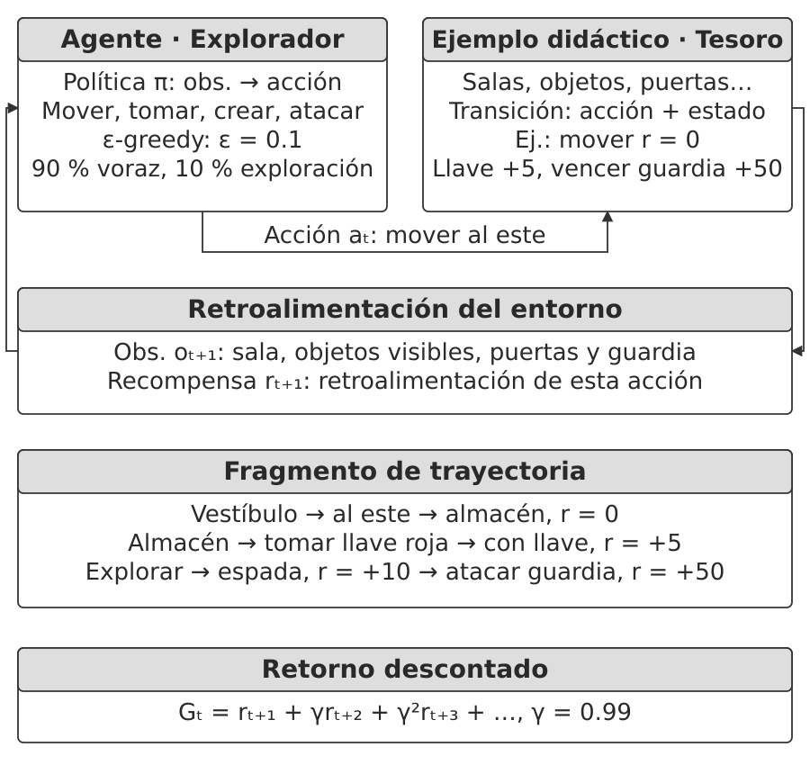

La interacción continuada forma una **trayectoria**, que incluye las observaciones, acciones, recompensas e información de terminación de cada paso; cuando el sistema de entrenamiento tiene acceso al estado del entorno, también puede registrarlo. La política decide cómo actuar, y la **función de valor (Value Function)** estima cuánto retorno futuro se espera obtener partiendo del estado actual y siguiendo una determinada política.

La frontera entre el Agente y el entorno depende del alcance del sistema que se elija al modelar. El modelo y el Harness que trata este libro están dentro del Agente, y las interfaces de herramientas lo conectan con aplicaciones, dispositivos y servicios externos. Por ejemplo, la petición de modificar un archivo la formula el Agente, el sistema de archivos ejecuta la escritura y la herramienta devuelve el resultado de la ejecución al Agente.

Durante el aprendizaje hay que repartir las oportunidades entre **exploración y explotación (Exploration–Exploitation)**. La exploración pone a la política en contacto con acciones que aún no conoce bien; la explotación elige las acciones que la estimación actual considera mejores. En las tareas con recompensa diferida hay que determinar además qué pasos tempranos contribuyeron al resultado final; es el problema de asignación de crédito que se tratará más adelante.

Para entender un método de RL se pueden revisar primero cinco elementos:

- **Espacio de acción**: qué salidas están permitidas. Los juegos de tablero usan jugadas discretas; el control de robots puede usar objetivos articulares continuos; las acciones también pueden estar limitadas por el estado, el rango físico y los permisos.
- **Política**: la regla que elige la acción a partir del estado, la observación o el historial. Puede ser una tabla o una red neuronal.
- **Señal de recompensa**: mediante qué retroalimentación se expresa el objetivo de entrenamiento. La recompensa de cada paso contribuye al retorno a largo plazo, y la política puede aceptar un coste presente a cambio de un beneficio futuro.
- **Función de valor**: estima el retorno posterior y puede usarse para comparar acciones o construir la señal de actualización de la política. Cada algoritmo decide si la aprende explícitamente.
- **Modelo del entorno**: predice el estado, la observación o la recompensa tras una acción. Los métodos basados en modelo planifican con un modelo del entorno conocido o aprendido; los métodos sin modelo aprenden la política o el valor directamente de los datos de interacción.

La tabla 8-3 toma de estos conceptos el entorno, la acción y el objetivo para comparar varios sistemas conocidos. Al leer las dos primeras filas, «mantener el equilibrio» y «superficie limpiada» pueden entenderse como objetivos que podríamos elegir al modelar la tarea.

Tabla 8-3 Comparación de los elementos clave de distintos sistemas de Agente

| Tipo de Agente | Entorno externo | Representación de la acción | Ejemplo de recompensa u objetivo |
| --- | --- | --- | --- |
| Gacela recién nacida | Terreno, gravedad y dinámica corporal | Control muscular continuo | Mantener el equilibrio, evitar caídas |
| Robot aspirador | Habitación, suelo y base de carga | Moverse, limpiar, volver a cargar y parámetros de control | Superficie limpiada, batería y coste de colisiones |
| Agente de ajedrez | Tablero, rival y reglas de tiempo | Jugadas legales en el estado actual | Victoria +1, derrota −1, tablas 0 |
| Agente de atención al cliente | Usuario, base de datos de negocio e interfaces de servicio | Texto de respuesta, consultas y llamadas de negocio | Problema resuelto, cumplimiento del proceso, tiempo de gestión |
| Agente asistente de código | Origen de los requisitos, repositorio y entorno de ejecución | Buscar, editar, ejecutar y responder | Resultado de las pruebas, tarea completada, regresiones y coste |

Estos sistemas representan las acciones de forma distinta. Los juegos de tablero suelen elegir una acción discreta en cada paso; los robots producen magnitudes de control continuas de dimensión fija; el LLM genera primero una secuencia de tokens que la interfaz analiza después como respuesta o llamada a herramienta. El cálculo interno también puede incorporarse al modelado de la política y registrarse por separado de la ejecución de herramientas que cambia realmente el estado externo.

### Dos representaciones de la acción: el planteamiento clásico de RL y la política de longitud variable del LLM

El **proceso de decisión de Markov (Markov Decision Process, MDP)** describe un problema de decisión mediante estados, acciones, transiciones y recompensas. Su propiedad de Markov exige que, dados el estado y la acción actuales, la predicción del siguiente estado y de la recompensa no dependa además del historial: la información del historial relevante para la predicción ya está contenida en el estado actual. En la figura 8-2, registrar solo la habitación en la que está el jugador causa problemas: aunque llegue dos veces ante la misma puerta, que pueda abrirla depende de si ya tiene la llave.

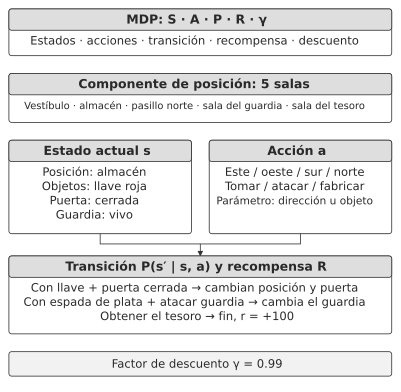

El ajedrez ofrece un ejemplo de diseño del estado. Además de la posición de las piezas, hay que registrar a quién le toca mover, los derechos de enroque, el derecho de captura al paso y la información necesaria para aplicar la regla de los cincuenta movimientos y la repetición de posiciones. Solo tras incluir todo esto en el estado se pueden aplicar las reglas a partir del estado actual. Si el Agente solo ve una parte, necesita completar la información con el historial o adoptar un modelado parcialmente observable.

Un MDP admite acciones discretas, continuas y combinatorias. El go tiene 361 intersecciones en el tablero, además del pase y la legalidad de cada jugada; los juegos de Atari suelen ofrecer unas pocas operaciones discretas; las magnitudes de control de un robot se definen por sus articulaciones, su pinza y sus restricciones físicas. Cuando el número de estados y de acciones es pequeño, el valor puede almacenarse directamente en una tabla. A mayor escala, la aproximación de funciones, la optimización de políticas y la búsqueda ofrecen cada una su forma de tratarlo.

**Q-learning tabular: actualizar el valor de la acción con la retroalimentación de un paso.** $Q(s,a)$ estima el retorno tras tomar la acción $a$ en el estado $s$. El valor de acción óptimo satisface la ecuación de optimalidad de Bellman:

$$
Q^*(s,a)=\mathbb E\left[r+\gamma\max_{a'}Q^*(s',a')\mid s,a\right]
$$

Aquí $r$ es la recompensa del paso, $s'$ el estado siguiente y $\gamma$ el factor de descuento. En las tareas continuas se suele tomar $0\leq\gamma<1$; en las tareas con terminación clara y retorno finito también puede tomarse 1. Un factor de descuento mayor conserva más peso para las recompensas lejanas. El retorno calculado desde el instante actual es $G_t=\sum_{k\geq0}\gamma^k r_{t+k+1}$.

Tras obtener $r$ y $s'$ en una interacción, Q-learning actualiza según:

$$
Q(s,a)\leftarrow Q(s,a)+\alpha\left[r+\gamma\max_{a'}Q(s',a')-Q(s,a)\right]
$$

$\alpha$ es la tasa de aprendizaje, y lo que hay entre corchetes es la diferencia entre «la recompensa del paso más el valor posterior descontado» y la estimación actual. Cuando la tarea llega a un estado terminal, el valor posterior es 0. Pruébalo una vez en el juego que acompaña al libro: desactiva la perturbación aleatoria, sal de la entrada hacia el este y recoge la llave roja en el almacén. Recoger la llave da 5 puntos y cada paso resta 0,5, así que el $r$ que devuelve esta acción es 4,5. Supongamos que la estimación anterior de «coger la llave en el almacén» en la tabla era 0,25 y que el valor Q máximo de las acciones disponibles tras coger la llave es 0,63. Con $\gamma=0{,}99$ y $\alpha=0{,}2$, el objetivo de un paso es $4{,}5+0{,}99\times0{,}63=5{,}1237$. La estimación anterior se acerca una quinta parte a ese objetivo y se actualiza a 1,22474. Este método de corregir la estimación con la retroalimentación real de un paso se denomina **aprendizaje por diferencias temporales (Temporal-Difference Learning, TD)**.

Reuniendo los valores Q de todas las acciones de un estado se puede elegir la acción que la estimación actual considera mejor. La figura 8-3 dibuja esta política en una cuadrícula simplificada. El número de cada casilla es el valor del estado normalizado. Si tapas los números con la mano y miras solo las flechas, ¿puedes llegar todavía desde la esquina superior izquierda hasta el tesoro?

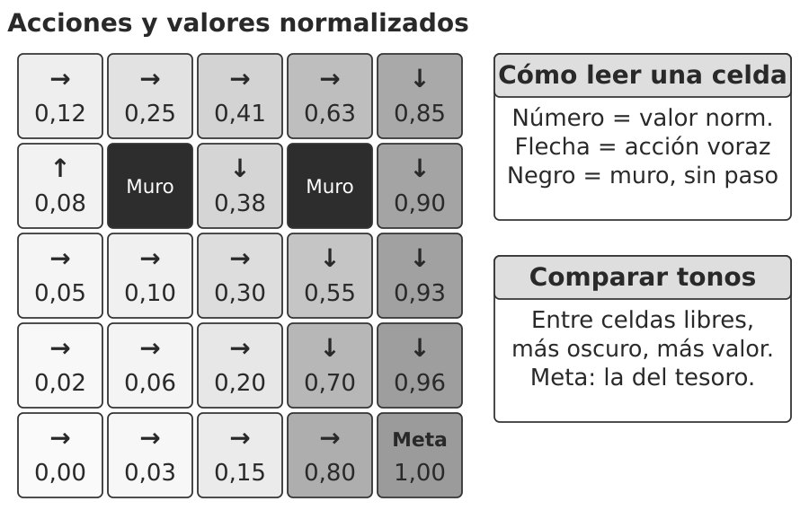

La siguiente exploración puede cambiar la dirección de las flechas. La figura 8-4 desglosa el cálculo de la llave roja que acabamos de hacer: la recompensa obtenida en este paso modifica la estimación de «coger la llave en el almacén», mientras que los valores Q de los demás estados de la tabla esperan a sus propias actualizaciones.

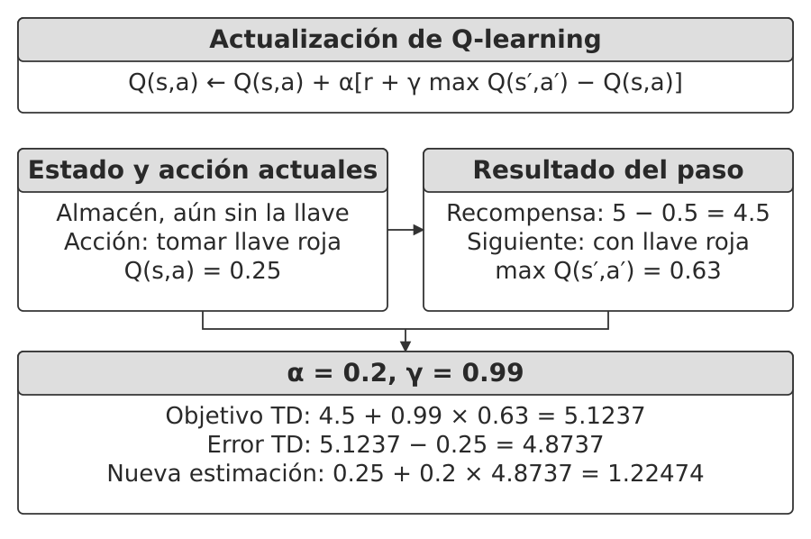

La política de comportamiento de Q-learning puede incluir exploración aleatoria, mientras que el objetivo de actualización usa el valor de acción máximo del estado siguiente; por eso es un aprendizaje **fuera de política (Off-Policy)**.

> **Experimento 8-1 ★: Rendimiento de Q-learning en el juego de búsqueda del tesoro**
>
> El juego de búsqueda del tesoro contiene reglas ocultas, como llaves y puertas, efectos de armas y combinación de objetos. Para completarlo hay que realizar varios pasos en orden, y el camino óptimo tiene 11 pasos; las acciones clave y la victoria dan recompensa, y el resto de los pasos recibe poca retroalimentación.
>
> En este entrenamiento se toma una tasa de aprendizaje de 0,2 y un factor de descuento de 0,99, y la tasa de exploración ε baja gradualmente de 1,0 a 0,1. El Q-learning tabular usa exploración ε-voraz: en cada paso, con probabilidad ε elige al azar una acción disponible y, el resto de las veces, una de las acciones con mayor valor Q actual. Se registran la tasa de victorias, el número de estados visitados y el número de pasos hasta completar el juego en cada fase.
>
> Al leer los registros de entrenamiento y evaluación del experimento, conviene separar primero dos preguntas: durante el entrenamiento, ¿cuándo encuentra por primera vez el tesoro la política con exploración aleatoria? Terminado el entrenamiento, con la tabla Q fija y actuando con la política voraz, ¿se completa el juego de forma estable? La primera refleja cómo descubre el modelo el camino; la segunda comprueba si es capaz de elegir acciones según el valor aprendido.
>
> En un entrenamiento anterior, en las primeras 1000 partidas aún no se había completado el juego y la tabla Q contenía 124 estados; a las 5000 partidas seguía sin ganar de forma estable, con 133 estados; entre las partidas 7000 y 8000, la tasa de victorias subió del 34 % al 96 %; a las 10 000 partidas llegó al 100 %, con 145 estados en la tabla Q y un camino de 11 pasos.
>
> ¿Por qué apenas hubo progreso al principio y luego la tasa de victorias subió tan deprisa? La exploración descubre primero las acciones y el camino clave, y las visitas posteriores van propagando el retorno final hacia los estados anteriores. Toda esta pequeña simulación dura unos 10 segundos, de modo que puede permitirse una gran cantidad de interacciones repetidas.
>
> En el análisis se registran a la vez el tiempo de cómputo y el número de interacciones. En el juego, una acción es muy barata; en un navegador, una llamada telefónica o un dispositivo físico, cada interacción implica además esperas, costes y cambios de estado. La tabla, por otra parte, está ligada a una codificación concreta del estado: si cambian las reglas o el mapa, hay que volver a comprobar si los valores existentes siguen siendo válidos. El siguiente experimento comparará cómo puede el conocimiento del preentrenamiento cambiar el punto de partida de la exploración.

**LLM preentrenado: representar el cálculo y la acción con lenguaje.**

Un LLM puede generar un cálculo intermedio antes de llamar a una herramienta o emitir directamente la llamada. Ambas cosas se representan como secuencias de tokens, pero cumplen funciones distintas: el cálculo intermedio modifica el contexto del que dispone el modelo después, y la llamada a herramienta, una vez ejecutada, modifica o lee el entorno externo. Durante el entrenamiento estas salidas pueden registrarse según el protocolo y evaluarse junto con el resultado de la tarea y el coste de cómputo. «Cuánto pensar, en qué pensar y cuándo llamar a una herramienta» se convierte así en una elección que la misma política puede aprender; el AdaptThink que veremos más adelante gira en torno al presupuesto de razonamiento.

Las secuencias de longitud variable abren un espacio combinatorio mayor. El modelo puede escribir consultas, programas, parámetros JSON y derivaciones de varios pasos, y la longitud de la secuencia queda limitada por el presupuesto y por el contexto. El preentrenamiento ofrece un punto de partida para la búsqueda: los materiales de matemáticas suelen contener análisis de condiciones y cálculos, y el código y las discusiones suelen contener localización, modificación y verificación. El modelo puede tomar prestadas estas estructuras para generar caminos candidatos y ajustarlos después según la retroalimentación del entorno. El conocimiento previo hace que las combinaciones de acciones útiles sean más fáciles de muestrear desde el principio y reduce la necesidad de ensayar a ciegas entre multitud de caminos irrelevantes.

Por ejemplo, «convertir un importe en moneda extranjera a dólares» exige obtener el tipo de cambio y calcular. El preentrenamiento hace que al modelo le resulte relativamente fácil generar este tipo de pasos relacionados; el posentrenamiento puede ajustar además la probabilidad de cada camino según la fuente del tipo de cambio, el resultado del cálculo y las restricciones de la tarea. Aquí el conocimiento lingüístico aporta la política inicial y la recompensa aporta la retroalimentación de la tarea.

La figura 8-5 compara los dos planteamientos de esta sección: el Q-learning tabular parte de una codificación de estado y unas reglas de exploración especificadas, mientras que el Agente LLM parte de una política lingüística preentrenada y organiza mediante el contexto las observaciones de las herramientas y la experiencia acumulada.

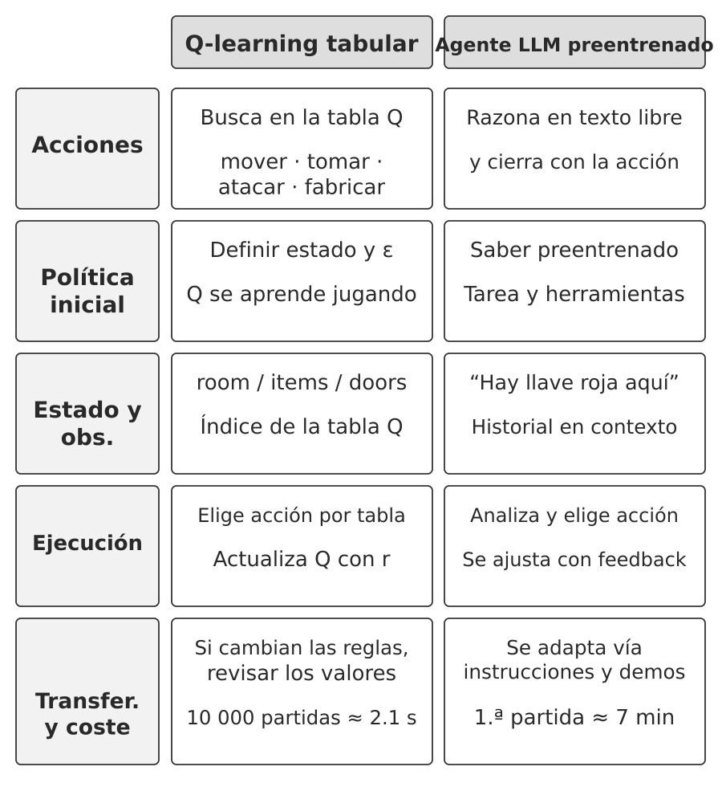

El preentrenamiento permite además que el modelo interprete instrucciones nuevas y ajuste su conducta en la tarea a partir de unas pocas demostraciones. Las herramientas conectan la salida lingüística con la búsqueda, la ejecución de código y las operaciones de negocio. Al diseñar este tipo de Agente hay que definir tanto las interfaces de las herramientas y los permisos de ejecución como la retroalimentación sobre el resultado de la tarea, el coste de ejecución y los procesos clave.

Si el modelo tiene que controlar un brazo robótico, ¿cómo se aplica «predecir el siguiente token» a las acciones? OpenVLA usó unas 970 000 demostraciones de robots reales. Tomemos un paso de una demostración: la entrada es la imagen de la cámara en ese momento y la instrucción de la tarea, y el objetivo de entrenamiento es la acción que el demostrador ejecutó a continuación. Por ejemplo, cuánto se desplaza el brazo en horizontal es, en principio, un valor continuo. OpenVLA divide cada dimensión de la acción en 256 intervalos y usa un token para indicar en cuál cae. Así el modelo puede predecir los tokens de acción uno a uno y calcular la pérdida solo en esas posiciones.[^ch8-21]

Este ejemplo también da una forma de distinguir la clonación de comportamiento del aprendizaje por refuerzo: fijarse en qué señal hace que el modelo se actualice. OpenVLA aprende de los registros de demostración: cuanto mayor es la probabilidad que el modelo da a los tokens de la acción demostrada, menor es la pérdida, y eso es ajuste fino supervisado. En el SimpleVLA-RL del experimento 8-13, la política prueba acciones reales en el entorno y ajusta sus elecciones futuras según la recompensa de la tarea.

> **Del algoritmo y el entorno a los priors**
>
> En «The Second Half», Shunyu Yao repasa la evolución del RL a través del algoritmo, el entorno y los priors.[^ch8-2] A partir de ello, el autor resume el cambio de enfoque en tres fases: en 2015-2016 el énfasis estaba en mejorar los algoritmos; en 2016-2018 se dio más importancia a construir entornos, y desde 2018 se fue reconociendo el valor de los priors del preentrenamiento. Gym ofreció una interfaz de entorno unificada; Universe y World of Bits exploraron tareas en ordenadores y páginas web, y proyectos como Dota 2 mostraron la capacidad de entrenar en entornos complejos. Después, GPT-2 y GPT-3 mostraron el conocimiento y la capacidad expresiva acumulados por el preentrenamiento lingüístico, y sistemas como WebGPT y ChatGPT aprovecharon ese punto de partida. Los priors que necesita la tarea pueden obtenerse primero mediante el modelado del lenguaje y luego dejar que el RL optimice la conducta concreta.
>
> El autor comparte la prioridad de ingeniería que se desprende de aquí: **priors, entorno, algoritmo**. Primero se comprueba qué conocimientos y capacidades tiene el modelo, después se construyen el entorno y la retroalimentación adecuados y, por último, se elige el método de optimización que encaje con ellos. La figura 8-6 ordena los enfoques de investigación según su aparición; en un proyecto se puede recorrer al revés, partiendo de las capacidades existentes.
>
> 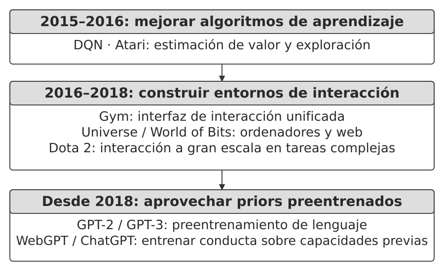

> **Experimento 8-2 ★★: Estudio comparativo entre RL tradicional y Agente LLM**
>
> En el mismo juego de búsqueda del tesoro se comparan el Q-learning tabular y un Agente LLM. La configuración del LLM usa Kimi K3 y mantiene en el contexto un máximo de 50 experiencias. En cada paso, ambos eligen una de las acciones disponibles que ofrece el entorno. Siguiendo los dos caminos de la figura 8-7 se puede ver cómo toman esa decisión la tabla Q y el modelo de lenguaje, respectivamente.
>
> 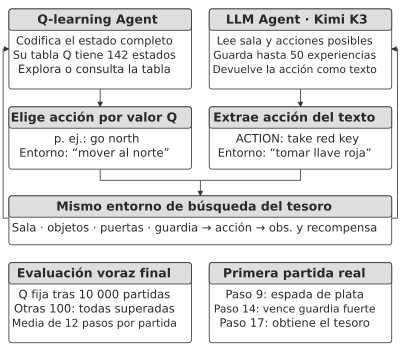
>
> En el registro de ejecución de Kimi K3 que acompaña al libro, el Agente usó 17 pasos en la primera partida. Primero cogió la espada oxidada, descubrió que la puerta norte estaba cerrada con llave, fue al almacén a por la llave roja y el cristal mágico, y en el paso 9 combinó la espada y el cristal en una espada de plata. En el paso 12 intentó usar la llave y el entorno le indicó que «se usa automáticamente cuando hace falta»; en el paso 13 fue hacia el norte y solo entonces se abrió la puerta. En el paso 14 derrotó al guardia con la espada de plata y luego volvió a intentar usar la espada, y el entorno le indicó que en ese momento no podía usarse. En el paso 17 obtuvo el tesoro. Al leer este registro puedes tapar la línea siguiente e intentar adivinar, a partir de la retroalimentación actual, qué paso era aún necesario.
>
> Alineando cada acción con la observación del momento se puede analizar cómo usa el modelo conocimientos previos como «la llave abre la puerta» o «el arma sirve contra el guardia», y cómo la retroalimentación de las herramientas cambia el plan posterior. El enfoque tabular, en cambio, acumula estas relaciones mediante las visitas a pares estado—acción.
>
> En esta comparación, el Q-learning entrenó 10 000 partidas en 2,12 segundos y después, evaluado por separado con la política voraz en 100 partidas, las completó todas con una media de 12 pasos. Kimi llamó al modelo 17 veces en una partida y tardó 6 minutos y 56 segundos. De ahí el autor extrae un principio de elección: cuando la simulación es barata y puede repetirse masivamente, se puede aprovechar a fondo la exploración del RL tradicional; cuando cada interacción cuesta esperas, dinero u operaciones reales, conviene priorizar las políticas que aprovechan el conocimiento existente para aumentar el valor de cada interacción.

Estos dos experimentos enlazan este capítulo con los métodos de ingeniería anteriores: el contexto puede organizar la experiencia dentro de una ejecución, la memoria externa puede conservarla entre tareas y el posentrenamiento cambia la política mediante la actualización de parámetros. A continuación se completa el proceso básico del preentrenamiento lingüístico y visual, y después se tratan los datos de entrenamiento y los métodos de optimización concretos.

## Fundamentos del preentrenamiento de modelos `[Lectura Opcional]`

El preentrenamiento establece la representación inicial y la distribución de generación del modelo, y el entrenamiento posterior sigue ajustando los parámetros a partir de ese punto. Para entender ese punto de partida, conviene observar primero cómo aprende un modelo de lenguaje pequeño a partir del texto y después cómo se le incorpora la entrada visual.

El texto pasa primero por la **tokenización (Tokenization)**, que lo convierte en tokens discretos. Por ejemplo, «Me gusta programar» puede representarse de forma esquemática como las tres unidades «Me», «gusta» y «programar», aunque la división real la decide el tokenizador. El entrenamiento toma los tokens anteriores como contexto, predice los siguientes, calcula la pérdida y actualiza los parámetros. En la figura 8-8, tapa primero la frase de entrenamiento hasta «entorno», adivina cuál es la palabra siguiente y luego descubre el original. Desplazando esa posición hacia delante se obtiene la siguiente pregunta de predicción.

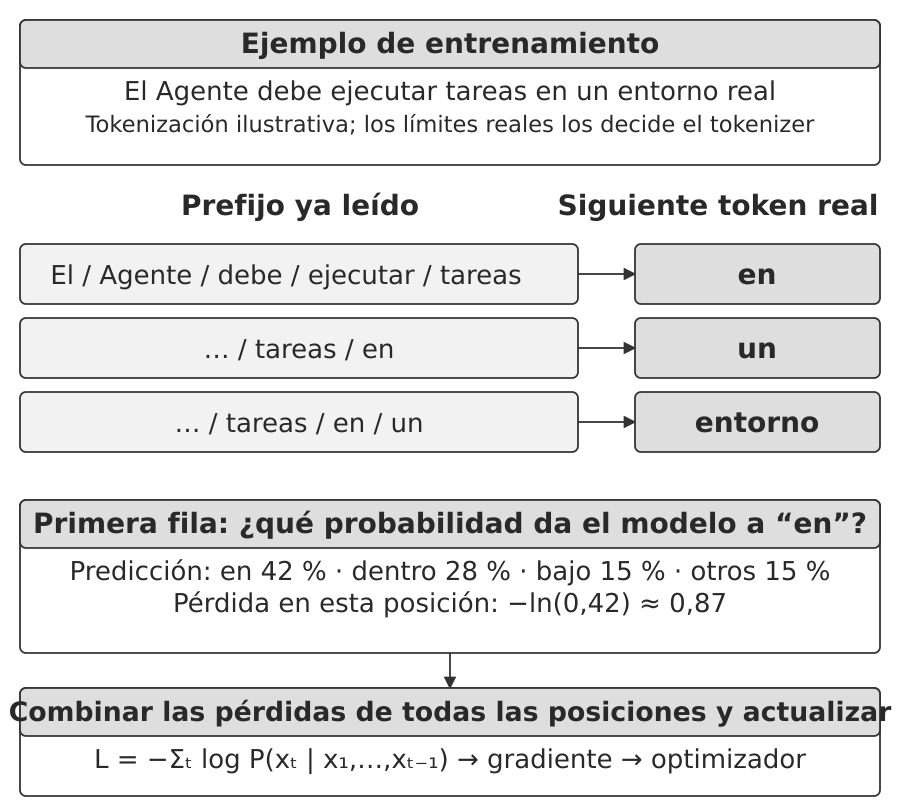

Después del modelado básico del lenguaje se pueden añadir demostraciones de instrucciones para entrenar el formato de respuesta y la conducta en la tarea; también se pueden usar datos de preferencias para, mediante métodos como DPO, aumentar la probabilidad de las respuestas mejor valoradas.

> **Experimento 8-3 ★★: Entrenar un LLM desde cero: el poder de las mejoras algorítmicas**
>
> Con MiniMind 2, de unos cien millones de parámetros, se completan el preentrenamiento, el SFT y la optimización de preferencias en una GPU de consumo. Se compara la línea base con una configuración que añade QK Norm y el optimizador Muon, y se observan la caída de la pérdida, el tiempo necesario para alcanzar la calidad objetivo y los resultados generados. El resumen que acompaña al libro registra una convergencia unas 3 veces más rápida; el entrenamiento completo dura unas 14 horas y cuesta unos 34 dólares.
>
> QK Norm ajusta la escala numérica de las consultas y las claves en la atención, y Muon cambia la forma en que se actualizan los parámetros correspondientes durante la optimización.
>
> Se observa el mismo conjunto de preguntas en cada etapa: el modelo preentrenado ya puede responder preguntas como «la montaña más alta del mundo»; tras el SFT mejoran el seguimiento de instrucciones y la organización de la salida, y la optimización de preferencias sigue influyendo en las respuestas factuales y en la expresión.

> **Experimento 8-4 ★★: Entrenar tu propio VLM**
>
> La figura 8-9 muestra la conexión «codificador visual—capa de proyección—modelo de lenguaje». Un codificador visual como CLIP extrae las características de la imagen, la capa de proyección las convierte a la dimensión y la representación que necesita la entrada del modelo de lenguaje, y el modelo de lenguaje combina esas entradas para generar una descripción o una respuesta.
>
> 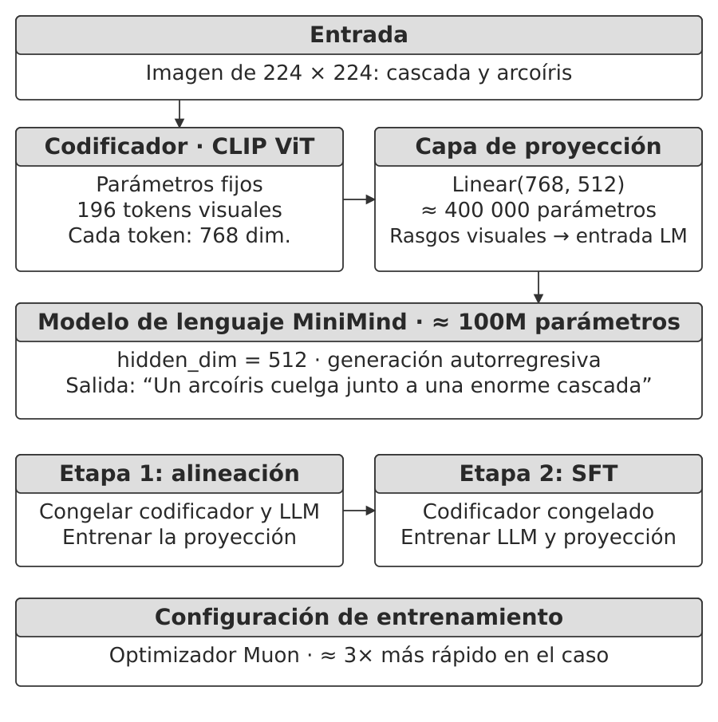
>
> En la primera fase se congelan el codificador visual y el LLM y se entrena la capa de proyección recién añadida, para que las características de la imagen puedan participar en la predicción lingüística; en la segunda fase se descongela el LLM según la configuración y se hace SFT con datos de alta calidad de imagen—descripción o de preguntas y respuestas. Se observan por separado los cambios en el reconocimiento de objetos, la descripción de detalles, el juicio sobre relaciones y la capacidad lingüística.
>
> Esta arquitectura reutiliza modelos visuales y de lenguaje ya existentes y concentra primero el entrenamiento en el módulo de conexión intermodal; cuando el presupuesto es limitado, es una opción que merece probarse en primer lugar. Congelar pesos reduce el estado entrenable, y después se pueden descongelar los módulos correspondientes según lo que exija la tarea. Cuando la descripción es errónea, hay que comprobar primero si la información del objeto ha llegado a la representación visual; si la información ya está ahí y el modelo sigue sin poder usarla, hay que revisar sobre todo la capacidad expresiva de la capa de proyección, los datos de alineación y la supervisión de la generación lingüística. Si además se cambia la salida a una representación de acciones y se alinea con la interfaz de control, se llega a la arquitectura VLA del capítulo 6.

Los dos experimentos muestran, respectivamente, cómo influyen en el entrenamiento la configuración de la optimización y la conexión intermodal. Con un presupuesto limitado, el autor recomienda comparar primero las ganancias que aportan las mejoras de algoritmo y de arquitectura antes de decidir si se amplía el tamaño del modelo. Cuando un modelo existente tiene que abordar un idioma o un dominio nuevos, también puede seguir aprendiendo a partir de los pesos preentrenados; la sección siguiente trata de cómo elegir los datos para ese entrenamiento.

## Mid-training: completar conocimientos y capacidades básicas

En este capítulo, **Mid-training** designa una etapa de entrenamiento de modelo de lenguaje que se prolonga sobre un modelo existente en torno a la distribución objetivo. Una gran cantidad de tokens de documentos, código o derivaciones participa en la supervisión, y durante el entrenamiento se puede mezclar el corpus del dominio objetivo con corpus general. Las investigaciones sobre DAPT/TAPT han mostrado que continuar el preentrenamiento con corpus relacionados con el dominio o la tarea ayuda en las tareas posteriores.[^ch8-30]

La selección de datos parte de dos tipos de carencia. Una es la cobertura de conocimiento y de lenguaje: por ejemplo, el modelo ha tenido poco contacto con los protocolos de la empresa, con la terminología del idioma objetivo o con un repositorio de código concreto. La otra son las capacidades básicas que exige la tarea, como seguir el estado a lo largo de un contexto largo, integrar relaciones entre documentos o completar derivaciones de código extensas. Primero se clasifican los errores en problemas de comprensión, de conocimiento, de formato y de acción, y después se decide qué material hay que añadir.

Una vez que baja la pérdida sobre el texto del dominio, hay que comprobar además si el modelo es capaz de usar en tareas reales el conocimiento aprendido. El orden entre el entrenamiento continuado y el entrenamiento con instrucciones, la organización en preguntas y respuestas y la forma del material influyen en cómo se aplica ese conocimiento.[^ch8-31] En tareas de dominio con carencias claras de capacidad básica, el autor recomienda aumentar primero la cobertura con corpus del dominio y luego, mediante demostraciones de SFT, enseñar al modelo a usar esa información en la tarea; cuando el modelo ya acierta a veces y solo su tasa de éxito es baja, entonces conviene invertir en RL.

### Cómo construir los datos de Mid-training

**Primer paso: localizar el material necesario a partir de la distribución de fallos.** Se evalúa por separado según tema, idioma, tipo de documento, patrón de código y longitud de contexto, y con Pass@1, Pass@k y ejemplos de error se determina en qué condiciones le falta al modelo una forma de resolver el problema. Los problemas de formato de parámetros pueden resolverse con demostraciones de la interfaz; las carencias de conceptos y relaciones del dominio necesitan el corpus correspondiente.

**Segundo paso: organizar un corpus de alta densidad.** Los documentos originales aportan la terminología y las relaciones factuales; los repositorios de código, la estructura de módulos y las dependencias; las derivaciones al estilo de un libro de texto y las paráfrasis sintéticas despliegan los pasos implícitos, y las muestras entre documentos conectan la información dispersa. Tras el filtrado de calidad, la deduplicación y el aislamiento del conjunto de evaluación, se construyen las secuencias de entrenamiento.

**Tercer paso: mezclar los datos según la capacidad objetivo.** El texto largo natural puede proceder de libros, documentación y repositorios de código; para recuperación, razonamiento de varios saltos, seguimiento de instrucciones, agregación y estadística, se pueden añadir datos de tareas con derivación; para Agentes, se pueden añadir trayectorias de planificación, selección de herramientas, construcción de parámetros, seguimiento del estado y recuperación de errores. Estos materiales pueden proceder de conjuntos de datos existentes o generarse con un modelo profesor, y antes de entrar en el entrenamiento se filtran según los requisitos de contenido y de conducta.

**Cuarto paso: que el modelo siga practicando las tareas que ya sabía hacer.** Un grupo de muestras mantiene los textos cortos, el corpus general y los problemas originales; otro coloca esas mismas tareas en contextos más largos, desplaza la posición de la información clave y añade distractores. Para combinar ambos grupos se puede tomar como referencia la distribución de los datos de entrenamiento originales o probar varias proporciones con corpus públicos como FineWeb-2, y ajustarlas después según los resultados de la evaluación.

**Quinto paso: decidir si continuar o parar con varias métricas.** Se registran a la vez la pérdida de entrenamiento, las tareas de dominio reservadas, la capacidad general, el seguimiento de instrucciones previo y la tasa de éxito en la tarea objetivo. Si los resultados del dominio mejoran y la capacidad general empeora, se comparan la proporción de mezcla, la tasa de aprendizaje y el volumen de entrenamiento; si la pérdida baja y la tarea objetivo se estanca, se comprueba si el material de entrenamiento puede enseñar al modelo a completar ese tipo de tarea y si hace falta añadir demostraciones de cómo aplicar el conocimiento en tareas reales.

Supongamos que el modelo es capaz de encontrar un número de pedido concreto en un registro de pedidos muy largo. Si la pregunta pasa a ser «qué cliente hizo varios pedidos y los canceló todos», tiene que reunir todos los pedidos de un mismo cliente y emparejar uno a uno los pedidos con los registros de cancelación. Las dos preguntas pueden usar el mismo registro, pero evalúan capacidades distintas. RULER usa tareas sintéticas para controlar por separado la longitud de la entrada y la dificultad de la tarea, y mide aparte la recuperación de un solo elemento, el seguimiento de varios saltos y la agregación. Sus autores evaluaron 17 modelos: muchos se acercaban a la puntuación máxima en la recuperación simple, pero su rendimiento global caía claramente al alargarse la entrada.[^ch8-ruler]

Para ver si esta diferencia aparece en materiales reales, se pueden usar además las preguntas de varios documentos, conversaciones largas o repositorios de código de LongBench v2. Para comprobar por separado si el modelo recuerda requisitos como el formato de salida, se pueden tomar las instrucciones verificables de IFEval y colocarlas en distintas posiciones de un material largo. Al comparar dos modelos, ambos deben ver las instrucciones en las mismas posiciones y con el mismo contenido distractor, y hay que indicar que se trata de una prueba de construcción propia. Por último, se usa una tarea de Agente de extremo a extremo para comprobar si estas capacidades funcionan juntas. Al diseñar el conjunto de evaluación se pueden revisar una a una las dimensiones siguientes.[^ch8-longbench]

[^ch8-ruler]: Hsieh et al., RULER, 2024.
[^ch8-longbench]: Bai et al., LongBench v2, ACL 2025. El artículo presenta seis categorías de tareas, con un total de 503 preguntas de opción múltiple.

- **Posición y recuperación**: si se encuentra uno o varios datos clave cuando están al principio, en el medio o al final.
- **Relaciones y razonamiento**: seguimiento de relaciones entre párrafos y entre documentos, resolución de contradicciones y combinación de evidencias.
- **Agregación y estadística**: recuento, agrupación, ordenación, comparación y resumen de tendencias en tablas y registros largos.
- **Seguimiento de instrucciones**: múltiples requisitos, gestión de conflictos, condiciones del proceso y formato de salida.
- **Razonamiento de cadena larga**: cadenas de dependencias largas en tareas de matemáticas, lógica y código.
- **Conducta básica del Agente**: descomposición de tareas, selección de herramientas, generación de parámetros, mantenimiento del estado y recuperación de fallos.

El razonamiento largo y las llamadas a herramientas de varios turnos alargan continuamente el contexto, y las instrucciones, los hechos y el estado de la tarea anteriores siguen teniendo que intervenir en las decisiones posteriores. Si el modelo no encuentra la información en un texto largo o no logra mantener las restricciones, un Agente de largo recorrido difícilmente funcionará de forma fiable. Antes de ampliar el presupuesto de entrenamiento, hay que comparar con configuraciones pequeñas la proporción de datos y el volumen de entrenamiento. Para los hechos que se actualizan con frecuencia y requieren citar la fuente, el autor da prioridad a RAG; para el conocimiento de dominio estable y a gran escala y para las capacidades básicas, considera entonces escribirlos en los parámetros mediante entrenamiento continuado.

> **Experimento 8-5 ★★: Continuar el preentrenamiento para aprender un idioma nuevo**
>
> Partiendo de Mistral 7B v0.3, se mejora su capacidad en coreano con materiales como la Wikipedia en coreano. El entrenamiento usa primero una mezcla de aproximadamente un 80 % de coreano y un 20 % de inglés, y después se hace SFT con datos de instrucciones en coreano; se observan por separado los cambios en el modelado del lenguaje y en la conducta conversacional.
>
> Los datos en coreano aumentan la cobertura del idioma objetivo, y los datos en inglés sirven para conservar las capacidades previas. En todas las etapas se usa el mismo lote de preguntas en coreano y en inglés que no han participado en el entrenamiento. En los resultados que acompañan al libro, la puntuación de evaluación a ciegas en coreano de la etapa final mejora y la capacidad en inglés baja algo, lo que indica una dirección concreta para la siguiente ronda: mezclar algo más de material de entrenamiento en inglés o reducir la intensidad de la actualización.
>
> Registrando por separado el idioma objetivo, el idioma original y la calidad factual se pueden valorar las ganancias y los costes; en la etapa de SFT se comprueba además si el modelo organiza las respuestas siguiendo instrucciones en coreano. Así se puede observar por separado el efecto del preentrenamiento continuado y el del ajuste fino con instrucciones.

## SFT (ajuste fino supervisado)

El corpus del dominio puede hacer que el modelo vea unas cuantas veces más una interfaz, pero para enseñarle a corregir los parámetros tras una llamada fallida también se puede hacer directamente una demostración. Dada la entrada de la tarea, el SFT entrena al modelo, token a token, para que genere la respuesta o la acción de la demostración. Al mirar la figura 8-10, piensa primero qué conducta quieres enseñar y luego decide cómo recoger las demostraciones. Los hechos, el tono y el formato de salida de las demostraciones también entran en el entrenamiento.

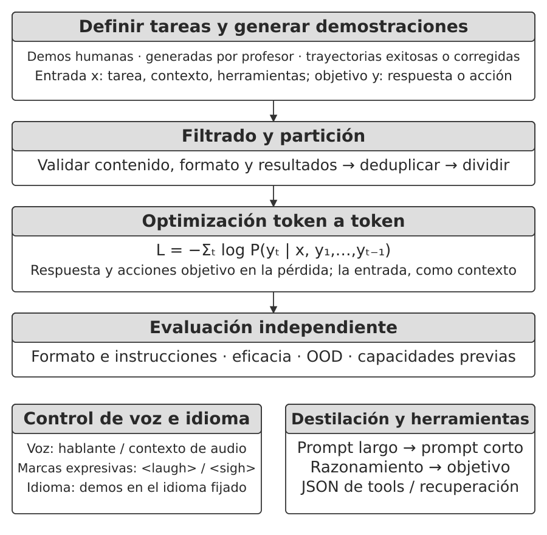

Los datos suelen proceder de tres vías: expertos humanos que definen las conductas clave y sus límites, un modelo profesor que redacta demostraciones en lote y un verificador que selecciona las salidas válidas entre las muestras del modelo. Las tres pueden combinarse. Por ejemplo, primero un experto escribe unas pocas demostraciones de llamada a herramientas, después el profesor varía las condiciones de la tarea para generar más muestras y, por último, se comprueban los parámetros, los resultados de ejecución y las restricciones de negocio.

**Un uso del SFT es enseñar al modelo las prácticas que se repiten una y otra vez en los prompts y en las Skills.** Tomemos la puntuación de memoria del capítulo 7: supongamos que el manual de puntuación, con sus casos de referencia, ocupa diez mil tokens. El profesor, guiándose por el manual completo, puntúa un lote de respuestas y muestra cómo tratar situaciones como personas con el mismo nombre, relaciones invertidas o pruebas insuficientes. Al entrenar al estudiante, la entrada solo conserva el nombre breve del criterio de puntuación, el material histórico de esa ocasión y la respuesta que hay que evaluar, y la salida objetivo es el nivel elegido por el profesor. Una vez en producción basta con proporcionar un prompt corto y el material de cada ocasión, y cada inferencia se ahorra los diez mil tokens de instrucciones fijas. Para una Skill que se invoca repetidamente, se puede usar el mismo método para demostrar cuándo consultar información y cómo elegir herramientas, y destilar después esos pasos estables en el modelo.

La preparación de los datos empieza por definir la distribución de tareas, el schema de salida y la forma de validación. Cuando las demostraciones superan la comprobación, se deduplican, se ajusta la proporción de cada tipo de muestra y se divide el conjunto de datos. El número de muestras y la cobertura deben diseñarse juntos: repetir miles de veces la misma forma de preguntar refuerza una y otra vez el mismo patrón; construir variaciones en torno a las condiciones clave es lo que ayuda al modelo a elegir la conducta adecuada ante entradas distintas. El autor pule primero un lote de demostraciones que cubra las situaciones clave y solo después amplía la escala. El SFT aprende token a token la salida objetivo, así que los hechos erróneos, los pasos redundantes y los hábitos de operación inadecuados también entran en los parámetros.

> **Experimento 8-6 ★★★: SFT de voz: de la clonación de voz al modelado paralingüístico `[Experimento Extendido]`**
>
> Con Orpheus y Sesame CSM como ejemplos, se compara cómo intervienen en la generación de voz la condición de hablante, el contexto conversacional y las marcas expresivas. Orpheus representa la voz como tokens, puede generar el timbre correspondiente a partir de un fragmento de texto—voz de referencia y ofrece también marcas expresivas como `<laugh>` o `<sigh>`. Sesame CSM recibe texto, un identificador de hablante y fragmentos de audio previos, y genera la voz que sigue.[^ch8-speech-conditioning]
>
> Al construir las muestras de entrenamiento se registran por separado el texto, el hablante, el audio y las condiciones expresivas; se usan materiales de varias frases de un mismo hablante para aprender la coherencia, y risas, suspiros y pausas en contextos diversos para aprender la expresión. Se comparan las salidas sin referencia, con referencia y con condición expresiva especificada, y se puntúan según precisión, naturalidad, emoción y timbre.
>
> Los datos deben cubrir suficientes combinaciones de hablantes, tipos de frase y emociones. Con muy pocos hablantes, la salida puede tender a un timbre único; si una marca va siempre ligada al mismo fragmento de audio, pueden aparecer expresiones repetitivas y mecánicas.

> **Experimento 8-7 ★★★: Pensamiento multilingüe: generar el proceso de razonamiento en el idioma indicado `[Experimento Extendido]`**
>
> Se hace SFT sobre gpt-oss-20b, indicando mediante la instrucción el idioma del proceso de razonamiento. Por ejemplo, `reasoning language: German` exige generar el texto de razonamiento en alemán. Las muestras de entrenamiento incluyen inglés, español, francés y otros idiomas, y el chino se reserva para la fase de prueba.
>
> En el caso que acompaña al libro, tras el entrenamiento, al indicar Chinese el modelo es capaz de generar el proceso de razonamiento en chino. Se pueden comparar además tres resultados: si sigue el requisito de idioma, si la respuesta final es correcta y cómo cambian la longitud generada y el tiempo empleado. En este comportamiento translingüístico intervienen tanto la base multilingüe del preentrenamiento como la forma de control aprendida con el SFT; comparando distintos idiomas y modelos base se puede seguir analizando el papel de cada uno.

> **Experimento 8-8 ★★: Destilación de prompts: reproducir capacidades útiles con menor coste**
>
> Un servicio estable puede depender de un prompt del sistema de miles de tokens, y además el profesor genera razonamientos largos. La destilación de prompts hace primero que el profesor produzca salidas de alta calidad en las condiciones completas y después forma con «entrada del usuario—respuesta final» los datos de SFT del estudiante. El estudiante usa un prompt más corto y responde directamente con la configuración objetivo.
>
> Al abrir la primera muestra de entrenamiento se ve que el profesor Kimi K3, tras leer un texto en árabe con letras latinas intercaladas, explica en qué se basa su juicio y da al final el código de idioma `ar`. La demostración que se entrega al estudiante SmolLM2-135M-Instruct contiene solo el texto original y `ar`. En el mismo conjunto de 80 registros de prueba, el profesor lee de media unos 386 tokens por petición y el estudiante, unos 97. Cada cifra se ha contado con su propio tokenizador.
>
> Los registros comparativos de identificación de idioma que acompañan al libro sirven para separar «acertar» de «producir una salida con el formato correcto». El profesor generó demostraciones sobre 160 muestras de entrenamiento y acertó los 80 registros de prueba restantes. El estudiante sin ajustar no produjo en la prueba ni una sola salida que el evaluador pudiera analizar, con lo que su puntuación fue cero; tras el ajuste fino, las 80 salidas eran analizables y 76 tenían la etiqueta correcta. El cero de la línea base no permite distinguir por sí solo entre «no reconoció el idioma» y «lo reconoció pero no respondió con el formato pedido». Este conjunto de prueba contiene 75 textos distintos, y no hay textos idénticos entre entrenamiento y prueba.
>
> La construcción de los datos debe conservar también las condiciones que el estudiante necesita para completar la tarea. Si el profesor depende de los resultados más recientes de una herramienta, se puede pasar ese resultado como entrada al estudiante o mantener la interfaz de la herramienta; si el profesor comete errores sistemáticos, hay que filtrarlos con una verificación independiente.
>
> Cuando las reglas del producto son estables, la distribución de entradas está clara y el coste de las llamadas es elevado, el autor recomienda evaluar primero la destilación de prompts para comprimir en los parámetros los prompts y razonamientos que se procesan una y otra vez. Cuando el producto todavía está en exploración y los requisitos de la tarea cambian a menudo, conviene conservar prompts editables y razonamiento explícito, que facilitan experimentar rápido y localizar errores.

> **Experimento 8-9 ★★★: Destilación de cadena de pensamiento (Chain of Thought, CoT)**
>
> La destilación de CoT usa como supervisión el texto de razonamiento del profesor junto con la respuesta final, para que el estudiante aprenda el proceso de descomponer, calcular, comprobar y corregir. La destilación que DeepSeek-R1 hizo sobre las series Qwen y Llama es representativa de este método. Para los equipos que quieren tener un modelo propio y controlable sin disparar la inversión en entrenamiento, el autor recomienda considerar primero esta vía. Si el profesor es claramente más fuerte que el estudiante en la tarea objetivo, puede aportar demostraciones valiosas; se puede empezar eligiendo entre modelos de pesos abiertos que permitan obtener la salida de razonamiento completa y comparar después la diferencia de capacidad con el estudiante y la calidad de los datos. Cuando la interfaz solo ofrece un resumen del razonamiento, la información aprovechable para destilar el proceso también disminuye.
>
> Primer paso: hacer que el profesor dé varias soluciones a un mismo problema. En los problemas de matemáticas se comprueba primero la respuesta; en los de código se ejecutan las pruebas, y solo se conservan las soluciones que superan la comprobación. Este filtrado se denomina **muestreo por rechazo (Rejection Sampling)**. Hacer ajuste fino supervisado con las soluciones filtradas se denomina **ajuste fino por muestreo por rechazo (Rejection Sampling Fine-Tuning, RFT)**. Si el estudiante también debe aprender el proceso de razonamiento, hay que revisar además los pasos intermedios y descartar las demostraciones con derivaciones erróneas que aciertan por casualidad.
>
> Para las tareas con un verificador fiable, el autor recomienda establecer primero una línea base de RFT: generar, filtrar y hacer SFT basta para formar un proceso de entrenamiento, se ahorra la implementación de la optimización de política en línea y de la estimación de valor, y a partir de ahí se puede juzgar si merece la pena la inversión adicional en RL.
>
> Segundo paso: entrenar al estudiante. Se organiza «pregunta→texto de razonamiento + respuesta final» con el formato conversacional del modelo elegido; cuando se usan delimitadores como `<think>` y `</think>`, hay que dejar claro qué tokens participan en la pérdida. Se puede empezar con un estudiante de la escala de 7B y comparar las configuraciones con trayectoria completa, con trayectoria resumida y supervisando solo la respuesta final.
>
> Tercer paso: ver qué ha aprendido el estudiante. El experimento que acompaña al libro pide a Kimi K3 que resuelva 24 problemas de matemáticas de AIME, conserva las 23 trayectorias de razonamiento correctas y las usa para ajustar Qwen2.5-1.5B-Instruct. Al repetir el mismo conjunto de problemas, el estudiante pasa de acertar 1 a acertar 2, mientras que el profesor acierta 23. El estudiante entrenado vuelve atrás de vez en cuando para comprobar sus cálculos, pero la prueba pareada problema a problema no muestra una mejora fiable de la tasa de acierto ($p=1{,}0$).

> **Práctica en la redacción del libro: el desarrollo del experimento de destilación**
>
> Al principio, el autor implementó el experimento de destilación con Codex impulsado por GPT-5.6-Sol; al toparse con una negativa, cambió a Claude Code impulsado por Claude Opus 5, que tampoco pudo continuar. Después usó Kimi K3 para completar el código y la ejecución.

Los cuatro casos usan aprendizaje supervisado, pero cada uno aprende un contenido distinto: el timbre y las condiciones expresivas en la voz, el control del idioma en el razonamiento multilingüe, la respuesta directa en la destilación de prompts y el proceso de resolución en la destilación de CoT.

## Síntesis de datos para SFT: de la demostración a la trayectoria entrenable

Para convertir una queja real en un lote de problemas de entrenamiento, ¿qué información se puede cambiar y qué relaciones hay que conservar? De las trayectorias de producción se extraen la intención del usuario, el estado inicial, las herramientas disponibles, las restricciones de negocio y los fallos habituales, y se organizan como plantillas de tarea. Las identidades, los pedidos, los archivos y las credenciales deben sustituirse; si el problema original implicaba dos pedidos parecidos, al generar las instancias hay que conservar también esa relación que obliga a distinguirlos. Solo ejecutando las instancias en un entorno reiniciable se sabe si el problema nuevo conserva de verdad la dificultad original.

Un proceso completo es: **caso de producción→plantilla de tarea→instancia sintética→varias trayectorias candidatas→verificación de la tarea y de la trayectoria→datos de entrenamiento**. Las dos verificaciones se ocupan de problemas distintos: la verificación de la tarea comprueba si las condiciones son suficientes, si el objetivo puede cumplirse y si el resultado de referencia es correcto; la verificación de la trayectoria comprueba, una por una, el estado al terminar la tarea, el orden de las llamadas a herramientas y si el proceso de ejecución respeta las restricciones de negocio.

Las condiciones ejecutables se comprueban con pruebas, aserciones sobre la base de datos o comparaciones de estado; la calidad de la comunicación abierta se evalúa con una Rubric y un modelo evaluador, calibrados mediante muestreo humano. Combinando además un grafo de habilidades, entornos ejecutables y verificadores independientes, se puede ampliar la cobertura de tareas de forma planificada.[^ch8-12][^ch8-17][^ch8-18][^ch8-19][^ch8-20]

Una demostración válida puede ser tanto una trayectoria que se completa sin tropiezos como un proceso completo que incluye diagnóstico y reparación. Para las acciones erróneas que contenga, hay que dejar claro qué papel cumplen en la muestra y elegir las posiciones de la pérdida según el objetivo de entrenamiento. Los registros de fallos también sirven para construir pares de preferencia, descubrir huecos de cobertura y generar tareas de recuperación. Al pasar después al RL, la política actual vuelve a muestrear trayectorias y se actualiza con la retroalimentación del entorno.

El conjunto de entrenamiento y el de evaluación se aíslan según el objetivo: una evaluación dentro de la misma distribución puede aislar instancias concretas; una evaluación de transferencia aísla además plantillas de tarea, grupos de clientes o periodos de tiempo. Al deduplicar se buscan casi duplicados tanto en las entradas como en las soluciones; las respuestas de referencia, las pruebas ocultas y la información destinada solo a la puntuación permanecen en el lado de la verificación, según el protocolo de la tarea.

Terminado el ajuste fino, ¿se puede revisar el material de entrenamiento a partir de los pesos? Tomemos el modelo de razonamiento público s1. Si se convierten las muestras públicas en identificadores de tokens con la misma tokenización y el mismo tratamiento de texto del entrenamiento y se deduplican, se obtiene una lista. Después se compara fila a fila la matriz de embeddings de entrada antes y después del ajuste y se anota qué vectores de token han cambiado. En la revisión del autor, los 16 573 identificadores de ambas listas coincidían uno por uno. Esta comprobación exige dar con el modelo base y el tokenizador correctos, añadir el prompt del sistema y truncar las muestras largas según la configuración de entrenamiento; también hay que confirmar que el entrenamiento actualizó de verdad los embeddings de entrada y que estos no comparten pesos con la capa de salida. Por ejemplo, si solo se entrena LoRA en las capas de atención, los embeddings de entrada quedan intactos y no permiten enumerar los tokens utilizados.[^ch8-token-provenance]

Tres tokens bastan para ver los límites de esta evidencia. Supongamos que dos muestras públicas, tras la tokenización, son `[10, 20]` y `[20, 30]`; al deduplicar se obtiene `{10, 20, 30}`. Si ahora se añade una muestra más, `[30, 10]`, y se vuelve a calcular, el conjunto es exactamente el mismo. Aunque en la revisión coincidan todos los identificadores, no se puede deducir de ello si se usó la tercera muestra, ni se puede descartar que alguna pregunta de evaluación se haya colado en el conjunto de entrenamiento.

[^ch8-token-provenance]: El proyecto training-forensics de Bojie Li registra los conjuntos de tokens y las condiciones de preprocesamiento de modelos como s1, y analiza cómo influyen en el método de comparación los pesos de embedding compartidos y LoRA.

Tomemos el caso de «finalización prematura» del capítulo 7: se corta el prefijo en el momento en que el modelo está a punto de declarar la tarea terminada, se marca la declaración de finalización no verificada como `rejected` y se marca como `chosen` la conducta de continuar que primero revisa los objetivos pendientes y ejecuta las pruebas pertinentes antes de responder. Los pares de preferencia pueden usarse en DPO; las conductas de continuación que superan la verificación también pueden servir por separado como demostraciones de SFT.

Los experimentos posteriores sobre las comillas tipográficas chinas y las cadenas especiales muestran con más detalle cómo definir el objetivo de supervisión. La tarea de las comillas chinas parte del ámbito del documento: exige modificar el texto principal objetivo y proteger el código, las citas y el JSON. La tarea de las cadenas especiales exige que `old_string` se mantenga idéntica byte a byte en los parámetros de la herramienta. La primera comprueba el alcance de la edición y la sintaxis del documento; la segunda, la copia exacta y la coincidencia real en la herramienta. Un mismo proceso de atribución de fallos puede dar lugar a objetivos de entrenamiento distintos.

## Cuándo elegir Mid-training, SFT o RL

Si el modelo ni siquiera escribe bien el formato de entrada de una herramienta, ¿cuántas llamadas llegarán a ejecutarse realmente si se le deja ahora ensayar y equivocarse una y otra vez? Se puede seguir la figura 8-11 para encontrar primero el paso en el que se atasca y elegir el material de entrenamiento y la forma de retroalimentación según la tabla 8-4.

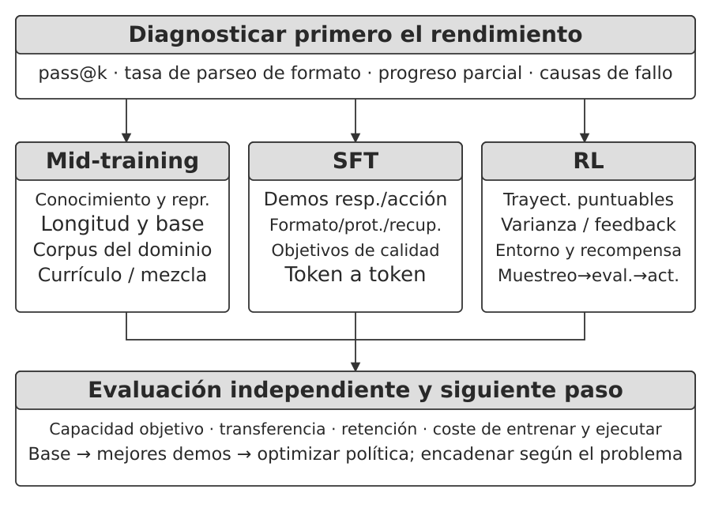

Tabla 8-4 Criterios para elegir entre Mid-training, SFT y RL

| Fenómeno observado | Qué revisar primero | Métodos candidatos | Puntos clave de la evaluación posterior |
| --- | --- | --- | --- |
| Lenguaje, conceptos u operaciones básicas del dominio débiles, con poco avance incluso tras muchos muestreos | Cobertura del corpus y capacidad básica | Mid-training; RAG para los hechos recuperables | Tareas del dominio, conjuntos de prueba que vigilen la capacidad general y trayectorias parcialmente correctas |
| El contenido es útil, pero el formato, los parámetros o el flujo fijo son inestables | Demostraciones, interfaz y restricciones | SFT, decodificación restringida o validación en la herramienta | Éxito del análisis, resultado de la tarea y conducta de recuperación |
| Completa la tarea de vez en cuando, pero con baja tasa de éxito o dando rodeos | Calidad de la recompensa, exploración y distribución de tareas | RL | Beneficio en la tarea, diferenciación de la recompensa, generalización independiente y coste |
| Hay demostraciones o datos de preferencias, pero aún no existe un entorno interactivo | Cobertura de los datos offline y forma de verificación | SFT, RFT, optimización de preferencias offline | Calidad de la línea base, sesgo de los datos y beneficio de construir el entorno |

Se puede avanzar en cuatro pasos. Primero se establece una línea base con prompts, contexto, herramientas y restricciones. Si estos métodos ya cumplen los requisitos de la tarea, el autor prefiere conservar la solución externa editable, que reduce el coste de mantenimiento del entrenamiento, el despliegue y las regresiones. Los hechos dinámicos se proporcionan mediante recuperación y control de versiones; los juicios implícitos, los patrones perceptivos y las conductas estables que hay que aprender repetidamente son los que se plantea mejorar mediante entrenamiento de parámetros.

Segundo paso: observar en tareas reservadas los éxitos, los avances parciales, los resultados del análisis y los tipos de error. Con la configuración de muestreo fija, Pass@1 y Pass@k muestran si la política actual ya tiene caminos aprovechables; las trayectorias fallidas ayudan a distinguir entre falta de conocimiento, falta de retroalimentación y errores de proceso.

Tercer paso: aportar demostraciones de las conductas que hay que aprender. El JSON schema, las llamadas a herramientas, el uso de la terminología, las aclaraciones y la recuperación pueden escribirse como muestras de SFT; el conocimiento necesario se aporta con el corpus y el contexto de tarea correspondientes.

Cuarto paso: evaluar las condiciones de retroalimentación del RL. Cuando se pueden generar candidatos puntuables, la recompensa discrimina entre ellos y el entorno permite suficientes interacciones, se puede comparar el beneficio de la optimización de política; cuando la recompensa es demasiado escasa, conviene considerar primero un currículo, recompensas parciales o una política inicial más adecuada.

En cada paso, los resultados de la evaluación determinan la inversión siguiente: una tarea de formato claro puede desplegarse tras el SFT, un punto de partida sólido puede pasar directamente al RL, y tras el entrenamiento continuado en el dominio también se puede reutilizar la capacidad de seguir instrucciones ya existente. A continuación, con tareas de un solo turno, se observan de forma concreta las diferencias de conducta que producen el aprendizaje por demostración y el aprendizaje por recompensa.

Volvamos al problema de los pedidos de la guía de lectura. Se entrega directamente al modelo la misma descripción real de la herramienta y se observa si rellena bien los parámetros. Si los campos de la descripción han cambiado, primero se actualiza la descripción consultable en tiempo de ejecución. Si el significado de los campos está claro pero el modelo pone una y otra vez el texto del usuario en el lugar del número de pedido, se pueden aportar demostraciones de SFT que incluyan la consulta, la aclaración y el relleno correcto de parámetros. Si ya consigue de vez en cuando tramitarlo todo y distintos órdenes de consulta dan tasas de éxito y costes distintos, se dan las condiciones para comparar varias trayectorias de la política.

## RL de un solo turno: memoria frente a generalización

Una tarea de un solo turno empieza con una entrada y termina cuando el modelo entrega la respuesta y recibe la recompensa. El modelo puede seguir razonando en varios pasos al generar la respuesta, y el sistema de entrenamiento puede hacerle intentar el mismo problema una y otra vez. Limitar la interacción a una sola respuesta facilita observar cómo cambia el método de entrenamiento la conducta del modelo. A continuación, primero se usa AdaptThink para mostrar cómo aprende el modelo a repartir el presupuesto de razonamiento, y después GeneralPoints para comparar el comportamiento de SFT y RL cuando cambian las reglas y la apariencia visual.

Entender primero cómo usan los algoritmos de RL la recompensa para actualizar el modelo permite leer el proceso de entrenamiento de los experimentos siguientes. La mayor parte del entrenamiento de RL de este capítulo se basa en el **gradiente de política**. Tomemos varios muestreos de un mismo problema: el modelo genera varias respuestas y la recompensa de cada una se compara con una línea base. Las respuestas mejores que la línea base reciben una señal positiva, y el entrenamiento aumenta su probabilidad de generación; las peores reciben una señal negativa, y su probabilidad baja en consecuencia.

Para evitar que una sola actualización desvíe al modelo, el algoritmo dominante **PPO** recorta el beneficio adicional del objetivo sustituto cuando la razón de probabilidades sale de un intervalo especificado; la magnitud real de la actualización depende además de la tasa de aprendizaje y del número de pasadas de actualización. El «PPO con red de valor» que aparece más adelante aprende una estimación de valor y la usa como línea base de comparación para calcular la ventaja de la acción en cada paso. **GRPO** compara directamente varias respuestas al mismo problema y construye la línea base con las recompensas del grupo, con lo que se ahorra la red de valor entrenada por separado.

El siguiente pseudocódigo de estilo Python encadena muestreo, recompensa, ventaja y actualización de parámetros, y ayuda a entender cómo pasa la información de un paso a otro. Un entrenamiento real necesita además configurar el paralelismo del muestreo, la regularización KL y el optimizador.

```python
for prompt in batch:
    group = [rollout(policy, env.reset(prompt)) for _ in range(G)]
    rewards = [verify(trajectory) for trajectory in group]
    advantages = normalize_within_group(rewards)       # GRPO baseline
    update(policy, group, advantages)
```

¿Cómo actualiza PPO la política con un lote de trayectorias de longitudes distintas? Primero, dentro de cada trayectoria, se calcula de atrás hacia delante el retorno descontado de cada paso. Al terminar la trayectoria se deja de acumular, para no sumar la recompensa del problema siguiente. Después se reúnen las acciones que el modelo eligió realmente en todas las trayectorias y se calcula la pérdida media de ese lote de acciones. A continuación se escribe una actualización, omitiendo la optimización en varias pasadas de minilotes.[^ch8-ppo-method]

```python
states, actions, returns = [], [], []
for trajectory in rollouts:
    states.extend(trajectory.states)       # estado previo a cada elección de acción
    actions.extend(trajectory.actions)     # se corresponde uno a uno con los estados
    returns.extend(discounted_returns(trajectory.rewards))

returns = tensor(returns)
values = value_model(states)
advantages = returns - stop_gradient(values)
ratio = exp(policy.log_prob(actions, given=states)
            - old_policy.log_prob(actions, given=states))
policy_loss = -mean(min(
    ratio * advantages,
    clip(ratio, 1 - epsilon, 1 + epsilon) * advantages
))
value_loss = mean((values - returns) ** 2)
update(policy, value_model, policy_loss + value_coef * value_loss)
```

Lo «relativo» de GRPO procede de las varias respuestas al mismo problema; este PPO, en cambio, usa una red de valor para estimar el retorno esperado de cada estado. `old_policy` es la política congelada con la que se generó este lote de trayectorias. Supongamos que la ventaja de la acción de un paso es 1 y que la política actual le asigna una probabilidad 1,4 veces mayor que en el muestreo; con `epsilon = 0.2`, la contribución de ese término al objetivo sustituto es `min(1.4, 1.2) = 1.2`. Seguir aumentando la probabilidad de esa acción ya no aporta beneficio adicional en ese término.

Si la ventaja es −1, el sentido se invierte. Cuando la razón de probabilidades ya ha bajado a 0,6, la misma línea de código da `min(-0.6, -0.8) = -0.8`, y seguir reduciendo la probabilidad tampoco aporta más beneficio. A la inversa, si esa acción de peor rendimiento se vuelve más frecuente y la razón sube a 1,4, al tomar el valor menor se obtiene `min(-1.4, -1.2) = -1.4`: aumentar su probabilidad sigue teniendo un coste.

> **Experimento 8-10 ★★: AdaptThink: aprender «cuándo no pensar»**
>
> Los modelos de razonamiento suelen resolver los problemas con procesos de razonamiento largos. En los problemas sencillos, responder directamente ahorra coste de generación. AdaptThink ofrece al modelo dos modos, Thinking y NoThinking: en los modelos que admiten este protocolo, NoThinking cierra el segmento de razonamiento con `<think></think>` y genera a continuación la respuesta directamente. El objetivo del entrenamiento es que el modelo elija el presupuesto de razonamiento adecuado según la tarea.
>
> El método tiene dos componentes centrales. El **objetivo de optimización con restricciones** anima al modelo a aumentar la proporción de uso de NoThinking manteniendo el rendimiento global de respuesta; el **muestreo por importancia** ajusta la proporción de muestreo de los dos modos y corrige con pesos la diferencia entre la distribución de muestreo y el objetivo de optimización. El modelo inicial suele inclinarse por Thinking, y solo aumentando activamente las muestras de NoThinking obtiene el entrenamiento señal para comparar ambos modos. El problema de arranque en frío se refiere aquí, concretamente, a la escasez de muestras de NoThinking al principio del entrenamiento.
>
> El experimento del libro usa 8 GPU H100 de 80 GB. En el paso 300 de entrenamiento, la precisión en MATH500 pasó del 81,00 % al 81,80 % y la longitud media de respuesta bajó de unos 4911 tokens a 1577; la precisión en GSM8K subió del 79,68 % al 81,88 % y la longitud de respuesta bajó de unos 1025 tokens a 477; el mean@16 de AIME pasó del 31,46 % al 31,04 % y la longitud de respuesta bajó de unos 12 120 tokens a 6402. Las tres longitudes de respuesta se redujeron aproximadamente un 68 %, un 53 % y un 47 %, respectivamente.
>
> La proporción de NoThinking en los tres conjuntos de datos fue del 83,80 %, el 84,15 % y el 56,25 %, respectivamente. El modelo conservó más cómputo de razonamiento en AIME y respondió directamente con más frecuencia en MATH500 y GSM8K. En AIME2024 se muestrea 16 veces cada problema, y mean@16 mide la tasa media de acierto de esos 16 intentos. En el paso 300, la respuesta media era casi la mitad de corta y la tasa de acierto había bajado unos 0,42 puntos porcentuales.
>
> El paso 300 corresponde a una validación intermedia del entrenamiento. El equipo había previsto entrenar 3140 pasos, pero la ejecución se interrumpió después de forma anómala, y el último registro de validación quedó en el paso 410. En ese punto, la tasa media de acierto en AIME2024 era del 31,88 % y la respuesta media tenía unos 5874 tokens.
>
> AdaptThink puede combinarse con la destilación de prompts: la destilación escribe en los parámetros las instrucciones y los patrones de resolución que se usan repetidamente, y AdaptThink aprende después cuánto cómputo de razonamiento asignar a cada tarea. Ambas influyen conjuntamente en la calidad de la respuesta, la latencia y el coste.

> **Experimento 8-11 ★★: GeneralPoints: «memoria frente a generalización» en RL de un solo turno**
>
> Chu et al. usaron GeneralPoints, un juego de cartas similar al «24», para examinar la capacidad de generalización de los modelos[^ch8-3]. Los números de cuatro cartas se usan una vez cada uno para obtener 24 con sumas, restas, multiplicaciones y divisiones. Si el modelo ha aprendido a resolver el problema, ¿seguirá calculando bien cuando cambien las reglas de las figuras o los palos? La figura 8-12 muestra dos formas de enunciado: GP-L da el texto directamente y GP-VL exige que el modelo lea las cartas.
>
> 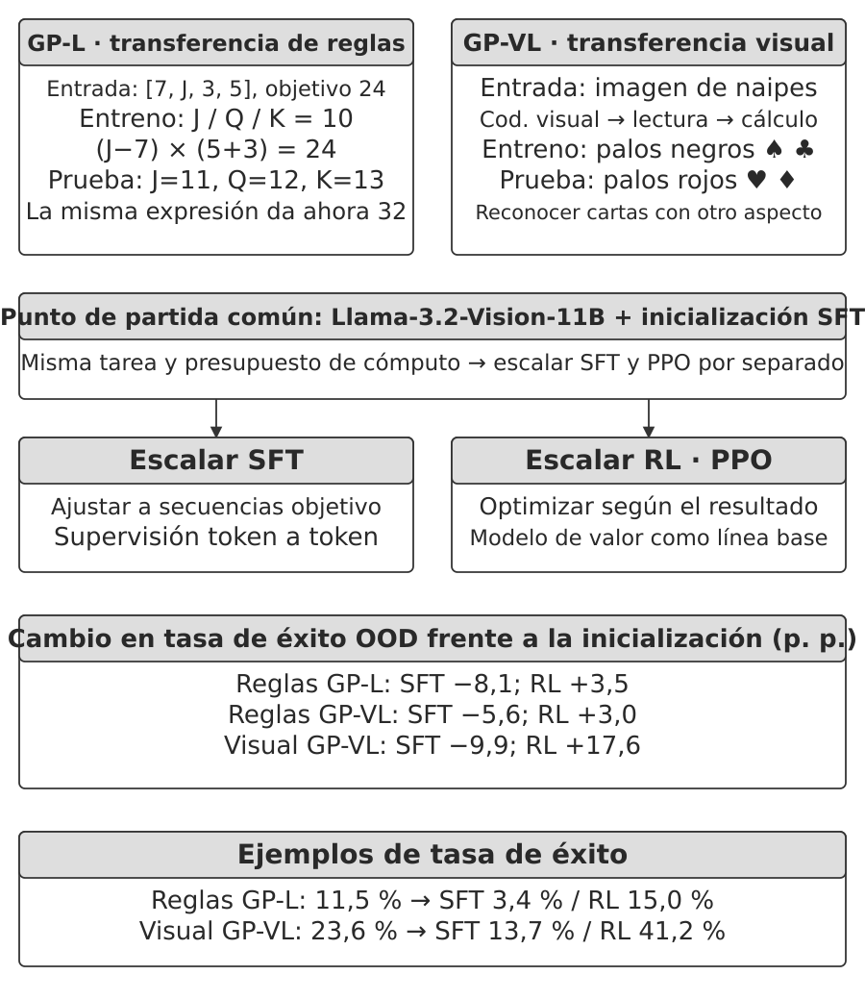
>
> **Variante de reglas**: en el entrenamiento, J/Q/K valen todas 10; en la prueba valen 11/12/13, respectivamente. El conjunto de prueba contiene así combinaciones de números no vistas en el entrenamiento, lo que permite comprobar si el modelo calcula con 11, 12 y 13 según la regla nueva. **Variante visual**: el entrenamiento usa palos negros (♠♣) y la prueba, palos rojos (♥♦), para comprobar si el modelo se adapta al cambio de apariencia de las cartas.
>
> El experimento parte de Llama-3.2-Vision-11B: primero se usa SFT para establecer la capacidad básica de seguir instrucciones y después el entrenamiento se divide en dos ramas, una que continúa con SFT y otra con RL, comparadas con el mismo presupuesto de cómputo. La rama de RL usa PPO con red de valor. Ambas ramas se entrenan con la regla J/Q/K=10 y luego se evalúan en conjuntos de prueba dentro de la distribución (ID) y fuera de la distribución (OOD).
>
> Con `[7, J, 3, 5]`, por ejemplo, si J=10 se puede usar `(J−7)×(5+3)=24`; si J pasa a valer 11, esa expresión da 32 y hay que cambiarla por `(11−5)×(7−3)=24`. Un mismo conjunto de cartas exige así que el modelo lea la regla vigente y reorganice el cálculo.
>
> Los dos métodos de entrenamiento mostraron una diferencia clara en las pruebas fuera de distribución. **OOD de reglas**: en GP-L, la tasa de éxito del RL subió del 11,5 % al 15,0 %, un aumento de 3,5 puntos porcentuales; la del SFT bajó del 11,5 % al 3,4 %, una caída de 8,1 puntos. En GP-VL, el RL ganó 3,0 puntos porcentuales y el SFT perdió 5,6. **OOD visual**: en GP-VL, el RL subió del 23,6 % al 41,2 %, un aumento de 17,6 puntos porcentuales; el SFT bajó del 23,6 % al 13,7 %, una caída de 9,9 puntos.
>
> Examinando además los resultados de reconocimiento de cartas se puede relacionar el rendimiento final en la tarea con la percepción visual: en la rama de RL, la precisión de reconocimiento aumentó junto con la tasa de éxito en la tarea, mientras que en la rama de SFT bajó algo. El estudio relaciona esta diferencia con el objetivo de entrenamiento: el ajuste token a token puede reforzar los patrones textuales de las demostraciones, mientras que la recompensa por resultado exige de forma continua que el modelo lea bien las cartas y complete el cálculo. La precisión perceptiva proporciona una métrica intermedia para analizar este mecanismo.
>
> El motivo de hacer primero SFT también puede entenderse por el formato de salida. En el experimento, el modelo base Llama-3.2-Vision-11B no era capaz de generar de forma estable la salida estructurada requerida, el verificador no podía calcular a partir de ella la recompensa de la tarea, y por eso fracasó el intento de hacer directamente RL de extremo a extremo. El SFT establece primero una salida analizable y puntuable, y solo entonces el RL posterior puede aprovechar la retroalimentación de la tarea. El DeepSeek-R1-Zero mencionado antes, en cambio, partía de un modelo base que ya generaba respuestas puntuables y pasó directamente al RL.
>
> ¿Cuánto puede aprender el modelo de la retroalimentación del verificador? La figura 10 del artículo compara por separado la tarea de cartas en texto puro (GP-L). Los investigadores fijaron 1, 3, 5 y 10 iteraciones de verificación y entrenaron y evaluaron un modelo de RL para cada caso. Con el mismo presupuesto de cómputo de entrenamiento, el grupo que permitía 10 verificaciones mejoró en la regla nueva 5,99 puntos porcentuales respecto a su propio punto de partida, y el que solo verificaba 1 vez mejoró 0,48 puntos.
>
> ¿Por qué, con el desplazamiento de distribución de este experimento, el rendimiento del SFT empeora y el del RL mejora? Una explicación coherente con las observaciones es que los datos limitados de SFT reforzaron el patrón fijo de «tratar J/Q/K como 10»; en la prueba, con J=11, el modelo seguía calculando con 10. La rama de RL, orientada al resultado, tiene más probabilidades de reforzar la estrategia de «recalcular hasta obtener la respuesta correcta», que sigue siendo aplicable cuando J pasa a valer 11.
>
> Los cambios de regla y de palo de GeneralPoints permiten observar por separado si el modelo ha aprendido a calcular con las condiciones nuevas y si lee correctamente la nueva entrada visual. Con el modelo, los datos de entrenamiento y el presupuesto de prueba de este caso, la rama que siguió con SFT retrocedió en las pruebas fuera de distribución, mientras que la que pasó a RL mejoró. Si se quiere aplicar la conclusión a una tarea propia, conviene preguntarse primero: ¿domina ya el estudiante el formato de salida? ¿La nueva prueba cambia las reglas, la apariencia de la entrada o ambas cosas? Solo haciendo las comparaciones por separado se sabe si hay que añadir demostraciones, mejorar la percepción o aumentar la exploración con retroalimentación de resultados.

## Algoritmos de RL: de 16 rollouts a una actualización de parámetros

**GRPO (Group Relative Policy Optimization)**, propuesto por DeepSeek, construye la señal de aprendizaje a partir del rendimiento relativo de varios intentos sobre un mismo problema. Tomemos como ejemplo una tarea de reparación de código al estilo de SWE-bench: en un proyecto de Python, `parser.py` lanza `IndexError` con una entrada vacía, y el Agente tiene que corregir la implementación sin tocar los archivos de prueba. Una iteración de entrenamiento puede dividirse en cuatro pasos.

**Primer paso: hacer que el modelo de política lo intente repetidamente.** El modelo de política es el modelo de lenguaje que se está entrenando. El sistema coloca el mismo código inicial y la misma descripción del problema en 16 sandboxes aislados y deja que el modelo complete la tarea 16 veces de forma independiente. Cada vez empieza leyendo el código, pasa por la modificación y las pruebas y termina entregando el resultado; toda esa trayectoria de interacción se denomina un **rollout**. El muestreo aleatorio hace que el mismo punto de partida produzca caminos distintos: unos añaden la comprobación de límites que faltaba, otros solo capturan la excepción, otros modifican el archivo equivocado y otros intentan cambiar las pruebas.

**Segundo paso: calcular la recompensa.** Al terminar cada rollout, el verificador aplica el parche en un entorno limpio y ejecuta las pruebas. Supongamos que de los 16 intentos, 4 pasan todas las pruebas sin modificar los archivos de prueba y los otros 12 fallan: los 4 que pasan reciben recompensa 1 y los 12 restantes, recompensa 0. La figura 8-13 reúne en una misma tabla la puntuación de estas 16 trayectorias. En este tipo de tareas de código, la recompensa puede calcularse directamente con pruebas y reglas. Para objetivos difíciles de expresar como pruebas, como la legibilidad o la calidad de la explicación, se puede recurrir además a la evaluación humana o a un modelo de recompensa.

**Tercer paso: calcular la ventaja relativa.** La recompensa solo indica si una trayectoria tuvo éxito o fracasó; la **ventaja relativa** indica cuánto mejor es respecto a los demás intentos del mismo grupo. La tasa media de éxito de este grupo es 4/16: las 4 trayectorias que pasan las pruebas están por encima de la media del grupo y reciben ventaja positiva; las 12 que fallan están por debajo y reciben ventaja negativa. Si se normaliza por la desviación típica del grupo, con una recompensa media de 0,25 y una desviación típica de unos 0,433, la ventaja de las trayectorias exitosas es de unos 1,73 y la de las fallidas, de unos −0,58. GRPO construye la señal de aprendizaje con este tipo de comparación intragrupo. Si las 16 recompensas son idénticas, al restar a cada una la media del grupo se obtiene cero. Basta con añadir un pequeño término de estabilidad al denominador para evitar la división por cero; aun así, tras la normalización, la recompensa por resultado de este grupo sigue sin indicar hacia qué trayectoria debe inclinarse el entrenamiento. En ese caso se puede comprobar si las restricciones de camino, las recompensas de proceso o el avance parcial permiten distinguir las trayectorias del grupo. Por ejemplo, de dos intentos que no lograron arreglar el código, solo uno pasó la prueba de límites que antes fallaba. Siempre que ese resultado intermedio pueda verificarse de forma independiente, se tiene una pista más que puede usarse para aprender.

**Cuarto paso: actualizar la política con descenso de gradiente.** El programa de entrenamiento convierte la ventaja relativa en una pérdida, calcula el gradiente y el optimizador (como AdamW o Muon) ejecuta el descenso de gradiente, que aumenta la probabilidad de las elecciones del modelo en las trayectorias de ventaja positiva y reduce la de las elecciones en las de ventaja negativa. El entrenamiento ajusta una y otra vez la probabilidad de estas elecciones a lo largo de muchas tareas y rollouts. Cuando la optimización empieza a surtir efecto, ante errores similares se vuelve más probable «reproducir primero el problema, revisar las condiciones de límite, modificar la implementación y ejecutar las pruebas», y menos probable «ocultar la excepción, cambiar las pruebas o entregar sin verificar».

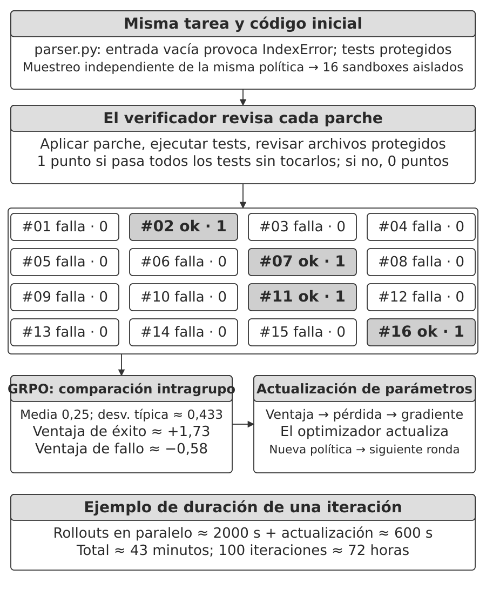

En la figura 8-13, muestrear 16 veces el mismo problema, ¿cuántas **iteraciones de entrenamiento (step)** son? Según el recuento de esta sección, estos 16 rollouts pertenecen al mismo lote. En la ronda $k$ se muestrea con la política actual, se calculan la recompensa, la ventaja y el gradiente, y se actualiza la política una vez; solo en la ronda $k+1$ se vuelve a muestrear con los parámetros nuevos. Entrenar 100 steps significa hacer unas 100 rondas de esta iteración.

A partir de aquí se puede estimar el tiempo de entrenamiento. Una tarea compleja puede incluir decenas de rondas de llamadas a herramientas; en el entrenamiento síncrono, que espera los resultados de todo el lote, la más lenta de las 16 trayectorias paralelas decide cuándo termina la fase de muestreo. Si esa trayectoria tarda unos 2000 segundos y el cálculo del gradiente y la actualización del optimizador otros 600, cada step necesita unos $2000+600=2600$ segundos, es decir, 43 minutos. Entrenar 100 steps seguidos con el mismo tiempo requiere unas 72 horas.

PPO y GRPO siguen ambos este ciclo; la diferencia está sobre todo en «con qué se compara». GRPO compara directamente varios rollouts del mismo problema y no necesita un modelo de valor adicional; PPO entrena un modelo de valor que estima, en cada paso de la trayectoria, «lo bien que suele ir a partir de ahí», y luego juzga si la acción actual es mejor que esa expectativa, con lo que proporciona la línea base que necesita la asignación de crédito paso a paso. Ambos frenan las actualizaciones excesivas con mecanismos como el recorte del objetivo sustituto. DPO es distinto: aprende directamente de pares de preferencia «respuesta mejor—respuesta peor» recogidos de antemano, sin que la política actual genere en línea ese grupo de rollouts.

Los casos de este capítulo usan recetas de entrenamiento distintas: AdaptThink usa un objetivo con restricciones propio; GeneralPoints, V-IRL y ReTool usan PPO, y en los dos primeros el modelo de valor participa en la estimación de la ventaja; SimpleVLA-RL y RLVP usan GRPO.

Supongamos que se intentan cuatro veces dos problemas, A y B: A se acierta siempre y B se falla siempre. Las cuatro recompensas de A valen 1 y las cuatro de B valen 0. Al restar la media de cada grupo, la ventaja de ambos grupos se vuelve 0. Pero si queda cómputo para unos cuantos intentos más, ¿en qué problema es más probable obtener muestras de entrenamiento útiles?

Never Give Up incorpora esta elección al proceso de muestreo. Como A se acierta siempre, ese grupo se omite; como B se falla siempre, se añade otro grupo con cierta probabilidad. Supongamos que en el segundo grupo por fin hay un acierto: en el entrenamiento se juntan las ocho respuestas de ambos grupos, una solución correcta y siete erróneas, y el mismo problema tiene ya recompensas altas y bajas. El muestreo asíncrono deja que los demás problemas avancen con normalidad, sin esperar el resultado de B.[^ch8-ngu]

[^ch8-ngu]: Michael Noukhovitch et al., *Learning to Solve Hard Problems in RL for LLMs by Never Giving Up*, 2026. El muestreo adicional del artículo se usa para el entrenamiento; los problemas ya resueltos pueden volver a seleccionarse en el entrenamiento posterior.

### Por qué el RL de LLM suele preferir On-Policy

**Online (en línea)** y **On-policy (en política)** describen dos aspectos distintos. El entrenamiento en línea interactúa continuamente con el entorno durante la ejecución y produce datos sobre la marcha; el entrenamiento en política se fija en el origen de los datos y exige que la política de comportamiento $\mu$ que genera las trayectorias coincida con la política que se optimiza, $\pi_\theta$, o esté lo bastante cerca. Un clúster asíncrono puede muestrear en línea de forma continua, pero si un worker va varios checkpoints por detrás, los datos que devuelve llevan antigüedad de política y forman un componente off-policy (fuera de política).

El autor recomienda establecer primero una línea base estable con entrenamiento casi en política y solo después introducir muestreo asíncrono o reutilización de datos antiguos para aumentar la capacidad de procesamiento (throughput). Las recetas de PPO/GRPO de este capítulo suelen muestrear con la política más reciente al comienzo de cada step. PPO hace después varias pasadas de actualización por minilotes sobre el mismo lote de datos, y la política actual se va alejando de la `old_policy` que generó los datos. La razón de probabilidades mide este cambio, y el objetivo recortado frena las actualizaciones excesivas.

El objetivo del gradiente de política está ligado a la recompensa esperada bajo la política actual $\pi_\theta$. Cuando se usan datos muestreados con la política de comportamiento $\mu$, se puede calcular primero la razón de probabilidades de la acción en el mismo estado y construir con ella una corrección por importancia:

$$
\rho_t=\frac{\pi_\theta(a_t\mid s_t)}{\mu(a_t\mid s_t)}
=\exp\left(\log\pi_\theta(a_t\mid s_t)-\log\mu(a_t\mid s_t)\right).
$$

Supongamos que, tras un mismo prefijo, la política de muestreo eligió un token con probabilidad 0,2 y que la política actual le asigna 0,3: la razón de probabilidades de ese paso es 1,5. Ese token aparece menos de la cuenta en las muestras antiguas, así que, al estimar con la política actual, el peso de esas muestras sube en proporción. Si el muestreo y el entrenamiento usan la misma política, antes de actualizar los parámetros la razón de probabilidades de cada paso es 1.

Reutilizar trayectorias antiguas permite desacoplar muestreo y entrenamiento y aumentar la capacidad de procesamiento. Pero cuanto más se alejan las dos políticas, más probable es que unas pocas muestras reciban un peso enorme. Al reponderar una trayectoria completa, además, las razones de probabilidad de cada paso se multiplican entre sí. PPO recorta parte del beneficio adicional en el objetivo sustituto de cada acción, lo que atenúa el efecto de las razones extremas; los estados que las muestras antiguas nunca visitaron solo pueden verse con muestreo nuevo. Por eso el autor prefiere usar trayectorias frescas.[^ch8-32]

#### Diferencias numéricas entre entrenamiento e inferencia

El RL de LLM a gran escala suele muestrear con motores de inferencia como vLLM o SGLang y calcular las log-probabilidades y los gradientes con sistemas de entrenamiento como FSDP o Megatron. Aunque ambos lados carguen los mismos pesos, pueden calcular log-probabilidades ligeramente distintas para un mismo token por diferencias en la precisión de coma flotante, el orden de reducción, el paralelismo tensorial, el tamaño de lote, la KV Cache o los kernels fusionados. Entonces, sin que los parámetros se hayan actualizado aún, $\rho_t$ ya se aparta de 1, y aparece entre entrenamiento y muestreo una diferencia de política de naturaleza numérica. Experimentos controlados han observado que diferencias minúsculas a nivel de token pueden llegar a provocar el colapso del entrenamiento.[^ch8-33]

En cuanto cambia la distribución de muestreo, el gradiente de política ingenuo puede inclinarse hacia una de dos acciones aunque ambas tengan exactamente la misma recompensa. Supongamos que en el muestreo A y B tenían cada una la mitad de probabilidad y que, durante el entrenamiento, la probabilidad de que el modelo elija A ha pasado a 0,8. Para el logit que controla A, cuando se elige A el gradiente de la log-probabilidad es $1-0{,}8=0{,}2$; cuando se elige B es $0-0{,}8=-0{,}8$. Si ambas acciones obtienen 1 punto, el promedio con las probabilidades del muestreo da un gradiente de $-0{,}3$. Aunque las dos elecciones puntúan igual, la actualización reduce la probabilidad de A.

El score centering resta al gradiente de la log-probabilidad bajo un mismo prefijo su media bajo la distribución de muestreo. En el ejemplo, tras restar $-0{,}3$, los dos términos pasan a ser $0{,}5$ y $-0{,}5$, y la actualización media producida por recompensas iguales es exactamente cero. Antes, GRPO restaba la media a las recompensas de un grupo de respuestas; aquí lo que se centra es el gradiente.[^ch8-sc]

[^ch8-sc]: Martin Marek, Max Ryabinin, *Score Centering Stabilizes Off-policy Reinforcement Learning*, 2026. Cuando la política de muestreo se queda demasiado atrás, también se puede usar una regularización KL que limite la distancia entre la política de entrenamiento y la de comportamiento (arXiv:2611.21791).

Los errores numéricos entre el lado de entrenamiento y el de muestreo se amplifican además a lo largo de secuencias largas: **error en la log-probabilidad → desviación de la razón de probabilidades → acumulación en prefijos largos → cambio en el recorte y en la ponderación por ventaja → cambio en el gradiente y en el número efectivo de muestras**. Por ejemplo, si las razones de log-probabilidad de 4000 tokens llevan todas un sesgo de $10^{-3}$ en el mismo sentido, la razón de probabilidades calculada a nivel de trayectoria será $e^{4000\times0{,}001}=e^4\approx54{,}6$ veces el valor real.

Los cambios tempranos de probabilidad pueden alterar además el resultado del muestreo y hacer que los estados posteriores evolucionen por otro camino. Las señales observables durante el entrenamiento incluyen picos en la razón de importancia, aumento de la proporción recortada, cambios bruscos del gradiente o de la longitud de respuesta, y caídas de la recompensa y de la entropía. Cuando el tamaño de lote cambia el proceso de reducción, el resultado numérico para una misma entrada también puede variar, es decir, se rompe la invariancia respecto al lote (batch invariance). Las investigaciones al respecto han observado el efecto implícito fuera de política que se deriva de ello y han mejorado la estabilidad alineando el cómputo de muestreo y de entrenamiento o corrigiendo explícitamente la diferencia de política.[^ch8-34]

Por eso el autor considera la coherencia numérica entre muestreo y entrenamiento una comprobación central antes de arrancar el entrenamiento, y la vigila de forma continua junto con la curva de recompensa. Se puede abordar en cuatro pasos: «medir la diferencia—alinear la configuración—corregir el sesgo—controlar la antigüedad»:

- **Antes de cualquier actualización de parámetros**, comparar con un mismo lote de trayectorias las log-probabilidades de token que dan el lado de muestreo (sampler) y el de entrenamiento (trainer), y vigilar la media, los cuantiles y el máximo de $\rho_t$, la KL aproximada y la proporción recortada; es la prueba unitaria on-policy más directa.
- Al sincronizar los pesos, alinear también los adaptadores LoRA, el tokenizador, la plantilla de conversación, la versión del modelo y la configuración de la codificación posicional. Los rollouts deben guardar las log-probabilidades que dio la política de muestreo en el momento de generar, para calcular después con ellas la razón de probabilidades.
- Alinear en lo posible la precisión, la distribución del paralelismo y los kernels de cálculo clave del muestreo y del entrenamiento; si no se puede, tratar explícitamente la diferencia como off-policy, aplicar corrección por importancia, vigilar el número efectivo de muestras y juzgar el efecto de la corrección junto con la proporción recortada.
- Volver a muestrear pronto con la política actualizada, y limitar el número de pasadas de actualización sobre cada lote de datos y el número de checkpoints que el muestreo asíncrono puede ir por detrás del entrenamiento.

## Entornos de RL: de la evaluación a la simulación

El entrenamiento de RL de un Agente necesita ejecutar tareas una y otra vez. Una reparación de código puede reintentarse en una copia aislada; un pago, en cambio, modifica el estado de una cuenta real. El entorno de entrenamiento debe proporcionar estados iniciales reiniciables, copias de la tarea que puedan ejecutarse en paralelo y resultados verificables, para que el modelo explore caminos distintos en condiciones controladas. El capítulo 7 ya presentó los entornos de evaluación; para usarlos en el entrenamiento hay que tener en cuenta además la ejecución prolongada, los efectos secundarios de las acciones y el coste de un gran número de interacciones. El autor asigna primero personal y presupuesto a la construcción del entorno y solo después programa el entrenamiento a gran escala. Implementar retroalimentación real, reinicio de estado y aislamiento en paralelo suele consumir más recursos de ingeniería que integrar PPO o GRPO, y el coste de construir el entorno puede superar al del propio entrenamiento.

### El entorno: el campo de práctica del modelo

El entorno actualiza el estado según la acción y devuelve la nueva observación al modelo. Para construirlo se puede partir de tres preguntas.

- **¿Se parece la interacción al escenario de despliegue?** Un simulador de atención al cliente debe cubrir situaciones como que el usuario aporte información adicional, cambie su petición o se exprese de forma ambigua; un simulador de herramientas debe devolver los errores y las latencias habituales en producción. El modelo aprende a afrontar problemas reales a través de esta retroalimentación. Una retroalimentación demasiado uniforme hace que la política dependa de rutinas fijas de la simulación.
- **¿Se pueden reintentar las tareas de forma estable y en paralelo?** Cada rollout necesita su propio estado de pedidos, archivos o cuentas, que pueda limpiarse y restaurarse al terminar. El sandbox de intérprete de código de ReTool y el sandbox MCP de AWorld cumplen esta función. Para las API reales con límites de velocidad, costes o efectos secundarios de escritura, se pueden usar, según lo que exija la tarea, cuentas sandbox, datos reproducidos o interfaces simuladas.
- **¿Cómo se juzga el resultado?** El estado del entorno es una base importante para calcular la recompensa. Por ejemplo, una tarea de reembolso puede comprobar el importe, el estado del pedido y las condiciones de autorización; una tarea de código puede ejecutar pruebas. Más adelante se trata específicamente el diseño de la recompensa.

**Antes de ponerse a ajustar el algoritmo, el autor recomienda comprobar si el entorno de simulación se parece lo suficiente a la tarea real. Esto importa más que elegir entre PPO y GRPO.** La fidelidad, la capacidad de reinicio y la capacidad de verificación determinan juntas lo que el modelo puede aprender de la interacción. Hacer funcionar primero estos tres eslabones con unas pocas tareas y ampliar después la escala del entrenamiento suele facilitar la localización de problemas.

### Simular herramientas y entornos con modelos

Los resultados de búsqueda, las conversaciones con usuarios y los estados de negocio complejos pueden sintetizarse con ayuda de modelos. Un simulador basado en modelo recibe la acción del Agente y genera la retroalimentación del paso siguiente, lo que reduce la dependencia de servicios externos en tiempo real. Este enfoque puede extenderse desde una sola herramienta hasta todo el entorno de la tarea.

**Primer nivel: sintetizar los valores de retorno de las herramientas.** ZeroSearch[^ch8-13] hace que un LLM interprete el papel de motor de búsqueda: el estudiante lanza la consulta y el simulador genera los resultados. Así se reduce la dependencia del entrenamiento respecto al coste, los límites de velocidad y la variabilidad de resultados de las API de búsqueda reales. Además sigue una organización de tipo currículo: al principio devuelve documentos de mayor calidad y relevancia, y después va añadiendo ruido para que el estudiante practique la extracción de información útil a partir de materiales imperfectos. En el estudio, los modelos entrenados en el entorno de búsqueda simulado siguieron rindiendo bien al conectarse a un motor de búsqueda real.

**Segundo nivel: simular las transiciones de estado del entorno.** DreamGym[^ch8-14] destila la dinámica del entorno en un modelo de experiencia basado en razonamiento. El modelo lee el estado actual y la acción del Agente, deduce el estado siguiente y la retroalimentación, y genera en lote trayectorias de interacción para RL en línea, con lo que reduce los accesos al entorno real. En tareas de atención al cliente y ventas también se puede hacer que un LLM interprete al usuario y simule preguntas de seguimiento, información adicional y cambios de petición. La serie τ-bench usa simuladores de usuario; marcos de interacción similares también pueden usarse en el entrenamiento, con funciones separadas de práctica y de evaluación.

Los simuladores basados en modelos también necesitan calibración. Si un simulador de atención al cliente siempre entiende con exactitud las preguntas ambiguas, la política no tiene ocasión de practicar las aclaraciones; si un simulador de búsqueda siempre devuelve el documento correcto, la política no adquiere experiencia en identificar ruido. El entrenamiento puede además reforzar conductas que explotan los defectos de puntuación del simulador. El autor recomienda un enfoque mixto: que la simulación con modelos asuma la mayor parte de las interacciones, comprobar periódicamente el rendimiento de la política con tareas del entorno real y devolver al simulador las diferencias encontradas. Así se forma un proceso iterativo de «interacción sintética—evaluación en tareas reales—corrección del simulador».

¿Cómo saber si el simulador puede enseñar de verdad a usar las herramientas? Se puede hacer una pequeña prueba: sobre un mismo pedido inicial, consultar primero, enviar luego una modificación y volver a consultar, comprobando si los campos del pedido devuelto cambian como se espera tras la acción. Después se reinicia el entorno y se confirma que se vuelven a leer los valores originales. Un entorno que solo sabe generar un «modificado» que suena razonable, pero en el que la consulta del turno siguiente no muestra el cambio, premiará a una política que sabe hablar aunque nunca haya cambiado el pedido.

### Entorno, distribución de tareas y aislamiento de la evaluación

El entorno de entrenamiento determina lo que el modelo puede experimentar. Los estados reiniciables permiten reintentar, las copias aisladas permiten el paralelismo, y unas reglas de estado y de verificación claras permiten reproducir y puntuar. Las tareas pueden seguir el método de síntesis de datos visto antes: se extrae un esquema de tarea de los registros reales del negocio, se elimina la información de identidad y se generan personas, pedidos, archivos y estados iniciales ficticios.

El entrenamiento y la evaluación pueden reutilizar el generador de tareas y el código de verificación, pero las tareas concretas deben dividirse en conjuntos independientes. Siguiendo el diseño de entornos de SWE-Gym, τ²-bench y AndroidWorld[^ch8-28], las pruebas de aceptación, el estado oculto necesario para puntuar y la solución de referencia se guardan en el lado del verificador, y el Agente obtiene las observaciones a través de la interfaz acordada por la tarea. Antes de ampliar el muestreo, se comprueba con unos pocos rollouts si la tarea puede completarse y si el verificador distingue los resultados válidos de los inválidos. Descubrir pronto los sesgos de puntuación reduce las oportunidades de que la política explote las lagunas de la verificación.

Por tanto, el orden de la ingeniería de entornos debe ser: **esquema de tarea → entorno reiniciable → verificación del resultado → aislamiento entrenamiento/evaluación → calibración con interacciones reales**. La síntesis de datos vista antes filtra en estos entornos las trayectorias válidas para formar demostraciones de SFT. Al pasar al RL, la política actual sigue ensayando y equivocándose en el entorno y explora caminos más allá de las demostraciones.

La verificación también debe incluirse en el presupuesto de capacidad de procesamiento. El kernel de Lean, los ejecutores de pruebas y la ejecución en contenedores consumen CPU y memoria. Cuando la velocidad de generación de las GPU supera la de verificación, las tareas se acumulan en la cola de verificación. En ese caso hay que añadir workers de verificación, reducir la latencia de verificación o ajustar la proporción de recursos entre generación y verificación[^ch8-9].

## Del turno único a los múltiples turnos: escenarios de tarea y asignación de crédito

### El reto central de las tareas multiturno

A la izquierda de la figura 8-14 está el juego del 24. El modelo puede calcular varios pasos dentro de su respuesta, pero todos usan las cuatro cartas que da el enunciado y por el camino no llega ninguna observación nueva del entorno. A la derecha está la navegación por vistas de calle. Solo después de llegar a un cruce y elegir girar a la izquierda se ve la calle a la que se ha girado. Cómo seguir hay que decidirlo de nuevo según los carteles que se tienen delante. ReAct, presentado en los capítulos 1 y 4, permite organizar esta interacción: el modelo elige una acción, la herramienta o el entorno la ejecuta y la nueva observación entra en la decisión de la ronda siguiente.

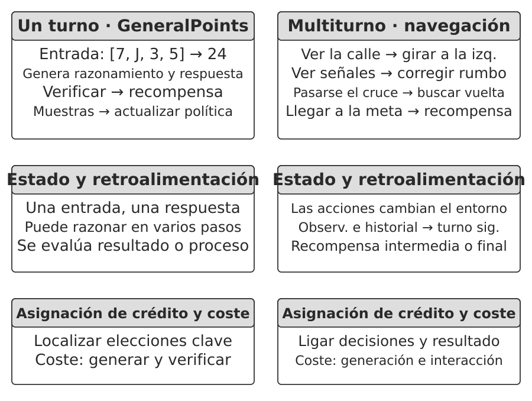

En la figura 8-15, el Agente se pasa un cruce en el paso 3, descubre en el paso 4 que se ha desviado, da media vuelta y llega al destino en el paso 5. La recompensa final da por buena toda la navegación, pero no distingue entre equivocarse de camino y rectificar a tiempo. La próxima vez que llegue a ese cruce queremos que acierte directamente; y si vuelve a equivocarse, queremos seguir animándolo a dar media vuelta. En el entrenamiento hay que estimar qué papel tuvieron los pasos anteriores en el beneficio final; este problema se llama **asignación de crédito (Credit Assignment)**. Las estimaciones de valor y de ventaja pueden aprovechar el retorno posterior; cuando las acciones intermedias pueden comprobarse de forma fiable, también se pueden añadir recompensas de proceso. La media vuelta del paso 4 obtiene 0 puntos en la recompensa de proceso, pero sigue ayudando a llegar al destino. Al estimar el valor de ese paso también hay que contar el retorno posterior.

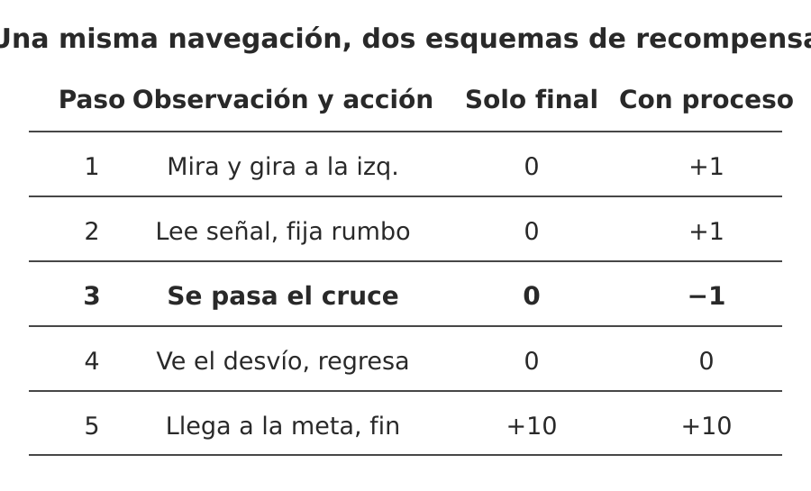

El mismo problema aparece en una llamada de atención al cliente. Supongamos que el usuario da una valoración positiva en el turno 10. En el turno 2 se aclaró qué cobro era el disputado y en el turno 7 se explicó la tarifa; ambos pasos pueden haber ayudado. Solo con la valoración positiva final no se puede distinguir cuánto aportó cada uno. Los dos experimentos siguientes tratan, respectivamente, el caso en que quien entrena puede comprobar paso a paso las acciones de navegación y el caso en que solo puede juzgar por el resultado de la tarea si el robot ha tenido éxito.

> **Experimento 8-12 ★★★: V-IRL-VL: navegación visual multiturno**
>
> En V-IRL[^ch8-24], el Agente tiene que encontrar su destino paso a paso según la vista de calle que tiene delante. El entrenamiento usa rutas de Nueva York y la prueba se traslada a otras ciudades, lo que cambia tanto la forma de dar indicaciones como las calles que aparecen en las imágenes. En las dos pruebas fuera de distribución, de cambio de reglas y de cambio visual, el RL rinde claramente mejor que el SFT. El experimento usa PPO con red de valor. Dar retroalimentación en cada paso ayuda a distinguir qué decisiones de una ruta larga merece la pena conservar.

> **Experimento 8-13 ★★★: SimpleVLA-RL: exploración abierta con recompensa por resultado `[Experimento Extendido]`**
>
> SimpleVLA-RL usa en las tareas robóticas de LIBERO una recompensa de resultado de éxito/fracaso. Cada tarea hace un arranque en frío con SFT a partir de una sola trayectoria de demostración, y después el RL eleva la tasa de éxito del 17,3 % al 91,7 % y produce una acción de «empujar y cortar» que no aparecía en las demostraciones. Comparemos este resultado con la navegación por vistas de calle: si se puede juzgar de forma fiable en qué paso intermedio se ha cometido un error, se puede dar retroalimentación en el acto y acelerar el aprendizaje. Si aún no se sabe de cuántas formas puede completarse la tarea, recompensar primero por el resultado deja al modelo margen para probar otros caminos. Convertir demasiado pronto en requisito de la recompensa el orden de acciones de las demostraciones humanas puede rebajar la puntuación de estrategias nuevas como «empujar y cortar».

### Llamada a herramientas: aprender a usar capacidades externas mediante la interacción

Con herramientas externas conectadas, el modelo puede elegir buscar, ejecutar código, modificar archivos, consultar bases de datos o combinar varias API según lo que exija la tarea. El Harness se encarga de validar y despachar las llamadas, y la herramienta se ejecuta en el entorno y devuelve la observación. La figura 8-16 separa las decisiones dentro de una tarea del entrenamiento que viene después de terminarla. Siguiendo las flechas de la derecha, el resultado de la herramienta vuelve a la tarea en curso y el modelo lo usa para decidir el paso siguiente. Si se sigue leyendo hacia abajo, solo cuando la tarea ha terminado el programa de entrenamiento usa la trayectoria completa para calcular la recompensa y actualizar los parámetros, y la siguiente ronda de muestreo ya usa la política nueva. Cuando una tarea exige llamar a varias herramientas seguidas, el resultado devuelto por una llamada influye en los parámetros de la siguiente.

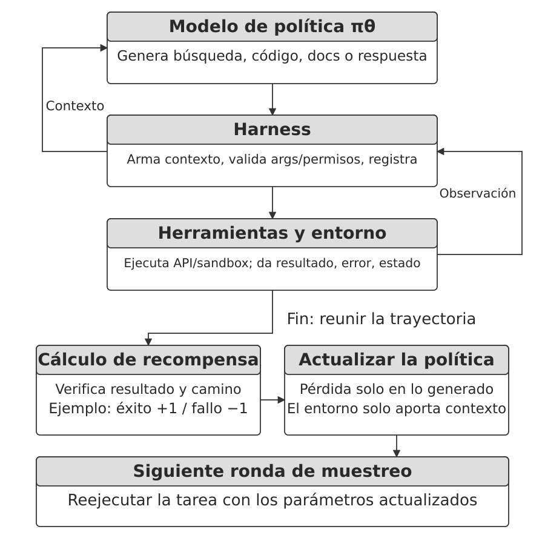

Search-R1[^ch8-25] entrena al modelo para decidir cuándo buscar y qué consulta enviar, y para seguir razonando con los resultados. ReTool conecta un intérprete de código al mismo tipo de bucle: el modelo aprende a programar la ejecución de código, a entender los valores devueltos y a corregirse según los errores. AWorld-train lo extiende a un sandbox MCP con varias herramientas: el modelo tiene que elegir herramientas y gestionar las dependencias entre llamadas, y el sistema de entrenamiento tiene que poder reiniciar el entorno y reproducir trayectorias.

En las trayectorias con herramientas hay que distinguir los tokens generados por el modelo de los tokens devueltos por el entorno. Al calcular la pérdida de la política, solo cuentan las acciones generadas por el modelo, como el razonamiento, los parámetros de las llamadas y la respuesta, y se enmascaran las posiciones correspondientes a la retroalimentación del entorno. La retroalimentación sigue participando como contexto en el cálculo posterior y ayuda al modelo a juzgar qué debe hacer a continuación. Por ejemplo, si el intérprete devuelve un error, lo que el entrenamiento quiere reforzar es cómo corrige después el modelo el código. Si el texto del error también contara en la pérdida de la política, la actualización mezclaría el objetivo de «generar la salida del entorno» y se apartaría de las decisiones de las que el modelo es realmente responsable.

> **Experimento 8-14 ★★★: ReTool: resolución de problemas matemáticos reforzada con intérprete de código**
>
> La figura 8-17 muestra, con una ecuación de segundo grado, cómo se alternan el razonamiento textual, la generación de código y la retroalimentación del intérprete.
>
> 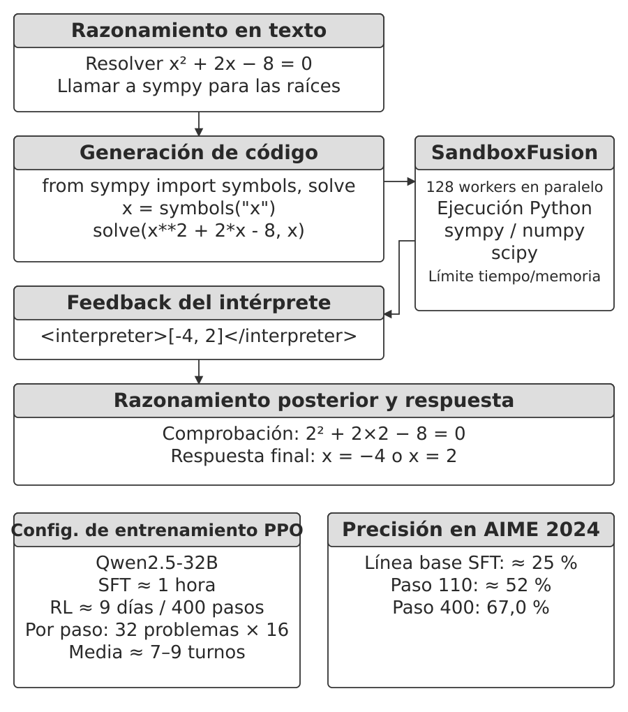
>
> Tras un calentamiento con SFT, ReTool se entrena con PPO sobre pensamiento textual, ejecución de código y retroalimentación del intérprete entrelazados. El modelo aprende poco a poco cuándo merece la pena ejecutar código y cómo modificarlo tras un error. Se usan los datos de entrenamiento de DAPO-Math-17k, y la política se sigue actualizando con PPO estándar[^ch8-26][^ch8-27].
>
> Tras el entrenamiento, la precisión del modelo en AIME 2024 sube de alrededor del 25 % al 67,0 %. Frente al RL con texto puro, la retroalimentación del código hace que el modelo aprenda antes a calcular con exactitud y a corregir errores.

> **Experimento 8-15 ★★★: AWorld-train: aprender a usar herramientas en un sandbox**
>
> Si se recorre la mitad superior de la figura 8-18, el modelo recibe el resultado de una llamada a herramienta y puede seguir intentándolo. Si se recorre después la mitad inferior: este lote de tareas ya ha terminado, el programa de entrenamiento recibe las trayectorias con recompensa y actualiza los parámetros, y solo el lote siguiente de tareas usa la política nueva.
>
> 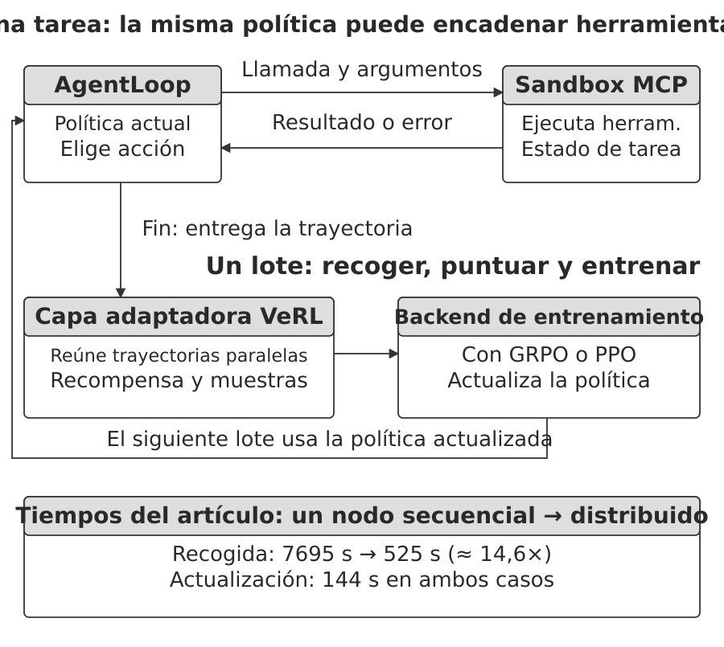
>
> El entorno GAIA cuenta con 26 servidores MCP y 126 funciones de herramienta: puede manejar páginas web con Playwright, extraer el contenido de PDF, documentos de Word y presentaciones, transcribir audio, reconocer texto o ejecutar código en un sandbox de E2B. La herramienta de Excel ofrece 29 operaciones, entre ellas fórmulas, gráficos y tablas dinámicas, y la recuperación de conocimiento puede acceder además a Wikipedia, arXiv y Wayback. Tras reiniciar el sandbox se puede volver a intentar desde el mismo estado o reproducir una trayectoria anterior.
>
> Los tiempos de la figura proceden de la comparación de recogida de datos del artículo. El experimento que acompaña al libro ofrece además una configuración de entrenamiento para un modelo de 4B: Qwen3-4B-Thinking-2507, 8 A100, un límite de contexto de 131K, un máximo de 32 turnos de interacción, tamaño de lote 32, 16 trayectorias muestreadas por problema, actualización con GRPO y tasa de aprendizaje de 1e−6.

La herramienta ha devuelto un resultado: ¿qué paso debe recompensar el programa de entrenamiento? Una llamada correcta solo indica que la herramienta se ejecutó bien. Para juzgar si ese paso hizo avanzar la tarea, hay que usar un verificador que compruebe el cambio que produjo y decidir después qué recompensa dar al modelo.

## Diseño de la recompensa: cómo convertir el objetivo de la tarea en señal de aprendizaje

Imaginemos dos trayectorias de reembolso que al final devuelven el mismo importe, una de las cuales se salta la verificación de identidad obligatoria. Si solo se lee el saldo final, ambas obtienen la misma puntuación. Para convertir en señal de aprendizaje todos los requisitos que el usuario ha encomendado, hay que determinar primero quién puede comprobar el resultado, en qué paso se pueden obtener pruebas y qué información hay que devolver al modelo, y después comprobar si las restricciones de permisos y de proceso a lo largo del camino pueden verificarse por separado.

### De dónde procede la recompensa: reglas, preferencias humanas y juicio de modelos

En las tareas que pueden juzgarse automáticamente, el autor prefiere el **aprendizaje por refuerzo con recompensas verificables (RLVR)**, que escribe directamente como programa los requisitos de aceptación. En los problemas de matemáticas se puede comprobar la respuesta; en las tareas de código, ejecutar las pruebas; en las de reembolso, comprobar el importe y el estado del pedido en la base de datos. Anotando 1 si se supera y 0 si se falla, se obtiene la recompensa por resultado más sencilla. Las reglas claras y la ejecución reproducible facilitan localizar las diferencias de puntuación; el alcance del verificador determina qué requisitos se están optimizando realmente en el entrenamiento.

El **aprendizaje por refuerzo a partir de retroalimentación humana (RLHF)** convierte las preferencias humanas en señal de entrenamiento. InstructGPT[^ch8-4] recogió primero comparaciones humanas entre respuestas, entrenó un modelo de recompensa y después optimizó la política con PPO. El modelo de recompensa aprende las preferencias de un número limitado de muestras, y perseguir sin cesar una puntuación más alta del modelo puede amplificar sus sesgos[^ch8-5]. En el entrenamiento se suele añadir una regularización KL respecto al modelo de referencia de SFT para controlar la deriva de la política. DPO[^ch8-6], en cambio, optimiza la política directamente con pares de preferencia «respuesta mejor—respuesta peor» y se ahorra el paso de entrenar por separado un modelo de recompensa.

En las tareas abiertas se puede hacer que el modelo dé las razones de su evaluación además de la puntuación. Los diagnósticos generados por un **modelo de recompensa generativo (GRM)** pueden usarse también para filtrar demostraciones, construir pares de preferencia u orientar modificaciones posteriores. DeepSeek-GRM[^ch8-23] genera principios de evaluación según la tarea y, a partir de ellos, emite críticas y puntuaciones; mejora su conducta evaluadora mediante RL en línea y agrega sus juicios con varios muestreos y un modelo de recompensa auxiliar.

La distancia entre la métrica de evaluación y el objetivo de la tarea también influye en la conducta del modelo. El **reward hacking** se refiere a que la política aprovecha defectos de las reglas de puntuación o de su implementación para obtener puntuaciones altas. En los Agentes de largo recorrido hay además un fenómeno llamado **reward seeking**: el modelo actúa según la forma de puntuar que él mismo supone, por ejemplo eligiendo por su cuenta una comprobación fácil de superar y dando la tarea por terminada en cuanto la supera[^ch8-29]. Este ejemplo nos recuerda que las condiciones de aceptación deben partir del objetivo del usuario y cubrir el entregable real; comprobar solo las métricas que el modelo elige por sí mismo deja escapar con facilidad los requisitos aún no cumplidos.

Al diseñar la recompensa de una tarea de reembolso, conviene pasar primero dos trayectorias escritas a mano por el verificador. A comprueba el pedido, llama a la interfaz de reembolso y repite el justificante al usuario; B solo dice «el reembolso se ha completado». Si ambas obtienen la misma puntuación, hay que averiguar primero si el evaluador ha leído la respuesta final, el justificante de la interfaz o el estado del pedido. Este pequeño contraejemplo basta para poner al descubierto el problema de la métrica sustituta y ahorra el coste de descubrir, tras entrenar con todo un lote, que el modelo ha aprendido a anunciar buenas noticias antes de tiempo.

### Cuándo se da la recompensa: resultado y proceso

La **recompensa por resultado** evalúa el desempeño en la tarea al final de un episodio; cuando la evaluación del resultado la hace un modelo, este se denomina **ORM (Outcome Reward Model)**. La recompensa de éxito/fracaso de SimpleVLA-RL hace que la política explore distintas secuencias de acciones en torno al objetivo final. Una señal así es fácil de definir, pero cuando una trayectoria larga fracasa, el modelo necesita más intentos para distinguir qué acciones causaron el fracaso. Es una de las razones por las que la retroalimentación escasa afecta a la eficiencia muestral[^ch8-8].

Tomemos la finalización prematura de un Coding Agent: cuando el modelo entrega su declaración de finalización, el Harness ejecuta pruebas de aceptación protegidas en un espacio de trabajo aislado. Las pruebas leen los archivos y el estado del entorno reales; si se superan se da una recompensa positiva y, si no, una negativa. Así, la declaración de finalización desencadena una verificación externa y el resultado de la tarea lo decide el entregable. En la evaluación se preparan dos grupos de tareas: uno en el que aún queda trabajo pendiente, para medir la tasa de finalización prematura, y otro ya completado, para comprobar si el modelo sabe cerrar a tiempo.

La **recompensa de proceso** da retroalimentación en los pasos intermedios, por ejemplo evaluando la verificación de identidad, la elección de parámetros, las acciones de navegación o los pasos de razonamiento. El modelo que evalúa el proceso se denomina **PRM (Process Reward Model)**. «Let's Verify Step by Step»[^ch8-7], de OpenAI, estudió la verificación paso a paso en el razonamiento matemático. Las señales de proceso pueden ayudar al modelo a localizar errores, pero también aumentan el coste de anotación y verificación. Si se toma un orden de resolución concreto como el único camino correcto, además, se rebaja la recompensa de otras estrategias válidas. Por eso el autor solo añade señales de proceso para los eventos intermedios realmente verificables y deja que el modelo siga explorando múltiples soluciones válidas. V-IRL-VL (experimento 8-12) usa retroalimentación de navegación paso a paso y SimpleVLA-RL (experimento 8-13) usa recompensa final, lo que muestra dos elecciones distintas de granularidad de la retroalimentación según la tarea.

En la práctica se puede establecer primero una línea base con recompensa por resultado y añadir después señales de proceso para eventos intermedios como completar la verificación de identidad o superar una prueba. En las tareas multiturno de longitud finita se puede tomar un factor de descuento $\gamma=1$, de modo que la recompensa final conserve el mismo peso al propagarse hacia atrás. PPO asocia la retroalimentación a la acción de cada paso mediante la estimación de valor y el cálculo de la ventaja; GRPO, con ventaja a nivel de trayectoria, suele calcular la pérdida de la política de todos los tokens generados de esa trayectoria con un mismo peso de ventaja.

### Cuánta información debe expresar la recompensa: escalares, vectores y diagnósticos generativos

El momento en que aparece la recompensa determina la densidad de la retroalimentación; su contenido determina su forma de representación. Un escalar resume el desempeño global; la forma semiescalar de «razón breve + puntuación» añade el fundamento de la nota; un vector expresa por separado dimensiones como la precisión, la exhaustividad o el coste; un diagnóstico generativo explica en concreto el problema y la dirección de la corrección, y también puede agregarse mediante varios muestreos.

- Cuando hay una respuesta definida o pruebas de aceptación, se puede empezar con un escalar binario.
- Cuando hay varios objetivos de calidad, se puede puntuar cada uno por separado y ponderarlos o fijar restricciones según los requisitos del negocio.
- Cuando la evaluación necesita interpretarse en contexto, se puede generar un diagnóstico y calibrarlo con verificación de hechos y muestreos humanos.

Por ejemplo, una tarea de atención al cliente puede registrar a la vez si se resolvió, el número de turnos de la conversación y si se completó la verificación de identidad. Las tres dimensiones corresponden a eficacia, coste y requisitos de proceso. Antes de usarlas en el entrenamiento hay que comprobar si la puntuación es estable y si distinguen la conducta de las trayectorias de un mismo grupo. El autor empieza con unas pocas métricas fiables y solo añade dimensiones después de validarlas una a una. Cada criterio de puntuación sin validar puede llevar al modelo a optimizar una nueva métrica sustituta sin mejorar la tarea real.

### Restricciones de camino y RLVP

Mientras se completa una tarea pueden existir además requisitos de conducta independientes: contactar con el usuario en horario comercial, completar la verificación de identidad, no modificar los archivos protegidos. RLVP (Reinforcement Learning with Verified Penalty)[^ch8-9] combina la recompensa por resultado con penalizaciones verificables sobre el camino, según el principio de **recompensar el resultado y penalizar el camino**. Las reglas de camino las activan acciones observables en el entorno, y la integridad del entregable sigue comprobándose con la aceptación de la tarea.

Dos reparaciones superan la aceptación, pero una de ellas sobrescribió directamente un archivo que debía leerse primero. Revisar el registro de herramientas basta para localizar esa acción infractora; juzgar cuánto contribuyó cada paso anterior al éxito final es mucho más difícil. Lo más sencillo es dar una puntuación a toda la trayectoria, $R=O+\beta\Phi$: $O$ es la puntuación de la tarea, $\Phi$ agrega las penalizaciones por infracción o el avance verificable y $\beta$ determina el peso relativo de ambos. Así se distinguen las dos reparaciones, pero todas las acciones de una misma trayectoria reciben la misma señal.

Si se sabe en qué turno hubo infracción, también se puede asignar la penalización solo a ese turno. Veamos las dos trayectorias de prueba de la implementación que acompaña al libro: A completó la tarea pero cometió una infracción en el segundo turno; B no completó la tarea pero respetó las reglas en ambos turnos. Las puntuaciones de resultado de las dos trayectorias son 1 y 0, y al restar la media del grupo quedan +0,5 y −0,5. Cada trayectoria tiene dos turnos de acciones, cada uno con 10 tokens de acción. Con la configuración `c2` de la implementación, las dos señales se cuentan por separado:

```python
outcome_weight = (1 - 0.5) / 40  # la señal de resultado se reparte entre los 40 tokens de acción del lote
penalty_weight = -0.3 / 10       # la penalización solo se reparte entre los 10 tokens de acción del segundo turno de A
first_turn = outcome_weight
second_turn = outcome_weight + penalty_weight
```

En el primer turno de A, cada token de acción recibe un peso de +0,0125; en el segundo, de −0,0175. Así, dos acciones de una misma reparación exitosa pueden recibir señales de entrenamiento de signo opuesto. Estos pesos entran en la pérdida de la política y es entonces cuando el optimizador actualiza los parámetros en consecuencia. En una tarea de atención al cliente, siempre que el registro de herramientas permita localizar en qué turno se omitió la comprobación de autorización, se puede asignar la penalización del mismo modo.

El papel de la señal de camino puede entenderse a partir de las diferencias dentro del grupo. Si un grupo de trayectorias de GRPO tiene la misma recompensa por resultado, la ventaja calculada con esa recompensa es cero; si el número de infracciones difiere entre ellas, la penalización de camino aporta un nuevo criterio de comparación. Las recompensas por avance parcial siguen la misma condición: el modelo tiene que llegar a muestrear al menos distintos grados de avance para que sirvan para distinguir.

Al diseñar recompensas de camino se pueden seguir cuatro reglas: penalizar las acciones claramente infractoras; conservar la recompensa por el resultado de la tarea; ofrecer un camino conforme y alcanzable para la conducta restringida, y usar reglas de verificación que puedan ejecutarse de forma repetida. Por ejemplo, penalizar por separado cada operación anima al modelo a quedarse quieto; solo conservando la recompensa por el éxito de la tarea se le empuja también a terminar el trabajo. Si al modelo base le cuesta generar caminos conformes, se puede establecer un punto de partida con unas pocas demostraciones y reducir después gradualmente con el entrenamiento la dependencia del moldeado del camino.

> **Experimento 8-16 ★★★: RLVP: recompensar el resultado y penalizar el camino**
>
> El experimento añade a GRPO la recompensa por resultado $O$ y la señal de camino $\Phi$, y lo compara con la recompensa solo por resultado. En las tareas proxy derivadas de TerminalBench, el número de infracciones baja de 3,71 a 0,66 con una tasa de éxito prácticamente igual; en las tareas proxy derivadas de miniF2F, tras añadir una recompensa alcanzable por avance parcial, las iteraciones necesarias para llegar a una tasa de éxito de 0,9 bajan de 7,0 a 4,4.
>
> Las tareas de reparación de software muestran además el papel de la alcanzabilidad de la señal: cuando ningún rollout logra pasar ninguna prueba, la recompensa por avance calculada según el número de pruebas superadas es siempre la misma y no puede aumentar las diferencias dentro del grupo.

Que el número medio de infracciones haya bajado a 0,66 indica que el modelo elige con más frecuencia caminos conformes, pero sigue cometiendo infracciones de vez en cuando. Para las restricciones de obligado cumplimiento, hay que comprobar también los permisos al ejecutar las herramientas.

## Destilación: mejorar la eficiencia muestral

Un rollout de Agente suele incluir varias rondas de generación del modelo y de ejecución de herramientas. Mejorar la **eficiencia muestral** significa alcanzar el rendimiento objetivo con menos interacciones con el entorno. El número de pasos de entrenamiento, el tiempo de GPU y el volumen de llamadas al entorno reflejan costes distintos y hay que mirarlos junto con la tarea. Por ejemplo, en el caso de ReTool de este capítulo, el SFT tarda alrededor de 1 hora y el RL, unos 9 días; el muestreo repetido y la ejecución de herramientas consumen gran parte de los recursos.

Con una recompensa final, toda una trayectoria puede recibir solo una puntuación de éxito o fracaso. Supongamos que la herramienta de negocio ya ha indicado que «se necesitan los cuatro últimos dígitos de la tarjeta de crédito», pero el Agente ha pasado por alto ese dato y acaba recibiendo una recompensa de 0. El entrenamiento todavía tiene que distinguir, a partir de muchos intentos, si el fallo se debe a un campo que falta, a un parámetro de herramienta erróneo o a un error en las operaciones posteriores. Si un profesor pudiera supervisar paso a paso esa trayectoria, una misma interacción con el entorno produciría una señal de aprendizaje más fina.

### Destilación en política: que un rollout produzca supervisión densa

En la **destilación en política (On-Policy Distillation)**, el estudiante genera las trayectorias y el profesor supervisa sobre los prefijos que el estudiante ha generado realmente. Thinking Machines Lab presentó sistemáticamente esta forma de entrenamiento en un estudio de 2025[^ch8-10]. Para entender los tres tipos de métodos conviene separar «quién produce los estados de entrenamiento» de «quién aporta la señal de aprendizaje»:

| Método | Quién produce la trayectoria o el estado | Señal de aprendizaje principal |
| --- | --- | --- |
| SFT/destilación fuera de política | Demostraciones humanas o del profesor | Supervisión token a token de la respuesta objetivo |
| On-policy RL | El estudiante actual | Recompensa por resultado o de proceso |
| On-policy Distillation | El estudiante actual | Evaluación probabilística token a token del profesor sobre el prefijo del estudiante |

Por ejemplo, las demostraciones del profesor siempre consultan primero el pedido y después solicitan el reembolso, pero el estudiante puede lanzar primero el reembolso y recibir el error «falta el número de pedido». La destilación en política hace que el profesor evalúe ese estado al que ha llegado el estudiante y le indique cómo completar la información. Así, el entrenamiento cubre los errores del propio estudiante y sus caminos de recuperación.

Una forma de implementarlo es minimizar, sobre los prefijos generados por el estudiante, la KL inversa entre estudiante y profesor:

$$
D_{\mathrm{KL}}(\pi_\theta\Vert\pi_T)
=\mathbb{E}_{a\sim\pi_\theta(\cdot\mid h)}
\left[\log\pi_\theta(a\mid h)-\log\pi_T(a\mid h)\right],
$$

donde $h$ es el prefijo actual, $a$ el siguiente token, y $\pi_\theta$ y $\pi_T$ representan las distribuciones del estudiante y del profesor, respectivamente. Los tokens que el profesor considera más adecuados reciben una señal de entrenamiento más favorable. En la implementación se puede comparar la distribución completa o consultar la log-probabilidad que el profesor asigna a los tokens ya muestreados por el estudiante para construir una señal de optimización token a token.

Tomemos «consultar primero la API y después analizar el valor devuelto»: supongamos que en una posición los candidatos «consultar» y «llamar» corresponden cada uno a un token y que el profesor les asigna probabilidades del 80 % y el 15 %, mientras que los demás candidatos suman un 5 %. Esto ofrece un criterio de elección más fino que el éxito o fracaso final. Si una trayectoria contiene $T$ tokens generados por el modelo, se obtiene supervisión en unas $T$ posiciones; el contenido devuelto por las herramientas sigue usándose como contexto y se enmascara en la pérdida de la política.

A continuación se expresa este proceso en forma de alineación de la distribución completa:

```python
trajectory = rollout(student, task)
loss = 0
for prefix in model_generated_positions(trajectory):
    target = stop_gradient(teacher.distribution(prefix))
    loss += KL(student.distribution(prefix), target)
update_student(loss)
```

El estudiante se encarga de explorar y el profesor supervisa en muchas posiciones; el coste añadido procede sobre todo de la inferencia del profesor. Cuando la interacción con el entorno es cara y el profesor puede guiar al estudiante de forma fiable, el autor da prioridad a comparar la destilación en política, para que cada llamada al entorno produzca más señal de aprendizaje útil. Para un estudiante que no domina el idioma objetivo, el conocimiento del dominio o las acciones básicas, se puede establecer primero un punto de partida eficaz con Mid-training y entrenamiento con demostraciones, y pasar después a la destilación en política.

La coherencia entre muestreo y entrenamiento es igual de importante: el motor de muestreo produce las trayectorias con la política $\mu$ y el motor de entrenamiento calcula la pérdida con $\pi_\theta$; la diferencia entre ambas altera la distribución de los estados de entrenamiento.

La comparación de Thinking Machines Lab en tareas matemáticas mostró una ganancia de eficiencia de entrenamiento de aproximadamente un orden de magnitud. En Agentes multiturno se puede seguir el mismo tipo de comparación, registrando a la vez la tasa de éxito de la tarea, el volumen de llamadas al entorno y el coste de cómputo del profesor. Los estados que el estudiante encuentra en el entorno y la capacidad del profesor para dar una retroalimentación fiable determinan juntos la ganancia.

El autor y sus colaboradores también compararon DPO, cuatro recetas de RL y la destilación en política en una tarea de «sentido del tiempo»[^ch8-11]. Las primeras recetas tropezaron, respectivamente, con recompensas escasas, desalineación de objetivos, rollouts de forma inadecuada y colapso de la política. Al pasar a un profesor Qwen3-32B congelado que alineaba token a token las trayectorias multiturno del propio estudiante, el entrenamiento convergió de forma suave y, en las cuatro condiciones, la tasa de aprobados superó entre 23 y 47 puntos porcentuales a la línea base de SFT del mismo origen. Esta experiencia hizo que el autor valorara más la densidad de señal que aporta cada interacción. Si todas las decisiones intermedias de una misma interacción pueden participar en el aprendizaje, el valor de las trayectorias existentes se aprovecha más a fondo.

Si un profesor de matemáticas es bueno razonando y un profesor de código es bueno arreglando programas, ¿cómo puede un estudiante aprender lo mejor de ambos? La destilación en política con varios profesores (MOPD) mantiene el proceso de entrenamiento anterior y solo sustituye el profesor fijo por uno elegido según el dominio del problema. Cuando el estudiante resuelve un problema de código, aunque a mitad de camino haya dado un rodeo, entrega el prefijo que ya ha escrito al profesor de código para obtener la distribución de probabilidad del paso siguiente; cuando le toca un problema de matemáticas, es el profesor de matemáticas quien lo guía durante su resolución. Los profesores de cada dominio pueden entrenarse antes de forma independiente, y sus parámetros quedan fijos en la fase de destilación. En el despliegue basta con ejecutar un solo estudiante.[^ch8-mopd]

Hay aquí dos condiciones prácticas. La primera: calcular la KL token a token según la fórmula anterior exige poder obtener probabilidades del profesor alineables sobre el prefijo dado por el estudiante. Si solo se tienen unas cuantas respuestas completas escritas por el profesor, sirven para hacer SFT, pero no bastan para calcular esta pérdida. La segunda: en la validación hay que desglosar los resultados por dominio. Cuando la nota de matemáticas del estudiante sube y la de código baja, una media global en alza puede ocultar fácilmente ese retroceso.

[^ch8-mopd]: Wenhan Ma et al., *MOPD: Multi-Teacher On-Policy Distillation for Capability Integration in LLM Post-Training*, 2026. El artículo usa profesores entrenados por dominio y destila sobre las trayectorias del propio estudiante.

### Autodestilación en política: construir el profesor con contexto adicional

Si el equipo solo tiene un modelo bueno en su dominio, ¿quién hace de profesor? Se le puede dar el mismo problema dos veces. La primera, con la pregunta del usuario tal como llega en el despliegue; la segunda, añadiendo la respuesta de referencia, una demostración experta o documentación del dominio. La información adicional de la segunda vez puede usarse para guiar al estudiante en las condiciones de la primera.

La **autodestilación en política (On-Policy Self-Distillation, OPSD)**[^ch8-15] hace que un mismo modelo desempeñe dos papeles: el estudiante solo ve la entrada de la tarea, y el profesor ve además la respuesta de referencia o una solución ya verificada. Una vez que el estudiante genera la trayectoria, el profesor evalúa cada prefijo con esa información privilegiada y devuelve la supervisión al estudiante.

Por ejemplo, el estudiante está resolviendo un problema de matemáticas y el profesor ya conoce la respuesta correcta. Con ella, el profesor puede evaluar la dirección actual del razonamiento del estudiante, y el estudiante aprende a mejorar su generación disponiendo solo del enunciado. El siguiente pseudocódigo muestra dónde entran el contexto adicional y el aislamiento del gradiente:

```python
trajectory = rollout(model, task_without_answer)
loss = 0
for prefix in model_generated_positions(trajectory):
    privileged_prefix = add_verified_answer(prefix)
    target = stop_gradient(model.distribution(privileged_prefix))
    loss += KL(model.distribution(prefix), target)
update(model, loss)
```

La información privilegiada solo entra en la rama del profesor durante el entrenamiento; las entradas del estudiante y de la evaluación se mantienen iguales que en el despliegue. Siguiendo el pseudocódigo se pueden comprobar las dos vías de información: la respuesta de referencia solo entra en la línea que construye el prefijo del profesor, y en el despliegue el estudiante no la ve; la salida del profesor pasa por la detención del gradiente, de modo que en este paso solo la rama del estudiante actualiza los parámetros según la diferencia entre ambas distribuciones. En la ronda siguiente, con el modelo actualizado, el juicio del profesor también puede cambiar. Así, un mismo modelo puede aprovechar la información más completa del lado del entrenamiento para supervisar su propia generación real.

La información privilegiada también puede proceder de demostraciones humanas o de documentación del dominio seleccionada. Al elegirla hay que comprobar si mejora el juicio del profesor: cuanto mejor identifica el profesor los errores del estudiante tras recibir la información, más útil es la señal de destilación. Durante el entrenamiento hay que comprobar además, con muestras reservadas de antemano para la prueba, las capacidades previas y el estilo de generación; trabajos como Purified OPSD ayudan además, mediante restricciones de regularización, a que el modelo conserve su estilo de razonamiento original[^ch8-16].

## De los casos problemáticos al posentrenamiento

El capítulo 7 convertía los problemas de producción en tareas reproducibles, atribuciones de fallo y criterios de evaluación. Estos materiales también sirven para el posentrenamiento: las tareas completas proporcionan el entorno de interacción, los prefijos de trayectoria anteriores al error proporcionan el contexto de decisión, y el verificador comprueba la conducta recién generada. La tabla 8-5 recoge su correspondencia con los métodos de entrenamiento.

Tabla 8-5 Materiales de evaluación del capítulo 7 y su uso en el posentrenamiento

| Material del capítulo 7 | Uso de entrenamiento en el capítulo 8 |
| --- | --- |
| Tareas de extremo a extremo y verificadores | Tareas de muestreo para RL, recompensas verificables, banco de tareas para muestreo por rechazo |
| Prefijos de trayectoria y conducta posterior | Pares de preferencia para DPO, demostraciones de decisión para SFT, entrada del profesor en la destilación en política |
| Posición del fallo y categoría de error | Etiquetas de evaluación de proceso, reglas verificables de penalización del camino |
| Puntuaciones por criterio de la Rubric y respuestas de referencia anotadas por humanos | Recompensas multidimensionales, entrenamiento y calibración de modelos de recompensa generativos |

Un prefijo histórico puede servir como punto de partida de una tarea de continuación. En la destilación en política, el estudiante actual continúa generando desde ese punto y después el profesor evalúa los prefijos que el estudiante ha producido realmente; cuando hay que ejecutar herramientas, se restaura además el estado del entorno correspondiente. Así se conecta la evaluación de decisiones locales del capítulo 7 con el proceso de muestreo y entrenamiento de este capítulo.

Las tareas usadas para entrenar deben estar separadas de las tareas de evaluación reservadas. Ambos lados pueden compartir interfaces y lógica de verificación, pero cada uno usa instancias de tarea independientes; cuando hay que examinar la generalización entre tareas, también se puede dividir por plantilla de tarea o por tipo de negocio. Los tres ejemplos siguientes muestran cómo completar esta conversión.

### Caso 1: un Coding Agent que termina demasiado pronto

Que el Agente declare la tarea terminada sin haber ejecutado las pruebas, que entregue tras completar solo dos de tres requisitos o que abandone tras unos cuantos fallos son formas de finalización prematura. En producción se pueden recoger estos casos a partir de las correcciones de los usuarios, los votos negativos y la revisión de trayectorias. Por ejemplo, si el usuario señala «todavía no has ejecutado las pruebas», se puede seguir la trayectoria para examinar el estado de la tarea en ese momento, las pruebas de verificación disponibles y la declaración de finalización del modelo.

Al analizar la causa, primero se detiene la trayectoria justo en el momento en que el modelo está a punto de decir «ya está», y después se mira hacia atrás si pasó por alto algún requisito o modificó mal el código. De ahí salen dos tipos de material de entrenamiento: la tarea completa sirve para entrenar al modelo a terminar el trabajo, y el prefijo de decisión sirve para entrenarlo a elegir, según la evidencia, entre seguir o terminar.

**La tarea completa puede conectarse a una recompensa por resultado.** Cuando el modelo entrega el resultado se ejecutan pruebas de aceptación protegidas: +1 si se superan y −1 si fallan. Las pruebas cubren el entregable real, el modelo puede obtener retroalimentación con las pruebas habituales del desarrollo y la aceptación final la ejecuta el entorno de entrenamiento.

**El prefijo de decisión puede servir para construir pares de preferencia.** En un mismo contexto, la muestra no preferida (`rejected`) es una declaración de finalización sin evidencia, y la preferida (`chosen`) sigue ejecutando las pruebas necesarias, revisa los requisitos pendientes y completa el trabajo restante. Se puede pedir al profesor que escriba varias continuaciones posibles y filtrar con el verificador las que sirven como demostración. Si faltan muestras, se varían el tipo de tarea, los elementos de verificación ausentes y la redacción de la finalización, hasta ampliar a varios cientos de pares de preferencia. Después se hace DPO con LoRA, mezclando una cantidad adecuada de tareas generales para mantener la cobertura de conductas.

**La evaluación comprueba a la vez tareas sin terminar y tareas terminadas.** Un grupo de tareas está hecho solo en parte y sirve para observar si el modelo continúa; otro ya está resuelto y sirve para ver si sabe cerrar a tiempo. Al mismo tiempo se revisan por muestreo las llamadas a herramientas generales y otras tareas, para observar si el entrenamiento dirigido afecta a las capacidades existentes. Si solo se reduce la tasa de finalización prematura, el modelo puede acabar eligiendo siempre seguir verificando y no cerrar nunca ni siquiera el trabajo ya completado. En ese caso, en el grupo de tareas ya resueltas aparecerán llamadas a herramientas y esperas superfluas.

> **Experimento 8-17 ★★: Del caso problemático de «finalización prematura» a la corrección con DPO**
>
> El experimento encadena «atribución del fallo—prefijo de decisión—pares de preferencia—entrenamiento con LoRA—evaluación reservada» en un solo proceso, y entrena con un modelo de 7B.
>
> Los datos incluyen 24 casos problemáticos realistas que cubren cuatro situaciones: declarar la tarea terminada sin ejecutar las pruebas, completar solo una parte de varios objetivos, no cumplir las condiciones de aceptación y abandonar tras un error; incluyen además una variante de trampa de recompensa que borra las pruebas fallidas. Aparte se reservan, solo para evaluación, 12 problemas en los que aún queda trabajo y 8 ya resueltos.
>
> Veamos primero un problema reservado. El consumidor de una cola de mensajes pierde mensajes tras reconectarse después de una desconexión; el asistente ha modificado el código de reconexión y la herramienta solo informa de que «el archivo se ha modificado». ¿Debe anunciar ahora que está arreglado o seguir verificando? El experimento ofrece dos respuestas candidatas y compara a cuál da el modelo una puntuación más alta. Antes del entrenamiento, el modelo elige bien en 3 de las 12 tareas sin terminar (25,0 %); después, en 11 (91,7 %). En las otras 8 tareas realmente terminadas, elige bien las 8 tanto antes como después del entrenamiento.
>
> Si se retiran las respuestas candidatas y se deja que el modelo escriba él mismo el paso siguiente, el resultado cambia. Según las reglas de clasificación de texto del experimento, en las tareas sin terminar los anuncios prematuros de finalización bajan de 1/12 a 0/12, pero en las tareas terminadas los cierres explícitos también bajan de 6/8 a 0/8. Mirando solo el primer grupo es fácil creer que el problema está resuelto. El segundo grupo nos recuerda, en cambio, que el modelo sabe reconocer cuándo parar entre dos respuestas ya escritas, pero al redactar su propia respuesta puede seguir pidiendo más comprobaciones sin cesar. Volviendo al ejemplo de los mensajes perdidos, todavía hay que hacer que el asistente ejecute de verdad una prueba de desconexión y reconexión y compruebe si tras reconectarse recibe los mensajes. Decir «sigo verificando» y obtener el resultado de la verificación son dos pasos distintos.

### Caso 2: comillas chinas

«Cambiar las comillas rectas de un artículo en chino por comillas tipográficas» exige determinar primero el alcance de la edición. En el texto chino en lenguaje natural, las citas pueden usar `“”`, y las citas anidadas siguen las reglas de puntuación del chino; las comillas de los textos originales en inglés, los literales de cadena, el JSON, las rutas y los identificadores cumplen, en cambio, su propia función sintáctica. El objetivo del entrenamiento es que el modelo identifique estos ámbitos y haga la edición mínima.

Se pueden escribir primero las reglas como una Skill y generar a partir de ella textos de entrada y de destino. Los ejemplos positivos incluyen párrafos en chino, citas anidadas y comentarios en chino; las muestras de protección incluyen citas en inglés, literales de cadena y de carácter, JSON, código en línea y bloques de código. En los comentarios en chino dentro del código hay que identificar a la vez los límites del comentario y el alcance de la cita; los fragmentos cuyo alcance no puede determinarse se dejan como en el original. Solo combinando estas situaciones en un mismo documento se practica el juicio sobre el alcance que exige una edición real.

> **Experimento 8-18 ★★: SFT de comillas tipográficas chinas sensible al ámbito**
>
> El experimento usa Qwen3-8B y hace SFT con LoRA en bf16 durante 2 épocas, con un total de 256 actualizaciones. El objetivo del entrenamiento es convertir las citas del lenguaje natural chino conservando a la vez las comillas sintácticas del código y de los datos estructurados.
>
> Los datos combinan 16 tipos de fragmento, 10 géneros de artículo y 9 lenguajes de programación, y generan 1024 muestras de entrenamiento, 256 muestras reservadas y 256 muestras de frontera. Cada muestra guarda el texto original y el texto de destino, y cubre las citas que hay que convertir, las cadenas que hay que proteger y los casos en que ambas cosas se anidan.
>
> Tras el entrenamiento, la tasa de coincidencia exacta es del 96,9 % en el conjunto reservado y del 97,7 % en el de frontera, y la tasa de conservación de las zonas protegidas es del 100 %.
>
> Un mismo conjunto de reglas de ámbito sirve para generar las etiquetas y para comprobar las salidas. El modelo aprende a juzgar el alcance de la edición, y el analizador y la comprobación sintáctica se encargan de verificar la estructura del documento modificado. Así pueden comprobarse por separado la calidad de la edición del texto y la corrección del formato.

### Caso 3: la edición de archivos falla a menudo

El capítulo 5 presentó herramientas como `edit_file(path, old_string, new_string)`. El modelo tiene que copiar el texto original en `old_string` y la herramienta hace después una coincidencia exacta. Cualquier diferencia en espacios, saltos de línea, barras invertidas o caracteres Unicode puede hacer que la coincidencia falle.

Primero se compara tramo a tramo a lo largo de la cadena de transmisión de la información: **bytes originales del archivo → retorno de la herramienta → serialización del Harness → contexto del modelo → tokens de salida del modelo → cadena decodificada → análisis de los parámetros de la llamada → coincidencia en la herramienta**. Si la etapa de lectura altera los bytes, se repara la herramienta; si el escape o el montaje del contexto alteran el contenido, se repara el Harness; si algo cambia al codificar y volver a decodificar, se revisa el tokenizer. Si la entrada del modelo se mantiene íntegra y la diferencia aparece por primera vez en la generación del modelo, entonces el caso puede usarse para posentrenar la capacidad de copia exacta.

Los datos de entrenamiento pueden incluir tres tipos de tarea: repetir literalmente un contenido indicado; elegir, entre varias cadenas parecidas y de la misma longitud, la que coincide exactamente, y escribir el texto original en el campo `old_string` de una llamada a herramienta. Las muestras incluyen espacios, saltos de línea reales, barras invertidas y distintas representaciones Unicode, para cubrir los puntos propensos a error de la edición real.

> **Experimento 8-19 ★★: SFT de copia exacta de cadenas especiales**
>
> El experimento toma Qwen3-8B como base y entrena con LoRA en bf16 durante 2 épocas, excluyendo el prompt del cálculo de la pérdida. Los problemas de repetición directa usan como demostración la cadena objetivo, y los de parámetros de herramienta usan un JSON completo que solo contiene `old_string`, de modo que hasta los nombres de campo, las comillas y las llaves entran en la supervisión token a token. El experimento prueba además por separado la coherencia de codificación—decodificación del tokenizer.
>
> La tasa de coincidencia exacta byte a byte del modelo en el conjunto reservado sube del 37,5 % al 78,9 %, y en el conjunto de frontera independiente es del 80,1 %; la posición media del primer byte divergente es de 54,0 y 54,2 en los dos conjuntos. Con otras 512 sondas de los conjuntos reservado y de frontera se comparan además tres tokenizers, entre los que Qwen3 y Qwen2.5 tienen ambos una tasa de ida y vuelta sin pérdidas del 80,1 %.
>
> Tras el ajuste fino se aciertan 106 problemas más; ¿siguen bien todos los que antes se acertaban? Poniendo juntas las dos respuestas a cada problema, hay 107 que pasan de mal a bien y también uno que pasa de bien a mal. El primer problema del conjunto reservado pide devolver un objeto JSON. El modelo base copió bien `old_string`, pero añadió campos como la ruta del archivo; tras el ajuste fino solo devuelve los campos que pide el enunciado, y así consigue el punto. El problema que retrocedió (`eval-095`) pedía repetir literalmente dos líneas de texto, y la respuesta tras el ajuste fino las junta en una, omitiendo el salto de línea intermedio.

Se puede escribir cada uno de estos tres casos como una ficha de diagnóstico: conservar la entrada que el modelo podía ver realmente antes del fallo, escribir al menos una acción aceptable y escribir también un contraejemplo «superficialmente parecido que no debe imitarse». Por ejemplo, ante un conflicto de edición hay que volver a leer el archivo, mientras que si el archivo no ha cambiado y la modificación está verificada se permite terminar. Solo entrenando con lo primero y validando después con tareas del mismo tipo y de contraste que nunca participaron en el entrenamiento se puede comprobar si el modelo ha aprendido un juicio condicional o simplemente a dar siempre un paso más, pase lo que pase.

## Claves prácticas del posentrenamiento

Un plan de posentrenamiento debe partir del problema que hay que resolver. La falta de conocimiento del dominio, la inestabilidad del protocolo de salida y una mala elección de acciones requieren datos y retroalimentación distintos. El autor da más importancia a la calidad de los datos y del entorno: determinan con qué problemas entra en contacto el modelo y qué señal recibe, y después el algoritmo de entrenamiento convierte esa señal en actualizaciones de parámetros.

Llevado a un proyecto, se puede revisar en el orden siguiente.

1. **Decidir dónde se almacenan el conocimiento y las capacidades.** El corpus estable del dominio puede usarse en Mid-training, y las demostraciones pueden enseñar al modelo cómo responder y actuar; los hechos que necesitan actualización oportuna, citas, control de permisos o borrado conviene gestionarlos con RAG.
2. **Comprobar si la salida se puede puntuar.** Se miden en unas pocas tareas la tasa de análisis del JSON, la integridad de los parámetros y la tasa de éxito de las llamadas a herramientas. Si los errores de formato son frecuentes, se corrigen primero con SFT o decodificación restringida y después se amplía el muestreo de RL.
3. **Comprobar la longitud de contexto efectiva.** Que el modelo admita 128K tokens no basta: hay que comprobar si con esa longitud es capaz de recuperar, razonar y planificar. El autor valida nivel a nivel con una matriz de «capacidad × longitud» antes de ampliar la ventana, y mezcla muestras cortas y datos de las etapas anteriores para conservar las capacidades de corto alcance.
4. **Comprobar la probabilidad de muestrear trayectorias válidas.** Se observan conjuntamente el `pass@k`, el avance parcial y las diferencias de recompensa dentro del grupo. Cuando las muestras exitosas son rarísimas, se puede establecer un punto de partida mejor con Mid-training, SFT, destilación o tareas de currículo; las recompensas parciales deben corresponder a avances que la política actual pueda alcanzar.
5. **Hacer que la recompensa cubra el objetivo de la tarea.** Si solo se puntúa por la longitud de la respuesta, el modelo puede añadir contenido farragoso. Hay que plasmar los requisitos de aceptación en pruebas, comprobaciones de estado y criterios de evaluación calibrados, y revisar después la calidad real de las trayectorias con puntuación alta.
6. **Calibrar la retroalimentación del entorno.** Se comparan la expresión del usuario, los errores de herramientas y los cambios de estado de la simulación con los del despliegue, y se incorporan las diferencias a las tareas de entrenamiento. El coste de construir un entorno estable también debe contarse en el presupuesto de entrenamiento.
7. **Vigilar la generalización y el olvido con tareas reservadas.** Se observan a la vez la capacidad objetivo y las capacidades generales previas. Si las métricas de entrenamiento siguen mejorando y el rendimiento en las tareas reservadas cae, se ajustan la proporción de datos, el número de épocas o la regularización, y se elige el checkpoint según los resultados de validación.
8. **Observar la estimación de valor y la exploración.** El error de valor de PPO afecta al cálculo de la ventaja; la temperatura de muestreo y la aleatoriedad afectan a la diversidad de los caminos candidatos. Mirar juntas la fluctuación de la recompensa, el error de valor, la entropía de la salida y las diferencias entre trayectorias ayuda a entender por qué se estanca el entrenamiento.
9. **Medir la coherencia numérica entre muestreo y entrenamiento.** Antes de actualizar se comparan las log-probabilidades de ambos lados, se vigilan la razón de probabilidades, la KL aproximada, la proporción recortada y la antigüedad de la política, y se alinean los pesos, las plantillas y la configuración de cómputo.
10. **Estimar el coste de toda la cadena.** El coste del RL incluye la generación del modelo, la ejecución de herramientas, la verificación, la actualización de parámetros y las esperas. La comparación de tiempos de ReTool muestra que el muestreo puede alargar mucho el ciclo de entrenamiento. Si el SFT ya alcanza el rendimiento objetivo, se pueden destinar los recursos prioritariamente a completar datos y a la evaluación del despliegue.
11. **Comprobar la calidad de la supervisión de cada tipo de datos.** Las asociaciones erróneas en el corpus de Mid-training, el ruido en las demostraciones de SFT y los sesgos del verificador de RL entran todos en la señal de entrenamiento. Primero se revisan por muestreo pequeños lotes de datos y trayectorias y después se amplía la escala.

Estas comprobaciones pueden formar un entrenamiento de prueba de bajo coste: un poco de corpus del dominio para comprobar la ganancia de conocimiento y el olvido, unas pocas demostraciones para comprobar si la conducta se puede aprender y un pequeño lote de rollouts para comprobar las diferencias de recompensa y el coste de ejecución. El entrenamiento de prueba da la base para decidir la inversión siguiente.

**El posentrenamiento también puede combinarse con RAG y con el aprendizaje en contexto.** Supongamos que estás desarrollando un asistente de transferencias. Primero se pueden mostrar al modelo unas cuantas conversaciones de demostración para que intente explicar con claridad al usuario el proceso de aprobación; cuantos más ejemplos, más tiempo y dinero puede costar cada lectura. Si cambia la política, se recuperan de la base de conocimiento las cláusulas vigentes y se cita la fuente en la respuesta. Al llegar al paso de enviar la transferencia, aunque el límite de aprobación no haya cambiado en años, el importe y la autorización debe comprobarlos un programa. Para decidir qué método usar, además de cuánto tarda en cambiar la información, hay que ver si el criterio de decisión puede escribirse como reglas. Un tono natural o las formas de una imagen médica son difíciles de enumerar exhaustivamente con reglas, y aprender ese tipo de patrones suele requerir entrenamiento de parámetros.

Un sistema puede validar primero la estrategia con el contexto, aportar evidencia con RAG, imponer las restricciones duras con programas y mejorar después las capacidades del modelo con Mid-training, SFT y RL. Cuando el modelo alcanza el objetivo, se puede usar además la destilación para transferir la conducta a un modelo más pequeño y reducir el coste de despliegue.

¿Cómo se valida que «el modelo ha aprendido a juzgar a partir de la retroalimentación»? En su charla de Oporto, el autor planteó como problema abierto que el modelo aprenda continuamente a juzgar en sus pesos conservando a la vez sus capacidades anteriores. Recordar el saldo corregido por el usuario es una prueba de memoria de hechos. Para ver si el modelo ha aprendido a juzgar, se puede volver a preguntar en otro escenario.

Por ejemplo, el material de entrenamiento trata de un usuario que, en un viaje de trabajo, acepta un billete de avión algo por encima del presupuesto. En la prueba se cambia a un hotel desconocido y a un importe nuevo: un problema mantiene la restricción de tiempo de llegar a una reunión y el otro plantea explícitamente unas vacaciones familiares con el presupuesto ajustado. Ambos ofrecen las alternativas disponibles en ese momento y dejan escrito de antemano qué acciones y explicaciones son aceptables. Si en los dos problemas el modelo siempre paga más o siempre pregunta, es señal de que puede haber memorizado solo la acción superficial. Después se reproducen las tareas que la versión anterior ya resolvía bien, como respetar estrictamente el límite de gastos que el usuario ha fijado de forma explícita.

## Resumen del capítulo

Ante un problema que el modelo no resuelve bien, primero hay que dejar que lo intente varias veces y ver dónde falla. Si tras un muestreo razonable `pass@k` sigue cerca de cero, conviene comprobar primero si faltan conocimiento del dominio o capacidades básicas y decidir después si se completa el corpus con Mid-training. Si no lee completos los documentos largos, se aumenta la longitud de entrenamiento nivel a nivel y se comprueban las capacidades previas con tareas cortas. Si el modelo acierta de vez en cuando pero suele escribir los parámetros de las herramientas en un formato que no se puede analizar, merece la pena empezar con demostraciones de SFT. Cuando ya genera varias trayectorias ejecutables y la recompensa distingue las mejores de las peores, el RL tiene por fin la oportunidad de aumentar la probabilidad de elegir las buenas estrategias.

**El autor invierte primero en datos y entorno.** En los experimentos de transferencia de reglas y visual de GeneralPoints, el modelo de SFT entrenado con demostraciones limitadas tendía al sobreajuste, mientras que la rama de RL rendía mejor en las tareas fuera de distribución. Con otro lote de demostraciones u otra forma de verificación, habría que repetir la comparación. En tareas multiturno como ReTool, V-IRL y SimpleVLA-RL hay que decidir además qué eventos de la ejecución de herramientas, la navegación o el control de acciones merecen retroalimentación. Cuando el entorno real resulta demasiado caro, se pueden simular los retornos de las herramientas y las transiciones de estado, pero hay que volver a las tareas reales para comprobar si el modelo ha aprendido a explotar los sesgos del simulador. Algunas tareas alcanzan ya los requisitos de entrega solo con completar el conocimiento básico y las demostraciones.

**En opinión del autor, los principales cuellos de botella actuales del RL de Agentes son la eficiencia muestral y la coherencia de distribuciones.** Si una interacción con herramientas es tan cara, ¿se puede aprender algo más de ella? La destilación en política hace que el profesor dé una guía token a token en las posiciones a las que el estudiante ha llegado realmente; RLVP complementa la recompensa final con eventos intermedios verificables. Por otro lado, si la política usada para muestrear ya va por detrás de la versión de entrenamiento, o si el lado de muestreo y el de entrenamiento calculan probabilidades claramente distintas para la misma salida, hay que investigar primero esa diferencia antes de interpretar la curva de recompensa.

La finalización prematura, el alcance de edición equivocado y la incapacidad de copiar cadenas con exactitud pueden rastrearse, desde un solo fallo, hasta muestras de entrenamiento concretas. Una vez arreglado ese problema, hay que hacer además una validación de regresión con muestras independientes y con las tareas que antes ya se resolvían bien. Ante el siguiente lote de fallos, ¿cuáles merecen volver a entrenar el modelo y cuáles solo requieren actualizar conocimiento, instrucciones o programas? Esa es precisamente la elección que aborda el capítulo siguiente.

[^ch8-ppo-method]: Schulman et al., *Proximal Policy Optimization Algorithms*, 2017, arXiv:1707.06347.

[^ch8-1]: Schulman, John and Thinking Machines Lab, «LoRA Without Regret», 2025.
[^ch8-2]: Yao, Shunyu, «The Second Half», 10 de abril de 2025.
[^ch8-3]: Chu, Tianzhe et al., «SFT Memorizes, RL Generalizes: A Comparative Study of Foundation Model Post-training», 2025. arXiv:2501.17161.
[^ch8-4]: Ouyang, Long et al., «Training Language Models to Follow Instructions with Human Feedback», OpenAI, 2022.
[^ch8-5]: Gao, Leo, John Schulman, and Jacob Hilton, «Scaling Laws for Reward Model Overoptimization», OpenAI, 2023.
[^ch8-6]: Rafailov, Rafael et al., «Direct Preference Optimization: Your Language Model is Secretly a Reward Model», 2023.
[^ch8-7]: Lightman, Hunter et al., «Let's Verify Step by Step», OpenAI, 2023.
[^ch8-8]: Silver, David and Richard S. Sutton, «Welcome to the Era of Experience», 2025.
[^ch8-9]: Li, Bojie, and Noah Shi, «RLVP: Penalize the Path, Reward the Outcome», 2026. arXiv:2607.07435.
[^ch8-10]: Thinking Machines Lab, «On-Policy Distillation», 2025.
[^ch8-11]: Li, Bojie, and Noah Shi, «Agents That Sense Physical Time: Urgency, Persistence, and Vigilance as Missing Controls for LLM Agents», 2026.
[^ch8-12]: Kulikov, Ilia, et al. *Autodata: An Agentic Data Scientist to Create High Quality Synthetic Data.* arXiv:2606.25996, 2026.
[^ch8-13]: Sun, Hao, et al. «ZeroSearch: Incentivize the Search Capability of LLMs without Searching», 2025. arXiv:2505.04588.
[^ch8-14]: «DreamGym: Scaling Agent Learning via Experience Synthesis», 2025. arXiv:2511.03773.
[^ch8-15]: Zhao, Siyan, et al. «Self-Distilled Reasoner: On-Policy Self-Distillation for Large Language Models», 2026. arXiv:2601.18734.
[^ch8-16]: Shen, Ziqi, et al. «Purified OPSD: On-Policy Self-Distillation Without Losing How to Think», 2026. arXiv:2607.02234.
[^ch8-17]: Tan, Zelin, et al. «SKT: Skill-Use Training at Scale via Verified Synthetic Data Generation», 2026. arXiv:2608.02287.
[^ch8-18]: Wei, Yifan, et al. «Towards Compositional Generalization of LLMs via Skill Taxonomy Guided Data Synthesis», 2026. arXiv:2601.03676.
[^ch8-19]: Zhu, Kaijie, et al. «TermiGen: High-Fidelity Environment and Robust Trajectory Synthesis for Terminal Agents», 2026. arXiv:2602.07274.
[^ch8-20]: Hua, Zhanbo, et al. «CLI-Universe: Towards Verifiable Task Synthesis Engine for Terminal Agents», 2026. arXiv:2606.22883.
[^ch8-21]: Kim, Moo Jin et al., «OpenVLA: An Open-Source Vision-Language-Action Model», 2024. arXiv:2406.09246.
[^ch8-23]: Liu, Zijun et al., «Inference-Time Scaling for Generalist Reward Modeling», 2025. arXiv:2504.02495.
[^ch8-24]: Yang, Jihan et al., «V-IRL: Grounding Virtual Intelligence in Real Life», 2024. arXiv:2402.03310.
[^ch8-25]: Jin, Bowen et al., «Search-R1: Training LLMs to Reason and Leverage Search Engines with Reinforcement Learning», 2025. arXiv:2503.09516.
[^ch8-26]: Feng, Jiazhan et al., «ReTool: Reinforcement Learning for Strategic Tool Use in LLMs», 2025. arXiv:2504.11536.
[^ch8-27]: Yu, Qiying et al., «DAPO: An Open-Source LLM Reinforcement Learning System at Scale», 2025. arXiv:2503.14476.
[^ch8-28]: Pan, Jiayi et al., «Training Software Engineering Agents and Verifiers with SWE-Gym», 2024. arXiv:2412.21139; Barres, Victor et al., «$\tau^2$-Bench: Evaluating Conversational Agents in a Dual-Control Environment», 2025. arXiv:2506.07982; Rawles, Christopher et al., «AndroidWorld: A Dynamic Benchmarking Environment for Autonomous Agents», 2024. arXiv:2405.14573.
[^ch8-29]: storm, «Autoverificación y parada temprana en agentes de largo recorrido: el fenómeno de Reward Seeking y su mitigación» (título original en chino), comunidad Qingke, 6 de agosto de 2026.
[^ch8-30]: Gururangan, Suchin et al., «Don't Stop Pretraining: Adapt Language Models to Domains and Tasks», ACL, 2020.
[^ch8-31]: Jiang, Zhengbao et al., «Instruction-tuned Language Models are Better Knowledge Learners», ACL, 2024.
[^ch8-32]: Zheng, Chujie et al., «Stabilizing Reinforcement Learning with LLMs: Formulation and Practices», 2025. arXiv:2512.01374.
[^ch8-33]: Zhong, Tianle et al., «Diagnosing Training Inference Mismatch in LLM Reinforcement Learning», 2026. arXiv:2605.14220.
[^ch8-34]: He, Horace and Thinking Machines Lab, «Defeating Nondeterminism in LLM Inference», 2025.

[^ch8-speech-conditioning]: La documentación de Orpheus-TTS incluye marcas expresivas y condiciones de contexto texto—voz; la interfaz de Sesame CSM usa texto, hablante y fragmentos de audio para generar la voz que sigue.

## Preguntas de reflexión

1. ★★ Un ajuste fino dirigido ha mejorado la tarea objetivo, pero ha reducido la capacidad general de llamada a herramientas. ¿Cómo diseñarías un conjunto de prueba que compruebe las capacidades previas, ajustarías la proporción de datos y el volumen de entrenamiento, y compararías el ajuste fino completo con LoRA?
2. ★★ Una capacidad de dominio puede aprenderse mediante entrenamiento de parámetros o apoyarse en ejemplos en contexto y recuperación de conocimiento. ¿En qué factores te basarías para elegir?
3. ★★ Para destilar, respectivamente, un modelo Chat que responde directamente, un modelo Reasoning que genera el proceso de razonamiento y un modelo Agentic que usa herramientas en varios turnos, ¿qué materiales de entrenamiento y qué métodos de verificación se necesitan?
4. ★★★ Un Agente de atención al cliente completa una tarea en 10 turnos de interacción y obtiene al final una recompensa de éxito. ¿Cómo asociarías esa señal a las decisiones intermedias? ¿Qué pasos se prestan a añadir recompensas de proceso?
5. ★★★ Tienes un presupuesto de 10 000 dólares para mejorar el rendimiento de un Agente de atención al cliente. ¿Cómo repartirías la inversión entre evaluación, contexto y conocimiento, Prompt/Skills, restricciones programáticas y entrenamiento de parámetros?
6. ★★★ La tarea carece de una recompensa clara y la interacción con el entorno es muy cara. ¿De qué fuentes se puede obtener señal de aprendizaje? ¿Cómo verificarías que esas señales mejoran realmente el rendimiento en la tarea?
7. ★★ Entrenar un LoRA exclusivo para cada usuario o cada empresa: ¿qué capacidades personalizadas es adecuado que contenga? ¿Qué información conviene mantener en una base de conocimiento externa?
8. ★★★ Siguiendo la línea de investigación de Weak-to-Strong Generalization, ¿puede un modelo pequeño aportar supervisión útil a un Agente más fuerte? Considera por separado la verificación local, las etiquetas de preferencia y el contexto adicional, y diseña un método para detectar sesgos en la supervisión.
9. ★★ Una trayectoria tiene la mayoría de sus pasos intermedios correctos pero acaba fracasando; otra obtiene el resultado correcto pero incumple las restricciones del proceso. ¿Cómo evaluarías estas dos trayectorias combinando proceso y resultado?
10. ★★★ Los entornos y verificadores de SWE-bench, τ²-bench y AndroidWorld pueden usarse para entrenar. ¿Cómo dividirías las instancias y plantillas de tarea para aprovechar el material de entrenamiento conservando a la vez una evaluación independiente?
11. ★★★ El pass@1 de la tarea objetivo es muy bajo. ¿Cómo combinarías pass@k, la tasa de análisis del formato, la tasa de avance parcial y la atribución de fallos para decidir entre Mid-training, SFT o RL?
12. ★★★ En un lote de rollouts, solo unas pocas respuestas extralargas siguen sin terminar y el resto de las tareas ya ha concluido. ¿Cómo aumentarías el aprovechamiento del clúster de entrenamiento controlando a la vez la antigüedad de política que introduce el muestreo asíncrono?
13. ★★★ Al usar un modelo para simular un motor de búsqueda o a un usuario, ¿qué sesgos de simulación pueden engañar al Agente? ¿Cómo calibrarías el entrenamiento con el estado de la tarea y las interacciones reales?
