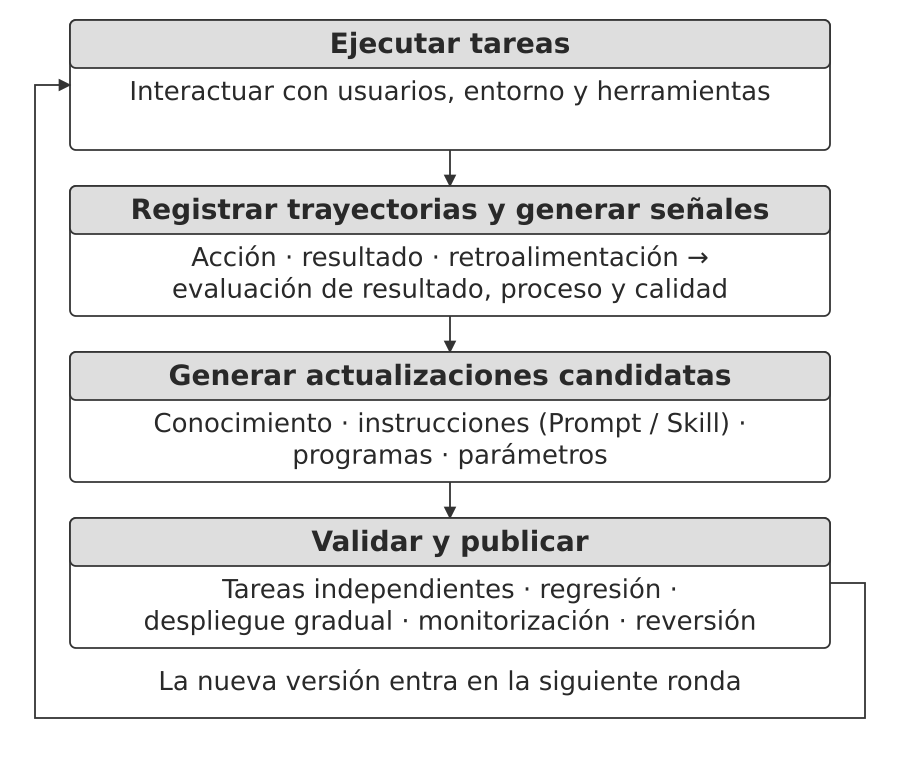
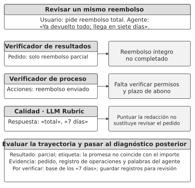
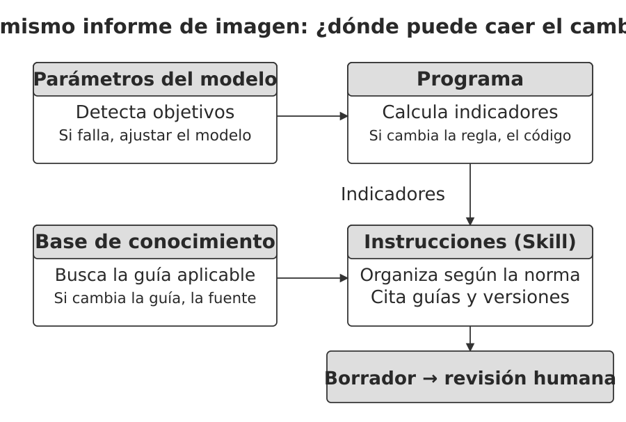
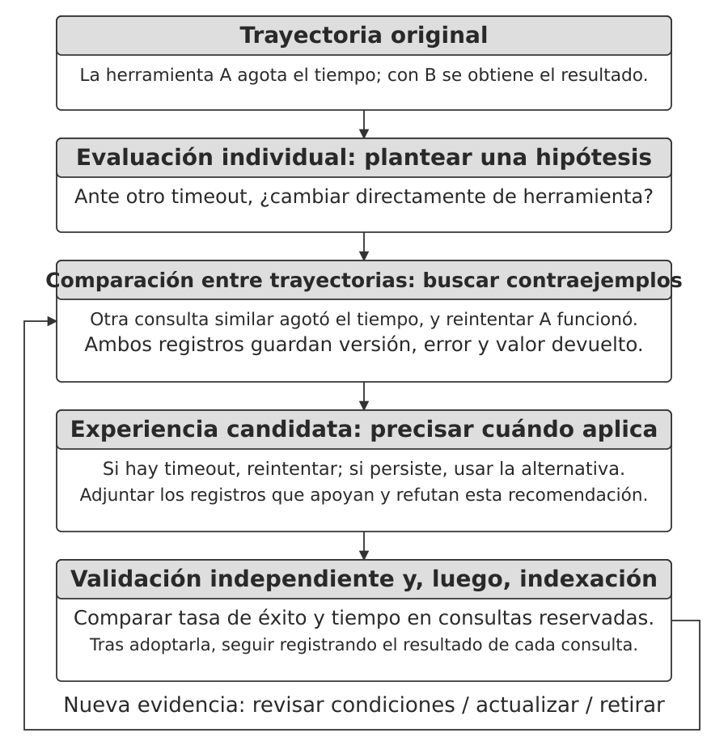
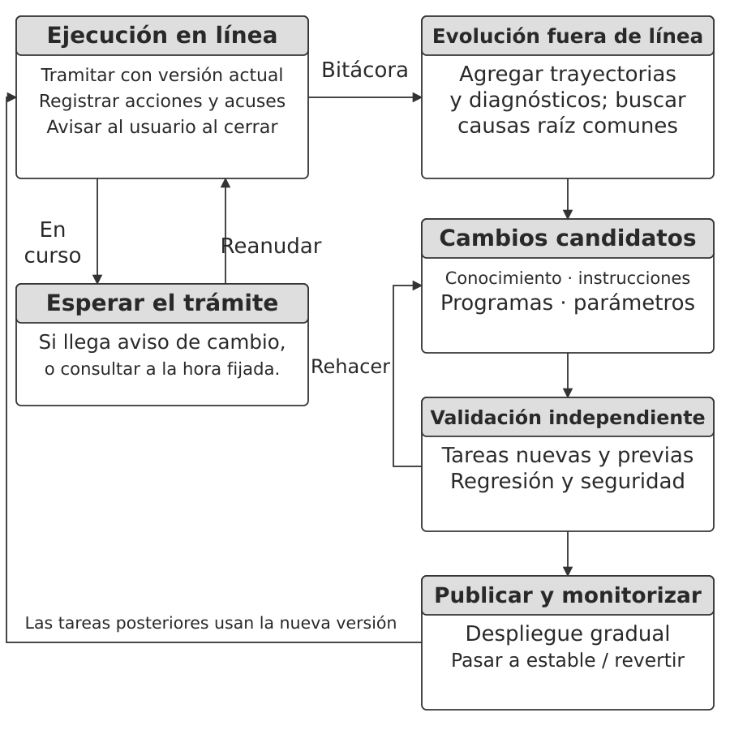

# La evolución continua del Agente

Un Agente puede completar a la primera una tarea compleja que nunca había visto y, aun así, después de procesar muchas tareas parecidas, seguir repitiendo el mismo error. Para que progrese a partir del trabajo cotidiano, como lo haría un empleado recién incorporado, el sistema tiene que convertir la experiencia de ejecución en capacidades que pueda usar después: registrar los resultados, encontrar la causa de los problemas, formular una mejora y comprobar si esa mejora funciona en tareas nuevas. **En opinión del autor, aprender de la experiencia y evolucionar de forma continua se está convirtiendo en una de las capacidades más importantes de un Agente.** Esta capacidad exige trabajo de ingeniería en los sistemas de aplicación y merece, además, ser un foco de investigación para la próxima generación de modelos.

Por lo general, un modelo desplegado conserva sus parámetros cuando termina una inferencia. El aprendizaje en contexto, el mantenimiento de estado y la compresión del capítulo 2 le permiten ajustarse dentro de la tarea actual; la memoria y la base de conocimientos del capítulo 3 conservan información de una tarea a otra. Aprender de verdad de la experiencia exige además comparar muchas ejecuciones: qué pasos comparten las trayectorias exitosas, qué les falta a las fallidas y para qué versiones de las herramientas y qué condiciones de la tarea sirve una determinada forma de actuar.

Por ejemplo, con cien trayectorias de reservas de vuelos guardadas, el sistema puede recuperar cualquier experiencia concreta cuando la necesite. Pero para llegar a una pauta como "antes de reservar, comprobar el plazo para solicitar comidas especiales", hay que contrastar las causas de las reservas que salieron bien y de las que fallaron, revisar las condiciones de la aerolínea y de horario, y validar después la pauta con tareas nuevas. Registrar y recuperar permiten al Agente volver a encontrar lo que vivió; contrastar, inducir y verificar le ayudan a formar prácticas reutilizables. Solo con esa acumulación el Agente pasa poco a poco de ser inteligente a ser experto.

El **aprendizaje continuo** (continual learning) estudia cómo un sistema puede seguir aprendiendo de tareas y datos nuevos sin perder las capacidades que ya tiene. El Agente traslada este problema a la interacción cotidiana: la retroalimentación procede de los usuarios, de las herramientas y del entorno, y la satisfacción del usuario, la finalización de la tarea y el cumplimiento del procedimiento pueden llevar a conclusiones distintas. En opinión del autor, una de las grandes dificultades del aprendizaje continuo de un Agente es que en el trabajo diario casi nadie indica paso a paso qué estuvo bien y qué estuvo mal, de modo que el sistema tiene que decidir por sí mismo qué retroalimentación es fiable. Si una retroalimentación sin verificar se convierte en regla o se usa para entrenar, la atribución errónea afecta a las tareas siguientes. Y estos errores persisten: una preferencia mal registrada afectará a la próxima reserva, y entrenar el modelo con retroalimentación errónea puede hacer que falle incluso en tareas que antes resolvía bien.

Este libro usa el término **evolución continua** para describir el proceso por el que todo el sistema del Agente se actualiza a partir de la experiencia, y abarca cuatro soportes: conocimiento, instrucciones, programas y parámetros del modelo. El entrenamiento periódico del modelo base aporta las capacidades generales; la actualización por experiencia del Agente se ocupa de las reglas de negocio concretas, los cambios en las herramientas y las estrategias locales. Estos cambios locales se producen sin cesar, y esperar al siguiente entrenamiento del modelo base suele llegar tarde para lo que necesita el negocio.

Por ahora, el autor defiende construir primero, alrededor del modelo, un sistema de aprendizaje verificable: que la experiencia que pueda expresarse con claridad influya en el comportamiento posterior a través del conocimiento, las instrucciones y los programas, y que el material adecuado para el aprendizaje de parámetros se envíe al post-entrenamiento. Cada actualización se somete primero a una evaluación de regresión sobre la nueva versión, y solo cuando supera las comprobaciones de publicación las tareas posteriores pasan a usarla.

Los capítulos anteriores ya han presentado los componentes principales de este sistema: el capítulo 2 organiza el estado de la tarea, el capítulo 3 almacena y recupera conocimiento, el capítulo 5 crea herramientas y modifica el sistema mediante código, el capítulo 7 evalúa resultados y el capítulo 8 actualiza los parámetros del modelo. La figura 9-1 conecta estas piezas: la vez anterior en que no se reservó una comida especial, una vez evaluada, se convierte en una regla que se aplicará en la próxima reserva.

## Obtener señales de aprendizaje de las trayectorias de ejecución

¿Qué trayectorias merecen usarse para aprender? Si un agente de atención al cliente le dice al usuario "el reembolso ya está tramitado", primero hay que comprobar cuánto dinero se devolvió y si la operación cumplió las reglas, y luego ver si el usuario puede entender, a partir de esa respuesta, cuándo recibirá el dinero. La figura 9-2 reúne estas tres comprobaciones, que se apoyan respectivamente en el registro del pedido, el registro de acciones y las palabras exactas del agente.

**La verificación de resultados comprueba qué cambió en el entorno.** Un Coding Agent puede ejecutar pruebas, comprobaciones de tipos y benchmarks de rendimiento; un Agente de reembolsos puede consultar el estado del pedido y el importe realmente devuelto. El autor suele empezar por esta capa. Si el modelo afirma haber devuelto el importe íntegro pero en la cuenta solo consta una parte, es el registro del pedido el que indica qué operación hay que revisar.

**La verificación del proceso comprueba si las acciones respetaron las reglas de la tarea.** Aunque las pruebas pasen, hay que comprobar si se modificaron archivos de prueba protegidos; cuando el Agente le dice al usuario "el reembolso llegará en un plazo de siete días", hay que confirmar que el reembolso se envió de verdad y que ese plazo tiene fundamento. Las tablas de permisos, las políticas estructuradas y los registros de acciones pueden revisarse con programas; las cláusulas que requieren interpretar el contexto se juzgan junto con la evidencia correspondiente.

**La verificación de calidad comprueba si lo entregado sirve para su uso.** Que la expresión del agente sea clara, que la alternativa propuesta se ajuste al objetivo del usuario o que un informe de investigación recoja la evidencia clave influye en el resultado final. Aquí puede usarse el LLM-as-a-Judge del capítulo 7: se define de antemano una Rubric y el modelo evaluador da, punto por punto, una puntuación, su justificación y la evidencia.

La tabla 9-1 toma como ejemplo la atención al cliente y despliega las tres capas en siete dimensiones. El resultado de la tarea corresponde a la capa de resultados; las reglas, la privacidad y las promesas, a la capa de proceso; la expresión y las alternativas, a la capa de calidad. La fiabilidad factual se verifica según el contenido: el importe de un reembolso puede cotejarse directamente con lo que devolvió la herramienta, mientras que la interpretación de una política exige consultar el texto original y sus condiciones de aplicación.

Tabla 9-1 Dimensiones de evaluación de trayectorias para un Agente de atención al cliente

| Dimensión | Pregunta de verificación | Evidencia principal |
| --- | --- | --- |
| Resultado de la tarea | ¿Se resolvió la petición central del usuario? | Estado final del entorno, resultados de herramientas |
| Cumplimiento de reglas | ¿Se respetaron las políticas, los permisos y los procedimientos necesarios? | Repositorio de políticas, trayectoria de acciones |
| Límites de privacidad | ¿La información facilitada estaba dentro de lo permitido? | Texto de la respuesta, registros de acceso |
| Fiabilidad factual | ¿Las afirmaciones están respaldadas por conocimiento o por resultados de herramientas? | Fuentes citadas, respuestas de herramientas |
| Coherencia entre promesa y acción | ¿Las operaciones que se dieron por hechas ocurrieron realmente? | Cotejo entre respuestas y registros de ejecución |
| Calidad de la expresión | ¿Es natural, concisa y clara? | Diálogo completo, Rubric de lenguaje |
| Alternativas conformes | Si el plan original no era viable, ¿se encontró una vía alternativa permitida? | Objetivo del usuario, políticas y acciones posteriores |

Para que sirva a las actualizaciones posteriores, la salida de la evaluación debe incluir cuatro elementos: el estado global de la tarea, la conclusión de cada dimensión, la ubicación de la evidencia que respalda cada conclusión y el tipo de error. La ubicación de la evidencia puede apuntar a un turno concreto del diálogo o a una llamada a herramienta. Las dimensiones con evidencia insuficiente se marcan como pendientes de confirmación y se envían a una verificación adicional o a revisión humana.

Por ejemplo, "reembolso fallido, expresión clara" no basta para saber qué mejorar. Si se añade "en el turno 4 llamó a la interfaz de reembolso sin número de pedido y la interfaz se negó a ejecutarlo; en el turno 5 siguió afirmando que el reembolso estaba hecho", ya pueden proponerse cambios distintos: validar los parámetros y verificar las afirmaciones de finalización.

> **Experimento 9-1 ★★: Construir un verificador de trayectorias para un Agente de atención al cliente**
>
> Sobre un mismo conjunto de trayectorias de atención al cliente, compara dos tipos de salida: una que solo da una puntuación total y otra que, dimensión por dimensión, da conclusión, evidencia y nivel de confianza. Comprueba si la segunda permite localizar por separado los fallos de la tarea, las violaciones de reglas, las promesas falsas y los problemas de expresión, y proponer a partir de ello las actualizaciones correspondientes.
>
> El conocimiento desactualizado exige actualizar los materiales; la falta de parámetros puede resolverse añadiendo comprobaciones antes de la llamada; la redacción repetitiva puede mejorarse con instrucciones o con entrenamiento.

El experimento 9-1 construyó ocho trayectorias con datos de cuentas ficticios: dos de reembolsos normales, dos de promesas falsas, dos de filtración de privacidad y dos de rechazo excesivo. En `real-normal-refund-01`, el agente dice que el reembolso está hecho, el estado del pedido pasa efectivamente a `refunded` y el importe devuelto es 480.

Cada una de las ocho trayectorias se evaluó en siete dimensiones; de los 56 juicios, 52 coincidieron con las etiquetas de experto predefinidas en los casos, una concordancia de alrededor del 92,9 %. De las cuatro discrepancias restantes, tres recaen sobre un mismo cambio de vuelo. El usuario pidió cambiar un billete no reembolsable al 3 de octubre. El agente verificó su identidad, consultó el pedido tres veces y en el turno 10 le dijo al usuario que ya estaba resuelto. Sin embargo, el estado del pedido seguía siendo `confirmed` y en el registro de llamadas no había ninguna operación de cambio.

¿A quién hay que revisar entonces? El modelo que evaluaba "alternativas conformes" citó la respuesta del turno 10 y dio el aprobado, sin advertir que esa alternativa era factible pero no se había llevado a cabo. El programa que evaluaba "coherencia entre promesa y acción" sí señaló un error, pero con el argumento de que no encontraba ninguna llamada de reembolso exitosa. El usuario quería un cambio de vuelo, así que lo que había que cotejar era el registro del cambio y la nueva fecha. Además, la etiqueta predefinida para esta dimensión era "aprobado", lo que tampoco encajaba con la respuesta realmente generada.

En este cambio de vuelo hay que corregir dos cosas: el agente omitió un paso y el programa de evaluación consultó la herramienta equivocada. En una reserva, un error que parece el mismo también puede tener origen en lugares distintos. Si el usuario ya amplió su presupuesto pero el asistente sigue filtrando con el presupuesto anterior, al recorrer la trayectoria hacia atrás puede resultar que la nueva preferencia no se guardó, que esta vez se recuperó la preferencia antigua o que el modelo leyó el nuevo presupuesto pero no lo usó al elegir el vuelo.

## Cuatro métodos para la evolución continua del Agente

Una vez encontrado el problema, hay que decidir dónde corregirlo. Tomemos el Agente de imágenes médicas de la figura 9-3: si un informe cita una versión antigua de una guía clínica, lo primero es comprobar qué versión hay guardada en la base de conocimientos. Si la guía es correcta pero el informe no indica la fuente de la cita, hay que revisar las instrucciones con las que se redactan los informes. Aunque ambos informes sean devueltos, al corregirlos hay que buscar en lugares distintos.

Un sistema de atención al cliente también utiliza a la vez los cuatro métodos. El modelo entrenado organiza el lenguaje, la base de conocimientos guarda las políticas de la empresa, una Skill explica cómo actuar ante las excepciones y el código del servidor valida permisos e importes. La tabla 9-2 recoge los costes y las limitaciones que hay que sopesar al elegir una forma de actualización.

Tabla 9-2 Límites de aplicación de los cuatro métodos de evolución continua

| Forma de actualización | Adecuada para contener | Ventaja de ingeniería | Problemas que hay que resolver |
| --- | --- | --- | --- |
| Base de conocimientos de experiencia | Hechos, experiencias, excepciones y fuentes | Actualización rápida, trazable, recuperable bajo demanda | Calidad de la recuperación, condiciones de aplicación y si el modelo sabe usarla bien |
| Prompt y Skill | Principios de juicio que dependen del contexto, las excepciones y las prioridades | Interpretable, fácil de modificar localmente | Crecimiento de la longitud, conflictos entre instrucciones y grado de cumplimiento |
| Programas y Harness | Procesos analizables, verificaciones ejecutables, permisos y restricciones estrictas | Comprobable, ejecución estable | Desarrollo y mantenimiento, compatibilidad de interfaces y gestión de excepciones |
| Parámetros del modelo | Percepción, estilo de generación y patrones de decisión implícitos | Reutiliza los patrones aprendidos y reduce el contexto repetido | Preparación de datos, coste de entrenamiento, generalización y olvido |

Una misma mejora puede descomponerse en varias actualizaciones. El autor prefiere colocar los hechos de las políticas en la base de conocimientos y las restricciones que pueden aplicarse con exactitud, como las comprobaciones de permisos, en el código; los principios que requieren entender el contexto y las excepciones se expresan con Skills, y la percepción de alta dimensión y las estrategias implícitas se mejoran mediante entrenamiento.

### Consolidar la experiencia en conocimiento

Al registrar una misma reserva pueden quedar dos niveles de información. Uno es "esta aerolínea exige solicitar las comidas especiales con veinticuatro horas de antelación"; el otro, "antes de reservar, comprobar el plazo para las comidas especiales, para no descubrir después del pago que no puede atenderse la petición". El primero debe guardarse junto con la aerolínea, las rutas a las que se aplica y la fuente de la política. Otra aerolínea puede tener un plazo distinto, pero "comprobar primero el plazo del vuelo en cuestión" sigue siendo transferible. Así, cuando el hecho caduque, solo habrá que sustituir el plazo concreto, y la próxima reserva podrá seguir aprovechando esta comprobación. Ambos pueden guardarse con los métodos de almacenamiento, indexación y recuperación del capítulo 3.

Extraer una pauta así de una sola reserva puede costar muy poco, pero no consiste en copiar el registro completo. El registro contiene el texto de la política que devolvió la herramienta, pero también los rodeos de los múltiples intentos del Agente. Si una consulta agotó el tiempo de espera y el resultado solo se obtuvo tras cambiar de herramienta, imitarlo puede convertir un fallo fortuito en un motivo para cambiar de herramienta.

Los materiales pueden guardarse en tres niveles: la **trayectoria original** conserva la evidencia completa de la ejecución; el **análisis de cada ejecución** registra las causas del éxito o del fracaso y un borrador de la experiencia; el **documento formal de experiencia** reúne las prácticas verificadas en varias tareas. Las trayectorias originales se guardan por versiones, mientras que los análisis y el conocimiento se revisan a medida que llega nueva evidencia. El documento formal especifica el escenario de aplicación, la estrategia recomendada, las prácticas prohibidas, las excepciones, las fuentes y la fecha de la última verificación, para facilitar su recuperación y revisión posteriores.

El User as Code del capítulo 3 primero añade los hechos a un registro y después reconstruye periódicamente el modelo de usuario. Aquí también se separan el registro y la organización. Volvamos a la consulta de antes. Si otra consulta también agota el tiempo de espera y, al reintentar con la misma herramienta, tiene éxito, ¿se sostiene la recomendación "si hay timeout, cambia de herramienta"? La figura 9-4 muestra cómo redactar, a partir de estos dos registros, una recomendación más precisa y ponerla a prueba con otras consultas.

Al reutilizar los métodos de extracción, agrupamiento y recuperación del capítulo 3, se pueden reunir los ejemplos a favor y en contra de una misma experiencia. ¿Usaron las dos reservas la misma versión de la herramienta? Si una salió bien y la otra mal, ¿fue porque se omitió un paso o porque las condiciones de la reserva eran distintas de entrada? Convertir los registros originales en una experiencia utilizable puede dividirse en cinco pasos:

1. Guardar las trayectorias originales y los resultados del entorno, fijando las versiones de la tarea y de las herramientas.
2. Generar un análisis de cada ejecución que registre el tipo de tarea, las capacidades necesarias, la estrategia real, los errores y las excepciones.
3. Agrupar por familias de tareas y enumerar, para cada experiencia, las trayectorias que la respaldan y las que la contradicen.
4. Seleccionar las experiencias con evidencia suficiente y redactarlas como borradores de entradas de conocimiento.
5. Probarlas en tareas nuevas que no participaron en la extracción y comprobar si la estrategia recomendada mejora el rendimiento posterior.

GAIA[^gaia-2023] ofrece problemas de varios pasos que combinan búsqueda, lectura de páginas web, procesamiento de archivos y cálculo; AWorld[^aworld-2025] proporciona un entorno para la ejecución de Agentes, las llamadas a herramientas y el registro de trayectorias. Combinándolos, se puede marcar primero cada ejecución como éxito, éxito parcial o fracaso según la respuesta o el estado del entorno, y después comparar los caminos por familias de tareas. En los registros exitosos se encuentran prácticas que vale la pena volver a probar; en los fallidos se ve en qué situaciones no conviene imitarlas. Si una tarea solo se completó en parte, también pueden revisarse los pasos uno por uno para ver cuáles fueron útiles y dónde empezó el problema.

Reflexion[^reflexion-2023] usa la reflexión en lenguaje natural para ayudar en los intentos posteriores. Al incorporar este enfoque a la extracción de conocimiento, la reflexión sirve para proponer hipótesis sobre las causas y borradores de experiencia; los resultados del entorno, para verificarlas; el contraste entre trayectorias, para delimitar las condiciones de aplicación, y las tareas nuevas, para comprobar la transferencia. Estos cuatro tipos de material deciden conjuntamente si una experiencia entra en la base de conocimientos formal.

[^reflexion-2023]: Shinn, N., et al. *Reflexion: Language Agents with Verbal Reinforcement Learning.* arXiv:2303.11366, 2023.

[^gaia-2023]: Mialon, G., et al. *GAIA: a benchmark for General AI Assistants.* arXiv:2311.12983, 2023.

[^aworld-2025]: Yu, C., et al. *AWorld: Orchestrating the Training Recipe for Agentic AI.* arXiv:2508.20404, 2025.

Volvamos al escenario de reservas del capítulo 6. El usuario quería que el billete no superara los 1200 yuanes, tenía que llegar ese mismo día a una reunión y acabó aceptando una oferta de 1250 yuanes. El asistente puede anotar el presupuesto original, el precio final, el motivo del viaje y las palabras exactas del usuario. En las tres reservas siguientes, la oferta más barata resulta ser, precisamente, de 1250 yuanes. ¿Cómo debe usarse este recuerdo?

- La semana siguiente hay que llegar a tiempo a la misma reunión de negocios. Las veces anteriores, el usuario estuvo dispuesto a pagar unas decenas de yuanes más para no perderse la reunión, y esta vez también le pide al asistente que reserve como de costumbre. El asistente puede reservar ese vuelo e informarle del precio real.
- El usuario se va de vacaciones con sus hijos y advierte expresamente: "cuando viaja toda la familia hay que ahorrar; si pasa de 1200 yuanes, pregúntame antes". El asistente puede enviarle la opción de 1250 yuanes y, al mismo tiempo, buscar si hay vuelos dentro del presupuesto un día antes o un día después.
- Más tarde, el usuario explica: "La otra vez lo acepté porque tenía prisa; en realidad 1250 yuanes me parece caro. A partir de ahora, si un viaje de trabajo se sale del presupuesto, pregúntame también antes". La próxima vez, aunque sea la misma persona que viaja a la misma ciudad para una reunión, el asistente debe preguntar primero. Si conserva el registro de aquella compra y anota además esta indicación, más reciente y más explícita, en las preferencias de viajes de trabajo, cada uno de los dos recuerdos cumple su función.

Estas tres reservas muestran los niveles de actualización. Una sola corrección del usuario puede cambiar de inmediato la tarea en curso y basta para actualizar sus propias preferencias. Solo si muchos casos independientes muestran que el asistente pasa por alto el motivo del viaje vale la pena proponer un cambio en la Skill de reservas compartida, para que consulte las preferencias pertinentes al comparar ofertas. Y solo si, con el presupuesto y las preferencias explícitas ya cargados, el modelo sigue juzgando mal cuando el usuario se expresa de otra manera, vale la pena reunir este tipo de casos para entrenar la capacidad de juicio del modelo.

### Convertir la experiencia en instrucciones

Si, cada vez que se le entrega al asistente el material correcto, sigue equivocándose en el mismo punto, y una persona con experiencia puede describir en una frase cómo hay que decidir, se puede intentar escribir una instrucción. Los documentos de experiencia quedan como referencia para el asistente; el Prompt de sistema expresa los requisitos de comportamiento comunes a todas las tareas; las Skills cargan procesos locales por dominio o por herramienta, y las restricciones estrictas, como los permisos, las aplica el Harness. Poner el cambio en el lugar adecuado determina qué tareas se verán afectadas en el futuro.

Andrej Karpathy llama **aprendizaje del prompt de sistema (System Prompt Learning)** a una forma de actualizar la experiencia en la que el modelo, tras encontrarse con un problema, escribe un recordatorio para futuras tareas.[^karpathy-system-prompt-learning] DSPy[^dspy-2023] optimiza instrucciones y ejemplos sobre un conjunto de desarrollo; OPRO[^opro-2023] propone nuevos prompts a partir de los que ya se probaron y de sus puntuaciones; GEPA[^gepa-2025] utiliza la retroalimentación de las trayectorias para proponer y seleccionar cambios en el prompt. Todos estos métodos reescriben las instrucciones según los resultados de ejecución y luego comparan la versión nueva y la antigua con tareas de desarrollo, por lo que se prestan a la optimización por lotes fuera de línea.

En las actualizaciones de producción, el autor prefiere un diff mínimo con su procedencia, que conserve el caso que lo motivó, la razón del cambio y la versión anterior. Un parche local perturba menos las reglas existentes y permite retirar un cambio concreto si se produce una regresión.

¿Cómo saber si la nueva instrucción corrige de verdad el error anterior? Supongamos que el usuario señala un correo de un cliente mal archivado y dice: "Este es un cliente que me está respondiendo, ¿por qué lo has tratado como un boletín?". El asistente de correo de código abierto Inbox Zero ofrece una herramienta de prueba. Tras revisar las reglas, el asistente puede recuperar el correo original por su ID, volver a clasificarlo con las reglas activas en esa cuenta y ver qué reglas coinciden, por qué, y qué etiqueta pondría o a qué carpeta lo movería. Este paso solo muestra las acciones previstas: el buzón queda intacto y no se genera ningún borrador de respuesta.[^ch9-inboxzero] Ahora se prueba también con un boletín de verdad: el correo del cliente se queda en la bandeja de entrada y el boletín se archiva como siempre; los dos correos juntos indican si el cambio respetó los límites de clasificación que ya existían.

[^ch9-inboxzero]: El archivo `test-rules-on-email-tool.ts` del proyecto Inbox Zero implementa la herramienta que prueba las reglas sobre un correo concreto.

#### Ejemplo 1: delimitar el escalado y el uso de herramientas

La política telecom de τ²-bench establece que, cuando una petición excede el ámbito de acción del Agente, debe transferirse a un humano, pero antes debe hacerse todo lo posible por resolverla. De las 20 tareas usadas para extraer reglas, el modelo más débil solo superó 1. ¿Cómo fallaron las 19 restantes? En 17 se llegó a llamar a la herramienta de transferencia a un humano y otras 2 se ejecutaron hasta agotar el límite de pasos.

Se entregaron estas 19 trayectorias fallidas al modelo, se le pidió que indujera reglas y estas se añadieron al final de la política original. Sobre las mismas 114 tareas nuevas, con la política original se superaron 14 (12,3 %); con la primera versión de las reglas, 20, y con la segunda versión, 22 (19,3 %). Al comparar tarea por tarea, la segunda versión mantuvo las 14 que ya se superaban y acertó otras 8. ¿Qué aportaron exactamente las dos versiones de reglas al agente?

**El material de entrada determina el contenido de las reglas.** Cuando solo se le dieron los textos de error y resúmenes de los fallos, el modelo indujo "dejar de llamar a una herramienta que devuelve errores repetidamente". En la segunda extracción, el modelo también vio las listas de herramientas del agente y del usuario, y el prompt le pidió que considerara "quién debe ejecutar este paso". Esta vez, las reglas generadas fijaban el reparto de tareas: las operaciones en el dispositivo, como el estado de la red, la tarjeta SIM o el APN, deben realizarse guiando al usuario. Así, la experiencia pasó de un recordatorio genérico sobre reintentos a una regla concreta de reparto de operaciones.

**La inducción también necesita contrastarse con la política y con los resultados.** Entre las reglas añadidas en la primera versión había dos: "transferir tras tres llamadas fallidas consecutivas" y "transferir si el usuario no proporciona el número dos veces". Con esta versión, en todas las 114 tareas de generalización hubo escalado, y solo se superaron 20. Esas dos reglas incorporaron también el escalado prematuro.

Una trayectoria muestra con claridad la diferencia antes y después de la corrección. El usuario dice que su teléfono no tiene señal. El agente de referencia rellenó el campo del número con una frase como "por favor, facilíteme su número de teléfono correcto", consultó cinco veces seguidas, recibió error en todas y luego transfirió a un humano. Con la segunda versión de las reglas, el agente también omitió el número en la primera consulta, pero esta vez se lo pidió al usuario en el diálogo y, con el número, encontró la cuenta. A continuación intentó comprobar la tarjeta SIM; la herramienta informó de que esa operación no existía, así que el agente le pidió al usuario que retirara y volviera a insertar la SIM. El usuario lo hizo, desactivó además el modo avión del teléfono, y solo entonces la tarea se superó. En las otras siete tareas que la segunda versión acertó y la de referencia no, solo una no pasó por un humano; las otras seis llamaron a la herramienta de transferencia. Por tanto, si se usara "no transferir a un humano" como criterio de éxito, se perderían precisamente esas seis tareas. Para decidir si conviene transferir hay que mirar qué más puede hacer el agente y hasta dónde le exige llegar la tarea.

> **Experimento 9-2 ★★: Extraer reglas de escalado y uso de herramientas de las trayectorias fallidas de τ²-bench**
>
> Reutiliza el entorno telecom del capítulo 7 y separa el conjunto de extracción del conjunto de generalización. Ejecuta primero un modelo más débil para recoger trayectorias fallidas y luego deja que un modelo genere reglas y las añada a la política original. Compara en el conjunto de generalización la versión original con las dos versiones evolucionadas; entre los tres grupos solo cambia el archivo de política, y el simulador de usuario es el mismo.
>
> En la versión de referencia hubo transferencia en 104 tareas; en la segunda versión, en 111; una tarea cuenta en cuanto se transfiere una sola vez. Las llamadas erróneas a herramientas del lado del usuario se cuentan por número de llamadas y bajaron de 1049 a 163. Otro indicador cuenta las llamadas en las que al menos un parámetro es una cadena vacía, que bajaron de 904 a 174; las llamadas sin ningún parámetro no entran en este indicador. Cada estrategia se ejecutó una sola vez en cada tarea.

En la atención al cliente de aerolíneas también se producen escalados prematuros. Cuando el usuario discute la penalización por cancelación, el cargo por cambio o la política de equipaje, el Agente debe consultar y explicar la política aplicable y buscar alternativas permitidas. En las reglas que adopta el experimento siguiente, las disputas ordinarias sobre políticas siguen en manos del Agente, y solo cuando el usuario pide expresamente un humano o se da una situación de seguridad especificada se llama a `transfer_to_human`.

> **Experimento 9-3 ★★: Optimizar el Prompt de sistema de un agente de atención al cliente de aerolíneas a partir de trayectorias fallidas**
>
> Analiza las trayectorias de escalado prematuro en tres dimensiones (cumplimiento de reglas, resolución de la tarea y alternativas conformes) y genera parches de Prompt con su procedencia. Compara la versión extraída automáticamente con la versión inicial y con una versión ajustada a mano, en las mismas condiciones.
>
> Otras cinco tareas sirven para comprobar las capacidades existentes: en tres el agente debe resolver por sí mismo y en dos debe transferir a un humano; las tres versiones de instrucciones obtuvieron 5/5. En las cinco tareas de escalado prematuro usadas para extraer los parches, un mismo modelo evaluador dio por superadas 0, 2 y 4 tareas a la versión inicial, la automática y la ajustada a mano, respectivamente. La versión automática corrigió las tareas de cancelación de un billete promocional y de exceso de equipaje. A partir de ello, el programa decidió autorizar una prueba a pequeña escala.
>
> Hay un punto discutible. El pasajero pedía que se le eximiera del cargo de 200 yuanes por cambio, y la versión ajustada a mano se puso a explicar si un billete promocional es reembolsable. El evaluador dio por buena la sugerencia de "devolver las tasas" y la aprobó; el agente nunca explicó el cargo por cambio que el pasajero había preguntado.

#### Ejemplo 2: mejorar la Skill de aclaración de requisitos a partir de la retroalimentación de los usuarios

Una Skill de aclaración de requisitos puede establecer cuándo preguntar, qué preguntar y cuándo empezar a ejecutar. A medida que se acumula retroalimentación de los usuarios, el sistema necesita ajustar estas condiciones para que el beneficio de aclarar compense el coste de interrumpir.

Por ejemplo, si el usuario dice "haz que la página de inicio de sesión admita login empresarial", antes de implementarlo quizá haya que concretar el proveedor de identidad, el mecanismo de respaldo, la compatibilidad con los usuarios existentes y el alcance del despliegue. En cambio, corregir una errata suele poder hacerse directamente. Si se pregunta demasiado poco, las decisiones clave quedan para después de la entrega y obligan a rehacer el trabajo; si se pregunta demasiado, incluso un cambio sencillo se alarga hasta convertirse en una entrevista interminable. La Skill debe elegir el proceso según la ambigüedad, el riesgo y el coste de rehacer.

Un proceso inicial puede organizarse así: los cambios pequeños, de bajo riesgo y fáciles de deshacer se ejecutan tras explicar los supuestos necesarios; cuando intervienen la arquitectura, los datos, los permisos, interfaces públicas o cambios amplios, se hacen de una vez unas pocas preguntas que puedan cambiar el plan. Después se redacta una Spec o un Plan breve que enumera objetivos, no objetivos, compromisos, supuestos y criterios de aceptación. Una vez respondidas las cuestiones que requieren confirmación, se continúa con la ejecución; si durante la ejecución cambian las premisas, se localizan las decisiones afectadas y se vuelven a confirmar.

Para mejorar este proceso hay que registrar la tarea, las preguntas de aclaración, las versiones de la Spec, las modificaciones del usuario, el resultado entregado y el trabajo rehecho. Si el usuario dice "esto no es lo que imaginaba", se comprueba qué condiciones se pasaron por alto; si dice "preguntas demasiado", se comprueba si las respuestas a esas preguntas influían en el plan.

Cuando varias tareas de autenticación pasan por alto una y otra vez la compatibilidad con el inicio de sesión antiguo, se puede añadir a la Skill la condición "confirmar el proveedor de identidad, la vía de respaldo y el alcance de la compatibilidad". Cuando muchas correcciones de erratas se retrasan por las preguntas, hay que acotar el ámbito en que se activa el proceso de aclaración.

Aquí también se ve el reparto entre la Skill y el Harness. La Skill guía al modelo para entender el contexto, plantear preguntas y organizar el plan; el Harness, según las reglas del proyecto, bloquea la operación cuando una escritura de alto riesgo carece de la autorización necesaria, cuando se modifica directamente una rama protegida o cuando se salta el proceso de publicación. El juicio sobre el contenido de los requisitos lo sigue haciendo el modelo a partir de lo que dice el usuario. Las trayectorias de diálogo verificadas pueden convertirse además en datos de entrenamiento como los del capítulo 8.

> **Experimento 9-4 ★★: Evolucionar la Skill de aclaración de requisitos y confirmación de la Spec a partir de la retroalimentación de los usuarios**
>
> Este es un ejercicio en el que tú mismo diseñas la comparación. Puedes empezar con dos tareas: corregir una errata en el botón de inicio de sesión y añadir login empresarial a esa misma página. Los criterios de aceptación de la primera pueden escribirse directamente; la segunda quizá requiera aclarar antes el proveedor de identidad. Añade tareas que afecten a la arquitectura, los permisos, los datos o interfaces públicas, y prueba con cada una tres procesos: ejecución directa, ejecución tras aclarar y ejecución tras confirmar la Spec. Registra las respuestas del usuario, las modificaciones de la Spec, los resultados entregados y la retroalimentación sobre el trabajo rehecho, y genera a partir de ello actualizaciones locales de la Skill.

[^dspy-2023]: Khattab, O., et al. *DSPy: Compiling Declarative Language Model Calls into Self-Improving Pipelines.* arXiv:2310.03714, 2023.

[^opro-2023]: Yang, C., et al. *Large Language Models as Optimizers.* arXiv:2309.03409, 2023.

[^gepa-2025]: Agrawal, L., et al. *GEPA: Reflective Prompt Evolution Can Outperform Reinforcement Learning.* arXiv:2507.19457, 2025.

[^karpathy-system-prompt-learning]: Karpathy, A. “We’re missing (at least one) major paradigm for LLM learning … system prompt learning?” X, 11 de mayo de 2025.

### Convertir la experiencia en programas

Las operaciones estables, repetitivas y verificables pueden convertirse, a partir de la experiencia de ejecución, en flujos de trabajo, herramientas o código del Harness. El autor recomienda dar prioridad a convertir este tipo de operaciones en programas: una vez que el modelo ha explorado un camino viable, las tareas posteriores pueden reutilizarlo y ahorrarse el coste de leer instrucciones, interpretar la página y decidir el siguiente paso una y otra vez. El capítulo 5 presentó las capacidades de leer y escribir archivos, ejecutar pruebas y generar herramientas; esta sección las aplica a un proceso de actualización de tipo "diagnóstico del fallo, cambio en el código, verificación de regresión".

Los cambios pueden situarse en distintos niveles. En el nivel de operación se generan flujos de trabajo parametrizados o adaptadores de API; en el nivel de control se ajustan el enrutamiento de herramientas, los reintentos, los cortacircuitos y la compresión del contexto; en el nivel de verificación se añaden comprobaciones de parámetros, aserciones de estado y casos de regresión; en el nivel de arquitectura se ajusta el flujo de información entre la planificación, la ejecución y el Reviewer.

Tomemos el envío de un correo. Un Agente multimodal encuentra la primera vez, a base de observar y actuar, controles como "redactar", "destinatario", "asunto", "cuerpo" y "enviar". La siguiente tarea normalmente solo cambia el destinatario y el contenido, así que el proceso puede reutilizarse como una macro de hoja de cálculo. El sistema convierte la trayectoria de exploración en un programa y registra los parámetros, las comprobaciones de estado y las versiones a las que se aplica.

El ciclo de vida de un flujo de trabajo de navegador puede dividirse en seis pasos:

1. **Capturar la trayectoria.** Se registran la navegación, los clics, la escritura y las selecciones en desplegables, y se guardan los parámetros de cada acción, la URL de la página y la información de localización, como XPath o CSS. Esta información sirve para volver a encontrar los elementos más adelante.
2. **Extraer parámetros.** El destinatario, el asunto y el cuerpo concretos se convierten en variables como `{recipient}`, `{subject}` y `{content}`, y se mantienen las acciones estables. Por ejemplo, el `test@example.com` escrito la primera vez pasa a ser un valor del parámetro de destinatario.
3. **Añadir comprobaciones de estado.** Antes de ejecutar se confirma que el botón está visible y que los campos necesarios están completos; después de ejecutar se comprueba el cambio en la página; al terminar la tarea se lee el estado real de la página o del backend para confirmar que el correo se envió.
4. **Reproducir de forma independiente.** Se devuelve la cuenta de sandbox o el sitio de prueba a un estado inicial limpio, se ejecuta el programa completo y se comprueban las condiciones de cada paso y el resultado final.
5. **Asignar tareas nuevas.** Se localiza el flujo de trabajo en la biblioteca de capacidades por intención y palabras clave, se extraen los parámetros de esta ocasión y se entrega a Playwright para que lo ejecute. El programa se encarga de esperar a los elementos y comprobar el estado; una reproducción normal puede ahorrarse llamar al LLM paso a paso.
6. **Gestionar la invalidez.** Cuando falla la localización de un elemento o una comprobación de estado, cambia el schema de una API o el resultado final es anómalo, se detiene la reproducción en curso, se verifica primero qué operaciones ya se completaron y luego el flujo completo del Agente vuelve a explorar desde el estado actual y convierte los nuevos pasos que funcionan en un script. Si el correo ya se envió pero la página no muestra el resultado a tiempo, hay que consultar primero el estado del envío para no provocar un envío duplicado al reproducir desde el principio.

Cuánto tiempo se ahorra depende de cuánto se dedicaba antes al juicio del modelo. Los experimentos con tareas repetidas de PreAct informan de aceleraciones de extremo a extremo de 8,5 a 13 veces; el ejemplo local de correo que sigue se ahorra todas las llamadas al modelo, aunque el navegador sigue teniendo que esperar a que la página responda.[^preact]

> **Experimento 9-5 ★★★: Generar flujos de trabajo verificables a partir de trayectorias del navegador**
>
> Genera, a partir de una trayectoria exitosa, un flujo de trabajo con parámetros y comprobaciones de estado, y compáralo con una referencia que vuelve a explorar cada vez, en tasa de finalización, llamadas al modelo y tiempo. Después cambia la estructura de la página o construye un estado en el que el clic tiene éxito pero la tarea no se envía, y comprueba si el programa detecta la invalidez y retrocede.
>
> En este experimento con un sitio de correo local, la primera exploración llamó al modelo 4 veces y la reproducción parametrizada 0 veces, con tiempos de unos 5,31 y 4,45 segundos, respectivamente. La reproducción también se topó con dos fallos: con el cuerpo vacío, el servidor se negó a enviar; en otro caso, la petición se aceptó pero el mensaje no se guardó. La versión que solo comprobaba que "el clic se ha ejecutado" dio un falso éxito en ambos casos; la que comprobaba el estado tras el envío detectó el fallo en los dos.

**Modificar primero el código en una rama aislada.** A partir de la versión estable actual se crea una rama aislada; un Coding Agent genera un parche local y se ejecutan sucesivamente las comprobaciones estáticas relacionadas con el cambio, las pruebas unitarias, las comprobaciones de seguridad, la reproducción de las trayectorias fallidas y la regresión sobre tareas antiguas, antes de pasar al despliegue gradual. El sistema en ejecución sigue usando la versión estable y solo cambia cuando el parche ha superado las comprobaciones.

Git worktree y los Pull Request pueden dar soporte a este proceso. Una Skill guía al modelo para crear un espacio de trabajo independiente, aclarar los requisitos, completar la implementación y las pruebas, y explicar en el PR el problema, el cambio, los escenarios verificados y qué riesgos quedan por revisar a quien lo reciba. El Harness, por su parte, aplica las restricciones del proyecto, como proteger `main`, comprobar el estado de revisión obligatorio y confirmar antes de la entrega que los artefactos de publicación están completos.

Para saber cómo afecta un cambio concreto al resultado, cada cambio debe ir acompañado de una explicación verificable: la evidencia del fallo, la causa raíz inferida, los componentes afectados, el parche propuesto, el error que se pretende corregir, el comportamiento que ya era correcto y los casos que verifican uno y otro. Agentic Harness Engineering organiza esta información en tres capas de observabilidad (componentes, experiencia y decisiones): los componentes se guardan como archivos editables, las trayectorias se organizan como evidencia que puede examinarse capa por capa, y antes de editar se declara el efecto esperado, que después se verifica con los resultados posteriores.[^ahe-2026]

Cuando el autor le pide a un modelo que proponga una modificación, le proporciona a la vez trayectorias exitosas y propuestas rechazadas anteriormente. Self-Harness usa esta información para acotar la dirección de búsqueda: los registros exitosos le dicen al modelo qué prácticas ya eran correctas, y los intentos anteriores, qué cambios ya fracasaron.[^self-harness-2026] Si solo se le dan casos fallidos, el modelo puede ampliar el alcance del cambio y romper comportamientos que eran correctos; sin el registro de las propuestas rechazadas, puede volver a proponer una y otra vez la misma idea ineficaz.

Las herramientas nuevas también pueden surgir de este tipo de actualización impulsada por necesidades. Una de las tareas de Alita[^alita-2025] pedía: en un vídeo VR 360 de YouTube narrado por el actor de voz de Gollum en *El Señor de los Anillos*, encontrar el número que se menciona justo después de la primera aparición de un dinosaurio. El Agente descubrió que le faltaba la capacidad de leer subtítulos, buscó y probó `youtube-transcript-api`, la encapsuló como herramienta de subtítulos y obtuvo finalmente `100000000`.

> **Experimento 9-6 ★★★: Automodificación del Agente desencadenada por trayectorias fallidas**
>
> Ante el problema de una herramienta que se sigue llamando repetidamente después de devolver un error no reintentable, compara dos correcciones: un recordatorio en el Prompt y una estrategia de reintentos en el programa. El programa modificado decide, según el tipo de error, si reintentar, detenerse o activar el cortacircuitos; después se comprueba el problema objetivo reproduciendo las trayectorias fallidas y la capacidad de recuperación con tareas de fallos transitorios. Cuando el tipo de error y las condiciones de reintento ya pueden determinarse con exactitud, el autor prefiere escribir esta restricción en el programa, de modo que cada llamada siga la misma regla y el modelo no tenga que reinterpretar el recordatorio una y otra vez.
>
> El Agente encargado de la actualización envía el parche en una versión aislada, y las pruebas externas y el proceso de publicación deciden si se adopta. El verificador, los casos de aceptación y la versión estable están protegidos por permisos independientes, y el registro de reversión conserva la base del comportamiento antes y después del cambio.

La propia lógica de verificación también puede mejorarse. Por ejemplo, si varias correcciones de usuarios y revisiones detectan que las llamadas de alto riesgo carecen de confirmación, se puede añadir una comprobación previa a la llamada. Aquí hay que distinguir entre los componentes de verificación del negocio y el mecanismo independiente que decide si una actualización puede publicarse: los primeros pueden modificarse junto con el código del negocio; el segundo lo gestionan pruebas, revisiones y permisos de publicación independientes. La nueva comprobación debe cubrir el riesgo objetivo y, al mismo tiempo, dejar que las tareas normales ya autorizadas sigan ejecutándose.

> **Experimento 9-7 ★★: Puerta de confirmación para operaciones de alto riesgo desencadenada por la retroalimentación de los usuarios**
>
> Extrae de las correcciones de los usuarios y de las revisiones posteriores los casos en que faltó confirmación, y redacta una regla que compruebe la autorización antes de la llamada a herramienta. El primer grupo de pruebas son operaciones de alto riesgo aún no confirmadas; el segundo, operaciones normales ya autorizadas o que no requieren confirmación.
>
> El primer grupo mide cuántas operaciones deja pasar indebidamente la nueva regla; el segundo, cuántas bloquea por error. Si el cambio puede publicarse depende de los resultados de las pruebas independientes y de las reglas de publicación. El Agente que escribe la regla de comprobación solo puede modificar los componentes acordados; los casos de aceptación, las reglas de aprobación y la copia de la versión estable están protegidos por mecanismos externos.

[^preact]: Li, Bojie. *PreAct: Computer-Using Agents that Get Faster on Repeated Tasks.* arXiv:2606.17929, 2026.

[^alita-2025]: Qiu, J., et al. *Alita: Generalist Agent Enabling Scalable Agentic Reasoning with Minimal Predefinition and Maximal Self-Evolution.* arXiv:2505.20286, 2025.

#### Caso: la actualización mediante plugins de DeepSeek Harness

DeepSeek Harness (`dsh`) adopta una arquitectura en la que "todo es un plugin", y su base de composición la proporciona Cordis.[^dsh-2026] Los adaptadores de modelos, el registro de herramientas, los registros de sesión y el bucle principal del Agente pueden configurarse y sustituirse como plugins. La evolución continua plantea así un problema de software concreto: cuando un componente cambia en plena ejecución, ¿cómo se liberan los recursos antiguos y cómo se consigue que los demás componentes que dependen de él sigan funcionando correctamente?

Cordis divide este problema en dos dimensiones. La **componibilidad temporal (temporal composability)** se ocupa de la recuperación tras retirar un componente: la asignación de recursos, el registro de eventos y las modificaciones del contexto necesitan un proceso de deshacer correspondiente. La **componibilidad espacial (spatial composability)** se ocupa de las dependencias: los componentes declaran qué servicios necesitan, y el runtime coordina su activación y desactivación cuando las dependencias aparecen, desaparecen o cambian.[^cordis-2026]

Por ejemplo, un plugin de herramienta registra un listener de eventos y depende de un servicio de modelo. Al sustituir el plugin hay que retirar el listener antiguo para que un mismo evento no se procese dos veces; cuando el servicio de modelo deja de estar disponible temporalmente, el componente dependiente debe detener el trabajo relacionado y reactivarse cuando el servicio se recupere. El primer problema pertenece al ciclo de vida de los recursos y los efectos secundarios; el segundo, al ciclo de vida de las dependencias.

Sin un mecanismo unificado, cada componente tiene que gestionar por su cuenta su carga, su descarga y los cambios de dependencias, y una sustitución local puede romper a quienes lo llaman. Si cada actualización exige reiniciar todo el proceso, además se interrumpen las tareas en curso y aumenta el trabajo de recuperación del estado.

Cordis usa **efectos reversibles (revertible effects)** para describir transformaciones del contexto que tienen una operación inversa, cuya limpieza guarda y ejecuta el runtime, y **coefectos reactivos (reactive coeffects)** para describir lo que un componente exige de su entorno, coordinando el estado de los componentes según cambie el contexto. Un mecanismo de contexto unificado coordina además las interacciones entre varios componentes que se ejecutan de forma entrelazada.[^cordis-2026]

Este diseño reduce la dependencia de las actualizaciones locales respecto de un reinicio completo. En opinión del autor, la componibilidad determina directamente si un sistema puede seguir aceptando automodificaciones: cuando el modelo ha escrito un parche correcto, el runtime todavía tiene que cargarlo y descargarlo, coordinar las dependencias y reanudar las tareas.

Los plugins también deben coordinarse con los permisos y el proceso de publicación. El ejecutor dinámico de `dsh` gestiona los plugins internos del proceso y sus versiones, su arranque, su parada y su autorización; los plugins persistentes se mantienen mediante un proceso específico de gestión de la instalación.[^dsh-2026]

Las actualizaciones de plugins también afectan al coste del contexto. Si cambian las definiciones de herramientas o los fragmentos del prompt, la parte común entre las peticiones posteriores y el prefijo ya almacenado en caché puede acortarse.

[^dsh-2026]: DeepSeek AI, *DeepSeek Harness*, 2026. La composición de los plugins se describe en la documentación de arquitectura; el reparto entre el ejecutor dinámico y los plugins persistentes, en la documentación de extensiones. El proyecto se publicó en agosto de 2026; esta sección se centra en el diseño de plugins de su fase de vista previa para desarrolladores.

[^cordis-2026]: Shi, Yifan, Wei Zhang, and Tianyi Cui. *A Programming Paradigm for Spatiotemporal Composability*, 2026, arXiv:2608.25512.

### Escribir la experiencia en los parámetros

El conocimiento, las instrucciones y los programas sirven bien para contener información y reglas que pueden expresarse con claridad. Los patrones visuales de las imágenes médicas, la prosodia natural de la voz, el estilo lingüístico y los hábitos de decisión a largo plazo dependen, en cambio, de representaciones que el modelo aprende a partir de grandes cantidades de ejemplos. Para estas capacidades, difíciles de escribir por completo como reglas, el autor convierte la experiencia correspondiente en material de entrenamiento y forma, mediante la actualización de parámetros, patrones de reconocimiento y decisión reutilizables. Añadir unos cuantos recordatorios de texto más rara vez basta para cubrir su variabilidad.

Una misma tarea puede necesitar varios soportes a la vez. En la edición de comillas en textos chinos, un analizador reconoce los límites sintácticos del documento, una Skill explica los principios de edición y sus excepciones, y el entrenamiento de parámetros mejora el juicio sobre el alcance de un cambio en tareas diversas. El desplazamiento en la distribución de las imágenes provocado por un cambio de equipo puede compensarse con LoRA u otros métodos de ajuste fino, y el estilo lingüístico también puede actualizarse con entrenamiento periódico de preferencias. La estabilidad de la tarea influye en la frecuencia y el coste de las actualizaciones; la forma en que se representa la propia capacidad determina qué método probar primero.

Los métodos de entrenamiento del capítulo 8 pueden conectarse directamente al bucle de este capítulo: las demostraciones verificadas alimentan el SFT, las preferencias explícitas forman datos por pares, y las interacciones reproducibles con recompensas fiables permiten el RL.

¿Cómo saber cuándo conviene pasar una experiencia de las instrucciones a los parámetros? Se toma un lote de tareas reservadas de antemano para pruebas y se reproducen dos veces: la primera, dejando que el sistema recupere y cargue las instrucciones como de costumbre; la segunda, entregando directamente al modelo las instrucciones pertinentes. Si la segunda vez responde claramente mejor, primero hay que comprobar si el sistema eligió una instrucción equivocada o no cargó la que debía. Solo si, con la instrucción ya entregada, el modelo sigue equivocándose una y otra vez en el mismo juicio cuando cambia la redacción, hay motivos para reunir demostraciones variadas y comprobar si el entrenamiento de parámetros mejora la transferencia. Las dos reproducciones separan "no encontrar la experiencia" de "no saber aplicarla".

### De los artefactos de actualización a la optimización del método de actualización

Si cambia una regla de la política de reembolsos, basta con actualizar la entrada correspondiente de la base de conocimientos. Pero si cada vez que se reorganiza la base de conocimientos desaparece la misma excepción, lo que hay que cambiar es el método con que se reorganizan las entradas. El conocimiento, las instrucciones, los programas y los parámetros indican dónde se guarda la experiencia; qué capa hay que corregir depende de en qué etapa está el error. A veces basta con cambiar un recuerdo; otras veces hay que cambiar los pasos con que se construye el contexto, todo el flujo de trabajo, el Harness o incluso el optimizador encargado de proponer las modificaciones.[^weng-harness-2026]

El autor toma la actualización local como opción por defecto: añadir una regla al prompt o una excepción a un documento de experiencia facilita revisar su impacto y revertirla. A medida que crecen las entradas, también hay que mejorar el método de gestión para conservar los detalles de la experiencia existente. Por ejemplo, si un documento completo se reescribe una y otra vez, una excepción poco frecuente pero importante puede ir desapareciendo, y varias condiciones pueden acabar comprimidas en un principio demasiado amplio. Agentic Context Engineering (ACE) organiza el contexto en entradas con identificadores estables; unos módulos de generación, reflexión y organización proponen cambios incrementales, y una lógica determinista los fusiona y elimina duplicados.[^ace-2026] Así, cada experiencia y su procedencia pueden mantenerse entrada por entrada.

Meta Context Engineering (MCE) va un paso más allá y separa en dos bucles la actualización del contenido y la del método de gestión. El bucle interno construye el contexto de la tarea con el método existente; el externo, según los resultados de ejecución y verificación, ajusta operaciones como la búsqueda, la selección, el filtrado y el formateo.[^mce-2026] Por ejemplo, el bucle interno elige los materiales para la tarea actual y el externo compara distintas estrategias de filtrado de materiales y conserva la versión que rinde mejor en las tareas posteriores.

Los flujos de trabajo y el Harness también pueden ser objeto de optimización. AFlow representa varias llamadas al LLM y su flujo de control como un grafo de código y busca combinaciones a partir de la retroalimentación de la ejecución.[^aflow-2025] Meta-Harness hace que un Coding Agent, a partir del código fuente, las puntuaciones y las trayectorias, modifique la implementación del almacenamiento, la recuperación y la presentación de la información.[^meta-harness-2026] La capacidad de generación de código del capítulo 5 entra así en un proceso de búsqueda con evaluaciones repetidas: solo comparando qué cambió cada versión y qué puntuación obtuvo se puede decidir desde qué versión seguir modificando en la siguiente ronda.

Para averiguar de dónde procede realmente una mejora, el entorno de investigación tiene que permitir cambiar solo una de las capas. Cuando el autor ha dejado que un Agente monte por sí mismo su entorno de entrenamiento, este suele dedicar mucho tiempo a hacer coincidir las versiones de CUDA y PyTorch, y además varias tareas compiten por la misma GPU. RSIGym ofrece el entrenamiento, la inferencia, el muestreo de trayectorias, la evaluación y el sandbox como servicios reutilizables, para que el Agente investigador pueda volver a centrarse en el diseño de experimentos. Proporciona tres condiciones de control: si solo se cambian los datos de entrenamiento, la configuración de entrenamiento y el Harness quedan fijos; si solo se cambia el Harness, los pesos del modelo quedan fijos; en la mejora conjunta, ambos pueden ajustarse con el mismo modelo inicial y el mismo protocolo de evaluación.[^ch9-rsigym]

Por ejemplo, el asistente cambia de directorio en la terminal, pero el segundo comando no encuentra los archivos de ese directorio. Si las dos llamadas arrancaron cada una su propio shell, basta con modificar el Harness para que compartan una sesión: el directorio de trabajo se conserva y no hace falta tocar los pesos del modelo.

[^ch9-rsigym]: En la descripción del proyecto RSIGym, Evolvent AI enumera los métodos de evaluación de los servicios y las tres direcciones de mejora.

La propia búsqueda también tiene una estrategia: desde qué resultado existente seguir explorando, cuándo abrir una rama nueva, cuántos Workers paralelos dedicar y cuándo detenerse. Evaluar estas decisiones suele requerir varias rondas de generación y ejecución. Si cada vez que se compara una estrategia de búsqueda hay que volver a ejecutar todas las tareas, el coste de la retroalimentación crece rápidamente.

La **reproducción del árbol de descubrimiento** ofrece una forma de reutilizar los resultados de exploración existentes. Dream-RSI guarda un proceso de descubrimiento como un árbol: el nodo raíz es el espacio de trabajo inicial, y cada nodo hijo registra la instantánea del espacio de trabajo obtenida al seguir intentando desde su nodo padre, los artefactos de ese intento, la información de diagnóstico y la puntuación.[^dream-rsi-2026] La estrategia que se pone a prueba sigue eligiendo ramas a través de la misma interfaz que en la exploración en línea, y el reproductor devuelve el resultado ya registrado en el árbol histórico, ahorrándose volver a llamar al Agente subyacente y al evaluador.

Durante la reproducción, la estrategia solo ve el subárbol que ya se ha desplegado. Únicamente cuando decide seguir explorando desde una hoja, o abrir una rama nueva desde la raíz, obtiene los nodos sucesores correspondientes. Así pueden compararse el orden de exploración, los lotes paralelos y el momento de detenerse, manteniendo la información disponible en cada decisión igual que en el proceso en línea.

Este método se organiza en tres fases:

1. **Exploración en línea.** La estrategia actual ejecuta tareas reales y genera nuevos árboles de descubrimiento.
2. **Construcción del entorno de reproducción.** Los árboles de descubrimiento se añaden al conjunto histórico, conservando el estado, el resultado y las relaciones de visibilidad de cada nodo.
3. **Optimización fuera de línea.** Un Agente desarrollador de estrategias modifica el código de exploración, compara en el conjunto histórico la calidad de los resultados que encuentra cada estrategia, su coste de ejecución y su eficiencia en paralelo, y luego usa la estrategia con mejor rendimiento para explorar tareas nuevas.

La estrategia vigente también participa en la misma ronda de reproducción. Si ninguna estrategia nueva la supera en puntuación, se mantiene la vigente. Cada nueva ronda en línea aporta nuevos árboles de descubrimiento y amplía poco a poco la experiencia disponible para comparar en la ronda siguiente.

¿Qué toma del historial cada uno de estos tres métodos? Resumir trayectorias sirve para dejar conocimiento o instrucciones para la próxima tarea; reproducir operaciones del navegador sirve para volver a recorrer un camino ya verificado. Al reproducir árboles de descubrimiento, Dream-RSI responde a otra pregunta: si se cambia el orden de exploración o se dejan varias ramas en paralelo, ¿puede encontrarse una solución mejor con el mismo presupuesto de cómputo? El árbol histórico permite a los desarrolladores comparar alternativas una y otra vez, fuera de línea y a bajo coste, y lo que acaba cambiando es la estrategia de exploración del programa.

> **Experimento 9-8 ★★★: Darle este libro a Hermes: ¿puede mejorarse a sí mismo?**
>
> Grace, que lee este libro, planteó una pregunta: si no se le da a Hermes una lista de mejoras, sino solo los diez capítulos de este libro y su propio código fuente, ¿qué elegirá cambiar? En esta ejecución, Hermes eligió el registro de trayectorias. Quería convertir los resultados que devuelven realmente las herramientas en evidencia verificable para la siguiente evaluación fuera de línea. Puede proponer parches, pero la versión estable y las reglas de aceptación están protegidas por permisos independientes.
>
> ¿Por qué se rechazó la primera versión? Los resultados de herramientas usados en las pruebas tenían un formato distinto del que se guarda realmente. Los resultados reales van envueltos en etiquetas XML, así que las pruebas pasaban pero el analizador no podía leer esa evidencia. Hermes recibió la retroalimentación en la misma sesión y lo corrigió; revisiones posteriores encontraron además una ruta de guardado que se había pasado por alto y un caso en que un mismo fallo podía contarse dos veces. Tras tres rondas de rechazos, un cuarto revisor independiente aprobó el parche, que en ese momento aún no se había fusionado en Hermes.

## Construir un bucle de evolución continua que funcione a largo plazo

Si un encargo aún no ha terminado y, justo entonces, el proceso en segundo plano induce una regla nueva a partir de casos antiguos, ¿cuándo debe empezar a aplicarse? La figura 9-5 separa el bucle en línea, que ejecuta las tareas, del bucle fuera de línea, que prepara la siguiente versión. La nueva regla solo podrá usarse en tareas posteriores cuando se haya verificado y publicado. Una base de experiencia versionada y un conjunto de evaluación conectan ambos lados, de modo que cada actualización tiene procedencia y resultados, y puede volverse a la versión anterior.

Supongamos que el usuario le pide al Agente que haga el seguimiento de una solicitud. En la primera consulta, la respuesta es "en trámite". Las dos flechas de la izquierda de la figura 9-5 indican hasta qué momento hay que esperar antes de seguir. Si el servicio ofrece suscripción a los cambios de estado, el Agente puede registrar una suscripción y reanudar la tarea cuando llegue el aviso. Si no hay suscripción y solo cabe consultar de forma activa, el modelo puede programarse una tarea temporizada según los plazos del trámite y, llegado el momento, volver a consultar con el número de solicitud y el último estado. Si sigue en trámite, programa la siguiente consulta; si ya hay resultado, informa al usuario y deja de hacer el seguimiento.

¿Cómo se aprovecha esta espera para el aprendizaje fuera de línea? Se anota en la trayectoria la condición de reactivación acordada en su momento y luego se contrasta con lo que realmente ocurrió. Si la suscripción siguió vigente y la solicitud no cambió, esperar en silencio era lo previsto. Solo cuando la tarea temporizada llegó a su hora y no se consultó, o el resultado ya había llegado y se siguió consultando sin parar, hay una desviación concreta que atribuir. Aunque el recordatorio y la suscripción lleguen justo a la vez, hay que comprobar primero si la tarea ya está cerrada, para no informar dos veces al usuario del mismo resultado.

Voyager[^voyager-2023] mostró en Minecraft la colaboración entre la elección de objetivos, la acumulación de habilidades y la retroalimentación del entorno. Un **generador automático de currículo** propone el siguiente objetivo según los objetos, el entorno y las capacidades ya adquiridas; una **biblioteca de habilidades** guarda los programas verificados con éxito para recuperarlos y combinarlos (por ejemplo, una tarea de recolección llama a habilidades de desplazamiento y de fabricación); un **mecanismo de prompting iterativo** lleva a la siguiente ronda de generación de código las observaciones del entorno, los errores de ejecución y los resultados de la autoverificación. Los objetivos nuevos impulsan la exploración, la verificación decide qué programas se conservan y la reutilización de habilidades sirve de punto de partida para tareas posteriores más difíciles.

Sin objetivos nuevos, el Agente podría pasarse el tiempo recolectando el mismo material. Si también se guardaran como habilidades los programas que no lograron fabricar el objeto, la siguiente fabricación partiría del mismo error.

Este proceso puede resumirse como un bucle de descubrimiento de **hipótesis, experimento, evaluación y retroalimentación**. Para un Agente, cada parche encarna una hipótesis comprobable: ¿qué comportamiento debería mejorar, a qué tareas afectará, respaldan los resultados de ejecución lo esperado? Discovery Loop, fundada por Jeff Dean y otros, también se propone automatizar el bucle experimental completo, impulsando la siguiente ronda de exploración mediante la propuesta, ejecución y evaluación de experimentos.[^ch1-discovery-loop] En opinión del autor, la evolución continua de un Agente también debe seguir este método científico: plantear hipótesis claras, contrastarlas con ejecuciones reales y decidir, según los resultados, qué cambios conservar o revisar.

[^ch1-discovery-loop]: El equipo fundador de Discovery Loop incluye a Jeff Dean, Sanjay Ghemawat, Quoc Le y Oriol Vinyals; su descripción oficial propone automatizar el bucle experimental completo, y el anuncio de los inversores del 5 de agosto de 2026 presentó su condición de sociedad de beneficio público y su orientación a la experimentación en paralelo.

Al evaluar el efecto de la evolución continua, también hay que examinar por separado la **capacidad de actualización (harness-updating)** y la **capacidad de beneficiarse (harness-benefit)**. La primera es si el sistema puede producir cambios persistentes valiosos; la segunda, si el Agente que ejecuta las tareas puede encontrar esos cambios en el momento adecuado y usarlos correctamente. Los experimentos de sustitución de modelos de Lin y colaboradores analizaron la relación de ambas con la capacidad del modelo base.[^harness-benefit-2026]

Por ejemplo, una Skill de reembolsos puede describir la política con exactitud y, aun así, una tarea posterior puede no recuperarla, o cargarla y omitir un paso necesario. Los dos casos requieren ajustar, respectivamente, el enrutamiento y la ejecución. Si, al ver que la puntuación de extremo a extremo no mejora, se reescribe la Skill sin más, puede perderse una regla que era correcta mientras sigue sin repararse la etapa de carga o de ejecución que realmente fallaba. La tabla 9-3 plantea cuatro preguntas sucesivas: ¿el cambio es correcto?, ¿se carga cuando hace falta?, ¿una vez cargado se sigue?, ¿después mejora el rendimiento en la tarea?

Tabla 9-3 Métricas de evaluación por capas de la evolución continua

| Métrica | Pregunta que responde | Evidencia principal |
| --- | --- | --- |
| Tasa de eficacia de las propuestas de actualización | ¿Los cambios propuestos mejoran el rendimiento? | Tasa de aceptación y beneficio en la verificación independiente |
| Tasa de activación de los artefactos | ¿Las nuevas Skills, recuerdos o herramientas se cargan en el escenario correcto? | Registros de recuperación, enrutamiento y llamadas |
| Tasa de cumplimiento | Una vez activados, ¿se ejecutan según la regla o el proceso? | Secuencia de acciones y comprobaciones del proceso |
| Beneficio en un conjunto de tareas independiente | ¿La actualización mejora instancias nuevas y conserva las capacidades existentes? | Tasa de éxito, calidad y coste, por separado, en tareas nuevas que no participaron en el ajuste y en tareas que ya se resolvían |

La evaluación a largo plazo también debe seguir a la vez cinco tipos de cambio:

- **Degradación de capacidades.** Si fallan casos que antes se superaban y si hay conflictos entre experiencias nuevas y antiguas.
- **Generalización.** Cuánto beneficio aporta la actualización en instancias, plantillas o dominios nuevos e independientes.
- **Tokens y coste de ejecución.** Cómo cambian la entrada, la generación, las llamadas a herramientas y el tiempo necesarios para completar la tarea.
- **Seguridad y cumplimiento.** Si los permisos, la privacidad y los límites de rechazo mantienen el comportamiento esperado.
- **Calidad de ingeniería.** Cómo cambian la complejidad de mantenimiento, la coherencia de la arquitectura, la propiedad de los componentes, la compatibilidad y el coste de migración y depuración.

> **Experimento 9-9 ★★★: Evaluar si un Agente está evolucionando de forma continua**
>
> Compara una memoria estática, una memoria de solo añadir y una memoria versionada que admite sustitución y retirada. Deja primero que el Agente reciba retroalimentación en un conjunto de tareas y después cambia, por este orden, la formulación de las tareas y las reglas, y prueba las capacidades existentes.
>
> Registra por separado cuatro tipos de comportamiento (recordar, transferir, actualizar y conservar): si las tareas nuevas pueden usar la experiencia pertinente, si tras un cambio de reglas se adopta la nueva versión y si las tareas antiguas siguen resolviéndose.
>
> En este experimento se ejecutaron tres semillas para cada uno de los tres esquemas de memoria; cada ejecución hizo 14 tareas seguidas, con un total de 126 llamadas al modelo. Los grupos de solo añadir y de sustitución permitida obtuvieron ambos un 100 % de acierto medio en las tareas de transferencia. Si solo se mirara esa columna, parecería que los dos enfoques no se diferencian. Cuando la franquicia de equipaje pasó de 20 a 23 kilos, ambos grupos respondieron mal la primera vez que se les preguntó por la nueva franquicia. El grupo con sustitución reescribió la regla tras recibir esa retroalimentación y la segunda vez respondió 23 kilos; el de solo añadir siguió respondiendo 20 kilos. Por eso el primero solo acertó la mitad de las dos preguntas de cambio, pero al comprobar después si la nueva regla había sustituido a la antigua llegó al 100 %, mientras que la tasa de sustitución correcta del grupo de solo añadir fue 0. Los reembolsos y la verificación de identidad mantuvieron las reglas anteriores, y ambos grupos conservaron el 100 % de las capacidades antiguas.

### Evidencia y evaluación en tareas abiertas

Las pruebas de código, los resultados de las herramientas y el estado del negocio proporcionan retroalimentación con bastante rapidez. En la investigación científica, la planificación estratégica o el diseño de productos, en cambio, el efecto suele tardar más en verse, y además hay que juzgar el valor del problema, la calidad de la solución y su mantenibilidad. Un pipeline puede completar sin tropiezos la búsqueda, la programación y la redacción, y aun así su producto final puede no responder a una pregunta que merezca investigarse, o carecer de referencias de comparación válidas y de evidencia nueva. Al diseñar el bucle de evolución, el autor prioriza mejorar la estructura de evidencia y supervisión, y evalúa por separado la finalización del proceso y estos objetivos a largo plazo.

Trehan y Chopra documentaron cuatro intentos de investigación automática que iban de una idea a un artículo: tres fracasaron en la fase de implementación o de evaluación y uno completó todo el pipeline.[^llm-scientists-2026] Estos casos pusieron de manifiesto tres problemas concretos: la **deriva de la implementación**, por la que el código se va apartando de la hipótesis original; la **interpretación prematura de los resultados**, por la que el ruido se toma como descubrimiento mientras los fracasos y los resultados negativos no reciben la misma atención, y la **falta de juicio investigador**, que se manifiesta en la elección de referencias de comparación, el seguimiento de anomalías y el momento de detenerse sin fundamento suficiente.

La estructura de evidencia y supervisión de este tipo de tareas puede mejorarse en cuatro aspectos.

- **Vincular las conclusiones a sus fuentes.** Registrar por separado la evidencia de las citas, las cifras, los métodos y las inferencias. El diseño Chain-of-Evidence de ScientistOne conecta cada afirmación con fuentes revisables, lo que permite rastrear desde el manuscrito hasta el experimento o el material.[^scientistone-2026]
- **Conservar los resultados negativos.** Archivar también los experimentos fallidos, las propuestas rechazadas y los motivos para detenerse. Si solo se conserva la solución que acabó funcionando, las búsquedas posteriores no ven qué caminos ya se descartaron y es fácil volver a pagar el mismo coste de ensayo y error.
- **Explorar a la vez ideas distintas.** Además de la solución con mejor puntuación actual, conservar algunas ramas con ideas diferentes aunque de momento puntúen menos, y comparar su comportamiento con distintos criterios de evaluación. Así, aunque una plantilla de respuesta obtenga puntuaciones altas con facilidad, el equipo sigue teniendo ocasión de poner a prueba otras ideas.
- **Definir las responsabilidades investigadoras de las personas.** Las personas participan en la definición del problema, la revisión de los criterios de evaluación, la interpretación de resultados anómalos y la decisión de detenerse, y se reparten el trabajo con el Agente, que se ocupa de la implementación, la ejecución y la organización de los materiales.

Cuando el autor escribía *Comprender a fondo la AI Infra*, se encontró más de una vez con que el trabajo estaba hecho y el texto seguía sin explicarse bien. Al principio entregaba directamente un esquema al asistente, que podía llenar un capítulo entero, pero sin los detalles que merecían explicarse. Más adelante, primero le hacía consultar los artículos y las especificaciones oficiales de los chips, extraer de la arquitectura del modelo las formas de las matrices, escribir herramientas de cálculo de rendimiento con esas entradas y, después, ajustar el esquema entre los dos. Así la revisión tenía dos asideros: ante una cifra de rendimiento, se podía seguir la configuración hasta sus entradas y repetir el cálculo; ante una explicación de arquitectura, había que preguntarse si esa cifra ayudaba al lector a entender por qué los autores eligieron ese diseño. Aunque las fórmulas fueran del todo correctas, un pasaje que elegía mal el término de comparación había que reescribirlo. El primer tipo de retroalimentación puede convertirse en una comprobación automática; el segundo exige conservar las anotaciones del autor, para que el siguiente borrador tenga criterios de juicio concretos.[^ch9-infra-writing]

[^ch9-infra-writing]: El proyecto complementario de *Comprender a fondo la AI Infra*, ai-infra-book, guarda en el directorio `calculations/` las herramientas de cálculo, las configuraciones y las pruebas.

Por ejemplo, un asistente de escritura acorta el comienzo de un texto siguiendo las opiniones de los lectores. El evaluador puede entregar, con el mismo manuscrito y el mismo requisito de extensión, la versión nueva y la antigua de forma anónima a lectores del público objetivo, pedirles que reformulen cada uno la cuestión central y que señalen los párrafos que sostienen su comprensión. Si el grupo que lee la versión nueva no sabe decir por qué el autor plantea esa cuestión, los párrafos marcados por ambos grupos ayudan a localizar la premisa clave que se eliminó.

### Los límites de seguridad de la evolución continua

Las capacidades a largo plazo se usan una y otra vez en tareas posteriores, de modo que cada actualización debe dejar claras tres cosas: de dónde procede la base del cambio, cómo se prueba la nueva versión y quién tiene autoridad para aprobar su publicación. Si una instrucción errónea procedente de una página web entra en la base de experiencia, afectará a muchas sesiones; si una dependencia externa entra en una herramienta de uso habitual, ampliará el alcance del impacto; los defectos del verificador afectan al juicio sobre toda una serie de actualizaciones. Pueden establecerse tres límites, a lo largo de la información, las versiones y los permisos.

El primer límite es el **aislamiento entre evidencia e instrucciones**. Las páginas web, los correos, la salida de las herramientas y sus resúmenes se tratan como material pendiente de verificación. El sistema extrae con una estructura fija las afirmaciones, su ubicación en el texto original y la fecha de recogida, y conserva la fuente y el original para que los revisores puedan rastrear cada experiencia. Los resúmenes y la confianza del modelo ayudan a organizar el material, pero el texto reescrito puede seguir conteniendo las afirmaciones erróneas o las instrucciones maliciosas del material original. Por eso la base de la publicación debe proceder de validaciones estructurales, listas de permitidos, comprobaciones de procedencia y revisión independiente. El Agente presenta las Skills nuevas o modificadas mediante solicitudes de cambio con registro de versiones; los revisores contrastan su contenido y su comportamiento con la evidencia, y las actualizaciones de alto riesgo requieren además aprobación humana.

El segundo límite es **separar el entorno de pruebas del de producción**. Las nuevas entradas de conocimiento, los prompts y Skills modificados, y los nuevos programas y parámetros del modelo se colocan primero en el entorno de pruebas. El código y las dependencias externas se someten, en un sandbox restringido, a comprobaciones de permisos, análisis de la cadena de suministro y pruebas de comportamiento, y luego a una comparación de regresión con la versión estable. Solo las versiones que superan el umbral de publicación se incorporan gradualmente a tareas reales, y la versión estable se conserva para revertir en caso de anomalía.

El tercer límite es la **separación entre el permiso de actualizar y el de aprobar**. El Agente de negocio puede proponer cambios en el conocimiento, las herramientas, las Skills y los componentes de verificación del negocio. Los conjuntos de prueba, los umbrales de publicación, la configuración de permisos, los registros de auditoría y las copias de la versión estable con que se aprueban esos cambios los mantiene un plano de control independiente. Aunque el Agente de negocio modifique su propio programa de verificación, no tiene permiso para relajar el criterio de publicación ni para aprobar ese despliegue. Si el Agente de negocio pudiera modificar también las pruebas, podría obtener puntuaciones más altas relajando los umbrales o eliminando los casos fallidos sin mejorar su capacidad real.

### Aprendizaje durante el sueño: consolidación, olvido y mantenimiento de las capacidades

El "aprendizaje durante el sueño" toma prestada la metáfora de cómo se ordena la experiencia mientras se duerme para describir el proceso de consolidación fuera de línea de un Agente. Durante la ejecución en línea, el Agente completa la tarea actual y añade la evidencia original; un proceso de aprendizaje en segundo plano, en los periodos de inactividad o cuando se cumplen ciertas condiciones, lee de una vez las experiencias nuevas, compara las conclusiones nuevas y antiguas, fusiona duplicados, resuelve conflictos, redacta como parches lo que haya que cambiar y ejecuta las pruebas de regresión. El autor recomienda separar la recogida de la organización: un éxito ocasional, un fallo de red o una entrada sin verificar se guardan primero como evidencia pendiente de análisis, y solo cuando se acumulan trayectorias del mismo tipo se decide si actualizar. El procesamiento por lotes facilita reconocer patrones estables y permite aprovechar la capacidad de cómputo ociosa y modelos de bajo coste adecuados para tareas de organización.

Un ciclo típico consta de cinco pasos:

1. **Activación.** Cuando llega la hora prevista, o cuando el número de trayectorias nuevas, el espacio ocupado o la frecuencia de errores alcanzan un umbral, la tarea de organización se pone en cola. Antes de empezar se comprueba si hay alguna tarea en línea más urgente esperando los mismos recursos; si la hay, la organización se aplaza.
2. **Revisión de las capacidades existentes.** Se leen el conocimiento formal, los Prompts y el catálogo de Skills con sus versiones, y se confirman las capacidades existentes y los permisos de modificación de cada componente.
3. **Recogida e integración.** Se extraen señales nuevas de las trayectorias evaluadas recientemente, se fusiona el contenido duplicado, se marcan los conflictos y las condiciones de aplicación, y se generan parches locales.
4. **Verificación y aprobación.** Se hace que la versión nueva y la antigua procesen tres tipos de tareas: tareas nuevas parecidas a los casos originales, tareas que la versión antigua ya resolvía bien y tareas que involucran restricciones de seguridad. Los cambios de alto riesgo los aprueba una persona.
5. **Poda e indexación.** Se actualiza el índice de recuperación, se asigna un estado al contenido caducado, se archiva o elimina el contenido de poco valor y se guardan las fuentes y versiones recuperables.

Claude Code mantiene para cada proyecto un breve índice de memoria, `MEMORY.md`, y archivos detallados divididos por temas. Al iniciar una sesión carga el comienzo del índice hasta un límite de longitud y, cuando necesita detalles, lee los archivos temáticos. Cuando el índice se acerca a su límite de capacidad, trasladar los detalles al tema correspondiente y fusionar las entradas duplicadas permite que un contexto limitado siga conteniendo la información más útil. Su memoria automática se acumula sobre todo con el trabajo de las sesiones, y refleja la combinación de carga por capas y organización activa.[^claude-code-memory]

Hermes reparte la información a largo plazo entre varios soportes: `MEMORY.md`, que registra el entorno y las convenciones; `USER.md`, que guarda las preferencias del usuario (cada uno de estos dos archivos tiene un límite de capacidad); la búsqueda en el historial de sesiones basada en SQLite/FTS5; las Skills, que se cargan bajo demanda, y un servicio de memoria externo opcional. La búsqueda en el historial devuelve los mensajes originales, de modo que los análisis posteriores conservan una base rastreable. Las tareas con operaciones complejas de herramientas, recuperación de errores o correcciones del usuario pueden aportar material para revisar las Skills; si las escrituras requieren aprobación lo determina la configuración de ejecución. Un Curator independiente gestiona los estados de uso, obsolescencia y archivo de las Skills: unas reglas fijas se encargan de podar el contenido inválido, y una fusión opcional mediante el modelo se ocupa de reescribir y eliminar duplicados. Antes de fusionar contenido se guarda una instantánea, y el contenido archivado también puede recuperarse, lo que permite deshacer una organización inadecuada.[^hermes-memory]

A medida que se acumula experiencia, el trabajo de mantenimiento pasa poco a poco de "añadir contenido" a "mantener vigente el contenido". Los documentos duplicados interfieren en la recuperación, las reglas contradictorias aumentan la carga de decisión y las sucesivas actualizaciones de parámetros pueden debilitar capacidades existentes. Por eso el autor considera que fusionar, retirar y volver a verificar forman parte del trabajo ordinario de la evolución continua. Si la experiencia solo se añade, la carga de la recuperación y del seguimiento de instrucciones crece con ella y acaba anulando el beneficio del aprendizaje. La organización fuera de línea puede concretarse en seis tareas:

- Fusionar las experiencias duplicadas, conservando sus respectivas fuentes y relaciones de versión.
- Trasladar las reglas locales de cada dominio a la Skill correspondiente, para que el Prompt global exprese de forma concentrada los requisitos comunes.
- Ordenar la estructura de los Prompts y las Skills para que las condiciones de activación, los pasos y los criterios de finalización sean fáciles de encontrar.
- Volver a verificar las herramientas que llevan mucho tiempo sin usarse y actualizar la información de sus interfaces y dependencias.
- Sacar del ámbito de recuperación por defecto el conocimiento refutado por nueva evidencia, conservando el historial necesario.
- Mantener las versiones de los parámetros según los resultados de regresión; cuando haya que eliminar efectos acumulados, volver a entrenar el LoRA a partir del modelo base original y compararlo con la versión actual.

[^claude-code-memory]: Anthropic, “How Claude remembers your project”, 2026.

[^hermes-memory]: Nous Research, *Hermes Agent Documentation: Persistent Memory, Skills System, and Curator*, 2026.

[^voyager-2023]: Wang, G., et al. *Voyager: An Open-Ended Embodied Agent with Large Language Models.* arXiv:2305.16291, 2023.

[^weng-harness-2026]: Weng, Lilian. “Harness Engineering for Self-Improvement.” *Lil’Log*, 2026.

[^ace-2026]: Zhang, Qizheng, et al. *Agentic Context Engineering: Evolving Contexts for Self-Improving Language Models.* ICLR 2026. arXiv:2510.04618.

[^mce-2026]: Ye, Haoran, et al. *Meta Context Engineering via Agentic Skill Evolution.* arXiv:2601.21557, 2026.

[^aflow-2025]: Zhang, Jiayi, et al. *AFlow: Automating Agentic Workflow Generation.* ICLR 2025. arXiv:2410.10762.

[^meta-harness-2026]: Lee, Yoonho, et al. *Meta-Harness: End-to-End Optimization of Model Harnesses.* arXiv:2603.28052, 2026.

[^dream-rsi-2026]: Zheng, T., et al. *Dream-RSI: Recursive Self-Improvement through Evolving Worlds.* arXiv:2609.14858, 2026.

[^ahe-2026]: Lin, Jiahang, et al. *Agentic Harness Engineering: Observability-Driven Automatic Evolution of Coding-Agent Harnesses.* arXiv:2604.25850, 2026.

[^self-harness-2026]: Zhang, Hangfan, et al. *Self-Harness: Harnesses That Improve Themselves.* arXiv:2606.09498, 2026.

[^harness-benefit-2026]: Lin, Minhua, et al. *Harness Updating Is Not Harness Benefit: Disentangling Evolution Capabilities in Self-Evolving LLM Agents.* arXiv:2605.30621, 2026.

[^llm-scientists-2026]: Trehan, Dhruv and Paras Chopra. *Why LLMs Aren't Scientists Yet: Lessons from Four Autonomous Research Attempts.* arXiv:2601.03315, 2026.

[^scientistone-2026]: Meng, et al. *ScientistOne: Towards Human-Level Autonomous Research via Chain-of-Evidence.* arXiv:2605.26340, 2026.

## Resumen del capítulo

Una trayectoria fallida nos dice dónde buscar. Para decidir qué cambiar, además hay que saber qué hechos tenía el asistente en ese momento y qué versión de las reglas usó. Si faltaban hechos, se puede completar el conocimiento; si conocía los hechos pero siempre omitía el mismo paso, se puede escribir ese paso en el Prompt o en una Skill; si las condiciones y los resultados pueden describirse con exactitud, se puede encargar a un programa. Solo los juicios difíciles de describir por estas vías merecen que se considere el entrenamiento de parámetros. El autor tiende a probar primero los cambios cuyo alcance puede delimitarse y que son fáciles de deshacer.

¿Cómo se convierte una corrección hecha en una conversación en una capacidad de la siguiente versión del Agente? La ejecución en línea guarda primero los registros originales, y el análisis fuera de línea propone después las modificaciones. Con casos límite independientes se comprueba si disminuyen los errores del mismo tipo; con las tareas que antes se resolvían bien, si se conservan las capacidades antiguas. Esta es la función de la **experimentación y la retroalimentación** en el bucle de descubrimiento del capítulo 1. Los cambios que superan la verificación se publican conservando la versión anterior para poder volver a ella, y la experiencia obsoleta se limpia periódicamente para que no se recuperen a la vez reglas nuevas y antiguas.

Incluso "cómo explorar" puede cambiarse. Los árboles de descubrimiento históricos registran las ramas que se probaron y sus resultados, y sirven para comparar estrategias como seguir profundizando, pasar a otra rama o redistribuir el presupuesto. En cuanto la estrategia evaluada se dirige a una rama que nadie probó en el historial, la reproducción no tiene resultados con los que juzgarla y solo queda hacer un experimento en línea aparte. Cuanto más fácil es comprobar el resultado de una tarea, más se presta a este tipo de modificaciones frecuentes. En la investigación científica y la planificación estratégica, si un problema merece abordarse y qué resultado cuenta como progreso siguen siendo decisiones humanas.

Si la detección de problemas, la propuesta de cambios y la revisión de resultados se encargan a Agentes distintos, surge una dificultad nueva: ¿cómo sabe el revisor que el material que examina es exactamente la versión en la que se basó quien propuso el cambio? El próximo capítulo parte de la tarea de traducir entre varias personas un libro técnico.

## Preguntas de reflexión

1. ★★ Un documento de experiencia tiene tres trayectorias exitosas y una fallida, y el fallo se produjo con una versión más reciente de la API. ¿Cómo distinguir entre una experiencia que ha dejado de ser válida y un cambio en sus condiciones de aplicación?
2. ★★ En un Agente de atención al cliente aumentan a la vez la satisfacción y la tasa de violación de reglas. ¿Cómo deben combinarse las señales de aprendizaje y qué métricas de salvaguarda deben fijarse para la publicación?
3. ★★★ Un Agente afirma a menudo que una operación está completada, pero los registros de herramientas muestran que no se ha ejecutado. ¿Cómo elegir, según la causa raíz, entre el Prompt, una comprobación en el Harness o el entrenamiento de parámetros?
4. ★★★ Un Agente necesita modificar herramientas y componentes de verificación del negocio, y el plano de control que aprueba sus propias actualizaciones lo mantiene un módulo independiente. ¿Cómo repartir los permisos, el código y las pruebas entre ambos lados?
5. ★★ Al crecer la base de conocimientos de experiencia aparecen errores de recuperación y conflictos entre reglas. ¿Cómo diseñar los mecanismos de versiones, vigencia, fusión y retirada?
6. ★★★ Diseña un esquema de evolución continua para la atención al cliente en el ámbito sanitario, explicando el reparto entre los parámetros del modelo, el conocimiento, las Skills y las restricciones en código, así como los procesos de verificación y publicación de cada tipo de actualización.
7. ★★★ Una estrategia de exploración obtiene la mejor puntuación en todos los árboles de descubrimiento antiguos, pero en la siguiente ronda de exploración en línea empeora. ¿Cómo analizar el sesgo del dominio de soporte, la aleatoriedad y el sobreajuste a la evaluación, y cómo delimitar a partir de ello el mundo de reproducción y fijar el umbral de publicación?
