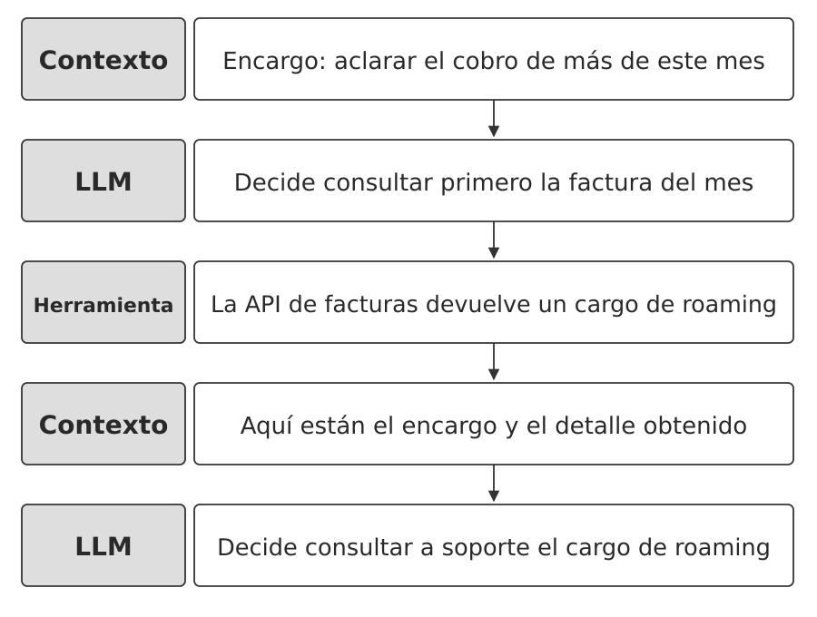
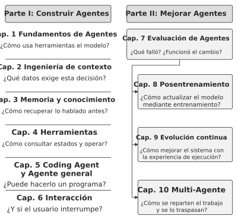

# Introducción {.unnumbered}

Entre agosto de 2025 y principios de 2026 impartí en Turing el curso en línea en video *Campamento de Entrenamiento de Agentes de IA*, dedicado a construir Agentes de IA con métodos de ingeniería explicables, verificables y reutilizables. El curso empieza poniendo en marcha un Agente y luego analiza por qué adopta esa arquitectura: qué problema resuelve cada decisión de diseño, qué precio se paga por ella y para qué tareas resulta adecuada. Este libro se elaboró a partir de los apuntes del curso y de sus experimentos.

> **Cómo nació este libro: una práctica de colaboración entre persona y máquina**
>
> Al preparar cada clase, primero le dictaba el esquema al Agente de voz de Pine y le pedía que buscara material y redactara un primer borrador. A esta forma de colaborar de viva voz se le llama **whisper coding**. Después de cada clase, volvía a revisar los ejemplos y los argumentos correspondientes según el paso en que se habían atascado los estudiantes o el experimento cuyo resultado los había sorprendido.

Desde 2025 he observado un cambio importante: el centro de gravedad de la investigación en IA y de la práctica industrial se está ampliando, de mejorar las capacidades de los modelos base a conseguir que los Agentes completen tareas reales. Por eso el entrenamiento de modelos y su aplicación están cada vez más unidos. Los modelos de razonamiento como DeepSeek-R1 han mostrado cuánto mejora el aprendizaje por refuerzo las capacidades matemáticas, de programación y de pensamiento.[^preface-r1] El aprendizaje por refuerzo agéntico (*Agentic Reinforcement Learning*) incorpora al entrenamiento la llamada a herramientas y la interacción con el entorno, de modo que el modelo aprende a programar y también a manejar interfaces gráficas. Este segundo tipo de tarea suele llamarse Computer Use: el modelo deduce el estado de la página a partir de una captura de pantalla y luego actúa haciendo clic, escribiendo o desplazándose. Productos como Manus, Claude Code y OpenClaw, por su parte, permiten que el usuario delegue tareas directamente, y han mostrado cómo la combinación "generación de código + sistema de archivos" sostiene un Agente general.

En septiembre de 2026, Meta presentó Muse. Por esas fechas, los productos de Agentes personales brotaban como hongos después de la lluvia, dentro y fuera de China. Muchos de los problemas que trata este libro ya nos los habíamos encontrado antes mi equipo y yo al desarrollar Pine. Soy científico jefe de Pine AI y, junto con mis colegas, desarrollé este Agente personal que hace gestiones en nombre de los consumidores. A principios de enero de 2025, Pine ya estaba disponible en Estados Unidos: los usuarios podían pedirle que llamara a un comercio para negociar una factura, solicitar un reembolso o cancelar una suscripción.

Cuando un comercio acepta por teléfono rebajar un cargo, lo que Pine puede decirle al usuario en ese momento es "el agente de atención al cliente lo ha aceptado"; para afirmar "ya te han devuelto el dinero" hay que esperar a que el reembolso aparezca en la factura. Para hacer gestiones así, necesitábamos que el modelo recordara qué había autorizado el usuario, supiera qué comprobar a continuación y distinguiera hasta dónde había avanzado el asunto. Cuando más tarde el sector empezó a hablar de Skill, Harness e ingeniería de bucles (*loop engineering*), muchas de esas prácticas eran justamente las que habíamos ido descubriendo en aquellas llamadas.

- **Skill.** Solo cargábamos un prompt cuando la tarea lo necesitaba. Cuando las herramientas se multiplicaron, hicimos que el modelo las invocara desde la línea de comandos, para no tener que enumerar en cada solicitud las definiciones de todas ellas.
- **Harness.** Escribíamos en una barra de estado el entorno de ejecución, la hora actual y el estado de trabajo del usuario, para que el modelo los tuviera en cuenta al decidir. A veces el modelo inventaba resultados, llamaba a la herramienta equivocada u omitía instrucciones, y una operación peligrosa podía incluso exceder lo que el usuario había autorizado. Por eso añadimos restricciones al proceso de ejecución; más tarde vimos prácticas parecidas en Claude Code.
- **Ingeniería del bucle.** A veces el modelo declaraba terminada una gestión que solo había hecho a medias. Pusimos a un Agente a hacer la gestión y a otro a revisar la factura o el pedido; si encontraba algo pendiente, se lo devolvía para que lo completara. Es la división de trabajo entre proponente y revisor (*proposer-reviewer*).

Otros equipos de modelos y de Agentes, al resolver problemas parecidos, llegaron por su cuenta a métodos similares. Eso me convenció aún más de que muchas de las dificultades que encontró nuestro equipo son problemas comunes a todos los sistemas de Agentes cuando pasan a la aplicación real. Además del *Campamento de Entrenamiento de Agentes de IA*, entre 2024 y 2026 he impartido de forma continuada un curso práctico de Agentes en la Universidad de la Academia China de Ciencias. Las preguntas de los estudiantes de ambos cursos me ayudaron a identificar qué experiencias necesitaban explicarse con más claridad. Publico este libro como código abierto con la esperanza de que más investigadores e ingenieros puedan usar, poner a prueba y mejorar estos métodos.

**La práctica va primero; el nombre, después**. Para un equipo de desarrollo esto tiene una implicación más: cuando un término se convierte en consenso del sector, los equipos punteros suelen llevar mucho tiempo explorándolo. Para acumular una ventaja de ingeniería propia, hay que descubrir los problemas antes, en el negocio real, e intentar resolverlos. Creo que para lograrlo hacen falta dos condiciones clave.

**La primera: elegir un negocio real que exija lo suficiente de las capacidades del Agente y obtener retroalimentación de forma continua.** Una tarea de Pine puede durar horas o incluso semanas y requiere comunicarse con varias partes: llamadas largas, formularios complejos, varias rondas de correos electrónicos, y todo ello garantizando que las cifras sean exactas, que las operaciones estén bajo control y que se defiendan los intereses del usuario. Escenarios así ponen al descubierto, una y otra vez, la distancia entre lo que el modelo sabe hacer y lo que el negocio exige, y empujan al equipo a mejorar el Harness. Si el valor principal de un producto consiste solo en compensar las carencias de una generación concreta de modelos, la siguiente actualización del modelo puede absorber ese valor, y al equipo le costará acumular una ventaja duradera.

**La segunda: establecer un mecanismo sistemático de evaluación (*Evaluation*).** Después de modificar el sistema, una negociación de factura que sale bien puede deberse a que el asistente hizo las preguntas correctas o a que, esta vez, el agente de atención al cliente tenía casualmente autoridad para hacer el descuento. Comparar una y otra vez la versión nueva y la antigua con el mismo conjunto de casos permite ver si la diferencia es estable. El capítulo 7 explica en detalle cómo fijar criterios de éxito, construir entornos de evaluación, analizar fallos y comprobar el efecto de los cambios.

En Pine aprendimos un método de las rebajas de facturas: hacer que el revisor mire el importe en la factura. Si aplicamos el mismo método a un cambio de billete, hay que comprobar si se ha emitido el billete nuevo. La prueba concreta cambia según el negocio, pero detrás hay un principio común: para saber si una tarea se ha completado, hay que mirar qué resultado ha dejado la acción en el mundo exterior. **Los buenos principios sobreviven a los ciclos de iteración de los modelos**.

## La misión de este libro {.unnumbered}

Imagina que alguien entrega a un asistente la factura de su teléfono móvil y le pide que contacte con la operadora para negociar una rebaja. Antes de empezar, el asistente tiene que averiguar qué cargo es el que está en disputa; durante la llamada, tiene que escuchar las explicaciones y preguntar por las condiciones; al terminar, tiene que decirle al usuario qué ha prometido exactamente la operadora. En cada paso, el asistente debe responder a tres preguntas: ¿qué sabe en este momento?, ¿qué acciones puede emprender?, ¿en qué se basa para elegir el siguiente paso? Este libro parte de estas tres preguntas para presentar la estructura de los Agentes, cómo se construyen y cuáles son los límites de sus capacidades. La fórmula central es **Agente = LLM + Contexto + Herramientas**: el LLM se encarga de comprender, planificar y decidir; el contexto contiene la información que necesita la decisión actual; las herramientas conectan con el entorno externo para obtener observaciones o ejecutar acciones.

Con una metáfora intuitiva, el LLM es el "cerebro", el contexto es el "campo de visión de la decisión actual" y las herramientas son los "sentidos y las manos y los pies". El campo de visión incluye la información del entorno, el historial de la conversación, la memoria y el conocimiento, y también las instrucciones del sistema, las definiciones de herramientas y el estado de la tarea. Buscar, leer y hacer capturas de pantalla aporta información; hacer clic, escribir y llamar a interfaces de negocio cambia el estado del mundo exterior. La figura 0-1 descompone una consulta sobre una factura. En la primera decisión, el modelo solo sabe que el usuario tiene dudas sobre un cargo; en la segunda, ya puede señalar por qué importe hay que preguntar.



Los lectores familiarizados con el aprendizaje por refuerzo (*Reinforcement Learning*, RL) pueden entender además este reparto de funciones a través de la política, las observaciones y las acciones. El LLM elige el siguiente paso según el contexto, así que su función de decisión se aproxima a una política (*Policy*); el contexto contiene las observaciones concretas y el historial que usa esta decisión; las herramientas ofrecen las interfaces de observación y de acción. El espacio de observación (*Observation Space*) describe qué observaciones pueden obtenerse y el espacio de acción (*Action Space*) describe qué acciones están permitidas; juntos delimitan el alcance de la interacción del Agente con el entorno.[^preface-spaces] El capítulo 1 desarrolla estos conceptos con ejemplos de llamadas a herramientas y presenta el reparto de trabajo entre Model y Harness en una implementación de producción.

> **Para reflexionar: de la vida a las entidades diseñadas**
>
> Más allá de la práctica de ingeniería, los Agentes plantean también preguntas sobre la evolución de los sistemas inteligentes. Richard Sutton, ganador del Premio Turing y pionero del aprendizaje por refuerzo, resume la evolución del universo en cuatro etapas: el polvo, las estrellas, la vida y las "entidades diseñadas" (*designed entities*).[^preface-sutton] Los seres vivos evolucionan mediante mutación aleatoria y selección natural; las entidades diseñadas, en cambio, pueden ser construidas y mejoradas deliberadamente por sistemas inteligentes ya existentes.
>
> Un Agente puede generar código, construir nuevos Agentes y después analizar su comportamiento en ejecución, proponer cambios y verificar los resultados, hasta lograr poco a poco el arranque autónomo (*bootstrap*) y la evolución continua. Es como si un programador escribiera a otro programador, y este siguiera participando en la construcción de nuevos sistemas. Esta posibilidad de comprenderse y mejorarse a sí mismo es también una de las cuestiones que más me interesaron al escribir los capítulos sobre generación de código y evolución continua.

## Estructura del libro {.unnumbered}

La figura 0-2 muestra cómo se relacionan los capítulos. Si el usuario cambia de opinión durante una llamada y el asistente sigue actuando según la petición anterior, puedes empezar por el capítulo 6, en la columna izquierda, para ver cómo gestiona el asistente las interrupciones del usuario. Una vez corregido, ¿cómo saber si también atenderá a los nuevos requisitos en otras llamadas? Para eso hacen falta los métodos de evaluación del capítulo 7, en la columna derecha. Las tres flechas que salen del capítulo 7 indican que, con los resultados de la evaluación en la mano, se puede elegir un método de mejora distinto según la causa del fallo.



- **Capítulo 1 (Fundamentos de Agentes de IA)**: a partir de productos y de ejemplos de llamadas a herramientas, presenta los componentes centrales, el bucle de ejecución, el Harness y las formas de orquestación, y establece el marco conceptual para entender todo el libro.
- **Capítulo 2 (Ingeniería de contexto)**: es el capítulo más importante del libro y trata de cómo organizar la información que el modelo necesita en cada momento. Va del diseño de prompts y la carga bajo demanda a la gestión del historial, y se apoya en la KV Cache para explicar cómo influyen estos métodos en la calidad de las respuestas y en el coste de ejecución.
- **Capítulo 3 (Memoria de usuario y base de conocimientos)**: trata de cómo guardar y recuperar información entre sesiones. Va de la memoria de usuario a RAG, los índices estructurados y la actualización del conocimiento, para que el lector domine la recuperación y el mantenimiento del conocimiento persistente.
- **Capítulo 4 (Herramientas)**: trata de cómo el Agente obtiene observaciones, ejecuta acciones y pide colaboración. A través de la clasificación de herramientas, el diseño de interfaces, MCP y la gestión de la ejecución, muestra cómo incorporar capacidades externas al sistema.
- **Capítulo 5 (Coding Agent y Agente general)**: propone una idea arquitectónica central para el Agente general: un Coding Agent como núcleo de ejecución y el sistema de archivos como espacio de trabajo. Primero expone el flujo de desarrollo y después, con casos de multimedia, sistemas de negocio y otros, muestra cómo el Agente escribe programas para resolver problemas y, a partir de ahí, crea herramientas y construye nuevos Agentes.
- **Capítulo 6 (Interacción: la ampliación de los espacios de observación y de acción)**: analiza la interacción del Agente en dos dimensiones, la modalidad y el tiempo. A través de los eventos asíncronos, la voz, Computer Use y los robots, explica la observación continua, la separación entre vía rápida y vía lenta y el control de la ejecución.
- **Capítulo 7 (Evaluación de Agentes)**: responde a cómo juzgar el desempeño del sistema y el efecto de un cambio. Primero fija los criterios de éxito, el entorno y el conjunto de datos; después explica los verificadores, la puntuación y el análisis estadístico; por último, muestra cómo encontrar la dirección de mejora analizando las causas de los fallos.
- **Capítulo 8 (Posentrenamiento de modelos)**: trata de cómo actualizar las capacidades del modelo con datos y entornos, y defiende invertir primero en la calidad de los datos y en los entornos de entrenamiento. A través del ajuste fino supervisado, el aprendizaje por refuerzo y el diseño de recompensas, explica por qué aprender de demostraciones y aprender explorando generalizan de forma distinta, y por qué cambiar solo el algoritmo suele dar resultados limitados.
- **Capítulo 9 (Evolución continua del Agente)**: trata de cómo aprovechar la experiencia de ejecución para mejorar las versiones siguientes del Agente. Compara cuatro tipos de actualización (conocimiento, instrucciones, programas y parámetros) y después gestiona los cambios a largo plazo con procesos de verificación, despliegue y recuperación.
- **Capítulo 10 (Colaboración multiagente)**: trata de cuándo aportan valor añadido varios miembros y de cómo repartir el trabajo, comunicarse y coordinarse. Primero explica cómo se reparten el contexto y el control; después, con casos concretos, expone los mecanismos de colaboración, analiza las causas de los fallos y discute las formas que podrían adoptar una sociedad y una economía de Agentes.

## Cómo leer este libro {.unnumbered}

- **Si vas a construir un producto de Agentes desde cero**: te recomiendo leer el libro completo. Con los capítulos 1 a 6, monta un asistente capaz de hacer gestiones; con el capítulo 7, comprueba en qué tareas se equivoca con facilidad. Los tres capítulos siguientes tratan de cómo mejorar, a partir de esos fallos, el modelo, el sistema o el reparto de trabajo entre los miembros.
- **Si primero quieres una visión de conjunto**: lee en orden los capítulos 1, 2, 4 y 7. Sigue el recorrido de una llamada a herramientas: primero conoce el bucle de ejecución del Agente, luego mira qué información recibe el modelo y qué hace realmente la herramienta y, por último, usa la evaluación para juzgar si el resultado cumple lo que pidió el usuario. Cuando el capítulo 2 llegue a la KV Cache, en una primera lectura basta con quedarse con las tres conclusiones del principio y volver a los fundamentos después de hacer los experimentos.
- **Si te interesa sobre todo el entrenamiento de modelos**: entiende primero con los capítulos 1 y 2 cómo funciona un Agente y luego lee el capítulo 8 junto con los métodos de evaluación del capítulo 7. Así podrás relacionar los objetivos de entrenamiento con el desempeño en tareas reales.
- **Si mantienes un Agente que ya está en producción**: elige un conjunto de tareas reales y evalúalas con el capítulo 7. Por ejemplo, si el asistente le dio al usuario un precio antiguo, comprueba primero qué versión del presupuesto recibió. Si el conocimiento o el procedimiento estaban desactualizados, lee el capítulo 9 con ese fallo en mente; si el presupuesto y las herramientas eran suficientes y, después de cambiar el procedimiento, el modelo sigue eligiendo mal una y otra vez, lee el capítulo 8 para decidir si vale la pena preparar datos de entrenamiento.

Cada capítulo incluye experimentos y preguntas de reflexión. Los experimentos se numeran como "Experimento X-Y", donde X es el número de capítulo e Y el orden dentro del capítulo. Las estrellas indican la dificultad: ★ es apto para principiantes, ★★ requiere cierta experiencia en ingeniería y ★★★ implica preguntas abiertas o el diseño de sistemas complejos. La mayoría de los experimentos tienen código ejecutable, reunido en el repositorio de código abierto:

> **Repositorio de código complementario**: `bojieli/ai-agent-book`

Si es la primera vez que haces un experimento, puedes empezar por el "Experimento 1-1: El papel clave del contexto". Si usas Git, ejecuta en la terminal:

```bash
git clone https://github.com/bojieli/ai-agent-book.git
cd ai-agent-book
```

También puedes elegir **Code → Download ZIP** en la página del repositorio y descomprimirlo; obtendrás el mismo directorio. En el índice de experimentos del capítulo 1 (`chapter1/README.md`) busca el número 1-1 y abre `chapter1/context/README.md`. A partir de ahí, cada vez que encuentres un "Experimento X-Y", podrás localizar el proyecto y cómo ejecutarlo en `chapterX/README.md` dentro del repositorio. Las "guías de reproducción" indican los proyectos externos y cómo obtenerlos; los comandos de instalación y la descripción de los directorios están en los README.

## Conocimientos previos {.unnumbered}

Este libro está dirigido a lectores con conocimientos básicos de programación que quieran entender y construir Agentes. Para hacer los experimentos necesitarás la siguiente base.

**Imprescindibles: la base para leer todo el libro**

- **Programación en Python**: conocer la sintaxis, las estructuras de datos habituales y herramientas de gestión de paquetes como pip, y ser capaz de leer y modificar el código de los experimentos. La mayoría de los experimentos del libro están basados en Python.
- **Experiencia con LLM**: haber usado ChatGPT, Claude u otros productos similares y estar familiarizado con el proceso básico de plantear una petición, leer la respuesta y seguir preguntando.
- **Nociones de ingeniería de software**: conocer la línea de comandos, Git, JSON y las API REST, lo suficiente para ejecutar proyectos, revisar cambios y leer los datos de una interfaz.

Para hacer los experimentos, te recomiendo encarecidamente elegir una de estas herramientas: Claude Code, Codex, Cursor o TRAE. Pídele que te ayude a depurar un fragmento de código y fíjate en qué archivos lee y qué herramientas llama. Cuando más adelante leas sobre el bucle de ejecución y la gestión del contexto, tendrás una experiencia propia con la que compararlos.

**Recomendables: conocimientos complementarios por capítulo**

- **Fundamentos de aprendizaje automático (capítulo 8)**: el entrenamiento y la inferencia, las funciones de pérdida, el descenso de gradiente y el sobreajuste ayudan a entender cómo se actualiza un modelo.
- **Matemáticas básicas (capítulos 2, 3, 7 y 8)**: los vectores y las matrices ayudan a entender las incrustaciones (*embeddings*) y la atención; la probabilidad y la estadística ayudan a entender las métricas de evaluación y la recompensa esperada. El libro se centra en explicaciones intuitivas y en los usos prácticos.
- **Fundamentos de desarrollo web (capítulo 6)**: HTTP, WebSocket y la separación entre frontend y backend ayudan a entender la arquitectura de eventos asíncronos y la comunicación de voz en tiempo real.
- **Fundamentos de Transformer (capítulos 2 y 8)**: conocer la atención y la estructura de los modelos ayuda a entender el cálculo del contexto y el posentrenamiento. Quien quiera estudiarlo de forma sistemática puede leer *Hands-On Large Language Models* (de Jay Alammar y Maarten Grootendorst; edición china traducida por Li Bojie y publicada por Turing). Ese libro explica con ilustraciones Transformer, el preentrenamiento y el ajuste fino, y complementa la perspectiva de ingeniería de este.

Salvo el posentrenamiento del capítulo 8, el resto de los capítulos requiere pocos conocimientos de matemáticas y de aprendizaje automático; con experiencia básica en programación ya puedes empezar a leer.

## Agradecimientos {.unnumbered}

Gracias a Mengge y a Liu Meiying, de Turing, por editar este libro y por su dedicación en la organización del *Campamento de Entrenamiento de Agentes de IA*; gracias al profesor Liu Junming por impartir el curso práctico de Agentes en la Universidad de la Academia China de Ciencias. Gracias a los estudiantes de ambos cursos: vuestras preguntas, vuestra retroalimentación sobre los experimentos y vuestras sugerencias me ayudaron a mejorar continuamente las explicaciones y a comprender mejor estos conceptos.

Gracias a todos mis colegas de Pine AI. Los retos del negocio real y las discusiones del equipo son el origen de muchos de los métodos y casos de este libro. Vuestra práctica y vuestras ideas permitieron afinar una y otra vez estas reflexiones.

Gracias a mis amigos del sector de la IA. En conversación tras conversación, me dieron con franqueza su opinión y compartieron experiencias y juicios distintos, lo que me ayudó a entender más a fondo los modelos y los Agentes.

Mi mayor agradecimiento es para mi familia, en especial para mi esposa, Meng Jiaying. Siempre apoyó la escritura de este libro y aportó muchas sugerencias valiosas al manuscrito.

[^preface-r1]: DeepSeek-AI, *DeepSeek-R1: Incentivizing Reasoning Capability in LLMs via Reinforcement Learning*, 2025.
[^preface-spaces]: Documentación de Gymnasium, sección "Spaces".
[^preface-sutton]: Entrevista de Dwarkesh Patel a Richard Sutton, 26-09-2025, sección "Succession to AI".
