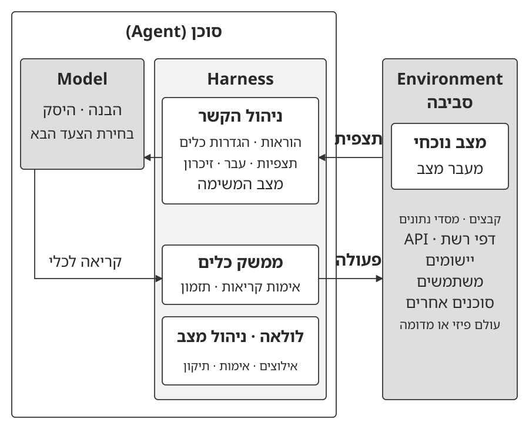
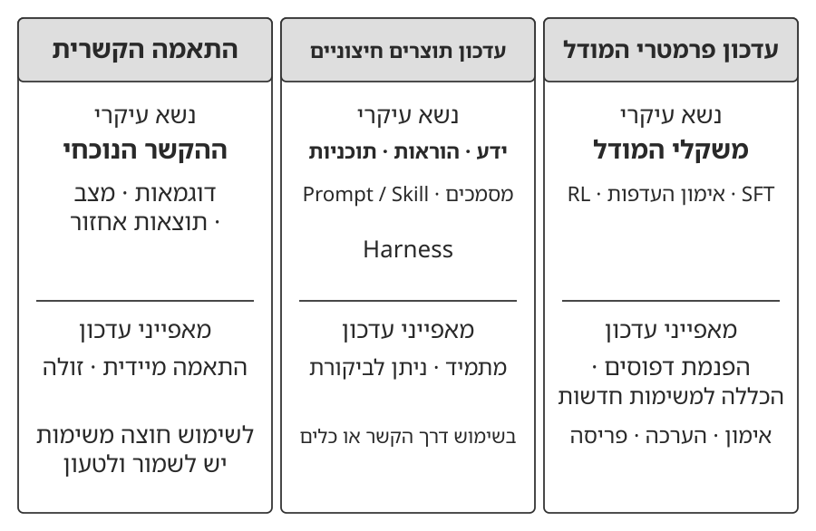
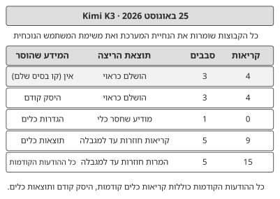
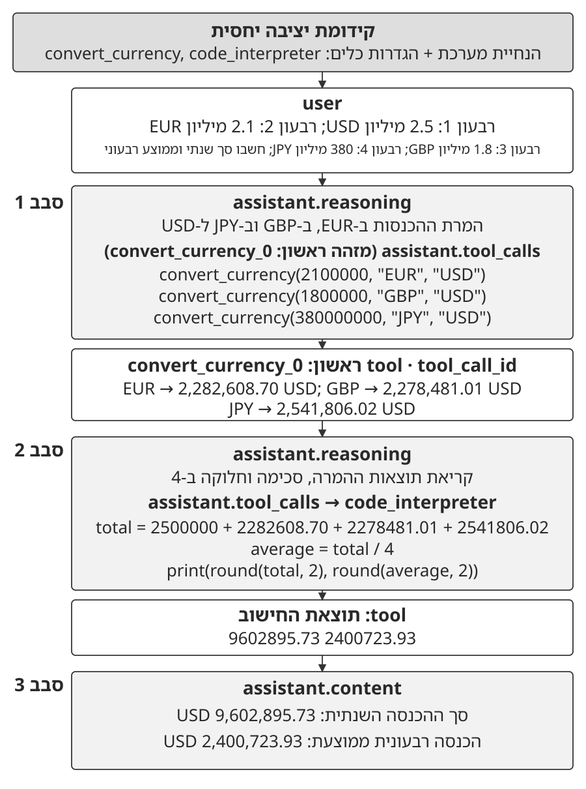
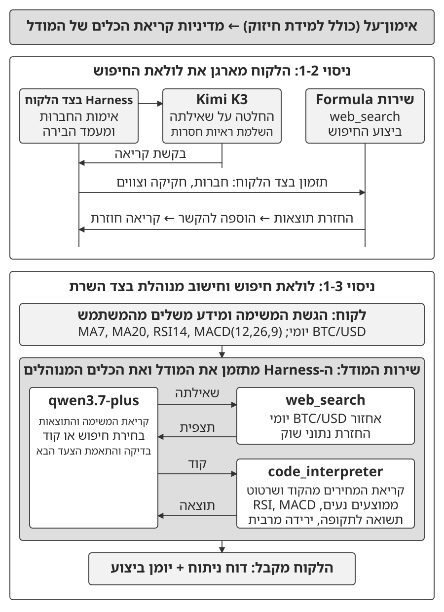
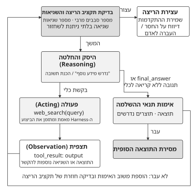
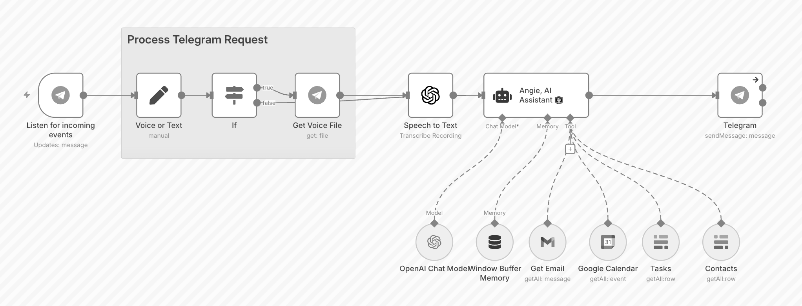

# צעדים ראשונים עם סוכני AI

כשחוקרים נושא בעזרת Deep Research, הוא מחפש וקורא שוב ושוב, ולבסוף מסכם את הממצאים בדוח. Manus יכול להפעיל דפדפן כדי להשלים משימות מקוונות, עוזר הטלפון Doubao יכול להזמין כרטיסים ולשלוח הודעות בטלפון, ו‑Pine AI יכול להתקשר בשם המשתמש ולנהל משא ומתן עם ספק התקשורת על הוזלת החשבון. כל אלה הם יישומים של סוכני AI‏ (AI Agent).

כשמתקנים פונקציה בעזרת Cursor, הוא מאתר את הפונקציה, עורך את הקובץ ואז מריץ את הבדיקות. אם הבדיקות עדיין נכשלות, הודעת השגיאה הופכת לבסיס לתיקון הבא; רק כשהן עוברות יש בידיו ראיה שמאפשרת לדווח לכם על התוצאה. את סדר שלושת השלבים — חיפוש, עריכה ובדיקה — אפשר לקבע בתוכנית מראש, אבל איזו שורה בדיוק לשנות ולאן לחזור אחרי כישלון תלוי במידע שמתקבל במהלך הביצוע. תהליך כזה, של בחירת פעולות לקראת מטרה ועדכון התוכנית לפי התוצאות, מתרחש גם במשימות כמו מחקר או משא ומתן טלפוני.

## סוכן מודרני = LLM + הקשר + כלים

הספר מסכם בנוסחה אחת את שלושת סוגי הרכיבים התפקודיים של סוכן מודרני: **סוכן = LLM (מודל שפה גדול, ‏Large Language Model) + הקשר + כלים**.

- **ה‑LLM הוא המוח של הסוכן**: הוא אחראי להבנת המשימה, לתכנון השלבים ולבחירת הפעולות. האימון המקדים (pre‑training) מעניק למודל יכולת לשונית וידע עולם, ואימון־העל (post‑training) מעצב בנוסף התנהגויות כמו ציות להוראות, היסק וקריאה לכלים. פרק 8 מציג שיטות אימון־על כגון כוונון עדין מונחה ולמידת חיזוק.
- **ההקשר הוא שדה הראייה של הסוכן בעת ההחלטה**: הוא מכיל את המידע הדרוש להחלטה הנוכחית — הוראות, הגדרות כלים, תצפיות מהסביבה, זיכרון משתמש, ידע תחומי, הודעות קודמות, מצבו של הסוכן עצמו והתקדמות המשימה.
- **הכלים הם החושים והידיים של הסוכן**: דרכם, באמצעות ממשקים, הוא משיג מידע או מבצע פעולות. מערך הכלים כולל הגדרות, פרוטוקול קריאה ומתאמים (adapters), ותומך הן בפעולות תצפית כמו חיפוש, קריאה וצילום מסך, והן בכתיבה, בהרצת קוד, בהאצלה לתת‑סוכנים ובתקשורת עם המשתמש.

לאותו כלי יכולים להיות כמה תפקידים. למשל, כשהמודל קורא קובץ דרך שורת הפקודה, תוכן הקובץ שמוחזר משמש בסיס להחלטה הבאה; כשהוא מריץ תוכנית דרך שורת הפקודה, הוא עשוי גם לשנות את מצבם של קבצים או של תהליכים.

נניח שזה עתה פתחתם חבילה ואתם רוצים לשאול את שירות הלקוחות: "אפשר עדיין להחזיר מוצר אחרי שפתחתי אותו?" המערכת יכולה להשתמש ב**יצירה מועשרת באחזור** (Retrieval-Augmented Generation, ‏RAG) כדי לאתר את מדיניות ההחזרות העדכנית של החנות, ואז לבקש מהמודל לענות על סמך הסעיפים.[^ch1-rag] מעקב אחר שאילתה אחת מבהיר את תפקידו של כל רכיב. נוסח המדיניות והאינדקס שלו שמורים בבסיס ידע חיצוני; כלי האחזור מאתר את הקטעים הרלוונטיים לשאלה, והתוכנית שקוראת למודל מכניסה את הקטעים, יחד עם מקורם, לבקשה הנוכחית. כשהמודל קורא את הסעיף על "אריזה שנפתחה", הוא יכול להסביר אותו; אם הסעיף מבחין גם בין קטגוריות מוצרים, עליו לברר קודם מה קניתם.

[^ch1-rag]: Patrick Lewis ואחרים, Retrieval-Augmented Generation for Knowledge-Intensive NLP Tasks, ‏NeurIPS, ‏2020.

בשאילתת ההחזרה הזאת, הפעלת האחזור היא הפעולה של הסוכן, והסעיפים שחוזרים הם התצפית שהוא מקבל מהסביבה (Environment). אם הצעד הבא יהיה תשובה או שאלת הבהרה — זה תלוי במה שכתוב בסעיפים. זהו המעגל הסגור שעליו מדברות למידת החיזוק ותורת הבקרה, כפי שמראה איור 1-1.



השכבה החיצונית באיור משרטטת את הגבול בין הסוכן לסביבה. קבצים, מסדי נתונים, דפי אינטרנט, משתמשים, סוכנים אחרים ועולמות פיזיים או מדומים — כל אלה יכולים לשמש סביבה שעמה הוא מקיים אינטראקציה. השכבה הפנימית מציגה את חלוקת העבודה במימוש ייצור: **ה‑Model אחראי להבנה, להיסק ולקבלת החלטות; ה‑Harness נמצא בתוך גבול הסוכן ומחוץ ל‑Model, אחראי לארגון ההקשר, ממשקי הכלים, לולאת ההרצה והמצב, ואוכף אילוצים, אימות ותיקון.** ה‑Harness יכול ליצור סביבה, לבודד אותה או לתווך אליה; תוכן קבצים, מצב תהליכים וכדומה משתנים בתוך הסביבה בעקבות הפעולות.[^ch1-harness]

[^ch1-harness]: ראו את "The Anatomy of an Agent Harness" של LangChain ואת "Effective harnesses for long-running agents" של Anthropic. יש מימושים שמונים גם את ארגז החול כחלק מה‑Harness; איור 1-1 משרטט את הסביבה בנפרד, כדי שיהיה קל לעקוב אחר מה שהפעולות שינו בפועל.

לכן הספר משתמש בשני פירוקים משלימים: **"LLM + הקשר + כלים" מתאר את ההרכב התפקודי, ו‑"Model + Harness" מתאר את מימוש הייצור.** ה‑Harness מארגן את ההקשר ומספק אותו ל‑Model; על קריאות לכלים מחליט ה‑Model, ה‑Harness מאמת ומתזמן אותן, ואז הן מועברות לכלי או לסביבה לביצוע. מערכת פשוטה יכולה להתחיל בהרכבת הקשר ובתזמון כלים, ולהוסיף בהדרגה את מנגנוני האילוץ, האימות והתיקון שהפעלה בייצור דורשת.

מי שמכיר למידת חיזוק יכול לקרוא את הטבלה שלהלן דרך שלוש שאלות: מי מחליט על הצעד הבא, על סמך מה הוא מחליט, ואיך ההחלטה הופכת לפעולה. זו אנלוגיה גסה לפי תפקיד.

| הבנה אינטואיטיבית | רכיב הנדסי | מושג קרוב בלמידת חיזוק | משמעות |
|-----------|-----------|----------------------------|----------------------------------------------|
| **מוח** | LLM | **מדיניות** (Policy) | מחליט על הצעד הבא לפי המידע הנוכחי |
| **שדה הראייה בעת ההחלטה** | הקשר | **תצפיות והיסטוריה** | מארגן את המידע שהסביבה מחזירה ואת ההיסטוריה הקיימת לבסיס להחלטה |
| **חושים וידיים** | כלים ומתאמים | **ממשקי תצפית ופעולה** | קובע כיצד לקרוא מידע מהסביבה, כיצד להנפיק פעולות, ומהו פורמט הקריאה וההחזרה |

### מרחב התצפית ומרחב הפעולה: הממשק בין המודל לעולם

**מרחב התצפית מתאר אילו תצפיות הסוכן עשוי לקבל, ומרחב הפעולה מתאר אילו פעולות הוא עשוי להנפיק.** ההקשר של קריאה בודדת נושא את המידע הקונקרטי, והכלים הזמינים מספקים את הממשק לאינטראקציה עם הסביבה. מלבד כלים, גם קלט מהמשתמש, התראות על אירועים וכדומה יכולים להביא תצפיות; הפרמטרים של קריאה לכלי, ההרשאות וסביבת ההרצה מגבילים יחד את טווח הפעולות.

דמיינו שתי תקלות שונות. בראשונה, המודל יודע להסביר כל סעיף חיוב בחשבון, אבל אין בידיו את החשבון של החודש הנוכחי. גם אחרי שהמשתמש מתיר לקרוא אותו, עדיין צריך לשלוף את החשבון ולמסור אותו למודל, ורק אז הוא יכול לקבוע איזה חיוב שנוי במחלוקת. בשנייה, המשתמש מבקש מהעוזר לשנות מסלול, והעוזר כבר מצא תוכנית מתאימה, אבל ממשק החשבון מתיר שאילתות בלבד. גם אם יקרא את החשבון שוב, לא יוכל לבצע את השינוי; נדרשת לו הרשאת פעולה מתאימה. תפקידו של ה‑Harness הוא להכניס להקשר את החומר שנקרא, לקבל את הפעולה שהמודל בחר, לבדוק פרמטרים והרשאות, ואז לתזמן את הביצוע.

לכן, **כשהמודל הבסיסי קבוע, התאמת מרחב התצפית ומרחב הפעולה היא אמצעי הנדסי חשוב לשיפור ביצועי המשימה.** אם המודל מחמיץ עובדה מרכזית, אפשר להכניס את הנתונים הרלוונטיים להקשר; אם הוא בוחר שוב ושוב בכלי הלא נכון מבין כלים דומים, אפשר לאחד ממשקים כפולים או לטעון רק את הכלים שהמשימה הנוכחית צריכה.

בצפייה בווידאו מתעוררת הבעיה ההפוכה: התמונה קיימת כל הזמן, אבל מעט שינויים מצדיקים שיקול מחדש. נניח שהעוזר ממתין להעלאת קובץ. אם יקרא למודל הראשי בכל פעם שפס ההתקדמות זז, יוסיף הרבה חישוב מיותר; אם יציץ רק פעם בעשר שניות, עלול להחמיץ הודעת כישלון שמופיעה לרגע. **לדעת המחבר, דילול מרחב התצפית הוא בעיה יסודית בעיצוב סוכנים.** המערכת יכולה לצפות בסביבה ברציפות, ולמסור למודל הראשי רק שינויים שעשויים לשנות את הפעולה הבאה, יחד עם ההקשר הנחוץ.

**Manus: שילוב מחקר, תכנות ושליטה במחשב במשימה אחת.** Deep Research מצטיין בחיפוש ובקריאה, סוכן קוד (Coding Agent) יכול לכתוב קוד ולהריץ אותו, וסוכן Computer Use יכול להפעיל ממשקים. Manus משלב דפדפן, מערכת קבצים, הרצת קוד ושורת פקודה בארגז חול בענן, כך שאותו סוכן יכול קודם לאסוף חומר, אחר כך לעבד קבצים ולהריץ קוד, ולבסוף להשלים פעולות בדפדפן. הדפדפן וקריאת הקבצים מרחיבים את המידע שאפשר להשיג, והרצת קוד ופקודות מרחיבה את הפעולות שאפשר להרכיב. **לדעת המחבר, שילוב זה הוא פריצת דרך חשובה של הסוכן הכללי: סוכן אחד יכול לחצות גבולות מוצר שהיו נפרדים, ולחבר איסוף חומר, עיבוד נתונים וביצוע פעולות למשימה שלמה.**

**OpenClaw: הרחבת הממשק אל החיים הדיגיטליים של המשתמש.** OpenClaw מקבל משימות ומחזיר תוצאות דרך ערוצי הודעות כמו WhatsApp,‏ Telegram,‏ Slack,‏ Discord ו‑iMessage, ומשתמש ב‑Gateway שרץ על מכשיר המשתמש כדי לחבר בין ערוצי ההודעות, המודלים והכלים. לאחר הגדרת הכלים המתאימים וקבלת הרשאה, הסוכן יכול לטפל בקבצים מקומיים, וגם להתחבר לשירותי ענן כמו Google Drive ו‑Notion. כך יכולים חומרים של המשתמש, המפוזרים בין חשבונות ומכשירים, להיכנס לטיפול באותה משימה. בתחילת דרכו עבד Manus בעיקר בארגז חול בענן, והמשתמשים נדרשו להעלות אליו קבצים; מחבר Google Drive ותכונת שולחן העבודה My Computer שנוספו מאוחר יותר הרחיבו את הגישה לקבצי ענן ולמשאבים מקומיים. התפתחויות אלה מראות שצמיחת היכולות של מוצר נובעת לעיתים קרובות מהרחבת ממשקי התצפית והפעולה[^ch1-agent-products].

[^ch1-agent-products]: על מבנה המוצרים ראו את הסקירות הרשמיות של Manus על ה‑Sandbox, על Google Drive Connector ועל My Computer, וכן את המאגר הרשמי ואת תיעוד הכלים של OpenClaw. המחברים, הגדרת הכלים והרשאות המשתמש הם שקובעים לאילו משאבים אפשר לגשת בפועל.

המשימות של המוצרים השונים שונות זו מזו, אבל את כולם אפשר להבין דרך שלושה היבטים: בסיס ההחלטה, הפעולות הזמינות ואסטרטגיית הביצוע:

| מוצר סוכן | המידע העיקרי בהקשר | כלים ופעולות זמינים | אסטרטגיית ביצוע |
|----------------|----------------------|----------------------------|------------------------------|
| **סוכני קוד (למשל Cursor)** | דרישות, קטעי קוד, רשימות תיקיות, פלט טרמינל | חיפוש קוד, קריאה וכתיבה של קבצים, הרצת פקודות | הבנת הדרישה ← חיפוש קוד רלוונטי ← עריכת קוד ← בדיקה ואימות ← ניפוי שגיאות ותיקון |
| **סוכני חיפוש (למשל Deep Research)** | תוצאות חיפוש, תוכן דפי אינטרנט, תקצירי מאמרים וציטוטים | שאילתות חיפוש, קריאת דפי אינטרנט, הפקת דוח | התאמת כיוון החיפוש לפי המידע שכבר נאסף, וסינתזה הדרגתית של דוח שלם |
| **סוכני שליטה במחשב (למשל Browser Use)** | צילומי מסך, DOM או עץ נגישות, תוצאות פעולות | לחיצה, הקלדה, גלילה, צילום מסך, הרצת קוד | קריאת הממשק ← זיהוי אלמנט היעד ← ביצוע הפעולה ← אימות התוצאה |
| **סוכני עוזר טלפון (למשל Doubao)** | צילומי מסך של הטלפון, מצב ממשק האפליקציה, משוב מהמערכת | לחיצה, החלקה, הקלדה, פתיחת אפליקציות | הבנת הדרישה ← איתור אפליקציית היעד ← ביצוע פעולות ← אישור השלמה |
| **סוכני משימות אישיות (למשל Pine AI,‏ Meta Muse)** | רשומות חשבון, חשבוניות ומידע על ספקי שירות שנקראו בהרשאה | שיחות טלפון, שליחת דוא"ל, מילוי טפסים, אישור מול המשתמש | איסוף מידע ← גיבוש אסטרטגיית משא ומתן ← פנייה לספק השירות ← משא ומתן ← דיווח תוצאות |

**איך הופכת בקשה למשימה שאפשר לבצע?** בעבודה על עוזר אישי לביצוע משימות ב‑Pine התברר למחבר שמשתמשים מציינים לעיתים קרובות רק מטרה, למשל "תזמין לי טיסה לנסיעת העבודה, רצוי עד 1,200 יואן". העוזר צריך קודם לברר תאריכים, יעד ומה הכי חשוב בנסיעה הזאת, לאסוף את החומרים החסרים, ולסכם עם המשתמש איך הוא מתכוון לפעול ואילו תנאים פתוחים למשא ומתן — ורק אז לפנות לספק השירות. מידע חדש שמתקבל תוך כדי עשוי להחזיר את המשימה לשלב קודם.

נניח שהמחיר הנמוך ביותר שמצא נציג השירות הוא 1,250 יואן. המודל ישקול זאת לאור השכל הישר, הנסיעה עצמה והרגלי המשתמש שהוא זוכר. עבור משתמש שנמצא בנסיעת עבודה ובדרך כלל מוכן לשלם מעט יותר על מסלול נוח, Pine עשוי להזמין מיד; אם מדובר בטיול משפחתי, והמשתמש הבהיר בעבר שהעלות הכוללת חשובה לו, הוא עשוי קודם לדווח למשתמש על ההפרש ולבקש מהנציג להמשיך לחפש טיסות אחרות. אם המשתמש מוסיף בדיעבד "בפעם הבאה שיש כרטיס מעל התקציב, תשאל אותי קודם", המשוב הזה מספק להחלטה הבאה בסיס ספציפי יותר מניסיון כללי.

בתרחיש אחר, נציג הבנק מציע לשלוח מסמכים לכתובת הבית, והעוזר זוכר שהמשתמש נמצא בטיול בחו"ל. הפעם יש לשנות את אופן המסירה: העוזר יכול להסביר כבר בשיחה שקשה לקבל דואר, ולבקש שהמסמכים יישלחו בדוא"ל. ובהפחתת חשבון: אם הנציג מבטיח בעל פה בטלפון, העוזר יכול לדווח במדויק על ההתחייבות של העסק; כדי לוודא שהסכום אכן קוזז, נדרש החשבון הבא כתצפית חדשה. מרחב הפעולה של עוזר יכול להתרחב עד שיחות טלפון אמיתיות, אבל מסקנותיו עדיין מוגבלות על ידי מרחב התצפית.

מבחינת סוג העניין שמופקד בידי הסוכן, הספר יעסוק בשלושה סוגי יישומים: סידורים בחיי היומיום, עבודה משותפת במשרד ומחקר מדעי. אותו עוזר יכול לקבל משימות מסוגים שונים; ההבדל הוא מי מעניק לו הרשאה, מה הוא יכול לשנות, ומי מאשר את התוצאה בסוף. ובמשרד: כשעמית מחזיר תוצאות בדיקה, האם אפשר כבר לסגור את הכרטיס? נניח שמנהל הפרויקט מתייג את העוזר בכרטיס ב‑Multica ומבקש ממנו לבדוק פער אחד בגיליון התקציב. התגובה הזאת מפעילה את הבדיקה, אבל הכרטיס נשאר בבעלות האחראי המקורי, והסטטוס שלו לא משתנה. העוזר מחזיר את שני הסכומים ואת מקורם, וכך עונה על שאלת העמית; אם התקציב כולו מוכן להגשה — על כך יחליט האחראי, בהתחשב בשאר המשימות הפתוחות.[^ch1-multica]

גם במשימות מחקר אפשר לשאול את אותה שאלה: על סמך מה קובעים שהייתה התקדמות? כש‑AlphaEvolve של Google DeepMind מחפש אלגוריתמים לכפל מטריצות, המודל מציע תוכניות מועמדות, ומעריך (evaluator) מריץ אותן ובודק אם המכפלה נכונה וכמה פעולות כפל נדרשו. החיפוש בהמשך יכול לשפר את התוכניות שהצליחו. צוות המחקר דיווח שאחד האלגוריתמים מכפיל שתי מטריצות מרוכבות בגודל $4\times 4$ ב‑48 פעולות כפל סקלריות. ל"פחות פעולות כפל" יש מושא ספירה ברור, והאלגוריתם עדיין חייב להפיק מכפלת מטריצות נכונה.[^ch1-alphaevolve]

[^ch1-multica]: Multica, תיוג סוכן בתגובה על כרטיס. פרק 10 דן כיצד להבחין, בעבודה משותפת, בין בקשת עזרה נקודתית להעברת אחריות.

[^ch1-alphaevolve]: Google DeepMind, הסבר על מחקר AlphaEvolve, מאי 2025. מספר פעולות הכפל כאן הוא מספר פעולות הכפל הסקלריות באלגוריתם; זמן הריצה בפועל תלוי גם במימוש ובחומרה.

מרחב הפעולה של מערכות אלה הוא **פתוח**. מילות חיפוש, טקסט מוקלד, קוד שנוצר וצירופי פעולות קשה למנות מראש, ובכל זאת כל פעולה עדיין מוגבלת על ידי הכלים, הפרמטרים, ההרשאות וסביבת ההרצה. משום כך, תוכנית ברת‑ביצוע צריכה להשאיר מקום לכך שתצפיות חדשות ישנו את הצעד הבא.

### כלים: החושים והידיים של הסוכן

כלים מתרגמים את החלטות המודל לקריאה מהסביבה החיצונית או לפעולה עליה. כלי חיפוש וקריאה מביאים תצפיות, וכלים כמו כתיבת קבצים והרצת פקודות מוציאים פעולות לפועל. מהתוצאות המוחזרות המודל לומד מה הייתה השפעת הפעולה, ומחליט אם להמשיך, לנסות שוב או לסיים את המשימה.

לפי השימוש העיקרי, הספר מחלק את הכלים לחמישה סוגים. לממשק אחד יכולים להיות כמה שימושים; שיחה קולית, למשל, גם משיגה מידע וגם מעבירה בקשה.

**כלי תפיסה** משיגים מידע: מנועי חיפוש מספקים חומרים מהרשת, כלי קריאת קבצים ניגשים למסמכים מקומיים, וממשקי API ומסדי נתונים מתחברים לשירותים חיצוניים ולנתוני הארגון.

**כלי ביצוע** מבצעים פעולות: הרצת קוד, שינוי קבצים, הרצת פקודות מערכת או קריאה ל‑API חיצוני, וכך מיישמים את ההחלטות בסביבה.

**כלי שיתוף פעולה** תומכים בחלוקת עבודה ובתיאום: האצלת משימות ייעודיות לתת‑סוכנים, איסוף התוצאות ותיאום העבודה של כמה סוכנים. כשנדרשת השתתפות אנושית בהחלטה, המערכת יכולה גם לבקש אישור דרך ממשק התקשורת עם המשתמש.

**כלי הפעלה מבוססי אירועים** מחברים אירועים חיצוניים לתהליך הריצה. דוא"ל חדש, הגעת מועד מתוזמן או קריאת Webhook יכולים כולם להפעיל משימה. מתאם האירועים ממיר קלטים אלה לתצפיות שהסוכן יכול לעבד, ומנגנון התזמון מתחיל את הביצוע או מחדש אותו; את כללי ההפעלה יכול להגדיר המפתח, ואפשר גם לרשום אותם באמצעות קריאה מורשית לכלי.

**כלי תקשורת עם המשתמש** מעבירים מידע למשתמש ואוספים ממנו משוב, למשל שליחת הודעת טקסט, ביצוע שיחה קולית או שליחת דוא"ל. הם משמשים לדיווח על התקדמות ולבקשת אישור, ויכולים גם להזכיר למשתמש ביוזמתם לטפל בעניינים.

פרק 4 מרחיב על עיצוב חמשת סוגי הכלים. הגדרת הממשק משפיעה על היכולת של המודל לבחור את הכלי הנכון ולמלא את הפרמטרים, הטיפול בשגיאות קובע אם אפשר להמשיך אחרי כישלון, ובקרת ההרשאות תוחמת את טווח ההשפעה של פעולות. MCP‏ (Model Context Protocol, פרוטוקול הקשר למודל) מספק דרך אחידה לגילוי כלים ולקריאה להם, ומצמצם את עבודת ההתאמה בין מערכות שונות.

**קריאה לכלים** (Tool Calling) היא היכולת של המודל להגיש בקשת פעולה בפורמט מוסכם. קריאה לפונקציות (Function Calling), הנפוצה, מבטאת את הבקשה בשם הכלי ובפרמטרים מובנים. הספר משתמש באופן אחיד במונח "קריאה לכלים".

ניקח כדוגמה שאילתת מזג אוויר בבייג'ינג. המודל יכול לכתוב את שם העיר, אבל הטמפרטורה בפועל תופיע בהקשר רק אחרי שה‑Harness יריץ את השאילתה. אלה ההודעות של ארבעת השלבים בקריאה הזאת:

```text
שלב 1: הצהרה על הכלי                שלב 2: המודל מחליט לקרוא
tools: [{                          assistant: {
  name: "get_weather",               tool_calls: [{
  parameters: {                        id: "call_1",
    city: "string"                     function: "get_weather",
  }                                    arguments: {city: "בייג'ינג"}
}]                                   }]
                                   }

שלב 3: התוצאה מצורפת להקשר           שלב 4: המודל עונה לפי התוצאה
tool: {                            assistant: {
  tool_call_id: "call_1",              content: "היום בבייג'ינג 28°C, בהיר."
  content: '{"temp":28,"sky":"בהיר"}'  }
}
```

כאן `call_1` מקשר את הערך שהכלי החזיר לבקשת הקריאה. המפתח מתאר כיצד קוראים לכלי, כותב את הפונקציה ששולפת את מזג האוויר ומחזיר את התוצאה למודל; המודל מחליט אם לקרוא, לאיזה כלי ואילו פרמטרים להעביר. פרק 2 מציג בהרחבה את מבנה ההודעות ב‑API.

בעיצוב כלים כדאי להתחיל ביכולת שמספיקה בדיוק. לארבע פעולות החשבון מספיק מחשבון עם פרמטרים ברורים; כשהמשימה מתרחבת לקריאת גיליונות, ניקוי ערכים חסרים, חישוב סטטיסטיקות ושרטוט גרפים, מפרש קוד Python מוגבל נוח יותר לשילוב השלבים. ככל שהיכולת הכללית גדלה, הבידוד וניהול המשאבים צריכים להדביק את הקצב: הקוד רץ בארגז חול, גישת הרשת כבויה כברירת מחדל, הגישה לקבצים מוגבלת לתיקיית העבודה המורשית, ונקבעות תקרות לזמן ריצה, למעבד, לזיכרון ולגודל הפלט.

לתיעוד הרצה אחת אפשר להסתפק בכלי רישום יחיד. משימות הנמשכות שעות ואף ימים מתאימות יותר לתיקיית עבודה וירטואלית מבוקרת, השומרת תוכניות, תוצאות ביניים, יומני ריצה ותוצרים סופיים, כדי שהסוכן יוכל להמשיך את העבודה בין הרצות. על התיקייה להגביל את הנתיבים שמותר לקרוא ולכתוב, את הנפח ואת סוגי הקבצים, ולבדוק אם נתיב חורג מגבול ההרשאה.

פעולות כמו תשלום, מחיקת נתונים, שליחת דוא"ל ופריסה לייצור כרוכות בסיכון גבוה או בכללים עסקיים מפורשים, ולכן כדאי לעטוף אותן בכלים ייעודיים עם פרמטרים ברורים, הרשאות מוגבלות ויכולת ביקורת לכל אורך הדרך, ובמידת הצורך להוסיף תצוגה מקדימה ואישור אנושי. **יכולות יסוד כלליות תומכות בהרכבה ובחקירה; כלים ייעודיים אוכפים את האילוצים והכללים העסקיים של פעולות בסיכון גבוה.**

### LLM: המוח של הסוכן

ה‑LLM הוא ליבת קבלת ההחלטות של הסוכן. כשמגיעה בקשה, הוא מזהה תחילה בדברי המשתמש את המטרה ואת האילוצים, ואז מפרק משימה מורכבת לשלבים ברי‑ביצוע. במהלך הביצוע עליו גם להחליט מה לעשות הלאה, אם לקרוא לכלי, באיזה כלי לבחור ואיך למלא את הפרמטרים. יכולות אלה נשענות על הידע והיכולת הלשונית שנצברו באימון המקדים, ואימון־העל מעצב אותן להתנהגות החלטה שמתאימה למשימה. גם תהליכי עבודה (workflows) וגם סוכנים אוטונומיים זקוקים לשיפוטים כאלה, ואילו הביצוע בפועל נעשה דרך ה‑Harness, הכלים והסביבה.

תכנון והסקה לפני פעולה עוזרים לסוכן להשוות חלופות, לחזות תוצאות ולצמצם ניסיונות סרק. למשל, המודל יכול להיעזר בחוקים מתמטיים כדי לבדוק שלבי חישוב, בקשרי סיבה ותוצאה כדי לנתח תקלה, ולסדר את הפעולות לפי התלויות ביניהן. המודל משווה חלופות בהיסק, ורק אחרי שבחר פעולה הוא מבקש מכלי לבצע אותה. גם מערכות למידת חיזוק מסורתיות יכולות להיעזר במדיניות נלמדת, בפונקציית ערך, במודל של הסביבה או באלגוריתם תכנון כדי לארגן את החקירה; הייחוד של סוכן LLM הוא שעוד לפני שהוא ניגש למשימה מסוימת, כבר רכש באימון מקדים בקנה מידה גדול ידע רחב ודפוסים לפתרון בעיות, ואימון־העל חיזק עוד את אופן השימוש ביכולות אלה.

#### קריאה מובנית לכלים במודל

בתעשייה מסכמים מגמה אחת במונח "מודל כסוכן" (Model as Agent): יותר ויותר החלטות של תכנון ושל קריאה לכלים עוברות לאחריות המודל. באמצעות אימון־על, ובמיוחד למידת חיזוק, המודל יכול ללמוד מתי לקרוא לכלי, לאיזה כלי, אילו פרמטרים להעביר, ואיך להמשיך אחרי שהתקבלה תוצאה. המפתח מספק מטרה, ממשקים ואילוצים, והמודל מתכנן את השלבים הקונקרטיים לפי התקדמות המשימה.

קבלת ההחלטות העצמאית של המודל צריכה תשתית של Harness. המילה Harness מציינת במקור רתמה — ציוד הרתימה של סוס, שמעביר את כוחו אל הכלי הנגרר ומכוון את כיוונו. בסוכן, ה‑Harness מארגן את יכולות המודל לתהליך משימה שיכול לרוץ לאורך זמן, ונושא באחריות לניהול ההקשר, לממשקי הכלים, לאילוצים, לאימות ולתיקון. המחצית השנייה של הפרק תציג את חמשת התפקידים האלה אחד אחד.

ככל שהמודל מתכנן בעצמו יותר פעולות, כך גדל טווח הנזק שטעות עלולה לגרום. לכן צריך לבצע אופטימיזציה משותפת למודל ול‑Harness: המודל משפר את איכות התכנון ובחירת הכלים, וה‑Harness מנהל הרשאות, בודק תוצאות ומטפל בכישלונות. ספקי מודלים יכולים לשפר את שני החלקים בבת אחת, ואיטרציה משותפת כזו היא יתרון הנדסי חשוב.

> **התפתחות יכולות המודל וה‑Harness**
>
> במאמר "הלקח המר" (The Bitter Lesson) סוקר Rich Sutton מגמה ארוכת טווח במחקר ה‑AI: שיטות חיפוש ולמידה שמסוגלות לנצל יותר משאבי חישוב עוקפות בהדרגה שיטות הנשענות על תכנון ידני נרחב של התחום[^ch1-1]. בהמשך לכיוון זה, החלטות כמו בחירת כלים וסידור שלבים, שבעבר נשאו בהן תהליכים חיצוניים, יכולות לעבור בהדרגה, באמצעות אימון, אל תוך המודל.
>
> עמדת הספר היא: **לאשר את הכיוון, להיות מעשיים לגבי הקצב.** המודל ימשיך לקבל לידיו חלק מתפקידי ההחלטה של ה‑Harness, אבל סבב של אימון ופריסה דורש זמן, בעוד שכללים עסקיים והעדפות משתמשים משתנים כל הזמן. גם קשה לכתוב בבת אחת את כל האילוצים של עסק אמיתי לתוך פרמטרי המודל. לכן, את מה שהמודל עדיין אינו עושה באופן יציב, ה‑Harness משלים בינתיים. **גבול היכולת של המודל כרגע הוא בדיוק המקום שבו טמון ערכו של ה‑Harness כרגע.** חלוקת העבודה הזאת משתנה עם יכולות המודל: בכל פעם שהמודל שולט בסוג נוסף של החלטות, ה‑Harness יכול לצמצם את התזמור המקביל ולפנות לקשיים חדשים. אכיפת הרשאות, שמירת מצב מתמשך ואימות תוצאות ימשיכו להתבצע על ידי מערכת הריצה.

[^ch1-1]: Sutton, Rich. The Bitter Lesson, 2019.

#### מנגנוני למידה של סוכנים: מהתאמה הקשרית ועד עדכון מתמשך

אחרי שכלי החזיר שגיאה, הסוכן למד הפעם לחפש את הקובץ בנתיב אחר. מחר, בסשן חדש, האם הוא עדיין יזכור את הלקח? מעקב באיור 1-2 אחר המקום שבו נשמר הניסיון הזה מבחין בין שלושה סוגי עדכון שונים.



**התאמה הקשרית** מתרחשת במהלך ביצוע המשימה. אחרי שהמודל קורא דוגמאות, מצב משימה או תוצאות אחזור, הוא יכול להתאים את התנהגותו בהמשך. למשל, אם כלי מחזיר שהקובץ אינו קיים, המודל יכול לחפש את הנתיב מחדש ולהמשיך. המסלול הזה מהיר וזול, ויעילותו תלויה בקיבולת חלון ההקשר ובאופן ארגון המידע. כדי שהניסיון ישמש גם במשימות הבאות, צריך לשמור את המידע הרלוונטי ולספק אותו שוב למודל. פרק 2 מציג את שיטות ארגון ההקשר.

**תוצרים חיצוניים** (artifact) יכולים לשמור ניסיון מעבר לגבולות משימה אחת. עובדות וניסיון נכתבים למסמכי ידע, אסטרטגיות שאפשר לבטא במילים נכתבות לפרומפט או ל‑Skill, ותהליכים ואילוצים דטרמיניסטיים נכתבים כתוכנית או כלוגיקה של ה‑Harness. קל לבקר ולתקן תוצרים כאלה, ובזמן ריצה הם משתתפים בהחלטה ובביצוע דרך ההקשר או ממשקי הכלים. פרקים 3 עד 5 מציגים את היסודות של ידע ותוכניות, ופרק 9 דן כיצד לייצר, לאמת ולפרסם עדכונים מתוך מסלולי ריצה שהוערכו.

**פרמטרי המודל** מתעדכנים באמצעות אימון. יכולות כמו הבנת דימות רפואי, סגנון לשוני ומדיניות החלטה סמויה כרוכות בדפוסים רבים שקשה לנסח ככללים אחד אחד, ואפשר ללמוד אותן מנתונים וממשוב באמצעות אימון־על. עדכון פרמטרים דורש השקעה באימון, בהערכה ובפריסה, ומטרתו שהמודל יוכל להפעיל את היכולות שלמד גם במשימות חדשות. פרק 8 מרחיב על השיטות הרלוונטיות.

אותו כישלון יכול לשמש קודם לתיקון הפעולה המיידית, ואחר כך להתגבש להנחיות פרויקט שהסוכן הבא יוכל לעיין בהן. אם אותה טעות חוזרת שוב ושוב בפרויקטים רבים, אפשר גם להשתמש במקרים האלה לאימון.

### הקשר: שדה הראייה של הסוכן בעת ההחלטה

כשאדם מקבל החלטה, הוא צריך לראות יחד את הוראות המשימה, מדריכי עיון, תיעוד ההתכתבות והנתונים העדכניים. גם הסוכן זקוק לאוסף מידע כזה, וזהו ההקשר. כמות המידע שקריאת LLM אחת יכולה לקבל מוגבלת על ידי חלון ההקשר, וה‑Harness אחראי לבחור את התוכן ולארגן אותו. מנקודת המבט של ה‑API, המימוש הבסיסי בספר כולל חמישה סוגי מידע:

- **הנחיית מערכת** (System Prompt): נבנית על ידי המפתח או ה‑Harness, ומתארת את זהות הסוכן, את גבולות המשימה ואת כללי ההתנהגות. הנדסת פרומפט מעצבת את אופן העבודה באמצעות כוונון ההוראות האלה. הנחיית המערכת יכולה להישאר יציבה יחסית לאורך הסשן, ואפשר גם, לפי הגדרות המוצר, לכלול בה זיכרון משתמש שנשמר בין סשנים — כגון העדפות, התנהגות עבר ומידע רקע — או להזריק אליה את מצב הסביבה הנוכחי. ההרשאות בפועל נאכפות על ידי בקרת הגישה ב‑Harness ובסביבה. פרק 3 מציג את זיכרון המשתמש.
- **הגדרות כלים** (Tool Definitions): מצהירות על השם, התפקיד ופורמט הפרמטרים של הכלים הזמינים, ועוזרות למודל לבחור פעולה ולבנות את הבקשה. במימוש הבסיסי בספר, הגדרות הכלים והנחיית המערכת ממוקמות בתחילת הבקשה ויוצרות קידומת יציבה יחסית. כשיש כלים רבים, אפשר גם לטעון את ה‑schema המלא לפי הצורך ולשמור על הקידומת הקיימת; פרקים 2 ו‑4 מרחיבים על שיטה זו.
- **הודעות משתמש** (User Messages): כוללות את משימת המשתמש ואת הקלט המשלים שלו, ויכולות גם לצרף ידע חיצוני שהושג באמצעות RAG‏ (יצירה מועשרת באחזור, Retrieval-Augmented Generation), למשל מידע מאחרי תאריך החיתוך של נתוני האימון או חומרים מתחום פרטי. פרק 3 מציג את האחזור ואת ארגון הידע.
- **תגובות המודל** (Assistant Messages): כוללות טקסט למשתמש ב‑`content`, בקשות קריאה לכלים ב‑`tool_calls`, ומידע היסק שהשירות מספק. הספר מקצר את מידע ההיסק ל‑`reasoning`; שירותים שונים עשויים להחזיר את תוכן ההיסק, תקציר שלו, או מצב אטום שמשמש להמשך השיחה. כשהמודל קורא לכלי, התגובה יכולה לכלול מידע היסק ובקשת קריאה; כשהמשימה מסתיימת, היא יכולה לכלול מידע היסק וטקסט סופי. השדות המדויקים ומידת החשיפה שלהם נקבעים על ידי שירות המודל.
- **תוצאות כלים** (Tool Results): כוללות את הערך המוחזר, השגיאות או המצב אחרי הביצוע; לאחר שהן מצורפות להיסטוריית ההודעות, הן משמשות בסיס להחלטה הבאה. לפיהן המודל קובע אם הפעולה הצליחה ואם צריך לשנות כיוון, ומצמצם ניסיונות חוזרים במהלך המשימה הנוכחית.

בכל קריאה למודל, ה‑Harness שולח לו את הקידומת היציבה יחסית (הנחיית מערכת, הגדרות כלים) יחד עם היסטוריית ההודעות ההולכת וגדלה. כך, גם אם כלי המרת המטבע החזיר את תוצאתו בסבב הקודם, המודל עדיין יכול לקרוא אותה בסבב הנוכחי כשהוא מחשב את הסכום.

את תרומתו של כל סוג מידע להחלטה אפשר לבדוק ב**ניסוי אבלציה** (Ablation Study): מקבעים את המשימה ואת תנאי הריצה, מסירים בכל פעם סוג מידע אחד ומשווים את השינוי בהתנהגות. ניסוי 1-1 שומר על הנחיית המערכת ועל משימת המשתמש הנוכחית, כדי לקבע את התפקיד, האילוצים ודרישות המשימה, ומבצע אבלציה נפרדת להגדרות הכלים, לתוצאות הכלים, למידע ההיסק הקודם ולהיסטוריית ההודעות.

> **ניסוי 1-1 ★★: התפקיד המכריע של ההקשר**
>
> מבקשים מהסוכן לסכם את ההכנסות הרבעוניות של חברה: ברבעון הראשון 2.5 מיליון דולר, בשני 2.1 מיליון אירו, בשלישי 1.8 מיליון ליש"ט, וברביעי 380 מיליון ין. המשימה דורשת להמיר את כל ההכנסות לדולרים באמצעות כלי המרת מטבע, ואז לחשב בעזרת כלי חישוב את ההכנסה השנתית הכוללת ואת ההכנסה הרבעונית הממוצעת, בדיוק של שתי ספרות אחרי הנקודה. כך המודל צריך גם לבחור כלים וגם לזכור אילו שלבים כבר הושלמו ומה הוחזר בהם.
>
> בניסוי יש קו בסיס מלא וארבע קבוצות אבלציה, וכל קבוצה רצה לכל היותר חמישה סבבים. כשמסירים את מידע ההיסק הקודם, המודל עדיין רשאי להסיק מחדש בכל סבב; כשמסירים את הגדרות הכלים, הבקשה כבר אינה מציעה כלים זמינים; כשמסירים את תוצאות הכלים, רשומות הקריאה נשמרות והתוכן המוחזר מוסתר; כשמסירים את היסטוריית ההודעות, נשארות רק הנחיית המערכת, הגדרות הכלים ומשימת המשתמש הנוכחית. נסו לנחש קודם: הידיעה "כבר בדקתי את שער הין" לעומת הידיעה "כמה דולרים שווים 380 מיליון ין" — באיזה שלב חישוב יכולה לתמוך כל אחת מהן? איור 1-3 מציג את התוצאות של חמש הקבוצות.
>
> 
>
> בהרצה של Kimi K3 ב‑25 באוגוסט 2026, **קו הבסיס המלא** השלים את המשימה בשלושה סבבים ובארבע קריאות לכלים, וקיבל הכנסה שנתית כוללת של 9,602,895.73 דולר והכנסה רבעונית ממוצעת של 2,400,723.93 דולר. גם **אחרי הסרת מידע ההיסק הקודם** הוא הגיע לתוצאה הנכונה באותו מספר סבבים וקריאות: רשומות הכלים כבר שמרו את תוצאות ההמרה, והמודל יכול היה לשחזר מהן את המידע הדרוש לחישוב הבא.
>
> **אחרי הסרת הגדרות הכלים**, המודל לא הנפיק קריאות לכלים, והודיע שחסר לו כלי המרת מטבע. **אחרי הסרת תוצאות הכלים**, המודל ביצע תשע קריאות ולא השלים את המשימה בתוך מגבלת חמשת הסבבים; רשומות הקריאה הקיימות לא יכלו לומר לו כמה דולרים התקבלו בהמרה. **אחרי הסרת היסטוריית ההודעות**, המודל ביצע בסך הכול חמש־עשרה קריאות, חזר שוב ושוב על ההמרות, וגם הוא מיצה את תקציב חמשת הסבבים; העבודה שכבר נעשתה לא נכנסה להקשר של הסבב הבא, ולכן ההתקדמות במשימה לא הצטברה.
>
> נריץ את אותה שאלה על מודל אחר. ב‑1 בספטמבר, DeepSeek V4 Flash, אחרי הסרת מידע ההיסק הקודם, השתמש אף הוא בשלושה סבבים ובארבע קריאות לכלים, אבל חישב 9,600,000.00 דולר. לאן נעלמו 2,895.73 הדולרים? הרמז נמצא בקריאת ההמרה הראשונה: ההכנסה ברבעון השני היא 2.1 מיליון אירו, והמודל כתב את הסכום כ‑`2.1`, מתוך כוונה לחשב ב"מיליונים". הכלי קיבל 2.1 אירו, המיר ועיגל לשתי ספרות אחרי הנקודה, והחזיר 2.28 דולר. המודל הכניס אחר כך לסכום הכולל 2.28 מיליון דולר, וכך שגיאת העיגול בהמרה הוגדלה פי מיליון. גם שני הסכומים האחרים נכתבו באותו אופן. גם אם בסוף מדפיסים את הסכום הכולל עד שתי ספרות אחרי הנקודה, מה שעוגל קודם לא חוזר.[^ch1-context-runs]
>
> ההשוואה הזאת מראה את תפקידו של כל סוג מידע: הגדרות הכלים מספקות יכולות שאפשר לקרוא להן, תוצאות הכלים מספקות עובדות מהסביבה, והיסטוריית ההודעות שומרת את התקדמות המשימה. ערכו של מידע ההיסק הקודם תלוי בשאלה אם ההחלטה הנוכחית יכולה לשחזר את הבסיס שלה מרשומות אחרות.

[^ch1-context-runs]: התיקייה `chapter1/context/validation/` במאגר שומרת את הבקשות והתגובות של שתי ההרצות, סבב אחר סבב. רשומת אוגוסט נמצאת ב‑`real_20260825T025409Z/evidence.json`, ורשומת ספטמבר ב‑`real_20260901T163146Z/evidence.json`.

### לולאת ReAct

**ReAct**‏ (Reasoning + Acting) הוא מימוש טיפוסי של לולאה כזו, המשלב לסירוגין היסק ופעולה[^ch1-react]. המודל מנתח תחילה את המידע הנוכחי, בוחר פעולה, ואז מתאים את התוכנית לפי **התצפית** שהכלי מחזיר. בדוגמאות שבהמשך נשתמש בשדה `reasoning` קצר כדי לציין את נימוק ההחלטה בכל סבב, וכך יהיה קל יותר לראות את הקשר בין הפעולות.

[^ch1-react]: Yao, Shunyu, et al. ReAct: Synergizing Reasoning and Acting in Language Models, ICLR 2023.

רצף ההחלטות, הפעולות והתצפיות שמצטבר במהלך ביצוע המשימה נקרא **מסלול** (trajectory). היסטוריית ההודעות היא דרך אחת לתעד מסלול: הודעת המשתמש שומרת את המשימה, תשובות המודל שומרות את ההחלטות ואת בקשות הקריאה, והודעות הכלים שומרות את תוצאות הביצוע. רשומת הרצה מלאה יכולה לכלול גם זמנים, מצב הסביבה ותוצאות אימות, לצורכי ניפוי שגיאות והערכה.

במימוש הבסיסי של סעיף זה, **ההקשר בכל סבב = קידומת יציבה יחסית + היסטוריית הודעות מצטברת**. הקידומת כוללת את הנחיית המערכת ואת הגדרות הכלים, ואילו היסטוריית ההודעות גדלה עם כל אינטראקציה. איור 1-4 מציג את שלושת הסבבים של ניסוי 1-1. הביטו בשלוש בקשות ההמרה שבסבב הראשון: איזו תוצאה שייכת ל‑2.1 מיליון האירו של הרבעון השני?



מזהה הבקשה של האירו הוא `convert_currency_0`. ה‑Harness מאמת את הפרמטרים ומריץ את הכלי, ואז כותב את אותו מזהה בשדה `tool_call_id` של הודעת הכלי. כך אפשר למצוא את התוצאה 2,282,608.70 דולר ולבדוק אם נעשה בה שימוש נכון בסיכום שבסבב השני. את הסכום הזה אפשר לחשב מחדש: בטבלת שערי החליפין הקבועה של הניסוי דולר אחד שווה 0.92 אירו, ו‑2,100,000 חלקי 0.92, בעיגול לשתי ספרות אחרי הנקודה, נותן בדיוק את המספר הזה. השער ההפוך 1.087 שהכלי מחזיר כבר מעוגל, ומכפלתו הישירה בסכום האירו תסטה ב‑91.30 דולר.[^ch1-context-runs]

את לולאת ההרצה אפשר לתאר בפסאודו‑קוד בסגנון Python שלהלן. ה‑Model מחליט על הצעד הבא; ה‑Harness מרכיב את ההקשר, מאמת את הקריאות ומתזמן אותן; והכלי רץ בסביבה ומחזיר תצפית. כאן תנאי הסיום הוא שהמודל מפסיק לבקש כלים; מנגנוני האימות והיציאה של מערכות ייצור יידונו בהמשך.

```python
history = [user_request]

repeat:
    context = stable_prefix + history
    decision = Model(context)
    history.append(decision)

    if decision has no tool call:
        return decision.answer

    for call in decision.tool_calls:  # קריאות בלתי תלויות זו בזו אפשר להריץ במקביל
        validated_call = Harness.validate(call)
        observation = Harness.dispatch(validated_call)
        history.append(observation)
```

להלן קטע מההודעות לפי סדר ההרצה של גרסת הבסיס מאוגוסט. מזהי הקריאות ושמות הפרמטרים המקוריים נשמרו, בתוצאות ההמרה מופיעים רק הסכום והמטבע, וקוד החישוב קוצר. כשתגיעו לסבב השני, נסו למצוא את מקורו של כל איבר בביטוי הסכום: יש ארבע הכנסות רבעוניות, אז מדוע הכלי החזיר רק שלוש תוצאות המרה?

```text
היסטוריית הודעות = [
  {role: "user",
   content: "Q1 2.5 מיליון דולר, Q2 2.1 מיליון אירו, Q3 1.8 מיליון לירות שטרלינג, Q4 380 מיליון ין. המר לדולרים באמצעות כלים, וחשב את סך ההכנסה השנתית ואת ההכנסה הרבעונית הממוצעת."},

  # סבב ראשון: שלוש בקשות המרת מטבע
  {role: "assistant",
   reasoning: "תחילה להמיר ל-USD את ההכנסות ב-EUR, GBP ו-JPY.",
   tool_calls: [
     {id: "convert_currency_0", name: "convert_currency",
      args: {amount: 2100000, from_currency: "EUR", to_currency: "USD"}},
     {id: "convert_currency_1", name: "convert_currency",
      args: {amount: 1800000, from_currency: "GBP", to_currency: "USD"}},
     {id: "convert_currency_2", name: "convert_currency",
      args: {amount: 380000000, from_currency: "JPY", to_currency: "USD"}}
   ]},
  {role: "tool", tool_call_id: "convert_currency_0", content: "2282608.70 USD"},
  {role: "tool", tool_call_id: "convert_currency_1", content: "2278481.01 USD"},
  {role: "tool", tool_call_id: "convert_currency_2", content: "2541806.02 USD"},

  # סבב שני: חישוב לפי תוצאות ההמרה
  {role: "assistant",
   reasoning: "הרבעון הראשון כבר בדולרים; להוסיף לו את שלוש תוצאות ההמרה האחרות, ולחלק את הסכום ב-4.",
   tool_calls: [
     {id: "code_interpreter_3", name: "code_interpreter",
      args: {code: """
        total = 2500000 + 2282608.70 + 2278481.01 + 2541806.02
        average = total / 4
        print(round(total, 2), round(average, 2))
      """}}
   ]},
  {role: "tool", tool_call_id: "code_interpreter_3",
   content: "9602895.73 2400723.93"},

  # סבב שלישי: מסירת התוצאה
  {role: "assistant",
   reasoning: "החישוב הושלם; לדווח את התוצאות בשתי ספרות אחרי הנקודה.",
   content: "סך ההכנסה השנתית הוא 9,602,895.73 דולר, וההכנסה הרבעונית הממוצעת היא 2,400,723.93 דולר."}
]
```

2.5 מיליון הדולר של הרבעון הראשון כבר מופיעים בהודעת המשתמש ונכנסים לסכום כמות שהם. שלושת הסכומים האחרים נלקחים מתוצאות הכלי; מחברים את ארבעתם ומחלקים ב‑4, וכך אפשר לבדוק את הממוצע הרבעוני הסופי. בסך הכול נקרא המודל שלוש פעמים והכלים ארבע פעמים: בסבב הראשון ביקש המודל בבת אחת שלוש פעולות המרה בלתי תלויות, בסבב השני ביקש להריץ את קוד הסיכום, ובסבב השלישי ענה ישירות למשתמש.

תיעוד תהליך הביצוע כמסלול מובנה עוזר למפתחים גם לשפר את המערכת. אפשר לעקוב אחר בקשת המשתמש, החלטות המודל, פרמטרי הקריאות ותוצאות הכלים ולאתר את השלב שבו התרחש הכשל; צבירה של מסלולים רבים מאפשרת לזהות פעולות חוזרות, לשפר ממשקי כלים או לייעל את נתיבי ההחלטה. ניסיון שעבר הערכה וסינון אפשר לכתוב לבסיס ידע, או להשתמש בו כנתוני אימון־על לשיפור המודל. פרקים 7 עד 9 מציגים בהתאמה הערכה, אימון־על והתפתחות מתמשכת.

משימת ההמרה דרשה רק כמה קריאות לכלים. משימות חיפוש וניתוח דורשות לרוב לולאות ארוכות יותר, ונתקלות לעיתים קרובות יותר במידע חסר ובכשלי כלים. שני הניסויים הבאים מראים כיצד משימות כאלה מתקדמות צעד אחר צעד, ומה באחריות הלקוח ומה באחריות השרת.

> **ניסוי 1-2 ★: חיפוש רב‑סבבי והתאמת שאילתות ב‑Kimi K3**
>
> משימת מחקר דורשת בדרך כלל כמה חיפושים: תחילה קובעים את העובדות הבסיסיות, אחר כך מחפשים ראיות חסרות, ולבסוף מסכמים את התוצאות. בניסוי זה Kimi K3 מתבקש לאמת את החברוּת ב‑ASEAN ואת מעמד הבירה של אינדונזיה. המשימה גם דורשת ממנו להמשיך, אחרי החיפוש הראשון, ולחפש עובדות שטרם אומתו.
>
> Kimi K3 בנוי בארכיטקטורת תערובת מומחים (MoE, Mixture of Experts), ויש לו כ‑2.8 טריליון פרמטרים, הבנה חזותית מובנית והקשר של מיליון טוקנים. אפשר לדמות MoE לצוות מומחים: בעיבוד כל טוקן, מנגנון הניתוב בוחר רק חלק מהמומחים להשתתף בחישוב, וכך נשמרת עלות החישוב בשליטה. אימון־העל שלו כולל למידת חיזוק למשימות כלליות, לתכנות ולמשימות סוכן, בדגש על שיפור היכולת לביצוע ארוך טווח[^ch1-k3].
>
> במסלול הזה המודל חיפש תחילה את החומרים הרשמיים של ASEAN על החברות בארגון, השלים את רשימת החברות ואת תאריכי ההצטרפות, ואחר כך צמצם את השאילתות לחקיקה, לצווים נשיאותיים ולמקורות שיפוטיים הנוגעים להעברת בירת אינדונזיה. המשימה הסתיימה בתשובה מובנית עם קישורים למקורות.
>
> מעקב אחר התהליך חושף חלוקת עבודה בין שלושה גורמים. **המודל** מחליט מה לחפש, עם אילו פרמטרים לקרוא לכלי ומה יהיה החיפוש הבא; **ה‑Harness בצד הלקוח** מקבל את הגדרות הכלים, קורא למודל, מעביר את הבקשות ל‑Formula ומצרף את התוצאות להקשר; **שירות הכלים Formula** מבצע את חיפוש הרשת ומחזיר תוצאות. כך תוצאות החיפוש של סבב אחד נכנסות לבקשה של הסבב הבא, והמודל יכול לשנות לפיהן את השאילתה[^ch1-2].
>
> אימון יכול להפנים את מדיניות הקריאה לכלים לתוך פרמטרי המודל, ואילו מימוש החיפוש והחזרת התוצאות נשארים באחריות מערכת ההרצה. אותה חלוקה תקפה גם לכלים כמו הרצת קוד: המודל מחליט מה להריץ, שירות הכלים מספק את סביבת הביצוע, וה‑Harness מארגן את הקריאות ואת המשוב.

[^ch1-k3]: Kimi Team. Kimi K3: Open Frontier Intelligence, 2026. מבנה המודל, אורך ההקשר ושיטות אימון־העל מתוארים בדוח הטכני; לחיבור לשירות ראו את התיעוד הרשמי של הכלים של Kimi.

[^ch1-2]: תודה לקורא asdlem, שהצביע ב‑Issue מס' 30 במאגר הנלווה על הצורך להסביר בנפרד את ההחלטה על קריאה לכלי ואת מנגנון ביצוע הכלי.

> **ניסוי 1-3 ★: לולאת מחקר מנוהלת ב‑Responses API**
>
> אחרי חיפוש נדרש לא פעם גם חישוב. למשל, כדי למצוא את זוג הבירות הקרובות ביותר בקבוצה, צריך תחילה להשיג קואורדינטות, ואז למנות את זוגות הערים ולחשב מרחקים. בניסוי זה משתמשים ב‑`qwen3.7-plus` של Bailian, וקוראים דרך ה‑Responses API לשני כלים המנוהלים בצד השרת: `web_search` משיג חומרים ומקורות, ו‑`code_interpreter` מריץ Python בארגז חול לצורך חישוב ושרטוט[^ch1-hosted].
>
> במשימה הראשונה נבחרו בהרצה זו לחישוב עשר הבירות של ברוניי, קמבודיה, אינדונזיה, לאוס, מלזיה, מיאנמר, הפיליפינים, סינגפור, תאילנד ווייטנאם. אחרי שחיפש את הקואורדינטות, כתב המודל קוד שמונה $10\times9/2=45$ זוגות ערים ומחשב את מרחק המעגל הגדול בנוסחת Haversine, במודל כדורי שרדיוסו 6,371 ק"מ. לפי הקואורדינטות ששימשו בהרצה, הזוג הקרוב ביותר הוא קואלה לומפור וסינגפור, במרחק של כ‑316 ק"מ. החיפוש מספק את הקלט, הקוד מבצע חישוב שאפשר לבדוק מחדש, והמודל מארגן את המקורות, ההנחות והתוצאות לכדי תשובה.
>
> המשימה השנייה היא "חפש את מגמת הביטקוין בחודש האחרון ובצע ניתוח טכני". הנחיית המערכת קובעת שכאשר מקור הנתונים או המדדים אינם ברורים, יש לבקש תחילה הבהרה מהמשתמש. לכן המודל שאל תחילה על מקור הנתונים ועל מדדי הניתוח; רק אחרי שהמשתמש ציין מחירי סגירה יומיים של BTC/USD מ‑CoinGecko, וכן MA7,‏ MA20,‏ RSI14,‏ MACD(12,26,9), תשואה לתקופה וירידה מרבית מהשיא, התחיל המודל לחפש ולחשב.
>
> ברשומת הרצת הקוד של ההרצה הזו מתגלה פרט שקל להחמיץ. אחרי שגישה ישירה לממשק נתוני השוק נכשלה שוב ושוב בחריגת זמן, המודל ייצר בקטע ה‑Python האחרון 31 תאריכים רצופים, וכתב 31 מחירים ישירות כרשימה. הקוד חישב את המדדים מתוך המספרים האלה, ואף שמר את התרשים בארגז החול. בדוח טען המודל שהמחירים לקוחים מחומרי החיפוש. רשומת ההרצה מראה כיצד חושבו המדדים, אך מקור רשימת המחירים נותר לא ברור.
>
> בשתי המשימות, החיפוש והרצת הקוד מנוהלים בצד השרת, המודל מחליט על הפעולות הבאות לפי התוצאות שחוזרות, וה‑Harness בצד השרת מקשר בין הקריאות. הלקוח שולח את המשימה ומקבל את התוצאה; כשעולה שאלת הבהרה, הוא שולח את תשובת המשתמש וממשיך מתוך ההקשר הקיים. איור 1-5 משווה מבנה זה ללולאת הלקוח של ניסוי 1-2, ומדגים את שתי חלוקות העבודה בצעדי חיפוש וחישוב מוחשיים.
>
> 

[^ch1-hosted]: לאופן החיבור לכלים המנוהלים ראו את תיעוד מפרש הקוד של Bailian. המודל, סדר הקריאות והתוצאות בניסוי זה מבוססים על רשומות ההרצה הנלוות.

> **השלמה על הממשק: קריאה לכלים בפורמט חופשי**
>
> הפרמטרים של כלי יכולים להיות גם טקסט בפורמט חופשי. למשל, אחרי שמצהירים ב‑OpenAI Responses API על כלי מותאם אישית באמצעות `type: "custom"`, המודל יכול לשלוח ישירות קוד Python או שאילתת SQL, וכך נחסך חלק ניכר מטיפול הבריחה (escaping) הנדרש כשמכניסים טקסט רב‑שורות למחרוזת JSON[^ch1-custom]. כלי פונקציה רגילים, לעומת זאת, מקבלים פרמטרים מובנים לפי JSON schema.
>
> פורמט הפרמטרים ומיקום הביצוע הם שתי החלטות עיצוב בלתי תלויות. בכלי מותאם בפורמט חופשי, צד היישום עדיין מקבל את הקלט, מאמת אותו, מבצע ומחזיר את התוצאה; במפרש קוד מנוהל, לעומת זאת, השרת מספק את ארגז החול ואת לולאת הביצוע.

[^ch1-custom]: OpenAI, Function calling; הסעיף Custom tools מתאר קלט בפורמט חופשי ואת החזרת תוצאות הקריאה.

## הנדסת Harness: תחרותיות שמעבר למודל

שתי אפליקציות שירות לקוחות משתמשות באותו מודל, ושתיהן עונות למשתמש "ההחזר בוצע". הראשונה שמרה רק את המשפט הזה; השנייה יכולה לשלוף גם את סכום ההחזר ואת סטטוס העסקה שהחזיר שירות התשלומים. כדי לקבוע איזה החזר אכן עבר, אפשר לעקוב לאחור מהתשובה: מה ביצע שירות התשלומים? איזה אישור ראה המודל לפני שענה? ואם הקריאה חרגה מזמן ההמתנה, מי רושם את העסקה שממתינה לבירור, וכיצד מוחלט מה יהיה הצעד הבא?

מודל שמייצר משפט ומערכת תשלומים שמשנה מצב הם שני דברים שצריך לאמת כל אחד בנפרד. מודלי ה‑LLM של היום נשענים על הגישה הקונקציוניסטית של רשתות נוירונים: הם לומדים מנתונים את ההסתברויות המותנות של טוקנים, ומייצרים תשובה או בקשת כלי צעד אחר צעד.[^ch1-connectionism] גם אם כל פענוח מייצר בדיוק אותה תשובה, אי אפשר ללמוד ממנה אם הכסף אכן הוחזר. היישום צריך לשלוח את בקשת הפעולה לביצוע, לתעד את התוצאה שהכלי החזיר, להעביר אותה למודל, ולפיה לאמת את התשובה הסופית. ארגון הצעדים האלה הוא הבעיה שהנדסת Harness באה לפתור.

[^ch1-connectionism]: קבוצת המחקר והייעוץ לבינה מלאכותית של מחלקות האקדמיה הסינית למדעים, 《人工智能赋能科学研究：人工智能学科体系》 (בינה מלאכותית בשירות המחקר המדעי: מערך הדיסציפלינה של הבינה המלאכותית), Science Press, 2026, ISBN 978-7-03-084786-7, פרק 1, סעיף 1.1.

קודם הסברנו את ההרכב התפקודי של הסוכן במונחי LLM, הקשר וכלים. כשמגיעים לקוד ולשירותים, ה‑Model מקבל החלטות על סמך הקלט, ה‑Harness אחראי לארגון הקלט, לתזמון הקריאות לכלים ולטיפול במשוב, והכלים או הסביבה מבצעים את הפעולות בפועל. הספר מסכם חלוקה זו בנוסחה שלהלן, ומחלק את תחומי האחריות של ה‑Harness לחמש פונקציות:

> **סוכן = מודל + Harness**
>
> **Harness = ניהול הקשר + ממשקי כלים + ריסון + אימות + תיקון**
>
> **סוכן $\leftrightarrow$ סביבה**

ניהול ההקשר וממשקי הכלים מאפשרים לסוכן לפעול; ריסון, אימות ותיקון מגבירים את אמינות הביצוע. ניקח סוכן החזרים כספיים: ה‑Harness מארגן את מדיניות ההחזרים, פרטי ההזמנה וסיבת הבקשה לכדי הקשר, ודרך ממשקי הכלים שולף את ההזמנה ומגיש את ההחזר. לפני הביצוע הוא בודק הרשאות וכללי סכום, ולאחריו בודק את מצב העסקה. אם הבקשה חרגה מפסק הזמן, הוא בודק תחילה אם ההחזר כבר בוצע, ורק אז מחליט, על פי האידמפוטנטיות של הפעולה, אם לנסות שוב, לבצע פעולה מפצה, לבצע רולבק או להעביר לטיפול אנושי.

חלוקת תפקידים זו מסייעת גם לשרטט את גבולות המערכת. הגדרות כלים, מתאמי קריאה, הרשאות ארגז חול ומנגנוני איפוס שייכים ל‑Harness; הקבצים והתהליכים בארגז החול המשתנים עם כל פעולה, מסדי נתונים חיצוניים, דפי אינטרנט, משתמשים והעולם הפיזי שייכים לסביבה. גם כשסביבה מדומה רצה באותו תהליך עם הסוכן, כל אחד מהם ממלא תפקיד אחר: הסביבה מתפתחת, והסוכן מחליט על הפעולה.

| תפקיד | אחריות ועקרונות עיצוב | דוגמאות מעשיות | ראו |
| --- | --- | --- | --- |
| **Context (ניהול הקשר)** | בוחר ומארגן את המידע הדרוש להחלטה הנוכחית, ושומר את התקדמות המשימה ואת הנימוקים המרכזיים | הנחיית מערכת, בסיס ידע, שורת מצב של הסוכן, שאילתות עוקפות מסוג Sidecar | פרקים 2 ו‑3 |
| **Tools (ממשקי כלים)** | מספק ממשקי תצפית ופעולה; שמות אינטואיטיביים, פרמטרים מלווים בדוגמאות, ערכי החזרה ושגיאות ברורים | כלי MCP, מפרש קוד, כלי חיפוש | פרק 4 |
| **Constrain (ריסון)** | פותח יכולות לפי עקרון ההרשאה המינימלית, ובודק לפני הביצוע את הפעולה, הפרמטרים ותחום ההרשאה | תחום גישה לקבצים, תקרת סכום להחזר, אישור קריאות לכלים | פרק 4 |
| **Verify (אימות)** | מאמת פעולות באמצעות כללים ניתנים לבדיקה, תוצאות כלים ומצב הסביבה; בודק גם את מקור הנתונים ואת תקפותם | Linter, בדיקת טיפוסים, בדיקות, הצלבה של מצב העסקה | פרקים 5 ו‑6 |
| **Correct (תיקון)** | בוחר לפי סוג השגיאה בין ניסיון חוזר, המשך, פעולה מפצה, רולבק או מסירה לאדם, ומגביל את מספר ניסיונות ההתאוששות | ניסיון חוזר שקט, יצירת המשך, מסירה לאדם לאחר הפעלת מפסק | פרקים 2 ו‑5 |

את הריסון אפשר להתחיל מנעילה של יכולות רגישות כברירת מחדל: יכולת הנוגעת במשאבים רגישים או שיש לה תופעות לוואי חיצוניות נפתחת רק לאחר הרשאה מפורשת, בדומה לאפליקציה בטלפון המבקשת גישה למצלמה או למיקום. האימות, מצדו, צריך לקשור את הצהרות המודל לראיות שאפשר לבדוק. למשל, הצלחת החזר כספי צריכה להיות מאושרת לפי המצב במערכת העסקאות; וכשכלי מחזיר JSON, יש לבדוק גם את טיפוסי השדות, את ערכיהם ואת מקורם. גם פלט המודל וגם תוכן מכלים חיצוניים עלולים להיות מושפעים ממידע שגוי או מהזרקת פרומפט, ולכן לוגיקת אימות מהימנה צריכה לרוץ בתוך גבול ביצוע נפרד.

מנגנון התיקון צריך לאזן בין התאוששות המשימה לבין חוויית המשתמש. בתקלה חולפת אפשר לנסות שוב אוטומטית בגבולות התקציב, בלי להפריע למשתמש שוב ושוב; כשיש לפעולה תופעות לוואי חיצוניות, יש לברר תחילה את מצב הביצוע. בכשל מתמשך יש להפסיק לחזור על הפעולה, ולהסביר מה ההתקדמות הנוכחית ומה דורש טיפול אנושי. כשמוסיפים את חמשת התפקידים האלה ללולאה שראינו קודם, מתקבל הפסאודו‑קוד הבא:

```python
history = [user_request, Environment.observe()]

while Harness.within_budget():
    decision = Model(Harness.build_context(history))
    history.append(decision)

    if decision has no tool call:
        verdict = Harness.verify_completion(decision, Environment)
        if verdict.passed:
            return decision.answer
        history.append(verdict.feedback)
        continue

    for call in decision.tool_calls:
        permission = Harness.constrain(call)
        if permission.denied:
            history.append(permission.feedback)
            continue

        result = Harness.dispatch(call)
        verdict = Harness.verify(result, Environment)
        if not verdict.passed:
            result = Harness.correct(call, result, verdict)
        history.append(result)

return Harness.report_incomplete(history)
```

לולאה זו מציבה את הריסון לפני הביצוע, את האימות בנקודת החזרת התוצאה מהכלי ובסיום המשימה, ואת תוצאת התיקון מחזירה אל ההקשר. פרק 2 מפרט את לולאת הודעות ה‑API, ופרקים 4 ו‑5 מציגים את ביצוע הכלים ואת האימות האוטומטי.

**במעבר מהדגמה לייצור, מרכז הכובד ההנדסי עובר מחיבור ההקשר והכלים אל הריסון, האימות והתיקון.** הדגמה יכולה להוכיח יכולת באמצעות כמה משימות שעברו בהצלחה; מוצר צריך לספק תוצאות בעקביות גם כשהקלט משתנה, כשירותים נכשלים וכשהריצה נמשכת זמן רב. הרשאות, מצב, אימות והתאוששות הופכים לכן למוקד ההשקעה ההנדסית. Claude Code מספק דוגמה מוחשית: מעבר לקריאה וכתיבה של קבצים, הרצת פקודות וחיפוש, הוא מספק גם כללי הרשאה, דחיסת הקשר ונקודות ביקורת לקבצים. כללי ההרשאה קובעים, לפי סוג הכלי, היקף הפעולה והמצב שנבחר, אם לבקש אישור; נקודות הביקורת מאפשרות לשחזר את שינויי הקבצים שתועדו בהן[^ch1-claude-harness]. במצב האוטומטי, Claude Code גם מעביר את קריאות הכלים לבדיקה של מסווג עצמאי. זהו סוג עבודה שמתאים להעביר למודל שיפוט ייעודי כמו Jev: המודל הראשי צריך לחשוב איך להשלים את המשימה, ואילו מודל העזר צריך לענות רק על שאלה מוגדרת היטב, כמו "האם הפעולה הזו חורגת ממה שהמשתמש ביקש זה עתה?" פרק 4 מדגים את חלוקת העבודה הזו באמצעות אישור כלים.

ממנגנוני המוצר האלה אפשר לגזור כמה משימות שיש לתת עליהן את הדעת בבניית Harness:

- **ניהול מצב התהליך**: לתעד לאיזה שלב הגיע הביצוע, אילו פעולות הושלמו ואילו תוצאות עדיין ממתינות לאישור.
- **דחיסת הקשר**: כשהמידע גדל, לשמר את העובדות, האילוצים וההתקדמות החיוניים ולפנות מקום להחלטות הבאות.
- **סיווג הרשאות**: להבחין בין קריאה, שינוי, קריאות חיצוניות וכדומה, ולהחיל כללים לפי רמת הסיכון ותחום ההרשאה.
- **מפסק** (Circuit Breaker): להפסיק לנסות שוב כשמספר הכשלים הרצופים מגיע לסף, כדי שאותה תקלה לא תמשיך לצרוך משאבים או להרחיב את נזקה — בדומה למפסק חשמלי שנופל בעת תקלה.
- **התאוששות משגיאות**: לתפוס חריגות, ובהתבסס על נקודות ביקורת ועל מצב הסביבה לבחור בין רולבק למצב יציב, ניסיון חוזר או החזרת השליטה לאדם.

[^ch1-claude-harness]: התיעוד הרשמי של Claude Code: הגדרת הרשאות, נקודות ביקורת, פקודות אינטראקטיביות ודחיסת הקשר. תחום השחזור של נקודות הביקורת לקבצים נקבע לפי מה שהכלי תיעד; מצב בשירותים חיצוניים דורש מנגנוני שחזור משלו.

### מהנדסת פרומפט להנדסת גרף: התרחבות תחום העניין ההנדסי

לפני שמחליפים פרומפט למשימה שנכשלה, כדאי לבדוק היכן התרחש הכשל. אם המודל הבין לא נכון אילוץ אחד, מתחילים בבדיקת ההוראות; אם החשבונית כולה מעולם לא הגיעה למודל, בודקים את ארגון המידע; ואם לאחר הפסקת המשימה אבדו שלבים שכבר בוצעו, בודקים את מנגנון הריצה. כשהמשימות מתמשכות על פני ימים ומערבות כמה משתתפים, גם הפעילות המתמשכת ומבנה הביצוע משפיעים על התוצאה. כל אחת מחמש נקודות המבט ההנדסיות שלהלן מספקת נקודת כניסה אחרת לאבחון.

**הנדסת פרומפט** (Prompt Engineering) עוסקת בניסוח ההוראות. האופן שבו כותבים את יעד המשימה, את האילוצים ואת הדוגמאות משפיע ישירות על האופן שבו המודל מבין את הבקשה ומפיק תוצאה.

**הנדסת הקשר** (Context Engineering) מארגנת את כל המידע שהמודל יכול לראות, ובכלל זה הוראות מערכת, הגדרות כלים, היסטוריית השיחה וידע חיצוני. הפרומפט הוא רק חלק מכך; גם אחזור, דחיסה וארגון המצב משפיעים על ההחלטות.

**הנדסת Harness** עוסקת בריצת המודל ובאינטראקציה שלו עם הסביבה. היא מארגנת את בניית ההקשר, תזמון הכלים, ההרשאות, האימות וההתאוששות משגיאות למערכת ברת‑ביצוע, שבה המודל יכול להשלים משימות ברצף.

**הנדסת לולאה** (Loop Engineering) עוסקת בפעילות אוטונומית מתמשכת: כשסבב מסתיים, מי מגלה את הדבר הבא שיש לעשות, מתי מתחילים מחדש, מתי מאמתים את התוצאה, ולפי איזה תנאי קובעים שהמשימה באמת הושלמה. פרק 10 מפתח נקודת מבט זו לצד מערכות שיתוף פעולה רב‑סוכניות.

**הנדסת גרף** (Graph Engineering) עוסקת בהרכבה של יחידות ביצוע מרובות. לולאות סוכן, תוכניות דטרמיניסטיות ואישורים אנושיים יכולים לשמש צמתים; הקשתות קובעות ניתוב ותלויות, מצב מובנה עובר בין הצמתים, ובגבולות מרכזיים נשמרות נקודות ביקורת. דיונים שהופיעו ב‑2026 השתמשו בשם זה כדי לסכם את שאלות התזמור הללו[^ch1-graph-engineering].

ה‑Harness נושא את ניהול ההקשר ואת לולאת המשימה הבודדת, ומנגנון תזמון חיצוני יכול להפעיל משימות שוב ושוב; גרף ביצוע יכול להכיל לולאות סוכן, ולולאה יכולה גם לקרוא לתהליך עבודה בצורת גרף כדי להשלים תת‑משימה.

**כשכל המודלים המועמדים כבר מסוגלים לבצע את המשימה, הפרקטיקה ההנדסית שמחוץ למודל היא שקובעת לעיתים קרובות את ההבדל בין מוצרים.** השיפור של LangChain ב‑Terminal Bench 2.0 מספק דוגמה מוחשית: תוך שימוש קבוע ב‑GPT-5.2-Codex, ורק באמצעות כוונון ה‑Harness, הציון עלה מ‑52.8% ל‑66.5%, והדירוג דאז זינק ממקום מחוץ לשלושים הראשונים אל החמישייה הראשונה. השינויים כללו בדיקה עצמית לפני סיום, זיהוי פעולות חוזרות, השלמת מידע על הסביבה והקצאת תקציב היסק. השיפור נבע מניתוח דפוסי הכשל במסלולי הריצה, ומשינוי והערכה חוזרים ונשנים של ה‑Harness בהתאם[^ch1-langchain-harness].

[^ch1-graph-engineering]: Josh C. Simmons,‏ We Are Entering the Graph Engineering Phase,‏ 4 ביולי 2026; המאמר דן בצמתים, בחיבורים מטופסים ובמצב עם נקודות ביקורת. לפרקטיקות קשורות ראו גם את החומרים הרשמיים של LangGraph, של תהליכי העבודה ב‑Microsoft Agent Framework ושל Google ADK.

[^ch1-langchain-harness]: Vivek Trivedy,‏ Improving Deep Agents with harness engineering,‏ 17 בפברואר 2026. הציונים והדירוג מתייחסים למודל, למדד ולהגדרות הבדיקה שדווחו במאמר.

### עקרונות ליבה לבניית סוכנים אפקטיביים

לפני שמתחילים לתכנן, כדאי לבדוק איזה שלב המשתמש באמת רוצה למסור. ערכתי פעם ניסוי קניות: העוזר בחר עשרה מוצרים, והקונה לא התלהבה בתחילה מאף אחד מהם. היא רצתה מוצרים יפים, זולים, ורצוי גם בלי ביקורות שליליות. רק אחרי שגלשה בעצמה ב‑Taobao והשוותה בין אפשרויות, היא התחילה לגבש החלטה ולהבין באיזה מן הדרישות היא מוכנה להתפשר — ובסוף בחרה דווקא באחד מעשרת המוצרים המקוריים. אם מסתכלים רק על הרכישה הסופית, נדמה שההמלצה הראשונה הספיקה. אבל כשראתה את הרשימה בפעם הראשונה, עדיין לא היו לה העדפות מגובשות דיין כדי להחליט. העוזר יכול לעזור לה לבדוק מפרטים ולהשוות מחירים, וגם לפרוש לפניה את ההבדלים המייצגים, כדי שתגלוש ותבחר בעצמה.

אם שואלים את אותה שאלה על ערעור על חשבון, התשובה שונה. משתמש שרוצה להבין חיוב מסוים היה עשוי לוותר מלכתחילה, משום שהיה עליו להמתין שעה על הקו; העוזר ממתין ומברר במקומו, ומה שנחסך הוא בדיוק הזמן שהמשתמש רצה לחסוך. יש גם משימות שאדם לא היה מסוגל לבצע לבדו, למשל מי שאינו יודע לתכנת ובונה בעזרת העוזר כלי קטן שהוא צריך. כשבוחרים את היקף המשימה המואצלת, אפשר לשאול את המשתמש: אם מישהו יעשה זאת במקומך, איזה שלב היית הכי רוצה לחסוך? ובאיזה שלב היית רוצה להשתתף בעצמך, כי שם טמונה התועלת?

Anthropic סיכמה את ניסיונה בבניית סוכנים אפקטיביים בשלושה עקרונות: לשמור על פשטות, לשמור על שקיפות, ולתכנן בקפידה את הממשק בין הסוכן לכלים[^ch1-anthropic-building-effective-agents].

**שמרו על פשטות.** התחילו מהפתרון הפשוט ביותר שפותר את המשימה, והוסיפו מנגנונים רק כשההערכה חושפת בעיה יציבה. בקריאה ישירה ל‑API קל לרוב יותר לראות את הקלט, את הפלט ואת זרימת הבקרה; וגם כשמשתמשים במסגרת, צריך להיות אפשר לעקוב אחר האופן שבו היא מארגנת את ההקשר וקוראת לכלים.

**שמרו על שקיפות.** מפתח שרוצה להבין מדוע החזר כספי נכשל יכול לעקוב אחר רשומות הביצוע עד לאישור שהחזיר ממשק התשלומים. המשתמש, לעומתו, רוצה לדעת אם הכסף הוחזר ומי מטפל בשלב הבא. אפשר לתעד את תוכנית המשימה, את יומני הכלים ואת ההחלטות המרכזיות, ולמסור למשתמש את ההתקדמות ואת מה שעדיין דורש את אישורו.

**תכננו היטב את ממשק הכלים.** ACI‏ (Agent-Computer Interface, ממשק סוכן–מחשב) מדגיש תכנון של כלים לפי אופן השימוש של הסוכן: שמות אינטואיטיביים, פרמטרים מלווים בדוגמאות מוחשיות, ערכי החזרה שנוחים להחלטה הבאה, ואילוצים ברי‑אכיפה בכל מקום שבו קל לטעות. ככל שהממשק ברור יותר, כך קל יותר למודל לתרגם כוונה לפעולה נכונה.

כאן אפשר לשאול מתעשיית הייצור את שיטת ה**מניעה מטעויות** (Poka-yoke). הפינה החתוכה של כרטיס SIM עוזרת למשתמש לזהות את כיוון ההכנסה, ונעילת הדלת של המיקרוגל מפסיקה את החימום כשהדלת נפתחת. בתכנון כלים, אפשר להגביל את סוגי הפעולות באמצעות enum, לבדוק פורמט באמצעות אימות פרמטרים, ולתחום את היקף הפעולה באמצעות בקרת הרשאות. המודל מבין ממשק דרך הגדרת הכלי ודרך התוצאות שהוא מחזיר; תיאור עמום יגרום לשימוש שגוי שוב ושוב לאורך קריאות רבות, ואילו ממשק ברור לצד אילוצי ביצוע מצמצמים שגיאות כבר במקור.

[^ch1-anthropic-building-effective-agents]: Anthropic,‏ Building effective agents,‏ דצמבר 2024.

בהמשך נפרוש את שיקולי התכנון בשלושה תחומים: בחירת מודל, דפוסי תזמור, ומעקות בטיחות ואבטחה. בחירת המודל קובעת את יכולת ההחלטה הזמינה, התזמור מארגן את נתיב הביצוע, ומעקות הבטיחות מממשים את הריסון, האימות והתיקון בפעולות הקונקרטיות.

### כיצד לבחור מודל

**בחירת המודל הנכון יעילה לעיתים קרובות יותר מליטוש חוזר ונשנה של הפרומפט.** המודל קובע עד כמה מורכבת יכולה להיות משימה שהסוכן מבין, אם יבחר בכלים הנכונים, וכיצד יתקן את דרכו אחרי שגיאה. אם וידאתם שמידע המשימה מספיק ושהכלים זמינים, ובכל זאת חוזרות שגיאות בתכנון או בשימוש בכלים, השוו תחילה בין יכולות המודלים, ורק אחר כך החליטו כמה להשקיע בפרומפט ובתזמור.

**מודלים בקוד סגור מתאימים לשילוב מהיר דרך ממשקי שירות.** סדרת GPT של OpenAI וסדרת Claude של Anthropic הן הדוגמאות שבהן דן הספר. בהערכה יש לבחון לא רק את יכולת המודל במשימה, אלא גם את אופן הקריאה לכלים שה‑API מספק, את קיבולת ההקשר, את מגבלות השירות ואת העלות.

**מודלים במשקלים פתוחים מאפשרים מרחב לפריסה ולהתאמה אישית.** את DeepSeek,‏ Kimi,‏ GLM ומודלים דומים אפשר, בכפוף לתנאי הרישיון של כל גרסה, לפרוס באופן עצמאי או לאמן באימון־על. פריסה פרטית מסייעת לשלוט בזרימת הנתונים, וכוונון עדין מאפשר להתאים את המודל למשימות ספציפיות. **בעסקים שבהם יכולת המודל כבר מספיקה ונפח הקריאות יציב, וכן בעסקים שנדרשת בהם שליטה הדוקה בזרימת הנתונים, הייתי מעריך קודם כול פתרון במשקלים פתוחים.**

נכון לזמן כתיבת שורות אלה, הערכתי מניסיון לגבי קצב ההדבקה של המודלים במשקלים פתוחים היא שהפער הצטמצם לפחות מחצי שנה.

**העריכו יחד את יכולת המודל, את ממשק המוצר ואת כללי השימוש.** כשאותו מודל מוגש דרך מוצר צ'אט, סוכן קוד או API, הכלים הזמינים, ההרשאות ומגבלות הריצה עשויים להיות שונים. בתחומים כמו אבטחת סייבר, זיקוק וחילוץ מודלים, נתונים פרטיים ופעולות בסיכון גבוה, יש גם לבדוק סעיף אחר סעיף את כללי השימוש של השירות.

**במשימות סוכן רב‑שלביות, הייתי בוחר במודל היסק כנקודת מוצא.** תכנון, בחירת כלים, אימות תוצאות והתאוששות מכשלים דורשים כולם שיפוט רציף, והשקעת יותר חישוב היסק בשלבים אלה משפרת בדרך כלל את איכות השלמת המשימה. לסיווג בשלב יחיד, להמרת פורמט פשוטה, או ללחיצה על מיקום קבוע ב‑Computer Use כשהיעד כבר ידוע, גם מודל קל יותר עשוי להספיק.

**מדדו את המהירות במסגרת המשימה כולה.** לסוכן יש לרוב סבבים רבים של קריאות עוקבות, והזמן שהמודל צריך כדי לייצר כל סבב מצטבר לזמן ההשהיה מקצה לקצה. משימה שדורשת עשרים סבבי היסק, שבכל אחד מהם נוספות שתי שניות, תימשך ארבעים שניות יותר. ההמתנה לטוקן הראשון, זמן היצירה של המודל וזמן ביצוע הכלים — כולם נכללים בזמן הזה.

**בדקו יכולות רב‑מודאליות לפי צורת הקלט.** כשנדרשת הבנה של תמונות, אודיו או וידאו, יש להעריך את היכולות הרלוונטיות על החומרים האמיתיים של המשימה, למשל טקסט קטן בצילום מסך של ממשק, קטיעות בדיבור, או פעולות רציפות בווידאו.

### דפוסי תזמור: תהליך עבודה מול אוטונומיה

מי מחליט מה הצעד הבא אחרי שמתקבלת בקשת משתמש? קריאה יחידה למודל מתאימה למשימות שבהן החומר הקיים מספיק והתוצר מוגדר היטב; כשאותם שלבים קבועים חוזרים שוב ושוב, התוכנית יכולה לארגן אותם לתהליך עבודה; וכשיש לשנות את המסלול לפי משוב מהסביבה, אפשר להעביר את הבחירה למודל. חלוקת העבודה הזאת קובעת כיצד ההקשר עובר בין קריאות ומתי הכלים רצים.

ניקח כדוגמה "חילוץ זיכרונות אישיים ממיליון הודעות צ'אט". תכנון אחד מחלק תחילה את השיחות למקטעים, אחר כך מפעיל כמה סוכנים שכל אחד מהם מחלץ עובדות, מאמת ציטוטים מקוריים, מזהה את האנשים המוזכרים בשיחה או מארגן את הזיכרונות, ולבסוף סוכן נוסף בודק את תוצאות המיזוג. המערכת צריכה גם לתעד בגרף את הקשרים בין העובדות, לרשום אילו הודעות כבר עובדו, ולשמור כל גרסה של התוצאות כתמונת מצב לקריאה בלבד. כל אחד מהמנגנונים האלה פותר בעיה אמיתית, אבל הכנסת כולם כבר בהתחלה מכבידה על העברת המידע, על סנכרון המצב ועל איתור שגיאות. ואם מוסיפים עוד ענף בכל פעם שצץ מצב חדש, הכרעות סמנטיות שהמודל היה יכול לקבל מתוך ההקשר הופכות בהדרגה לכללים קבועים שקשה לתחזק.

נקודת פתיחה מתאימה יותר היא לתת לסוכן בעל יכולת מספקת יעד ברור, את ההקשר הנחוץ וכלים בני‑הרכבה, ולאפשר לו לבדוק מקורות, להשוות גרסאות ולטפל בסתירות; התוכנית אוכפת את הכללים שחייבים להתקיים תמיד, כגון הרשאות, הגנה על חומרי המקור ופרסום אטומי. אם ההערכות מראות שהמערכת נכשלת שוב ושוב באותו סוג משימות, רק אז מוסיפים מאמת ייעודי, סוכן עצמאי או תהליך דטרמיניסטי. **את מורכבות המבנה צריכים להכתיב אילוצים עסקיים וכשלים שנצפו בפועל.** Manus מסכמת את הפשרה הזאת במילים “Less structure, more intelligence.”

#### דפוס תהליך עבודה: תזמור מוגדר מראש

**תהליך עבודה** (Workflow) מארגן מודלים וכלים באמצעות נתיבי קוד מוגדרים מראש. המפתח קובע את הצמתים, את החיבורים ביניהם ואת תנאי ההסתעפות, ובתוך כל צומת אפשר להשתמש ב‑LLM כדי להבין או ליצור תוכן. מול קלטים שונים, המערכת נכנסת לענף המתאים לפי התנאים שהוגדרו בתוכנית.

בהזמנת טיסות, למשל, אפשר לתכנן תהליך עסקי מפושט בן ארבעה צמתים:

1. **אימות זהות המשתמש**: אישור החשבון והרשאות הפעולה דרך שירות הזהות.
2. **חיפוש טיסה ואישורה**: שאילתה על טיסות זמינות, והצגת המסלול, המחיר וכללי השינוי והביטול לאישור המשתמש.
3. **השלמת התשלום**: לאחר הרשאת המשתמש, חיוב ההזמנה דרך ממשק התשלום.
4. **אישור ההזמנה**: הנפקת הכרטיס או אישור ההזמנה לפי תהליך הספק, ושליחת התוצאה למשתמש.

בצומת החיפוש המודל יכול להמיר את בקשת המשתמש בשפה טבעית לתאריך, ליעד ולתנאי סינון, ואילו התוכנית בודקת את מצב הזהות, הצעת המחיר וההרשאה הנדרשים כדי להיכנס לצומת התשלום. ממשק ההזמנה בפועל עשוי לדרוש לנעול מושב תחילה ורק אחר כך לשלם או להנפיק כרטיס; תהליך העבודה צריך לסדר את השלבים לפי הפרוטוקול של הספק ולהגדיר נתיבי פיצוי למקרה של כשל.

יתרונו של תהליך העבודה הוא **שליטה מפורשת בזרימה**: את השלבים המרכזיים, הענפים ונקודות הבדיקה אפשר לבחון, והמפתח יכול לאכוף בקוד כללים כמו "אין תשלום לפני שהסכום אושר". קל גם להגביל לכל צומת את ההרשאות ואת היקף הגישה לנתונים.

כדי שתהליך קבוע יטפל היטב בחריגים, המפתח צריך לתכנן מראש ענפים מתאימים. כשהמשתמש משנה את המסלול בשלב התשלום, או כשטיסה בוטלה וצריך להשוות מחדש בין חלופות, המערכת יכולה רק ללכת בענפים שתוכננו או להעביר את השליטה לאדם. ככל שיש במשימה יותר חריגים, כך יקרה יותר תחזוקת הענפים.

דוגמה אינטואיטיבית נוספת לתהליך עבודה היא **יצירת תמונה מטקסט**. ייתכן שהמשתמש יאמר רק: "צייר לי איך ייראה יום העבודה של מתכנתים אחרי ש‑AGI יתממש." תהליך העבודה יכול להציב שני צמתים:

1. **שכתוב פרומפט**: ה‑LLM מרחיב את הבקשה הכללית לנושא, סצנה, קומפוזיציה, תאורה וסגנון. למשל, הוא מגבש את הסצנה כ"מתכנת נח על חוף הים ומכוון עובדי AI דרך ממשק מוח־מחשב", ומנסח אותה כפרומפט המתאים למודל היעד.
2. **יצירת תמונה**: הפרומפט המעובד נשלח למודל יצירת התמונה, והתמונה מתקבלת.

בחלק מתהליכי העבודה של Stable Diffusion, מפתחים נוהגים להשתמש בתגיות באנגלית מופרדות בפסיקים, במילות איכות ובפרומפטים שליליים. צומת השכתוב יכול לאחד את הפורמט הזה וגם להוסיף פרטי קומפוזיציה. Stable Diffusion מקבל גם תיאורים בשפה טבעית[^ch1-image-prompt]. צומת ה‑LLM כאן מארגן את בקשת המשתמש לקלט שמתאים למודל התמונה ומוסיף פרטים יצירתיים, ולכן אפשר לראות בו **שכבת התאמה** (adapter layer) של ה‑Harness.

כאשר שירות יצירת התמונות מבין ישירות בקשות בשפה טבעית, **המחבר מעדיף לשלוח את התיאור המקורי כמות שהוא, ולוותר על קריאת שכתוב שנועדה רק להתאמת פורמט הקלט.** כל שכתוב הוא עוד הזדמנות לכך שאילוץ יושמט או ישתנה. רק כשבקשה כללית מחייבת חקירה של קומפוזיציה, או כשסדרת תמונות זקוקה לסגנון אחיד, כדאי להטיל על צומת השכתוב את המשימות היצירתיות המוגדרות האלה.

[^ch1-image-prompt]: Stability AI, תיעוד העזר של Stable Diffusion API, המתאר קלטים כגון פרומפטים טקסטואליים, פרומפטים שליליים וסגנון; דוגמאות השימוש הרשמיות מדגימות שימוש בתיאורים בשפה טבעית.

> **ניסוי 1-4 ★: השוואה בין תהליך עבודה של יצירת תמונה מטקסט לבין יצירה ישירה**
>
> העבירו את אותה בקשה בשני מסלולים. ב**מסלול תהליך העבודה** Kimi K3 משכתב תחילה את הפרומפט, ואחר כך Tongyi Wanxiang מייצר את התמונה; ב**מסלול היצירה הישירה** הבקשה המקורית נשלחת כמות שהיא לשירות יצירת תמונות. בהרצה המתועדת כאן שימשו שני שירותי יצירה ישירה: מודל התמונות של Gemini ו‑GPT-Image 2.
>
> ההשוואה כוללת שני סוגי בקשות. הבקשות הקונקרטיות הן מתכנת שעובד שעות נוספות בסוף השבוע, צמחייה על אדן החלון באור הבוקר, וכרזה לאוזניות מבטלות רעש עם הכיתוב "לבד בלילה, ובשקט"; הבקשות הכלליות הן סצנת העבודה של מתכנתים אחרי ש‑AGI יתממש, ובוקר בעיר העתיד.
>
> בכרזת האוזניות, למשל, צומת השכתוב הוסיף אוזניות בשחור מט, רקע בכחול חצות, תאורת קונטור של אור ירח ושטח ריק, ובאותה עת הכניס את `text` לפרומפט השלילי והציע להוסיף את הכיתוב הסיני בשלב העימוד. כך פיצל תהליך העבודה את מה שהיה אמור להיות מסירה אחת של כרזה גמורה ליצירת תמונה ולעימוד בדיעבד.

ככל שהמודלים משתפרים, אפשר להעביר חלק מעבודת ההתאמה למודל עצמו או לממשק השירות. כוונון הוראות ומודלי היסק הפחיתו את התלות בחלק מדוגמאות ה‑few‑shot ובהנחיות מסוג "חשוב צעד אחר צעד"; פלט מובנה וקריאה מובנית לכלים צמצמו את העבודה הדרושה לתיקון פורמט ולסובלנות בניתוח JSON; ויכולת הבנת השפה של מודלי התמונה פישטה את שכתוב הפרומפטים. **אחרי שדרוג מודל, יש לנקות ביוזמה קוד התאמה שאיבד את תפקידו.** שלבי תרגום פורמט ותיקון שהיו נחוצים פעם עלולים להפוך לקריאות מיותרות, להשהיה נוספת ולנקודות כשל נוספות.

#### סוכן אוטונומי: קבלת החלטות דינמית

**סוכן אוטונומי** (Autonomous Agent) בוחר את הצעד הבא לפי התקדמות המשימה והמשוב מהסביבה, ומתאים לבעיות שקשה למנות בהן מראש את כל נתיבי הביצוע. המשתמש אומר "הזמן לי טיסה לשנגחאי ביום רביעי הבא", והסוכן יכול לחפש טיסות תחילה, לאמת זהות כשהוא נתקל בדרישת התחברות, ולהמשיך בחיפוש; כשהוא מגלה שהאפשרות הזולה ביותר כוללת עצירת ביניים, הוא שואל את המשתמש אם זה מקובל, ולאחר התשובה "רק טיסה ישירה" הוא מעדכן את התנאים. בתוך גבולות ההרשאה הוא מחליט על השלבים הקונקרטיים, ופעולות קריטיות כמו תשלום עדיין כפופות לכללים העסקיים.

כששאילתה נכשלת, המודל יכול לשנות פרמטרים ולנסות שוב, לעבור לדרך שאילתה אחרת, או לבקש מהמשתמש מידע נוסף. ה‑Harness מתעד כל ניסיון ומגביל את הזמן או המשאבים שהמשימה רשאית לצרוך.

שתי הלולאות באיור 1-6 עוברות בבדיקת תקציב. בצד שמאל הכלי החזיר תוצאה; בצד ימין המודל מתכוון לסיים, אבל בבדיקת הקבלה מתגלה שמשהו חסר. כשהמודל קורא לכלי פלט סופי כגון `final_answer`, או מחזיר תגובה ללא קריאה לכלי, ה‑Harness בודק אם כל התוצאות הנדרשות קיימות. רק אם האימות עובר, התוצאה נמסרת; אם חסר תוצר הכרחי, ה‑Harness אומר למודל מה עוד חסר ומאפשר לו להמשיך. כשמתרחשת שגיאה בלתי ניתנת לשחזור, מספר השגיאות חורג מהמגבלה או שהושג מספר הסבבים המרבי, המערכת שומרת את ההתקדמות, מדווחת על החלק שלא הושלם או מעבירה את המשימה לטיפול אנושי.



לולאה אוטונומית מתאימה למצבים שבהם מספר הצעדים משתנה ממשימה למשימה, כגון סוכן קוד המתקן בעיות קוד אמיתיות, סוכן Computer Use המפעיל ממשק, ומשימות מחקר של חיפוש וניתוח חוזרים. SWE‑bench, למשל, מודד יכולת תיקון קוד על בעיות ממאגרי תוכנה אמיתיים. במשימות כאלה הצעד הבא תלוי לרוב בפלט הבדיקות, במצב הממשק או בתוצאות החיפוש שהתקבלו זה עתה.

#### בחירה בין שני הדפוסים ושילובם

אפשר לשלב תהליכי עבודה וסוכנים אוטונומיים: התוכנית קובעת את התהליכים המרכזיים, את תנאי האימות ואת ההרשאות, ובצמתים שדורשים שיקול דעת גמיש רץ סוכן אוטונומי. לאורך הקו הרציף בחלק העליון של איור 1-7, הודעת Telegram עוברת תחילה זיהוי סוג, הודעה קולית מומרת קודם לטקסט, ולבסוף צומת Telegram שולח את התשובה. מתחת לצומת AI Agent נראים קווים מקווקווים: כלים כמו Gmail ו‑Google Calendar מחוברים לצומת הזה, ובאיזה מהם להשתמש מחליט המודל לפי תוכן ההודעה[^ch1-n8n].



דרך נוספת היא **לתת תחילה לסוכן אוטונומי לייצר תהליך עבודה, ואז להריץ את תהליך העבודה לאחר שנבדק**. הסוכן מתכנן טופולוגיה למשימה ומייצר קוד תזמור; מערכת הריצה מאמתת את הקוד, ההרשאות והקלט, ורק אז מבצעת את הנתיב שנוצר. בנתונים או בשלבים שמעובדים שוב ושוב, הדבר חוסך את העלות של קריאה למודל בכל תזמון, ועדיין משמר את הגמישות לתכנן את התהליך באופן דינמי בתחילת המשימה. פרק 10 ידון בצורה זו בהרחבה.

[^ch1-n8n]: n8n, תיעוד צומת AI Agent.

> **עיון בכלים: מסגרות ופלטפורמות סוכן**
>
> המסגרות נבדלות במידה שבה הן עוטפות את לולאת הריצה, את ניהול המצב ואת חיבור הכלים.[^ch1-frameworks]
>
> | מסגרת/פלטפורמה | מיצוב ליבה | דפוס תזמור | גישת פיתוח | שימושים אופייניים |
> | --- | --- | --- | --- | --- |
> | **Codex Harness** | סביבת ריצה לסוכנים הניתנת לשילוב | לולאה אוטונומית | שילוב דרך קוד וממשקים | סוכני קוד, סוכנים המוטמעים במוצר |
> | **Claude Agent SDK** | שימוש חוזר בכלים ובלולאת הריצה של Claude Code | לולאה אוטונומית | Python, TypeScript | משימות קוד, משימות כלים מורכבות |
> | **LangChain / LangGraph** | שילוב מודלים וכלים, תזמור בגרף מצבים | תהליך עבודה ולולאה אוטונומית | קוד | משימות רב‑שלביות, מצב מתמיד והתאוששות |
> | **n8n** | פלטפורמת אוטומציה חזותית | תהליך עבודה וצמתי Agent | חזותי, צמתי קוד | אוטומציה עסקית, חיבור שירותים |
> | **Dify** | פלטפורמה לפיתוח יישומי LLM | תהליך עבודה, שיחה וצמתי Agent | חזותי ו‑API | RAG, בסיסי ידע ויישומים עסקיים |
> | **CrewAI** | צוותים רב‑סוכניים ותזמור תהליכים | Crews ו‑Flows | קוד | חלוקת תפקידים, שיתוף פעולה ותהליכים עסקיים |
> | **OpenClaw** | עוזר אישי באירוח עצמי | לולאה אוטונומית ומונחית אירועים | תצורה והרחבות | הודעות רב‑פלטפורמיות, משימות אישיות ושילוב כלים |
> | **DeepSeek Harness** | סביבת ריצה לסוכנים מבוססת תוספים | לולאות ותוספים בני‑הרכבה | קוד ותצורה | התאמת מנגנון הריצה, פיתוח סוכנים ומחקר |
> | **Pi** | ערכת כלים מינימלית לסוכנים ולסוכני קוד | לולאה אוטונומית והרחבות | קוד | כלים מותאמים, לולאות ריצה ועוזרי תכנות |
>
> ניקח את Codex כדוגמה: מפתחים יכולים למסור לו משימות ישירות באפליקציית שולחן העבודה, בשורת הפקודה או בעורך. כדי להטמיע את היכולת הזאת במוצר משלכם, צריך לחשוב כיצד להפעיל את סביבת הריצה, לקבל אירועים ולטפל באישורים. יש שלוש דרכי חיבור נפוצות: `codex exec` מתאים למשימות לא אינטראקטיביות בסקריפטים וב‑CI; Codex SDK מקל להפעיל משימות מתוך קוד האפליקציה, לחדש אותן ולטפל באירועים שלהן; ו‑app-server תומך בסשנים, בזרמי אירועים ובאינטראקציות אישור באמצעות תקשורת JSON-RPC דו‑כיוונית, ולכן מתאים לבניית לקוחות מותאמים[^ch1-codex-harness]. Claude Agent SDK, מצדו, פותח ליישומים את הכלים, הלולאה וניהול ההקשר של Claude Code, ומפתחים יכולים להגדיר דרכו הרשאות, סשנים ו‑hooks.

[^ch1-codex-harness]: התיעוד הרשמי של OpenAI: Codex SDK, Codex App Server.

[^ch1-frameworks]: היכולות והממשקים של כל מסגרת מתוארים בחומרים הרשמיים: Claude Agent SDK, LangGraph, צמתי Agent ב‑Dify, CrewAI, OpenClaw, DeepSeek Harness ו‑Pi. צומת ה‑Agent של n8n מופיע במקור שצוטט לעיל.

משנקבע כיצד המשימה מתקדמת, עדיין יש לבדוק בכל צעד אם אפשר לבצע אותו ואם התוצאה עומדת בדרישות. מעקות הבטיחות שיוצגו להלן מממשים בנקודות האלה בדיוק את הריסון, האימות והתיקון.

### מעקות בטיחות ואבטחה

**מעקות בטיחות** (Guardrails) מממשים ריסון, אימות ותיקון בגבולות המערכת, ומשמשים לשליטה בחשיפת מידע רגיש, בפעולות החורגות מההרשאה ובפלט שאינו עומד בדרישות המוצר. בתכנון מזהים תחילה את הסיכונים שבמשימה: אילו נתונים המודל יקרא, לאילו כלים יוכל לקרוא, ואילו פעולות ישפיעו על העולם החיצוני — ואז מציבים בנקודות האלה בדיקות ובקרות מתאימות.

הערכת מעקות בטיחות צריכה לכסות גם החמצות וגם **סירובים שגויים**. ההחמצות נוגעות לשאלה אם בקשה מסוכנת הורשתה לעבור; הסירובים השגויים — לשאלה אם משימה מותרת במפורש נחסמה בטעות, למשל בדיקת אבטחה מורשית או מחקר זיקוק מודלים העומד בתנאי השירות.

#### סוגי מעקות בטיחות

לפי המקום שבו ההגנה פועלת, ספר זה מחלק את מעקות הבטיחות ל**שכבת ההקשר, שכבת הביצוע ושכבת הנתונים**. הערך ההנדסי של החלוקה הוא בצמצום הדרגתי של התלות של הבטיחות בשיפוט המודל: מידע הנכנס להקשר נבדק לפי מקורו ותוכנו, פעולות בפועל מוגבלות גם בהרשאות ביצוע, והקריאה והכתיבה הסופיות עוברות דרך כללי שכבת הנתונים. בזכות שיתוף הפעולה בין שלוש השכבות, בעיה שבדיקה אחת החמיצה עדיין יכולה להתגלות בגבול הבא.

**שכבת ההקשר** עוסקת במה שהמודל קורא ובאופן שבו מבחינים בין מקורות מידע. מנגנונים נפוצים:

- **סיווג רלוונטיות**: זיהוי בקשות החורגות ממשימת המוצר. למשל, כשעוזר תכנות נשאל "מה גובה בניין האמפייר סטייט?", הוא עונה או מכוון את המשתמש בחזרה למשימה, לפי היקף המוצר.
- **סיווג בטיחות**: זיהוי בקשות פריצת כלא (jailbreak) המשדלות את המודל להפר את כללי הבטיחות, וכן הזרקות פרומפט המנסות להפוך נתוני קלט להוראות שליטה. הזרקת פרומפט יכולה להופיע בקלט המשתמש, אבל גם להיכנס להקשר בעקיפין דרך דפי אינטרנט, מסמכים או תוצאות כלים.
- **סינון תוכן**: בדיקת תוכן הנוגע בנושאים רגישים כמו אלימות או אפליה, לפי ייעוד המוצר וכלליו, תוך הבחנה בין דיון, ניתוח ושימוש אסור.
- **בדיקת כללים ותיוג מקורות**: הגבלת אורך הקלט, בדיקת פורמט השדות, סימון מקורות לא מהימנים, והפרדה בהקשר בין הוראות לנתונים. בקריאות למסד נתונים יש גם לטפל בסיכון של הזרקת SQL במנגנונים בצד הביצוע, כגון שאילתות עם פרמטרים.

**בדיקות קריטיות לבטיחות צריכות לרוץ מחוץ להקשר של המודל.** אם תוכן לא מהימן כבר השפיע על שיפוט המודל, בדיקה עצמית של אותו מודל באותו הקשר נוטה להמשיך להישען על ההנחות שנפגעו. תיוג מקורות ומסווגים מצמצמים בעיות כאלה, ובדיקות הרשאה וביצוע עצמאיות מגבילות את השלכותיהן בפועל. פרק 2 ירחיב על ארגון ההקשר ועל הגנה מפני הזרקת פרומפט.

**Constitutional Classifiers** של Anthropic מדגימים דרך אחרת לארגן מסווגים: כללים בשפה טבעית משמשים לייצור נתונים סינתטיים, ועליהם מאמנים את יכולת הבדיקה של קלט ופלט. מערכות מאוחרות יותר שופטות את השאלה ואת התשובה יחד, כך שהמסווג מבין משמעות בהקשר השיחה; למשל, ביטוי שנראה תמים לכשעצמו כמו "תבלין למזון" עשוי, בהקשר, לציין בפועל ריאגנט כימי. כדי להוזיל את החישוב, המערכת מסננת תחילה בגשש קל משקל הקורא את ההפעלות הפנימיות של המודל, ומעבירה שיחות חשודות לבדיקה חוזרת אצל צירוף מסווגים חזק יותר. השלב הראשון רק מסנן, וההכרעה הסופית מתקבלת בשלב הבדיקה החוזרת — וכך קל יותר לאזן בין עלות לשיעור הסירובים השגויים[^ch1-3].

[^ch1-3]: Anthropic, Next-generation Constitutional Classifiers, 9 בינואר 2026; Cunningham et al., Constitutional Classifiers++.

**שכבת הביצוע** עוסקת בשאלה אם פעולה שהמודל הציע תיכנס לתוקף. אפשר לדרג קריאות לכלים בסיכון נמוך, בינוני או גבוה לפי הפיכוּת, היקף ההרשאה, ההשפעה הכספית ורגישות הנתונים, ולבדוק אותן באופן דינמי לפי הפרמטרים בפועל. קריאת מידע ציבורי ושינוי פרטי חשבון מחייבים בקרות שונות, ופעולות בסיכון גבוה יכולות לדרוש בדיקה עצמאית נוספת או אישור אנושי.

את בדיקות הביצוע צריכים לאכוף מנגנונים בעלי גבול הרשאות עצמאי, כגון תהליך סקירה מהימן, אישורי גישה בהרשאה מינימלית, ארגז חול ואישור אנושי. גם אם תוכן לא מהימן השפיע על המודל, הקריאה בפועל חייבת לעבור את הבדיקות האלה. גם התשובה שחוזרת למשתמש היא פעולה: מסנן PII (מידע מזהה אישי) יכול לבדוק שדות רגישים כמו מספר תעודת זהות או מספר טלפון, ואימות פלט יכול לבדוק שהתוכן תואם את ייעוד המוצר ואת דרישות המותג. פרק 4 יציג את סיכוני הכלים ואת הרשאות הביצוע.

**שכבת הנתונים** שולטת ישירות בגישה למשאבים ובשינויים בהם. מדיניות אבטחה ברמת השורה במסד הנתונים קובעת לאילו רשומות הזהות הנוכחית רשאית לגשת, אילוצים ומאמתים בודקים אם כתיבה חוקית, תצוגות מבוקרות ופרוצדורות מאוחסנות מגבילות את הפעולות האפשריות, וסביבת ריצה מהימנה כובלת את הזהות ואת הקשר הגישה. כשכל קריאה וכתיבה בפועל עוברות דרך המנגנונים האלה, וגם אישורי הריצה מוגבלים בהרשאותיהם, שכבת הנתונים עדיין דוחה גישה בלתי מורשית אפילו אם הקוד שנוצר בשכבות העליונות השמיט בדיקה. פרק 5 יראה, דרך תוכנה הנוצרת דינמית, כיצד לממש את גבול האמון בשכבה זו.

#### התערבות אנושית

**אדם בלולאה** (human-in-the-loop, HITL) פירושו שבשלבים מסוימים המערכת מבקשת מאדם להכריע או לקבל לידיו את המשימה. למשל, עוזר יכול לבדוק חשבון בעצמו, לשלוח למשתמש את שתי החבילות שעליו לבחור ביניהן ואת הפרש המחיר, ולבצע את השינוי אחרי שקיבל תשובה. כל פנייה נוספת גובה מהמשתמש עוד קצת קשב; אם לעצור כך או לא תלוי במחיר של בחירה שגויה ובשאלה אם המשתמש כבר נתן הרשאה מפורשת מספיק. בשלבי פריסה מוקדמים, משוב אנושי גם עוזר לצוות לזהות דפוסי כשל, להשלים מקרי קצה ולשפר את ההערכה. מערכת שירות לקוחות יכולה להעביר פנייה לנציג אנושי, וסוכן קוד יכול להחזיר למפתח את הבעיה שלא נפתרה ואת השינויים הנוכחיים.

שני סוגי מצבים מתאימים במיוחד להפעלת התערבות אנושית: האחד הוא **חריגה מסף כשלים**, למשל כשמספר הניסיונות החוזרים או הפעולות מגיע לתקרה; השני הוא **פעולות בסיכון גבוה**, כמו החזר כספי גדול, תשלום או שינוי נתונים שקשה לבטל. את תנאי ההפעלה יש לכתוב בכללי הביצוע, כדי שהמערכת תוכל לעצור בזמן, לשמור את המצב ולהעביר את המשימה.

בעת ההעברה יש למסור את היעד המקורי, את השלבים שהושלמו, את התוצאה הנוכחית, את סיבת הכשל ואת ההחלטות הממתינות. אם המשתמש אינו זמין כרגע, אפשר לשמור את המשימה ולהמתין, או להמשיך לפי כללים שנקבעו מראש בעבודה עצמאית בסיכון נמוך; פעולות שדורשות הרשאה נשארות במצב המתנה. כך מי שמקבל את המשימה לידיו יכול להחליט מיד על הצעד הבא, והמשימה יכולה להתחדש מהמצב השמור.

### חמש הפונקציות של ה‑Harness ומיפוין לפרקי הספר

**"LLM + הקשר + כלים" מתאר את ההרכב הפונקציונלי; "Model + Harness" מתאר את המימוש בייצור.** הראשון מסביר מאין באה היכולת, והשני — כיצד המערכת רצה.

הטבלה הבאה מפרטת את פונקציות ה‑Harness הנדונות בכל פרק ואת הסיכונים הנלווים להן.

| פונקציית Harness | פרקים עיקריים | תוכן טכני | היבטי בטיחות ואמינות |
| --- | --- | --- | --- |
| ניהול הקשר | פרק 2 | הנדסת פרומפט, שורת מצב, דחיסת הקשר, Agent Skills | הזרקת פרומפט, זיהום הקשר, אובדן התקדמות |
| ניהול הקשר (בין סשנים) | פרק 3 | זיכרון משתמש, RAG, אינדקס מובנה, Agentic RAG | חשיפת מידע רגיש, מקורות ופרטיות |
| ממשקי כלים ואילוצים | פרק 4 | סיווג כלים, בקרת הרשאות, MCP, גילוי כלים יזום | פעולה שגויה, גישה בלתי מורשית, פעולות בלתי הפיכות |
| אימות | פרקים 5 ו‑7 | פיתוח מונחה בדיקות, כללים מקודדים, הערכת תוצרים | גבולות זהות ואחריות, שיפוט שגוי של תוצאות |
| תיקון | פרקים 2 ו‑5 | בנייה מחדש של ההקשר, ניסיון חוזר בטוח, אימות מצב, רולבק והעברה לאדם | ביצוע כפול, כשל בהתאוששות, התפשטות שגיאות |

פרק 6 מרחיב את המודאליות והתזמון של האינטראקציה — תמונות, קול, הפעלת ממשקים ואירועים אסינכרוניים; יכולות אלה זקוקות להקשר ולממשקי כלים מתאימים שיישאו אותן. פרק 7 מודד את ביצועי הסוכן כולו, פרקים 8 ו‑9 משפרים את יכולותיו באמצעות עדכון פרמטרים ועדכון תוצרים חיצוניים בהתאמה, ופרק 10 חוקר כיצד כמה סוכנים מחלקים ביניהם עבודה, מתקשרים ומתאמים.

הבטיחות עוברת לאורך כל הפרקים האלה. את הבקרות בשכבת ההקשר ובשכבת הביצוע מארגן בעיקר ה‑Harness, ואילו בקרת הגישה בשכבת הנתונים פועלת בצד הסביבה. כל פרק יסביר, דרך טכנולוגיות קונקרטיות, היכן למקם את הבקרות האלה וכיצד הן משתלבות זו בזו.

הדוגמה של Anthropic לסוכנים ארוכי ריצה מראה כיצד חמש הפונקציות פועלות יחד: **סוכן אתחול** מכין את הסביבה ומפרק את המשימה לרשימה, ואחריו **סוכן ביצוע** מתקדם פריט אחר פריט, ובסוף כל סשן משאיר רישום התקדמות ותוצרים שאפשר להמשיך מהם. סשן חדש קורא את הרישומים וממשיך בעבודה, והבדיקות ורשימת המשימות עוזרות למערכת לקבוע אילו פונקציות טרם הושלמו. הסידור הזה מקל על הקושי במסירה בין הקשרים ועל הנטייה להכריז מוקדם מדי על סיום[^ch1-long-running]. פרק 2 יתחיל בארגון ההקשר, ופרק 5 ידון ב‑Harness המלא של סוכן קוד.

[^ch1-long-running]: Anthropic, Effective harnesses for long-running agents, 26 בנובמבר 2025.

## דפוסי עיצוב העוברים לאורך הספר

נניח שסוכן צריך לעדכן מדיניות שירות לקוחות. הסוקר צריך להיות מסוגל למצוא את הנוסח המקורי של הסעיפים ששונו; המודל, בזמן הביצוע, צריך לראות תחילה רק את תוכן העניינים של המדיניות; ואחרי העדכון צריך להיות אפשר לשלוף את הגרסה הישנה ולוודא שהשאלות שנענו נכון קודם עדיין נענות נכון. כבר במשימה האחת הזאת מופיעים כמה מדפוסי העיצוב שלהלן.

**מציע–סוקר (Proposer–Reviewer)** מטיל את ההפקה ואת השיפוט על שני תפקידים עצמאיים. בדוגמת המדיניות, סוכן אחד מנסח את השינוי, ואחר בודק אותו מול הסעיפים המקוריים. שיטת הסקירה תלויה במה שהוגש: מצגת אפשר לסקור לפי התוצאה המרונדרת, קוד — לפי פלט הבדיקות, וקריאה לכלי — לפי הפרמטרים שלה. הסוקר צריך להכיר את רקע המשימה ולשפוט בהקשר עצמאי, כדי שהמסקנות של המפיק ישפיעו פחות על הסקירה. מודל הבודק את עצמו נוטה להמשיך בהנחות הקודמות שלו; סקירה עצמאית מגדילה את הסיכוי לגלות נקודות עיוורות, ואילו גבולות ההרשאה והבדיקות הדטרמיניסטיות ממשיכים לרסן את הביצוע. פרק 3 משתמש בדפוס לעדכון ידע, ופרק 4 — לסקירת קריאות לכלים, ומציג גם את וריאנט ה‑Sidecar לקריאה בלבד; גם מקרי ה‑PPT, הווידאו והיומנים בפרק 5, הערכת ממשקי המשתמש בפרק 7, תיקון הכללים בפרק 9 ושיתוף הפעולה בין עמיתים בפרק 10 משתמשים בו.

**חשיפה הדרגתית (Progressive Disclosure)** מספקת תחילה קטלוג או תקציר שאפשר לחפש בהם, ורק אחר כך טוענת פרטים לפי הצורך. כך נשלטת עלות ההקשר, והמודל יכול לצמצם תחילה את טווח הבחירה. ב‑Agent Skills של פרק 2 המטא‑נתונים נשארים בהקשר באופן קבוע והגוף נטען לפי דרישה; האחזור הרב‑שכבתי בפרק 3, גילוי הכלים היזום והקטיעה עם דפדוף בפרק 4, וגילוי הסוכנים בפרק 10 — כולם נוקטים שיטה דומה.

**הוספה בלבד (Append-only)** מבטאת שינויים באמצעות הוספת רשומות, ושומרת את ההיסטוריה לטובת מטמון, הרצה חוזרת וביקורת. בפרק 2, קידומת יציבה מאפשרת שימוש חוזר ב‑KV Cache; ככל שהשינוי ממוקם מוקדם יותר, כך בדרך כלל נפגע יותר מהמטמון שאחריו. הזיכרון מבוסס האירועים בפרק 3 רושם שינויי מצב כאירועים חדשים, וגם הוספת סכמות כלים להמשך ההקשר לפי הצורך בפרק 4 נשענת על אותו רעיון של שמירת הקידומת הקיימת; יומן הקליטה בפרק 6 מוסיף אירועים ממקורות שונים לאותה רשומה, לשם ניתוב, הרצה חוזרת ואיתור תקלות. כשצריך לדחוס או לעדכן מצב, אפשר ליצור גרסה חדשה ולשמור לצדה את הרשומות הנדרשות למעקב לאחור.

**קבוצת גבול + קבוצת שימור (Boundary Set + Retention Set)** מאמתת שינוי משני כיוונים: קבוצה אחת אוספת את הבעיות שהשינוי אמור לתקן, והאחרת — משימות שהגרסה הקודמת כבר ביצעה נכון. למשל, אחרי תיקון סוג מסוים של שגיאות בפרמטרים של כלים, יש לבדוק מחדש את דגימות השגיאה האלה וגם לוודא שמשימות שהצליחו קודם עדיין מצליחות. בדיקת דגימות היעד בלבד עלולה להציג התאמת יתר אליהן כהתקדמות; בדיקת היכולות הקיימות בלבד עלולה לאשר שינוי חסר כל השפעה. הערכת הרגרסיה בפרק 7, ההפרדה בין אימון להערכה בפרק 8 ואימות העדכונים בפרק 9 נשענים כולם על השוואה כזאת, הבודקת בבת אחת גם תועלת וגם נסיגה.

**דיף מינימלי + הפיך** דורש שכל שינוי יהיה בהיקף ברור, עם מקור מתועד, ושאפשר יהיה לחזור ממנו לגרסה הקודמת. שינויים קטנים מקלים לייחס תוצאה לשינוי מסוים ולבטל אותו אם נכשל. עדכוני הידע בפרק 3, תיקוני הקוד בפרק 5 ועדכוני הפרומפטים והתוכניות בפרק 9 פועלים כולם ברוח זו. להקשר, לתוצרים חיצוניים ולפרמטרי המודל יש דרכי שחזור משלהם: שמירת תמונת מצב של הקלט, גרסת התוצר או נקודת ביקורת של המודל מאפשרת לשחזר את המצב המתאים; תופעות לוואי חיצוניות שכבר התרחשו מחייבות גם מנגנוני פיצוי.

## סיכום הפרק

**יכולת הסוכן נובעת משיתוף הפעולה בין ה‑LLM, ההקשר והכלים.** בדוגמת כרטיס הטיסה, הצעת המחיר של 1250 יואן היא תצפית שמסר נציג השירות, מטרת הנסיעה והמשוב הקודם של המשתמש מרכיבים את ההקשר הנוכחי, ועל סמך אלה המודל בוחר אם לקבל את ההצעה או להמשיך לברר. העוזר ממשיך להתמקח בטלפון; וכדי לומר למשתמש "הכרטיס הוזמן", עליו לקבל קודם משוב שההזמנה הצליחה.

**הרחבת ההקשר והכלים היא מן האמצעים ההנדסיים העיקריים לשיפור יכולת הסוכן.** כשהמודל קבוע, הוספת חומר מפתח ומתן הפעולות הנחוצות הופכות לעיתים קרובות משימות שלא היו ניתנות לביצוע לאפשריות. המקרים של Manus ו‑OpenClaw מדגימים הרחבה כזאת; הכלים, הפרמטרים, ההרשאות וסביבת הריצה קובעים יחד את גבולות הפעולה.

**ארגון ההקשר משפיע על כל החלטה.** המימוש הבסיסי מספק למודל קידומת יציבה יחסית והיסטוריית הודעות מצטברת. בניסויי הביטול, הגדרות הכלים מודיעות למודל אילו יכולות זמינות לו, תוצאות הכלים מספקות את העובדות הנחוצות לחישוב, והיסטוריית ההודעות שומרת את הצעדים שכבר בוצעו. כשהרשומות הקיימות מספיקות לשחזור הבסיס להחלטות, המודל יכול להשלים את המשימה גם אחרי הסרת ההיסק מההיסטוריה. ReAct מחבר בין היסק, פעולה ותצפית חדשה, וכך המשימה מתקדמת צעד אחר צעד.

**ה‑Harness הוא המפתח לצבירת יתרון הנדסי תחרותי במוצרי סוכן.** כשכל המודלים המועמדים עומדים בדרישות היכולת הבסיסיות, ניהול ההקשר, ממשקי הכלים, הריסון, האימות והתיקון הם שקובעים אם המוצר יספק תוצאות באופן עקבי ואמין.

**את התזמור מתחילים בפתרון פשוט, ומוסיפים מורכבות לפי הצורך.** קודם מנסים קריאה יחידה; כשנדרשים כמה שלבים קבועים משתמשים בתהליך עבודה, ורק כשצריך לשנות את המסלול לפי משוב מכניסים סוכן אוטונומי. אפשר גם לשלב בין השלושה.

מה עושים אם העוזר מתחיל לטפל בהזמנה שלא הייתה לו הרשאה לטפל בה? בודקים תחילה לאורך שלושה קווים — מקורות הנתונים, הרשאות הכלים ושינויי המצב: מאילו רשומות ראה המודל את ההזמנה, מדוע שכבת הביצוע קיבלה את הפעולה, והאם בקרת הגישה בסביבה עצרה אותה. מול פעולה בסיכון גבוה או מעבר לגבולות ההרשאה, העוזר יכול לעצור ולבקש מאדם לטפל. נניח שהבדיקה מגלה שכלל הרשאה אחד נוסח רחב מדי; המציע יכול לשנות רק את הכלל הזה. הסוקר מרכיב קבוצת גבול מהזמנות שטופלו ללא הרשאה וקבוצת שימור מהזמנות רגילות, ובודק שאחרי השינוי מה שצריך להיחסם נחסם ומה שצריך להתבצע עדיין מתבצע. את הכללים אפשר לטעון לפי הצורך, ואת השינויים יש להוסיף לרשומת ההיסטוריה כדי שאפשר יהיה לשחזר גרסה ישנה בעת הצורך. בשיטות האלה נשתמש שוב ושוב בפרקים הבאים.

ונחזור לשיחת הזמנת הכרטיס. כשהנציג נוקב ב‑1250 יואן, העוזר צריך לראות בבת אחת את הצעת המחיר, את תקציב המשתמש ואת התנאים שסוכמו קודם. אם השיחה נמשכת כבר חצי שעה, אילו הודעות צריך לשמור לסבב הבא, ואיזה מידע אפשר לשמור בנפרד ולשלוף בעת הצורך? פרק 2 עונה על השאלה הזאת ומתחיל בקלט הממשי של קריאה אחת למודל. את הקשר בין הסוכן של למידת החיזוק לסוכן ה‑LLM שבו עוסק ספר זה יפרט פרק 8.

## שאלות למחשבה

1. ★★ אם הייתם יכולים לשפר תחילה רק אחד מהשלושה — המודל, ההקשר או הכלים — כיצד הייתם קובעים היכן ההשקעה משתלמת ביותר? אילו תוצאות הערכה היו גורמות לכם לשנות את הבחירה?
2. ★★★ נניח שבכל סבב מתווספת כמות הודעות דומה, ושבכל סבב המודל מקבל את כל ההיסטוריה הקודמת. מדוע כמות הקלט המצטברת גדלה בקירוב ריבועית עם מספר הסבבים? אילו עלויות משנים המטמון, הדחיסה וקיצוץ ההיסטוריה, כל אחד מהם?
3. ★★ המודל מקבל על עצמו יותר ויותר החלטות על קריאה לכלים, וה‑Harness צריך לתמוך במשימות ארוכות ומורכבות יותר. כיצד ישתנו תחומי האחריות של השניים? אילו מנגנונים אפשר לפשט, ואילו יש לחזק?
4. ★★ בניסוי, היעדר תוצאות כלים גרם לקריאות חוזרות. אילו סיבות נוספות עלולות לגרום ללולאות דומות במערכת ייצור? כיצד לזהות אותן, להתאושש מהן ולקבוע תנאי עצירה?
5. ★ בחרו מוצר AI שאתם משתמשים בו מדי יום, ופרטו בנפרד את המידע העיקרי בהקשר שלו, את הפעולות הזמינות לו ואת אסטרטגיית הביצוע שלו. באיזה שלב הוא נכשל בקלות הרבה ביותר? כיצד הייתם משפרים אותו?
6. ★★ תכננו תהליך לשירות לקוחות של הזמנת טיסות: אילו שלבים מתאימים לתהליך עבודה, ואילו לסוכן אוטונומי? כשהמשתמש משנה את המסלול ברגע האחרון, כיצד שני החלקים פועלים יחד?
7. ★★★ אותו כלי `delete_file` נושא סיכון שונה כשהוא מוחק קובץ זמני וכשהוא מוחק קובץ מערכת קריטי. כיצד הייתם משלבים פרמטרים, היקף משאבים ויכולת שחזור בהערכת סיכון דינמית?
8. ★★ מרחב פעולה פתוח מאפשר צירופי תוכן ופעולות שקשה למנות מראש. באילו משימות עדיף להגביל את הפעולות למספר קטן של אפשרויות מוגדרות מראש? אילו תועלות ומחירים יש להגבלה כזאת?
9. ★★ כשהסוכן זקוק לאישור אנושי, המשתמש עלול להיות לא מקוון, להשיב לאט או לתת הוראות עמומות. אילו מצבים המערכת צריכה לשמור, באיזו עבודה אפשר להמשיך, ואילו פעולות חייבות להמתין?
10. ★★★ תנו דוגמה לשיטה הנדסית שתפושט ככל שהמודלים ישתפרו: איזו בעיה היא פתרה במקור, וכיצד עקרון תכנון המערכות שמאחוריה ימשיך לפעול?
