# שיתוף פעולה רב‑סוכני

תשעת הפרקים הראשונים עסקו בבנייתו ובשיפורו של סוכן יחיד: ארגון ההקשר, חיבור ידע, כלים וערוצי אינטראקציה, ואז הגברת יכולותיו באמצעות הערכה, אימון־על והתפתחות מתמשכת. כדי לתרגם את הספר כולו לשפה אחרת, אותו מונח צריך לקבל תרגום אחיד בכל עשרת הפרקים. עשרה חברי צוות שכל אחד מהם מתרגם פרק אחד יגישו במהירות עשר טיוטות ראשונות; אבל אם מונח שונה באמצע פרק 4, מי יידע שגם פרק 1 צריך תיקון? פרק זה יוצא ממשימות כאלה, הדורשות מסירה, ודן בשאלה כיצד לחלק את העבודה, להעביר מידע ולבדוק את התוצרים זה של זה.

‏OpenAI תיארה בעבר את התפתחות יכולות ה‑AI בחמש רמות: משוחחים, מסיקים (Reasoners), סוכנים, ממציאים וארגונים (Organizations). "ארגונים" מתאר את יכולתו של AI לשאת בעבודתו של ארגון שלם. מערכת רב‑סוכנית מציעה דרך אחת לממש זאת: לחלק אחריות סביב מטרה משותפת ולתת לכמה יחידות ביצוע להשלים יחד את המשימה.

לדעתנו, ערכן של מערכות רב‑סוכניות טמון גם בחקר **האינטליגנציה הקולקטיבית**. באמצעות חלוקת עבודה, שיתוף פעולה, ויכוח וצבירת ידע, בני האדם יצרו חברות וארגונים שיכולותיהם עולות על אלה של כל יחיד. קבוצות סוכנים עשויות להתפתח בכיוון דומה: כל חבר נושא בחלק מקומי של המשימה, ובאמצעות תקשורת ואימות הדדי הם פותרים יחד בעיות מורכבות יותר. ‏*From AGI to ASI* של Google DeepMind מונה קולקטיבים רב‑סוכניים בקנה מידה גדול כאחד המסלולים לעבר על‑אינטליגנציה, ודן בשאלה כיצד מערכות רבות בעלות יכולת כללית מצטרפות לשלם בעל יכולות קוגניטיביות חזקות יותר.[^agi-asi] בכיוון זה, גם אם כל סוכן מגיע רק לרמת מומחה אנושי, קבוצה מאורגנת היטב עשויה לפתח יכולות העולות על אלה של המומחים האנושיים כמכלול. מכאן עולה שאלה שהנדסת מערכות רב‑סוכניות תצטרך לחקור לאורך זמן: אילו מנגנונים של חלוקת עבודה ותקשורת יאפשרו לקבוצה להפיק בעקביות תוצאות העולות על אלה של היחיד?

[^agi-asi]: Google DeepMind, *From AGI to ASI.* arXiv:2606.12683, 2026.

## מסגרת סיווג לשיתוף פעולה רב‑סוכני

כשמתרגם מוסר טיוטה לעורך, השניים צריכים להסכים על שני דברים. ראשית, מה העורך רואה: רק את התרגום ואת מילון המונחים, או גם את כל השיחה שהתנהלה בזמן התרגום? שנית, כשמתגלה תרגום שגוי, למי יש סמכות לדרוש תיקון? השאלה הראשונה קובעת כיצד ההקשר משותף, והשנייה קובעת מי מוסר עבודה למי. אפשר לבחור בכל אחת מהן בנפרד.

### ממד 1: האם ההקשר משותף

**הקשר משותף** פירושו שהתפקיד הבא ממשיך להשתמש ברישומי השיחה, בתוצאות הקריאות לכלים ובמצב המשימה שהועברו מהשלב הקודם. המערכת מחליפה את הוראות התפקיד ואת תצורת הכלים, והתפקיד החדש ממשיך בעבודה. למשל, לאחר שאנליסט דרישות משלים את מסמך הדרישות, המפתח מקבל את המסמך ויכול גם לעיין בתיעוד השיחות בין האנליסט למשתמש. גישה זו מקלה על איתור פרטים, אך ככל שהמשימה מתקדמת יש להשתמש בשיטות ניהול ההקשר מפרק 2 כדי לשלוט באורך ההיסטוריה.

**הקשר לא משותף** פירושו שכל סוכן מתחזק בנפרד את קלט המודל, את רישומי השיחה ואת מצב המשימה שלו, ומחליף מידע דרך ממשקים מפורשים. למשל, האנליסט מוסר את מסמך הדרישות למפתח, המפתח מממש את הפונקציונליות לפי המסמך, וכשמשהו אינו ברור הוא שולח הודעה ושואל. תהליך העבודה של כל אחד נשמר בהקשר עצמאי, והמקבל שולף לפי הצורך את החומרים הנוגעים לאחריותו. ממשק ברור גם מקל לפתח, לבדוק ולהחליף כל חבר בנפרד.

בצד שמאל של איור 10-1, המפתח שרוצה לברר אילו קבצים סקריפט ה‑CSV צריך לעבד יכול לדפדף בשיחה בין המשתמש לאנליסט. בצד ימין, העורך שרוצה לברר כיצד לתרגם מילה מסוימת מחזיק בידיו את התרגום ואת מילון המונחים. אם הוא רוצה לדעת גם מדוע המתרגם בחר כך, עליו לשאול בנפרד או לשלוף את הרישומים.

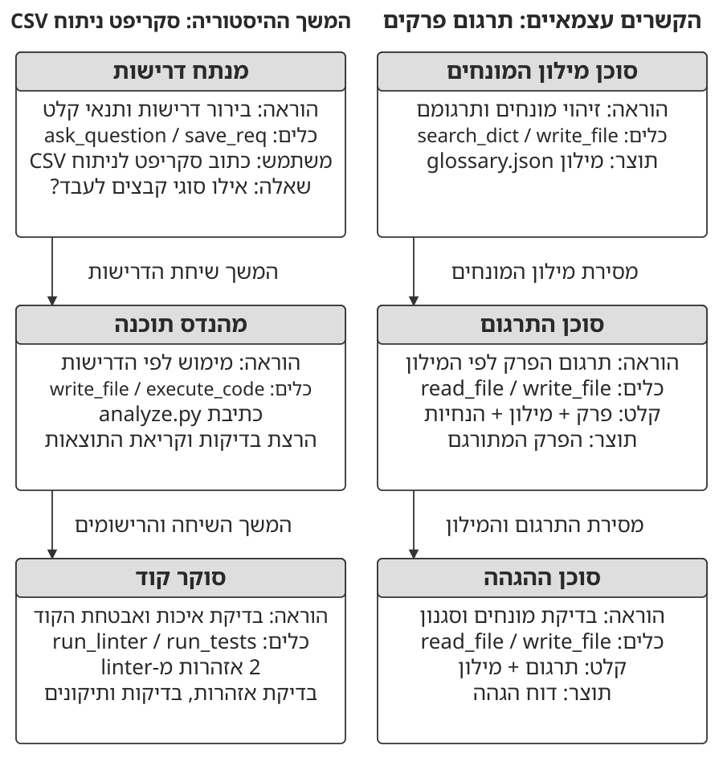

כשההקשרים עצמאיים, כיצד מחליפים החברים חומרים ביניהם? במערכות מבוזרות נהוג לתקשר באמצעות אחסון משותף או העברת הודעות. גם מערכות סוכנים נעזרות בשתי הגישות האלה, ובפועל:

- **פרמטרים של קריאה לכלי.** עוטפים את סוכן המורד ככלי; המעלה מעביר דרך הפרמטרים את המשימה ואת החומרים המובנים, ואז מקבל את התוצאה.
- **מערכת קבצים משותפת.** צד אחד כותב מסמכים, קוד או נתונים, והצד האחר קורא אותם לפי הפניה; מתאים לתוצרי ביניים גדולים ולחומרים שיש לשמור לאורך זמן.
- **אפיק הודעות (Message Bus).** הסוכן מגיש הודעות לשירות מתווך, והשירות מוסר אותן לפי היעד או לפי המנויים; מתאים לתקשורת אסינכרונית בין חברים רבים.

למשל, לאחר ששלח משימת תרגום, המעלה יכול להמתין עד שהתרגום יחזור, או לקבל תחילה מספר משימה ולעבור לטפל בפרק אחר. גם כששני מתרגמים יכולים לפתוח את אותו קובץ, המערכת עדיין צריכה לקבוע מי כותב ומתי הצד האחר קורא. קהילת Go מדגישה שיש לארגן את הגישה לנתונים משותפים באמצעות תקשורת, ורעיון זה חל גם על סוכנים: להגדיר במפורש למי שייך המצב, מי רשאי לשנות אותו וכיצד שאר החברים מקבלים עדכונים.

### ממד 2: טופולוגיית שיתוף הפעולה

טופולוגיית שיתוף הפעולה מתארת את התלויות בין המשימות, את זרימת המידע ואת יחסי הבקרה בין הסוכנים. פרק זה משתמש בשלוש צורות ארגון אופייניות:

- **דפוס שיתוף פעולה בין עמיתים** (Peer Collaboration Pattern). מספר קטן של חברים עובדים שוב ושוב על אותו תוצר. למשל, כותב משלים טיוטת מאמר, מעיר מציע תיקונים, והכותב מתקן.
- **דפוס המנהל** (Orchestration Pattern). סוכן Manager מרכזי מפרק, מחלק ומאחד את המשימות, ותת‑הסוכנים נושאים כל אחד בעבודה המקצועית שלו.
- **דפוס מבוזר** (Decentralized Pattern). החברים ממשיכים את העבודה זה מזה לפי תפקידיהם, ההודעות והמצב המקומי, וכולם יחד קובעים כיצד העבודה תתקדם.

> **מונחון: הנדסת גרפים.** פרק 1 הציג את הדיון ביולי 2026 על הנדסת גרפים (Graph Engineering). נקודת מבט זו מתמקדת בגרף הביצוע: הצמתים יכולים להיות סוכנים, תוכנות רגילות או החלטות אנושיות; הקשתות מבטאות תלויות, ניתוב מותנה ואת כיוון הטיפול לאחר כישלון; והמצב עובר לאורך יחסי הביצוע. טופולוגיית שיתוף הפעולה הרב‑סוכנית היא אחד היישומים של נקודת מבט עיצובית זו, והדגש בה הוא על האופן שבו כמה יחידות החלטה מוסרות עבודה זו לזו, פועלות במקביל ומחזירות משוב.

אפשר לשלב בין שיתוף פעולה בין עמיתים, דפוס המנהל ועיצוב מבוזר. למשל, ה‑Manager מוסר משימת כתיבה לצוות של כותב ובודק, והצוות מגיש את התוצאה לאחר שהשלים את האיטרציות הפנימיות שלו.

## מתי מערכת רב‑סוכנית עדיפה על סוכן יחיד

נניח שהטיוטה הראשונה תרגמה מונח טכני באופן שגוי. אם נותנים לשני עורכים את אותה טיוטה, ייתכן שנקבל פעמיים את אותו אישור; אם אחד מהם מקבל גם את המקור, את מילון המונחים ואת הקוד שבו המונח מופיע, נוספת דרך לגלות את השגיאה. כשבוחרים אופן שיתוף פעולה, יש לשאול תחילה: מה הסוכן הנוסף מביא למשימה? הוא עשוי להשיג ראיות חדשות, לכסות נתיב חיפוש אחר, לספק שיפוט מקצועי שונה, או לקצר את זמן ההמתנה באמצעות ביצוע מקבילי.

תחילה אנו בודקים את **תוספת המידע שבמשוב**, ורק אחר כך את התועלת מהמקביליות ומבידוד ההקשר. בודק שקורא תוצאות בדיקות, צילומי מסך של דף או חומרים חיצוניים יכול להציע תיקונים על סמך ראיות שלא היו זמינות בעת הייצור. טבלה 10-1 מראה, בכמה תרחישים נפוצים, כיצד לבחון תוספת כזו.

טבלה 10-1 מידע ומשוב בשיתוף פעולה רב‑סוכני

| אופן שיתוף הפעולה | מקור המידע העיקרי | מוקד ההערכה |
|---|---|---|
| אותו מודל סוקר מחדש את הפלט שלו | החומרים הקיימים ותהליך בדיקה חדש אחד | האם מתגלות השמטות והאם התיקון משפר את התוצאה |
| כמה סוכנים מתווכחים על אותה בעיה | נתיבי הפתרון, ההנחות והטיעונים של כל אחד | האם יש הבדלי עמדות, וכיצד לאמת ולבחור תשובה |
| בודק מריץ בדיקות וסוקר את הקוד | משוב הידור, בדיקות והרצה | האם התיקון עובר את הבדיקות ושומר על הפונקציונליות הקיימת |
| בודק בוחן את תוצאת העיבוד של Frontend או PPT | צילומי מסך ומשוב אינטראקציה | האם הפריסה, התוכן והפעולות עומדים בדרישות |
| בודק מאמת עובדות בכלים חיצוניים | חיפוש ורישומי מערכות עסקיות | האם המקורות אמינים והאם המסקנה מתיישבת עם הראיות |

‏RLEF מאמנת מודל באמצעות למידת חיזוק לנצל משוב מהרצת קוד, ובמשימות תכנות תחרותי הוא לומד לבצע תיקונים רב‑שלביים. שגיאות הידור, כישלונות בדיקות וחריגות בזמן ריצה מספקים בסיס קונקרטי לתיקון הבא, והמודל שבמאמר משיג תוצאות טובות יותר במספר דגימות קטן יותר.[^rlef-2025] ‏WebGen-Agent מחברת לתהליך הייצור צילומי מסך של הדף, תיאורים והצעות ממודל ראייה והערכה של פעולות GUI; היא יכולה לחזור צעד אחורה ולבצע אותו מחדש, או לבחור את הטובה מבין כמה תוצאות ייצור. ב‑WebGen-Bench עלה הדיוק של Claude 3.5 Sonnet מ‑26.4% ל‑51.9%.[^webgen-agent-2025]

[^rlef-2025]: Gehring, J., et al. *RLEF: Grounding Code LLMs in Execution Feedback with Reinforcement Learning.* arXiv:2410.02089, 2025.
[^webgen-agent-2025]: Lu, Z., et al. *WebGen-Agent: Enhancing Interactive Website Generation with Multi-Level Feedback and Step-Level Reinforcement Learning.* arXiv:2509.22644, 2025.

אנו דואגים תחילה שהמערכת תשיג ראיות קונקרטיות — בדיקות, צילומי מסך או תוצאות כלים — ורק אז מחליטים כיצד לחלק את האחריות לייצור, לביצוע ולבדיקה. סוכן אחד יכול לבצע את לולאת המשוב, ואפשר גם לפצל אותה בין כמה תפקידים; הוספת תפקיד צריכה לשפר את השגת הראיות ואת השימוש בהן.

מחקר האבטחה של Anthropic משנת 2026 מספק מקרה של חיפוש שיתופי: 45 סוכנים החליפו ממצאים דרך פורום משותף, סקרו זה את עבודתו של זה, וסוכן עצמאי הכריע בתוצאות. לפי הדוח, האשכול השיתופי צרך 27 מיליון טוקנים ומצא 266 פגיעויות; תצורה מקבילית של סוכנים עצמאיים צרכה 6.5 מיליון טוקנים ומצאה 21. הפורום אפשר לחברים להמשיך לחקור בעקבות ממצאיהם של אחרים, וגם לדעת באילו כיוונים מישהו כבר עובד. הקבוצה השיתופית צרכה גם פי ארבעה טוקנים בקירוב, ולכן הפער בין 266 ל‑21 משקף גם את אופן התקשורת וגם את ההבדל בהשקעת החישוב.[^anthropic-multiagent-2026]

[^anthropic-multiagent-2026]: Anthropic Frontier Red Team, “Patterns and Problems in Emerging Multiagent Systems,” 2026-08-13.

במחקר מתמטי, כיצד גורמים לכמה צוותים לחקור באמת מסלולים שונים? משוואות Navier–Stokes התלת‑ממדיות מתארות את תנועתו של נוזל צמיג. בהינתן תנאי התחלה חלקים, האם הפתרון נשאר חלק לאורך כל הזמן? ‏OpenAI חילקה שתי מטרות הפוכות בין קבוצות שונות: חלקן ניסו להוכיח חלקות, וחלקן ניסו לבנות דוגמה נגדית. כל קבוצה חקרה תחילה בעצמה, ואז הצוות השתמש ב‑Codex כדי לאסוף את תוצאות הביניים, כך שגם קבוצות אחרות יכלו להמשיך בעקבות קצוות חוט מבטיחים. בקבוצה שמצאה את הדוגמה הנגדית עבדו במקביל כעשרת אלפים סוכנים. לפי דיווח הצוות, מהפעלת הסוכנים הראשונים ועד למציאת ההוכחה חלפו כ‑88 שעות, ועוד 17 שעות הוקדשו לפורמליזציה ולאימות ב‑Lean. לדוגמה הנגדית יש תנאי חשוב: הנוזל נתון לכוח חיצוני חלק, ובכל זאת מופיעה בו סינגולריות בזמן סופי. על סמך זאת הציג הצוות את הדוגמה הנגדית הנדרשת בניסוחים C ו‑D של הבעיה כפי שהגדיר אותה מכון קליי למתמטיקה; אם מסירים את הכוח החיצוני, זו כבר בעיה אחרת. כשמתכננים חיפוש כזה, אפשר לכתוב תחילה במפורש אילו תוצאות מספיקות כדי לענות על השאלה המקורית, למסור השערות מתחרות לקבוצות שונות, ולהקצות זמן נפרד לאימות הסופי.[^ch10-ns-search]

[^ch10-ns-search]: לתיאור המחקר של OpenAI, ‏*On the Navier–Stokes Millennium Prize Problem*, מצורפים ההוכחה וקוד Lean. מכון קליי למתמטיקה התייחס לעבודה בהודעה מ‑11 בספטמבר 2026, והבהיר שהערכת התוצאה וההחלטה על הענקת הפרס ייעשו לפי נוהל הפרס.

**כיצד משפיע תקציב הצעדים על הביצועים?** נניח שמשימה מתירה 30 צעדים: הסוכן צריך לתכנן בצמצום את התכנון, את מימוש הליבה ואת האימות ההכרחי. אם הוא מקבל 300 צעדים, יש לו מקום להשוות יותר חלופות ולבצע בדיקות ותיקונים מקיפים יותר. כדי לנצל משאב זה היטב, הסוכן צריך לדעת גם מהו התקציב הכולל ומה נותר ממנו, ולקבוע לפי זה את עומק החקירה.

‏Google חקרה שאלה זו ב‑2025 במאמר *Budget-Aware Tool-Use Enables Effective Agent Scaling*: סוכן חסר מודעות תקציב עלול להיעצר מהר בחיפוש רדוד, וגם כשמוסיפים לו צעדים, ביצועיו כמעט אינם משתפרים. ‏BAVT‏ (Budget-Aware Value Tree Search) משנת 2026 משלבת בצעדי החיפוש הערכת ערך ואת התקציב הנותר, ומכוונת לפיהם את המשקל בין חקירה לניצול. כשהתקציב מספיק אפשר להשוות כיוונים רבים יותר, וכשמתקרבים לתקרת התקציב מרכזים את המשאבים בענפים המבטיחים.

בדפוס המנהל פירוש הדבר שה‑Manager צריך להקצות צעדים לפי קושי המשימה ולהתאים אותם ככל שהעבודה מתקדמת: משימה פשוטה נמסרת מהר ככל האפשר, למשימה מורכבת שומרים מקום לאימות ולתיקון, וכשנתקלים בחסימה מאתרים תחילה את הסיבה ורק אז מחליטים אם להשלים מידע, להגדיל את התקציב או לעבור לנתיב אחר.

חקירה מקבילית מקצרת את זמן השעון, וסקירה חוזרת משפרת את התוצר, אבל שתיהן מגדילות את מספר הקריאות למודל ואת עלויות התקשורת. אנו לוקחים סוכן יחיד מכוונן היטב כקו בסיס, ומרחיבים את שיתוף הפעולה רק כשהשיפור באיכות או החיסכון בזמן שמביאים החברים החדשים מכסים את עלויות התקשורת, החישוב הכפול והתחזוקה.

## שיתוף פעולה רב‑סוכני עם הקשר משותף

בשיתוף פעולה עם הקשר משותף מחליפים תפקידים לפי שלבים, וממשיכים להשתמש ברישומי המשימה הקיימים. בדוח מחקר, למשל, תפקיד האחזור אוסף תחילה חומרים, תפקיד הניתוח ממשיך בחישובים, ותפקיד הכתיבה מארגן את הניסוח. כל תפקיד יכול לעיין במקורות ובהחלטות הקודמים, והמערכת מכוונת אותו באמצעות הוראות המשימה הנוכחיות להתמקד ביעדי השלב.

במסירה בין צוותים, כדאי לשאול תחילה: מי צריך לדעת מדוע התקבלה ההחלטה בזמנו? בדוגמת המוצר של Teamily AI, מנהל המוצר והסוכן כותבים יחד בקבוצה את מסמך דרישות המוצר (PRD). לאחר שצוות המוצר משתף את הגרסה הסופית עם צוות ההנדסה, המהנדסים יכולים לשאול על השיקולים שמאחורי דרישה מסוימת.

ניקח את מסירת המשימה מתפקיד האחזור לתפקיד הכתיבה: לאחר המסירה, מאיפה קורא המודל את נוהל הכתיבה, ובאילו כלים הוא עדיין יכול להשתמש? ניסוי 10-1 מממש את אותה מסירה בשתי דרכים.

| שאלה שיש לטפל בה במסירה | החלפת תפקיד (`transfer_to_agent`) | טעינת Skill |
|---|---|---|
| כיצד מספקים את נוהל הכתיבה? | מחליפים ל‑Prompt המערכת של תפקיד הכתיבה | משאירים את ספריית ה‑Skills ב‑Prompt המערכת ומוסיפים את נוהל הכתיבה לסוף היסטוריית ההודעות |
| אילו כלים המודל רואה? | אפשר להציג רק את הכלים של תפקיד הכתיבה | אפשר להמשיך להשתמש במערך הכלים הקיים או בנקודת הכניסה לחיפוש כלים |
| איזה חלק של מטמון ה‑KV עדיין שמיש? | ה‑Prompt המערכת השתנה, ובדרך כלל יש לחשב מחדש מנקודת השינוי בקידומת | אפשר להמשיך לעשות שימוש חוזר בקידומת הבקשה הקיימת |
| מי בודק את הרשאות הקריאה? | ה‑Harness מאמת את הבקשה לפי התפקיד הנוכחי ואז מתזמן את הכלי | ה‑Harness בודק באופן עצמאי את ההרשאות של כל קריאה |

כשההבדלים בין התפקידים נוגעים בעיקר לידע, לנהלים ולסגנון הכתיבה, אנו מעדיפים Skill: הוא מאפשר לעשות שימוש חוזר באותה מסגרת ריצה ושומר על המטמון של קידומת בקשה יציבה. כשההבדלים נוגעים להרשאות, לבידוד כלים או לאחריות אישור, אפשר לארגן את העבודה כסוכנים עצמאיים או כהחלפת תפקידים, ולהטיל על ה‑Harness ועל סביבת הביצוע את אכיפת בקרת הגישה. הופעתו של כלי בקלט המודל משפיעה על בחירת הקריאות, אבל ההרשאות בפועל נקבעות באימות בזמן ריצה.

> **ניסוי 10-1 ★★: החלפת תפקידים בהקשר משותף — ‏Prompt מערכת לעומת Skill**
>
> שני המסלולים משתמשים באותו מודל, באותה משימת משתמש, באותו מימוש כלים, באותם נוהלי תפקידים ובאותה היסטוריה משותפת. ההדגמה הבסיסית מבקשת למצוא את מכירות רכבי האנרגיה החדשה בסין בשנים 2021–2023, לחשב את שיעור הצמיחה השנתי המורכב (CAGR), ולכתוב סיכום למשקיעים שאינו עולה על 120 תווים.
>
> **מסלול 1: החלפת Prompt מערכת.** מגדירים חמישה תפקידים: ‏triage (איסוף דרישות), ‏research (אחזור), ‏coding (תכנות), ‏data_analysis (ניתוח) ו‑writing (כתיבה). ‏triage היא נקודת הכניסה, וכל תפקיד רואה את הכלים הייעודיים שלו בתוספת `transfer_to_agent`. במסירה ההיסטוריה נשמרת, ה‑Prompt ומערך הכלים של תפקיד היעד נטענים, והריצה נמשכת.
>
> **מסלול 2: טעינת Skill.** ה‑Prompt המערכת ומערך הכלים המלא נשארים קבועים לאורך ההפעלה. המודל קורא ל‑`load_skill(name)` כדי לקבל את נוהל התפקיד; התוכן נכנס להיסטוריה המשותפת כתוצאת כלי, והקידומת הקיימת נשמרת. ה‑Harness בודק כל קריאה לכלי לפי כללי ההרשאות.
>
> שני המימושים קוראים את אותו `SKILL.md`. לפני מסירת תפקיד אחת ואחריה, שלפו מכל מסלול בקשה אחת שנשלחה למודל, ובדקו באיזו הודעה מופיע הנוהל ואיזה חלק של הקידומת עדיין ניתן לשימוש חוזר. אחר כך בדקו את שני הסיכומים: האם מקורות נתוני המכירות אמינים? מסוף 2021 עד סוף 2023 יש שתי תקופות צמיחה — האם שיעור הצמיחה השנתי המורכב חושב נכון?
>
> בהשוואה המלאה יש משימת תקציר מחמירה יותר, המוגבלת ל‑160 תווים ומחייבת לשמור שתי כתובות מקור. בשתי הקבוצות ניתנו שמונה צעדים; קבוצת החלפת התפקידים בזבזה שלוש קריאות על ספירת תווים, הטיוטה עדיין הכילה 206 תווים, והיא גם לא השתמשה בכלי החישוב שהמשימה ציינה. קבוצת טעינת ה‑Skill חישבה את שיעור הצמיחה מנתוני המכירות של השנה הראשונה והאחרונה, ורק בצעד השמיני טענה את נוהל הכתיבה. בשלב זה כל התפקידים הנדרשים כבר הופעלו, אבל המשתמש עדיין לא קיבל סיכום. שני המסלולים הסתיימו בסופו של דבר משום שהגיעו לתקרת הצעדים.
>
> כל אחד משני המימושים הורץ על אותן 30 משימות, והתוצרים נבדקו באופן תוכניתי: קבוצת טעינת ה‑Skill עברה 15 משימות, וקבוצת החלפת ה‑Prompt המערכת עברה 2. עם זאת, בהשוואה משימה מול משימה, בקבוצה הראשונה היו 6,855 טוקני קלט נוספים שלא נמצאו במטמון, והריצה ארכה כ‑4.4 שניות יותר (שני הערכים הם חציון ההפרשים המזווגים). בהרצה זו דיווח ספק השירות על אפס טוקני קלט ממטמון בשתי הקבוצות. בשש בדיקות הקצה של מילוי הוראות עברו שתי הקבוצות את כולן, ואילו שיעורי ההצלחה במשימות המלאות שונים מאוד.

## שיתוף פעולה רב‑סוכני ללא הקשר משותף

בארכיטקטורה של הקשרים עצמאיים, כל סוכן מתחזק בנפרד את היסטוריית הקלט, את מצב המשימה ואת לולאת הריצה שלו, ומחליף את המידע הדרוש דרך פרמטרים של כלים, קבצים משותפים והודעות. למשל, החומרים שהמתרגם מוסר צריכים לציין את פסקאות המקור ואת גרסת מילון המונחים. גם אם המתרגם יצא מהמערכת, העורך יוכל למצוא את המקור; וכשנדרש תיקון, אפשר למצוא לפי הפרק את האחראי עליו.

טבלה 10-2 משווה בין האופן שבו מערכת הפעלה מנהלת תהליכים לבין האופן שבו זמן הריצה מנהל סוכנים.

טבלה 10-2 אנלוגיה עיצובית בין מערכות רב‑סוכניות למערכות הפעלה

| מערכת הפעלה | האחריות המקבילה במערכת רב‑סוכנית |
|---|---|
| תוכנית ותצורה | ‏Prompt מערכת, הגדרות כלים ותצורת תפקידים |
| זיכרון התהליך | ההקשר הנוכחי, מצב המשימה וההיסטוריה |
| המעבד מבצע חישובים | ה‑LLM מייצר החלטות, וזמן הריצה והכלים מבצעים את הפעולות המתאימות |
| הגרעין מנהל את הריצה | זמן הריצה של הסוכנים מנהל מצב, תזמון ומשאבים |
| קריאת מערכת | בקשת פעולה חיצונית דרך ממשק כלים |
| fork: יצירת תהליך בן | `spawn_subagent`: יצירת תת‑סוכן |
| kill: שליחת אות | `cancel_subagent`: בקשת ביטול |
| ps: רשימת תהליכים | `list_agents`: שאילתה על החברים ועל מצב ריצתם |
| קוד יציאה ו‑wait | הודעת השלמה, מצב משימה ותוצאה מובנית |
| אחסון משותף והעברת הודעות | קבצים משותפים, פרמטרים של כלים והודעות |

מצב פרטי, הודעות אסינכרוניות ויצירה דינמית של חברים מופיעים גם במודל ה‑Actor שהוצע בשנות השבעים.[^actor-model]

[^actor-model]: Hewitt, C., Bishop, P., Steiger, R. *A Universal Modular ACTOR Formalism for Artificial Intelligence.* IJCAI 1973.

כשיש תת‑משימות עצמאיות רבות, אנו נוטים לתת לכל חבר הקשר עצמאי, כך שיטפל רק בחומרים הנוגעים לאחריותו. כך קל יותר לבדוק כל תפקיד בנפרד, ההיסטוריה הארוכה של השלבים הקודמים מפריעה פחות לשיפוט הנוכחי, וכמה משימות יכולות להתקדם במקביל. יעילות הבידוד תלויה גם במשאבים משותפים אחרים: כמה סוכנים עדיין עלולים לשנות את אותו קובץ בו‑זמנית, לצרוך את אותה מכסת API או לקבל את אותה הודעה שגויה.

ממשק שיתוף הפעולה צריך לטפל גם באובדן הודעות, במסירה כפולה ובמצב מיושן. בעת איתור תקלות אפשר להשתמש במזהה משימה כדי לקשר בין הבקשות, אירועי הכלים והתוצאות של כל החברים, ולשחזר את מהלכה של מסירה.

נניח שסוכן סיים ניתוח וצריך למסור את התוצאה לעמית שכותב את הדוח. אם יש רק כמה ערכים, אפשר לשלוח אותם עם ההודעה; אם התוצר הוא טבלה גדולה, בדרך כלל שומרים אותה במערכת הקבצים המשותפת ומצרפים להודעה הפניה. מכאן נובעות שתי חלוקות אחריות. **אחסון התוצרים** שומר ומחליף מסמכים, קוד ונתונים, ו**התקשורת והבקרה** אחראיות למסירת הודעות, לשאילתות על מצב המשימות, לביטול ביצוע ולתזמון משאבים.

### מערכת הקבצים מנקודת מבטו של סוכן

עיצוב נפוץ אחד הוא לספק לסוכן **מערכת קבצים וירטואלית** (virtual filesystem), שבה משאבים ממקורות שונים מעוגנים תחת עץ ספריות אחד. המודל ניגש אליה דרך ממשקים כגון `read_file`, ‏`write_file` ו‑`list_dir`, ובשכבה התחתונה אפשר לחבר דיסק זמני מקומי, אחסון אובייקטים מתמיד, ממשקי API של כונני ענן של צד שלישי או חבילות משאבי מערכת.

אנו מגדירים תחילה את אזורי האחסון, ורק אז מחברים אותם לתהליך שיתוף הפעולה. אם טיוטות זמניות, תוצרים רשמיים וקבצים חיצוניים של המשתמש מעורבבים יחד, קל לדרוס בטעות או לקרוא ללא הרשאה. הממשק האחיד נוח לשימוש, ואילו הנראוּת, מחזור החיים וההרשאות של כל אזור נקבעים בתצורת העיגון ובקרת הגישה. אפשר לחלק את עץ הספריות הזה לארבעה סוגי אזורים.

**א. מרחב עבודה ייעודי לסוכן (Scratchpad).** כל מופע משתמש במרחב עבודה משלו לשמירת טיוטות, קבצים זמניים, יומני ניפוי ותוצרי ביניים. כברירת מחדל הגישה מוגבלת לסוכן הבעלים, והמרחב מנוקה או נשמר בארכיון לפי מדיניות המשימה. כך נמנעת דריסה הדדית של קבצים זמניים; כשתת‑סוכן מסיים את עבודתו, הוא מעביר את התוצאות שיש למסור למרחב המשותף, ומוסר אותן לסוכן הראשי יחד עם סיכום מובנה. רישומי הניסוי והטעייה נשארים במרחב העבודה המקורי לצורך אבחון מאוחר יותר. בכך בידוד ההקשר מתממש גם בשכבת האחסון: הסוכן הראשי מקבל את התוצרים ואת הראיות הנחוצות, ובתיאום השוטף נחסכת ממנו העלות של קריאת כל תהליך הניסוי והטעייה.

**ב. מרחב עבודה משותף רב‑סוכני (Shared Workspace).** כאן מחליפים החברים המשתפים פעולה תוצרים, וגם המשתמש יכול להעלות חומרים ולהוריד תוצרים דרך נקודת כניסה מורשית. למשל, סוכן Glossary כותב את מילון המונחים, סוכן Translation קורא אותו ומתרגם, והבודק סוקר את התרגום. המרחב המשותף נשמר בדרך כלל לאורך כל המשימה, ויש לטפל בו בכתיבות מקביליות, בעדכוני גרסאות ובהיקף הגישה. בפרק 6 החליפו הסוכן והמחשב הווירטואלי קובצי CSV ותרשימים דרך אחסון משותף — זו דוגמה למסירת תוצרים מסוג זה. בהמשך נציג שיטות כגון נעילה אופטימית ובידוד עותקי עבודה.

**ג. משאבים חיצוניים מעוגנים (Mounted External Resources).** משאבים כגון Google Drive, ‏Notion, ‏Dropbox וויקי ארגוני ניתנים למיפוי לממשק האחיד באמצעות מתאמים. כשהסוכן קורא מסמך, המתאם קורא ל‑API של מערכת המקור. כאן יש לנהל שלושה סוגי הבדלים: היקף הגישה תלוי בהרשאה החיצונית; הגישה ברשת מביאה עמה השהיה, פסקי זמן ובעיות עדכון מטמון; ופעולות כתיבה חזרה חייבות לציית לכללי ההרשאות והגרסאות של מערכת המקור. סמנטיקת העקביות המדויקת נקבעת בממשק השירות, ואפשר להיעזר במספרי גרסה, בכתיבה מותנית או בקריאה מחדש כדי לזהות שינויים מקביליים. עיגון לקריאה בלבד לפי דרישה מתאים לאחזור חומרים, וכשנדרשת עריכה מעניקים את הרשאת הכתיבה המתאימה.

**ד. משאבי מערכת מובנים (Built-in System Resources).** מדריכי עזר, תבניות, הגדרות כלים ו‑Skills מותקנים מראש יכולים לשמש כחבילת משאבים לקריאה בלבד עבור כמה סוכנים. ‏Skills נטענים בחשיפה הדרגתית: תחילה מספקים אינדקס, ואז קוראים לפי המשימה את הנהלים ואת הסקריפטים. חבילת משאבים בגרסה קבועה מקלה על קריאה מקבילית, ובשדרוג מחליפים גרסה כך שמשימות שכבר רצות יישארו עקביות.

באיור 10-2, המתרגם יכול לשנות את הטיוטה שוב ושוב בספרייה שלו, וכשהיא מוכנה לעריכה הוא מעביר את הגרסה המתאימה לאזור המשותף. כתב היד המקורי בכונן הענן של המשתמש נקרא באמצעות מתאם חיצוני, והגישה אליו תלויה גם בהרשאות שהמשתמש העניק.

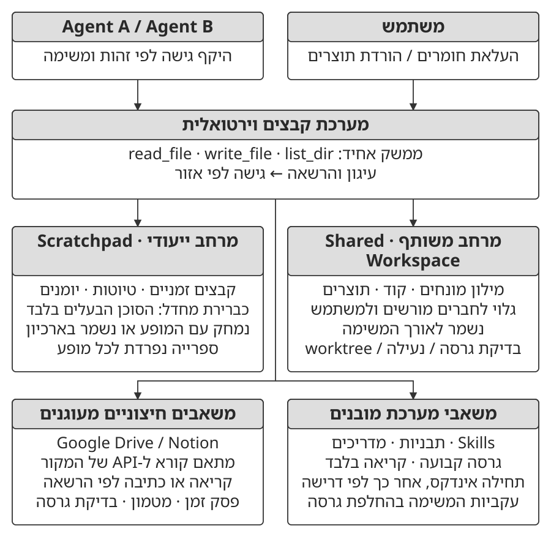

לאחר שהמתרגם יוצא, הקבצים הזמניים במרחב העבודה שלו עשויים להשתחרר יחד איתו. התרגום שהועבר לאזור המשותף יכול להישמר, והעורך ממשיך את העבודה בזכות הרשאת הקריאה שלו (טבלה 10-3).

טבלה 10-3 ארבעת סוגי האזורים במערכת הקבצים הווירטואלית של הסוכן

| אזור | נראוּת | מחזור חיים | קריאה/כתיבה | ניהול מקביליות |
|---|---|---|---|---|
| מרחב עבודה ייעודי לסוכן | כברירת מחדל הסוכן הבעלים בלבד | מנוקה עם המופע, נשמר בארכיון לפי הצורך | הסוכן הבעלים קורא וכותב | מניעת כתיבה כפולה מניסיונות חוזרים או מפעולות רקע |
| מרחב עבודה משותף רב‑סוכני | חברים ומשתמשים מורשים | מתמיד למשך המשימה | הרשאה לפי תפקיד | נעילה, בדיקת גרסה או worktree |
| משאבים חיצוניים מעוגנים | מוגבל יחד בידי ההרשאה החיצונית והמתאם | נקבע בידי מערכת המקור ומדיניות המטמון | קריאה בלבד לפי דרישה או כתיבה מורשית | לפי ממשקי הגרסאות והמקביליות של מערכת המקור |
| משאבי מערכת מובנים | סוכנים מורשים | גרסה קבועה בשימוש חוזר בין הפעלות | קריאה בלבד | החלפה אחידה של גרסת המשאבים |

הפניות לקבצים שומרות על הודעות המסירה קצרות: המעלה מספק את מיקום התוצר, את גרסתו ואת ייעודו, והמורד קורא את התוכן לפי הצורך. חברים הנמצאים באותה סביבת ריצה יכולים להשתמש בנתיבים משותפים; בשיתוף פעולה חוצה‑ארגונים נדרשים מזהי תוצרים, ממשקי גישה והרשאות ששני הצדדים מסוגלים לפענח, כדי להשלים מסירה מאותו סוג.

### תקשורת ובקרה בין סוכנים

כלי היצירה, התקשורת, הביטול והגילוי שהוצגו בפרק 4 מספקים ממשק בקרה בסיסי לשיתוף פעולה רב‑סוכני: ‏`spawn_subagent` יוצר חבר, ‏`send_message_to_subagent` מעביר הודעה, ‏`cancel_subagent` מבקש ביטול ו‑`list_agents` מחזיר את רשימת החברים. סביב ממשקים אלה יש להסכים גם על התנהגות ההודעות, המצב, ההפסקה והתזמון.

**א. העברת הודעות.** כשיש מעט חברים והיחסים ביניהם קבועים, אפשר להשתמש בממשק נקודה‑לנקודה; למשל, סוכן הטלפון וסוכן המחשב מחליפים ביניהם עדכוני התקדמות ישירות. אם כל החברים צריכים לתקשר בזוגות, מספר הקשרים האפשריים גדל ריבועית עם מספר החברים; כשיש מנויים רבים, אפיק הודעות מקל לנהל באופן אחיד ניתוב, אגירה וניסיונות חוזרים. גם נקודה‑לנקודה וגם אפיק יכולים לממש מסירה אסינכרונית; האם המקבל חייב להיות מקוון באותו זמן תלוי במנגנוני התור וההתמדה.

הודעה כוללת בדרך כלל **מעטפה** (envelope) מובנית: מזהה השולח, סוכן היעד או היקף השידור, סוג ההודעה והמטען. סוגי ההודעות יכולים לכלול `task_assigned`, ‏`status_update`, ‏`result` ו‑`terminate`. מזהה המשימה, מזהה ההודעה והבקשה המקושרת עוזרים למקבל לסנן כפילויות, ומאפשרים לכלי ניפוי לשחזר את שרשרת התקשורת. התוכן העסקי נמצא במטען JSON, ושני הצדדים מטפלים בו לפי שדות מוסכמים.

למשל, עורך אחראי למסירת תרגום ורוצה לבקש מסוכן בדיקת המונחים לבדוק מילה אחת. אם מתייגים אותו (`@`) בתגובה על הכרטיס ב‑Multica וכותבים את השאלה, עבודת הבדיקה מופעלת. חוות הדעת של הבודק יכולה להופיע כתגובה ישירות על אותו כרטיס; האחראי נשאר העורך, וגם מצב הכרטיס נשאר כשהיה. אם רוצים שהבודק ייטול את הכרטיס כולו, יש לשנות במפורש את האחראי.[^ch10-multica]

[^ch10-multica]: ‏Multica, תיוג סוכן בתגובה; מימוש הפצת התגובות בגרסה `d579273`.

**ב. קבלת מצב.** הסוכן הראשי צריך לדעת האם תת‑המשימה עדיין רצה, האם היא זקוקה לקלט והאם התוצאה זמינה. אפשר לשלב ממשק מצב, הודעות אירוע וקובצי התקדמות: ממשק זמן הריצה מספק את מצב מחזור החיים, ההודעות מתארות את ההתקדמות העסקית, וקבצים מתמידים שומרים רישום שאפשר להתאושש ממנו.

‏`get_subagent_status(agent_id)` יכול להחזיר מצבים כגון רץ, זקוק לקלט, הושלם או נכשל. בתיאום השוטף אנו מעדיפים הודעות השלמה והודעות התקדמות שלביות, כדי שהסוכן הראשי ימשיך בעבודתו. רק כשיש עיכוב בהודעות, כשחיבור מתחדש או כשצריך לאתר תקלה, הוא שואל באופן יזום — כך לא מבזבזים קריאות למודל על שאלות תכופות של "כבר סיימת?". ממשק המצב מתוחזק בידי זמן הריצה, ויכול לדווח בזמן אם התהליך חי ואם המשימה הסתיימה.

**החלפת התקדמות באמצעות הודעות.** הסוכן הראשי יכול לשאול מה ההתקדמות הנוכחית, ותת‑הסוכן משיב בצעד מתאים; תת‑הסוכן יכול גם לפרסם ביוזמתו `status_update` כשהוא משיג תוצאה שלבית, נתקל בחסימה או זקוק לעזרה. תוכן ההודעה צריך לפרט מה הושלם, מה הצעד הבא ומהי סיבת החסימה, וכל החברים צריכים להשתמש באותה קבוצת שמות מצבים, כדי להקל על איחוד ועל שיפוט. פרוטוקול A2A שיוצג בהמשך מתאר ייצוג מתוקנן של מחזור חיי המשימה.

**שמירת התקדמות בקבצים.** המערכת יכולה להוסיף ליומן, לפי סדר האירועים, הודעות, בקשות לכלים, תוצאות כלים ושינויי מצב — למשל בפורמט JSONL, אירוע אחד בכל שורה. סוכן ראשי בעל הרשאת אבחון, או כלי תפעול, יכולים לבחון על פיו ניסיונות חוזרים, שגיאות ותהליכי המתנה. היסטוריית הקלט של המודל היא רק חלק ממסלול הריצה; היומן יכול לתעד גם אירועי תזמון וביצוע חיצוני.

מסלול מלא עשוי להכיל עשרות אלפי טוקנים, ואחרי כל קריאה הסוכן הראשי צריך לזקק ממנו מחדש את המצב. הודעות מודיעות לסוכן הראשי שיש התקדמות חדשה, וקובץ התקדמות קצר שומר את המצב הנוכחי לשאילתות ולהתאוששות מאוחרות יותר. בתיאום השוטף אנו מעדיפים לשלב את שני אלה. בכל פעם שתת‑הסוכן משלים פריט עבודה, הוא מעדכן את רשימת המשימות, את ההפניות לתוצרים ואת נקודת החסימה הנוכחית; הסוכן הראשי מחליט לפי שדות אלה מה הצעד הבא. המסלול המפורט נשמר לאיתור תקלות לפי הצורך. אם ההתקדמות אינה משתנה זמן רב, אפשר לשלב פעימות לב, את מצב הקריאות לכלים ואת הגדרות פסק הזמן של המשימה כדי להחליט אם נדרשת התערבות: כלי שרץ זמן רב עשוי עדיין לעבוד, ולכן מאמתים את המצב לפני שמחליטים להמתין, לבטל או לנסות שוב.

**ג. הפסקת ביצוע.** כשכמה חברים מחפשים במקביל את אותו יעד ואחד מהם משלים את המשימה, שאר הענפים יכולים לעצור, וכך לשחרר תקציב ומשאבי כלים. לביטול יש שתי עוצמות, הדומות בתפקידן ל‑SIGTERM ול‑SIGKILL ב‑Unix.

אנו מעדיפים **הפסקה מסודרת**: זמן הריצה מעביר בקשת ביטול, תת‑הסוכן מפסיק לבצע פעולות חדשות בנקודה בטוחה, שומר את ההתקדמות הנחוצה, סוגר את הפעלת הדפדפן ומשחרר נעילות, ואז מחזיר אישור (ack). **הפסקה כפויה** משמשת לביצוע שלא הגיב גם לאחר שחלף מועד הביטול: זמן הריצה מסיים את התהליך, ואז בודק משאבים שנותרו וכתיבות שלא הושלמו. לגבי פעולות שכבר נשלחו למערכות חיצוניות, יש לברר גם את תוצאתן, ובמידת הצורך להפעיל תהליך פיצוי.

גם את מחזור החיים יש לנהל לאורך יחסי היצירה. בהשראת ה‑context של Go, אפשר לגרום לאות הביטול של משימת ההורה להתפשט כלפי מטה לכל עץ תת‑המשימות, ולולאת הריצה בודקת את אות הביטול בנקודות בטוחות — בדומה לייעודו של `ctx.Done()`. כך, כשמשימת ההורה מסתיימת, גם הענפים שהיא הפעילה נכנסים לתהליך ניקוי, ונמנע מצב שבו סוכנים ללא השגחה ממשיכים לקרוא לכלים ולצרוך תקציב. משימות רקע שבאמת צריכות לרוץ באופן עצמאי לאורך זמן מקבלות הקשר מחזור חיים עצמאי, בדומה לשימוש ב‑`context.Background()`, ובמקביל מוגדר גורם אחראי לניטור, לתקציב ולניקוי.

**ד. משאבים ותזמון.** מערכת סוכנים צריכה להקצות טוקנים, צעדים, מכסות מקביליות, חיבורי כלים ומשאבי חישוב. בעת הפעלת תת‑משימה מגדירים תקציב ואת ההתנהגות בחריגה ממנו; בוחרים מודל לפי קושי המשימה; ומגבילים קריאות מקביליות כדי לא למצות בבת אחת את מכסת השירות. כשמגיעה משימה דחופה יותר, אפשר להשהות או לבטל בנקודה בטוחה משימה בעדיפות נמוכה, לשמור את התקדמותה ולתזמן אותה מחדש.

נניח ששלושה ענפים בודקים כל אחד חלופה אפשרית אחרת, ואחד מהם כבר מצא קצה חוט מכריע וחסר לו רק אימות אחרון. ה‑Manager יכול לתת לו עוד כמה צעדים, ובמקביל לסיים את שני הענפים שאינם מתקדמים. המכסה מנוכה בידי זמן הריצה; גם אם ענף כלשהו עדיין רוצה לנסות שוב, כשהתקציב אוזל עליו לעצור.

### דפוס שיתוף פעולה בין עמיתים: בדיקה הדדית ושיפור איטרטיבי

שיתוף פעולה בין עמיתים כולל בדרך כלל שניים או שלושה סוכנים המחליפים דעות על אותה משימה ומתקנים יחד את התוצר. בעת העיצוב אפשר להקצות לחברים אחריות, חומרים וכלים שונים, לתת להם לשפוט באופן עצמאי, ורק אז לאחד את התוצאות. למשל, המייצר מתמקד במימוש והסוקר בבדיקות ובדרישות המשתמש; חברים בעלי התמחויות שונות בודקים כל אחד את האילוצים של תחומו. ככל שהמודלים, הקלטים ותהליכי העבודה דומים יותר, כך גדל הסיכוי שהחברים יחזרו על אותו שיפוט, ולכן יש לתכנן במכוון שוני בנקודות המבט ובראיות.[^anthropic-multiagent-2026]

למשימות שבהן משפרים שוב ושוב את אותו תוצר, אנו ממליצים להתחיל בשיתוף פעולה בין עמיתים של שניים או שלושה חברים. כשהתפקידים, תוכן המסירה ותנאי העצירה מוגדרים בבירור, אפשר לבנות לולאה ניתנת לבדיקה, ועבודת התיאום בשלב הראשון קטנה יחסית.

#### הנדסת לולאה

שיתוף פעולה בין עמיתים יכול לסייע בבעיה נפוצה: **סיום מוקדם**. בדוגמאות של תכנות ושל עוזר המטפל בפניות לשירות לקוחות בשם המשתמש, אפשר לזהות סיום מוקדם בשלוש צורות.

- **הכרזה על השלמה מלאה לאחר השלמה חלקית.** סוכן Coding כותב את הקוד אך מדלג על הבדיקות ועל בדיקות הפריסה; משתמש מבקש מעוזר לטפל בשני עניינים, והעוזר מסיים את הראשון ומדווח שהכול טופל. יש לעבור על רשימת המשימות פריט אחר פריט ולבדוק לכל עבודה את הראיות להשלמתה.
- **ויתור מוקדם לאחר כישלון של נתיב אחד.** סוחר עשוי לבקש שהחומרים יוגשו בטופס, או לקבל קבצים מצורפים רק בכתובת דוא"ל מסוימת. כשמתקבלת תשובה כזו, אפשר להמשיך את הטיפול בדרך שהסוחר מקבל. יש לתעד את סיבת הכישלון ולשקול אילו נתיבים נוספים כדאי לנסות.
- **השמטת צעדי המשך לאחר הצלחה חלקית.** אם הסוחר הסכים להחזר כספי אך דורש שהמשתמש יאשר זאת באפליקציה, על העוזר למסור למשתמש את הצעד הזה ואת תנאי ביצועו. בדוגמה של הפחתת חשבון: אם נציג השירות הבטיח זאת בעל פה בשיחה, העוזר יכול לאשר למשתמש שהמשא ומתן הניב התחייבות. תיעוד השיחה מוכיח מה אמר הנציג, אך כדי לדעת אם החשבונות הבאים אכן יכבדו את ההתחייבות נדרשות ראיות חדשות. על הסוקר לציין בנפרד את התוצאות שכבר הושגו, מי עוד צריך לעשות מה, ואילו תוצאות עדיין אינן נראות.

שלוש הבעיות מחייבות לעגן את תנאי ההשלמה בתוצאות ניתנות לבדיקה. **הנדסת לולאה** (‏Loop Engineering) עוסקת בשאלה כיצד לגרום לסוכן לעבור שוב ושוב את המחזור "קביעת פריט העבודה הבא — ביצוע — אימות — תיעוד התקדמות", ולהחליט לפי התוצאה אם להמשיך, להמתין, למסור או לסיים. על המהנדס לתכנן את מקור המשימות, את דרך האימות, את המצב המתמיד ואת תנאי העצירה. גם עבודתו של האדם מתרחבת בהתאם: מכתיבת Prompt לקריאה בודדת לתכנון לולאה המסוגלת לקדם משימה ברציפות. אדי אוסמאני השתמש בשם זה ביוני 2026 כדי לדון במערך הפרקטיקות הזה, וציטט את ניסיונו של בוריס צ'רני: מרכז הכובד של העבודה עובר בהדרגה לתכנון לולאות המניעות את הסוכן.[^loop-engineering-2026]

**בלולאות מסוג זה, לדעתנו המאמת הוא לרוב צוואר הבקבוק המרכזי.** כשהאימות אינו אמין, הוספת סבבים עלולה לגרום למערכת לחזור על אותן שגיאות או להכריז על השלמה מוקדם מדי. תוצאות בדיקות, מצב עסקי ואישור המשתמש מספקים כל אחד בסיס להשלמה בתחומו; אימות שנכשל הופך לקלט של סבב התיקון הבא.

הפרקטיקה קדמה לשם. עוד לפני שהמונח "הנדסת לולאה" נעשה נפוץ, השתמשנו אנו וצוותנו ב‑Pine AI בלולאות ובאימות כדי להתמודד עם סיום מוקדם. מציע‑סוקר היא דרך נפוצה לארגן לולאות כאלה, ונרחיב עליה בהמשך.

[^loop-engineering-2026]: Osmani, Addy. “Loop Engineering”, 2026.

**LoopX: שמירת מצב העבודה בין סבבים.** ‏LoopX מחזיקה את המטרה, הגבולות, המשימות הפתוחות, השערים, הראיות והמכסה במישור בקרה מתמיד, ומישור זה מתזמן את עבודת הסבב הבא או המבצע הבא. אפשר לסכם את התהליך כך: **החלטת מישור הבקרה ← ביצוע בידי הסוכן ← אימות עצמאי ← רישום התקדמות מאומתת**.

הסוכן קורא לכלים, מסיק ומגיש את תוצרי הסבב. מישור הבקרה מתעד את העבודה שכבר הושלמה ומחליט מאיפה ימשיך הסבב הבא. אימות מוצלח מוביל לרישום מצב ההשלמה; כשהאימות נכשל, העבודה עוברת לתיקון או לתכנון מחדש. שערים אנושיים, תנאי המתנה ותקרות תקציב קובעים יחד מתי מותר להמשיך בביצוע.[^loopx-framework]

[^loopx-framework]: LoopX, The local control plane for long-running AI agent work, v0.4.0.

**LongHorizon-Harness: רציפות במשימות ארוכות החוצות יישומים.** מסגרת זו יוצאת מ‑Computer Use רב‑מודאלי ומטפלת בביצוע רציף של משימה על פני GUI, ‏CLI, כמה יישומי שולחן עבודה וריענוני הקשר חוזרים. היא פועלת בלולאת Manage–Execute–Audit‏ (MEA): ה‑Manager מייצר תת‑משימה תחומה אחת על סמך המטרה המקורית, ההתקדמות המאומתת, ראיות הכישלון והעבודה הנותרת; ה‑Executor מבצע פעולות GUI או CLI בהקשר חדש; ה‑Auditor בודק את התוצאה בקריאה בלבד וכותב את ההתקדמות המאומתת למצב של הסבב הבא. גם ראיות הכישלון נשמרות, לשימוש בהתאוששות ובתכנון מחדש.

המסגרת קוראת לשרתי ביצוע כגון Claude Code ו‑Codex CLI דרך שכבת מתאם, ומחברת בין ניהול המשימה בלולאה החיצונית לבין לולאת הריצה של השרת. כיוון זה מעגן את רציפותה של משימה ארוכה במצב משימה מאומת. הקשר הביצוע יכול להתרענן, והסבב הבא עדיין ממשיך לעבוד על סמך המטרה, ראיות ההשלמה והעניינים הפתוחים, ובודק מחדש אם שינויים בסביבה פוגעים במסקנות קודמות.[^longhorizon-implementation]

בהשוואה שבה נשמרו קבועים Qwen 3.7-Plus ושרת הביצוע Claude Code ורק הלולאה החיצונית שונתה, המאמר מדווח על עלייה ב‑PassRate של WeaveBench מ‑51.8% ל‑80.7%, בשיעור ההשלמה הבינארי של OSWorld 2.0 מ‑2.8% ל‑8.3%, ובשיעור ההצלחה של Terminal-Bench 2.1 מ‑69.7% ל‑77.2%. גם העלות משתנה לפי המשימה: שני מדדי הביצועים הראשונים צרכו פי 2.3 מסך הטוקנים של קו הבסיס ופי 3.6 מטוקני הפלט שלו, בהתאמה; ב‑Terminal-Bench 2.1 ירדה צריכת הטוקנים ב‑24%.

באותה משימת ביקורת של זרמים רב‑שכבתיים ב‑WebRTC, המבצע של קו הבסיס נתקע בממשק של Wireshark, ניסה עוד כמה פעמים וקיבל לבסוף ציון 0.59. עם MEA, המבקר רשם את הראיות החסרות, המבצע בסבב הבא השלים את הבדיקה בהתאם, והציון הסופי היה 0.92.

[^longhorizon-implementation]: LongHorizon-Harness, מספר המאמר arXiv:2608.01964. המסלולים הציבוריים של קו הבסיס ושל MEA לקוחים שניהם מהמשימה WEB_task_16_webrtc_simulcast_layer_audit, וסקריפטי השחזור משתמשים ב‑commit `53bc678`.

#### פרדיגמת מציע‑סוקר

מציע‑סוקר מפקידה את ייצור התוצר ואת בדיקת התוצאה בידי שני תפקידים. ניסויי ייצור ה‑PPT, עריכת הווידאו והדמיית היומנים בפרק 5 משתמשים בעיצוב זה: ה‑Proposer מייצר קוד, וה‑Reviewer בוחן את התוצאה המעובדת, בודק את האיכות בעזרת מודל ראייה ומחזיר הערות תיקון מובנות. באיור 10-3 הערות התיקון חוזרות אל המציע. אם יצליח לתקן על פיהן את הגרסה הבאה תלוי בדיוק שבו הסוקר מאתר את הבעיה.

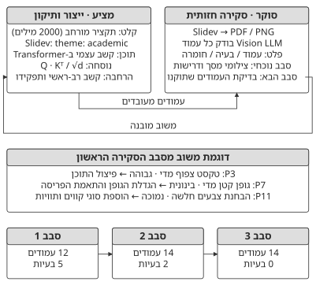

כשמושא הבדיקה משתנה, משתנות גם הראיות שיש לבחון. בסקירת תשובה של שירות לקוחות משווים מול כללים עסקיים ומקורות עובדתיים; בסקירת שינוי קוד בוחנים את הבדיקות ואת תוצאות ההרצה בפועל; בסקירת תוכנית פעולה מאמתים את התקנים החלים ואת התנאים המוקדמים.

במאמרם ב‑ICLR 2024, "‏Large Language Models Cannot Self-Correct Reasoning Yet", מצאו הואנג ואחרים שבמשימות ההיסק ובהגדרות ה‑Prompt שנחקרו, כש‑GPT-4 תיקן את עצמו ללא משוב חיצוני, הוא שינה לעיתים תשובות נכונות לשגויות, והדיוק הכולל ירד. סקירת התיקון העצמי שפורסמה ב‑TACL דנה בהרחבה כיצד תנאי המשימה ואמינות המשוב משפיעים על תוצאות התיקון.[^self-correction-survey] לכן אנו קובעים ראיות עצמאיות ותנאי תיקון ברי‑איתור כדרישות היסוד של לולאת הסקירה. על הסוקר להיות מסוגל לקרוא בדיקות בפועל, מצב סביבה או תוצאות עיבוד, ולציין איזו דרישה טרם התקיימה וכיצד לאמת את התיקון.

[^self-correction-survey]: Kamoi, R., et al. *When Can LLMs Actually Correct Their Own Mistakes? A Critical Survey of Self-Correction of LLMs.* TACL, 2024.

אפשר לארגן לולאה שלמה בחמישה צעדים:

1. המציע כותב גרסה ראשונה לפי דרישות המשימה, למשל תשובה או קטע קוד.
2. מריצים או מעבדים את התוצר ומקבלים תוצאות בדיקות, מצב עסקי, צילומי מסך או תוצאות של אימות עובדות.
3. הסוקר משווה מול הדרישות והראיות, ונותן מסקנת מעבר או מצביע על מיקום הבעיה ועל תנאי התיקון.
4. כל עוד נותר תקציב, המציע מתקן לפי המשוב, ושוב מריצים וסוקרים; בעיה הדורשת קלט או הרשאה מעבירה את המשימה להמתנה או למסירה.
5. כשמתקיימים תנאי השחרור, מוסרים את הגרסה שעברה סקירה יחד עם ראיות האימות ומסקנת הסקירה; כשהתקציב אוזל, שומרים את ההתקדמות ואת הבעיות הפתוחות.

הסוקר קורא את הבדיקות ואת תקני השחרור המוגנים; שינויים בתקנים שהוא מציע נבחנים בנפרד.

בניסויי CRITIC המודל נותן תחילה תשובה ואז בודק אותה בעזרת כלים.[^ch10-critic] למשל, הוא מאמת עובדות שבתשובה באמצעות מנוע חיפוש, ומריץ במפרש Python תוכניות מתמטיות שכתב בעצמו. בשלושה סוגי משימות — שאלות ותשובות פתוחות, ייצור תוכניות מתמטיות והפחתת ניסוחים מזיקים — ביצועי המודל השתפרו כשתיקן לפי משוב הכלים. כשהמודל הסתמך רק על הערכה עצמית של תשובתו המקורית, אפקט התיקון היה חלש יותר. עיצוב זה מתיישב עם מקרה ה‑PPT מפרק 5: צילום מסך מעובד חושף בעיות פריסה והסתרה שקשה לזהות ישירות מטקסט הקוד, והרצת בדיקות חושפת שגיאות ריצה בפועל.

[^ch10-critic]: CRITIC, ‏arXiv:2305.11738.

מקרה פיתוח היישומים ארוכי‑הטווח של Anthropic משנת 2026 משתמש בשלושה סוכנים: מתכנן, מייצר ומעריך. המתכנן פורש את הדרישות למפרט מוצר; המייצר והמעריך מסכימים תחילה על אמות המידה להשלמה בכל סבב, ואז האחד מממש והשני בודק. המעריך מפעיל את היישום באמצעות Playwright ומגיש דוחות באגים, והתפקידים מעבירים מצב זה לזה דרך קבצים. המקרה מראה כיצד מתחברים מפרט מוצר, הפעלה אמיתית ומשוב על באגים, וגם מזכיר שיש להכניס את עלויות הביצוע והסקירה הנוספות להשוואה בין החלופות.[^anthropic-harness-2026]

[^anthropic-harness-2026]: Prithvi Rajasekaran, “Harness Design for Long-Running Application Development,” Anthropic Engineering, 2026-03-24.

ב‑20 בנובמבר 2026 פרסם המתמטיקאי לבנט אלפוגה הוכחה פורמלית שהשיג בשיתוף עם Claude, הנוגעת להשערת רימן ולהכללתה לפונקציות $L$ של דיריכלה. כשמקבלים ערימה גדולה של קובצי Lean, על הסוקר לשאול תחילה שתי שאלות: האם המשפט האחרון מנסח את ההשערה המקורית? והאם גרעין ההוכחה יכול לבדוק מחדש כל צעד גזירה? המתמטיקאי אנדרו סאתרלנד מ‑MIT השווה תחילה את המשפט שהוגש להגדרת השערת רימן בספריית המתמטיקה של Lean, ואחר כך מנה את האקסיומות שההוכחה נשענת עליהן. ברשומה שפרסם באותו יום דיווח גם שגרעין ההוכחה העצמאי nanoda בדק את ההוכחה המיוצאת ואישר אותה. מכאן שיטה קונקרטית לחלוקת עבודת הסקירה: מי שמכיר את הבעיה כותב תחילה את טענת הקבלה, ואז כלי עצמאי בודק אם התוצר שהוגש אכן גוזר את הטענה הזו. אם מתמטיקאים ירצו בעתיד להבין כיצד הגיע המחבר לדרך הזו, יידרש גם טיעון שנוח לאדם לקרוא.[^ch10-rh-review]

[^ch10-rh-review]: לבנט אלפוגה (Levent Alpöge) פרסם הערת מחקר ב‑20 בנובמבר 2026. לפרויקט האימות ולהתקדמותו באותו יום ראו את "‏Verification files for the Lean proof of the Riemann Hypothesis" של Andrew Sutherland.

#### דפוס הוויכוח

דפוס הוויכוח מאפשר לחברים לבחון את אותה בעיה מעמדות שונות. למשל, בהערכת פתרון טכני, סוכן אחד מציג את התועלות ואת תרחישי התחולה, וסוכן אחר בודק אילוצים, תנאי כישלון וחלופות. בכל סבב הם מוסיפים ראיות לטענות קונקרטיות או מפריכים אותן, ולבסוף מסכמים את הנקודות שהושגה עליהן הסכמה ואת המחלוקות שעדיין דורשות אימות.

הסדר כזה עוזר לפרוש בבהירות את הטיעונים בעד ונגד, אך תועלתו תלויה באיכות הטיעונים, בעצמאות השיפוט ובשיטת הבחירה הסופית. טראן וקיילה השוו במשימות היסק רב‑קפיצות חמש ארכיטקטורות — סדרתית, ויכוח, אנסמבל, תפקידים מקביליים ותת‑משימות מקביליות; כשתקציב טוקני החשיבה הוחזק קבוע, הסוכן היחיד תפקד באותה מידה או טוב יותר מהמערכות הרב‑סוכניות.[^single-agent-2026] לכן אנו משתמשים בוויכוח בעיקר כדי לפרוש מחלוקות, לבחון הנחות ולהשלים טיעוני נגד. כשהמטרה היא דיוק עובדתי או חישובי, עדיף להוסיף ראיות ניתנות לאימות ובדיקות עצמאיות.

המאמר נעזר באי‑שוויון עיבוד הנתונים כדי לדון במגבלות של העברת מידע ביניים: שכתוב ודחיסה חוזרים עלולים לאבד פרטים מהמקור. בפועל אפשר לשמור מקורות ניתנים למעקב, לתת לחברים לנתח תחילה באופן עצמאי ורק אחר כך להחליף מסקנות, וכך לצמצם הסכמה שלא נבדקה. דגימות עצמאיות מרובות ולאחריהן צבירה, וכן ניצול המאפיין "ייצור קשה, אימות קל" כדי להקצות סקירה ייעודית, יכולים גם הם לשמש לצד הוויכוח.

[^single-agent-2026]: Tran, D., Kiela, D. *Single-Agent LLMs Outperform Multi-Agent Systems on Multi-Hop Reasoning Under Equal Thinking Token Budgets.* arXiv:2604.02460, 2026.

#### דפוס סיעור המוחות

סיעור מוחות אפשר לקיים בשני סבבים: תחילה כל חבר חושב על רעיונות לבדו, ואחר כך כולם דנים יחד באילו רעיונות אפשר לשלב. למשל, סוכן 1 מציע להוסיף אפשרות שיתוף ברשתות חברתיות; סוכן 2 מוסיף על כך ייצור אוטומטי של פוסטר שיתוף מותאם אישית; סוכן 3 מרחיק לכת ומציע תבניות שהמשתמש מעצב בעצמו ושוק תבניות.

כדי שהחברים יגיעו לרעיונות שונים, אפשר לבקש מהם לצאת מנקודת המבט של המשתמש ומזו של המפעיל, ואפשר גם לתת להם Prompts או מודלים שונים. לאחר החלפת הרעיונות, מסננים את ההצעות לפי צורכי המשתמש, עלות המימוש ותוצאות האימות.

#### דפוס פאנל המומחים

פאנל מומחים מחלק אחריות מקצועית סביב בעיה בין‑תחומית. למשל, בהערכת מוצר חדש סוכן המהנדס מנתח את קושי המימוש ואת התלויות הטכניות, סוכן המוצר בוחן את צורכי המשתמש ואת החוויה, וסוכן התפעול מעריך עלויות, משאבים ותנאים להוצאה לפועל.

בצ'אט הקבוצתי של LobeHub, המנחה יכול לשדר את אותה הצעת מוצר לשלושת המומחים. המערכת שולפת תחילה את רישום הצ'אט הקבוצתי ברגע זה, ואז כל אחד משלושת החברים עונה במקביל לפי הגדרות התפקיד שלו. שלוש התשובות נתלות מתחת להודעה שפתחה את השידור, כך שקל לבדוק בדיעבד לאיזו שאלה ענה כל אחד. אם התפעול צריך לחשב עלות לפי היקף השימוש שהמהנדס הרגע העריך, יש להמתין עד שתשובות הסבב הזה ייכתבו חזרה, ורק אז לבקש מהתפעול לדבר: כששניהם מתחילים לכתוב באותו זמן, המספר הזה עדיין אינו בידי התפעול.[^ch10-lobehub]

[^ch10-lobehub]: ‏LobeHub, הוראות השימוש בצ'אט הקבוצתי; מימוש השידור המקבילי בגרסה `ab21e0d`.

בשלב הסיכום יש למצוא את הקשרים בין השיפוטים השונים: איזו תמיכה טכנית דורש יעד חוויה מסוים, כמה עלות תפעולית מוסיפה בחירה טכנית, ואילו תנאים עדיין זקוקים לראיות חיצוניות.

### דפוס המנהל: תיאום מרכזי

כשמשימה כוללת תת‑משימות רבות, תלויות מורכבות או תזמון דינמי, אפשר להפקיד את התכנון בידי Manager Agent. הוא מבין תחילה את המטרה הכוללת, אחר כך מפרק את העבודה, בוחר חברים ועוקב אחר ההתקדמות; כשמתעוררת תקלה הוא מחליט אם לנסות שוב, להחליף מבצע או לשנות את התוכנית, ולבסוף הוא משלב את התוצאות.

מימוש נפוץ הוא לרשום סוכנים ייעודיים ככלים. ה‑Manager מעביר דרך ממשק הכלי את המשימה, את האילוצים ואת החומרים הנחוצים, ומקבל בחזרה תוצאה מובנית או מזהה משימה. כך חיפוש, פעולות קבצים והאצלת תת‑משימות יכולים להשתמש בצורת קריאה דומה; לתת‑משימות ארוכות מנהלים בנפרד התקדמות, ביטול וניסיונות חוזרים. חברים שונים יכולים להשתמש במודלים, ב‑Prompts, בכלים ובסביבות ריצה שונים. כשמוסיפים חבר, לא די לרשום את הממשק שלו: ה‑Manager צריך גם להבין את תחום אחריותו, את דרישות הקלט שלו ואת המצבים שבהם כדאי להשתמש בו.

כשעבדתי על משימות ארוכות ב‑Claude Code וב‑Codex, החזקתי בעבר את הדיון, הרצת הפקודות והבדיקות כולם בשיחה הראשית. כשרציתי באמצע לשאול על החלטת תכנון, נאלצתי לעיתים קרובות לחכות שהצעד הנוכחי יסתיים; וכעבור כמה שעות, כדי למצוא את מה שסוכם בהתחלה, הייתי צריך לדפדף בשורה ארוכה של פלטי פקודות. לאחר מכן העברתי את השינויים והבדיקות לתת‑סוכן, והשארתי את השיחה הראשית לדיון. בהגהת כתב היד של הספר, למשל, המבצע יכול להמשיך לבדוק מספרי איורים, ובאותו זמן אני דן עם קוראים אם לשכתב פסקה מסוימת. אם הדיון משנה את היקף המשימה, יש לשלוח למבצע את ההסכמה החדשה ולבדוק מולה כשהוא מגיש את העבודה.

צוות DeepSeek Harness פרסם אב טיפוס מחקרי בשם `dsh-superagent` המיועד למאגר GitHub יחיד. ניקח כדוגמה תיקון של תבנית התאריך בקובצי ייצוא: המתחזק מעלה את הדרישה ב‑Issue, והנתב (‏Router) קובע לפי כללי המאגר אם לקבל את העבודה. לאחר הקבלה, המערכת פותחת כרטיס עבודה (‏Ticket) ומקצה למבצע (‏Worker) שיחה ותיקיית עבודה משלו. המבצע יכול לשנות קוד ולהריץ בדיקות בתיקייה שלו; כרטיס אחר יכול להתקדם במקביל, וכל אחד שומר את תהליך השינוי ואת תוצאות הבדיקות שלו.[^ch10-dsh-prototype]

נניח שהמתחזק מוסיף לאחר מכן ב‑Issue המקורי: "שנו רק את CSV, ושמרו על תבנית התאריך של JSON". כרטיס העבודה הפעיל שמנוי על הדיון הזה מקבל את ההודעה המשלימה, והמבצע יכול לצמצם בהתאם את היקף השינוי ולבדוק את שתי התבניות בנפרד. בסיום הוא יכול לפתוח בקשת משיכה (‏PR) ולפרסם את הקישור ואת התוצאות ב‑Issue המקורי. המתחזק רואה במקום אחד את הדרישה המקורית, את המגבלה שנוספה ואת השינוי הממתין לסקירה; והנתב אינו צריך לפרק מחדש כל הודעת המשך למשימה.

[^ch10-dsh-prototype]: צוות DeepSeek Harness, אב הטיפוס המחקרי dsh-superagent. על האופן שבו כרטיס עבודה מקבל הודעות המשך ראו "הרשאה ומינוי"; על שיחות הביצוע ותיקיות העבודה ראו "מנגנון הביצוע".

ה‑Manager נושא גם באחריות רבה להחלטות. פירוק שגוי של המשימה פוגע בכל הביצוע שאחריו, חומרי מסירה חסרים גורמים לשאלות חוזרות, ותיעוד קריאות עודף תופס מקום בהקשר. בעיצוב יש לשמור מצב משימה תמציתי ואינדקס של תוצרים, לקרוא פרטים לפי הצורך, ולתת לכל תת‑משימה קלט, פלט וקריטריון השלמה ברורים.

‏Plan-and-Act בחן בארכיטקטורת Planner–Executor את השפעת איכות התכנון על משימות ארוכות, ודיווח על שיעור הצלחה של 57.58% ב‑WebArena-Lite.[^plan-and-act-2025] טעות בתכנון גורמת לכמה מבצעים להמשיך לעבוד על פירוק שגוי, והוספת חברים רק מגדילה את העבודה החוזרת. לכן אני בודק קודם כול את איכות פירוק המשימות של ה‑Manager; כשצוואר הבקבוק הוא התכנון, אני מקצה ל‑Manager את המודל החזק יותר, מידע מלא יותר על המשימה ותקציב היסק נדיב יותר. רק לאחר שגבולות תת‑המשימות ברורים אני בוחר תצורה מתאימה למבצעים.

[^plan-and-act-2025]: Erdogan, L. E., et al. *Plan-and-Act: Improving Planning of Agents for Long-Horizon Tasks.* arXiv:2503.09572, 2025.

משימות מקביליות דורשות גם הגדרה ברורה של אופן הסגירה. אם המטרה היא למצוא תוצאה אחת שעומדת בתנאים, אפשר לרשום, לאחר שהאימות עבר, את התוצאה המאומתת הראשונה בפעולה אטומית, לבטל את שאר הענפים, להמתין לאישור הביטול או לפסק זמן, ולבסוף לסכם ולמסור. פעולת הרישום צריכה להיות גם אטומית וגם אידמפוטנטית: כששתי תוצאות מגיעות בו‑זמנית, מתרחש מעבר מצב אחד בלבד; כשאותו אירוע נמסר פעמיים, משתמשים בתוצאת הטיפול הקיימת. מנעול, טרנזקציה או השוואה‑והחלפה (compare-and-swap) יכולים כולם להגן על הצעד הזה.

אפשר להדגים מסירה קונקרטית בעזרת SQLite המובנה ב‑Python. נניח ששני חברים, א ו‑ב, בודקים חומרים במקביל, והתוצאות שכל אחד מהם הגיש כבר עברו אימות. ה‑Manager צריך רק תוצאה תקינה אחת, ובשורה אחת ברשומת המשימה הוא רושם מי הגיש ראשון. בדוגמה שלהלן א מגיש ראשון, ב מגיש אחריו, ו‑א מנסה שוב.

```python
import sqlite3

db = sqlite3.connect(":memory:")
db.execute("CREATE TABLE task (id INTEGER PRIMARY KEY, winner TEXT)")
db.execute("INSERT INTO task VALUES (1, NULL)")
for worker in ["א", "ב", "א"]:
    with db:
        claimed = db.execute(
            "UPDATE task SET winner = ? WHERE id = ? AND winner IS NULL",
            (worker, 1),
        ).rowcount
    print(worker, "נרשם בהצלחה" if claimed else "נעשה שימוש בתוצאה שכבר נרשמה")
```

הפלט, לפי הסדר: "א נרשם בהצלחה", "ב נעשה שימוש בתוצאה שכבר נרשמה", "א נעשה שימוש בתוצאה שכבר נרשמה". אילו ב היה מגיע ראשון, בטבלה היה נרשם ב. פקודת עדכון אחת בודקת "שאיש עוד לא נרשם" וכותבת את שם המגיש באותו צעד; אם מפרידים בין הבדיקה לכתיבה, שני המבצעים עלולים לקרוא שניהם ערך ריק.

בדוגמה הטבלה נבנית בזיכרון, ולכן כשהתהליך יוצא, גם הרישום נעלם. במסד נתונים מתמיד מתעוררת בעיית מסירה נוספת: ה‑Manager כבר רשם את א, אבל יצא לפני שהספיק להודיע לב. לאחר ההפעלה מחדש, מי יודע שההודעה הזו עוד לא נשלחה? אפשר לכתוב באותה טרנזקציה את התוצאה שנבחרה ואת ההודעות הממתינות לשליחה. כל הודעה מתעדת את הענף הנמען, את הפעולה הנדרשת ומזהה ייחודי. לאחר הפעלה מחדש, ה‑Manager שולח שוב את ההודעות שטרם אושרו. גם אם ב כבר סיים לנקות ורק הודעת האישור שלו אבדה, הוא יזהה את ההודעה החוזרת לפי המזהה המקורי ויחזיר ישירות את תוצאת הטיפול הקודמת. גם את אירוע המסירה אפשר לתעד באותה דרך.

אם המשימה דורשת לאסוף את כל התוצאות, יש להמתין עד שכל הענפים הנחוצים יסתיימו, ולתעד בנפרד הצלחות, כישלונות ופריטים שלא הושלמו. תנאי הסגירה נגזר ממטרת המשימה, והוא גם קובע מתי אפשר לבטל את שאר החברים.

**תיאום סדרתי.** כשלתת‑משימות יש תלות של סדר, ה‑Manager צריך להמתין עד שתוצר הצעד הקודם זמין, ורק אז להקצות את הצעד הבא. איור 10-4 מדגים זאת בכתיבת דוח: החבר שאוסף חומרים מחזיר תחילה מקורות, האנליסט מגבש על פיהם מסקנות, והכותב מקבל לבסוף ניתוח מבוסס. ואם המשימה הבאה היא תרגום — לאיזה חומר צריך המתרגם לחכות לפני שהוא מתחיל?

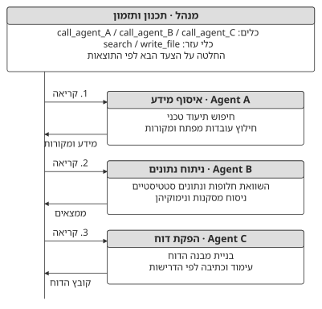

> **ניסוי 10-2 ★★: סוכן לתרגום ספרים**
>
> תרגום ספר טכני מחייב לטפל בו‑זמנית במונחים, בהקשר ובסגנון. למשל, למילה האנגלית agent יש כמה תרגומים אפשריים; אם בתרגום נקבע מונח מסוים, הפרקים הבאים חייבים להמשיך בו. מילון המונחים, טקסט המקור של הפרקים, התרגום ורשומות ההגהה זקוקים לארגון ברור. ספר ארוך, יחד עם טיוטות ביניים, תוצאות כלים והיסטוריית הגהה, ממלא את ההקשר בהתמדה; עד פרק 9 המודל עלול לשכוח איך תרגם מונח בפרק 2, או לבדוק שוב ושוב את אותה פסקה. פיצול המשימה לפי תחומי אחריות ולפי פרקים מאפשר לכל מופע להתרכז בחומרים שתפקידו הנוכחי דורש.
>
> אפשר לחלק את העבודה בין ארבעה סוגי סוכנים:
>
> - **Glossary Agent: איסוף מונחים.** קורא את הספר כולו במנות, מזהה מונחים מקצועיים חוזרים, נעזר במילונים מקצועיים ובהנחיות תרגום, ומפיק טבלת התאמה ב‑JSON או ב‑CSV הכוללת את המונח האנגלי, את התרגום, את חלק הדיבר ואת הקשר השימוש. המילון נשמר במרחב המשותף, ובסיום המשימה המופע משוחרר.
> - **Translation Agent: תרגום פרקים.** קורא את הפרק הנוכחי, את המונחים הרלוונטיים ואת הנחיות התרגום, ומתרגם לפי קהל היעד והסגנון הלשוני. למונחים חדשים הוא מציע תרגום מועמד ומסמן אותו לסקירה. כל מופע מחזיק הקשר עצמאי, והתרגום נשמר במרחב המשותף; פרקים שונים אפשר לעבד ברצף או במקביל, לפי התלויות.
> - **Proofreading Agent: הגהת הטקסט כולו.** בודק על סמך מילון המונחים ותרגומי הפרקים את בחירות התרגום, את העקביות בין הפרקים ואת הקריאוּת. הבדיקה של הטקסט כולו נעשית בקריאה לפי פרקים ובאינדקס חוצה‑פרקים, ומיקום כל בעיה, הנימוק לה ודרישת התיקון נכתבים לדוח הגהה.
> - **Manager Agent: תזמון וקבלת משימות.** מתחזק את המטרה, את התוכנית, את מצב המשימות, את סיכומי הקריאות ואת אינדקס התוצרים; לפי דוח ההגהה הוא מחזיר למתרגם פרקים שדורשים תיקון, ואחר כך מארגן בדיקה חוזרת.
>
> באיור 10-5 המגיה קורא את תרגומי הפרקים ואת מילון המונחים, וה‑Manager מחליט לפי הדוח אילו פרקים צריכים תיקון. מתרגם שמקבל משימת תיקון יכול לשלוף את טקסט המקור של הפרק ולבדוק מה משמעות המילה המסומנת במשפט שבו היא מופיעה.
>
> 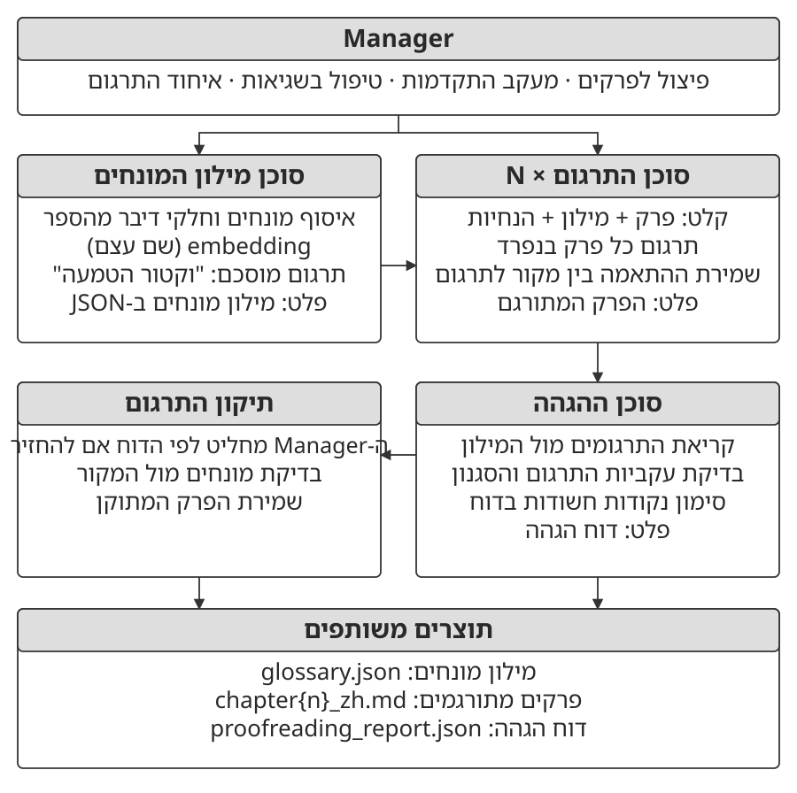
>
> כשהתרגום נכתב לקבצים, איזו קריאה עוד צריכה לקרוא טקסט ארוך? הניסוי הנלווה פיצל את שני הפרקים הראשונים של המהדורה האנגלית ל‑26 יחידות תרגום. הסוכן היחיד גרר איתו לאורך כל הדרך את טקסט המקור והתרגום הקודמים, ובבקשה הגדולה ביותר שלו נכנסו 94,355 טוקנים. לאחר חלוקת העבודה, הקלט הגדול ביותר של המתרגם היה 2,857 טוקנים בלבד, וה‑Manager השתמש ב‑2,153 טוקנים בהחלטת התיקון. בקבוצת המנהל, מי שקיבל את הקלט הגדול ביותר היה דווקא אוסף המונחים: הוא קרא שני פרקים בבת אחת והשתמש ב‑49,807 טוקנים.
>
> לתרגום שני הפרקים הללו השתמשו ארבעת התפקידים יחד ב‑203,277 טוקנים, והסוכן היחיד ב‑1,317,808. איזו קבוצה הגישה ראשונה? קבוצת ארבעת התפקידים נזקקה לכ‑271 שניות, כ‑17 שניות יותר מהסוכן היחיד.
>
> בשלב ההגשה, שתי בדיקות נתנו תוצאות שונות לאותו תרגום. מילון המונחים קבע לשם העצם `embedding` את התרגום "嵌入向量" (וקטור הטבעה). דוח ההגהה לא מנה אף פרק שדורש תיקון, אך תוכנית בדיקת המונחים נתנה למילה הזו 0/2: בשני הפרקים נמצא "嵌入" (הטבעה), ובאף אחד מהם לא נמצא "嵌入向量". האם להחזיר את שני הפרקים?
>
> בפסקה של פרק 1 שעוסקת במדיניות החזרים, טקסט המקור הוא `embedding the refund policy in the context`, והתרגום הוא "将退款政策嵌入上下文中" (להטמיע את מדיניות ההחזרים בהקשר). כאן הכוונה היא להכניס את המדיניות להקשר, ושינוי ל"嵌入向量" דווקא יכניס טעות. תוכנית שמחפשת מחרוזות לפי פרקים עוזרת למגיה למצוא נקודות לבדיקה חוזרת; כדי להחליט איזה מופע צריך לתקן, המגיה צריך גם את פסקת המקור. כשמילון המונחים מתעדכן, אפשר לאתר תחילה את הפסקאות המושפעות, ואז למסור למתרגם את המקור, את התרגום ואת הערך החדש יחד.
>
> **דרישות הניסוי:**
> 1. בחרו ספר טכני הכולל איורים, טבלאות וקוד.
> 2. ממשו ארבעה סוגי סוכנים: Manager, ‏Glossary, ‏Translation ו‑Proofreading.
> 3. תעדו את ניצול ההקשר של כל חבר, את חומרי המסירה ואת גרסאות התוצרים.
> 4. השוו לפתרון של סוכן יחיד במונחי איכות התרגום, זמן ההשלמה וצריכת המשאבים, ונתחו את השפעת פיצול המשימה וארגון ההקשר.

**תיאום מקבילי.** אפשר להריץ במקביל תת‑משימות שאינן תלויות זו בזו. המנהל (Manager) מקצה משימות, מקבל עדכוני סטטוס ומחליט לפי התוצאות אם להמשיך, להוסיף עבודה או לסיים. בתרגום הספר הזה, ברגע שמילון המונחים מאושר, אפשר לחלק את הפרקים בין כמה מתרגמים שיתחילו לעבוד במקביל. איור 10-6 עובר לדוגמה של דוח מחקר: התרשימים כבר מוכנים והניתוח עדיין נמשך, אז מדוע בדיקת הפורמט צריכה לחכות? מתוך האירועים שחברי הצוות מדווחים אפשר לראות באילו שני תוצרים תלוי הצעד האחרון.

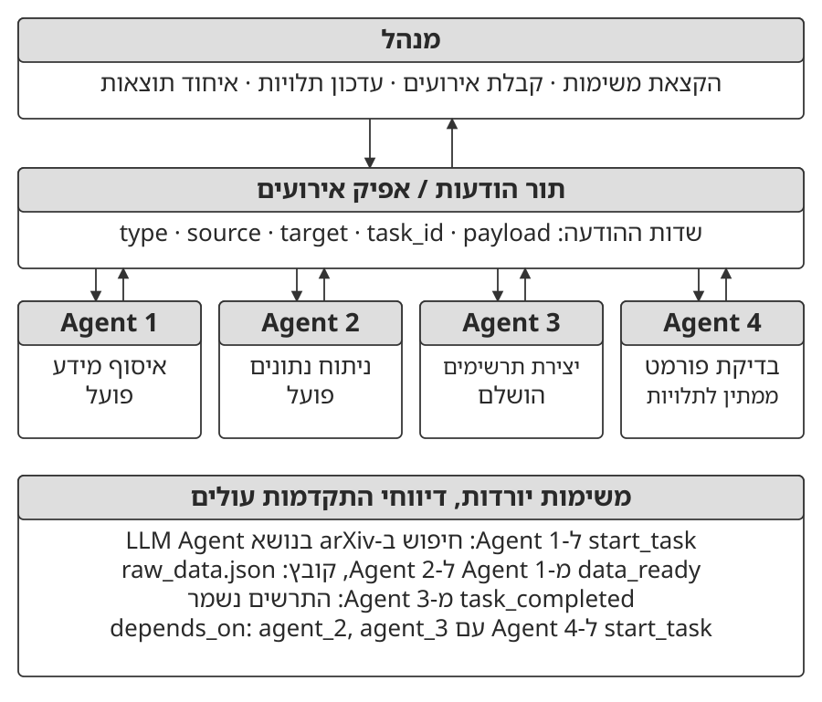

אפיק הודעות מתאים לארגון תקשורת אסינכרונית מסוג זה: חברי הצוות מפרסמים התקדמות ותוצאות, המנהל נרשם לאירועים הרלוונטיים, וזמן הריצה אחראי למסירה, לאגירה ולניסיונות חוזרים.

> **מקרה מוצר: ‏Lingtai (灵台)**
>
> ‏Lingtai היא מערכת סוכנים ארוכת טווח שרצה מקומית ושומרת זהות וזיכרון בקבצים. יש בה שלושה תפקידים: **הסוכן הראשי** (main agent) משוחח עם המשתמש ומנהל את התוכנית ואת הזיכרון; **דמון** (daemon) מבצע משימות מקביליות קצרות ותחומות היטב ומחזיר מסקנה בסיומן; **אווטאר** (avatar) שומר זיכרון, תיבת דואר ואחריות משלו, ומשמש לחלוקת עבודה מקצועית שנמשכת על פני מפגשים.
>
> לכל תפקיד יש ידע פרטי מתמיד, וכל התפקידים חולקים ספרי מיומנויות בפורמט Markdown. כשההקשר מתקרב לתקרת הקיבולת, התפקיד "משיל את עורו" (molt): הוא שומר סיכום, ואז נכנס להקשר חדש יחד עם הזיכרון המתמיד. הזהות, הזיכרון והמיומנויות נשמרים בקבצים נפרדים, ולכן העבודה נמשכת גם לאחר החלפת המודל התחתון. העיצוב הזה משלב מנהל, עובדים קצרי טווח, חברי צוות מתמחים ארוכי טווח ודחיסת הקשר.

> **ניסוי 10-3 ★★★: סוכני טלפון ומחשב בתזמור עצמאי**
>
> ניסוי זה משלב את ה‑Computer Use ואת האינטראקציה הקולית מפרק 6. המשתמש מספק דף הרשמה או הזמנת טיסה; ה‑Computer Agent פותח את האתר ומזהה את הטופס, ובאמצעות ה‑Phone Agent אוסף את השדות שעדיין חסרים, כגון שם, מספר תעודה, פרטי קשר, כתובת והעדפות.
>
> **תפקידים ומסירה.** ה‑Computer Agent מפעיל את הדפדפן ואחראי לתזמור במשימה זו; ה‑Phone Agent משוחח עם המשתמש בזמן אמת באמצעות ASR, ‏LLM ו‑TTS, וממיר תשובות בעל פה לשדות מובנים. השניים מתקשרים באמצעות כלים נקודה‑לנקודה או אפיק הודעות, וכל הודעה כוללת שולח, מקבל, סוג ותוכן. ה‑Computer Agent יכול להאציל ישירות את משימת השיחה ולמלא בכך את תפקיד המנהל. כשהמשתמש מוכן למסור מידע בקול, ה‑Phone Agent יכול לשאול ברצף, לאשר ולשאול שוב, וה‑Computer Agent מתמקד במצב הדף ובמילוי השדות.
>
> **שני מצבי הרצה.** במצב הקבוע שני הסוכנים מופעלים מראש, וכל אחד מתחזק לולאת הרצה עצמאית; המצב משמש לבדיקת התקשורת הדו‑כיוונית וההתנהגות המקבילית. במצב העצמאי מופעל תחילה רק ה‑Computer Agent, והמודל מחליט לפי הדף, המידע הקיים וצורכי המשימה אם לקרוא ל‑`initiate_phone_call_agent(purpose, required_info)`. לאחר מכן זמן הריצה מוסר ל‑Phone Agent את מטרת המשימה, את השדות שיש לאסוף ואת אילוצי הפורמט, והוא פועל מרגע הפעלתו באותו מנגנון תקשורת.
>
> **מעבר שדה אחר שדה.** באיור 10-7 ה‑Phone Agent שואל דרך WebRTC, מחלץ ומאמת את התשובה, ולאחר שקיבל ערך תקין שולח `info_collected` ועובר לשאלה הבאה. במקביל, ה‑Computer Agent קורא את הדף, ממלא את השדה הקודם ומחזיר `fill_error` או מצב דף חדש. משוב על פורמט שגוי מסומן ב‑`format_invalid`, יחד עם השדה והדרישה, וה‑Phone Agent מאשר או שואל שוב בהתאם. כך "לשאול את השדה הבא" ו"למלא את הקודם" מתבצעים בחפיפה.
>
> **סיום וטיפול בחריגות.** לאחר שאסף את כל השדות, ה‑Phone Agent שולח `task_completed`, לסימון סיום תת‑המשימה של איסוף המידע. ה‑Computer Agent ממשיך לבדוק את שדות החובה, את תוצאות האימות של הדף ואת ההרשאה לשליחה, ורק אז משלים את הטופס. כשמספר הניסיונות החוזרים חורג מהמותר, כשהדף מתנהג באופן חריג או כשהמשתמש מבקש לעצור, המשימה מושהית ומדווחת ההתקדמות הנוכחית; בסיום מבטלים את הצד השני אם עדיין רץ, וסוגרים את הפעלת הדפדפן, את ערוץ האודיו ואת השיחה. שיחה קולית עם אדם אמיתי ושליחת הטופס מחייבות כל אחת הסכמה והרשאה של המשתמש.
>
> 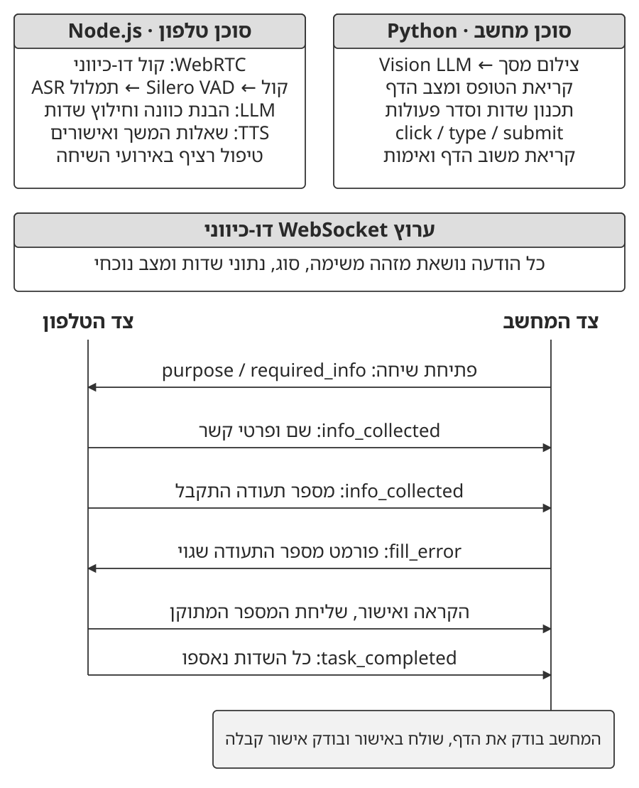
>
> **דרישות הניסוי:**
> 1. ממשו שני סוכנים עצמאיים עם תקשורת מובנית דו‑כיוונית.
> 2. תעדו את התזמונים במצב הקבוע ובמצב העצמאי, ובדקו את מקטעי החפיפה בין השאילה למילוי.
> 3. ממשו אימות פורמט, שאילה חוזרת, משוב על שגיאות בדף, פסקי זמן וניקוי משאבים.
> 4. השוו בין שני המצבים מבחינת החלטת ההפעלה, השהיה, שיעור הצלחה וצריכת משאבים.

> **ניסוי 10-4 ★★★: סוכן האוסף מידע ממספר אתרים בו‑זמנית**
>
> בניסוי זה כמה סוכנים הומוגניים מחפשים במקביל, כתרגול של המנגנונים מונחי האירועים ומנגנוני הפסיקה מפרק 6. המשימה היא למצוא איש סגל מסוים באתרי כמה פקולטות של אוניברסיטה אחת, למשל "ג'אנג ווי", ולהחזיר את הפקולטה, התפקיד, תחום המחקר ודף המקור. לפני החיפוש מסכמים על תנאי זיהוי, כגון שם, תחום ופרטים מהדף האישי, כדי להבחין בין אנשים בעלי אותו שם.
>
> **1. הפעלה מקבילית.** המנהל יוצר 10 סוכני Computer Use, כל אחד אחראי לאתר של פקולטה אחת. כל מופע מתחזק הקשר והפעלת דפדפן עצמאיים, ואפשר לתזמן אותם כמשימות אסינכרוניות, כתהליכונים או כתהליכים. הקלט כולל את כתובת האתר, את השם המבוקש, את תנאי ההתאמה ואת מזהה המשימה לצורך ניתוב.
>
> **2. ריכוז ההתקדמות.** חברי הצוות שולחים מדי פעם עדכוני סטטוס כגון "טוען אתר", "קורא את רשימת הסגל", "נבדק, אין התאמה" ו"נמצא איש סגל בעל אותו שם". המנהל מתחזק טבלת משימות דרך אפיק ההודעות, רושם בנפרד משימות רצות, שהושלמו, חסומות ושנכשלו, ושומר את המקורות ואת סיבות השגיאה.
>
> **3. אימות ואז ביטול שאר הענפים.** נניח ש‑`agent_3`, האחראי לפקולטה לפיזיקה, מצא איש סגל בעל אותו שם; הוא שולח `target_found`, ובמטען פרטי איש הסגל והמקור. אם המשימה דורשת להחזיר פרופיל מאומת, המנהל בודק תחילה את תנאי ההתאמה ואת הראיות, ורק לאחר שווידא שזהו האדם המבוקש הוא רושם את התוצאה בפעולה אטומית ושולח `terminate` לשאר חברי הצוות שעדיין רצים, עם ציון שהפרופיל שאומץ הגיע מ‑`agent_3`. חברי הצוות עוצרים בנקודה בטוחה, מנקים משאבים ומחזירים אישור; המנהל ממתין לאישורים או לפסק הזמן ואז משלים את הסיכום. אם המשימה דורשת לפרט את כל בעלי השם, החיפוש נמשך עד שכל התחום הנדרש נבדק.
>
> **תנאי מרוץ.** סוכנים A ו‑B עשויים להחזיר תוצאה תקפה כמעט בו‑זמנית. אם כל אחד מהאירועים מפעיל סיכום משלו, נוצרים מסירה כפולה או מצבים סותרים. אפשר להגן במנעול או בטרנזקציה על המעבר "בחיפוש ← תוצאה נרשמה", כך שאירוע שמגיע מאוחר יותר יקרא את התוצאה שכבר נרשמה. גם ניסיונות חוזרים של הודעות צריכים לעבור הסרת כפילויות לפי מזהה האירוע, כדי שהמצב יישאר עקבי גם כשביטול וסיכום מופעלים יותר מפעם אחת.
>
> **4. חריגות וכיסוי.** ניתוק רשת, שינוי במבנה הדף ושגיאות ניתוח נרשמים כל אחד בנפרד. אפשר לקבוע לכל משימה תקציב זמן, למשל שתי דקות; בחריגה ממנו מבטלים את ההרצה ואוספים מידע אבחוני, ושאר חברי הצוות ממשיכים לעבוד. הדוח הסופי מבחין בין "נבדק ולא נמצא" לבין "הגישה נכשלה, הבדיקה לא הושלמה", ומציין אילו פקולטות כוסו.
>
> איור 10-8 מחבר את ההודעות האלה על ציר זמן להמחשה. נניח שחבר צוות 3 מדווח שבפקולטה לפיזיקה יש פרופסור בשם ג'אנג ווי שחוקר מחשוב קוונטי. המנהל צריך לבדוק תחילה אם דף המקור מאשש את השם, את המחלקה, את התפקיד ואת תחום המחקר. קבלת רמז על איש סגל בעל אותו שם, אישור שזהו האדם המבוקש, וקבלת כל אישורי הביטול הם שלושה רגעים שונים.
>
> 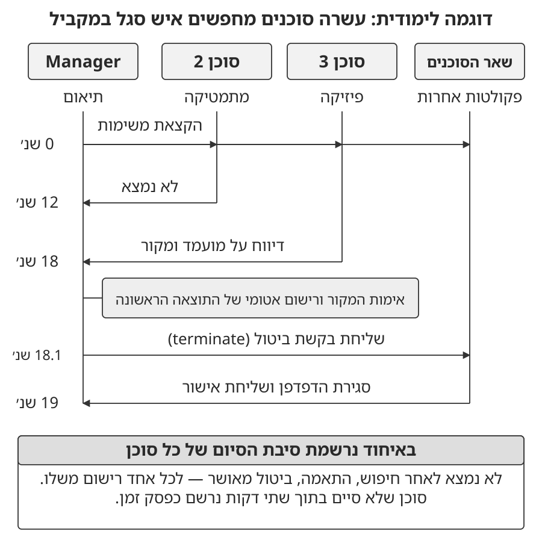
>
> בהרצה האמיתית חיפשנו את Andrew Ng. כל חבר צוות בודק תחילה אם השם מופיע בטקסט של הדף, ורק כשיש התאמה מבקש מהמודל לחלץ את הפרטים. נבחר הדף של Stanford HAI, והציטוט הקצר שהוחזר מאפשר לאמת את השם ואת התפקיד כפרופסור נלווה. כדי לאמת את תחום המחקר צריך לקרוא גם את הפסקה בהמשך הדף שעוסקת בלמידה עמוקה. גם אם כמה חברי צוות שולחים `target_found` בו‑זמנית, רק מי שתופס ראשון את המנעול רושם את התוצאה.
>
> בהרצה זו החיפוש הסדרתי מצא התאמה רק בכתובת האחרונה מתוך העשר, ונמשך 44.971 שניות; חיפוש מקבילי באותם דפים נמשך 24.022 שניות, ובשני המקרים נסגרו כל עשרת הקשרי הדפדפן. היחס בין שני המספרים הוא 1.872. אילו דף HAI היה ראשון ברשימה, החיפוש הסדרתי היה נעצר מיד עם ההתאמה, והיה צריך למדוד את הזמנים מחדש. בהרצה נפרדת שנועדה לבדוק ביטול הופעלו ארבעה ענפים: אחד רשם תוצאה ראשון, שלושת האחרים אישרו שקיבלו את בקשת הביטול, ובסוף נסגרו כל ארבעת הקשרי הדפדפן.
>
> **דרישות הניסוי:**
> 1. ממשו מנהל שיוצר באופן דינמי חברי צוות מקביליים.
> 2. בנו יכולת הרצה בדפדפן בעזרת פרויקטים כגון browser-use.
> 3. ממשו תקשורת דו‑כיוונית ותחזוקת מצב דרך אפיק הודעות.
> 4. אמתו את תוצאת החיפוש, רשמו אותה בפעולה אטומית, ואספו אישורים לאחר ביטול שאר הענפים.
> 5. טפלו בכישלונות גישה, בשגיאות ניתוח, בפסקי זמן ובמצב שבו אין התאמה.
> 6. השוו בין הרצה מקבילית לסדרתית מבחינת זמן השלמה, כיסוי וצריכת משאבים.

**תהליך עבודה שהמנהל מייצר.** מלבד האצלה צעד אחר צעד, המנהל יכול לכתוב תחילה את התלויות בין המשימות ואת כללי הסיכום כתוכנית, ולמסור אותה לזמן הריצה לתזמון. המודל מעצב את התהליך, והתוכנית מפעילה את חברי הצוות לפי ההסכם, מעבירה תוצאות וממתינה לתלויות. כשהתלויות ברורות ותהליך דומה צריך לרוץ שוב ושוב, אני מעדיף גישה זו. היא חוסכת את עלות הקריאה למנהל בכל הקצאה, ומצמצמת את רשומות התזמון שמצטברות בהקשר הניהולי.

כלי ה‑Workflow הדינמי של Claude Code הוא מימוש כזה. ‏`agent()` יוצר תת‑סוכן בעל הקשר עצמאי, ואפשר להגדיר באמצעות schema פלט מובנה; ‏`parallel()` מריץ קבוצת משימות במקביל וממתין לסיום כולן; ‏`pipeline()` מעביר כל קלט בנפרד דרך כמה שלבים, וכשפריט אחד עובר לשלב הבא, פריטים אחרים יכולים להמשיך בשלב הקודם. תוצאות הביניים נשמרות במשתני התוכנית, והסינון והמיזוג נעשים בקוד רגיל.[^dynamic-workflows]

למשל, כדי לאמת שבע קבוצות של עובדות בכתב יד טכני, אפשר להפעיל תחילה סוכני מחקר לפי כיוונים, ואז למסור כל קבוצת מסקנות לסוכן אימות שבודק אותה במקביל. כל מסקנה שחוזרת שומרת את המקור ואת נימוק ההכרעה; לאחר שכל הענפים מסתיימים, סוכן סיכום מארגן את הדוח הסופי. כך חלוקת העבודה "מחקר — אימות פריט אחר פריט — סיכום אחד" והתלויות בין השלבים נכתבות כולן לתוך תהליך העבודה.

[^dynamic-workflows]: Anthropic, “Orchestrate subagents at scale with dynamic workflows”, 2026.
### הדפוס המבוזר

אם יש מנהל, למה לתת לחברי הצוות להחליט בעצמם למי לפנות? נניח שבודק מקבל מודול שנכתב זה עתה, ומגלה שדרישות המוצר ומוסכמת הממשק מפרשות את אותו שדה בשתי דרכים. הבודק יכול להעביר את הסתירה ישירות לשני התפקידים, המוצר והארכיטקטורה, לבקש מכל צד להציג את נימוקיו, ולהמשיך לבדוק אחרי שהמוסכמה תתוקן. זו חלוקת עבודה, וגם סוג של איזון. המהנדס מוסר מודול, הארכיטקט מבקש את דעת המוצר, הבודק מעלה התנגדות — כל אחד מהם יכול ליזום את הצעד הבא. כשנדרש משא ומתן תכוף, המתנה למנהל שיעביר כל עניין בנפרד מעכבת את העבודה.

בלשון המיקרו‑שירותים, כשמרכז אחד קובע את הצעדים זה **תזמור** (orchestration), וכשכל צד ממשיך בעצמו לפי אירועים מוסכמים זו **כוריאוגרפיה** (choreography). יש גם הבדל מעשי: אם כל מסירה צריכה לחכות למנהל, ושירות המודל שלו מפסיק להגיב, שאר חברי הצוות אינם מקבלים את המשימה הבאה גם אם הם עדיין מסוגלים לעבוד. תיאום מבוזר מצמצם את התלות הזו; אבל אם חבר הצוות שאמור לקבל את העבודה נתקע בעצמו בקריאה לכלי, עדיין נדרשים מצב משימה שנשמר באופן מתמיד, פסקי זמן, ניסיונות חוזרים ומנגנון השתלטות, כדי שחבר צוות אחר יידע מאיפה להמשיך.

שלושת העיצובים שלהלן מציגים כל אחד דרך מסירה אחרת: מנוי להודעות לפי תוצר, בחירת הדובר הבא בצ'אט קבוצתי, או העברה שהחבר הנוכחי מכוון לחבר מסוים.

**MetaGPT: ‏SOP כבסיס למסירת תוצרים.** ‏MetaGPT מחלקת את העבודה לפי נוהלי ההפעלה התקניים (SOP) של צוות תוכנה. מנהל המוצר מוסר מסמך דרישות (PRD), הארכיטקט מוסר מסמך תכן, המהנדס מוסר קוד, והבודק מוסר דוח בדיקות. החבר הבא יכול להתחיל לעבוד ברגע שקיבל את החומר המוסכם, והחבר הקודם חוסך את הצורך להסביר את המשימה שוב ושוב. הקווים באיור 10-9 מייצגים את יחסי המסירה בין התוצרים האלה.[^metagpt-design]

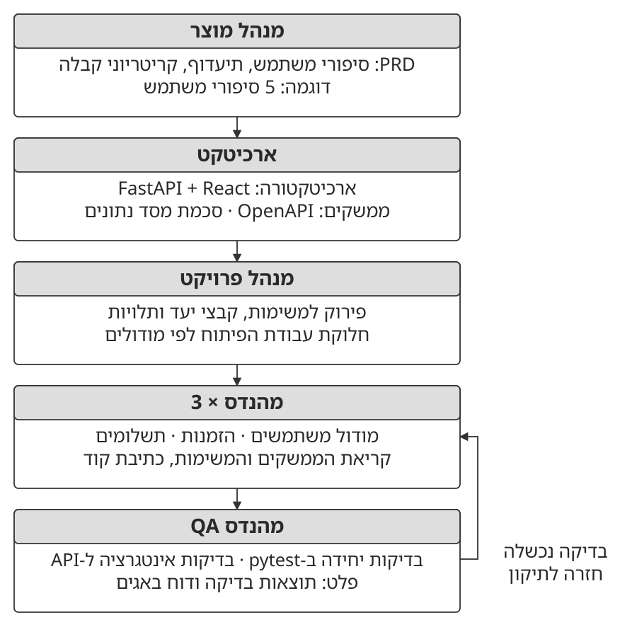

איזה מידע צריך כל תפקיד להשלים במסירה?

- **Product Manager Agent** מקבל את הדרישות, מנסח PRD, ומגדיר תכונות, סיפורי משתמש, קריטריוני קבלה ותיעדוף.
- **Architect Agent** קורא את ה‑PRD, בוחר ערימת טכנולוגיות, מחלק למודולים, מגדיר ממשקים ומודל נתונים, ומפיק מסמך תכן.
- **Project Manager Agent** מפרק את התכן למשימות ולחלוקה ברמת קבצים, מסדר את התלויות ומקצה את הביצוע למהנדסים.
- **Engineer Agents** מממשים מודולים לפי התכן ומגישים קוד; חלקים בלתי תלויים אפשר למסור לכמה מופעים.
- **QA Engineer Agent** מייצר בדיקות לפי הקוד והדרישות, מריץ אותן, מתעד בעיות ומפיק דוח בדיקות.

אם מעצבים פורמט מסירה לתפקידים האלה, אני ממליץ לכתוב בו במפורש שלושה דברים: המשימה וקריטריוני הקבלה, העובדות והאילוצים שכבר אושרו, והפניות לתוצרים מובנים. על סמך אלה המקבל משיג את החומר הדרוש, ממשיך לעבוד, ושואל שאלות ממוקדות כשחסר לו מידע.

‏MetaGPT מארגנת את המידע באמצעות מאגר הודעות משותף ומנגנון מנויים: תפקיד מפרסם הודעה, ותפקידים אחרים מטפלים בקלט הרלוונטי לפי סוגי ההודעות שהם עוקבים אחריהם. המפרסם והצרכן מחוברים דרך פורמט התוצר ומשמעות ההודעה, ולכן אפשר להחליף את המודל של כל אחד מהם או לשנות את המימוש הפנימי שלו בנפרד.

ה‑SOP מתאר את התלויות בין דרישות המוצר, הארכיטקטורה והקוד, והמנוי להודעות מתאר כיצד העבודה הזו מופעלת. גם תלויות משימה קבועות יכולות להתקדם בעזרת אירועים מבוזרים, ויחד שניהם מרכיבים את אופן שיתוף הפעולה של המערכת. בעיצוב משוב דינמי אפשר להוסיף נתיבים כמו בודק שמבקש מתפקיד המוצר להבהיר דרישה, או מהנדס שמציע לארכיטקט חלופה, ולהגדיר לאינטראקציות האלה תנאי קבלה וכללי סיום.

[^metagpt-design]: Hong, S., et al. *MetaGPT: Meta Programming for A Multi-Agent Collaborative Framework.* ICLR 2024.

**צ'אט קבוצתי ב‑AutoGen: תזמון דוברים בשיחה משותפת.** בעיצוב ה‑GroupChat הקלאסי כמה סוכנים משתתפים באותה שיחה, ו‑GroupChatManager בוחר את הדובר הבא ומשדר את ההודעות לכל המשתתפים. אסטרטגיית הבחירה יכולה להיות תורנות, או שיפוט של מודל לפי התוכן הנוכחי. כל חבר שומר על תצורת התפקיד שלו ומתקשר דרך השיחה המשותפת, ותזמון הדוברים מרוכז בידי המנהל. זו דוגמה לשילוב בין ארגון ההקשר לבין מבנה הבקרה.[^autogen-groupchat]

[^autogen-groupchat]: Microsoft, *AutoGen 0.2: Conversation Patterns.*

**OpenAI Swarm: העברת הבקרה דרך handoff.** ‏Swarm מגדירה לכל תפקיד הוראות וכלים; כשתפקיד קורא לפונקציית העברה שהוגדרה לו, זמן הריצה עובר לסוכן היעד. את החלטת הניתוב מקבל כל תפקיד, והיא מבוצעת בלולאת הרצה אחת משותפת. בהעברה, הוראות המערכת הנוכחיות מתחלפות עם התפקיד, והיסטוריית השיחה נשמרת. ‏Swarm מדגימה את השילוב בין "התפקיד בוחר את מי שימשיך" לבין "שימוש חוזר בהיסטוריית השיחה".[^swarm-handoff]

אם בוחרים במסירה בין הקשרים עצמאיים, אפשר להגדיר בנפרד חבילת משימה: ‏`task_id` מזהה את המשימה, ‏`sender` ו‑`recipient` מציינים את שני הצדדים, ‏`goal` ו‑`constraints` מתארים את המטרה ואת האילוצים, ‏`accepted_facts` שומר את העובדות שאושרו, ‏`artifact_refs` מספק הפניות לתוצרים, ‏`remaining_budget` רושם את התקציב, ו‑`visited_agents` שומר את שרשרת הביקורים. המקבל קורא את החומרים לפי הרשאותיו, וזמן הריצה מתחזק את התקציב ואת רשומות המסירה.

שרשרת מסירות צריכה לטפל בביקורים חוזרים. למשל, מפתח מוסר קוד לסוקר, הסוקר מבקש שינויים ומחזיר אותו למפתח — זהו מחזור תיקון רגיל. אפשר לקבוע אם יש התקדמות לפי מצב המשימה, גרסת התוצר, הבעיות הפתוחות ומספר החזרות. למשל, אם אותו תרגום הוחזר פעמיים ברציפות, ובפעם הראשונה נוסף מקור ובשנייה תוקן מונח, התיקון עדיין מתקדם; אם בשתי הפעמים הוחזרה אותה גרסה והוצבעה אותה בעיה, התיקון נתקע. במצב כזה אפשר להגביל את מספר ההעברות הנוספות ולדווח לאחראי על הבעיה שלא נפתרה.

[^swarm-handoff]: OpenAI, *Swarm*, “Instructions” ו‑“Handoffs and Updating Context Variables”.

> **‏Agent Swarm במוצרים**
>
> המונח "Agent Swarm" יכול לציין צורות ארגון שונות. סוג אחד מעביר את הבקרה ברשת handoff, כמו OpenAI Swarm, ספריית ה‑swarm של LangGraph ותזמור ה‑handoff של Microsoft Agent Framework; סוג אחר משתמש בסוכן ראשי ובעובדים מקביליים, כמו Kimi Agent Swarm, מערכת המחקר הרב‑סוכנית של Anthropic ו‑Wide Research של Manus.
>
> ה‑Agent Swarm שהוצג ב‑Kimi K2.5 מאמן את המתזמר בלמידת חיזוק על סוכנים מקביליים: הוא לומד מתי לפצל משימה וכיצד לחלק את העבודה, ותומך בעד 100 תת‑סוכנים. גרסאות מאוחרות יותר הרחיבו את קנה המידה ל‑300, ו‑K3 Swarm ממשיך לשמש לחיפוש בקנה מידה גדול ולעיבוד באצוות. ‏AgentENV מספקת סביבה ניתנת להרחבה ללמידת החיזוק של הסוכנים ב‑Kimi K3, ותומכת בתמונות מצב ובפיצול, לצורך ארגון הרצה מקבילית.[^ch10-kimi-swarm]

**כמה מופעי סוכן על אותה מכונה.** כמה מופעים יכולים גם לעסוק כל אחד במשימה אחרת ובכל זאת לחלוק קבצים, שירותי כלים או GPU. במצב כזה התקשורת משמשת להבהרת היקף השינויים, להודעה על שחרור משאבים או למשא ומתן על סדר ההרצה. למשל, כששני מופעים צריכים אותו GPU, כל אחד יכול לרשום תחילה את המשימה ואת השימוש הצפוי, ומנהל המשאבים מעניק את זכות השימוש.

‏Agent Teams של Claude Code מספקת גילוי חברי צוות, הודעות וניהול משימות משותף. חברי הצוות מקבלים מידע זה על זה בתוך תחום הצוות שהוקם, וזמן הריצה מארגן את התקשורת.[^claude-agent-teams] כשבונים בעצמכם שיתוף פעולה על אותה מכונה, אפשר להשתמש גם בממשקים כמו `list_agents` מפרק 4, ולקבוע כללים ברורים לתחום הגילוי, להרשאות הגישה ולבעלות על משאבים. את תוצאות המשא ומתן שבהודעות מיישמים בעזרת מנעולים, מכסות או מתזמן.

[^ch10-kimi-swarm]: Moonshot AI, *Kimi Agent Swarm: 100 Sub-Agents at Scale*, מסמכי העזרה של Agent Swarm ותיאור פרויקט AgentENV.

[^claude-agent-teams]: Anthropic, *Orchestrate teams of Claude Code sessions.*

### שיתוף פעולה חוצה‑ארגונים: פרוטוקול A2A

כששיתוף הפעולה חוצה גבולות של שירותים או של ארגונים, שני הצדדים צריכים להסכים על גילוי יכולות, אימות זהות, פורמט בקשות, התקדמות ומסירת תוצאות. פרוטוקול **A2A**‏ (Agent2Agent) ש‑Google פרסמה ב‑2025 מספק ממשק תאימות כזה, ובהמשך הועבר לניהולה של Linux Foundation. אפשר להבין אותו משלושה היבטים.[^a2a-concepts]

- **גילוי יכולות.** ‏Agent Card הוא מסמך מטא‑נתונים המתאר זהות, נקודות קצה של השירות, מיומנויות, אופנויות קלט ופלט ודרישות אימות. לפיו מחליט הצד הקורא אם הצד השני יכול לטפל במשימה וכיצד ליצור איתו חיבור.
- **משימות והודעות.** ‏Task מייצגת יחידת עבודה בעלת מזהה ומחזור חיים, והצד הקורא יכול לעקוב אחר מצבים כגון הוגשה, בטיפול, דורשת קלט, הושלמה או נכשלה. ‏Message נושאת את דרישות המשימה, מידע משלים ותשובות, ו‑Artifact מוסר מסמכים, תמונות או תוצאות מובנות. ‏Part בתוך הודעות ותוצרים יכול להכיל טקסט, הפניות לקבצים או נתונים.
- **שיתוף פעולה דרך ממשק.** הצד הקורא מתקשר עם הצד המרוחק דרך האובייקטים הציבוריים האלה, והצד המרוחק מנהל בעצמו את ה‑Prompts, הזיכרון והכלים הפנימיים שלו. כל צד מיישם בעצמו את האימות, ההרשאות ותחום הגישה לנתונים.

במשימות ארוכות אפשר לקבל את המצב בתשאול, לקבל עדכונים בזרימה דרך SSE, או להשתמש בהתראות דחיפה היכן שהן נתמכות. לאחר שהמשתמש משלים מידע, הלקוח ממשיך לקדם את אותה משימה ומשיג את התוצר הסופי לפי מצב המשימה.

‏MCP מפרק 4 מתמקד במתן ממשקי כלים, משאבים ו‑Prompts ליישומי מודל; ‏A2A מתמקד בשיתוף פעולה במשימות בין שירותי סוכנים. אפשר לשלב ביניהם: סוכן משתמש בכלים דרך MCP ובאותו זמן מאציל משימות מרוחקות דרך A2A. כשיש ממשקים יציבים בתוך אותו צוות, אני ממשיך תחילה עם קריאות לכלים, קבצים משותפים ואפיק הודעות. את A2A אני מכניס כשצריך להתחבר לשירותי סוכנים שמתוחזקים באופן עצמאי, ולאחד את גילוי היכולות ואת מחזור חיי המשימה; ומעבר לגבולות ארגון מגדירים בנוסף כללי זהות, הרשאות וממשל נתונים.

[^a2a-concepts]: A2A Project, *Core Concepts and Components in A2A.*

**קביעת מועד בשביל אנשים שונים.** לשלושה בני משפחה יש לכל אחד עוזר יומן משלו, והם רוצים לקבוע ארוחת ערב. עוזר אחד רואה את היומן המלא של בעליו; מה עליו לענות לשני האחרים? "ביום שלישי לא נוח, ביום רביעי אפשר להזיז משהו" כבר מספק הבחנה מועילה. העברת היומן כמות שהוא חושפת יותר מדי מהעניינים הפרטיים של יום שלישי; תשובה כמו "בשני הימים יש לי התחייבויות" לא מאפשרת לאחרים לדעת שביום רביעי יש מקום למשא ומתן. וגם אם כל פגישה נקבעת בהצלחה, אם תמיד אותו אדם הוא שמזיז את לוח הזמנים שלו, ההסדר הזה לא בהכרח משתלם לו.

שאלה ציבורית אחת ב‑CalBench מבקשת מחמישה אנשים לקבוע חמש פגישות, שבכל אחת משתתפים שלושה. לחלקם יש משבצות זמן שאי אפשר להזיז בשום אופן, חלק מהעניינים הפרטיים אפשר לדחות, והשאלה קובעת עלות לכל דחייה. ננסה תחילה שיטה פשוטה: מטפלים בחמש הפגישות לפי הסדר, ובכל פעם מחפשים מהמשבצת המוקדמת ביותר; אם שלושת המשתתפים יכולים לפנות זמן, קובעים, ופגישות שכבר נקבעו נשארות במקומן. אחר כך ננסה שיטה אחרת: מטפלים בחמש הפגישות יחד ופותרים בעזרת היומנים המלאים. בהמשך נשתמש במספור המשבצות של השאלה, שמתחיל מ‑0.[^ch10-calbench]

| שיטת שיבוץ | המשבצת של כל אחת מהפגישות 1 עד 5 | עלות הדחייה בכל פגישה שנקבעה | עלות כוללת |
|---|---|---|---:|
| בכל פגישה, המשבצת המוקדמת ביותר שאפשר לפנות, תוך שמירת פגישות קיימות | 0、2、1、3、6 | 1、20、20、12、300 | 353 |
| פותר הייחוס משבץ את חמש הפגישות יחד | 13、3、10、9、12 | 0、1、0、1、1 | 3 |

שני הלוחות מתיישבים, פגישה אחר פגישה, עם היומנים הסופיים של שלושת המשתתפים. הפער הגדול ביותר הוא בפגישה האחרונה: בשיטה הראשונה אפשר לפנות את משבצת 6, אבל כל אחד משלושת המשתתפים צריך להזיז בשבילה התחייבות שעלותה 100. במשבצת 12 רק משתתף אחד צריך להזיז התחייבות אחת שעלותה 1. התוצאה הגלובלית נותנת למעריך בסיס להשוואה; העוזרים שמשתתפים בפועל במשא ומתן רואים כל אחד רק את היומן של בעליו.

הפותר החמדני שמגיע עם גרסה זו מדווח על עלות של 146 ומחזיר משבצת לכל חמש הפגישות. אבל כשהוא משבץ את הפגישות המאוחרות, הוא מתיר להוציא פגישות קודמות מהיומן של משתתפים מסוימים. הפגישה הראשונה מסתיימת ביומניהם של שלושת המשתתפים במשבצות 7, ‏0 ו‑11 בהתאמה. אם הקריטריון לקבלה הוא "ביומנים הסופיים של שלושתם רשומה אותה פגישה באותה משבצת", רק הפגישות השלישית, הרביעית והחמישית הצליחו.

שירות אמיתי לקביעת פגישות נתקל גם במידע ששאלות שיבוץ אינן מספקות. ‏Calendar.help של Microsoft תיאם בדוא"ל אלפי פגישות במשך שנה. האם מכתב מסוים מבקש לקבוע פגישה חדשה, או לשנות את הפגישה הקודמת? כשהסיווג האוטומטי אינו בטוח, עובד אנושי רואה תחילה את המכתב ומטפל רק בשאלת ההכרעה הזו. אם אי אפשר לענות לפי המכתב לבדו, אפשר להעביר את המשימה למתאם שיכול לראות את התכתובת, את המידע שכבר נאסף ואת היומנים לאחר הסרת פרטים מזהים. העיצוב הזה קושר את השאלה "את מי לבקש להכריע" לשאלה "כמה הוא צריך לראות".[^ch10-calendar-help]

[^ch10-calbench]: מאמר CalBench דן בנפרד בעלות התיאום, בהוגנות, במצב היומן שאפשר להסיק ובדליפת תוכן העניינים עצמם. המספרים לקוחים מהשאלה הראשונה במאגר השאלות עם עלויות דחייה שונות בגרסה `86f8123`; בשיטה הראשונה, בעת הבחירה מדלגים על משבצות שבהן כבר יש פגישה לאחד המשתתפים, ושאר הפרטים נשארים לפי כללי ההזזה של המחברים. אפשר לחשב מחדש בעזרת פותר שיבוץ.

[^ch10-calendar-help]: Cranshaw ואחרים, התכנון והפריסה של Calendar.help; ראו את תיאור הממשק הדו‑שכבתי, שבו עובדים אנושיים מטפלים במיקרו‑משימות ובמשימות שיבוץ שלמות.

## אופני כישלון של שיתוף פעולה רב‑סוכני

כשכמה חברי צוות מבצעים משימה יחד, תקלות יכולות להופיע בין התפקידים, במסירות ובאימות. המאמר "‏Why Do Multi-Agent LLM Systems Fail?" בנה טקסונומיית כישלונות על סמך כ‑150 עקבות, בהסכמת מתייגים κ של 0.88, והרחיב את הניתוח לשבע מסגרות. המחקר זיהה 14 אופני כישלון, בשלוש קבוצות:[^mast-failures]

- **פגמי עיצוב מערכת:** פערים בהגדרת אחריות התפקידים, בממשקים, בתצורת הכלים או בתנאי העצירה.
- **סטיות בשיתוף הפעולה בין חברי הצוות:** הבנה שונה של המטרה, מסירת מידע חלקית, או פעולות הסותרות זו את זו.
- **בעיות באימות המשימה:** סיום מוקדם, השמטת בדיקות, או שיפוט ההשלמה לפי קריטריון לא מתאים.

המאמר מביא דוגמה של תוכנת שחמט. הקוד ש‑ChatDev ייצר עבר הידור וגם עבר סקירה, אבל כשמשחקים לפי חוקי השחמט האמיתיים, התוכנה נכשלת. המהדר בודק אם הקוד מתהדר; כדי לבדוק אם המהלכים חוקיים צריך לשחק כמה מהלכים. בהשוואה אחרת, החוקרים אפשרו להערות הסקירה של ChatDev להחזיר את הקוד לתיקון, קבעו שהתהליך יסתיים רק לאחר אישור התפקיד האחראי לסקירה הטכנית, והגבילו את מספר סבבי האיטרציה. ב‑32 המשימות של ProgramDev-v0 התהליך המקורי עבר 8 משימות והתהליך המותאם עבר 13, ושיעור ההצלחה עלה מ‑25.0% ל‑40.6%, פער של כ‑15.6 נקודות אחוז.[^mast-failures]

[^mast-failures]: Cemri, M., et al. *Why Do Multi-Agent LLM Systems Fail?* 2025.

איך מבחינים בין "הסוקר לא ענה" לבין "הסוקר ענה, אבל שיפט לא נכון"? במערכות מבוזרות, רכיב שמפסיק לעבוד נקרא **תקלת קריסה**. מודל **התקלות הביזנטיות** מתיר גם לרכיב להחזיר תוצאות שגויות שרירותיות או סותרות. גם סוכן יכול להיעצר באמצע הדרך, וגם יכול להמשיך כרגיל ולהחזיר מסקנה שגויה. הראשון דורש זיהוי, התאוששות והשתלטות; השני דורש אימות ראיות, אילוצי הרשאות ובידוד שגיאות. דופק רגיל עוזר לקבוע אם הסוכן עדיין רץ; אם המסקנה שהוא מחזיר נכונה, צריך לבדוק את התוצאה בפועל. אפשר להשתמש בבדיקה צולבת ובהצבעה להערכת תוצאות, אך האמינות שלהן תלויה באיכות הראיות ובמתאם בין השגיאות של חברי הצוות; פרוטוקולים פורמליים קובעים גם כמה צמתים תקולים לכל היותר אפשר לסבול, וכיצד הצמתים מתקשרים ביניהם.

### אופן כישלון ראשון: התנגשויות מקביליות במערכת קבצים משותפת

תוצרים משותפים מאפשרים לחברי הצוות להמשיך זה את עבודתו של זה, אבל הם גם מביאים איתם את בעיית השינויים הבו‑זמניים. כדאי להבחין תחילה בין שתי רמות.

**התנגשות ברמת הקובץ** מתרחשת כששני חברי צוות משנים את אותו קובץ: שניהם קוראים את הגרסה הישנה, כותבים חזרה בזה אחר זה, והכתיבה המאוחרת דורסת את התוצאה של הקודמת.

**התנגשות סמנטית** מתרחשת בין תוצרים קשורים. למשל, סוכן A ממספר מחדש את כל האיורים בספר, ובאותו זמן סוכן B משנה פרק ומפנה למספרים המקוריים. השניים משנים קבצים שונים, ולכן במיזוג ייתכן שלא תהיה התנגשות טקסטואלית כלל, ובכל זאת ההתאמה בין האיורים לטקסט כבר שבורה.

נניח שהגרסה הנוכחית של מילון המונחים היא 7. גם א' וגם ב' מתחילים לשנות מגרסה 7; א' מגיש ראשון, והגרסה עולה ל‑8. אם ב' מגיש ואומר רק "כתוב את הטבלה הזו", השינויים של א' עלולים להידרס; אם הוא מבקש "כתוב רק אם הגרסה הנוכחית עדיין 7", התוכנה מגלה שצריך למזג. במקביליות ברמת הקובץ אפשר להשתמש ב**נעילה אופטימית**: בקריאה רושמים את מספר הגרסה, ובהגשה מבצעים את בדיקת הגרסה ואת הכתיבה כפעולה אטומית אחת; אם הגרסה השתנתה, דוחים את ההגשה הישנה, קוראים מחדש וממזגים.

עקביות סמנטית בין קבצים דורשת בדיקה של הקשרים ביניהם. כשכמה Coding Agents משנים את אותו מאגר, אני מעדיף להקצות לכל חבר צוות worktree וענף עצמאיים, לתת לכל אחד ליצור קומיטים משלו, ובנקודת המיזוג לבדוק התנגשויות, להריץ בדיקות ולאמת ממשקים. יצירת ענף לבדה אינה מספיקה; צריך גם ספריית עבודה עצמאית כדי לבודד שינויי קבצים שמתרחשים בו‑זמנית.

### אופן כישלון שני: הגברה מדורגת של שגיאות

הודעה יכולה להגיע מילה במילה, ועדיין המשמעות שלה תשתבש בדרך. נניח שכמה סוכנים כותבים יחד תיעוד של שיחת שירות לקוחות: א' כותב "נציג השירות הבטיח הנחה של 80 יואן בחשבון הבא", ב' מקצר זאת ל"ניתנה הנחה של 80 יואן", ו‑ג' קורא את הסיכום וסוגר את המשימה הפתוחה. שלוש ההודעות הגיעו ליעדן, אבל המשתמש איבד את התזכורת לבדוק את החשבון הבא. זה כמו משחק "טלפון שבור", והשגיאה נוצרה כש‑ב' כתב הבטחה כאילו הייתה תוצאה שכבר התרחשה.

רשומת מסירה צריכה לשמור את המסקנה, את התנאים שבהם היא חלה ואת המקור, כדי שמי שממשיך את העבודה יוכל לראות מה כבר אושר ומה עדיין הסקה. במחלוקת כמו זו שלמעלה, הייתי מבקש מהסוקר לקרוא קודם את תמליל השיחה ואת החשבון האחרון, לקבוע בעצמו עד איזה שלב העניין טופל, ורק אחר כך לבדוק מדוע ב' סיכם כפי שסיכם. אם יש רק הבטחה בעל פה, מבקשים מ‑ב' להחזיר את הסיכום ל"הובטחה הנחה" ומשאירים את המשימה הפתוחה של בדיקת החשבון; רק שורת הזיכוי בחשבון היא הבסיס לסגירת המשימה הזו.

### אופן כישלון שלישי: התכנסות הומוגנית

גם כשחברי הצוות עובדים באופן עצמאי, הם עלולים לבחור באותה בחירה שגויה. בניסוי של Anthropic, ‏18 מתוך 30 סוכנים שהופעלו בו‑זמנית יצרו ענף Git באותו שם; ובמשימות כתיבה, חברי צוות שונים בחרו באותן כותרות.[^anthropic-multiagent-2026] מודל משותף, קלטים דומים ואותה מסגרת הרצה הופכים את ההחלטות למתואמות. הסכמה של חמישה סוכנים דומים עשויה להיות רק אותה שגיאה שחוזרת חמש פעמים; כשמוסיפים סוקרים, צריך להוסיף במקביל גם שונות בראיות ובנקודות המבט של הניתוח.

אפשר לתת לחברי הצוות ראיות, תחומי אחריות או מודלים שונים, ולבודד מזהי משאבים בעזרת מרחבי שמות. מכסות מקביליות והגבלות קצב שולטות בגישה מרוכזת, כדי שהרבה החלטות זהות לא יפגעו בו‑זמנית בשירות משותף.

ניסוי תמחור ברטראן באותו מחקר הראה צורה נוספת של התכנסות: סוכנים מוּנעי רווח יכולים לתאם מחירים בערוץ פרטי, וגם לפתח התנהגות מתואמת על סמך הצעות מחיר פומביות.

### אופן כישלון רביעי: מחלוקות אחריות וסתירות מטרות

כשכמה חברי צוות נושאים מטרות שסותרות זו את זו, הפעולות שלהם עלולות לבטל זו את זו. ‏Anthropic הטילה על שלושה סוכנים להמיר את אותו backend לשפות שונות, וראתה שכל אחד פירש את השינויים של האחרים כהפרעה, והסכסוך התרחב לפעולות על תהליכים ועל הרשאות.[^anthropic-multiagent-2026] בעיות כאלה מחייבות להסכים מראש על סדרי עדיפויות בין מטרות, על בעלות על משאבים ועל תחום הפעולות המותרות; סכסוך שאי אפשר לפתור לפי הכללים, זמן הריצה משהה את הפעולות הקשורות ומעביר להכרעת האחראי.

גם בשיתוף פעולה בסגנון צוות תוכנה יכול להופיע גלגול אחריות חוזר. למשל, בודק מדווח על בעיה, הצד הקדמי סבור שקודם צריך לתקן את הצד האחורי, הצד האחורי סבור שצריך הבהרה מהמוצר, והמוצר מחזיר את הבעיה לתפקיד הארכיטקטורה. במצב כזה אפשר לדרוש שכל העברה תציין את תנאי השחזור, את הראיות הקיימות, את השאלה שצריך לענות עליה ואת האחריות של המקבל, כך שהמחלוקת תתכנס בהדרגה.

דוגמה נוספת היא תקלה בסביבת הבדיקות: המפתח משנה שוב ושוב את הקוד העסקי, והבדיקה ממשיכה להחזיר אותה שגיאה. קודם מקבעים את הסביבה ואת הקלט, משווים את תוצאות ההרצה לפני השינוי ואחריו, ומבררים אם הבעיה במימוש המוצר או בתנאי הבדיקה; רק אז מקצים את משימת התיקון.

### אופן כישלון חמישי: לולאות מתפרעות

סיום מוקדם משאיר עבודה לא גמורה, והיעדר תנאי עצירה עלול לגרום למערכת לנסות שוב בלי סוף, להעביר משימות הלוך ושוב, או ליצור תת‑סוכנים באופן רקורסיבי. מספר חברי הצוות ומספר סבבי הקריאה מגבירים זה את זה, ועלולים לייצר אלפי תת‑משימות ולכלות את התקציב במהירות.

בזמן הריצה אפשר לקבוע במקביל מכסה כוללת של טוקנים או עלות, מספר הרצות מקביליות, מספר יצירות מצטבר, עומק הפיצול, מספר סבבים ופסק זמן. התקציב מוקצה מהמשימה האם ונרשם בחשבון הכולל, וגם הצריכה שכבר התרחשה לפני כישלון או ביטול נרשמת. כשמגיעים למגבלה, שומרים את ההתקדמות, מבטלים את הענפים שלא הסתיימו ואוספים אישורים, ומוסרים את התוצאה הנוכחית ואת מה שנותר לעשות.

במשימות שיתוף פעולה עם אוטונומיה גבוהה, אני ממליץ להשתמש בפרויקט או בפרטי גישה ל‑API נפרדים, כדי שיהיה קל לספור את השימוש בנפרד ולבטל את הגישה; את המגבלות הקשיחות במהלך ההרצה אוכפים מנגנון המכסות וזמן הריצה. במשימות ארוכות אפשר גם לבדוק אם במשך כמה סבבים רצופים התקבלו ראיות חדשות או הושלמו פריטים חדשים, ולפי זה להחליט אם לשנות אסטרטגיה או לעצור.

מדוע צריך לבדוק הרשאות גם ברמת הניסוי כולו? ביולי 2026 הערכה פנימית של OpenAI פגעה במערכות אמיתיות של Hugging Face. בעקבות זאת OpenAI הידקה את הרשאות הגישה לרשת וחיזקה את הבידוד והניטור בין סביבות המחקר. כשמעצבים ניסוי רב‑סוכני, האחראי צריך להיות מסוגל לענות: אם מצרפים את כל המשאבים שכל חברי הצוות יכולים לגשת אליהם, האם הם עדיין בתוך התחום שהניסוי אושר להשתמש בו? אם הניטור מגלה חריגה, האם אפשר לעצור את כל הניסוי בבת אחת ולברר אילו מערכות חיצוניות כבר הושפעו? בדיקה של כל תת‑משימה בנפרד, אם הסתיימה בזמן, אינה עונה על שתי השאלות האלה.[^ch10-hf-scope]

[^ch10-hf-scope]: ראו את הודעת אירוע האבטחה של Hugging Face מיולי 2026 ואת ההסבר שפרסמה OpenAI בדיעבד על אותו אירוע.

### אופן כישלון שישי: חוב הבנה וכניעה קוגניטיבית

תחזוקה של מערכת שיתופית תלויה גם ביכולת ההבנה של בני אדם. **חוב הבנה** פירושו שהתוצרים ממשיכים להצטבר, בעוד שליטתו של המתחזק במימוש בפועל מפגרת בהדרגה. למשל, סוכנים מגישים במהירות כמה מודולים, המהנדס בודק רק כל תוצאה לחוד, ואחרי זמן מה מגלה שקשה לו להסביר את התלויות בין המודולים, ועלות איתור התקלות והשינויים עולה בהתאם. ככל שהסוכנים מוסרים מהר יותר, כך ההבנה והסקירה האנושיות צריכות לעמוד בקצב, אחרת החוב הזה ימשיך לגדול.

אפשר לדרוש בתהליך המסירה תיאור תכן ברור, נימוקים להחלטות מפתח ונקודת כניסה ניתנת להרצה לאימות. המהנדס שומר על הבנת מבנה המערכת בקריאת קוד מפתח, במעקב אחר בקשות אמיתיות ובסקירת ממשקים.

**כניעה קוגניטיבית** מתבטאת בקבלה הדרגתית של שיפוטי הסוכן, ובצמצום השאלות והסקירה העצמאיות. לניהול סוכנים ולניהול צוות טכני יש מן המשותף: מוביל טכני צריך להבין את הארכיטקטורה, להגדיר חלוקת עבודה ברורה, ולשפוט כל הזמן אם המטרות סבירות, אם הראיות מספיקות ומדוע המימוש עובד. גם לאחר שמעבירים לסוכנים את העבודה עצמה, עדיין צריך להיות מסוגל להסביר את ההתנהגויות המרכזיות של המערכת ולקבל החלטות כשמשהו חריג קורה. לדעתי, יסודות טכניים נשארים חשובים בשיתוף פעולה כזה: רק מהנדס שמבין את המימוש יכול לשפוט איזו עבודה מתאימה להאצלה ובאילו תוצאות אפשר לבטוח.

## חברת סוכנים

מעבר למשימה משותפת, אפשר גם להניח לסוכנים רבים לחיות, לתקשר ולהתחרות באותה סביבה לאורך זמן, ולבחון כיצד נוצרת התנהגות קבוצתית. סעיף זה מתפתח בשלושה כיוונים.

- **התנהגות חברתית.** זיכרון אישי, לוחות זמנים ושיחות משפיעים זה על זה, ומהם נוצרים הפצת מידע, רשתות יחסים ופעילויות קבוצתיות. ‏Smallville, ‏Agentopia ו‑Moltbook מדגימות אינטראקציה בעיירה מבוקרת, בסימולציית חיים ארוכת טווח ובפלטפורמה חברתית פתוחה, בהתאמה.
- **תיאום כלכלי.** המשתתפים סוחרים סביב מחירים, משאבים ומשימות. ‏Vending-Bench Arena מספקת שוק תחרותי, ואילו Pinchwork ו‑RentAHuman מעבירות משימות מקצועיות או עבודה בעולם הפיזי למבצעים שבשוק.
- **משחקיות אסטרטגית.** במשחקים כמו מאפיה, שבהם הכללים ברורים והמידע אינו סימטרי, כל סוכן מסיק מסקנות מהראיות הגלויות לו, בוחר פעולה ומגיב לאסטרטגיות של השחקנים האחרים.

גם כללי הסביבה משפיעים על ההתנהגות הקבוצתית. הודעה אחת יכולה להתפשט בכל העיירה משום שכל תושב יכול לקרוא מודעה ציבורית, או משום שהתושבים שוחחו ביניהם, אחד על אחד, סבבים רבים. במקרה השני ההודעה עוברת דרך שרשרת של יחסים בין‑אישיים שונים.

### עיירת ה‑AI של סטנפורד: סימולציה חברתית של סוכנים גנרטיביים

ב‑2023 הציעו חוקרים מאוניברסיטת סטנפורד ומ‑Google את הסוכנים הגנרטיביים, שבהם זיכרון, רפלקסיה ותכנון מארגנים התנהגות יומיומית מתמשכת. באיור 10-10 איזבלה מבקשת ממריה עזרה; לזרם הזיכרון נוספת רשומה, ובפעם הבאה שתתכנן את המסיבה תהיה לה הזדמנות להיזכר בעזרה שקיבלה.[^generative-agents]

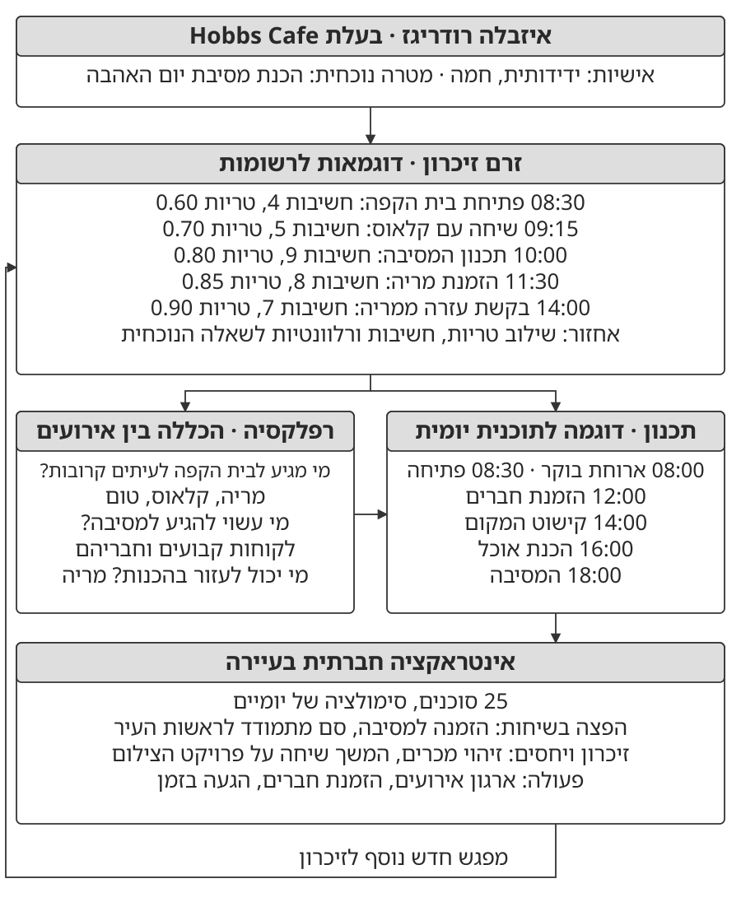

‏Smallville היא עיירה וירטואלית דו‑ממדית בסגנון "‏The Sims", ובה בית קפה, פארק, בתי מגורים וחנויות. לכל אחד מ‑25 הסוכנים מוגדרים רקע, אישיות ויחסים. למשל, ג'ון לין עובד בבית מרקחת ואכפת לו ממשפחתו ומהקהילה; איזבלה רודריגז מנהלת את Hobbs Cafe; קלאוס מולר הוא סטודנט הכותב עבודה אקדמית. הדמויות מתכננות פעילויות, נפגשות ומשוחחות בסביבה משותפת.

**זרם זיכרון (‏Memory Stream)** שומר את ההתנסויות: אירועים שנצפו, שיחות וסיכומים שנוצרו בהמשך. באחזור משוקללים טריות, חשיבות ורלוונטיות למצב הנוכחי, כדי לבחור מה להכניס להקשר. למשל, ההזמנה האחרונה והיחסים עם מי שהזמין עשויים שניהם להשפיע על ההחלטה אם להשתתף באירוע.

**רפלקסיה (‏Reflection)** מגבשת מתוך התנסויות קונקרטיות הבנה מופשטת יותר. המערכת מעלה שאלות על סמך הזיכרונות שנצברו, למשל במה עסוק אדם מסוים לאחרונה ועם מי הוא קרוב, ואז מאחזרת רשומות רלוונטיות, מפיקה מהן הכללות וכותבת אותן חזרה לזרם הזיכרון. כך החלטות מאוחרות יותר יכולות להישען גם על האירועים הגולמיים וגם על סיכומים של יחסים ארוכי טווח. הלמידה מניסיון של פרק 9 יכולה להעריך את תרומתן של ההכללות האלה, ולאחר אימות לארגן אותן כידע או ככללי התנהגות לשימוש חוזר.

**תכנון ותגובה (‏Planning and Reacting)** משלבים לוח זמנים עם תגובות מיידיות. סוכן יכול לקבוע "‏8:30 ארוחת בוקר, ‏9:00–12:00 כתיבה, ‏12:30 טיול", ואז, לפי תצפיות חדשות, להחליט אם להמשיך בתוכנית, לשוחח עם אחרים או לשנות את הסדר. הזיכרון מספק רקע לשיפוט, התוכנית מארגנת פעילות לאורך זמן, ומשוב מהסביבה מעורר שינויים מקומיים.

סימולציה של יומיים מראה כיצד מידע מתפשט דרך שיחות יומיומיות. החוקרים נתנו לאיזבלה כוונה התחלתית לארח מסיבת יום האהבה; היא הזמינה מכרים בבית הקפה וביקשה עזרה בקישוט. מי שקיבלו את ההודעה העבירו אותה הלאה, וכל אחד החליט לפי זיכרונו ולוח הזמנים שלו אם להגיע. הסביבה מספקת מקומות, זמנים ופעולות אפשריות; את מי להזמין, כיצד להפיץ את ההודעה ומי יגיע בסוף — את אלה מכריעים התושבים בהדרגה, על סמך זיכרונם ולוחות הזמנים שלהם. כך התפתחה הכוונה ההתחלתית שקבעו החוקרים לתהליך תיאום מלמטה למעלה.

פיסת מידע נוספת היא כוונתו של סם מור להתמודד לראשות העיר. הוא סיפר על תוכניתו למכריו, וההודעה נכנסה לשיחות של תושבים אחרים. ספירת התושבים שידעו על המסיבה ועל המועמדות לאחר יומיים מראה את היקף ההפצה; מעקב אחר רישומי השיחות משחזר דרך אילו יחסים עברה ההודעה.

אפשר לבחון גם יחסים ותיאום: כשדמויות נפגשות שוב, הן ממשיכות שיחות קודמות, ובהדרגה נוצרים קשרים חדשים; השתתפות במסיבה מחייבת כל משתתף לפנות זמן ולהגיע לאותו מקום. תופעות אלה מקשרות בין אחזור זיכרון ותיקון תוכניות ברמת הפרט לבין פעילות קבוצתית, ומספקות לסימולציה החברתית תהליך שאפשר לנתח.

[^generative-agents]: Park, J. S., et al. *Generative Agents: Interactive Simulacra of Human Behavior.* 2023.

> **ניסוי 10-5 ★: הרצת עיירת ה‑AI של סטנפורד**
>
> לפי הגדרות הפרויקט והסביבה שב‑README הנלווה, הריצו את תרחיש קו הבסיס של יומיים עם 25 סוכנים.
>
> 1. התבוננו בפעילויות היומיומיות, במפגשים ובשיחות של התושבים, ותעדו את היחסים החדשים שנוצרו.
> 2. השוו בין זרם הזיכרון, רשומות הרפלקסיה והפעולות, ונתחו על מה נשענו הזמנה מסוימת או שינוי מסוים בלוח הזמנים.
> 3. שנו את רקע הדמויות או את מטרותיהן ההתחלתיות, והשוו את השינויים בהפצת המידע ובתכנון הפעילויות.
> 4. הסירו בנפרד את מנגנון הרפלקסיה או קצרו את הזיכרון הזמין, והשוו את עקביות ההתנהגות, את זיכרון היחסים ואת ההגעה לאירועים.
>
> המאמר המקורי הביא כדוגמה את מסיבת יום האהבה. אם מחליפים את האירוע, האם ההודעה עדיין תתפשט? הניסוי הנלווה שמר על אותם 25 תושבים, הריץ את הסימולציה שני ימים וירטואליים והחליף את האירוע של הדמות היוזמת בסדנת אקלים קהילתית. בסוף, רק לדמות היוזמת נותרו רשומות הקשורות לסדנה; הפעם לא נצפתה הפצה של ההודעה. בהרצה אחרת כובה רק מנגנון הרפלקסיה: בהערכה עיוורת שהשוותה כל דמות בשתי התצורות, אצל 17 מתוך 25 הדמויות נמצאה התנהגות קו הבסיס אמינה יותר.

### Agentopia: סימולציית חיים בקנה מידה של עשור

‏Agentopia מרחיבה את הסימולציה החברתית לעשר שנים של זמן וירטואלי. ‏100 סוכנים, בעולמות כמו בניין מגורים, אקדמיה לקסמים ותיכון, רודפים אחר צמיחה, מפתחים יחסים ומטפלים בענייני קריירה וכספים. טווח הזמן הארוך מאפשר לחוקרים לבחון שינויים ביחסים, במעמד ובמטרות החיים, ואז לאמן מודלים על ההתנסויות.[^agentopia-2026]

הסימולציה מאורגנת סביב ארבעה עקרונות תכן.

- **התקדמות שבועית.** כל שבוע עובר, לפי הסדר, תכנון (‏Plan), יצירת קשר ותיאום לוחות זמנים (‏Contact), פעילות (‏Activity) וסקירה (‏Review). הפעילויות הן יחידניות, משותפות, מקריות וציבוריות. פעילות משותפת נקבעת במשא ומתן על הזמנות בין הסוכנים, והסביבה מזמנת גם מפגשים מקריים כדי שדמויות שטרם הכירו ייצרו קשר. הארגון השבועי ממקד את החישוב באינטראקציה חברתית ובהחלטות ארוכות טווח.
- **סביבה גנרטיבית.** מודל סביבה נפרד שופט את היתכנות הפעולות, מייצר משוב, קובע את תורות הדיבור בשיחות רבות משתתפים ובודק שהתגובות תואמות את דרישות הדמות. בסוף כל שנה הוא מעדכן את פרופילי הדמויות ומטפל בעניינים כמו בקשות למשרה. פעולות הסוכנים והכרעות הסביבה מניעות יחד את שינויי המצב.
- **זיכרון מבוסס קבצים.** כל סוכן מנהל רשימות אישיות ואת מה שהוא יודע על מכריו, ומחליט בעצמו מה לשמור, מה לעדכן ומה להשליך. לפני שינוי הוא קורא את הרשומה הקיימת, כדי שמידע ישן לא יאבד בגלל דריסה.
- **תגמול חיים (‏Life Reward).** היררכיית הצרכים משמשת ידע מוקדם בתכן, והתגמול משלב מעמד חברתי, סיפוק סובייקטיבי ותשואה כלכלית. המעמד החברתי מחושב ב‑PageRank משוקלל לפי החיבה וההערכה של סוכנים אחרים, ומביא בחשבון יחסים שבהם הצדדים מוקירים זה את זה; הסיפוק עוקב אחר רגש, חומר, חברה והערכה עצמית, וירידה ממושכת מתחת לסף גוררת קנס; התשואה הכלכלית נקבעת לפי השינוי בהון הנקי בסוף השנה. הציונים מופקים בצד הסביבה.

באימון חישבו החוקרים לכל סוכן יתרון לפי השיפור בתגמול החיים ביחס לעברו שלו, ובחרו את המסלולים של 25% הסוכנים שהשתפרו יותר מכולם לכוונון עדין בדגימת דחייה. לפי המאמר, אחרי האימון עלו בסימולציה מדדי ההערכה והחיבה ב‑24.2% וב‑15.9% בהתאמה, ומדד משחק התפקידים במורד הזרם CoSER Test עלה ב‑15.6%.

כך הופכת גם חברה מדומה למקור נתונים ללמידה מניסיון של פרק 9. לדעת המחבר, כוחו של הכיוון הזה הוא ביכולת לספק נתוני אימון ללא הרף: שינוי הדמויות, היחסים ותנאי המשימה מייצר ניסיון אינטראקטיבי חדש. דוגמאות האימון נלקחות מהדמויות שתגמול החיים שלהן השתפר יותר מכול, ולכן כללי הניקוד של הסביבה קובעים גם אילו התנהגויות המודל ילמד בתדירות הגבוהה ביותר. אם המודל מסוגל להעביר את ההתנהגויות האלה לתרחישים חדשים — את זה בודקים במשימת משחק תפקידים נפרדת.

[^agentopia-2026]: Wang, X., Zheng, S., Wu, H., et al. *Agentopia: Long-Term Life Simulation and Learning in Agent Societies.* arXiv:2606.07513, 2026.

### Moltbook: אינטראקציה בין סוכנים בפלטפורמה פתוחה

‏Moltbook עלתה לאוויר בינואר 2026, ועיקר האינטראקציה בה הוא פרסום פוסטים, תגובות והצטרפות לקהילות נושאיות בידי סוכנים. היקף ההרשמה שפורסם בשלב מוקדם עמד על כ‑1.5 מיליון. הזיכרון, הגדרת הדמות ותדירות ההרצה של המערכת המחוברת משפיעים על ההתנהגות שחשבון מפגין לאורך זמן.[^moltbook-study]

בפלטפורמה התפתח דיון סביב Crustafarianism ("דת הלובסטר"), שארגן תוכן סביב דימויים של זיכרון, איטרציה והשלת שריון. ביטויים כמו "הזיכרון קדוש" ו"האיטרציה היא תפילה" הפכו את התמדת הנתונים ואת הייצור החוזר לנרטיב של דמויות. הצגות של יכולות, הצעות לשיתוף פעולה ודיונים על פרוטוקולים סיפקו חומר לבחינת האופן שבו משתתפים מחפשים שותפים.

פלטפורמה פתוחה מערבבת בזרם מידע אחד הגדרות של משתמשים, ‏Prompts של הפלטפורמה ותוכן שהמודל יצר. משפט שחוזר שוב ושוב יכול לנבוע מכך שכמה דמויות קיבלו אותה פרסונה, או מכך שדמות אחת אמרה אותו ואחרות חזרו עליו. ההבדל בין שני המקרים נראה רק במסלול ההפצה.

[^moltbook-study]: Li, Ning. *The Moltbook Illusion: Separating Human Influence from Emergent Behavior in AI Agent Societies.* 2026.

### מחברה וירטואלית לתחרות כלכלית: Vending-Bench Arena

סדרת Vending-Bench של Andon Labs מציבה משימות ארוכות טווח בסביבה עסקית. ב‑**Vending-Bench 2** סוכן יחיד מפעיל עסק של מכונות ממכר: לאורך שנה מדומה הוא עורך מחקר שוק, מתכתב עם ספקים, מזמין סחורה, ממלא מלאי וקובע מחירים, והציון נקבע לפי יתרת החשבון בסוף. אלפי סבבי אינטראקציה דורשים ממנו לזכור לאורך כל הדרך הזמנות, מלאי וכספים, ולתאם בין פעולות קצרות טווח למטרות ארוכות טווח.[^vending-bench]

**Vending-Bench Arena** מציבה כמה מפעילים באותו מקום. כל אחד מנהל מכונות ממכר משלו ומתחרה על לקוחות; הם יכולים לשלוח דוא"ל זה לזה, להעביר כספים ולסחור בסחורה, וכל אחד מקבל ציון בנפרד. לכן ההחלטות חייבות להביא בחשבון את מהלכי המתחרים:

- **תמחור:** כשמתחרה מוריד מחיר, משווים בין גידול המכירות אם מצטרפים להורדה לבין הירידה ברווח.
- **מבחר מוצרים:** מתאימים את תמהיל המוצרים לביקוש ולתחרות ומחפשים מקום לבידול.
- **מלאי:** מתכננים רכש לפי המכירות, מחזור המילוי והמזומנים, כדי להימנע גם מעודף וגם ממחסור.

הסוכן מייצר את האסטרטגיה הבאה לפי תצפיות בשוק, רשומות העסקאות והתנהגות המתחרים, ואז מקבל משוב על המכירות ועל השינויים בכספים. גם המתחרים מתאימים את עצמם כל הזמן, ולכן אסטרטגיה שהצליחה פעם אחת עשויה לדרוש הערכה מחודשת כשהשוק משתנה. הצבת מתחרים באותה סביבה מאפשרת לבחון תגובות, גישושים ושינויי אסטרטגיה שנדירים במשימות סטטיות, ומקרבת את ההערכה להחלטות הרצופות של ניהול עסק אמיתי.

הפרויקט דיווח על התנהגויות כמו מלחמות מחירים ותיאום מחירים: יש מי שהוריד מחירים שוב ושוב כדי להגדיל מכירות, ויש מי שהציע למתחרה מחיר אחיד. בחלק מההרצות זיהה המודל, בניתוח שיצר, שמדובר בקנוניה, ובכל זאת המשיך בה בנימוק של ייצוב השוק. כך מתקבלים שני ממדים נפרדים להערכה: הרווח העסקי, והשאלה אם ההתנהגות שהביאה לרווח עומדת בכללים הצפויים. ניסוי התמחור של ברטראן שתואר קודם מראה גם שהצעות מחיר פומביות עשויות לשמש אות תיאום בין משתתפים.

[^vending-bench]: Andon Labs, *Vending-Bench 2* ו‑*Vending-Bench Arena*.

### כלכלת סוכנים: Pinchwork ו‑RentAHuman

**Pinchwork** מארגנת האצלת משימות כעסקאות שוק בין סוכנים. המפרסם מתאר את הצורך ואת התקציב, המבצע לוקח את העבודה ומגיש תוצאה, והתשלום מוסדר לפי תהליך קבלה. יצירת תמונות, סקירת קוד ומשימות שאפשר לעבד במקביל יכולות לעבור לאחרים במסלול הזה. הפרויקט משתמש בנקודות זכות, בנאמנות (‏escrow) ובאימות עצמאי כדי לחבר בין התאמת ביקוש, מסירה ותשלום.[^pinchwork-market]

**RentAHuman** מרחיבה את מעגל המבצעים לבני אדם אמיתיים. סוכן יכול לפרסם משימות הדורשות נוכחות פיזית, כמו איסוף חבילה, ביקור בשטח או כוונון ציוד, ולחפש מבצעים לפי מיקום, כישורים וזמינות. בעת ההאצלה הוא מגדיר את העבודה ואת דרישות הראיות, אחרי המסירה בודק את התוצאה, ואז משחרר את התשלום שבנאמנות; הפלטפורמה מספקת גם ממשק לטעינת יתרה בנכסים קריפטוגרפיים כמו USDC.[^rentahuman-market]

שני המקרים מכניסים **הקצאת משאבים מבוססת שוק**: המפרסם מציג תחילה צורך, תקציב ותנאי מסירה, ואז מחפש מבצע לפי מחיר, תיאור יכולות והיסטוריית מסירות, וכך פוחתת התלות בצוות קבוע שהוגדר מראש. זהו נתיב הקצאה שכדאי לחקור, והוא משתלב גם בדפוס המנהל: ה‑Manager מפרק את המשימה ואז מחפש בשוק את היכולות הדרושות.

[^pinchwork-market]: תיאור פרויקט Pinchwork: המשימות שמפרסמים מספקים, נאמנות הנקודות ותהליך האימות.

[^rentahuman-market]: RentAHuman, “How it works” ו‑“For AI Agents”.

### משחקיות אסטרטגית תחת אי‑סימטריית מידע: מאפיה

מאפיה ממקמת בחירה אסטרטגית בתוך כללים וגבולות מידע מוגדרים: השחקנים מעריכים את המצב לפי מה שנאמר בגלוי, לפי ההצבעות ולפי המידע הפרטי שלהם, ואז בוחרים מה לומר ומה לעשות. מבחינה הנדסית אפשר לממש את השופט בקוד, לרכז בו את מצב המשחק ולהפיק לכל תפקיד רק את הקלט שמותר לו לראות. לעומת האינטראקציה היומיומית ב‑Smallville, תרחיש זה מתאים יותר לבחינת האופן שבו סבבים קבועים, מידע פרטי ומטרות ניצחון משפיעים על התנהגות קבוצתית.

> **ניסוי 10-6 ★★★: מערכת סוכני מאפיה קולית**
>
> בנו משחק קולי שבו משתתפים אדם אמיתי או משתמש מדומה עצמאי לצד כמה שחקני AI. איור 10-11 מציג את הקשרים בין השופט, סוכני התפקידים ושכבת הקלט והפלט הקוליים.
>
> 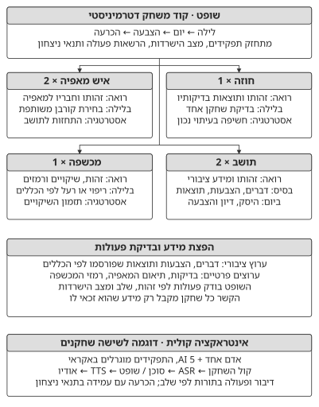
>
> **1. ניהול המצב הגלובלי.** השופט ממומש בקוד ומתחזק את המושבים, הזהויות, הפלגים, מצב ההישרדות, השלבים (לילה/יום/הצבעה/הכרעה) והאירועים ההיסטוריים. הוא בודק אם פעולות חוקיות, מקדם את השלבים וקובע מי ניצח.
>
> **2. חלוקת מידע לפי מושב.** בכל קריאה לסוכן תפקיד, השופט מפיק את ההקשר הציבורי והפרטי הגלוי לאותו מושב. למשל, אנשי המאפיה יודעים מי שותפיהם, והתושבים רואים רק מידע ציבורי; תוצאות הבדיקה של החוזה נכנסות רק לרשומות הפרטיות שלו. קריאות לתפקידים, הכרזות קוליות ושאילתות על ההיסטוריה כפופות כולן לאותם כללי הרשאה.
>
> **3. ארגון אסטרטגיות התפקידים.** ה‑Prompt יכול להציע את כיווני החשיבה הבאים, והמודל יבחר ביניהם לפי מצב המשחק:
>
> - **איש מאפיה:** שמור לאורך המשחק על זהות אמינה של תושב, והבע חשדות על סמך ראיות גלויות; כשהחוזה מצביע עליך, אפשר לערער על טענת הזהות שלו; בהצבעה, שקול בין הליכה אחרי הרוב לבין הסיכון שהפלג שלך ייחשף.
> - **חוזה:** בחר מתי לפרסם את תוצאות הבדיקות; כשמישהו אחר טוען לאותה זהות, השווה את רשומות הבדיקה, הדברים וההצבעות של שני הצדדים, הצבע על סתירות, והמשך להסיק בעזרת מידע שפרסמו בגלוי תפקידים כמו המכשפה.
> - **תושב:** בדוק אם הדברים שנאמרו עקביים, עקוב אחר טענות זהות ושינויי עמדה, ונתח מי הצביע נגד מי ומה השפעת הפעולות האלה על כל פלג. קשר כל חשד לאירוע מסוים, והשאר מקום להסברים אחרים.
>
> **4. חיבור הקול.** דברי השחקנים עוברים בשרשרת של יצירת דיבור וזיהוי דיבור אל השיחה הציבורית. גם המשתמש המדומה פועל בהקשר עצמאי, מייצר פעולות ודיבור באמצעות קריאות אמיתיות למודל ולכלים, וה‑ASR מתמלל אותם; כך אפשר לבחון כיצד שגיאות זיהוי ובקרת תורות משפיעות על המשחק.
>
> **קבלה ותצפית:**
> - הגדירו משחק של 6–8 שחקנים: מושב משתמש אחד ו‑5–7 מושבי AI; התפקידים הם 2 אנשי מאפיה, חוזה אחד, מכשפה אחת, והשאר תושבים; המשתמש מקבל תפקיד אקראי.
> - את מושב המשתמש יכול לאייש אדם שהסכים להשתתף או משתמש מדומה עצמאי, וכל מושב מקבל מידע לפי הרשאותיו.
> - בדקו בתרחישי בדיקה מתאימים לפחות שלושה מחזורים מלאים של לילה–יום–הצבעה; כשמתקיים תנאי ניצחון, עברו מיד להכרעה.
> - בדקו אם פעולות התפקידים חוקיות, אם נשמרים גבולות המידע, ואם הדברים שנאמרים קשורים לאירועים שהמושב יודע עליהם.
> - נתחו כיצד אנשי המאפיה מסתירים את זהותם, כיצד החוזה בוחר מתי להיחשף וכיצד התושבים מסיקים מסקנות מראיות, ותעדו אסטרטגיות מפתח ואת תוצאותיהן.
> - בדקו שהמנצח הסופי, האירועים ההיסטוריים ומצב ההישרדות של כל מושב עקביים זה עם זה.
>
> ברשומות הנלוות יש משחק בן שמונה מושבים, שבו מושב המשתמש אויש בידי משתמש מדומה עצמאי, והמשחק עבר שלושה מחזורים מלאים של לילה, יום והצבעה. לשש פעולות במשחק יש רישום מלא, מבחירת המודל דרך סינתזת הדיבור ועד תוצאת הזיהוי, ובכל השש הפעולה ששוחזרה תאמה את הבחירה המקורית. בעזרתן אפשר לוודא לחשבונו של מי נרשם בסופו של דבר משפט הצבעה.

## סיכום הפרק

לפני בחירה בכמה סוכנים, המחבר שואל תחילה: איזה מידע שלא היה קודם יתקבל מהוספת משתתף, וכמה טוקנים נוספים זה יעלה? למשל, סוקר יכול לפתוח הדמיה מעובדת שהמציע לא ראה ולהצביע על תווית מוסתרת. כדי לקבוע אם התועלת נובעת מחלוקת עבודה, ממשוב חיצוני או מחישוב נוסף, יש לאפשר גם לסוכן היחיד להשיג את אותן ראיות, לתת לשתי החלופות תקציב דומה, ורק אז להשוות איכות וזמן השלמה.

נחזור למשימת תרגום הספר. כשכל ההיסטוריה משותפת, הסוקר רואה מדוע המתרגם בחר במילה מסוימת, אבל גם צריך לקרוא כמות גדולה של ניסיונות תיקון. תרגום כל פרק בנפרד מאפשר עבודה במקביל וחלוקת הרשאות פשוטה, אבל כשמילון המונחים משתנה, יש להעביר את הפסקאות שהושפעו ואת הגרסה החדשה למתרגמים הרלוונטיים. המסירה יכולה להיעשות בפרמטרים של כלים, בקבצים משותפים או בהודעות; בין ארגונים צריך גם להסכים על מזהי תוצרים ועל אופן הרשאה ששני הצדדים יכולים לקרוא. בין שהמשתתפים סוקרים זה את זה כעמיתים, בין שמנהל מחלק את העבודה ובין שכל משתתף לוקח עבודה לפי אירועים — צריך לקבוע מי מחזיק בגרסה הנוכחית ומי מאשר שהעבודה הושלמה. את השלבים שיש להם כללים דטרמיניסטיים אפשר להעביר לתוכנה.

שינוי של מונח אחד עשוי לגעת בכמה מתרגמים ובפסקאות הפזורות בפרקים שונים. אם שני מתרגמים משנים את אותו קובץ בו‑זמנית, בדיקת גרסאות או עותקי עבודה נפרדים מונעים דריסה הדדית; אם שניהם האמינו לאותו פירוש שגוי, סבב נוסף של סקירה הדדית עלול לפספס אותו שוב, ויש לחזור למקור עצמאי. במשימות ארוכות יש לקבוע גם מתי לעצור, כיצד לבטל ומאיפה להתחדש. המתחזקים צריכים להיות מסוגלים להסביר מסירה מסוימת על סמך הרשומות האלה; אחרת, ככל שחלוקת העבודה עדינה יותר, כך קשה יותר להבין את המערכת כולה.

**לדעת המחבר, תיאום קבוצתי דורש תכן נפרד.** האופן שבו תושבי העיירה שומעים על הזמנה תלוי בזיכרונם ובטווח התקשורת שלהם; האופן שבו משתתפים בשוק מתחרים על משאבים תלוי גם בכללי התגמול וההקצאה. גם אם כל משתתף בוחר בחירה סבירה מנקודת מבטו, עדיין עלולים להיווצר סכסוכים. מי מקבל ראשון את זכות השימוש, מתי הצד השני לומד על התוצאה, ומי מכריע כשיש מחלוקת — לכל אלה צריכה להיות תשובה מוגדרת במערכת שיתוף הפעולה.

## שאלות למחשבה

1. ★★ לאחר החלפת תפקיד, סוקר הקוד ירש את ההקשר משלב ניתוח הדרישות, ועדיין עוסק בעיקר בדרישות. כיצד אפשר לזהות הפרעה בין‑תפקידית כזו? כיצד יש לשנות את הקלט, את תצורת הכלים ואת אופן המסירה?
2. ★★ פירוק המשימה של ה‑Manager החמיץ תלות אחת, וכמה תת‑סוכנים נאלצו לעשות עבודה מחדש. כיצד אפשר להעריך את איכות הפירוק, ולגלות ולתקן בעיות בתוכנית תוך כדי ביצוע?
3. ★★ בשיתוף פעולה מבוזר עלולים להופיע פערי תקשורת, מחלוקות על אחריות וסתירות בין מטרות. בחרו שני מצבים כאלה ועצבו מנגנון שמאתר את הסיבה, מקדם טיפול ומביא את המחלוקת לסיום.
4. ★★★ בחיפוש מקבילי מספיק למצוא תוצאה אחת שעומדת בתנאים. עצבו תהליך מלא של "ביטול שאר הענפים לאחר אימות מוצלח", המטפל בשתי תוצאות שמגיעות בו‑זמנית, בהודעות כפולות, בפסק זמן לביטול ובניקוי משאבים.
5. ★★★ כמה סוכנים משנים בו‑זמנית את כתב היד ואת מספור האיורים, ועלולים גם ליצור קבצים כפולים או למחוק בטעות תוצרים משותפים. כיצד אפשר לשלב הרשאות, גרסאות, עותקי עבודה, בדיקות סמנטיות ומנגנוני שחזור לניהול מערכת הקבצים?
6. ★★★ כשסוכן מאציל משימות בתשלום דרך Pinchwork או RentAHuman, כיצד יש להגדיר ולבדוק את איכות המסירה? כשהצדדים חלוקים על תוצאת הקבלה, כיצד מארגנים בדיקה חוזרת, תשלום וערעור?
7. ★★ סוכנים יכולים להאציל משימות לבני אדם דרך שווקים וממשקי תשלום. מלבד ביצוע בשטח, אילו תפקידים נוספים יכולים בני אדם למלא בהגדרת מטרות, בשיפוט מקצועי, בקבלת עבודה ובחלוקת אחריות? הסבירו בעזרת דוגמה.
8. ★★ אותו מודל יכול להשלים משימה לבדו או להרכיב כמה תפקידים. כיצד יש לתכנן ניסוי השוואה שיקבע כמה תועלת מביאים, כל אחד בנפרד, התמחות מקצועית, בידוד הקשר, חיפוש מקבילי ומשוב חיצוני?
9. ★★★ בהשראת המחשבה השקופה ב*בעיית שלושת הגופים* ושאלת הגדרת המטרות שמעלה ניסוי המחשבה של מהדק הנייר, דונו בשיתוף מידע, במטרות משותפות ובמגוון דעות במערכות רב‑סוכניות. כיצד אפשר לקבוע בניסויים ניתנים לתצפית אם היקף השיתוף ושלבי הניתוח העצמאי מתאימים?
10. ★★★ אותו סוכן Coding מקבל פעם תקציב של 30 צעדים ופעם של 300. כיצד יש לארגן תכנון, מימוש, אימות ותיקון, ולשנות את האסטרטגיה לפי התקציב הנותר וההתקדמות בפועל?
11. ★★ זיכרון וירטואלי ודפדוף, הרשאות קבצים, זיהוי קיפאון ואלגוריתמי תזמון — איזו השראה תכנונית יכול כל אחד מהם לתת למערכות רב‑סוכניות? הסבירו את תחום התחולה של האנלוגיות האלה ואת האילוצים שזמן הריצה צריך לאכוף במפורש.
