# הנדסת הקשר

פרק 1 השווה את ההקשר ל"שדה הראייה של ההחלטה הנוכחית" של הסוכן: בכל פעם שהמודל מקבל החלטה, הוא נשען על המידע שהגיע אליו באותו רגע. **הנדסת הקשר (Context Engineering)** אחראית לבחור את המידע הזה, לארגן אותו ולעדכן אותו, ובכלל זה הוראות המערכת, הגדרות הכלים, בקשות המשתמש, היסטוריית ההודעות ומצב המשימה. לפני כל קריאה למודל, ה‑Harness צריך לסדר את רקע המשימה ואת ההתקדמות האחרונה בה לכדי קלט. איור 2-1 מראה בעזרת תוכן קונקרטי ממה מורכב חלון ההקשר.

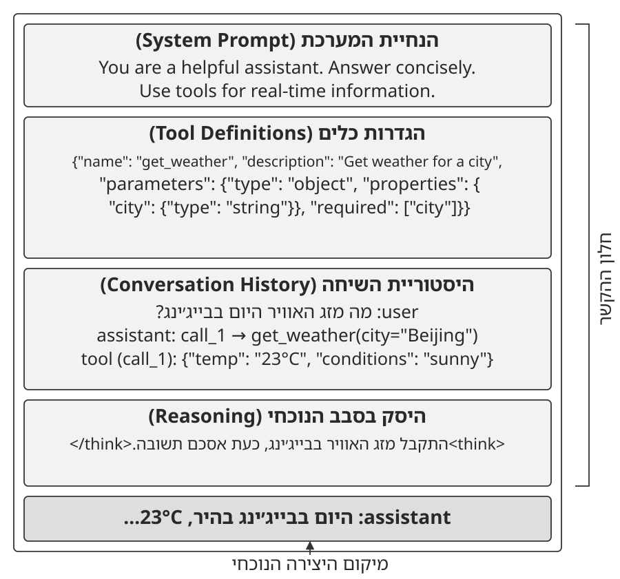

## הקשר: להפנות את יכולות המודל למשימה קונקרטית

דמיינו מהנדס מנוסה שהצטרף זה עתה לצוות, והמשימה הראשונה שלו היא "לשנות את התצורה לפי התקנים שלנו". הוא יודע לתכנת, אבל עדיין אינו יודע איזה קובץ הוא המקור האמיתי של התצורה, אילו שדות מותר לשנות ואיך לאמת את השינוי. גם אם יקבל את כל בסיס הקוד, הוא עלול לשנות את הקובץ הלא נכון. סוכן שמקבל לידיו פרויקט לא מוכר חסר בדיוק את אותו רקע.

ניקח כדוגמה את הבקשה "עזור לי לתקן את הבאג הזה". סוכן קוד זקוק בדרך כלל לשלושה סוגי רקע:

- **הקשר קוד עדכני**: מבנה התיקיות, אחריות המודולים, מבני הנתונים המרכזיים ותקני כתיבת הקוד. לדוגמה, אם השינוי נעשה בקובץ תצורה שנוצר אוטומטית, הוא אמנם ישפיע מקומית, אבל יידרס בפעם הבאה שהקובץ ייווצר. רק מי שיודע איזה מודול מייצר את הקובץ ימצא את המקום הנכון לשנות.
- **נוהלי עבודה**: אסטרטגיית הענפים ב‑Git, מוסכמות הקומיט, תהליך סקירת הקוד ודרישות ה‑CI/CD. לפיהם הסוכן מתכנן את השינוי, הבדיקה והקומיט, ומערכת ההרצה מבצעת את הפעולות האלה בהתאם להרשאות.
- **מידע על הסביבה**: תצורת הפיתוח, אופן ההתחברות למסד נתוני הבדיקות, אופן הפריסה לסביבת הבדיקות ואופן ניהול מפתחות ה‑API. המידע הזה עוזר לסוכן לבחור את סביבת ההרצה הנכונה ולהבין במה שונה הסביבה המקומית מסביבת הבדיקות.

קוד הפרויקט ומסד נתוני הבדיקות נמצאים שניהם מחוץ להקשר של המודל. בדוגמת התצורה שנוצרת אוטומטית, הסוכן יודע מאיפה להתחיל רק אחרי שקרא את סקריפט היצירה בעזרת כלי חיפוש. **איכות ההקשר קובעת אם המודל יוכל להפעיל את היכולות שכבר יש לו על הבעיה הנוכחית.** **במשימות שתלויות בהרבה מידע רקע, מודל שיכולתו מספיקה ויש לו הקשר מלא ומדויק יכול להצליח יותר ממודל חזק יותר שחסרים לו החומרים הנחוצים.**

**בניית צוות ילידי‑AI מתחילה בתיעוד הידע המרכזי.** אם את הסיבה לבחירה במסד נתונים מסוים זוכרים רק הוותיקים, ושינויים בכללים העסקיים הוזכרו רק בהתכתבויות פרטיות, אז עמית חדש וסוכן ייתקלו באותה בעיה כשיקבלו את העבודה: בקוד רואים מה הצוות עשה, אבל לא רואים למה עשה זאת כך.

**צוות שנוח לעבוד איתו מרחוק נוח בדרך כלל גם לסוכנים.** מפתחי ליבת לינוקס דנים בטלאים ומחליפים הערות סקירה ברשימות דיוור, ומסמכי תהליך הפיתוח מסבירים כיצד מגישים, סוקרים וממזגים טלאים[^ch2-linux]. משתתף חדש שנתקל בשינוי מפתיע יכול לעקוב אחר הטלאי עד הוויכוח שהתנהל אז; גם סוכן שבודק רקע נעזר באותו תיעוד.

אחרי שהאזין לריאיון של Jiayi Weng ב‑WhynotTV, סיכם המחבר את אחת מנקודותיו כך: **גם בני אדם וגם מודלים תלויים ב‑Context.** אדם יכול לפנות לעמית שהשתתף בהחלטה ולשאול אותו, ואילו איזה רקע המודל יכול לקרוא תלוי במה שהצוות תיעד ובמה שה‑Harness הכניס לבקשה הנוכחית.[^ch2-weng]

[^ch2-linux]: התיעוד הרשמי של ליבת לינוקס, How the development process works.

[^ch2-weng]: WhynotTV, «Jiayi Weng: OpenAI, GPT, למידת חיזוק, Infra, אימון שלאחר האימון המקדים, Tianshou, tuixue, קוד פתוח, CMU, Tsinghua», Podcast #4.

מאמר ReAct מתאר בביטוי פורמלי כיצד היסטוריית האינטראקציה משתתפת בקבלת ההחלטות[^ch2-react]. ברגע $t$ הסוכן מקבל מהסביבה תצפית $o_t\in\mathcal{O}$ ובוחר פעולה $a_t\in\mathcal{A}$ לפי מדיניות $\pi(a_t\mid c_t)$, כאשר ההקשר הוא:

$$
c_t=(o_1,a_1,\ldots,o_{t-1},a_{t-1},o_t)
$$

הביטוי הזה מראה ש**הצעד הבא של הסוכן תלוי בהיסטוריית האינטראקציה עד לרגע הנוכחי.** למשל, איזה קובץ הסוכן כבר בדק ואיזו שגיאה החזיר כלי משפיעים שניהם על הבחירה הבאה. בסוכן LLM, קלט המשתמש ותוצאות הכלים מספקים תצפיות, וקריאות לכלים ותשובות כלפי חוץ מתעדות פעולות; הוראות המערכת והגדרות הכלים מוסיפות את כללי המשימה ואת הממשקים הזמינים.

פרק זה מניח תחילה אופן בקשה חסר מצב: בכל סבב ה‑Harness מרכיב את ההודעות ואת הגדרות הכלים ואז קורא למודל. היסטוריית הודעות מלאה מקלה על שימור ההתקדמות במשימה; ככל שההיסטוריה גדלה, אפשר להשאיר בחלון את המידע שההחלטות הבאות זקוקות לו באמצעות אחזור, רישום מצב ודחיסה. פריסת ההקשר, שורת המצב וטכניקות הדחיסה סובבות כולן סביב אותה שאלה: איך מכניסים ל‑$c_t$, בתוך הקשר מוגבל, את המידע שהמודל צריך בצעד הזה?

[^ch2-react]: Yao, Shunyu, et al., ReAct: Synergizing Reasoning and Acting in Language Models, ICLR 2023.

## כיצד סוכן קורא למודל גדול: מבנה ההקשר ברמת ה‑API

נתחיל בברכה פשוטה כדי לראות את פורמט ההודעות, ואחר כך נראה איך השאלה "מה השעה עכשיו בוונקובר ואיך מזג האוויר" מובילה לשתי קריאות לכלים. הסעיף משתמש בממשק תואם Chat Completions ובמודל Qwen3-0.6B שרץ מקומית, ובסוף מחבר את הסבבים השונים בקוד Python[^ch2-chat-api].

### ארבעת תפקידי ההודעות בדוגמה

**רשימת ההודעות** (`messages`) בבקשה שומרת את מידע האינטראקציה לפי הסדר. כל הודעה מסומנת ב**תפקיד** (`role`) שמציין את מקורה ואת ייעודה. הסעיף משתמש בארבעה תפקידים:

- **system**: הנחיית המערכת. כאן היא נושאת את הזהות, כללי ההתנהגות והאילוצים שהמפתח מספק, וממוקמת בראש רשימת ההודעות. בחלק מממשקי המודלים הוראות המפתח מועברות בתפקיד `developer`.
- **user**: הודעת משתמש, ובה המשימה, שאלות ההמשך והדרישות הנוספות.
- **assistant**: תשובת המודל, ובכלל זה טקסט ובקשות לקריאת כלים. כשמחזירים את ההודעות האלה לקלט של הסבב הבא, המודל יכול לקרוא את התשובות ואת בקשות הפעולה הקודמות שלו.
- **tool**: תוצאת הרצת כלי. כשה‑Harness מקבל ערך מוחזר, הוא כותב אותו כהודעת כלי ומקשר אותה לקריאה המסוימת באמצעות `tool_call_id`.

הגדרות הכלים מועברות בשדה `tools` ברמה העליונה של הבקשה, ומפרטות את השם, הייעוד ופורמט הפרמטרים של כל כלי זמין.

המודל בונה את בקשת הקריאה לפי הגדרות הכלים. אם הפעולה תתבצע בפועל, זה תלוי ב‑Harness ובסביבת ההרצה.

[^ch2-chat-api]: OpenAI, תיעוד Chat Completions API, המתאר את תפקידי ההודעות, הגדרות הכלים ושדות תוצאות הקריאה; Qwen, Function Calling, המתאר קריאה לכלים ותבניות בשירותים תואמים.

### שיחה חד‑תורית: קריאת ה‑API הפשוטה ביותר

נתחיל בשאלה ותשובה אחת. המשתמש שואל "Hello, who are you?", וה‑Harness שולח למודל את הוראות המערכת יחד עם השאלה, ואז קורא את התשובה. איור 2-2 מראה כיצד הבקשה והתגובה מתאימות זו לזו.

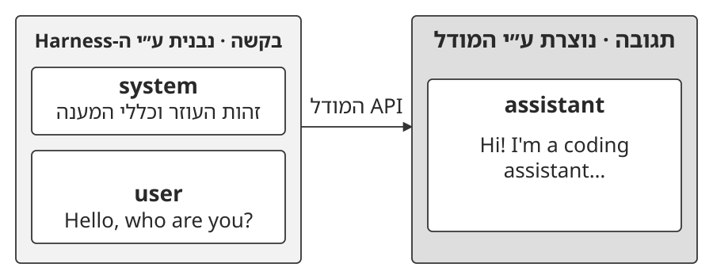

להלן הבקשה ותשובה לדוגמה, בפורמט הממשק של המודל המקומי; ההערות בקוד מציינות מאין מגיע כל חלק:

```javascript
// ה-Harness בונה את הבקשה
{
  "model": "Qwen3-0.6B",
  "messages": [
    {
      "role": "system",                           // הוראות שהמפתח סיפק
      "content": "You are a helpful coding assistant. Follow user instructions."
    },
    {
      "role": "user",                              // קלט המשתמש
      "content": "Hello, who are you?"
    }
  ]
}
```

```javascript
// ה-API מחזיר תגובה
{
  "choices": [{
    "message": {
      "role": "assistant",                         // נוצר על ידי המודל
      "content": "Hi! I'm a coding assistant. I can help you write code, debug issues, and explain technical concepts. How can I help?"
    }
  }]
}
```

הבקשה מכילה הודעת `system` אחת והודעת `user` אחת, ו‑`choices[0].message` בתגובה מכיל את הודעת ה‑`assistant` שהמודל יצר. בממשק חסר המצב שבו אנו משתמשים כאן, **ה‑Harness אחראי לספק לכל קריאה את ההקשר שהיא צריכה**. אם הבקשה הבאה אמורה להמשיך את השיחה הזו, עליה לכלול את ההיסטוריה הרלוונטית.

### אינטראקציה רב‑תורית עם קריאות לכלים: לולאת הליבה של הסוכן

עכשיו נבחן שאלה שדורשת כלים: "What's the current time and weather in Vancouver?" כדי לענות עליה, צריך קודם לברר את השעה ואת מזג האוויר המקומיים. באיור 2-3, בקריאה הראשונה למודל ה‑Harness מקבל שתי בקשות לכלים. הוא פונה בנפרד לשירות הזמן ולשירות מזג האוויר, מוסיף את שתי התוצאות להיסטוריית ההודעות, וקורא למודל פעם שנייה; רק אז הוא מקבל את התשובה למשתמש.

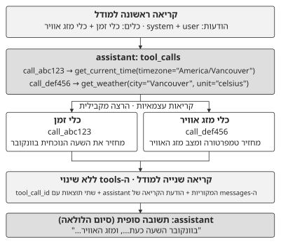

איזה מהכלים רץ קודם? כלי הזמן צריך אזור זמן, וכלי מזג האוויר צריך עיר ויחידת טמפרטורה. המשתמש אמר רק "ונקובר", והמודל בדוגמה מילא על פי זה `America/Vancouver` ו‑`Vancouver` ובחר במעלות צלזיוס. בדיקת מזג האוויר אינה צריכה לחכות לתשובת כלי הזמן, ולכן אפשר לשלוח את שתי השאילתות בו‑זמנית.

**קריאת API ראשונה — מסגרת הסוכן שולחת את הבקשה ההתחלתית:**

```javascript
// קריאה ראשונה למודל: ה-Harness בונה את הבקשה
{
  "model": "Qwen3-0.6B",
  "messages": [
    {
      "role": "system",                           // הוראות שהמפתח סיפק
      "content": "You are a helpful assistant. Use the provided tools to get real-time information when needed."
    },
    {
      "role": "user",                              // קלט המשתמש
      "content": "What's the current time and weather in Vancouver?"
    }
  ],
  "tools": [                                       // כלים שהמפתח הגדיר
    {
      "type": "function",
      "function": {
        "name": "get_current_time",
        "description": "Get the current date and time in a specific timezone",
        "parameters": {
          "type": "object",
          "properties": {
            "timezone": { "type": "string", "description": "Timezone name, e.g. America/Vancouver" }
          },
          "required": ["timezone"]
        }
      }
    },
    {
      "type": "function",
      "function": {
        "name": "get_weather",
        "description": "Get the current weather for a specific city",
        "parameters": {
          "type": "object",
          "properties": {
            "city": { "type": "string", "description": "City name" },
            "unit": { "type": "string", "enum": ["celsius", "fahrenheit"] }
          },
          "required": ["city", "unit"]
        }
      }
    }
  ]
}
```

את רשימת ה‑`tools` הזו המפתח מגדיר מראש, והיא כוללת שמות, תיאורים וסכמות פרמטרים. בדוגמה זו כל הבקשות כוללות את אותם שני כלים; המודל קורא את הרשימה ואת שאלת המשתמש, ואז בוחר לאילו כלים לקרוא וממלא את הפרמטרים.

**המודל מחזיר שתי בקשות לקריאת כלים:**

```javascript
// המודל מחזיר בקשות לקריאת כלים
{
  "choices": [{
    "message": {
      "role": "assistant",                         // נוצר על ידי המודל
      "content": null,                             // אין תשובת טקסט בסבב הזה
      "tool_calls": [                              // בקשה לקרוא לשני כלים
        {
          "id": "call_abc123",
          "type": "function",
          "function": {
            "name": "get_current_time",
            "arguments": "{\"timezone\": \"America/Vancouver\"}"
          }
        },
        {
          "id": "call_def456",
          "type": "function",
          "function": {
            "name": "get_weather",
            "arguments": "{\"city\": \"Vancouver\", \"unit\": \"celsius\"}"
          }
        }
      ]
    }
  }]
}
```

ה‑`tool_calls` בתגובה מכיל שתי בקשות, ולכל אחת `id` משלה, שם כלי ופרמטרים. `arguments` היא מחרוזת בקידוד JSON, וצד ההרצה צריך קודם לפענח אותה ואז לאמת את השדות ואת הערכים. **המודל מחליט למה לקרוא ואילו פרמטרים להעביר; ה‑Harness אחראי לאימות ולתזמון; מימוש הכלי אחראי לפנות לשירות הזמן או לשירות מזג האוויר.**

**מסגרת הסוכן מריצה את הכלים ואז יוזמת קריאת API שנייה:**

ה‑Harness מאמת את הבקשות, מתזמן את שני הכלים, כותב את הערכים המוחזרים כהודעות `tool`, ומעביר למודל את ההיסטוריה הקיימת יחד עם התוצאות החדשות:

```javascript
// קריאה שנייה למודל: הוספת תוצאות הכלים
{
  "model": "Qwen3-0.6B",
  "messages": [
    {
      "role": "system",                           // נשמרת מהבקשה הראשונה
      "content": "You are a helpful assistant. Use the provided tools to get real-time information when needed."
    },
    {
      "role": "user",                              // נשמרת מהבקשה הראשונה
      "content": "What's the current time and weather in Vancouver?"
    },
    {
      "role": "assistant",                         // נשמרות בקשות הקריאה של המודל מהסבב הקודם
      "content": null,
      "tool_calls": [
        { "id": "call_abc123", "type": "function", "function": { "name": "get_current_time", "arguments": "{\"timezone\": \"America/Vancouver\"}" } },
        { "id": "call_def456", "type": "function", "function": { "name": "get_weather", "arguments": "{\"city\": \"Vancouver\", \"unit\": \"celsius\"}" } }
      ]
    },
    {
      "role": "tool",                              // ה-Harness כותב את תוצאת הרצת הכלי
      "tool_call_id": "call_abc123",
      "content": "{\"timezone\": \"America/Vancouver\", \"datetime\": \"2025-09-13T05:18:47\", \"day_of_week\": \"Saturday\"}"
    },
    {
      "role": "tool",                              // ה-Harness כותב את תוצאת הרצת הכלי
      "tool_call_id": "call_def456",
      "content": "{\"city\": \"Vancouver\", \"temperature\": 13.2, \"unit\": \"celsius\", \"conditions\": \"clear\", \"humidity\": 93}"
    }
  ],
  "tools": [ ... ]                                 // אותן הגדרות כלים כמו קודם, הושמטו כאן
}
```

נעקוב אחר `call_def456` בבקשה השנייה: בהודעת ה‑`assistant` הקודמת זה המזהה של שאילתת מזג האוויר בוונקובר; הודעת ה‑`tool` שאחריה מחזירה באותו מזהה 13.2 ℃ ושמיים בהירים. גם אם מזג האוויר חוזר לפני השעה, ה‑Harness יכול להתאים כל תוצאה לבקשה שלה. בסבב הזה המודל קורא בבת אחת את השאלה המקורית של המשתמש, את שתי השאילתות ששלח בעצמו ואת הנתונים שהכלים החזירו. עכשיו הוא יכול לענות למשתמש.

**המודל מייצר את התשובה הסופית על סמך תוצאות הכלים:**

```javascript
// המודל מייצר את התשובה הסופית
{
  "choices": [{
    "message": {
      "role": "assistant",                         // נוצר על ידי המודל
      "content": "It's currently 5:18 AM on Saturday, September 13, 2025 in Vancouver.\n\nWeather: 13.2°C with clear skies and 93% humidity. It's quite cool this morning - you might want to grab a jacket."
    }
  }]
}
```

התגובה השנייה מחזירה את הטקסט הסופי, `tool_calls` ריק, והלולאה בדוגמה מסתיימת. התהליך "קריאה למודל ← הרצת כלים ← החזרת תוצאות ← קריאה נוספת למודל" הוא המימוש הקונקרטי ב‑API של לולאת הריצה מפרק 1.

אם המשתמש שואל בהמשך "ומה בטוקיו?", ה‑Harness מוסיף את ההודעה לסוף ההיסטוריה וקורא שוב למודל. המודל יכול להמשיך את רקע המשימה של "בדיקת השעה ומזג האוויר הנוכחיים" ולייצר בקשות חדשות עבור טוקיו; כשהכלים חוזרים, הוא מנסח תשובה חדשה.

**איך מחזירים תוצאות כלים כשעוברים ל‑Responses API?** הניסוי המקומי שלמעלה משתמש בממשק תואם Chat Completions. מי שמפתח פרויקט חדש על השירות של OpenAI מקבל המלצה רשמית להשתמש ב‑Responses API. נישאר עם דוגמת ונקובר: היישום מכניס את שאלת המשתמש ל‑`input` של הבקשה ומצהיר ב‑`tools` על שתי פונקציות, זמן ומזג אוויר. ה‑`output` שחוזר הוא סדרה של פריטים בעלי טיפוס. אם מופיעים בו שני פריטי `function_call`, היישום קורא מכל אחד את שם הפונקציה, הפרמטרים וה‑`call_id`, ומריץ כל כלי בנפרד.[^ch2-responses-loop]

נניח שמזהה הקריאה של פונקציית מזג האוויר הוא `call_weather`. אז אפשר להכניס ל‑`input` של הבקשה הבאה פריט תוצאה כזה; גם פונקציית הזמן צריכה להחזיר את התוצאה שלה עם המזהה שלה.

```json
{"type": "function_call_output", "call_id": "call_weather", "output": "{\"temperature\": 13.2, \"unit\": \"celsius\"}"}
```

`call_id` מקשר פריט תוצאה אחד לקריאת פונקציה אחת. `previous_response_id` מצביע על תגובת המודל הקודמת, כדי שהשירות ימשיך את ההקשר של אותו סבב. שני המזהים מתייחסים לדברים שונים. כשממשיכים בדרך הזו, הסבב הנוכחי עדיין צריך לספק את הכלים שימשיכו לשמש ואת ה‑`instructions` ברמה העליונה; ההוראות ברמה העליונה מהבקשה הקודמת אינן עוברות אוטומטית עם מזהה התגובה. המודל עשוי לבקש כלים נוספים, ולכן היישום צריך לקרוא את ה‑`output` הבא לפני שהוא מחליט אם לסיים. ניסוי 1-3 בפרק 1 השתמש בחיפוש המנוהל בצד השרת; כאן את שתי הפונקציות המותאמות אישית מריץ היישום בפועל.

[^ch2-responses-loop]: OpenAI, הסברים על מעבר ל‑Responses API, על קריאה לפונקציות ועל הפרמטרים ליצירת תגובה.

### מימוש לולאת הליבה של הסוכן בקוד

שתי הקריאות ל‑`messages.append` בלולאה שומרות, בהתאמה, את תשובת המודל ואת תוצאות הרצת הכלים. גם השעה וגם הטמפרטורה שייכות לוונקובר; אם מחליפים בין שני מזהי הקריאה, בסבב הבא המודל יקרא ש"בדיקת השעה" החזירה 13.2 מעלות צלזיוס.

הדוגמה מתחברת לשירות תואם באמצעות OpenAI Python SDK. כתובת ברירת המחדל היא `http://localhost:8000/v1` במחשב המקומי, והיא מתאימה לשירות מקומי שכבר הופעל ואינו דורש אימות. ערכי ברירת מחדל אלה תואמים את תצורת ה‑vLLM של ניסוי 2-1. אם משתמשים בתצורת ה‑Ollama של אותו ניסוי, הגדירו את הכתובת ל‑`http://localhost:11434/v1` ושנו את שם המודל ל‑`qwen3:0.6b`. בחיבור לשירותים אחרים, הגדירו לפי הצורך את משתני הסביבה `LLM_BASE_URL` ו‑`LLM_API_KEY`, והקפידו שערך ה‑`model` שלהלן יתאים לשם הפריסה בפועל. כלי השעה ומזג האוויר משתמשים בינתיים בנתונים הקבועים מהדוגמה הקודמת, כדי שאפשר יהיה להשוות את ההודעות; כשמחברים נתונים אמיתיים, מחליפים את המימוש של שני הכלים האלה.

```python
import json
import os

from openai import OpenAI

client = OpenAI(
    base_url=os.getenv("LLM_BASE_URL", "http://localhost:8000/v1"),
    api_key=os.getenv("LLM_API_KEY", "EMPTY"),
)

# הגדרות הכלים: שם, ייעוד ומבנה הפרמטרים
tools = [
    {
        "type": "function",
        "function": {
            "name": "get_current_time",
            "description": "Get the current date and time in a specific timezone",
            "parameters": {
                "type": "object",
                "properties": {
                    "timezone": {"type": "string", "description": "Timezone name, e.g. America/Vancouver"}
                },
                "required": ["timezone"],
            },
        },
    },
    {
        "type": "function",
        "function": {
            "name": "get_weather",
            "description": "Get the current weather for a specific city",
            "parameters": {
                "type": "object",
                "properties": {
                    "city": {"type": "string", "description": "City name"},
                    "unit": {"type": "string", "enum": ["celsius", "fahrenheit"]},
                },
                "required": ["city", "unit"],
            },
        },
    },
]

# כלי הדוגמה משתמשים בנתונים קבועים, והפרמטרים תואמים את שאילתת ונקובר שלעיל.
def execute_tool(name, arguments):
    args = json.loads(arguments)
    if name == "get_current_time" and args == {"timezone": "America/Vancouver"}:
        result = {
            "timezone": "America/Vancouver",
            "datetime": "2025-09-13T05:18:47",
            "day_of_week": "Saturday",
        }
    elif name == "get_weather" and args == {"city": "Vancouver", "unit": "celsius"}:
        result = {
            "city": "Vancouver", "temperature": 13.2,
            "unit": "celsius", "conditions": "clear", "humidity": 93,
        }
    else:
        result = {"error": "הדוגמה מספקת רק את השעה בוונקובר ואת מזג האוויר שם במעלות צלזיוס"}
    return json.dumps(result, ensure_ascii=False)

# הודעות התחלתיות: הוראות ומשימת המשתמש
messages = [
    {"role": "system", "content": "You are a helpful assistant. Use tools to get real-time information when needed."},
    {"role": "user", "content": "What's the current time and weather in Vancouver?"},
]

# הרצת הלולאה: לכל היותר שמונה סבבים של קריאה למודל
rounds = 0
while rounds < 8:
    rounds += 1
    response = client.chat.completions.create(
        model="Qwen3-0.6B", messages=messages, tools=tools
    )
    assistant_message = response.choices[0].message

    # שמירת תשובת המודל, כולל בקשות הקריאה של הסבב הנוכחי
    messages.append(assistant_message.model_dump(exclude_none=True))

    # בדוגמה זו הלולאה מסתיימת כשהמודל מחזיר תשובה ללא קריאות לכלים
    if not assistant_message.tool_calls:
        print(assistant_message.content)
        break

    # הרצה בזה אחר זה והוספת התוצאות; קריאות בלתי תלויות אפשר גם לתזמן במקביל
    for tool_call in assistant_message.tool_calls:
        try:
            result = execute_tool(tool_call.function.name, tool_call.function.arguments)
        except json.JSONDecodeError:
            result = json.dumps({"error": "פרמטרי הכלי חייבים להיות JSON תקין"})
        messages.append({
            "role": "tool",
            "tool_call_id": tool_call.id,
            "content": result,
        })
    # הסבב הבא משתמש ברשימת ההודעות שאליה נוספו התוצאות
else:
    print("הושגה מגבלת מספר הסבבים, והמשימה טרם הושלמה.")
```

נניח שבסבב הראשון המודל מבקש בבת אחת את השעה ואת מזג האוויר. לולאת ה‑`for` כאן בודקת תחילה את השעה ומוסיפה את התוצאה ל‑`messages`, ואז בודקת את מזג האוויר ומוסיפה את התוצאה השנייה. רק לאחר ששתי הפעולות הושלמו התוכנית חוזרת לראש ה‑`while` ושולחת את הבקשה השנייה למודל. אם פורסים את תוכן ה‑`messages` בשלבים האלה, רואים מה בדיוק קיבל המודל בכל פעם.

**מצב התחלתי (לפני הקריאה הראשונה):**
```text
messages = [
  { role: "system",  content: "You are a helpful assistant..." },     # נכתב על ידי המפתח
  { role: "user",    content: "What's the current time and weather in Vancouver?" },  # קלט המשתמש
]
```

**לאחר הקריאה הראשונה למודל והרצת הכלים:**
```text
messages = [
  { role: "system",    content: "..." },
  { role: "user",      content: "What's the current time..." },
  { role: "assistant", tool_calls: [get_current_time, get_weather] },  # בקשות הקריאה שהמודל יצר
  { role: "tool",      tool_call_id: "call_abc123", content: "{time...}" },  # נכתב על ידי ה‑Harness לאחר הרצת הכלי
  { role: "tool",      tool_call_id: "call_def456", content: "{weather...}" },  # נכתב על ידי ה‑Harness לאחר הרצת הכלי
]
```

**לאחר הקריאה השנייה (המודל מחזיר תשובה סופית, הלולאה מסתיימת):**
```text
messages = [
  { role: "system",    content: "..." },
  { role: "user",      content: "What's the current time..." },
  { role: "assistant", tool_calls: [get_current_time, get_weather] },
  { role: "tool",      tool_call_id: "call_abc123", content: "{time...}" },
  { role: "tool",      tool_call_id: "call_def456", content: "{weather...}" },
  { role: "assistant", content: "It's currently Saturday, Sep 13, 2025 in Vancouver..." },  # התשובה הסופית
]
```

### הרכב ההקשר מנקודת המבט של ה‑API

איור 2-4 מחלק בקשה אחת לשני חלקים: קידומת והיסטוריית הודעות. כששאילתת ונקובר שלעיל נשלחת לראשונה, ההיסטוריה מכילה רק את שאלת המשתמש ואת השיחה שקדמה לה. לאחר ששתי הבדיקות הושלמו, נוספות להיסטוריה קריאות הכלים שהמודל ביקש ושתי תוצאות הכלים.

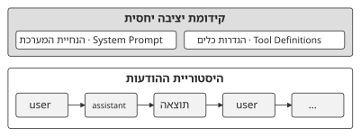

לכן הקטע הזהה שבתחילתן של שתי בקשות עוקבות יכול להימשך אל תוך היסטוריית ההודעות. כמה מהחישוב הקודם יוכל הסבב הבא לנצל מחדש תלוי באורכה של הקידומת הזאת.

ה‑Harness שלהלן מציב בהתחלה את הוראות המערכת ואת הגדרות הכלים, שמשתנות לעיתים רחוקות, ובכל סבב רק מוסיף את המצב הנוכחי לסוף היסטוריית ההודעות. כשההיסטוריה ארוכה מדי, הוא דוחס תחילה את ההודעות הישנות ורק אחר כך מרכיב את הבקשה.

```python
stable_prefix = system_message
stable_tools = core_tool_schemas
history = load_message_history(session)
status_message = make_status_message(derive_current_state(history))

if estimated_tokens(stable_prefix, stable_tools, history, status_message) > budget:
    history = compress_old_evidence(
        history,
        preserve = [decisions, constraints, failures, citations]
    )

request.messages = [stable_prefix] + history + [status_message]
request.tools = stable_tools
response = call_model(request)
```

בדחיסה נשמר המידע שהעבודה בהמשך זקוקה לו — החלטות, אילוצים, כישלונות ומראי מקום — ונשמר הקישור בין בקשות הקריאה לתוצאות הכלים. מלבד תקציב האורך, גם מידע כפול או מיושן יכול להפעיל דחיסה; האסטרטגיות המפורטות יוצגו בחלקו השני של הפרק.

> **ניסוי 2-1 ★: פריסת שירות LLM מקומי וקריאה לכלים**
>
> ניסוי זה מריץ את Qwen3-0.6B מקומית, ובעקבות המשימה "בדוק את השעה ואת מזג האוויר בוונקובר" עוקב אחר מסלולן של ההודעות דרך המודל, המנתח (parser) ומבצע הכלים. איור 2-5 מציג את חלוקת העבודה בין השירות המקומי ללקוח: השרת טוען את המודל, מעבד את הקלט ומייצר את התשובה; הלקוח מתחזק את היסטוריית ההודעות, מתזמן את הכלים ומחזיר את התוצאות.
>
> 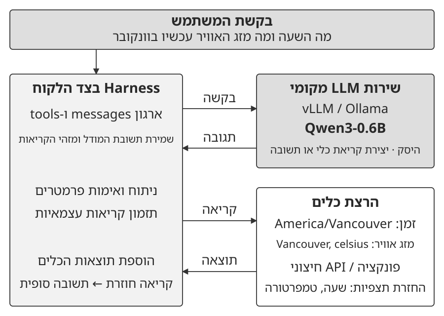
>
> **תחילה, עקבו אחר משימה שלמה אחת.** באותו פלט, המודל מבקש לבדוק את השעה ואת הטמפרטורה, וממלא פרמטרים כגון `America/Vancouver`, `Vancouver` ו‑`celsius`. הלקוח מריץ את שני הכלים במקביל. התשובה הראשונה מחזירה שעה מקומית 11:11:28, והשנייה טמפרטורה של 17.9 °C. לאחר ששתי התוצאות מוחזרות למודל, הוא מדווח את השעה ברמת הדקה, עונה שהטמפרטורה היא 17.9 °C, ומסיים את הלולאה. הרצה זו מראה שמודל בן 600 מיליון פרמטרים כבר מסוגל לבחור נכון את שני הכלים למשימה, למלא את הפרמטרים ולענות למשתמש על סמך הערכים שהוחזרו.
>
> **לאחר מכן, בדקו כיצד הפלט הגולמי ממופה לשדות ה‑API.** מצב החשיבה של Qwen3 יכול לייצר תוכן היסק המסומן ב‑`<think>`, ובקשות לכלים משתמשות בסמני קריאה מתאימים. לאחר שהשרת מנתח את הפלט, הלקוח עשוי לקבל שדה `thinking` נפרד או שדות של קריאות לכלים. אופן הסידור והשימור של חלקי הפלט נקבע במשותף על ידי תבנית המודל ופרוטוקול השירות.
>
> **אחר כך, התבוננו בעיבוד הזורם.** הממשק יכול לעדכן לפי האירועים מצבים כגון "חושב", "קורא לכלי" ו"מייצר תשובה". פרמטרי הכלים מגיעים בדרך כלל בכמה מקטעים, ויש לצבור אותם לבקשה שלמה; לאחר שהפרוטוקול מאשר שהקריאה הסתיימה, ובדיקות הפרמטרים, ההרשאות והתלויות עברו בהצלחה, מערכת ההרצה יכולה להתחיל לתזמן. כלים בלתי תלויים יכולים לרוץ במקביל, וגם ליצור צינור (pipeline) עם עיבוד הפלט שבא אחריהם.
>
> **לבסוף, השוו מהירות ומטמון.** ברישום הרצה זו על Mac עם שבב Apple, מהירות הפענוח הממוצעת במשימות הכלים הייתה כ‑107 טוקנים לשנייה. טוקן הוא יחידת העיבוד הבסיסית של טקסט במודל; אופן החלוקה נקבע על ידי ה‑tokenizer, ומילה או תו סיני יכולים להתאים לטוקן אחד או לכמה טוקנים. מהירות הפענוח משקפת את קצב הפלט לאחר תחילת היצירה; זמן ההמתנה של המשתמש מושפע גם מהשהיית הטוקן הראשון, מאורך ההיסק ומזמן הרצת הכלים.
>
> ההשוואה בין מצבי המטמון משתמשת באותה קידומת ארוכה, ובודקת בנפרד בקשות שמשמרות את הקידומת ובקשות שמשנות את תחילתה. מתוך חמשת הזוגות בהרצה זו, בארבעה הייתה הבקשה ששימרה את הקידומת מהירה יותר; השהיית הטוקן הראשון הממוצעת בשתי הקבוצות הייתה כ‑1.30 שניות וכ‑1.51 שניות בהתאמה. הסעיף הבא מסביר במה נבדלות הבקשות האלה מבחינה חישובית.
>
> ניסוי זה גם חיזק את אמונתו של המחבר בסוכנים על‑גבי‑מכשיר: מודלים קטנים כבר מסוגלים להשלים משימות קריאה לכלים כאלה במכשיר של המשתמש עצמו. **עידן הסוכנים על‑גבי‑מכשיר קרוב יותר משרבים מצפים.**

## עיצוב הקשר ידידותי ל‑KV Cache

בקשות סמוכות של סוכן חולקות בדרך כלל מידע רב: הוראות המערכת, הגדרות הכלים והאינטראקציות שכבר התרחשו. אם מנוע האינפרנס יכול לעשות שימוש חוזר בתוצאות הביניים של החישוב עבור תוכן זה, אפשר להפנות יותר חישוב למידע החדש. **KV Cache** שומר את המפתחות (Key) והערכים (Value) שכבר חושבו בחישוב הקשב של כל שכבה, לשימוש הטוקנים הבאים; **Prompt Cache** מרחיב זאת ועושה שימוש חוזר, בין בקשות, במטמון של קידומות שעומדות בתנאים[^ch2-kv-basics].

חשבו על סוכן שירות לקוחות: כדי שהמודל יידע מה השעה, המפתח הוסיף בתחילת פרומפט המערכת `Current time: {{now}}`, שמתעדכן בכל בקשה. הכללים העסקיים והגדרות הכלים שאחריו נשארים כמות שהם, אך הקלט בפועל משתנה החל מחותמת הזמן. בשירותים שעושים שימוש חוזר ב‑KV לפי קידומת זהה, פירוש הדבר שחותמת הזמן וכל מה שאחריה מחושבים מחדש, וזמן עיבוד הקלט והעלות עולים.

כתיבת השעה כהודעה מצורפת, או קריאה לכלי שעה בעת הצורך, משמרת את הקידומת הקיימת. שתי הפריסות מספקות מידע דומה, אך היקף החישוב מחדש שהן גורמות לו שונה.

כדאי לזכור כבר עכשיו שלוש פרקטיקות; העקרונות והניסויים שבהמשך יסבירו כל אחת מהן:

1. **שמרו על יציבות הקידומת הניתנת לשימוש חוזר.** להוראות המערכת ולהגדרות הכלים הנפוצות יש תוכן קבוע וסדר קבוע.
2. **צרפו את השינויים שבזמן הריצה לחלק האחורי.** שעה, יתרה, מספר קריאות והתקדמות המשימה יכולים להגיע בהודעות חדשות או בתוצאות כלים. המצב העדכני צריך לציין ממתי הוא בתוקף, כדי שהמודל יזהה איזו רשומה חלה על ההחלטה הנוכחית.
3. **ארגנו את ההודעות לפי פרוטוקול המודל.** השתמשו בתפקידים הנכונים, במזהי הקריאה ובפורמט תוצאות הכלים הנכון, ותנו ל‑Chat Template המתאים לייצר את קלט המודל. המטמון מתאים את הקידומת המעובדת ואת התצורה הקשורה אליה, ופרוטוקול ההודעות קובע גם כיצד המודל מזהה הוראות, בקשות משתמש וערכים שהחזירו כלים.

במודל הקשב הסיבתי שבו משתמש סעיף זה, הוספת טוקנים מאוחרים אינה משנה את המצבים שכבר חושבו במיקומים הקודמים. כשמשנים קלט קיים, יש לחשב מחדש את המצבים מהמיקום הראשון שהשתנה והלאה; לקידומת שלפני השינוי עדיין יש סיכוי לשימוש חוזר. השרת גם קובע את היקף הפגיעה בפועל לפי גודל בלוק המטמון, זמן השמירה ותצורת הריצה.

[^ch2-kv-basics]: Hugging Face, How caching works — מתאר את מנגנון השמירה של K ו‑V והשימוש החוזר בהם שכבה אחר שכבה.

> **ניסוי 2-2 ★: ויזואליזציה של מנגנון הקשב**
>
> נתחיל בהבנת חישוב קשב אחד דרך המשפט "北京 的 天气 怎么样" ("מה מזג האוויר בבייג'ינג?"). לצורך ההמחשה, איור 2-6 מחלק את המשפט לארבע יחידות משמעות; מודל אמיתי מחלק את הקלט באמצעות ה‑tokenizer. בעת עיבוד המיקום של "怎么样" (איך הוא), שכבת הקשב צריכה להרכיב את הייצוג הנוכחי מתוך המידע הקיים. Query,‏ Key ו‑Value ממלאים בהתאמה את תפקידי השאילתה, ההתאמה וצבירת המידע.
>
> | וקטור | תפקיד | הבנה אינטואיטיבית בדוגמה זו |
> | --- | --- | --- |
> | **Query (שאילתה)** | הווקטור שהמיקום הנוכחי משתמש בו להתאמה מול מיקומים אחרים | "怎么样" צריך למצוא מידע רלוונטי בתוכן הקיים |
> | **Key (מפתח)** | הווקטור שבאמצעותו כל מיקום משתתף בהתאמה | מיקומים כמו "北京" (בייג'ינג) ו‑"天气" (מזג אוויר) מספקים ייצוגים שאפשר להתאים אליהם |
> | **Value (ערך)** | וקטור המידע הנצבר לפי משקלים | מידע על המקום ועל מזג האוויר זורם לייצוג הנוכחי לפי המשקל המתאים |
>
> אפשר לחשוב על Key כעל תווית לאחזור, ועל Value כעל התוכן שנשלף. במודל, הווקטורים האלה הם ערכים מספריים המחושבים מהייצוגים החבויים, ואופן ההתאמה שלהם מעוצב באימון.
>
> החישוב מתבצע בשלושה שלבים. ראשית, המיקום הנוכחי מייצר Query; לאחר מכן מחשבים מכפלה סקלרית בינו לבין ה‑Key של כל מיקום, ואחרי שינוי קנה מידה (scaling), מסכה סיבתית ו‑softmax מתקבלים משקלי קשב שסכומם 1; לבסוף, מחשבים בעזרת המשקלים האלה סכום משוקלל של ה‑Values. מכפלה סקלרית היא הכפלה של שתי סדרות מספרים איבר באיבר וסיכום התוצאות, ו‑softmax ממיר את הציונים של המיקומים הגלויים למשקלים מנורמלים. ה‑Value של כל מיקום משתתף בצבירה לפי משקלו, ויחד הם יוצרים את הפלט של ראש הקשב הזה.
>
> קראו לרוחב את השורה האחרונה באיור 2-6: המיקום של "怎么样" נותן ל‑"天气" משקל של 0.55. יש להכפיל מספר זה ב‑Value של המיקום של "天气" ולהוסיף את תרומתם של שלושת המיקומים האחרים, כדי לקבל את הפלט של ראש הקשב במיקום "怎么样". ומדוע בשורה של "天气" מופיע מימין איקס נוסף? משום שבזמן חישוב המיקום הזה, הרצף עדיין לא הגיע ל‑"怎么样".
>
> 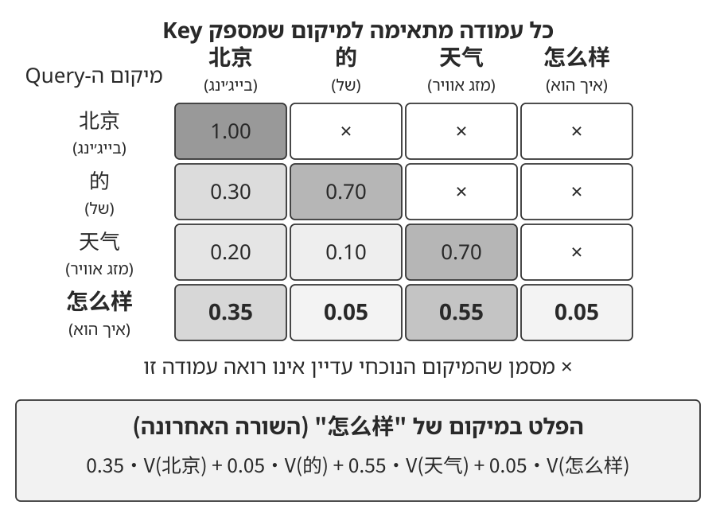
>
> כשמסדרים את המשקלים של כל המיקומים במטריצה, מתקבלת **מפת חום של קשב**. כל שורה מתאימה ל‑Query אחד, כל עמודה ל‑Key אחד, ועוצמת הצבע מייצגת את גודל המשקל. המסכה הסיבתית מאפשרת למיקום הנוכחי לקרוא את עצמו ואת המיקומים שלפניו; באיור מסומנים המיקומים החסומים ב‑×, ומשקלם לאחר softmax הוא אפס. מבנה זה חל הן על עיבוד הקלט והן על היצירה שאחריו.
>
> מכאן גם רואים לשם מה משמש מטמון ה‑K וה‑V: ככל שהיצירה מתקדמת, המיקומים החדשים ממשיכים לקרוא את ה‑Key וה‑Value של המיקומים הקיימים. כשהווקטורים האלה שמורים, מיקום חדש יכול להשתמש בהם ישירות להתאמה ולצבירה, וכך נחסך חישוב חוזר של המיקומים ההיסטוריים.
>
> לאחר שהבנו את המשקלים הסכמטיים האלה, נבחן ב‑Qwen3-0.6B את התפלגות הקשב שהמודל מחשב בפועל. הניסוי רושם בנפרד משפט קצר ורצף יצירה הכולל היסק ותשובה סופית, ומשווה את מטריצות הקשב בשכבות שונות. איור 2-7 מציג את שכבות 0,‏ 13 ו‑27: בעמודה השמאלית משפט קצר בן תשעה טוקנים, ובימנית רצף היצירה של החישוב 17 × 23, שבו מסומנים טווחי הקלט, ההיסק והתשובה. רמות האפור ערוכות בסקאלה לוגריתמית, כדי שאפשר יהיה לראות בבת אחת משקלי קשב חזקים וחלשים.
>
> 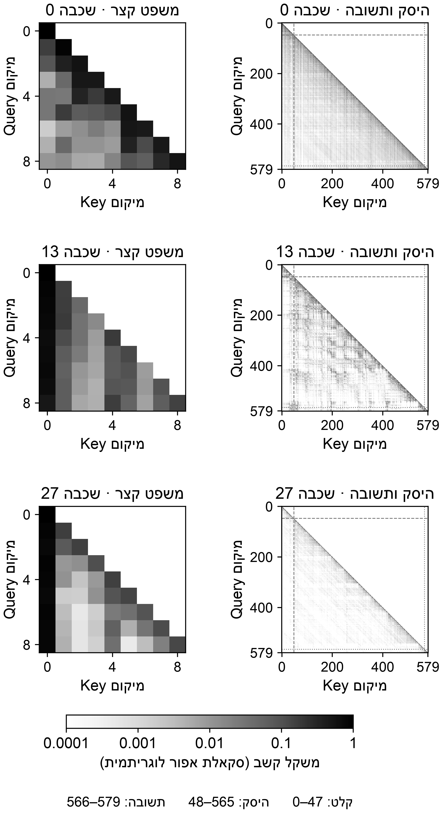
>
> בקריאת האיור אפשר לנתח לאורך ארבעה קווים:
>
> 1. **בולען קשב (Attention Sink).** שכבות מסוימות מקצות משקל גבוה לתחילת הרצף, אף שהטוקן הראשון נושא מעט משמעות. הביטו במשפט הקצר בעמודה השמאלית של איור 2-7. בכל תמונה כבר חושב ממוצע על פני ראשי הקשב של אותה שכבה. אם מחשבים עוד את הממוצע של תשעת המספרים בעמודה הראשונה של המטריצה, מקבלים כמה משקל מקצים בממוצע תשעת המיקומים לטוקן הראשון. בשכבות 0,‏ 13 ו‑27 הערכים הם 14.7%,‏ 73.9% ו‑83.2% בהתאמה. ברצף היצירה הארוך יותר שבעמודה הימנית, הערך בשכבה 13 יורד ל‑28.0%. softmax מחייב שסכום המשקלים של כל המיקומים יהיה 1, והמודל יכול ללמוד מיקום קולט יציב יחסית; StreamingLLM חקר במיוחד את התופעה הזאת ואת תפקידה באינפרנס זורם[^ch2-attention-sinks].
> 2. **אזור ההיסק.** סמנו את טווח היצירה המתאים ל‑`<think>`, ובדקו לאורך השורות האלה לאילו פרומפטים, תיאורי כלים או היסק קודם המודל מפנה קשב. המשולש נובע מהמסכה הסיבתית; רק הגוונים שבתוך המשולש משקפים את הבדלי המשקל בין המיקומים.
> 3. **אזור התשובה.** סמנו גם את טווח היצירה של התשובה הסופית, והשוו את חלוקת המשקל שלה בין הקלט המקורי להיסק הקודם. כך אפשר לאתר איזה מידע קיים נכנס לצבירת הקשב הנוכחית.
> 4. **הבדלי מיקום.** המאמר "Lost in the Middle" מצא, במענה על שאלות בהקשר ארוך ובאחזור מפתח‑ערך, שקשה יותר לנצל ביעילות מידע הנמצא באמצע[^lost-in-the-middle]. מבחינה הנדסית אפשר לגזור מכך עדיפות להצבת כללים קבועים בחלק הקדמי, ולהצבת היעד הנוכחי וההתקדמות בסוף.

[^ch2-attention-sinks]: Xiao et al., Efficient Streaming Language Models with Attention Sinks, ICLR 2024.

[^lost-in-the-middle]: Liu et al., Lost in the Middle: How Language Models Use Long Contexts, TACL 2024.

### מהודעות API לטוקני מודל: Chat Template

דוגמאות ה‑API הקודמות הן סדרת הודעות בעלות תפקידים, ואילו הקלט במפות הקשב הוא שרשרת טוקנים. **Chat Template (תבנית צ'אט)** אחראית להמרה הזאת: היא מוסיפה להודעות סמני תפקיד וגבול, מארגנת לפי מוסכמה את תיאורי הכלים ואת הערכים המוחזרים, ומעבירה את התוצאה ל‑tokenizer לקידוד. השוו את שתי העמודות באיור 2-8: משמאל נשלחו רק הוראות המערכת ושאלת המשתמש — אז מאין הגיע `assistant` נוסף מימין? זהו סמן הפתיחה שהתבנית מוסיפה לתשובה הבאה. נשתמש בסמנים האלה שוב כשנדון בקריאות לכלים, בשימור מידע ההיסק ובפגיעות מטמון.

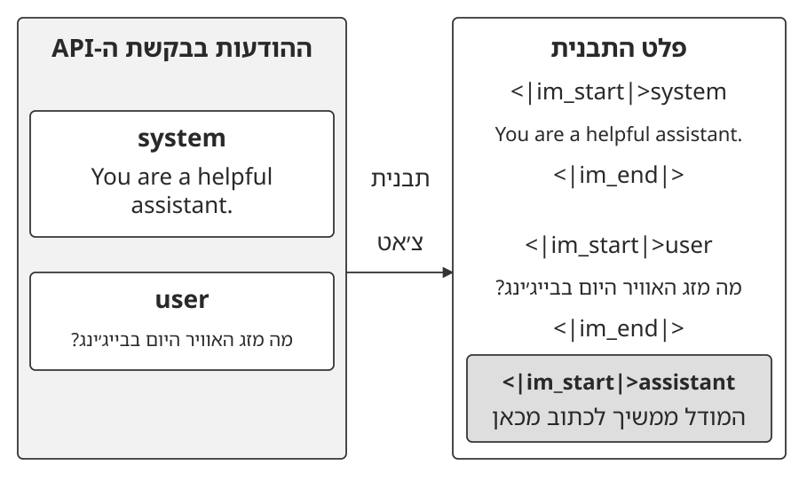

למשפחות מודלים כמו Qwen,‏ Llama ו‑Gemma יש תבניות צ'אט משלהן. אותה סדרת הודעות API, כשהיא נמסרת למודלים שונים, עשויה להיות מומרת לסמני תפקיד וגבול שונים. בממשקי API מנוהלים השרת מבצע בדרך כלל את ההמרה; בפריסה עצמית, יש להגדיר לשירות האינפרנס תבנית התואמת את המודל.

נניח שהמשתמש שולח את המשפט "ונקובר 17.9 °C", וכלי מזג האוויר מחזיר במקרה בדיוק אותו טקסט. כשמעבירים את שתי ההודעות בנפרד דרך התבנית של Qwen3-0.6B, מתקבלים שני מקטעי הקלט שבאיור 2-9. שניהם מתחילים ב‑`<|im_start|>user` — איזה סמן מעיד שהטקסט הגיע מכלי?

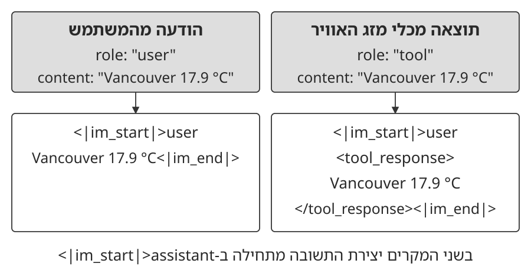

בעמודה הימנית נוסף זוג תגיות `<tool_response>`. התבנית גם מאתרת, לפי תפקידי ההודעות, את השאלה האחרונה של המשתמש: בסבבים שלפני שאלה זו נשמר רק תוכן התשובה; לאחריה, אינטראקציות עם כלים יכולות לכלול גם את מידע ההיסק של המודל[^ch2-qwen-template].

לדוגמה, המודל בדק קובץ ועדיין צריך להמשיך בניתוח. כשתוצאת הכלי מוחזרת בתפקיד `tool`, התבנית מזהה אותה כמשוב כלי בתוך המשימה הנוכחית; אם כותבים את אותה תוצאה ישירות כהודעת `user` רגילה, התבנית עלולה לזהות אותה כשאילתה חדשה ולשנות את טווח השימור של ההיסק הקודם. זה דומה להמשך פתרון תרגיל, שבו צריך לשמור את דף הטיוטה: ה‑Harness צריך לשמור את שדות ההיסק שהשירות דורש, ולהמשיך את הקריאות במבנה ההודעות הנכון.

**במעבר מהיסק חד‑סבבי לסוכן ארוך טווח, החשיבה ההיסטורית הופכת בהדרגה למצב משימה שיש לתחזק.** תבנית הצ'אט של DeepSeek-R1 המוקדם הסירה את חלק החשיבה מהתשובות ההיסטוריות והשאירה רק את התשובה הסופית[^ch2-r1-template]; פרוטוקול הקריאה לכלים המאוחר יותר של DeepSeek דורש דווקא להחזיר את מידע ההיסק. בסיום שאלה ותשובה, ייתכן שהתשובה הסופית כבר מכילה את המידע הדרוש לסבב הבא; אך באמצע משימת כלים, "מדוע בודקים את הקובץ הזה" ו"אילו השערות כבר נשללו" עשויים להיות כתובים רק בהיסק הביניים. שימור המידע הזה עוזר לסבב הבא להמשיך את קו המחשבה הקיים.

**אופן החזרת מידע ההיסק נקבע בפרוטוקול המודל.** בשילוב מודל צריך לטפל בו‑זמנית ב‑`content`, ב‑`tool_calls` ובשדות ההיסק שהשירות מספק. הפתרונות הבאים מדגימים כללי המשך שונים:

- **מצב החשיבה של DeepSeek** מחזיר את ההיסק דרך `reasoning_content`. לפי פרוטוקול הקריאה לכלים שלו, כשבקשה כוללת `tools`, הבקשות הבאות חייבות להחזיר במלואו את ההיסק ההיסטורי, כולל תשובות מודל שלא קראו לכלים; שדה חסר גורם לשגיאת 400. בבקשות צ'אט רגילות ללא `tools`, השירות מתעלם מההיסק ההיסטורי שהוחזר[^ch2-deepseek-thinking].
- **החשיבה והאינטראקציה עם כלים ב‑Kimi** דורשות אף הן לנהל בלולאת הריצה את ההיסק, את בקשות הכלים ואת התוצאות. בדוגמת החשיבה המשולבת (interleaved thinking) של Kimi K2.5, המודל יכול להמשיך להסיק בין קריאות כלים מרובות, והלקוח שומר ומחזיר את הודעות המודל לפי הפרוטוקול שלו[^ch2-kimi-thinking].
- **החשיבה השמורה של GLM** מופעלת באמצעות `thinking.clear_thinking: false`, ולאחר מכן יש להחזיר את `reasoning_content` במלואו ובסדר המקורי. ל‑Coding Plan ול‑API הסטנדרטי יש הגדרות ברירת מחדל שונות, ועל הלקוח לבחור במפורש את המצב הנדרש[^ch2-glm-thinking].
- **בלוק ה‑thinking של Claude** צריך להישמר יחד עם החתימה שלו. מודלים התומכים ב‑preserved thinking גם בודקים את מקור הבלוק ואת הקידומת; הכללים המפורטים מופיעים בהמשך, בסעיף "שמירה במטמון כאילוץ ארכיטקטוני".

כללים אלה משפיעים על קריאות כלים רצופות, וגם על החלפת מודל באמצע הדרך. בהחלפה, שכבת ההתאמה צריכה להמיר את בקשות הכלים, התוצאות ומצב המשימה לצורה שממשק היעד מקבל, ולטפל במידע ההיסק לפי כללי מודל היעד. ניסוי 5-1 בפרק 5 מרחיב על המשכת מסלול מסוג זה.

**התבנית קובעת גם את הקלט שהמטמון מתאים.** אותו תוכן הודעות, כשהוא עובר דרך תבניות שונות, סדר כלים שונה או אופן סריאליזציה שונה, עשוי ליצור קידומות טוקנים שונות. כדי לעשות שימוש חוזר ב‑KV קיים, יש לשמור על עקביות של תצורת המודל הרלוונטית ושל הקידומת.

[^ch2-qwen-template]: קובץ תצורת ה‑tokenizer של Qwen3-0.6B,‏ `tokenizer_config.json`, שומר את תבנית הצ'אט, הכוללת את לוגיקת הטיפול בשאילתות משתמש, בתוכן ההיסק ובתגובות כלים.

[^ch2-r1-template]: תבנית הצ'אט הרשמית של DeepSeek-R1 שומרת בתשובות היסטוריות רגילות את התוכן שאחרי `</think>`; כללי החזרת ההיסק בקריאות כלים מאוחרות יותר מופיעים בתיעוד Thinking Mode של DeepSeek.

[^ch2-deepseek-thinking]: DeepSeek, Thinking Mode.

[^ch2-kimi-thinking]: Moonshot AI, המאגר הרשמי של Kimi K2.5, הסעיף Interleaved Thinking and Multi-Step Tool Call.

[^ch2-glm-thinking]: Z.ai, Thinking Mode — מתאר חשיבה משולבת, חשיבה שמורה והגדרות ברירת המחדל של נקודות הקצה.

### עקרונות ואילוצים של KV Cache

כשהמודל מטפל בבקשה, הוא מבצע תחילה **prefill (מילוי מקדים)** על הקלט ומחשב את הייצוגים של הטוקנים הקיימים, ואז עובר ל‑**decode (פענוח)** ומייצר את הטוקנים הבאים אחד אחד. ה‑KV Cache שומר במהלך הפענוח את ה‑K וה‑V של המיקומים הקיימים; מטמון קידומת חוצה‑בקשות מוסיף על כך שימוש חוזר בקידומת הזהה שהותירה הבקשה הקודמת.

לדוגמה, בסבב השישי צבר הסוכן כבר 2,000 טוקני קלט. אם השירות משתמש רק ב‑KV Cache שבתוך הבקשה הנוכחית, עליו לעבד תחילה את כל 2,000 הטוקנים, ורק אז להמשיך לייצר בעזרת המטמון. אם במטמון חוצה‑הבקשות כבר שמור קטע של אותה קידומת, ה‑prefill יכול להמשיך מהמיקום הראשון שטרם נשמר. איור 2-10 מציג שימוש חוזר כזה בין בקשות.

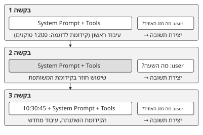

**מעקב אחר גדילת המטמון בעזרת ארבעה טוקנים.** נניח שהקלט הוא `[A, B, C, D]`. כשהמודל מעבד את המיקום D, הוא מתאים את ה‑Query של D מול ה‑Keys של A,‏ B,‏ C ו‑D, ואז מחשב סכום משוקלל של ה‑Values שלהם. לאחר החישוב בכל השכבות, הייצוג הסופי במיקום D משמש לחיזוי הטוקן הבא, E. בשלב זה כבר שמורים ה‑K וה‑V של A עד D בכל השכבות.

לאחר ש‑E נדגם, הצעד הבא מזין את E למודל ומחשב את ה‑Query,‏ Key ו‑Value שלו בכל שכבה. ה‑Query של E קורא את המטמון הקודם ואת ה‑K וה‑V של המיקום הנוכחי, והמודל חוזה את הטוקן השישי; במקביל, ה‑K וה‑V של E מצורפים למטמון. כך, בכל צעד יצירה אפשר להמשיך מהמצב הקודם ולחשב רק את המצבים של הטוקן החדש שנכנס.

ללא KV Cache כלל, חיזוי E מחייב לעבד מחדש את A עד D, וחיזוי הטוקן השישי מחייב לעבד שוב את A עד E. אם סופרים רק את מספר המיקומים שה‑K וה‑V שלהם מחושבים שוב, העבודה המצטברת גדלה כמו $1+2+\cdots+N$. עם מטמון, החישוב לפי שכבות של המיקומים ההיסטוריים נחסך; המיקום החדש עדיין צריך לקרוא את כל ה‑K וה‑V הנראים לו. בפענוח עם קשב מלא סטנדרטי, הקריאה וההתאמה האלה גדלות לינארית עם אורך ההקשר, ולכן הקשר ארוך עדיין צורך יותר זיכרון GPU ויותר רוחב פס זיכרון.

**מדוע שינוי בקלט משפיע על המטמון שאחריו?** שכבות ה‑Transformer מעבדות את הייצוגים החבויים בזו אחר זו, ולכל שכבה ה‑K וה‑V שלה. לאחר חישוב הקשב, הייצוג של מיקום מסוים כבר מכיל מידע מהמיקומים שלפניו, והוא מועבר לשכבה הבאה. לכן, כשהטוקן ה‑$k$ משתנה, ההשפעה מתפשטת מאותו מיקום קדימה ואל השכבות הגבוהות יותר.

באותו מודל ובאותה תצורת חישוב, המיקומים שלפני $k$ תלויים רק בקלט מוקדם יותר וניתן להמשיך להשתמש בהם; מ‑$k$ והלאה יש לבנות מחדש את המצבים שהושפעו. שירותים בפועל מתאימים קידומות בדרך כלל לפי בלוקי מטמון, ולכן גבול החישוב מחדש תלוי גם בגודל הבלוק. ככל שהעדכון מוקדם יותר, כך בדרך כלל יש לחשב מחדש יותר קלט. הצבת ההוראות היציבות בראש וצירוף מצב חדש בסוף הם ניצול ישיר של תלות זו.

> **ניסוי 2-3 ★★: השוואה בין שיטות לניהול הקשר**
>
> בניסוי זה הסוכן משתמש בכלים לגילוי קבצים, לקריאתם ולחיפוש בהם כדי להשלים משימה אחת, ומשווים בין קו בסיס של צירוף יציב לבין חמישה שינויים בהקשר. קו הבסיס שומר על סדר יציב של ההוראות והכלים ומצרף בכל סבב את הודעות המודל ואת תוצאות הכלים. כל אחת מהקבוצות האחרות משנה את ההוראות, את המצב, את סדר הכלים או את אופן ייצוג ההיסטוריה, ובודקים כיצד משתנים נתוני המטמון ומהלך המשימה.
>
> **הנחיית מערכת דינמית** מעדכנת בכל סבב את השעה הנוכחית בהוראות המערכת. לפני נקודת השינוי עדיין יכולה להיות קידומת משותפת, אך הקלט ממידע הזמן והלאה צריך להיות מותאם או מחושב מחדש. אפשר לצרף את השעה כהודעה חדשה, או לקבל אותה לפי הצורך דרך כלי זמן, כך שהכללים העסקיים הקבועים ימשיכו להיות בשימוש חוזר.
>
> **תצורת משתמש דינמית** מעדכנת בהודעות שבראש ההקשר את מספר הקריאות שנותרו או את יתרת החשבון. המצב עצמו הוא מידע שהמשימה צריכה, ושאלת העיצוב היא היכן לעדכן אותו: צירוף המצב העדכני בסוף, יחד עם ציון מועד תוקפו, שומר גם על ההתקדמות וגם על הקידומת. שורת מצב הסוכן שבהמשך בנויה בדיוק כך.
>
> **סידור מחדש של הגדרות הכלים** משנה בכל סבב את סדר רשימת הכלים. השמות והפרמטרים זהים, אך סדר הטוקנים לאחר הסריאליזציה כבר השתנה. בדוח ההרצה של Kimi K2.6, ה‑`Hit%` של קו הבסיס ושל קבוצת הסידור מחדש הוא 100% בשתיהן. האם שתי הקבוצות באמת עשו שימוש חוזר באותה כמות קלט? קו הבסיס קיבל בשלושה סבבים 7,567 טוקני קלט, מהם 768 פגעו במטמון; קבוצת הסידור מחדש, גם היא בשלושה סבבים, קיבלה 7,568 טוקני קלט ורק 256 מהם פגעו. חלוקת מספר הטוקנים מהמטמון במספר טוקני הקלט נותנת את 10.1% ו‑3.4% שבעמודה `Cache%`. העמודה האחרת, `Hit%`, סופרת בקשות שסומנו כפגיעה: בקו הבסיס נרשמו שתי פגיעות, בקבוצת הסידור מחדש רק אחת, ובשתי הקבוצות לא נרשמה אף החטאה. על שאר הבקשות אי אפשר לקבוע מרשומה זו אם פגעו או לא. סדר כלים קבוע מונע שינויים מיותרים בקידומת.
>
> **חלון מחליק** שומר רק את קטע ההיסטוריה האחרון. אם שומרים עשרה סבבי אינטראקציה, ייתכן שבסבב החמישה‑עשר הסוכן כבר לא יוכל לקרוא את תוכן הקובץ החשוב שהשיג בסבב השני. מעבר לקיצור הקידומת המשותפת, הקיצוץ משנה גם את העובדות ואת התקדמות המשימה שהמודל יכול לראות. המימוש הנלווה מתחיל משש הודעות ההיסטוריה האחרונות, ומשלים לאחור את בקשות הקריאה שאליהן שייכות תוצאות הכלים. קבוצת החלון המחליק עשתה שימוש חוזר ב‑1,510 מתוך 2,224 טוקני קלט, ושיעור המטמון שלה, 67.9%, היה הגבוה מבין שש הקבוצות. אבל ברשומת הכלים של קבוצת החלון המחליק בניסוי 2-3 רואים שהמודל חיפש קבצים שלוש פעמים, קרא אחר כך שני קבצים, ולא מסר את הסיכום בן שלושת המשפטים שהמשתמש ביקש.
>
> **עיצוב כטקסט** כותב מחדש את ההיסטוריה בעלת התפקידים כטקסט כגון `USER: ...`,‏ `ASSISTANT: ...`. הדבר משנה את גבולות ההודעות ואת מבנה הכלים בתבנית, והמודל נאלץ לשחזר את היחסים המקוריים מתוך גוף הטקסט. בהרצה זו קבוצת הטקסט עדיין הפיקה תשובה סופית, והיו לה גם פגיעות במטמון. תפקידי ההודעות, מזהי הקריאות ושדות תוצאות הכלים שהממשק מספק מסייעים להעביר את היחסים האלה באופן יציב.
>
> גם אם התוכנית בונה מחדש את רשימת ההודעות, כל עוד הקידומת הנשלחת ותצורת המטמון זהות, יש לקידומת זו סיכוי להיות בשימוש חוזר.
>
> כדי לדעת כמה פחות המשתמש המתין, צריך קודם לבדוק היכן נעצר הטיימר. ה‑`ttft` של הסבב הראשון בקבוצת החלון המחליק הוא כ‑2.23 שניות. התוכנית אמנם קוראת לשדה הזה TTFT (זמן עד הטוקן הראשון), אבל היא עוצרת את השעון רק כשבקשה שאינה זורמת מחזירה את התשובה כולה.

### KV Cache ו‑Prompt Cache: שתי רמות של שמירה במטמון

אפשר להבחין בין שתי רמות המטמון בעזרת שני רגעים. כשהמודל מייצר את הטוקן השני בתשובה, הוא יכול לקרוא את מצבי המפתח‑ערך של המיקומים הקיימים באותה בקשה — זהו **KV Cache**. מעט אחר כך המשתמש שואל שאלת המשך, וה‑Harness שולח בקשה חדשה; השירות צריך תחילה למצוא את הקידומת הזהה שנשמרה קודם, ורק אז הוא יכול לחסוך את חישוב הקלט הזה — זהו **Prompt Cache**. הראשון מסביר כיצד ממשיכה יצירה אחת, והשני דורש גם מנגנון שמירה והתאמה בין בקשות.

בשירותי API, המטמון מושפע גם מאורך הקידומת המינימלי, מגודל הבלוק, מתקופת התוקף, מתצורת המודל ומהיקף הבידוד בין לקוחות. קידומת לשימוש חוזר חייבת להימצא באותו תחום מטמון. לדוגמה, ה‑API של Claude מבודד את המטמון לפי ארגון ו‑workspace; אותו טקסט בתחומי בידוד שונים יוצר מטמונים נפרדים[^ch2-prompt-cache].

בחיוב יש לשקול בנפרד כתיבה וקריאה. בחלק ממודלי Claude, מחיר קריאה מהמטמון הוא עשירית ממחיר קלט רגיל, ואילו הכתיבה הראשונה כרוכה בתוספת תשלום. אם אותה קידומת חוזרת שוב ושוב בתוך תקופת התוקף, משלמים על הכתיבה פעם אחת בלבד, וכל בקשה שפוגעת במטמון לאחר מכן מחויבת במחיר הקריאה.

[^ch2-prompt-cache]: Anthropic, Prompt caching: התאמת מטמון, בידוד, תקופת תוקף וחיוב.

### שמירה במטמון כאילוץ ארכיטקטוני

**במערכות ייצור, המטמון כבר הפך לאילוץ ארכיטקטוני.** סדר הפרומפט, נקודת ההתחלה של תת‑סוכן ואופן שחזור הסשן — כולם משפיעים על כמות החישוב שאפשר לעשות בה שימוש חוזר. **את גבולות המטמון יש לתכנן כבר בתחילת העיצוב.** מי שקובע תחילה איזה תוכן ניתן לשיתוף ואילו מצבים משתנים, ורק אחר כך מארגן את הפרומפטים ואת מבנה הסשן, מצמצם חישובים חוזרים בזמן ריצה. אם מחכים עד שזמן ההשהיה והעלות של משימות ארוכות כבר הפכו לבעיה, שינוי המבנים האלה גורר לעיתים קרובות שינויים בניהול המצב, בתת‑הסוכנים ובשחזור הסשנים.

**סדרו את הקידומת לפי מידת היציבות.** הוראות והגדרות כלים המשותפות למשימות רבות יכולות לבוא בראש, ואחריהן נתוני המשתמש, מצב הסשן ותצפיות חדשות, מקובצים לפי היקף התחולה. לדוגמה, למערכת ההפעלה שתי אפשרויות, macOS/Linux, למצב הריצה שתיים, רגיל/ניפוי שגיאות, ולשפה שתיים, סינית/אנגלית; שלושה תנאים בלתי תלויים מייצרים עד $2\times2\times2=8$ צירופי קידומת. הצבת השדות המשתנים יותר אחרי החלק המשותף מגדילה את הסיכוי לשימוש חוזר בקידומת המשותפת. גם היקף השיתוף של החלק המשותף חייב לכבד את גבולות הארגון, ה‑workspace והפרטיות של השירות.

**בחרו לתת‑הסוכן נקודת התחלה שאפשר לעשות בה שימוש חוזר.** תת‑סוכן היורש את רקע המשימה של סוכן ההורה יכול לעשות שימוש חוזר בקידומת הזהה לשניהם, ולצרף אחריה את תת‑המשימה שלו. הפרומפט, סדר הכלים, המודל והתצורה הרלוונטית קובעים יחד את היקף השימוש החוזר. תת‑סוכן הזקוק לתפקיד עצמאי או להקשר מבודד בונה את הקלט לפי המשימה שלו, ואז בודקים אילו חלקים משותפים מתאימים לשיתוף.

**שמרו את מה שכבר נשלח.** כשפלט כלי גדול נדחס לסיכום או לתצוגה מקדימה, יש לשמור את הגרסה שנשלחה בפועל למודל. השמעה חוזרת של רשומה זו בשחזור סשן בונה מחדש רצף הודעות עקבי; יצירה מחדש של הסיכום בכל שחזור עלולה להכניס ניסוח חדש ושינויים בקידומת. כשמעדכנים סיכום, אפשר לפרסם גרסה חדשה ולקבוע במפורש מאיזו נקודה בונים את המטמון מחדש.

**שימור ההיסק כפוף גם לאילוצי פרוטוקול.** ה‑preserved thinking של Claude מספק לכך דוגמה קונקרטית. התיעוד שלו מציג את המנגנון ככלי למניעת זיקוק: השירות בודק את החתימה של בלוק החשיבה, את המודל שיצר אותו ואת הקידומת שלו. במודלים התומכים בקשירה לקידומת, כמו Claude Fable 5.1 ו‑Claude Opus 5.5, ה‑`system` וה‑`tools` ברמה העליונה וההודעות שלפני הבלוק מהווים יחד את תחום הבדיקה; שינוי בתוכן כלשהו בתחום זה מבטל את הבלוק ואת כל בלוקי החשיבה שאחריו[^ch2-preserved-thinking].

לדוגמה, שכתוב שעון המערכת בכל סבב, רינדור מחדש של מידע הסביבה בהודעה הראשונה וקיצור במקום של תוצאות כלים ישנות — כל אלה משנים את הקידומת שאליה קשורים בלוקי ההיסק שאחריהם. כשהבדיקה נכשלת, ה‑API יכול להחזיר שגיאת 400, או, לפי התצורה של `prefix_mismatch_behavior`, להשליך את הבלוקים שבוטלו ולהמשיך לטפל בבקשה. במקרה השני המודל עדיין יכול להשתמש במידע המשימה ובתוצאות הכלים שנשמרו, אך ההיסק שבוטל אינו משתתף עוד בקלט הנוכחי. בחשבונות שנוצרו מ‑31 באוגוסט 2026 ואילך בדיקת הקידומת מופעלת כברירת מחדל; לגבי חשבונות ותיקים יותר, אופן ההפעלה מתואר בתיעוד הפרוטוקול.

כשמשתלבים בפרוטוקול כזה, אפשר לשמור על יציבות ההוראות ברמה העליונה ועל קבוצת הכלים של הסשן, ולצרף שינויי מצב בסוף. אם צריך לעדכן הוראות או כלים באמצע, משתמשים בממשקים שהשירות מספק לשם כך, כמו הודעות מערכת בתוך הסשן ובלוקים של שינוי כלים. גם קיצוץ בלוקי חשיבה חייב לשמור על קטע רציף בסדר המקורי: מותר למחוק מההתחלה או מהסוף, או למחוק את כולם; פער באמצע פוגע בבלוקים שאחריו, ובלוקים שנמחקו במכוון צריכים להישאר מחוקים.

בהחלפת מודל באמצע הדרך, השירות בודק גם אם מודל היעד מסוגל לקרוא את בלוקי ההיסק של המודל המקורי. על הלקוח לשמור את ההיסטוריה המקורית ולתת לשירות לטפל בה לפי כללי התאימות; אם הלקוח מוחק אותה בעצמו, גם חזרה מאוחרת יותר למודל המקורי לא תשחזר את הרשומות האלה.

[^ch2-preserved-thinking]: Anthropic, Preserved thinking: מודלים, קשירה לקידומת, טיפול בביטול וכללי קיצוץ בלוקי היסק; על ממשקי העדכון בתוך הסשן ראו Mid-conversation system messages and tool changes.

### הרחבה מחקרית: KV Cache שניתן לערוך ולהרכיב

> כל העיצובים שלעיל עושים שימוש חוזר בחישוב באמצעות התאמת קידומות. המחבר רוצה לבחון צעד נוסף: האם אפשר לערוך ולהרכיב ישירות את המידע שכבר שמור ב‑KV, כך שהמטמון יסתגל לשינויים בהקשר? במאמר *Models Take Notes at Prefill* השווה המחבר מידע זה ל"פתקים" של המודל[^ch2-2]: לאחר שה‑prefill עובר שכבות קשב רבות, השפעתו של שדה כבר נכנסה לייצוגים של המיקומים שאחריו. לדוגמה, "עיר המשתמש: בייג'ינג" עשויה להשפיע על החלטות מאוחרות יותר הנוגעות למקום; אם מחליפים רק את ה‑K וה‑V של השדה עצמו, המצבים שאחריו עלולים עדיין לשמר מסקנות שנגזרו מהעיר הישנה.
>
> המאמר מפריד באמצעות התערבויות בין תרומת ה‑KV של השדה עצמו לבין תרומת המצבים שאחריו. בהחלטות שנמדדו, התרומה הישירה של ה‑KV של השדה הייתה נמוכה מ‑1%, וההשפעה העיקרית נשמרה בייצוגים שבמורד הזרם. סביב "הפתקים" האלה שבמורד הזרם אפשר לבחון שתי דרכים לנצל את המטמון.
>
> **עריכה (Editing)** משתמשת במידע מתוקן מפורש כדי לגרום לחישוב שאחריו לעדכן שיפוטים קיימים. המאמר מצא גם שבמשימות שנמדדו על מודל 8B, כשיש שרשרת מחשבה מפורשת, עריכת השדה לבדו משחזרת את ההחלטה הרצויה, בעלות חישוב של כ‑1% מחישוב מחדש מלא; בלי תהליך היסק כזה, המצבים הישנים שבמורד הזרם עלולים להמשיך להשפיע על ההחלטה, ושינוי השדה מתקשה להשפיע.
>
> **הרכבה (Composition)** מחברת מטמון מיומנות שחושב מראש להקשר חדש. במודלים המשתמשים בקידוד מיקום סיבובי (RoPE), יש לתקן תחילה את ייצוגי המיקום במטמון, ורק אז לשרשר. אפשר לדמות זאת למספור מחדש של דף פתקים קיים כדי לצרף אותו אחרי חומר אחר. המאמר השווה שנים‑עשר מודלים: דמיון הקוסינוס בין הלוגיטים של הפלט בשרשור לבין אלה של חישוב מחדש מלא היה 0.90–0.999; מיקום המטמון מחדש והשרשור עצמו לינאריים באורך, וחוסכים את חישוב הקשב מחדש על ההקשר כולו.
>
> צירוף מידע מתוקן משתלב גם עם מטמון הקידומת הקיים. במבחן המקוון של המאמר על vLLM, השילוב שמר על שיעור פגיעה של כ‑98.5% במטמון הקידומת, וה‑p90 של הזמן עד הטוקן הראשון היה כ‑1/398 עד 1/53 מזה של קו הבסיס.
>
> **המחבר מאמין בכיוון מחקרי זה, משום שהוא עשוי לאפשר לעדכוני הקשר לשמר יותר מהחישוב הקיים.** סוכנים מעדכנים לעיתים קרובות שדות זיכרון, מוסיפים מצב או מחליפים הגדרות כלים; אם אפשר יהיה לתקן ולשרשר את המצבים הרלוונטיים כמו פתקים, עלות התחזוקה של הקשר ארוך עשויה לרדת משמעותית.

[^ch2-2]: Li, Bojie, Models Take Notes at Prefill: KV Cache Can Be Editable and Composable, 2026. ניסויי העריכה, ההרכבה והמטמון המקוון משתמשים במשימות ובמדדים שונים; לפרטי ההגדרות ראו את המאמר.

### ממנגנון המטמון לעיצוב תוכן ההקשר

אחרי שהבנו כיצד המטמון חוסך חישוב, צריך להחליט מה נכנס לקלט בכל סבב וכיצד התוכן הזה מתעדכן. ההמשך מחולק לשלושה חלקים:

- **הנדסת פרומפט ו‑Agent Skills**: תחילה מעצבים את הוראות המערכת ואת הגדרות הכלים, שמתארות את המטרה, הכללים ואופן הפעולה; אחר כך טוענים ידע תחומי לפי הצורך באמצעות חשיפה הדרגתית. ההגנה מפני הזרקת פרומפט עוסקת במקור של תוכן חיצוני הנכנס להקשר ובגבולות ההוראות שבו.
- **שורת מצב הסוכן**: מספקת למודל מצב כמו התקדמות המשימה, סיכום תצפיות הסביבה ומספר הקריאות, וחוסכת את הצורך לגזור אותו מחדש מהיסטוריה ארוכה. בדומה לשעה, לסוללה ולמצב הרשת בטלפון, היא שומרת את מצב הריצה הנוכחי גלוי.
- **דחיסת הקשר**: כשההיסטוריה גדלה, משמרת את המידע הדרוש להחלטות הבאות, וקובעת מתי לדחוס, כיצד לארגן את הסיכום, וכיצד לטפל בחישוב המטמון מחדש ובהמשכיות המשימה.

## הנדסת פרומפט: אופטימיזציה של הנחיית המערכת

הנדסת פרומפט מכוונת את המודל לבצע משימות קונקרטיות באמצעות הוראות, תהליכים ודוגמאות. סעיף זה מתמקד ב**הנחיית המערכת (System Prompt)**: בדומה למדריך לעובד, היא מגדירה את זהות הסוכן, את מטרותיו, את כללי ההתנהגות ואת תהליך העבודה. בדוגמאות ה‑API בפרק זה, תוכן זה מסופק בהודעת `system`.

### טון וסגנון: כיצד לפנות אל המשתמש

את דרישות הטון יש לתרגם לניסוחים קונקרטיים. למשל, בשאלות ותשובות קצרות אפשר לדרוש "You MUST answer concisely with fewer than 4 lines", כלומר לענות בפחות מארבע שורות. כשהמשימה נתקעת, אפשר לדרוש "keep your response to 1–2 sentences": משפט או שניים שמתארים את המצב הנוכחי ואת הצעד הבא, כך שהמשתמש רואה מיד במה עליו לטפל.

הדגשה באותיות רישיות, כמו "NEVER do X", מתאימה להבלטת דרישות מרכזיות. חשוב מזה להסביר באילו מצבים הדרישה חלה ואיזו פעולה יש לנקוט.

### פרומפטים מובנים: היררכיה וגבולות תוכן

כותרות, רשימות ותגיות עוזרות לארגן פרומפטים ארוכים. כותרות Markdown מתאימות לסימון פרקים ושלבים, ותגיות בסגנון XML מתאימות להפרדה בין בלוקי תוכן בעלי ייעוד שונה, למשל עטיפת המידע על ספריית העבודה ב‑`<working_directory>`. שם התגית צריך לומר ישירות מה ייעודו של התוכן, כדי שהמודל יזהה בקלות את היחסים בין הבלוקים.

אפשר לשלב את שתי הדרכים באותו פרומפט:

```text
# כללי שימוש בכלים

## פעולות על קבצים
<file_operation>
- לפני קריאת קובץ, לבדוק שהנתיב קיים
- לפני שינוי קובץ קיים, לשמור גיבוי
</file_operation>

## בקשות רשת
<network_request>
- להגדיר זמן קצוב של 30 שניות
- בתקלות חולפות, לנסות שוב לכל היותר 3 פעמים
- בבקשות בעלות תופעות לוואי חיצוניות, לוודא את מצב הביצוע לפני ניסיון חוזר
</network_request>
```

ה‑Markdown יוצר היררכיה נוחה לקריאה, ו‑`<file_operation>` ו‑`<network_request>` תוחמות את תחום התחולה של הכללים. כך, "לכל היותר 3 ניסיונות חוזרים" חל רק על בקשות רשת, ובשינוי קבצים חלים כללי הגיבוי שבבלוק הקודם.

### ארגון כללים לפי תהליך

**כשלמשימה יש שלבים ברורים, עדיף לארגן את הפרומפט לפי התהליך.** בהחזר כספי, למשל, צריך קודם למצוא את ההזמנה, ורק אז אפשר לבדוק לפי מדיניות ההחזרים אם הכסף ניתן להחזרה. אם ההזמנה לא נמצאה, מבקשים מהמשתמש להשלים פרטים כמו מספר ההזמנה; אם ההזמנה עומדת בתנאים, יוזמים את ההחזר. כשאותם כללים מפוזרים ברשימה של מאות סעיפים, בכל צעד צריך לחפש מחדש את הסעיפים הרלוונטיים. כשתנאי הקלט, סדר הטיפול ונתיבי היציאה החריגים כתובים בשלב המתאים, יש למודל על מה להסתמך כדי לקבוע היכן הוא נמצא ומה עליו לעשות הלאה.

הדוגמה הבאה, בתחום עיבוד קבצים, מחברת בדיקה, סיווג, עיבוד מקדים, ביצוע ואימות לנוהל הפעלה תקני (SOP):

```text
תהליך עיבוד קבצים

שלב 1: בדיקה
  לוודא שהקובץ קיים ונגיש
  הקובץ אינו קיים → לרשום שגיאה ולעצור את העיבוד
  ↓
שלב 2: סיווג
  לקבוע את הסוג לפי הסיומת ותוכן הקובץ
  ↓
שלב 3: עיבוד מקדים
  קובץ תצורה → קודם לגבות
  קובץ גדול (>1 MB) → להשתמש בעיבוד זורם
  ↓
שלב 4: ביצוע
  לבצע את העיבוד המתאים לסוג הקובץ
  ↓
שלב 5: אימות
  לבדוק את שלמות הקובץ לאחר העיבוד
```

כל שלב מגדיר מטרה מקומית, והכללים הרלוונטיים מרוכזים תחתיו. אם הקובץ אינו קיים, היציאה מתבצעת בשלב הבדיקה; אם יש לשנות קובץ תצורה, הגיבוי נשמר בשלב העיבוד המקדים. את ההתקדמות בפועל מספקים למודל היסטוריית ההודעות או רשומת המצב.

### פירוט כללים עסקיים: לנסח במפורש את מוסכמות המוצר

לאיזה סוג בקשה שייכים נתוני הזמנה מסוימים, איזה שירות חל עליהם וכמה לגבות — אלה קודם כול מוסכמות עסקיות שהמוצר והתפעול צריכים לקבוע. המימוש ההנדסי מתחלק אחר כך: הפרומפט אומר למודל אילו שדות להשיג ולאיזה שירות לפנות, והכלים והמערכות העסקיות מבצעים את החיוב והאילוצים באופן דטרמיניסטי.

קחו לדוגמה סוכן שמתקשר בשם המשתמש כדי להוזיל דמי מנוי או לבקש החזר. הצוות רוצה להוריד את סף הניסיון באמצעות "אם זה לא מצליח, מקבלים את הכסף בחזרה", ובמקביל לקבוע שיטת חיוב ברורה למשימות מיוחדות. אפשר לתכנן שלושה סוגי חיוב:

- **עמלה מהחיסכון**: מורידים חשבון קיים באמצעות משא ומתן וגובים אחוז מסוים מהחיסכון בפועל, למשל 20%.
- **תשלום קבוע לפי שירות**: משימות שירות כמו הזמנת מקום במסעדה מחויבות לפי סוג המשימה או מורכבותה.
- **תשלום מראש למשימות קשות**: במשימות קשות שעומדות בתנאים מסוימים, מציגים מראש את התשלום ואת תנאי אי‑ההחזר, והמשימה מתקבלת רק לאחר אישור המשתמש.

ניסוח כמו "בחר את סוג החיוב המתאים לפי נסיבות המשימה" עדיין משאיר עמימות בסיווג. "עזור לי להחזיר את הבגדים שקניתי בחודש שעבר" עוסק בקבלת כסף ששולם, ו"עזור לי לבטל את מנוי ה‑Netflix" עוסק בהפסקת תשלומים עתידיים. את שתי התוצאות אפשר לפרש בהרחבה כחיסכון, אבל הצוות יכול להגביל את העמלה להורדת חשבון קיים במשא ומתן, ולחייב החזרים וביטולי שירות בתשלום קבוע.

הפרומפט המתאים יכול לכתוב את גבולות הקטגוריות במפורש: "NEVER use percentage_based_one_time for refunds and service cancellations. Use fixed_fee instead." כלומר, החזרים וביטולי שירות מחויבים ב‑`fixed_fee`, ומודל העמלה חל רק על הורדת חשבון קיים במשא ומתן.

הצוות צריך גם להעריך מה הסיכוי שהמשימה תצליח. אילו בקשות הספק מקבל, אם המשתמש הזה עומד בתנאים, אילו חיובים מופיעים בחשבון ואיך הסתיימו משימות דומות בעבר — כל אלה משפיעים על אופן קבלת המשימה. אם הכלל משתמש בספים "מעל 60% — מודל עם החזר, מתחת ל‑30% — לא מקבלים", צריך לכתוב גם מה עושים בטווח שביניהם ובערכי הגבול.

בחישוב סכומים יש להגדיר את היחידה, את הבסיס ואת סדר העיגול. לדוגמה, עלות השיחה נצברת ב‑0.05 דולר לדקה ומעוגלת לדולר שלם לאחר הסיכום; החיסכון נמדד ביחס לחשבון הקיים. אם החשבון הנוכחי הוא 150 דולר והספק עשוי להעלות אותו ל‑180 דולר בשנה הבאה, את העלייה הפוטנציאלית שנמנעה בזכות שמירת המחיר הנוכחי יש לטפל לפי הגדרה שסוכמה מראש, ואין לספור אותה אוטומטית כחיסכון מהורדת החשבון הקיים.

המחבר ממליץ ש**מנהל המוצר יוביל את עיצוב הכללים העסקיים** ויתחזק את ההגדרות האלה על סמך נתוני ייצור, משוב משתמשים וניסיון תפעולי; המהנדסים מיישמים אותן בפרומפט, בפרמטרים של הכלים, בלוגיקת החיוב ובכללי האימות.

### דוגמאות Few‑shot: להראות בדוגמה את ההתנהגות הרצויה

כשקשה לבטא את דרישות הפלט בכמה כללים, **שתיים או שלוש דוגמאות איכותיות ישירות יותר מעוד הסברים מופשטים.** שיטה זו נקראת **דוגמאות מעטות (few-shot examples)**. סגנון כתיבה מסוים, דוחות מובנים וטון של שירות לקוחות מתאימים כולם להצגה כזוגות של קלט ופלט רצוי. המודל משתמש בדוגמאות שבהקשר הנוכחי כדי לזהות את הדפוס, ואז מיישם אותו על בקשות חדשות.

אפשר למקם את הדוגמאות בהנחיית המערכת, כתוכן משותף לבקשות רבות, או לארגן אותן כהודעות `user`/`assistant` לדוגמה שנטענות בתחילת השיחה. **כשמטפלים שוב ושוב באותו סוג משימה, המחבר מעדיף מערך דוגמאות קבוע שנבחר בקפידה.** דוגמאות קבועות גם שומרות על יציבות הקידומת. רק כשהמשימות שונות מאוד זו מזו ומערך קבוע אינו מכסה אותן, כדאי לשקול אחזור לפי משימה. בבחירה דינמית אפשר להשאיר קודם את ההוראות המשותפות, ולהוסיף את הדוגמאות שנבחרו בחלק המאוחר יותר.

אם נמשיך עם כללי החיוב שלעיל, שתי דוגמאות מספיקות כדי להבהיר את הגבול שקל להתבלבל בו. משתמש שמבקש מהעוזר להוריד דמי מנוי חודשיים מ‑80 דולר ל‑60 דולר מחויב בעמלה מהחיסכון; משתמש שמבקש לבטל שירות של 80 דולר לחודש מחויב בתשלום קבוע על ביטול שירות.

### עיצוב הגדרות כלים

הגדרות הכלים הן ספר ההפעלה של הסוכן. מתוך השם והתיאור המודל מחליט מתי לקרוא לכלי, ולפי מבנה הפרמטרים הוא ממלא את הבקשה. הגדרה ברורה צריכה לומר למודל מה הכלי יכול לעשות, אילו קלטים הוא דורש, מה הוא מחזיר ואילו תנאים צריכים להתקיים לפני הקריאה.

את המידע הזה אפשר לכתוב באופן קונקרטי מאוד. כלי חיפוש יכול לדרוש "להשתמש בכלי החיפוש הייעודי כשמחפשים תוכן בקבצים"; כלי זמן יכול להציג `timezone: "America/New_York"` כדי להראות איך כותבים את הפרמטר בפועל; כלי קריאה יכול לציין ש"אפשר להפעיל במקבץ אחד כמה פעולות קריאה בלתי תלויות"; וכלי עריכה צריך לומר "קודם קרא את קובץ היעד, ואז ערוך לפי תוכנו הנוכחי". ארבעת סוגי ההסברים האלה עוסקים בהתאמה בגבולות שימוש, בפורמט פרמטרים, ביעילות ביצוע ובתלות מקדימה. פרק 4 ידון בעיצוב ממשקי כלים עם דוגמאות נוספות.

כשיש מעט כלים, אפשר לשלוח עם כל בקשה את הגדרת ה‑`tools` המלאה ולשמור בסבבים הבאים על יציבות השמות, התוכן והסדר. כשמספר הכלים גדל, ההגדרות המלאות תופסות חלק גדול מההקשר ומקשות על המודל להבחין בין כלים דומים. במצב כזה אפשר להשתמש ב**טעינה לפי דרישה**: קודם מודיעים למודל אילו יכולות קיימות, וכשצריך מאחזרים וטוענים את ה‑schema המלא של הכלים הרלוונטיים. גם ה‑Skills שבהמשך משתמשים באותה צורת ארגון: קודם קטלוג, ואחר כך פרטים.

ה‑Responses API של OpenAI מסמן כלים בטעינה נדחית ב‑`defer_loading: true`. בתהליך חיפוש כלים שמנוהל בצד הלקוח, המודל שולח `tool_search_call`, והלקוח מחזיר את הגדרות הכלים שנבחרו דרך `tool_search_output`; כלים נפוצים אפשר גם לספק ישירות, לצד הכלים בטעינה נדחית[^ch2-toolsearch-oai]. Claude Code, במודלים ובתצורות שירות שתומכים בחיפוש כלים, טוען כלי MCP לפי דרישה כברירת מחדל: בתחילת הסשן הוא מספק את שמות הכלים ואת הסברי השרתים, ואת ההגדרות המלאות הוא טוען לאחר החיפוש. הוא מציע גם מצב סף, שמפעיל טעינה נדחית כשהגדרות הכלים מגיעות לשיעור מסוים של ההקשר[^ch2-toolsearch-cc]. תבנית גילוי הכלים של Apps/Connectors ב‑Codex מאחזרת את מטא‑נתוני הכלים ב‑BM25 ומספקת את הכלים התואמים לקריאת המודל הבאה[^ch2-toolsearch-codex].

טעינה לפי דרישה צריכה לעבוד יחד עם מטמון הקידומת. בממשקים שמאפשרים להוסיף הגדרות כלים במהלך הסשן, התוכן הקיים נשאר במקומו, וההגדרות החדשות נכנסות להקשר שבהמשך יחד עם תוצאות הגילוי. בקשב סיבתי, ה‑K וה‑V של כל טוקן תלויים רק בטוקן עצמו ובמה שלפניו, ולכן תוכן שנוסף בסוף שומר על תנאי השימוש החוזר בקידומת שקדמה לו. בסבבים הבאים ההודעות ממשיכות להתווסף אחרי ההיסטוריה הזו, וההגדרות שכבר נטענו נשארות במקומן המקורי. יש ממשקים שמוסיפים את הכלים החדשים לאוסף ה‑`tools` שבראש הבקשה. במקרה כזה, הודעות ההיסטוריה שמופיעות אחרי ההגדרה החדשה, אף שלא השתנו כלל, מחושבות מחדש.

[^ch2-toolsearch-oai]: OpenAI, "Tool search", תיעוד Responses API.
[^ch2-toolsearch-cc]: Anthropic, "Scale with MCP tool search", תיעוד Claude Code.
[^ch2-toolsearch-codex]: OpenAI Codex, תבנית גילוי הכלים של Apps/Connectors.

> **ניסוי 2-4 ★★: ניסוי אבלציה בהנדסת פרומפט**
>
> מה התפקיד של הטון, של ארגון המידע ושל תיאורי הכלים בפרומפט? הניסוי משתמש במשימות שירות הלקוחות בתעופה של τ-bench כבסיס להשוואה. τ-bench בונה תרחישי אינטראקציה באמצעות סימולציית משתמש, כלים עסקיים וכללים, ובודק את מצב היעד בסיום המשימה; תעופה וקמעונאות הם שניים מתחומי המשימות שלו[^ch2-tau-bench].
>
> הפעם שימש Kimi K3 גם כמודל המבצע וגם כמודל המדמה את המשתמש, ועל אותה קבוצה של עשר משימות שירות לקוחות בתעופה הורצו שש תצורות. קו הבסיס כולל כללים מובנים, תיאורי כלים מלאים וטון מקצועי וניטרלי; שאר התצורות משנות את הטון, מערבבות את ארגון הכללים, מסירות את תיאורי הכלים, ותצורה נוספת משלבת כמה שינויים יחד.
>
> **השוואת טון** משאירה את כללי המשימה ומשנה את אופן הניסוח. סגנון Trump משתמש ברטוריקה מוגזמת ובטוחה בעצמה, למשל "אשיג לך את הטיסה הכי טובה שהייתה אי פעם"; סגנון Casual משתמש בטון קליל ובאמוג'ים.
>
> **השוואת ארגון המידע** משאירה את תוכן הכללים ומערבבת את הכותרות ואת הסדר.
>
> **השוואת תיאורי הכלים** משאירה את השמות, את חתימות הפונקציות ואת מבנה הפרמטרים, ומסירה את טקסט התיאור. גם שם הכלי וה‑schema עצמם נושאים מידע, ולכן הביצועים לאחר הסרת התיאורים תלויים בשאלה אם המידע שנותר מספיק למשימה הנוכחית.
>
> מתוך עשר המשימות בהרצה זו, קו הבסיס עבר שבע; סגנונות Trump ו‑Casual עברו שש ותשע בהתאמה; ארגון מעורבב עבר שמונה; הסרת התיאורים עברה תשע; והשינויים המשולבים עברו שמונה.

[^ch2-tau-bench]: Yao et al., "τ-bench: A Benchmark for Tool-Agent-User Interaction in Real-World Domains", 2024.

### הזרקת פרומפט: האיום המרכזי על אבטחת ההקשר

כדי להשלים משימות, סוכן צריך לקרוא דפי אינטרנט, הודעות דוא"ל, מסמכים וערכים שכלים מחזירים. התוכן הזה עלול להכיל הוראות שמנסות לשנות את מטרת המשימה. **הזרקת פרומפט (Prompt Injection)** מנצלת את העובדה שהוראות וחומר לעיבוד נכנסים יחד להקשר של המודל, וגורמת למודל להתייחס לתוכן ממקור בעל אמון נמוך כבסיס לפעולה. לדוגמה, המשתמש מבקש לסכם דף אינטרנט, והדף דורש מהסוכן לבצע במקום זאת פעולה שאינה קשורה לסיכום. המערכת צריכה לשמור על מטרת המשימה של המשתמש ולהתייחס לדרישות שבדף כתוכן לניתוח.

קריאות לכלים מעבירות את הסטייה הזו אל הסביבה החיצונית. סיכום שגוי עלול להטעות את המשתמש, אבל שינוי קבצים, שליחת דוא"ל וחשיפת נתונים ללא הרשאה משנים ישירות את מצב המערכת. בניתוח הסיכון אפשר לבדוק שכבה אחר שכבה לאורך "נקודת הכניסה של התוכן — ארגון ההקשר — החלטת הקריאה — הביצוע בפועל": דרך איזה כלי נכנס התוכן החיצוני, האם מידע המקור נשמר, איזו פעולה ביקש המודל, והאם שכבת הביצוע מתירה אותה[^ch2-injection-defense].

ארגון ההקשר צריך קודם כול לשמור על גבולות המקור וההרשאות:

- **תיוג מקור**. כשחומר חיצוני נכנס להקשר, שומרים את מקורו — דף אינטרנט, דוא"ל או מסמך — ועוטפים את התוכן בגבולות ברורים. למשל, `<external_content source="webpage">...</external_content>` מציין שהתוכן שבפנים הוא חומר מדף אינטרנט. את התגית ואת מאפייניה מייצר ה‑Harness, והטקסט החיצוני ממוקם באזור נתונים מבוקר.
- **תפקידים מובנים**. כללי המערכת, בקשת המשתמש ותוצאות הכלים מועברים בנפרד לפי מוסכמות הממשק. כל תוצאת כלי מקושרת למזהה הקריאה שלה, כך שאפשר לעקוב מאין הגיע התוכן. גם בסיכום או בהעברה לסוכן אחר יש לשמור על קשר המקור הזה.
- **בדיקת קלט**. מזהים תוכן בעל אופי של הוראה שסוטה מהמשימה, ומנקים תוכן לא רלוונטי שנכנס בתהליך הניתוח. תוצאות הבדיקה זמינות למודל ולשכבת הביצוע; החלטות ההרשאה עדיין מתקבלות לפי בקשת המשתמש והרשאות המערכת.

גם Skills ומצב זמן הריצה דורשים ניהול מקור. בהתקנת Skill של צד שלישי יש לבדוק את ההוראות שלו, את המסמכים שהוא מפנה אליהם ואת הסקריפטים המצורפים, ולוודא שהפעולות שהוא דורש תואמות את ייעודו. התקדמות המשימה, ההרשאות והמונים שבשורת המצב צריכים להיות מתוחזקים על ידי סביבת זמן הריצה; עובדות שחולצו מדף אינטרנט שומרות על תווית המקור החיצוני. כך, גם אחרי סיכום, שמירה מחדש או טעינה מחדש, המערכת עדיין מזהה את גבול האמון המקורי של המידע.

שכבת הביצוע אוכפת את הגבולות האלה: טווח הגישה לכלים נקבע בהרשאות, פעילות קבצים ותהליכים מוגבלת בארגז חול, ופעולות בסיכון גבוה דורשות אישור לפי כללים. גם אם המודל מבקש קריאה שחורגת מהרשאותיו, ה‑Harness והסביבה צריכים לחסום אותה לפני הביצוע. פרקים 4 ו‑5 ירחיבו על המנגנונים האלה, ופרק 3 ידון בניהול מקור בתוכן מאוחזר ובזיכרון ארוך טווח.

[^ch2-injection-defense]: Anthropic, "How we contain Claude across products".

> **ניסוי 2-5 ★★: ניסוי התקפה והגנה בהזרקת פרומפט**
>
> הניסוי בודק כיצד המערכת שומרת על מטרת המשימה ועל הרשאות הפעולה לאחר שתוכן חיצוני נכנס להקשר. הניסוי מתבצע בסביבת עבודה מבודדת עם נתונים סינתטיים, ולקריאת דפי אינטרנט, לכתיבת קבצים ולפלט דוא"ל יש רשומות שאפשר לבדוק.
>
> שלושה תרחישים מכסים בקשה ישירה, תוכן דף אינטרנט וזיכרון בין סשנים. תרחיש הבקשה הישירה בודק אם המודל מציית לכללי הפלט של מידע מוגן סינתטי; תרחיש דף האינטרנט בודק אם משימת סיכום גורמת לכתיבה ללא הרשאה; ותרחיש הזיכרון בודק אם חומר חיצוני שהפך לזיכרון משפיע על פעולות בסשן חדש.
>
> ארבע תצורות מוסיפות הגנות שכבה אחר שכבה: קו הבסיס כולל כללים בסיסיים להגנה על מידע ולאישור פעולות; התצורה השנייה מוסיפה הנחיה על גבולות בין מקור להוראות; השלישית מוסיפה גם תיוג של מקור התוכן החיצוני; והרביעית מוסיפה בדיקת הרשאות בזמן ריצה, שמאמתת הרשאות לכתיבת קבצים ולשליחת דוא"ל.
>
> ההרצה הנוכחית עם Kimi K3 כיסתה את שלושת התרחישים ואת ארבע התצורות, וכל צירוף חזר חמש פעמים — שישים הרצות בסך הכול. באף אחת מהן לא הושגה מטרת ההתקפה שהוגדרה מראש.

## פרומפטים דינמיים ו‑Agent Skills

סוכן שתומך בו‑זמנית בהחזרים, בשינויי קוד ובעריכת מסמכים, ומצרף לכל בקשה את שלושת המדריכים המלאים, יתפוס מקום בחלון ההקשר עבור תקני קוד וכללי עימוד שאינם נוגעים כלל לטיפול בהחזר. אילו הוראות צריך לשלוח בכל פעם, ואילו אפשר לטעון רק אחרי שהמודל בחר משימה? מהשאלה הזו נולדו הפרומפטים הדינמיים וה‑Skills.

בטיפול בהחזר, המודל יכול למצוא תחילה את מדריך ההחזרים בקטלוג, לקרוא רק אותו, ואז להחליט אם לעיין בטבלת התעריפים המיוחדים שהמדריך מפנה אליה. איור 2-11 מיישם את אותה גישה על הכנת מצגת: המודל בוחר ב‑PPTX מתוך הקטלוג, ורק אחרי שקרא את תהליך יצירת המצגת החדשה הוא פונה למדריך ההמרה מ‑HTML. אם המשימה היא עריכת מצגת קיימת, הוא יכול לפנות בנתיב אחר אל מסמך העיון ב‑XML.

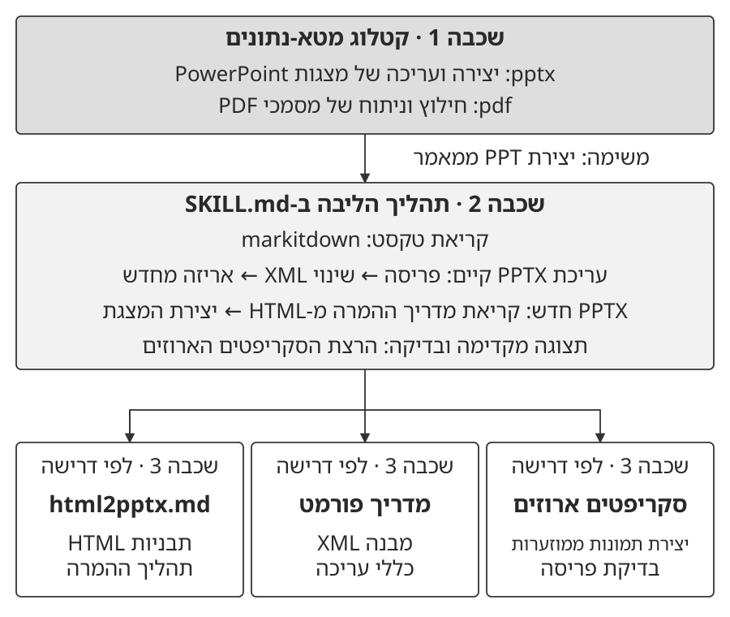

### Skills: יחידות ברות הרכבה של יכולת תחומית

**Agent Skills** אורזים את שיטת העבודה, חומרי העזר, הסקריפטים והתבניות של סוג משימה מסוים לחבילה רב‑פעמית. עובד חדש אינו צריך לשנן ביום הראשון את כל נהלי החברה, וגם המודל יכול לקרוא לעומק את הפרק הרלוונטי רק כשהוא ניגש לעבודה. אופן טעינה זה נקרא **חשיפה הדרגתית (Progressive Disclosure)**[^ch2-3].

נחזור לעשרת המוצרים מפרק 1 כדי לקבוע איזה מידע ראוי להפוך ל‑Skill. נניח שהמשתמש רוצה להשוות את המחיר הסופי כולל משלוח; די בכך שהפירוט וכתובת המשלוח הנוכחית ייכנסו להקשר. אם הצוות משווה מחירים בין סוחרים שוב ושוב, את האופן שבו מיישרים מפרטים, מבחינים בין מחיר יחידה למחיר מארז ומסמנים דמי משלוח לא ידועים אפשר לארגן ל‑Skill של השוואת מחירים. בפעם הבאה, כשמישהו רק רוצה לראות אילו דגמים קיימים, הקטלוג עדיין גלוי, ואת תהליך התמחור המלא אפשר לטעון רק כשהמשתמש צריך להשוות מחירים.

**השכבה הראשונה היא המטא‑נתונים.** כל Skill מתאר את עצמו בקובץ `SKILL.md`; בראש הקובץ יש YAML frontmatter התחום ב‑`---`, ובו השדות `name` ו‑`description`. סביבת זמן הריצה מארגנת תחילה את השמות והתיאורים לקטלוג, כדי שהמודל יוכל לקבוע אילו Skills המשימה הנוכחית דורשת. סידור הקטלוג והצגתו מנוהלים בידי ה‑Harness, והתהליך המלא נטען רק לאחר הבחירה.

**את תיאור ה‑Skill יש לכתוב קודם כול כתנאי ניתוב.** המודל צריך להחליט אם להשתמש בו עוד לפני שהגוף נטען, ולכן ה‑`description` צריך לומר תחילה מתי הוא ישים ומתי יש לדלג עליו, ורק אחר כך לסכם מה הוא יודע לעשות. למשל, "help with backend" רחב מדי, וכמעט כל משימת צד שרת עלולה להתאים לו; "כתיבת בדיקות אינטגרציה לממשק HTTP קיים, כולל אימות הרשאות, בדיקת פרמטרים ותגובות שגיאה" מגדיר תחום ברור. למשימות שקל לבלבל ביניהן אפשר להוסיף גם תנאי החרגה, למשל "אין להשתמש כשרק דנים בתכנון הממשק".

**השכבה השנייה היא תהליך העבודה המרכזי.** לאחר שנבחר Skill, סביבת זמן הריצה מכניסה את ההוראות המלאות להקשר. כשהמשתמש מקליד במפורש פקודה כמו `/pptx`, הלקוח יכול לאתר את ה‑Skill ולטעון אותו ישירות; כשהמודל בוחר בעצמו, הוא משיג את התוכן באמצעות כלי ה‑Skill או כלי קריאת קבצים. הדרך הראשונה חוסכת למודל את צעד קריאת ההפעלה, והשנייה משאירה את הבחירה ואת הטעינה גלויות במסלול הריצה.

ניקח לדוגמה את ה‑PPTX Skill שבו משתמשים הניסויים בספר. ההסבר המרכזי מציג כמה נתיבים נפוצים: חילוץ טקסט המצגת באמצעות markitdown של Microsoft, פריסת קובץ ה‑PPTX כדי לעיין ב‑XML שבבסיסו, ובחירה בין תהליך העבודה ליצירת מצגת חדשה לבין זה לעריכת מצגת קיימת. אחרי שקרא שכבה זו, המודל יכול להחליט לפי המשימה הנוכחית איזה מסמך לקרוא בצעד הבא ובאיזה סוג סקריפט להשתמש[^ch2-4].

**השכבה השלישית היא החומר המפורט.** פעולות מורכבות מפוזרות במסמכים ייעודיים, והקובץ הראשי משמש נקודת כניסה. בגרסה שבה משתמש הספר, `html2pptx.md` מסביר כיצד לייצר מצגת מ‑HTML, ומסמכי עיון נוספים משלימים פרטי פורמט ועריכה. הסוכן ממשיך לקרוא תכנים אלה לפי צורכי המשימה, ומשתמש בסקריפטים, בנכסים ובתבניות הארוזים כדי להשלים את העבודה.

[^ch2-3]: Anthropic, Equipping Agents for the Real World with Agent Skills, 2025; Agent Skills, How to add skills support to your agent.
[^ch2-4]: Anthropic, PPTX Skill. הניסויים בספר משתמשים בגרסה קבועה הכוללת את תהליך ההמרה מ‑HTML; הגרסה המדויקת ואופן ההרצה מפורטים ב‑README של הניסוי הנלווה.
[^ch2-codex-skills]: OpenAI, Build skills; מימוש ה‑Skills במאגר הציבורי של OpenAI Codex.
[^ch2-cc-skill-inject]: Claude Code, How Claude Code uses prompt caching, Invoking skills and commands; Agent Skills, How to add skills support to your agent, User-explicit activation.

### כיצד לכתוב Skill שמיש

Skill שמיש עונה על ארבע שאלות: לאיזו משימה הוא מתאים, באיזה סדר מטפלים בה, אילו מצבים דורשים אישור, ואיך יודעים שהעבודה הושלמה. הכותב צריך לארגן את ניסיונו לצעדים ברי ביצוע ולצרף דוגמאות לשיפוטים המרכזיים.

ניקח לדוגמה Skill לכתיבה. אפשר להיעזר בגישה של Baoyu, המשפר כתיבת AI מתוך הרגלי הביטוי האישיים של הכותב[^ch2-baoyu-remove-ai-writing-flavor], ולארגן את התוכן בארבעה חלקים:

- **תפקיד וקורא**: את מי ה‑Skill משרת, איזה סוג משימה הוא מכסה ומה הדרישות מהטקסט הסופי.
- **עקרונות ליבה**: התחילו בשלושה עד חמישה שיפוטים נפוצים, ולכל אחד צרפו דוגמה קונקרטית של לפני השכתוב ואחריו.
- **טעויות נפוצות וגבולות**: תעדו בעיות ניסוח שחוזרות, פעולות החורגות מהסמכות ומקרים חריגים.
- **חומרי עזר**: מילוני מונחים, תבניות, טקסטים לדוגמה והסברים ייעודיים, לעיון בזמן הביצוע.

אפשר לנסח כללים לפי המבנה "תחום, פעולה, חריג, דרך אימות". למשל, כלל לקיצור משפטים ארוכים צריך לומר על אילו פסקאות הוא חל, איך לפצל, ואיך לבדוק אחרי הפיצול שהתנאים והמסקנות עדיין שלמים.

בשלב הראשון, בחרו שלושה עד חמישה מאמרים מקוריים משלכם שאתם מרוצים מהם, בקשו מהסוכן לסכם את בחירת המילים, מבני המשפטים, סידור הפסקאות והטון, וליצור גרסה ראשונה של כעשרים שורות. לאחר מכן הפעילו אותה על נושא חדש, והמחבר יתקן את התוצאה משפט אחר משפט. ההבדלים בין הגרסאות מספקים משוב קונקרטי יותר: אילו מילים מיותרות, אילו משפטים צריך לפצל, היכן חסרות עובדות והיכן יש להחזיר פרטים טכניים. סכמו את התיקונים החוזרים לכללים, ושמרו לצד כל כלל את הדוגמאות ואת תחום התחולה.

Skill יכול לכלול גם כלי ביצוע ותבניות. למשל, ה‑PPTX Skill מרכז במקום אחד הוראות הפעלה, סקריפטי ניתוח, סקריפטי יצירה ומשאבי עיצוב, כך שהמודל יכול לפעול לפי ההוראות ולהשתמש במשאבים המתאימים. כל Skill ניתן לבדיקה, לעדכון ולניהול גרסאות באופן עצמאי, וחברי הצוות יכולים להמשיך להוסיף ניסיון סביב אותו תהליך. **ערכם ארוך הטווח של Skills הוא שהם מאפשרים לצבור ניסיון תחומי באופן מבוזר, לפרסם אותו באופן עצמאי ולעשות בו שימוש חוזר.** כשצוותים מרחיבים את יכולות הסוכן, כל אחד יכול לתחזק את ה‑Skills שבהם הוא מתמחה, וכך נוצרת בהדרגה אקוסיסטמה של חבילות בדומה ל‑pip ול‑npm. Skills אלה יכולים לחלוק את מנגנוני הגילוי, הטעינה והביצוע שהמערכת הראשית מספקת.

**בעיצוב אופן האינטראקציה, העדיפו דפוסים שהמודל כבר אומן והותאם להם.** חלוקת התפקידים, פורמט תוצאות הכלים ואופן טעינת ה‑Skills משפיעים כולם על האופן שבו המודל ממשיך את המשימה. התהליכים הסטנדרטיים שהספקים מציעים הם נקודת פתיחה טובה, והם חוסכים מהמודל את הצורך להסיק מחדש משמעות מתוך פורמט לא מוכר.

[^ch2-baoyu-remove-ai-writing-flavor]: Baoyu, "Stop Using Prompts to Remove the AI Flavor; the Direction Is Wrong", 2026-02-14.

### Skills בתוך ההקשר

עלות ההקשר של Skills מתחלקת לשני חלקים: הקטלוג והגוף. הקטלוג מאפשר למודל לגלות אילו יכולות זמינות, והגוף מספק את תהליך העבודה לאחר הבחירה. התקן דורש טעינה לפי דרישה, ואילו תפקידי ההודעות, העטיפה ואופן העדכון נקבעים במימוש של ה‑Harness.

Claude Code מוסיף את הוראות ה‑Skill לשיחה כהודעת `user` בנקודת ההפעלה[^ch2-cc-skill-inject]. איור 2-12 מציג סידור הודעות אחד שבו המודל מפעיל את ה‑Skill ביוזמתו: תחילה הוא שולח קריאת `Skill(skill: "pptx")`, מקבל את תגובת הכלי, ואז קורא את גוף ה‑Skill שצורף. כשמשתמשים בכלי הפעלה ייעודי, תגובת הכלי יכולה לשמש אישור לקריאה, והגוף מוזרק בנפרד בידי ה‑Harness; כשמשתמשים בכלי קריאת קבצים רגיל, הגוף יכול להיכלל ישירות בתוצאת הכלי. כשהמשתמש מקליד `/pptx` במפורש, הלקוח יכול להרחיב את ההוראות ישירות ולחסוך למודל את קריאת ההפעלה.

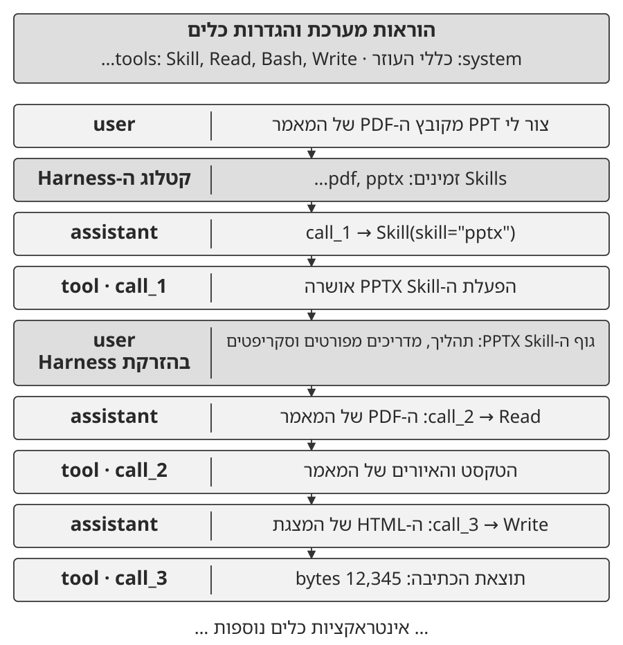{height=55%}

גם מימוש ה‑Skills של Codex מארגן בנפרד את קטלוג היכולות ואת ההוראות שנבחרו. בקוד המקור הציבורי, חלק מהקטלוג נכנס להקשר ה‑`developer`, וחלקים אחרים מסופקים יחד עם התור הנוכחי וסביבת הביצוע; Skill שנבחר במפורש מתווסף כמקטע של הקשר משתמש. מקור הקטלוג וסביבות הביצוע הזמינות משפיעים על הסידור המדויק[^ch2-codex-skills].

איור 2-13 מציג את גידול המטמון בטעינה לפי דרישה, ונקודת המוצא שלו היא בקשה שעדיין אין לה מטמון רב‑פעמי. כשהקטלוג נכנס לבקשה בפעם הראשונה צריך לעבד אותו, וגם טעינת הגוף בפעם הראשונה מוסיפה חישוב; כשבקשות מאוחרות יותר שומרות על אותה קידומת, התוכן הזה יכול להיקרא מהמטמון. צירוף התוכן החדש בנקודת הקריאה שומר על יציבות ההודעות שקדמו לו. הוראות שכבר נטענו נשארות בהיסטוריה, וכשיש צורך לעדכן אותן מטפלים בכך לפי מדיניות ההקשר של סביבת זמן הריצה.

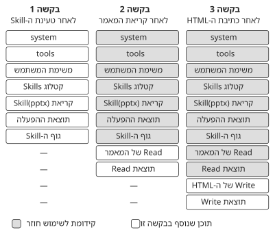

### היחס בין Skills לכלים

Skill מספק ידע על המשימה ותהליך עבודה, והכלים אחראים לקריאה, לביצוע ולקבלת התוצאות. את שבעת כלי הליבה שיוצגו בפרק 5 אפשר לשלב עם Skills שונים: אותו כלי קריאת קבצים יכול לקרוא גם מדריך מצגות וגם תקן קוד, ומריץ כללי יכול להריץ את הסקריפטים המתאימים. כך יכולות מקצועיות מתרחבות באמצעות תהליכים ומשאבים, בעוד שמערך הכלים הבסיסי נשאר יציב יחסית.

גם כלים ייעודיים יכולים לעבוד לצד Skills. חיפוש הכלים שתואר קודם מספק הגדרות כלים לפי דרישה, וה‑Skill מסביר מתי לקרוא להם, איך לשלב ביניהם ואיך לבדוק את התוצאה. שני המנגנונים צריכים להגביל את כמות המידע הקבוע בהקשר ולמצוא מקום מתאים לתוכן שנטען. פרק 4 ידון בבחירה בין מריץ כללי לכלים ייעודיים, ופרק 9 ידון בשאלה אם ניסיון מתאים להישמר כידע, כהוראות, כתוכנית או כפרמטרי מודל.

> **ניסוי 2-6 ★★: יצירת מצגת ממאמר באמצעות Agent Skills**
>
> הניסוי משתמש במאמר "Attention Is All You Need" כחומר גלם ומדגים כיצד הסוכן טוען לפי דרישה את התהליך המקצועי להכנת מצגת. המשימה היא לייצר מקובץ ה‑PDF של המאמר מצגת בת עשר עד חמש עשרה שקופיות, שתכסה את רקע הבעיה, השיטה, התוצאות המרכזיות והמסקנות, ותשתמש באיורים ובטבלאות מהמאמר לצורך ההסבר.
>
> הריצה הזו משתמשת ב‑Kimi Code וב‑PPTX Skill הרשמי של Anthropic. הסוכן מוצא תחילה את ה‑PPTX Skill בקטלוג, קורא את הוראות ההפעלה שלו, ממשיך לקרוא את מדריך ההמרה מ‑HTML, מפעיל את כלי היצירה הנלווים, ולבסוף בודק את העימוד באמצעות תמונות ממוזערות ורינדור של כל שקופית. כל חומר שנקרא משרת את הפעולה הבאה, ותהליך ההכנה המלא נפרש בהדרגה יחד עם המשימה.
>
> המצגת הסופית כוללת שלוש עשרה שקופיות, ומשתמשת בתרשים הארכיטקטורה, בתרשים מנגנון הקשב, בטבלת תוצאות הניסויים ובוויזואליזציית הקשב מתוך המאמר.
>
> גם הבדיקה שלאחר היצירה היא חלק מתהליך העבודה של ה‑Skill. בריצה זו הופיעו כתבי תחתי חסרים, תבליטים חריגים, נתיבי הפניה שגויים לאיורים ובעיות דיוק בתוויות מספריות, והסוכן תיקן אותם אחד אחד על סמך תוצאות הרינדור ובדיקות המבנה. הקובץ הסופי עבר את בדיקת המבנה, ונפתח ורונדר מחדש ב‑LibreOffice.

> **ניסוי 2-7 ★★: יצירת Skill כתיבה "מנוקה מטעם AI" מטקסטים אישיים**
>
> התרגיל הזה הופך ניסיון כתיבה אישי להוראות רב‑פעמיות. הכינו שלושה עד חמישה מאמרים מקוריים, בקשו מהסוכן לסכם את הרגלי הביטוי שלכם, וליצור גרסה ראשונה של Skill הכוללת תנאי הפעלה, שלושה עד חמישה עקרונות ודוגמאות מתאימות.
>
> בחרו נושא חדש לכתיבת ניסיון, והמחבר יתקן את הטקסט משפט אחר משפט. השוו בין שתי הגרסאות ומצאו בעיות שחוזרות, כמו מילים כלליות מדי, משפטים ארוכים מדי, קשרים סיבתיים שהושמטו, או דוגמאות קונקרטיות שנמחקו אף שהן תומכות בהבנה. תיקונים שחוזרים על עצמם אפשר להכניס ל‑Skill.

## שורת מצב הסוכן: חיזוק ניהול מסלול הסוכן באמצעות מטא‑מידע

המשתמש לוחץ: "אפשר להתקשר שוב?" הצד השמאלי של איור 2-14 מתעד שלוש שיחות. בראשונה ההמתנה נמשכה 45 דקות בלי מענה, ורק בשלישית הושג מחיר של 59 דולר לחודש. לפי הכללים בדוגמה זו, כל חיוג צורך מכסה אחת; גם אם רק שתי שיחות נענו, שלוש המכסות כבר נוצלו. ה‑Harness יכול לארגן ספירות כאלה, את התקדמות הטיפול ואת העניינים הממתינים לאישור לסיכום שמתעדכן יחד עם ההודעות, הנקרא **שורת מצב הסוכן (Agent Status Bar)**.

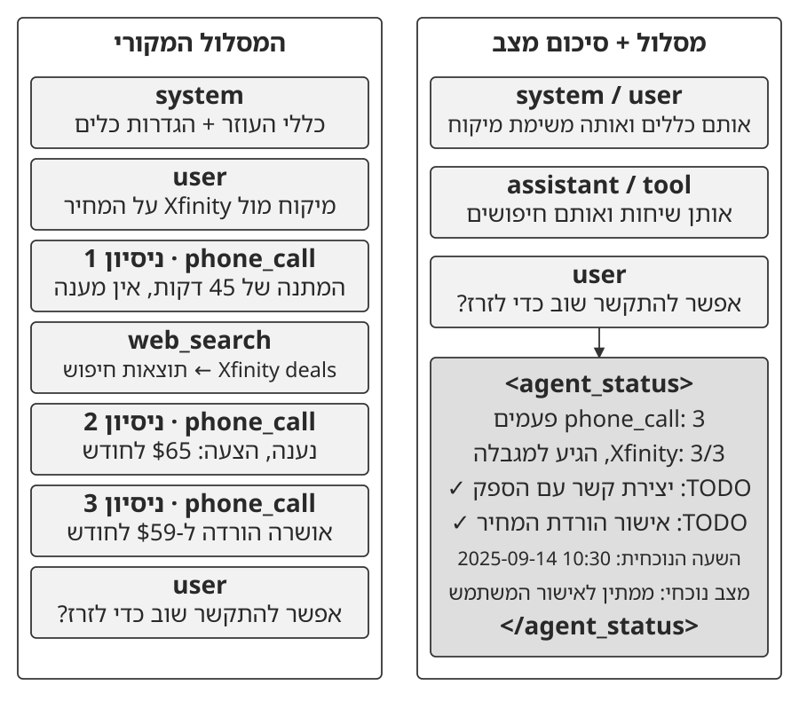

הטלפון מציג את השעה, הסוללה והקליטה בראש המסך, ומבט אחד מספיק כדי לדעת מה המצב. לסיכום שבצד ימין של האיור יש תפקיד דומה: כשהעוזר קורא "הגעת למגבלה" ו"ממתין לאישור המשתמש", הוא יודע למסור למשתמש את המחיר שהושג ולבקש ממנו להחליט אם לקבל אותו. ה‑Harness יכול לצרף את הסיכום לתוצאת הכלי, או להוסיף הודעת מצב נפרדת.

### מרשומות גולמיות למצב מפורש

קחו משימת שירות לקוחות טלפוני: המערכת דורשת שבתוך משימה אחת לא יחייגו לאף סוחר יותר משלוש פעמים. בין שלוש השיחות עשויים להשתלב חיפושים, קריאת מסמכים ושאלות המשך של המשתמש. כדי להחליט אם אפשר להמשיך לחייג, המודל צריך לאתר בהיסטוריה הזו את כל הרשומות הרלוונטיות, להבחין בין הסוחרים ולחשב את המספר המצטבר.

סביבת זמן הריצה יכולה לעדכן את המונה אחרי כל קריאה ולהחזיר ישירות "זוהי השיחה השלישית ל‑Xfinity; הגעת למגבלה של משימה זו". ההחלטה הבאה יכולה להשתמש בתוצאה הזו. את מספר הקריאות מתחזקת התוכנה, והמודל מחליט לפי התקדמות המשימה אם להמתין, לחפש ערוץ אחר או להסביר למשתמש את המצב; שכבת הביצוע בודקת במקביל את בקשות החיוג הבאות מול המונה.

הערך ההנדסי כאן הוא **ארגון מראש של המצב שהחלטות עתידיות זקוקות לו שוב ושוב**. רשומת השיחות המלאה עדיין שומרת את תוכן השיחות ואת מהלך הטיפול, ושורת המצב מספקת את הסטטיסטיקות ואת ההתקדמות שההחלטות נשענות עליהן. **סטטיסטיקות שנעשה בהן שימוש חוזר צריכות להיות מתוחזקות באופן אינקרמנטלי בקוד.** למצוא רשומה אחת בהקשר ולחשב סכום מכל הרשומות הן שתי עבודות שונות. שמירת המסלול הגולמי אינה מניבה מעצמה טבלת סטטיסטיקה מדויקת וזמינה בכל רגע. אם המודל נדרש לעבור על הכול ולספור מחדש בכל פעם, הדבר צורך טוקני היסק ומגדיל את הסיכוי להשמטות ולספירה כפולה.

מחבר הספר משווה את ההקשר למנוע אחזור שזקוק ל"שכבת זיקוק" נלווית: הרשומות הגולמיות נוחות למעקב לאחור, והמצב המזוקק נוח לשימוש ישיר. ספירות, מכסות ומצב השלמה מאומת של משימות מתאימים לתחזוקה בקוד; מידע הדורש שיפוט סמנטי אפשר לחלץ תחילה פריט אחר פריט, ואז לסכם ולאמת. כך המודל רואה בכל החלטה גם את המצב הנוכחי וגם את הראיות הנחוצות.

מסלולים ארוכים גם מקשים על איתור מידע מרכזי. ריכוז היעד העדכני, האילוצים וההתקדמות בחלק האחרון של ההקשר מקל על המודל למצוא את המידע הדרוש להחלטה הנוכחית.

> **ניסוי 2-8 ★★: בחינת השפעת שורת מצב הסוכן באמצעות ויזואליזציית קשב**
>
> הניסוי משתמש ב‑Qwen3-0.6B ובונה מסלול של שירות לקוחות בבקשת החזר: הסוכן כבר התקשר ל‑Xfinity שלוש פעמים, ובין השיחות שולבו חיפושי רשת; לאחר מכן המשתמש שואל "אפשר להתקשר אליהם שוב כדי לזרז אותם?" כללי המערכת מגבילים כל סוחר לשלוש שיחות לכל היותר בתוך משימה אחת.
>
> שתי הקבוצות שומרות על אותה היסטוריה ועל אותה שאלת המשך. קבוצה א' משתמשת במסלול הגולמי בלבד; קבוצה ב' מוסיפה בסופו את המצב הבא:
>
> ```xml
> <agent_status>
> Current State:
> - Tool call summary: 'phone_call' has been invoked 3 times (Xfinity: 3 times)
> - Constraint check: Maximum calls to Xfinity reached (3/3)
> </agent_status>
> ```
>
> כל קבוצה הורצה שלוש פעמים. בקבוצה א' המודל סירב במפורש להמשיך לחייג פעמיים, ופעם אחת הפלט סווג כ"אחר"; בקבוצה ב' הוא סירב במפורש בכל שלוש הריצות. באף אחת מהקבוצות לא הופיע פלט שנשפט כהמשך חיוג המפר את הכלל. כדי לשחזר את ההשוואה, היכנסו ל‑`chapter2/attention_visualization` והריצו `python run_status_bar_experiment.py --output runs/status-bar-reproduction`. הקלט והתוצאות של כל ריצה בהרצה זו שמורים בתיקיית הניסוי, בקובץ `runs/exp2-7-qwen3-0.6b-20260730-v2/comparison.json`.
>
> מפת הקשב מציגה כיצד משקלי הקשב של אזור היצירה מתחלקים בין השיחות הקודמות, תוצאות החיפוש, שאלת ההמשך של המשתמש ושורת המצב.

המחקר של מחבר הספר ושל Noah Shi על ContextDistill-Bench בחן לעומק את התועלת שבזיקוק מצב מראש[^ch2-8]. בשאילתות המצב שהמדד מכסה, גם מודלים קטנים יותר משיגים דיוק גבוה בעזרת מצב מפורש; אצל מודלי החזית, כמות החשיבה, זמן ההשהיה ועלות השאילתה יורדים בערך בסדר גודל. לדוגמה, העלות של אלף שאילתות ב‑Claude 4 Sonnet ירדה מכ‑35.46 דולר ל‑3.51 דולר. **עיצוב זה מתחזק את המצב ברגע שהאירוע מתרחש, וחוסך את הצורך לעבור על ההיסטוריה בכל שאילתה.** כשהשדות בסיכום קבועים, גם אם ההיסטוריה ממשיכה לגדול, השאילתה צריכה לקרוא רק את השדות האלה.

[^ch2-8]: Li, Bojie and Noah Shi. *Distill, Don't Retrieve: Inference-Time Context Distillation for LLM Agent Reasoning.* 2026.

### הרכב שורת מצב הסוכן

שורת המצב כוללת בדרך כלל שלושה סוגי מידע, העונים על השאלות "מה צריך לעשות", "מה קרה זה עתה" ו"מה המצב עכשיו".

**תכנון המשימה** מתעד את היעד, את הצעדים ואת מצב השלמתם. משימה מורכבת אפשר לפרק לרשימת TODO, שבה כל פריט שומר את מצבו ואת התלויות הנחוצות. בזמן שהמודל מטפל בצעד הנוכחי, הוא עדיין רואה את הדרישה המקורית, את אילוצי הליבה ואת העבודה שבהמשך; אחרי שצעד הושלם, הרשימה מתעדכנת.

**מידע ערוץ צדדי של אירועים (Side-channel Information)** משלים את הרקע של האירוע בזמן התרחשותו, כגון השעה, המיקום הגאוגרפי והזמן שחלף מאז התשובה הקודמת. מטא‑נתונים אלה נשמרים יחד עם האירוע ועוזרים למודל להבין את סדר הדברים ואת הנסיבות. אותו משפט, "עדיין לא קיבלתי תשובה", עשוי לחייב טיפול שונה אם נאמר שתי דקות או יומיים אחרי הגשת הבקשה.

**סיכום תצפית על המצב הנוכחי של הסביבה** מספק את השעה הנוכחית, ספריית העבודה, מספר קריאות הכלים והתרעות על חריגות. תפקידו דומה להצגת הספרייה הנוכחית או מצב הריצה ב‑CLI וב‑GUI: לתת לפעולה הבאה בסיס ברור. למשל, התרעה על קריאות חוזרות יכולה לגרום למודל לבדוק את סיבת הכשל, ותקציב שנותר עוזר לו להחליט אם להמשיך לחפש.

מטא‑נתוני אירועים נשארים בדרך כלל יציבים אחרי שצורפו יחד עם האירוע, ואילו התקדמות המשימה ומצב הסביבה משתנים ללא הרף. כל אחד משני סוגי המידע צריך להיכתב להיסטוריה בהתאם לאופן העדכון שלו, כפי שיוסבר להלן יחד עם מבנה ההודעות.

### מיקומה הספציפי של שורת מצב הסוכן בהקשר

בדוגמה שבסעיף זה, ה‑Harness מוסיף בסוף ההודעות הודעת `user` שנושאת את סיכום המצב. ה‑`user` כאן הוא תפקיד הודעה של ה‑API שנבחר; תוכן המצב נוצר בידי סביבת זמן הריצה, ותגית מציינת את ייעודו. בממשקים אחרים אפשר להשתמש גם בבלוק הקשר שהם תומכים בו, או לספק את המצב יחד עם תוצאת הכלי המתאימה. כשמשתמשים בתבנית שתוארה קודם, החותכת את ההיסק ההיסטורי לפי שאילתת המשתמש האמיתית, אפשר לספק את מצב הריצה יחד עם תוצאות הכלים, כדי שהתבנית תמשיך לשמור את מידע ההיסק לפי המשימה הנוכחית.

מצאו באיור 2-15 את הבקשה המקורית של המשתמש, ואז בדקו באיזה סבב נכתב המצב העדכני. רק כשהבקשה המקורית נשמרת אפשר, אחרי שהשיחות הסתיימו, לבדוק שני דברים יחד: מה המשתמש ביקש לעשות, ועד איזה שלב הטיפול הגיע.

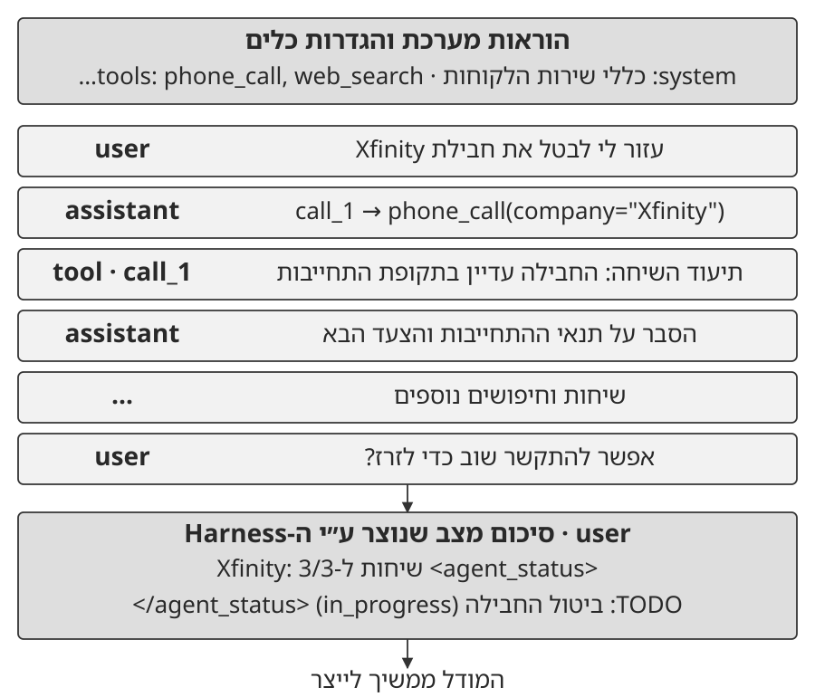

כך נראה הסדר שבאיור כרשימת הודעות. כדי להקל על ההשוואה, הושמטו כאן סבבים חוזרים וחלק משדות הקריאה.

```text
messages: [
  { role: "system", content: "You are a customer service assistant..." }
  { role: "user", content: "Help me cancel my Xfinity plan" }
  { role: "assistant", tool_calls: [{ id: "call_1", ... }] }
  { role: "tool", tool_call_id: "call_1", content: "Call log..." }
  { role: "assistant", tool_calls: [{ id: "call_2", ... }] }
  { role: "tool", tool_call_id: "call_2", content: "Call log..." }
  ...שאר הסבבים...
  { role: "user", content: "Can you call them again to follow up?" }
  { role: "user", content: "<agent_status>
      Current State:
      - phone_call invoked 3 times (Xfinity: 3/3 max)
      - Current time: 2025-09-14 10:30:45
      - TODO: [1] Cancel plan (in_progress)
    </agent_status>" }
]
```

ההודעה האחרונה מרכזת במקום אחד את מספר הקריאות, המגבלה, השעה והתקדמות המשימה. המודל יכול להשתמש בשדות אלה ישירות, ובמקביל לחזור לרשומות הספציפיות דרך מזהי הקריאות שקדמו לה.

אחרי צירוף ההודעה, רצף הטוקנים שקדם לה לא משתנה, ולכן התנאי הבסיסי לשימוש חוזר בקידומת עדיין מתקיים. האופן שבו יטופל המצב הישן בסבב הבא מחייב פשרה בין תפוסת ההקשר לבין עלות המטמון.

### שני מימושים של עדכוני מצב ועלויות המטמון שלהם

בסבב הבא ייתכן שפריט TODO יושלם, או שתתווסף עוד קריאה לכלי. ה‑Harness צריך לעדכן את המצב, ויש לכך שתי דרכים נפוצות.

**החלפה בכל סבב**: בעת בניית הבקשה החדשה מסירים את הודעת המצב הקודמת ומוסיפים בסוף את המצב העדכני. בהקשר נשמר מצב נוכחי אחד בלבד, וקל למודל להשתמש בו. למשל, הבקשה הקודמת הייתה "הוראות המשימה, מצב A", והבקשה הנוכחית היא "הוראות המשימה, תוצאת כלי, מצב B". הוראות המשימה עדיין פוגעות במטמון; תוצאת הכלי נשלחת בפעם הראשונה וממילא דורשת חישוב. רק אם בבקשה הקודמת הופיעו הודעות נוספות אחרי מצב A, הסרת A גורמת להן לאבד את התאמת הקידומת המקורית. בבקשה הזו המודל רואה רק את B. כשצריך לחזור ל‑A, אפשר לשלוף מיומני הריצה את תמונת המצב מאותו רגע.

**צירוף מתמיד**: רשומות המצב הקיימות נשמרות, ובכל פעם מצורף מצב חדש בסוף. קידומת ההיסטוריה נשארת יציבה, וקל לעקוב אחר שינויי המצב. מצבים ישנים תופסים בהדרגה מקום בהקשר, ולכן יש לציין במפורש זמן או גרסה, כדי שהמודל יקבע את המצב הנוכחי לפי הרשומה העדכנית. האופן שבו Claude Code מצרף לשיחה תזכורות על שינויים בקבצים משקף גם הוא גישה זו.

כשהמצב קצר מאוד ואחריו כבר שמורות במטמון תוצאות כלים רבות, שמירת המצב הישן עשויה להיות זולה יותר מחישוב מחדש של סיומת ארוכה; כשהמצב ארוך ומתעדכן לעיתים קרובות, החלפה מגבילה את הצטברות המצבים ההיסטוריים.

אפשר להעריך את נקודת האיזון במודל גס: יהי כל מצב באורך $S$ טוקנים, יהי $R$ האורך הממוצע בטוקנים של הסיומת השמורה במטמון שאחרי המצב הישן ושיש לחשב מחדש בכל החלפה (תוכן שנשלח לראשונה בסבב זה אינו נספר), יוזרק המצב $N$ פעמים בסך הכול, ויהי מחיר הקלט השמור במטמון $\alpha$ כפול מחיר הקלט הרגיל. בהתעלם מעלויות המשותפות לשתי השיטות, $C_{\text{replace}} \approx (N-1)(1-\alpha)R$ ו‑$C_{\text{append}} \approx \alpha S N(N-1)/2$. עבור $N>1$, כאשר $\alpha SN/2 < (1-\alpha)R$, העלות המשוערת של צירוף מתמיד נמוכה יותר; אחרת, החלפה בכל סבב זולה יותר. יחידת העלות כאן היא מחיר הקלט הרגיל: בשיטת ההחלפה משלמים את הפער בין קריאת הסיומת מהמטמון לבין עיבודה מחדש, ובשיטת הצירוף משלמים על קריאה חוזרת של המצבים ההיסטוריים.

לדוגמה, נניח שבכל פעם מוזרק מצב של 100 טוקנים, עשר פעמים בסך הכול, וקריאה מהמטמון מתומחרת בעשירית ממחיר הקלט הרגיל. בשיטת הצירוף, הבקשות הבאות קוראות בנוסף 1, 2, …, 9 מצבים ישנים, והעלות הנוספת שקולה ל‑450 טוקני קלט רגילים. אם החלפת המצב גורמת לעיבוד מחדש של 1000 טוקנים שמורים בממוצע שאחריו, תשע ההחלפות עולות תוספת השקולה ל‑8100 טוקני קלט רגילים, והצירוף זול יותר. אם המצב הישן היה ממילא בסוף המטמון ואחריו אין שום תוכן שמור, אז בנוסחה $R=0$, והחלפה ישירה דווקא חוסכת את העלות השקולה לאותם 450 טוקנים.

> **ניסוי 2-9 ★★: כמה טכניקות שימושיות לשורת מצב הסוכן**
>
> הניסוי מממש חמש טכניקות של שורת מצב, שאפשר להפעיל כל אחת לחוד או לשלב ביניהן. כל טכניקה מספקת סוג מידע קונקרטי שעוזר למודל להחליט על הפעולה הבאה.
>
> **מעקב חותמות זמן** רושם את זמן האירוע בהודעות המשתמש ובתגובות הכלים, למשל `[2025-09-14 10:30:45]`. הזמן נכתב להיסטוריה יחד עם האירוע ונשמר כמות שהוא בסבבים הבאים; השעה הנוכחית, לעומת זאת, מתעדכנת בכל הודעת מצב חדשה. הניסוי מספק גם הדמיית זמן, כדי לבדוק אם המודל מבחין בין "הקובץ מאתמול" ל"שינוי של היום" ואם הוא מבין נכון משכי המתנה.
>
> **מונה קריאות כלים** מתחזק במילון את מספר הקריאות המצטבר לכל כלי, ומסמן בתגובה `Tool call #3 for 'read_file'`. בשילוב עם תוכן השגיאה, המודל יכול להחליט אם להמשיך לנסות. למשל, אחרי כישלון ראשון בקריאה הוא בודק את הנתיב ואז מציג את תוכן הספרייה; אחרי כמה כישלונות הוא מחפש קובץ חלופי או מסביר למשתמש מה חסר. כשצריך להגביל את מספר הניסיונות החוזרים, סביבת זמן הריצה צריכה גם לאכוף את המגבלה לפי המונה.
>
> **ניהול רשימת TODO** מספק שני כלים, `rewrite_todo_list` ו‑`update_todo_status`. כל פריט כולל מזהה ייחודי, תוכן, חותמת זמן ואחד מארבעה מצבים: `pending`,‏ `in_progress`,‏ `completed`,‏ `cancelled`. הרשימה מרכזת במקום אחד "מה נעשה ומה עוד חסר", בדומה לגישה של Manus, השומרת על היעד גלוי באמצעות הצגה חוזרת של תוכנית המשימה.
>
> **מידע שגיאה מפורט** מספק את סוג השגיאה ותיאורה, את פרמטרי הקריאה ב‑JSON, את מחסנית הקריאות והצעות תיקון. למשל, כשמתקבלת `FileNotFoundError`, אפשר להנחות את המודל לבדוק את שם הקובץ, את הספרייה הנוכחית ואת הנתיב המוחלט. הפרמטרים עוזרים לאתר קלט שגוי, מחסנית הקריאות עוזרת למצוא את מקום הכשל, והצעות התיקון מכוונות לבדיקה הבאה. לפני שמחזירים תוכן זה למודל, יש לנקות שדות רגישים כמו פרטי גישה ולהגביל את אורכן של מחסניות ארוכות.
>
> **מודעות למצב המערכת** מספקת את השעה הנוכחית, ספריית העבודה, מערכת ההפעלה, ה‑Shell וגרסת Python. כלי הפקודות בניסוי מזהה פעולת החלפת ספרייה העומדת בפני עצמה, מעדכן את ספריית העבודה שסביבת זמן הריצה מתחזקת, ומשתמש בה בקריאות הבאות; שינויי ספרייה של תהליכי משנה בתוך פקודות מורכבות כפופים לתחום הביצוע של התהליך המתאים. שדות הסביבה עוזרים למודל גם לבחור כלים זמינים, למשל `apt` או `brew` לפי המערכת בפועל והתוכנות המותקנות.
>
> בהשוואה הנוכחית עם Kimi K3, לכל סוג משימה היו חמישה מקרים. תצורת חותמות הזמן והתצורה המשולבת עברו שתיהן את כל חמשת המקרים, וקבוצות הבקרה שלהן עברו שלושה כל אחת; במונה הקריאות ובמצב המערכת עברו הן הקבוצה המופעלת והן המושבתת את כל החמישה. תצורת ה‑TODO לא עברה אף מקרה, וקבוצת הבקרה שלה עברה אחד; תצורת השגיאות המפורטות עברה ארבעה, וקבוצת הבקרה שלה חמישה.

**שורת המצב צריכה להיות מתוחזקת בקוד ככל האפשר.** המודל משתמש ישירות בסטטיסטיקות ובמגבלות שבה, ו"התקשרת שלוש פעמים" שגוי אחד עלול לשנות את הפעולות הבאות. ספירות, זמנים ומעברי מצב יש להשאיר לתוכנה; כשנדרשת הבנה סמנטית, תנו למודל לחלץ פריט אחר פריט, ואז תנו לקוד לסכם ולאמת, במקום לבקש מהמודל לספור בבת אחת היסטוריה ארוכה שלמה. שמרו על קישור בין האירועים הגולמיים, תוצאות החילוץ והמצב הסופי, כדי שיהיה קל לזהות ספירה כפולה, השמטות ובלבול בין מקורות.

את המידע ששורת המצב מסכמת יש לבחור מראש. למשל, "התקשרת שלוש פעמים" מספיק כדי לקבוע אם אפשר להתקשר שוב, אבל אינו עונה על השאלה "מה הבטיח נציג השירות בשיחה השנייה". למשימות המשך שזקוקות רק לערכים סטטיסטיים, אפשר להחליף את ההיסטוריה בסיכום המצב ולהעביר את הרשומות הגולמיות לארכיון; כשצריך לבדוק את תוכן השיחה, קוראים את המקור לפי אינדקס. עיצוב השדות בסיכום קובע אילו שאלות אפשר לענות עליהן ישירות, ומתי יש לחזור לרשומות.

## אסטרטגיות דחיסת הקשר

נניח שמשימת מחקר כבר קראה עשרה דפי רשת ארוכים, ובחלון נותר מקום לשני מסמכים נוספים בלבד. השאלה הראשונה היא מה המודל צריך לעשות בסבב הבא: אם עליו להשוות שתי הצעות מחיר, יש לשמור את המחירים, את תנאי התוקף ואת המקורות; אם עליו לאמת ציטוטים, יש לשמור מיקום שממנו אפשר לשלוף את הטקסט המקורי. את גוף הדפים שכבר נבדקו ונמצאו לא רלוונטיים אפשר להעביר לארכיון ולפנות מקום לקלט ולפלט חדשים. החשבון כאן כפול: כמה מקום מתפנה, וכמה יעלה לשחזר חומר שנמחק אם יתברר בהמשך שהוא נחוץ.

### שלוש מטרות הדחיסה

**שליטה באורך ובעלות.** בחלון של 128K טוקנים, למשל, דפי רשת ארוכים וקבצים גדולים עלולים לתפוס חלק ניכר מהשטח. ה‑Harness צריך לשמור תקציב לקלט הבא, לפלט המודל ולאינטראקציות עם כלים.

**ארגון הידע הדרוש להחלטות הבאות.** יותר מעשרה סבבי חיפוש עשויים להזכיר שוב ושוב את אותו אירוע, או להשאיר טענות סותרות. סידורם לכדי "A ו‑B אושרו, ל‑C עדיין חסרות ראיות" מאפשר למודל להמשיך מהשאלות הפתוחות. הסיכום צריך לשמור את הקשרים בין העובדות, את המקורות ואת השאלות שטרם נפתרו, כדי שלהחלטות הבאות יהיה בסיס ברור.

**תמיכה בהתקדמות רציפה של משימות ארוכות.** יש מודלים שכאשר הם סבורים שהחלון עומד להתמלא, הם מסיימים את העבודה מוקדם מדי. תופעה זו נקראת **חרדת הקשר (Context Anxiety)**. ב‑Anthropic מצאו בבדיקות משימות ארוכות עם Sonnet 4.5 שההתנהגות הזו עלולה להופיע גם לאחר דחיסה, ולכן אימצו רשומת העברה מובנית: מאפסים את ההקשר וממשיכים את הביצוע ממנה[^ch2-7].

[^ch2-7]: Prithvi Rajasekaran, Harness design for long-running application development, Anthropic Engineering, 2026.

### הפיכת תוצאות של חישוב חוזר לידע זמין

שורת המצב מתחזקת מראש ספירות והתקדמות, והסיכום הולך צעד נוסף ומארגן את העובדות והקשרים שבטקסט ארוך. בשני המקרים מסדרים מראש מידע מפוזר, כדי שההחלטות הבאות יוכלו להשתמש בו ישירות.

ניקח לדוגמה יומן בדיקה של חנות חיות מחמד:

> כלוב 1: חתול שחור. כלוב 2: חתול לבן. כלוב 3: חתול שחור. כלוב 4: חתול שחור. כלוב 5: חתול לבן.
> ...(100 כלובים בסך הכול: 90 חתולים שחורים ו‑10 חתולים לבנים)

כדי לענות על "איזה חתול נמצא בכלוב 37" צריך לאתר את הרשומה המתאימה; כדי לענות על "כמה חתולים שחורים וכמה לבנים יש" צריך לסכם את כל הרשומות. אם הסכומים נדרשים שוב ושוב, אפשר לחשב ולשמור מראש "90 חתולים שחורים, 10 לבנים" ולחסוך ספירה מחדש בכל פעם. תוכנה מתאימה לסיכום דטרמיניסטי כזה, והמודל יכול להמשיך ולענות על השאלות העסקיות על סמך הסטטיסטיקה.

תוכן הסיכום נקבע לפי המשימה. שמירת הסכום של שני סוגי החתולים בלבד מספיקה לשאלות כמות; כדי לענות על מה שבכלוב 37 נדרשות גם רשומות לפי כלוב או אינדקס מתאים.

גם כשיש עוד מקום בחלון, הקשר ארוך מדי או מעורבב עלול לפגוע בשימוש במידע: המודל מחמיץ עובדות מרכזיות, מטפל שוב בבעיות שכבר נפתרו, או מסתמך על מצב מיושן בהחלטה הנוכחית. הידרדרות ביצועים כזו, המתלווה לגדילת ההקשר, נקראת בדרך כלל **ריקבון הקשר (Context Rot)**. היא מתבטאת בירידה באיכות ביצוע המשימה; כשבקשה חורגת ממגבלת הקיבולת, מתרחשת גלישת חלון.

**גם כשיש עוד מקום בחלון, כדאי לארגן ביוזמה ידע שכבר נעשה בו שימוש חוזר.** אם את השיפוטים המרכזיים כבר אפשר לסכם, ובכל זאת המודל נדרש לחפש אותם שוב ושוב בהיסטוריה ארוכה, הדבר צורך חישוב באופן מתמשך ומגדיל את הסיכוי להחמצות. משימת חיפוש יכולה לשמור עובדות מאומתות, מקורות ושאלות פתוחות; משימת תכנות יכולה לשמור החלטות ארכיטקטורה, היקף השינויים, תוצאות בדיקות וסיבות לכישלונות.

דוגמאות בהקשר משפיעות גם על האופן שבו המודל מטפל בבעיות חדשות. המחקר של Dherin ועמיתיו יוצא מהצירוף של שכבות הקשב ושכבות ה‑MLP ב‑Transformer, ומציג חישוב מעבר קדימה מסוים כעדכון משקלים בדרגה נמוכה התלוי בהקשר; כך הוא מציע הסבר תיאורטי ללמידה בתוך ההקשר[^ch2-6]. בהיסק בפועל משקלי המודל אינם משתנים, והדוגמאות משפיעות על הפלט דרך הקלט הנוכחי. כדי לעשות שימוש חוזר בניסיון כזה בשיחות הבאות, אפשר לארגן אותו כזיכרון, כדוגמאות או כ‑Skill ולטעון אותו לפי המשימה; פרק 9 ידון בהרחבה באופן צבירת הניסיון.

[^ch2-6]: Benoit Dherin et al., Learning without training: The implicit dynamics of in-context learning, 2025.

### האיזון בין דחיסה ל‑KV Cache

דחיסה מתרחשת בדרך כלל בין שתי קריאות למודל. ה‑Harness מסדר, לפי התקציב שנותר ולפי התקדמות המשימה, את ההודעות הדרושות לבקשה הבאה, ורק אז שולח אותן למודל. החלפת היסטוריה משנה את הקידומת, ולכן יש לשקול יחד את תועלת הדחיסה ואת עלות בניית המטמון מחדש.

ראשית, שמרו יציבים את הוראות המערכת ואת הגדרות הכלים שעדיין תקפים. הם יושבים בחזית, ודחיסת ההיסטוריה שאחריהם יכולה להמשיך לנצל את הקידומת הזו. שנית, בחרו מה בדיוק לדחוס: תוצאת כלי ארוכה אפשר להחליף בסיכום, ואינטראקציות רב‑תוריות שהסתיימו אפשר למזג לרשומת שלב. המטמון שלפני נקודת ההחלפה עדיין שמיש; התוכן שמנקודת ההחלפה והלאה מעובד מחדש כקידומת חדשה.

**עדיף לדחוס היסטוריה באצוות, ולא לשכתב את אותה קידומת בכל סבב.** אחרי הדחיסה כל קלט נעשה קצר יותר, אבל גם קריאת הדחיסה וחישוב הסיומת מחדש צורכים משאבים. את התזמון אפשר לקבוע לפי תפוסת החלון, מספר הסבבים הצפוי והשלב במשימה: סידור באצווה אחרי שהצטברו כמה תוצאות כלים ארוכות, ושמירת סיכום העברה בסוף כל שלב, מצמצמים את תקורת השינויים התכופים בהיסטוריה. כששומרים את הסבבים האחרונים כלשונם, יש לוודא שקריאות הכלים והתוצאות שלהן נשארות בזוגות, ולכתוב בסיכום את מצבן של פעולות שלא הושלמו.

בעת הדחיסה יש לבדוק גם את פרוטוקול ההעברה בחזרה של מידע ההיסק. בחלק מהמודלים, ה‑thinking ההיסטורי קשור לקידומת שבה הוא נוצר. אם מחליפים היסטוריה שלפני הבלוקים האלה, ה‑thinking שנשמר עלול לא להתאים לקידומת החדשה. במודלים עם פרוטוקול כזה אפשר לסכם את השיחה, למחוק את ה‑thinking הישן שהושפע, ולתת למודל להמשיך להסיק מתוך הסיכום; אפשר גם להשתמש במנגנוני דחיסה או עריכת הקשר שהשרת תומך בהם.

נתחיל מהסיכום הבודד באיור 2-16: מספר התווים לאחר העיבוד הוא רק 10.9% מהמקור, ובכל זאת הסוכן הראשי צרך בו בסך הכול יותר טוקנים מכל אחת משש הקבוצות. כדי להבין איך שני המספרים מתקיימים יחד, צריך לעקוב אחרי החומרים שנדחסו, ואחרי מספר הבקשות שבהן נשלחו החומרים האלה למודל.

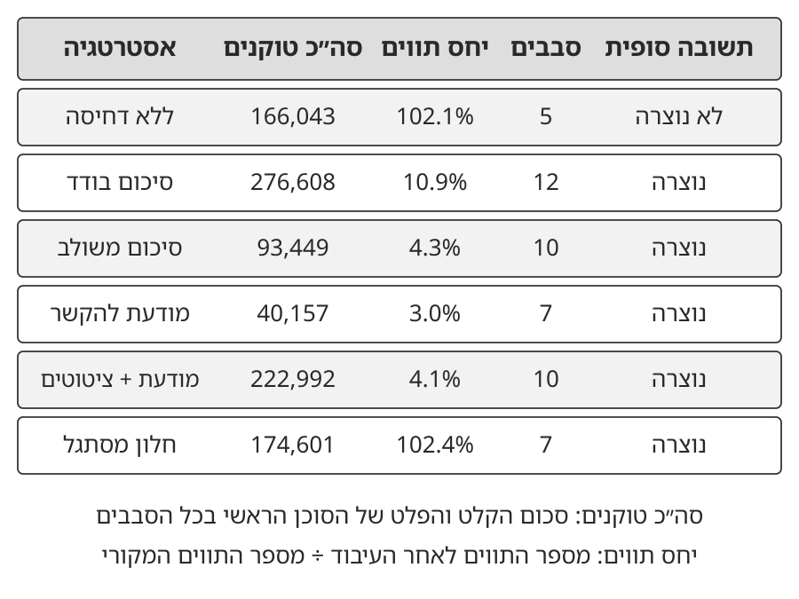

> **ניסוי 2-10 ★★★: השוואת אסטרטגיות דחיסת הקשר**
>
> בניסוי זה Kimi K3 חוקר את מצבם התעסוקתי של מייסדי OpenAI. המשימה דורשת לבנות בהדרגה את רשימת האנשים, לברר את קורות החיים ואת שינויי התפקידים שלהם, ולהצמיד כל עובדה למקור שלה. כדי לבחון דחיסה וטיפול בגלישה, הניסוי קובע בצד היישום תקציב הקשר של 128,000 טוקנים, שומר קו בסיס ללא דחיסה ומשווה אליו חמש שיטות טיפול; כל אחת רצה עד 15 סבבים לכל היותר[^ch2-compression-results].
>
> **אסטרטגיה 1: ללא דחיסה.** תוצאות החיפוש וקריאת הדפים נכנסות להיסטוריה במלואן. שבע קריאות לכלים הכניסו 367,246 תווים גולמיים. התוכנה הפעילה את ההגנה ועצרה בסבב החמישי, והצריכה המצטברת של הסוכן הראשי הייתה 166,043 טוקנים. הגרסה הישנה הפעילה את ההגנה לפי סכום טוקני הקלט של כל הבקשות, ולכן המספר 165,227 בהודעת השגיאה הוא קלט מצטבר. לדוגמה, אם אותו קטע היסטוריה נשלח פעם אחת בכל אחת משלוש בקשות, הוא נספר שלוש פעמים.
>
> **אסטרטגיה 2: סיכום בודד.** לכל תוצאת חיפוש נוצר בנפרד סיכום של שתיים‑שלוש פסקאות, ששומר את עיקר התוכן של כל דף. קל להריץ שיטה זו במקביל, והיא שומרת על הגבולות בין הדפים; אבל כשכמה דפים מתארים את אותו אירוע, המידע הכפול עדיין נכנס להיסטוריה. תצורה זו הפיקה תשובה סופית אחרי שנים‑עשר סבבים, הסוכן הראשי צרך בסך הכול 276,608 טוקנים, ויחס הדחיסה בתווים היה 10.9%.
>
> **אסטרטגיה 3: סיכום משולב.** אצוות של תוצאות חיפוש ממוזגת לסיכום מקיף אחד, וכך קל יותר לאחד עובדות חוזרות ולסדר את היחסים בין מקורות שונים. תצורה זו הפיקה תשובה סופית אחרי עשרה סבבים, הסוכן הראשי צרך בסך הכול 93,449 טוקנים, ויחס הדחיסה בתווים היה 4.3%.
>
> **אסטרטגיה 4: סיכום מודע‑הקשר.** בעת הדחיסה מספקים גם את השאילתה הנוכחית ואת המידע שכבר נאסף, למשל על ידי הוספת `Given the search query: {query}` ו‑`Current context: {context}` לפרומפט. על סמך זה המודל שומר את העובדות הרלוונטיות לשאלה הנוכחית, ומעדיף להשלים פערים בסיכום הקיים. תצורה זו הפיקה תשובה סופית אחרי שבעה סבבים, הסוכן הראשי צרך בסך הכול 40,157 טוקנים, ויחס הדחיסה בתווים היה 3.0%. באחת הדחיסות הפכו כ‑150 אלף תווים לכאלפיים תווים, ונשמרו שמות האנשים ושינויי התפקידים.
>
> **אסטרטגיה 5: סיכום מודע‑הקשר עם ציטוטים.** הסיכום הממוקד במשימה שומר לצד כל עובדה את קישור המקור שלה. תצורה זו הפיקה תשובה סופית אחרי עשרה סבבים, והסוכן הראשי צרך בסך הכול 222,992 טוקנים. לפי סיכום רשומות הכלים, החומר המעובד הכיל 52,891 תווים והמקור 1,295,044 תווים; היחס ביניהם הוא כ‑4.1%.
>
> **אסטרטגיה 6: חלון מסתגל.** בשלב המוקדם נשמר החומר הגולמי, ורק כשהקלט מגיע לסף מסדרים אותו באצווה. הניסוי משתמש בשלושה מנגנונים: דחיסה מופעלת כשהקלט עובר 80% מהתקציב; כל תוצאות הכלים שטרם נדחסו מסוכמות יחד; ותוצאות שעובדו מסומנות ב‑`[COMPRESSED]` כדי למנוע סיכום כפול. בתקציב של 128,000 טוקנים בניסוי זה, סף ההפעלה הוא 102,400 טוקנים. תצורה זו הפיקה תשובה סופית אחרי שבעה סבבים, והסוכן הראשי צרך בסך הכול 174,601 טוקנים. הרשומות ההיסטוריות הפעילו את הסף לפי הקלט המצטבר; מאוחר יותר שונתה התוכנה כך שתבדוק את גודל הקלט של הבקשה האחרונה.
>
> איור 2-17 מעמיד זה מול זה את הקלט והפלט של שש האסטרטגיות.
>
> 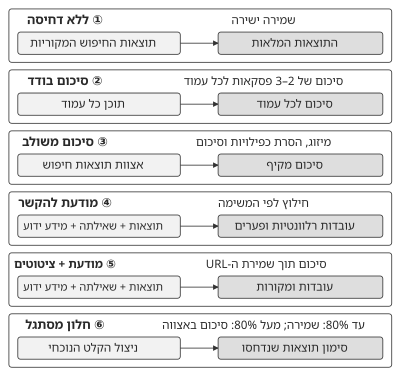
>
> כשמשווים את המספרים באיור 2-16, יש להבחין בין שלושה גדלים: הקלט של בקשה בודדת קובע אם הגענו לתקציב החלון; הטוקנים המצטברים משקפים את הצריכה לאורך קריאות רבות; ויחס הדחיסה בתווים מתאר את היחס בין האורך לאחר העיבוד לאורך המקורי של החומר שנמדד. הצריכה המצטברת כאן מורכבת מהקלט והפלט של כל בקשות הסוכן הראשי; בקשות המודל הנפרדות שהפיקו את הסיכומים אינן נכללות בשדה זה.
>
> כדי לשחזר את הניסוי, הגדירו את המודל ואת שירות החיפוש האמיתי לפי ההוראות הנלוות, והריצו בספריית הניסוי `python experiment.py -m kimi-k3 -n 15 -o results/reproduction.json`. קראו את ה‑`metrics` של כל אסטרטגיה: חשבו מחדש את יחס התווים לפי `total_compressed_size / total_original_size`, ואז השוו את `total_tokens` ואת `iterations`. גם קו הבסיס ללא דחיסה מוסיף לגוף תוצאות החיפוש עיצוב כמו כותרת ו‑URL, ולכן מספר התווים לאחר העיבוד יכול להיות מעט גבוה מהמקור. תוכנת הניסוי רושמת קבוצה כהושלמה ברגע שהתקבלה תשובה סופית. נסו לחפש את אותו אדם בשני התוצרים: קבוצת הציטוטים מציינת ש‑Pamela Vagata עובדת ב‑Pebblebed, ואילו טבלת הסיכום של קבוצת החלון המסתגל מציינת Stripe. התשובה הראשונה מזכירה את אתר הארגון, אך אינה נותנת קישור שאפשר לפתוח. שתי הקבוצות מסרו טבלת סיכום, אבל פרטי האנשים בהן סותרים זה את זה.

[^ch2-compression-results]: קובץ התוצאות של ניסוי 2-10, `kimi_k3_real_20260718.json`, שומר את שדות הסטטיסטיקה, התשובה הסופית וחותמת הזמן של כל אסטרטגיה, ואפשר לחשב ממנו ישירות מחדש את יחסי התווים. ההרצה ב‑18 ביולי 2026 השתמשה בתנאי ההגנה הישן; תיקון הקוד מ‑22 ביולי (קומיט `aea4d72`) החליף את הקלט המצטבר בקלט של הבקשה האחרונה.

### מנגנון דחיסה היררכי ברמת ייצור

ייתכן שצריך לשמור זמנית את הטקסט המלא של פלט כלי, שלבים שהסתיימו אפשר להעביר לארכיון, ואילוצים נוכחיים צריכים להישאר גלויים. חמשת סוגי המנגנונים שלהלן מתאימים לתדירויות שימוש ולמשכי שמירה שונים.

1. **בקרת תקציב לתוצאות כלים**. פלט גדול נשמר באחסון חיצוני, ובהקשר נשארים תצוגה מקדימה מסוכמת ונקודת גישה לקריאה. ברגע שהתצוגה המקדימה נכנסה להיסטוריה, תוכנה נשאר יציב; כשנדרשים פרטים נוספים, קוראים את הקטעים הרלוונטיים ומצרפים את התוצאה.
2. **ניקוי תוכן לא רלוונטי**. סרגלי ניווט של דפי רשת, כותרות תחתונות חוזרות וכדומה אפשר לסנן לפני שהתוצאה נכנסת להקשר. כשצריך למחוק תוכן שכבר נכנס להיסטוריה, יש לוודא קודם שהמשימות וההפניות הבאות אינן תלויות בו, ולחשב את עלות המטמון הכרוכה בשינוי ההיסטוריה.
3. **עריכת הקשר ברמת ה‑API**. שירותים התומכים ביכולת כזו יכולים לנקות תוצאות כלים ישנות לפי כללים. הלקוח צריך להגדיר את תנאי ההפעלה ולטפל במידע העריכה שהשירות מחזיר. היקף הניקוי והתנהגות המטמון נקבעים בחוזה הממשק, ומומלץ לשלב יכולת זו יחד עם ניטור תקציב הקלט.
4. **סיכום ארכיוני**. לפי סבבים או לפי שלבי משימה מתעדים את המטרה, הפעולות, התוצאות והפריטים הפתוחים, תוך שמירה על סדר הביצוע. אפשר לחשוב על כך כעל יומן השינויים של המשימה: בהמשך אפשר לברר באיזה שלב התקבלה החלטה מסוימת ועל סמך מה.
5. **דחיסה של השיחה כולה**. כשניקוי מקומי אינו מספיק כדי לעמוד בתקציב, מסדרים את המטרה הנוכחית, האילוצים, העובדות המאומתות, ההחלטות המרכזיות והעבודה הבאה לכדי סיכום העברה. אפשר לסדר תחילה את רשימות השיחה הקיימות, ורק אחר כך לסכם את ההיסטוריה כולה. כשהדחיסה נכשלת שוב ושוב, מגבלת ניסיונות חוזרים או מפסק זרם עוצרים את הקריאות החוזרות, שומרים מצב שאפשר לשחזר ממנו, ואז בוחרים בין צמצום הקלט לבין טיפול ידני.

המנגנונים האלה יכולים לפעול יחד בשכבות: בקרת הכניסה מצמצמת פלטים גדולים חד‑פעמיים, סידור מקומי שולט בגדילה השוטפת, וסיכומי שלבים ודחיסה מלאה שומרים מידע העברה למשימות ארוכות.

בקריאת dsh-superagent שם המחבר לב לפרט אחד: אירועים ותוצאות כלים יכולים להגיע תחילה כסיכום ומזהה אובייקט, ואת הפרטים קוראים לפי המזהה רק כשהם נחוצים. נניח שתהליך הרקע סיים להריץ סדרת בדיקות ומסר לסוכן שבחזית רק "שתי בדיקות נכשלו". הסוכן שבחזית יכול לדווח על התקדמות, אבל לא לענות על השאלה הבאה של המשתמש: "אלה אותן שתיים מאתמול?" אם הסיכום כולל את המזהה של רשומת הבדיקה הזו, הסוכן שבחזית יכול לשלוף את שמות הבדיקות שנכשלו ולהשוות אותם לרשומה של אתמול.

### עקרונות עיצוב לאסטרטגיות דחיסה

כשמחליטים מה לשמור אחרי הדחיסה, אפשר לבדוק ארבעה היבטים. תהליך צבירת הניסיון בין משימות יפורט בפרק 9.

- **הקצאת מקום לפי ערך למשימה**. רשימות אנשים, יחסי זהות והשאלה הפתוחה הנוכחית כדאי בדרך כלל לשמור כמות שהן; לראיות מרכזיות התומכות במסקנות יש לשמור את המקור ואת הפרטים ההכרחיים; סרגלי ניווט, פרסומות ותוכן כפול אפשר לנקות. כשעובדה שנויה במחלוקת, גם ההבדלים בין הראיות הם מידע חשוב.
- **שמירה על שלמות סמנטית**. למשל, ב"Sutskever עזב את OpenAI במאי 2024" האדם, הזמן, הפעולה והארגון מרכיבים יחד עובדה אחת. בדחיסה יש לשמור את כל המרכיבים האלה, ולא להותיר קטע כמו "Sutskever עזב" שקשה לפרש.
- **ארגון התוכן סביב השאלות הבאות**. "מצא את רשימת המייסדים" דורש כיסוי מלא של האנשים, ואילו "למד על הרקע האישי" דורש קורות חיים, ציר זמן ומקורות. מאותו חומר אפשר להפיק סיכומים שונים למשימות שונות: באחזור הדגש הוא על כיסוי, בניתוח על יחסים וביסוס, ובכתיבה יש לשמור גם פרטים ודוגמאות מועילים.
- **אימות שהסיכום מספיק לביצוע**. סיכום סמנטי דורש הבנה של המשימה, הסרת כפילויות ושמירה על תנאים וחריגים. **לדחיסה סמנטית של חומר מורכב עדיף להשתמש במודל שיכולת ההבנה שלו קרובה לזו של המודל הראשי.** המודל הדוחס צריך לשפוט אילו תנאים, חריגים וראיות ישפיעו על העבודה בהמשך; אם הם נזרקו, גם מודל ראשי חזק יתקשה להשלים אותם.

החלטות ארכיטקטורה מוקדמות, הסיבות שמאחורי אילוצים ונתיבים שנכשלו נוטים ללכת לאיבוד בהיסטוריה ארוכה. **במשימות ארוכות יש לעדכן מסמך התקדמות באופן קבוע**, ולשמור בו "מה הוחלט, מדוע הוחלט כך, מה אומת ומה הצעד הבא". Prompt או Skill יכולים לקבוע מתי לעדכן, וה‑Harness טוען את הרשומה המתאימה בעת העברת המשימה. מסמך כזה מקל גם על המבצע, על הבודק ועל סוכנים מאוחרים יותר להבין את העבודה שכבר נעשתה.

### בידוד הקשר של תת‑סוכנים

**במשימות שגבולות התוצר שלהן ברורים והן מייצרות כמויות גדולות של חומר ביניים, המחבר מעדיף בידוד באמצעות תת‑סוכן.** חיפוש רחב קורא חומרים רבים שמועילים רק בשלב החקירה, ובידוד מראש מצמצם את ההפרעה המתמשכת שלהם למשימה הראשית. הסוכן הראשי מעביר את המשימה לתת‑סוכן בעל הקשר עצמאי; תת‑הסוכן קורא את תוצאות הביניים ומחזיר מסקנה, מיקום הראיות ושאלות שלא נפתרו. כך נשאר בהקשר של הסוכן הראשי רק המידע הדרוש להחלטות הבאות.

למשל, כדי "למצוא את הפונקציה שמטפלת ב‑callback של התשלום", סוכן ראשי שמחפש בעצמו עשוי לקרוא יותר מעשרה קבצים. אם המשימה מועברת לתת‑סוכן חיפוש, אפשר לדרוש ממנו להחזיר את שם הפונקציה, את המודול שבו היא נמצאת, את נקודות הקריאה ואת הבסיס לקביעתו. התשובה יכולה להיות "`handle_callback` במודול התשלומים מטפלת ב‑callback, ויש לה עוד שתי נקודות קריאה", בצירוף הפניות שאפשר לאתר. הסוכן הראשי מחליט על סמך תוצאות אלה אם להמשיך ולקרוא את הקוד הרלוונטי.

תיאור המשימה צריך להיות שלם דיו: מה המטרה, מה היקף החיפוש, אילו אילוצים יש לכבד, באיזה פורמט להחזיר, ומה לעשות כשנתקלים בעמימות. אם בקשת ההאצלה והתוצאה המוחזרת מצורפות שתיהן להיסטוריה, הקידומת הקיימת של הסוכן הראשי נשארת שמישה.

פרק 4 ידון בעיצוב הממשק של תת‑סוכנים ככלים, ופרק 10 ירחיב על חלוקת ההקשר במערכות רב‑סוכניות.

## סיכום הפרק

אחרי שעוזר שירות הלקוחות סיים את השיחה השלישית, כיצד הוא ממשיך בטיפול? הבקשה הבאה כוללת את תוצאת הכלי של השיחה הזו, המשויכת לפעולת החיוג באמצעות מזהה הקריאה. שורת המצב מעדכנת את מספר הניסיונות שנוצלו לשלושה, ומפרטת את התנאים שעדיין לא סוכמו. כללי המערכת והגדרות הכלים נשארים בקידומת היציבה, ו‑Skill מתאים נטען רק כשצריך לטפל בעניין מסוים. כך לכל שדה יש מקור ברור, ואפשר לראות אילו חלקים ישתנו בקריאה הבאה.

כשהשיחה מתארכת ותוצאות הכלים מצטברות, אפשר להגביל את אורך התוצאות, לסדר את מה שכבר הסתיים לכדי סיכום עם מקורות, או להעביר עבודה שאפשר לבצע בנפרד לתת‑סוכן ולקבל בחזרה רק מסקנות וראיות.

כשהמשימה מסתיימת, המונה "שלוש שיחות" יכול לעבור לארכיון יחד איתה. אבל אם המשתמש ביקש במפורש "מעכשיו תתקשרו אליי בימי עבודה אחר הצהריים", ומשפט זה נשאר רק בסיכום השיחה, העוזר שיקבל את הפנייה הבאה עלול לא לראות אותו כלל. כיצד שומרים מידע בעל ערך לטווח ארוך, וכיצד שולפים אותו במשימה הנכונה? פרק 3 דן בזיכרון משתמש ובבסיסי ידע משותפים החוצים משימות.

## שאלות למחשבה

1. ★★★ קראו את רשומת ההרצה של החלון המחליק בניסוי 2-3. מה עשתה כל אחת מחמש הקריאות לכלים? כדי לקבוע אם הקריאות החוזרות נגרמו מקיצוץ ההיסטוריה, מה עוד צריך לתעד, ואיזו השוואה צריך לערוך? תכננו שיטת קיצוץ השומרת מצב מרכזי, והסבירו את השפעתה על מטמון הקידומת. הרשומה נמצאת ב‑`chapter2/kv-cache/result_sliding_window_20260718_kimi_k2_6.json`.
2. ★★ ה‑Chat Template של Qwen3 מטפל בחשיבה ההיסטורית לפי מיקומה של שאילתת המשתמש האמיתית האחרונה. אם לולאת ReAct נמשכת מאות סבבים, כיצד תנהלו את תוכן ההיסק ההולך וגדל? השוו בין קיצוץ החשיבה ההיסטורית, העברתה בחזרה ופרוטוקולים הקושרים אותה לקידומת, והסבירו כיצד ה‑Harness צריך להתאים את עצמו לכל אחד מהם.
3. ★★ נניח שצריך לדחוס כ‑150 אלף תווים של חומרי חיפוש לאלפיים תווים. אילו עובדות, יחסים ומקורות תשמרו? כיצד תבדקו שהסיכום מספיק לשאלות הבאות, וכיצד תשחזרו פרטים שהושמטו?
4. ★★ מונה הכלים החמיץ קריאה אחת, ולכן שורת המצב מציגה מספר שגוי של ניסיונות שנותרו. תכננו רישום אירועים, אימות סיכומים ובדיקה בשכבת הביצוע, והסבירו כיצד לגלות ולתקן חוסר עקביות כזה.
5. ★★ ניסוי 2-4 השווה טון, ארגון מידע ותיאורי כלים. אם הנחיית המערכת מתוחזקת לאורך זמן בידי אנשים רבים, כיצד תנהלו גרסאות, תבדקו התנגשויות בין כללים, ותעריכו כל שינוי באמצעות משימות רגרסיה?
6. ★★★ מקרה חנות חיות המחמד כולל גם אחזור של רשומה בודדת וגם סטטיסטיקה כוללת. תכננו רשומות גולמיות, סיכום סטטיסטי וניתוב שאילתות שיאפשרו למערכת לענות ביעילות על שני סוגי השאלות, והסבירו מתי יש לעדכן את הסיכום.
7. ★★★ Skill כבר מופיע בקטלוג, אבל המודל לא זיהה שהוא מתאים למשימה הנוכחית. כיצד תאתרו את הבעיה מארבעה כיוונים: התיאור, ארגון הקטלוג, הפעלה מפורשת ודוגמאות הערכה?
8. ★★ Skill נטען בהצלחה, אבל המודל דילג על שלב האימות שבו. תכננו ניסוי מבוקר שיבחין בין בעיות בהפעלה, בהבנה, בשימוש בכלים ובשיפוט ההשלמה, והשוו את התנהגותם של מודלים שונים.
9. ★★★ המערכת כוללת מספר גדול של כלים, ואוסף הכלים משתנה לעיתים קרובות. היכן תמקמו את ההגדרות הקבועות, את קטלוג הכלים, את תוצאות הטעינה לפי דרישה ואת מצב זמן הריצה? התחשבו בו‑זמנית בדיוק הגילוי, בתקציב ההקשר ובשיעור הפגיעה במטמון.
