# זיכרון משתמש ובסיס ידע

אם בשבוע שעבר סיפר המשתמש לעוזר שהוא מעדיף מושב ליד החלון, והיום הוא אומר רק "תזמין לי עוד כרטיס לטוקיו", מאיפה הבקשה הזאת אמורה לשלוף את ההעדפה מהפעם הקודמת? ואם חברת התעופה שינתה אתמול את כללי הכבודה, היכן יש לחפש את הסעיפים החדשים? הפרק הקודם עסק בארגון ההקשר של משימה אחת. פרק זה עוסק במקום שממנו שולפים את מה שהמשתמש אמר, במקום שבו מוצאים את הכללים החדשים של חברת התעופה, ובשאלה מתי יש לעדכן כל אחד משני סוגי החומר האלה.

**זיכרון משתמש** מארגן מידע סביב משתמש מסוים — ההעדפות, ההרגלים, הצרכים והחוויות שלו — כדי שבשיחות הבאות יוכל הסוכן להמשיך לשרת אותו בהתאם למצבו. **בסיס ידע** משותף לכמה משתמשים בתוך היקף הרשאות מוגדר, למשל רגולציה ענפית, נהלי עבודה של ארגון ותיעוד טכני. הראשון עוזר לסוכן להכיר את מי שהוא משרת, והשני מספק את הידע התחומי הדרוש לביצוע המשימה.

שניהם צריכים לפתור את אותה בעיה: איך לשמור מידע ואיך למצוא אותו כשהוא נחוץ. שניהם גם נתקלים בעובדות סותרות, בתוכן מיושן ובמידע שהאחזור מחמיץ. אחזור וקטורי, אינדוקס מובנה ודחיסת ידע משמשים בשני סוגי המערכות. איור 3-1 מציג את מבנה הפרק: תחילה ייצוג וניהול של זיכרון המשתמש, אחר כך יצירה מוגברת באחזור (RAG), ולבסוף יישום שיטות האחזור על זיכרון חוצה‑סשנים ועל ארגון ידע מורכב יותר.

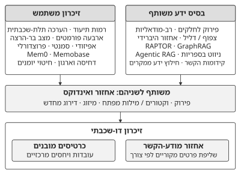

## מערכת זיכרון משתמש

נפרק את המשפט "בשבוע הבא אני בחו"ל, את המסמכים מהבנק תשלחו לי במייל". המשתמש ציין נסיעה מוגבלת בזמן, ובתוך פרק הזמן הזה קבע את אופן קבלת הדואר. כשהבנק יבקש לשלוח מסמכים בדואר, העוזר יכול להסתמך על כך ולבקש משלוח אלקטרוני; אחרי שהנסיעה הסתיימה, שאלה על משלוח מכתבים מחייבת לבחון מחדש את התנאים הנוכחיים. אם נשמר רק "המשתמש לא אוהב מכתבי נייר", הזיכרון אמנם יאוחזר בעתיד, אבל ייושם בהיקף הלא נכון.

עכשיו לכרטיסי טיסה. אם המשתמש אומר "הכרטיס ההוא ב‑1250 בפעם הקודמת היה יקר ממה שציפיתי", המערכת יכולה לשמור לפחות את הצעת המחיר ההיא, את התקציב באותו זמן, את אופי הנסיעה ואת התגובה הזאת. כשיתעורר מצב דומה, המודל יטפל בזהירות רבה יותר בהצעה שחורגת מהתקציב. אם המשתמש מוסיף בנפרד "מעכשיו, בנסיעות משפחתיות תשאל אותי קודם", נקבע בכך תנאי מפורש לשאלה בכל נסיעה משפחתית עתידית. מכאן אפשר להבחין בשלושה סוגי מידע: מה המשתמש אמר בפועל, באילו תנאים זה נאמר, ומה המודל הסיק מהחוויה הזאת.

אפשר לבקש מ‑LLM לסדר את הרשומות האלה בסוף השיחה ולכתוב לאחסון מתמיד את העובדות שיש להן ערך בהמשך. כשמשימה חדשה מתחילה, נכנסות להקשר רק הרשומות הרלוונטיות שעדיין תקפות.

לדוגמה, בעת הזמנת טיסה מסר המשתמש את המידע הבא:

```text
User: Help me book a flight to Tokyo next Friday. I prefer window seats
      and I'm vegetarian, so I'll need a special meal.
Agent: I'll search for flights to Tokyo for next Friday...
       [calls flight_search tool, returns 3 options]
Agent: Here are your options. Based on your preference, I've filtered for
       window seat availability. Shall I book the ANA direct flight?
User: Yes, and use my United MileagePlus number 12345678.
```

בתום השיחה יכול מחלץ הזיכרון להפיק ארבע רשומות:

```text
Extracted memories:
- User prefers window seats (preference)
- User is vegetarian, needs special meals on flights (dietary restriction)
- User's United MileagePlus number: 12345678 (loyalty program)
- User has travel plans to Tokyo (recent activity)
```

בדוגמה הזאת יש שלוש פעולות. **חילוץ סלקטיבי** שומר את העדפת המושב, את הדרישה התזונתית ואת מספר המנוי, ומסנן פרטים זמניים כמו "החיפוש החזיר שלוש אפשרויות". **הפשטה** הופכת את העדפת החלון שהמשתמש הביע במפורש לכלל שאפשר להשתמש בו בהזמנות הבאות. **מבניות** מתייגת כל עובדה בקטגוריה, כדי להקל על אחזור ועדכון. לגבי הנסיעה לטוקיו יש לרשום גם את תאריך היציאה ואת המצב הנוכחי; את "יום שישי הבא" יש להמיר לתאריך לפי מועד השיחה, ואחרי שהנסיעה הסתיימה או בוטלה יש לעדכן את המצב. כך אפשר לתחזק העדפות ארוכות טווח ופעילות אחרונה, כל אחת לפי תקופת התוקף שלה.

תיאור המוצר של העוזר האישי Today מביא דוגמה. המשתמש מספר שהוא מתאמן בימי שלישי וחמישי ומתכונן לחצי מרתון. כעבור שישה שבועות, נתוני השינה שחוברו באישורו מראים שבלילה הקודם הוא ישן מעט מאוד. העוזר מצרף את שתי פיסות המידע ומציע להזיז את אימון האינטרוולים העצים של אותו יום. כמה זמן צריך לזכור כל אחת מהן? תוכנית האימונים שימושית לאורך כל תקופת ההכנה לתחרות, ואילו רשומת השינה של אמש צריכה לשאת תאריך. גם אם המשתמש קיבל את ההזזה הפעם, האימון של יום חמישי הבא נשאר לפי התוכנית המקורית, אלא אם המשתמש אמר שמעכשיו יש לשנות תמיד. Today גם מפריד בין הצעה לבין שינוי ביומן כשני צעדים נפרדים, והצעד השני מחייב אישור של המשתמש.[^ch3-today]

[^ch3-today]: צוות Today מסביר ב‑"What Is Today", בעזרת דוגמת האימון לחצי מרתון, כיצד הזיכרון משתלב עם המידע של אותו יום. המייסד מסביר ב‑"Meet Today" את מנגנון האישור שלפני שינוי ביומן.

### הערכת יכולות זיכרון: מסגרת תלת‑שכבתית

המדד הציבורי **LoCoMo**‏ (Long-term Conversational Memory, זיכרון שיחה ארוך טווח) כולל שיחות ארוכות של כ‑300 תורות בממוצע, על פני עד 35 סשנים, ובוחן את יכולת הזיכרון באמצעות מענה על שאלות, סיכום אירועים ויצירת דיאלוג רב‑מודאלי. השאלות מתחלקות לחמישה סוגים. לשאלת חד‑קפיצה אפשר למצוא תשובה בסשן אחד; שאלת רב‑קפיצה מחייבת לחבר רמזים מכמה סשנים; שאלת היסק זמני מחייבת גם להבין את סדר האירועים. שאלת תחום פתוח מחייבת לשלב את דברי המשתמש עם ידע חיצוני. בהמשך לדוגמת ההזמנה: המשתמש אמר רק "בשבוע הבא אני נוסע לטוקיו", וכדי לענות על "באיזה מטבע משתמשים ביעד" צריך גם לזכור את הרמז על טוקיו וגם לדעת שמשתמשים שם ביין יפני. אם השאלה היא על מספר טיסה שהמשתמש מעולם לא ציין, העוזר צריך לומר שאין מספיק מידע. היכולת לזהות שאלה שאין עליה תשובה היא בדיוק מה ששאלות יריביות בודקות.[^ch3-locomo]

[^ch3-locomo]: סעיף 4.1 במאמר LoCoMo של Maharana ועמיתיו (arXiv:2402.17753) מגדיר את חמשת סוגי השאלות. עמוד הפרויקט של המחברים מספק את הנתונים ודוגמאות של שיחות.

על סמך מדדים כאלה והניסיון של מוצרי זיכרון, המחבר מסכם שמונה יכולות שיש לתת עליהן את הדעת:

- **שימור מידע אישי**: שמירה ושליפה מדויקת של מידע ארוך טווח כגון זהות המשתמש.
- **מעקב אחר העדפות**: תיעוד העדפות המשתמש ועדכונן כשהוא מביע אותן מחדש במפורש.
- **מעבר בין הקשרים**: המשך הרקע הרלוונטי גם אחרי מעבר נושא.
- **עדכון זיכרון**: טיפול בהשלמות ובתיקונים שהמשתמש מוסיף לעובדות קיימות.
- **רציפות רב‑סשנית**: שימוש בסשן חדש במידע שנשמר קודם.
- **היסק מורכב**: קישור בין כמה קטעי זיכרון. למשל, אם המשתמש סיפר פעם שהוא אלרגי לבוטנים, בשיחה על אוכל תאילנדי יש להזכיר לו לבדוק את המרכיבים.
- **מודעות זמנית**: שמירת תאריכים, פענוח זמן יחסי וחישוב פרקי זמן בין אירועים.
- **יישוב קונפליקטים**: זיהוי מידע לא עקבי והכרעה לפי המקור, הזמן ומי שהמידע חל עליו.

בהתאם למשימות המעשיות של סוכן, הספר מאמץ מסגרת הערכה תלת‑שכבתית. ניסויים 3-1 ו‑3-2 משתמשים בה תחילה להשוואת ייצוגי זיכרון; ניסויים 3-9 ו‑3-11 מעריכים באותה מסגרת את שיטות האחזור.

**שכבה 1: היזכרות בסיסית.** שמירה ושליפה מדויקת של מידע חד‑משמעי שהמשתמש מסר ישירות. לדוגמה, אם המשתמש אמר "מספר המנוי שלי הוא 12345", בהזמנה הבאה יש להחזיר את המספר המלא. שכבה זו בודקת בעיקר אם עובדות אבדו, התערבבו או שוכתבו.

**שכבה 2: אחזור רב‑סשני.** איסוף כל המידע הרלוונטי מסשנים מתקופות שונות ועל ישויות שונות, ואז הכרעה במי עוסקת הבקשה הנוכחית ואילו רשומות היא דורשת. למשתמש יש שתי מכוניות, אבל הוא אומר רק "קבע טיפול למכונית שלי" — המערכת צריכה לשלוף קודם את פרטי שתי המכוניות ולברר לאיזו מהן הכוונה. בשאלה על מצב הלוואה יש להבחין בין חוזה שנכנס לתוקף לבין הצעות מחיר מבירורים קודמים. בביטול "הטיול ללוס אנג'לס" יש לקשר את הטיסות, המלונות ושאר ההזמנות לאותו טיול.

**שכבה 3: שירות יזום.** זיהוי עניינים רלוונטיים למשימה הנוכחית שהמשתמש לא פירט אחד‑אחד. לדוגמה, בהזמנת טיסה בינלאומית — לקשר לפרטי הדרכון שנשמרו לפני חודשים ולבדוק אם תוקפו מספיק לנסיעה; כשהטלפון נשבר — לאסוף את אחריות היצרן, האחריות הנוספת של כרטיס האשראי ואת ביטוח חברת התקשורת, ולפרט את האפשרויות הזמינות; בהכנת מסמכים לדוח המס — לאתר ברשומות של כל השנה את עסקאות המניות, את ההכנסות מעבודה עצמאית ואת מסמכי מס הנכס.

> **ניסוי 3-1 ★: הערכת מערכת זיכרון באמצעות המסגרת התלת‑שכבתית**
>
> מערך ההערכה כולל 20 מקרי בדיקה לכל שכבה, 60 בסך הכול. מקרי שכבה 1 מורכבים בעיקר מסשן יחיד; מקרי שכבות 2 ו‑3 כוללים כמה סשנים על פני זמנים וישויות שונים, כדי לבדוק קישור בין ישויות, עדכון מידע ותזכורות יזומות.
>
> כל מקרה מורץ בשני שלבים. תחילה מוזנים הסשנים אחד אחרי השני: המודל מייצר זיכרון מהסשן הראשון, ובכל פעם שאחריו הוא מקבל רק את הזיכרון הקיים ואת הסשן החדש, ומייצר זיכרון מעודכן. מרגע זה המודל כבר לא יכול לקרוא את הטקסט המקורי של הסשנים הקודמים; כדי לענות על שאלה ממה שנאמר בהם, הוא יכול להסתמך רק על מה שנכתב לזיכרון. אחרי שכל הסשנים עובדו, מוזנת שאלה חדשה, והסוכן נדרש לענות עליה על סמך הזיכרון.
>
> ההערכה נעשית בשיטת LLM-as-a-judge: מודל שופט נפרד משווה את התשובה לתשובת הייחוס ולדרישות הניקוד, ובודק אילו עובדות היא מכסה ואילו שגיאות יש בה. בהרצה זו Doubao Seed 1.6 ייצר את הזיכרון ואת התשובות, ומודל של Moonshot ניקד. השופט רואה את השיחות המקוריות, ואילו המודל העונה רואה רק את הזיכרון שנשאר בסוף.
>
> איך קוראים את גיליון הציונים? לדוגמה, המשתמש רוצה רק לשלוף את מספר החשבון של שירות האינטרנט הביתי. בקבוצת הפתקים המועשרים העוזר ענה במספר הנכון. השופט נתן 4 נקודות לדיוק, להיזכרות ולהיסק, ורק נקודה אחת ליוזמה, והמקרה בכל זאת עבר. תנאי המעבר בתוכנית הוא לפחות 3 נקודות (מתוך 4) בכל אחד משלושת המדדים הראשונים, ובלבד שהשופט לא מצא עובדה חשובה חסרת ביסוס או סותרת את הדברים המקוריים. היוזמה נכללת בציון המשוקלל, ומספר המקרים שעברו לבדו אינו מראה עד כמה העוזר הציע עזרה ביוזמתו.

### המבנה ההיררכי של הזיכרון

כדי לענות על "איזו טיסה הזמנתי בפעם הקודמת" צריך למצוא אירוע אחד; כדי לענות על "איזה מושב להעדיף בהזמנה" צריך לשלוף העדפה שנשמרה מאינטראקציות רבות. שתי השאלות עוסקות באותו אדם, אבל דורשות גרעיניות רישום ושיטת אחזור שונות.

**מסלול (trajectory)** מתעד לפי סדר הזמן את האירועים של הרצת סוכן אחת: הודעות המשתמש, תשובות המודל, קריאות לכלים ותוצאות הביצוע. ביומן אירועים מסוג הוספה בלבד (append-only), אירועים חדשים מצורפים לסוף, והרשומות המקוריות נשמרות לצורך מעקב. ה‑Harness יכול לבחור היסטוריה מתוך המסלול, לחלץ ממנו מצב או לייצר סיכום, וכך לבנות את ההקשר שנשלח בפועל למודל בכל סבב.

**זיכרון משתמש ארוך טווח** שומר מידע שימושי בין סשנים, כגון העדפות, קשרים בין אנשים, סיכומי פעילות קודמת ועובדות מאומתות, ומשייך אותו לבעליו באמצעות מזהה משתמש או מזהה דומה. אמירה חדשה עשויה להשלים, לתקן או להחליף רשומה ישנה, ולכן הזיכרון ארוך הטווח דורש מיזוג ועדכון. את הקריאה והתחזוקה יכול לבצע הסוכן בקריאה מפורשת לכלים, או ה‑Harness בעת טעינת הסשן, בסיומו או בארגון ברקע.

**מצב עסקי** מתאר את השלב הלוגי שבו נמצאת משימה, כגון "דורש הבהרה", "בטיפול", "ממתין לתשלום", "הושלם". תוכנה יכולה לבדוק את המצבים האלה ולהחליט לאיזה אירוע להמתין ואיזו פעולה לבצע. פרק 6 ירחיב על ניהול מצב בארכיטקטורה מונחית אירועים.

שלושת סוגי הרשומות משלימים זה את זה: המסלול מספק את תיעוד הביצוע, הזיכרון ארוך הטווח מספק רקע בין סשנים, והמצב העסקי מראה עד היכן התקדמה המשימה הנוכחית. בהמשך נתמקד בייצוג, בניהול ובאחזור של הזיכרון ארוך הטווח.

### ארבעה פורמטי אחסון לזיכרון משתמש

אם צריך רק לשנות כתובת דוא"ל, עדיף להגיע ישירות לפריט הזה; אם צריך להבין למה הכתובת שונתה, יש לקרוא את השתלשלות העניינים. בחלק השמאלי העליון של איור 3-2 הדוא"ל, החברה והתפקיד נשמרים כפריטים נפרדים, ובחלק הימני העליון התפקיד, הצוות והפרויקט כתובים יחד. עכשיו הביטו בשני הכרטיסים שלמטה: אם בעתיד צריך לעדכן תפקיד, או להבחין מי בדיוק ביקר אצל הקרדיולוג, באיזה שדה יש לחפש בכל מקרה?

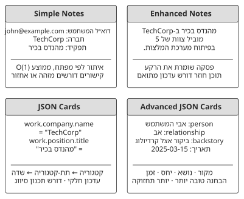

**Simple Notes** כותב כל זיכרון כעובדה קצרה, למשל "דוא"ל המשתמש: john@example.com". קל לקרוא ולכתוב רשומה בודדת; כשמאתרים אותה בטבלת גיבוב לפי מפתח יציב, זמן הסיבוכיות הממוצע של חיפוש ועדכון הוא בדרך כלל O(1). חיפוש סמנטי בכמות גדולה של פתקים מחייב בניית אינדקס אחזור. פיצול דק מדי גם מאבד קשרים: אם "עובד ב‑TechCorp כמהנדס בכיר, אחראי על פיתוח מערכת המלצות" מפוצל לשלוש רשומות לא קשורות — חברה, תפקיד ופרויקט — יהיה צורך בהמשך לקבוע מחדש אם הן שייכות לאותה משרה.

**Enhanced Notes** שומר עובדות ואת הרקע שלהן כפסקאות שלמות. לדוגמה: "המשתמש עובד ב‑TechCorp כמהנדס תוכנה בכיר, עוסק בלמידת מכונה כבר שלוש שנים, ומוביל כיום פרויקט מערכת המלצות עם צוות של 5 אנשים." הקשרים בין החברה, התפקיד, הניסיון והצוות נשמרים באותה פסקה. המחיר הוא שחלק מהעובדות עשויות לחזור בכמה פסקאות; כשהתפקיד משתנה, יש למצוא את כל הפסקאות הרלוונטיות ולעדכן אותן, כדי שרשומות ישנות וחדשות לא יתקיימו זו לצד זו.

**JSON Cards** מארגן מידע לפי "קטגוריה–תת‑קטגוריה–זוג מפתח‑ערך", למשל `personal.contact.email` ו‑`work.position.title`. בשינוי שדה התפקיד אפשר להשאיר שדות אחרים כמו `work.company.name` בלי שינוי, ולכן הפורמט מתאים לעדכונים חלקיים. בתכנון הסיווג יש להביא בחשבון גם מידע חוצה‑קטגוריות: "מפתח פרויקטים אישיים ב‑Python בסופי שבוע" נוגע בו בזמן לזמן, להעדפה טכנית ולפעילות. אפשר לשמור רשומת פעילות אחת ולהוסיף לה כמה תגיות, או לחבר את הקטגוריות הרלוונטיות באמצעות הפניות, וכך לשמר את הקשרים האלה.

**Advanced JSON Cards** מוסיף לעובדות את רקע המקור `backstory`, את הנושא `person`, את היחס למשתמש `relationship` וחותמת זמן. השדות האלה עוזרים למערכת לזהות למי שייך המידע, מתי נודע ובאיזה הקשר הוא חל. לדוגמה, "ד"ר ז'אנג" יכול להיות רופא השיניים של המשתמש, וגם הקרדיולוג של אביו; שמירת השם יחד עם המטופל, קרבת המשפחה וההתמחות מפחיתה בלבול.

כשהמשתמש אומר "תארגן בדיקות שנתיות לבני המשפחה שלי", המערכת יכולה למצוא את בני המשפחה דרך `person` ו‑`relationship`, ואז לקרוא את ההיסטוריה הרלוונטית מתוך `backstory`. ככל שיש יותר שדות, כך יש יותר קשרים לטפל בהם בחילוץ ובעדכון. המחבר ממליץ על אחסון מעורב לפי חשיבות המידע והצורך בקישור: אנשים מרכזיים, חוזים והעדפות ארוכות טווח — ב‑Advanced JSON Cards, כדי לשמור את המקור ואת הקשרים; עובדות פשוטות רבות עם מעט קשרים — ב‑Simple Notes, כדי להוזיל את החילוץ והתחזוקה. שני סוגי הרשומות מחוברים באמצעות מזהים או הפניות, ונשלפים יחד כשצריך.

> **ניסוי 3-2 ★★: השוואה בין ארבעה פורמטי זיכרון**
>
> המימוש הנלווה מספק לארבעת הפורמטים ממשק אחיד ליצירה, לעדכון ולאחזור של זיכרון, ומשווה את התשובות הסופיות על אותם 60 מקרים מניסוי 3-1.
>
> בהרצה זו, Simple Notes,‏ Enhanced Notes,‏ JSON Cards ו‑Advanced JSON Cards עברו 48, 52, 51 ו‑49 מקרים בהתאמה. בשכבה 2 עברו Enhanced Notes ‏16 מקרים ו‑Advanced JSON Cards ‏12; בשכבה 3 עברו שניהם 19. כולל תחזוקת הזיכרון, המענה והשיפוט, Enhanced Notes צרך כ‑990 אלף טוקנים ו‑Advanced JSON Cards כ‑1.55 מיליון טוקנים, וגם זמן קריאת המודל הממוצע של האחרון היה ארוך יותר.
>
> ניקח כדוגמה את שאלת מנויי הסטרימינג בשכבה 2. המשתמש רוצה לחסוך ושואל לאילו שירותים הוא מנוי וכמה עולה כל אחד. קבוצת הפתקים המועשרים פירטה את התשלום החודשי של Netflix,‏ Disney+ ו‑Max — ‏22.99, ‏19.99 ו‑19.99 דולר. קבוצת כרטיסי ה‑JSON המתקדמים ציינה רק את המחיר של Max, והוסיפה שתי חבילות זולות יותר של Max. ההמלצה אולי מפורטת יותר, אבל היא לא משלימה את שני החשבונות האחרים.
>
> מאיזה עדכון התחילה הבעיה? בזיכרון שקבוצת הכרטיסים המתקדמים שמרה אחרי כל סשן רואים שאחרי הסשן הראשון Netflix עדיין שם, אחרי הסשן השני נשארו רק הרשומות על Disney+, ואחרי הסשן השלישי נשאר רק Max. עד לרגע השאלה, שני המנויים הראשונים כבר נעלמו מהזיכרון.

### ייצוג ידע מתקדם: קוד בר‑הרצה

אחרי שהעובדות נשמרו, עדיין יש לסכם נתונים, לבדוק סתירות ולהחליט על הצעד הבא לפי כללים עסקיים. ב‑**User as Code**‏ (UaC) ניסה המחבר לארגן את מידע המשתמש כאובייקטי Python עם טיפוסים, ולכתוב את הפעולות האלה כפונקציות[^uac]. המודל מחלץ עובדות מהשיחה, והתוכנה מבצעת חישובים מוגדרים היטב.

להשוואת תאריכים, לסיכום סכומים ולאילוצים עסקיים מפורשים, המחבר מעדיף לכתוב את החישוב כפונקציה, כך שאותה קבוצת עובדות תניב תוצאה ניתנת לשחזור ולבדיקה. כך המודל יכול להתרכז בהבנה סמנטית ופחות לחשב בעל פה ולבדוק כללים שוב ושוב בשיחה ארוכה; גם את ייצוג הזיכרון ואת השימוש בו אפשר לבדוק באותו קוד.

‏UaC פועל בשני שלבים: תחילה העובדות שחולצו מצורפות ליומן, ומדי פעם נוצרת נקודת ביקורת שבה המצב בעל הטיפוסים נבנה מחדש מתוך היומן. היומן שומר את מקור העובדות ואת השתנותן, ואובייקט המצב מספק את השדות שאפשר לתשאל כרגע.

ניקח כדוגמה דרכון ונסיעות. את המצב אפשר להגדיר כך:

```python
from dataclasses import dataclass
from datetime import date

@dataclass
class PassportInfo:
    number: str
    country: str
    expiry_date: date

@dataclass
class Trip:
    destination: str
    departure_date: date
    is_international: bool

@dataclass
class UserState:
    passport: PassportInfo
    trips: list[Trip]

state = UserState(
    passport=PassportInfo("AB1234567", "US", date(2025, 2, 18)),
    trips=[
        Trip("Tokyo", date(2025, 1, 15), True),
        Trip("Paris", date(2025, 6, 10), True),
    ],
)
```

**צבירה סטטיסטית** עוברת ישירות על הרשומות. למשל, ספירת הנסיעות הבינלאומיות הרשומות לשנת 2025:

```python
count = sum(
    1 for trip in state.trips
    if trip.is_international and trip.departure_date.year == 2025
)
# count == 2
```

**בדיקת סתירות** משווה בין שתי קבוצות שדות לפי כלל קבוע מראש. הדוגמה הבאה משתמשת בהתאמה לפי קבוצת תרופות כדי להראות איך מעבירים לתור טיפול פריטים שדורשים בדיקה נוספת:

```python
def find_allergy_matches(profile):
    matches = []
    for medication in profile.current_medications:
        for allergy in profile.allergies:
            if medication.drug_class == allergy.drug_class:
                matches.append((medication, allergy))
    return matches
```

כל התאמה שומרת את רשומת התרופה ואת רשומת האלרגיה המתאימות, כך שהתהליך שבהמשך יכול לבדוק אותן ואז להחליט לפי כללי התחום אם להתריע, להעביר לבדיקה או להשלים מידע.

**בדיקת אילוצים** יכולה לרוץ אוטומטית בכל עדכון מצב. לדוגמה, אם כלל נסיעה מסוים דורש שביום היציאה יישארו לדרכון לפחות 180 ימי תוקף, אפשר להעביר את מספר הימים כפרמטר:

```python
def passport_alerts(state, required_days):
    alerts = []
    for trip in state.trips:
        if trip.is_international:
            days = (state.passport.expiry_date - trip.departure_date).days
            if days < required_days:
                alerts.append((trip.destination, days))
    return alerts

alerts = passport_alerts(state, required_days=180)
```

לפי 180 הימים שבדוגמה, בנסיעה לטוקיו נותרו לדרכון רק 34 ימי תוקף, וביום היציאה לפריז הוא כבר פג. אחרי שהמשתמש מחדש את הדרכון, התוכנה יכולה לחשב מחדש את שתי הנסיעות לפי התאריך החדש.

[^uac]: Li, Bojie, User as Code: Executable Memory for Personalized Agents, 2026.

### יסודות מדעי הקוגניציה של זיכרון המשתמש

מדעי הקוגניציה מבחינים בין סוגי זיכרון לפי התוכן ולפי אופן השימוש. המושגים האלה יכולים לעזור גם בארגון המידע ארוך הטווח של סוכן:

- **זיכרון אפיזודי (episodic memory)** שומר אירועים מסוימים, את זמנם, את המשתתפים ואת מהלכם. דוגמה אנושית: "ביום רביעי שעבר אכלתי ארוחת ערב עם עמיתים במסעדה איטלקית". בסוכן זה יכול להתאים ל"המשתמש מתכנן לטוס לטוקיו בטיסת ANA ביום שישי הבא", יחד עם תיעוד אם ההזמנה הצליחה ואם שונתה אחר כך.
- **זיכרון סמנטי (semantic memory)** שומר עובדות ומושגים. דוגמה אנושית: "בירת איטליה היא רומא". בסוכן זה יכול להתאים ל"המשתמש צמחוני", "המשתמש מעדיף מושב ליד החלון". מידע כזה יכול לבוא מאמירה מפורשת של המשתמש או מהכללה של חוויות רבות; תיעוד המקור עוזר להבחין בין השניים.
- **זיכרון פרוצדורלי (procedural memory)** קשור למיומנויות ולתהליכי פעולה. דוגמה אנושית: רכיבה על אופניים. בהנדסת סוכנים אפשר להשוות אותו לתהליך שחוזר על עצמו, למשל "חיפוש טיסות ישירות ← אישור העדפת מושב ← שימוש במספר הנוסע המתמיד ← הזמנת ארוחה".

נחזור לרשומות הקנייה מפרק 1: "צפתה בעשרה פריטים וקנתה אחד מהם" מצדיק תיעוד של אירוע קנייה אחד, אבל קשה להסיק ממנו מה המשתמשת תאהב בעתיד. ייתכן שהיא אוהבת את הדגם הזה, וייתכן שפשוט רק הוא הגיע באותו יום. אם היא אומרת אחר כך "מעכשיו, בקניות מהסוג הזה תבדוק קודם אם יש משלוח באותו יום", נוספת העדפה ארוכת טווח עם היקף תחולה מוגדר. בהמלצה הבאה על מוצר דומה אפשר לבדוק קודם את זמן המשלוח, וגם להסביר לה מאיזה משוב הגיע תנאי הסינון הזה.

טבלה 3-1 מציבה את הסיווג הזה לצד היררכיית הזיכרון ופורמטי האחסון שתוארו קודם, ומראה על איזו שאלה עונה כל אחד מהם.

טבלה 3-1 שלושה היבטים של תכנון הזיכרון

| היבט תכנון | השאלה שנענית | קטגוריות |
| --- | --- | --- |
| רמת הרישום | איזה תפקיד ממלא המידע? | מסלול, זיכרון משתמש ארוך טווח, מצב עסקי |
| פורמט אחסון | באיזה מבנה מייצגים אותו? | Simple Notes,‏ Enhanced Notes,‏ JSON Cards,‏ Advanced JSON Cards |
| תוכן הזיכרון | איזה סוג מידע נשמר? | זיכרון אפיזודי, זיכרון סמנטי, זיכרון פרוצדורלי |

לדוגמה, "המשתמש מעדיף מושב ליד החלון" הוא זיכרון סמנטי, ואפשר לשמור אותו בזיכרון ארוך הטווח בפורמט Simple Notes; תהליך הזמנה שלם הוא זיכרון פרוצדורלי, ואפשר לשמור אותו בכרטיס הכולל את המקור ואת תנאי התחולה.

### מקרי בוחן של מסגרות זיכרון

המשתמש אומר "לאחרונה עברתי למושב ליד המעבר", אבל ברשומה הישנה כתוב "אוהב חלון". המערכת יכולה לעדכן את העדפת המושב כבר בזמן הכתיבה, או לשמור את שתי האמירות ולהכריע איזו מהן חלה רק בהזמנה הבאה. נבחן תחילה באיזה שלב Mem0 מטפלת בקונפליקט כזה, ואחר כך איך Memobase מתעדת בנפרד את פרופיל המשתמש ואת האירועים עצמם.

**Mem0: שינוי המקום שבו מטופלים קונפליקטים.** בתהליך של המאמר מ‑2025 ושל v2 משווים בין עובדות ישנות לחדשות בזמן הכתיבה; v3 שבא אחריהם עובר להוספת עובדות ולאחזור היברידי. איור 3-3 מעמיד את שני הסידורים זה מול זה.

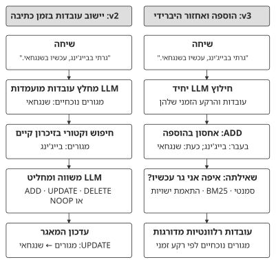

בתהליך המוקדם, ה‑LLM מחלץ תחילה עובדות מועמדות מהשיחה, אחר כך מאחזר זיכרונות קיימים דומים, ומחליט אם לבצע **ADD**,‏ **UPDATE**,‏ **DELETE** או **NOOP**. אם המשתמש אמר קודם "אני גר בבייג'ינג" ואחר כך "עברתי לשנגחאי", המערכת יכולה לעדכן את מקום המגורים הנוכחי לשנגחאי. כך קל לשלוף בזמן השאילתה עובדות מסודרות; בתחזוקה, לעומת זאת, יש לזהות נכון תיקונים, שינויים לאורך זמן וישויות שונות, ולשמור את הבסיס לכל עדכון כדי שאפשר יהיה לחזור ולבדוק כשמתגלה שגיאה. המאמר הציע גם וריאנט של זיכרון גרפי, **Mem0-g**, שמבטא ידע מקושר באמצעות ישויות ויחסים[^ch3-mem0-paper].

‏v3 הופך את החילוץ האוטומטי לקריאת LLM אחת, ומוסיף רשומות **ADD** בלבד. את שתי פיסות המידע, בייג'ינג ושנגחאי, אפשר לשמור יחד עם ההקשר הזמני שלהן, ולהכריע מהו מקום המגורים הנוכחי רק בזמן השאילתה לפי ההקשר. האחזור משלב דמיון סמנטי, מילות מפתח של BM25 והתאמת ישויות; גם פעולות שאושר שהושלמו אפשר לחלץ כעובדות. מדריך המעבר מדווח על עלייה בציון LoCoMo מ‑71.4 ל‑91.6, וב‑LongMemEval מ‑67.8 ל‑93.4. גרסת הקוד הפתוח הזו משתמשת בקישור ישויות לאחזור פנימי, והסירה את ממשק אחסון הגרפים החיצוני ואת ערך ההחזרה `relations`; זיכרון גרפי מסופק בפלטפורמה המנוהלת[^ch3-mem0-migration].

ההתפתחות הזאת מראה שמערכת זיכרון יכולה להעביר את ההכרעה בקונפליקטים משלב הכתיבה לשלב הקריאה. אם בזמן הכתיבה מוזגו בטעות החוויות של שני אנשים, או שהשלמה נחשבה לתיקון, התשובות הבאות עלולות להמשיך להסתמך על מצב נוכחי שגוי. אחסון בהוספה מאפשר לראיות הישנות והחדשות להשתתף בהכרעה, וגם חוסך את קריאות המודל שנדרשות להחלטה על כל פריט בזמן הכתיבה. בזיכרון משתמש שמשתנה תכופות, שבו קשה להכריע בקונפליקט ברגע הכתיבה, המחבר נוטה לשמור קודם את העובדות עם הזמן והמקור שלהן, ולהפיק את המצב התקף רק כשעונים על שאלה מסוימת.

[^ch3-mem0-paper]: Chhikara et al., Mem0: Building Production-Ready AI Agents with Scalable Long-Term Memory, 2025.

[^ch3-mem0-migration]: Mem0, Open Source: Migrating to the New Memory Algorithm.

**Memobase: פרופיל משתמש וזיכרון אירועים.** Memobase מארגנת מידע ארוך טווח בשני חלקים. **פרופיל המשתמש (profile)** שומר מאפיינים יציבים יחסית לפי נושא ותת‑נושא, למשל שם תחת `basic_info`, תחומי עניין תחת `interest` ותפקיד תחת `work`. המפתחים יכולים להגדיר אילו משבצות לחלץ, וכך לשלוט בהיקף ובגרעיניות של הפרופיל. **זיכרון אירועים (event memory)** מתעד את חוויות המשתמש ואת זמנן, כדי שהמערכת תוכל לענות על שאלות כמו "מתי דיברנו לאחרונה על התקציב".

Memobase מכניסה תחילה שיחות חדשות לחוצץ, ומעבדת אותן באצווה כשהחוצץ מגיע לגודל מוגדר או כשהסשן לא פעיל במשך זמן מוגדר; אפשר גם להפעיל עיבוד במפורש בסיום הסשן. כך הודעות רבות חולקות תהליך ארגון אחד, ובזמן השאילתה נקראים הפרופיל והאירועים שכבר נוצרו. העדכון האסינכרוני מקצר את הזמן שבו האינטראקציה הנוכחית ממתינה לחילוץ הזיכרון; כשצריך להשתמש מיד בעובדות העדכניות, אפשר להמתין לסיום העיבוד הנוכחי[^ch3-memobase].

[^ch3-memobase]: Memobase, תיאור הפרויקט הרשמי, כולל שדות הפרופיל, זיכרון האירועים, החוצץ וממשק העדכון הסינכרוני.

אם העוזר צריך לזכור גם את מהלך ההזמנה הקודמת, וגם את העדפת המושב של המשתמש ואת תהליך ביטול הכרטיס, אפשר לשמור אירועים, עובדות ותהליכים בנפרד, כמו באיור 3-4. בכל משימה מכניסים לזיכרון העבודה רק את החלקים הנחוצים.

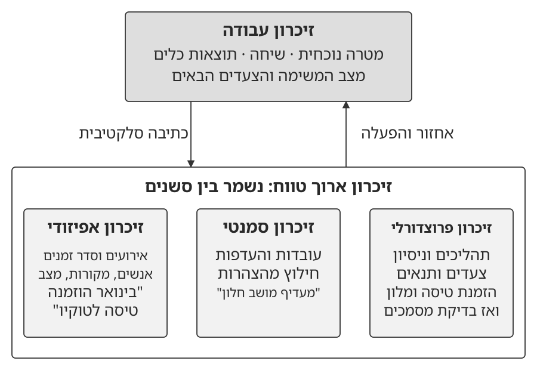

הזיכרון האפיזודי שומר רצפי אירועים יחד עם מטא‑נתונים כמו חותמות זמן, סמנים רגשיים ומזהי משימה, ומאפשר אחזור המשלב זמן ונושא. למשל, "הפעם האחרונה שדיברנו על התקציב" דורש גם התאמה לנושא וגם מיון לפי זמן. הזיכרון הסמנטי שומר עובדות והעדפות שחולצו מהאירועים, והזיכרון הפרוצדורלי שומר תהליכים שחוזרים על עצמם.

**זיכרון עבודה (working memory)** מארגן את המטרה הנוכחית, את מצב המשימה ואת המידע הרלוונטי שכבר נשלף. ה‑Harness בוחר תוכן מהמסלול ומהאחסון ארוך הטווח וטוען אותו להקשר הנוכחי; עובדות חדשות שהמשימה מייצרת מסודרות ואז נכתבות לזיכרון ארוך הטווח. המסלול מתעד איך הדברים קרו, זיכרון העבודה מרכז את המידע שדרוש להחלטה הבאה, ושניהם מחוברים באמצעות מזהי אירועים ומקורות.

כשקוראים זיכרון משתמש באמצעות RAG, מאתרים תחילה לפי הבקשה הנוכחית קבוצת זיכרונות שעשויים להיות רלוונטיים, ואז מחליטים אילו מהם להכניס לזיכרון העבודה. נניח שהיום העוזר צריך לבחור מושב, והאחזור מצא שני משפטים: "בנסיעות עבודה אני אוהב חלון" ו"בפעם הקודמת נפצעתי בברך, תבחר לי מעבר בטיסה חזור". שניהם רלוונטיים מאוד לבחירת מושב, אבל השני התייחס רק לטיסת החזור ההיא. דירוג מחדש לפי רלוונטיות, גם אם יציב אותו במקום הראשון, לא עונה על השאלה אם הוא חל היום.

במצב כזה המחבר מעדיף לסנן את הזיכרונות המועמדים בעזרת מודל שיפוט כמו Jev. מעבירים לו את הנסיעה הנוכחית, את הדרישות העדכניות של המשתמש, ולכל זיכרון את הנוסח המקורי, את התאריך ואת תנאי התחולה, והוא מכריע לגבי כל אחד: "חל הפעם", "לעיון בלבד" או "אין מספיק ביסוס". אם גם היום מדובר בנסיעת עבודה, הזיכרון הראשון יכול לשמש בסיס לבחירת המושב; אם המשתמש סיפר זה עתה שהברך עוד לא החלימה, כדאי לשלוף את השני ולשאול עליו.

### מנגנוני דחיסה וארגון של הזיכרון

משתמש שמרבה להזמין טיסות עשוי להזכיר "חלון" עשר פעמים. ייתכן שתשע מהן חוזרות על אותה הזמנה; אם סופרים את מספר האזכורים כעוצמת ההעדפה, מנפחים את משקלו של אירוע אחד. בארגון מזהים תחילה את המקור ואת האירוע, אחר כך ממזגים רשומות כפולות, בודקים אם יש תיקון מאוחר יותר, ורק בסוף מחליטים אילו דפוסים מתאימים לשימוש במשימות עתידיות. כשמופיע "המושב ליד החלון בפעם הקודמת היה טוב", אפשר לבקש ממודל שיפוט כמו Jev לקרוא את המשפט ואת ההזמנה הרלוונטית, ולהכריע רק אם מדובר ב"סקירה של הטיסה הקודמת", ב"דרישה להזמנה הנוכחית" או ב"הבעת העדפה ארוכת טווח". אם ההזמנה לא מתאימה או שכמה פרשנויות סבירות באותה מידה, שומרים את הנוסח המקורי ומבררים בזמן ההזמנה. הכרעה מקומית אחת כזאת מונעת ספירה חוזרת של אותה חוויה כראיה חדשה.

1. **בחירת הרשומות לארגון.** תדירות גישה, זמן הרישום, סמנים רגשיים וייחודיות המידע יכולים לשמש אותות לדירוג. למשל, רשומה שנוצרה לפני שלושה ימים, נשלפה חמש פעמים, נושאת סמן רגשי חזק ואין לה כפילויות — ראויה יותר להישמר בנפרד; רשומה שנוצרה לפני תשעים יום, נשלפה פעם אחת בלבד ודומה מאוד לשלוש רשומות אחרות — אפשר למזג אותה קודם עם הרשומות הקשורות. המערכת יכולה לסנן תחילה לפי ציון את הרשומות שדורשות ארגון, ואז להחליט לפי כללים עסקיים אם לדחוס, למזג או למחוק. אילוצים ארוכי טווח וחוזים בתוקף יש לשמור עד תום תוקפם גם אם הם נשלפים לעיתים רחוקות.
2. **אשכול והפקת סיכומים.** מקבצים רשומות דומות ושומרים את התוכן המשותף בפסקת סיכום אחת. למשל, שיחות רבות על מזג האוויר אפשר לסכם כ"המשתמש שואל לעיתים קרובות על מזג האוויר, ובמיוחד מתעניין בגשם". התאריכים המדויקים והשאלות המקוריות נשמרים בארכיון, והסיכום מקושר לרשומות המקור כדי שאפשר יהיה לחזור אליהן.
3. **חילוץ דפוסים ותהליכים.** מתוך רשומות קנייה רבות אפשר להכליל "מעדיף מוצרים משתלמים ומייחס חשיבות לביקורות משתמשים", או לזקק את שלבי בחירת המוצר.

### הגנת פרטיות: חיטוי יומנים

זיכרון משתמש מכיל לעיתים קרובות פרטי זהות, פרטי התקשרות ופרטי חשבון. המערכת צריכה להחליט לפי המשימה אילו שדות נכנסים לקלט של המודל, ולפי צורכי התפעול איזה תוכן נכנס ליומנים. את החיטוי אפשר למקם לפני הכתיבה ליומן: מחליפים קטעים רגישים בתווית סוג או במציין מקום יציב, ושומרים את המבנה הדרוש לאיתור תקלות.

> **ניסוי 3-3 ★★: חיטוי יומנים באמצעות מודל מקומי**
>
> בניסוי זה קוראים דרך Ollama למודל Qwen3-0.6B מקומי, שמזהה במחשב עצמו קטעים רגישים ביומנים. מודל קטן מתאים לפריסה על חומרה צרכנית, ואפשר גם לעבור לגרסאות של 1.7B,‏ 4B ועוד, ולהשוות בין איכות הזיהוי לזמן העיבוד. כשהיומנים הגולמיים צריכים להישאר מקומיים, גם הזיהוי וההחלפה צריכים להתבצע במחשב עצמו, ורק התוצאה המחוטאת מועברת לשירותים שבהמשך.
>
> חומרי הבדיקה כוללים מספרים מובנים כמו מספרי תעודת זהות ומספרי כרטיסי בנק, תוכן חצי‑מובנה כמו כתובות, ומידע רגיש שנחשף בשפה טבעית, כמו סיסמאות. המודל מחזיר לפי JSON Schema את סוג המידע, את מיקומו בטקסט ואת רמת הביטחון, והתוכנה מחליפה את הטקסט המקורי בהתאם. קבוצת הביקורת משתמשת בביטויים רגולריים; הקבוצה ההיברידית מריצה תחילה התאמה בביטויים רגולריים, ואז נותנת למודל לטפל בטקסט שנותר.
>
> נתחיל בשתי שורות יומן. בראשונה יש מספר תעודת זהות ומספר טלפון נייד; הביטוי הרגולרי הסתיר רק את מספר הטלפון, ושיעור ההיזכרות הוא $1/2$. בשנייה הביטוי הרגולרי מצא את מספר הביטוח הלאומי האמריקאי ואת מספר כרטיס הבנק, אבל הסתיר גם את מספר הפנייה שהפורמט שלו דומה. מתוך שלושת הקטעים שסימן, רק שניים דרשו חיטוי, והדיוק הוא $2/3$. אם בודקים רק אם ערכים רגישים נשארו ביומן, השורה השנייה עוברת; רק כשנציג השירות ינסה לאתר את הפנייה לפי היומן, יתברר שהרמז אבד.
>
> כשמחשבים את שיעור ההיזכרות לכל אחת מ‑12 הדוגמאות ומבצעים ממוצע, הביטויים הרגולריים, המודל והשיטה ההיברידית מגיעים לכ‑50%, ‏69% ו‑78% בהתאמה. בספירה אחרי ההחלפה, שלוש השיטות השאירו 9, ‏3 ו‑2 ערכים רגישים בהתאמה. כדי לבחור ביניהן צריך להביא בחשבון גם את זמן העיבוד: במחשב הזה הביטויים הרגולריים צרכו כ‑0.1 מילישנייה לשורה בממוצע, והמודל והשיטה ההיברידית — כ‑3 שניות כל אחד. כשנפח היומנים גדול, אפשר לטפל תחילה בביטויים רגולריים בשדות שהפורמט שלהם יציב, ולתת למודל לבדוק רק קטעים שדורשים הכרעה לפי ההקשר.

ככל שהרשומות מתרבות, הצעד הבא הוא למצוא מתוך אלפי פיסות מידע את מה שהמשימה הנוכחית צריכה. טכניקת ה‑RAG שתוצג להלן משמשת גם לבסיסי ידע משותפים וגם לאחזור זיכרון משתמש.

## יסודות RAG: בניית צינור רכישת הידע של הסוכן

חנות שינתה את מדיניות ההחזרים שלה, ולקוח שואל: "קניתי מוצר בחודש שעבר — איך אני מבקש עכשיו החזר?" כדי לענות נכון, צריך קודם למצוא את הסעיפים החלים על ההזמנה הזאת, ואחר כך להסביר בבהירות את התנאים ואת השלבים. **יצירה מוגברת באחזור** (Retrieval‑Augmented Generation,‏ RAG) מחברת את שני הצעדים האלה, וכך המודל יכול להשתמש במסמכים הפנימיים של החנות, וגם במדיניות שפורסמה רק אחרי שהאימון שלו הסתיים.

נתחיל במצב שבו קיימת רק גרסה אחת של המדיניות. הקוד הבא משתמש בממשק מפושט כדי לתשאל את תהליך ההחזר של אותה חנות, ומראה כיצד תוצאות האחזור נכנסות לתשובת המודל:

```python
query = "תהליך החזר"
results = retriever.search(query, top_k=2)
# results = [
#   "מדיניות החזרים: ניתן לבקש החזר מלא בתוך 7 ימים מקבלת ההזמנה; יש לציין את מספר ההזמנה. הכסף יוחזר בתוך 3–5 ימי עסקים.",
#   "ביצוע החזר: היכנסו ל'ההזמנות שלי', בחרו את ההזמנה ולחצו על 'בקשת החזר'."
# ]
answer = llm.generate(system="אתה עוזר שירות לקוחות.", context=results, question=query)
# התשובה כוללת את המועד להגשת הבקשה, את הפרטים הנדרשים, את שלבי הביצוע ואת זמן קבלת הכסף.
```

השוו את איור 3-5 לשתי תוצאות האחזור שבקוד: שלבי בקשת ההחזר לקוחים מ"ביצוע החזר", ואילו ההמתנה של 3–5 ימי עסקים עד לזיכוי לקוחה מ"מדיניות החזרים". אילו נותרו בתוצאות האחזור רק שלבי הביצוע, האם היה למודל על מה להסתמך כדי לומר ללקוח מתי יגיע הכסף? השאלה הזאת קובעת כיצד יש לפרק את המדריך לחלקים.

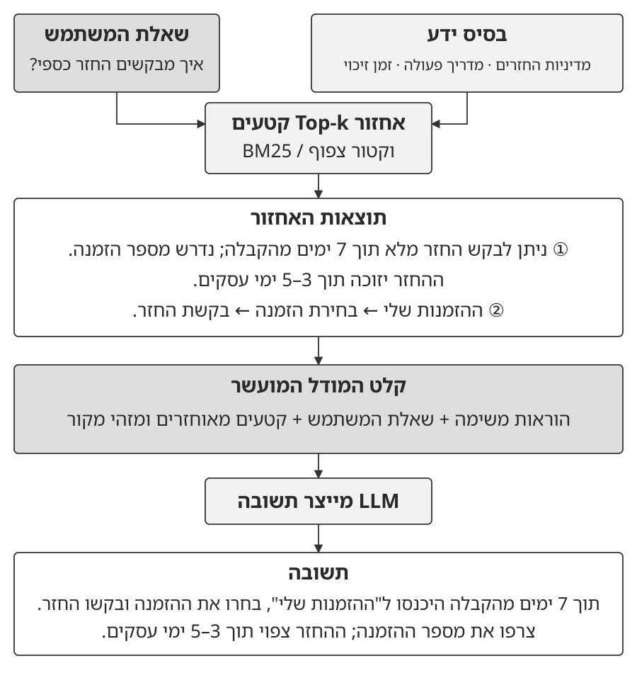

### פירוק מסמכים לחלקים (Chunking)

נניח שמדריך שירות לאחר מכירה מציין תחילה "ניתן להחזיר בתוך שבעה ימים", ובפסקה הבאה מפרט את המוצרים החריגים. אם אוחזר רק המשפט הראשון, המודל עלול להבטיח החזר גם על מוצר חריג; אם המדריך כולו הוא יחידת אחזור אחת, הוא גורר איתו גם התקנה, הגדרות ופתרון תקלות, והווקטור מתקשה להבליט את נושא ההחזרים. **פירוק לחלקים (chunking)** בוחר גודל בין שני הקצוות האלה: חלק טקסט צריך להספיק כדי להסביר את התנאים שלו עצמו, וגם להימצא בקלות בשאלה ספציפית. אורך החלק חייב גם לעמוד בתקציב הקלט של מודל השיכון ולהשאיר מקום בהקשר לשלב היצירה.

השיטות הנפוצות נחלקות לשלוש קבוצות.

**פירוק בגודל קבוע** חותך לפי מספר טוקנים, למשל 512 טוקנים לחלק, עם חפיפה של 50～100 טוקנים בין חלקים סמוכים. החפיפה נותנת לתוכן שליד הגבול סיכוי להופיע בשלמותו בחלק אחר. השיטה מאפשרת לשלוט בקלות באורך החלקים, אך נקודת החיתוך עלולה ליפול באמצע פסקה, קטע קוד או טבלה.

**פירוק רקורסיבי או מודע‑מבנה** חותך קודם לאורך גבולות טבעיים כמו פרקים ופסקאות, ורק כשחלק ארוך מדי הוא יורד ליחידות קטנות יותר כגון משפטים. כותרות Markdown ורכיבי HTML מספקים רמזים למבנה. אפשר גם להגדיר כללי טיפול מיוחדים לקטעי קוד, לטבלאות ולטקסט הצמוד לכותרת. למסמכים טכניים בעלי מבנה ברור המחבר ממליץ להתחיל בשיטה זו: ניצול הפרקים והפסקאות הקיימים ופירוק נוסף רק של הקטעים הארוכים מדי שומרים בדרך כלל על המשמעות השלמה טוב יותר מחיתוך עיוור.

**פירוק סמנטי** מחשב את דמיון השיכון בין משפטים או קבוצות משפטים סמוכים, וחותך במקום שבו הנושא משתנה באופן ניכר. הוא מוסיף חישובי שיכון, אך יש לו סיכוי טוב יותר לשמור נושא אחד בתוך חלק אחד.

נניח שהמאחזר החזיר משפט אחד בלבד: "הכנסות החברה צמחו ב‑3%." איזו חברה? איזה רבעון? המספר נמצא, אבל הבסיס למענה על השאלה נמצא בפסקה הקודמת. אם הדוח הכספי כולו נכנס לחלק אחד, הרבעון ושם החברה אמנם נשמרים, אך שאילתה על הכנסות תגרור איתה גם את הפסקאות על גיוס עובדים ועל רכש ציוד. כל התוכן הזה חולק וקטור אחד, ונושא ההכנסות עלול שלא לבלוט בו. בבחירת גודל החלק בפועל, אפשר להתחיל מ‑256～1024 טוקנים לחלק ומחפיפה של 10%～20% בין חלקים סמוכים.

מטא‑נתונים כגון כותרת, מקור וזמן אפשר לשמור יחד עם הקטע. האחזור מודע‑ההקשר שיוצג בהמשך יוסיף לכל קטע גם את הרקע שלו במסמך המקורי, וכך יעזור לפתור הפניות ולקבוע היקף כשהקטע מאוחזר בנפרד.

### שיכונים צפופים: ייצוג טקסט באמצעות וקטורים

**שיכון (embedding)** ממפה מילים, משפטים או חלקי טקסט לווקטורים מספריים, למשל `[0.2, -0.5, 0.8, ...]`. מודל האחזור מאומן כך ששאילתה ומסמך רלוונטיים יקבלו דמיון גבוה במרחב הווקטורים. "צפוף" פירושו שלרוב הממדים בווקטור יש ערכים שאינם אפס, ויחד הם מייצגים את המידע שבטקסט; בייצוג הדליל שיוצג בהמשך, רק מעט ממדים אינם אפס.

אפשר לחשוב על מרחב הווקטורים כעל מפה רב‑ממדית: כל קטע טקסט הוא מיקום בה, ואחזור הוא חיפוש של תוכן הקרוב לשאילתה. אחד המדדים הנפוצים הוא **דמיון קוסינוס**:

$$
\operatorname{cos}(A,B)=\frac{A\cdot B}{\|A\|\,\|B\|}
$$

המכפלה הסקלרית $A\cdot B$ מכפילה ממדים מקבילים וסוכמת את התוצאות, והנורמה $\|A\|$ היא השורש הריבועי של סכום ריבועי הממדים. אחרי החלוקה בשתי הנורמות, התוצאה משקפת רק את היחס בין הכיוונים. עבור וקטורים שאינם אפס, ערך הקוסינוס נע בטווח $[-1,1]$, וככל שהוא קרוב יותר ל‑1, הכיוונים מתואמים יותר. מודלי אחזור שונים משתמשים גם במכפלה סקלרית או במרחק אוקלידי. כששני הווקטורים מנורמלים לאורך יחידה, המכפלה הסקלרית שווה לדמיון הקוסינוס.

> **חישוב ידני: דמיון הקוסינוס של שלושה משפטים**
>
> נייצג בשלושה וקטורים להמחשה את "כיצד לגדל חתול" $A=(0.9,0.5,0.1)$, "מדריך לטיפול בחתולים" $B=(0.8,0.6,0.1)$ ו"אסטרטגיית השקעה במניות" $C=(0.1,0.1,0.9)$.
>
> $A\cdot B=0.9\times0.8+0.5\times0.6+0.1\times0.1=1.03$. הנורמות של השניים הן $\sqrt{1.07}$ ו‑$\sqrt{1.01}$, והדמיון הוא כ‑**0.991**.
>
> $A\cdot C=0.9\times0.1+0.5\times0.1+0.1\times0.9=0.23$, הנורמה של $C$ היא $\sqrt{0.83}$, והדמיון הוא כ‑**0.244**. בקבוצת וקטורים זו, השאילתה על גידול חתולים קרובה יותר למדריך הטיפול.

מודלים אמיתיים משתמשים בדרך כלל בייצוגים של מאות עד אלפי ממדים.

#### מ‑Word2Vec למודעות הקשר

איור 3-6 מתחיל בווקטורי מילים קבועים. **Word2Vec** לומד וקטור קבוע לכל מילה מתוך הופעות משותפות של מילים. יחסים מסוימים באים לידי ביטוי בפעולות וקטוריות, כמו הדוגמה הקלאסית "מלך − גבר + אישה ≈ מלכה". גם המגבלה של ייצוג קבוע ברורה: `bank` מקבלת אותו וקטור ב‑`river bank` (גדת נהר) וב‑`investment bank` (בנק השקעות).

**GloVe** סופר מתוך הקורפוס כולו כמה פעמים כל זוג מילים מופיע יחד, ולומד וקטורי מילים באמצעות מטרת ריבועים פחותים משוקללת. Word2Vec מתמקד במשימת חיזוי בחלון מקומי, ו‑GloVe מכניס את סטטיסטיקת ההופעה המשותפת הגלובלית ישירות לאימון; שניהם לומדים ייצוג קבוע לכל מילה[^ch3-glove].

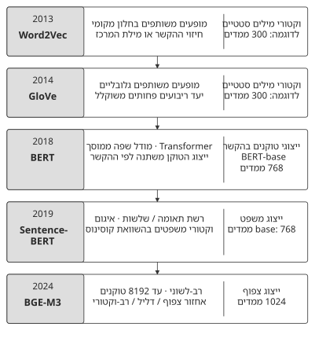

במודלים מודעי‑הקשר כמו **BERT**, הייצוג של אותו טוקן משתנה לפי המשפט. בעזרת קשב עצמי, המודל יכול להסתמך על רמזים כמו "משיקה מוצר חדש" ו"קניתי שני קילו" ולחשב ייצוגים שונים ל"תפוח" בשני המשפטים. מודל שיכון לאחזור צריך גם לצבור את ייצוגי הטוקנים לווקטור של שאילתה או של מסמך, ולעבור אימון מתאים כדי ששני הווקטורים יהיו ברי השוואה.

**Sentence-BERT** משלב את BERT עם מאגום (pooling) ועם מבנה רשת תאומה או משולשת, ומאמן וקטורי משפטים שאפשר להשוות ישירות. את המסמכים אפשר לקודד מראש ולשמור באינדקס; כשמגיעה שאילתה, מקודדים רק אותה ומחשבים דמיון וקטורי. הקידוד המוקדם חוסך את הצורך לחשב מחדש את ייצוגי כל המסמכים בכל שאילתה[^ch3-sbert].

**BGE-M3** מספק בו‑זמנית ייצוגי אחזור צפופים, דלילים ורב‑וקטוריים, ותומך בריבוי שפות ובקלט ארוך יחסית; סעיף זה משתמש בייצוג הצפוף שלו כדי להסביר אחזור בווקטור יחיד[^ch3-bge-m3]. האורך שהמודל מקבל משפיע על תוכנית הפירוק: הגבול הטיפוסי של BERT המקורי הוא 512 טוקנים, ו‑BGE-M3 תומך בעד 8192 טוקנים.

[^ch3-bge-m3]: המאמר M3-Embedding של Chen ועמיתיו (arXiv:2402.03216) מתאר כיצד שלושת ייצוגי האחזור מאומנים יחד. ראו גם את תיאור המודל BGE-M3 של BAAI, הכולל את אופני הייצוג, הממדים, אורך הקלט ואופן השימוש.

> **ניסוי 3-4 ★★: השוואה בין שני אינדקסים של שכן קרוב מקורב**
>
> אחרי שווקטורי המסמכים נבנו, צריך למצוא במהירות את הווקטורים הקרובים לשאילתה. חישוב אחד‑אחד נותן את השכנים הקרובים המדויקים, אך כשהנתונים גדלים, אינדקס **שכן קרוב מקורב** (Approximate Nearest Neighbor,‏ ANN) מוותר על מעט היזכרות, בשיעור שניתן לשלוט בו, תמורת מהירות שאילתה. הניסוי משווה בין ANNOY ל‑HNSW על אותם שיכונים אמיתיים ואותן שאילתות, ומשתמש בתוצאות החיפוש המדויק כנקודת ייחוס. לדוגמה, אם החיפוש המדויק של שאילתה מסוימת מנה עשרה שכנים קרובים, ובעשר התוצאות שהחזיר האינדקס המקורב נמצאים שמונה מהם, ה‑Recall@10 של השאילתה הוא 0.8. המספר הזה מודד כמה מהשכנים המדויקים האינדקס שימר.
>
> ANNOY משתמש בעצי הטלה אקראיים מרובים כדי לצמצם את טווח המועמדים; HNSW משתמש בגרף שכנים היררכי: הוא מתקרב במהירות לאזור היעד בשכבות העליונות הדלילות, ואז ממשיך לחפש בשכבות התחתונות הצפופות יותר. איור 3-7 מציג את המבנה ההיררכי של HNSW.
>
> 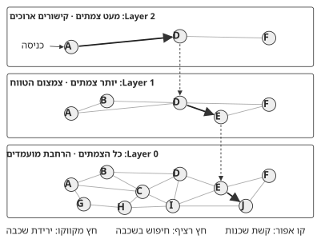
>
> טבלה 3-2 שיקולי המימוש של ANNOY ו‑HNSW
>
> | היבט ההשוואה | ANNOY | HNSW (בדוגמת hnswlib) |
> | --- | --- | --- |
> | מבנה האינדקס | עצי הטלה אקראיים מרובים | גרף שכנים היררכי |
> | עלות הבנייה | משתנה לפי מספר העצים, מספר הווקטורים והממד | משתנה לפי היקף השכנות, טווח החיפוש בבנייה וכמות הנתונים |
> | זיכרון וקבצים | אינדקס סטטי התומך במיפוי לזיכרון ובשיתוף בין תהליכים | שומר את הווקטורים ואת קשרי השכנות בגרף; היקף השכנות משפיע על העלות |
> | עדכון הדרגתי | הוספת פריטים אחרי בניית האינדקס מחייבת בנייה מחדש | תומך בהוספה, בעדכון ובסימון מחיקה; צריך לנהל את הקיבולת |
> | היזכרות ומהירות | מכווננות לפי מספר העצים ותקציב החיפוש בשאילתה | מכווננות לפי פרמטרי הבנייה וטווח החיפוש בשאילתה |
> | תרחישי שימוש | אינדקס סטטי שקל להפיץ ולשתף | אינדקס דינמי שנכתב ומתושאל ברציפות |
>
> בהרצה זו נבנה תחילה מאגר מ‑240 קטעי טקסט. עבור אותן 20 שאילתות, שני האינדקסים מצאו את כל 10 השכנים הקרובים הראשונים שנתן החיפוש המדויק. בבנייה הראשונה, ANNOY נבנה בכ‑13 מילישניות בקונטיינר Linux, ו‑HNSW נבנה בכ‑78 מילישניות בסביבה המקומית; האינדקסים השמורים שקלו כ‑1.40 MB וכ‑1.02 MB בהתאמה. לאחר מכן נוספו 60 הקטעים הנותרים: ANNOY בנה את האינדקס מחדש, ו‑HNSW הכניס את הווקטורים החדשים ישירות. עכשיו יש במאגר 300 קטעים, וייתכן שגם השכנים הקרובים הקודמים השתנו. אחרי חיפוש מדויק חוזר על המאגר החדש, ההיזכרות הממוצעת של שני האינדקסים נותרה 100%.

[^ch3-ann]: תיאור הפרויקט Annoy של Spotify מסביר כיצד לבנות אינדקס לקריאה בלבד, לטעון אותו באמצעות מיפוי לזיכרון, ולכוונן באמצעות `search_k` את מספר הצמתים הנבדקים בשאילתה. החלק על ממשק Python בתיאור הפרויקט hnswlib מציג את המתודה `add_items` להוספת וקטורים ואת המתודה `set_ef` לכוונון טווח השאילתה.

**את האינדקס יש לבחור לפי האופן שבו הידע מתעדכן.** כשהקורפוס מתפרסם באצוות קבועות ותהליכים מרובים חולקים אינדקס אחד לקריאה בלבד, המחבר שוקל קודם את ANNOY; כשמסמכים חדשים מגיעים ברציפות ונדרשת הכנסה מקוונת, עדיף HNSW. מודל השיכון קובע את הייצוג הסמנטי, והאינדקס קובע אם הייצוגים האלה ניתנים לשימוש בזמן השהיה ובעלות עדכון סבירים; יחד הם קובעים את איכות שירות האחזור.

כוונון מספר העצים ותקציב החיפוש של ANNOY, או היקף השכנות וטווח החיפוש של HNSW, מאפשר לראות כיצד ההיזכרות וזמן ההשהיה משתנים[^ch3-ann]. היזכרות האינדקס מודדת אם נמצאו השכנים הקרובים המבוקשים; אם השכנים האלה עונים על שאלת המשתמש תלוי בייצוג השיכון ובתוכן החומרים.

### ייצוגים דלילים: ממילות מפתח לניקוד רלוונטיות

**ייצוג דליל** משתמש בווקטור רב‑ממדי שבו רק מעט ממדים אינם אפס. אחזור מילות מפתח מסורתי מתייחס למונחים כממדים, ומשקלל אותם לפי המילים המופיעות במסמך. הבסיס שלו הוא **מודל שק המילים** (Bag of Words,‏ BoW): הוא שומר את המילים ואת מספר הופעותיהן ומתעלם מסדרן. לכן ל"חתול רודף כלב" ול"כלב רודף חתול" יש אותו ייצוג שק מילים.

ייצוג כזה מתאים להתאמת שמות, מספרים ומונחים טכניים. נתחיל ב‑TF-IDF ונראה כיצד תדירות מונח ותדירות מסמך הופכות לציון דירוג.

#### מ‑TF-IDF ל‑BM25

**TF-IDF**‏ (Term Frequency–Inverse Document Frequency, תדירות מונח–תדירות מסמך הופכית) משלב שני אותות: כמה פעמים המילה מופיעה במסמך הנוכחי, ועד כמה היא נפוצה בקורפוס כולו. נניח שמתוך 100 מאמרים, 60 מכילים "מודל" ורק 3 מכילים "זיקוק"; בשאילתה "זיקוק מודלים", "זיקוק" מבחין טוב יותר בין המאמרים.

ניסוח בסיסי אחד הוא:

$$\operatorname{TF\!\text{-}\!IDF}(t,d)=\operatorname{TF}(t,d)\times\operatorname{IDF}(t),\qquad \operatorname{IDF}(t)=\ln\frac{N}{\operatorname{DF}(t)}$$

$\operatorname{TF}(t,d)$ הוא מספר הפעמים שהמונח $t$ מופיע במסמך $d$, ‏$\operatorname{DF}(t)$ הוא מספר המסמכים המכילים אותו, ו‑$N$ הוא סך המסמכים. לפי הנוסחה הזאת, תרומת מילה שמופיעה עשר פעמים כפולה מזו של מילה שמופיעה חמש פעמים; ומסמך ארוך עשוי לקבל ציון גבוה רק משום שיש בו יותר מילים. ל‑TF-IDF יש וריאנטים רבים של נרמול, ו‑BM25 שלהלן מטפל בשתי ההשפעות האלה באמצעות רוויית תדירות ונרמול אורך.

**BM25** סוכם את התרומות של כל מונחי השאילתה:

$$\operatorname{Score}(Q,D)=\sum_i\operatorname{IDF}_{\mathrm{BM25}}(q_i)\cdot\frac{\operatorname{TF}(q_i,D)(k_1+1)}{\operatorname{TF}(q_i,D)+k_1\left(1-b+b\frac{|D|}{\operatorname{avgdl}}\right)}$$

כאן $q_i$ הוא מונח שאילתה, $|D|$ הוא אורך המסמך ו‑$\operatorname{avgdl}$ הוא אורך המסמך הממוצע. $k_1$ שולט במידת הרוויה של תדירות המונח; $b$ שולט בעוצמת נרמול האורך, וכאשר הוא 0 התיקון הזה מבוטל. איור 3-8 מחשב את הרכיבים האלה בנפרד. תחילה מקבעים את אורך המסמך ומעלים את מספר הופעות המונח מאחת לשלוש, כדי לראות כמה ציון מוסיפה כל הופעה נוספת; אחר כך מקבעים את התדירות ורק מכפילים את אורך המסמך. השורה התחתונה משווה עד כמה שתי מילים נפוצות באוסף המסמכים.

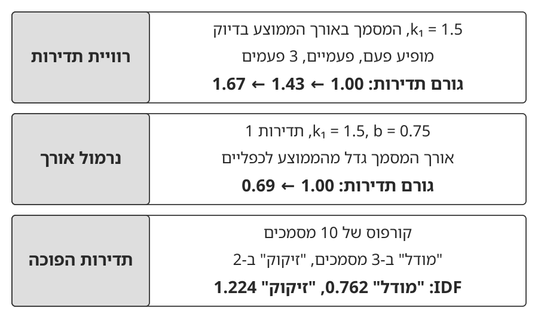

בשורה הראשונה של האיור, ההופעה השנייה מעלה את גורם התדירות בכ‑0.43, והשלישית רק בכ‑0.24 — זו רוויית התדירות. בשורה השנייה, אותה מילה מופיעה פעם אחת בלבד בשני המקרים; במסמך הארוך היא בולטת פחות, ותיקון האורך מוריד את גורם התדירות שלה. רק אחרי הכפלה ב‑IDF מתקבלת תרומת המילה לציון הכולל.

בנוסחה נותר רכיב אחד לקבוע: מדוע, כששתי מילים מופיעות שלוש פעמים כל אחת, המילה הנדירה מועילה בדרך כלל יותר מהנפוצה? סעיף זה משקלל מילים בתדירות המסמך ההופכית הבאה:

$$\operatorname{IDF}_{\mathrm{BM25}}(t)=\ln\frac{N-\operatorname{DF}(t)+0.5}{\operatorname{DF}(t)+0.5}$$

המונה הוא מספר המסמכים שאינם מכילים את המילה, והמכנה הוא מספר המסמכים שמכילים אותה; לשניהם מוסיפים 0.5 להחלקה, כך שהחישוב אפשרי גם כשתדירות המסמך היא 0 או $N$. מילים נדירות מקבלות משקל גבוה יותר; כשיותר ממחצית המסמכים מכילים את המילה, הנוסחה נותנת ערך שלילי. המימוש הנלווה קובע רצפה של $10^{-6}$ למשקל הניקוד בפועל, ושומר את הערך המקורי לבדיקה.

> **ניסוי 3-5 ★★: מימוש מנוע חיפוש BM25 מאפס**
>
> הניסוי עובר בסדר על טוקניזציה, טיפול במילות עצירה, אינדקס הפוך וניקוד. הטיפול במילות עצירה מסנן מילים בתדירות גבוהה כמו "的" ו"了" בסינית (בדומה ל‑"the" ו‑"of" באנגלית). **אינדקס הפוך** מתעד לכל מילה באילו מסמכים היא מופיעה ובאיזו תדירות; הוא דומה למפתח המונחים בסוף ספר: מחפשים "TCP", מוצאים את עמודים 45, 112 ו‑203, ואז קוראים את התוכן במקומות האלה.
>
> נחשב ביד שאילתה אחת, "זיקוק מודלים". נניח שבקורפוס 10 מסמכים, האורך הממוצע הוא 250 מילים, $k_1=1.5$ ו‑$b=0.75$. "מודל" מופיע ב‑3 מסמכים, וה‑IDF שלו הוא כ‑0.762; "זיקוק" מופיע ב‑2 מסמכים, וה‑IDF שלו הוא כ‑1.224. הטבלה שלהלן מפרטת לכל מילה את המסמכים שבהם נמצאה, את תדירות המונח ואת אורך המסמך. הצבת הערכים בנוסחה נותנת את תרומת כל מילה לציון המסמך.
>
> | מונח שאילתה | מסמך | תדירות מונח TF | אורך המסמך | תרומת BM25 |
> | --- | --- | ---: | ---: | ---: |
> | מודל | doc_1 | 5 | 200 | 1.52 |
> | מודל | doc_3 | 2 | 500 | 0.82 |
> | מודל | doc_7 | 8 | 150 | 1.68 |
> | זיקוק | doc_1 | 3 | 200 | 2.15 |
> | זיקוק | doc_5 | 1 | 250 | 1.22 |
>
> סכום התרומות של שתי המילים ב‑doc_1 הוא כ‑3.67, והדירוג הוא **doc_1‏ (3.67) > doc_7‏ (1.68) > doc_5‏ (1.22) > doc_3‏ (0.82)**. ב‑doc_1 תדירות "זיקוק" נמוכה מזו של "מודל", אך המילה נדירה יותר, ולכן תרומתה הסופית גדולה יותר; ההתאמה לשתי המילים גם יחד מעלה את הציון הכולל עוד יותר.
>
> עכשיו נחפש `cat` בקורפוס האנגלי של הניסוי הנלווה. שני המאמרים הקצרים שסומנו כרלוונטיים משתמשים ב‑`kitten` וב‑`feline`, ובאינדקס ההפוך אין כלל `cat` — רשימת המועמדים ריקה. גם אם נגביר עוד ועוד את משקל התדירות, אין אף מסמך לנקד. חיפוש חוזר במילים שמופיעות בשני המאמרים האלה מכניס כל אחד מהם לרשימת המועמדים.

### אחזור היברידי: מיזוג שני מסלולי התוצאות ודירוג מחדש

לחלק מהשאלות קשה למנות מראש את כל המילים הנרדפות. אחת השאלות בניסוי 3-6 שואלת "כיצד לפנות אוטומטית שטח ערימה שאינו בשימוש", ואילו המאמר הקצר המבוקש מנוסח כך: "ניהול זיכרון אוטומטי חוסך מהמפתחים את העבודה של שחרור אובייקטים ידנית". לשאילתה האנגלית ולמאמר אין אף מונח משותף; אחזור מילות המפתח לא מצא אף מסמך, ואילו האחזור הווקטורי דירג את המאמר המבוקש ראשון. כשעוברים לשאילתת דגם, XR-7003, אחזור מילות המפתח מוצא את הדגם המתאים ישירות, והאחזור הווקטורי מציג גם כמה דגמים דומים.

**אחזור היברידי** מחפש קטעים רלוונטיים בנפרד באמצעות מילות מפתח ובאמצעות וקטורים, ורק אז מחליט אילו קטעים ראויים להימסר למודל. כשבסיס הידע מכיל גם מזהים מדויקים וגם תיאורים בשפה טבעית, המחבר ממליץ להתחיל מכאן. עקבו אחרי XR-7003 לאורך איור 3-9: שני המסלולים דירגו אותו ראשון, ולכן במיזוג הוא מקבל שתי תרומות דירוג. הדירוג מחדש מחליף את המקום השני, והדגם שהמשתמש רואה ראשון נשאר הנכון.

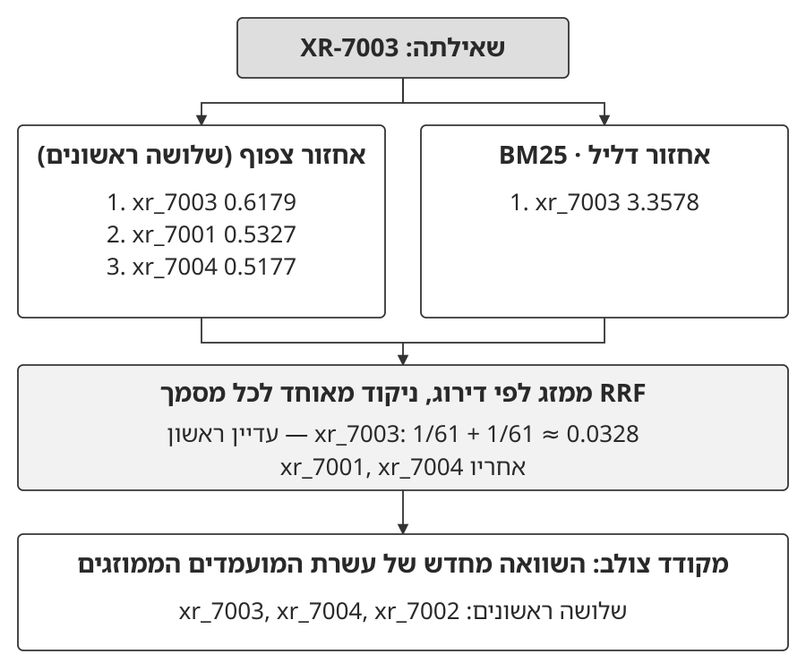

השלב הראשון הוא **אחזור מקבילי**: השאילתה נשלחת למנוע הצפוף ולמנוע הדליל, וכל אחד מחזיר קבוצה של מסמכים שעשויים להיות רלוונטיים. שני המסלולים יכולים לעבוד על אותו טקסט גולמי, או לעבור עיבוד מקדים לפי דרישות המודל של כל אחד.

השלב השני הוא **מיזוג תוצאות**: מאחדים את אותו מסמך משני המסלולים, ואז מדרגים הכול יחד. לדמיון קוסינוס ול‑BM25 יש סקאלות מספריות שונות, וחיבור ישיר שלהם עלול לתת למסלול בעל הערכים הגדולים יותר לשלוט בתוצאה. גישה אחת היא לכייל או לנרמל את הציונים ואז לשלב אותם במשקלות; גישה אחרת היא **מיזוג דירוגים הופכיים** (Reciprocal Rank Fusion,‏ RRF), המחשב לפי המקומות בכל מסלול:

$$\operatorname{RRF}(d)=\sum_{j:\,d\in R_j}\frac{1}{k+\operatorname{rank}_j(d)}$$

$R_j$ הוא מערך התוצאות של המסלול ה‑$j$, המקומות מתחילים ב‑1, וכשמסמך אינו מופיע במסלול מסוים, תרומת המסלול הזה היא אפס. קבוע ההחלקה $k$ הוא לרוב 60; ככל שהוא גדול יותר, פערי הציון בין המקומות הראשונים קטנים יותר. RRF מקל על שילוב שיטות ניקוד שונות, אך הוא שומר רק את המקומות, ואת הפערים בעוצמה שבציונים המקוריים יש לנצל בדרכים אחרות.

נחשב דוגמה עם שני מסלולי אחזור. המשתמש שואל "תוך כמה זמן מגיע ההחזר?". מסמך א' מדורג ראשון באחזור מילות המפתח ואינו מופיע בראש האחזור הווקטורי; מסמך ב' מדורג שני בשני המסלולים. עם $k=60$, א' מקבל $1/61$, כ‑0.0164; ב' מקבל $1/62+1/62$, כ‑0.0323. אחרי המיזוג ב' מדורג לפני א'. התוצאה הזאת מלמדת רק ששני מסלולי האחזור מצאו את ב'. כדי לקבוע אם ב' באמת עונה על שאלת זמן הזיכוי, צריך לבדוק אם הוא עוסק ב"כיצד מבקשים החזר" או ב"מתי מגיע ההחזר".

בשלב השלישי אפשר להוסיף **דירוג מחדש נוירוני**. המערכת לוקחת את המסמכים המובילים אחרי המיזוג, למשל 50 הראשונים, ומבקשת ממודל דירוג מחדש לנקד את מידת הרלוונטיות של כל מסמך לשאילתה. הדירוג מחדש יכול לשנות את הסדר של 50 המסמכים האלה. אם המסמך המועיל באמת לא נבחר כלל, צריך לחזור במעלה הזרם ולשפר את האחזור.

המודל הנפוץ כאן הוא **מקודד צולב (cross-encoder)**: הוא מקבל את השאילתה ואת המסמך המועמד יחד, מאפשר לשני החלקים לפעול זה על זה בתוך המודל, ומפיק ציון רלוונטיות. ה‑**מקודד הכפול (bi-encoder)** של שלב האחזור, לעומתו, מקודד את השאילתה ואת המסמך בנפרד; את וקטורי המסמכים אפשר לחשב מראש, ובזמן השאילתה מבצעים רק חיפוש וקטורי. הראשון מתאים לדירוג עדין של מספר קטן של מסמכים, והשני לסינון ראשוני מתוך כמות גדולה. אפשר להשוות זאת לסינון קורות חיים ולראיון: קודם מצמצמים את הטווח לפי מאפיינים קיימים, ואחר כך משווים לעומק מול הדרישות הספציפיות. BGE Reranker v2 M3 הוא אחד המודלים שאפשר להשתמש בהם בשלב הזה[^ch3-reranker].

[^ch3-reranker]: BAAI, תיאור המודל BGE Reranker v2 M3, המציג את קלט השאילתה–מסמך ואת ניקוד הרלוונטיות.

כשהחומר הרלוונטי כבר נמצא במאגר המועמדים אך מדורג לעיתים קרובות אחרי חומר לא רלוונטי, המחבר בוחן קודם דירוג מחדש באמצעות מקודד צולב. מכיוון שהוא קורא את השאלה ואת המסמך יחד, הוא יכול להשוות ישירות אם התנאים, הסייגים והפרטים שבמסמך תואמים את דרישות השאלה. טבלה 3-3 מפרטת שלושה מדדים נפוצים.

טבלה 3-3 שלושה מדדים לאיכות אחזור

| מדד | חישוב ומשמעות |
| --- | --- |
| recall@k (היזכרות) | מספר המסמכים הרלוונטיים ב‑k התוצאות הראשונות, חלקי מספר כל המסמכים הרלוונטיים לשאילתה; מודד כמה מהתוכן הרלוונטי נמצא. במערך בדיקה בדרך כלל ממצעים על פני השאילתות |
| MRR (דירוג הופכי ממוצע) | לכל שאילתה לוקחים את ההופכי של מקום המסמך הרלוונטי הראשון, ואז ממצעים; מקום ראשון נותן 1, מקום עשירי 0.1, ואם לא נמצא — 0 |
| nDCG@k (רווח מצטבר מוזל ומנורמל) | נותן לכל תוצאה ציון לפי מידת הרלוונטיות שלה, מוזיל את המקומות הנמוכים ומחלק בציון של הדירוג האידיאלי; מודד את איכות הדירוג הכוללת של k התוצאות הראשונות |

אפשר לתעד גם **שיעור פגיעה**: בכמה שאילתות נמצא לפחות מסמך רלוונטי אחד ב‑k התוצאות הראשונות? לדוגמה, שאלה זקוקה לשלושה מסמכים, ו‑20 התוצאות הראשונות מכילות רק שניים מהם. השאילתה הזאת נחשבת פגיעה, ולכן אינה נספרת בין הכישלונות של "לא נמצא דבר", אבל ה‑recall@20 שלה הוא רק $2/3$, ו‑$1/3$ מהחומר לא נמצא. אם לכל שאלה יש מסמך יעד אחד בלבד, שאלה שמצאה אותו מקבלת 1 ושאלה שהחמיצה אותו מקבלת 0. כשממצעים על אותן תוצאות אחזור, שיעור הפגיעה שווה להיזכרות הממוצעת.

> **ניסוי 3-6 ★★: השוואה בין אחזור דליל, אחזור צפוף, מיזוג ודירוג מחדש**
>
> הניסוי משווה חמש תצורות על אותן 12 שאילתות מתויגות: אחזור דליל, אחזור צפוף, מיזוג RRF, מיזוג משוקלל, ומיזוג ואחריו דירוג מחדש. השאילתות מכסות דמיון סמנטי, שמות מדויקים, ריבוי שפות וקוד טכני; שתיים מהן שואלות, אחת באנגלית ואחת בסינית, כיצד צמחים הופכים אור שמש למזון. המודל הצפוף הוא Qwen3-Embedding-0.6B, הדירוג מחדש משתמש במקודד הצולב MS MARCO MiniLM, כל מסלול אחזור מחזיר עד 10 מסמכים, והמדרג מחדש מטפל בעד 10 המסמכים המובילים ב‑RRF. ההיזכרות ו‑nDCG מתייחסים רק ל‑3 המסמכים הראשונים בדירוג הסופי, ואילו MRR מחפש את המסמך הרלוונטי הראשון לאורך כל הרשימה המוחזרת.
>
> פתחו קודם את הדירוגים לפי שאלה ביומן ההרצה של ניסוי 3-6, והשוו את תוצאות האחזור של שתי שאלות הפוטוסינתזה. בשאלה האנגלית מסמך היעד עדיין מדורג ראשון. בשאלה הסינית מוחזרים תחילה מסמכים על שפות תכנות ועל הרי געש, ורק השלישי עוסק בפוטוסינתזה. לכל שאלה יש מסמך רלוונטי מתויג אחד בלבד, ושתי השאלות מצאו אותו בשלושת המקומות הראשונים, כך שה‑recall@3 של שתיהן הוא 1. אבל בשאלה הסינית המסמך הרלוונטי הראשון נמצא במקום השלישי, והדירוג ההופכי הוא רק $1/3$. לפי שיטת הניקוד של הניסוי, הרווח של המקום השלישי הוא $1/\log_2(3+1)=0.5$ והרווח של המקום הראשון הוא 1, ולכן ה‑nDCG@3 של השאלה הסינית הוא 0.5.
>
> עכשיו נסתכל על כל 12 השאלות. אחרי הדירוג מחדש, מלבד שאלת הפוטוסינתזה הסינית, גם בשאלה על פינוי זיכרון ערימה ירד מסמך היעד מהמקום הראשון לשני. עשר השאלות האחרות שמרו על המקום הראשון, ולכן ה‑MRR אחרי הדירוג מחדש הוא $(10+1/2+1/3)/12\approx0.903$. לשם השוואה, ה‑MRR של האחזור הצפוף ושל RRF הוא 1 בשניהם. גם ה‑nDCG@3 של שניהם הוא 1, ואחרי הדירוג מחדש הוא יורד לכ‑0.928. מההיזכרות הממוצעת בלבד אי אפשר לראות את שינויי המקומות האלה: ה‑recall@3 של האחזור הדליל הוא 0.833, ושל ארבע התצורות האחרות — 1.
>
> נניח שעכשיו צריך לבחור תצורה למערך השאלות הזה: מה קנה הזמן שהושקע בדירוג מחדש? על המעבד הזה, RRF צורך בממוצע כ‑194 מילישניות לשאלה מתחילת האחזור ועד להפקת הדירוג; עם דירוג מחדש — כ‑237 מילישניות. כ‑43 המילישניות הנוספות לא מצאו אף מסמך יעד נוסף, ואף דחפו לאחור את התשובה הנכונה בשתי שאלות.

## ארגון ידע ואחזור

אופן ארגון הידע קובע מה מכיל כל פריט, והמאחזר קובע מה נשלף מתוך הפריטים האלה. פסקאות במדריכים טכניים, במסמכים משפטיים ובמאמרים קשורות זו לזו באמצעות היררכיית פרקים, תלויות בין מושגים והפניות בין מסמכים. שימור המבנה הזה מאפשר לשאילתה לגשת בו‑זמנית לראיות ספציפיות ולסיכומים ברמה גבוהה יותר.

סעיף זה דן בכמה דרכי ארגון בזו אחר זו: RAPTOR ו‑GraphRAG בונים אינדקס היררכי או אינדקס יחסים; OpenViking מארגן משאבי הקשר בספריות; עדכונים הדרגתיים וארגון מחדש מחזורי שומרים על עדכניות הידע; Agentic RAG מאפשר לסוכן להמשיך לאחזר לפי התוצאות שכבר בידיו; אחזור מודע‑הקשר משלים את הרקע של כל קטע; ולבסוף, חילוץ ידע בר‑שימוש חוזר ממערכי נתונים. כל אחת מהן פועלת על שלב אחר — ייצוג, אינדוקס, עדכון או שאילתה — ואפשר גם לשלב ביניהן לטובת זיכרון משתמש.

נתחיל בשתי דוגמאות שמראות את הפער בין המידע שהשאילתה צריכה לבין הרשומות הגולמיות.

**מקרה 1: ספירת החתולים השחורים והלבנים.** בפרק הקודם התוכנית ספרה את כל 100 הכלובים ומצאה 90 חתולים שחורים ו‑10 לבנים. הפעם המאחזר מחזיר רק את 20 הרשומות המדורגות ראשונות. נניח ש‑18 מהן מציינות צבע תקף: 15 חתולים שחורים ו‑3 לבנים. ה‑83.3% (‏15/18) שמתקבלים הם שיעור החתולים השחורים בתוך הרשומות התקפות האלה; שיעור החתולים השחורים בחנות כולה הוא 90% (‏90/100). המאחזר בוחר רשומות לפי רלוונטיות; הוא לא דוגם מדגם מייצג של החנות כולה.

אם שואלים לעיתים קרובות על השיעור בחנות כולה, אפשר לספור מראש את כל הכלובים, לשמור כמה חתולים שחורים וכמה לבנים יש, ולציין את היקף הספירה ואת מועד העדכון. כשחתולים בכלובים מתחלפים, מעדכנים את הרשומה המפורטת המתאימה ומחשבים מחדש את הסכום. מי ששואל מה יש בכלוב מספר 37 עדיין צריך לשלוף את הרשומה המפורטת הזאת.

**מקרה 2: האם אחות זכאית להנחה שקיבלה רופאה?** ניקח תרחיש לימודי שנבנה סביב פניות בנושא הטבות של Xfinity: בפניות, הוותיק ג'ון אושר, הרופאה שרה קיבלה הנחה, ולמורה מייק נאמר שאינו עומד בתנאים. כל פנייה מתעדת תוצאת טיפול אחת. אם אחות שואלת אם היא זכאית להנחה, אחזור של פניות דומות בלבד נתקל בשלוש בעיות.

- **מקצועות קרובים אינם מזכים בהכרח באותה הטבה.** "אחות" ו"רופאה" קרובות סמנטית, ולכן הרשומה של שרה עשויה להיות מדורגת גבוה; אבל הזכאות להטבה תלויה גם בתנאי המבצע — מי רשאי להגיש בקשה ואילו אישורים יש להציג.
- **פנייה בודדת אינה מפרטת את כל תנאי הזכאות.** העובדה שאדם אחד אושר מלמדת ישירות רק על התוצאה שלו בתנאים של אותו זמן; גם הגדלת מספר התוצאות המאוחזרות לא בהכרח תמצא קטגוריות או חריגים שלא הופיעו מעולם.
- **היקף החומר אינו ברור.** הפניות עשויות להגיע ממבצעים שונים או מתקופות שונות. צריך קודם לברר אילו רשומות רלוונטיות, ואילו בסיסים במדיניות חסרים.

בזמן האינדוקס אפשר לקשר יחד את הפניות של אותו מבצע, לעיין בתנאים הרשמיים המתאימים, ולארגן את קהל היעד, החריגים, מועד התחולה ומקור הסעיף לכרטיס כלל. לדוגמה, אם התנאים בתרחיש הלימודי מכסים במפורש משרתים בשירות פעיל ויוצאי צבא, וכן אנשי צוות רפואי מורשים, ומחריגים את קטגוריית המורים, שומרים כל תנאי בנפרד; גם השאלה אם אחיות נכללות בצוות הרפואי מוכרעת לפי התנאים. הפניות עצמן נשמרות, כדי להסביר את תהליך הטיפול בפועל ולגלות פערים ביישום.

שתי הדוגמאות משקפות צורכי מידע שונים: ספירת החתולים דורשת סטטיסטיקה על כל כלובי החנות, וההכרעה מי זכאי להנחה דורשת את התנאים המלאים ואת החריגים. מול שאילתות כאלה, המחבר מעדיף להקדים את הסטטיסטיקה ואת ארגון הכללים לשלב בניית המאגר. אם רק מגדילים את מספר הקטעים המאוחזרים, המודל עדיין עלול לא לראות את היקף הספירה המלא או את הסעיף שקובע אם הבקשה הזאת תאושר. כשבונים סיכומים סטטיסטיים, כרטיסי כללים וקשרי מקור סביב המשימה, האחזור יכול לקבל בבת אחת מידע שמספיק להכרעה, ועדיין לחזור לחומר המקורי.

### אינדוקס מובנה: בניית היררכיה וקשרים

בקריאת דוח ארוך, התשובה לשאלה "באיזה שדה בבקשת התיקון יש למלא" נמצאת לרוב בפסקה אחת של המקור; השאלה "מדוע סוגי תקלות מסוימים חוזרים שוב ושוב" מחייבת לעבור על פני כמה פרקים. כדי לשרת גם שאילתות כאלה, אפשר בשלב בניית המאגר לייצר סיכומים, לבנות היררכיה או לחלץ ישויות ויחסים. RAPTOR שלהלן יוצר היררכיה באמצעות סיכום רקורסיבי, ואילו GraphRAG מארגן את החומר באמצעות יחסי ישויות וסיכומי קהילות.

**RAPTOR**‏ (Recursive Abstractive Processing for Tree-Organized Retrieval) מתחיל מחלקי הטקסט: תחילה הוא מקודד כל חלק לווקטור, מקבץ את החלקים לכמה קבוצות לפי מידת הדמיון, ואז מייצר סיכום לכל קבוצה. כשמתייחסים לסיכומים כאל אצווה חדשה של חלקי טקסט וחוזרים על הצעדים, מתקבל העץ שבאיור 3-10. אם עולים לאורך החצים מחלקי הטקסט 3, 4 ו‑5, רואים שהם מייצרים יחד את סיכום B; ומעליו, סיכומי שלוש הקבוצות A,‏ B ו‑C מתלכדים לסיכום גלובלי.[^ch3-raptor]

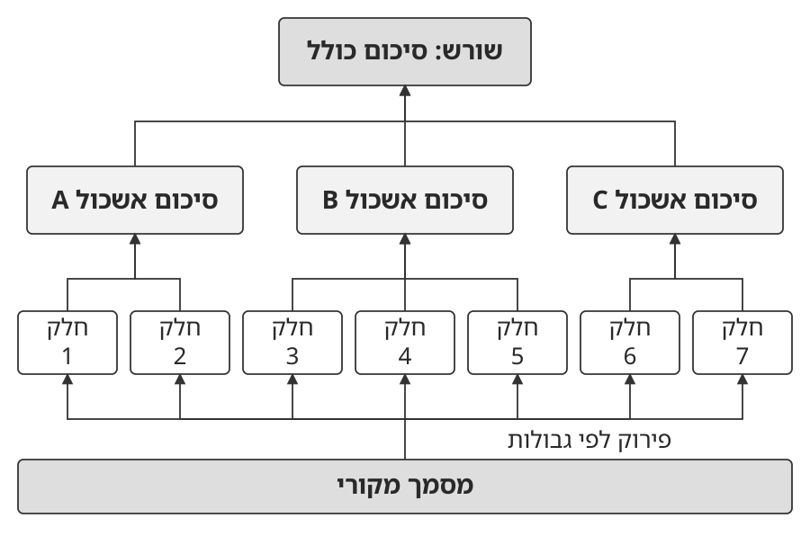

לדוגמה, "SSE2 תומך בפעולות SIMD על שלמים באוגרי XMM של 128 סיביות" ו"SSE4.2 מוסיף הוראות השוואת מחרוזות" יכולים להיכלל בסיכום "התפתחות מערכי הוראות SIMD של x86". שאלות פרטניות יכולות להתאים לחלקים שבתחתית העץ, ושאלות סקירה — לסיכומים ברמה גבוהה. שאילתה יכולה להעמיק בהדרגה לאורך ההיררכיה, או לחפש בצמתים מכל השכבות יחד ולבחור את הקבוצה הרלוונטית ביותר.

[^ch3-raptor]: Sarthi ועמיתיו, RAPTOR: Recursive Abstractive Processing for Tree-Organized Retrieval,‏ 2024.

**GraphRAG** מארגן ידע באמצעות ישויות, יחסים וסיכומי קהילות. הוא מתעד יחס בודד כשלשה מהצורה "נושא—יחס—מושא", למשל (סין, בירתה היא, בייג'ינג) או (ז'אנג סן, עובד ב, טנסנט). די ששתי רשומות מזכירות אותה ישות כדי לחבר אותן בגרף. שני הרופאים באיור 3-11 נקראים שניהם ז'אנג. כשמשתמש שואל "מה הכתובת של בית החולים שבו עובד רופא השיניים שלי?", לאורך איזה יחס צריכה המערכת להמשיך לחפש?

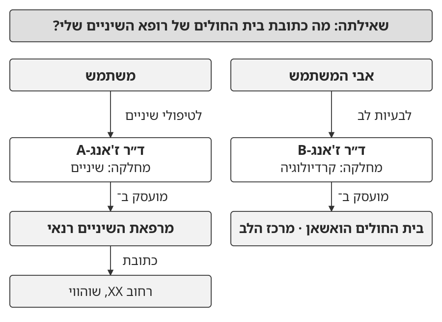

1. **להבחין בין ישויות בעלות שם זהה בעת בניית הגרף.** ד"ר ז'אנג אחד מטפל בשיני המשתמש בבית החולים לרפואת שיניים רן־אי, והשני מטפל באביו של המשתמש במחלת לב בבית החולים הואשאן. כשהמערכת מחלצת ישויות וממזגת רשומות, היא יכולה להיעזר ברמזים אלה ולהקצות לשני הרופאים מזהים שונים. השדות `person` ו‑`relationship` שהוצגו קודם ממלאים תפקיד דומה. קביעה אם `bank` במשפט פירושו גדת נהר או בנק היא פירוק משמעות מילים; קביעה לאיזה ד"ר ז'אנג רשומה מתייחסת היא פירוק משמעות ישויות.
2. **לחפש לאורך שרשרת היחסים בעת השאילתה.** אם יוצאים מהמשתמש ומתקדמים צעד אחר צעד לאורך "משתמש ← רופא ← בית חולים ← כתובת", אפשר לחבר מידע הפזור בכמה רשומות לתשובה אחת.

תהליך האינדוקס של GraphRAG של מיקרוסופט מחלץ תחילה ישויות ויחסים מיחידות טקסט, ואז מזהה באמצעות גילוי קהילות אשכולות של ישויות המחוברות בצפיפות, ומייצר היררכיית קהילות וסיכומים. בשאילתה על ישות מסוימת, החיפוש המקומי משלב את המידע הקשור אליה עם הטקסט המקורי; בשאילתה על נושאי הקורפוס כולו, החיפוש הגלובלי נעזר בסיכומי הקהילות כדי לארגן את התשובה[^ch3-graphrag].

[^ch3-graphrag]: Microsoft GraphRAG, סקירת האינדוקס והשאילתות, חיפוש מקומי וחיפוש גלובלי.

ייצוג יחסים צריך להכיל גם תנאים וזמן. המשפט "אם ירד גשם גם בשבוע הבא, אבטל את הנסיעה לחוף ואלך למוזיאון במקום" כולל תנאי, זמן תוקף ופעולה חלופית. אם מחלצים רק (משתמש, יש תוכנית, טיול לחוף) ו‑(משתמש, יש תוכנית חלופית, ביקור במוזיאון), תנאי המעבר אובד. אפשר לשמור את המשפט המקורי במלואו, ולייצג את האילוץ "כשיורד גשם בשבוע הבא" באמצעות צומת תנאי, צומת אירוע או שדות מובנים, כך שהיחס יפנה חזרה לטקסט המקורי.

לזיכרון משתמש, המחבר ממליץ על **שילוב שכבתי של שפה טבעית ואינדקס מובנה**: לשמור את הניסוח המלא בשפה טבעית, לתעד במטא‑נתונים את הנושא, הזמן והמקור, ולבנות אינדקס גרף לתוכן שיש לקשר לעיתים קרובות.

> **ניסוי 3-7 ★★★: השוואה בין סיכום היררכי לאינדקס יחסים**
>
> ניסוי זה בוחר 14 עמודים ממדריך הארכיטקטורה של Intel העוסקים ב‑SSE, ב‑AVX ובניהול מצב, ובונה עליהם שני מימושים לימודיים. ענף הסיכום ההיררכי מייצר תחילה סיכום לכל עמוד, מקבץ את העמודים לשלוש קבוצות ומייצר סיכומי קבוצה וסיכום שורש; ענף אינדקס היחסים מחלץ ישויות ויחסים ואז מייצר סיכומי קהילות. שני הענפים משתמשים באותם חומרים ובאותן שמונה שאלות, ומשווים פרטי מושגים והיסק יחסים.
>
> בשאילתה "הסבר את סביבת התכנות של SSE", הסיכום ההיררכי יכול להתאים בו‑זמנית לסקירת SSE ולפרטי האוגרים. המימוש הזה מחפש בצמתים מכל השכבות יחד ובוחר את חמשת הרלוונטיים ביותר. ענף היחסים מתרחב מהישויות הרלוונטיות אל שכניהן ומשלב סיכומי קהילות כדי לארגן את ההקשר. לאורך יחסים כמו "SSE ← אוגרי XMM ← פעולות נקודה צפה ← ADDPS" אפשר לקשר מושגים להוראות ספציפיות.
>
> שאלה מורכבת יותר היא "אם המעבד מצהיר שהוא תומך ב‑AVX, האם תוכנה יכולה להשתמש ב‑AVX?" כדי לענות עליה צריך לקשר בין יכולות המעבד לבין ניהול המצב של מערכת ההפעלה: לבדוק את הדגלים AVX ו‑OSXSAVE ב‑CPUID, ואז לקרוא את XCR0 ולוודא שמצבי XMM ו‑YMM מופעלים שניהם. נקודות הקצה שהשאלה מספקת לתוכנית החיפוש בגרף הן CPUID ו‑YMM. התוכנית מוצאת את המסלול הקצר ביותר המחבר ביניהם, דרך XSAVE,‏ CR4.OSXSAVE ו‑XCR0, ומעבירה את המסלול למודל כדי שיענה.
>
> בשמונה השאלות, כיסוי עמודי המקור הממוצע של שני הענפים עמד על כ‑95.8%.

המחבר ממליץ להתחיל בחלוקה טובה לחלקים ובאחזור היברידי, ולבנות אינדקס מובנה רק כשמופיע צורך חוזר בסינתזה חוצת‑מסמכים ובשאילתות יחסים. איתור פסקה מסוימת במדיניות ההחזרים נפתר בדרך כלל בחלוקה לחלקים ובאחזור היברידי; השוואה בין SSE ל‑AVX, או ירידה מהארכיטקטורה הכוללת להוראה ספציפית, מצריכות יותר סיכומים חוצי‑פסקאות ואינדקס יחסים.

### פרדיגמת מערכת הקבצים: ארגון ידע במבנה ספריות

**OpenViking** מארגן זיכרונות, משאבים ומיומנויות במערכת קבצים וירטואלית. כל פריט מוזכר באמצעות URI מסוג `viking://`, והסוכן יכול לעיין בספריות, לקרוא סקירות ואז לגשת לתוכן הדרוש[^ch3-openviking-uri]. לפי ייעוד המידע, אפשר לחלק את הספריות לשלוש קבוצות: משאבים חיצוניים, נתוני משתמש, והמיומנויות והניסיון שבהם הסוכן משתמש. מזהי המשתמש והסוכן תוחמים עוד יותר את מרחב השמות של כל אחד.

| תוכן | שימוש טיפוסי |
| --- | --- |
| Resources | חומרים חיצוניים כגון מסמכים טכניים, מאגרי קוד ודפי אינטרנט |
| User memories | העדפות, הרגלים וחוויות של משתמש מסוים |
| Skills ו‑Agent memories | תהליכים לשימוש חוזר, רשומות משימה וניסיון שעדיין טעון אימות |

ה‑URI מספק דרך אחידה לאיתור, ואת האחסון הפיזי והאינדקס מנהל השירות. ממשק הספריות מאפשר לסוכן לעיין לפי נושא, שכבה אחר שכבה, וגם להגביל חיפוש סמנטי לתת‑העץ הרלוונטי. גישה בסגנון מערכת קבצים, אחסון תוכן ואינדקס וקטורי יכולים יחד להרכיב את השירות.

[^ch3-openviking-uri]: OpenViking,‏ Viking URI וארכיטקטורת המערכת.

OpenViking מחלק את התוכן לשלוש שכבות, **L0,‏ L1,‏ L2**: ‏L0 הוא סיכום קצר, לשיפוט מהיר אם ספרייה רלוונטית; L1 הוא סקירת הספרייה, המתארת את התוכן העיקרי ואת נקודות הכניסה לניווט; L2 הוא הטקסט המלא שיש לקרוא לעומק. הסיכום והסקירה ברמת הספרייה נשמרים ב‑`.abstract.md` וב‑`.overview.md` בהתאמה. תקציב יצירת הטקסט שלהם הוא 256 ו‑4000 תווים בהתאמה[^ch3-openviking-layers].

שאילתה יכולה לקרוא תחילה סיכומים כדי לאתר את המקום, אחר כך סקירות כדי לבחור קבצים, ולבסוף לטעון את הטקסט המקורי. זה מקביל לחשיפה ההדרגתית של Skills בפרק 2: קטלוג קל משקל מאפשר גילוי, והתוכן המלא נטען לפי צורכי המשימה. כשנדרשים ערכים מדויקים, תנאים או הניסוח המקורי, יש להמשיך ולשלוף את הטקסט המתאים.

[^ch3-openviking-layers]: OpenViking,‏ Context Layers (L0/L1/L2). ‏L0 ו‑L1 הם ייצוגים שנוצרים ברמת הספרייה; L2 יכול להיות הקובץ המקורי או הטקסט לאחר ניתוח.

את הידע שבני אדם וסוכנים מתחזקים יחד, המחבר נוטה לנהל ב**טקסט פשוט ב‑Markdown עם בקרת גרסאות**. בני אדם יכולים לקרוא, לערוך ולתקן את הידע ישירות, והסוכן משתמש באותו ממשק קבצים, מציע עדכונים בענף עבודה, ואלה מתפרסמים לאחר סקירה. בקרת הגרסאות שומרת את ההבדלים של כל שינוי, ומאפשרת גם לבטל עדכון שגוי. בסיום סשן, העדפות המשתמש נכנסות לזיכרון של אותו משתמש, ומהלך הפעולות נכנס לרשומות המשימה. לאחר הערכת תוצאות, הכללה חוצת‑מסלולים ואימות עוקב, רשומות המשימה יכולות להפוך לניסיון שבו דן פרק 9.

ארגון ידע במערכת קבצים מחייב גם **לבנות קישורים ואינדקסים בין פריטים קשורים**. כשקבצים אינם מפנים זה לזה, אפשר למצוא מחדש את הקשרים ביניהם רק בסריקת טקסט מלא או באחזור סמנטי; ככל שיש יותר קבצים, כך קשה יותר לסוכן להמשיך להתחקות מהתוכן שכבר מצא. קישורים מספקים נתיבי חיפוש מפורשים: מדיניות ההחזרים מפנה לסעיפי החריגים, סיכום חוזה מפנה לרשומות החתימה, ערך של אדם מפנה לאירועים הקשורים אליו. עמוד הכניסה מתאר את הנושאים העיקריים, עמודי האינדקס מספקים ניווט, והפניות צולבות בין פריטים מאפשרות חיפוש רוחבי. הגישה דומה לארגון ערכים באנציקלופדיה, ושומרת חלק מהיחסים בדרך קלת משקל יחסית.

בעת בניית המאגר אפשר גם לציין אילו פריטים ניתנים לשימוש יחד, ומאילו תוכניות פעולה בוחרים רק אחת בטיפול נתון. למשל, כשנציג שירות מטפל בבקשה לביטול הזמנה, התשובה ללקוח חייבת לעמוד גם בכללי הניסוח וגם בכללי הפרטיות, ולכן אפשר להכניס את שני המסמכים להקשר יחד. אם המחסן הכין שתי תוכניות פעולה לביטול משלוח, יש לכתוב באינדקס את תנאי התחולה של כל אחת. לגבי אותה חבילה: אם טרם יצאה מהמחסן, מבטלים את הוראת היציאה; אם כבר נמסרה למוביל, מגישים בקשת יירוט. כשבפנייה כתוב רק "נא לבטל את ההזמנה", על הסוכן לבדוק תחילה את מצב החבילה ורק אז לטעון את תוכנית הפעולה המתאימה.

תחזוקת הקישורים צריכה להיות חלק מתהליך העדכון: לפני הוספת פריט, מחפשים רשומות קיימות ומחליטים אם למזג או ליצור חדש; לאחר הכתיבה, משלימים את ההפניות הקשורות ומעדכנים את אינדקס הספרייה. קישור יכול להוביל את הקורא לסעיף, אבל אם הסעיף חל על ההזמנה שלפניו תלוי במועד שבו נכנס לתוקף.

### כיצד יש לעדכן ידע

מדיניות משתנה היום, ומחר משתמש עשוי לשאול "מה עושים עכשיו", או "למה ההזמנה שלי טופלה כך בחודש שעבר". אם רק דורסים את הסעיף הישן בחדש, לשאלה השנייה כבר אין על מה להסתמך. **עדכון הדרגתי** כותב ראיות חדשות בזמן, ו**ארגון מחדש מחזורי** מאתר בהיקף רחב יותר כפילויות, סתירות ושינויים מבניים; בשני המסלולים יש לשמור גרסאות והפניות לראיות ולבדוק לפני פרסום, כדי שאפשר יהיה לבחור את התקופה הרלוונטית לפי השאלה.

#### עדכונים הדרגתיים לזיכרון משתמש ולבסיס ידע

ההמלצה של המחבר: **להתייחס לבסיס הידע כאל בסיס קוד, ולכל שינוי ידע כאל Pull Request‏ (PR).** לכל עדכון צריך להיות היקף שינוי ברור, ולצרף לו את הראיות התומכות כדי שהסוקר יוכל לבדוק. מסמכי Markdown, קובצי כללים והמצב בר‑ההרצה של User as Code יכולים כולם להיכנס לתהליך הזה. היסטוריית הגרסאות עוזרת למתחזקים לראות שינויים, להתחקות אחר סיבותיהם ולשחזר לאחר פרסום שגוי.

בהמשך לדפוס **המציע–סוקר** מפרק 1, עדכון יכול להתבצע כך:

1. **המציע מייצר את השינוי.** סוכן ה‑Proposer קורא את הראיות החדשות, מאחזר את הידע הקיים, מאתר פריטים שיש להוסיף, לתקן או שפג תוקפם, ומציע בענף עבודה שינוי בהיקף מוגדר. במקביל הוא מתחזק את הקישורים, אינדקסי הספריות, מידע הזמן וההפניות לראיות.
2. **הסוקר בודק באופן עצמאי.** סוכן ה‑Reviewer משווה את התוכן לפני השינוי ואחריו לראיות הגולמיות, ובודק אם לכל טענה חדשה יש מקור, אם תנאי התחולה נכתבו במלואם, אם הניסוחים בקבצים שונים עקביים, והאם בפסקאות שנמחקו נותר מידע שעוד נחוץ. כשהוא מוצא בעיה, הוא מצביע על הפריט ועל הבסיס הספציפיים, ומציין מה יש להשלים, לשחזר או לתקן.
3. **איטרציה והחלטה.** המציע מתקן לפי ההערות, והסוקר בודק שוב. לאחר אישור, השינוי עובר לתהליך המיזוג; אם המחלוקת נמשכת גם כשמגיעים למגבלת הסבבים או העלות, השינוי נשאר בענף העבודה ומועבר לסקירה אנושית.
4. **בדיקה ופרסום.** בדיקות אוטומטיות עוברות על עיצוב, קישורים, מטא‑נתונים ותוויות הרשאה; ידע בר‑הרצה צריך לעבור גם בדיקת טיפוסים ובדיקות רלוונטיות. לאחר המיזוג, בונים מחדש מגרסת הידע הקבועה את החלקים, הסיכומים ואינדקסי הווקטורים המושפעים, ורק אז מפרסמים גרסת שירות.

התהליך הזה נשען על שלוש שכבות נתונים. **שכבת הראיות הגולמיות** שומרת שיחות, מסלולי ביצוע, מסמכים עסקיים ותוצאות כלים; **שכבת הידע** שומרת טקסט או קוד מזוקקים הניתנים לתיקון; **שכבת השירות** שומרת אינדקסים שנוצרו מגרסת ידע מסוימת. רשומת השינוי מקשרת בין מזהי הראיות, גרסת הידע, הערות הסקירה וההחלטה הסופית, כך שהמתחזקים יכולים לברר מדוע נכתב פריט ידע מסוים ומתי נכנס לתוקף. הראיות הגולמיות מאורכבות לפי מדיניות השמירה, ואת האינדקסים אפשר לייצר מחדש מגרסת הידע. הזיכרון בהוספה בלבד שתואר קודם מתאים לשמירת עובדות חדשות וישנות ומקורותיהן; תהליך הסקירה כאן הופך את הראיות האלה לגרסת ידע שאפשר להשתמש בה. כששאילתה נתקלת בסתירה שטרם הוכרעה, עדיין אפשר לחזור לראיות ולשפוט לפי תנאי המשימה.

בתכנון הזה, **המציע והסוקר צריכים שניהם להיות סוכנים המסוגלים לקרוא לכלים ולהמשיך לחקור.** המציע עשוי להידרש לחפש בכמה רשומות כדי למצוא את הפריטים המושפעים; גם הסוקר עשוי להמשיך לחקור לאורך הפניות, להשוות גרסאות או להריץ בדיקות. כלים לחיפוש קבצים, לאחזור ראיות, לצפייה בהבדלים ולהרצת בדיקות מאפשרים להם לטפל בצעדי ההמשך האלה, וכל סוכן קוד בעל היכולות המתאימות יכול לבצע עבודה כזו.

היקף החיפוש של שניהם צריך לכסות את הידע שהשינוי הנוכחי נוגע בו ואת הראיות הגולמיות, בכפוף להרשאות המשתמש, הדייר והמשימה. מסלולי הסקירה, תוצאות הכלים שצוטטו והמשוב מאורכבים יחד, כך שאפשר לבדוק בדיעבד מה הסוקר אימת בפועל.

בבחירת המודלים, המחבר ממליץ להעדיף צירוף של מודלים בעלי יכולת דומה ממשפחות שונות, למשל Claude ו‑GPT, או DeepSeek ו‑Kimi. נתוני אימון והרגלי היסק שונים עשויים להוביל לשיפוטים שונים. על הסוקר לאחזר ראיות באופן עצמאי ולאמת את הטענות והתנאים שבשינוי. את ההרשאות צריכה לאכוף מערכת ההרצה: המציע כותב לענף העבודה, הסוקר קורא ראיות ומגיש מסקנות, ורק שירות המיזוג והפרסום מחזיק בהרשאה לעדכן את המאגר הראשי ואת האינדקס המקוון.

#### ארגון מחדש מחזורי של זיכרון משתמש ובסיס ידע

אחרי עדכונים מקומיים רבים, אותה עובדה עשויה להתפזר בין כמה קבצים, וניסוחים ישנים וחדשים עשויים להתקיים זה לצד זה. ארגון מחדש מחזורי יוצא מספרייה, מטווח זמן או מנושא ובודק את הבעיות המצטברות האלה. דרך העבודה שלו משותפת לסקירה המחזורית שבה דן פרק 9: בחזית נצברות ראיות חדשות, ברקע מתבצע ארגון מרוכז, והתוצאה היא רשומות שמשימות עתידיות יכולות להשתמש בהן.

הארגון כולל שלוש משימות.

1. **הסרת כפילויות, מיזוג והתאמת מבנה.** לאתר פריטים כפולים, מיושנים או מפוצלים יתר על המידה, למזג תוכן קשור, לפצל קבצים גדולים מדי, ולעדכן קישורים, עמודי כניסה ועמודי אינדקס. כשמוחקים ניסוח ישן מהשירות, יש לתעד מה החליף אותו ואת הבסיס המקורי.
2. **חזרה לחומר הגולמי.** אם כל סבב ארגון רק משכתב את הסיכום של הסבב הקודם, השמטות וטעויות הבנה מוקדמות עוברות מסבב לסבב. לכן יש להשוות לשיחות, למסלולי הביצוע, למסמכים העסקיים ולפלטי הכלים, ולבדוק אם הסיכום השמיט עובדות מרכזיות, איבד שלילה, זמן או תנאי, או הציג השערה כמסקנה ודאית. בסיסי ידע גדולים אפשר לעבד באצוות לפי ספרייה, זמן או נושא, ולתעד ברשימת כיסוי מה נבדק, מה ממתין לבדיקה ומה שנוי במחלוקת, עד להשלמת הבדיקה של המאגר כולו.
3. **טיפול בסתירות ובתחום התחולה.** להשוות את מקורות הרשומות הסותרות, וכן את הזמן, הנושא, האזור, המשימה והתנאים המוקדמים. אם שתי פיסות מידע חלות על תרחישים שונים, משלימים את תחום התחולה של כל אחת; אם ראיה חדשה מחליפה במפורש כלל ישן, שומרים את יחס הגרסאות; אם הבסיס אינו מספיק, מתעדים פריט הממתין לאישור ואת הראיות שיש להשלים.

גם תוצאות הארגון מוגשות כשינוי לסקירה. ארגון מחדש גדול אפשר לפצל למספר PR לפי ספרייה או נושא, החולקים תוכנית ארגון ורשימת כיסוי; לאחר שהשינויים הקשורים עוברים, בונים מחדש את האינדקסים הנגזרים ומריצים מחדש מקרי אחזור ומענה טיפוסיים, כדי לוודא שידע שאפשר היה למצוא קודם עדיין נגיש. את ההפעלה אפשר לקבוע לפי מחזור, שבועי או חודשי, או לפי ספים על מספר הפריטים החדשים, מספר הסתירות או שינוי באיכות האחזור.

**הוצאת תוכן שפג תוקפו משימוש.** חלקים וסיכומים צריכים לשמור גרסה, מועד כניסה לתוקף ומועד פקיעה. לאחר שמדיניות ישנה מוחלפת, שאילתות עסקיות שוטפות מסננות את הגרסאות שפג תוקפן; שאילתות היסטוריות קוראות את הכללים שחלו במועד המבוקש. כך אפשר להשתמש בידע העדכני ביותר וגם להסביר תוצאות טיפול מהעבר.

**הרשאות ובידוד דיירים.** סינון ההרשאות צריך להתבצע בשכבת האחזור: שירות האחזור תוחם תחילה, לפי זהות הקורא, את טווח המסמכים שמותר לחפש בהם, ורק אז מחפש בתוכו חומרים רלוונטיים. ברגע שחומר פרטי של משתמש אחר נכנס להקשר, המודל עלול לחשוף אותו בתשובה או בקריאה לכלי. טקסט מקורי, סיכומים, קשתות יחס ותוצאות במטמון צריכים כולם לרשת את טווח הגישה המתאים, כדי שתוכן נגזר לא יחשוף מידע של משתמשים או דיירים אחרים. השירות יכול להשתמש באינדקסים נפרדים או באינדקס משותף עם סינון כפוי; העיקר הוא שכל שאילתה תאכוף את מגבלות ההרשאה.

### RAG סוכני: הסוכן שולט בתהליך האחזור

תחילה כדאי לשאול אם אחזור אחד מספיק. לשאלה כמו "מהו מספר הטלפון של שירות הלקוחות?" מדריך שירות עדכני אחד נותן בדרך כלל את התשובה, והמחבר ממליץ להישאר במסלול הפשוט של אחזור יחיד ואחריו יצירה. אם המשתמש שואל "האם אפשר להחליף את הדגם שקניתי לפי תנאי האחריות של החודש שעבר?", האחזור הראשון מוצא רק את סדרת המוצרים, ועדיין אי אפשר לקבוע מה היו תנאי ההחלפה בחודש שעבר. כשהאחזור נחשף ככלי, הסוכן יכול להשתמש ברמזים שהחזיר החיפוש הקודם כדי לנסח את השאילתה הבאה. גישה זו, שבה הסוכן מחליט אם להשלים חיפוש ומה לחפש בהמשך, נקראת **RAG סוכני (Agentic RAG)**. השוו לאיור 3-12: החומר על המוצר שמוחזר בחיפוש הראשון זהה לחלוטין בשני המסלולים. באיזה רמז נוסף משתמש המסלול הימני כדי למצוא את התנאים שחלו באותו זמן?

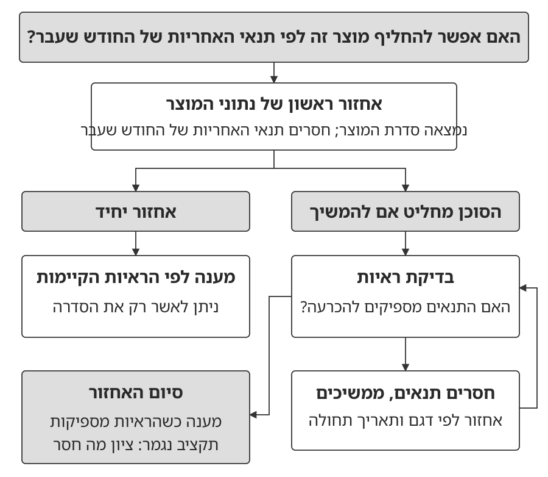

ב‑ReAct, למשל, המודל מנתח תחילה את השאלה, בוחר שאילתה וקורא ל‑`knowledge_base_search`; לאחר שהכלי מחזיר תצפית, המודל שוקל אם הראיות מספיקות. אם חסרים תנאים או ישויות קשורות, הוא מנסח את השאילתה מחדש וממשיך לחפש; אם החומר מספק, הוא מחבר תשובה הנשענת על המקורות. ה‑Harness מנהל את ההיסטוריה, את קריאות הכלים ואת התקציב, וכשמגיעים למגבלה הוא מסיים את החיפוש או עובר לבקשת הבהרה.

עכשיו התבוננו באיור 3-13. גם אם מחליפים את הצד האחורי של בסיס הידע מאינדקס וקטורי לגרף יחסים, המודל יכול להמשיך לבקש חיפושים דרך אותו ממשק כלי. ואם במסמך שהוחזר מופיעה במקרה הוראה — האם המודל רשאי לבצע אותה?

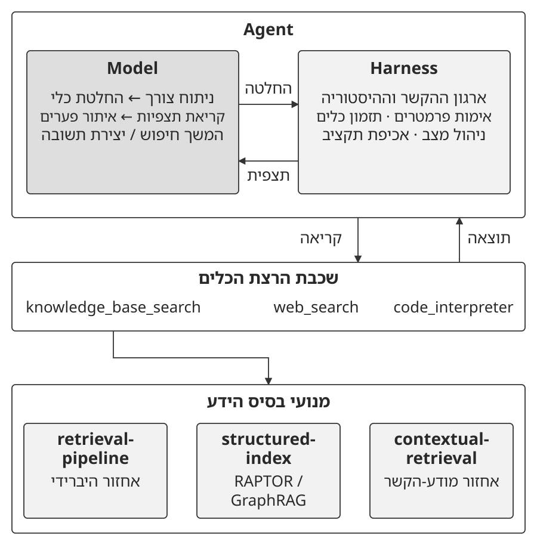

**גבול האמון של תוכן מאוחזר.** מסמכים חיצוניים עלולים להכיל טקסט שמנסה לשנות את התנהגות המודל, ועובדות שגויות עלולות להיות מוכנסות אליהם עוד לפני האינדוקס. המקרה הראשון הוא הזרקת פרומפט עקיפה, השני הוא הרעלת בסיס הידע. הטיפול דורש לנהל יחד את מקור התוכן ואת הרשאות הביצוע: תוצאות האחזור נושאות מקור, גרסה ומיקום ציטוט, ומשמשות ראיה לתשובה; פעולות כמו העברת כספים, מחיקה או שליחת הודעות החוצה נבדקות על ידי ה‑Harness וסביבת הביצוע מול הרשאת המשתמש. ביקורת לפני הכנסה למאגר, מעקב מקורות ובדיקת עובדות מגבילים עוד יותר את התפשטותו של ידע שגוי. תיוג המקור שהוצג בפרק 2 ואילוצי הכלים של פרק 4 פועלים כאן יחד.

> **ניסוי 3-8 ★★: השוואה בין אחזור יחיד לאחזור רב‑סבבי**
>
> הניסוי משתמש באותו חומר משפטי בסינית, באותו מאחזר BM25 ובאותו מודל, ומשווה שני מצבים על שבע שאלות: קו הבסיס מחפש פעם אחת לפי השאלה המקורית, ובמצב הסוכני המודל רשאי לשנות את השאילתה ולבצע עד ארבעה חיפושים.
>
> לשאילתה כמו "מהם הכללים בנוגע להגנה עצמית?" אחזור ישיר מספיק כדי לקבל את סעיפי החוק העיקריים. דוגמה מורכבת יותר היא "כיצד יש לגזור את דינו של מי שגרם ברשלנות לחבלה חמורה בהיותו שיכור ובעל הרשעה קודמת בגניבה?". השאלה נוגעת בבת אחת למעשה הנוכחי, למצב השכרות ולעבר הפלילי, ולכן צריך לאתר בנפרד את החומר הרלוונטי לכל אחד מהם ולבדוק את תנאי התחולה.
>
> בהרצה בפועל בוצעו בזה אחר זה החיפושים "שכרות גרימת חבלה חמורה ברשלנות הרשעה קודמת בגניבה גזירת דין", "שכרות עבירה גזירת דין", "הרשעה קודמת בגניבה השפעה על העונש חוק העונשין" ו"הרשעה קודמת השפעה על העונש חוק העונשין". לאחר מכן הציע המודל גם "עבריין חוזר הגדרה חוק העונשין", אך תקציב החיפוש כבר נוצל, וה‑Harness החזיר הודעה שהתקציב אזל.
>
> בארבע השאלות שהניסוי הגדיר כמורכבות, שיעור הכיסוי של סעיפי החוק המבוקשים עלה מכ‑8% ל‑92%, מספר החיפושים הממוצע עלה מאחד ל‑3.5, וזמן שלב המענה הממוצע עלה מכ‑8 שניות ל‑66 שניות. בשלוש השאלות הפשוטות כיסוי הראיות היה 100%, ושתי הקבוצות חיפשו פעם אחת בלבד.

אותה לולאת אחזור מתאימה גם להיסטוריית המשתמש. נמשיך עם מערך ההערכה התלת‑שכבתי של ניסוי 3-1 ונבחן כיצד הסוכן שולף עובדות מרשומות חוצות‑סשנים, מבחין בין ישויות ומטפל בעדכונים.

> **ניסוי 3-9 ★★: קריאת זיכרון משתמש באמצעות אחזור סוכני**
>
> הניסוי מתייחס להיסטוריית השיחה המלאה כאל בסיס ידע: היא מחולקת לחלונות, נבנה עליה אינדקס, והסוכן מקבל את הכלי `search_user_memory`. גודל החלון ניתן לכוונון; בהרצה זו כל חלק מכיל שמונה תורות דיאלוג, חלקים סמוכים חופפים בשתי תורות, ונשמרים מזהה הסשן, הזמן ומטא‑נתונים עסקיים. מתבצעים לכל היותר שלושה חיפושים, וכל חיפוש מחזיר ארבעה קטעים.
>
> היזכרות בסיסית יכולה להתבסס על חיפוש סביב שדה מפורש, למשל "מהו מספר חשבון העו"ש שלי?". בשאלות רב‑סשניות צריך לבדוק גם אם כל הישויות נמצאו: למשתמש יש גם הונדה Accord וגם טסלה Model 3, וכשהוא שואל על תיאום טיפולים לרכב, על המערכת להבחין בין שתי המכוניות ובין מצב התור של כל אחת מהן.
>
> על בסיס זה אפשר לתכנן מסלול אחזור: תחילה לחפש רשומות על הרכב ועל הטיפולים; כשמתגלה רמז למכונית השנייה, לחפש את התיאום של הטסלה; ולבסוף לציין את התור הקיים של ההונדה ולוודא אם המשתמש רוצה לקבוע תור גם לטסלה. ברשומה בפועל של הרצה זו בוצעה רק השאילתה `scheduled car services`, והתשובה של קבוצת האחזור הרגיל התמקדה בהונדה והשמיטה את הטסלה.
>
> קושי מסוג אחר נובע משינויים רצופים. בתרחיש ההעברה הבנקאית, האישה מגדירה את ההסדר, הבעל משנה אחר כך את הסכום ואת התאריך, והאישה משנה שוב. לאחר שליפת הרשומות צריך לשחזר את השינויים לפי זמן, ישות ומצב אישור, ולמצוא את ההוראה שנכנסה לתוקף בסופו של דבר. החלוקה הנוכחית כבר שומרת את מידע הזמן, ובכל זאת האחזור עלול להחמיץ שינוי מכריע, ולכן אפשר להוסיף לכל קטע את רקע האירוע.
>
> מתוך 60 המקרים, ב‑18 בוצע חיפוש אחד, ב‑6 שני חיפושים, וב‑36 נוצלו כל שלושת החיפושים. קבוצת האחזור הרגיל על פני חלקים עברה 47 מקרים: 19 בהיזכרות בסיסית, 15 באחזור רב‑סשני ו‑13 בשירות יזום. הסעיף הבא משווה על אותם מקרים קידומות הקשר וזיכרון מובנה, ובוחן איזה מידע כל אחד מהם מוסיף.

### אחזור מודע‑הקשר: השלמת רקע לקטעים

נחזור לדוח הכספי. כדי לברר את תוצאות חברת ACME ברבעון השני של 2025, השאילתה כוללת את שם החברה ואת השנה, אבל דווקא בקטע שכתוב בו "הכנסות החברה צמחו ב‑3%" שתי המילים האלה חסרות. מלבד הגדלת החלקים, אפשר להשאיר את הקטע הקצר כמות שהוא ולהוסיף לפניו את הרקע החסר. **אחזור מודע‑הקשר (Contextual Retrieval)** מייצר בזמן בניית האינדקס קידומת רקע קצרה לכל קטע, ומשתמש בקידומת יחד עם הטקסט המקורי לצורך האחזור[^ch3-1]. איור 3-14 מציג את התהליך.

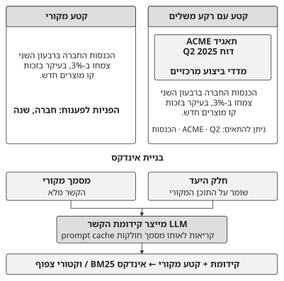

הקידומת יכולה לומר, למשל, "קטע זה לקוח מסעיף מדדי הביצוע המרכזיים בדוח של חברת ACME לרבעון השני של 2025". בזמן היצירה המודל מקבל את המסמך המקורי ואת החלק המיועד, ומשלים רק הפניות, זמנים ופרטי סעיף שיש להם בסיס בטקסט. כך BM25 מקבל מונחים ברי‑התאמה כמו שם החברה והרבעון, וגם השיכון הצפוף יכול לייצג את הקטע בהתחשב ברקע זה.

אפשר לשלב אותו עם הדחיסה מודעת‑ההקשר של פרק 2: בזמן האינדוקס משלימים רקע לחלקי הידע ומגדילים את הסיכוי למצוא מידע רלוונטי; בזמן הריצה מארגנים את ההיסטוריה שכבר נשלפה לפי המשימה הנוכחית ושולטים באורך הקלט. הראשון עוסק ביכולת לאחזר את הקטע, השני במידע ובתקציב שההחלטה הנוכחית דורשת.

[^ch3-1]: Anthropic, Introducing Contextual Retrieval, ספטמבר 2024.

> **ניסוי 3-10 ★★: השוואה בין חלקים מקוריים לחלקים מועשרי‑הקשר**
>
> הניסוי בונה שני אינדקסים לאותו חומר: אחד על הקטעים המקוריים, והשני עם קידומות שיצר המודל. השאילתות וסימון היעדים זהים, וההשוואה נעשית בנפרד עבור BM25, אחזור צפוף ואחזור היברידי.
>
> בהמשך לדוגמת הדוח הכספי, בשאילתה "מהי צמיחת ההכנסות האחרונה של חברת ACME?" אפשר לבדוק אם הקטע שנמצא כולל גם את החברה המבוקשת, גם את התקופה וגם את נתוני הצמיחה. המילים "צמיחת הכנסות" לבדן עלולות להתאים לחברה אחרת; לאחר הוספת הקידומת, שם החברה והזמן משתתפים בדירוג.
>
> ב‑15 השאילתות של הרצה זו, הוספת הקידומת העלתה את recall@1 של BM25 מ‑0.60 ל‑0.80, ושל האחזור הצפוף מכ‑0.867 ל‑0.933; ה‑recall@3 של שניהם נשאר 0.867 ו‑1.0 בהתאמה. ה‑recall@5 של האחזור ההיברידי עלה מ‑14/15 ל‑15/15. איזו שאלה נוספה? בשאילתה על סמכויות הוועדה המתמדת של הקונגרס העממי הלאומי, קטע היעד מונה את הסמכויות אך חסר בו הנושא. לאחר הוספת הקידומת BM25 העלה אותו מהמקום ה‑16 למקום ה‑12, עדיין מחוץ לחמישה הראשונים; האחזור ההיברידי העלה אותו מהמקום ה‑6 למקום ה‑5, ורק כך נכנס לחמישייה. בטקסט המקורי, הקטע הראשון מונה את הסמכויות (1) עד (4), והקטע החמישי ממשיך מסמכות (4) עד סמכות (22). הניקוד בודק רק אם הקטע החמישי המסומן נבחר, אבל כדי למנות את כל הסמכויות צריך לחבר את שני הקטעים.
>
> יצירת הקידומות מוסיפה קריאות בזמן האינדוקס. כשמייצרים רקע לכמה חלקים מאותו מסמך, אפשר לעשות שימוש חוזר במטמון הפרומפט של המסמך. ‏Anthropic העריכה בדוח מ‑2024, לפי חלקים של 800 טוקנים, מסמכים של 8000 טוקנים ואורך פרומפט מוגדר, שעלות העיבוד החד‑פעמית היא כ‑1.02 דולר למיליון טוקני מסמך.
>
> באותו דוח, שיכונים מועשרי‑הקשר בשילוב BM25 הורידו את שיעור כשל האחזור ב‑top-20 מ‑5.7% ל‑2.9%, ירידה יחסית של כ‑49%; בתוספת דירוג מחדש הוא ירד ל‑1.9%, ירידה יחסית של כ‑67%. שיעור הכשל בדוח מוגדר כ‑$1-\mathrm{recall@20}$.

במאגרי מידע שמתשאלים אותם שוב ושוב ושתוכנם יציב יחסית, המחבר ממליץ להשלים את רקע הקטעים כבר בזמן בניית האינדקס: עיבוד אחד משרת שאילתות רבות לאחר מכן. אם שם החברה, הגורם המעורב באירוע והזמן אבדו בחלוקה, הגדלת מספר התוצאות לבדה עלולה עדיין להחזיר ערימת קטעים שלא ברור למה הם מתייחסים. כשהקידומת משלימה את הרמזים האלה, האחזור בהמשך יכול להשתמש בהם כדי לאתר את החומר.

> **ניסוי 3-11 ★★★: חיזוק הזיכרון בקידומות הקשר ובכרטיסים מובנים**
>
> המשפט "אוקיי, בוא נזמין את זה" בשיחה צריך להיקשר למוצר או למסלול שנדונו קודם. אם בטקסט המקורי דובר בכרטיס בכיוון אחד משנגחאי לסיאטל ב‑500 דולר, הקידומת יכולה להשלים את הרקע הזה ולשמור את הסשן ואת הזמן שבהם ניתן האישור.
>
> הניסוי מוסיף לחלוקה הרגילה שתי תצורות: קבוצת קידומות ההקשר, וקבוצת זיכרון דו‑שכבתי שטוענת בנוסף Advanced JSON Cards. המודל מייצר תחילה רצף חיפושים על בסיס האינדקס הרגיל, ואז אותן שאילתות מורצות על שני האינדקסים; הקבוצה הדו‑שכבתית משתמשת באותן תוצאות אחזור מועשרות ומקבלת בנוסף את הכרטיסים המובנים.
>
> בתרחיש ההעברה הבנקאית, הקידומות מציינות בנפרד שפטרישיה יוזמת את ההעברה, שג'יימס משנה את ההסדר ושפטרישיה משנה שוב, וכך עוזרות לאתר את סדר האירועים. לפי הרשומה המקורית, המצב הסופי הוא 95,000 דולר ב‑1 באוקטובר, וההסדרים הקודמים הוחלפו. בהרצה זו שלוש הקבוצות מצאו את המצב הזה נכון.
>
> המבנה הדו‑שכבתי תומך גם בקישור יזום. הכרטיסים שומרים עובדות מרכזיות כמו "טיול לטוקיו" ו"תוקף הדרכון", והשיחות המפורטות נשלפות לפי הצורך. בדוגמה של טיול בין 15 ל‑22 בינואר ודרכון שתוקפו פג ב‑18 בפברואר, המערכת יכולה לזהות תחילה את קרבת התאריכים, לחפש אחר כך רשומות על חידוש הדרכון ועל דרישות הנסיעה, ולבסוף להזכיר למשתמש לוודא את ההכנות שטרם הושלמו. במקרה הנסיעה הזה, התשובות של שלוש הקבוצות עברו את השיפוט; ההבדל בין כרטיסים לאחזור ניכר בעיקר במקרי הרכב והמקרים חוצי‑הסשנים שלהלן.
>
> בכל 60 המקרים, האחזור הרגיל, קידומות ההקשר והזיכרון הדו‑שכבתי עברו 47, 52 ו‑57 מקרים בהתאמה. בקבוצת הקידומות, מקרי השירות היזום עלו מ‑13 ל‑18; הקבוצה הדו‑שכבתית עברה את כל 20 המקרים בשכבת האחזור הרב‑סשני, וגם היא עברה 18 בשכבת השירות היזום. במקרה הרכב, הכרטיסים השלימו את המידע על המכונית השנייה ועזרו לתשובה לכסות את הישות שהושמטה קודם. ועכשיו לאחת הנסיגות: המשתמש שאל על היקף הכיסוי לנזקי מים בנכסיו; הקבוצה הרגילה הזכירה גם את דירת המגורים וגם את הדירה המושכרת, ואילו קבוצת הקידומות השמיטה את הדירה המושכרת. השוואה שאלה אחר שאלה מראה שקבוצת הקידומות ענתה נכון על 8 שאלות שהקבוצה הרגילה נכשלה בהן, אך איבדה 3 שאלות שהקבוצה הרגילה ענתה עליהן נכון.

**כשנדרש שירות יזום, המחבר מעדיף ארכיטקטורה דו‑שכבתית: עובדות מרכזיות נשארות קבועות בהקשר, ורשומות מפורטות נשלפות לפי הצורך.** כשמסתמכים על אחזור בלבד, המודל צריך לרוב לדעת מראש מה לשאול כדי למצוא את הרשומות הרלוונטיות; דרכון, רכב או קשר משפחתי שעוד לא נכנסו לשדה הראייה נשמטים בקלות. כשמכניסים מראש מספר קטן של עובדות מרכזיות להקשר, קל יותר למודל לזהות קשרים, לנסח שאילתות ואז לשלוף את הפרטים המקוריים. בבחירת המידע הקבוע בהקשר יש להתחשב בקשרים בין אנשים, באילוצים הנוכחיים ובמשימות פתוחות; תוצאות האחזור שומרות את המקור, את הזמן ואת הבסיס לכל שינוי.

### חילוץ ידע ממערכי נתונים: ממקרים לייצוג מובנה

ידע יכול לנבוע גם מארגון של מספר גדול של מקרים. בפסקי דין, בפניות שירות לקוחות וברשומות תיקון, הרבה מידע שימושי מפוזר בתוך תיאורים קונקרטיים. כשהמשימה דורשת להסיק סדירויות ממקרים רבים, להשוות תוצאות או להחליט מה לשאול בהמשך, המחבר ממליץ לחלץ תחילה שדות אחידים, ורק אחר כך לבצע סטטיסטיקה ולבנות אבות טיפוס. שליפה של כמה מקרים דומים בלבד אינה מראה את ההתפלגות במערך הנתונים כולו; לאחר שהשדות אוחדו אפשר לחשב סטטיסטיקה על כל הרשומות ולספק סקירה כללית לשאילתות על מקרים בודדים בהמשך.

אפשר לחלק את התהליך לשני שלבים. **חילוץ ידע** ממיר תיאורים גולמיים לרשומות מובנות ומגדיר את משמעות השדות, את ערכיהם ואת מקורם; **ניתוח דפוסים** משתמש בסטטיסטיקה ובאשכול כדי למצוא מקרים דומים ואת המאפיינים המשותפים להם. איור 3-15 מציג את הזרימה מחילוץ המקרים, דרך קידוד המאפיינים ועד אחזור אבות הטיפוס.

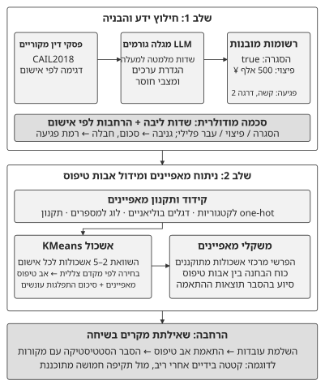

> **ניסוי 3-12 ★★★: חילוץ גורמים ואבות טיפוס מתיקים משפטיים**
>
> הניסוי משתמש בחומר התיקים הפליליים של CAIL2018, בוחר דוגמאות משלושה סוגי עבירות — גניבה, חבלה בכוונה והונאה — ובונה זרימה לימודית של "גילוי גורמים—חילוץ שדות—אשכול—פירוש אבות טיפוס"[^ch3-cail]. מכל סוג נלקחות 120 רשומות למידול ועוד 20 נשמרות בצד, ובסך הכול מתקבלות 360 דוגמאות מידול ו‑60 דוגמאות מוחזקות.
>
> **גילוי השדות וארגונם.** המודל קורא תחילה את דוגמאות המידול באצוות, מציע גורמים שעשויים להיות שימושיים, ואז ממזג אותם ל‑Schema מודולרית. החלק הכללי שומר שדות שרלוונטיים לכמה עבירות, כמו הסגרה עצמית ופיצוי; החלקים המורחבים שומרים מידע הקשור לעבירה מסוימת, כמו הסכום המעורב או מידת הפגיעה. בהרצה זו התקבלו 16 שדות כלליים ושלוש הרחבות בנות 12, 12 ו‑11 שדות. לכל שדה יש להגדיר גם את הערכים האפשריים ואת מצב החוסר, כדי שהחילוץ יהיה עקבי.
>
> **קידוד השדות לווקטורים.** שדות קטגוריאליים אפשר לקודד בקידוד one‑hot: אם ניקח לדוגמה את גניבה, שוד והונאה, הם מקודדים כ‑`[1,0,0]`, `[0,1,0]` ו‑`[0,0,1]`, וכל מיקום מציין רק אם הרשומה שייכת לאותה קטגוריה. שימוש ב‑1, 2, 3 היה מכניס לאלגוריתמים מסוימים סדר ומרחק בין הקטגוריות. שדות כמו "הסגרה עצמית" או "פיצוי" אפשר לייצג ב‑1 וב‑0 עבור שני המצבים שאושרו; מקרים שהטקסט המקורי אינו מזכיר יש לטפל בהם בנפרד, כדי לא להפוך חוסר מידע לשלילה באופן אוטומטי.
>
> בערכים מספריים אי‑שליליים בעלי טווח רחב, כמו סכומים, המימוש הזה דוחס תחילה את הסקאלה באמצעות $\ln(1+x)$ ורק אז מבצע תקנון. אם שדה מאפשר כמה קטגוריות בבת אחת, למשל רשומה הכוללת כמה אמצעי טיפול, אפשר להקצות סיבית מציינת לכל קטגוריה וליצור קידוד multi‑hot.
>
> **בניית אבות טיפוס של תיקים.** המאפיינים המקודדים עוברים תקנון, ואז מאושכלים בנפרד לכל עבירה. המימוש משווה בין שניים לחמישה אשכולות, בוחר את החלוקה לפי מקדם הצללית (silhouette), ובסופו של דבר מתקבלים 11 אבות טיפוס. כל אב טיפוס שומר את מספר הדוגמאות, את המאפיינים העיקריים, ואת החציון, הרבעונים והטווח של העונשים בדוגמאות. אפשר, למשל, להשוות סביב מקור הסכסוך, אופן הביצוע ותוצאת הפגיעה צירופי מאפיינים שונים כמו קטטה ללא נשק לאחר ויכוח לעומת מעשה מתוכנן עם נשק; החלוקה הקונקרטית נקבעת יחד על ידי תוצאות החילוץ והאשכול.
>
> **פירוש המאפיינים ותוצאות ההתאמה.** התוכנה מחשבת, לפי ההבדלים בין המרכזים המתוקננים של האשכולות, את משקלו של כל מאפיין בהבחנה בין אבות הטיפוס. התאמת אב טיפוס ממפה מקרה חדש לאותו מרחב מאפיינים, ושולפת את הסיכום הסטטיסטי ואת הבסיס של הקבוצה הקרובה, כדי שהמודל יוכל לבנות מהם הסבר.
>
> בהרצה זו נבחרו 12 מתוך 60 הדוגמאות המוחזקות להפקת הסברים, וההסברים נמסרו לשיפוט של מודל עצמאי. נתבונן באחת מדוגמאות הגניבה: אב הטיפוס שאליו הותאמה כולל רשומת מידול אחת בלבד, והעונש בה הוא 4 חודשים, ולכן המינימום, החציון והמקסימום כולם 4. המחולל דיווח על המספר הזה בנאמנות וציין שיש רק רשומה אחת להשוואה. השופט נתן 4 נקודות (הציון המרבי) לשאלה "האם המספרים נאמנים לאב הטיפוס", אבל התווית האמיתית של הדוגמה המוחזקת הייתה 8 חודשים.
>
> אם משתמשים באחזור אבות טיפוס בשיחה, אפשר לשאול תחילה אילו עובדות חסרות עשויות להשפיע על ההתאמה, ואז לאחזר מחדש לפי התשובות.

[^ch3-cail]: CAIL2018, פרויקט מערך הנתונים הרשמי. הניסוי הנלווה דוגם מתוך החומר הפומבי ומבצע מידול והערכה על חלוקה פנימית של המדגם.

ממקרים לאבות טיפוס, בסיס הידע מקבל שכבה נוספת של ייצוג סטטיסטי בר‑אחזור. הטקסט המקורי מספק ראיות, השדות מאפשרים חישוב, ואבות הטיפוס מסכמים את המאפיינים המשותפים של דוגמאות דומות; רק כשנשמרת ההתאמה בין שלושתם אפשר לחזור לאחור ולתקן כשמתגלות שגיאות חילוץ או הטיה במדגם.

### חקירת חזית: זיכרון רב‑מודאלי וזיכרון פרמטרי

נניח שמשתמש מצביע על תמונה שהעלה קודם ואומר "בדיוק הצבע הזה". אם המערכת שמרה אז רק את המילים "מעיל כחול", בפעם הבאה ייתכן שלא תוכל להבחין בין שני גוונים של כחול. גם גוון הקול בהקלטה והיחסים המרחביים בתרשים מאבדים פרטים בתמלול. כדי שלשאילתות עתידיות יהיה סיכוי לשחזר מידע כזה, אפשר לשמור את החומר הגולמי, לשמור ייצוג שהמודל יכול להשתמש בו, או ללכת רחוק יותר ולחקור זיכרון מתמיד בתוך המודל עצמו.

**גישה 1: חומר גולמי לצד אינדקס טקסטואלי.** למשל, במשימת סידור אלבום תמונות שהמשתמש אישר, אפשר לחתוך ולשמור אזורים מקומיים כגון פני אדם, להפנות לתמונות מתוך רשומת Markdown, ולתעד לצדן את זמן הצילום, את הסצנה ואת תוויות האנשים שהמשתמש סיפק. באחזור מאתרים תחילה לפי התיאור כמה תמונות שעשויות להיות רלוונטיות, ואז קוראים את התמונה המקורית או את האזור החתוך ומשווים פרטי מראה. גם קטעי קול אפשר לקשר לזמן, למקור ולתמלול, ולהשמיע את השמע המקורי לפי הצורך. הטקסט משמש נקודת כניסה, והחומר הגולמי משמר פרטים שקשה לסכם במילים.

**גישה 2: אחסון שיכונים וטעינתם לפי דרישה.** מקודד חזותי או קולי יכול להמיר חומר לווקטור, לשמור אותו באינדקס ולאפשר אחזור לפי דמיון. למשל, אפשר לקודד אזורים מקומיים בתמונה או קטעי קול ולקשר כל אחד מהם לרשומת הזיכרון המתאימה. אם המודל תומך בשכבת הטלה מאומנת ובממשק זיכרון, אפשר גם לשריין בהקשר קבוצת משבצות, לטעון אליהן את הווקטורים הרציפים האלה ולתת למודל לגשת אליהם באמצעות קשב. כאן יש לפתור את היישור בין הייצוג של המקודד לבין הייצוג הפנימי של מודל השפה.

מחקר ראשוני של המחבר עם Noah Shi מפרק את הבעיה לשני צעדים. בתמונה קבוצתית יש שני אנשים, והמשתמש שואל "זה שעומד ליד החלון — זה מי שפגשנו בפעם הקודמת?" תחילה יש למצוא לפי "ליד החלון" את האדם שהמשתמש מתכוון אליו, ורק אז להשוות את תמונתו לדוגמאות שנשמרו קודם. אם הצעד הראשון בחר באדם הלא נכון, גם זיהוי מדויק בצעד השני עונה על שאלה אחרת. המאמר גם משאיר עובדות שניתן להעתיק במדויק, כגון שמות, בזיכרון הטקסטואלי, כך שלכל אחד משני סוגי המידע יש דרך שליפה המתאימה לו.[^ch3-perceptmem]

[^ch3-perceptmem]: Bojie Li ו‑Noah Shi, Parametric Multimodal User Memory; הפרויקט הנלווה `19PINE-AI/multimodal-user-memory` כולל את המימוש ואת ניסויי PerceptMem. שאלת התמונה הקבוצתית היא דוגמה לימודית.

**גישה 3: זיכרון מתמיד בתוך המודל.** אימון LoRA לכל משתמש הוא דרך אחת לכתוב עובדות אישיות לתוך המודל. שאלה ישירה כמו "איפה המשתמש גר?" ותכנון מסלול על סמך הכתובת דורשים שימוש שונה בזיכרון: הראשונה קוראת עובדה, והשני גם מחייב להשתמש בעובדה בהיסק שבא אחריה. אם האימון סובב רק סביב שחזור העובדות, המודל עשוי לזכור את התשובה אך לא להשתמש בה ביוזמתו במשימה מורכבת. לכן דוגמאות האימון צריכות לכלול גם שאלות ישירות וגם משימות התלויות בעובדות האלה.

המחקר **User as Engram** של המחבר כותב עובדות טקסטואליות לטבלת זיכרון מקומית של מודל Engram, ומתאם משותף לומד כיצד להשתמש בעובדות האלה בהיסק[^engram]. חיפוש N‑gram עם מפתחות גיבוב מאתר את רשומות הטבלה, ומנגנון שער מעביר את התוכן שנשלף אל המודל; לכל משתמש נשמרות רשומות מקומיות משלו, ואילו רכיב ההיסק יכול להיות משותף. בניסויי העובדות הטקסטואליות שלו השווה המאמר בין היזכרות ישירה להיסק עקיף, והראה כיצד לנהל בנפרד את תוכן הזיכרון של כל משתמש ואת יכולת ההיסק המשותפת.

[^engram]: Li, Bojie, User as Engram: Internalizing Per-User Memory as Local Parametric Edits, 2026.

הרחבת הגישה הזו לרב‑מודאליות מחייבת לתכנן גם מנגנוני מיעון, כתיבה וקריאה לייצוגי תמונה או שמע.

## סיכום הפרק

נחזור להזמנת הכרטיס מפתיחת הפרק. "אני מעדיף מושב ליד החלון" בא מהמשתמש הזה; "כמה מזוודות מותר להביא" יש לבדוק בתנאי חברת התעופה החלים בתאריך הנסיעה. אם שומרים את שתי הפיסות כמשפט אחד, קל לאבד את ההבדל החשוב ביותר: על מי חל המשפט הראשון, וממתי נכנס השני לתוקף. רק אם נשמרים בעת הכתיבה המקור, הזמן ותנאי התחולה, יש בעת השליפה בסיס לקבוע אם המידע תקף הפעם. עובדה בודדת מתאימה לפתק קצר; כשצריך לתאר יחסים בין אנשים או לשמר את השתלשלות העניינים, אפשר להשתמש בכרטיס או בקטע מהטקסט המקורי; תאריכים וכמויות אפשר גם לשמור כשדות בעלי טיפוס ולהעביר לחישוב בתוכנה.

אם העוזר מסר מכסת כבודה שגויה, בודקים תחילה אם הסעיף העדכני נכנס לבסיס הידע, אחר כך לאיזה חלק נחתך, אם המאחזר מצא אותו ובאיזה מקום הוא דורג אחרי הדירוג מחדש, ולבסוף אילו חומרים קיבל המודל בפועל. כשהטקסט המקורי ארוך, אפשר להשאיר בהקשר סקירה מובנית ולאחזר פרטים לפי הצורך. סיכומי פרקים עוזרים למצוא נושאים, ואינדקס יחסים עוזר לאתר קשרים; אם חלק איבד את ההפניות שלו, אפשר להוסיף לו רקע על מקורו; ואם אחזור אחד עדיין לא הביא די ראיות, הסוכן יכול לנסח שאילתה אחרת ולהמשיך לחפש.

כשחברת התעופה מפרסמת תקנה חדשה, אפשר לבצע תחילה עדכון מצומצם ולשמור את תאריכי התחולה והמקורות של התנאים הישנים והחדשים; רשומות כפולות, סתירות ושינויי מבנה שהצטברו מסדרים מעת לעת. המציע מגיש את השינוי, הסוקר מאמת את הראיות, ולאחר האישור נבנה מחדש אינדקס השירות. כשיש רישום גרסאות, אפשר להריץ מחדש את השאלות שנענו בטעות, וגם לברר על איזה מסמך נשענה התשובה הישנה בזמנה. כיצד לצבור ניסיון מתוצאות הביצוע עצמן — בזה יעסוק פרק 9.

מציאת העובדה שמותר לשלוח שתי מזוודות עונה רק על השאלה "האם הכללים מתירים זאת?". כדי להוסיף את המזוודות להזמנה בשם המשתמש, העוזר צריך לדעת לאיזה כלי לקרוא, אילו פרמטרים נדרשים, ואיזו תוצאה חוזרת מעידה שהפעולה בוצעה. כאן מתחיל הפרק הבא.

## שאלות למחשבה

1. ★★ משתמש אומר: "ב‑1 במאי אני עובר מ‑A ל‑B, בין 10 ל‑20 במאי אני גר במלון C, ובתקופה הזו שלחו את החשבונות בדוא"ל." ב‑15 במאי, כיצד על העוזר לענות על שאלות לגבי כתובת המגורים, מקום השהייה הזמני ואופן משלוח החשבונות? תכננו כללי רישום ושאילתה, והסבירו כיצד לטפל בתיקון של טעות הקלדה או בכתובות סותרות.
2. ★★ כשהמסמך המקורי מכיל מידע סותר, קידומת ההקשר עלולה להכניס את השגיאה לאינדקס יחד איתה. כיצד הייתם שומרים מקור, גרסה ופריטים שאינם ודאיים, וכיצד הייתם משתמשים במידע הזה בשלבי האחזור והיצירה?
3. ★★ אילו יחסים מרחביים נוטים ללכת לאיבוד כשממירים תרשים לטקסט? הדגימו בטבלה, בתרשים ארכיטקטורה או בגרף קווי, ותכננו שיטה שבה התמונה המקורית, ייצוג מובנה ואינדקס טקסטואלי משתפים פעולה באחזור.
4. ★★★ ככל שהמודלים ויכולות ההקשר הארוך משתפרים, אילו חלקים בתהליכי הפירוק לחלקים, האינדוקס והאחזור עשויים לעבור למודל? נתחו זאת לאור הדיון בחיפוש ובלמידה ב"השיעור המר" של ריצ'רד סאטון, ותכננו ניסוי המשווה בין הזנת הכול לבין אחזור לפי דרישה, תוך בדיקת איכות המשימה, עלות החישוב ומגבלות ההרשאות.
5. ★★★ אם המודל כבר שולט בהרבה ידע תחומי, מה עוד צריך לשמור בבסיס ידע חיצוני? דונו בנפרד בידע כללי ציבורי, בכללים המתעדכנים כל הזמן, בחומר פרטי ובראיות הדורשות מעקב מדויק אחר מקורן.
6. ★ באילו שאילתות תומכים הסיכומים הרב‑שכבתיים של RAPTOR, ובאילו תומכים יחסי הישויות וסיכומי הקהילות של GraphRAG? תנו דוגמה אחת לסקירה כוללת, לפרט מקומי ולקשר רב‑קפיצה, והסבירו אילו ראיות יש לבדוק בכל אחת.
7. ★★ כיצד משתפים פעולה ספריות, קישורים ואינדקס וקטורי בארגון ידע? תכננו בסיס ידע שבני אדם וסוכן מתחזקים יחד, והסבירו היכן ממוקמים בו הניווט, החיפוש הסמנטי, עדכון הגרסאות וסינון ההרשאות.
8. ★★★ לאחר חילוץ שדות ממקרים ואשכולם, כיצד קובעים אם אב טיפוס שימושי? הבחינו בין חשיבות מאפייני האשכול, יכולת חיזוי התוצאה והסבר סיבתי, ותכננו הערכה על מערך מוחזק ותהליך ביקורת של מומחים.
9. ★★★ תכננו תהליך של עדכון הדרגתי וארגון מחדש מחזורי למאגר זיכרון משתמש ב‑Markdown. אם הסוקר והמציע משתמשים באותו מודל, והסוקר רואה רק את הקטעים שהמציע בחר, אילו שגיאות עלולות לחמוק? הציעו שיפורים בשלושה היבטים: כיסוי ראיות, הרשאות כלים והערכת הסקירה.

[^ch3-glove]: Pennington ואחרים, GloVe: Global Vectors for Word Representation, 2014.

[^ch3-sbert]: Reimers ו‑Gurevych, Sentence-BERT: Sentence Embeddings using Siamese BERT-Networks, 2019.
