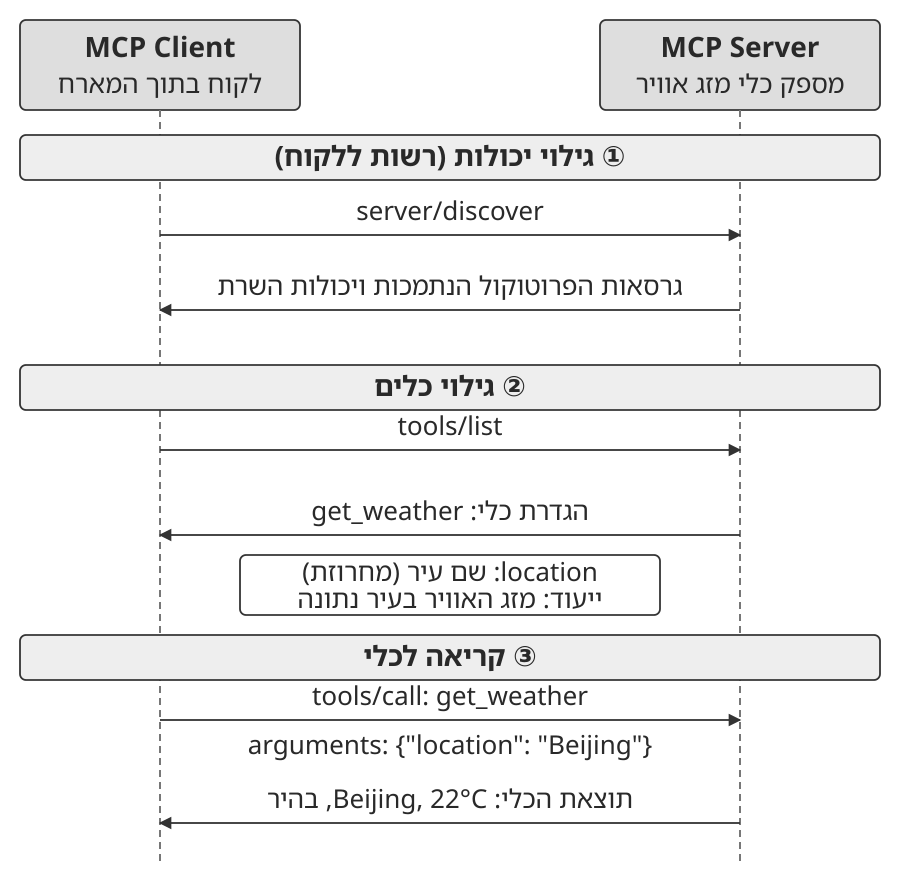
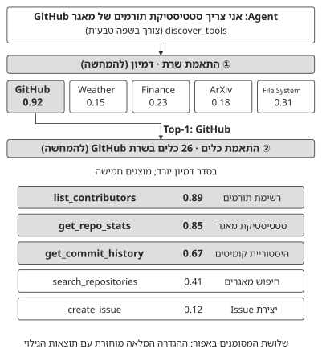
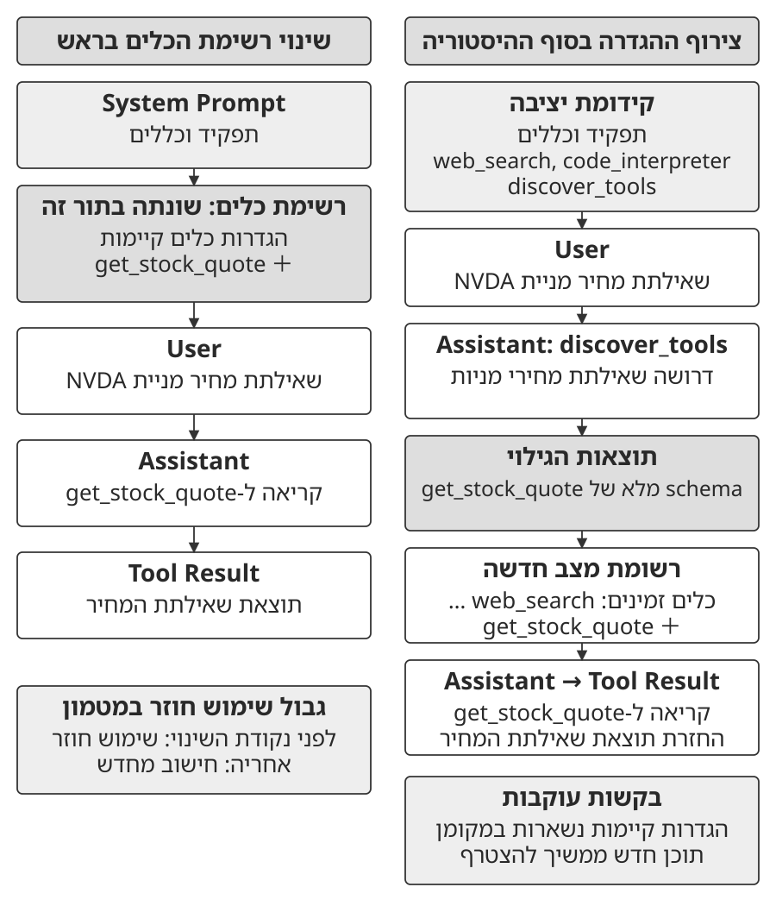
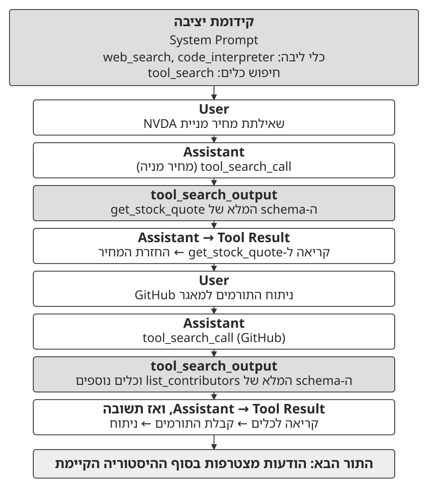

# כלים

בסרט המדע הבדיוני *Her*, העוזרת המלאכותית סמנתה מארגנת דוא"ל, מסייעת בניסוח תשובות, מטפלת בענייני הוצאה לאור ועוברת בין ערוצי תקשורת שונים. עוזרת כזו צריכה להפוך הבנת שפה לפעולות על מערכות חיצוניות. הסוכן מבצע את האינטראקציות האלה באמצעות **כלים**. הכלים הם "החושים, הידיים והרגליים" שלו: הם מספקים לו תצפיות, ודרכם הוא גם פועל. סוכנים כלליים שהספר דן בהם, כגון Manus ו‑OpenClaw, זקוקים גם הם לכלים כדי לגשת לעולם הדיגיטלי.

נניח שהמשתמש אומר: "מצא את מועדי האספקה שמוזכרים במיילים של הלקוחות, סדר אותם בטבלה ושלח לי." המודל יכול להחליט באיזה מייל לעיין, אבל כדי לקרוא את הטקסט המקורי עליו לגשת לתיבת הדואר, וכדי לשלוח את הטבלה עליו להפעיל ממשק שליחה. כיצד לעצב את הכלים האלה, וכיצד ימצא אותם המודל כשיזדקק להם? פרק זה מבחין תחילה בין חמש קטגוריות של כלים, דן אחר כך בתיאור הכלים, בחיבורם ובגילוים, ולבסוף מעצב בנפרד ממשקי תפיסה, ביצוע ושיתוף פעולה. הפעלה באירועים ותקשורת עם המשתמש כרוכות גם בשאלה מתי להעיר את הסוכן וכיצד להעביר הודעות בין ערוצים, ולכן הן נדונות בפרק 6.

## סיווג כלים

ניקח לדוגמה עיון בדוא"ל: המודל בוחר מה לעשות בצעד הבא, ה‑Harness בודק את הפרמטרים ואת ההרשאות ושולח את הבקשה, ושירות הדואר הוא שקורא וכותב את הנתונים בפועל. פרק 1 הבחין לפי ייעוד בין כלי תפיסה, ביצוע, שיתוף פעולה, תקשורת עם המשתמש והפעלת אירועים. את ארבע הקטגוריות הראשונות הסוכן מפעיל ביוזמתו, ואילו כלי הפעלת האירועים מאפשרים גם לאירועים חיצוניים להעיר את הסוכן (טבלה 4-1).

טבלה 4-1 כיוון ההפעלה והייעוד העיקרי של חמש קטגוריות הכלים

| סוג כלי | כיוון ההפעלה | ייעוד עיקרי |
| --- | --- | --- |
| כלי תפיסה | הסוכן מפעיל ביוזמתו | השגת מידע חיצוני |
| כלי ביצוע | הסוכן מפעיל ביוזמתו | ביצוע חישובים או שינוי מצב חיצוני |
| כלי שיתוף פעולה | הסוכן מפעיל ביוזמתו | האצלת משימות, החלפת הודעות, תיאום סוכנים אחרים או בני אדם |
| כלי תקשורת עם המשתמש | הסוכן מפעיל ביוזמתו | מענה למשתמש, הצגת תוצאות או שליחת תזכורות |
| כלי הפעלת אירועים | המפתח מגדיר או הסוכן רושם, גורם חיצוני מפעיל | העֲרת הסוכן כשמתרחש אירוע מוגדר |

**כלי תפיסה** מאפשרים לסוכן להשיג מידע חיצוני, למשל חיפוש ברשת `web_search`, אחזור מבסיס ידע `knowledge_base_search`, קריאת דף אינטרנט `fetch_url`, חיפוש שמות קבצים `find_file`, חיפוש בתוכן קבצים `grep_file` וקריאת קבצים `read_file`.

**כלי ביצוע** מאפשרים לסוכן לבצע חישובים או לשנות מצב חיצוני, למשל שורת פקודה `shell_exec`, מפרש קוד `code_interpreter`, כתיבת קבצים `write_file`, עריכת קבצים `edit_file` ושליחת דוא"ל `send_email`. אותו מבצע כללי יכול לבצע חישוב לקריאה בלבד, ויכול גם לשנות נתונים.

**כלי שיתוף פעולה** תומכים בהאצלת משימות ובהחלפת הודעות, למשל יצירת תת‑סוכן `spawn_subagent`, שליחת הודעה `send_message_to_subagent`, ביטול תת‑סוכן `cancel_subagent` וגילוי הסוכנים הזמינים `list_agents`. משימות בלתי תלויות אפשר לעבד במקביל, למשל לחקור בנפרד את קורותיהם של כמה ממייסדי OpenAI; ומשימות שונות אפשר להעביר לסוכנים שהוגדרו עם מודלים, כלים, פרומפטים והקשרים שונים. פרק 10 ידון בהרחבה בחלוקת עבודה ובארכיטקטורות של שיתוף פעולה.

**כלי תקשורת עם המשתמש** מעבירים מידע למשתמש, למשל מענה להודעה `reply_to_user`, שליחת כרטיס מובנה `send_card_to_user` ושליחת תזכורת `send_user_notification`. כשהאינטראקציה מתפרסת על כמה ערוצים או דורשת התראות ברקע, המערכת יכולה לעטוף את שליחת ההודעה בקריאת כלי מפורשת, ולנהל במקום אחד את הנמען, את התוכן ואת מצב המסירה.

**כלי הפעלת אירועים** מקשרים בין אירועים חיצוניים לבין ריצת הסוכן, למשל טיימר `set_timer`, ניטור משימות רקע `monitor_shell` וחיבור למקור אירועים `connect_channel`. התהליך כולל שני שלבים: ברישום, המפתח מגדיר מראש את האירועים שמעניינים את הסוכן, או שהסוכן מצהיר עליהם בקריאה מאושרת; כשהאירוע מתרחש, מערכת התזמון מקבלת קריאה חוזרת או הודעת אירוע ומעירה את הסוכן לטפל בו. דוא"ל חדש, התרעת מערכת, תזכורת מתוזמנת וסיום של משימת רקע יכולים כולם לשמש נקודת כניסה לריצה חדשה.

נחזור למשימת הדוא"ל שבפתיחה: פתיחת המייל המקורי כדי למצוא את מועד האספקה היא תפיסה; יצירת טבלת הסיכום ושמירתה משנות את סביבת העבודה, ולכן הן ביצוע; מסירת הטבלה למי שביקש אותה היא תקשורת עם המשתמש. רק אם המערכת ממשיכה מעצמה כשמגיע המייל הבא של לקוח, נכנסת לתמונה הפעלה באירועים. אותו שירות דואר יכול למלא כמה מהתפקידים האלה. ההחלטה הבאה היא עד כמה עדינים יהיו הכלים שנמסרים למודל: האם לתת לו לחפש מיילים, לקרוא גוף הודעה ולמצוא קבצים מצורפים בנפרד, או לאחד עבורו את הצעדים שהוא מבצע בדרך כלל ברצף?

## עקרונות כלליים בעיצוב כלים

בימים הראשונים של חיבור כלים, הדרך המקובלת הייתה לעטוף ישירות כל נקודת קצה של ה‑API. החיבור מהיר, אבל התוצאה היא בקלות אוסף של ממשקים עדינים מאוד. כדי להשלים משימה אחת, הסוכן עשוי להיאלץ לחפש אובייקטים שוב ושוב, לקרוא מאפיינים, לבדוק תנאים, ורק אז להפעיל את ממשק הביצוע. בעיצוב הכלים אפשר לאחד את הפעולות האלה סביב משימות נפוצות, למשל לחבר את חיפוש איש הקשר לשליחת ההודעה, או לגרום לחיפוש ביומנים להחזיר ישירות את השורות הרלוונטיות יחד עם ההקשר שלהן[^ch4-tool-design].

**יש לעצב כלים סביב המשימה שהסוכן צריך להשלים.** הגישה הזו, שמעצבת ממשקים מתוך האופן שבו הסוכן משתמש בהם, נקראת **ACI**‏ (Agent-Computer Interface, ממשק סוכן‑מחשב). HCI עוסק באופן שבו אדם מתקשר עם המחשב; ACI עוסק באופן שבו המודל בוחר פעולה, בונה פרמטרים, מבין משוב ומתקן שגיאות.

[^ch4-tool-design]: Anthropic, *Writing effective tools for AI agents—using AI agents*, 2025.

### צורת הביטוי של יכולות: כלים ייעודיים, מבצעים כלליים ו‑Skill

כשמוסרים למודל "פריסת אפליקציה", אפשר לעצב שלושה ממשקי הפעלה. הראשון חושף `deploy_app` יחיד, והשרת מבצע את כל השלבים; השני חושף בנפרד בנייה, אריזה ופריסה, והמודל מחליט מתי להפעיל את השלב הבא; השלישי כותב את השלבים ב‑Skill, והמודל מבצע אותם בטרמינל. אם הבנייה נכשלת, בראשון המודל תלוי בתוצאת הכלי כדי לדעת באיזה שלב הייתה השגיאה, ואילו בשניים האחרים אפשר למסור לו ישירות את שגיאת הבנייה עצמה.

- **כלים ייעודיים** מספקים ממשק מובנה לפעולה מוגדרת. המפתח מגדיר את סכימת הפרמטרים, את כללי האימות, את לוגיקת הביצוע ואת פורמט ההחזרה, ולכן קל לבדוק כל כלי ולהרשות אותו בנפרד; כשהגדרת הכלי נכנסת להקשר, נפחה תלוי באורך השדות, התיאורים והדוגמאות.
- **מבצעים כלליים ו‑Skill** פועלים יחד: הטרמינל או מפרש הקוד מספקים את יכולת הביצוע, וה‑Skill מתארת את התהליך, את תנאי השימוש ואת דרך הפעולה. המארח יכול לטעון תחילה רק שם ותקציר, ולקרוא את ההסבר המלא ואת המשאבים הנלווים רק לאחר שה‑Skill נבחרה.

למשל, Skill לפריסה יכולה לפרט לפי הסדר: לבנות את הפרויקט באמצעות `npm run build`, לארוז אימג' באמצעות `docker build -t app:latest .`, ולבסוף להחיל על האשכול הנוכחי את המשאבים שמוגדרים במניפסט באמצעות `kubectl apply -f deploy.yaml`. הסוכן מבצע את השלבים האלה דרך כלי הטרמינל, ומשתמש שוב ושוב באותה נקודת ביצוע.

אופן מימוש הכלי והרגע שבו המודל קורא את ההסבר שלו הם שתי שאלות נפרדות. מאות כלים ייעודיים אפשר להציג כאינדקס בלבד ולטעון את הסכימה לפי דרישה; מספר קטן של Skills יכול להחזיק את הקטלוג דרך קבע בהקשר, ולהוסיף אחזור רק כשההיקף גדל. הבחירה בין ממשק ייעודי למבצע כללי משפיעה על אופן העברת הפרמטרים ועל תחזוקת הקוד; הבחירה בין מסירת הכול בבת אחת לטעינה לפי דרישה משפיעה על הכלים שהמודל רואה בצעד הנוכחי. הסעיף "מה עושים כשיש יותר מדי כלים" שבהמשך ידון באסטרטגיות החשיפה.

**אני ממליץ להעדיף כלים כלליים, ולהוסיף ממשקים ייעודיים לפי צורכי הרשאות, פרמטרים וביצועים.** למשל, אם מתקינים ל‑`code_interpreter` בארגז חול את SymPy, ‏NumPy ו‑pandas, הסוכן יכול לכתוב Python ולבצע ארבע פעולות חשבון, חישוב סימבולי, עיבוד מערכים וניתוח נתונים. כך המודל מנצל במלואה את יכולתו לייצר קוד: מפרש אחד יכול לשאת אלגוריתמים רבים, ולשלב ספריות קיימות כדי לטפל בבעיות חדשות שאיש לא צפה מראש. המודל אחראי לייצור הקוד, וסביבת הריצה אחראית לביצועו ולהגבלת הגישה לקבצים, לרשת ולמשאבים.

גם כשמשתמשים בכלים ייעודיים, אני ממליץ לאחד קודם כול פעולות בעלות תפקוד דומה שמשמשות לעיתים קרובות יחד. כשהממשקים עדינים מדי, המודל צריך לזכור יותר שמות וחלוקות אחריות, ולהשלמת אותה משימה נדרשות יותר קריאות. באיחוד בוחנים בעיקר **דמיון תפקודי** ו**מידת החפיפה בין תרחישי השימוש**. למשל, `extract_pdf_text`, ‏`extract_docx_content` ו‑`extract_pptx_content` כולם מקבלים מסמך ומחלצים ממנו טקסט, ולכן אפשר לאחד אותם ל‑`read_document` ולהבחין בין הפורמטים באמצעות `file_type`. המודל צריך לבחור רק בנקודת כניסה אחידה, ופורמט חדש יכול להשתמש באותם פרמטרים ובאותו מבנה החזרה.

ארבעה מצבים מתאימים במיוחד לממשקים ייעודיים.

1. **נדרשים הרשאה וביקורת מדוקדקות.** כתיבה למסד נתונים בייצור אפשר לעטוף בפעולה בעלת היקף מוגדר, שבה השרת בודק את הרשאות המשתמש, את טבלת היעד ואת השדות שמותר לשנות, ומתעד את הבסיס לפעולה.
2. **יש להסתיר הבדלים בין פלטפורמות.** פעולות כמו grep ו‑find אפשר לבצע דרך ה‑shell, אבל כלי ייעודי לחיפוש קבצים יכול לאחד את הפרמטרים ואת המשוב ב‑macOS, ב‑Windows וב‑Linux, למשל להחזיר תמיד שם קובץ, מספר שורה וקטע תואם.
3. **הפעולה תכופה מאוד.** לפעולות תכופות אפשר לספק נקודת כניסה קצרה ויציבה, ולחסוך את העלות של ייצור סקריפטים והסבר התהליך שוב ושוב.
4. **היחסים בין הפרמטרים מורכבים.** אובייקטים מקוננים, תלויות בין שדות ואילוצי ערכים מורכבים מתאים לבטא בשילוב של סכימה ואימות עסקי.

**ככל שהפרמטרים מורכבים יותר, אופן העברתם חשוב יותר.** קריאות כלים מובנות מתארות בדרך כלל את הקלט ב‑JSON Schema, וחלק משירותי המודלים תומכים בייצור מאולץ, שמבטיח שהפרמטרים יעמדו בכללי הסכימה הנתמכים. מבנה ערך ההחזרה נקבע בממשק הכלי, והמארח מוסר את התוצאה למודל. מעבר לאימות טיפוסים ופורמטים, ה‑Harness ושירות הכלי הם שעדיין בודקים הרשאות, את קיומם של האובייקטים ואת עמידתם של כמה שדות יחד בתנאים העסקיים.

Skill יכולה להסביר כיצד להפעיל כלי ייעודי, ויכולה גם להדריך את הסוכן להשתמש ב‑CLI. הדרך השנייה מחייבת את המודל לטפל בבת אחת בתחביר שורת הפקודה, במרכאות ובבריחת תווים, והכללים שונים בין shell אחד למשנהו. ככל שהפרמטרים מורכבים יותר, כך רבים יותר הפרטים שהמודל צריך לטפל בהם נכון. כשיש פרמטרים מקוננים מורכבים, אפשר לכתוב אותם תחילה לקובץ JSON ולתת לפקודה לקרוא את הקובץ; כך נחסכות שכבות של בריחת תווים, ואפשר לאמת את התוכן לפני הביצוע.

**Skill נוחה לאנשי התחום לכתיבה ולעריכה ישירה.** מי שמכיר את התחום יכול לכתוב את השלבים בעצמו, או להתחיל מהסבר שהסוכן ניסח ולתקן אותו. אם סדר התהליך השתנה, אם שלב מסוים מתאים רק לחלק מהלקוחות, או אם צריך להחליף דוגמה, די לשנות את טקסט ההסבר, בלי לשנות קוד של כלי ובלי לפרוס מחדש ממשק. לפי מפרט Agent Skills, המטא‑נתונים של `SKILL.md` כתובים בפורמט מוגדר, הגוף כתוב ב‑Markdown, ואפשר לצרף אליו סקריפטים, מסמכי עיון ומשאבים[^ch4-skill-format].

[^ch4-skill-format]: Agent Skills, מפרט הפורמט, כולל מטא‑נתונים, גוף, משאבים נלווים וטעינה הדרגתית.

בבחירת צורת היכולת אפשר לשקלל ארבעה ממדים.

- **אבטחה והרשאות**: ממשק ייעודי מקל על תיחום היקף הפעולה; מבצע כללי שולט ביכולת הביצוע באמצעות ארגז חול, אישורי גישה והרשאות למשאבים.
- **מורכבות הפרמטרים**: מבנים מורכבים מתאימים לסכימה ולאימות עסקי; פעולות פשוטות יכולות לקבל פרמטרים ישירות דרך CLI.
- **תדירות השינויים**: תהליכים שמשתנים לעיתים קרובות עדיף לכתוב ב‑Skill, ואנשי התחום יכולים לערוך ישירות את ההסבר ואת הדוגמאות; פעולות יסוד יציבות שחוזרות על עצמן נעטפות אחר כך בכלי או בסקריפט.
- **יכולת המודל**: מודל שמייצר קוד ומטפל בשורת הפקודה באופן אמין, עדיף שירכיב יכולות באמצעות Skill ומבצע כללי, וכך יקטן מספר הכלים הייעודיים; כשהמודל חלש יותר ושוגה תכופות בפרמטרים מורכבים, ממשק מובנה נושא יותר מן האילוצים.

**קוד יכול גם לתזמר קריאות כלים מרובות.** כשאוספים כמה דפי אינטרנט ומחלצים מהם שדות, המודל יכול לייצר סקריפט שמבצע את הלולאה, הסינון והסיכום. הטקסט המלא של הדפים נשאר במשתנים של סביבת הביצוע, ורק השדות שנבחרו והסטטיסטיקות חוזרים להקשר. התנאים, הלולאות וטיפול החריגות שבתוכנית מחברים בין השלבים, והמודל מנתח ישירות את התוצאה המסוכמת. במשימות ששלביהן כבר ברורים, כמו איסוף, סינון וסטטיסטיקה בכמות, אני מעדיף לשרשר בקוד, כדי לצמצם את הסבבים שבהם המודל קורא לכלי אחר כלי וקורא כל תוצאת ביניים. ככל שתוצאות הביניים רבות יותר והשדות המוחזרים מצומצמים יותר, כך החיסכון בהקשר משמעותי יותר. פרק 5 ידון בהרחבה בתזמור כזה באמצעות קוד.

ממשק מהסוג הזה נקרא לעיתים קרובות **Code Mode**. ניקח את שרת ה‑MCP של Cloudflare: המודל כותב תחילה ב‑`search()` תוכנית שאילתה שמוצאת בתיאור ה‑OpenAPI את נקודות הקצה ואת הפרמטרים הדרושים; אחר כך הוא שולח ב‑`execute()` קוד JavaScript שקורא לנקודות הקצה האלה. למשל, כדי להציג רשומות DNS העומדות בתנאי מסוים, התוכנית יכולה לשאול דף אחר דף, לסנן, ולהחזיר רק את הרשומות התואמות. הצעד הראשון חוסך את העלות של הכנסת מדריך הממשק כולו להקשר, והשני חוסך את הסבבים של החזרת כל דף תוצאות למודל. אילו אזורים זהות הביצוע רשאית לקרוא והאם היא רשאית לשנות רשומות, נקבע עדיין בהרשאות שבצד השרת.[^ch4-code-mode]

[^ch4-code-mode]: Cloudflare, מימוש ה‑MCP של Code Mode; ‏Armin Ronacher דן, בדוגמה של Pi 1.0, בחלוקת העבודה בין הכלים שה‑Harness מספק לבין סביבת הביצוע.

### תיאור כלים: ייעוד, פרמטרים ומשוב

כשכותבים תיאור לכלי, כדאי לדמיין תחילה את הבקשה שהכי קל לטעות בה. המשתמש מבקש "מצא את הסעיפים בחוזה שמזכירים פיצוי מוסכם", וחיפוש שמות קבצים יחזיר רק קבצים ששמם תואם; גם אם התקבל נתיב, המודל עדיין צריך לקרוא את הטקסט עצמו. תיאור הכלי צריך לאפשר למודל להכריע על פיו באיזה ממשק לבחור, מה לספק בקריאה, ולאילו שאלות התוצאה מספיקה כדי לענות.

**ציינו מתי להשתמש בכלי.** את תיאור חיפוש הרשת אפשר לנסח כ"השתמש כאשר יש להשיג מידע בזמן אמת או למצוא עובדות לא ידועות", וכך המודל יכול להתאים בין צורך המשתמש לבין ייעוד הכלי. כשכתוב רק "חפש תוכן רלוונטי", המודל נאלץ לנחש בעצמו את היקף החיפוש ואת תנאי השימוש.

**הגדירו את הקלט ואת היקף החיפוש.** למשל, כלי חיפוש שמות קבצים יכול לציין "מתאים לפי שם קובץ ונתיב; לחיפוש טקסט בתוך קבצים השתמש ב‑`grep_file`". חלוקת עבודה ברורה בין כלים סמוכים עוזרת למודל לבחור את נקודת הכניסה הנכונה כבר בקריאה הראשונה. **לדעתי, הגדרה ברורה של תנאי הגבול חשובה לעיתים קרובות יותר ממניית היכולות.** איזה קלט הכלי מקבל, באיזה היקף הוא מחפש, וכיצד הוא מתנהג מול תוצאה ריקה או שגיאה — כל אלה משפיעים ישירות על ההחלטה הבאה של המודל.

**תארו פרמטרים במפרט בצירוף דוגמה.** את `timestamp` אפשר לתאר כ"פורמט RFC3339, למשל `2024-03-15T14:30:00Z`". במשימה מורכבת המודל צריך בו‑זמנית לבחור כלים, לחלץ מידע מהיסטוריית המסלול ולשקול את הצעדים הבאים, ופורמט הפרמטר הוא רק פרט אחד מתוך אלה. מחרוזת שלמה מספקת תבנית שאפשר להעתיק ישירות; המודל בונה את הפרמטר לפיה, והסיכוי לטעות בפרשנות מחודשת של המונח קטן.

באותו אופן, את `phone` אפשר לתאר כך: "מספר טלפון בייצוג הבין‑לאומי E.164: מתחיל ב‑`+`, אחריו קידומת המדינה והמספר, והשאר ספרות בלבד, ללא רווחים או מפרידים. למשל `+8613888888888` (סין) או `+12025551234` (ארה"ב)."

**תארו את מבנה ההחזרה ואת עלות הביצוע.** למשל, "מחזיר מערך JSON, כל פריט מכיל שלושה שדות: `title`,‏ `url`,‏ `snippet`", כדי שהמודל יוכל לחלץ כותרת, מקור ותקציר. בכלים איטיים אפשר לציין את ההשהיה הצפויה כפי שנמדדה בסביבה נתונה ונקודת כניסה חלופית, למשל "קריאת דף אינטרנט מלא עשויה להימשך 5–10 שניות; אם נדרשים רק מטא‑נתונים, אפשר לקרוא ל‑`get_page_metadata`".

אפשר גם לצרף 1–5 דוגמאות קריאה מאומתות, המכסות פרמטרים מינימליים, צירופים נפוצים ותנאים מורכבים. JSON Schema מסוגל לבטא טיפוסים, שדות חובה, טווחי ערכים וחלק מהתלויות בין שדות[^ch4-json-schema]; הדוגמאות מראות כיצד הכללים האלה מיושמים במשימה קונקרטית — למשל אם חותמת הזמן בשניות או במילישניות, כיצד מקננים תנאי סינון, ואילו שדות אופציונליים מופיעים בדרך כלל יחד. בבדיקה פנימית של פרמטרים מורכבים ש‑Anthropic דיווחה עליה ב‑2025, הוספת דוגמאות קריאה העלתה את הדיוק מ‑72% ל‑90%[^ch4-tool-examples].

[^ch4-json-schema]: JSON Schema, טיפוסי אובייקטים ואילוצי מאפיינים. מגוון מילות המפתח של Schema שממשק המודל תומך בהן נקבע על ידי השירות הרלוונטי.

[^ch4-tool-examples]: Anthropic, *Introducing advanced tool use on the Claude Developer Platform*, 24 בנובמבר 2025, החלק Tool Use Examples.

כשסוכן בוחר שוב ושוב בכלי הלא נכון, אני ממליץ **לבדוק קודם את תיאורי הכלים**: האם לכמה כלים שמות דומים, האם היקף החיפוש ברור, האם חסרות דוגמאות לפרמטרים. אותה שיטה חלה גם על השם, התקציר והוראות ההפעלה של Skill.

### נאמנות העברת הפרמטרים

המודל מבקש להחליף קטע טקסט, והצד המבצע מדווח "לא נמצא". לפני שמבקשים מהמודל לנסח מחדש, צריך לשאול אם שני הצדדים קיבלו את אותה מחרוזת תווים. הקריאה עוברת פרסור, סריאליזציה, פרוקסי ועטיפה בסביבת הריצה, וכל שכבה עלולה לשנות את התוכן. **נאמנות פרמטרים** פירושה שהערך שהצד המבצע רואה נושא אותה משמעות כמו הערך שהמודל שלח; בריחה ברמת הפרוטוקול רשאית לשנות את צורת ההעברה, אבל לאחר הפענוח המרכאות ושבירות השורה צריכות להישמר.

ניקח לדוגמה את בעיית המרת המרכאות המסולסלות בגרסה מסוימת של Cursor מתחילת 2026. כלי ההחלפה מקבל `old_string` ו‑`new_string` ומשנה את הקובץ בהתאמה מדויקת. כלי הקריאה מחזיר מרכאות מסולסלות סיניות `“` ו‑`”`, שהן `\u201c` ו‑`\u201d`; המודל מכניס את הטקסט המקורי ל‑`old_string`, אך בדרך הוא מומר למרכאות ישרות אנגליות `"`. הטקסט בקובץ לא השתנה, ולכן כלי ההחלפה מחזיר "לא נמצאה התאמה". קריאה חוזרת והעתקה חוזרת של הטקסט יובילו לאותו כישלון בדיוק.

גם כיוון הכתיבה נפגע. המודל מבקש לכתוב מרכאות מסולסלות, והקובץ נשמר בסופו של דבר עם מרכאות ישרות. כשהמודל קורא את הקובץ אחר כך, הוא רואה תוכן שונה ממה שהתכוון לכתוב ועשוי לנסות לתקן; כל עוד ההמרה ממשיכה להתרחש, כל ניסיון חוזר משחזר את אותה שגיאה.

סוג אחר של בעיה הוא **הזרקת פרמטרים שקטה**. כלי ה‑bash של IDE מסוים מצרף אוטומטית ל‑`git commit` פרמטר המסמן את הקומיט כנוצר על ידי AI. גרסאות ישנות של Git אינן מכירות את הפרמטר, והקומיט נכשל בשגיאה. המודל רואה רק את הפקודה שהוא עצמו יצר, ועשוי לשנות שוב ושוב את הודעת הקומיט או פרמטרים אחרים, בלי להגיע אף פעם למקור התקלה האמיתי.

כדי לאבחן בעיות כאלה, מציבים זה לצד זה את הפרמטרים שהמודל יצר, את הפרמטרים לאחר ההעברה, את הבקשה שבוצעה בפועל ואת התוצאה שחזרה. אם הממשק מאחד קידוד או מוסיף פרמטרי ביצוע, יש לתעד את כללי ההמרה ולהחזיר את הערך שנעשה בו שימוש בפועל. בכלי התאמה מדויקת, רווח עודף, שבירת שורה חסרה או מרכאה אחת שהשתנתה מספיקים כדי שההתאמה תיכשל. רק כשהמודל יודע מה הצד המבצע קיבל בפועל, הוא יכול לתקן נכון את הקריאה הבאה.

## אקוסיסטם הכלים: MCP ומרכזי Skill

ממשקי מודלים ומסגרות סוכן שונים מגדירים כלים כל אחד בדרכו, למשל function calling,‏ tool use והפשטת ה‑Tool של LangChain. שירות חיצוני שרוצה להתאים את עצמו לכל אחד מהם נאלץ לטפל שוב ושוב בתיאור, בפרמטרים ובפורמט התוצאות. **Model Context Protocol‏ (MCP)**, ש‑Anthropic פרסמה בנובמבר 2024, מספק פרוטוקול אחיד שבאמצעותו יישומי מודל ניגשים לכלים ולנתונים[^ch4-mcp-origin].

כדי להבין את MCP, כדאי להתחיל משלושה תפקידים: מארח, לקוח ושרת. **המארח (host)** הוא יישום הסוכן או ה‑IDE, והוא אחראי לאינטראקציה עם המודל, לארגון ההקשר ולניהול ההרשאות; **לקוח MCP** שבתוך המארח אחראי להודעות הפרוטוקול; **שרת MCP** מספק כלים, משאבים ותבניות פרומפט, ויכול לרוץ כתהליך מקומי או להיפרס כשירות מרוחק[^ch4-mcp-architecture].

**הגדרת כלים וקריאה להם.** הלקוח מקבל את הכלים הזמינים דרך `tools/list`, והרשימה יכולה לחזור בעמודים. כל כלי כולל שם, תיאור ו‑`inputSchema`; לתוצאות מובנות אפשר גם לקבוע פורמט באמצעות `outputSchema`. אחרי שהמודל בוחר כלי ומייצר פרמטרים, המארח מאמת אותם, הלקוח שולח `tools/call`, והשרת מבצע ומחזיר תוצאה. המארח מחליט אילו הגדרות ותוצאות ייכנסו להקשר המודל[^ch4-mcp-tools].

באיור 4-1, אחרי שהלקוח קיבל את שם כלי מזג האוויר ואת הפרמטרים שלו, עליו לבצע קריאה נוספת כדי לברר את מזג האוויר בבייג'ינג. המימוש הנלווה משתמש ב‑MCP 2026-07-28: כל בקשה נושאת את גרסת הפרוטוקול, את פרטי הלקוח ואת יכולותיו, והלקוח יכול גם לקרוא קודם ל‑`server/discover` כדי לברר באילו גרסאות ויכולות השרת תומך. גרסאות מוקדמות הקימו סשן באמצעות לחיצת יד `initialize`, ובעת ההתחברות יש לבחור את אופן האינטראקציה לפי הגרסאות ששני הצדדים תומכים בהן[^ch4-mcp-versioning].

גם כשהתסמין זהה — מזג האוויר לא נמצא — איור 4-1 מראה שתי נקודות פתיחה שונות לאבחון. אם המארח התחבר לשרת אבל `tools/list` אינו מחזיר את כלי מזג האוויר, יש לבדוק אילו כלים השרת פרסם והאם הלקוח קרא את כל עמודי הרשימה. אם המודל בחר בכלי הנכון אבל השרת מדווח ששם העיר חסר, מחפשים ברישום הקריאה את `arguments` ובודקים אם שם השדה הוא `location`, כפי שהגדרת הכלי דורשת.

**שיטות תעבורה.** stdio מעביר הודעות JSON-RPC דרך הקלט והפלט התקניים של תהליך בן מקומי. Streamable HTTP שולח בקשות ב‑HTTP, והתגובה יכולה להיות JSON או זרם SSE שחוזר בהדרגה. Streamable HTTP החליף את סכמת התעבורה המוקדמת HTTP+SSE, וממשיך להשתמש ב‑SSE לתגובות זורמות[^ch4-mcp-transports].

**משאבים ותבניות פרומפט.** משאבים (resources) מספקים נתונים לקריאה, כמו תוכן קבצים ורשומות מסד נתונים; המארח יכול למנות ולקרוא אותם לפי URI ולבחור את התוכן הרלוונטי. תבניות פרומפט (prompts) מספקות תבניות הודעה או משימה לשימוש חוזר, שמשתמשים ולקוחות בוחרים מתוכן. גם כלים יכולים לחפש ולקרוא, ולכן החלוקה בין שלושת הפרימיטיבים נעשית לפי ממשק האינטראקציה: הכלים הם נקודת הכניסה לקריאות, המשאבים נקודת הכניסה לנתונים, ותבניות הפרומפט נקודת הכניסה למשימות[^ch4-mcp-primitives].

ערכו המרכזי של MCP הוא שמימוש כלי אחד משרת מוצרי סוכן רבים. הפרוטוקול האחיד מאפשר לאותו שרת לשמש מארחים תואמים שונים, כמו Cursor,‏ Claude Desktop ו‑OpenClaw, והמפתחים יכולים להשקיע יותר ביכולת עצמה ובאיכות המשוב שלה. המארח ממיר את הגדרות הכלים שבפרוטוקול לממשק שהמודל יכול להשתמש בו.

**מרכזי Skill מספקים גילוי והפצה של חבילות יכולת.** Skill כוללת בדרך כלל קובץ `SKILL.md`, ואפשר לצרף לה סקריפטים וחומרי עיון. פלטפורמות ההפצה עוזרות למשתמשים לחפש, להתקין ולעדכן את הקבצים האלה. Vercel השיקה בינואר 2026 את skills.sh, המספק קטלוג skills וכלי התקנה; ClawHub באקוסיסטם של OpenClaw מספק גם הוא חיפוש skills וניהול גרסאות[^ch4-skills-sh][^ch4-clawhub]. לאחר ההתקנה, המארח קורא את השם, התקציר וההוראות המלאות לפי מדיניות הטעינה שלו. MCP יכול גם לספק, באמצעות הרחבה, גילוי וקריאה של Skills, כך שחבילות היכולת ופרוטוקול התקשורת משלימים זה את זה[^ch4-skills-over-mcp].

**חיבור וטעינה להקשר מנוהלים בנפרד.** אחרי שלקוח MCP קיבל את רשימת הכלים, הוא יכול למסור את כולה למודל, או לשמור תחילה רק אינדקס ולטעון הגדרות לפי דרישה. גם Skill יכולה להציג תחילה רק `name` ו‑`description`, ולקרוא את גוף ההוראות רק לאחר שנבחרה. רשימת ההיתרים לכלים קובעת אילו יכולות זמינות, והטעינה העצלה קובעת אילו הגדרות גלויות כרגע.

**כשמחברים יכולת של צד שלישי, בודקים בנפרד את התוכן שהיא מספקת ואת הפעולות שהיא מבצעת בפועל.** התיאור, התוכן המוחזר והקוד המצורף מגיעים מגורמים שונים, וגם היקף ההרשאות שלהם עשוי להיות שונה. ב‑MCP, למשל, אפשר לבדוק בנפרד שלושה סוגי בעיות.

1. **הרעלת תיאורי כלים.** התיאור עלול להכיל דרישות פעולה שאינן קשורות לייעוד הכלי ולפתות את המודל לחרוג מהמשימה הנוכחית. זו הזרקת פרומפט: תוכן שסופק מבחוץ מנסה לשנות את התנהגות המודל.
2. **שינוי השרת או התלויות שלו.** שדרוג שרת עשוי לשנות את התנהגות הכלים, ועדכון תלויות או פריצה לשירות מרוחק עלולים לזהם את התוצאות המוחזרות.
3. **בלבול בין כלים בעלי שם זהה.** שרתים שונים עשויים לספק כלים בעלי שם זהה או דומה, והמודל או שכבת הניתוב בוחרים כתוצאה מכך ביעד הלא נכון. המארח צריך לשמור את הקישור בין זהות השרת לשם הכלי, להציג את המקור, ולאמת את היעד בעת התזמון.

לפני החיבור, סוקרים את התיאור ואת המימוש, נועלים את הגרסה בפריסות שבשליטתכם ובודקים מחדש בכל שדרוג; כל שרת מקבל אישורי גישה בהרשאה המינימלית המתאימה למשימה. כששירות מרוחק מתוחזק בידי גורם אחר, יש גם לנטר שינויים בהגדרות הכלים ובהתנהגותם.

בזמן ריצה אפשר להשתמש גם ב‑Sidecar שיתואר בהמשך, כדי לסקור באופן עצמאי קריאות מובנות ואת הנימוקים הנחוצים למשימה. גם נתיבים, טקסט וכתובות יעד שבפרמטרי הקריאה צריכים להיות מטופלים כנתונים הטעונים בדיקה. תוצאות הסקירה, יחד עם כללי הרשאה דטרמיניסטיים, קובעות אם הפעולה תבוצע. פרק 5 יציג את "השילוש הקטלני" של סיימון וויליסון, המשמש לניתוח הסיכון שנוצר כשנתונים פרטיים, קלט חיצוני ותקשורת החוצה מתקיימים יחד.

לסקריפטים שמצורפים ל‑Skill, לשרתי MCP מקומיים ולשירותים מרוחקים יש לכל אחד מקום ריצה והיקף הרשאות משלו. בסקירה בודקים את מקור הקוד, סביבת הריצה, ההרשאות לקבצים ולרשת, ולאן זורמים אישורי הגישה; אם צעדים שסופקו מבחוץ מובילים להורדה או להרצה של תוכניות אחרות, גם הם נכנסים לשרשרת הבדיקה הזאת. סריקות של הפלטפורמה מספקות רמזים עזר, ואילו בידוד בזמן ריצה, הרשאה מינימלית וסקירת שינויים הם ששולטים ישירות במה שמתבצע בפועל.

[^ch4-mcp-origin]: Anthropic, *Introducing the Model Context Protocol*, 25 בנובמבר 2024.
[^ch4-mcp-architecture]: מפרט MCP בגרסת 2026-07-28, הסעיפים על הארכיטקטורה ועל סקירת הפרוטוקול.
[^ch4-mcp-tools]: MCP, Tools, כולל רשימת הכלים, סכמות הקלט והפלט ותוצאות הקריאה.
[^ch4-mcp-versioning]: MCP, *Versioning and Compatibility*, על מטא‑נתונים לכל בקשה, גילוי יכולות ותאימות ללחיצת היד של הגרסאות הקודמות.
[^ch4-mcp-transports]: MCP, סקירת התעבורה ומפרט התעבורה מגרסת 2025-11-25; האחרון מתאר כיצד Streamable HTTP מחליף את סכמת HTTP+SSE המוקדמת.
[^ch4-mcp-primitives]: MCP, הסעיפים Resources ו‑Prompts.
[^ch4-skills-sh]: Vercel, *Introducing skills, the open agent skills ecosystem*, 20 בינואר 2026.
[^ch4-clawhub]: OpenClaw, הוראות השימוש ב‑ClawHub.

## מה עושים כשיש יותר מדי כלים: ארגון היררכי וגילוי כלים יזום

כשמספר הכלים גדל מתריסר למאות ולאלפים, על המודל גם למצוא את היכולת המתאימה וגם להבין את ההבדלים בין ממשקים דומים. ההגדרות המלאות תופסות הקשר; ואם הן יושבות בקידומת הפרומפט, הוספה, הסרה או סידור מחדש של כלים עלולים גם לקצר את הקידומת שאפשר לשלוף מהמטמון. ככל שמתרבים כלים בעלי שמות וייעוד דומים, כך גדל הסיכוי שהמודל ייכנס בנקודת הכניסה הלא נכונה או יחמיץ יכולת נחוצה. לכן ספריית כלים גדולה צריכה להיטען כברירת מחדל לפי דרישה, ולצד זה יש לתכנן קטלוג מסווג וממשק גילוי: המודל מוצא תחילה את הכלים הרלוונטיים למשימה הנוכחית, ורק אז בוחר אחד מהם לפי ייעודו.

אפשר לחשוב על גילוי כלים כעל דפדוף במדריך שמסודר לפי משימות. תוכן העניינים אומר למודל באיזה פרק לחפש; כשמתעורר צורך חדש במהלך הביצוע, הוא יכול לחזור ולחפש שוב; ואחרי שבחר יכולת, הוא קורא את הפרמטרים, את סדר הפעולות ואת הדוגמאות. אינדקס הקטגוריות, החיפוש היזום וה‑Skill שיתוארו להלן עונים בהתאמה על שלוש השאלות האלה, ודרך נקודות הכניסה הללו אפשר להגיש למודל גם כלים ייעודיים וגם מבצעים כלליים.

### ארגון היררכי וטעינה לפי דרישה

**קודם אינדקס, ואת ההגדרה טוענים כשצריך.** קטלוג הכלים עלול לתפוס חלק גדול מההקשר. Anthropic הביאה דוגמה: חמישה שרתי MCP, ובהם GitHub ו‑Slack, מספקים יחד 58 כלים, וההגדרות המלאות שלהם תופסות כ‑55 אלף טוקנים[^ch4-tool-search-eval]. Cursor מנהלת את התיאורים האלה כתיקיית קבצים: ההקשר ההתחלתי מכיל רק מידע תמציתי כמו שמות הכלים, והסוכן מעיין בהגדרה המלאה לפי המשימה. בבדיקת A/B ש‑Cursor פרסמה בינואר 2026, במשימות שבהן נקרא בפועל כלי MCP, השיטה הפחיתה את סך צריכת הטוקנים של הסוכן ב‑46.9%; גודל החיסכון משתנה לפי מספר שרתי ה‑MCP המחוברים[^ch4-cursor-discovery].

העיצוב המוקדם של Pi העדיף כלי CLI המלווים בקובצי README: הסוכן קורא את הוראות השימוש לפי הצורך, ואז מפעיל את היכולת משורת הפקודה[^ch4-pi-no-mcp]. הרחבת הקהילה `pi-mcp-adapter` מיישמת רעיון דומה על MCP: כברירת מחדל המודל מקבל כלי proxy יחיד בן כ‑200 טוקנים, ובאמצעותו הוא מחפש כלי, בודק את הגדרתו ומפעיל אותו; השרת עצמו מופעל רק בקריאה הראשונה. גרסה 0.99 של Pi הוסיפה בהמשך תמיכה מובנית ב‑MCP, גם היא עם גילוי לפי דרישה[^ch4-pi-mcp-adapter]. המימושים האלה מפרידים בין חיבור הפרוטוקול לבין טעינת ההקשר: הצד האחורי מתחבר לשירותי MCP, והצד הקדמי עוזר למודל למצוא את היכולת הדרושה דרך אינדקס קצר או ממשק proxy.

[^ch4-cursor-discovery]: Cursor, *Dynamic context discovery*, 6 בינואר 2026.
[^ch4-pi-no-mcp]: Mario Zechner, *What if you don’t need MCP at all?*, 2 בנובמבר 2025; מציג את רעיון העיצוב של כלי CLI וקריאת תיעוד לפי דרישה.
[^ch4-pi-mcp-adapter]: pi-mcp-adapter, קובץ ה‑README של הפרויקט: כלי ה‑proxy, ההפעלה הדחויה וההשוואה לתמיכת ה‑MCP המובנית של Pi.

**לארגן את קטלוג הכלים לפי משימות.** כשהכלים מתרבים, אפשר לקבץ אותם לפי אופן השגת המידע, כך שהמודל יאתר תחילה קטגוריה ורק אחר כך יבחר ממשק ספציפי:

- **כלי חיפוש**: מאתרים היכן נמצא מידע לפי רמזים, למשל חיפוש רשת, חיפוש בבסיס ידע וחיפוש קבצים.
- **כלי קריאה**: מביאים תוכן ממיקום ידוע, למשל קריאת דף אינטרנט, מסמך או רשומה מסוימת.
- **כלי ניתוח**: מחלצים מידע מתוכן בלתי מובנה, למשל OCR לתמונות, ניתוח וידאו ותמלול אודיו.
- **כלי שאילתה**: ניגשים לנתונים מובנים לפי שדות ותנאים, למשל API של מזג אוויר, API של מניות ושאילתות למסד נתונים.

נניח שצריך לברר באילו נתונים השתמש מאמר מסוים. החיפוש מחזיר מאמרים מועמדים ואת כתובותיהם, כלי הקריאה מביא את הטקסט המלא לפי הכתובת, וכלי הניתוח עוזר לאתר את הטבלאות. אם בשלב הראשון עלה לראש הרשימה מאמר אחר בעל אותו שם, התשובה תהיה שגויה גם אם הטבלאות נקראו אחר כך בדייקנות.

**לצמצם את טווח הכלים באחזור.** המארח יכול לבצע, לפי תיאור המשימה, אחזור לפי מילות מפתח או אחזור סמנטי על שמות הכלים, על תקציריהם ועל תיאורי הפרמטרים, ולמסור למודל רק את הגדרות הכלים שנמצאו מתאימים. מעט מדי כלים, ועלול להיחסר הממשק שיידרש בצעד הבא; יותר מדי, והם גם תופסים הקשר וגם מקשים על הבחירה. את האחזור הראשון אפשר לבצע לפי בקשת המשתמש, ואת ההשלמות — לפי התקדמות המשימה.

### גילוי יזום מובנה במודל

במשימות מורכבות, הצורך בכלים מתברר לעיתים קרובות רק בהדרגה, תוך כדי הביצוע. «Debug the file», למשל, עשוי לדרוש תחילה קריאת קובץ, ואחר כך חיפוש תלויות, הרצת בדיקות וניתוח שגיאות. אחזור חד‑פעמי בתחילת המשימה עלול להחמיץ את היכולות שיידרשו בהמשך.

**לתת לסוכן לבקש כשהוא צריך.** ב‑MCP‑Zero המודל מנסח במהלך הביצוע בקשות יכולת מובנות: למשל, ב‑`server` הוא מציין את GitHub, וב‑`tool` הוא מתאר «חפש מאגרים והחזר מטא‑נתונים». המערכת מתאימה תחילה שרת, אחר כך כלי בתוך השרת, ומוסיפה להקשר את ההגדרות שנבחרו; אם הכלים שהוחזרו אינם מספיקים למשימה, המודל יכול לשנות את הבקשה ולחפש שוב. מערך הנתונים MCP-tools שנבנה במאמר כולל 308 שרתים ו‑2,797 כלים; בבדיקה על אוסף הכלים המלא של APIBank, תקורת הפרומפט של הכלים ירדה בכ‑98% הן בהגדרה של סבב יחיד והן בהגדרה רב‑סבבית[^mcp-zero-2025].

בהנדסה מעשית אפשר גם להשאיר כלי יסוד כמו `web_search` ו‑`code_interpreter` ולהוסיף להם ממשק חיפוש כלים. המודל מתאר את היכולת החסרה, ממשק החיפוש מחזיר את ההגדרות של כמה כלים מתאימים, והמודל בוחר אחד מהם ומפעיל אותו. ה‑Tool Search Tool של Anthropic פועל בשיטת הגילוי לפי דרישה הזו: כלים שכיחים נטענים ישירות, והשאר נטענים בדחייה באמצעות `defer_loading`. בהערכת MCP פנימית ש‑Anthropic פרסמה, הפעלת חיפוש הכלים העלתה את הדיוק של Opus 4 מ‑49% ל‑74%[^ch4-tool-search-eval].

[^mcp-zero-2025]: Xiang Fei, Xiawu Zheng, Hao Feng, *MCP-Zero: Proactive Toolchain Construction for LLM Agents from Scratch*, 2025. הירידה של כ‑98% בתקורה מתייחסת להגדרת אוסף הכלים המלא של APIBank; ראו טבלה 1 במאמר.
[^ch4-tool-search-eval]: Anthropic, *Introducing advanced tool use on the Claude Developer Platform*, 24 בנובמבר 2025, הסעיף על Tool Search Tool.

**קודם שרת, אחר כך כלי.** שרת MCP מספק בדרך כלל קבוצת כלים סביב פלטפורמה או תחום עסקי אחד. בדוגמה שבאיור 4-2 נבחר תחילה שרת GitHub לפי תיאור היכולת, ואחר כך נבחרו מתוך כליו שלושה מועמדים. פעולות בעלות אותו שם עשויות להשתייך לפלטפורמות שונות, ולכן כבר הצעד הראשון מסנן קבוצה של מועמדים לא רלוונטיים. אבל אם בצעד הזה הוחמץ השרת הנכון, שום השוואה קפדנית של כלים בצעד הבא לא תחזיר אותו.

באחזור וקטורי אפשר לחשב מראש את השיכונים של תיאורי השרתים והכלים, ולעדכן אותם בהדרגה כשהקטלוג משתנה. בכל שכבה צריך לבדוק את איכות ההתאמה: כשהדמיון של המועמדים, שרתים או כלים, נמוך מסף שנקבע, המערכת מחזירה «לא נמצא כלי מתאים», והסוכן משלים תנאים, מנסח מחדש את הצורך ומנסה שוב. משימות שאפשר להשלים בעזרת מבצע כללי אפשר גם לממש בשילוב כלי יסוד; יצירה ושמירה של כלים חדשים יידונו בפרק 9.

**לתאם בין טעינה דינמית ל‑KV Cache.** המיקום של הגדרות הכלים משפיע על השימוש החוזר בקידומת. אם כל כלי שמתגלה משנה את רשימת הכלים שבתחילת הבקשה, הקידומת המסודרת משתנה, והמטמון ניתן לשימוש חוזר רק עד נקודת השינוי הראשונה. בהשוואה בין שתי העמודות שבאיור 4-3, ההבדל הוא היכן מופיע כלי חדש בפעם הראשונה. בצד ימין, הנחיית המערכת, כלי היסוד וממשק החיפוש נשארים יציבים, והגדרות כלים חדשות מצורפות להיסטוריה לפי תוצאות הגילוי; בקשות מאוחרות יותר שומרות את ההגדרות הקיימות במקומן וממשיכות לצרף הודעות.

ה‑`tool_search`,‏ `defer_loading` ו‑`tool_search_output` של OpenAI שהוצגו בפרק 2, וכן ה‑`tool_reference` של Anthropic, כולם תומכים בטעינת הגדרות כלים לפי דרישה. שורת המצב יכולה לתחזק בנפרד רשימה קצרה של שמות הכלים הזמינים, כדי שהמודל יידע אילו יכולות עומדות לרשותו כרגע.

איור 4-4 מתעד שני סבבי גילוי כלים. כשהמודל מגיע לניתוח התורמים ב‑GitHub, הגדרות הכלים ששימשו קודם לבדיקת מחיר המניה עדיין נמצאות במקומן.

עיצוב כזה מחייב שהמודל יבין הגדרות כלים שנטענו במהלך הסשן, וימלא לפיהן פרמטרים ויפעיל את הכלים. ניסוי 4-1 מוסר את אותה קבוצת משימות לשתי שיטות טעינה, ומשווה כמה טקסט הגדרות כל אחת מהן מכניסה להקשר.

> **ניסוי 4-1 ★★★: גילוי כלים יזום**
>
> באיזו מידה גילוי כלים מצמצם את טקסט ההגדרות שהמודל ניצב מולו בכל פעם? בניסוי זה משמש Qwen3-4B, ועל אותו שרת MCP בן 127 כלים מושווים טעינה מלאה וגילוי יזום. כל קבוצה מטפלת בשלוש משימות: בדיקת מחיר המניה של Apple וחדשות קשורות; חיפוש מאמרים על transformer והורדת שלושת הראשונים; קבלת סטטיסטיקת התורמים של מאגר GitHub ויצירת תרשים. המשימות דורשות בהתאמה יכולות פיננסים וחיפוש, אחזור והורדת מאמרים, ושאילתת נתונים והרצת קוד.
>
> **טעינה מלאה**: הסכמות המלאות של כל הכלים מוכנסות להנחיית המערכת. יומן הריצה הנלווה מ‑25 באוגוסט 2026 כולל 127 כלים, והקטלוג כולו, כשהוא נספר באותו מחלק טוקנים (o200k), מגיע ל‑50,597 טוקנים.
>
> **גילוי יזום**: בהנחיית המערכת נשארים רק `web_search`,‏ `code_interpreter` ו‑`discover_tools`. כשהמודל נתקל בפער יכולת, הוא מתאר את הצורך בשפה טבעית, למשל «אני צריך יכולת לבדוק מחירי מניות». `discover_tools` מאחזר חמישה כלים מועמדים לפי דמיון וקטורי, מצרף את הגדרותיהם המלאות להיסטוריית השיחה ומעדכן את שמות הכלים הזמינים בשורת המצב. אחר כך המודל בוחר כלי וממשיך במשימה.
>
> **תוצאות הריצה**: לפי סדר המשימות שלעיל, קבוצת הגילוי היזום צירפה הגדרות כלים בנות 3,939,‏ 1,853 ו‑2,632 טוקנים. שתי הקבוצות בחרו ביכולות הדרושות לכל משימה; שכבת ההתאמה של הביצוע מילאה את פרמטרי המשימה, הורידה קבצים באצווה ויצרה את קוד השרטוט, והתוצאות עברו את בדיקת קריאות הכלים ואת בדיקת התוצרים.
>
> כשרואים שהגדרות הכלים התקצרו, צריך לשאול גם: האם המודל בחר נכון כי קרא פחות, או כי היו פחות כלים שקל להתבלבל ביניהם? בין שתי הקבוצות המקוריות השתנו יחד גם שיטת הסינון, מיקום ההודעות, שורת המצב, הנחיית הגילוי ומספר סבבי הקריאה. ניסוי הבחירה החד‑שלבית הנלווה (`selection_ablation.py`) מצמצם את השאלה ל«באיזה כלי לבחור בצעד הראשון». קודם שומרים על אותה קבוצת מועמדים ומוסיפים להודעת המערכת טקסט מילוי, כדי לראות אם הארכת הקלט משנה את הבחירה. אחר כך שומרים על אותם מועמדים, מוסיפים כמות שווה של כלי הסחה ומקטינים את טקסט המילוי, כך ששתי הקבוצות מקבלות קלט של 6,144 טוקנים. כך הכלי הנכון נשאר בקבוצת המועמדים המקורית, ואפשר לבחון בנפרד מה עושים כמה מסיחים נוספים.
>
> כשבוחרים כלים באקראי, הממשק הדרוש לצעד הראשון עשוי לא להופיע ברשימה כלל. רק אם הוא כבר ברשימה והמודל בחר בכלי אחר, זו טעות של המודל.
>
> ביומן הצעדים של משימת המניה, המשתמש שאל בעצם שתי שאלות: בכמה השתנה המחיר, ואילו חדשות מסבירות את השינוי? האחזור הראשון מצא חמישה כלים, והמודל בחר את השלישי ברשימה, `yfinance_quote`. הציטוט היה 310.34 דולר, עלייה של כ‑0.32% לעומת מחיר הסגירה הקודם, 309.35 דולר, כך שאת התשובה לשאלה הראשונה אפשר לאמת ישירות. לשאלה השנייה שימש `web_search`, שכבר היה בקטלוג ההתחלתי. הוא החזיר חמש תוצאות חיפוש, שתקציריהן מנו בעיקר נתוני מסחר ולא הצביעו על אירוע מסוים שמסביר את העלייה באותו יום. שני הכלים הנחוצים נבחרו, ולכן כיסוי היכולות קיבל ציון מלא; אבל משתמש שרוצה לדעת מדוע המחיר עלה יצטרך להמשיך ולחפש דיווחים מתוארכים.

### Skills: הפיכת גילוי כלים ל"חיפוש לפי דרישה"

פרק 2 הציג את **החשיפה ההדרגתית** (Progressive Disclosure) של Skills. מנקודת המבט של עיצוב כלים, היא מארגנת את אופן השימוש ביכולות כחומר עיון שמעיינים בו לפי הצורך: המודל בוחר Skill לפי התקציר שלה, קורא את שלבי הפעולה, ולבסוף מפעיל כלים או מריץ סקריפטים לפי צורכי המשימה.

**החשיפה ההדרגתית מתחלקת לשלושה שלבים.** בהפעלה נטענים ה‑`name` וה‑`description` של כל Skill, כדי שהמודל יידע אילו יכולות קיימות ולאילו משימות כל אחת מתאימה; לאחר הבחירה נקרא ה‑`SKILL.md` המלא; ובמהלך הביצוע מעיינים במסמכים, בתבניות או בסקריפטים שהוא מפנה אליהם[^ch4-skill-format]. למשל, בעיבוד PDF מבררים תחילה אם נדרש חילוץ טקסט או מילוי טופס, ורק אז קוראים את ההוראות המתאימות. כך הפרטים הדרושים לפעולה מסוימת נשארים בחבילת היכולת ונכנסים להקשר בהדרגה, לפי התקדמות המשימה. התקורה הכוללת של הקטלוג תלויה במספר ה‑Skills ובאורך התקצירים.

זה דומה לעיון בספר עזר: מסתכלים בתוכן העניינים, עוברים לערך הרלוונטי, וכשעולה שאלה מעשית ממשיכים לעיין בדוגמאות. עבור ספריות יכולות קטנות יחסית, שמורכבות בעיקר מתהליכי עבודה ומחומרי עזר, אני מעדיף קטלוג Skills עם קריאת קבצים. הגישה הזו מנצלת את יכולתו של המודל לקרוא תיעוד ולהפעיל כלים כלליים, ובהתחלה די לתחזק תקצירים, הפניות והוראות הפעלה, בלי שירות נפרד לאחזור כלים. כשהספרייה גדלה וכבר קשה לדפדף בקטלוג, מוסיפים אחזור לפי מילות מפתח או אחזור סמנטי.

גם כלים ייעודיים אפשר לטעון לפי דרישה. המארח יכול לשלב מרחבי שמות של שרתים, רשימות היתרים וכלי אחזור כדי לקבוע אילו הגדרות המשימה הנוכחית רואה, ואז להכניס אותן להקשר דרך ממשק חיפוש הכלים. Skills, לעומת זאת, מחזיקות את השלבים, הדוגמאות וחומרי העזר באותו מבנה קבצים, ולכן נוח לכותבים לכתוב ולתחזק אותן.

אותן הוראות מילוי טופס PDF משמשות שוב ושוב בשיחות רבות; האם אפשר לחסוך גם את חישוב המודל בזמן קריאתן? יש להבחין בין שני מצבים. באותה שיחה, כשההוראות החדשות מצורפות לסוף, יש סיכוי שהקידומת הזהה שלפניהן תימצא במטמון. בשיחה אחרת, גם אם טקסט ההוראות זהה לחלוטין, בקשת המשתמש, החומרים והמיקום שלפניו בדרך כלל כבר השתנו, ומטמון קידומת רגיל אינו יכול להשתמש ישירות בחישוב של אותו קטע. מחקרי ה‑KV Cache הניתן להרכבה שהוצגו בפרק 2 מנסים לחשב את הקטע הזה מראש בנפרד, ואז לכוונן את קידוד המיקום הסיבובי (RoPE) ולשבץ אותו בהקשר החדש. עלות החישוב של המיקום מחדש ושל השיבוץ גדלה ליניארית עם אורך הקטע.

MCP ו‑Skill Hub יכולים גם לחלוק ביניהם את עבודת ההפצה. ה‑Skill Hub אחראי לחיפוש, להתקנה ולעדכון של חבילות היכולת; הרחבת ה‑Skills של MCP מאפשרת ללקוח לגלות ולקרוא Skills שהשרת מספק[^ch4-skills-over-mcp]. אותו ידע מעשי יכול להיטען מחבילת יכולת מקומית, ויכול גם להגיע משירות MCP התומך בהרחבה.

[^ch4-skills-over-mcp]: Model Context Protocol, *Skills Over MCP Charter*; מתאר את תחומי האחריות של הרחבת ה‑Skills: גילוי, הפצה וקריאה.

הכלי נמצא; מה צריך להחזיר למודל כדי שיהיה בזה תועלת? נחזור לדוגמת הדוא"ל מהלקוח: שם הקובץ לבדו מספיק כדי לאתר את ההודעה המקורית, אבל כדי לאמת את תאריך האספקה צריך לקרוא את המשפט עצמו. עיצוב כלי התפיסה מתחיל בדיוק מההבדל הזה.

## כלי תפיסה

נניח שהמשתמש מבקש לחשב את הסכום הכולל בדוח. כלי החיפוש מחזיר תקציר של תוצאה אחת: הוא מספיק כדי למצוא את הדוח, אבל לא בהכרח מגלה באיזו יחידה נקובים הסכומים. רק אם המודל ימשיך מהתקציר אל הטבלה המקורית ויראה את שמות העמודות, את היחידות ואת שורת הסיכום, יהיו בידיו התנאים לחישוב. בעיצוב כלי תפיסה עולות כאן שתי שאלות קשורות: אילו חומרים להחזיר הפעם, ומאין המודל יוכל להמשיך לקרוא כשהחומר אינו מספיק?

חיפוש יחיד עשוי להחזיר עשרות אלפי תווים, וקובץ PDF עשוי להשתרע על מאות עמודים. אפשר לשלב כאן את **הדחיסה המודעת‑להקשר** מפרק 2: כשהפלט חורג מסף שנקבע, מחלצים ממנו את התוכן הרלוונטי לשאלה הנוכחית. למשל, בסף של 10,000 תווים מחזירים תקציר ומשאירים נקודת כניסה לקריאת התוצאה המקורית, כדי שהמודל יוכל להמשיך ולאמת ציטוטים, טבלאות או פרטים.

**קודם מציגים את רשימת התוצאות; רק את התוצאה שהמודל בחר קוראים במלואה.** הרשימה המוחזרת צריכה לכלול כותרת, מיקום וקטע תקציר, כדי לעזור לסוכן להחליט אילו תוצאות שווה לקרוא. כשיש תוצאות רבות, משתמשים בדפדוף או בסמן (`cursor`): מחזירים כברירת מחדל את התוצאות הראשונות ומסבירים כיצד להשיג את העמוד הבא; אם אפשר לדעת את המספר הכולל, מחזירים גם אותו. לפי הראיות שבידיו, המודל מחליט אם להמשיך לדפדף או לפתוח אחת התוצאות ולקרוא את המקור.

**קובץ גדול קוראים בקטעים, ובקטיעה מציינים את הטווח.** ממשק הקריאה צריך לתמוך בפרמטרים כמו `offset` ו‑`limit`, ולציין אם היחידה שלהם היא שורות, בתים או רשומות. למשל, להחזיר «מוצגות שורות 1–200 מתוך 5000», ולצרף את הפרמטרים להמשך הקריאה. מידע הטווח עוזר לסוכן לשפוט אם התוכן שבידיו שלם, ומקל על חזרה למיקום מסוים. קטיעה שקטה עלולה לגרום למודל להאמין שקרא הכול, ומשם להסיק מ«זה לא מופיע בקטע הזה» ש«זה לא מופיע בחומר כולו». אם הושמט תוכן מהאמצע, יש לסמן את מקום ההשמטה ואת הדרך לקרוא את השאר.

**לנצל את אופי הקריאה בלבד לשמירה במטמון ולמקביליות.** בגישת קריאה בלבד לנתונים עסקיים אפשר בדרך כלל להשתמש שוב בתוצאות, וקל גם להריץ אותה במקביל, למשל לקרוא חמישה קבצים בבת אחת או להפעיל שלושה חיפושים בלתי תלויים. מפתח המטמון צריך לכלול את פרמטרי השאילתה, את זהות המשתמש ואת היקף ההרשאה; לנתוני מזג אוויר, למחירי מניות ולתוצאות חיפוש יש לקבוע גם תוקף מתאים (TTL). בקריאה מקבילית יש לשלוט בקצב ולהביא בחשבון עדכונים בנתונים החיצוניים: משימות שזקוקות לתמונה עקבית יכולות לתאם בין כמה קריאות בעזרת תמונת מצב, מספר גרסה או זמן איסוף.

**לבחור את צורת הפלט הרב‑מודאלי לפי המשימה.** צילומי מסך, תרשימים ומסמכים סרוקים אפשר למסור ישירות למודל שתומך בקלט חזותי, ואפשר גם לחלץ מהם קודם טקסט בכלים כמו OCR וניתוח מסמכים. טקסט שחולץ נוח לחיפוש, לציטוט ולדחיסה; שמירת התמונה עוזרת להבין את פריסת העמוד, את יחסי השורות והעמודות בטבלה ואת מיקומי הרכיבים בממשק. בתוכן שרובו טקסט אפשר להחזיר קודם את תוצאת החילוץ; כשמדובר בממשק משתמש, בטבלאות מורכבות או בטיוטות עיצוב, צריך לאפשר למודל לראות את התמונה המתאימה. אפשר גם לשלב בין שתי הצורות.

כלי תפיסה יכולים גם להפוך את מה שהעין מזהה לתצפית שאפשר לאמת. החוקרים של Coscientist הניחו שלוש דגימות צבע, אדומה, צהובה וכחולה, בשלוש בארות ידועות בצלחת, וביקשו מהעוזר לקבוע איזה צבע נמצא בכל באר. קורא הצלחות החזיר נתוני בליעה לכל אורך גל, והעוזר מצא בעזרת Python את שיאי הבליעה. בשלב הזה יש בידיו התאמה בין אורכי גל לבארות; כדי לרשום צבע ליד כל באר צריך עוד לפרש את השיאים. המאמר מתעד פרט אחד: רק אחרי שהחוקרים הנחו את העוזר לחשוב כיצד צבעים שונים בולעים אור, הוא זיהה נכון את שלוש הדגימות.[^ch4-coscientist-colours]

[^ch4-coscientist-colours]: Boiko ואחרים, *Autonomous chemical research with large language models*, Nature, 2023. מערך הניסוי מתואר באיור 4 ובמימוש המפושט שפרסמו המחברים.

> **ניסוי 4-2 ★★: שרת MCP של כלי תפיסה**
>
> ניסוי זה מחבר יכולות נפוצות להשגת מידע לשרת MCP אחד, ומארגן את הממשקים לפי חמישה סוגי תרחישים:
>
> - **חיפוש והשגה**: חיפוש רשת, חיפוש בבסיס ידע מקומי והורדת קבצים.
> - **הבנה רב‑מודאלית**: קריאת דפי אינטרנט, חילוץ ממסמכי PDF,‏ Word ו‑PPT, ‏OCR וניתוח חזותי של תמונות, וכן תמלול וניתוח של אודיו ווידאו.
> - **מערכת קבצים**: קריאת קבצים, חיפוש בתוכן ועיון בספריות; השרת מספק גם פעולות העתקה, העברה ומחיקה, שהרשאותיהן מנוהלות כמו של כלי ביצוע.
> - **מקורות נתונים ציבוריים**: מזג אוויר, מחירי מניות, שערי חליפין, Wikipedia ומאמרי arXiv.
> - **מקורות נתונים פרטיים**: קריאת לוח שנה ותוכן Notion בהרשאת המשתמש.
>
> הריצה הנוכחית כיסתה את ארבעת סוגי התרחישים הראשונים. נתחיל בקריאת מסמכים: הכלי פתח PDF בן עמוד אחד והחזיר את מספר העמודים ואת הטקסט שחולץ, ואפשר לאמת אותו מול העמוד המקורי. ועכשיו לשאילתת לוח השנה: גם היא החזירה תגובת MCP, שבה סימון השגיאה החיצוני היה false, אבל בפנים נכתב `success: false` ו‑`missing_credentials`. על סמך זה העוזר יכול לומר למשתמש «עדיין אין הרשאה לקרוא את לוח השנה»; אם יענה «אין אירועים ביום הזה», הוא יציג בקשה שלא בוצעה כאילו הייתה תוצאת שאילתה. גם שאילתת Notion נעצרה בשלב הגדרת אישורי הגישה.

### תפיסה רב‑מודאלית

נשאל שתי שאלות על אותו PDF שיש בו תרשימים: «איזה פתרון ממליצים המחברים בפרק המסקנות?» ו«איזו עקומה חוצה ראשונה את הסף?». לשאלה הראשונה אפשר בדרך כלל להגיע דרך הטקסט שחולץ; השנייה דורשת גם את המקרא, את הצירים ואת היחסים המרחביים בין העקומות. מול תמונות, אודיו, וידאו ו‑PDF אפשר למסור את החומר ישירות למודל ראשי שתומך באותה מודאליות, אפשר להמיר אותו קודם לטקסט, ואפשר לתת למודל להפעיל לפי הצורך כלי ניתוח רב‑מודאליים.

#### עיבוד רב‑מודאלי מובנה

**עיבוד רב‑מודאלי מובנה** מאפשר למודל הראשי להשתמש ישירות בקלט חזותי, קולי וכדומה בזמן שהוא עונה. במודלי ראייה‑שפה כמו Qwen-VL ו‑LLaVA, המבנה הטיפוסי כולל מקודד חזותי, מודול חיבור ומודל שפה: המקודד החזותי מחלץ מאפיינים מהתמונה, מודול החיבור ממיר אותם לייצוג שמודל השפה יכול לקלוט, והם משתתפים בהיסק יחד עם הוראות הטקסט[^ch4-vlm-architecture].

כשמשתמשים ב‑**Vision Transformer**‏ (ViT), התמונה מחולקת למקטעים (patch), וכל מקטע מקודד ויוצר מאפיינים חזותיים. המודל מקבל את המאפיינים האלה דרך חיבור כמו הטלה או דגימה מחדש, ובעזרת מנגנון הקשב מעבד את היחסים בין תוכן התמונה לבין השאלה הטקסטואלית. למשל, כדי לענות «מהו המספר בפינה הימנית התחתונה של הטבלה», המודל צריך להשתמש בו‑זמנית בטקסט, במיקום ובמבנה הטבלה.

כשמשימה מחייבת לאמת שוב ושוב את היחסים בין פריסה, תרשימים וטקסט, אני מעדיף לתת למודל ראשי בעל היכולת המתאימה לראות ישירות את החומר המקורי. המידע החזותי ממשיך להשתתף בהיסק שבהמשך, וכך פוחת הסיכוי שפרטים יאבדו בתיווכים חוזרים.

קובץ PDF עובר בדרך כלל ניתוח בשכבת עיבוד הקלט, או שעמודיו מרונדרים לתמונות ונמסרים למודל. שמירת תמונות העמודים עוזרת לנתח פריסה, תרשימים ואת הקשר בין טקסט לתמונה; במסמכים ארוכים צריך לשלוט במספר העמודים, ברזולוציה ובאופן החיתוך, כדי שהפרטים שהמשימה צריכה ייכנסו לטווח שהמודל יכול לעבד.

[^ch4-vlm-architecture]: Bai ואחרים, *Qwen-VL: A Versatile Vision-Language Model for Understanding, Localization, Text Reading, and Beyond*, 2023; Liu ואחרים, *Improved Baselines with Visual Instruction Tuning*, 2023. שני המאמרים מתארים את המקודד החזותי ואת מבנה החיבור שלו למודל השפה.

#### חילוץ לטקסט

**חילוץ לטקסט** (Extract to Text) מחלק את העיבוד לשני שלבים: קודם משיגים טקסט בעזרת כלי ניתוח מסמכים, OCR או תמלול אודיו, ואחר כך מודל השפה מבצע את החיפוש, הסיכום והמענה לשאלות. מודלי טקסט כמו GLM 5.2 ו‑DeepSeek V4 Flash יכולים לטפל בדרך זו במידע הטקסטואלי שבמסמכים ובאודיו ובווידאו[^ch4-text-models].

ב‑PDF שרובו טקסט, חילוץ ישיר של הטקסט בדרך כלל תמציתי יותר ממסירת צילום של כל עמוד, וגם נוח יותר לחיפוש ולציטוט. מספר הטוקנים של קלט תמונה תלוי ברזולוציה, בחיתוך ובאופן הקידוד של המודל; היקף קלט הטקסט תלוי בתוכן שחולץ ובאופן החלוקה לטוקנים.

תוצאת החילוץ צריכה לשמר את היחסים שהמשימה נשענת עליהם. OCR רגיל עשוי לזהות את המספרים שבתרשים ולאבד את ההתאמה בין המספרים לתוויות הצירים; קריאה של שכבת הטקסט ב‑PDF בלבד עלולה להחמיץ תרשימים המוטמעים כתמונות. ניתוח פריסה וניתוח טבלאות יכולים לשמר גם את סדר הפסקאות, את מבנה השורות והעמודות או סימוני מיקום.

[^ch4-text-models]: Z.AI, תיעוד המודל GLM-5.2, מודאליות הקלט: טקסט; DeepSeek, כרטיס המודל DeepSeek-V4-Flash, מודל ליצירת טקסט ואופן השימוש בו.

#### ניתוח רב‑מודאלי מבוסס כלים

**ניתוח רב‑מודאלי מבוסס כלים** מאפשר למודל הראשי להפעיל, לפי השאלה הנוכחית, יכולות ניתוח של ראייה, אודיו או מסמכים. למשל, `analyze_image`,‏ `analyze_pdf` ו‑`analyze_audio` מקבלים הפניה לקובץ ושאלה בשפה טבעית, ומחזירים תוצאת ניתוח. המודל הראשי מחליט מתי להפעיל אותם, מה לשאול וכיצד להשתמש בתוצאה; המודל שבתוך הכלי מתמקד בעיבוד המודאליות שלו.

כשהמודל הראשי תומך בטקסט בלבד והמשימה תלויה בפרטים חזותיים, אני מעדיף להוסיף כלי ניתוח כאלה.

למשל, הסוכן קורא תחילה את גוף הדוח ומגלה שההכנסות הרבעוניות שהמשתמש שאל עליהן מופיעות רק בתרשים; לכן הוא מפעיל את כלי ניתוח התמונות ושואל «מהן ההכנסות בכל רבעון». אחרי שהכלי מחזיר את הערכים ואת הרבעונים המתאימים, המודל הראשי ממשיך לחשב צמיחה או הפרשים. בהקשר של המודל הראשי נשארות רק השאלה ותוצאת הניתוח; התמונה המקורית מטופלת בידי הכלי.

> **ניסוי 4-3 ★★: חילוץ מידע רב‑מודאלי — ניתוח משווה של שלוש פרדיגמות טכניות**
>
> בניסוי זה משמשים תרשים עמודות של הכנסות רבעוניות ודוח PDF שמכיל אותו, כדי להשוות שלוש דרכים להעברת מידע. ההכנסות בארבעת הרבעונים שבתרשים הן, לפי הסדר, 120 מיליון, 150 מיליון, 95 מיליון ו‑180 מיליון דולר; גוף הדוח מתאר רק את מגמת השינוי. על התמונה ועל ה‑PDF נשאלות אותן שתי שאלות: «באיזה רבעון ההכנסות היו הגבוהות ביותר, וכמה בדיוק?» ו«באיזה רבעון ההכנסות היו הנמוכות ביותר, כמה הן היו, ובכמה גבוה מהן הרבעון הרביעי?»
>
> ב**צפייה ישירה בתרשים**, התמונה המקורית או תמונת עמוד ה‑PDF נמסרת למודל יחד עם השאלה. ב**חילוץ לטקסט**, המודל עונה על סמך תוצאות OCR ותוצאות חילוץ הטקסט מה‑PDF. ב**הפעלת כלי לפי דרישה**, המודל קורא קודם את הטקסט שחולץ, ואם הוא מגלה שחסרים ערכים או התאמות, הוא מפעיל את `inspect_visual` כדי לראות את התמונה המקורית, ורק אז מנסח תשובה. שלושת המסלולים משתמשים באותו מודל Doubao, כדי להשוות את השפעת דרך העברת המידע על התשובה.
>
> בארבעת צירופי «חומר–שאלה» שבריצה הזו, הצפייה הישירה בתרשים והפעלת הכלי לפי דרישה ענו נכון בכולם; קבוצת חילוץ הטקסט לא ענתה תשובה נכונה ומלאה באף אחד מהם. אחת התשובות קל מאוד לסמן כנכונה: המודל שקרא רק את תוצאת ה‑OCR של התמונה ענה «הרבעון הראשון הוא הנמוך ביותר, 95 מיליון דולר, והרבעון הרביעי גבוה ממנו ב‑85 מיליון דולר». הסכום וההפרש נכונים, אבל הרבעון שגוי. בבדיקת הטקסט שהמודל קיבל מתברר שהסכומים שמעל העמודות התערבבו עם שנתות הציר האנכי, ותוויות הרבעונים הופיעו בנפרד בשורה האחרונה; גם אחרי שמוצאים בטקסט הזה את שני המספרים, עדיין אי אפשר לדעת איזה רבעון שייך לאיזו עמודה. רק כלי הראייה, שחזר לתמונה המקורית, שייך את 95 מיליון הדולר לרבעון השלישי.
>
> כשעוברים ל‑PDF שמכיל את אותו תרשים, סיבת הטעות משתנה. גוף ה‑PDF מזכיר ירידה באמצע השנה והתאוששות ברבעון האחרון, והסכומים המדויקים נמצאים כולם בתמונה המוטמעת. בשאלה על ההכנסה הגבוהה ביותר, המודל שקרא רק את הגוף הצביע על הרבעון הרביעי, וגם ציין שאינו יכול לתת ערך מדויק. הצעד הבא המועיל ביותר כאן הוא למסור לכלי הראייה את העמוד שבו נמצא התרשים.
>
> הפעלת כלי הראייה לפי דרישה מוסיפה סבב נוסף של שאלה ותשובה, ובריצה הזו גדל איתו גם זמן ההשהיה.

## כלי ביצוע

כלי ביצוע מאפשרים לסוכן לכתוב קבצים, להריץ תוכניות ולשנות מערכות חיצוניות. כלי תפיסה מתמקדים בהשגת מידע מועיל; כלי ביצוע צריכים גם לנהל את השינויים שהפעולה מחוללת. בעת התכנון יש לענות על שלוש שאלות בבת אחת: האם הפעולה תואמת את ההרשאה שניתנה למשימה, כיצד מגבילים את היקף הביצוע, וכיצד מוודאים את התוצאה בסיומה. שגיאות כמו מחיקת קובץ בטעות, השבתת שירות או הגשה כפולה קשורות כולן לגבולות האלה.

ניקח לדוגמה שינוי של כתובת המשלוח בהזמנה קיימת. מציאת הכתובת החדשה שהמשתמש מסר, הגשת השינוי וקריאה חוזרת של הכתובת החדשה מתוך ההזמנה הם שלושה רגעים שאפשר לצפות בהם. אם החיבור נקטע אחרי ההגשה, הלקוח יודע רק שעדיין לא קיבל אישור, ואין בכך כדי להסיק שהשרת לא כתב דבר. בשחזור אפשר לבדוק תחילה את מצבה הנוכחי של ההזמנה, ורק אז להחליט אם לנסות שוב. אם הקריאה החוזרת עדיין מחזירה את הכתובת הישנה, יש לבדוק גם אם השירות עשוי להתעדכן באיחור; כשיש מזהה בקשה, עדיף לבדוק לפיו את מצבו של אותו שינוי מסוים. הגשה מחדש על סמך קריאה אחת בלבד עלולה עדיין לבצע את אותה פעולה פעמיים.

לעיתים, הבחנה במשהו שכדאי לעשות והטיפול בו בפועל דורשים שתי הרשאות שונות. כש‑OpenAI השיקה את **dots**, היא סיפרה על מקרה של משתמש מוקדם: ה‑dot שלו הבחין ששכח להוציא חשבונית לכתב עת, הכין את החשבונית ושלח אותה רק לאחר שהמשתמש אישר. לפי תיאור המוצר, כשהמשתמש לא מסר עבודה חדשה, ה‑dot רשאי לחפש ביוזמתו רמזים ביישומים המחוברים; בשלב זה הכלים יכולים רק לקרוא, ואינם יכולים לשלוח הודעות, לשנות תוכן ביישומים או להפעיל את הדפדפן.[^ch4-dots]

[^ch4-dots]: OpenAI, *Introducing dots*, פורסם ב‑29 בספטמבר 2026; מקרה החשבונית ומגבלת הקריאה בלבד בחיפוש היזום ברקע מופיעים בהודעת ההשקה.

**בדיקה מדורגת של פרמטרים והרשאות.**

תחילה בודקים את הקלט. כלי קבצים צריך לפענח את נתיב היעד, לוודא שהמיקום שאליו ניגשים בפועל נמצא בתוך הטווח המותר, ולטפל במצבים שעלולים לשנות את מיקום היעד, כמו קישורים סמליים; כלי פקודות צריך להבחין בין התוכנית, הארגומנטים וסקריפטים שיש לפרש; API חיצוני צריך לאמת את טיפוסי השדות, את הפורמט ואת טווח הערכים. כשפרמטר אינו תקין, יש להחזיר את השדה המסוים ואת סיבת השגיאה, כדי שהמודל יתקן ויגיש מחדש.

אחר כך בודקים הרשאות. גישה לקבצים מוגבלת לטווח קריאה וכתיבה מוגדר, תהליכים רצים בזהות מוגבלת, ו‑API חיצוניים משתמשים בהרשאות ובאישורי גישה התואמים את המשימה. מכסות ומגבלות קצב מגבילות את צריכת המשאבים. רשימה שחורה של פקודות יכולה לחסום דפוסים מסוכנים מוכרים, ניתוח הפקודה וסקירה בידי מודל עוזרים להבין מה הפעולה עושה בפועל, והרשאות מערכת הקבצים, הרשת והתהליכים בשכבה התחתונה מגבילות את היקף ההשפעה בפועל. פרק 5 ידון בהמשך כיצד משלבים את המנגנונים האלה.

**מציע–סוקר: בדיקה עצמאית של תוכנית הפעולה ושל תוצאת הביצוע.**

**פרדיגמת המציע–סוקר‏ (Proposer–Reviewer)** שהוצגה בפרק 1 מתאימה גם לכלי ביצוע: המציע מנסח תוכנית פעולה, והסוקר בודק אותה מול מטרת המשימה, ההרשאה וקריטריוני הקבלה. לפי מועד הבדיקה מבחינים בין אישור מוקדם לאימות בדיעבד.

**אישור מוקדם** מתבצע לפני שהפעולה מוגשת. למשל, לפני שליחת דוא"ל הסוקר בודק אם הנמענים, גוף ההודעה, הקבצים המצורפים והיקף התפוצה תואמים את דרישות המשתמש; לפני שינוי תצורה קריטית הוא בודק את סביבת היעד, את תוכן השינוי ואת תוכנית השחזור. לפי תוצאת הסקירה, ה‑Harness מחליט אם לבצע, לבקש תיקון או להעביר לטיפול אנושי.

לסקירות מורכבות אני נוטה לבחור מודלים בעלי יכולת דומה ורקע אימון שונה, למשל לתת לסדרות GPT ו‑Claude לבדוק זו את זו, או ל‑Kimi ול‑DeepSeek לסקור זו את זו. יכולת דומה מאפשרת לסוקר להבין תוכנית מורכבת, ורקע אימון שונה עשוי לצמצם נקודות עיוורות משותפות. מודלים מאותה משפחה עלולים לחלוק הנחות דומות, ושתי הסקירות ידלגו על אותה בעיה; כשפער היכולת גדול מדי, הסוקר עלול שלא להבחין בשגיאות המהותיות בתוכנית. את היכולת הנדרשת קובעת משימת הסקירה: הבנת תוכנית מורכבת דורשת יכולת היסק חזקה, ואילו בדיקת שדות פשוטים לפי כללים מפורשים אפשרית גם במודל קטן יותר.

שני הצדדים צריכים לעבוד לפי אותה מטרת משימה, אותם גבולות הרשאה ואותם קריטריוני קבלה, ולקבל את הראיות הנחוצות לשיפוט. הפרומפטים יכולים לחלק ביניהם תפקידים: המציע אחראי לארגן את הפעולה, והסוקר מתמקד בסיכונים, בהשמטות ובעמידה בכללים.

בדחייה, מוסיפים את הנימוק המסוים למסלול כתוצאת כלי, למשל "הנמען חורג מהטווח שאושר; בדוק את רשימת התפוצה". המודל יכול לתקן את התוכנית לפיו; אחרי כמה דחיות ברצף, או כשההרשאה אינה ברורה, מעבירים את ההחלטה למשתמש. לפעולות כמו גביית תשלום, שליחת דוא"ל, שינוי תצורה קריטית ויצירת משאבים חיצוניים אפשר לקבוע רמות אישור לפי היקף ההשפעה; פעולות שגרתיות שהיקפן ברור וניתנות לשחזור יכולות לעבור לפי כללים שהוגדרו מראש.

**אימות בדיעבד** בודק את התוצרים ואת מצב המערכת לאחר הביצוע. אני ממליץ להחליף קודם כול את אופן הבדיקה, ולתת לסוקר לבחון ישירות את תוצאת הריצה או את התוצר הסופי. קריאה חוזרת של אותו קוד נוטה להמשיך את ההנחות שליוו את כתיבתו; מעבר לתוצר נראה וניתן להרצה חושף שגיאות שאינן ניכרות בקוד עצמו. למשל, אחרי שמסמך נוצר מקוד, מרנדרים את העמוד ובודקים את העימוד; אחרי שינוי תצורה, מריצים את התוכנית בסביבה מבודדת ובודקים שהתצורה נכנסה לתוקף; אחרי כתיבת נתונים, קוראים שוב את רשומת היעד ומשווים את התוכן. פרק 5 ידגים את הלולאה הזאת על מצגת: המציע מייצר קוד, הסוקר בודק צילום מסך של התוצאה המרונדרת ומחזיר את המקומות שיש לתקן.

**Sidecar: מודול בדיקה הרץ לצד הלולאה הראשית.**

Sidecar שואל את הדימוי של "סירת צד" מארכיטקטורת מיקרו‑שירותים, ומציין מודול עזר הרץ לצד הסוכן הראשי ונושא במשימה ייעודית. בתפקיד בדיקת אבטחה הוא סוקר פעולה מסוימת לפני הביצוע; בתפקיד עיבוד הקשר הוא יכול גם לסנן זיכרונות או לדחוס תוצאות כלים במקביל.

מצב ה‑Auto של Claude Code מחליט אוטומטית אם לאשר קריאת כלי. במימוש ש‑Anthropic פרסמה במרץ 2026, כללי ההיתר הרגילים מטפלים תחילה בחלק מהקריאות, ושאר הקריאות עוברות למסווג מבוסס מודל; המסווג מכריע תחילה במהירות, ואת הקריאות שנעצרו הוא מנתח לעומק. הוא קורא את הודעות המשתמש ואת קריאות הכלים, ומשמיט את טקסט ההסבר של המודל הראשי ואת התוכן שהכלים החזירו, כדי לשפוט לפי כוונת המשתמש והפעולה בפועל[^ch4-auto-mode].

כשמתכננים מודול בדיקה משלכם, אפשר להזין לו את שם הכלי, משאב היעד, הפרמטרים, סוג הפעולה וההרשאות הרלוונטיות. למשל, לפני מחיקת קובץ בודקים אם היעד נמצא בטווח המותר, אם הוא שייך לתוצרים שמיועדים לניקוי, ואם נדרש אישור נוסף.

הבדיקה יכולה לרוץ במקביל לכך שהמודל הראשי מייצר את המשך התוכן או מעדכן את הממשק, כדי לקצר את ההמתנה הנוספת; הקריאה הנבדקת עצמה חייבת להמתין לאישור. למשל, המשתמש ביקש "תסתכל על התצורה", והמודל הראשי מתכונן לכתוב לקובץ. הנתיב עשוי להיות תקין לחלוטין, אך משמעות הפעולה השתנתה מצפייה לשינוי. בבדיקה כזו אפשר לתת למודל שיפוט מסוג Jev להשוות את דברי המשתמש המקוריים לפרמטרי הכלי, ולהבחין בין "תואם את הבקשה", "חורג מהבקשה" ו"דורש בירור נוסף". תוצאת הסיווג משמשת את תהליך האישור, והרשאות הגישה לקבצים עדיין נבדקות בשכבת הביצוע בכל קריאה וקריאה.

[^ch4-auto-mode]: Anthropic, *How we built Claude Code auto mode: a safer way to skip permissions*, 25 במרץ 2026; מתאר את שכבות ההרשאה, את מסווג הקריאות ואת אופן בידוד הקלט.

מציע–סוקר מתאר חלוקת תפקידים, ו‑Sidecar מתאר את היחס בזמן ריצה בין מודול עזר ללולאה הראשית. Sidecar יכול למלא את תפקיד הסוקר, והוא יכול גם לבצע משימות אחרות. טבלה 4-2 משווה בין השניים לפי השימושים הטיפוסיים שנדונו בסעיף זה.

טבלה 4-2 השוואה בין מנגנון המציע–סוקר למנגנון ה‑Sidecar

| ממד | מציע–סוקר | Sidecar |
| --- | --- | --- |
| תפקיד עיקרי | בדיקה עצמאית של הצעה או של תוצאה | נשיאה במשימה ייעודית לצד הלולאה הראשית |
| תזמון | אישור לפני הפעולה, או אימות אחריה | מופעל לפי הצורך, יכול לרוץ במקביל ללולאה הראשית |
| מושא הבדיקה | תוכניות, פעולות ותוצאותיהן | קריאות כלים, זיכרונות, פלטי כלים ועוד |
| ארגון הקלט | קריטריוני משימה משותפים, וראיות לשיפוט עצמאי | בחירת השדות וההקשר הנחוצים לפי התפקיד |
| שימושים טיפוסיים | אישור פעולות קריטיות, בדיקת איכות מסמכים, אימות תצורה | שער לקריאות, סינון זיכרונות, סיכום פלטים |

בתפקיד השלמת הקשר, Sidecar יכול לסנן זיכרונות משתמש רלוונטיים, לסכם פלטי כלים ארוכים או לשלוף נתונים שיידרשו בצעדים הבאים, בזמן שהמודל הראשי מטפל בצעד הנוכחי. הלולאה הראשית מקבלת את התוצאות בנקודה המתאימה, וההמתנה הטורית מתקצרת.

**אימות אוטומטי ולולאת משוב.**

**ההמלצה שלי: כשאפשר לאמת את תוצאת הפעולה אוטומטית, יש לשלב את האימות בזרימת הכלי.** למשל, אחרי ש‑`write_file` כותב קוד, אפשר להפעיל לפי השפה בודק תחביר או linter, לארגן את האבחונים לפי מיקום הקובץ, מספר השורה, סוג השגיאה וההסבר, ולהחזיר אותם יחד עם מצב הכתיבה. כשהסוכן רואה "שורה 10: המשתנה `result` אינו מוגדר", הוא יכול לאתר את הבעיה ולתקן אותה.

הכלי צריך לדווח בנפרד על מצב הפעולה ועל מצב האימות: הקובץ נכתב, אך הבדיקה עשויה להיכשל. בדיקת תחביר מגלה קוד שאי אפשר לפענח, ובדיקה סטטית יכולה לגלות גם חלק מבעיות השמות, הטיפוסים או הכללים; האם הפונקציונליות נכונה, את זה קובעים רק בדיקות מתאימות או תוצאות ריצה.

**קטיעה ושמירה של פלטים ארוכים.**

יומני טרמינל ופלטי תוכניות עלולים להיות ארוכים מאוד. אפשר לקבוע סף, למשל 200 שורות או 10000 תווים, שמעליו התוצאה המלאה נשמרת כתוצר שאפשר לחזור אליו, ולהקשר מוחזרים רק קטעי הראש והזנב:

- שמירת 50 השורות הראשונות, המספקות את הודעות ההפעלה ואת ההקשר ההתחלתי.
- שמירת 50 השורות האחרונות, המספקות את מצב הסיום או את השגיאה האחרונה.
- סימון הטווח שהושמט, למשל "הושמטו 8523 שורות באמצע; הפלט המלא נשמר".
- החזרת הפניה לתוצר ואופן הקריאה בו, כדי שהסוכן יוכל להמשיך לעיין או לחפש בו באמצעות `read_file`.

כל קריאה מקבלת מזהה תוצר משלה, כדי שפלט מאוחר לא ידרוס את התיעוד של קריאה קודמת. ערך ההחזרה של הכלי כולל גם את מצב היציאה, את סימון הקטיעה ואת מיקום התוצר, כך שאפשר להתאים בין הסיכום הנוכחי לתיעוד המלא.

**בידוד וארגז חול של סביבת הביצוע.**

כלים כלליים כמו מפרש Python ו‑Shell יכולים להריץ תוכניות שהמודל ייצר. טווח הגישה שלהם נקבע בשילוב של זהות הריצה, מדיניות מערכת הקבצים ומדיניות הרשת. סביבה וירטואלית של Python‏ (venv) מבודדת תלויות חבילות בלבד; הקוד עדיין משתמש בהרשאות הקבצים, הרשת והמערכת של התהליך שבו הוא רץ, והגבלתן דורשת מנגנונים של מערכת ההפעלה או של וירטואליזציה.

דרכי פריסה נפוצות:

- **תהליך מקומי מוגבל**: רץ על המחשב המקומי, ומגביל את טווח הגישה בשילוב של משתמש מוגבל, כללי קריאה וכתיבה בסביבת העבודה ומדיניות רשת. הביצוע המקומי של סוכני קידוד שייך בדרך כלל לצורת פריסה זו, וההרשאות בפועל נקבעות בתצורת המארח.
- **מכולה**: מבודדת באמצעות מרחבי שמות את תצוגת התהליכים, מערכת הקבצים והרשת, ומגבילה צריכה באמצעות בקרת משאבים. המכולה חולקת את הליבה עם המארח, והגבול בפועל תלוי גם בספריות המעוגנות, בהרשאות התהליך ובתצורת המכולה[^ch4-docker-isolation].
- **microVM או מכונה וירטואלית**: מספקת למשימה ליבה עצמאית באמצעות וירטואליזציה. microVM כמו Firecracker מתאים למצבים שדורשים בידוד חזק יותר ובה בעת מקפידים על זמן אתחול ועל צריכת משאבים[^ch4-firecracker].

בפיתוח מקומי, כשהקלט מהימן וטווח המשימה ברור, אפשר להתחיל בתהליך מוגבל ובכללי סביבת עבודה; כשצריך להריץ קוד ממקור לא ידוע או לטפל באישורי גישה רגישים, יש להעלות את רמת הבידוד, להעדיף מכולה או microVM עם ליבה עצמאית, ולהגביל את חשיפת אישורי הגישה. אם המשימה רק קוראת חומרים, אפשר לעגן את הספריות הרלוונטיות לקריאה בלבד; אם עליה לכתוב תוצרים, מספקים לה מרחב פלט נפרד. סביבת הביצוע צריכה גם להגביל מעבד, זיכרון, דיסק, מספר תהליכים וגישה לרשת, ולקבוע זמן ריצה מרבי, כדי שאפשר יהיה לעצור משימות שיצאו משליטה ולהחזיר את המשאבים.

אחרי שבוחרים את אופן הבידוד, נשארת שאלת עלות: בשביל מי הסביבה הזאת, וכמה זמן להחזיק אותה? כשבניתי את הסוכן הראשון שלי, שירות Go יחיד טיפל בבקשות מקבילות של משתמשים רבים. לגלישה באינטרנט הוא הפעיל דפדפן ללא ממשק, וקבצים שהועלו נשמרו ב‑GCS או ב‑Google Drive ונשלפו כשהמשימה נזקקה להם. לפי ההערכה שלי אז, אילו הוחזקה לכל משתמש מכונה וירטואלית קבועה בענן, ארגז חול אחד היה עלול לעלות עשרות דולרים בחודש. גם אם המשתמש בא רק פעם אחת בחודש, הסביבה ממתינה לו כל הזמן.

אפשר לפרק משימה אחת שהוטלה על הסוכן ולחשב את העלות. נניח שהמשתמש מעלה היום חשבון, ורק בשבוע הבא מבקש מהעוזר לבדוק אותו. מה שצריך להישמר שבוע הוא החשבון ותיעוד המשימה; אם הבדיקה תדרוש הרצה של סקריפט שייווצר אז, אפשר להקצות סביבה מבודדת רק ברגע ההוא, לספק לה את הקבצים שאושרו לקריאה הפעם, לשמור את התוצאה ולשחרר אותה. נניח שהחיוב הוא לפי זמן ריצת המכונה, מפרט המכונה זהה, והבדיקה עצמה נמשכת 10 דקות. אם אותה מכונה ממתינה שבעה ימים עד הבדיקה, משלמים על 168 שעות ו‑10 דקות של חישוב. אם הפעלה לפי דרישה דורשת 2 דקות להכנת הסביבה, החיוב הכולל הפעם הוא 12 דקות.

אם בשבוע הבא המשתמש רוצה להמשיך לעבוד על שולחן עבודה שכבר היה פתוח, ייתכן ששחזור הקבצים לבדו לא יספיק. כמה זמן יידרש כדי להחזיר את היישום לעמוד שבו היה? האם אפשר לשחזר עבודה שלא נשמרה? רק התשובות לשתי השאלות האלה מגלות אם כדאי להשאיר את הסביבה. פרק 5 ישתמש בהבחנה הזאת כשידון בסשנים של שורת פקודה.

[^ch4-docker-isolation]: Docker, *Docker Engine security*; מסביר את השפעתם של מרחבי שמות, בקרת משאבים, הליבה והרשאות התהליך על בידוד המכולה.
[^ch4-firecracker]: Firecracker, Design; מציג את ארכיטקטורת ה‑microVM המבוססת על KVM.

**יכולת תצפית של הרצת כלים.**

תיעוד הריצה צריך לענות על השאלה "מי יזם איזו פעולה, על אילו משאבים היא השפיעה, ומה הייתה התוצאה". בכל קריאה מתעדים את מזהה הקריאה, הזמן, שם הכלי, הפרמטרים הנחוצים, משאב היעד, מצב הביצוע והמשך, ומקשרים אותה למשימה ולרשומות האישור. אישורי גישה ותוכן רגיש יש להסוות או להגביל את הגישה אליהם. סיכום של תדירות הקריאות, שיעור ההצלחה, שיעור פסקי הזמן והמשך מאפשר לאתר כלים איטיים, כשלים חוזרים וצווארי בקבוק במשאבים; כשחריגה מגיעה לסף, מפעילים התרעה או משהים את הביצועים הרלוונטיים.

**אידמפוטנטיות וסמנטיקת ביטול.**

נניח שהעוזר הגיש הזמנה, בית העסק כבר יצר אותה, אך האישור אבד בדרך. העוזר רואה שהבקשה חרגה מזמן ההמתנה. אם ישלח שוב את אותה הזמנה, איך יידע בית העסק שהמשתמש רצה לקנות רק פריט אחד?

דרך אחת היא שהעוזר ישמור **מפתח אידמפוטנטיות** לפני ההגשה הראשונה. כשאותו משתמש מנסה שוב את אותה הזמנה, הוא משתמש באותו מפתח ובאותם פרמטרים. השרת מקשר את המפתח לסוג הפעולה, לפרמטרים ולמצב הטיפול, ורושם ומסיר כפילויות באופן אטומי. כך גם אם התקבלו שתי בקשות, נוצרת הזמנה אחת בלבד, וזו **אידמפוטנטיות**. כל בקשת רשת עדיין יכולה לשאת מזהה קריאה משלה, כדי שאפשר יהיה לברר איזו בקשה חרגה מזמן ההמתנה ואיזו קיבלה אישור.

כשמחברים כלי חיצוני, צריך לקרוא בעיון גם שתי מוסכמות: מה קורה כשאותו מפתח מגיע עם פרמטרים שונים? וכמה זמן השרת זוכר את המפתח? למשל, Stripe API v1 דוחה ניסיון חוזר שהפרמטרים שלו השתנו. מפתח שנשמר לפחות 24 שעות רשאי להימחק; אם המפתח הישן כבר נמחק, הגשה איתו תיחשב לבקשה חדשה. עוזר שמחדש משימה אחרי כמה ימים צריך לבדוק תחילה את הפעולה הקודמת לפי המזהה העסקי.[^ch4-idempotency]

לפני ניסיון חוזר אפשר גם לבדוק את מצב היעד, למשל לחפש את ההזמנה לפי המזהה העסקי, או לקרוא את הקובץ ולוודא אם התוכן הצפוי כבר נכתב. בקשות מקבילות עלולות לבצע שינוי בו‑זמנית לאחר הבדיקה, ולכן נדרשים גם אילוצי ייחודיות, עדכונים מותנים או תמיכה באידמפוטנטיות בצד השרת כדי למנוע פעולה כפולה.

פעולות כמו שליחת דוא"ל, ביצוע שיחת טלפון והעברת כספים יוצרות השפעה חיצונית, ואפשר להחיל עליהן תהליך של "בדיקה מקדימה, אישור, הגשה": תחילה בודקים את היעד, את התוכן, את הסכום או תנאים עסקיים אחרים, אחר כך מאשרים לפי דרישות ההרשאה, ולבסוף מגישים. האישור בודק אם הפעולה עומדת בדרישות, ואידמפוטנטיות ובדיקת מצב מטפלות בניסיונות חוזרים לאחר ההגשה. כשהשרת אינו יכול לאשר את התוצאה לעת עתה, מסמנים את המשימה כ"תוצאה ממתינה לאישור", שומרים את מזהה הבקשה וממשיכים לבדוק, או מעבירים לבירור אנושי.

גם ביטול דורש מוסכמה ברורה. משימה שטרם התחילה אפשר להסיר מהתור; תהליך מקומי שרץ אפשר לסיים ולהחזיר את משאביו; כשמערכת חיצונית כבר קיבלה את הבקשה, יש לברר אם היא תומכת בביטול, בהחזרה לאחור או בפעולה מפצה. הכלי צריך להחזיר את המצב הנוכחי, כדי שהסוכן יבחין בין "הפסקת ההמתנה", "הפעולה הופסקה" ו"הפעולה החיצונית כבר הושלמה".

[^ch4-idempotency]: Stripe, *Idempotent requests*; מסביר מפתחות אידמפוטנטיות, שימוש חוזר בתוצאה עבור בקשות כפולות, עקביות הפרמטרים ותקופת השמירה.

> **ניסוי 4-4 ★★: שרת MCP של כלי ביצוע**
>
> ניסוי זה מחבר ל‑MCP פעולות על קבצים, תוכניות, מערכות חיצוניות וממשקים גרפיים, ומארגן בדיקה ומשוב לכל סוג קריאה:
>
> - **כתיבה ועריכה של קבצים**: בדיקת תחביר של Python ו‑JavaScript, החזרת אבחונים מובנים, ואימות תוצאת העריכה וגבולות סביבת העבודה.
> - **הרצה בטרמינל**: תיעוד הפקודה והתוצאה, הגדרת פסק זמן, והפעלת מודל עצמאי לפעולות הדורשות סקירה.
> - **מפרש קוד**: הרצת Python במכולה שמגבילה רשת, מערכת קבצים וצריכת משאבים.
> - **טיפול בפלט ארוך**: החזרת קטעים קטועים, שמירה מתמשכת של הפלט המלא, ומתן נקודת כניסה לקריאה בהמשך.
> - **פעולות נתונים**: קריאה וכתיבה של Excel, יישום נוסחאות, ורינדור צילום מסך לבדיקת התצוגה.
> - **מערכות חיצוניות**: קריאה ל‑Webhook, יצירת PR ב‑GitHub, וממשקים לאירועי לוח שנה ולשליחת דוא"ל.
> - **ממשק גרפי**: ניווט וצילומי מסך בדפדפן, פעולות מקלדת בשולחן עבודה וירטואלי, ושליטה בממשק של אמולטור Android.
>
> מקרה שולחן העבודה פותח דף אינטרנט באמצעות המקלדת ומצלם מסך; מקרה הטלפון פותח את הגדרות ה‑Wi‑Fi, בודק את המסך הנוכחי וחוזר למסך הבית.
>
> נתבונן בפעולת הגיליון. הכלי מכפיל כמות במחיר ליחידה, שתי העלויות הן 25 ו‑21, והסכום הכולל 46. ב‑PDF המיוצא, העמוד הראשון מציג את הפריטים, הכמויות והמחירים ליחידה, והסכומים מופיעים רק בעמוד השני. הכלי צילם רק את העמוד הראשון, ולכן בצילום המסך מופיע "Grand total", אך לצדו אין מספר. אם המשימה דורשת למסור חשבון שאפשר לבדוק בו את הסכום הכולל במבט אחד, אחרי שהנוסחה מחשבת נכון עדיין צריך לכוונן את פריסת ההדפסה ולבדוק שוב את התצוגה המקדימה.

## כלי שיתוף פעולה

כשנדרש סוכן נוסף כדי לבדוק חומרים, או כשמתעוררת שאלה עסקית שרק אדם יכול להכריע בה, כיצד הסוכן הנוכחי מעביר את העבודה הלאה? כלי שיתוף פעולה צריכים להבהיר מה מבקשים מהצד השני, וגם להסכים מה הוא יחזיר. למשל, בהאצלת חיפוש מציינים אילו חומרים לחפש, בהאצלת סקירה מצרפים את התוכנית שיש לבדוק, ובפנייה לאדם מפרטים את העניינים שעליו להכריע.

כשכמה סוכנים פועלים בו‑זמנית, חלוקת המשימות צריכה להתממש גם כחלוקת משאבי מכונה. ראיתי על המכונות שלי שני סוגי תקלות: משימות מקבילות שכל אחת מהן העתיקה את הקוד במלואו מילאו דיסק של 3 TB ביום אחד; קבוצת משימות אחרת תפסה שרת של מאה ליבות עד שאפילו להתחבר אליו בעצמי היה קשה. אפשר לתת לכל משימה סביבת עבודה עצמאית שמתעדת רק הבדלים, לנקות קבצים זמניים בסיום, ולשמור בנפרד את הקבצים שיש למסור. סביבת עבודה עצמאית חוסכת דיסק, אך אינה מונעת מעשרות משימות לתפוס את כל המעבד בבת אחת. רק כשמגדירים מכסות למשימות רקע ומעלים את העדיפות של בקשות אינטראקטיביות, יש לאדם סיכוי להתחבר למכונה ולטפל בתקלה.

נחזור לדוגמת סידור הדוא"ל של הלקוחות. אפשר לבקש מסוכן אחר לחלץ את מועדי האספקה מהקבצים המצורפים, אך יש לתת לו גם את מזהה ההודעה המקורית, ולדרוש שיחזיר "תאריך, המשפט המקורי המתאים, הקובץ המצורף שבו הוא מופיע". רק כך, כשהסוכן הראשי מקבל שני תאריכים סותרים, הוא יכול להבחין שאחד מהם הוא תאריך ההזמנה והשני מועד האספקה המובטח; אם קיבל רק "הסידור הושלם", אין לו דרך ליישב את הסתירה.

**הגדרת תת‑סוכנים לפי תפקיד.**

ידע מקצועי וזרימות עבודה אפשר לטעון קודם כול לפי הצורך באמצעות Skill. כשהמשימה דורשת הקשר עצמאי, הרשאות כלים שונות או עיבוד מקביל, מעבירים אותה לתת‑סוכנים שהוגדרו כל אחד בנפרד. כל תת‑סוכן מקבל פרומפט, ערכת כלים ומקורות ידע לפי תפקידו, וכך פוחתת ההפרעה שנוצרת כשכל הכללים וחומרי הביניים נמצאים באותו הקשר. למשל, סוכן איתור חומרים מספק מקורות וראיות, סוכן בדיקת קוד מאתר בעיות, והסוכן הראשי מחלק משימות ומשלב את התוצאות. בחלוקת העבודה יש גם להסכים כיצד ניגשים למשאבים משותפים, כדי שכמה סוכנים לא ישנו בו‑זמנית את אותו קובץ או יגישו פעולה חיצונית פעמיים.

הפרומפט של תת‑סוכן צריך לפרט:

- **תפקיד ומטרה**: לציין את האחריות במישרין, למשל "אתה אחראי לבדוק את הנתונים ואת המקורות בדוח", ולתת את קריטריון ההשלמה של המשימה הנוכחית.
- **מקורות המידע**: להבחין בין הוראות המשימה מהסוכן הראשי, תוספות מהמשתמש ותוצאות כלים. תגיות כמו `[FROM_MAIN_AGENT]`,‏ `[FROM_USER]`,‏ `[TOOL_RESULT]` מקלות על הקריאה, וה‑Harness שומר במקביל את המקור האמיתי ואת תפקיד ההודעה. תגיות באותו שם המופיעות בטקסט חיצוני מטופלות כנתונים.
- **גבולות המשימה**: לקבוע במפורש את הטווח שבו מותר לטפל, את הכלים הזמינים, את הרשאות המשאבים, ואת אופן הדיווח כשחסר מידע או כשמתגלה סתירה.
- **מוסכמת הפלט**: להחזיר מסקנות, ראיות, עניינים פתוחים ומצב נוכחי במבנה JSON או Markdown מוסכם, כדי שהסוכן הראשי יוכל להמשיך לטפל בהם.

**ניהול מחזור החיים של תת‑סוכנים.**

את ממשקי שיתוף הפעולה אפשר לארגן בכמה קבוצות פרימיטיבים: הפעלה, הודעות, מצב וגילוי. `spawn_subagent` יוצר תת‑סוכן ומקצה לו משימה, ו‑`cancel_subagent` מבקש לעצור אותו כשהמשימה איבדה את טעמה; `send_message_to_subagent` מעביר דרישות משלימות, ותת‑הסוכן יכול גם לדווח על התקדמות או לבקש הבהרה; `get_subagent_status` מחזיר את המצב ואת התוצאה. המערכת יכולה גם למנות באמצעות `list_agents` את תפקידי הסוכנים, את זמינותם ואת המשימות שהם משויכים אליהן, כדי לעזור לסוכן הראשי למצוא שותפים.

הממשקים האלה תומכים בכמה דרכי קריאה. **קריאה סינכרונית** ממתינה לתוצאה ואז ממשיכה, ומתאימה למשימות קצרות או לצעד הבא שתלוי בתוצאתן; **קריאה אסינכרונית** מחזירה תחילה מזהה משימה, הסוכן הראשי יכול לטפל בעבודה אחרת, ואת התוצאה הוא מקבל בבדיקת מצב או באירוע השלמה; **שיתוף פעולה זורם** מחזיר הודעות מצטברות ברציפות, כך שאפשר לנצל תוצאות ביניים מוקדם; **אינטראקציה רב‑תורית** מאפשרת לשני הצדדים לשאול שאלות המשך ולהוסיף תנאים.

מזהה המשימה קושר יחד את היצירה, ההודעות, התוצאה והביטול. ה‑Harness צריך לנהל מצבים כמו בתור, רץ, הושלם, נכשל ובוטל, לקבוע באילו מצבים אפשר עדיין לקבל הודעות, ומה עושים לאחר ביטול בפעולות חיצוניות שכבר התרחשו. העברת הקשר, טופולוגיית שיתוף הפעולה וחלוקת העבודה בין סוכנים מרובים יפורטו בפרק 10.

**בקשת התערבות כשנדרשת החלטה אנושית.**

HITL‏ (Human‑in‑the‑Loop, אדם בלולאה) מתאים לשלבים שבהם נדרשים בחירה, הרשאה או שיקול מקצועי משלים מצד המשתמש. הבקשה צריכה להציג במרוכז את השאלה הפתוחה, את הפעולות האפשריות ואת השלכותיהן, כדי שהאדם יוכל להכריע על פיהן. למשל, כשהתוכנית כבר מוכנה והביצוע דורש הרשאה מפורשת, מגישים בקשת אישור; כשלמשימה חסרים תנאים הכרחיים, מבקשים השלמת מידע.

תגובה אנושית עשויה להתעכב, ולכן יש לקבוע לבקשה תוקף והתנהגות בעת פסק זמן. למשל, אחרי חמש דקות המתנה שומרים את המצב הממתין, משהים את הפעולות שתלויות בתשובה, או מבצעים תוכנית שמרנית שאושרה מראש. אחרי שבקשה פגה, בוטלה או טופלה, תשובה כפולה צריכה להחזיר את המצב הנוכחי; כשנדרשת החלטה חדשה, יוצרים בקשה חדשה. התראות אפשר לשלוח לפי עדיפות: בקשות דחופות בערוץ המיידי שהוגדר, ובקשות רגילות לדוא"ל או לתור משימות ממתינות.

אישורים, דחיות ונימוקי תיקון של בני אדם יכולים גם להפוך לנתוני משוב. שומרים תחילה את המשימה, הראיות וההחלטה של אותו רגע, ואחר כך מעריכים אילו לקחים אפשר לנצל שוב: כללים עסקיים מפורשים יכולים להיכנס לבסיס הידע או ל‑Skill, ושיפוטי העדפה אפשר לארגן כדוגמאות להערכה או לאימון־על. פרק 9 ידון כיצד מסננים מסלולים כאלה ובוחרים את אופן העדכון.

> **ניסוי 4-5 ★★: שרת MCP של כלי שיתוף פעולה**
>
> ניסוי זה מממש ממשקים לניהול תת‑סוכנים, לסיוע אנושי ולהתראות, ומתרגל שתי דרכים להעברת הקשר וקריאות סינכרוניות ואסינכרוניות.
>
> נתחיל בפניית החזר כספי. המוצר נרכש לפני שלושה ימים, בסכום של 80 דולר סינגפורי. לפי מדיניות החנות, החזר בתוך שבעה ימים מהרכישה ובסכום של פחות מ‑100 דולר סינגפורי מאושר. הסוכן הראשי מעביר לתת‑סוכן את המשימה "לקבוע לפי מדיניות החנות אם ההחזר הזה עומד בתנאים". אילו עובדות עליו לשלוח יחד עם המשימה?
>
> בהאצלה סינכרונית באמצעות `mcp_spawn_subagent`, הקבוצה שהעבירה רק הקשר הכרחי השמיטה את רשומת הרכישה ושלחה רק את המדיניות. המצב החיצוני באישור הוא `completed`, כי תת‑הסוכן כבר השיב; אך בתוך התשובה המצב הוא `need_info`, וחסרים הסכום ומועד הרכישה. הסוכן הראשי משלים באמצעות `mcp_send_message_to_subagent` ש"המוצר לא נוצל", ועדיין אינו עונה על שתי השאלות האלה. הקבוצה שהשתמשה בסיכום שנוצר בידי מודל העבירה יחד את שלושת הימים, את 80 הדולרים הסינגפוריים ואת המדיניות, ורק היא קיבלה את הקביעה "עומד בתנאי ההחזר".
>
> במעבר להאצלה אסינכרונית, אישור ההפעלה מחזיר גם `task_id` וגם `subagent_id`. בממשק של ניסוי זה, בדיקת מצב, שליחת הודעה נוספת או בקשת ביטול משתמשות בפרמטר `subagent_id`. בעקבות המזהה הזה אפשר למצוא את התיעוד של אותו תת‑סוכן מ‑`running` ועד `completed`. לפנייה לאדם יש `request_id` נפרד: `mcp_request_admin_approval` מבקש אישור, ו‑`mcp_request_admin_input` מבקש השלמת מידע. בהרצה בפועל, המנהל אישר את פרסום רשומת הניסוי הזאת. בקשה אחרת חרגה מזמן ההמתנה אחרי שנייה אחת, והאישור שלה כולל גם `approved: false` וגם `timeout: true`; על סמך זה אפשר רק לדווח לסוכן הראשי שעדיין לא התקבל אישור.
>
> השרת הנלווה מספק גם ממשקים לשליחת דוא"ל ולהודעות Telegram ו‑Slack.

## סיכום הפרק

כשמחברים למודל יכולת, צריך להחליט בנפרד בשני עניינים. הראשון: כיצד יפעיל אותה? **בדרך כלל אני בוחר קודם במבצע כללי**, ונותן למודל לכתוב קוד שמשלב פעולות. כשנתקלים בפעולה שדורשת הרשאה נפרדת, בפרמטרים מורכבים שקל לטעות בהם, בקריאות שחוזרות בתדירות גבוהה או בהבדלים בין פלטפורמות, עוטפים ממשק ייעודי. השני: מתי המודל צריך לראות את היכולת? גם כשכלי כבר חובר דרך MCP, המודל יכול לראות תחילה את הקטלוג ולקרוא את ההגדרה המלאה רק כשהוא זקוק לה. גם הוראות הפעולה, הסקריפטים וחומרי העיון ש‑Skill Hub מפיץ אפשר לטעון לפי הצורך.

נבדוק בעזרת טבלת מועדי האספקה מתחילת הפרק אם הממשקים מספיקים. כשהעוזר **אוסף ראיות** מהדוא"ל ומהקבצים המצורפים, תוצאות ארוכות אפשר לקרוא בעמודים או לפי טווח, אך במקום הקטיעה צריך להופיע סימון, ודחיסה של טבלה או תמונה צריכה לשמר את ההתאמה בין תאריך להזמנה. לפני ש**מבצע** שליחה, העוזר בודק את הנמען ואת הקבצים המצורפים; אם החיבור נקטע בזמן השליחה, הוא בודק תחילה לפי מזהה ההודעה אם השרת כבר קיבל אותה, ורק אז מחליט אם לנסות שוב. סקריפטים לביצוע אפשר להריץ בארגז חול, ופעולות כתיבה חיצוניות דורשות בדיקת אידמפוטנטיות. במשימה שכבר התבקש ביטולה, צריך גם לקרוא שוב את האישור ולוודא אילו פעולות אכן נעצרו. כש**מאצילים** את בדיקת הקבצים המצורפים לסוכן אחר, צריך להיות אפשר לבדוק התקדמות לפי מזהה המשימה, לשלוח הודעות משלימות, לבטל את המשימה, וכשמתגלות שתי רשומות סותרות, לבקש מאדם להכריע.

עכשיו הכלים מאפשרים לעוזר למצוא את מועד האספקה של הזמנה מסוימת. אם לא לתיבת הדוא"ל ולא למערכת הגיליונות יש ממשק סיכום מוכן, האם הוא יכול לכתוב כזה בעצמו ולהשתמש בו שוב בפעם הבאה? פרק 5 מתחיל מכאן. כיצד מעירים את העוזר כשמגיע דוא"ל חדש, וכיצד מוסרים תוצאות כשהמשתמש אינו מקוון, יידונו בפרק 6.

## שאלות למחשבה

1. ★★ MCP מפריד בין חיבור הכלים לבין מסגרת הסוכן. בחרו אחת מהדרישות הבאות: תוצאות זורמות, אינטראקציה דו‑כיוונית או ניהול מצב של משימות ארוכות. הסבירו אילו יכולות פרוטוקול ואילו יכולות מארח היא דורשת, ודונו באילו רכיבי עיצוב צריך להשלים כשמחברים אותה ל‑MCP הקיים.
2. ★★ כשכמה שרתי MCP מספקים כלים דומים, כיצד יש לבחור ביניהם? בעזרת הדוגמה "אחד מחזיר סיכום, השני מחזיר טקסט מלא", תכננו תיאורי כלים, סימון מקור וקריטריוני בחירה שיאפשרו לסוכן לנצל את ההבדל הזה.
3. ★★ מלבד הרצת בדיקה אחרי כתיבת קוד, באילו תרחישים נוספים אפשר להחיל את "ביצוע‑אימות‑משוב"? בחרו שתי דוגמאות, תארו את שיטת האימות, את המשוב בעת כישלון ואת העלות, ודונו מתי מתאים אימות מיידי, אימות מדגמי או אימות אסינכרוני.
4. ★★ מול אלפי כלים, מלבד גילוי יזום, כיצד עוד אפשר לארגן יכולות? בהתבסס על קטלוג מסווג, תבניות של זרימות עבודה או מבצע כללי, תארו פתרון אחד, את תנאי התאמתו ואת הפשרות שבו.
