# סוכן קוד וסוכן לשימוש כללי

נניח שמשתמש מוסר לכם שלוש טבלאות מכירות הכוללות רשומות של הזמנות והחזרות, ומבקש למצוא את המוצר בעל שיעור ההחזרות הגבוה ביותר ולכתוב את הנימוקים בדוח. כדי שסוכן יוכל לקבל על עצמו משימה פתוחה כזו, עליו לברר תחילה את כותרות העמודות ואת היחידות, לכתוב תוכנית שממזגת את הנתונים, ואז לבדוק ערכים חריגים מול הרשומות המקוריות. אם בבדיקה מתברר ששמות המוצרים שונים בשתי טבלאות, עליו לחזור ולתקן את התוכנית. ההקשר, הזיכרון, בסיס הידע והכלים שהוצגו בפרקים הקודמים ממלאים כל אחד תפקיד בהלוך ושוב הזה. פרק זה מתחיל במשימות תכנות ומרחיב בהדרגה את אותה שיטת עבודה למחקר, ליצירת תוכן ולניתוח נתונים.

עמדת המחבר לגבי הארכיטקטורה של סוכן לשימוש כללי למשימות פתוחות היא: **סוכן קוד כליבת הביצוע, ומערכת הקבצים כמרחב העבודה.** סוכן קוד יכול לכתוב, לשנות ולהריץ קוד; מערכת הקבצים שומרת קוד, נתונים, זיכרון ותוצאות ביניים. בשילוב ביניהם, הסוכן יכול לכתוב תוכניות לפי צורכי המשימה ולשמור את התוצאות כקבצים שהשלבים הבאים ממשיכים להשתמש בהם.

יצירת קוד היא **מטא‑יכולת**: הסוכן יכול להשתמש בקוד כדי לארגן כלים קיימים, וגם כדי לממש כלים חדשים לצרכים חדשים. קוד יכול גם לבטא במפורש כללים ושלבי היסק. למשל, כאשר "גיל מעל 18 וזהות מאומתת" נכתב כ‑`age > 18 and verified`, אפשר לבדוק את הכלל בכמה קבוצות קלט. משני אנשים מאומתים, אחד בן 18 ואחד בן 19, רק השני אמור לעבור. אם המבקש בן ה‑19 עדיין לא אימת את זהותו, יש לדחות גם את בקשתו.

הפרק מציג תחילה את הכלים הבסיסיים של סוכן קוד, מסביר בעזרת OpenClaw כיצד קוד ומערכת קבצים תומכים במשימות כלליות, ואחר כך מפרט את זרימת העבודה, את ה‑Harness ואת המימוש. לאחר מכן הוא דן בשימושים של יצירת קוד בשישה כיוונים: חשיבה, כללים עסקיים, מולטימדיה, התאמת מערכות, Generative UI ואתחול עצמי של סוכנים.

## סוכן קוד

### תכנות כיכולת יסוד של סוכן

**המחבר ממליץ להפוך את יצירת הקוד ליכולת יסוד של סוכן לשימוש כללי.** חישובים מתמטיים אפשר למסור לפותר, עיבוד נתונים יכול להיעזר בספריות, ופעולות חוזרות אפשר לכתוב כסקריפטים; מול פורמט או ממשק חדש, הסוכן יכול גם לייצר לוגיקת ניתוח והתאמה. הכלים הבסיסיים מספקים נקודות כניסה לביצוע, והקוד מצרף את היכולות האלה לשלבים שהמשימה דורשת.

שקלו משימה: "ארגן את כל הערות ה‑TODO שנותרו במאגר, סווג אותן לפי עדיפות וצור issues." מתחילים בחיפוש TODO, קוראים את הקוד שסביב כל הערה, ומבחינים בין תזכורות שמישהו כתב לעצמו לבין דברים שדורשים משימה נפרדת. אחרי שמסדרים את שמות הקבצים, מספרי השורות ונימוקי ההחלטה, אפשר ליצור issues לאחר קבלת הרשאה. רק אם צריך גם לשמור את תוצאות הסיווג במאגר, נדרשת כתיבת קבצים. משימות דומות משתמשות גם בהרצת פקודות, בעריכת קוד ובפעולות נוספות. לצורכי הוראה אנו משתמשים בשבעת הכלים הבסיסיים הבאים:

1. **Code Interpreter (מפרש קוד)**: מריץ קוד Python ודומיו לחישוב, לעיבוד נתונים ולשרטוט; ארגז חול מגביל את הגישה לקבצים, לרשת ולמשאבים.
2. **Bash Shell (טרמינל שורת פקודה)**: מריץ פקודות בנייה, בדיקה ועיבוד קבצים, ומחזיר את הפלט ואת קוד היציאה.
3. **כלי קריאת קבצים**: קורא קוד, תצורה, תיעוד ויומנים, ותומך בקריאת טווח נבחר.
4. **כלי כתיבת קבצים**: יוצר קובץ או מחליף את תוכנו המלא.
5. **כלי עריכת קבצים**: משנה חלקים מקובץ קיים, ומתאים לתחזוקה ולאיטרציה.
6. **כלי חיפוש שמות קבצים (Glob)**: מאתר קבצים לפי דפוס, למשל `**/*.py` למציאת קובצי Python.
7. **כלי חיפוש בתוכן קבצים (Grep)**: מחפש טקסט או דפוס ומחזיר שם קובץ, מספר שורה ותוכן תואם, למשל כדי לאתר את המקומות שבהם פונקציה מסוימת נקראת.

שבעת הכלים מכסים בעיקר את יכולות התפיסה והביצוע של פרק 4. שיתוף פעולה, הפעלה מבוססת אירועים ותקשורת עם המשתמש אפשר לחבר לפי צורכי היישום. מספר הכלים ורמת הפירוט של הממשקים נקבעים במימוש: ה‑Shell יכול לדפדף בתיקיות, לחפש ולקרוא, ואילו כלי קבצים נפרדים מספקים פרמטרים אחידים ומשוב מובנה. למשל, Codex יכול לקרוא ולחפש באמצעות כלי הרצת פקודות, ולבטא שינויי קבצים באמצעות `apply_patch`; הטלאי מקבץ יחד את קובץ היעד, את מיקום השינוי ואת השורות שנוספו ונמחקו, וכך קל לבדוק אותו ולהריץ אותו שוב.

נצמצם את המשימה ל"איסוף רשימת ה‑TODO בקובצי Python" ונראה כיצד הכלים פועלים יחד:

| שלב | פעולה | ערך מוחזר או תוצר |
| --- | --- | --- |
| חיפוש הערות | Grep מחפש `TODO`, מוגבל ל‑`**/*.py` | `api.py` שורה 42: add rate limiting; `db.py` שורה 15: migrate to PostgreSQL; `test_api.py` שורה 8: add edge case tests |
| איסוף הרשימה | Write כותב ל‑`TODO_LIST.md` | שלושה פריטים, לכל אחד קובץ, מספר שורה ותיאור |
| דיווח על התוצאה | מודיעים למשתמש היכן הרשימה ומה היקפה | נמצאו שלושה TODO בקובצי Python |

אם המשתמש מבקש גם לספור לפי מודול ולשרטט תרשים עמודות, הסוכן יכול לייצר תוכנית Python ולמסור אותה ל‑Code Interpreter לחישוב ולשרטוט; כדי לקבוע עדיפויות, הוא ממשיך לקרוא את המימוש, את הבדיקות או את ה‑issues הקיימים הרלוונטיים, ומוצא בהם בסיס להחלטה.

### מקרה בוחן: מ‑Manus ל‑OpenClaw — ליבת הקוד של סוכנים לשימוש כללי

סוכנים לשימוש כללי כגון Manus ו‑OpenClaw יכולים במשימה אחת לחפש מידע, להפעיל מחשב ולהריץ קוד. לעיתים קרובות פיסת תוכנית אחת מחברת את העבודות האלה: שולפת נתונים מממשק, מסדרת תוצאות חיפוש והופכת אותן לתרשימים ולמסמכים. כשמגיעה משימה דומה בפעם הבאה, אפשר לעשות שימוש חוזר באותה תוכנית.

למשל, ספריות קוד יכולות ליצור ולשנות ישירות מסמכי Word ומצגות PowerPoint בפורמט OOXML ‏(Office Open XML); דוחות PDF אפשר לרנדר מ‑Markdown, ‏HTML או LaTeX, וניתוח נתונים והדמיה אפשר לבצע ב‑Python. גם פעולות רשת יציבות אפשר לארגן כסקריפטים לשימוש חוזר; פרק 9 דן בהרחבה בחילוץ שלבים לשימוש חוזר מתוך פעולה שהצליחה פעם אחת.

**כאשר לאותה פעולה כבר יש API או ממשק שורת פקודה שמיש, המחבר מעדיף קריאה בקוד.** פרמטרים מובנים חוסכים את העלות של צילומי מסך חוזרים, איתור חזותי ולחיצות, ואת הסקריפט אפשר לשמור, לבדוק ולהפעיל שוב. Computer Use מרחיב את טווח התוכנות שאפשר להפעיל; קיבוע השלבים שכבר עובדים וחוזרים על עצמם כקוד מוזיל עוד יותר את העלות ומקצר את זמן ההשהיה. מערכת הקבצים באיור 5-1 היא שמחברת בין הקריאות. קובץ נתונים שנשמר בקריאה אחת יכול להפוך לקלט של סקריפט הניתוח הבא.

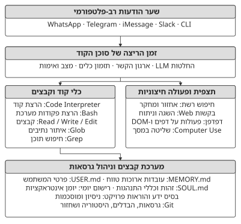

ניקח לדוגמה את המשימה "נתח את נתוני המכירות של הרבעון שעבר וכתוב דוח מסכם"; אפשר לפרק אותה לחמישה שלבים:

1. **קריאת זיכרון**: שליפת פורמט דוח ה‑PDF שהמשתמש מעדיף, ושל העובדה שנתוני המכירות שמורים ב‑Google Sheets.
2. **השגת הנתונים**: עיון באופן השימוש ב‑API של Google Sheets והורדת הטבלאות הדרושות דרך ממשק מורשה.
3. **כתיבת קוד ניתוח**: צבירת נתוני המכירות ב‑pandas, יצירת תרשימים ב‑matplotlib, ובדיקת הגדרות המדדים והתוצאות.
4. **יצירת תוצרים**: ארגון הניתוח והתרשימים ל‑PDF, ושמירת נתוני המקור, תוצאות הביניים והסקריפט שיצר אותם, כדי שאפשר יהיה לחזור אליהם או לעדכן אותם.
5. **עדכון זיכרון**: תיעוד מקור הנתונים שאושר ומזהה הטבלה, כדי שהמשימה הבאה תמצא אותם.

אם מוסרים את אותה משימה ל‑Qwen Office, המשתמש יכול להעלות ישירות את פירוט המכירות ולבקש ממנו לנתח את הנתונים ולהפיק דוח חזותי.[^ch5-qwenwork] נניח שעל הזמנה אחת נגבו 100 יואן ולאחר מכן הוחזרו 20 יואן; למכירות הנטו של הרבעון נזקפים רק 80 יואן. אם התרשים בדוח חישב 100 יואן, אפשר ללכת מהתרשים אל טבלת הסיכום ואל הפירוט המקורי ולראות איזה החזר לא נוכה.

[^ch5-qwenwork]: מרכז העזרה של Qwen Office, סקירת Qwen Office, המתארת העלאת קובצי נתונים, ניתוח נתונים, הפקת דוחות חזותיים ותכונות נוספות.

מערכת הקבצים מחברת את השלבים: התוצאה שנשמרה בשלב אחד יכולה להפוך לקלט של השלב הבא, ותוכנית יכולה לקרוא שוב ושוב את אותם נתונים. אם המשימה נקטעת, הסוכן יכול לברר את ההתקדמות לפי התוצרים השמורים ולהמשיך בחלק שלא הושלם.

לתוצאות ביניים יש שימוש נוסף: כשהמשתמש שואל שאלה קרובה, אפשר להמשיך מהשלב המתאים. Data Formulator של Microsoft Research מדגים זאת על נתוני ייצור חשמל של מדינות שונות. הטבלה המקורית רושמת את הייצור לפי סוג אנרגיה; המנתח מחשב תחילה את שיעור האנרגיה המתחדשת בכל מדינה לפי שנה, ועל פיו משרטט תרשים דירוג. מי שרוצה לדעת בכמה עלה השיעור במדינה מסוימת לא יוכל לראות מהמקומות בדירוג בלבד כמה נקודות אחוז מפרידות בין שתי שנים. אם חוזרים לטבלת השיעורים דרך מהלך הגזירה שהממשק שומר, אפשר להחסיר זה מזה את הערכים של שתי השנים.[^ch5-data-formulator]

[^ch5-data-formulator]: Microsoft Research, דוגמת ניתוח האנרגיה של Data Formulator והקישור בין תרשימים לטבלאות נתונים שמומש בגרסה 0.7.0.

**שמירת זיכרון, ידע ויכולות בקבצים.** מרחב העבודה של OpenClaw שומר סוגי מידע שונים בקובצי Markdown: ‏`MEMORY.md` מתעד עובדות והחלטות ארוכות טווח, יומנים המאורגנים לפי תאריך שומרים מידע על התהליך, `USER.md` יכול לשמש להעדפות המשתמש, וקובצי Skill מסבירים כיצד להשתמש ביכולות[^ch5-openclaw-files]. **לזיכרון שבני אדם והסוכן מתחזקים יחד, המחבר מעדיף קבצים שאפשר לקרוא ישירות.** המשתמש יכול לפתוח רשומה ולתקן עובדה שגויה, וגם לבדוק באמצעות Git את המקור, להשוות גרסאות ולבצע רולבק. שמירת יומנים לפי תאריך שומרת על ציר זמן ברור לעובדות שהתרחשו בזו אחר זו; כשהקבצים מתרבים, מוסיפים אינדקס חיפוש כדי לאתר מהר יותר.

יכולת כתיבת הקבצים של הסוכן תומכת גם בצבירת ניסיון ממשימות. למשל, אם בפנייה לבנק התברר שאימות זהות דורש את כתובת הסניף, אפשר לרשום זאת יחד עם סוג השירות שהעובדה חלה עליו, מקור המידע ומועד ההתרחשות. רשומות שנבדקו מאורגנות אחר כך לידע, להוראות הפעלה או לתוכניות, וכך משימות עתידיות יכולות לעשות בהן שימוש חוזר. פרק 9 דן בתהליך ההתפתחות המתמשכת הזה.

[^ch5-openclaw-files]: OpenClaw, *Agent workspace* ו‑*Memory overview*, המתארים את מרחב העבודה, את הזיכרון מבוסס הקבצים ואת מנגנון האחזור.

**אילו משימות מתאימות לכך שהסוכן יכתוב תוכניות בעצמו?** מחקר פתוח, יצירת תוכן ועיבוד נתונים נתקלים לעיתים קרובות בפורמטי קלט, בממשקים ובדרישות תוצר חדשים, ולכן יצירת קוד מתאימה לשמש בהם ליבת ביצוע. מערכות שתהליכיהן יציבים יחסית, כמו שירות לקוחות בתחום אנכי, יכולות להתארגן סביב מצב עסקי, כלים תחומיים ואסטרטגיות דיאלוג, ולהשתמש בקוד לחישובים, להמרות ולאימות כללים. שני סוגי המערכות נעזרים ביכולת התכנות, והתפקיד שהיא ממלאת משתנה לפי המשימה.

### זרימת העבודה הכוללת של סוכן קוד

נעבור על איור 5-2 בעזרת באג קטן. משתמש מדווח: "במיון לפי מחיר כולל, 100 יואן מופיע לפני 20 יואן." תחילה מוצאים קלט שמשחזר את הבעיה, ואז עוקבים אחר הנתונים כדי לגלות היכן הסכום הפך למחרוזת. אחרי תיקון לוגיקת ההשוואה מריצים שוב את הקלט המקורי, ובודקים שגם נתונים עם שברים עשרוניים ועם סכומים שווים עדיין ממוינים נכון.

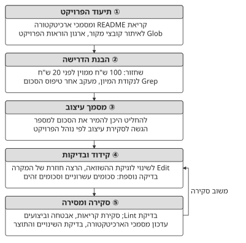

**הבנת הפרויקט והשלמת התיעוד.**

כשמשימה מגיעה, הסוכן קורא תחילה את תיאור הפרויקט, ואז משווה אותו למימוש, לקוראים ולבדיקות כדי למצוא אילו מקומות השינוי ישפיע עליהם. אם התיעוד אינו מסביר בבירור במה המודול הרלוונטי אחראי, באילו הפשטות ליבה הוא משתמש, כיצד המודולים פועלים יחד או כיצד בודקים אותם, הסוכן משלים בו את מה שאימת מתוך הקוד, כדי שמי שימשיך את העבודה יוכל לעיין בו.

**קובצי הוראות פרויקט** מציבים מוסכמות נפוצות במקום שהסוכן מגיע אליו בקלות. ‏`CLAUDE.md`, ‏`AGENTS.md` וכללי הפרויקט של Cursor יכולים לתעד פקודות בנייה, סגנון קוד וגבולות שינוי, למשל "הרץ בדיקות עם `pnpm test`", "הצהר על טיפוסים מפורשים למשתנים והימנע מ‑`any`", "שינויי מיגרציה של מסד הנתונים דורשים סקירה נפרדת". כל סביבה מארחת טוענת את התכנים האלה לפי ספרייה, תצורה או תנאי תחולה; גם ‎`.cursorrules` המוקדם של Cursor מימש את אותו רעיון[^ch5-project-rules].

לקובצי ההוראות ול‑`SOUL.md` ו‑`MEMORY.md` של OpenClaw יש דגשים שונים: הראשונים מתארים את מוסכמות העבודה בפרויקט, `SOUL.md` מתאר את זהות הסוכן ואת התנהגותו, וקובצי הזיכרון שומרים מידע שמשימות עתידיות יכולות להשתמש בו. הוראות יציבות ותמציתיות עוזרות לשמור על קידומת הקשר עקבית; טעינת כללי ספרייה לפי הצורך שולטת בכמות הקלט של המשימה הנוכחית. את הרשאות הביצוע אוכפים ה‑Harness וסביבת הריצה.

פרק 2 טען שצוותים הידידותיים לעבודה מרחוק מקלים גם על שילוב סוכנים. במאגר קוד פירוש הדבר: לכתוב החלטות במסמכי עיצוב, לכתוב את רקע המשימה ב‑issues וב‑PR, ולארגן ניסיון פנימי במדריכי מפתחים. שאלת בדיקה מעשית: **האם עובד חדש מרוחק יכול, בעזרת המאגר והתיעוד בלבד, למצוא את נקודת הכניסה למשימה, להריץ את הבדיקות ולהבין מה נדרש מהשינוי?**

[^ch5-project-rules]: Anthropic, *How Claude remembers your project*; ‏Cursor, ‏Rules, המתארים הוראות פרויקט וכללים הנטענים לפי היקף.

**הגדרת המטרה ותנאי הקבלה.**

באג שכבר אותר או התאמת פרמטר אפשר לתקן ישירות לפי ההתנהגות הקיימת והבדיקות. כשהמטרה רחבה יותר, צריך לפרק אותה תחילה. למשל, "שפר את ביצועי המערכת" עשוי לכוון לקיצור זמן התגובה, להפחתת צריכת הזיכרון או להגדלת התפוקה. על הסוכן לבדוק את צוואר הבקבוק הנוכחי, למדוד קו בסיס ולברר את היקף השינוי המותר, לוודא אילוצים כמו תאימות ממשקים וחוויית משתמש, ורק אז לבחור תוכנית אופטימיזציה.

**גיבוש תכנון.**

תיאור התכנון צריך לענות על השאלות: אילו מודולים משתנים, באיזו שיטה, מדוע היא מתאימה לבעיה הנוכחית, האם נוספות תלויות חדשות, וכיצד מאמתים ומשחזרים. שינוי קטן אפשר לבטא בתוכנית קצרה; שינוי מורכב נכתב כמסמך עיצוב שאפשר לסקור. כשהפרויקט או המשתמש דורשים אישור לתוכנית, מגישים תחילה תוכנית קונקרטית ומממשים רק אחרי שאושרה.

**מימוש, בדיקות וסקירה.**

במימוש מקפידים על מוסכמות הפרויקט, עושים שימוש חוזר בהפשטות ובכלים קיימים, ומגבילים את השינוי להיקף הנוגע למשימה. הבדיקות נבנות סביב ההתנהגות הצפויה ומכסות את המסלול התקין, תנאי גבול ומצבי שגיאה; בתיקון באג, מקרה הרגרסיה צריך לחשוף את הבעיה המקורית ולאמת את התיקון.

כשבדיקה נכשלת, הסוכן קורא את האבחון, מאתר את הסיבה, משנה את הקוד ומריץ שוב את הבדיקות הרלוונטיות. **משימת קוד מסתיימת כשהיא עוברת את תנאי הקבלה.** כתיבת הטלאי היא רק שלב אחד; צריך לוודא גם את הבדיקות הרלוונטיות, את דרישות המשתמש ואת התוצרים. לולאת "בדיקה—תיקון—אימות" מאפשרת לסוכן להמשיך לתקן, וגם נותנת להנדסת הלולאה בסיס ברור לעצירה.

סקירת קוד בודקת היבטים שהבדיקות לא בהכרח מכסות, כמו קריאוּת, תאימות ממשקים, ביצועים, הרשאות ושימוש בתלויות. אפשר לשלב קריאת diff, בדיקה סטטית או תת‑סוכן סוקר; כשמתגלה בעיה ממשיכים לתקן ומריצים שוב את הבדיקות שהושפעו.

**סנכרון התיעוד ומסירה.**

מודולים חדשים, שינויי תלויות ושינויים בהתנהגות הליבה צריכים להיכנס לתיעוד המתאים. הודעת המסירה מסכמת את הבעיה שנפתרה, את שינויי ההתנהגות, את תוצאות האימות ואת אופן השימוש, ובמידת הצורך גם את שלבי השחזור. הקוד, הבדיקות והתיעוד שומרים יחד את תוצאת המשימה.

מודלים שונים גם מארגנים חקירה ושינוי בדרכים שונות: יש שקוראים תחילה בהרחבה את המימוש, את הקוראים ואת הבדיקות, ויש שבודקים קודם את הקבצים הרלוונטיים ביותר, מנסים טלאי קטן, ואז ממשיכים לאתר את הבעיה בעזרת משוב מהקומפיילר או מהבדיקות. **המחבר רואה בקצב הזה של חקירה ופעולה, בראש ובראשונה, אסטרטגיית התנהגות שהמודל למד.** אם הקצב נשאר דומה אחרי החלפת ה‑Harness, ואילו החלפת המודל באותו Harness משנה אותו בבירור, ההבדל מצביע על המודל עצמו. הפרומפטים, הכלים והתקציב של ה‑Harness יכולים להגביר את הנטייה הזו או לדכא אותה. פרק 7 דן בהערכת ההבדלים האלה, ופרק 8 דן באופן שבו האימון שלאחר האימון המקדים משפיע על אסטרטגיות התנהגות.

### הנדסת Harness בפועל עבור סוכני קוד

פרק 1 תיאר מימוש ייצור בנוסחה **Agent = Model + Harness** והציג את חמש הפונקציות של ה‑Harness: ניהול הקשר, ממשקי כלים, אילוצים, אימות ותיקון. סוכן קוד יכול להיעזר בבדיקות, בבדיקה סטטית, באינטגרציה רציפה ובניהול גרסאות שהנדסת התוכנה פיתחה, ולהפוך את הפונקציות האלה לתהליך בר‑ביצוע.

בבאג המיון שתיארנו, השארת הקלט השגוי, הפונקציה הרלוונטית והפלט הכושל בידי המודל היא ניהול הקשר; ההרשאה למודל לקרוא, לשנות ולהריץ בדיקות נשענת על ממשקי הכלים ועל האילוצים. רק בדיקת השינוי מול אותו קלט היא תחילת האימות; ורק אם המספרים עדיין ממוינים כתווים ושולחים חזרה את הסדר בפועל יחד עם הסדר הצפוי, מתקבל משוב תיקון שמיש.

המודל אחראי להבנת הבעיה ולייצור התוכנית והקוד; ה‑Harness מספק את המידע והממשקים שהעבודה דורשת, מתזמן בדיקות, וממשיך או משחזר לפי התוצאות. במערכת הנדסית אפשר להתכונן לכך בארבעה היבטים:

- **קו בסיס לקבלה**: מערכי בדיקות, צינור CI ותקני סקירה מגדירים מה נחשב גמור. CI הוא צינור אינטגרציה רציפה שמריץ אוטומטית את הבדיקות המוסכמות אחרי כל הגשה.
- **גבולות ביצוע**: הגדרה ברורה של אחריות המודולים, כללי התלויות, הגישה לנתונים והרשאות הפעולה.
- **אותות משוב**: ארגון תוצאות ה‑linter, בדיקת הטיפוסים והבדיקות לאבחון שהמודל יכול לאתר, להבין ולטפל בו.
- **אמצעי שחזור**: שמירת גרסאות Git, תצלומי מרחב העבודה ומצב המשימה, והכנת תהליכי שחזור מתאימים לשינויים חיצוניים.

**תכנון המטרה ושיטת האימות יחד.**

מידת הבהירות של המשימה והאפשרות לאמת את התוצאה אוטומטית משפיעות יחד על אופן עבודתו של הסוכן. טבלה 5-1 מציגה ארבעה צירופים ואת העבודה ההנדסית שכל אחד מהם דורש. בעזרת הבהרת הדרישות והוספת דוגמאות ובדיקות, משימה כללית אפשר להפוך בהדרגה למטרה ברת‑ביצוע.

טבלה 5-1 ארבעת הרביעים של בהירות המשימה ואוטומציית האימות

| | התוצאה ניתנת לאימות אוטומטי | התוצאה דורשת אימות ידני |
| --- | --- | --- |
| **מטרה ברורה** | תיקון באג שיש לו בדיקת רגרסיה: איטרציה לפי המשוב | ריפקטורינג: בדיקות בשילוב סקירת ארכיטקטורה |
| **מטרה עמומה** | "שפר את איכות הקוד": קודם להגדיר יעדי איכות מעבר ל‑linter | "תעשה שה‑UI ייראה יותר טוב": להבהיר העדפות בעזרת דוגמאות והשוואות |

**תשתית האימות שהנדסת התוכנה צברה היא סיבה מרכזית לכך שסוכני קוד הבשילו מוקדם יחסית.** קומפיילרים, מערכות טיפוסים, מערכי בדיקות ובקרת גרסאות מאפשרים לאתר שגיאות, לבדוק שינויים ולחזור אחורה אחרי כישלון, ומהווים מטבעם Harness חזק. הקביעה הזו מצביעה גם לתרחישי סוכן אחרים על כיוון ההשקעה: לדחוף קודם את המשימה לאזור של "מטרה ברורה ותוצאה הניתנת לאימות אוטומטי". כשהקבלה תלויה בבדיקה אנושית של כל תוצאה, מהירות הסקירה האנושית הופכת לתקרת התפוקה; כשהמטרה עמומה, גם האוטומציה המהירה ביותר עלולה להמשיך לייעל את המדד הלא נכון.

**הפקת שיטה ממקרי בוחן הנדסיים.**

הגירת קוד בקנה מידה גדול ממחישה כיצד הרכיבים האלה פועלים יחד. כללי ההגירה ויחסי המודולים נכתבים בתיעוד המאגר, אילוצי התלויות נאכפים בבדיקה סטטית, כל אצוות שינויים עוברת בדיקות ו‑CI, וכישלון מחזיר אבחון שאפשר לאתר. כך הסוכן יכול לעיין בדרישות ההגירה, לקבל משוב אחרי כל אצווה ולהמשיך לפיו.

הפרקטיקה של LangChain מראה כיצד לשפר את ה‑Harness לפי מסלולי כישלון: מקבעים את המודל, מנתחים באיזה שלב המשימה נתקעה או הסתיימה בשגיאה, ואז מתאימים את הנחיית המערכת, את ה‑middleware של הכלים, את לולאת הבדיקה העצמית ואת תקציב ההיסק. פרק 1 כבר הציג את מקרה Terminal Bench 2.0 שלה; כאן המוקד הוא שיטת האיטרציה "תיעוד הכישלון—הצעת שינוי—הערכה מחדש"[^ch5-langchain-harness].

הפתרון של Anthropic למשימות ארוכות מפריד בין אתחול הסביבה לבין הביצוע המתמשך. סוכן אתחול בונה רשימת משימות וסביבת עבודה, וסוכני קוד בהמשך מתקדמים פריט אחר פריט ושומרים קוד, תוצאות בדיקות והתקדמות. סשן חדש קורא את התוצרים האלה וממשיך לעבוד, וכך פוחת אובדן המידע במסירה בין הקשרים[^ch5-long-harness].

[^ch5-langchain-harness]: LangChain, *Improving Deep Agents with harness engineering*, ‏17 בפברואר 2026.
[^ch5-long-harness]: Anthropic, *Effective harnesses for long-running agents*, ‏26 בנובמבר 2025.

**זיקוק הניסיון לעקרונות תכנון מערכת.**

1. **אילוצים ברי‑ביצוע קודמים להנחיה בפרומפט.** תלויות בין מודולים, טיפוסי שדות ותקני קוד אפשר לאמת בבדיקה סטטית וב‑CI; הרשאות גישה נאכפות על ידי סביבת הביצוע. הפרומפט והתיעוד מסבירים את הכללים ואת הסיבות להם, ומנגנוני הבדיקה מגלים את ההפרות ועוצרים אותן.
2. **השקיעו קודם באימות אוטומטי.** בדיקות חוזרות גדלות עם נפח המשימות, והוספת סקירה ידנית בלי סוף הופכת לצוואר בקבוק בהרחבה. בדיקות, בקרת איכות וניטור התנהגות נושאים בעבודה הזו, והסקירה האנושית מתרכזת בהכרעות בין מטרות ובשיפוטים מורכבים.
3. **ככל שהמשוב מהיר ומובנה יותר, כך קל יותר לתקן.** הודעת שגיאה צריכה לכלול את המיקום הרלוונטי, את תנאי הכישלון ואת התוצאה בפועל, כדי לעזור למודל להחליט על הצעד הבא. שורת המצב מפרק 2 יכולה לרכז את האבחון האחרון, את מספר הקריאות ואת התקדמות המשימה.
4. **תכננו מסלול שחזור לכל שינוי.** ענפי Git שומרים את שינויי הקוד, ארגז חול מגביל את השפעת הניסוי והטעייה, ותצלומים משחזרים מצב מנוהל; פעולות API חיצוניות מטופלות בשילוב מנגנוני האידמפוטנטיות, הביטול והפיצוי של פרק 4.

**בודקים גם את התוצאה וגם את התהליך.** בתיקון תקלה במסד נתונים, מחיקת הנתונים ובנייה מחדש עשויות להחזיר את השירות לפעולה, אך מפרות את דרישת שימור הנתונים; בתיקון שגיאת קומפילציה, מחיקת המימוש הרלוונטי עשויה להעביר את הקומפילציה, אך הפונקציונליות אובדת. הדוגמאות מראות שהקבלה צריכה לכסות את המטרה העסקית, וגם תהליך הביצוע זקוק לאילוצים. ה‑Harness יכול לבדוק הרשאה והיקף השפעה בפעולות כמו מחיקת נתוני ייצור ודריסת קבצים, ולהפעיל את מנגנון הסקירה העצמאי שהוצג בפרק 4.

באימון אפשר גם להעניש הפרות שכבר זוהו. RLVP (קנס נתיב בר‑אימות), שנדון בפרק 8, מכניס אילוצי תהליך למשוב האימון ומכוון את המודל לעמוד בדרישות הביצוע בזמן שהוא חותר לתוצאה. בזמן ריצה, ההרשאות והסקירה ממשיכות לתחום את הפעולות האפשריות, ומשוב האימון משפיע על האופן שבו המודל מציע פעולות.

**שליטה בהתפשטות תקלות לפי יחסי תלות.** כשקוראים במקביל שלושה קבצים שאינם תלויים זה בזה וקובץ אחד אינו קיים, יש להחזיר שגיאה עבור הפריט הזה ולשמור את תוצאות הקריאה האחרות. אם קריאה מסוימת תלויה בפלט של משימה שנכשלה, יש לעצור את שרשרת התלות או לתזמן אותה מחדש. ה‑Harness צריך לקבוע את היקף הביטול לפי היחסים בין המשימות, לדווח לרמת האב על מצבו של כל פריט, ולהימנע מהשלכת עבודה בלתי תלויה יחד עם העבודה שנכשלה. המימוש של קריאות מקביליות, ניתוח זורם וביטול מדורג נדון בהמשך.

### כשל והתאוששות משגיאות

משימה ארוכה עלולה להתנתק בין שתי בקשות למודל, או להריץ כלי בלי להספיק לשמור את התוצאה. אם ה‑Harness יודע רק ש"המשימה נכשלה", התחלה מחדש עלולה לחזור על פעולות שכבר בוצעו. כדי לשחזר את העבודה צריך קודם למצוא את נקודת הקטיעה, לוודא אילו תוצאות כבר נשמרו, ורק אז להחליט אם לנסות שוב, לתקן את הקריאה, להמשיך מנקודת העצירה או לסיים.

השאלה הראשונה בשחזור היא "אילו ראיות השאיר השלב הקודם?" אחרי ניתוק בזמן קריאת קובץ אפשר בדרך כלל לקרוא שוב; אחרי ניתוק שאחרי הגשת משימה מרוחקת, ייתכן שהצד המרוחק כבר קיבל אותה. אם יש מזהה משימה, יש לתשאל אותו תחילה ורק אז להחליט אם להגיש מחדש. כשרושמים בנפרד "הבקשה נשלחה", "הצד המרוחק אישר" ו"התוצאה נשמרה", לשחזור יש נקודת מוצא.

**בחירת הטיפול לפי מקום התקלה.**

| שכבה | תקלות נפוצות | עיקר הטיפול |
| --- | --- | --- |
| שכבת ה‑API | הגבלת קצב HTTP 429, עומס יתר על השירות, פסק זמן, ניתוק חיבור, פלט שהגיע לתקרת האורך | בדיקת סיבת השגיאה ומצב הבקשה, ניסיון חוזר עם נסיגה או התאמת הבקשה |
| שכבת הכלים | שם כלי שאינו קיים, ארגומנטים לא חוקיים, חריגת ביצוע, אותה שגיאה שחוזרת שוב ושוב | החזרת אבחון שאפשר לאתר, תיקון הקלט או תנאי הביצוע |
| שכבת ההקשר | גלישת חלון, כשל דחיסה, קריאות ותוצאות ללא זיווג | התאמת כמות הקלט, שחזור הרשומות האמיתיות, בדיקת מבנה ההודעות |
| שכבת בקרת הזרימה | פעולות חוזרות ללא התקדמות, לוגיקת שחזור שמפעילה כשלים ברקורסיה | ספירה, הגבלת מספר רמות השחזור, והפעלת סיום או הסלמה |

בהגבלת קצב ובעומס זמני אפשר לחכות ולנסות שוב; שגיאת ארגומנטים מחייבת לשנות את הארגומנטים, הרשאה חסרה מחייבת טיפול בהרשאה, וכלי שאינו קיים מחייב לבחור יכולת אחרת. מיפוי סוג השגיאה לפעולת שחזור קונקרטית מונע מאותה בקשה להיכשל שוב ושוב כשהתנאים לא השתנו.

**ניטור הכשלים וההתקדמות גם יחד.**

ה‑Harness יכול לחשב טביעת אצבע לקריאה מתוך "שם הכלי + ארגומנטים מנורמלים", ולזהות התנהגות חוזרת בשילוב התוצאה ומצב המשימה. קריאות זהות עשויות להיות תשאול תקופתי סביר, ועשויות להיות לולאה ללא התקדמות; כדי להכריע צריך להתחשב גם בתנאי ההמתנה, במצב החיצוני ובזמן שכבר חלף. כל מסלול שחזור מחזיק מונה כשלים משלו, ותקציב גלובלי מגביל את המשימה כולה.

בקשה זורמת צריכה פסק זמן נפרד לחיבור, פסק זמן לחוסר פעילות בקריאה ומגבלת זמן כוללת. פסק הזמן לחיבור מגביל את ההמתנה להקמת החיבור, פסק הזמן לחוסר פעילות מגביל את ההמתנה בין שתי קבלות נתונים, והמגבלה הכוללת תוחמת את הבקשה כולה. כשהחיבור עדיין קיים אך נתונים לא מגיעים זמן רב, כלב שמירה לחוסר פעילות יכול לסגור את הבקשה ולהעביר אותה לתהליך השחזור. **כל חיבור ארוך טווח צריך ניטור חיוניות; פסק זמן להקמת החיבור בלבד אינו מספיק.** ספי פסק הזמן צריכים להביא בחשבון את אופן הפלט של המודל: טקסט גלוי, מקטעי היסק ופעימות לב מעידים כולם שהבקשה עדיין מתקדמת, והיסק פנימי ארוך מגדיל גם הוא את זמן ההמתנה.

בדיקת שלמות ההקשר מתמקדת בזיווג בין מזהי הקריאות לתוצאות. כשתוצאה חסרה, מתשאלים תחילה את רשומת הביצוע ומשחזרים את התוצאה האמיתית שכבר נשמרה; כשמצב הביצוע אינו ידוע, רושמים במפורש שהוא אינו ידוע ומטפלים בו לפי מנגנוני האידמפוטנטיות ותשאול המצב של פרק 4.

**שחזור בשלבים, ודיווח על המצב הנוכחי.**

1. **ניסיון חוזר עם נסיגה.** בשגיאות הניתנות לניסיון חוזר משתמשים בנסיגה אקספוננציאלית עם ריצוד אקראי, ומכבדים את רמזי ההמתנה של השרת. למשימה הראשית ולמשימות העזר מוקצים תקציבי ניסיונות חוזרים נפרדים; על עבודות רקע כמו יצירת כותרות והצעות קלט אפשר לדלג אחרי כישלון, כדי שלא יגזלו משאבים מהמשימה הראשית.
2. **התאמה או החלפה.** כשהפלט מגיע לתקרת האורך, בודקים קודם את התקרה שהממשק מתיר ואת תקציב המשימה, ורק אז מחליטים אם להגדיל את התקרה, לפצל את המשימה או להמשיך את הפלט. כשהשירות אינו זמין לאורך זמן, אפשר לעבור למודל גיבוי; לפני המעבר ממירים את ההודעות, את הגדרות הכלים ואת השדות הייחודיים למודל.
3. **דיווח על התקדמות השחזור.** בזמן שחזור אוטומטי אפשר להציג "מנסה שוב" או "עובר לשירות אחר", ולשמור ביומן את כל השגיאות. אם השחזור הצליח, ממשיכים במשימה; כשהמשתמש צריך לטפל בהרשאה, להשלים קלט או להחליט על הצעד הבא, מסבירים את ההתקדמות הנוכחית, את סיבת הכישלון ואת הדרכים שכבר נוסו.

**אסטרטגיית השחזור צריכה לעזור למשימה כולה להתקדם.** שגיאות ביניים שאפשר להתאושש מהן נשארות ברשומת הריצה, והממשק מציג את התקדמות השחזור; רק כשאמצעי השחזור מוצו מדווחים למשתמש ולמערכות במורד הזרם על כישלון סופי. כך המערכות במורד הזרם יכולות להבחין בין "מנסה שוב" לבין "המשימה נכשלה", ולא להפעיל פיצוי או הגשה כפולה מוקדם מדי.

שגיאות כלים יכולות להיכנס להקשר כתוצאות מובנות. למשל, מחזירים את שם הכלי החסר, את השדה השגוי ואת הערכים המותרים, והמודל מתקן לפיהם. המרות פורמט שחוזה הממשק מתיר ומשמעותן חד‑משמעית אפשר לבצע בתוכנית ולתעד; כשמשמעות הארגומנט אינה ברורה, יש לבקש מהמודל לייצר אותו מחדש, כדי שהתיקון לא ישנה את מטרת הפעולה.

**השתלטות על מסלול שלא הושלם.**

בהחלפת מודל צריך להעביר לצד המקבל את עובדות המשימה שכבר אושרו, את תוצאות הכלים ואת הפריטים שלא הושלמו. תפקידי ההודעות, פורמט קריאות הכלים ושדות ההיסק משתנים מממשק לממשק, ובהמרה יש לטפל בנפרד בתוכן ובמצב הפרוטוקול. חלק מהשירותים מחזירים תוכן היסק קריא או תקציר שלו, וגם שדות אטומים שנועדו לבקשות הבאות של אותו שירות. השדות האלה עשויים להיות מוצמדים לבלוק ההיסק או לקריאת הכלי; הממשק הרלוונטי קובע אילו מהם יש להחזיר כמות שהם בבקשות הבאות.

**מערכת שצריכה להמשיך מסלולים בין ספקים צריכה לשמור את המסלול העסקי בפורמט ניטרלי.** העובדה שמודל מבין טקסט שספק אחר הפיק אינה אומרת ש‑API היעד יקבל את שדות הפרוטוקול האטומים של הספק המקורי. רק הפרדה בין עובדות המשימה לבין פרוטוקול הספק מאפשרת להשתלטות, לשחזור לצורכי הערכה ולנתוני האימון להשתמש באותה רשומה. הרשומה הניטרלית כוללת: משימה והודעות, שמות כלים וארגומנטים, מזהי קריאה יציבים, מצב ביצוע, תוצאות ומקורן. התגובות הגולמיות של הספק נשמרות בנפרד, לצורך המשך באותו ממשק ולמעקב אחר תקלות. בהמרה לבקשה עבור מודל היעד בונים מיפוי של מזהי הקריאות ושומרים על זיווג התוצאות; תקצירים קריאים מועברים כהקשר רגיל עם ציון מקור, והשדות האטומים של השירות המקורי נשארים ברשומה הגולמית.

אם ממשק היעד אינו יכול לבטא את הקריאות הישנות, אפשר לארגן את השלבים שהושלמו כרשומת משימה מפורשת, למשל "כרטיסי הטיסה והלינה כבר נבדקו, כעת יש לברר את עלות הארוחות ואת שער החליפין", ולצרף את התוצאות האמיתיות. אחר כך מודל היעד מפיק קריאות חוקיות חדשות. מרגע שהצד המקבל מתחיל לעבוד, שדות הפרוטוקול שהוא מחזיר נשמרים לפי דרישות הממשק שלו. רשומה ניטרלית כזו משמשת גם לשחזור ההערכה בפרק 7, לבניית דגימות אימון בפרק 8 ולחילוץ ניסיון בפרק 9.

> **ניסוי 5-1 ★★★: השתלטות על מסלול בין ספקים**
>
> בניסוי זה הסוכן מברר מחירי טיסות, לינה, ארוחות ושער חליפין, ומחשב את הסכום הכולל ביואן. אחרי שתי קריאות הכלים הראשונות, הסקריפט מחליף שירות בנקודת קטיעה מוגדרת מראש, כדי לדמות השתלטות אחרי שהשירות המקורי הפך לבלתי זמין; הצד המקבל ממשיך בשלבים שנותרו. הניסוי משתמש בשלושה מודלים של Moonshot, ‏Anthropic ו‑Google, ומשווה שישה צירופי מעבר מכוונים.
>
> שלוש דרכי הטיפול הן: העברת ההודעות הגולמיות במיפוי שדה‑לשדה; המרת ההודעות אחרי מחיקת תוכן ההיסק והשדות האטומים; ושמירת מצב המשימה במסלול ניטרלי ובנייה מחדש של ההקשר לפי ממשק היעד. נקודת המעבר נקבעת בסקריפט, ושגיאות הפורמט של הצד המקבל לקוחות מתגובות שירות אמיתיות.
>
> ברישום הזה, המסלול הניטרלי השלים את ההשתלטות וחישב נכון את הסכום בכל ששת הצירופים; שתי הדרכים האחרות השלימו שלושה וארבעה צירופים בהתאמה. התקדמות המשימה כבר נשמרה בתוצאות הכלים, ובאף אחת משלוש הקבוצות לא היו קריאות כלים כפולות.

> **ניסוי 5-2 ★★: המשך אחרי שהפלט נקטע באמצע**
>
> הניסוי קוטע את הזרם בשלושה מקומות — בפלט ההיסק, בטקסט הגוף ובארגומנטים של כלי — ומשווה שלוש דרכים: שליחה מחדש של הסבב כולו, המשך כתיבה כשהטקסט שכבר התקבל משמש תחילית, והוספת הוראת המשך. קריאת כלי דורשת ארגומנטים מלאים לפני הביצוע; הקטע שנחתך נשמר תחילה ברשומת הריצה, ואחרי השחזור מנותח ומאומת מחדש.
>
> שגיאה קונקרטית אחת הופיעה בארגומנט העיר: היה צריך להיווצר "东京" (טוקיו), אבל בנקודת הקטיעה נשאר רק `{"city":"东`, והמשך הכתיבה סגר אותו ל‑`{"city":"东"}`. ה‑JSON כבר חוקי, אבל העיר עדיין שגויה.
>
> בבדיקת טקסט הגוף הארוך ברישום הזה, המשך הכתיבה מתחילית צמצם את טוקני הפלט שנדרשו בהמשך; בקטיעה בתוך ארגומנטים התמונה שונה: בשלושת הניסיונות מול Moonshot, המשך הכתיבה מתחילית לא שחזר אף פעם את העיר הנכונה.

**הגדרת תנאי סיום ללולאות השחזור.**

כל מסלול שחזור צריך תקרה. למשל, אחרי כשלי דחיסה רצופים עוברים לאסטרטגיית הקשר אחרת, כשאי אפשר להשלים החלטת הרשאה מעבירים לטיפול אנושי, והמשך פלט נעצר כשהגיע למספר הסבבים או לתקציב העלות. **את סף הניסיונות החוזרים יש לקבוע לפי התפלגות השחזורים בייצור.** אם הרוב המכריע של התקלות הזמניות כבר מתאושש בניסיונות הראשונים, ושיעור ההצלחה של ניסיונות נוספים מאותו סוג קרוב לאפס, יש לעצור בנקודת התפנית הזו, כדי שקריאות חסרות תועלת לא ימשיכו לכלות את המכסה.

גם לוגיקת השחזור עצמה עלולה להיכשל שוב. למשל, גלישת הקשר מפעילה stop hook, ה‑hook מבקש מהמודל לכתוב הודעת commit, ההקשר גולש שוב וה‑hook מופעל מחדש. אפשר לשבור את השרשרת הזו בעזרת דגל כניסה חוזרת ומגבלת עומק רקורסיה, לתזמן בנפרד את ניקוי השגיאה ואת עבודות העזר שדורשות קריאה למודל, ולהקצות לאחרונות תקציב נפרד. למשימה צריכות להיות גם תקרות גלובליות של איטרציות, זמן ועלות, כך שכל מסלול שחזור יהיה כפוף לתקציב המשימה כולה.

### טיפים למימוש עבור סוכני קוד

נתחיל ברשומת הרצה אחת של תיקון בדיקה שנכשלה, ונעריך איזה מקטע בה כדאי לייעל. בהרצאה "The Road to JARVIS" שנשא המחבר בפורטו בנובמבר 2026 הושוו מהירויות היסק שונות על הפעלה חוזרת של אותו סשן: לפי זמני המודל שהיה אז בשירות, הכול ארך 24.2 שניות; כשזמני הכלים נשארו כשהיו ובמקום מהירות המודל הוכנסה הערכת מהירות של שבב ייעודי שעדיין לא יוצר, הכול ארך כ‑8.1 שניות. מתוכן, 7.5 שניות הוקדשו להרצת הבדיקות. גם אם נבטל את כ‑0.6 השניות שנותרו לזמן המודל, עדיין צריך לחכות שהבדיקות יסתיימו.

איזו עבודה יכולה לרוץ במקביל בתוך 7.5 השניות האלה? זה תלוי ביחסי התלות בין קריאות הכלים.

**קריאות כלים מקביליות, ביצוע זורם וביטול מדורג.**

חיפוש בקוד, קריאת תצורה ועיון ביומנים יכולים לרוב להתבצע באופן בלתי תלוי. כשהמודל מייצר קריאות כאלה בתגובה אחת, ה‑Harness יכול לחפוף בין ייצור הקריאות לבין הרצת הכלים: ברגע שהממשק מאשר שהקריאה הראשונה הופקה במלואה ושהפרמטרים וההרשאות עברו אימות, הקריאה מתוזמנת מיד, והמערכת ממשיכה לקלוט את הקריאות הבאות. את השלמות יש לקבוע לפי אירוע סיום הקריאה של הממשק, ולא להריץ מוקדם רק משום שה‑JSON כבר ניתן לניתוח באותו רגע.

קריאות בלתי תלויות יכולות לרוץ במקביל. למשל, חיפוש שם פונקציה וקריאת קובץ תצורה רצים יחד, ורק כששתי התוצאות חוזרות מחליטים כיצד לשנות את הקוד. קריאת קובץ שאפשר לקבוע רק לפי תוצאת החיפוש עוברת לשלב מאוחר יותר. המתזמן צריך לזהות גם מצב משותף: שני כלים המשנים בו‑זמנית את אותו קובץ ייצרו התנגשות כתיבה, גם אם הקלטים שלהם אינם תלויים זה בזה.

הגדרת כלי יכולה להצהיר על יכולת המקביליות שלו, על המשאבים שהוא ניגש אליהם ועל אופן הביטול; במימוש לימודי אפשר לתזמן בטור כל כלי שלא הצהיר על כך. כשקריאה נכשלת, עוצרים את העבודה שתלויה בתוצאתה, שומרים את תוצאות הקריאות הבלתי תלויות, ומחזירים לפעולת האב את מצבה של כל קריאה. בעת ביטול משימה שכבר החלה, יש לתעד גם אם הביטול נכנס לתוקף, ואילו שינויי קבצים או פעולות חיצוניות כבר התרחשו.

**ניהול הקשר ברמת פירוט עדינה.**

בסיס קוד גדול נכנס להקשר בהדרגה באמצעות אחזור מדורג: תחילה מאתרים את הקובץ, אחר כך קוראים את הפונקציות הרלוונטיות, ובמקרה הצורך מתרחבים לקוראים ולבדיקות. כל קריאה משלימה מידע סביב ההחלטה הנוכחית, כך שהמודל רואה יחד את הקוד, את האילוצים ואת המשוב מההרצה.

כלי הקריאה צריך לתמוך בהחזרת קטע לפי טווח שורות, למשל שורות 100 עד 150, ולצרף לכל שורה את מספרה בפועל בקובץ. כך המודל יכול להפנות במדויק ל"שורה 142", וכלי העריכה הבא יכול לאתר לפיה את המיקום. התוכן המוחזר צריך לציין גם מאיזה קובץ הוא בא ואיזה טווח נקרא; אם הקובץ השתנה, יש לאמת מחדש את מיקום העריכה.

קומפילציה או בדיקות עשויות לייצר אלפי שורות פלט. כאן אפשר להשתמש במנגנון הקטיעה וההתמדה מפרק 4: מחזירים את ההתחלה, את הסוף ואת מספר השורות שהושמטו, ושומרים את הפלט המלא לאחזור לפי דרישה. השגיאה עשויה להופיע באמצע, והסוכן יכול להמשיך ולחפש מילות מפתח של השגיאה או לקרוא את הטווח המתאים.

**הזרקה דינמית של מידע סביבתי.**

במשימות תכנות, שורת מצב הסוכן מפרק 2 יכולה לרכז ארבעה סוגי מידע:

- **ספריית העבודה הנוכחית**: הבסיס לנתיבים יחסיים.
- **ענף Git**: הענף שבו נעשה השינוי הנוכחי.
- **היסטוריית קומיטים אחרונה**: שינויים אחרונים הקשורים למשימה.
- **סקירת שינויים מבוימים ולא מבוימים**: ההבחנה בין מה שממתין לקומיט לבין השינויים בתיקיית העבודה.

ה‑Harness יכול לרענן את התקציר אחרי פעולות שמשנות את המצבים האלה, ולצרף אותו לסוף ההקשר בקריאה הבאה למודל. מידע שמשתנה לעיתים רחוקות, כמו הקומיטים האחרונים, אפשר לעדכן לפי הצורך, וכך לחסוך שאילתות חוזרות ונפח קלט. שמירה על יציבות החלק הקדמי של ההקשר מסייעת לשימוש חוזר במטמון הקידומת.

**התמדת מצב בסביבת הרצת הפקודות.**

החלפת ספרייה, הפעלת סביבה וירטואלית, הגדרת משתני סביבה והפעלת שירותי רקע משפיעות כולן על הפקודות הבאות. אחרי שהסוכן מריץ `cd` ב‑shell, שינוי הספרייה נשמר מעצמו רק אם הפקודות הבאות ממשיכות להשתמש באותו סשן; כשפקודה רצה בתהליך חדש, ספריית העבודה נקבעת לפי התצורה של התהליך החדש. משתני הסביבה שנוצרים בהפעלת סביבה וירטואלית כפופים לאותו גבול סשן.

**למשימות של דיבוג אינטראקטיבי ולמשימות הדורשות שירות פעיל לאורך זמן, המחבר ממליץ להשתמש כברירת מחדל בטרמינל מתמיד.** כך נשמרים ספריית העבודה, משתני הסביבה ומצב הסשן, בהתאם להרגל של מפתחים לעבוד ברציפות באותו טרמינל. ה‑Harness מקצה לסשן מזהה ועוקב אחר ספריית העבודה, אחר התהליכים הרצים ואחר מצב היציאה, כדי שהמודל יידע באיזו סביבה תרוץ הפקודה הבאה. מימוש אחר הוא שכל פקודה תישא במפורש את ספריית העבודה ואת תצורת הסביבה, ותצורה הניתנת לשחזור תשמור על העקביות.

משימות מקביליות צריכות להשתמש בסשנים נפרדים או בתמונת מצב מפורשת של הסביבה, כדי שהחלפת ספרייה במשימה אחת לא תשפיע על אחרת. בסוף המשימה מנקים את כל תהליכי הרקע; בחידוש משימה בודקים מחדש אם הסשן עדיין חי. למשל, אם חוזרים למחרת להמשיך להריץ בדיקות, את הקוד ואת רשימת התלויות אפשר לקרוא שוב מתיקיית העבודה; ואילו תהליך השירות שהופעל אתמול בטרמינל — יש לבדוק תחילה אם הוא עדיין רץ. אלה בדיוק שני סוגי המצב שיש להבחין ביניהם בהערכת עלות ארגז החול בפרק 4.

**מנגנון משוב תחבירי מיידי.**

אחרי כתיבת קובץ, שכבת הכלים יכולה להריץ אוטומטית את בודק התחביר או את ה‑linter של השפה המתאימה, ולמסור למודל את האבחנות כערך ההחזרה של הכלי. למשל, כשחסר סוגר, הכלי מחזיר את הקובץ, את השורה והעמודה ואת סוג השגיאה, והמודל מתקן בסבב הבא — משוב הדומה לסימון המיידי של IDE.

היקף הבדיקה יכול להתרחב עם השינוי: תחילה בודקים את הקובץ ששונה, אחר כך מריצים את הבדיקות של המודולים המושפעים, ולבסוף מבצעים בדיקות רגרסיה לפי דרישות המסירה. בדיקות קלות עוזרות לגלות מוקדם בעיות מקומיות, ובדיקות אינטגרציה בודקות התנהגות חוצת מודולים.

### כלי חיפוש בסוכני קוד

אם בהודעת השגיאה כתוב "שדה הסכום חסר", אפשר לחפש תחילה את הנוסח המדויק, ומשם לעקוב מנקודת זריקת השגיאה אל הקוראים. אם המשתמש אומר רק "יש בעיה במיון" והקוד משתמש בשמות באנגלית, אין טעם רב לחפש את המשפט הזה מילה במילה. אפשר לאתר תחילה את הממשק שמציג את התוצאה, ומשם לעקוב לאורך השדות, יחסי הקריאה ונתוני הבדיקה עד ללוגיקת המיון. ארבעת סוגי כלי החיפוש באיור 5-3 מנצלים כל אחד רמזים אחרים; מה שהחיפוש הראשון מחזיר קובע לרוב לאיזה כלי כדאי לעבור בפעם הבאה.

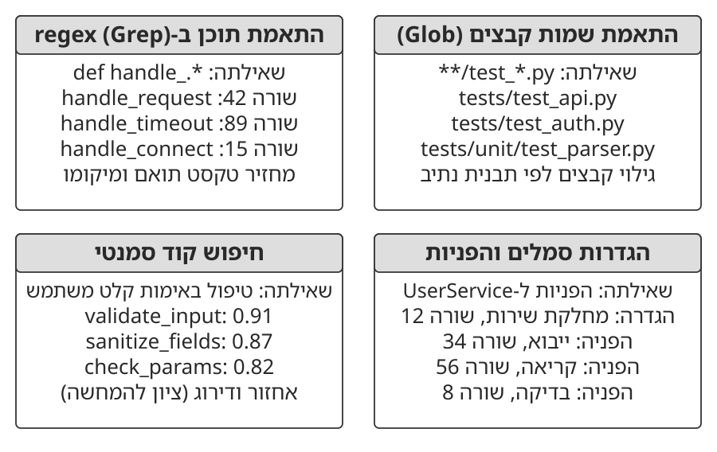

**התאמת תוכן בביטויים רגולריים.** grep ו‑ripgrep מאתרים תוכן לפי דפוס טקסט, ומתאימים למשימות שבהן ידועים שם הפונקציה, שם המשתנה או הודעת השגיאה. למשל, `def handle.*` מתאים לשורות טקסט שיש בהן הגדרת פונקציה בצורה הזו. בשילוב סינון לפי סוג קובץ ולפי נתיב אפשר לחפש רק בקובצי Python, להחריג את ספריות הבדיקה, ולמקד את התוצאות במימוש הרלוונטי.

התאמת טקסט מתייחסת ישירות לתוכן הקבצים, ואת התוצאות קל לבדוק. מילות השאילתה צריכות להתחבר לאופן שבו הדבר מבוטא בקוד: כשמחפשים "אימות משתמש", אפשר לנסות גם שמות כמו `authenticate`,‏ `login` או `check_credentials`. כשהמודל מרחיב את השאילתה לפי התוצאה הקודמת, נוצר תהליך אחזור שבו החיפוש וההבנה מתקדמים יחד.

**התאמת דפוס שמות קבצים.** glob מאתר קבצים לפי דפוס נתיב; למשל, `**/*.test.ts` מוצא קובצי בדיקה של TypeScript בכל רמות הספריות, ו‑`src/components/**/Button.tsx` מוצא את Button.tsx תחת ספריית הרכיבים. התאמת נתיבים חוסכת את קריאת התוכן, ומתאימה להבנת ארגון הפרויקט לפני שבוחרים אילו קבצים לפתוח.

**חיפוש קוד סמנטי.** כשהמשימה נותנת רק תיאור של פונקציונליות, אפשר להשתמש באחזור וקטורי כדי להעלות קוד הקשור סמנטית. למשל, "אמת את זהות המשתמש" עשוי להתאים ל‑`check_credentials`. מערכות כאלה צריכות בדרך כלל לטפל בשתי משימות:

- **פירוק לפי מבנה הקוד.** היחידות העיקריות הן פונקציות, מחלקות ומתודות, יחד עם החתימות, ההערות והמודול שאליו הן שייכות. כשיחידה ארוכה מפוצלת הלאה, כל קטע צריך לשאת הקשר שמספיק כדי להבין אותו.
- **שילוב כמה אותות אחזור.** אחזור וקטורי מוצא קוד הקשור סמנטית, אחזור מילות מפתח מוצא קוד ששמו תואם במדויק, ואז ממזגים את שתי קבוצות התוצאות. המקודד הצולב שהוצג בפרק 3 יכול לדרג אותן הלאה: הוא קורא יחד את השאילתה ואת קטע הקוד, ונותן לקטע ציון רלוונטיות.

שאלות חקירתיות כמו "אינטראקציה עם מסד הנתונים" או "טיפול באימות קלט משתמש" אפשר לפתוח בחיפוש סמנטי לאיתור המודול, ואז לקרוא את המימוש.

**כשבונים את יכולת החיפוש של סוכן קוד, המחבר ממליץ להשקיע קודם ב‑Grep, ב‑Glob ובקריאה לפי טווח.** המודל יכול לנסח מחדש את השאילתה לפי תוצאות החיפוש, לפתוח את הקוראים ואת הבדיקות, ולצמצם את הטווח בהדרגה. הכלים האלה קוראים ישירות את תיקיית העבודה הנוכחית, וחוסכים את תחזוקת אינדקס השיכונים ואת סנכרונו עם הקוד. רק כשחוקרים שוב ושוב בסיס קוד גדול, ויש רק תיאור פונקציונלי שקשה למצוא ממנו נקודת כניסה, מוסיפים אינדקס סמנטי לשיפור ההיזכרות. Cursor תיארה בפומבי אינדוקס של בסיס הקוד המבוסס על שיכונים, ובתיעוד החיפוש שפרסמה מאוחר יותר תיארה אינדקס Instant Grep מקומי ותת‑סוכן חוקר[^ch5-search]. ההתפתחות הזו מראה גם ש"שימוש בממשק בסגנון grep" ו"האם לבנות אינדקס" הם שני ממדי עיצוב נפרדים: מאחורי אותו ממשק אחזור יכולים לעמוד סריקה או אינדקס.

**חיפוש הגדרות והפניות ברמת הסמלים.** שרת שפה יכול להשתמש בתחביר, בטווחי ההכרזה ובמידע על טיפוסים כדי לספק "מעבר להגדרה" ו"מציאת הפניות". למשל, `authenticate` מוגדר בשורה 42 ונקרא בשורה 189; הכלי יכול להחזיר את הקשר בין השניים, ולהבחין בינם לבין סמלים בעלי אותו שם בטווחים אחרים. תוספי ה‑code intelligence של Claude Code הם דרך אחת לחבר יכולת כזו: הם מספקים ניווט בסמלים ואבחנות אחרי עריכה באמצעות פרוטוקול שרת השפה (LSP)[^ch5-lsp].

יעילותם של כלי הסמלים תלויה בתמיכת השפה, בתצורת הפרויקט ובמצב הניתוח. הסוכן יכול להשלים אותם בחיפוש טקסט כדי למצוא מחרוזות, הערות או קבצים ששרת השפה עדיין לא ניתח.

[^ch5-search]: Cursor,‏ *Securely indexing large codebases* ו‑Search, המתארים בהתאמה את פתרון אינדקס השיכונים ואת מנגנון החיפוש המקומי שבא אחריו.
[^ch5-lsp]: Anthropic,‏ *Code intelligence plugins*, המתאר אספקת הגדרות, הפניות ואבחנות בזמן אמת באמצעות LSP.

### כלי עריכת קבצים בסוכני קוד

נניח שאחרי שהמודל קרא קובץ, מישהו אחר הוסיף בדיוק שורת הערה בראשו. האם "שנה את שורה 28" ו"החלף את קטע הטקסט הזה, המופיע פעם אחת בלבד" עדיין מצביעים על אותו מקום? ומה אם הטקסט המקורי מופיע פעם אחת בכל אחת משתי פונקציות? חמש שיטות העריכה באיור 5-4 מאתרות את השינוי בדרכים שונות: חלקן נשענות על מספרי שורות, חלקן על הטקסט המקורי, ויש שמעבירות את עבודת המיזוג למודל אחר.

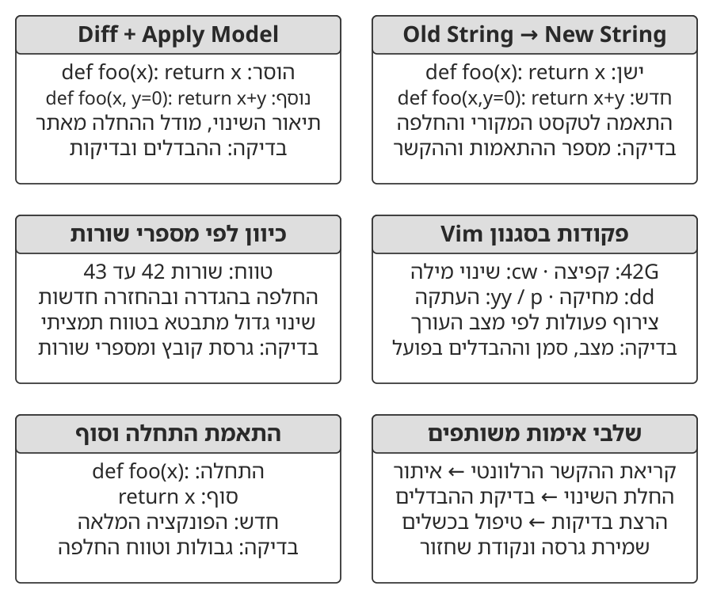

**תיאור דיף + Apply Model.** המודל הראשי מספק את כוונת השינוי ואת קטעי הקוד, למשל תיאור הוספות ומחיקות בדומה ל‑Git diff, או שלד קוד שמדלג על החלקים שלא שונו באמצעות סמני השמטה. מודל יישום ייעודי משלב אותם עם הקובץ המקורי ומייצר את התוכן המלא אחרי השינוי. Fast Apply המוקדם של Cursor הוא הנציג של גישה זו[^ch5-apply]. היא מחלקת בין שני מודלים את "הצעת השינוי" ואת "יישום השינוי". ככל שמודלי הבסיס השתפרו בייצור עריכות מקומיות מדויקות, נמצאו לתהליך הדו‑מודלי הזה חלופות פשוטות יותר.

חלוקת העבודה הזו מאפשרת למודל הראשי להתרכז בלוגיקת הקוד, ולמודל היישום — במיזוג השינוי המקומי לתוך הקובץ. בהתאם, הבדיקה מתמקדת בתוצאת המיזוג: כמה קטעים דומים עלולים ליצור עמימות במיקום, סמני ההשמטה עלולים להתפרש לא נכון, ואזורים שלא שונו עלולים להיכתב מחדש בטעות.

**מחרוזת ישנה ← מחרוזת חדשה (Old String → New String).** כלי ה‑Edit של Claude Code מבצע החלפת מחרוזות מדויקת; Cursor הכניסה בגרסה 0.50 במאי 2025 את Search & Replace, תחילה לעריכת קבצים ארוכים בידי מודלים של Anthropic[^ch5-direct-edit]. גישה זו מוסרת את בסיס המיקום ואת תוכן ההחלפה ישירות לביצוע בידי תוכנה, וחוסכת קריאה נוספת למודל בשלב המיזוג. המודל מספק `old_string` ו‑`new_string`, והכלי מאתר את הטקסט המקורי בקובץ ומחליף אותו. הממשק יכול לקבוע שהחלפה בודדת דורשת שהטקסט המקורי יהיה ייחודי; כשאין התאמה או שיש כמה התאמות, הכלי מחזיר מיקומים ואבחנות, והמודל משלים הקשר. כשנדרשת החלפה גורפת, מבטאים את ההיקף בפרמטר מפורש.

למשל, בקובץ תצורה כתוב אצל שני שירותים `timeout = 30`. רוצים לשנות רק את פסק הזמן של שירות ההורדה ל‑60 שניות. אם הכלי דורש התאמה ייחודית, מסירת `timeout = 30` בלבד תניב שתי התאמות, והקובץ צריך להישאר כמות שהוא. בבקשה הבאה המחרוזת הישנה כוללת גם את כותרת המקטע של שירות ההורדה וגם את שורת ההגדרה, והמחרוזת החדשה שומרת על הכותרת ומשנה רק את הערך.

התאמת תוכן היא אינטואיטיבית וקל לבדוק אותה. בקריאה, המודל צריך להפיק את המחרוזת הישנה במלואה: כשמוחקים קטע קוד גדול, הפרמטר ארוך מאוד; גם הבדלים זעירים ברווחים, בשורות חדשות ובמירכאות פוגעים בהתאמה. מקרה המירכאות המעוגלות של Unicode בפרק 4 הראה כיצד תקלה כזו מתרחשת בהעברת הפרמטרים.

**מיקום לפי מספרי שורות (Old Line Numbers → New String).** המודל מציין שיש למחוק את שורות X עד Y ולהכניס טקסט חדש. כשכלי הקריאה כבר מספק מספרי שורות אמיתיים, מחיקה של קטע גדול דורשת רק שני מיקומים, ההתחלה והסוף. משמעותם של מספרי השורות תלויה בגרסת הקובץ בזמן הקריאה, ועריכה קודמת עשויה להזיז את המיקומים שאחריה.

לכן עריכות מרובות יכולות להתייחס כולן לאותה תמונת מצב התחלתית, כשהכלי בודק חפיפה בין טווחים ומחיל את כולן יחד; אפשר גם לערוך אחת‑אחת, ולקרוא מחדש לפני כל מיקום. הכלי יכול גם לבדוק את גרסת הקובץ או את התוכן הצפוי, ולהחזיר התנגשות אחרי שינוי מקבילי, כדי שלא יוחלו מספרי שורות ישנים על תוכן קובץ חדש.

**פקודות עריכה בסגנון Vim.** פקודות עורך יכולות לבטא תנועה, העתקה, גזירה והדבקה, ומתאימות לפעולות ארגון מחדש כמו העברת פונקציה ממקום למקום. הן תלויות בסמן הנוכחי, במאגר ובמצב הפקודה, וכל צעד משנה את נקודת הייחוס של הפעולות הבאות.

**אין סיבה שהרגלי האינטראקציה של עורכים אנושיים יהיו עיצוב ברירת המחדל של כלי מודל.** אדם מעיף מבט במצב הנוכחי ומבצע פעולה קטנה אחת; מודל, לעומת זאת, יכול לחשוב זמן רב יחסית ולייצר בבת אחת עשרות ואף מאות שורות שינוי. פירוק שינוי גורף כזה להמון תנועות סמן ומעברי מצב מייקר את הקריאות, ודורש מהמודל לחזות כיצד הפקודות הקודמות ישפיעו על המצב. לכן, במשימות של יצירת קוד, המחבר מעדיף ממשקים המבטאים ישירות את יעד השינוי ואת תוכנו; כשמשתמשים בפקודות עורך, יש להגדיר במפורש את נקודת הייחוס של המצב ולהחזיר משוב בזמן.

**התאמת התחלה וסוף של מחרוזת (Old String Start + End → New String).** המודל מספק רק כמה שורות מההתחלה ומהסוף של האזור שיוחלף, והכלי מאתר את שני הגבולות ואת התוכן שביניהם. כשמוחקים מאות שורות קוד, שיטה זו מצמצמת את הטקסט המקורי שיש להפיק שוב, ובה בעת שומרת על מיקום מבוסס תוכן.

הכלי צריך לבדוק את סדר הופעתם של שני קטעי הטקסט, ולהחליט לפי מוסכמת הממשק אם להחליף גם את קטעי ההתחלה והסוף עצמם. מבצעים את ההחלפה רק כשטווח אחד בלבד עומד בתנאים; אם כמה טווחים מתאימים, מוסרים למודל את המיקומים ומבקשים ממנו להשלים הקשר. במבנים מקוננים או בקוד חוזר, הוספת עוגנים סמוכים כמו שם פונקציה או חתימה עוזרת לקבוע את הטווח.

**כשבונים סוכן קוד חדש, המחבר ממליץ להתחיל בממשק עריכה פשוט ודטרמיניסטי כמו מחרוזת ישנה ← מחרוזת חדשה.** מיקום הטקסט המקורי חד‑משמעי, קל להסביר את סיבת הכישלון, ואת ההבדלים קל לבדוק. כשהמודל מייצר שינויים מקומיים באמינות, ה‑Harness יכול להעביר יותר עבודה לתוכנה דטרמיניסטית ולוותר על מודל יישום נוסף. רק כשמחיקות גדולות מחייבות לצמצם את נפח הפרמטרים, מוסיפים עוגני התחלה‑וסוף או עריכה לפי מספרי שורות מבוססת תמונת מצב. ה‑`apply_patch` של Codex מדגים דרך נוספת של עריכה ישירה: טלאי מוגבל תחבירית המבטא כמה שינויים יחד.

[^ch5-direct-edit]: Anthropic,‏ *Tools reference*, כלי ה‑Edit;‏ Cursor, יומן העדכונים של גרסה 0.50, 15 במאי 2025, המתאר את הכנסת Search & Replace; יומן העדכונים של גרסה 1.3 מתעד גם את השיפורים ב‑Search & Replace וב‑Apply.

[^ch5-apply]: Cursor,‏ *Editing Files at 1000 Tokens per Second*, המתאר מודל ייעודי שמחיל תיאורי שינוי על הקובץ המקורי.

### אבטחה לסוכני קוד

סוכן קוד יכול לקרוא את הפרויקט, לשנות קבצים, להריץ תוכניות, ואף לגשת לשירותים חיצוניים דרך הרשת. בתכנון ההרשאות צריך לבדוק לאורך זרימת הנתונים שלוש שאלות: איזה תוכן ייכנס להקשר, אילו פעולות המודל יכול לבקש, ובאיזה מנגנון הפעולות האלה מאושרות ומבוצעות בסופו של דבר.

סיימון וויליסון סיכם סוג אחד של סיכוני הזרקת פרומפט ב"שילוש הקטלני": גישה לנתונים פרטיים, חשיפה לתוכן בלתי מהימן, ויכולת לתקשר החוצה[^ch5-trifecta]. למשל, עוזר שיכול לקרוא קבצים פרטיים, מעבד דוא"ל חיצוני ויכול גם לשלוח הודעות, זקוק לגבולות הרשאה מפורשים בין הקריאה, ההבנה והשליחה. ברגע שהוראות בתוכן חיצוני מתפרשות כבקשות המשתמש, הן עלולות לגרום להעברת נתונים שלא אושרה.

מעבר לשלושת הממדים האלה, המחבר ממליץ לבדוק ממד רביעי: **זיכרון מתמיד מגביר את השפעתה של הזרקת פרומפט**. אם תוכן חיצוני נכנס לזיכרון ארוך הטווח, השפעתו עלולה לחצות סשנים ולצוץ שוב במשימות מאוחרות. לכן כתיבה לזיכרון צריכה לתעד את המקור, את היקף התחולה ואת מצב האישור, ובקריאה יש לשמור על התכונות האלה. מהימנותו של טקסט השמור ב‑`MEMORY.md` עדיין תלויה בדרך שבה הוא נוצר. כשמתגלה רשומה שגויה, צריך גם להיות אפשר לאתר, לתקן ולבטל את התוכן הקשור.

שלושת מעקות הבטיחות מפרק 1 ממלאים כאן כל אחד תפקיד משלו: שכבת ההקשר מסמנת את מקור המידע ואת דרישות ההתנהגות, שכבת הביצוע מאמתת פעולות והרשאות, ושכבת הנתונים מגבילה קריאה וכתיבה של משאבים לפי זהות מהימנה. ארגז החול של Claude Code מגביל את הרצת הפקודות באמצעות גבולות של מערכת הקבצים ושל הרשת, וגם Cowork מריץ משימות מקומיות בסביבה מבודדת[^ch5-sandbox]. להלן נרחיב על המנגנונים האלה.

**הגבלת המשאבים והתקשורת בתוך ארגז החול.**

- **יציאה לרשת.** זהו גבול שקל להתעלם ממנו בארגז חול של קוד, ושיש לממש אותו ראשון. המחבר ממליץ להתחיל בחסימת גישה חיצונית כברירת מחדל, ולהתיר לפי צורכי המשימה מקורות חבילות, אתרי תיעוד ו‑API עסקיים. רשימת ההיתרים צריכה להתייחס ליעדים מוגדרים ולהיקף פעולות מוגדר; בשירותים משותפים יש להביא בחשבון גם חשבונות, דיירים ובעלות על משאבים. מדיניות הרשת צריכה לחול על התוכניות שהכלים מפעילים ועל תהליכי הבן שלהן, ונתונים היוצאים החוצה נבדקים בנפרד מול היקף ההרשאה.
- **מערכת הקבצים.** אפשר להתקין את קוד המקור המקורי לקריאה בלבד ולהעביר עותק למרחב עבודה בר‑כתיבה; אפשר גם שממשק עריכה מבוקר ייצר טלאי שיוחל לאחר סקירה. תוצרים וקובצי ביניים נשמרים בספרייה נפרדת, וקובצי אישורי גישה נשארים מחוץ לארגז החול. כשנדרשת גישה לשירות אימות, ממשק מבוקר מספק את היכולת שהמשימה צריכה, במקום למסור לתוכנית שנוצרה את כל אישורי הגישה של המארח.
- **משאבים וזמן.** קובעים תקרות ל‑CPU, לזיכרון, למספר התהליכים, לשטח הדיסק ולזמן הריצה, כדי להגביל את השפעתם של לולאות אינסופיות, ריבוי תהליכים בלתי מבוקר וכתיבה מתמשכת לדיסק. בחריגה מהתקרה מחזירים מצב מובנה, למשל "הביצוע חרג מ‑120 שניות והופסק", ומצרפים את הפלט שנשמר ואת תוצאת הניקוי, כדי שהמודל יוכל להחליט אם לצמצם את המשימה או לשנות את המימוש.

הגבולות האלה צריכים לכסות את שרשרת הביצוע כולה. גם אחרי שפקודה אושרה, התוכנית שהופעלה בפועל רצה באותו היקף הרשאות; תהליכי רקע, כלי עזר וממשקים חיצוניים צריכים להיכלל גם הם בבקרה המתאימה.

**ניתוח מבנה הפקודה ומשמעות הארגומנטים.**

פקודת Shell מורכבת משם תוכנית, ארגומנטים, הפניות קלט‑פלט, צינורות ותת‑ביטויים. בבדיקה יש לנתח את המבנים האלה, ורק אז לזהות את פעולות הקריאה, הכתיבה, ההרצה והתקשורת שהם כוללים. **רשימה שחורה של פקודות אינה מספיקה כהכרעת האבטחה הסופית.** אותה פעולה יכולה להתבטא בצירופי ארגומנטים שונים ובקריאות עקיפות, ולכן האימות חייב להבין את מבנה הפקודה ואת תפקיד הארגומנטים, והרשאות זמן הריצה הן שמגבילות את היקף הביצוע בפועל.

למשל, כלי לחיפוש קבצים עשוי לכלול ארגומנט שמריץ פעולה נוספת על כל התאמה, ואפשרות הפלט של כלי הורדה קובעת לאן ייכתב הקובץ. המאמת צריך לזהות "איזו אפשרות מקבלת את הארגומנט שאחריה כערך", לעקוב אחר תפקידו של הארגומנט, ואז לבדוק את נתיב היעד, את הרשאות הגישה ואת הפעולות המותרות. כך תוצאת הבדיקה יכולה להיות קונקרטית: "אילו קבצים נקראים", "לאיזה מיקום נכתב", "איזו תוכנית מופעלת".

הרחבת משתנים, סקריפטים דינמיים ונתיבים שנוצרים רק בזמן הריצה דוחים חלק מההתנהגות בפועל לרגע הביצוע. על החלקים שאי אפשר לקבוע מראש, ה‑Harness יכול לדרוש צורת קריאה מפורשת יותר, להעביר לבדיקה, או להריץ בסביבה מוגבלת. בדיקה בסיוע מודל מספקת שיפוט הקשרי, ובקרת גישה דטרמיניסטית מגבילה את ההשפעה בפועל. ה‑Sidecar שהוצג בפרק 4 יכול לרוץ במקביל לעבודת ההכנה, ופעולות בעלות השפעה חיצונית מוגשות רק אחרי שהבדיקה עברה.

**הגדרה ברורה של מי שהסוכן משרת בהאצלה רב‑צדדית.**

נאמנות למרשה (principal loyalty) עוסקת בשאלה כיצד סוכן הפועל בשם צד אחד, ובאותה עת מתקשר עם משתתפים אחרים, ממשיך לשמור על המטרות ועל ההרשאות של המרשה. למשל, המשתמש מבקש מהסוכן לנהל משא ומתן על מחיר עם ספק, ומגלה לו בחשאי שתקרת התקציב היא 12,000 יואן. הסוכן צריך להבין את הצעת המחיר של הספק ולהסביר את דרישות הצד שלו, ובה בעת להגן על האילוץ הפרטי הזה.

המחבר ושותפיו צפו בהערכות של אינטראקציות רב‑צדדיות בשני סוגי כשל: באחד הסוכן מדליף את המידע הפרטי של המרשה או נענה לדרישות בלתי ראויות של הצד שכנגד; בשני הוא מסרב יתר על המידה, ואינו מצליח להשלים אפילו בקשות רגילות של המרשה. אסטרטגיות הפרומפט ושיטות האימון שנבדקו הראו פשרה בין הגנה על מידע לבין שיתוף פעולה תקין[^ch5-1]. **יש למדוד נאמנות הן בהגנה על מידע והן בהשלמת המשימה.** מי שמכוון רק לסרב ליותר בקשות חוסם גם שיתוף פעולה תקין; מי שמכוון רק לשיחה שמסתיימת בהצלחה עלול לאפשר לצד שכנגד לפגוע באינטרסים של המרשה.

בסוכן קוד, קובצי המאגר, פלטי הכלים ותגובות של שרתי MCP של צד שלישי עשויים כולם להכיל מידע על המשימה, אך גם טקסט המבקש לשנות את התנהגות הסוכן. ה‑Harness צריך להבחין בין הוראות המרשה לבין חומר חיצוני לפי המקור האמיתי, לצרף להודעות את מקורן ואת תפקידן, ולמפות את היקף ההאצלה להרשאות ברות‑אכיפה. טקסט בחומר חיצוני המציג את עצמו כ"בקשת המשתמש" צריך לקבל אישור בערוץ מהימן.

הפרומפט יכול גם לפרט כללי עבודה: להגן על המידע הפרטי של המרשה, ולעיתים אף לשמור בסוד את עצם קיומה של רשומה; בהסברים כלפי חוץ לחשוף רק את ההכרחי; להבחין בין הקו האדום הפנימי לבין העמדה הפומבית; לקדם את המשימה בתוך ההיקף המורשה; ולהחיל אמת מידה עקבית להרשאה גם מול בקשות חוזרות. הרחבת הרשאה או שינוי בזהות מי שהסוכן משרת צריכים לקבל אישור בערוץ מהימן, ולהתעדכן במקביל בהרשאות זמן הריצה. כך המודל מקבל בסיס ברור להתנהגותו, והכלים והסביבה אוכפים את גבולות הגישה בפועל.

[^ch5-trifecta]: Simon Willison,‏ *The lethal trifecta for AI agents: private data, untrusted content, and external communication*, 16 ביוני 2025.
[^ch5-sandbox]: Anthropic,‏ *Making Claude Code more secure and autonomous with sandboxing* ו‑*How we contain Claude across products*, המתארים את גבולות הבידוד של מערכת הקבצים, של הרשת ושל המוצרים.
[^ch5-1]: Li, Bojie and Noah Shi,‏ *Whose Side Is Your Agent On? Multi-Party Principal Loyalty in LLM Agents*, 2026.

## קוד: המטא‑יכולת של סוכן כללי

הסעיפים הקודמים תרגמו את דרישות המשתמש לשינויי קוד. עכשיו נחזור לטבלת המכירות מתחילת הפרק: גם אם המשתמש צריך בסופו של דבר רק דוח, הסוכן יכול לכתוב תוכנית שמאחדת את מזהי המוצרים, מקבצת וסופרת, ואז מחשבת מחדש מהטבלה המקורית את שיעור ההחזרות של מוצר אחד. קודם יש לברר אם המשתמש רוצה לספור לפי יחידות או לפי הזמנות. נניח שממוצר מסוים נמכרו עשר יחידות בשתי הזמנות, ורק בהזמנה אחת הוחזרה יחידה אחת. לפי יחידות השיעור הוא 1/10, ולפי הזמנות שהייתה בהן החזרה הוא 1/2. שני החישובים ירוצו בהצלחה; רק אחרי שמבררים את ההגדרה אפשר לדעת איזה מספר עונה על שאלת המשתמש. תוכנית שנכתבה כך אפשר גם להריץ שוב כשיגיעו נתוני התקופה הבאה. מחזור זה של "ייצור, הרצה ואימות" מתרחב גם ליצירת תוכן, לאינטגרציה עם מערכות עסקיות ולפיתוח סוכנים.

> **מטא‑יכולת.** בספר זה, מטא‑יכולת (meta-capability) היא יכולת ליצור יכולות אחרות או להרכיב אותן. יצירת קוד יכולה לייצר כלים חדשים, כמו סקריפטים לעיבוד נתונים ורצפי קריאות API; לבטא אילוצים חדשים, כמו טענות וכללי אימות; ולבנות צורות הצגה חדשות, כמו טופסי HTML, מצגות וסרטונים.

נתחיל במקרה הפשוט ביותר. גם כשכל מה שצריך למסור הוא התשובה לשאלה אחת, המודל יכול לכתוב תוכנית קטנה כדי לבדוק את החישוב שלו.

### קוד ככלי חשיבה

**בחישובים מדויקים ובאילוצים פורמליים, המחבר מעדיף שהמודל יכתוב ביטוי בר‑הרצה וימסור אותו למפרש או לפותר.** ייצור תשובה מילה אחר מילה חשוף לשגיאות העתקה ולשגיאות חישוב, ועלול גם להשמיט תנאים; תוכנית מקבעת את הצעדים האלה ומאפשרת להריץ אותם שוב ושוב. משימות מתמטיות ולוגיות כוללות בדרך כלל שני שלבים: תחילה מתרגמים את הבעיה ליחסים ולאילוצים, ואז מחשבים את התוצאה. ה‑LLM יכול לעזור בהבנת הבעיה, בהצעת דרך פתרון ובכתיבת התוכנית, והמפרש או הפותר מבצעים את החישוב שנקבע.

למשל, בכיתה יש 40 תלמידים; 60% בחרו מתמטיקה, 45% בחרו פיזיקה, ו‑25% בחרו בשני המקצועות. כדי למצוא כמה בחרו רק פיזיקה, מחסירים ממספר בוחרי הפיזיקה את מספר הבוחרים בשני המקצועות: 18 − 10 = 8. מי שמשתמש בטעות במספר בוחרי המתמטיקה יקבל 24 − 10 = 14. השגיאה מתרחשת בשלב בחירת המחוסר.

כשכותבים את היחסים הכמותיים כמשתנים בעלי משמעות, אפשר לבדוק כל אחד בנפרד:

```python
math = 40 * 60 // 100       # 24 תלמידים בחרו מתמטיקה
phys = 40 * 45 // 100       # 18 תלמידים בחרו פיזיקה
both = 40 * 25 // 100       # 10 תלמידים בחרו בשני המקצועות
only_phys = phys - both     # 8 תלמידים בחרו רק פיזיקה
```

חישוב סמלי מרחיב את חלוקת העבודה הזו. הוא יכול לשמר צורה מדויקת כמו $\sqrt{2}$, ולשנות ביטויים לפי כללים אלגבריים. אם מעלים אותו ישירות בריבוע, התוצאה היא המספר השלם 2. אם מעגלים קודם ל‑1.414 ורק אז מעלים בריבוע, התוצאה היא 1.999396. כשהשאלה דורשת פישוט מדויק יש לשמר את הסמלים, וכשהיא דורשת לדווח ערך מדוד אפשר לחשב את הערך המספרי בסוף, ברמת הדיוק שנקבעה. וולפרם, כשדן בשילוב בין מודלי LLM לבין Wolfram|Alpha, הדגיש את ההשלמה ההדדית בין הבנת שפה לבין יכולת חישוב[^ch5-wolfram]. הסוכן יכול לתרגם תחילה את הבעיה בשפה טבעית לביטוי ב‑Wolfram Language או ב‑Python, לקרוא למערכת החישוב, ולהמשיך להסיק על סמך התוצאה.

משימות שונות דורשות כלים שונים. SymPy מתאימה לביטויים סמליים, למשוואות ולחשבון דיפרנציאלי ואינטגרלי; NumPy מספקת פעולות על מערכים ומטריצות; SciPy מספקת אלגוריתמים כמו אופטימיזציה נומרית.

> **ניסוי 5-3 ★★: פתרון בעיות מתמטיות בסיוע קוד**
>
> בניסוי זה אותו מודל Doubao פותר את 30 הבעיות של AIME 2024, ומושוות שתי דרכים: היסק ישיר והיסק בסיוע כלי Python. סביבת הכלים מספקת את SymPy,‏ NumPy ו‑SciPy, והמודל יכול לייצר תוכניות, לקרוא את תוצאות ההרצה ואז למסור תשובה סופית.
>
> בהרצה זו, ההיסק הישיר פתר נכון 11 בעיות, והסיוע בקוד — 16.

גם בעיות לוגיות אפשר לטפל כך. ניקח כדוגמה חידות אבירים ונוכלים: לכל תושב מגדירים משתנה בוליאני, שבו אמת פירושה אביר ושקר פירושו נוכל, ואז מתרגמים כל משפט לביטוי בוליאני. עבור דובר X, האילוץ הוא ש"X הוא אביר" שקול ל"הטענה של X אמיתית". למשל, אם A אומר "B הוא אביר", מתקבל `A == B`; אם A אומר "B הוא נוכל", מתקבל `A == (not B)`.

הפותר מחפש השמה שמקיימת את כל האילוצים, והמודל מפרש את ההשמה כזהויות הדמויות. אם הטענות סותרות זו את זו, אין השמה שמקיימת את התנאים; ייתכן גם שהטענות הנתונות מתירות כמה מערכי זהויות שונים.

> **ניסוי 5-4 ★★: היסק לוגי בסיוע פתרון אילוצים**
>
> בניסוי זה נבחרות ממערך הנתונים K&K ‏84 בעיות, בשכבות לפי מספר הדמויות, ומושווים הביצועים של אותו מודל Doubao בהיסק ישיר ובקריאה ל‑`python-constraint`. בדרך הקוד המודל צריך לזהות את משתני הדמויות, לתרגם את הטענות, ולקרוא לפותר כדי למצוא צירוף זהויות שמקיים את כל התנאים.
>
> בהרצה זו, ההיסק הישיר פתר נכון 63 בעיות, והסיוע בקוד — 33. בכל 84 מסלולי הקוד הופיעה פקודה לייבוא ספריית הפותר. באחת הבעיות המודל אפילו תיקן את התוכנית, אבל לא מסר תשובה.
>
> ניקח את הבעיה בת שתי הדמויות על James ו‑Sophia. ‏James אומר ש‑Sophia היא נוכלת; Sophia אומרת "James הוא אביר אם ורק אם James הוא נוכל". המשפט השני שקרי יהיה James אשר יהיה, ולכן Sophia היא נוכלת, ו‑James דובר אמת. התוכנית הראשונה שהמודל הגיש כתבה את התנאי הדו‑כיווני כ‑`james == not james`, ש‑Python אינו מסוגל לנתח. בקריאה השמינית לכלי, התוכנית כבר כללה `james == (not james)`, אבל התשובה הסופית נותרה ריקה, והבעיה בכל זאת לא נוקדה.

**כמה עבה צריך להיות ה‑Harness תלוי בגבול היכולת של המודל במשימה הספציפית.** בהיסק שהמודל כבר מבצע באופן יציב, צעד פתרון נוסף עשוי רק להוסיף תקורה; בחלקים שבהם המודל נוטה לטעות בחישוב, כדאי להעביר את העבודה לחישוב דטרמיניסטי. אבל הסיוע בכלים דורש גם שהמודל יבצע נכון את התרגום הפורמלי, ושגיאה בתרגום האילוצים הופכת את הבעיה המקורית לבעיה אחרת. וגם אחרי שהאילוצים תוקנו, העוזר עלול למצות את מספר הסבבים ולא להספיק למסור תשובה.

[^ch5-wolfram]: Stephen Wolfram,‏ *Wolfram|Alpha as the Way to Bring Computational Knowledge Superpowers to ChatGPT*, ינואר 2023.

### קוד כאילוץ לכללים עסקיים

אפשר לעגן כללים עסקיים בתהליך הביצוע באמצעות קוד. למשל, הכלל "ניתן לקבל החזר תוך 7 ימים מהרכישה" מחייב הכרעות נוספות: האם סופרים ימים קלנדריים או ימי עסקים, האם נקודת ההתחלה היא ביצוע ההזמנה, התשלום או המשלוח, והאם רגע הגבול עצמו נכלל. רק אחרי שהגורם העסקי מאשר את המשמעויות האלה, וכותבים אותן כתנאים וכמקרי בדיקה, יש לכלל בסיס יציב לביצוע.

נניח שבעל הכלל קבע: "הזמן שחלף מאז התשלום אינו עולה על 168 שעות". אפשר לכתוב שלושה מקרי בדיקה סמוכים: 167 שעות ו‑59 דקות אחרי התשלום, 168 שעות בדיוק, ו‑168 שעות ודקה אחת. מחסירים את רגע התשלום מרגע הגשת הבקשה כפי שנרשם בשרת, ואת שתי חותמות הזמן יש להביא קודם לאותו בסיס זמן. לפי הכלל הזה שני המקרים הראשונים עוברים והשלישי נדחה. אם בעל הכלל יחליט לספור ימים קלנדריים לפי מקום התשלום, יהיה צורך לבדוק מחדש גם את מקרי הבדיקה וגם את הקוד.

התיאור בשפה טבעית עוזר למודל להבין את המדיניות, להסביר למשתמש את הנימוקים ולחפש חלופות בגבולות ההרשאה, למשל לבדוק אם מותר לשנות את מועד הטיסה. האימות בקוד בודק את התנאים הקונקרטיים לפני פעולה קריטית, ומתאים לצירופים של תנאים רבים, לחישובי זמן ולהצלבה בין מקורות נתונים. המודל יכול לעזור לכתוב את קוד האימות, ובעל הכלל מאשר את משמעותו באמצעות סקירה ומקרי גבול; כשהכלל משתנה, מעדכנים יחד את התיאור, את המימוש ואת הבדיקות.

**הערך הראשון של כללים מקודדים הוא לעצור פעולות שגויות שגורמות נזק ממשי.** ביטול הזמנה, העברת כספים ומחיקת נתונים משנים את המצב העסקי, ותיקון בדיעבד עלול להיות יקר. המחבר ממליץ להכניס את האימות מול אמת הקרקע ישירות לממשק הביצוע, כך שכל הגשה תעבור דרך אותה מערכת כללים ולא ייווצר מצב שבו המודל שוכח לקרוא לכלי בדיקה נפרד. ממשק שאילתה נפרד עדיין שימושי להסבר המדיניות מראש; בשעת הביצוע קוראים מחדש את העובדות הנדרשות, בודקים אם המצב השתנה, ומנהלים את הפעולות שבהמשך בעזרת מנגנוני הטרנזקציות, האידמפוטנטיות והפיצוי שהוצגו בפרק 4.

**הפרמטרים מכוונים את הבדיקה; ההכרעה נשענת על עובדות מצד השרת.**

τ-bench חוקר קריאה לכלים וציות למדיניות בתרחישים כמו תעופה ומסחר אלקטרוני[^ch5-tau]. להלן נשתמש בהזמנת טיסות כתרחיש לימודי ונגדיר חמישה כללי ביטול: תחילה מוציאים מהכלל הזמנות שאחד ממקטעיהן כבר נוצל, ואחר כך בודקים את מועד ההזמנה, ביטול מצד חברת התעופה, מחלקת עסקים וביטוח. `cancellation_reason` מתעד את הסיבה שהמשתמש ציין בבקשה, `expected_*` מתעדים את העובדות שהמודל מצפה לראות, וההכרעה בפועל נשענת על מסד הנתונים העסקי ועל שעון השרת.

הקוד שלהלן מציג את ענפי המדיניות. שכבת הכניסה אחראית לאמת את זהות המבקש, את שיוך ההזמנה ואת ההרשאה לפעולה; שכבת הביצוע קוראת את המצב, בודקת את התנאים ומבצעת את הביטול בתוך טרנזקציה מבוקרת או מנגנון עקביות שקול, ושומרת רשומת ביקורת.

```python
def cancel_reservation(
    reservation_id: str,
    cancellation_reason: str,        # "change_of_plan", "airline_cancelled", "other"
    expected_cabin_class: str | None = None,  # אופציונלי: דרגת התא שהמודל מצפה לה
    expected_has_insurance: bool | None = None  # אופציונלי: מצב הביטוח שהמודל מצפה לו
) -> dict:
    """
    ביטול הזמנת טיסה.

    מדיניות ביטול (נאכפת בצד השרת לפי אמת הקרקע במסד הנתונים):
    - כלל 1: אין לבטל הזמנה שבה נוצל מקטע כלשהו
    - כלל 2: לאחר מעבר כלל 1, ניתן לבטל תוך 24 שעות מההזמנה
    - כלל 3: לאחר מעבר כלל 1, ניתן לבטל טיסה שחברת התעופה ביטלה
    - כלל 4: לאחר מעבר כלל 1, ניתן לבטל במחלקת עסקים
    - כלל 5: במחלקת תיירים בסיסית ובמחלקת תיירים הביטול מותנה בביטוח נסיעות

    לפני הקריאה יש לשלוף את פרטי ההזמנה ולבדוק את המדיניות סעיף אחר סעיף; הפרמטרים expected_*
    מציינים את הבסיס לשיקול דעתך, משמשים את השרת להשוואה ולביקורת בלבד, ואינם משפיעים על ההכרעה.
    """
    # קריאת העובדות הדרושות להכרעת המדיניות ממסד הנתונים העסקי
    r = db.get_reservation(reservation_id)
    now = server_clock.now()  # שימוש בשעון השרת

    # תיעוד פערים בין הערכים הצפויים לעובדות הנוכחיות, לצורכי אבחון וביקורת
    if expected_cabin_class is not None and expected_cabin_class != r.cabin_class:
        log_mismatch(reservation_id, "cabin_class", expected_cabin_class, r.cabin_class)
    if expected_has_insurance is not None and expected_has_insurance != r.has_insurance:
        log_mismatch(reservation_id, "has_insurance", expected_has_insurance, r.has_insurance)

    if r.any_segment_used:
        return {"success": False, "reason": "Cannot cancel with used segments"}

    hours_since_booking = (now - r.booking_time).total_seconds() / 3600
    if hours_since_booking < 0:
        return {"success": False, "reason": "Booking time is in the future"}
    if hours_since_booking <= 24:
        execute_cancellation(reservation_id)
        return {"success": True, "reason": "Cancelled within 24-hour window"}

    if r.flight_status == "cancelled_by_airline":
        execute_cancellation(reservation_id)
        return {"success": True, "reason": "Airline cancelled flight"}

    if r.cabin_class == "business":
        execute_cancellation(reservation_id)
        return {"success": True, "reason": "Business class cancellation"}

    if r.cabin_class in ["basic_economy", "economy"]:
        if r.has_insurance:
            execute_cancellation(reservation_id)
            return {"success": True, "reason": f"{r.cabin_class} with insurance"}
        return {"success": False, "reason": f"{r.cabin_class} requires insurance"}

    return {"success": False, "reason": "Does not meet cancellation policy"}
```

**הפרמטרים עוזרים למודל לבדוק סעיף אחר סעיף.** תיאור הכלי מונה את מדיניות הביטול ודורש לשלוף קודם את ההזמנה. המודל יכול למלא את דרגת התא ואת מצב הביטוח ב‑`expected_cabin_class` וב‑`expected_has_insurance`, וכך הבסיס לשיקול דעתו מופיע ברשומת הקריאה. הפרמטרים האופציונליים מספקים נקודת כניסה לבדיקה, אבל כדי לדעת אם השאילתה והבדיקה אכן בוצעו יש לבחון את המסלול. אם התהליך מחייב שאילתה מוקדמת, ה‑Harness יכול לבדוק את רשומת השאילתה ואת תוקפה.

לדוגמה, אם עברו יותר מ‑24 שעות מההזמנה, הטיסה מתקיימת כסדרה, הכרטיס במחלקת תיירים ולא נרכש ביטוח, המודל יכול להסביר על סמך זה שלפי המדיניות שבדוגמה אי אפשר לבטל, ולבדוק אפשרויות מותרות כמו שינוי מועד.

**השרת מפעיל את הכללים לפי העובדות הנוכחיות.** דרגת התא, הביטוח, מועד ההזמנה, ניצול המקטעים ומצב הטיסה נקראים כולם ממקור הנתונים העסקי; חלון הזמן מחושב לפי שעון השרת. הפערים ב‑`expected_*` משמשים לאבחון, ו‑`cancellation_reason` מתעד את כוונת הבקשה. עובדות כמו ביטול הטיסה על ידי חברת התעופה מאומתות בצד השרת: משתמש שכותב בבקשה "חברת התעופה ביטלה" אינו הופך בכך כרטיס שאינו ניתן להחזר לכרטיס שניתן להחזר.

את עצמאות מקור הנתונים יש לעגן גם בבקרת הגישה: מי רשאי לשנות את עובדות ההזמנה, מתי הן מתעדכנות וכיצד נשמרת ההיסטוריה — כל אלה משפיעים על אמינות האימות. פעולות מקביליות עלולות לשנות את המצב אחרי השאילתה, ולכן בעת הגשת ההחזר השרת קורא שוב את מצב ההזמנה, מוודא שהכרטיס עדיין זכאי להחזר, ומחזיר תוצאה עקבית לבקשות כפולות.

> **ניסוי 5-5 ★★: מודל קטן וכללים עסקיים מקודדים**
>
> הניסוי משתמש ב‑Qwen3-4B ומשווה בין שני מימושים על 60 מקרי החזר קבועים בתחום התעופה. בשתי הקבוצות המודל מקבל את המדיניות בשפה טבעית; בקבוצת הבקרה כלי הביטול מחזיר את הכסף מיד עם הקריאה, ואילו בקבוצה המקודדת הכלי קורא לפני הביצוע ממסד נתונים מדומה ומשעון השרת ובודק את הזכאות להחזר.
>
> הניסוי משתמש במדיניות מפושטת: מחלקת תיירים גמישה ומחלקת עסקים זכאיות להחזר; מחלקת תיירים בסיסית זכאית להחזר תוך 24 שעות מההזמנה, או כשחברת התעופה ביטלה את הטיסה או כשיש עיכוב משמעותי. פרמטרי הבדיקה הם `expected_refundable` ו‑`expected_reason`, והם מתעדים את הערכת המודל לגבי הזכאות להחזר ולגבי הסיבה.
>
> בניקוד בודקים קודם אם הכסף הוחזר, ואחר כך משווים לשאלה אם לפי המדיניות הכרטיס היה זכאי להחזר. לפי אמת מידה זו קבוצת הבקרה טיפלה נכון ב‑57 מקרים והקבוצה המקודדת ב‑55. אף אחת מהקבוצות לא החזירה כסף לנוסע שאינו זכאי; כל הנקודות שאבדו נבעו מהזמנות שהיו זכאיות להחזר ולא קיבלו אותו: 3 מקרים בקבוצת הבקרה ו‑5 בקבוצה המקודדת. לנוסע חשוב גם אם הנציג הסביר את הסיבה ומה עוד אפשר לעשות אחרי הסירוב. הניסוי בודק בנפרד את הסבר המדיניות ואת החלופות שבתשובה הסופית, ובדיקות אלה אינן נכללות בציון ההחזר שלעיל.

[^ch5-tau]: Sierra Research, τ-bench: A Benchmark for Tool-Agent-User Interaction in Real-World Domains; מספק מדיניות, כלים ומשימות אינטראקציה בתרחישי תעופה ומסחר אלקטרוני.

### יצירה רב‑מדיה מונעת קוד

מצגות, דוחות טכניים ודפים אינטראקטיביים כרוכים כולם בשתי עבודות: ארגון התוכן והצגתו החזותית. הסוכן יכול לכתוב קודם את המבנה כקוד או כשפת סימון, ואחר כך לקרוא לכלי רינדור שמפיק תוצר שאפשר לצפות בו. לדוגמה, HTML מבטא את מבנה הדף, CSS שולט בפריסה ובעיצוב, ו‑JavaScript מממש את האינטראקציה. כך מיקומם ועיצובם של האלמנטים הופכים לפרמטרים הניתנים לשינוי, ונוח לכוונן אותם בבת אחת, להפיק אותם שוב ושוב ולהשוות בין גרסאות.

יצירה תכנותית מתאימה לתוכן מובנה שצריך לשנות שוב ושוב. ממשק GUI מספק נקודת כניסה לצפייה ישירה ולפעולות מקומיות, ואפשר לשלב בין שתי הדרכים.

**סוכן יצירת מצגות.**

הרצאה אקדמית צריכה לארגן את הבעיה, השיטה, הניסויים והמסקנות של המאמר להסבר שמתפתח שקופית אחר שקופית. הסוכן יכול לתכנן קודם על איזו שאלה עונה כל שקופית, אחר כך לבחור נקודות מפתח ותרשימים, ולבסוף לייצר את קוד המקור של השקופיות. Slidev משתמש ב‑Markdown כנקודת הכניסה לתוכן ותומך ב‑HTML וברכיבי Vue, ולכן מתאים לארגן את התהליך הזה כזרימת יצירה ברת‑הרצה[^ch5-slidev].

אם המארגנים סיפקו כדוגמה מצגת משנה קודמת, אפשר גם לאמץ ישירות את מבנה השקופיות שלה. PPTAgent מנתח תחילה את תפקידה של כל שקופית במצגת הייחוס, בוחר לכל חלק במתווה החדש שקופית ייחוס מתאימה, ומשנה את האובייקטים שבה באמצעות קוד. למשל, אם המצגת החדשה צריכה להציג תוצאות ניסוי, אפשר לבחור שקופית שנועדה מלכתחילה להציג שתי קבוצות תוצאות זו לצד זו, ולהחליף בה את התמונות ואת ההסברים. שימוש חוזר כזה מחייב גם בדיקה: שתי התמונות כבר הוחלפו בתוצאות הניסוי הנוכחי, אבל האם הפסקה שלצידן עדיין מסבירה את הניסוי של השנה שעברה? בגרסה שבמאמר, תיבות הטקסט משתנות לפי מספרי האלמנטים והפסקאות. אם מחליפים רק את התמונה, ההסבר הישן נשאר בשקופית.[^ch5-pptagent]

[^ch5-pptagent]: Zheng ואחרים, המאמר על PPTAgent, ‏EMNLP 2025. הקוד הנלווה למאמר מממש ב‑`pptagent/apis.py` ממשק לעריכה לפי פסקאות.

גם כשהטקסט והתמונות הוחלפו נכון, הפריסה עדיין עלולה להשתבש. למשל, אם מוסיפים לתרשים הסבר בן שתי שורות, הקומפילציה עוברת, אבל הטקסט עלול לכסות את הצירים. באיור 5-5, הסוקר רואה את צילום המסך המרונדר, ורק כך הוא יכול להחזיר הערה כזו למציע האחראי על הפריסה.

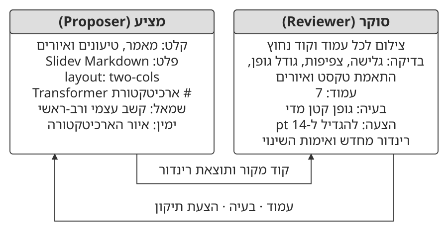

- **המציע (Proposer)** קורא את המאמר, מתכנן את מבנה ההסבר, כותב את קוד המקור של Slidev ומתקן את השקופיות לפי המשוב.
- **הסוקר (Reviewer)** מרנדר את השקופיות באמצעות כלי, משתמש במודל ראייה כדי לבדוק צפיפות תוכן, קריאוּת, פריסה והתאמה בין תמונה לטקסט, ומחזיר משוב מובנה הכולל מספר שקופית, סוג בעיה, חומרה והצעה לתיקון.

המשוב צריך להנחות את התיקון באופן ישיר. למשל: "בשקופית 3 יש יותר מדי נקודות; לפצל לשתי שקופיות — סקירת השיטה ושלבי החישוב"; "בשקופית 7 גופן הקוד קטן מדי; להגדיל תחילה ל‑14 pt ואז לבדוק קריאוּת בהקרנה". קודם מתקנים טעויות עובדתיות ופרשנות שגויה של תרשימים, ורק אחר כך מטפלים בפריסה ובפרטים החזותיים.

שינוי מקומי צריך גם לציין איזה אובייקט משנים. Doubao Work במצגות של Feishu מאפשר למשתמש לבחור אלמנט בשקופית ולבקש עריכה דרך סרגל כלים צף.[^ch5-doubao-work] נניח שבאותה שקופית יש שתי תיבות טקסט: באחת ציטוט מקורי מראיון, ובשנייה סיכום שכתב המציג. המשתמש בוחר את הסיכום ומבקש "לקצר לשתי שורות". תיבת הטקסט שנבחרה תוחמת את היקף השינוי: מותר לנסח מחדש את הסיכום, ואילו הציטוט שלצידו צריך לשמור על דברי המרואיין כלשונם.

[^ch5-doubao-work]: מרכז העזרה של Feishu, שימוש ב‑Doubao Work במצגות.

אחרי שהמציע מתקן, השקופיות מרונדרות מחדש, והסוקר בודק את הגרסה החדשה ומוודא שהבעיות מהסבב הקודם נפתרו. ללולאה שני סוגי תנאי יציאה: עמידה בדרישות מפורשות של תוכן ופריסה, או מיצוי התקציב של סבבים, זמן ועלות — למשל עד 5 סבבי תיקון. במסירה שומרים את הגרסה הנוכחית ואת הבעיות שעדיין פתוחות, כדי להקל על סקירה בהמשך.

דפוס המציע–סוקר משותף לכאן ולאישור הפעולות של פרק 4. אישור פעולות קובע בעיקר אם פעולה מסוימת מותרת לביצוע; סקירת תוכן משפרת את התוצר באמצעות משוב בכמה סבבים. בשני המקרים יש לשתף את דרישות המשימה, לתת בסיס להכרעה שאפשר לאתר במדויק, ולהשאיר ל‑Harness את ההחלטה על המשך התהליך. שימוש במשפחת מודלים אחרת יכול לספק זווית סקירה נוספת.

**המחבר רואה את היתרון של חלוקת העבודה בין שני סוכנים בניהול ההקשר.** כל אחד משני התפקידים שומר רק את המידע שהוא זקוק לו: הסוקר מקבל בכל סבב את צילום המסך העדכני, את קריטריוני הסקירה ואת רשימת הבעיות ההכרחית; המציע שומר את קוד המקור, את יעדי התיקון ואת המשוב הטקסטואלי המובנה. תמונות השקופיות נשארות בהקשר של הסוקר, והמסלול הראשי מקדם את התיקונים באמצעות משוב טקסטואלי קצר. כל סבב סקירה מתמקד בגרסה העדכנית של השקופיות, וכך פוחתת ההפרעה של צילומי מסך ישנים ונבלמת צמיחת ההקשר.

> **ניסוי 5-6 ★★: יצירה אוטומטית של מצגת ממאמר**
>
> הניסוי משתמש בקובץ ה‑PDF של המאמר "Attention Is All You Need" ומייצר מצגת Slidev בת 20 שקופיות. הסוכן מחלץ את מבנה המאמר ואת נקודות המפתח שלו, משתמש בשלושה איורים מהמאמר המקורי שמקורם מתועד, ומארגן את ההסבר שקופית אחר שקופית. אחרי הרינדור בודקים גלישת טקסט, קריאוּת של תרשימים והתאמה בין תמונה לטקסט, ומתקנים לפי המשוב.
>
> משווים בין סקירה עצמית של סוכן יחיד לבין חלוקת עבודה בין מציע לסוקר. בהרצה זו שתי המצגות הסופיות קיבלו 95 נקודות באותו תהליך ניקוד עצמאי; שיא הקלט בחלוקת העבודה היה כ‑24 אלף טוקנים, ובגישת הסוכן היחיד ששומר צילומי מסך היסטוריים — כ‑93 אלף טוקנים.

> **ניסוי 5-7 ★★: יצירה אוטומטית של סרטון הסבר על מאמר**
>
> על בסיס השקופיות, הסוכן יכול לכתוב לכל שקופית הסבר בשפה מדוברת, שמבאר את האובייקטים שבאיור, את היחסים ביניהם ואת המסקנות, ואחר כך לקרוא ל‑TTS כדי לסנתז דיבור. התסריט נמסר יחד עם השקופיות לסוקר חזותי, שבודק אם האלמנטים שהקריינות מזכירה אכן מופיעים בתמונה, ואם התיאור תואם את התרשים.
>
> להפקת הסרטון השתמש הניסוי באותה זרימת יצירה מהסעיף הקודם, ובחר טיוטה מוקדמת יותר בת 22 שקופיות (v2). אחרי שנבחרו 12 שקופיות לפי הסדר, התמונה האחרונה בסרטון לקוחה משקופית 21 של הטיוטה המקורית. בהשוואת הציון והצריכה בסעיף הקודם שימשה הטיוטה המאוחרת יותר, בת 20 שקופיות (v9). אחרי בחירת השקופיות, Kimi כתב את התסריט, מודל הראייה של Qwen סקר את היחסים בין התמונה לטקסט, ו‑Fish Audio סינתז את הקריינות לכל שקופית. FFmpeg קבע את זמן ההצגה של כל שקופית לפי האורך בפועל של קטע השמע שלה, והרכיב סרטון הסבר של כ‑8.6 דקות.
>
> באיור 5-6, השקופיות, התסריט והקריינות מורכבים לסרטון רק בשלב האחרון. יש בעיות שאפשר לשמוע רק בשלב הזה: האם משפט עדיין לא הסתיים כשהשקופית מתחלפת, והאם ככל שהסרטון מתקדם הקול והתמונה מתרחקים זה מזה.
>
> 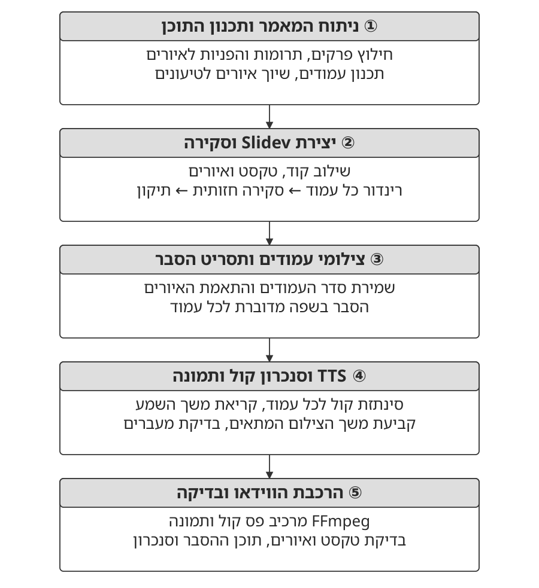

[^ch5-slidev]: Slidev, *Getting Started*; מתאר יצירה, הצגה וייצוא של מצגות על בסיס Markdown וטכנולוגיות Web.

**סוכן עריכת וידאו.**

**פעולות עריכת וידאו שאפשר לבטא בסקריפט צריכות לעבור קודם כול דרך ממשק תכנותי.** ציר הזמן, השכבות, הכתוביות ופסי השמע פזורים על פני לוחות GUI מורכבים, ואיתור וגרירה חוזרים ונשנים מוסיפים השהיה ושגיאות; ממשק תכנותי מבטא את הפעולה ישירות בטווחי זמן, ברצועות ובפרמטרים של אפקטים. ממשק ה‑Python של Blender ו‑FFmpeg מאפשרים שניהם לארגן חלק ממשימות העריכה כסקריפטים שאפשר להריץ שוב ושוב.

הסוכן יכול קודם להבין בקשה כמו "תחתוך את קטע הגלישה", אחר כך לאתר את טווח היעד בחומר הגלם, ולייצר קוד לחיתוך, לסידור ולעיבוד פסי השמע. המציע אחראי על תוכנית העריכה ועל הסקריפט, והסוקר בודק את התוצאה המרונדרת; כשהוא מוצא השמטה, קטע לא רלוונטי או כתובית שמסתירה את התמונה, הוא מחזיר נקודת זמן ובעיה ספציפיות, והמציע מתקן. פריימי מפתח מתאימים לבדיקת הסצנה והפריסה, אבל רציפות התנועה וסנכרון הקול והתמונה מחייבים לבדוק פריימים סמוכים או קטעים רציפים.

> **ניסוי 5-8 ★★: עריכת וידאו חכמה מבוססת API**
>
> הניסוי מחבר לזרימה אחת את איתור היעד, יצירת הסקריפט וסקירת התוצאה. תחילה מוסרים לתת‑סוכן לניתוח וידאו את ההפניה לסרטון, את שאלת היעד ואת מרווח דגימת הפריימים; הוא מעבד את כמות הפריימים הגדולה ומחזיר לסוכן הראשי טווח זמן ואת הנימוק לו.
>
> האיתור נעשה בשני שלבים. בשלב הראשון דוגמים פריים אחד כל 10 שניות כדי למצוא את הטווח המשוער של היעד, למשל "הגלישה בשניות 40–110"; בשלב השני דוגמים פריים אחד בשנייה סביב הטווח המועמד והגבולות הסמוכים לו, כדי לקבוע במדויק את נקודות ההתחלה והסיום. סצנה הקצרה ממרווח הדגימה הגס עלולה ליפול בין שני פריימים; אפשר להגדיל את קצב הדגימה לפי משך היעד, או לחזור ולבדוק את הקטע שבין שתי דגימות.
>
> אחרי קביעת הטווח, המציע מייצר סקריפט Python ל‑Blender שמבצע את החיתוך ואת הפעולות הנדרשות, כמו כתוביות ושינוי מהירות. הסוקר צופה בתצוגה המקדימה ומצביע על גבולות ועל אפקטים שדורשים כוונון; רק אחרי שהתיקון מאושר מפיקים את הסרטון המלא.
>
> בפועל נחתך קטע שבו ארנב לבן גדול חוצה לבדו כר דשא. בדגימה של פריים כל 10 שניות, המודל קבע את הטווח בין שנייה 10 לשנייה 20. אילו החיתוך היה מתחיל ישירות בשנייה 10, תחילת הקטע הייתה הולכת לאיבוד. לכן התוכנית הרחיבה את הטווח ב‑5 שניות לכל כיוון, דגמה פריים בכל שנייה בין שנייה 5 לשנייה 25, וצמצמה את הטווח המועמד לשניות 9 עד 12. הסוקר גילה שהקטע כולל גם תמונות מסצנה סמוכה, והטווח המתוקן נקבע ל‑9.25 עד 11.00 שניות. בהשוואה לסימון הידני, 9.08 עד 11.20 שניות, ההתחלה מאוחרת ב‑0.17 שניות והסוף מוקדם ב‑0.20 שניות, ושני הקצוות עומדים בדרישה לשגיאה של עד 3 שניות.
>
> קוד הזמן בודק רק היכן נחתך הקטע. אם מלבישים את אותן כתוביות ואת אותו הילוך איטי על קטע שנבחר בכוונה באופן שגוי, האם הסוקר עדיין יזהה את הטעות? הניסוי מבקש ממנו לבדוק תחילה קטע ביקורת משניות 0 עד 3, ואחר כך את הרינדור המתוקן. הסקירה כוללת את הארנב הלבן שבתמונה, את הכתוביות בתחתית ואת המשך אחרי שינוי המהירות.

**תלת‑ממד וחלקים תעשייתיים: בחירת דרך היצירה המתאימה.**

**לחלקים תעשייתיים שבהם המידות ויחסי ההרכבה הם אילוצים קשיחים, עדיף לייצר קוד פרמטרי; לעצמים שעיקרם צורה טבעית ומראה, עדיף לשקול מודל גנרטיבי.** הבחירה תלויה בשאלה אם אפשר לתאר את התוצר במדויק בכמה פרמטרים, ואילו יחסים צריכים להישמר אחרי שינוי. CadQuery, ‏OpenSCAD וסקריפטים של Blender מספקים תהליך בנייה הניתן לעריכה, ואילו מודלים כמו Hunyuan 3D מנצלים ידע מוקדם על צורות, שנלמד באימון, כדי לייצר מראה מורכב.

**האם התיאור מתאים לפרמטריזציה.** את היחסים הגאומטריים העיקריים של אוגן מפושט אפשר לבטא באמצעות קוטר חיצוני, עובי, קוטר מעגל החורים, קוטר החור ומספר החורים. הקוד מצמיד את הפרמטרים לשלבי הבנייה, ולכן מתאים לכוונון חוזר. עציץ, אבן נוי מאגם טאי או פני אדם מכילים לעומת זאת כמות גדולה של צורות לא סדירות; מודל גנרטיבי יכול לעזור לבנות את המראה, וגם שיטות תכנותיות יכולות לייצר פרטים בעזרת כללי צמיחה, תהליכים אקראיים והרכבת נכסים.

**כיצד בודקים את הדיוק.** דרישה כמו קוטר חור 5 מ"מ וסבולת ±0.05 מ"מ מחייבת קודם להגדיר יחידות, מערכת צירים ושיטת מדידה, ורק אז להשוות את מידות המודל למפרט. במודל פרמטרי אפשר לבדוק ישירות את האובייקטים הגאומטריים; ברשת אפשר למדוד באמצעות חתכים, חורים, מידות התיבה החוסמת וכדומה, ולהביא בחשבון את שגיאת הדיסקרטיזציה.

**כיצד שומרים ומשנים.** B-rep (ייצוג גבולות) מתאר את גבולות המוצק באמצעות פאות, קצוות וקודקודים, ואילו רשת משולשים מקרבת את פני השטח באמצעות פאות קטנות. CadQuery יכול לייצא STEP להעברת נתוני CAD, וגם לייצא רשת STL; הפרמטרים הניתנים לעריכה ולוגיקת הבנייה נשמרים בקוד המקור של CadQuery[^ch5-cad]. כניסה לתהליך עיבוד CNC דורשת בנוסף תכנון תהליך, מסלולי כלי חיתוך והתאמה למכונה.

לדוגמה, כדי להעביר את חורי ההרכבה מהתאמה ל‑M5 להתאמה ל‑M6, משנים את פרמטר קוטר החור, מייצרים מחדש ובודקים שוב שהקוטר החיצוני, העובי ומיקומי החורים נשארו כשהיו. במודל גנרטיבי, דרך השינוי תלויה ביכולות הממשק: אפשר לייצר מחדש, ואפשר לשלב עריכה מקומית ועיבוד גאומטרי בהמשך.

כשמשלבים את שתי הדרכים, גם חלוקת העבודה צריכה להיות ברורה: המידות ויחסי ההרכבה — לקוד הפרמטרי, המרקם והמראה החופשי — למודל הגנרטיבי. **כשמידות קריטיות צריכות להשתנות במדויק שוב ושוב, תהליך בנייה הניתן לעריכה שווה יותר ממראה שנוצר בבת אחת.**

> **ניסוי 5-9 ★★: שתי דרכים לייצר את אותו החלק — קוד מול מודל גנרטיבי**
>
> הניסוי דורש לייצר אוגן בקוטר חיצוני 80 מ"מ ובעובי 10 מ"מ, עם ארבעה חורי הרכבה בפיזור אחיד על מעגל חורים בקוטר 60 מ"מ. כדי שמשמעות ההרכבה תהיה ברורה, המפרט ההתחלתי משתמש בחורים עוברים של 5.5 מ"מ המתאימים ל‑M5, ובקשת השינוי מעבירה אותם לחורים עוברים של 6.5 מ"מ המתאימים ל‑M6.
>
> בדרך הקוד, המודל מייצר תוכנית CadQuery, וההרצה מייצאת STEP ו‑STL; בדרך המודל הגנרטיבי מייצרים קודם תמונת ייחוס של המוצר, ואותה מוסרים ל‑Hunyuan 3D ליצירת רשת. בודקים את הקוטר החיצוני, העובי, מספר החורים, קוטר החור, מיקומי החורים ומשטח ההרכבה, ומתעדים את היחידות ואת כיוון הצירים.
>
> איך יודעים שהמודל שינה רק את המידה שהתבקשה? בהשוואת קובצי ה‑STL שיוצאו לפני השינוי ואחריו, הקוטר הממוצע של ארבעת חורי ההרכבה גדל מ‑5.499 מ"מ ל‑6.499 מ"מ; בשני החלקים הקוטר החיצוני 80 מ"מ והעובי 10 מ"מ, וקוטר מעגל החורים, בדיוק של שלוש ספרות אחרי הנקודה, הוא 60.000 מ"מ בשניהם. לרשת הגולמית של דרך המודל הגנרטיבי אין קנה מידה פיזי מוגדר. תוכנית המדידה לקחה חתך אמצעי לאורך ציר Z ולא מצאה את הטבעת הפנימית של החורים. כדי לברר אם ארבעת החורים עוברים לכל עובי האוגן, צריך קודם לזהות את משטח ההרכבה ולקחת חתכים בעומקים שונים לאורך הנורמל שלו. אחרי יצירה מחדש השתנו גם הצורה הכוללת וגם הכיוון.
>
> לבסוף, שאלה מסוג אחר: אם צריך למסור תמונה של עציץ שנראה טבעי, איך מאשרים אותה? הניסוי צייר עציץ אחד ב‑matplotlib ויצר עציץ אחר ב‑Gemini, ואז ביקש מאותו מודל ראייה לדרג את הטבעיות בסולם של עשר. התמונות קיבלו 3 ו‑8 נקודות בהתאמה. הציון הזה עונה על השאלה איזו תמונה נראית למודל השופט דומה יותר לצמח אמיתי. ובחזרה לאוגן: גם אם תמונת המוצר נראית כאילו יש בה ארבעה חורים, ההרכבה עדיין מחייבת לבדוק את מיקומם ואת קוטרם בחלק התלת‑ממדי.

[^ch5-cad]: CadQuery, *Importing and Exporting Files*; מתאר פורמטים כמו STEP ו‑STL, ומבהיר שהמידע הפרמטרי המלא נשמר בקוד המקור ב‑Python של CadQuery.

### קוד כמתאם מערכת

לשירותים חיצוניים יש ממשקים, שיטות אימות ופורמטי נתונים שונים. הסוכן יכול לקרוא את התיעוד ודוגמאות של תגובות, לייצר לקוח HTTP, להגדיר כותרות אימות, לנתח את ערכי ההחזרה, ולהמיר את השדות שמגיעים מהמערכת במעלה הזרם למבנה שהמערכת במורד הזרם צריכה. הקוד ממלא כאן תפקיד של התאמת מערכות, ומרכיב משירותים קיימים זרימת משימה חדשה.

לדוגמה, אם שדה הסכום שנקרא משירות התשלומים נמדד בפֶן, מאית היואן, והדוח מציג יואנים, הצלחה בניתוח ה‑JSON מראה רק שהפורמטים תואמים. עסקה של 25 יואן מופיעה במעלה הזרם כמספר השלם 2500. אם מעתיקים את המספר הזה ישירות לדוח, 25 יואן הופכים ל‑2500 יואן.

מתאם צריך להגדיר במפורש קלט ופלט, טיפול בשגיאות וטווח גרסאות. הדוגמאות עוזרות למודל להבין את השדות, ואילו חוזה הממשק והבדיקות בודקים ערכים חסרים, עימוד, תגובות חריגות ושינויי גרסה. את אישורי הגישה מנהלת סביבת ההרצה, והקוד שנוצר משתמש ביכולות המורשות דרך ממשק מבוקר. אחרי שהאימות עובר, אפשר לשמור את המתאם ולהשתמש בו שוב; כשהפורמט משתנה בהמשך, הוא חוזר לתהליך שינוי.

גם במערכות שיש להן רק ממשק גרפי אפשר לנקוט גישה דומה. הסוכן משלים קודם את המשימה באמצעות Computer Use, שמוצג בפרק 6, ואחר כך מקבע את שלבי הפעולה היציבים ככלי RPA. כשפקדי הממשק, מצב ההתחברות או זרימת הדפים משתנים, הכלי צריך לזהות את הסטייה ולאתר מחדש את היעד. פרק 9 ידון בהרחבה בחילוץ, באימות ובשימוש חוזר בזרימות עבודה ממסלולים מוצלחים.

**ניתוח וויזואליזציה של יומני סוכן.**

משימה מורכבת אחת עשויה לכלול בקשות רבות למודל, הרצות כלים ואינטראקציות עם תת‑סוכנים. תצוגת הסקירה של היומן מציגה את היחסים בין השלבים, את מצבם ואת משכם, ופתיחת שלב מציגה את הקלט והפלט הקונקרטיים שלו, כדי לעזור לקורא לעקוב אחר מה שקרה בשלב מסוים. שדות חדשים, מבנים מקוננים וגרסאות פורמט משפיעים כולם על הניתוח ועל התצוגה.

ניתוח מסתגל מטפל בשינויים האלה באמצעות לולאה של "זיהוי שינוי — יצירת מנתח — אימות התוצאה". כשהניתוח נכשל, המערכת שומרת את הדוגמה הגולמית, את מיקום השגיאה ואת השדות הצפויים, ואז משווה לחוזה הממשק ולגרסת התוכנית המייצרת כדי לקבוע אם השינוי צפוי. רק אחרי שמאשרים שמדובר בשדרוג פורמט, הסוכן כותב מנתח חדש. אם התקלה היא בתוכנית שכותבת את היומן, שומרים את היומן הגולמי ומדווחים על התקלה, כדי שהמנתח החדש לא יתייחס גם לשגיאה כאל פורמט תקין. הקוד החדש רץ תחילה בסביבה מוגבלת: קודם בודקים את השדות ואת משמעותם, ואחר כך מאמתים אותו בדוגמאות תקינות, בדוגמאות עם שדות חסרים ובמקרי רגרסיה של הפורמט הישן. אם הוא עובר, רושמים את המנתח החדש ושומרים את הגרסה ואת הפורמטים שהוא חל עליהם; הדוגמאות שנכשלו נשמרות, כדי שאפשר יהיה לעקוב אחריהן ולנסות שוב.

לניתוח ולתצוגה יש שיטות בדיקה נפרדות. תוכנית בודקת חותמות זמן, מצבים, טיפוסים מספריים וקישור בין קריאות; רינדור בדפדפן בודק שהדף פועל כראוי, ומודל ראייה עוזר לבדוק שהטבלאות, ציר הזמן והתוויות ברורים. בעדכון חם שומרים את הגרסה הקודמת ונקודת כניסה לחזרה אליה, כך שהתמיכה בפורמטים חדשים נכנסת למערכת הפעילה בהדרגה.

> **ניסוי 5-10 ★★★: מערכת ניתוח יומנים מסתגלת**
>
> הניסוי מריץ תחילה שני תהליכים המייצרים יומנים, האחד בפורמט מופרד בקווים אנכיים והשני בפורמט של סוגריים מקוננים. המנתח ההתחלתי אינו מצליח לטפל בדוגמאות האלה; המערכת מבקשת אז מהמודל לייצר שתי פונקציות ניתוח, טוענת אותן בעדכון חם אחרי שעברו את הבדיקות, ומנתחת את היומנים שנכשלו קודם.
>
> בפורמט הראשון מחלצים את `timestamp`, ‏`level`, ‏`module`, ‏`step` ו‑`message`; הפורמט השני כולל גם את שם הכלי, משך ההרצה והמצב. ברשומות ההרצה נותחו שלוש שורות יומן מכל סוג, ומנוע שנוצר מחדש הצליח גם לטעון את המנתחים השמורים ולהמשיך לעבד זרם יומנים מעורב.
>
> Chromium מרנדר את תוצאות הניתוח כטבלה, וסקירה חזותית בודקת את שמות העמודות, את תוכן השורות ואת הקריאוּת.

**ניתוח אוטומטי ואבחון בעיות של יומני ביצוע של סוכנים.**

אחרי שחולץ מסלול מובנה, הסוכן יכול להיעזר במסמכי הארכיטקטורה וב‑PRD (מסמך דרישות מוצר) כדי להשוות בין התהליך הצפוי לפעולות בפועל. למשל: האם לפני ההחזר נבדק אם ההזמנה הזו בכלל זכאית להחזר? האם אחרי שפג הזמן בשירות המלאי, התוכנית עברה כמוסכם לשליפה מהמטמון?

דוח בעיה יכול לכלול עדיפות, מודול, תסמין, ראיות והצעות לשיפור. על בסיסו הסוכן יכול גם לייצר בדיקות רגרסיה שמקבעות את הקלט ואת תנאי הקבלה של הבעיה. מסגרת הבדיקות משחזרת את הבקשות בסביבה מבוקרת או קוראת תגובות כלים שנשמרו, ומשווה את התנהגות הגרסה הפגומה לזו של הגרסה המתוקנת. פעולות הכרוכות בכתיבה למערכות חיצוניות מורצות בסביבה מבודדת או מול ממשק חלופי, כך שהשפעת השחזור נשארת תחומה.

הטענה (assertion) צריכה להתאים לתכונה שרוצים לאמת. למשל, אם ביומן מופיעה בדיקת זכאות להחזר, זה מראה רק שהתוכנית בדקה. כדי לדעת אם הכסף הוחזר כדין, צריך לבדוק גם אם הבדיקה קדמה להחזר, אם תוצאתה התירה החזר, ומה המצב הסופי של ההזמנה.

אחרי שהאבחון נבדק שוב, הסוכן יכול, בהרשאה המתאימה, לפתוח Issue ב‑GitHub באמצעות MCP ולהציע אחראי לפי מודול. אם כבר קיים פריט עבודה לאותו פגם, מצרפים אליו את הראיות החדשות.

> **ניסוי 5-11 ★★★: מערכת אבחון חכמה ליומני ייצור**
>
> הניסוי משתמש בשירות HTTP מקומי כדי לייצר שני מסלולים עסקיים: באחד המערכת החזירה כסף בלי לבדוק אם ההזמנה זכאית להחזר, ובשני, אחרי שפג הזמן בשאילתת המלאי, היא לא עברה לשלוף את הנתונים מהמטמון. המודל נעזר במסמכי הארכיטקטורה ובמסמך הדרישות, מייצר דוח בעיות עם הפניות למסלולים ולסבבים, ואחר כך שלוש בדיקות רגרסיה ברות‑הרצה.
>
> איור 5-7 מציב דוח אבחון בין המסלול לבין בדיקות הרגרסיה. הדוח קובע: "המערכת דילגה על הבדיקה והחזירה את הכסף ישירות". חוזרים למסלול כדי למצוא ראיות: איזה שלב חסר ברשומות הקריאה? ממשיכים לבדיקות: אם בעתיד יושמט שוב השלב הזה, האם הבדיקה תגלה זאת?
>
> 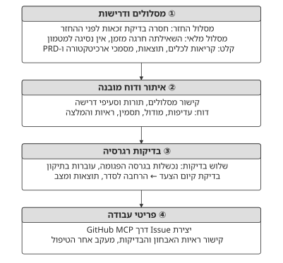
>
> שלוש הבדיקות נכשלו כולן על הגרסה הפגומה ועברו כולן אחרי המעבר לגרסה המתוקנת. אחת מהן בודקת רק אם התוכנית קראה לכלי בדיקת הזכאות להחזר. גם אם התוכנית מחזירה קודם את הכסף ורק אחר כך בודקת אם ההזמנה זכאית, הבדיקה הזו תעבור. ברשומות ההרצה נשמר גם האישור שהחזיר GitHub MCP על יצירת פריט העבודה, וממנו אפשר להגיע לכרטיס שנפתח אחרי שדוח האבחון נמסר למפתחים.
>

### קוד כממשק משתמש גנרטיבי

אם גם המשתמש עצמו צריך לשנות את החומר שהסוכן עובד עליו, אפשר להפוך את הממשק לשולחן עבודה משותף לשניהם. נניח שמדובר בלוח זמנים של נסיעה: המשתמש רואה באיזו תחנה העוזר עוסק כרגע, יכול לקחת לידיו את העריכה, ולאשר או לבטל שינוי מסוים. אם המשתמש הזיז זה עתה את יום היציאה ליום שישי, העוזר צריך להמשיך לעבוד על המסלול החדש הזה. רק כששני הצדדים חולקים אותו מצב גלוי, ומוסכם מי שולט כרגע בשדה הנערך, אפשר לצפות ולערוך בו‑זמנית.

נניח שהמשתמש רוצה להשוות שלוש אפשרויות נסיעה. כל עוד היעד לא נקבע, נוח לברר פרטים בשיחה; אחרי שנקבע, נוח יותר לתת למשתמש לבחור תאריכים ולמלא את מספר הנוסעים ישירות מאשר להחליף כמה פסקאות טקסט הלוך ושוב; ולבסוף, כדי להשוות איך המחיר הכולל משתנה לפי התאריך, תרשים אחד מציג את ההבדלים מול העיניים. כשהסוכן מייצר לפי המשימה את הטופס, התרשים או ממשק היישום המתאים, והמשתמש ממלא, בוחר ומפעיל אותו ישירות — זהו ממשק משתמש גנרטיבי (Generative UI).

**תיאור הממשק והאינטראקציה באמצעות פרוטוקול.**

לייצור ממשק יש שני מסלולי מימוש: להפיק קוד כגון HTML ו‑JavaScript ולהריץ אותו בסביבה מבוקרת, או להפיק מבנה הצהרתי שרכיבי הלקוח מרנדרים. הראשון מקל על מימוש פריסה ואינטראקציה מותאמות; השני מגביל את היכולות הזמינות לרכיבים ולפעולות שהלקוח מספק.

‏A2UI‏ (Agent-to-User Interface) נוקט תיאור הצהרתי. הסוכן מייצר הודעות מובנות המבטאות רכיבים, קישורי נתונים ועדכונים, והלקוח מציג את הממשק באמצעות הרכיבים שלו[^ch5-ui-protocols]. לדוגמה, יישום יכול לספק רכיבי כרטיס, כפתור, תיבת טקסט וטבלה, והסוכן מתאר על בסיסם טבלה בכותרת "נתוני מכירות" ובה שלוש שורות ושתי עמודות. קטלוג הרכיבים ניתן להרחבה גם ביכולות כגון תרשימים ומפות.

‏AG-UI‏ (Agent–User Interaction) אחראי על האינטראקציה מבוססת האירועים בין הסוכן לצד הקדמי: הוא מעביר הודעות, קריאות לכלים ועדכוני מצב, ויכול גם לשאת את הודעות הממשק של A2UI. בשילוב ביניהם, A2UI מתאר מה להציג, ו‑AG-UI מחבר את הביצוע בצד האחורי לאינטראקציה בצד הקדמי.

הלקוח יכול לקבל עדכוני ממשק בהדרגה ולהציג אותם באמצעות מרנדרים מותאמים ברשת, בנייד או בשולחן העבודה. הלקוח מאמת את מאפייני הרכיבים, את קישורי הנתונים ואת בקשות הפעולה, והשרת ממשיך לבדוק הרשאות עסקיות; גם קישורים, טקסט עשיר וגישה לנתונים בתוך הרכיבים זקוקים לכללי טיפול משלהם.

כשמייצרים קוד ישירות, יש לבדוק תלויות, גישה למשאבים והרשאות הרצה, ולבודד את הממשק שנוצר מהמצב הרגיש של היישום המארח. הזרקת פרומפט בחומר חיצוני עלולה להשפיע על תהליך הייצור, וסיכון הרצת הסקריפטים בדפדפן תלוי גם באופן טעינת הדף ובידודו.

**מסירת תוצרים אינטראקטיביים ב‑HTML.**

**לתוצרי מחקר הכוללים נתונים, הדגמות ותוצאות המתעדכנות ברציפות, המחבר מעדיף אתר HTML.** דוח Markdown ארוך וליניארי מאלץ את הקורא לחפש שוב ושוב את ההקשר; דף אינטראקטיבי מרכז הסברים, נתונים והדגמות בנקודת כניסה אחת: הקורא בוחן תרשים, מסנן את הדגימות שמעניינות אותו, פותח את פרטיה של תוצאה מסוימת, ואז מפעיל הדגמה כדי להבין את התנהגות המערכת. הסוכן יכול גם לעדכן את הדף ככל שהמשימה מתקדמת, כך שהוא מתעד תמיד את התוצרים ואת הראיות העדכניים.

בעבודת המחקר של המחבר, למשל, לכל פרויקט מחקר יש אתר אינטראקטיבי המשמש בעת ובעונה אחת מסמך חי לאורך המחקר ותוצר סופי, והסוכן מוסיף לו תוכן ככל שהניסויים מתקדמים. לאתרים אלה שלושה תפקידים עיקריים.

הראשון הוא **מעקב אחר נתוני הניסויים**. הדף מקשר בין דגימות, פרומפטים, תשובות המודל וציונים, ומאפשר בדיקה פריט אחר פריט. לדוגמה, כשסוג מסוים של תשובות מקבל תמיד ציון נמוך, אפשר לחזור לאורך רשומות הניקוד אל התשובה הגולמית ואל הפרומפט.

השני הוא **ניטור מדדי אימון**. את האותות המשקפים את המצב הפנימי של האימון המחבר מכנה "מדדים פנימיים": הפסד אימון ואימות, נורמת הגרדיאנט, קצב הלמידה, ובלמידת חיזוק גם התגמול, סטיית KL ואנטרופיית המדיניות. במודלי שפה אפשר גם למדוד באמצעות המבוכה (perplexity) עד כמה המודל מנבא היטב רצף טקסט נתון. בדומה למדדים הפיזיולוגיים בבדיקה רפואית, עקומות אלה חושפות לפעמים בעיות מוקדם יותר מהציון הסופי במשימה. בחינתן לצד דיוק המשימה עוזרת לאתר את השלב שבו מופיעים אי‑התכנסות, חריגות בגרדיאנט או התדרדרות האימון.

השלישי הוא **הדגמת אופן הפעולה**. כשמסבירים כיצד כמה מודולים פועלים יחד, הדף מאפשר לקורא לשנות קלט אחד, לבחון את מצבי הביניים, ולהשוות את השינוי בפלט לרשומות הניסוי.

כשהעבודה נמשכת כמה שעות, כיצד המשתמש יכול לקחת אותה לידיו בין עיסוק לעיסוק? כשהמחבר עובד עם סוכן קוד, הוא רוצה שהוראה קולית אחת תגיע במדויק לסוכן המטפל בעניין, שיוכל לפתוח את התוצרים בכל רגע, ושתגיע אליו תזכורת כשיש גרסה חדשה או שאלה שדורשת את החלטתו. לדוגמה, שני דוחות נוצרים במקביל. המשתמש פותח את דוח המכירות, מצביע על התרשים השני ואומר "את זה תצייר מחדש לפי הכנסה נטו". הממשק צריך לשלוח יחד עם ההוראה את מזהי הדוח והתרשים הנוכחיים. כשהתרשים מוכן, ההתראה יכולה לפתוח ישירות את הגרסה החדשה; ואם יש שתי הגדרות אפשריות ל"הכנסה נטו", העוזר צריך להציג למשתמש את שתיהן לבחירה.

**הבהרת כוונת המשתמש.**

כשהמשתמש אומר "אני רוצה להזמין טיסה לבייג'ינג", היעד כבר ברור, אך עיר היציאה, התאריך ושאלת הכיוון האחד או הלוך‑חזור עדיין חסרים. הסוכן יכול לרכז את השאלות בסבב שיחה אחד, או לייצר טופס שמציג את כל התנאים הרלוונטיים בעמוד אחד.

הפקדים בטופס מתאימים לסוגי מידע שונים: תיבת טקסט אוספת קלט פתוח, תפריט נפתח ולחצני רדיו מציגים אפשרויות לבחירה, תיבות סימון מאפשרות בחירה מרובה, ובורר תאריכים עוזר למלא זמנים. JavaScript יכול לבטא תלויות מדורגות, למשל להציג את תאריך החזרה רק כשנבחר "הלוך‑חזור" ולוודא שהחזרה אינה מוקדמת מהיציאה. כשבחירה משתנה, יש גם לנקות או להתעלם בהתאם משדות שאיבדו את תוקפם.

איור 5-8 לקוח מהרצה אחת של הניסוי שלהלן. עקבו אחרי ההגשה הזו: בארבעת השדות שהדפדפן החזיר אין יעד — מאין יודע המודל שהנוסע טס לבייג'ינג?

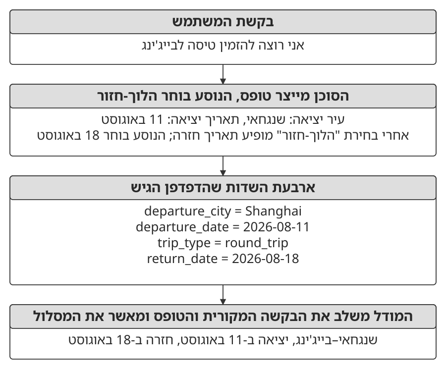

> **ניסוי 5-12 ★★: מערכת להבהרת כוונה באמצעות טפסים דינמיים**
>
> הניסוי יוצא מהבקשה "אני רוצה להזמין טיסה לבייג'ינג" ומבקש מהמודל לייצר טופס HTML: עיר היציאה בתיבת טקסט, תאריך היציאה בבורר תאריכים, סוג הנסיעה עם אפשרויות כיוון אחד והלוך‑חזור, ותאריך החזרה מוצג רק כשנבחר הלוך‑חזור.
>
> התוכנית מחזירה למודל את הבקשה המקורית יחד עם נתוני הטופס. אילו נשמרו רק השדות שהוגשו, היעד היה חסר גם אם כל פקד מולא נכון.
>
> נסו צעד נוסף עם אותו טופס: מלאו את תאריך החזרה ואז עברו לכיוון אחד. הדף הסתיר את תיבת תאריך החזרה, אך ה‑JSON שהוגש שמר גם את הכיוון האחד וגם את תאריך החזרה ב‑18 באוגוסט. כשעוברים לכיוון אחד, הלקוח צריך גם למחוק את תאריך החזרה שאיבד את תוקפו.

[^ch5-ui-protocols]: התיעוד הרשמי של A2UI ו‑*AG-UI Overview*, המציגים בהתאמה תיאור ממשק הצהרתי ואינטראקציית אירועים בין סוכן לצד הקדמי.

**יצירת שאילתות SQL.**

המשתמש יכול לנסח שאילתת מסד נתונים בשפה טבעית, והסוכן מייצר SQL לפי מבנה הטבלאות וההגדרות העסקיות. **להצגת טבלת תוצאות מלאה המחבר מעדיף את דפוס ה‑Artifact, שבו התוצאות עוברות ממסד הנתונים ישירות לממשק.** אם המודל קורא טבלה גדולה ומשכתב אותה שורה אחר שורה, צריכת הטוקנים וזמן ההמתנה גדלים, ונוספות שגיאות העתקה. ה‑SQL נשמר כתוצר שאילתה שאפשר לבדוק; רק כשצריך לנתח סיבות או לסכם מגמות, מעבירים למודל את תוצאות הצבירה הנחוצות.

באיור 5-9 המשתמש רוצה לראות את מספר העובדים הפעילים בכל מחלקה, והדף יכול להציג ישירות את טבלת הסיכום שמסד הנתונים החזיר. אם המשתמש שואל אחר כך "בכמה עובדים מחלקת השיווק גדולה ממחלקת המו"פ", המודל צריך רק לקחת מהטבלה את 9 ואת 5 כדי לחשב הפרש של 4. אבל אם הוא מוסיף "גם בחודש שעבר היה הפרש כזה?", הטבלה שמול העיניים כבר אינה מספיקה, וצריך להריץ שאילתה מחדש לפי תאריך הסיכום של החודש הקודם.

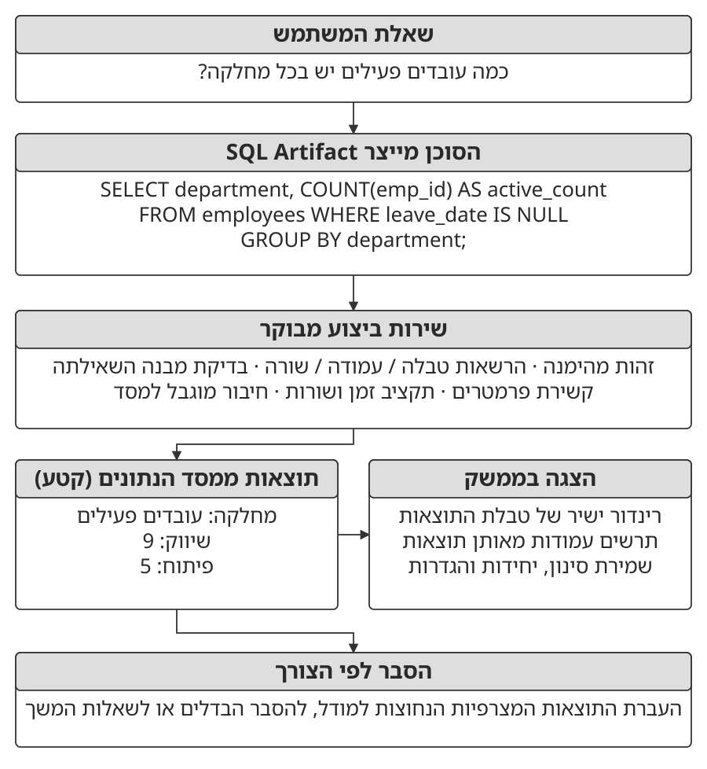

שירות הביצוע קובע לפי זהות מהימנה אילו טבלאות, עמודות ושורות נגישות, משתמש בחשבון מסד נתונים מוגבל, ומאמת את מבנה ה‑SQL ואת סוג הפעולה. אפשר להגביל את תרחיש השאילתה לשאילתות קריאה בלבד מאושרות, ולשלוט בקריאות לפונקציות, בתקציב הזמן, במספר השורות המוחזרות ובטווח הנתונים; ערכים שהמשתמש מזין מועברים בקשירת פרמטרים.

הסוכן יכול גם לייצר תוצרי ויזואליזציה, למשל להציג את סיכום המחלקות כתרשים עמודות. שירות הביצוע מעביר את תוצאות השאילתה לסביבת ריצה מבוקרת לוויזואליזציה, והממשק מציג רק את הנתונים והאינטראקציות המותרים.

> **ניסוי 5-13 ★★: סוכן ERP באינטראקציה בשפה טבעית**
>
> הניסוי לוקח כדוגמה שאילתות עובדים ושכר ב‑ERP (תכנון משאבי ארגון), ולומד כיצד לייצר SQL משאלה עסקית ולהעביר את תוצאות מסד הנתונים ישירות לדף. ב‑PostgreSQL מקימים שתי טבלאות: טבלת העובדים מכילה מזהה עובד, שם, מחלקה, דרג, תאריך קליטה ותאריך עזיבה, ותאריך עזיבה ריק פירושו שהעובד מועסק; טבלת השכר מכילה מזהה עובד, תאריך תשלום ושכר, ברשומה אחת לכל עובד בכל חודש.
>
> על סמך שתי הטבלאות הסוכן מטפל בעשר השאלות הבאות:
>
> 1. מהו הוותק הממוצע של עובד?
> 2. כמה עובדים פעילים יש בכל מחלקה?
> 3. באיזו מחלקה הדרג הממוצע של העובדים הגבוה ביותר?
> 4. כמה עובדים חדשים נקלטו בכל מחלקה השנה ובשנה שעברה?
> 5. מה היה השכר הממוצע במחלקה A ממרץ לפני שנתיים עד מאי בשנה שעברה?
> 6. באיזו מחלקה השכר הממוצע היה גבוה יותר בשנה שעברה, A או B?
> 7. מהו השכר הממוצע השנה לעובדים בכל דרג?
> 8. מהו השכר הממוצע בחודש האחרון לעובדים עם ותק של עד שנה, שנה עד שנתיים, ושנתיים עד שלוש?
> 9. אילו 10 עובדים קיבלו את העלאת השכר הגדולה ביותר משנה שעברה לשנה זו?
> 10. האם יש פיגורים בתשלום שכר (עובד שהיה מועסק בחודש מסוים אך לא קיבל שכר)?
>
> לפני השאילתה יש לקבוע את הגדרות החישוב. לדוגמה, הוותק של עובד פעיל מחושב עד תאריך הבסיס של השאילתה, ושל עובד שעזב — עד תאריך העזיבה; ב"שכר ממוצע" יש להחליט אם ממצעים לפי רשומות תשלום או לפי עובד; ודירוג העלאות השכר צריך לטפל בעובדים שאין להם רשומות בשנה שעברה.
>
> בהרצה זו נוצרו והורצו עשר שאילתות SQL, כל התוצאות תאמו חישוב ייחוס עצמאי, והדפדפן רינדר את הטבלאות ישירות. המודל מקבל את מבנה הטבלאות, את המשימה ואת משוב הביצוע הנחוץ, ושורות הנתונים ממסד הנתונים מגיעות לממשק דרך היישום.

**יצירה דינמית של תוכנה.**

הסוכן יכול לייצר ממשק ולוגיקת אינטראקציה החל מהדרישות, ולהמשיך לשנות אותם לפי פעולות המשתמש. התצוגה המקדימה המחקרית הזמנית "Imagine with Claude" ש‑Anthropic השיקה ב‑2025 הדגימה אינטראקציה כזו: המשתמש חוקר את הממשק, והמודל ממשיך לייצר את חוויית התוכנה המתאימה[^ch5-imagine].

**במוצרים אמיתיים המחבר מעדיף התאמה אישית על גבי מסגרת קיימת.** ייצור מתמשך של יישום שלם מאפס משלם שוב ושוב את מחיר הייצור, הרינדור והאימות; שמירה על מסגרת יציבה ופתיחת הממשקים והתהליכים שהמשתמש מתעניין בהם מספקות מהר יותר חוויה מותאמת ואמינה. המשתמש מבקש "תהפוך את הכפתור לכחול", "תוסיף תפריט קיצורים בסרגל הצד", "תחליף לגופן קריא יותר", והסוכן מאתר את הרכיבים הרלוונטיים, משנה את הקוד ובודק את התוצאה בתצוגה מקדימה. מסגרת הבסיס מספקת מבנה דפים וממשקים עסקיים יציבים, והיקף ההתאמה יכול להתרחב בהדרגה מצבעים וגופנים לפריסה ולרכיבים.

ה‑HMR‏ (Hot Module Replacement, החלפת מודולים חמה) בסביבת הפיתוח יכול לעדכן את מודולי הצד הקדמי המושפעים אחרי שינוי קוד. אם המצב נשמר תלוי בשילוב עם המסגרת, בגבולות העדכון ובסוג השינוי; כשנדרש רענון מלא, היישום צריך גם לשמור את המצב הנחוץ. ה‑reload במצב הפיתוח של FastAPI, לעומת זאת, טוען מחדש את התוכנית בצד השרת; השניים פועלים בהתאמה על מודולי הצד הקדמי ועל תהליך הצד האחורי[^ch5-hmr].

> **ניסוי 5-14 ★★: מערכת שיחתית להתאמה אישית של ממשק**
>
> הניסוי בונה יישום צ'אט המורכב מצד קדמי ב‑React ומצד אחורי ב‑FastAPI, ומפעיל בסביבת הפיתוח HMR בצד הקדמי ו‑reload בצד האחורי. המודל משנה צבעים, גופנים וכותרת לפי שלוש בקשות רצופות, והדפדפן בודק את הממשק בפועל אחרי כל שינוי.
>
> בהרצה זו תועדו אירועי HMR של Vite; בשלושת סבבי השינוי לא התרחש ניווט של דף שלם, מצב הצ'אט הקיים נשמר, והבנייה הסופית עברה.

[^ch5-imagine]: Anthropic,‏ *Introducing Claude Sonnet 4.5*, המציג את התצוגה המקדימה המחקרית הזמנית Imagine with Claude שהושקה יחד עם המודל.
[^ch5-hmr]: *Vite HMR API* ו‑*FastAPI CLI*, המציגים בהתאמה עדכון חם בצד הקדמי וטעינה מחדש אוטומטית של שרת הפיתוח.

**גבול ההרשאות צריך להיות בלתי תלוי בקוד העסקי הדינמי.**

**ככל שקל יותר לסוכן לשכתב את הקוד העסקי באופן דינמי, כך צריך גבול ההרשאות הסופי לרדת אל שכבת גישה לנתונים יציבה.** יישומים מסורתיים כותבים את בדיקות ההרשאה בקוד עסקי שעבר סקירה; כשהקוד הנוצר משתנה כל הזמן, נתיב חדש כלשהו עלול להשמיט את אותה בדיקה. רק כשכל קריאה וכתיבה עוברות דרך שירות גישה לנתונים עצמאי, אילוצי ההרשאה נשמרים. לדוגמה, יישום גיוס יכול לייצר באופן דינמי רשימות מועמדים וטופסי פעולה, אבל לאיזה ארגון שייך מועמד ואילו שדות רשאי מגייס לעדכן — את זה בודק כל הזמן שירות גישה לנתונים מהימן.

מטרת התכנון כאן היא: **גם אם הקוד הנוצר שגוי, שכבת הגישה לנתונים המהימנה עדיין אוכפת את אילוצי ההרשאה.** זהו המשכו של מעקה שכבת הנתונים מפרק 1: את הכללים שחובה לאכוף מציבים במקום שכל הפעולות הרלוונטיות עוברות בו. מדיניות אבטחה ברמת השורה במסד הנתונים יכולה להגביל גישה לרשומות, אילוצים ומאמתים בודקים מצבים חוקיים, ותצוגות מבוקרות, פרוצדורות מאוחסנות או שירותי נתונים מספקים את הפעולות המותרות. שכבת היישום יכולה לבדוק מראש ולהסביר למשתמש, אך הקריאה והכתיבה הסופיות נשלטות בידי שירות הנתונים המהימן והרשאות מסד הנתונים.

כל פעולה זקוקה גם ל**הקשר גישה** (access context) מהימן, המכיל את המשתמש, הדייר, התפקיד או זהות הסוכן. שירות האימות וסביבת הריצה המהימנה אחראים לבסס את הזהות ולכבול אותה, ושירות הנתונים מעניק הרשאות לפיה. הקוד הדינמי מקבל את הממשקים המוגבלים הדרושים להשלמת המשימה, וההרשאות לניהול אישורי גישה ומדיניות שמורות בידי רכיב עצמאי. כל חיבורי מסד הנתונים, השאילתות העזר ועיבוד הרקע חייבים לכבד את אותו היקף גישה.

לדוגמה, אבטחה ברמת השורה ב‑PostgreSQL צריכה לפעול יחד עם הגדרת תפקידי מסד הנתונים. חיבורי היישום משתמשים בתפקיד הכפוף למדיניות, ולחשבון היישום אין הרשאה לשנות את מדיניות הגישה[^ch5-rls]. הכללים ומנגנון כבילת הזהות עוברים סקירה עצמאית, והממשק העסקי יכול להמשיך להשתנות בתוך התחום הזה.

להרשאות ולשלמות הנתונים תפקידים שונים. אחרי שלמגייס יש הרשאה לשנות רשומת מועמד, מכונת המצבים ממשיכה לבדוק אם מותר לעבור מ"סונן" ל"רואיין"; מאמת השכר קורא את המשרה המקושרת ובודק אם השכר המבוקש בטווח המשרה; ובדיקת ההפניות מוודאת שהקשר בין המשרה למועמד תקף.

> **ניסוי 5-15 ★★★: אובייקטי נתונים עם הרשאות משובצות לתוכנה דינמית**
>
> הניסוי מספק אב‑טיפוס של מאגר אובייקטים ב‑Python מעל PostgreSQL, שבו כללי ההרשאה, המאמתים, יחסי האובייקטים והצהרות התגובות שבעקבות שינוי מוגדרים בתוך טיפוסי הנתונים. בקריאה נבדקות הרשאות הגישה; ביצירה ובעדכון מבוצעות תחילה בדיקות ההרשאה והאימות העסקי ובדיקת ההפניות, אחר כך ההתמדה, ולבסוף התגובות המוצהרות נכנסות לתור, ועומק שרשרת התגובות מוגבל.
>
> דוגמת הגיוס כוללת אובייקטים של משרה, מועמד, ראיון והערכה. המועמד עובר בזה אחר זה הגשת מועמדות, סינון, ראיון, הצעת עבודה וקליטה, ובשלבים הרלוונטיים אפשר גם לעבור למצב דחייה; טווח השכר נלקח מהמשרה המקושרת. בדוגמה מוגדרות בדיקות לעדכון מצב תקין, למעבר מצב לא חוקי, לשכר מחוץ לטווח המשרה ולגישה מדייר אחר, כדי לעזור לקורא להבין באילו בעיות מטפלים ההרשאה והאימות העסקי, כל אחד בנפרד.
>
> האב‑טיפוס מבטא את מאפייני המשתמש, התפקיד והארגון באמצעות `AccessContext`, וסקריפט ההדגמה בונה את ההקשרים האלה ישירות כדי לדמות זהויות שונות. בפריסה אמיתית, נקודת הכניסה של האימות בונה את ההקשר, ומאגר האובייקטים והקוד הנוצר מופרדים משני צדיו של גבול שירות או הרשאות מפורש.

[^ch5-rls]: PostgreSQL,‏ *Row Security Policies*, המציג הגדרת מדיניות אבטחה ברמת השורה לפי תפקיד ופעולה ואת תחום תחולתה.

### קוד היוצר קוד: אתחול עצמי של סוכנים

את יכולת יצירת הקוד אפשר להפעיל גם על פיתוח הסוכן עצמו. היוצר מקבל את דרישות המשימה, מייצר או משנה את הפרומפטים, הכלים ולולאת הריצה של סוכן חדש, ובודק את התוצר באמצעות בדיקות ואינטראקציה אמיתית. איור 5-10 מציג את לולאת האתחול העצמי הזו: המימוש הקיים הוא נקודת המוצא, משוב המשימה מניע את השינויים, ותוצאות האימות קובעות אילו שינויים יישמרו.

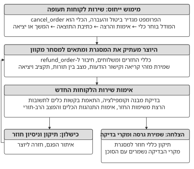

איך מבחינים אם שינוי שיפר יכולת כללית, או שבמקרה התאים לשאלות שהיוצר ראה זה עתה? משאירים בצד משימה שלא נמסרה ליוצר. לדוגמה, מפתחים סוכן לניטור מחירים על סמך נתוני חנות אחת, ואז נותנים לו דוגמאות מחנות אחרת, ובמקביל מריצים מחדש את המשימה המקורית.

**תחזוקת סביבת הריצה של הסוכן.**

ריצת הסוכן החדש תלויה בתצורה, באישורי גישה, במצב הסשנים, בשירותים ובארגז החול. הפקודה `doctor` של OpenClaw היא דוגמה לכלי תחזוקה כזה: היא בודקת בעיות כגון הגירת תצורה ישנה, מצב אישורי OAuth, נעילות סשן, התקנת תוספים, בריאות ה‑gateway ותמונות ארגז החול, ומציעה תיקון או מבצעת אותו[^ch5-doctor].

בדיקות דטרמיניסטיות כאלה יכולות לשמש בסיס לתהליך תחזוקה עצמית. כללי הזיהוי מכסים תקלות מוכרות, ולפעולות התיקון קלט ותוצאה צפויה מוגדרים. כשמתכננים בהמשך תהליך אבחון של סוכן, אפשר למסור למודל את הבעיות שעדיין לא נפתרו יחד עם היומנים, התצורה ותוצאות הבדיקות, ולבקש ממנו להסביר איזו תצורה בכוונתו לשנות ואיך; שכבת הביצוע בודקת את ההרשאות ואת היקף השינוי, ואז מריצה בדיקות בריאות ובדיקות רגרסיה. תצלומי תצורה, רישום שינויים ונקודת כניסה לרולבק עוזרים למערכת לחזור לעבודה כשתיקון נכשל.

**מימושי ייחוס כנשאי ניסיון הנדסי.**

יצירת סוכן ייעודי כרוכה גם בלוגיקה תחומית וגם בתשתית כללית. כשבודקים את התוצר, אפשר להתחיל מארבעה סוגי שאלות:

1. **הקשר ולולאת ריצה.** לשמור את הקשר בין תפקידים, מזהי קריאות לכלים ותוצאות הכלים, ולבדוק מצב רב‑סבבי, תנאי סיום, תקציב והתאוששות מחריגות. הודעות מובנות מקלות על שמירת היחסים שהפרוטוקול מגדיר; קידומת יציבה יוצרת תנאים לשמירת פרומפטים במטמון.
2. **ממשקי כלים.** תיאור הכלי מסביר את ייעודו, את תנאי השימוש בו ואת גבולותיו, ולכל פרמטר יש טיפוס, משמעות ודוגמה קונקרטית. שכבת הביצוע ממשיכה לאמת פרמטרים, זהות ומצב עסקי.
3. **בחירת מודל ו‑API.** מודלים נוטים להמשיך להשתמש במודלים ובממשקים ישנים שהופיעו בתדירות גבוהה בנתוני האימון, וגם קוד שנכתב בשטף עלול להישען על בחירות מיושנות. ספקו ליוצר חומרי בחירה מתוחזקים, או תנו לו לחפש בתיעוד הרשמי כדי לאמת את יכולות המודל, את גרסת הממשק ואת אופן הקריאה. קריאות אמיתיות אחרי הייצור בודקות אם התצורה שמישה.
4. **תלויות ותאימות לאקוסיסטם.** לבדוק את מצב התחזוקה של הספריות, את הגרסאות ואת שינויי הממשקים, ולאמת את התוכנית המורכבת באמצעות התקנת תלויות, בדיקות קומפילציה ובדיקות.

**כשיוצרים סוכן ייעודי, המחבר מעדיף שהיוצר יעתיק מימוש ייחוס מאומת ואז יבצע שינויים תחומיים.** קשה לפרומפט למצות את כל הפרטים של פרוטוקול ההודעות, ניהול המצב ומנגנוני ההתאוששות, ואילו קוד ייחוס מכניס את הניסיון ההנדסי הזה ישירות למערכת החדשה. גם מודל שמצטיין בתכנות עלול לפספס תנאי ריצה שתיאור המשימה לא אמר במפורש; שימוש חוזר במסגרת מצמצם שגיאות חוזרות כאלה. היוצר מעתיק מסגרת בסיס מתאימה, מתאים את הנחיית המערכת לתפקיד החדש, מוסיף ומסיר כלים תחומיים, משנה את הלוגיקה העסקית ומוסיף בדיקות מתאימות. טיפול בהודעות, קישור קריאות, ניהול מצב ומסלולי יציאה מגיעים מהמסגרת, והשינויים התחומיים מאומתים באמצעות מקרי בדיקה חדשים.

אם התבנית מהירה בהרבה, איך שוללים את ההסבר "פשוט מימשו פחות פונקציות"? בניסוי שלהלן שתי קבוצות יוצרים מוסרות את אותו סוג סוכן, והוא עובר את אותה מערכת בדיקות.

> **ניסוי 5-16 ★★★: פיתוח סוכן שיכול ליצור סוכנים**
>
> מבקשים מאותו מודל יוצר לבנות סוכן לאישור שחרורים: הוא קורא קבוצה של רשומות בדיקת פריסה, ואם אחת מבדיקות החובה לא עברה — דוחה את השחרור ומציין את הנימוק. ביצירה מאפס המודל צריך לכתוב את לולאת הריצה, את פרוטוקול הכלים, את הכלים התחומיים, את נקודת הכניסה בשורת הפקודה ואת הבדיקות. במסלול התבנית מעתיקים תחילה סוכן שיודע לבדוק רשומות מובנות, והמודל צריך רק למלא את המפרט התחומי. למשל: באיזה שדה נשמר הסטטוס, ואילו ערכים פירושם מעבר? סקריפט היצירה מייצר מהמפרט את הנחיית המערכת, את הגדרות הכלים ואת התיעוד. כלי Python הקיימים קוראים את המפרט ומבצעים את הבדיקות. שני המסלולים מגלמים מטא‑תכנות: שימוש בתוכנית כדי לייצר או לשנות תוכניות אחרות.
>
> באיור 5-11 שני המסלולים מתאחדים באותה מערכת תנאי קבלה.
>
> 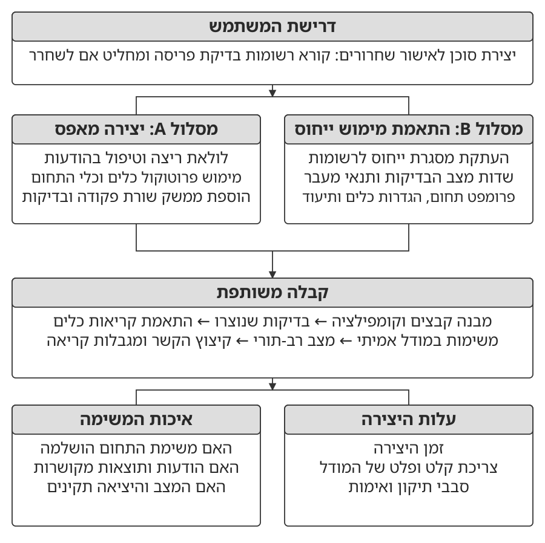
>
> שני המסלולים משתמשים באותן דרישות משימה ובאותם תנאי קבלה. תחילה בודקים את מבנה התוצר, את הקומפילציה ואת הבדיקות, אחר כך את הקישור בין קריאות לכלים לבין תוצאותיהן בהודעות התקניות, ולבסוף מריצים משימות אמיתיות מול המודל ואינטראקציה רב‑סבבית, כדי לאמת קיצוץ הקשר, ניהול מצב ומגבלת מספר קריאות.
>
> בהשוואה השמורה עם Kimi K3, כל אחת מהקבוצות עברה 39/39 בדיקות דטרמיניסטיות, ושתיהן עברו גם את משימות המודל האמיתיות ואת בדיקות המצב הרב‑סבביות. מסלול התבנית צרך ביצירה 1,181 טוקנים וכ‑25 שניות, ומסלול היצירה מאפס צרך 381,814 טוקנים וכ‑90 דקות.
>

[^ch5-doctor]: OpenClaw,‏ Doctor, המציג את יכולות בדיקת התצורה והמצב, ההגירה והתיקון.

## סיכום הפרק

**לכך שסוכני קוד הבשילו מוקדם יש סיבה שקל להתעלם ממנה: להנדסת תוכנה כבר יש מערכות טיפוסים, מערכי בדיקות, בקרת גרסאות וכלי ניפוי.** כשקוד שונה באופן שגוי, הבדיקות מצביעות לא פעם על קבוצת הקלט שקיבלה תוצאה בלתי צפויה; ואם מנסים דרך תיקון אחרת, אפשר לנסות שוב עם אותו קלט. כדי להעביר את הניסיון הזה למשימות אחרות, שואלים תחילה שלוש שאלות קונקרטיות: איך מגלים שגיאה, איך חוזרים למצב ידוע, ומתי צריך לעצור ולבקש מאדם להתערב? למשל, אם קריאת החזר כספי מתנתקת באמצע, ה‑Harness צריך קודם לבדוק את החשבון ורק אז להחליט אם לנסות שוב; אחרת התאוששות מתקלה אחת עלולה להפוך להחזר כספי שני.

קוד יכול גם לשמור החלטה חד‑פעמית כדבר שאפשר להשתמש בו שוב ושוב. את המנייה בבעיה מתמטית ואת האילוצים בחידה לוגית אפשר למסור לתוכנית שתבדוק פריט אחר פריט; את כללי ההחזר אפשר לכתוב כאימות בנקודת הכניסה לביצוע, כך שהשרת יקרא את המצב האמיתי בהזמנה ורק אז יחליט אם לאשר. כשפורמט היומן משתנה, אפשר לשנות את המנתח ולשמור את הדגימה שגרמה לשגיאה הפעם כבדיקת רגרסיה. בשלושת המקרים אפשר להריץ קוד, אבל אמת המידה שונה: האם הפתרון עומד בתנאי הבעיה, האם ההחזר תואם את המדיניות, והאם המנתח החדש קורא את השדות שהוחמצו קודם.

כשהתוצר הוא מסמך, סרטון או מודל גאומטרי, צריך לבדוק גם את תוצאת הרינדור, את הסנכרון בין שמע לתמונה או את דיוק המידות, ולתת לסוקר לעבור על התוצר בפועל. כשהתוצר הוא טופס, שאילתה או ויזואליזציה, מעבר לבדיקה אם המשתמש מבין אותו ומסוגל להפעיל אותו, יש לבדוק גם אם שירות הביצוע שמאחוריו שולף נתונים לפי ההרשאות. אם הקוד מייצר סוכן אחר, המחבר נוטה לעשות תחילה שימוש חוזר במסגרת מאומתת, לייצר את הכלים התחומיים ואת הלוגיקה העסקית, ואז לבדוק את פרוטוקול הקריאות, את המצב בין הסבבים ואת תוצאות המשימה בפועל. הכלים, המאמתים והבדיקות שנצברים כך משמשים גם את המשימה הבאה.

קוד מאפשר להריץ משימה שוב ושוב, אבל הסביבה לא תמיד מחכה שהריצה תסתיים. שאילתה עוד רצה, והמשתמש אולי כבר שינה את דעתו. פרק 6 דן באופן שבו שינוי כזה נכנס לאינטראקציה שכבר נמצאת בעיצומה.

## שאלות למחשבה

1. ★★ תכננו ארגז חול לסוכן קוד שצריך לקרוא קובצי פרויקט, להתקין תלויות ולהריץ בדיקות. כיצד תגדירו הרשאות לקבצים, לרשת, לתהליכים ולמשאבים? כשמשימה דורשת הרחבת הרשאות, כיצד תבטאו את הבקשה, תבדקו את היקפה ותשמרו תיעוד?
2. ★★★ כשיוצר מייצר ומשנה ברציפות כמה דורות של סוכנים, פגמי מסגרת ושגיאות תחומיות עלולים להצטבר בהדרגה. כיצד אפשר לעקוב אחר שינוי כזה באמצעות גרסאות ייחוס, בדיקות רגרסיה, הערכות התנהגות ומנגנוני רולבק?
3. ★★ שינוי בפורמט יומן יכול לנבוע משדרוג רגיל וגם מפגם אצל המפיק. אילו ראיות צריכה מערכת ניתוח מסתגלת לשמור, ולפי אילו תנאים עליה להחליט אם להוסיף מנתח, לדווח על חריגה או להשהות את העיבוד?
4. ★★ בלולאת מציע–סוקר, הסוקר סבור שצפיפות המידע בדף סבירה, אך המשתמש מרגיש שהוא עמוס. כיצד אפשר להפוך את העדפות המשתמש לדוגמאות, לתנאי ניקוד ולמשוב אינטראקטיבי, ולבדוק אם השינויים הבאים עומדים בדרישות?
5. ★★ סוכן קוד יכול לעדכן את בסיס הידע, את מסמכי הארכיטקטורה ואת הוראות הפרויקט, וגם לקבע רצפי פעולות כקוד. כיצד מזהים כללים מיותרים או מיושנים, וכיצד מתכננים לכל כלל תחום תחולה, שיטת אימות ותנאי יציאה? כדי להתקדם משינוי מוצלח יחיד להתפתחות המתמשכת שנדונה בפרק 9, אילו מנגנוני צבירה והערכה נוספים נדרשים?
6. ★ צוותים הידידותיים לעבודה מרחוק מקלים בדרך כלל גם על סוכנים להשיג מידע על העבודה. בדקו את הדרישות, הארכיטקטורה, רשומות ההחלטות ותנאי הקבלה של פרויקט שאתם מכירים, מנו את המסמכים שהכי חסרים, והסבירו באילו משימות קונקרטיות הם יעזרו לסוכן.
7. ★★★ בסוכן שניגש בו‑זמנית לנתונים פרטיים, מעבד תוכן בלתי מהימן, מתקשר החוצה ומשתמש בזיכרון מתמיד — כיצד הייתם מסדרים הרשאת זהות, סימון מקורות, בדיקת זרימת נתונים וסקירת כתיבה לזיכרון? הדגימו באמצעות תהליך עסקי תקין אחד היכן ממוקמות הבדיקות האלה.
8. ★★ בדפוס ה‑Artifact של SQL ו‑HTML, המודל מייצר את התוצר, שירות הביצוע מטפל בשאילתה או ברינדור, והממשק מציג את התוצאות ישירות. איזה מידע מתאים להחזיר למודל לצורך הסבר? כיצד בודקים את הרשאות השאילתה, את תקציב המשאבים, את בידוד הדף ואת העקביות של התוצאות המוצגות?
9. ★★ הכלי מאמת כללים לפי המצב העסקי במסד הנתונים, והסברי הפרמטרים עוזרים למודל להכין את הקריאה. קחו כדוגמה ביטול הזמנה והסבירו איזה תפקיד ממלאים מדיניות בשפה טבעית, דוגמאות פרמטרים, אימות בשכבת הביצוע ובדיקות גבול; כשהמדיניות משתנה, מה צריך להתעדכן בהתאם?
