# אינטראקציה: הרחבת מרחבי התצפית והפעולה

**כאשר המודל הבסיסי קבוע, ארגון מחדש או הרחבה של ממשקי התצפית והפעולה הם לעיתים קרובות אחד האמצעים ההנדסיים היעילים ביותר לשיפור ביצועי הסוכן במשימה.** בפרקים הקודמים הסוכן בדרך כלל המתין שהמשתמש יסיים לדבר, ורק אז חיפש מידע, הפעיל כלים והשיב. אבל בזמן שהוא ממתין לתוצאות הכלים, המשתמש והסביבה החיצונית ממשיכים להשתנות.

משתמש מבקש מעוזר לשנות כרטיס טיסה. בזמן שהעוזר בודק טיסות מול נציג השירות, המשתמש שולח "יש לי עוד מזוודה לרישום"; הנציג עדיין מדבר, והמחיר שמוצג על המסך עשוי להשתנות. העוזר צריך לברר בזמן אם המחיר כולל כבודה רשומה, וגם לשים לב אם ההצעה שקיבל לפני רגע עדיין בתוקף. עולות כאן שתי שאלות תכנון: מאילו ערוצים העוזר יכול לדעת על השינוי, ומתי הוא יכול להגיב? הפרק דן תחילה בדואר ובתוצאות כלים שמגיעים באופן אסינכרוני, ואחר כך בדיבור רציף, בשינויי מסך ובמשוב התנועה של רובוטים.

## הרחבת המודאליות ועיתוי ההפעלה

**מודאליות** מתארת את צורת המידע והפעולה. הסוכן יכול לקרוא טקסט, לשמוע קול, לראות מסך ולקלוט אותות מומנט, וכן להפיק טקסט, לסנתז דיבור, ללחוץ על ממשק או להניע מפרקים.

**עיתוי ההפעלה** עוסק בשאלה מתי מידע מגיע, מתי פעולה מתחילה ומתי המערכת מגיבה. מידע יכול להגיע מתשאול יזום של הסוכן או מדחיפה של שירות חיצוני; כלי יכול להחזיר תוצאה מיד, או להפעיל משימה ולדווח על השלמתה מאוחר יותר. כשאירוע חדש מגיע, המערכת צריכה גם להחליט אם לקטוע את העבודה הנוכחית וכיצד לחדש את המשימה שנקטעה.

| ממד | ממשקי השגת מידע ותצפית | ממשקי פעולה וביצוע |
|---|---|---|
| ארגון התוכן (פרקים 2–5) | הקשר, זיכרון ובסיסי ידע מארגנים את המידע להחלטה | כלים וקוד מבטאים פעולות ברות ביצוע |
| מודאליות (פרק זה) | קול, מסך, חיישנים פיזיים | דיבור, לחיצה, תנועת מפרקים |
| עיתוי (פרק זה) | תשאול יזום, דחיפת אירועים, קלט רציף | ביצוע על פני סבבים, ביטול, הפקעה (preemption) וחידוש |

ההקשר נושא את המידע הדרוש להחלטה מסוימת, ומרחב התצפית מתאר את טווח המידע שהמערכת עשויה לקבל; הכלים מספקים ממשקים קונקרטיים, ומרחב הפעולה מתאר את טווח הפעולות שהמערכת רשאית לבצע. גם כשמרחיבים את הממשקים, הטווחים האלה נשארים מוגבלים ביכולות ההתקן, בפרמטרים, בהרשאות ובסביבת הריצה.

ממשקי קריאה לכלים רבים מארגנים הודעות בסבבים: המודל מציע קריאה, המערכת משלימה את תוצאת הכלי, ואז מתחיל סבב היסק נוסף. מערכת מונחית אירועים צריכה לנהל שינויים חיצוניים על גבי הפרוטוקול הזה. כשהממשק תומך באסינכרוניות מובנית, אפשר לקבל דרישות חדשות בזמן שהכלי ממתין ולהמשיך בעיבוד כשהתוצאה חוזרת; עם ממשק סינכרוני, ה‑Harness מארגן את האינטראקציה באמצעות תורים, ידיות משימה ומנגנוני תזמון. בהמשך הפרק נדון בכל אחד משני נתיבי המימוש.

קצב המשוב שונה מאוד מתרחיש לתרחיש. הטבלה הבאה מציגה את סקאלות הזמן הנפוצות.

| סקאלה נפוצה | תרחיש | השינוי בצד התצפית | הטיפול בצד הפעולה |
|---|---|---|---|
| שניות עד ימים | אסינכרוני ומונחה אירועים | אירועים חיצוניים מעירים את הסוכן | להתחיל משימה עכשיו; אירועים מאוחרים מדווחים על התקדמות ועל השלמה |
| עשרות מילישניות עד שניות | קול | קליטת אודיו רציפה | פלט מוזרם, טיפול בהתפרצות לדברים ובעצירת ההשמעה |
| תת‑שנייה עד שניות | Computer Use | המסך משתנה ללא הרף | לקרוא מחדש את מצב הממשק אחרי כל פעולה |
| מחזורי בקרה של מילישניות | בקרה רובוטית ברמה נמוכה | משוב חיישנים רציף | ביצוע מקטעי פעולה קצרים, תגובה לאותות בקרה ועצירה |

## אסינכרוני ומונחה אירועים: כשהעולם בא לחפש אתכם

פרק 4 הציג כלי תפיסה, ביצוע ושיתוף פעולה; סעיף זה ממשיך לכלי הפעלה מבוססי אירועים ולכלי תקשורת עם המשתמש. כלי הפעלה מבוססי אירועים מכניסים שינויים בסביבה אל הסוכן, וכלי תקשורת מאפשרים לסוכן לפנות למשתמש תוך כדי התקדמות המשימה. ה‑Harness מקשר את הקלטים והפלטים האלה למשימות שרצות, וכך נוצרת לולאת אירועים שפועלת ברציפות.

### מדוע נדרשת אסינכרוניות

קריאה סינכרונית מחייבת להמתין לתוצאה לפני שהקורא יכול להמשיך בתהליך. קריאה אסינכרונית מחזירה תחילה ידית משימה (מזהה שמשמש לתשאול המשימה ולניהולה), או מתחייבת להודיע על ההשלמה מאוחר יותר, כך שהקורא יכול לטפל בעבודה אחרת בזמן ההמתנה. על בסיס זה המערכת יכולה לנהל כמה משימות פתוחות בבת אחת, ולהחליט לפי משאבים ותלויות אילו פעולות אפשר להריץ במקביל.

אפשר לחשוב על הסוכן כעל מזכיר שמנהל דואר, שיחות טלפון ומבקרים: בזמן שהוא ממתין לתשובה הוא ממשיך לסדר מסמכים, כששיחה דחופה מגיעה הוא שומר בצד את מה שעשה, וכשהשיחה מסתיימת הוא חוזר למשימה המקורית. במימוש ההנדסי צריך לטפל בשלושה דברים:

- **הפרדת משימות ארוכות מהאינטראקציה.** ניתוח קבצים, שיחות טלפון או משימות build מתקדמים ברקע, והמשתמש עדיין יכול לשאול על ההתקדמות ולהוסיף דרישות.
- **עדיפות אירועים.** עצירת חירום נכנסת מיד לזרימת הבקרה, עדכונים שגרתיים נכנסים לתור, ושאילתות בלתי תלויות אפשר להעביר לסשן מקבילי.
- **קטיעה וחידוש.** שומרים את מצב המשימה, מתעדים את הפעולות שכבר בוצעו, ובעת החידוש בודקים מחדש אילו תנאים עדיין תקפים.

תצוגת המחקר המקדימה של Claude Duet נותנת דוגמה: למשתמש יש פגישה בשתיים אחר הצהריים, והוא רוצה לקבל מראש תדריך על החברה שמולה הוא נפגש. אפשר להשאיר הודעה קולית ולסגור את האפליקציה. ההכנה ממשיכה בענן, והמשתמש יכול לפתוח בכל רגע את דף המשימה ולראות את ההתקדמות; כשנדרש ממנו מידע נוסף או כשהתדריך מוכן, העוזר חוזר לשיחה הראשית ומודיע לו. כאן, העובדה שהמשימה ממשיכה להתקדם גם אחרי שהמשתמש עזב היא ביצוע אסינכרוני. לשיחה דו‑כיוונית מלאה, שנדון בה בהמשך, יש דרישה נוספת: גם כשצד אחד מדבר, הוא עדיין שומע את הצד השני מתפרץ לדבריו.[^ch6-duet]

גם ממשקי ה‑API של המודלים קובעים מוסכמות לגבי סדר ההודעות. ממשקים מסוימים מקבלים את הבקשה הבאה רק אחרי שכל קריאה לכלי זווגה לתוצאה שלה; אחרים מאפשרים להשאיר כלי בהמתנה ולקבל עדכונים בינתיים. הפונקציות האסינכרוניות ביישום מתזמנות את ההמתנה ואת הביצוע, ופרוטוקול המודל קובע מתי מותר לשלוח הודעות.

באיור 6-1, הודעות חדשות ותוצאות כלים יכולות להיכנס לתור, אבל הדרך שבה הן מגיעות אליו תלויה במקור. שירות שתומך בדחיפה יכול לשלוח הודעה ברגע שהמצב משתנה; שירות שמספק רק ממשק תשאול מחייב את המתאם לבדוק אותו מעת לעת וליצור אירוע כשהוא מזהה שינוי. גם טיימר שפג יכול ליצור אירוע. לולאת האירועים מעבירה את הקלטים האלה לסוכן.

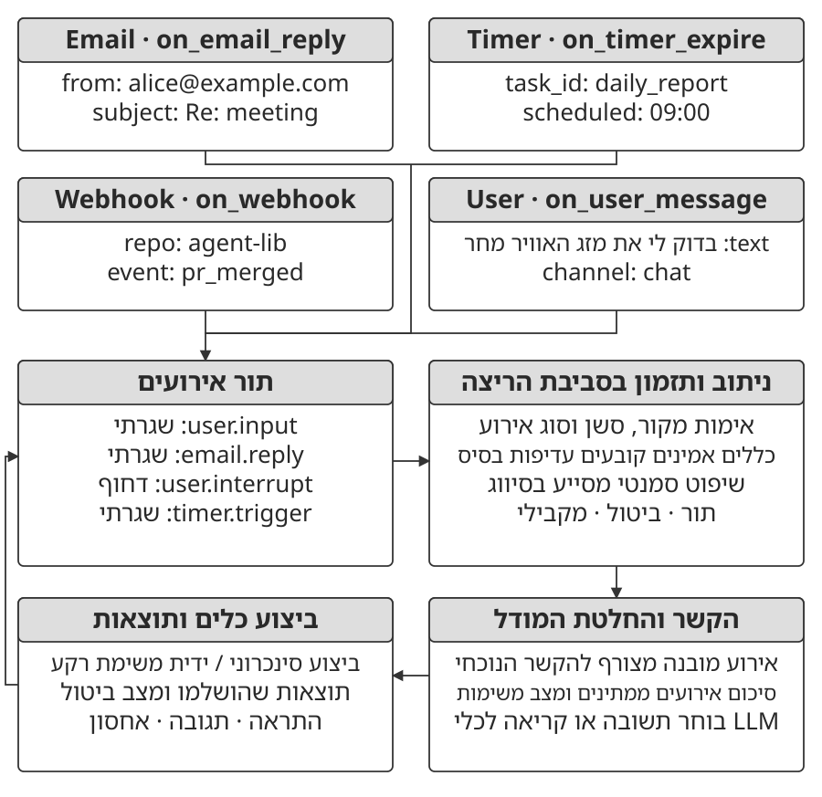

### מימוש מנגנונים מונחי אירועים ב‑OpenClaw

‏OpenClaw מתחבר לערוצי הודעות דרך ה‑Gateway ומנתב אירועים לסביבת הריצה של הסוכן. מנגנוני האוטומציה שלו כוללים נקודות כניסה כגון Hooks פנימיים, תזמון מחזורי, Heartbeat ו‑Webhook חיצוני[^ch6-automation]. אפשר להבין את המנגנונים האלה לפי תנאי ההפעלה שלהם:

- **Hooks (ווי אירועים)** מגיבים לאירועים פנימיים של המסגרת, כגון יצירה או איפוס של סשן, או שינויים במחזור החיים של ריצה.
- **Cron (תזמון)** מריץ עבודה בזמן מוגדר או במחזוריות קבועה. למשל, `0 9 * * 5` פירושו הפעלה בכל יום שישי ב‑9:00 בבוקר לפי אזור הזמן שהוגדר.
- **Heartbeat (פעימת לב)** מעיר את הסוכן מעת לעת כדי לבדוק עניינים שדורשים תשומת לב.
- **Webhook (קריאה חוזרת חיצונית)** מקבל אירועים ששירותים חיצוניים שולחים, ומפעיל עיבוד לאחר אימות וניתוב.

דוח שבועי מתאים להרצה לפי לוח זמנים, מטלות שדורשות מעקב מתמשך אפשר לבדוק מחזורית, ובדואר חדש ובקריאות חוזרות משירותים אפשר לקצר את זמן הגילוי באמצעות דחיפה.

**אירועי שיחה ב‑PineClaw.** ‏Pine AI מבצע שיחות טלפון בשם המשתמש ומטפל בעניינים כמו משא ומתן על חשבונות, ביטול מנויים ותביעות ביטוח. ‏PineClaw מחבר משימות טלפון כאלה ל‑OpenClaw. שיחה נמשכת בדרך כלל זמן מה, ובמהלכה ייתכן שהמשתמש יידרש להתערב:

- **אימות זהות.** הנציג מבקש מבעל החשבון להשלים אימות, למשל להזין קוד אבטחה או סיסמה חד‑פעמית.
- **שיחה משולשת.** הנציג מבקש לדבר ישירות עם בעל החשבון, וצריך להודיע למשתמש בזמן כדי שיענה.
- **אישור החלטות.** כשהנציג מציע חלופה, החזית שוקלת לפי הבקשה הנוכחית ולפי העדפותיו הקודמות של המשתמש אם אפשר לקבל אותה. כשההחלטה בידי המשתמש, היא שולחת לו את האפשרויות הקונקרטיות, ובמקביל ממשיכה לבדוק עם הנציג תנאים אחרים.

לדוגמה, הנציג צריך שבעל החשבון יצטרף לשיחה משולשת. ככל שההודעה מגיעה מוקדם יותר, כך שני הצדדים ממתינים פחות על הקו. מקרה PineClaw משתמש במנגנון Channel כדי לחבר אירועי שיחה בין ה‑Gateway לבין ה‑API של Pine: חיבור השיחה, הצורך בקלט מהמשתמש וסיום השיחה נכנסים כל אחד לזרם האירועים, והסוכן מעדכן לפיהם את המשימה ומודיע למשתמש.

**לדעת המחבר, כדי ששירות יזום יגיע בזמן, עדיף שמקור האירוע יודיע לסוכן ברגע שהמצב משתנה.** אחרי שההודעה מגיעה דרך הערוץ, ה‑Harness מאתר את המשימה המתאימה ובודק אם האירוע כפול או פג תוקף, ואז המודל מחליט על הצעד הבא. אם נדרש אימות זהות מהמשתמש, הממשק צריך לפתוח נקודת אימות מהימנה, ותוצאת האימות חוזרת למשימה המקורית כאירוע חדש.

### כלי הפעלה מבוססי אירועים

אם מבקשים מהעוזר "תזכיר לי כשהלקוח יענה", איך הוא יתעורר בדיוק מחר? קודם בודקים אם תיבת הדואר יכולה לדחוף אירוע כשמגיעה הודעה; במערכת שמאפשרת רק תשאול יזום, צריך לזכור מתי לבדוק בפעם הבאה. שלושת הממשקים הסכמטיים הבאים מעבירים את תנאי ההמתנה האלה לשמירה בסביבת הריצה, כך שהמודל יכול לסיים את סבב העבודה הנוכחי.

**טיימר (`set_timer`)** מעיר משימה בזמן שנקבע. טיימר חד‑פעמי מתאים ל"להתקשר לבנק ביום שני הבא ב‑10:00 ולברר מה מצב המשכנתא"; טיימר חוזר מתאים לבדיקת תקינות שירות פעם בשעה. אפשר להשתמש בטיימר גם כדי להמתין לתשובה אחרי שליחת דואר, או כדי לחייג שוב אחרי שנתקלים בשעות שאינן שעות פעילות. הממשק צריך לשמור אזור זמן, תנאי הפעלה ומזהה משימה, ולספק דרך לבטל או לשנות. כשהשירות החיצוני תומך רק בתשאול, משימה מתוזמנת יכולה גם לבצע polling של ההתקדמות.

**ניטור משימות רקע (`monitor_shell`)** הופך פקודות ארוכות ריצה לאירועי התקדמות. בעת ההפעלה הוא מחזיר מזהה משימה, בזמן הריצה הוא מודיע על פלט חדש, על מילות מפתח או על שינויי מצב, ובסיום הוא מדווח על מצב היציאה ועל התוצאה.

אם המודל מתשאל שוב ושוב את ההתקדמות, כל תשאול עולה קריאה למודל גם כשהמצב לא השתנה; אם הוא ממתין רק להודעת הסיום, הוא עלול להחמיץ תקלה באמצע. לכן המחבר ממליץ להעביר את הניטור לסביבת הריצה, ולהעיר את המודל רק כשמופיעים התקדמות משמעותית, שגיאה או תקיעה. כך אפשר להמשיך לתקשר בזמן ה‑build וגם להתערב בזמן כשמשהו משתבש. כללי הניטור יכולים לכלול סינון, מיזוג והגבלת קצב, כדי שלא כל שורת לוג תגרור קריאה למודל.

לדוגמה, אחרי שהמודל נרשם לעדכוני מצב של פנייה פתוחה, הוא יכול לסיים את סבב ההיסק ולהמתין שהודעה הנושאת את מספר הפנייה תעיר אותו. אם הצד השני מספק רק ממשק תשאול, המודל יכול לקבוע לעצמו משימה מתוזמנת לבדיקה הבאה. אם בבדיקה מתברר שהפנייה "עדיין בטיפול", הוא קובע בדיקה נוספת; אם הפנייה נסגרה, הוא מבטל את הבדיקות הבאות. בשתי הדרכים סביבת הריצה אחראית להמתנה, והמודל מחליט שוב רק כשמגיעה הודעה או כשהטיימר פג.

**ערוץ אירועים חיצוני (`connect_channel`)** משמש להרשמה לדואר, להודעות מיידיות או לקריאות חוזרות של API. מתאם הערוץ מאמת את המקור, ממפה את המזהים של השירות לשרשורים ולאובייקטים מקושרים, ואז מגיש אירוע בפורמט אחיד; הסעיף "שכבת הקליטה" בהמשך מרחיב על כך. הודעות מצב השיחה של PineClaw שייכות לסוג הזה.

שלושת סוגי הכלים צריכים להגדיר בבירור תנאי הפעלה, כללי סינון ומטען אירוע. המטען צריך לכלול מזהה אירוע, זמן התרחשות, מקור, משימה קשורה ואת התוכן הנחוץ, כדי שהסוכן יוכל לקבוע אם האירוע עדיין תקף ואיזה מידע נדרש לצעד הבא.

### כלי תקשורת עם המשתמש

נחזור למשימת שינוי הכרטיס. שאלה לנציג השירות, הודעת אישור למשתמש שאפשר לענות עליה ישירות, ורישום "ממתין לתשובה" ביומן המשימה — שלושתם נכתבים לשלושה מקומות שונים. המשתמש יכול להתרחק לזמן מה ולחזור כשצריך להוסיף תנאים, לאשר החלטה או לקבל את התוצאה.

ממשק השיחה יכול להציג את התשובה הסופית, את התקדמות הכלים ואת תוצאות הביצוע; כלי התקשורת, לעומתו, מציין במפורש נמען, ערוץ, תוכן הודעה וקבצים מצורפים. המודל מחליט מה צריך לומר, ה‑Harness בודק את היעד ואת ההרשאות, ושירות ההודעות מבצע את המסירה. סביבת הריצה יכולה גם לנתב את התשובה הסופית אוטומטית לשיחה המקורית. אפשר לשלב בין שתי הדרכים.

האינטראקציה הרב‑ערוצית של OpenClaw מאפשרת למשתמש לשלוח הודעות, להמתין להתקדמות ולקבל תזכורות כמו מול מזכיר. תחושת "הנוכחות האנושית" הזאת נובעת ממצב משימה מתמשך ומתקשורת בזמן. המשתמש יכול להמשיך את המשימה בערוץ המוכר לו, והסוכן צריך לשמור על עקביות בזהות, בסשן ובקישור בין ההודעות.

גם תוכן התקשורת יכול להשתנות לפי המשימה: עדכוני התקדמות קצרים בטקסט, תוצאות מורכבות עם תמונות או קבצים מצורפים, מידע שצריך למלא בכרטיס מובנה, ותוצרים אינטראקטיביים ב‑UI הגנרטיבי שהוצג בפרק 5. כשהערוץ תומך באישורי מסירה או קריאה, המערכת שומרת את המצב המתאים; ניסיונות חוזרים אחרי כישלון, הודעות כפולות וסנכרון בין ערוצים נרשמים גם הם ברשומת המסירה.

**התראות רב‑ערוציות והחזרת המשתמש.**

הודעות מיידיות, ‏SMS, דואר, שיחות טלפון והתראות דחיפה של אפליקציות מתאימים כל אחד לרמת דחיפות ולסוג תוכן אחרים. הסוכן יכול לבחור ערוץ לפי הדחיפות, העדפות המשתמש, מצבו הנוכחי ואורך ההודעה. אירועי שיחה שדורשים אישור מיידי מקבלים תזכורת בזמן, ודוח מלא אפשר למסור בדואר או בקישור בתוך האפליקציה.

המחבר ביקש פעם מעוזר לעקוב אחר מחירי המלונות לכנס ATC. כל יום באותה שעה שלח העוזר הודעה שהמחיר עדיין לא ירד למחיר היעד. פעם אחת המחיר ירד לזמן קצר, אבל מי שתפס את החלון הזה היה סקריפט שהמחבר כתב בעצמו. מחיר נמוך לזמן קצר עלול להופיע בין שתי בדיקות. וגם אם העוזר מגלה אותו בזמן, הודעה שמגיעה באיחור עלולה לגרום למשתמש להחמיץ את ההזמנה. בימים שבהם אין ירידה, הבדיקה המתוזמנת יכולה להמשיך לרוץ כרגיל, בלי שהמשתמש יצטרך לקרוא כל יום הודעה זהה. פרק 7 בוחן תזכורת כזו בעזרת חלון ירידת מחיר של חמש דקות.

כשמשימה ארוכה מסתיימת, ההתראה מחזירה את המשתמש לדף התוצרים; סיכומים יומיים ודוחות שבועיים נשלחים בקצב שסוכם. אסטרטגיה רב‑ערוצית צריכה לכלול גם מניעת כפילויות, שעות שקט ותנאי הסלמה — למשל, אם לעבור לערוץ אחר כשהתזכורת הראשונה לא נענתה. רשומת ההתראות מקושרת למצב המשימה, כך שהמשתמש יכול להמשיך לטפל בעניין ישירות מההודעה שקיבל.

### זהות וירטואלית וסביבת ביצוע מבודדת

פרק 4 נעזר בסמנתה מתוך *Her* כדי להסביר כיצד עוזר כללי נכנס לעולם הדיגיטלי באמצעות כלים. כדי לממש עוזר כזה, צריך להגדיר באיזו זהות הוא פועל ולאילו משאבים הוא רשאי לגשת. **המחבר נוטה להעניק לעוזר כללי זהות וירטואלית עצמאית.** תיבת דואר משרדית ייעודית, מספר טלפון, אחסון וסביבת מחשוב מאפשרים לסוכן לטפל בעניינים בשם המשתמש בזהות מוצהרת של נציג, כמו מזכיר שיש לו חשבונות משרד משלו. זהות עצמאית מפרידה את העבודה השוטפת של העוזר מהחשבונות האישיים של המשתמש, ומקלה להעניק הרשאות, לבקר ולבטל אותן בנפרד; כשמתרחשת טעות, קל יותר גם להגביל את היקף הנזק. משימות שחייבות לגשת לחשבון המשתמש מקבלות את ההרשאות הנדרשות דרך הרשאה מוגבלת בהיקפה.

הבעלות על מספר הטלפון קובעת מי יכול להמשיך בטיפול כשהצד השני מתקשר בחזרה. ‏Cue של Manus מעניק לעוזר מספר עצמאי, עונה לשיחות נכנסות ומשאיר למשתמש סיכום של השיחה. אם העסק מקבל את מספר החזרה שהעוזר השאיר, הנציג שמתקשר יגיע ישירות לעוזר שטיפל בעניין קודם.[^ch6-cue]

ניקח כדוגמה בקשה להפחתת חיוב: העוזר יכול לפנות לעסק כנציג מורשה. אם הנציג דורש אימות בעל פה מבעל החשבון עצמו, אפשר לבקש מהמשתמש להצטרף לשיחה משולשת, ואחרי האימות העוזר ממשיך בשיחה. אם העסק יחזור ישירות למשתמש, מעבירים לו קודם את מספר התיק, את מה שכבר סוכם ואת השאלות שעוד צריך לברר. בדיווח למשתמש צריך גם לומר בבירור אילו ראיות יש בידיים: אם הנציג הבטיח בעל פה את ההפחתה, מתעדים את ההתחייבות; רק כשמתברר בהמשך שהחשבון עודכן, מדווחים שהחיוב אכן הופחת.

כשהמחבר הנפיק מחדש, בעודו בבייג'ינג, כרטיס אשראי של Bank of America, ‏Pine פנה לבנק, סידר הנפקה דחופה והשיג ויתור על עמלת הדחיפות בסך 15 דולר. עם סיום השיחה העוזר כבר יכול היה לדווח מה הבנק קיבל לטיפול ועל איזו עמלה הסכים לוותר. אם כעבור כמה ימים המשתמש ישאל "איפה הכרטיס החדש?", יהיה צורך לבדוק שוב את המשלוח או לבקש מהנמען לאשר.

מחשבים וירטואליים וטלפונים וירטואליים מספקים סביבת עבודה שרצה ברציפות. מכונה וירטואלית יכולה להריץ מערכת שולחן עבודה, קונטיינרים מתאימים לבידוד תהליכים ותלויות, ואמולטור Android מריץ יישומים ניידים. הם תומכים בריצה ברקע, ומצמצמים את ההפרעה של פעולות אוטומטיות לעבודה הנוכחית של המשתמש. היקף הבידוד נקבע בשילוב של הרשת, העגינות, האישורים (credentials) והרשאות הריצה; ההגדרות האלה גם קובעות לאילו נתונים ולאילו מערכות חיצוניות הסוכן יכול להגיע.

נניח שאתם רוצים ש‑WorkBuddy בגרסה הארגונית של Tencent יפיק את הדוח השבועי אחרי שכיביתם את המחשב בסוף היום, אבל גיליון המכירות של השבוע נמצא רק במחשב המשרדי. אם תבחרו במשימה מקומית, העוזר יוכל לקרוא את הגיליון, אבל המחשב חייב להיות דלוק והלקוח מחובר. אם תבחרו במשימה בענן, העוזר יוכל להמשיך לעבוד אחרי שכיביתם את המחשב, בתנאי שקודם העליתם למשימה את הנתונים שמותר להשתמש בהם לדוח, או שמתם אותם במאגר שהמשימה בענן יכולה לגשת אליו. אם הגיליון חייב להישאר במחשב המקומי, צריך לתזמן את העיבוד לזמן שבו המחשב מחובר.

אתרים ויישומים ניידים עשויים גם לדרוש אימות זהות, ‏CAPTCHA או אישור ידני. בחיבור לשירות עדיף להשתמש ב‑API ובמנגנוני ההרשאה שהשירות מספק; כשנדרש אימות בממשק גרפי, אפשר לתת למשתמש להתחבר בעצמו דרך שולחן עבודה מרוחק מסוג VNC/RDP, ולהשהות את הפעולות האוטומטיות בזמן האימות. כשהמשתמש מסיים, המערכת בודקת את מצב הסשן ורק אז מחדשת את המשימה. אסימונים וסשנים נשמרים לפי תקופת התוקף שלהם, ומנוקים לפי המדיניות כשההרשאה מבוטלת או כשהמשימה מסתיימת.

הסוכן והסביבה הווירטואלית יכולים להחליף נתונים דרך **מערכת קבצים משותפת**. לדוגמה, המשתמש מעלה קובץ CSV, המחשב הווירטואלי קורא אותו, מריץ ניתוח וכותב תרשים חזרה לאחסון המשותף; סביבת הריצה מעבירה לסוכן את מיקום קובץ התרשים, והסוכן מספק למשתמש קישור הורדה נגיש. התוכן של קבצים גדולים נשאר באחסון, והמודל קורא סיכומים או קטעים לפי הצורך.

[^ch6-dsh-threads]: DeepSeek, מודל התחום של אב הטיפוס dsh-superagent וכללי ההרשאה וההרשמה שלו.
[^ch6-dsh-sessions]: DeepSeek, אב הטיפוס dsh-superagent, גרסה `8c32a9d`. תחומי האחריות של שני סוגי הסשנים מתוארים ב‑`docs/004-prompts.md`, סשן הביצוע ותיקיית העבודה ב‑`docs/003-execution.md`, ופורמט ההודעות שנשלחות לסשן הראשי ב‑`docs/007-architecture.md`.
[^ch6-duet]: Anthropic, *Get started with Claude Duet*, על תדריכים לפני פגישה, דף המשימה והתראות בשיחה הראשית.
[^ch6-cue]: Manus, *Introducing Manus 2.0*, על מספר הטלפון העצמאי של Cue, מענה לשיחות נכנסות וסיכומי שיחה.
[^ch6-automation]: OpenClaw, Automation, על נקודות הכניסה לאוטומציה: Hooks פנימיים, תזמון מחזורי, Heartbeat ו‑Webhook חיצוני.

### שכבת הקליטה: מקורות רבים, אירוע אחד

סוכן שירות לקוחות של חנות מקוונת מטפל בהחזר כספי: לקוח מגיש בקשה בצ'אט השירות באפליקציה; הסכום חורג מההרשאה של הסוכן, ולכן הוא מבקש אישור ממנהל בקבוצת שירות אחרי מכירה ב‑WeCom; שירות התשלומים שולח Webhook אחרי שההחזר בוצע; ואחר כך מערכת ההזמנות מפרסמת שינוי מצב ב‑Kafka. ארבע ההודעות עוסקות באותה הזמנה, וכל אחת מגיעה בדרך אחרת. כשיש מקורות רבים וכל ערוץ מטפל בעצמו בניסיונות חוזרים, במניעת כפילויות ובסדר, ההבדלים האלה מפרקים את סביבת הריצה לטיפול נפרד בכל מקור. **שכבת הקליטה מאחדת את צורת האירוע מהרגע שהוא נכנס למערכת, ומשמרת את ההבדלים ביכולות של כל מקור עד לנקודה הזו.** איור 6-2 מציג את החלוקה הזו לשכבות.

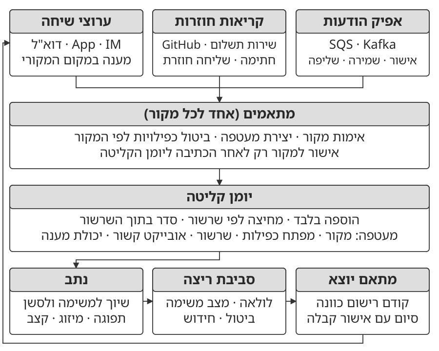

יש ארבעה סוגים נפוצים של מקורות. **ערוצי שיחה** כוללים את ממשק השיחה של המוצר עצמו, הודעות מיידיות כמו WeCom,‏ Feishu ו‑Slack, וכן דואר, והסוכן יכול להשיב באותו מקום. **קריאות חוזרות** הן ממשקי HTTP ששירות חיצוני קורא להם כשמצב משתנה; בדרך כלל הן חתומות ונושאות רק הודעה. כשמסירה נכשלת, שירותים מסוימים מנסים שוב אוטומטית, ואילו ב‑GitHub צריך למסור מחדש ידנית או דרך ה‑API. **אפיקי הודעות** כגון SQS ו‑Kafka נושאים אירועים עסקיים של שירותים פנימיים, עם סמנטיקה מפורשת של אישור ושמירה. **טיימרים, polling ואירועים פנימיים** נוצרים במערכת עצמה, ומספיק לכתוב אותם לאותו יומן. הטבלה הבאה משווה את שלושת הסוגים הראשונים.[^ch6-ingress-mq][^ch6-ingress-callback]

| | שיחה באפליקציה | WeCom / Feishu | דואר | Webhook | SQS | Kafka |
|---|---|---|---|---|---|---|
| אופן ההגעה | חיבור מתמשך | קריאה חוזרת או חיבור מתמשך | דחיפה או polling | קריאה חוזרת | משיכה על ידי הצרכן | משיכה על ידי הצרכן |
| היקף הסדר | בתוך השיחה | ברוב האירועים אינו מובטח | אינו מובטח | אינו מובטח | בתור סטנדרטי אינו מובטח, ב‑FIFO לפי קבוצת הודעות | בתוך מחיצה |
| בסיס מובנה למניעת כפילויות | מזהה הודעה של הלקוח | מזהה הודעה, מזהה אירוע | Message-ID | מזהה מסירה | מזהה הודעה; ב‑FIFO יש גם `MessageDeduplicationId` | נושא, מחיצה והיסט |
| אפשרות להרצה חוזרת | תלויה ברשומות שלכם | את הקריאה החוזרת עצמה אי אפשר להריץ שוב; ב‑Feishu אפשר להשלים דרך ממשק היסטוריית ההודעות | אפשר לקרוא שוב את תיבת הדואר | תלויה בשירות | לא אחרי מחיקה | כן, בתוך תקופת השמירה |
| אופן האישור | אישור קבלה מהלקוח | החזרת הצלחה בתוך מגבלת הזמן | רישום עצמי של מיקום הקריאה | החזרת 2xx בתוך מגבלת הזמן | מחיקת ההודעה | ביצוע commit להיסט |
| נתיב התשובה | השיחה המקורית | השיחה המקורית | מענה בדואר | אין | אין | אין |

**מעטפה אחידה.**

המתאם ממיר את ההודעה הגולמית ל**מעטפה** (envelope) בפורמט אחיד. המעטפה מתעדת רק עובדות שאפשר לקבוע ברגע ההגעה; עדיפות ומועד יעד לטיפול מוסיפים כללי הניתוב, רמת הלקוח ומצב ההזמנה מוסיפות המערכות העסקיות, ומצב הטיפול נשמר בנפרד. את בקשת ההחזר של הלקוח אפשר לכתוב כך:

```json
{
  "id": "evt_7f3a",
  "source": {"type": "app_chat", "sender": "user:u_5521", "verified": true},
  "dedupe_key": "app:msg:msg_1029",
  "thread": "app:conv:conv_88",
  "kind": "message",
  "correlation": ["order:12345"],
  "content": {"type": "text", "text": "אני רוצה החזר כספי על ההזמנה הזאת"},
  "raw_ref": "raw/2026-11-23/app/msg_1029.json",
  "reply": {"via": "app_chat", "target": "app:conv:conv_88"},
  "occurred_at": "2026-11-23T14:02:09+08:00",
  "expires_at": null
}
```

- `source`: סוג המקור והשולח המאומת. את הסימון "מאומת" קובע המתאם לפי חתימה, אסימון או חשבון הערוץ; הצגה עצמית בגוף ההודעה אינה נחשבת. סביבת הריצה קובעת הרשאות לפי השדה הזה.
- `dedupe_key`: מפתח מניעת הכפילויות; מה נחשב כפילות נקבע לפי הסמנטיקה של המקור. מזהה מסירה, מזהה הודעה, או מחיצה והיסט מזהים מסירה אחת, וחוסמים מסירות חוזרות בשכבת התעבורה; אם הודעה עסקית נושאת מפתח אידמפוטנטיות (idempotency key), למשל מספר ההחזר יחד עם המצב, המתאם צריך לחלץ אותו כדי לחסום גם כפילויות עסקיות. בשיחה עם משתמש המצב הפוך: לקוח שאומר "החזר" פעמיים שלח שתי הודעות, ולכן מונעים כפילויות רק לפי מזהה ההודעה של הלקוח.
- `raw_ref`: המטען הגולמי, שנשמר בלי שינוי; כשמחפשים שגיאה במתאם, רק עליו אפשר לסמוך.
- `reply`: דרך איזה מתאם יוצא ולאיזה יעד נשלחת התשובה. לקריאה החוזרת של שירות התשלומים אין נתיב תשובה, ולכן השדה ריק.
- `occurred_at` הוא זמן ההתרחשות שהמקור מסר; `expires_at` הוא תקופת התוקף, וממלאים אותו רק באירועים כמו הצעות מחיר וקודי אימות.

**שרשורים וקישורים.**

הלקוח אומר קודם "החזר", ומיד אחר כך מוסיף "עזבו, תחליפו לי את המוצר"; אסור להפוך את סדר שתי ההודעות. הודעות של לקוח אחר אינן קשורות אליהן, ואפשר לעבד אותן במקביל. **שכבת הקליטה מבטיחה סדר רק בתוך שרשור.** המתאם ממפה את יחידת הסדר של המקור ל‑`thread`: שיחה אחת באפליקציה, קבוצת הודעות ב‑SQS FIFO (`MessageGroupId`), מפתח המחיצה ב‑Kafka, מספר ה‑Issue או ה‑PR בקריאה חוזרת של GitHub. כשהמקור אינו מבטיח סדר, סביבת הריצה מזהה מצב ישן שהגיע באיחור לפי `occurred_at` או לפי מספר גרסה שהמקור מספק — למשל "ההחזר בטיפול" שמגיע אחרי "ההחזר בוצע".

ארבע ההודעות של ההחזר הזה שייכות לארבעה שרשורים. איחוד שלהן לשרשור אחד עולה ביוקר: כל דיון לא קשור בקבוצת השירות ייאלץ לחכות בתור אחרי הודעות הלקוח, ומזהה השרשור משמש לעיתים קרובות גם כמפתח מחיצה, כך ששינוי שלו בדיעבד מחייב העברת נתונים. **קישורים מבוטאים בשדה נפרד, בלי לשכתב את השרשור.** `correlation` מפרט את האובייקטים העסקיים שהאירוע נוגע בהם, ומשימות נרשמות לשרשורים הרלוונטיים לפי האובייקטים המקושרים.

**הפרדה בין עיתוי האישור לבין ההתקדמות.**

**המתאם צריך לאשר למקור אחרי שהאירוע נכתב ליומן הקליטה, ולא לחכות שהסוכן יסיים לעבד אותו.** קריאות חוזרות של אירועים ב‑Feishu מחייבות תגובה בתוך 3 שניות, וב‑WeCom בתוך 5 שניות, אחרת האירוע נדחף שוב; הודעה ב‑SQS שלא נמחקה בתוך זמן ההסתרה (visibility timeout) תימשך שוב. אם מאשרים רק אחרי העיבוד, קריאה ארוכה מעט למודל תגרור מסירה כפולה. כשכותבים ליומן ורק אז מאשרים, הבטחות המסירה של כל המקורות מתכנסות למשפט אחד: **כל אירוע נכנס ליומן הקליטה לפחות פעם אחת (at-least-once)**, והמסירה החוזרת נחסמת על ידי מפתח מניעת הכפילויות.

יומן הקליטה הוא תיבת דואר נכנס (inbox); הוא ממשיך את עקרון ההוספה בלבד מפרק 1 ומחולק למחיצות לפי שרשור. כשמשתמשים ב‑Kafka כיומן קליטה, מניעת כפילויות דורשת אחסון נפרד עם אילוץ ייחודיות, או סינון לפי מפתח מניעת הכפילויות בצד הצרכן: ‏Kafka אינו יכול לדחות כתיבה לפי מפתח שהיישום סיפק, והמפיק האידמפוטנטי שלו מכסה רק ניסיונות חוזרים של המפיק עצמו.

המערכת צריכה לשמור בנפרד שלושה סוגי התקדמות:

| התקדמות | מה נרשם | מי מתחזק |
|---|---|---|
| התקדמות המקור | היסט ב‑Kafka, ידית קבלה ב‑SQS, מיקום הקריאה בתיבת הדואר | המתאם |
| התקדמות השיבוץ | לאילו משימות כבר נמסרו האירועים שביומן | הניתוב |
| מצב המשימה | לאיזה שלב הגיע הטיפול, האם התשובה כבר נשלחה | סביבת הריצה |

אם מתייחסים להיסט כאל התקדמות המשימה, הרצה חוזרת של היומן תשלח שוב תשובות שכבר נשלחו; כשמפרידים ביניהם, הרצה חוזרת משפיעה רק על התקדמות השיבוץ. בכיוון היוצא, המקבילה היא תיבת דואר יוצא (outbox): לפני השליחה רושמים את כוונת השליחה ואת מפתח האידמפוטנטיות, ומסמנים השלמה רק כשמגיע אישור מהערוץ; כיצד מבצעים התאמה אחרי הפעלה מחדש — ראו בהמשך "בניית לולאה בסיסית מאירועי דואר".

**תוקף, מיזוג ולחץ נגדי.**

כשמאות אירועים בשנייה נוחתים על אותו שרשור, אין להעביר אותם למודל אחד אחד. הניתוב מטפל בצבר לפני השיבוץ:

- **תוקף.** הצעות מחיר, קודי אימות והתראות שכבר נפתרו מאבדים את משמעותם כשהזמן עובר. אירוע שעבר את `expires_at` נרשם רק במסלול, ואינו מעיר עוד את המודל.
- **מיזוג.** `kind` מבחין בין שני סוגי אירועים. אירועי מצב מתארים את הערך הנוכחי של אובייקט, כמו מצב ההחזר בקריאה החוזרת של שירות התשלומים או מצב ההזמנה ב‑Kafka; כשכמה מהם מצטברים באותו שרשור, רק האחרון מועבר למודל, וערכי הביניים נשארים ביומן. אירועי הודעה הם משפט שמישהו אמר או הוראה שנתן, כמו הודעת לקוח או לחיצה של מנהל; אפשר להעביר אותם למודל באצווה, אבל אסור להשמיט אותם.
- **לחץ נגדי.** במקורות משיכה אפשר להאט את המשיכה, והצבר נשאר במקור. במקורות דחיפה אי אפשר לבקש מהצד השני לעצור; המתאם ממשיך לכתוב ליומן ולאשר כרגיל, הצבר עובר ליומן הקליטה, ושני הכללים הקודמים מטפלים בו.

**החזר כספי אחד דרך ארבעה מקורות.**

1. הלקוח מבקש החזר בשיחה באפליקציה. המתאם מונע כפילויות לפי מזהה ההודעה של הלקוח, כותב ליומן ואז שולח אישור קבלה ללקוח; הניתוב יוצר משימת החזר לפי `order:12345`, והמשימה נרשמת לשרשור השיחה הזה.
2. הסכום חורג מההרשאה, ולכן הסוכן שולח כרטיס אישור לקבוצת השירות ב‑WeCom, ומזהה הכרטיס נרשם במשימה. המנהל לוחץ "מאשר"; המתאם כותב ליומן, מחזיר הצלחה ומוסיף את האובייקט המקושר לפי מזהה הכרטיס.
3. אחרי שהסוכן קורא לממשק ההחזר, שירות התשלומים שולח פעמיים קריאה חוזרת "ההחזר בוצע" עם אותו מזהה מסירה, והפעם השנייה נחסמת ככפילות.
4. מערכת ההזמנות מפרסמת ב‑Kafka "ההזמנה הוחזרה" — אותה עובדה שהקריאה החוזרת דיווחה עליה. אם שני המתאמים מחלצים מהמטען את מספר ההחזר יחד עם המצב כמפתח מניעת כפילויות, האירוע נחסם כבר בקליטה; אם כל אחד מהם מונע כפילויות לפי מזהה מסירה או לפי מחיצה והיסט, שני האירועים נכנסים ליומן, וסביבת הריצה, שרואה שההחזר כבר אושר במשימה, רק רושם את האירוע במסלול.
5. לקריאה החוזרת ולאירוע ה‑Kafka אין נתיב תשובה. סביבת הריצה משתמשת ב‑`reply` של שרשור השיחה משלב 1, ומודיעה ללקוח דרך המתאם היוצא של האפליקציה.

שלב 4 מסמן את גבול מניעת הכפילויות בשכבת הקליטה: אילו כפילויות נחסמות תלוי במפתחות שהמתאמים הצהירו עליהם; מה שלא נחסם מוכרע לפי מצב המשימה. אחרי שאירוע משובץ למשימה, השאלה אם לצרף אותו לסשן קיים או לפתוח סשן חדש שייכת לניהול ההקשר: מידע בין סשנים מועבר בזיכרון של פרק 3, ושאלת שיתוף ההקשר נדונה בפרק 10.

[^ch6-ingress-mq]: Amazon Web Services, “Amazon SQS standard queues”; “Amazon SQS visibility timeout”; “Using the message deduplication ID in Amazon SQS”; “Using the message group ID with Amazon SQS FIFO Queues”. תיעוד Apache Kafka 4.4, הסעיפים “Consumer Position” ו‑“Message Delivery Semantics” בפרק “Design”. נבדק ב‑2026-11-24.
[^ch6-ingress-callback]: Feishu Open Platform, “סקירת אירועים”; “קבלת היסטוריית ההודעות של שיחה”. מרכז המפתחים של WeCom, “סקירה” תחת “קבלת הודעות ואירועים”. GitHub Docs, “Best practices for using webhooks”; “Handling failed webhook deliveries”. נבדק ב‑2026-11-24.

### מנגנון טיפול באירועים

הודעות משתמש, תוצאות כלים, טיימרים ובקשות שיתוף פעולה עשויים להגיע לסוכן בו‑זמנית. סביבת הריצה צריכה לשמור את האירועים האלה, לקבוע את סדר הטיפול בהם, ורק אז להעביר למודל את המידע הרלוונטי. **לולאת האירועים** (event loop) מקדמת את התהליך הזה ברציפות: היא שולפת אירוע מהתור, מעדכנת את מצב המשימה, מרכיבה את הבקשה למודל, מתזמנת כלים, ואז ממתינה לקלט חדש או להודעת השלמה. תוכניות Go מארגנות ריבוי ערוצי הודעות באמצעות goroutine,‏ channel ו‑`select`, ברוח דומה.

ניקח כדוגמה את אב הטיפוס dsh-superagent. באותו פרויקט GitHub, הדיון תחת Issue והדיון תחת בקשת משיכה (PR) שייכים לשני שרשורי שיחה (Thread) נפרדים. כשהמערכת צריכה להחליט אם לקבל על עצמה עבודה חדשה, היא קוראת את מצב השרשור ומבקשת מהמודל לבצע הערכה (Eval). בכל שרשור מתבצעת לכל היותר הערכה אחת בכל רגע, אבל כמה כרטיסי עבודה (Ticket) יכולים להירשם אליו. נניח ששני כרטיסי עבודה, אחד לתיקון באג ואחד להשלמת תיעוד, רשומים לאותו PR. כשסוקר כותב תגובה תחת ה‑PR, שני הכרטיסים מקבלים אותה כהקשר. אם מאוחר יותר מישהו מוסיף תחת ה‑Issue את תנאי השחזור, ההודעה תגיע לכרטיסים הרשומים ל‑Issue. למי הודעה מגיעה נקבע לפי השרשור ויחסי הרישום. מה מותר לעשות אחרי שהיא מגיעה עדיין נקבע לפי ההרשאות הקיימות של כל כרטיס.[^ch6-dsh-threads]

‏dsh-superagent גם מפריד בין "התנהלות מול אנשים" לבין "ביצוע העבודה" ומקצה להם סשנים שונים. הסשן הראשי (Main Session) רק מקבל משימות, משיב לאנשים וכותב הרשאות; הוא אינו קורא קוד ואינו עוצר לחכות לתוצאות. לכל כרטיס עבודה יש סשן ביצוע משלו (Executor Session), שמשנה קוד ומריץ בדיקות בתיקיית עבודה נפרדת. סשן הביצוע שולח הודעה לסשן הראשי רק כשהתיקון הושלם, כשהוא נתקע או כשהוא צריך לשאול אדם, ומצרף לה סיכום וכתובת קריאה — "סיכום ועוד מזהה אובייקט" שתואר בפרק 2. כך לסשן הראשי תמיד יש ידיים פנויות לבקשה הבאה, ושאלות לאנשים, הודעות ובקשות עצירה עוברות כולן דרכו, כך שהתחייבויות יוצאות מנקודה אחת בלבד. המודל המהיר והמודל האיטי בחלק על הקול בהמשך הם אותה חלוקת עבודה בשיחה בזמן אמת.[^ch6-dsh-sessions]

ממשקי מודל סינכרוניים מקבלים בדרך כלל את קבוצת ההודעות הבאה רק בסיום הפקה או אחרי שתוצאות הכלים הושלמו. כאן אפשר להגדיר **נקודה בטוחה**: סביבת הריצה רושמת תחילה את ההודעות שהושלמו, את הקריאות שעדיין רצות ואת התקדמות המשימה הנוכחית, ורק אז עוברת לשלב העיבוד החדש. ממשקים אסינכרוניים מובנים מספקים פרוטוקול לקבלת עדכונים בזמן הריצה, והמועד המדויק להמשך נקבע במשותף על ידי הממשק וסביבת הריצה.

גם ביטול מחייב שיתוף פעולה מצד המבצע. אחרי שהמודל מפסיק להפיק, כלי רקע עשוי עדיין לרוץ; המבצע צריך לקבל את אות הביטול ולדווח על המצב בפועל, בדומה למשימת Go שבודקת את `ctx.Done()` ואז מבצעת ניקוי. כתיבות, שליחות או תשלומים שכבר בוצעו יש לבטל או לפצות עליהם דרך התהליך העסקי המתאים.

**שלוש אסטרטגיות טיפול.**

איור 6-3 משווה את שלוש האפשרויות כשאירוע חדש מגיע. אם מכניסים אותו לתור, זמן התגובה תלוי במועד שבו תגיע הנקודה הבטוחה הבאה; אם מבטלים את המשימה הנוכחית, צריך לברר אילו פעולות כבר הושלמו ומאיזו נקודה אפשר להמשיך; אם פותחים לולאה נוספת, צריך לבדוק אם שתי המשימות יתחרו על אותו משאב.

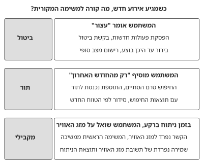

**עיבוד מבוסס ביטול (Cancellation-Based)** מתאים להוראות עצירה של המשתמש או לאירועי בקרה שיש לטפל בהם מיד. סביבת הריצה מפסיקה תחילה לשגר פעולות קשורות, שולחת אות עצירה לבקשות שנמצאות בהפקה ולכלים הניתנים לביטול, ושומרת את ההודעות שהושלמו, את מצב הכלים ואת אישורי הביטול. רק אז האירוע החדש נכנס להקשר ההחלטה. לדוגמה, כשהמשתמש אומר "עצור! אמרתי משהו לא נכון", המערכת מגבילה תחילה את המשך הביצוע, ואז מאשרת מחדש את המשימה לפי המצב בפועל. פריטים בתור שטרם טופלו שומרים על המזהה ועל המצב שלהם, ומסודרים מחדש לפי היקף הקשר שלהם.

**עיבוד בתור (Queued)** מתאים למידע משלים שגרתי ולעדכוני התקדמות. האירוע נכנס לתור ומועבר למודל בנקודה הבטוחה הבאה יחד עם תוצאות הכלים. לדוגמה, בזמן חיפוש המשתמש מוסיף "הצג רק תוצאות מהחודש האחרון"; כשהחיפוש חוזר, המודל קורא את התוצאות ואת התנאי החדש יחד, ומחליט אם לסנן או לחפש מחדש.

**עיבוד מקבילי (Parallel)** מתאים לבקשות שאינן תלויות במשימה הראשית ודורשות תשובה מהירה. לדוגמה, בזמן ניתוח נתונים בהיקף גדול המשתמש שואל על מזג האוויר, והמערכת יכולה לפתוח סשן נפרד כדי לענות.

**דחיפות וניתוב.**

סוג האירוע נותן רמז ראשוני: `user.interrupt`, הוראות פיקוח מהימנות והתראות מערכת יכולים להיכנס לערוץ בעדיפות גבוהה; `user.input`,‏ `agent.input`,‏ `tool.result` ו‑`timer.trigger` מוערכים גם לפי התוכן ולפי מצב המשימה. כששולח מצהיר בגוף ההודעה שהעניין "דחוף", המערכת עדיין קובעת הרשאות לפי זהות מאומתת ולפי הכללים.

לניתוב שדורש הבנה של משמעות ההודעה, המחבר ממליץ על מודל סיווג קל משקל: "עצור מיד" פירושו ביטול, "מה מזג האוויר היום?" מתאים כנראה לעיבוד מקבילי, ו"כתוב את הדוח בסינית" נכנס בדרך כלל לתור ההשלמות של המשימה הנוכחית. נקודות כניסה מפורשות לעצירה מטופלות ישירות על ידי סביבת הריצה, והסיווג הסמנטי משמש לשאר ההודעות שדורשות הבנה.

גם מודל כללי יכול לתייג הודעות, אבל גם כשהפלט הוא שתי מילים בלבד, "דורש טיפול", המודל עדיין צריך לקרוא את תיאור המשימה ואת תוכן ההודעה. אם כל הודעה חדשה נשפטת כך, עלות הקריאות גדלה עם כמות ההודעות, וגם הודעה דחופה באמת צריכה לחכות לתווית מהמודל לפני שהיא ממשיכה הלאה. ‏Jev של TypeSafe מיועד בדיוק למשימות שיפוט כאלה, שבהן האפשרויות נתונות מראש. בהינתן הודעה ומצב המשימה הנוכחי, הוא מחזיר במקביל את ההסתברות של כל אפשרות, בעלות ובהשהיה נמוכות יחסית.[^ch6-jev]

הדלילות של מרחב התצפית, שנדונה בפרק 1, קובעת כאן אילו הודעות יפעילו הסקה חדשה. בהודעות Feishu ובתגובות על GitHub Issue, למשל, התוכנית יכולה לסנן תחילה התראות כפולות לפי מזהה האירוע, ואז לבקש מ‑Jev לקבוע אם ההודעה החדשה משלימה משימה קיימת או מעלה בקשה חדשה שדורשת את המודל הראשי. כשהוא קורא "הנה שלבי השחזור שהבטחתי אתמול", המודל צריך רק לקבוע שזו הערה משלימה. לאיזה Issue היא שייכת התוכנית קוראת ישירות מהמזהה שמצורף לתגובה.

גם כשהמודל מחזיר הסתברות גבוהה, הוא עשוי להעריך את הביטחון שלו יתר על המידה. לדוגמה, 100 הודעות סווגו כולן כ"השלמה למשימה קיימת" בהסתברות של כ‑90%, אבל רק 60 מהן שייכות בפועל לקטגוריה הזו. אם המערכת ממזגת אוטומטית את כולן למשימות קיימות, היא מפספסת את המטרה המקורית של 40 ההודעות האחרות.

[^ch6-jev]: ‏TypeSafe מתארת בהודעת ההשקה של Jev פלט מוגדר מראש, החזרת הסתברויות במקביל, ואת RLCD, שיטת אימון שמטרתה כיול החלטות.

### בניית לולאה בסיסית מאירועי דוא"ל

נניח שהתהליך שמטפל בהודעות דוא"ל חדשות מופעל מחדש לפתע. מזהה ההודעה עוזר לו למצוא את הטקסט המקורי, אבל אינו אומר לו אם התשובה הקודמת כבר נשלחה. מהכניסה לתור, דרך קריאת ההודעה וקריאות לכלים, ועד עדכון תיבת הדואר או יידוע המשתמש, כדאי לרשום כל פעולת כתיבה ואת האישור שחזר ממנה תחת אותה הודעה. אם אחרי ההפעלה מחדש מתברר שבקשה נשלחה ואין לה אישור, יש לבדוק תחילה את המצב בפועל בתיבת הדואר, ורק אז להחליט אם לשלוח שוב.

> **ניסוי 6-1 ★★★: סוכן עיבוד דוא"ל מונחה אירועים**
>
> ניסוי זה משתמש בתיבת דואר לבדיקות כנקודת כניסה, ומתרגל רישום אירועים, תור ועיבוד משימות. תחילה ממירים הודעות חדשות לאירועים מובנים ומעבדים אותם לפי סדר ההגעה; אחר כך מחברים כלים כמו היסטוריית דוא"ל, קריאת קבצים מצורפים, שאילתות ידע והתראות. עקבו לאורך איור 6-4 אחרי הזמנה לפגישה: מצאו בלולאת האירועים את שני השלבים של בדיקת התנגשויות ביומן ושל ניסוח הטיוטה, ואז מצאו בשכבת ההתמדה את רשומת הטיפול בהודעה הזו.
>
> 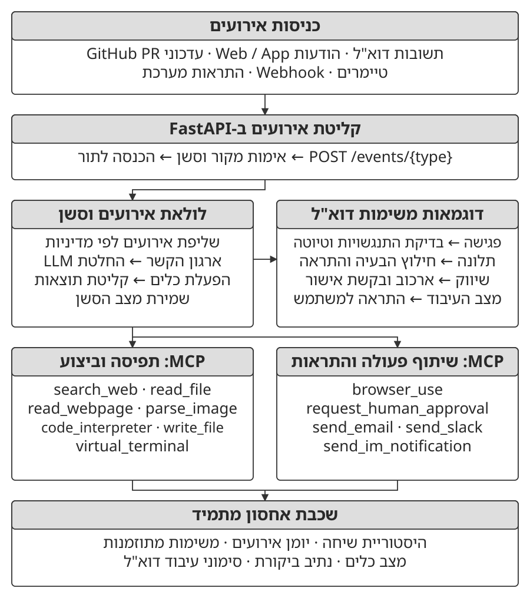
>
> אפשר להרחיב את אותו תור למקורות נוספים: הגעת דוא"ל, הודעות IM או SMS, עדכוני PR ו‑Issue ב‑GitHub, טיימרים, Webhook חיצוניים, ואירועים פנימיים כמו משתמש שאינו מקוון, פסק זמן של תהליך והתראות משאבים. כל מתאם אחראי לאמת את המקור ולהוסיף מידע מקשר, ותוצאות העיבוד נכתבות בחזרה לפי מזהה האירוע.
>
> הקבלה מתבססת על שלוש הודעות בדיקה: הזמנה לפגישה מפעילה בדיקת התנגשויות ביומן ויוצרת טיוטת אישור או סירוב; תלונת לקוח מפעילה חילוץ מידע מפתח, סימון בעדיפות גבוהה ויידוע המשתמש; דוא"ל שיווקי מאורכב לפי כללים.
>
> הרשומות הנלוות הנוכחיות כוללות בדיקה של תיעוד הממשק ובדיקת אימות; חיבור תיבת הדואר לבדיקות עדיין ממתין לפרטי גישה תקפים.
>
> **הרחבה (רשות): קליטה מכמה מקורות והזרקת תקלות.** מעבר לתיבת הדואר לבדיקות, חברו נקודת קצה מקומית של Webhook ותור SQS (אפשר להשתמש בהדמיה מקומית). כל מתאם מאמת את המקור, יוצר מעטפה, כותב אותה ליומן הקליטה ורק אז מאשר למקור; סביבת הריצה קוראת אירועים מהיומן ומעבדת אותם לפי סדר השרשור. אחר כך הזריקו שלושה סוגי תקלות:
>
> 1. **מסירה כפולה.** נקודת הקצה של ה‑Webhook מקבלת פעמיים בקשה עם אותו מזהה מסירה, וביומן מופיע אירוע אחד בלבד.
> 2. **קריסה לפני אישור.** המתאם נעצר אחרי שכתב ליומן ולפני שמחק את הודעת ה‑SQS; ההודעה הופכת שוב לגלויה ונקראת מחדש, וביומן עדיין יש אירוע אחד בלבד.
> 3. **קריסה לפני אישור קבלה.** סביבת הריצה נעצרת אחרי ששלחה תשובה ולפני שרשמה את אישור הקבלה, ואחרי ההפעלה מחדש היא משחזרת מהיומן. אם הערוץ תומך במפתח אידמפוטנטיות, או שאפשר לבדוק בו אילו הודעות נשלחו (למשל רשימת הנשלחים בתיבת הדואר), אותה תשובה אינה נשלחת פעמיים; בערוץ שאין בו אף אחד מהשניים, אפשר רק לסמן את התשובה כממתינה לאישור ידני.
>
> כל שלושת סוגי התקלות צריכים להשאיר רשומה ביומן: איזו מסירה סוננה ככפולה, איזו הודעה נקראה מחדש, ואיזו תשובה לא נשלחה שוב אחרי בדיקה.
>
> הקוד הנלווה להרחבה הזו רץ במצב לא מקוון ואינו דורש API Key. תיבת הדואר לבדיקות ותור ה‑SQS מודמים שניהם באמצעות קבצים מקומיים, בנפרד מתיבת הדואר האמיתית שלמעלה, שעדיין ממתינה לפרטי גישה; התור המודמה שומר על פסק זמן נראות, על ידית קבלה ועל הסדר בתוך קבוצת הודעות. את הקריסות מבצע תהליך האב, שעוצר את תהליך הבן ישירות בנקודה שהוגדרה. כל ערוץ תשובה מדגים אפשרות אחת: דוא"ל בודק את רשימת הנשלחים, שיחה באפליקציה משתמשת במפתח אידמפוטנטיות, וב‑SMS אין אף אחד מהשניים. כדי לשחזר, היכנסו ל‑`chapter6/agent-with-event-trigger` והריצו `python multisource_demo.py`; הטרמינל ידפיס אחת אחת את רשומות היומן שהשאירו שלושת סוגי התקלות. ברשומות ההרצה הנלוות, כל הבדיקות של שלושת סוגי התקלות עברו.
>

תור הדוא"ל מבסס את היסודות לעיבוד סדרתי. בשלב הבא נוסיף כלים ארוכי ריצה, ונדון כיצד לקבל דרישות חדשות בזמן ההמתנה, לבטל משימות ולחדש את העבודה.

### תאימות כשאין תמיכה אסינכרונית מובנית

נניח שהסוכן מנסח הודעת דוא"ל וכבר קרא ל‑`search_contacts` כדי למצוא איש קשר. לפני שהתוצאה חוזרת, המשתמש מבקש: "רגע, תבדוק קודם את מזג האוויר מחר". אם ממשק המודל הנוכחי דורש שלכל קריאה לכלי תותאם תוצאה, ה‑Harness צריך להמיר את מצב הרקע לרצף הודעות שהממשק מקבל.

**ביטוי מצב הרקע בפורמט הודעות סינכרוני.**

**בתאימות לממשק סינכרוני, יש לשמור ככל האפשר על הזיווג בין קריאות רגילות לתוצאות האמיתיות שלהן, ולהוסיף תגובת מצב רק כשעוברים למשימה אחרת באמצע.** אם ממלאים מוקדם מדי "עדיין רץ" לכל קריאה, המסלול מתמלא במצבים לא גמורים, והמודל מתקשה יותר לעקוב אחרי התוצאות האמיתיות. אפשר לפעול לפי חמישה כללים:

1. **רישום קריאות שלמות.** כתבו למסלול את הודעות ה‑assistant ואת פריטי הקריאות לכלים שה‑API השלים, ושמרו את מזהי הקריאות. מצב הסקה שמנוהל בצד השרת נשמר לפי דרך ההמשך שהספק מגדיר.
2. **רישום השלמה אמיתית.** כשהכלי מסתיים, כתבו את התוצאה בפועל, את מזהה המשימה ואת מצב הביצוע; בזמן הביצוע, מנהל המשימות ממשיך לשמור את המצב הלא גמור.
3. **דיווח על המצב הנוכחי בעת מעבר.** בממשקים שמאפשרים מטען תוצאה כזה, אפשר להחזיר לקריאה הממתינה מידע מצב מפורש, למשל "המשימה עדיין רצה ברקע, התוצאה טרם התקבלה", ואחריו לצרף את אירוע המשתמש. מזהה המשימה בתגובת המצב מקשר להודעת ההשלמה שתגיע בהמשך.
4. **סידור ההודעות אחרי קטיעה.** כשאין יכולת המשך באמצע, בטלו את ההפקה שלא הושלמה, שמרו את ההודעות שאושר שהושלמו ואת מצב הכלים, ושלחו בקשה חדשה. פלט לא גמור מטופל כפי שהממשק מגדיר, כדי לא להתייחס לפרמטרים חלקיים כאל קריאה ברת‑ביצוע.
5. **קבלת אירועים שגרתיים באצווה.** מידע משלים נכנס לתור ונשלח יחד בסוף המחזור הנוכחי או בנקודה בטוחה מוגדרת, ונרשם אילו אירועים כבר טופלו.

בדוגמת חיפוש איש הקשר, הקריאה השלמה נכתבת תחילה למסלול; כשהמשתמש עובר למשימה אחרת, ה‑Harness מוסיף תגובת מצב שלפיה החיפוש עדיין רץ, ואז שולח את בקשת מזג האוויר. תוצאת איש הקשר מגיעה מאוחר יותר ונכנסת להקשר כאירוע חדש עם מקור ומזהה משימה, והסוכן ממשיך לנסח את ההודעה. כשהקריאה המקורית כבר קיבלה תגובת מצב, התוצאה שמגיעה אחר כך מוצגת בצורת האירוע שהמתאם מגדיר, וכך נשמר הזיווג בין קריאה לתוצאה.

תגובת המצב מתארת רק את התקדמות הביצוע הנוכחית. שלבים שתלויים בנתוני איש הקשר חייבים לחכות עד שהתוצאה האמיתית מגיעה. מנהל המשימות יכול לשמור מצבים כמו `running`,‏ `completed`,‏ `cancelled` ו‑`failed`, ולבדוק שהתלויות התקיימו לפני שליחת תשובה או הפעלת כלים נוספים.

**תכנון כלים אסינכרוניים באמצעות ידיות משימה.**

בכלים חדשים למשימות ארוכות, המחבר מעדיף להגדיר את "ההתחלה" כפעולה שלמה בפני עצמה, שמחזירה מיד ידית משימה אמיתית. כך המודל מבחין בין "התחיל" לבין "הסתיים", ולשאילתות, לביטולים ולאירועי התוצאה בהמשך יש בסיס אחיד לקישור. לדוגמה, `initiate_phone_call` יוזם משימת שיחה ומחזיר מזהה משימה ומצב "מחייג"; ‏`phone_call_connected` ו‑`phone_call_ended` מדווחים בהתאמה על חיבור השיחה ועל סיומה.

תיאור הכלי צריך לומר במפורש: "כלי זה יוזם משימת שיחת טלפון ומחזיר מזהה משימה בהצלחה. אתה יכול להמשיך לטפל בעניינים אחרים; התקדמות השיחה ותוצאת הסיום יגיעו כאירועים נפרדים." שם הכלי אומר שזו פעולת התחלה, ומבנה ערך החזרה והאירועים שבאים אחריו אומרים כיצד המשימה מתקדמת ומסתיימת. המערכת מספקת גם ממשקים לשאילתה, לביטול ולחידוש לפי מזהה משימה, כדי שהמודל יידע מה עוד אפשר לעשות כרגע.

**טיפול פרטני באירועים שהגיעו באצווה.**

כשכמה אירועים נכנסים להקשר בבת אחת, המודל עלול להגיב רק לאחרון ולפספס דרישות שהועלו קודם. סביבת הריצה צריכה לשמור מצב טיפול נפרד לכל אירוע, כך שתנאים שעדיין לא קיבלו מענה יישארו גלויים. הפרומפט יכול לבקש מהמודל לבדוק את האירועים אחד אחד, ושורת הסטטוס מפרטת את המידע שטרם טופל:

```text
[אירוע שלא טופל 1/4] תוצאת database_query: ……
[אירוע שלא טופל 2/4] השלמה מהמשתמש: רק נתונים של אזור בייג'ינג
[אירוע שלא טופל 3/4] תזכורת מערכת: נותרו 30 דקות למועד הגשת הדוח
[אירוע שלא טופל 4/4] שאלת המשתמש: מה מצב ההתקדמות?
```

סיכום האצווה יכול לציין "תוצאת כלי אחת, 2 הודעות משתמש, תזכורת מערכת אחת". סביבת הריצה מקשרת גם כל אירוע לאילוצי המשימה: תנאי האזור מעדכן את היקף השאילתה, המועד האחרון משפיע על התזמון, ושאלת ההתקדמות דורשת תשובה. אחרי הטיפול נרשם מצב של הושלם, ממתין או דורש הבהרה, והפריטים שלא נפתרו נשארים גם בסבב הבא.

אותו מזהה משימה מקשר את ההתחלה, דיווחי ההתקדמות ותוצאת הביצוע הסופית. אם מישהו מבקש לעצור באמצע, יש לבדוק בנוסף אם תחת המזהה הזה קיים אישור ביטול.

> **ניסוי 6-2 ★★★: סוכן אסינכרוני עם ביצוע מקבילי ויכולת קטיעה**
>
> ניסוי זה מאמת תחילה את סביבת הריצה האסינכרונית, ורק אחר כך מחבר מודל לבדיקת ההחלטות. ברשומות ההרצה הנלוות, ארבעה תרחישים הושלמו עם תהליכי בן אמיתיים של מערכת ההפעלה, ותזמון האירועים והדוחות הונעו על ידי סקריפט דטרמיניסטי.
>
> 1. **ביצוע ברקע ותגובה מיידית.** מפעילים תהליך ניתוח שנמשך כמה שניות ומחזירים מיד מזהה משימה; בזמן ההמתנה עונים מה השעה, ובסיום מקבלים את תוצאת הניתוח.
> 2. **תור ועיבוד באצווה.** במהלך משימה ארוכה מוסיפים בזו אחר זו את הבקשות "ענה ביפנית" ו"סדר את זה כדף אינטרנט"; כשהמשימה מסתיימת, התוצאה ושתי הבקשות מטופלות כאצווה אחת. הסקריפט מייצר HTML ביפנית.
> 3. **ביטול וחידוש.** ההדגמה מראה שקבלת "עצור את הניתוח" קוטעת את סבב המודל שעדיין בהפקה ודורשת מכל משימות הרקע הרצות לעצור. הפעם את הקטיעה שלח הסקריפט, ובאותו רגע רץ רק תהליך ניתוח אחד, T1. בשנייה 0.803 אירוע הקטיעה רשם התקדמות של 18% ל‑T1; רק בשנייה 0.806 המערכת רשמה את קוד היציאה שלו, ‎−15. ‏T2, שהופעל מיד אחר כך, הוא משימה חדשה. התוצאה שהתקבלה בשנייה 4.436 היא של T2, ו‑T1 לא הפעיל קריאה חוזרת של השלמה.
> 4. **משימות מקביליות והחלטות לפי התקדמות.** מפעילים שלושה תהליכי ניתוח בו‑זמנית, שמתקדמים בכל צעד זמן לוגי ב‑3%, ‏2% ו‑1% בהתאמה. ברשומת ההתקדמות המקבילית של הניסוי, כש‑T1, המהיר מכולם, הסתיים, אישורי השאילתה הראו ש‑T2 הגיע ל‑68% ו‑T3 ל‑34%. לפי איור 6-5, משימה שהתקדמותה אינה עולה על 50% מבוטלת. הסקריפט ביטל רק את T3, ובסוף התקבלו התוצאות של T1 ושל T2. מכאן שאותה סביבת ריצה יכולה גם להגיב לעצירה של אצווה שלמה וגם לשמור עבודה מקבילית שעדיין מועילה.
>
> 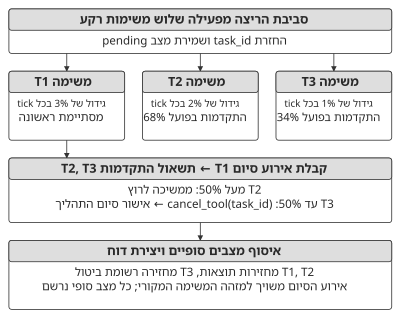
>

### אסינכרוניות מובנית במודל: GPT-6 Astra

בגישה הקודמת, ה‑Harness התאים את ההודעות לפורמט הסינכרוני. ממשק אסינכרוני מובנה, לעומת זאת, מאפשר למודל להמשיך בעבודה בלתי תלויה כשהכלי עדיין לא חזר, ולקבל את התוצאה מאוחר יותר. נכון לספטמבר 2026, ‏GPT-6 Astra כבר מציע קריאות אסינכרוניות לכלים (Async tool calling) והכוונה באמצע תור (Mid-turn steering), המטפלות בהתאמה בהמתנה לכלים ובעדכוני משתמש. איור 6-6 משווה את זרימת ההודעות בהתאמה לממשק סינכרוני ובאסינכרוניות מובנית.[^ch6-22][^ch6-23]

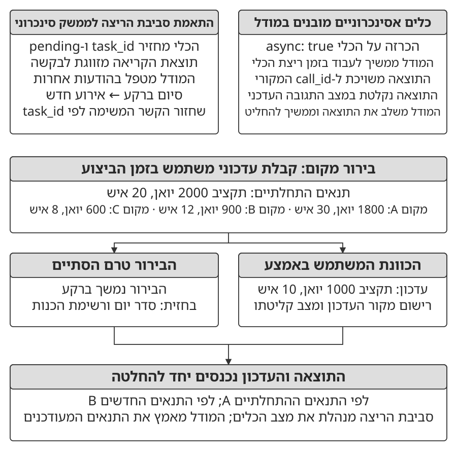

**להמשיך בעבודה בלתי תלויה בזמן ההמתנה לכלי.** למשל, אחרי שהסוכן שולח שאילתה על מקומות לפגישה, הוא יכול לסדר בינתיים את סדר היום ואת רשימת ההכנות; כשהשאילתה חוזרת, הוא משווה מחירים וקיבולת. ההגדרה `async: true` בהגדרת הכלי מצהירה על יכולת אסינכרונית; היישום מתחיל בביצוע אחרי שקיבל את פריט הקריאה המלא, ושומר את מזהה הקריאה `call_id`. כשהתוצאה מגיעה, היישום מחזיר אותה לפי המזהה המקורי וממשיך ממצב התגובה העדכני. המודל מתזמן את העבודה שבהמשך; ה‑Harness מנהל את שיוך הקריאות ואת מחזור החיים של המשימה.[^ch6-22]

**לקבל דרישות חדשות בזמן שהמשימה מתבצעת.** בזמן שהמודל חושב או מנסח תשובה, המשתמש יכול להוסיף "התקציב ירד ל‑1000" או "מספר המשתתפים השתנה ל‑10". היישום שולח אירוע הכוונה באותו חיבור; אחרי שהשרת מאשר את קבלתו, העיבוד נמשך לפי מצב התגובה הנוכחי. אחרי ניתוק וחיבור מחדש, היישום יכול לשחזר את המשימה מתוך האירועים ומצב התגובה שנשמרו.[^ch6-23]

אפשר לשלב את שתי היכולות: שאילתת המקומות ממשיכה לרוץ, הדרישות החדשות של המשתמש נכנסות להחלטות שבהמשך, והבחירה מושלמת כשתוצאות השאילתה חוזרות. במקביל, המבצע מתחזק את המצב האמיתי של משימות הרקע. כשצריך לעצור שאילתה או לבטל הזמנה, ה‑Harness קורא לממשק המתאים ובודק את האישור שהתקבל; פעולה עסקית שכבר הושלמה עוברת לתהליך ביטול או פיצוי.

כשהמודל והממשק כבר תומכים באסינכרוניות מובנית, המחבר מעדיף את הפרוטוקול המובנה, ונותן להשהיית הכלים, לעדכוני המשתמש ולהמשך התגובה לזרום לפי מוסכמות הממשק. שכבת התאימות הסינכרונית משרתת בעיקר מודלים קיימים וממשקים ישנים; אחרי שדרוג המודל אפשר להסיר בהדרגה לוגיקת תאימות שנועדה רק להשלים את הזיווג בין הודעות, ולרכז את המאמץ ההנדסי במצב המשימה, בביטול ובשחזור.

### טיפול אמין במשימות אסינכרוניות

אינטראקציה אסינכרונית אמינה מחייבת לבדוק בו‑זמנית את ההודעות, את המשימות ואת מצב הביצוע.

1. **שיוך תוצאות.** תוצאה מאוחרת נושאת את מזהה הקריאה המקורי, והיישום ממפה אותה למשימה המתאימה; החלטות התלויות בתוצאה ממשיכות רק אחרי שהנתונים הגיעו.
2. **חידוש וביטול.** כשהמשתמש משנה דרישות, המערכת שומרת את העבודה שעדיין תקפה, מעדכנת את הצעדים הבאים, ומבהירה אילו משימות רקע ממשיכות לרוץ ואילו כבר נעצרו.
3. **דרישות מרובות.** תקציב, מספר משתתפים, אזור ומועד אחרון נכנסים כל אחד בנפרד למצב המשימה, והתוצאה הסופית נבדקת מול כל אחד מהתנאים.

> **ניסוי 6-3 ★★★: אסינכרוניות מובנית במודל והכוונה באמצע תור**
>
> בניסוי זה הסוכן בוחר לפגישה מדומה את המקום הזול ביותר העומד בדרישות התקציב ומספר המשתתפים. התקציב ההתחלתי הוא 2000 ומספר המשתתפים 20; כלי השאילתה ממתין 8 שניות לפני שהוא מחזיר מחיר וקיבולת לשלושה מקומות.
>
> | מקום | מחיר | קיבולת |
> |---|---:|---:|
> | A | 1800 | 30 |
> | B | 900 | 12 |
> | C | 600 | 8 |
>
> בתנאים ההתחלתיים יש לבחור ב‑A. קבוצות ההכוונה מקבלות במהלך המשימה שני עדכונים: התקציב משתנה ל‑1000 ומספר המשתתפים ל‑10, ואז יש לבחור ב‑B. הכלי מחזיר גם אסמכתה שנוצרה זה עתה, והתשובה הסופית חייבת לצטט אותה — כך אפשר לבדוק אם המודל השתמש בתוצאה שהגיעה בפועל.
>
> הניסוי כולל חמש קבוצות, שלוש הרצות בכל אחת: כלי סינכרוני, כלי אסינכרוני מובנה, הכוונה בזמן ההסקה, הכוונה בזמן ההמתנה לכלי אסינכרוני, וקבוצת ביקורת עם מודל שאינו תומך בהכוונה. שתי הקבוצות הראשונות בודקות אם אפשר להפיק רשימת הכנות בלתי תלויה בזמן ההמתנה; שתי קבוצות ההכוונה בודקות אם התקציב ומספר המשתתפים נכנסים לתוקף יחד; קבוצת הביקורת בודקת אם הממשק מדווח במפורש שאין תמיכה.
>
> ברשומות ההרצה שנשמרו, קבוצת הכלי האסינכרוני השלימה את הרשימה הבלתי תלויה בזמן ההמתנה, ושתי קבוצות ההכוונה בחרו ב‑B לפי התנאים החדשים. כל ההרצות עם כלים ביצעו שאילתה אחת בלבד והחזירו את התוצאה האמיתית לקריאה המקורית; הממשק של מודל הביקורת השיב במפורש שאינו תומך בקבלת דרישות חדשות באמצע סבב הפקה. משך הזמן הכולל של הקבוצה הסינכרונית ושל האסינכרונית דומה; ההבדל העיקרי הוא אם אפשר לקדם עבודה אחרת בזמן ההמתנה.
>
> אם המודל זוכר רק שמספר המשתתפים השתנה ל‑10, ועדיין בוחר לפי התקציב הישן של 2000, איזה מקום ייבחר? גם A וגם B מכילים את המשתתפים, והזול מביניהם הוא עדיין B. לכן בחירה נכונה של מקום עדיין אינה מראה אם התקציב עודכן.
>
> מספר המשתתפים השתנה — האם צריך להריץ מחדש את השאילתה שכבר נשלחה? לכלי בניסוי הזה אין פרמטרי סינון, והוא מחזיר את שלושת המקומות. העוזר יכול להשתמש בתוצאה שעוד בדרך, ולסנן לפי 10 משתתפים ותקציב 1000 כשהיא חוזרת. אילו הכלי היה מחזיר רק מקומות המכילים 20 איש ומעלה, בתוצאה הישנה היה רק A, ו‑B, שמכיל 12, כלל לא היה בה. במצב כזה, שינוי מספר המשתתפים ל‑10 בתוך הרשימה הישנה בלבד עדיין מחמיץ את B. אם השאילתה המקורית כבר סיננה את B, צריך לשאול שוב.

המנגנון האסינכרוני מאפשר לשינויים חיצוניים להיכנס למערכת בזמן שהמשימה מתקדמת. אינטראקציה בקול, במסך וברובוט מקצרת עוד יותר את מחזור המשוב: המערכת צריכה לקבל קלט ברציפות ולהתאים את הפלט ואת הפעולה ברגע המתאים.

## קול: ממשק אדם‑מכונה הטבעי ביותר

קול מאפשר למשתמש לתאר צרכים, להוסיף תנאים ולאשר תוצאות גם כשהידיים או העיניים עסוקות בדבר אחר. הכתבה קולית ממירה דיבור לטקסט; סוכן קולי מנהל בנוסף את השיחה, את הקריאות לכלים ואת השמעת התשובה. שניהם יכולים לתמוך ב‑whisper coding שהוצג בהקדמה.

סעיף זה דן בשני שימושים: משתמש המדבר ישירות עם הסוכן, וסוכן המתקשר עם אנשים חיצוניים בשם המשתמש. הראשון מתמקד בזיהוי, בתגובה ובקטיעות; השני מחייב גם לאמת זהות, לבצע בירורים עסקיים ולקבל החלטות במהלך השיחה.

### תזמון האינטראקציה: ממדורג לדו‑כיווני מלא

בהצגת GPT-Live סקרה OpenAI שלושה סוגים של אינטראקציה קולית: מדורגת, מודל אודיו מבוסס תורות, ודו‑כיוונית מלאה[^ch6-12]. מסלול ההתפתחות הזה מעביר בהדרגה למודל את ההחלטה המתמשכת "מתי לדבר ומתי להמשיך להקשיב". במערכת מדורגת, לוגיקת נקודות הקצה היא שמסדרת בעיקר את העברת התור; מודל דו‑כיווני מלא יכול לשלב צליל רציף ומצב שיחה כדי לטפל בחפיפה, בהפסקות ובקטיעות.

| פרדיגמה | מבנה הליבה | יכולות שקל לממש | שאלות התכנון העיקריות |
|---|---|---|---|
| מדורגת | חלוקת עבודה בין VAD,‏ ASR,‏ LLM ו‑TTS | החלפת מודולים באופן עצמאי, בדיקת קלט ופלט בכל שלב | השהיה בין מודולים, מידע אקוסטי שאובד בתמלול |
| מודל אודיו מקצה לקצה מבוסס תורות | המודל מקבל ומייצר אודיו ישירות | ניצול אינטונציה, רגש ומידע דומה לבניית התשובה | זיהוי סוף הדיבור, העברת תורות ותזמון התגובה |
| דו‑כיוונית מלאה | קליטת אודיו רציפה והפקת פלט | דיבור חופף, אישורי האזנה, קטיעות ואינטראקציה רציפה | מצב רציף, שליטה בפלט והערכת האינטראקציה |

אם המודל מעבד אודיו ישירות, אם הקלט והפלט מוזרמים, ואם הוא יכול להאזין ולדבר בו‑זמנית — אלה יכולות שאפשר לבדוק כל אחת בנפרד. גם מערכת מדורגת יכולה לשלב מודולים מזרימים ובקרת קטיעה; קצב האינטראקציה של מודל מקצה לקצה תלוי בתכנון הספציפי שלו.

[^ch6-12]: OpenAI, *Introducing GPT-Live*, 2026-07-08. מציג אינטראקציה מדורגת, מודלי אודיו מבוססי תורות ואינטראקציה דו‑כיוונית מלאה.

### פרדיגמה 1 · צינור מדורג (Cascading)

מערכת מדורגת מפרקת שיחה קולית לכמה מודולים. זיהוי פעילות קולית (VAD) מאתר את מקטעי הדיבור באודיו, ולוגיקת נקודות הקצה מחליטה מתי להגיש את המקטע; זיהוי דיבור אוטומטי (ASR) ממיר את האודיו לטקסט; ה‑LLM מבין את הבקשה ומייצר תשובה; וסינתזת דיבור (TTS) הופכת את התשובה לאודיו שאפשר להשמיע. איור 6-7 מציג את המבנה הבסיסי, שבו השלבים רצים בזה אחר זה.

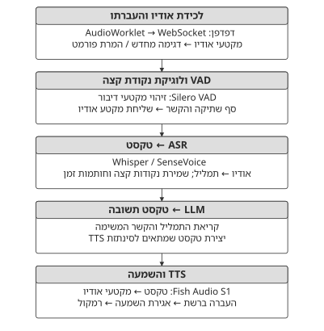

‏VAD אקוסטי מוצא את המקטעים שבהם מישהו מדבר, כך שהזיהוי בהמשך יכול לדלג על שתיקות ארוכות. אבל אותה הפסקה עצמה משמעותה שונה אחרי "אני רוצה להזמין..." ואחרי "יש כרטיסים ליום חמישי בבוקר?". ‏VAD סמנטי (זיהוי נקודת קצה סמנטי) יכול להמשיך להאזין במקרה הראשון, ולמסור את הדברים למודל השיחה רק במקרה השני. זהו דילול של תצפית הקול לאורך ציר הזמן: זרם צליל רציף מפעיל הסקה רק בכמה רגעים בודדים. ההחלטה אם לפתוח בדיבור נתונה למודל ששמע את המשפט; הוא יכול גם להמשיך להקשיב, או לבדוק קודם טיסות.

| מודול | תפקיד | מקורות נפוצים להמתנה או לשגיאה |
|---|---|---|
| VAD ולוגיקת נקודות קצה | זיהוי דיבור והחלטה על מועד ההגשה | סף שתיקה, רעש והפסקות באמצע |
| ASR | המרת אודיו לטקסט | זמן פענוח, זיהוי שמות ושמות עצם פרטיים |
| LLM | הבנה, היסק והפקת תשובה | תור בקשות, הפקת קטע התשובה הראשון |
| TTS והשמעה | סינתזת אודיו ומסירתו לרמקול | סינתזת המנה הראשונה, העברה ברשת ואגירת השמעה |

במימוש טורי לחלוטין, אחרי שהמשתמש מסיים לדבר הוא עדיין ממתין בזה אחר זה לאישור נקודת הקצה, לתמלול, להפקת התשובה ולקטע האודיו הראשון. בדוגמה שבאיור 6-8, עד שהמשתמש שומע את הצליל הראשון של התשובה חולפות 1.4 שניות, והמקטע הארוך ביותר הוא ההמתנה עד שהמערכת מאשרת שהמשתמש סיים (500 מילישניות). גם אם התמלול מתקצר מ‑100 ל‑50 מילישניות, המשתמש חוסך רק 50 מילישניות.

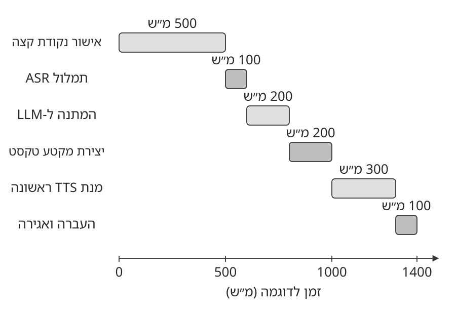

עומס על השירות מוסיף גם המתנה בתור. איור 6-9 ממחיש את הקשר באמצעות מודל M/M/1 עם עמדת שירות יחידה: ההגעות מתפלגות לפי תהליך פואסון, זמן השירות מתפלג מעריכית, זמן השירות הממוצע הוא $S$, וכאשר הניצולת היא $\rho<1$, הזמן הכולל הממוצע, כולל שירות והמתנה בתור, הוא $W=S/(1-\rho)$. עבור $S=1$ שנייה, עלייה בניצולת מ‑0.5 ל‑0.8 מעלה את הזמן הכולל הממוצע מ‑2 שניות ל‑5 שניות. השירות עצמו עדיין נמשך בממוצע שנייה אחת; 3 השניות הנוספות כולן המתנה בתור. כשהבקשות מתקרבות לקיבולת העיבוד, תנודות קצרות בתעבורה יוצרות צבר.

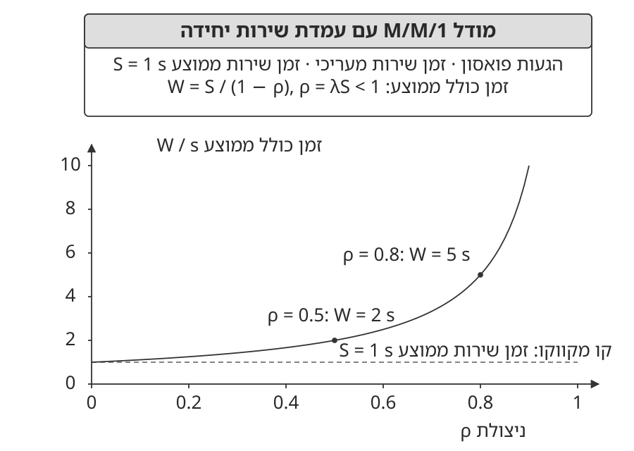

> **ניסוי 6-4 ★: בניית סוכן קולי מסורתי**
>
> נניח שהעוזר מקריא טיסות ליום חמישי, ואתם מתקנים: "רגע, אני רוצה להזמין ליום שישי." הדפדפן שולח את אודיו המיקרופון ל‑backend דרך WebSocket. ברגע ש‑Silero VAD מזהה שהתחלתם לדבר, ה‑backend שולח `speech_start`, והדפדפן מפסיק מיד את ההשמעה ומרוקן את האודיו הישן שבתור. בשלב הזה העוזר עדיין לא יודע איזה יום שיניתם. רק אחרי שסיימתם לדבר והשתיקה עוברת את ברירת המחדל של 500 מילישניות, ה‑backend שולח `speech_end` ומוסר את מקטע הדיבור לתמלול ב‑Whisper tiny מקומי.
>
> מהרגע ש‑Doubao מתחיל להחזיר טקסט, כמה זמן נותר עד שהמשתמש שומע תשובה? ברשומה של הרצה אחת עם השמעה חוזרת של הקלטה, התמלול ארך 2.710 שניות. ‏Doubao החזיר את הטוקן הראשון 0.749 שניות אחרי שליחת הבקשה, ואת התשובה המלאה רק אחרי 0.792 שניות. תוכנית ההשמעה החוזרת המתינה עד שכל הטקסט התקבל, ורק אז מסרה אותו לסינתזה ב‑Fish S1; כעבור 2.819 שניות נוספות קיבל ה‑backend את מנת האודיו הראשונה. מרגע ההכרעה על נקודת הקצה, סכום שלושת השלבים הטוריים הוא כ‑**6.321 שניות**. הדוח שבארכיון רושם 6.279 שניות, משום שהשתמש בזמן הטוקן הראשון במקום בזמן הפקת התשובה כולה.
>
> 6.321 השניות האלה מכסות רק את העיבוד ב‑backend. לפני כן המשתמש ממתין עד שזיהוי השתיקה קובע שהמשפט הסתיים, ובסוף עליו להמתין עד שהאודיו מגיע לדפדפן ומתחיל להתנגן.

#### מטורי לתפיסה מזרימה

הגישה הטורית נוחה לבדיקה שלב אחר שלב, אך היא חושפת גם שלוש בעיות. ההמתנה לשתיקה מוסיפה השהיית נקודת קצה; הטקסט המתומלל עלול לאבד טון, רגש וצלילי סביבה; וכשהאודיו מפוצל לפי הפסקות, כתובות דוא"ל, שמות ושמות עצם פרטיים עלולים לאבד את ההקשר המלא. במערכות שכבר בנויות בארכיטקטורה מדורגת, המחבר ממליץ להתחיל בהסבה להזרמה: לגרום לכל שלב לספק תוצאות מצטברות מוקדם ככל האפשר, לחפוף זיהוי, היסק והשמעה, ובמקביל לעקוב אילו חלקים כבר אושרו ואילו עוד עשויים להשתנות. כך אפשר להשתמש שוב במודולים הקיימים ולאתר בהדרגה מאין מגיע זמן ההמתנה.

- **ASR שמתמלל תוך כדי האזנה.** קולט אודיו ברציפות ומפיק תמליל זמני; כשמגיע אודיו נוסף הוא מתקן את החלקים הלא יציבים, ובאישור נקודת הקצה מוסר את הטקסט הסופי.
- **ביצוע ספקולטיבי ב‑LLM.** משתמש בתמליל הזמני כדי להכין תשובה מראש. כשהטקסט הסופי מאושר, בודקים אם הקלט זהה ואם העבודה שכבר נעשתה עדיין רלוונטית, ורק אז מחליטים לשמור, להתאים או לייצר מחדש. פעולות כמו שליחה החוצה או כתיבה למערכות עסקיות ממתינות עד שהתנאים הנדרשים אושרו.
- **פלט LLM מקוטע.** ברגע שמקטע טקסט המתאים להקראה מוכן, הוא נמסר ל‑TTS; החלוקה שומרת על משמעות המשפט, על הפיסוק ועל רמזי האינטונציה.
- **TTS מצטבר.** מקטעי אודיו חוזרים בהדרגה, כך שהפקת הטקסט שבהמשך, הסינתזה וההשמעה חופפות. כשהמשתמש קוטע, מטפלים גם במשימת ההפקה וגם בתוכן שעדיין לא הושמע במאגר ההשמעה.

המימוש הרגיל של תמלול ב‑Whisper מקודד ומפענח לפי חלונות אודיו[^ch6-whisper]. חיתוך חיצוני למקטעים או הגשה חוזרת של קידומת מצטברת מאפשרים לבנות תהליך תמלול מצטבר; שימוש חוזר במצב מתמשך, עלות הקידוד החוזר ותיקון הטקסט הקודם נתונים לניהולו של המימוש הספציפי. מודלי זיהוי מזרימים מובנים, לעומת זאת, מטפלים בקלט רציף ישירות בארכיטקטורה ובאימון.

מערכת תפיסה המבוססת על מודל שפה לאודיו יכולה גם להפיק יחד טקסט ואירועים אקוסטיים. אודיו קודם, תמלולים ורמזי אוצר מילים מסייעים בזיהוי שמות, מותגים ושמות עצם פרטיים; כמה היסטוריה לשמור תלוי בתכנון ההקשר והמטמון. כדי לקבוע אם המשתמש סיים לדבר, המודל יכול לשלב שלמות סמנטית ושתיקה. בהפסקה שאחרי "אני רוצה להזמין...", מערכת בזמן אמת שמעה רק את המילים האלה, ואין לה דרך לדעת שיבוא אחריהן תאריך.

מעבר לתמלול, הממשק יכול להגדיר גם את האירועים הבאים: `speak_start` ו‑`speak_end` מסמנים תחילת דיבור וסופו, `interrupt` מסמן קטיעה, `emotion` מתאר מצב רגשי, ו‑`laugh`,‏ `sigh`,‏ `noise` רושמים צחוק, אנחה וצלילי סביבה. אפשר לשלוח אירועים אלה לסוכן יחד עם הטקסט וחותמות הזמן.

> **ניסוי 6-5 ★: הדמיית תפיסה קולית מזרימה עם Qwen2-Audio**
>
> ניסוי זה מגדיל בהדרגה את קידומת האודיו, ובכל פעם שולח מחדש ל‑Qwen2-Audio את האודיו מההתחלה ועד הרגע הנוכחי, כדי לעקוב אחר השינויים בתמליל ובאירועים האקוסטיים ככל שהקלט גדל. מסלול הביקורת משתמש בנקודת קצה של שתיקה בת 600 מילישניות וב‑Whisper. הבדיקה כוללת דיבור רגיל, משפט ארוך עם הפסקה של 900 מילישניות באמצעו, ודיבור מעורב ברעש ורוד.
>
> בהרצה הזו של מודל מקומי מקוונטט נשמרו 13 הסקות על קידומות, וכל אחת ארכה כ‑8–11 שניות. ההפסקה באמצע גרמה לפיצול מקטעים במסלול הביקורת; מודל האודיו זיהה את הרעש, אך גם דיווח בטעות על שיעול וצחוק.

[^ch6-whisper]: OpenAI, Whisper. מציג תמלול לפי חלונות אודיו ואת מימוש המודל.

### פרדיגמה 2 · מודלים אומני‑מודאליים מקצה לקצה (Omni)

מודל אודיו מקצה לקצה מקבל צליל ישירות, משלב מידע לשוני ואקוסטי כדי לייצר תשובה, ומסנתז דיבור דרך ענף פלט אודיו. עיבוד ישיר של אודיו מאפשר לנצל קצב דיבור, גובה צליל, הפסקות וצלילי סביבה; תמלול ואחריו מענה מקלים לבדוק את הטקסט שבאמצע ולהחליף מודולים באופן עצמאי.

התכונות האקוסטיות האלה משפיעות על ההבנה. למשל, אותו משפט, "בבקשה שלח את הדוח לפני ארוחת הצהריים", כשהוא נאמר בחיפזון או באיטיות, משאיר אצל השומע רושם שונה. גם בפלט, המודל יכול לארגן את המשמעות באמצעות הפסקות, הטעמות ואינטונציה.

גם מערכת המעבדת אודיו ישירות יכולה להמתין עד שהמשתמש מסיים לפני שהיא עונה. למשל, משתמש שמקריא מספר טלפון עוצר לרגע, והמערכת עדיין צריכה להכריע אם רצף הספרות הסתיים. זיהוי נקודת הקצה קובע מתי להגיב; אם הצד השני קוטע באמצע ההקראה, המערכת צריכה גם לתאם בין ההפקה של המודל לבין ההשמעה ברמקול.[^ch6-audio-architectures]

> **ניסוי 6-6 ★★: הרצת MiniCPM-o 4.5 מקומית — השוואה בין מקצה לקצה לדירוג עצמי**
>
> ניסוי זה מקבע מודל MiniCPM-o 4.5 אחד, עם מצב חשיבה מושבת, ומשווה שני מסלולים: מענה ישיר מתוך האודיו, ותמלול בידי המודל ואחריו מענה על סמך התמליל בלבד. הקלט כולל שתי בעיות חשבון מוקראות ושתי הקלטות של אותו טקסט בקצבי דיבור שונים.
>
> כל מסלול ענה נכון על שלוש שאלות, והשגיאות הופיעו במקומות שונים. מסלול האודיו הישיר שמע בבעיה אחת את twelve boxes כ‑8, וטעה בחישוב; מסלול התמלול שמר נכון על 12. בשאלת הקצב, שתי ההקלטות אומרות "Please send the report before lunch.", והטקסט המתומלל זהה לחלוטין, כך שהמידע על מהירות הדיבור אבד; מסלול האודיו הישיר הבחין נכון בין שני הקצבים.
>
> הניסוי הפיק בנוסף מקטע דיבור ב‑24 kHz, המחבר בין הבנת הקלט לבין פלט האודיו.

### פרדיגמה 3 · מודל אינטראקציה דו‑כיווני מלא

מערכת דו‑כיוונית מלאה מאזינה תוך כדי דיבור, והשיפור שאנשים מבחינים בו ראשון הוא התחושה שמדברים עם אדם חי. קראו את המשפט "אני רוצה להזמין לרביעי... לא, לחמישי": ההפסקה באמצע מותירה מקום לתיקון העצמי הזה; אם העוזר כבר התחיל להקריא את הטיסות של יום רביעי, עליו לעצור כשהוא שומע "לא, לחמישי". רגע אחר מסוג זה: הצד השני עדיין מסביר את מסלול הנסיעה, ו"אהה" קצר ושקט מאותת לו שהעוזר מקשיב. רק קליטה רציפה של אודיו מאפשרת לבחור בכל רגע בין דיבור, הקשבה, השתהות והפעלת כלי. גם תרגום סימולטני דורש חפיפה בין קלט לפלט.

‏**Moshi**, שפרסמה Kyutai ב‑2024, ממדל בנפרד את זרם האודיו של המשתמש ואת זרם האודיו של המודל, ומייצג דיבור חופף וקטיעות באמצעות זרמים מקבילים[^ch6-moshi]. כשהיחסים בזמן נשמרים בקלט, המודל יכול ללמוד מתי לענות ומתי להמשיך להקשיב.

מודל האינטראקציה של Thinking Machines Lab חותך את הקלט והפלט הרציפים לבלוקים קצרים שווי אורך, כל אחד בן 200 מילישניות, המכונים מיקרו‑תורות (micro-turns)‏[^ch6-14]. עקבו אחר ציר הזמן באיור 6-10 ובדקו את המשבצת השנייה: העוזר עדיין אומר "חמישי", ובאוזניו כבר נשמע ה"לא" של המשתמש שמתקן את התאריך. במשבצת השלישית העוזר כבר שותק וממשיך להקשיב עד שהמשתמש מסיים לומר "שישי".

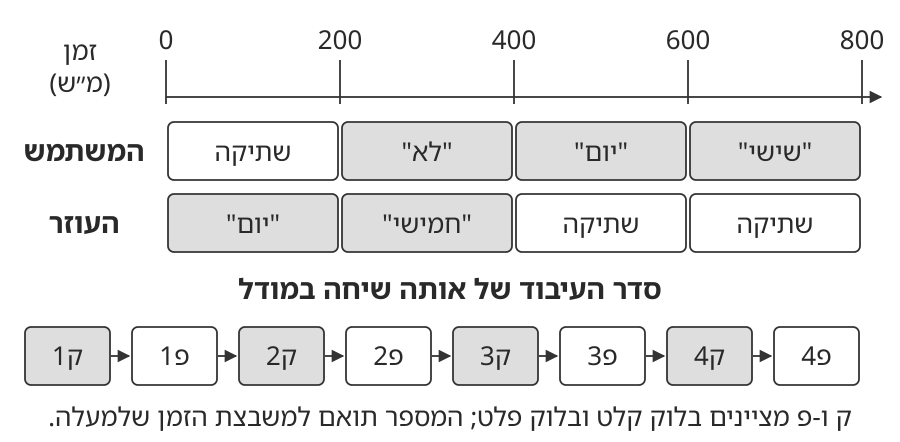

עכשיו לחצי התחתון של האיור. שני הצדדים בשיחה שומעים שני ערוצי קול שעשויים לחפוף, אבל המודל יכול לעבד לסירוגין, לאורך רצף אחד, בלוקי קלט ולייצר בלוקי פלט. גם שתיקה תופסת משבצת, ולכן העוזר יכול להקשיב קצת לפני שהוא פותח בדיבור. ‏200 המילישניות שבאיור הן אורך הבלוק במימוש הזה; מהרגע שהמשתמש מתפרץ ועד שהרמקול באמת משתתק יש להוסיף גם את זמן העיבוד ואת מאגר ההשמעה.

[^ch6-moshi]: Kyutai, *Moshi: a speech-text foundation model for real-time dialogue*, 2024. מתאר את זרמי האודיו המקבילים של המשתמש ושל המודל.
[^ch6-14]: Thinking Machines Lab, *Interaction Models: A Scalable Approach to Human-AI Collaboration*. מתאר מיקרו‑תורות, אינטראקציה מרובת זרמים והאצלת משימות לרקע.

### תזמון קוגניטיבי: אינטראקציה בזמן אמת וחשיבה עמוקה

בשיחות השירות של Pine, כשהנציג באמצע משפט, לפעמים העוזר צריך להמתין ולפעמים להשמיע אישור קצר; וכשהעוזר עצמו מדבר, עליו לשמוע תיקון שהצד השני משחיל. זו בדיוק הסיבה שהכותב מאמין בכיוון של Moshi: רק כשהתזמון נכון, הצד השני מרגיש שמישהו באמת מקשיב לו בקו. בבקשה שדורשת חיפוש מידע יש לערוך חשבון זמן נוסף: מהרגע שהשאלה הובנה ועד שהתשובה שנמצאה נאמרת בקול, כמה פעמים העבודה עוברת מיד ליד?

כלים שמודל הקול בחזית יכול להפעיל ישירות, החזית מפעילה בעצמה. חיפוש טיסות דורש אז שתי קריאות למודל: החזית מחפשת לפי התנאים שהמשתמש מסר, ואחר כך מדווחת על התוצאה. האצלה דורשת ארבע: החזית מגדירה את המשימה, הרקע מריץ את החיפוש, הרקע מסכם את התוצאה, והחזית מוסרת אותה הלאה. גישה אחרת טוענת שמודל בזמן אמת עלול למלא פרמטרים שגויים, ולכן הרקע צריך להפעיל את הכלים, והחזית תתמקד בהחלטה מתי להקשיב ומתי לדבר.

לחזית של GPT-Live-1 אין ממשק להפעלה ישירה של פונקציות עסקיות; היא יכולה רק להאציל לסוכן רקע. ‏GPT-Realtime של OpenAI Realtime תומך בהפעלת פונקציות ישירות מהחזית. מודל הקול בזמן אמת של Doubao 3.0‏ (Seeduplex) תומך גם הוא בהפעלה ישירה מהחזית במצב מקצה לקצה טהור, ובתזמור היברידי מודל שפה חיצוני הוא שמפעיל את הפונקציות.[^ch6-voice-tools]

נניח שכל קריאה למודל החזית ולמודל הרקע אורכת $L_f$ ו‑$L_b$ בהתאמה, ושהכלי אורך $T$. מהרגע שהמשתמש מסיים לדבר ועד שהוא שומע את התוצאה, הפעלה ישירה אורכת בערך $2L_f+T$, והאצלה בערך $2L_f+2L_b+T$. התוספת $2L_b$ של ההאצלה אינה תלויה בזמן הכלי $T$. מידע שעשוי להידרש בכל תור, כמו זיכרון המשתמש, סביבת הריצה יכולה לשלוף מראש ולהכניס להקשר; אז החזית צריכה קריאה אחת בלבד למודל, בערך $L_f+T$. ואם המידע נשלף עוד לפני שהמשתמש פתח את פיו, נחסך גם $T$.

משימות שדורשות היסק בכמה שלבים, למשל השוואה בין כמה אפשרויות לשינוי כרטיס, מתאים להעביר לרקע. הזמנת כרטיס כרוכה בחיוב ובהנפקה, ולכן לא משנה מי מפעיל את הכלי: את ההזמנה מבצעים רק אחרי שהמשתמש אישר. את תוצאות הטיסות אפשר לסכם בעל פה ולהציג את הטבלה המלאה על המסך, וגם זה אינו תלוי במי שהפעיל את הכלי.

> **ניסוי 6-7 ★★: מי מפעיל את הכלים של סוכן קולי — החזית או הרקע**
>
> בנו את החזית עם מודל הקול בזמן אמת של Doubao 3.0, ואת הרקע עם DeepSeek V4 Pro שמסופק ב‑Volcengine Ark. הכינו חמישה כלים מדומים: מזג אוויר, שליפה מזיכרון המשתמש, חיפוש ברשת, חיפוש טיסות והזמנת כרטיס, וקבעו לכל אחד זמן החזרה; חיפוש טיסות והזמנה ממתינים 2–5 שניות. סנתזו מראש את הקלטות המשתמש, והשמיעו בכל פעם את אותה הקלטה לאותו תרחיש.
>
> הגדירו ארבע חלוקות עבודה. בראשונה החזית מפעילה את כל הכלים. בשנייה הרקע מפעיל את כל הכלים, והחזית יכולה רק להאציל. בשתי האחרות החזית בודקת את מזג האוויר, סביבת הריצה מכניסה את זיכרון המשתמש להקשר בתחילת השיחה, והרקע אחראי על החיפוש ברשת ועל ההזמנה. ההבדל ביניהן הוא מי מחפש טיסות: החזית או הרקע. החזית שומעת ישירות את קולו של המשתמש; הרקע אינו שומע קול ויכול רק לקרוא טקסט. אחרי כל משפט של המשתמש, הממשק של Doubao מחזיר בנפרד גם את הטקסט שזוהה בזיהוי הדיבור, המכונה תמליל. בהאצלה, סדרו את התמליל ואת מה שהעוזר אמר לפי סדר הזמן לרשומת שיחה, ומסרו אותה לרקע יחד עם קריאות הכלים שכבר בוצעו בשיחה הזו ועם הנחיית המשימה שכתבה החזית. בכל חלוקת עבודה חזרו על כל אחד מהתרחישים הבאים 10 פעמים.
>
> 1. בדקו בנפרד מזג אוויר וטיסות. מדדו מהרגע שהמשתמש סיים לדבר ועד שהוא שומע את תוצאת החיפוש; משפטי מעבר כמו "רגע, אני בודק" אינם נחשבים לתשובה. השוו את חציון זמן ההמתנה בהפעלה ישירה ובהאצלה. בניסוי של המחבר, בבדיקת מזג האוויר התקבלו 2.81 שניות ו‑6.96 שניות בהתאמה.
> 2. חפשו טיסות, בחרו כרטיס ואשרו. השוו כל אחד מ‑13 השדות של ההזמנה לתוצאות החיפוש הקודם, למה שהמשתמש אמר זה עתה ולפרופיל המשתמש, ובדקו שההזמנה בוצעה אחרי אישור המשתמש. בניסוי של המחבר, בכל ארבע החלוקות כל השדות מולאו נכון, וההזמנה בוצעה תמיד רק אחרי אישור המשתמש.
> 3. עברו להזמנת כרטיס לעמית, והשמיעו הקלטה שבה המשתמש מאיית את השם בעל פה: "צ'ן ג'יאיי — צ'ן כמו 陈, שמורכב מ‑耳 ומ‑东; ג'יא כמו 嘉 שב‑嘉奖; יי כמו 怡 שב‑怡然". השוו את ההקלטה, את התמליל ואת השם בהזמנה, ובדקו אם השם מולא נכון גם בהזמנה ישירה מהחזית וגם בהזמנה מואצלת. בניסוי של המחבר, ההזמנה הישירה מהחזית הייתה נכונה בכל 10 הפעמים; התמליל, לעומת זאת, רשם "陈佳宜", ובהאצלה חלק מההזמנות נרשמו בשם שגוי.
> 4. לפני שתוצאות חיפוש הטיסות חוזרות, השמיעו הקלטה ששואלת על מזג האוויר, והקשיבו אם החזית עונה על שאלת מזג האוויר ואם אחר כך היא מדווחת על תוצאות הטיסות. בניסוי של המחבר, שאלות מזג האוויר תמיד נענו, אבל תוצאות הטיסות המקוריות כמעט אף פעם לא נאמרו.

כשיש צורך להאציל, החזית צריכה לכתוב בהנחיית המשימה את השמות והמספרים שהיא בטוחה בהם ואת התיקונים שהמשתמש עשה זה עתה, כדי שהרקע לא ימלא פרמטרים שגויים בגלל שגיאות תמלול. סביבת הריצה צריכה לרשום תוצאות שעדיין לא נאמרו, כדי שהחזית תמשיך לדווח עליהן אחרי שענתה על שאלת הביניים.

משפט כמו "רגע, אני בודק" מפי המודל המהיר מאותת לנציג שהעוזר שמע את הבקשה. מתי אפשר יהיה לנקוב במחיר הכרטיס תלוי באופן שבו החיפוש וההיסק משתלבים בשיחה. איור 6-11 מציג שלוש אפשרויות: להגיב קודם ולענות לעומק אחר כך; חזית שמנהלת את האינטראקציה ברציפות ומקבלת הצעות מהרקע; וקידום מקביל של ניסוח המחשבה ושל ההבעה, מקטע אחר מקטע.

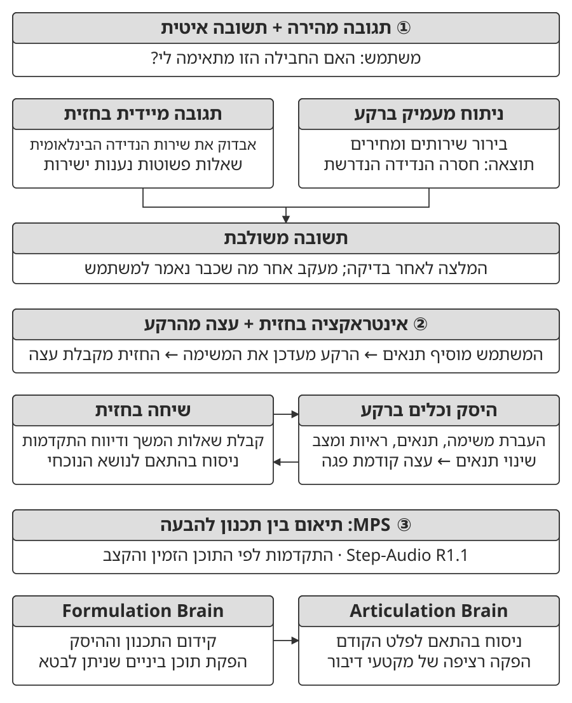

#### פתרון 1: חשיבה מהירה מגיבה, חשיבה איטית עונה

המודל המהיר נותן קודם תגובה קצרה, והמודל האיטי משלים את הניתוח ברקע ומוסיף תשובה מפורטת. עיצוב זה מאשר מוקדם שהבקשה התקבלה, אבל מחייב לשמור על עקביות בין שתי התשובות. למשל, המודל המהיר ממליץ לרכוש חבילה מסוימת, ואחר כך המודל האיטי מגלה שחסרה בה תכונה מרכזית, וההמלצות סותרות זו את זו. שורש הסתירה הוא ששני הצדדים עונים באופן עצמאי, ובסיס השיפוט וההתקדמות בהיסק עשויים להיות שונים אצלם. המלצה שהמודל המהיר כבר אמר בקול נכנסת לשיקול הדעת של המשתמש, וייתכן שהוא אף פועל לפיה; כשהמודל האיטי מתקן אותה אחר כך, צריך גם להסביר את השינוי ולטפל בהשלכות שכבר נוצרו.

לכן החזית צריכה להבחין בין אישור המשימה לבין מסקנה עסקית. "אני אבדוק אם החבילה כוללת את התכונה הזו" אפשר לומר מיד; המלצת רכישה צריכה להמתין לחיפוש ולניתוח הנדרשים. כשתוצאת הרקע חוזרת, המערכת משווה אותה למה שכבר נאמר, ורק אז מנסחת את המשך התשובה. שאלות פשוטות אפשר להשאיר למודל המהיר, וכך לחסוך עיבוד כפול.

#### פתרון 2: חשיבה מהירה מנהלת את האינטראקציה, חשיבה איטית מתריעה

גם קול ומסך יכולים לחלק ביניהם את העבודה. משפט כמו "החשבון החודש עלה ב‑15 אירו של דמי נדידה" מעביר למשתמש את העיקר מיד; את הסכום המקורי, את המחיר הנוכחי ואת פירוט המחלוקת משאירים על המסך, והמשתמש בודק אותם בקצב שלו. אישור של פעולה מסוימת אפשר לעשות בלחיצה, ומידע רגיש המשתמש ממלא בעצמו בממשק קלט שבית העסק מכיר בו. החזית צריכה לקבל רק מצב כמו "האימות הושלם" כדי לחזור לשיחה באופן טבעי.

נניח שנוסע מבקש מ‑Pine להזמין טיסה לשנגחאי ביום חמישי בבוקר, בתקציב של 1,200 יואן, ועליו להגיע לאולם הכנס לפני הצהריים. ‏Pine מדבר בטלפון עם נציג חברת התעופה ובמקביל "מעביר פתק" לרקע: "אם נוחתים בהונגצ'יאו בעשר, מספיקים להגיע מהשדה לאולם?" הנציג בודק מקומות פנויים ואומר ל‑Pine: "הטיסה שנוחתת בהונגצ'יאו בעשר אזלה. יש טיסה שנוחתת בפודונג בעשר וחצי, ב‑1,250 יואן." אם הרקע רואה רק את הפתקים שהחזית מעבירה, הוא עדיין מחשב את הדרך מהונגצ'יאו. החזית צריכה להוסיף הנחיה: "חשב מחדש מפודונג, נחיתה בעשר וחצי; האולם ושעת ההגעה לא השתנו."

דרך אחרת היא לסנכרן גם את רשומת השיחה לרקע, לפי הסדר. הרקע כבר קרא ברשומה את שדה התעופה ואת שעת הנחיתה שהנציג מסר, והחזית צריכה לומר רק "בדוק אם הטיסה הזו מספיקה" כדי להאציל את אותה משימה. בסנכרון הרשומה צריך לציין מי אמר מה; חצי משפט שהחזית נקטעה בו ועוד לא הושמע צריך להיות מובחן ממה שכבר נאמר בקול. תמלול הדיבור עלול להשמיט או לשבש מידע מרכזי, ולכן החזית צריכה לכתוב בהנחיית המשימה את השמות והמספרים ששמעה בבירור ואת התיקונים של המשתמש. כששתי הרשומות סותרות, הרקע פועל לפי הנחיית המשימה. כשהרקע מסיים לבדוק, הוא צריך לומר לחזית רק באיזו שעה צפויה ההגעה לאולם וכמה הזמנים צפופים. אילו מסלולים נבדקו בדרך ואילו שדות החזיר ממשק המפות, אפשר להשאיר ברקע לעיון. החזית, עם התוצאה בידה, ממשיכה לדבר עם הנציג.

הנוסע העסקי מהפרק הראשון רצה לשמור על מחיר כרטיס של עד 1,200 יואן. בנסיעות עבודה קודמות הוא היה מוכן לשלם קצת יותר על טיסה מתאימה, וגם הפעם לא קבע תקרה אחרת. כשמתברר שהמחיר הנמוך ביותר הוא 1,250 יואן, העוזר יכול להזמין בשמו. אילו היה זה משתמש שתמיד מקפיד על כל שקל ויוצא לטיול עם המשפחה, את 50 היואן האלה היה צריך לשאול קודם. החזית צריכה אפוא לטפל בשתי שיחות בבת אחת:

- הודעה למשתמש: "המחיר הנמוך ביותר בטיסה הזו הוא 1,250 יואן, 50 יואן מעל התקציב. להזמין?"
- ומיד שאלה לנציג: "אפשר לשמור לי את המחיר הזה לזמן קצר? יש באותו יום טיסה מאוחרת יותר עד 1,200 יואן?" בזמן שהנציג בודק, החזית יכולה גם לברר את מגבלות הכבודה ואת תנאי הביטול והשינוי.

כך, כשהמשתמש חוזר, מחכות לו כמה אפשרויות, והנציג יודע מה לבדוק הלאה. אם המשתמש מסביר אחר כך "בפעם הקודמת מיהרתי לפגישה; מעכשיו, גם בנסיעות עבודה, אם חורגים מהתקציב תשאל אותי קודם", בפעם הבאה צריך לפעול לפי הדרישה החדשה.

כשממתינים לאימות של בעל החשבון, קצב השיחה שונה. הנציג אומר שקוד האימות נשלח, והחזית יכולה לענות: "בסדר, רגע אחד, אני מבקש מהנוסע לבדוק את הטלפון." אם הנוסע משיב שעוד לא קיבל, החזית שואלת את הנציג לאיזה מספר, לפי ארבע הספרות האחרונות, נשלחה ההודעה ומתי אפשר לשלוח שוב. אחרי שהנוסע משלים את האימות בערוץ שבית העסק קבע, החזית ממשיכה בטיפול. בשיחה כזו עדיף להמתין עוד קצת ולהנפיק את הכרטיס מעט מאוחר יותר מאשר ללחוץ על המשתמש להחליט במקום.

ברגע זה הרקע שולח "ההצעה המקורית עודכנה". החזית מאמתת קודם את המחיר החדש מול הנציג, ורק אז מודיעה למשתמש. אם בדיוק אז המשתמש משיב "אפשר להזמין", התשובה הזו מתייחסת להצעה של 1,250 יואן שנשלחה אליו קודם. החזית צריכה להחליט, לפי המחיר החדש וההרשאה הקיימת, אם נדרש אישור נוסף. הרקע רק מספק מידע; תמיד החזית היא שמדברת עם הנציג ומתחייבת. רק כשההודעות נושאות את הטיסה, את תנאי המחיר ואת הזמן, החזית יכולה לזהות איזו הצעת מחיר כבר אינה בתוקף.

גם עיתוי ההגעה של אותה הודעת רקע, "המחיר השתנה, נא לאמת", משפיע על האופן שבו החזית ממשיכה את השיחה. אם הנציג בדיוק אמר "המחיר הנמוך ביותר הוא...", החזית יכולה קודם לשמוע את הסכום עד הסוף. אם הנציג כבר מסר את המחיר וממתין לתשובה, זה הרגע לשאול על המחיר החדש. אם הנוסע התפרץ זה עתה בטלפון ואמר "רגע, אני משנה את התאריך", קודם צריך לשמוע בבירור את התאריך החדש, ורק אז להחליט אם עדיין צריך לאמת את הטיסה המקורית. אותו "בסדר" שנאמר בזמן שהנציג מסביר את התנאים עשוי לסמן רק הקשבה, אבל אחרי "להנפיק לך עכשיו את הכרטיס?" הוא עלול להישמע כהסכמה לרכישה. מי שמסתכל רק בתמליל מחמיץ הבדלים כאלה.

#### פתרון 3: ניסוח המחשבה וההבעה מתקדמים יחד

סדרת Step-Audio מספקת שתי דוגמאות קשורות. **זיקוק היסק מעוגן‑מודאליות (MGRD)** עוסק במידע שעליו ההיסק נשען: הוא בונה ומסנן נתוני היסק סביב מאפיינים אקוסטיים כמו גובה צליל, קצב ואינטונציה, ומשפר את הבנת האודיו באמצעות זיקוק איטרטיבי. בשלב למידת החיזוק, ‏Step-Audio R1 מנקד שאלות אודיו בשני רכיבים: תשובה נכונה מקבלת 0.8 נקודות, והצגת תהליך ההיסק עוד 0.2. הרכיב השני מעודד את המודל לכתוב את הנימוקים שלו; אם ההיסק אכן השתמש ברמזים האקוסטיים שבהקלטה, נבדק כבר בשלב סינון הדוגמאות שלפני כן.[^ch6-mgrd]

‏**Mind-Paced Speaking‏ (MPS)** עוסק בתזמון בין ההיסק להבעה. הוא משתמש במודול ניסוח (Formulation Brain) ובמודול הבעה (Articulation Brain), כך שתהליך ניסוח המחשבה מכוון את ייצור הדיבור. הפתרון בזמן אמת של Step-Audio R1.1 אימץ שיטה זו.[^ch6-mps]

שני המודולים מחליפים מידע לפי ההתקדמות: הניסוח מתקדם ברציפות, וההבעה מארגנת את הדיבור לפי התוכן שכבר זמין ולפי מה שכבר הופק. כך חלק מההבעה חופף להיסק שבא אחריו, ובו בזמן נשמר מעקב אחר מה שכבר נאמר.

[^ch6-mgrd]: StepFun, *Step-Audio-R1 Technical Report*. מתאר את זיקוק ההיסק המעוגן‑מודאליות.
[^ch6-mps]: StepFun, *Mind-Paced Speaking: A Dual-Brain Approach to Real-Time Reasoning in Spoken Language Models* וכרטיס המודל של Step-Audio-R1.1. מתארים את מודולי הניסוח וההבעה ואת השימוש בהם במערכת בזמן אמת.

#### חלוקת העבודה בין המודולים ודרך השדרוג

**המחבר מייחס חשיבות ליתרון הנדסי אחד של חלוקה בין מהיר לאיטי: יכולת האינטראקציה ויכולת ההיסק יכולות להתפתח כל אחת בנפרד.** כשיוצא מודל היסק חזק יותר, המערכת יכולה להחליף את הרקע. כך הרקע מתעדכן עם ההתקדמות של מודלי ההיסק, והחזית ממשיכה לשפר את ההקשבה, את התגובה ואת ההתערבות בשיחה. החזית צריכה להבין את המשימה ואת התוספות של המשתמש, והרקע מתמקד בהיסק, בתכנון ובביצוע ארוכים יותר.

**כשמודלי ההיסק מתחלפים במהירות והצוות צריך לשדרג את היכולות העסקיות ברציפות, המחבר מעדיף חלוקה בין מהיר לאיטי שבה כל צד ניתן להחלפה.** חלוקה כזו חוסכת את הצורך לאמן מחדש את כל מערכת הקול בכל שדרוג של מודל ההיסק. כשההיסק הביניימי צריך לשלוט בהבעה באופן ישיר יותר ויש משאבי אימון מתאימים, אפשר לעבור לפתרון של תיאום הדוק יותר.

סוכן הקול של Pine AI משתמש בארכיטקטורה שבה חשיבה מהירה בחזית משתפת פעולה עם חשיבה איטית ברקע. המאמר הפומבי של החברה מדווח על מקום ראשון במסלול הקול של τ²-bench, ומתאר איך משולבים בו שיחה רציפה, היסק עסקי ופעולה בכלים[^ch6-17].

כדי להבין שילובים כאלה, אפשר להבחין בין שלושה ממדי עיצוב: **נתיב האודיו** קובע אם המודל מעבד את הקול ישירות או מקבל אותו דרך תמליל; **תזמון ההקשבה והדיבור** קובע אם הקלט והפלט מתקדמים בתורות או במקביל; **חלוקת העבודה הקוגניטיבית** קובעת איך האינטראקציה בזמן אמת וההיסק העמוק חולקים מצב ומחליפים תוצאות. מערכת יכולה לעבד אודיו ישירות ולשמור על דו‑כיווניות מלאה, ובה בעת להעביר משימות מורכבות למודל רקע נפרד. מודל האינטראקציה של Thinking Machines Lab ו‑GPT-Live מדגימים שניהם שילוב כזה.

[^ch6-17]: Pine AI, *The Most Natural Human-Computer Interface Is Your Voice*. מתאר את ארכיטקטורת החשיבה המהירה/האיטית ואת תוצאות ההערכה במשימות קול שהחברה מדווחת עליהן. הדוח מכנה את טבלת הדירוג τ²-bench voice.

### סינתזת דיבור דמוית‑אדם יותר

הפסקות, קצב דיבור והטעמה עוזרים למאזין להבין את מבנה המשפט ואת כוונת הדובר. למשל, כשמקריאים מספר טלפון צריך לקבץ את הספרות, כשמסבירים תנאים מורכבים אפשר להאט, וכשממתינים לתוצאות חיפוש אפשר קודם לומר מה נמצא בטיפול. לדעת המחבר, הפסקות מתאימות ושינויי קצב הופכים את הדיבור לטבעי יותר, ומאפשרים למשתמש לשמוע איך המשימה מתקדמת. את בקרת הדיבור אפשר לתכנן סביב השימושים הקונקרטיים האלה.

ה‑LLM הראשי יכול להוסיף לטקסט סמני בקרה, כמו `[THINKING]`,‏ `[EMO:happy]` ו‑`[SPEED:0.8x]`. שכבת הביצוע מפענחת את הסמנים, מחלקת את הטקסט למקטעי דיבור ולמקטעי הפסקה, וממפה אותם לרגש, לסגנון או לקטע הייחוס שממשק הסינתזה תומך בהם. משמעות הסמנים נקבעת ביישום: `0.8x` יכול להיות ממופה לדרגת קצב איטית; הפסקות יכול הנגן להוסיף, וצחוק ואנחות מבוטאים באמצעות סמני צליל נתמכים או יכולות ייצור.

בפתרון של קטעי ייחוס, דרכי ההבעה השונות של אותו דובר מאורגנות בספרייה. לכל מקטע טקסט נבחרים רגש, קצב וסגנון מתאימים, ואחרי הסינתזה המקטעים מחוברים לפי הסדר. למצב הבקרה צריך להגדיר טווח השפעה: למשל, רגש נמשך עד השינוי הבא, והפסקה חלה רק במקום שבו היא מופיעה.

> **ניסוי 6-8 ★★: TTS מונע סמני בקרה עם Fish Audio**
>
> הניסוי בונה עם Fish Audio S1 ספריית קול של 24 קטעי ייחוס: צירופים של ארבעה רגשות, שלוש דרגות קצב ושני סגנונות. המפענח ממיר תשובה עם סמנים למקטעי דיבור ולמקטעי שתיקה, ושכבת הביצוע בוחרת קטע ייחוס לכל מקטע ומבצעת את הסינתזה.
>
> השוו שלוש תצורות: ללא סמני בקרה, קטע ייחוס יחיד וקטעי ייחוס מרובים. השאירו את תוכן התשובה זהה, בדקו שהסמנים מנותבים לתצורה הצפויה, והאזינו להפסקות, לרגש ולשינויי הגוון.
>
> מבחן ההאזנה השמור משתמש במודל להבנת אודיו, מציג את שלוש התצורות בסדר מתחלף ומעריך טבעיות, התאמת רגש, הפסקות חשיבה, עקביות גוון ותחושה של נציג שירות. קבוצת הייחוסים המרובים קיבלה את הציון הכולל הגבוה ביותר, וקבוצת הייחוס היחיד קיבלה ציון נמוך מזה של הקבוצה ללא סמנים.

## Computer Use: סוכני אוטומציית GUI

נניח שאתם מבקשים מסוכן לשנות את כתובת המשלוח בדף אינטרנט. הוא צריך קודם למצוא את שדה הכתובת, להקליד את הכתובת החדשה, ולוודא לפי מה שמוצג על המסך שהשמירה הצליחה. אם לפני הלחיצה קופץ חלון התחברות, הלחיצה כבר פוגעת באובייקט אחר, גם אם הקואורדינטות של הכפתור מצילום המסך הקודם לא השתנו. ‏Computer Use מפעיל דפדפנים, גיליונות אלקטרוניים או הגדרות מערכת דרך המסך, העכבר והמקלדת, והמשימה המרכזית שלו היא לדאוג שכל פעולה תתאים לממשק שמולו ברגע זה.

נלך לאורך לולאת **תפיסה–חשיבה–פעולה** שבאיור 6-12, ונראה מה המודל צריך לוודא לפני שהוא מקליד כתובת חדשה. הוא בוחר נקודת לחיצה לפי צילום המסך ולפי התקדמות המשימה, ה‑Harness בודק את הפרמטרים ואת ההרשאות, ורק אז הפעולה עוברת לשכבת הביצוע. לחיצה מוצלחת מעידה רק שהלחיצה נשלחה. מיקום פוקוס הקלט בצילום המסך הבא הוא שקובע אם אפשר להקליד את הכתובת בבטחה.

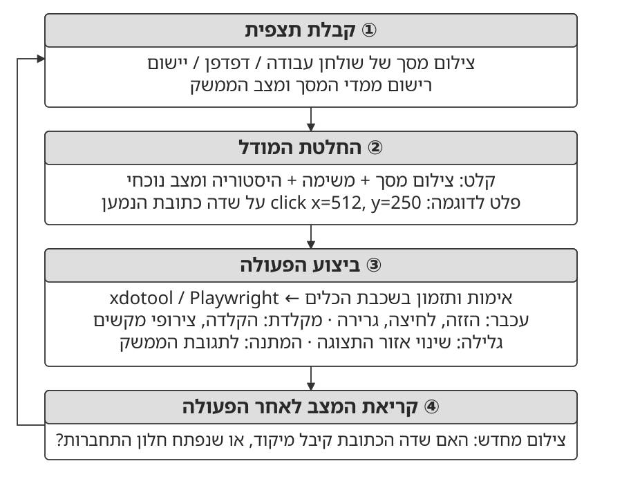

אחרי שהעוזר מילא את הכתובת, איך יאמר למבצע על איזה כפתור "שמור" ללחוץ? גם קואורדינטות מסך וגם מספרי אלמנטים יכולים לציין את היעד, אבל כל אחת מהדרכים מציבה דרישות שונות למודל ולכלים.

### עיצוב מרחב הפעולה

באיור 6-13, מימוש הייחוס של Computer Use מבית Anthropic מספק שלושה סוגי כלים: ממשק גרפי, הרצת פקודות ועריכת קבצים. גם בסוג הממשק הגרפי לבדו הנתונים זורמים לשני כיוונים: פעולת הלחיצה נשלחת לצד המבצע, וצילום המסך שאחרי הלחיצה חוזר למודל כתצפית לסבב ההחלטה הבא. ה‑API המובנה קובע את פורמט הכלים; אם עוברים למודל אחר, שכבת התאמה צריכה להמיר את צילומי המסך, את בקשות הפעולה ואת תוצאות הביצוע להודעות שהממשק של אותו מודל מקבל.[^ch6-computer-tools]

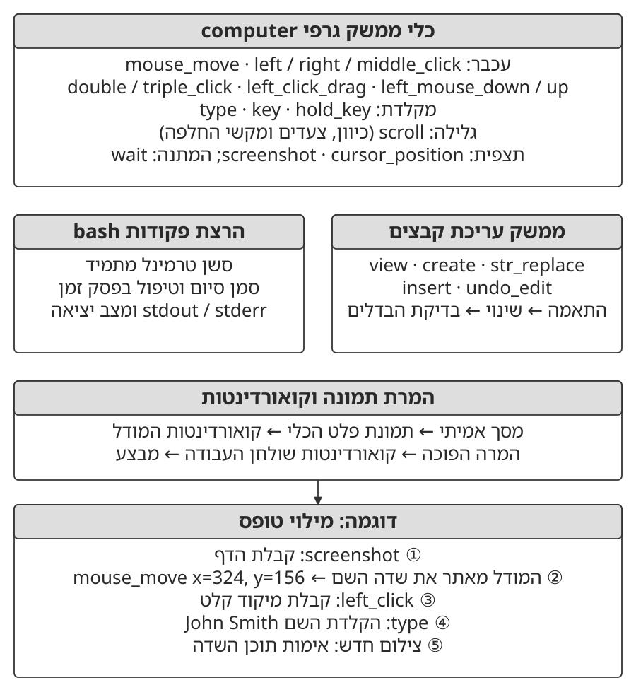

**כלי הפעלת GUI.** פעולות העכבר כוללות הזזה, לחיצה שמאלית/ימנית/אמצעית, לחיצה כפולה, לחיצה משולשת וגרירה; ממשקים מפורטים יותר יכולים לבטא בנפרד לחיצה ושחרור. גלילה מחייבת כיוון ועוצמה, ויש מימושים שתומכים גם במקשי החלפה. ממשק המקלדת מספק הקלדת טקסט, צירופי מקשים והחזקת מקש. צילום מסך ומיקום הסמן משמשים לקבלת המצב, וממשק ההמתנה נותן זמן לטעינת דף או לאנימציה. גרסת הכלי קובעת את אוסף הפעולות המדויק, וה‑Harness בודק את הפרמטרים לפי הממשק שבשימוש.

**כלי הרצת פקודות.** טרמינל מתמיד שומר את ספריית העבודה ואת מצב הסביבה בין קריאות. למשל, אם קריאה אחת עברה לספרייה אחרת, הקריאה הבאה ממשיכה לרוץ באותה ספרייה. מימוש הייחוס יכול לזהות את סיום הפקודה באמצעות מחרוזת זקיף ולהגדיר פסק זמן; אחרי פסק הזמן, המבצע עדיין צריך לבדוק את מצב התהליך.

**כלי עריכת קבצים.** ממשק החלפת המחרוזות מאתר את טווח השינוי לפי הטקסט המקורי, ויכול לספק גם צפייה, יצירה, הוספה וביטול. לפני הביצוע בודקים את מיקום ההתאמה ואת מספר ההתאמות, ואחריו בודקים את ההבדלים; אם הקובץ השתנה בין שתי קריאות, קוראים מחדש את התוכן הרלוונטי. אפשר להשתמש כאן שוב באסטרטגיות העריכה שהוצגו בפרק 5.

> **ניסוי 6-9 ★: הרצת מימוש הייחוס של Anthropic Computer Use**
>
> הניסוי משתמש בשולחן העבודה של Ubuntu, בדפדפן ובשכבת ביצוע הכלים שמספקת דוגמת הקונטיינר הרשמית. אחרי שהמשתמש מזין משימה, המודל קורא את צילום המסך ומחזיר פעולה, שכבת הביצוע מפעילה את שולחן העבודה, וצילום המסך החדש חוזר למודל.
>
> המשימה הנלווית היא בירור מזג האוויר בסן פרנסיסקו. המסלול השמור ניגש תחילה ל‑Google, ואחרי שנתקל ב‑CAPTCHA עובר, לפי הוראת התאוששות שניתנה במהלך הריצה, לנתונים הפתוחים לקריאה של Open-Meteo, ולבסוף מדווח על הטמפרטורה ועל מצב מזג האוויר. התיעוד כולל 15 פעולות שולחן עבודה ואת צילומי המסך התואמים, וכך אפשר לבדוק סבב אחר סבב כיצד לחיצות, הקשות מקלדת, הקלדת טקסט והמתנות משנות את הדף.
>
> הנתיב שבו מודל פתוח מפעיל את הדפדפן מוצג בניסוי 6-10.

### עיגון חזותי (Grounding)

כשמבקשים מהמודל ללחוץ על תיבת החיפוש, אפשר לנסח את הבעיה בשתי צורות. האחת: להראות לו את צילום המסך ולבקש שידווח קואורדינטות לחיצה. השנייה: למספר את היעדים המועמדים ולבקש שיבחר את תיבת החיפוש; המספרים יכולים להיות מסומנים על אזורים מועמדים בצילום המסך, או להגיע מרשימת אלמנטים שהדפדפן מספק. להלן נציג את שלושת המסלולים בזה אחר זה. כשבוחרים מספר, שכבת הביצוע אחראית לתרגם אותו בחזרה ליעד הממשי; כשמדווחים קואורדינטות ישירות, המודל צריך גם להעריך את מיקום היעד, ולכן הדרישות מאימון האיתור ומהתאמה לרזולוציית המסך גבוהות יותר.

**Set-of-Mark: תיוג חזותי.**

‏Set-of-Mark ‏(SoM) מניח על התמונה מספרים שאפשר להפנות אליהם, וכך מחבר בין אזורים חזותיים לפלט המודל. העבודה המקורית יצרה אזורים מועמדים באמצעות סגמנטציה ושיטות דומות — למשל, השגת אזורים בעזרת SAM ו‑SEEM והצבת סמנים עליהם. אחרי שהמודל בוחר מספר, שכבת הביצוע קובעת את מיקום הפעולה לפי האזור המתאים. אפשר להשתמש בשיטה בתוכנות שולחן עבודה או בממשקי משחקים שאין להם DOM, בתנאי שהפקד הרצוי נופל בתוך אזור ממוספר ושהמודל מזהה בבירור לאיזה מספר הוא שייך.[^ch6-som]

**אינדוקס אלמנטים מובנה.**

הדפדפן יכול לספק סוג נוסף של רמזים. מודל אובייקטי המסמך (DOM) מתאר אילו אלמנטים יש בדף ומהו המבנה ההיררכי שלהם, מידע הפריסה מציין היכן כל אלמנט מוצג, ועץ הנגישות (accessibility tree) שומר את התפקידים ואת השמות הנגישים שטכנולוגיות מסייעות זקוקות להם. למשל, אם לכפתור שמוצג בו רק סמל זכוכית מגדלת יש בדף השם הנגיש "חיפוש", לסוכן יש סיכוי למצוא אותו לפי התפקיד והשם. בפתרונות כמו browser-use, המערכת יכולה לקבל מידע על האלמנטים דרך ממשקי ניפוי של הדפדפן כגון Chrome DevTools Protocol ‏(CDP), לזהות שדות קלט, כפתורים וקישורים, ולמספר את האלמנטים הניתנים להפעלה בדף הנוכחי. באיור 6-14 המודל בחר ב‑[2] שבפינה הימנית העליונה של הדף. איך המספר הזה הופך ללחיצה על כפתור Submit?

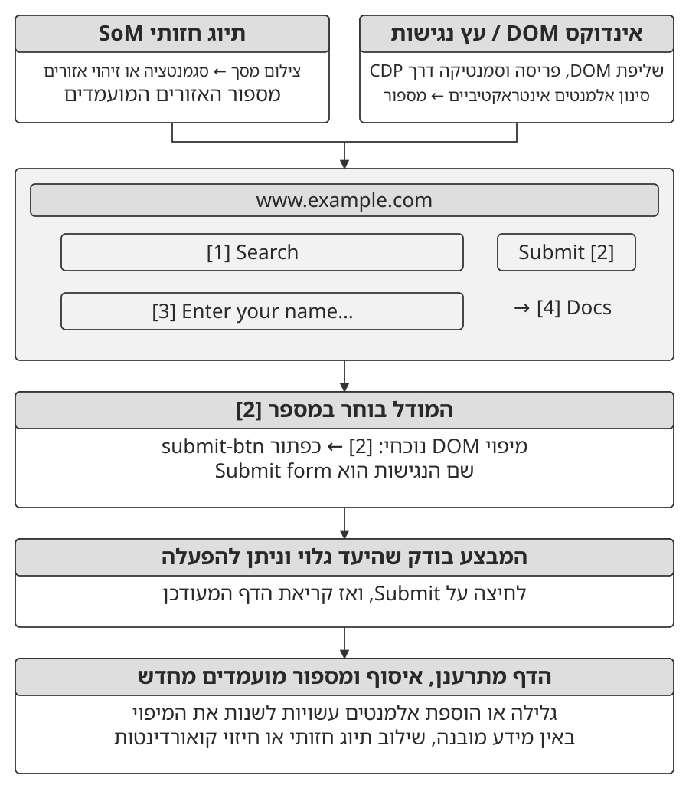

אפשר לחלק את התהליך לארבעה שלבים: קריאת ה‑DOM, הפריסה ומידע הנגישות הזמין; סינון האלמנטים הניתנים לאינטראקציה; בניית מיפוי מספרים לדף הנוכחי; ומסירת תיאורי האלמנטים, יחד עם צילום מסך מתויג במידת הצורך, למודל. למשל, המודל עשוי לראות את ארבעת האלמנטים הממוספרים הבאים:

```text
בצילום המסך מסומנים [1], [2], [3], [4]

[1] <input type="text" placeholder="Search" aria-label="Search" />
[2] <button id="submit-btn" aria-label="Submit form" />
[3] <input type="text" placeholder="Enter your name" value="" />
[4] <a href="/docs" aria-label="Documentation" />
```

אחרי שהמודל בוחר מספר, שכבת הביצוע מפענחת אותו להפניה לאלמנט או לקואורדינטות, בודקת שהיעד עדיין גלוי וניתן להפעלה, ורק אז מבצעת את הפעולה. אחרי רענון דף, גלילה או הוספה דינמית של אלמנטים, צריך לעדכן את המיפוי כדי לא להשתמש במספרים שפג תוקפם. אינדוקס מובנה יכול לנצל תגיות, תפקידים וטקסט, אבל Canvas, הסתרה או תיוג סמנטי חלקי מחייבים שיפוט בעזרת צילום המסך. ככל שרשימת האלמנטים ארוכה יותר וצילום המסך גדול יותר, כך נכנס להקשר יותר מידע.

**חיזוי קואורדינטות ישיר.**

במסלול הקואורדינטות המודל מפיק מיקום ישירות מצילום המסך ומתיאור היעד — למשל, ממפה את "לחץ על כפתור השליחה" לנקודה מסוימת. מחקרי איתור ב‑GUI כמו SeeClick, וגם Computer Use של Claude, משתמשים בפלט קואורדינטות. שכבת הביצוע אחראית להמיר את קואורדינטות התמונה לקואורדינטות שולחן העבודה בפועל.

כשצילום המסך משנה קנה מידה, שתי מערכות הקואורדינטות חייבות להשתמש באותה טרנספורמציה. נניח שולחן עבודה ברזולוציה 2560×1440: אם התמונה שנשלחת למודל היא 1366×768, הקואורדינטות (683, 384) שהמודל מחזיר מתאימות ל:

$$
x = 683 \times \frac{2560}{1366} = 1280,\qquad
y = 384 \times \frac{1440}{768} = 720
$$

באיור 6-15 יחסי הממדים של שני הגדלים קרובים. אם לצילום המסך נוספו פסים שחורים כדי לשמור על היחס, הקואורדינטות שהמודל מחזיר כוללות גם את השוליים; לפני ההמרה לקואורדינטות המסך המקורי יש להחסיר תחילה את היסט הריפוד, ורק אז להכפיל במקדם קנה המידה. גם חיתוך, שינוי קנה מידה של התצוגה ונקודת הראשית של מערך כמה מסכים משנים את המיפוי, ולכן שכבת הכלים צריכה לשמור את פרמטרי הטרנספורמציה בפועל.

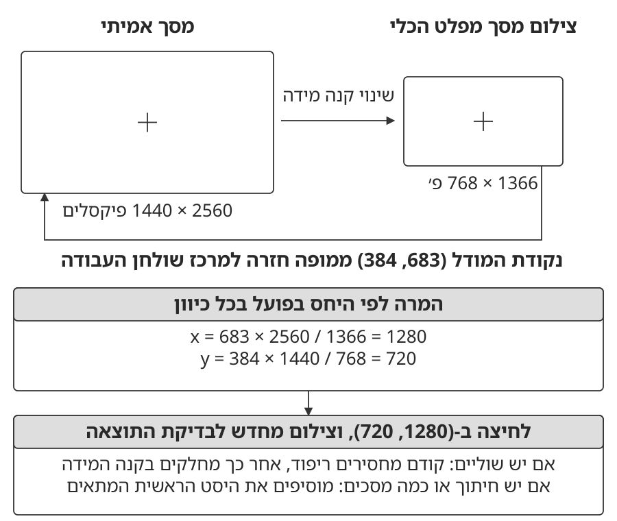

מימוש הייחוס השתמש בעבר בגדלי יעד כמו XGA ‏(1024×768), ‏WXGA ‏(1280×800) ו‑FWXGA ‏(1366×768). שינוי כפוי של יחס הממדים מעוות את צורת הפקדים, ומיפוי הפוך שגוי מנחית חיזוי נכון במקום הלא נכון.[^ch6-computer-tools]

**כשהמידע המובנה שלם, המחבר מעדיף אינדוקס DOM או עץ נגישות.** השם, התפקיד וההפניה של האלמנט משתתפים ישירות באיתור, וכך פוחתת העבודה של המודל בהערכת מיקום הפיקסלים בזמן אמת. כשאין מבנה, מודל ראייה כללי יכול להיעזר ב‑SoM ולבחור אחד מהאזורים המתויגים; מודל שכבר אומן לאיתור ב‑GUI יכול לחזות קואורדינטות ישירות, בלי שלב תיוג נפרד.

> **ניסוי 6-10 ★: שימוש ב‑browser-use להפעלת דפדפן אוטומטית**
>
> בניסוי זה Qwen3-VL 32B Instruct מפעיל את browser-use, ומפיק פעולות מתוך מצב הדפדפן, מידע האלמנטים וצילומי המסך. המשימה היא בירור מזג האוויר בסן פרנסיסקו: לאתר את תיבת החיפוש, להקליד "San Francisco weather today", לשלוח את השאילתה ולחלץ את הטמפרטורה ואת מצב מזג האוויר.
>
> הקוד והוראות ההרצה של ניסוי 6-10 מציעים שתי נקודות כניסה. אם יש לכם מפתח OpenRouter, אפשר להשתמש במודל ראייה מתארח; אם כבר יש לכם שירות תואם כמו vLLM או SGLang, אפשר לכוון את `OPEN_MODEL_BASE_URL` ואת `OPEN_MODEL_MODEL` לנקודת הקצה ולמודל שלכם ולהגדיר מפתח לפי דרישות השירות. בשני המסלולים מריצים תחילה בספריית הניסוי `python main.py --dry-run`, בודקים את התצורה, ורק אז מפעילים את השאילתה בפועל לפי ההוראות.
>
> הריצה השמורה השלימה 16 צעדי אינטראקציה ושמרה 15 צילומי מסך. אחרי ש‑Google הציג CAPTCHA, המשימה עברה ל‑weather.com כדי לקבל את התוצאה.

[^ch6-computer-tools]: Anthropic, תיעוד כלי Computer Use ומימוש הייחוס; מתארים ממשקי פעולה עם גרסאות, את שכבת הביצוע ואת עיבוד צילומי המסך.
[^ch6-som]: Microsoft, *Set-of-Mark Prompting*, 2023; מימוש שירות ה‑DOM של browser-use מספק דוגמה לעיבוד אלמנטים מובנה.

### סוכן Computer Use שרואה אנימציות ושומע קול

אחרי השמירה הדף מציג לרגע קצר "הסנכרון נכשל", אבל שני צילומי מסך שצולמו בהפרש של כמה שניות מציגים את אותו טופס. גם אם המודל יבחן שוב את שתי התמונות, סביר שלא יוכל לשחזר מה קרה ביניהן. לסרטונים, לאנימציות, להתראות קצרות מועד ולדיבור בפגישות יש אותה בעיה. **בממשקים שמשתנים ברציפות, המחבר מציע להתמקד בשיפור ממשק התצפית.** כדי להחליט על הצעד הבא לפי השינויים, צריך לשמור גם את האירועים או התמונות שהופיעו בין הפעולות.

**ממשק התצפית סוכן–מחשב (Agent–Computer Observation Interface,‏ AOI)**, שהציעו המחבר ועמיתו למחקר, ממיר מסך ושמע רציפים לתמונות ולטקסט שהמודל יכול לקבל[^ch6-9]. לממשק שלושה רכיבים:

- **לכידת פריימי מפתח בין פעולות.** בזמן שהלולאה הראשית רצה, הרכיב עוקב אחר שינויים במסך, מסנן פריימים מועמדים לפי הפרשי פיקסלים או בעזרת מודל ראייה קל, ומוסר את התמונות המועילות להחלטה הבאה.
- **תמלול מגודר‑עוצמה.** כשמזוהה קול, הרכיב מפעיל זיהוי דיבור ומוסיף את התמלול ואת מידע הזמן לרשומת התצפיות, כדי שהסוכן יוכל להשתמש בתוכן הפגישה או בהוראות בעל פה.
- **תיאור מסך מתמיד.** תמונות מפתח מסוכמות כטקסט; אחרי שהתמונה המקורית יוצאת מההקשר, הטקסט עדיין שומר את השינויים שהתרחשו, וצעדים מאוחרים יותר יכולים להפנות אליו.

למשל, אם בסרטון מוצגת פעולת תפריט, והמודל קיבל את פריימי הביניים ואת התיאורים שלהם, הוא יכול להמשיך להיעזר באותו צעד גם אחרי שההשמעה הסתיימה. תוצאות האבלציה במאמר מראות שהתיאורים הטקסטואליים המתמידים חשובים במיוחד לשיפור, ואילו לבחירה מדוקדקת של פריימי מפתח יש תרומה קטנה יותר; בחלק מהמודלים, הוספת תמונות רבות מדי אף פגעה בביצועים.

נחזור לדוגמת שמירת הטופס. גם אם פריים מפתח לכד את "הסנכרון נכשל", ברגע שהתמונה המקורית יוצאת מההקשר המודל יכול להסתמך רק על התיאור שנשאר. "בדף הופיעה התראה" יכול לציין שהשמירה הצליחה, ויכול גם לציין שנכשלה; רק "הסנכרון נכשל, הכתובת לא נשמרה" שומר את הרמז שקובע את הצעד הבא.

[^ch6-9]: Bojie Li, Noah Shi, *Agent-Computer Observation Interfaces Enable Dynamic Computer Use*, 2026; מציג את AOI ואת האבלציה של רכיביו.

### מודל העולם של Computer Use

אחרי שהסוכן מקבל תצפיות בזמן, הוא עדיין צריך לבחור פעולה ולהמתין לביצועה. מחקר OSWorld-Human השווה את יעילות הפעולה של סוכנים למסלולים של בני אדם, וניתח את מקורות בזבוז הזמן, כמו צעדים מיותרים וקריאות למודל[^ch6-osworld-human].

מודל עולם מספק לתכנון חיזוי של השלכות הפעולות. מצב שולחן העבודה יכול לכלול חלונות, פוקוס, מיקום גלילה, תוכן שהוזן ומצב טעינה; מידע כמו הרשאות ותוצאות רשת צריך להשלים דרך הממשקים המתאימים. לפי המצב הזמין הנוכחי והפעולה המועמדת, המודל חוזה את המצב הבא:

```text
מצב נוכחי + click / type / scroll / wait → המצב הבא החזוי
```

כשאדם עובד במחשב, הוא בדרך כלל כבר צופה את הצעד הבא לפני הלחיצה; אם הממשק מתנהג כמצופה הוא ממשיך, ורק כשמשהו מפתיע הוא עוצר לבדוק. מודל עולם יכול לתת לסוכן בסיס דומה לביצוע ספקולטיבי: המתכנן משווה מראש פעולות מועמדות, מכין את הצעדים הבאים בזמן שהדף נטען, וממשיך לבצע אחרי שהמצב האמיתי אושר — וכך פוחתת ההמתנה לתכנון מאפס אחרי כל לחיצה. למשל, כשיוצרים ב‑VS Code קובץ Python חדש וכותבים בו hello world, השינויים הצפויים הם: קובץ חדש מופיע בעץ הקבצים, אזור העריכה מכיל את הקוד, ומצב השמירה מתעדכן. אחרי הביצוע בודקים את השינויים האלה; אם הם תואמים את הציפייה ממשיכים, ואם יש סטייה מאתרים מחדש ומתכננים מחדש.

פעולות כמו מחיקת קובץ דורשות גם תנאי ביצוע עצמאיים: האם היעד נכון, האם המחיקה מותרת, האם אפשר לשחזר, והאם נדרש אישור מהמשתמש. החיזוי עוזר להבין את התוצאות האפשריות; את ההרשאות בפועל ואת התנאים העסקיים בודקת שכבת הביצוע.

**חיזוי המצב הסמוי ב‑Photon-1.** ביולי 2026 הציגה Induction Labs את Photon-1: המודל מקודד פריימי וידאו לטוקנים סמויים בדידים, ולומד את שינויי המצב באמצעות חיזוי הטוקנים הבאים. החברה מסרה שהאימון המקדים צרך כ‑30,000 שעות GPU מסוג H200. חיזוי המצב מתבצע בטוקנים הסמויים, ומחולל תמונות עזר משחזר אותם לתמונות שאפשר לצפות בהן, כדי שאדם יוכל לבדוק את החיזוי. התכנון ויצירת הפעולות יכולים להשתמש ישירות בייצוג הפנימי, וכך נחסכת העלות של יצירת צילום מסך מלא בכל צעד.[^ch6-20]

בהמשך, הפתרון לומד בכוונון עדין את פורמט ההוראות והפעולות: תחילה הוא חוזה את המצב שאליו רוצים להגיע, אחר כך מייצר את הפעולות שמובילות למצב הזה, ומשפר את ביצועיו במשימות באמצעות אימון מקוון במכונות וירטואליות. כוונון עדין מותנה‑פעולה משמש לחיזוי השינוי בשולחן העבודה אחרי פעולה נתונה. שני השימושים מתחברים בהתאמה לתכנון ולסימולציה, ומראים כיצד ייצוג מצב משתתף ב‑Computer Use.

[^ch6-osworld-human]: Reyna Abhyankar et al., *OSWorld-Human: Benchmarking the Efficiency of Computer-Use Agents*; מנתח מסלולי משימה ועלויות זמן.
[^ch6-20]: David Li, Jonathan Li, *Scaling Video Pretraining with Imagination Models*, Induction Labs, 2026-07-23; מציג את האימון המקדים של Photon-1, את למידת הפעולות ואת סימולציית המצב.
[^ch6-21]: Google DeepMind, *Genie 3: A new frontier for world models*, 2025-08-05; Zachary Lin et al., *Cosmos World Foundation Model Platform for Physical AI*, 2025.

### נייד: ממשקים טכניים ושיתוף פעולה באקוסיסטם

בנייד ממשיכים להשתמש בלולאת תצפית–החלטה–פעולה, אבל הפעולות מתבטאות בעיקר במחוות מגע. אותה קואורדינטה יכולה לציין מיקום הקשה, מיקום לחיצה ארוכה או נקודת התחלה של החלקה, ולכן הממשק צריך גם סוג מחווה, משך ומסלול. סיבוב המסך, הופעת המקלדת הווירטואלית וחלונות קופצים של המערכת משנים אף הם את האזור הניתן להפעלה.

‏`AccessibilityService` של Android יכול, בתחום שאושר לו, לקרוא מידע מהממשק ולבצע פעולות מתאימות, וממשק המחוות מחייב גם הצהרה על היכולת המתאימה[^ch6-android]. אפשר לשלב צילומי מסך, עץ נגישות וממשקי אוטומציה של המערכת, והטווח הזמין בפועל נקבע על ידי מערכת ההפעלה, מימוש היישום וההרשאות. מבחני ייחוס כמו AndroidWorld, שמוצגים בפרק 7, בודקים במשימות ביישומים אמיתיים אם הפעולות האלה מביאות לתוצאה הצפויה.

**לדעת המחבר, חסמי האקוסיסטם בנייד קשים לא פעם יותר מהבעיות הטכניות.** הפלטפורמה צריכה לקבוע אילו פעולות אפשר להעביר לסוכן, כיצד מאשרים גישה לחשבונות, לתשלומים ולנתונים, וכיצד מייחסים אחריות כשמשהו משתבש. ההסדרים האלה משפיעים ישירות על טווח המשימות שהסוכן יכול להשלים.

אחד מניגודי האינטרסים המבניים נובע מתעבורה ומקשב. יישומים רבים מתפרנסים מהצגת פרסומות, מהמלצות תוכן ומנקודות כניסה לעסקאות; כשהמשתמש מטיל על הסוכן להשלים ישירות שאילתה או רכישה, מסלול הגלישה בדפים עשוי להתקצר, והקשב שמקבלות ההמלצות והפרסומות משתנה. בפלטפורמות שמתפרנסות מהשלבים האלה, הפעלה בידי סוכן נוגעת במקורות ההכנסה הקיימים. לכן הפלטפורמות צריכות לחשוב מחדש על פתיחת ממשקים, על חלוקת הכנסות ועל ניהול זהות הסוכנים.

[^ch6-android]: Android Developers, AccessibilityService; מתאר גישה לממשק, פעולות ויכולות מחוות.

## מניפולציה רובוטית: סידור שולחן עם XLeRobot

לשים את הכוס האדומה במגש, לשים את פיסת הנייר הצהובה בפח, ולבסוף לוודא שהשולחן מסודר — המשימה הזו קושרת יחד תפיסה, תכנון ובקרה. כשהתפסן מתקרב לכוס, מיקומה בתמונת המצלמה משתנה; אחרי שהכוס הורמה, הזרוע צריכה לעקוף את שאר החפצים שעל השולחן; אם הנייר לא נתפס בניסיון הראשון, המערכת צריכה גם לזהות את הכישלון ולנסות שוב. כל פעולה משנה את התנאים של ההחלטה הבאה.

סעיף זה בונה סביב המשימה הזו חמישה ניסויים. ניסויים 6-11 ו-6-13 מציגים תכנון מעשי של הפעלה מרחוק ושל הפעלה אוטונומית על רובוט אמיתי; ניסויים 6-12,‏ 6-14 ו-6-15 משתמשים בסימולציה מקומית, וחוקרים בהתאמה את קו הבסיס של הבקרה, את ההתאוששות מכשל ואת השפעת השינוי בתנאים החזותיים.

אותו רובוט יכול להיות מופעל בידי אדם הצופה ברציפות בהזנת המצלמה, ויכול גם להיות מופעל בידי מודל הקורא את התמונה, בוחר מיומנות ומוסר אותה למערכת הבקרה לביצוע. כשהמשימה והחומרה נשארות קבועות, אפשר לנתח את ההבדל בין שתי הדרכים דרך ארבע שאלות: מה האדם רוצה להשיג, באיזו תת‑משימה מטפלים קודם, אילו פעולות המיומנות הנוכחית מפיקה, והאם הסביבה אחרי הפעולה תואמת את התוכנית. התכנון ארוך‑הטווח קובע את סדר הטיפול בכוס ובנייר, מדיניות VLA או פרימיטיבי פעולה מוגדרים מראש אחראים לתפיסה ולהנחה, מודל עולם עוזר להעריך את תוצאות הפעולה, והמעבר מסימולציה למציאות מטפל בהבדלים בתמונה, במגע ובמאפייני המפעילים.

### חלוקת העבודה בין חומרה לאלגוריתמים

כשסידור שולחן אוטונומי נכשל, אפשר להתחיל בהפעלה מרחוק כדי לבדוק אם החומרה מסוגלת לבצע את המשימה. משאירים את המצלמה, הזרוע, התפסן, פריסת השולחן ותנאי הקבלה ללא שינוי, ונותנים למפעיל לקחת על עצמו את לולאת התפיסה והבקרה. אם אדם מצליח באופן יציב לאורך סבבים רבים, והמערכת האוטונומית נכשלת שוב ושוב, פירוש הדבר שהחומרה כבר מסוגלת לבצע את המשימה, וצוואר הבקבוק נמצא בעיקר באלגוריתמים ובמשוב של הבקרה האוטונומית. במצב כזה יש לבדוק קודם כול את איתור האובייקטים, את בחירת המיומנות, את תזמון הפעולות ואת ההתאוששות מכשל, וללמד את המערכת האוטונומית את התיקונים שהתבררו כיעילים בהפעלה מרחוק.

‏XLeRobot תומך בהפעלה מרחוק באמצעות מקלדת, בקר Xbox ו‑Joy-Con של Switch, ואת ההפעלה ב‑VR אפשר לנסות תחילה בסביבה מדומה.[^ch6-1] כשהתפסן מתקרב לכוס, המפעיל מאט; כשהכוס מחליקה, הוא צריך לתקן את נקודת התפיסה. אם התפסן לא תפס את הנייר, צריך להסתכל שוב; כשאובייקט הגיע למקומו, גם אז מעיפים מבט לאישור. כל התיקונים האלה, הנשענים על תצפית, ראויים להיכלל בנתוני ההדגמה. כשהרובוט יפעל בעתיד באופן אוטונומי, גם הוא יצטרך לזהות החלקה ותפיסה שהוחמצה.

> **ניסוי 6-11 ★: הפעלה מרחוק של XLeRobot אמיתי לסידור שולחן**
>
> במרחב העבודה של XLeRobot שעבר כיול, הגדרת גבולות תנועה ובדיקת עצירת חירום, הניחו כוס אדומה, מגש, פיסת נייר צהובה ופח. באמצעות שיטת הפעלה מרחוק מכוילת אחת, בצעו את המשימה הקבועה: "שים את הכוס האדומה במגש, שים את פיסת הנייר הצהובה בפח, ולבסוף אשר את מצב השולחן." חזרו על כך במשך כמה סבבים, ותעדו את הזנת המצלמה, את קלט המפעיל, את מצב הזרוע, את תזמון הפעולות, את התפיסות שנכשלו ואת מספר הניסיונות החוזרים.
>
> בסוף כל סבב, ודאו שהכוס נמצאת בתוך המגש, שהנייר נמצא בתוך הפח ושהזרוע חזרה לתנוחה בטוחה, ובדקו את רישומי ההתנגשויות, החריגות מהתחום וההתערבויות הידניות לאורך כל ההרצה. ניתוח משותף של השלב שבו התרחש הכשל, של האופן שבו המפעיל התאושש ושל התוצאה הסופית יוצר קו בסיס להשוואה עם הבקרה האוטונומית.

ניסוי בסימולציה, לעומת זאת, מאפשר לשנות שוב ושוב את מספר האובייקטים ואת מיקומם ההתחלתי, ולבחון בנפרד את תהליך הבקרה כשהמצב ידוע. מודל שולחן דו‑ממדי יכול לייצג את ההתקרבות לאובייקט, את הובלתו אל היעד ואת המעבר לאובייקט הבא כשלושה שלבים, ולתאר את עלות הבקרה במספר הצעדים ובאורך המסלול.

> **ניסוי 6-12 ★: בניית קו בסיס של בקרה אידיאלית לאותה משימה בסימולטור**
>
> בשולחן דו‑ממדי, צרו באקראי מיקומי אובייקטים ומיקומי יעד, ותנו לבקר לקרוא את הקואורדינטות ישירות, להתקרב לכל אובייקט בתורו, להזיז אותו אל היעד המתאים ואז לעבור לאובייקט הבא. שנו את המיקומים ההתחלתיים ואת מספר האובייקטים, והשוו את שיעור ההצלחה, את מספר הצעדים ואת אורך המסלול.
>
> עקבו תחילה אחר המסלול המלא של אובייקט אחד: כשהבקר מגיע לאובייקט הוא עובר לשלב ההובלה, ורק כשהוא מגיע ליעד גדל מונה האובייקטים שהושלמו. אחר כך הגדילו את מספר האובייקטים ובדקו שכל אובייקט עובר את שני תנאי ההגעה האלה. הסימולציה הדו‑ממדית הנלווית מציבה 1,‏ 2,‏ 3 ו‑4 אובייקטים תחת חמישה זרעים אקראיים, ומריצה 512 אפיזודות לכל צירוף; כל 10,240 האפיזודות הושלמו. הבקר יכול לקרוא את הקואורדינטות ישירות, והזזת האובייקטים אינה תלויה בתפסן אמיתי.

### המבנה הבסיסי של בקרת רובוטים

סידור שולחן אחד עשוי להימשך כמה דקות, אך בקרת המפרקים חייבת להתעדכן ברציפות ובזמן. המערכת יכולה לחלק את העבודה לפי סקאלת זמן: התכנון ברמה הגבוהה קובע את סדר המשימות, מדיניות המיומנות מייצרת את התנועה, והבקר ברמה הנמוכה עוקב אחריה ומבצע אותה:

| שכבה | שאלת הליבה | פלט | סקאלת זמן ודוגמת תצורה |
| --- | --- | --- | --- |
| מטרת המשימה | מה האדם רוצה להשיג | "להחזיר את הכוס ואת הנייר למקומם" | משימה בסדר גודל של דקות |
| תכנון ארוך‑טווח | מה קודם ומה אחר כך | קודם הכוס, אחר כך הנייר, ולבסוף בדיקה | שניות עד דקות |
| מיומנויות בסיסיות | איזה שינוי מצב יש להשיג עכשיו | `pick(red_cup)`,‏ `place(red_cup, tray)` | מיומנות אחת יכולה להימשך כמה שניות, למשל 1—3 שניות |
| VLA / מדיניות מיומנות | כיצד בדיוק המיומנות הנוכחית זזה | פעולות תפסן, תנוחת מפעיל‑קצה או מקטע של מסלול מפרקים | ניתן להגדיר הסקה בקצב 1—10 Hz |
| בקרה ברמה נמוכה ושכבת בטיחות | כיצד לבצע ביציבות ובזמן | פקודות מפרק או מפעיל‑קצה, הגבלת מהירות ועצירת חירום | ניתן להגדיר את הבקר בקצב של עשרות עד אלפי Hz |

המתכנן יכול להיות תוכנית מבוססת כללים, ‏VLM או אופטימייזר, וגם VLA יכול לקחת על עצמו חלק מבחירת המיומנויות. **המלצת המחבר היא לטפל בסדר המשימות ובפעולה המיידית בנפרד.** הסקה ברמה הגבוהה זקוקה לזמן כדי לבנות תוכנית, ואילו בקרה ברמה הנמוכה חייבת להגיב בזמן לשינויים במיקום ובכוח; רק כששתיהן רצות כל אחת בקצב המתאים לה אפשר לשלב תכנון טוב עם בקרה טובה.

סעיף זה מספק למודל ברמה הגבוהה חמישה סוגי כלים — ‏`observe_scene`,‏ `pick`,‏ `place`,‏ `verify_state` ו‑`stop` — לתצפית, לתפיסה, להנחה, לבדיקה ולעצירה. ה‑Harness בודק את הפרמטרים, את מרחב העבודה ואת המצב הנוכחי; המבצע הופך מיומנות שעברה את הבדיקה לתנועת זרוע ומטפל בהגבלות המהירות ובפסקי הזמן. זוויות המפרקים והמסלולים הרציפים נוצרים בידי מדיניות המיומנות והבקר, וכך נוצר ממשק ברור בין בחירת המיומנות בידי המודל לבין התנועה בפועל.

### תכנון ארוך‑טווח ופירוק משימות

כשהמשתמש אומר "סדר את השולחן", המתכנן מזהה תחילה את האובייקטים ואת אזורי היעד שלהם, קובע את סדר הטיפול, ולכל צעד מגדיר במפורש תנאי התחלה, תנאי השלמה ומגבלות על הפעולה. סדר הסידור יכול להיות, למשל:

```text
טיפול בכוס האדומה → פינוי הנייר הצהוב → בדיקת השולחן
```

"טיפול בכוס האדומה" מתפרק הלאה לשתי פעולות ובדיקה אחת:

```text
pick(red_cup) → place(red_cup, tray) → verify_state()
```

ניקח את "הרם את הכוס והנח אותה במגש": כשהזרוע מסיימת להריץ את תוכנית התפיסה, הדבר מעיד רק שהתוכנית הסתיימה. לפני ההרמה, יש לקבוע באמצעות משוב התפסן או תמונה חדשה אם הכוס אכן נתפסה. אם התפיסה החטיאה, מאתרים את הכוס מחדש; אם מישהו הזיז את המגש, התפיסה שהצליחה עדיין תקפה, ויש לתכנן מחדש רק את ההנחה. כשכל מיומנות מתאימה לשינוי מצב אחד שאפשר לבדוק, הפעולה ומשכה מוגבלים, ובסופה מוחזרים מצב הביצוע ותצפית חדשה, המתכנן יכול להתאושש בדיוק מהצעד שבו התרחשה התקלה.

> **ניסוי 6-13 ★★: הנעת XLeRobot לסידור שולחן אוטונומי עם Gemini Robotics-ER 1.5**
>
> השתמשו באותם חומרה, פריסת שולחן, משימה ותנאי קבלה של ניסוי 6-11, ותנו למודל היסק מגולם לטפל בתצפית ובתכנון. בהשראת דרך התזמור של RoboCrew, תכננו למשימה זו חמישה כלים: ‏`observe_scene`,‏ `pick`,‏ `place`,‏ `verify_state` ו‑`stop`.[^ch6-2]
>
> המודל קורא תחילה את תצפית השולחן, קובע את סדר הטיפול, ואז מפעיל את מיומנויות התפיסה וההנחה המכוילות. בסיום כל מיומנות הוא מקבל תצפית חדשה ובודק את תנאי הסיום; אחרי כשל הוא בוחר, לפי המצב הנוכחי, לנסות שוב או לעצור. מערכת הריצה עוצרת את הביצוע ישירות כשהיא מקבלת אות עצירת חירום, מזהה חריגה מהתחום או אינה יכולה לאשר מצב מרכזי, וגם המודל יכול לסיים את המשימה ביוזמתו באמצעות `stop`.
>
> בסוף, תצפית חדשה של הסביבה מאשרת שהכוס בתוך המגש, שהנייר בתוך הפח ושהזרוע חזרה לתנוחה בטוחה, ונבדקים רישומי ההתנגשויות והחריגות מהתחום. המפעיל אחראי להפעלה, לעצירת החירום ולפיקוח באתר, וכל השתלטות באמצע ההרצה נרשמת בנפרד.

ניסוי 6-13 מראה כיצד לחבר פעולות על רובוט אמיתי וכיצד לקבל את תוצאת הסידור, אך ברישומים הנלווים עדיין אין ניסוי על רובוט אמיתי במשימה הזו. לכן נשווה תחילה בסביבה מדומה שלוש שיטות: ביצוע לפי תוכנית בלולאה פתוחה, בדיקת התוצאה אחרי כל צעד, וחיזוי מוקדם של תוצאות הפעולה. מטרת המשימה וחמשת סוגי הכלים נשארים זהים, ואת התקלות אפשר להפעיל שוב ושוב, כך שקל לראות כיצד כל שיטה מתמודדת עם אותה טעות.

### בקרת VLA

‏VLA הוא ראשי תיבות של Vision-Language-Action, כלומר מודל ראייה–שפה–פעולה. הוא מייצר את הפעולה הבאה לביצוע על סמך התמונה הנוכחית, הוראת המשימה ומצב הרובוט הזמין:

```text
תצפית נוכחית + הוראת מיומנות → פעולה או רצף פעולות
```

בדוגמת סידור השולחן, המתכנן ברמה הגבוהה מגיש `pick(red_cup)`, ומדיניות המיומנות מחליטה לפי התמונה מאיזה כיוון להתקרב לכוס, מתי לסגור את התפסן ולאורך איזה מסלול להרים את הזרוע. אחרי ביצוע מקטע התנועה הזה, המערכת מקבלת שוב תצפית של השולחן, מאשרת שהכוס נתפסה, ורק אז עוברת ל‑`place(red_cup, tray)`. ממשק הכלים מגדיר את שינוי המצב הרצוי, ו‑VLA לומד לממש את השינוי הזה באמצעות פעולות רציפות.

אפשר לייצג פעולות בדרכים שונות. ‏RT-2 ו‑OpenVLA המקורי מכמתים את הערך של כל ממד בפעולה לטוקנים בדידים ומפיקים אותם בדרך הייצור של מודל שפה; ‏π₀ משתמש בהתאמת זרימה (flow matching) כדי לייצר מקטעי פעולה רציפים. הגישה הראשונה מאפשרת לעשות שימוש חוזר במסגרת הייצור האוטורגרסיבית, והשנייה ממדלת ישירות את ההתפלגות של מקטע פעולות רציף.[^ch6-15]

הסקת המודל ובקרת המפעילים פועלות בדרך כלל בתדרי עדכון שונים. קיבוץ פעולות (action chunking) מאפשר למודל לייצר בבת אחת מקטע קצר של פעולות עתידיות, ותהליכון הבקרה מבצע אותו בתדר גבוה יותר. אם מוסיפים חפיפה בין ההסקה לביצוע, המערכת יכולה להכין את המקטע הבא בזמן ביצוע המקטע הנוכחי, ולצמצם המתנה. המעבר בין מקטעים מחייב גם טיפול ברציפות המסלול ובעדכניות התצפית: אם הכוס נדחפה בזמן שהזרוע נשלחת אליה, הפעולות הנותרות עלולות עדיין לכוון למיקום הישן. קיצור המקטע שמתבצע בפועל בכל פעם, עדכון מתגלגל לפי תצפיות חדשות, או קטיעת הפעולה כשמזוהה חריגה — כולם משפרים את מהירות התגובה, אך גם מגדילים את עלות ההסקה והתזמון.

### נתונים ותנאי פריסה של VLA

כדי להפוך את "הרם את הכוס" לפעולה יציבה, יש לטפל במקביל בכמה סוגי הבדלים:

- **כיסוי נתוני האימון**: הדגמות של פעולות רובוטיות זמינות בהיקף קטן בהרבה מטקסט ותמונות באינטרנט. לדעת מהי "כוס" אינו מספיק; נדרש ניסיון תפיסה ממשי כדי לשפוט כיצד להפעיל כוח. ההדגמות צריכות לכסות את החומר, הצורה, תנוחת ההנחה ותנאי החיכוך של הכוס. אותו כיוון תפיסה עשוי להניב תוצאות שונות בכוס קרמיקה ובכוס נייר רכה.
- **מטרת הלמידה: פעולה ותוצאה**: שיבוט התנהגות לומד בעיקר איזו פעולה ינקוט המדגים בתנאים הנוכחיים. כדי להשוות את התוצאות של כמה פעולות, אפשר להוסיף חיזוי מצב או הערכה של תוצאות הפעולה.
- **גוף הרובוט והממשק**: דרגות החופש, מערכת הצירים, מבנה התפסן והשהיית המפעילים קובעים כיצד פעולה מתממשת בחומרה. בהעברת מדיניות יש להתאים את ייצוג הפעולה, את פרמטרי הכיול ואת מחזור הבקרה.
- **עדכניות התצפית**: בזמן ביצוע מקטע פעולות, אובייקט עשוי לזוז, להיות מוסתר או להיהפך. המערכת צריכה להגדיר מתי לקבל תצפית חדשה ומתי להשתמש בה כדי לעדכן את הפעולות הנותרות.

התנאים האלה קושרים יחד זיהוי חזותי, בקרת מיומנויות ושינויים בסביבה. נוזל בכוס משפיע על מהירות ההובלה, כבל חשמל בקצה השולחן משנה את המסלולים האפשריים, והמגע בין הנייר לשולחן משפיע על אופן התפיסה. מתכנן שיכול להשוות מראש את התוצאות האלה מקבל בסיס רחב יותר לבחירת מיומנויות.

### מודלי עולם

בתכנון רובוטי, אפשר להבין מודל עולם מותנה‑פעולה כ"מנבא תוצאות פעולה": בהינתן המצב הנוכחי ופעולה מועמדת, הוא מעריך מה יקרה בהמשך.

```text
מצב נוכחי + פעולה מועמדת
    → חיזוי המצב הבא או מקטע עתידי
    → השוואת תוצאות המועמדים
    → בחירת פעולה, תכנון מחדש או עצירה
```

התהליך כולל שלוש משימות: ייצוג המצב הנוכחי, חיזוי שינוי המצב שהפעולה תגרום, ומתן האפשרות למתכנן או לבקר לבחור פעולה על סמך החיזוי. המצב יכול להיות משתנים מובנים כמו מיקום אובייקט או האם הוא נתפס, ויכול גם להיות ייצוג פנימי המופק מתמונות. ‏V-JEPA 2 לומד תחילה ייצוג מצב וחיזוי מתוך וידאו, ו‑V-JEPA 2-AC, שאומן בהמשך, מוסיף התניה על פעולה לשם תכנון רובוטי. קישור פעולות לתצפיות עתידיות הוא גם כיוון מידול של מודלי עולם–פעולה (World-Action Model).[^ch6-16]

מודל עולם יכול לסייע לרובוט בשלושה שלבים: לפני הפעולה — לחזות בנפרד מה תניב תפיסה, דחיפה או המתנה; במהלך הביצוע — להשוות את החיזוי לתצפית בפועל, ובעת סטייה לכוונן את הפעולה או לתכנן מחדש; במהלך האימון — ללמוד שינויי מצב מווידאו, מנתוני סימולציה וממסלולי כשל, ובכך לצמצם ניסוי וטעייה על רובוט אמיתי.

נניח שהנייר הצהוב מוסתר בחלקו בידי הכוס האדומה; המתכנן יכול להשוות בין "לתפוס קודם את הנייר", "להזיז קודם את הכוס" ו"להחליף כיוון תפיסה". המחבר נותן עדיפות לכך שמודל העולם יחזה את שינויי המצב האלה, הקשורים ישירות למשימה וניתנים לבדיקה. אם אפשר לשפוט אם הנייר יהיה קל יותר לתפיסה ואם הכוס עלולה ליפול, אפשר לדרג את הפעולות המועמדות. את ייצוג המצב ואת מטרת האימון של המודל יש לתכנן סביב השיפוטים האלה. אם המודל מייצר תמונות עתידיות, המחבר בודק קודם אם התמונות משקפות נכון את תוצאות הפעולות האלה, ורק אחר כך שוקל להוסיף פרטים חזותיים; ערכה של ריאליסטיות התמונה צריך להתבטא בסופו של דבר בשיפור התכנון והבקרה. אחרי הביצוע, המערכת בודקת את התוצאה בפועל לפי המצלמה ומצב הרובוט, ומחליטה אם להמשיך, לנסות שוב או להחליף שיטה.

ככל שטווח החיזוי ארוך יותר, כך השגיאה מצטברת ביתר קלות. בפועל אפשר לחזות תחילה תוצאות קצרות‑טווח, לבצע מקטע קצר, לתכנן מחדש לפי תצפית חדשה, ולהביא בחשבון את אי‑הוודאות של החיזוי בעת הבחירה. מודלי עולם גנרטיביים יכולים גם לספק סימולציה אינטראקטיבית וסצנות להמחשה; לשימוש בבקרה יש לבחון בנוסף את ההתניה על פעולה, את חוקי המגע ואת שגיאת החיזוי. מגבלות החומרה, עצירת החירום והבקרה בזמן אמת נשארות באחריות מערכת הביצוע.[^ch6-21]

> **ניסוי 6-14 ★★: השוואת שלוש לולאות סגורות לסידור שולחן אוטונומי בסימולטור**
>
> ייצגו את הכוס האדומה ואת הנייר הצהוב במצב מובנה: כל אובייקט נמצא באחד משלושה שלבים — "על השולחן", "הורם" או "הונח" — ולכל אזור יעד נרשם אם הוא זמין. הסימולטור מספק חמישה סוגי כלים — תצפית, תפיסה, הנחה, בדיקה ועצירה — ומזריק לכל היותר כשל חולף אחד בעת תפיסת הנייר.
>
> השוו שלוש שיטות בקרה. **ביצוע בלולאה פתוחה** משלים ארבע פעולות בסדר קבוע. **בדיקה צעד אחר צעד** קוראת את המצב אחרי כל פעולה, ואחרי כשל מקבלת תצפית מחדש ובוחרת את הצעד שניתן לבצע כעת. **ביצוע חזוי** משתמש ברשת נוירונים קטנה הלומדת את המיפוי "מצב ופעולה למצב הבא", ומדרג את הפעולות האפשריות לפי התקדמות ההחזרה למקום שהיא חוזה.
>
> השוו את השלמת המשימה, את מספר הקריאות לכלים ואת תהליך ההתאוששות מכשל. לדוגמה, אחרי כשל בתפיסת הנייר הוא נשאר על השולחן, וביצוע ישיר של ההנחה ייכשל משום שהאובייקט לא הורם; רק קריאת המצב וניסיון תפיסה חוזר מאפשרים להמשיך להנחה. שתי אסטרטגיות המשוב מפעילות בסיום את `verify_state` כדי לבדוק שהאובייקטים במקומם.
>
> באפיזודות ללא הזרקת תקלה, שלוש האסטרטגיות משלימות את המשימה. כשמעלים את הסתברות הזרקת התקלה ל‑50%, כל אסטרטגיה רצה 384 אפיזודות על שלושה זרעים (128 אפיזודות לכל זרע). הלולאה הפתוחה עדיין מפעילה 4 כלים בכל אפיזודה, ורק 205 אפיזודות מושלמות. הבדיקה צעד אחר צעד והביצוע החזוי משלימים שתיהן את כל 384 האפיזודות, בממוצע של כ‑6.93 קריאות. הקריאות הנוספות הן שמאפשרות לבקר לזהות תפיסה שהוחמצה ולהתאושש. במשימה זו, שבה מוזרקת רק תקלה אחת ברת‑התאוששות, חיזוי המצב הבא לא הציל אף אפיזודה נוספת לעומת בדיקה ישירה.

### מסימולציה לרובוט אמיתי

המעבר משולחן מדומה לרובוט אמיתי מחייב לטפל בהבדלי הסביבה אחד אחד. מבחינת התמונה, אותם כוס ומגש יופיעו על רקעים שונים, בתאורה שונה, במיקומי מצלמה שונים ובמצבי הסתרה שונים; מבחינת התנועה, חיכוך, רעש חיישנים והשהיית מפעילים משפיעים על המסלול ועל התפיסה.

אקראיות תחום (domain randomization) פירושה לשנות במהלך האימון את הרקע, את מראה האובייקטים, את התאורה או את הרעש, כך שהמודל יבצע את אותו שיפוט בתנאים מגוונים. ניסוי 6-15 בוחן חוליה אחת בלבד מתוך זה: אחרי שרואים את האובייקט ואת אזור היעד, לאיזה כיוון יש לזוז?

> **ניסוי 6-15 ★★★: בדיקת RGB חוצת‑סביבות על אותה משימת שולחן**
>
> ייצגו את האובייקט בעיגול ואת אזור היעד בריבוע, וצרו תמונות שולחן ב‑RGB. המודל מפיק, לפי המיקום היחסי של השניים, אחד מארבעה כיווני תנועה — שמאלה, ימינה, למעלה או למטה; כשהמיקומים קרובים דיים, הוא מפיק את התווית `grasp` שהניסוי מגדיר. תווית זו מציינת שהמיקום הדו‑ממדי עומד בתנאי הקרבה.
>
> אמנו ארבע קבוצות של מדיניות חזותית בעלות מבנה זהה: תנאים חזותיים קבועים, שינוי בעיקר של הרקע, שינוי בעיקר של מראה האובייקטים, ושילוב של כמה סוגי שינויים. הפעילו כל מדיניות על התנאים המקוריים ועל תמונות בדיקה עם צבעים, מרקמים, בהירות ורעש חדשים, השוו את דיוק קביעת הכיוון, ובחנו את התמונות שבהן השיפוט שגוי.
>
> לכל תחום בדיקה ולכל זרע יש 1,024 תמונות סינתטיות. נשווה תחילה את הדיוק הממוצע על פני שלושה זרעים: המדיניות שאומנה בתנאים חזותיים קבועים מגיעה ל‑93.03% בתחום המקורי, ויורדת ל‑54.82% בתחום היעד עם מרקמים ורעש חדשים (`target_realistic`); המדיניות שאומנה בשילוב של כמה סוגי שינויים מגיעה ל‑87.50% בתחום המקורי, אך ל‑76.11% באותו תחום יעד. הקבוצה שבה רק הרקע עבר אקראיות מגיעה בתחום יעד זה ל‑36.88% בלבד.[^ch6-6]

## סיכום הפרק

נחזור לשיחת שינוי הכרטיס שבפתיחת הפרק. בזמן שהרקע בודק טיסות, המשתמש מוסיף דרישה לגבי מזוודה. גם אם תוצאת הבדיקה מגיעה אחרי הודעת המשתמש, היא עלולה לענות על השאלה הישנה. תור האירועים צריך לשמור את מקור ההודעה, את מזהה המשימה ואת סדר האירועים, כדי שהחזית תוכל לקלוט את הדרישה החדשה לפי עדיפות ולהחליט אם הבדיקה המקורית יכולה להימשך, אם יש לבטל אותה או אם יש לבדוק שוב בתנאים חדשים. זוהי בעיה של **תזמון**, ומעבר לקול כשלעצמו אינו פותר אותה.

הקול מוסיף דרישה נוספת. בזמן הקראת המחיר, המערכת צריכה גם לשמוע את המשתמש כשהוא מתפרץ; ברגע שהתאריך השתנה, יש לעצור את ההקראה שהתיישנה. מדורג ומקצה לקצה מתארים כיצד הקול עובר דרך זיהוי, הסקה וייצור; דו‑כיווניות מלאה מתארת אם המשתמש והעוזר יכולים לשמוע ולדבר בו‑זמנית.

כשעוברים למסך או לזרוע רובוטית, אותה בעיה נשארת; רק **צורת התצפית והפעולה** משתנה. קואורדינטות של כפתור נלקחו מצילום המסך הקודם, ואחרי רענון הדף יש לאתר אותו מחדש; זרוע רובוטית יכולה לחזות בבת אחת מקטע קצר של פעולות רציפות כדי שתנועת המפרקים תהיה חלקה יותר, אך ככל שהמקטע ארוך יותר, קשה יותר להגיב לשינויים באמצע הביצוע. התכנון ברמה הגבוהה, המיומנויות והבקרה ברמה הנמוכה פועלים בסקאלות זמן שונות, ואם הכוס אכן הונחה במגש — את זה עדיין צריך לבדוק במבט נוסף על השולחן. כשכותבים את כל האינטראקציות האלה יחד, מתגלה הסדר המשותף להן:

```text
קבלת תצפית
  → קביעת המצב הנוכחי ועיתוי הביצוע
  → בחירת תשובה או פעולה
  → ביצוע וקבלת משוב מהסביבה
  → המשך, תיקון, ניסיון חוזר, עצירה או תכנון מחדש
```

הרצף הזה עוזר לאתר תקלות. אם אחרי שהמשתמש מתפרץ המחיר הישן ממשיך להיות מוקרא, יש לבדוק מי אחראי להעיר את החזית, אם אפשר להפקיע את ההשמעה (לקטוע אותה לטובת הקלט החדש), ובאיזו נקודה בטוחה אות הביטול נקלט; אם העצירה הייתה בזמן אך עדיין נמסר התאריך הישן, יש לעקוב אחר תוצאת הבדיקה לאורך המסירה בין החזית לרקע. אחרי התיקון, כיצד מוכיחים שהמערכת עושה נכון גם בשיחות רבות נוספות? מכאן הספר עובר לשיפור יכולות. פרק 7 מסביר תחילה כיצד לתכנן משימות, לתעד כשלים ולהשוות שינויים; אימון המודל, התפתחות מתמשכת ושיתוף פעולה רב‑סוכני נשענים כולם על שיטת הערכה זו.

[^ch6-1]: XLeRobot, תיעוד Teleop.
[^ch6-2]: Google DeepMind, *Gemini Robotics-ER 1.5*. ‏XLeRobot, בקרת LLM Agent. הדוגמה של XLeRobot במקור מראה כיצד המודל וקריאות הכלים מתוזמרים; סעיף זה שומר על אותו עקרון תזמור, אך מגביל את כלי הפעולה לפרימיטיבים מכוילים של תפיסה, הנחה, בדיקה ועצירה על השולחן.
[^ch6-6]: LeRobot, מדריך Sim2Real.
[^ch6-15]: Moo Jin Kim ואחרים, *OpenVLA: An Open-Source Vision-Language-Action Model*, arXiv:2406.09246, 2024. ראו גם את דף הפרויקט של RT-2 ואת *Our First Generalist Policy* של Physical Intelligence.
[^ch6-16]: Meta AI, *Introducing the V-JEPA 2 world model and new benchmarks for physical reasoning*, 11 ביוני 2025. מספר הדוח הטכני: arXiv:2506.09985.
[^ch6-22]: OpenAI, “Async tool calling”; “Using GPT-6 Astra”, נבדקו ב-2026-09-05.
[^ch6-23]: OpenAI, “Mid-turn steering”, נבדק ב-2026-09-05.

[^ch6-audio-architectures]: OpenAI, *Voice activity detection*, מציג שתי דרכים לקביעת גבולות תור: לפי פעילות קולית ולפי שיפוט סמנטי.
[^ch6-voice-tools]: תיאורי המודלים GPT-Live-1 ו‑GPT-Realtime של OpenAI מציגים בהתאמה האצלה לרקע וקריאה לפונקציות. דרך החיבור של מודל הקול בזמן אמת Doubao 3.0 מתוארת במסמך "Function Calling" של Volcano Engine.

## שאלות למחשבה

1. ★★ כשסוכן אסינכרוני מקבל אירוע חדש, עליו לקבוע את יחסי העדיפות בינו לבין המשימה הנוכחית. אם השיפוט הזה דורש הבנה סמנטית — למשל, לזהות אם המשתמש מוסיף תנאי או דורש לעצור מיד — כיצד יש לחלק את האחריות בין מנוע כללים לבין LLM? השוו זמן תגובה, עלות ותוצאות של שיפוט שגוי.
2. ★★ בתור האירועים הצטברו 20 אירועים: 10 תוצאות כלים, 5 הודעות משתמש ו‑5 תזכורות מערכת. כיצד הייתם מארגנים את הסדר, הפורמט ומצב העיבוד שלהם, כך שהמודל יוכל לעקוב אחר תלויות בין משימות ולהגיב לשינויים חשובים?
3. ★★★ סוכן יכול להשתמש בתיבת דוא"ל ובמספר טלפון ייעודיים, ויכול גם, לאחר הרשאה, להפעיל את חשבונותיו האישיים של המשתמש. בהתחשב בפעולה ברקע, בדרישות אימות הזהות של הצד השני, בהיקף ההרשאות ובביקורת, דונו בתרחישים שבהם מתאימה כל אחת משתי דרכי הזהות.
4. ★★ מודל קול מקצה לקצה מעבד אודיו ישירות, וקשה לאתר מבחוץ שגיאות בשלבי הביניים. כיצד הייתם מתכננים תצפית וניסויי השוואה כדי להבחין בין שגיאות תפיסה, שגיאות הסקה ושגיאות הבעה?
5. ★ ה‑MPS של Step-Audio R1.1 מאפשר לתכנון ולהבעה להתקדם יחד. כיצד על המערכת להשתמש בהפסקות, בעדכוני התקדמות ובהבעה מקוטעת? כיצד יש לנהוג כשהסקה מאוחרת יותר משנה מסקנה שכבר נאמרה?
6. ★★ גם סימון האזורים החזותי של SoM וגם אינדוקס אלמנטי DOM מאפשרים למודל לציין במספר אחד היכן לפעול. מול פקדים שאינם תקניים, הסתרה או שינויים דינמיים, כיצד הייתם משלבים סימון מחדש, חיזוי קואורדינטות ובדיקה לאחר הפעולה?
7. ★★ איכות נתוני ההפעלה מרחוק תלויה במיומנות המפעיל. כיצד רעד, מסלולים עוקפים, עצירות ותפיסות שנכשלו ישפיעו על אימון VLA? כיצד ניתן לסנן את הנתונים ובו בזמן לשמר תהליכי התאוששות מכשל בעלי ערך?
8. ★★★ קול, ‏Computer Use ורובוטיקה יכולים כולם לאמץ מודל מאוחד, צינור מודולרי מדורג או חלוקה בין אינטראקציה בחזית להסקה ברקע. בראייה לחמש השנים הבאות, כיצד הייתם נוטים לשלב את המסלולים האלה? נמקו את שיפוטכם בהתחשב בהשהיה, ביכולת התצפית, בעלות השדרוג ובסיכון המשימה.
9. ★★ דפי רשת תקניים יכולים לספק DOM או מידע נגישות, ואילו Canvas,‏ WebGL ופקדים מצוירים בהתאמה אישית נשענים לעיתים קרובות על איתור חזותי. אילו עלויות מוסיפה תחזוקה במקביל של מסלול מובנה ומסלול חזותי, ואילו תועלות היא מניבה?
10. ★★ קיבוץ פעולות מאפשר ל‑VLA לייצר בבת אחת מקטע של פעולות עתידיות. אם אובייקט מוזז במהלך הביצוע, כיצד יש לתאם בין אורך המקטע, תצפית מחודשת, הסקה ברקע וקטיעת הפעולה, כדי לאזן בין יעילות הביצוע למהירות התגובה?
11. ★★★ אינטראקציה מהירה דורשת פעולה בזמן. בעזרת הדוגמאות של תשובה קולית, שליחת טופס בדף רשת ותפיסה רובוטית, תכננו דירוג פעולות, אישור מצב ומנגנון עצירה, כך שמהירות התגובה תתאים להשלכות המשימה.
12. ★★★ בחרו אחד מהפרימיטיבים — יקיצה, נקודה בטוחה, ביטול, הפקעה או חלוקת מהיר/איטי — והשוו את מימושו במשימות מונחות אירועים ובקיבוץ פעולות רובוטי. כיצד משפיעים מהירות השינוי של הסביבה, הפיכות הפעולה ועלות התצפית על התכנון?
13. ★★ האם צ'אט הלקוח, דיון האישור וקריאת החזרה של התשלום עבור אותה הזמנה צריכים להשתייך לאותו שרשור? השוו בין איחוד לשרשור אחד לבין מינוי לפי אובייקט מקושר, מארבע בחינות: סדר העיבוד, מידת המקביליות, הגירת מפתח המחיצה ובידוד ההרשאות.
14. ★★ עוזר נסיעות קולי צריך לבדוק מזג אוויר, לקרוא את זיכרון המשתמש, לחפש ברשת, לבדוק טיסות ולהזמין כרטיסים. כיצד יש לחלק את העבודה בין החזית, הרקע וסביבת הריצה? אם המשתמש מכתיב בעל פה את שמות הנוסעים הנלווים, ותוך כדי המתנה לתוצאות הטיסות שואל על מזג האוויר, כיצד נמנעים מהזמנת כרטיס שגוי או מהחמצת דיווח על תוצאה?
