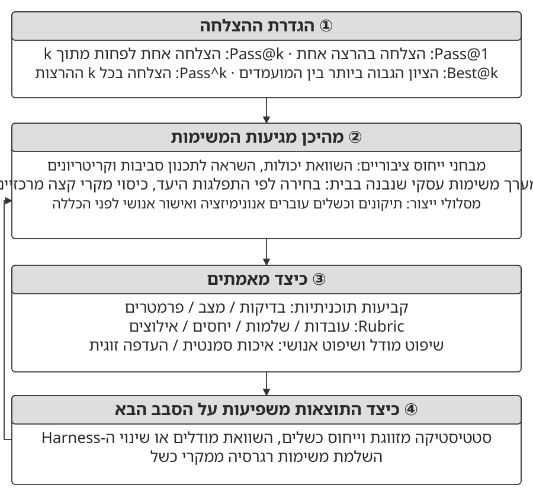
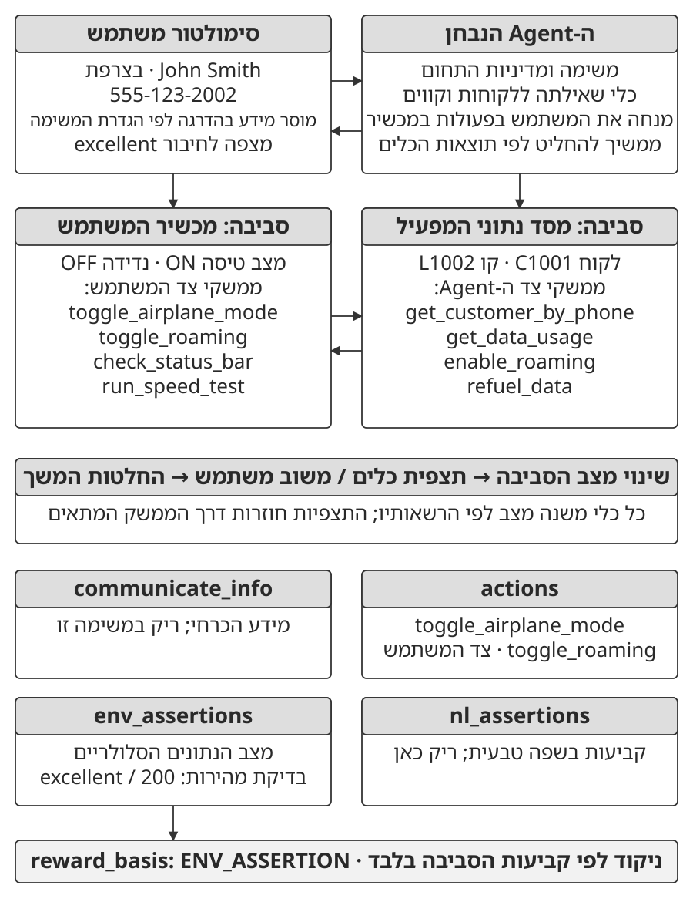
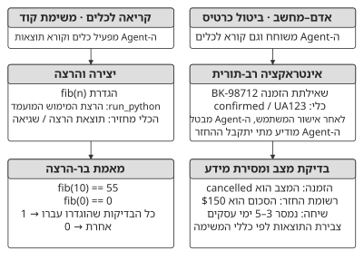
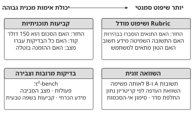
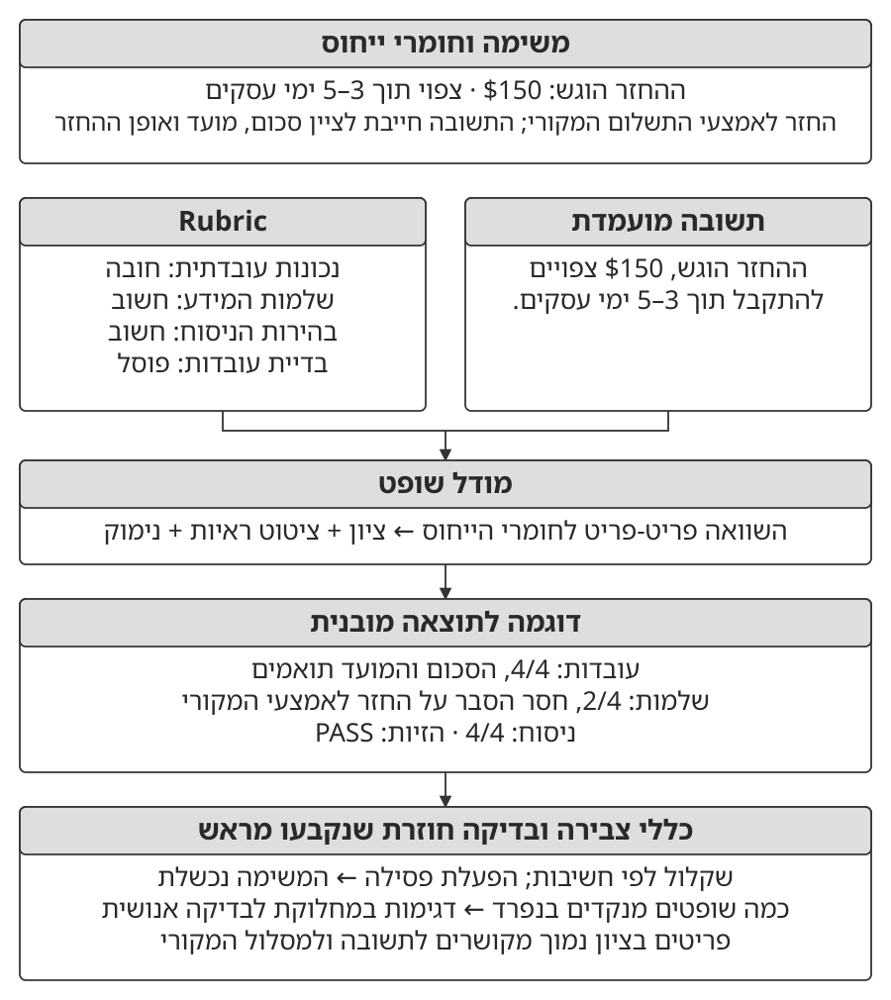
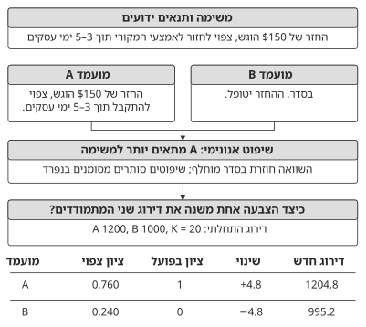
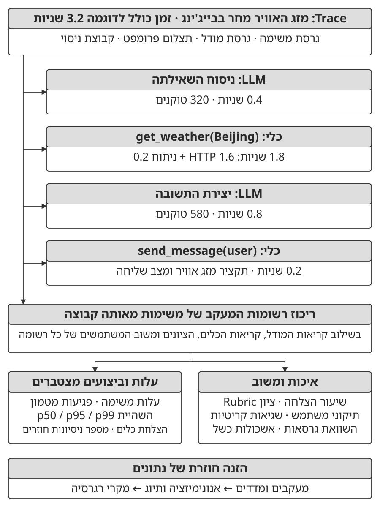
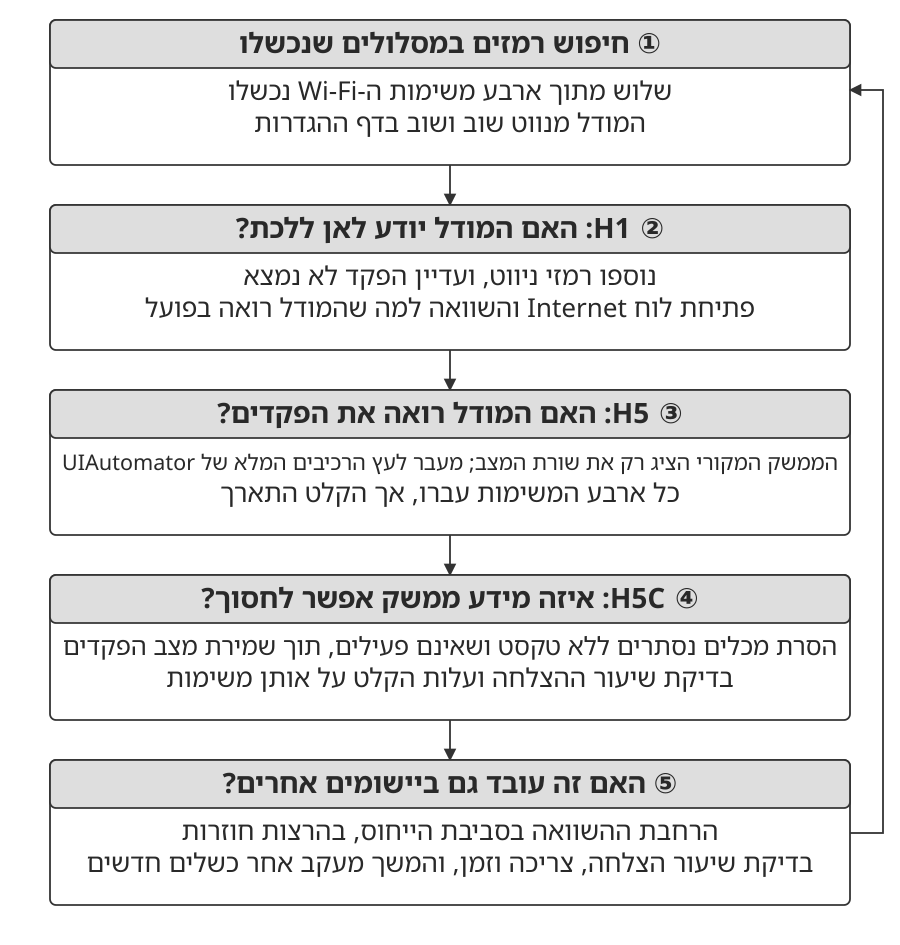
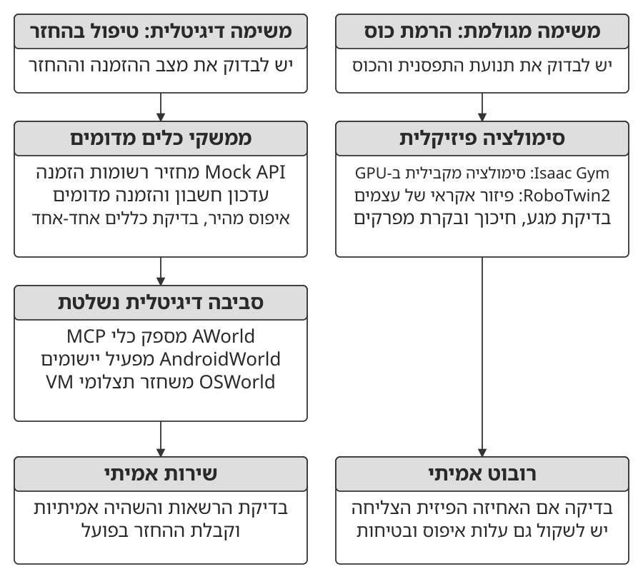
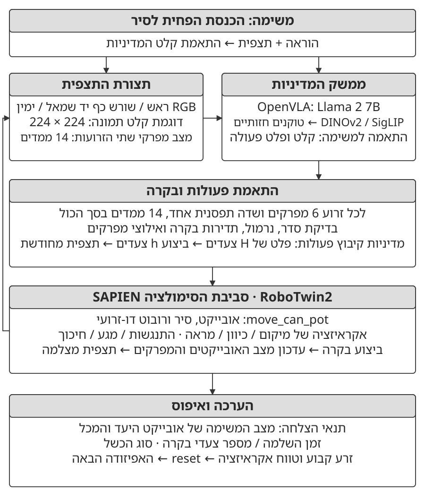

# הערכת סוכנים

ששת הפרקים הראשונים הציגו את בנייתו של סוכן יחיד: הקשר, זיכרון, בסיס ידע, כלים, קוד, וממשקי תצפית ופעולה. לאחר שהמערכת נבנתה, יש לקבוע באמצעות אוסף משימות בר‑שחזור מה היא מסוגלת לעשות, באילו תנאים היא נוטה להיכשל, ומה לשנות בשלב הבא. תוצאות ההערכה מספקות גם משוב לאימון שלאחר האימון המקדים ולהתפתחות המתמשכת.

במהלך הפיתוח, בחירות רבות דורשות השוואה על משימות אמיתיות: באיזה מודל להשתמש, אילו כלים לחשוף, איזה תוכן ואיזה אינדקס ישמשו את בסיס הידע, כיצד לארגן את זיכרון המשתמש, את הפרומפטים ואת ה‑Skills, ואילו אילוצים להוסיף ל‑Harness. הבחירות גם משפיעות זו על זו. למשל, תיאור כלים מפורט יותר עשוי לצמצם שגיאות בארגומנטים, אך גם להגדיל את צריכת ההקשר; הוספת שלב אימות עשויה להעלות את שיעור ההצלחה, ובה בעת להאריך את זמן הביצוע.

**ניסוי השוואתי** משווה בין חלופות שונות על אותן משימות ובאותם תנאים, ורושם את השינוי בשיעור ההצלחה, בזמן ובעלות. **ניסוי אבלציה** מסיר או משבית רכיב, כגון דירוג מחדש של תוצאות האחזור, סיכום מצב או אימות תוצאות, ובוחן כיצד משתנים ביצועי המערכת. כשמגדירים בכל סבב במפורש מה שונה, שומרים על יתר תנאי ההרצה קבועים וחוזרים על המדידה, נבנה בהדרגה הקשר בין בחירות הנדסיות לבין תוצאות המשימה. המחבר ממליץ לשלב השוואה ואבלציה בפיתוח היומיומי. מי שמסתמך על כמה מסלולים שהסתיימו בהצלחה בלבד עלול בקלות לראות בהצלחה מקרית שיפור, או לראות רק את הרווח בסוג משימות אחד ולהחמיץ נסיגה בסוגים אחרים.

**מושא ההערכה צריך להיות הסוכן השלם, המורכב מהמודל ומה‑Harness.** המודל קובע כיצד להבין את המשימה ואיזו פעולה לבחור; ה‑Harness מארגן את ההקשר, מתזמן כלים, מתחזק מצב ומבצע בדיקות. אותו מודל, כשהוא מחובר לכלים או לתהליכי משוב שונים, עשוי להניב תוצאות משימה שונות. ה‑Coding Harness שהוצג בפרק 5 מספק תרחיש השוואה מהסוג הזה.

אפשר לחקור את ההתאמה בין המודל ל‑Harness באמצעות **ניסוי החלפת מודל (model swap)**: מקבעים תחילה את מסגרת ההרצה ואת המשימות, מחליפים את המודל, ומשווים את התוצאות הסופיות ואת התפלגות השגיאות. אם מודל חזק יותר עדיין נכשל באותו שלב, כדאי לבדוק אם חסר כלי, אם המשוב מגיע בזמן ואם הניקוד מכסה את המטרה; אם הביצועים משתנים בחדות עם המודל, יש לנתח אילו יכולות של היסק, תכנון או ציות להוראות השפיעו על התוצאה.

אפשר לשלב בין החלפת מודל לבין אבלציה של רכיבים. למשל, להריץ שני מודלים, כל אחד בשתי תצורות, "עם סיכום מצב" ו"בלי סיכום מצב", ולבדוק אם הסיכום עוזר לשניהם להתאושש במשימות ארוכות והאם הרווח תלוי במודל. כך אפשר גם לנתח הבדלים בין מודלים וגם לגלות באילו תנאים רכיב Harness מסוים אפקטיבי.

הערכה משמשת גם בדיקת רגרסיה בשדרוג מודל. מודל חדש עשוי להשתפר במבחני ייחוס ציבוריים ולסגת במשימות עסקיות מסוימות; אוסף המשימות שלכם הוא שחושף את השינויים האלה. המחבר דוגל ב"פיתוח מוצרים למודלים של העתיד": להשלים מראש את הכלים, את התהליכים העסקיים ואת מערך ההערכה, ולעקוב ברציפות אחר ביצועי מודלים חדשים על אותן משימות. כששיעור ההצלחה, זמן התגובה והעלות עומדים בדרישות המוצר, מתקדמים להשקה.

כיצד מנסחים את דרישות ההשקה כמערך הערכה? בקריאת איור 7-1 אפשר לעקוב אחר בדיקה אחת מתחילתה ועד סופה: מה מודדים, מהיכן בוחרים את המשימות, באילו ראיות קובעים שהמשימה הצליחה, ולבסוף כיצד רושמים ומשווים את התוצאות?



## הבנת ההערכה דרך משימה אחת: תחום telecom ב‑τ²-bench

נתחיל בתקלת גלישה בטלפון נייד. John Smith, בעל המספר 555-123-2002, שוהה בצרפת, ובשורת המצב של הטלפון מופיע "No Service". הוא רוצה שהרשת תחזור לפעול, ויראה בתקלה פתורה רק אם בדיקת המהירות תחזיר excellent; הוא מוכן לטעון 2.0 GB נתונים במידת הצורך, ומעוניין לשמור על החבילה הנוכחית.

המקרה לקוח מתחום telecom של τ²-bench מבית Sierra. הסביבה מדמה בו זמנית את מערכות המפעיל ואת מכשיר המשתמש; סוכן שירות הלקוחות וסימולטור המשתמש קוראים ומשנים, כל אחד באמצעות הכלים שלו, חלק מהמצב. ההערכה צריכה לעקוב אחר האינטראקציה בין שני הצדדים ולבדוק כיצד התגלתה הבעיה, כיצד בוצעו הפעולות, והאם הרשת חזרה לבסוף לפעול.[^ch7-tau2-task]

### ארבעת מרכיבי הגדרת המשימה

כדי שמערכת שירות לקוחות אחרת תטפל באותה שאלה, יש תחילה לשחזר את מצב הטלפון ואת מצב החשבון, לגרום למשתמש המדומה לשתף פעולה באבחון לפי אותן דרישות, ולבסוף לנקד לפי אותו תקן. הטבלה שלהלן מציגה את ארבעת חלקי הגדרת המשימה. שימו לב בקריאתה להבחנה אחת: מנסח השאלה יודע מהן ההגדרות ההתחלתיות של הטלפון — כמה מזה יודעים הנציג והמשתמש, כל אחד מהם, בתחילת השיחה?

| חלק | שדה | התוכן בדוגמה זו |
| --- | --- | --- |
| כרטיס | `ticket` | המשתמש, המספר, מדינת השהות, תסמין הניתוק מהאינטרנט, דרישת בדיקת המהירות ואילוץ החבילה |
| תרחיש המשתמש | `user_scenario.instructions` | מה המשתמש יודע, כיצד הוא בודק כשנשאל, ומתי הוא מאשר שהבעיה נפתרה |
| מצב התחלתי | `initial_state.initialization_actions` | הגדרת זהות המשתמש ומיקומו, הפעלת מצב טיסה, כיבוי הנדידה במכשיר, הפעלת נדידה בצד המפעיל |
| קריטריוני ניקוד | `evaluation_criteria` | בדיקת פעולות ומצב הסביבה, כש‑`reward_basis` קובע אילו פריטים נכנסים לציון |

**מה המשתמש יודע.** `known_info` מספק שם, מספר ומדינת שהות. העובדות שמצב הטיסה פעיל ושהנדידה במכשיר כבויה שמורות במצב הסביבה; סימולטור המשתמש צריך לקרוא לכלי כדי לבדוק אותן, ורק אז יוכל למסור אותן לנציג. רק כשמה שהמשתמש יודע מופיע כשדה נפרד, הסימולטור יכול להבחין בין מידע שאפשר לענות עליו מיד לבין מידע שיש לבדוק בפועל. דרישה בפרומפט בלבד, בנוסח "אל תספר הכול בבת אחת", אינה מאפשרת לשלוט ביציבות מתי תיחשף כל עובדה. המבנה הזה מממש גילוי מידע הדרגתי (Progressive Information Disclosure): השיחה נפתחת ב"אני לא מצליח להתחבר לאינטרנט", והסוכן אוסף בהדרגה, בשאלות ובהנחיית פעולות, את המידע הדרוש לאבחון.

**כיצד המשתמש מגיב.** `task_instructions` קובע שאחרי ניסיון התיקון הראשון שנכשל המשתמש יביע מורת רוח קלה, שיאשר שהבעיה נפתרה רק אם בדיקת המהירות מחזירה excellent, ושתשובותיו על המכשיר יתבססו על תוצאות הכלים. ‏poor, fair ו‑good אינם עומדים ביעד של משימה זו. עיגון עובדתי (Grounding) גורם למשתמש להגיב לפי המצב בפועל של הסביבה המדומה. בלי האילוץ הזה, המשתמש המדומה עלול להסכים ל"עכשיו זה אמור לעבוד" של הנציג; השיחה בין הצדדים תיראה חלקה, והתקלה במכשיר תישאר.

**מאיזה מצב שני הצדדים מתחילים.** בצד המשתמש, `set_user_info` מגדיר את הזהות, `set_user_location(abroad=true)` מציין שהמשתמש בחו"ל, ואחר כך מורצים `turn_airplane_mode_on` ו‑`turn_roaming_off`. בצד המפעיל, `enable_roaming` מפעיל נדידה בקו `L1002` של הלקוח `C1001`. לכן שאילתה במערכות המפעיל תראה שהנדידה פעילה, בעוד שהטלפון עדיין אינו מתחבר בגלל מצב הטיסה והגדרת הנדידה במכשיר. הנציג חייב להנחות את המשתמש לבדוק את המכשיר כדי להשיג מידע ששאילתות המפעיל אינן מספקות.

**אילו בדיקות קובעות את הציון.** `actions` מונה את `toggle_airplane_mode` ואת `toggle_roaming` בצד המשתמש. `env_assertions` כולל בדיקה של מצב הנתונים הסלולריים ובדיקת מהירות עם הפרמטרים `expected_speed=200` ו‑`expected_desc="excellent"`. פורמט המשימה מספק גם את `communicate_info` ואת `nl_assertions`, המתארים בהתאמה מידע שחובה למסור למשתמש וקביעות בשפה טבעית; במשימה זו שניהם ריקים.

ה‑`reward_basis` של משימה זו הוא `ENV_ASSERTION`, ולכן התגמול הכולל נקבע לפי קביעות הסביבה. בדיקות הפעולות יכולות להופיע בתוצאות, אך תצורת הניקוד היא שקובעת אם הן נכנסות לציון הכולל.

### בדיקת התוצאה לאורך מסלול ההרצה

ההרצה הנלווית בחרה חמש משימות telecom והריצה כל אחת פעם אחת; גם סוכן השירות וגם סימולטור המשתמש השתמשו ב‑GPT-4.1 mini, וארבע משימות עברו. להלן ננתח תחילה את משימת הנדידה בצרפת, ואחר כך נשווה אותה למשימה שנכשלה.

> **ניסוי 7-1 ★: הרצת τ²-bench והשוואת ההתפתחות מ‑τ-bench**
>
> קראו תחילה את תרחיש המשתמש, את פעולות האתחול ואת תנאי הניקוד של משימה אחת, ואז הריצו אינטראקציה שלמה אחת. סמנו לאורך המסלול את שאילתות הנציג, את פעולות המשתמש, את שינויי המצב ואת תוצאת הקבלה, ובדקו על איזה פריט מידע נשענה כל החלטה.
>
> בהשוואה בין τ-bench ל‑τ²-bench, התמקדו בשאלה אם המשתמש יכול לשנות את הסביבה באמצעות כלים, ואילו דרישות תיאום השינוי הזה מטיל על הנציג.
>
> כשאתם מתבוננים באיור 7-2, חפשו תחילה מי יכול לכבות את מצב הטיסה בטלפון, ואחר כך מי יכול לשנות את תצורת הנדידה אצל המפעיל. כל צד יכול לעשות דברים אחרים, וזה מסביר מדוע גם אחרי שהנציג השלים את פעולותיו, עליו לבקש מהמשתמש להריץ בדיקת מהירות בטלפון.
>
> 

בטיפול במשימת הנדידה בצרפת, הסוכן מזהה תחילה את החשבון. לפי המספר הוא מאתר את הלקוח `C1001` ושולף את נתוני הצריכה של `L1001`, `L1002` ו‑`L1003`, אך על סמך פרטי `L1001` הוא מגיע למסקנה שגויה: המספר 555-123-2002 שמסר המשתמש אינו בין הקווים הפעילים, והמספר הקרוב ביותר הוא 555-123-2001. רק אחרי שהמשתמש מתעקש שהמספר נכון, הסוכן שולף גם את `L1002` ומאשר את הקו הנכון.

לאחר מכן סימולטור המשתמש קורא ל‑`check_network_status` ול‑`check_status_bar`. המצב המוחזר: מצב טיסה פעיל, אין שירות סלולרי, נתונים סלולריים פעילים, נדידה במכשיר כבויה. על סמך זה המשתמש מדווח: "הטלפון במצב טיסה, וגם נדידת הנתונים כבויה. לכבות קודם את מצב הטיסה?" כאן הבדיקה מבוצעת בכלי של צד המשתמש, והתוצאה מגיעה לנציג דרך השיחה.

זהו מנגנון **הבקרה הכפולה (Dual-Control)**: הנציג שואל ופועל במערכות המפעיל, ולסימולטור המשתמש יש כלי מכשיר משלו, כגון צפייה בשורת המצב, החלפת מצב טיסה, הוצאה והכנסה מחדש של כרטיס ה‑SIM והרצת בדיקת מהירות. שני הצדדים מתאמים את פעולותיהם בשיחה, והסביבה רושמת את שינויי המצב שכל אחד מהם גרם.

הסוכן מנחה אז את המשתמש לכבות את מצב הטיסה ולהפעיל נדידה במכשיר, ושורת המצב מציגה קליטת 5G. המשתמש מריץ `run_speed_test`, מקבל 275 Mbps בדירוג Excellent, ומאשר שהבעיה נפתרה. שתי קביעות הסביבה עוברות, והתגמול במשימה זו הוא 1.0.

גם המסלול המוצלח הזה חושף בעיה בתהליך. המדיניות מחייבת את הנציג לקרוא לכלי אחד בכל פעם, אך הסוכן שולח באותה הודעה גם את `get_customer_by_phone` וגם את `get_customer_by_name`. הציון הכולל של המשימה כולל רק את קביעות הסביבה, ולכן ההתנהגות הזו לא שינתה את התגמול.

במסלול אחר, שנכשל, הקו שנבחר בטעות לא תוקן עד הסוף, והאבחון כולו סטה בעקבותיו. מספר המשתמש הוא שוב 555-123-2002; הסוכן בוחר ב‑`L1001` וממשיך באבחון על סמך צריכה של 3.2/5 GB בקו זה. הכלי כבר החזיר ש‑`L1001` מתאים ל‑555-123-2001, ובכל זאת הוא אינו מתקן את בחירת הקו, ואחרי סבבים רבים של בדיקות לא רלוונטיות הוא מעביר לנציג אנושי. בצד המשתמש מצב חיסכון הנתונים כובה בהצלחה, אך טעינת 2 GB הדרושה בקו הנכון `L1002` לא בוצעה, ושלוש קביעות הסביבה נכשלו כולן.

השוואה בין שני המסלולים מאפשרת לפרוש את הציון הסופי לנקודות שיפור קונקרטיות: לאמת את המיפוי בין מספר לקו, לתקן שיפוט לאור ראיות חדשות, להבחין בין מצב המכשיר למצב במערכות המפעיל, ולוודא שהטעינה הדרושה אכן בוצעה. סעיף ייחוס הכשלים בהמשך ידון כיצד מאתרים נקודות מפנה כאלה בתוך מסלולים ארוכים.

[^ch7-tau2-task]: ‏τ²-bench של Sierra Research מגדיר את כלי המשתמש בתחום telecom בקובץ `user_tools.py`, ונקודת הכניסה לניקוד היא `evaluator.py`. תוכן המקרה והתוצאות סוכמו מתוך חמש המשימות ומסלולי ההרצה השמורים במאגר הנלווה.

## מדדי הערכה: הגדרת ההצלחה

ארבע משימות מתוך חמש שעברו נותנות את הציון הכולל של ההרצה הזו. כדי לקבל על פיו החלטת מוצר, יש להבהיר גם את סוג המשימה ואת מחיר הכישלון. סוכן שירות לזיכויים צריך לבצע בעקביות כל זיכוי העומד בתנאים; בכתיבת תוכנה אפשר לייצר כמה מימושים ולסנן בעזרת בדיקות את הגרסה שרצה ומחזירה תוצאה נכונה; במחקר אפשר להעלות כמה השערות ולתת לחוקר לבחון אותן. מדד ההערכה צריך להתאים לאופן השימוש הזה.

### פלא טכני: מדידת היכולת בריבוי ניסיונות באמצעות Pass@k

המחבר מכנה כמה מהדגמות הסוכנים המרשימות ״פלא טכני״: בהינתן די זמן והזדמנויות לנסות, המערכת משלימה משימה שקודם לכן היה קשה לבצע אוטומטית. בעבודה חקרנית, מסלול מוצלח ומאומת אחד עשוי כבר להביא ערך. המדד **Pass@k** מתאים לאופן שימוש זה: מריצים את אותה משימה $k$ פעמים, ואם לפחות הרצה אחת עברה, המשימה נחשבת הצלחה. במשימות בעלות ניקוד רציף אפשר לדווח גם את הציון הגבוה ביותר מתוך $k$ ההרצות, הנקרא **Best@k**.

למשל, Anthropic ארגנה כמה מופעים של Claude שבנו יחד מהדר C, והראתה שריצה ממושכת, משוב מבדיקות וחלוקת עבודה יכולים לתמוך בהנדסה מורכבת. חוקרים המחפשים נגד־דוגמה מתמטית יכולים גם הם לתת למודל לנסות שוב ושוב, ולבסוף לאמת באופן עצמאי אם אחת מנגד־הדוגמאות תקפה. בסקירת אבטחת תוכנה אפשר לבחון מחדש את הממצאים החשודים שהמודל דיווח, וביצירה פתוחה אפשר לבחור את הטובה מבין כמה יצירות.[^ch7-long-running]

גם מוצרי יישום מציגים את יכולותיהם באמצעות משימות מורכבות. ‏Manus מעמיד מחשב וירטואלי לרשות הסוכן, כך שהמשתמש יכול לראות אותו מפעיל ממשק, מחפש חומרים וממשיך לעבוד עד להשלמת המשימה. ‏OpenClaw מקבל משימות דרך יישומון מסרים מיידיים, ניגש לקבצים ולשירותים שהוגדרו ואושרו לו, מדווח על התקדמות במהלך העבודה ומבקש מידע נוסף, ואף יכול להתעורר במנגנון מתוזמן כדי לבדוק משימות ממתינות. התנהגויות קונקרטיות כאלה מקלות על המשתמשים להבין למה סוכן משמש.

לדעת המחבר, הדגמות של השלמת סוגי משימות חדשים הן גורם חשוב במשיכת המשתמשים למוצרים אלה.

### אמינות עסקית: התמקדות ב‑Pass^k

תהליכים עסקיים דורשים בדרך כלל מסירה נכונה בכל אחת מההרצות. **Pass^k** מודד את המקרה שבו אותה משימה רצה $k$ פעמים וכל ההרצות עוברות; אפשר לקרוא אותו "pass power k". תנאי המעבר של המשימה יכולים לכסות בו זמנית את התוצאה הסופית, את יישום המדיניות ואת מגבלות ההרשאה; כל הרצה נבדקת לפי אותם תנאים.

בהנחה שההרצות בלתי תלויות זו בזו ושסיכוי ההצלחה בכל הרצה הוא $p$:

$$
\mathrm{Pass@k}=1-(1-p)^k,\qquad
\mathrm{Pass}^{k}=p^k.
$$

למשל, עבור $p=0.6$ ו‑$k=5$, ‏Pass@5 הוא כ‑99.0% ו‑Pass^5 הוא כ‑7.8%. הראשון אומר שבחמישה ניסיונות תימצא בדרך כלל הצלחה אחת; השני אומר שהסיכוי שכל חמשת הניסיונות יצליחו עדיין נמוך מאוד.

בקריאת סדרת תוצאות אמיתית אפשר בתחילה לוותר על הנוסחה. נניח שחמש ההרצות של אותה שאלה היו "עבר, נכשל, עבר, עבר, נכשל". עבור הסדרה הזו Pass@5 הוא 1, ‏Pass^5 הוא 0, ושיעור ההצלחה בהרצה בודדת נאמד ב‑3/5. ה‑99.0% וה‑7.8% שלמעלה עונים על שאלה אחרת: אם ידוע שסיכוי ההצלחה בכל הרצה הוא 0.6, וחוזרים שוב ושוב על סדרות של חמש הרצות, כמה סדרות יעמדו בכל אחד מהתקנים?

אותן רשומות יכולות לענות גם על שאלה שקל יותר לבדוק: אם בוחרים שתיים כלשהן מחמש ההרצות, איזה שיעור מהזוגות עובר? חשבו על כל הרצה ככרטיס, ושלפו שני כרטיסים בלי החזרה: יש עשרה זוגות אפשריים. רק הזוג המורכב משני כרטיסי הכישלון גורם לכך ששתי ההרצות נכשלות, ולכן בתשעה זוגות יש לפחות הצלחה אחת, ואומדן המדגם של Pass@2 הוא 9/10. משלושת כרטיסי ההצלחה אפשר להרכיב שלושה זוגות, ולכן אומדן המדגם של Pass^2 הוא 3/10. כך בדיוק סופר τ²-bench, לכל משימה בנפרד, את הצירופים שכולם עוברים: משימה רצה $n$ פעמים והצליחה $s$ פעמים, ובוחרים מתוכן $k$ — שיעור הצירופים שכולם עוברים הוא $\binom{s}{k}/\binom{n}{k}$, כאשר $1\le k\le n$.[^ch7-tau2-metrics]

נחזור עכשיו ל‑4/5 של ניסוי 7-1. חמשת המסלולים שייכים לחמש שאלות שונות, ולכל שאלה יש כרטיס אחד בלבד, כך שאי אפשר להרכיב אפילו זוג אחד. כדי לאמוד את Pass^2 של המשימות האלה, יש להוסיף לכל שאלה הרצות בלתי תלויות, לחשב לכל אחת בנפרד ואז לצבור. העלאה ישירה של 0.8 בריבוע מניחה בנוסף שלכל השאלות אותו סיכוי הצלחה בכל הרצה, ושהניסיונות בלתי תלויים זה בזה.

[^ch7-tau2-metrics]: גרסת הניסוי של τ²-bench (רוויזיה 8d005b0) מחשבת את Pass^k לכל משימה בנפרד בקובץ `agent_metrics.py`. כשמספר ההצלחות קטן מ‑$k$, מספר הצירופים שכולם עוברים הוא אפס.

בחישוב יש לשמור על יחידה סטטיסטית אחידה. חמש דגימות של אותה משימה מודדות את הביצועים החוזרים במשימה זו; חמש משימות שונות ברצף בסביבת ייצור מושפעות גם מקושי המשימות ומהתפלגות התעבורה. כשלמשימות שונות יש סיכויי הצלחה שונים, אפשר לחשב תחילה את מדד ההצלחה החוזרת של כל אחת ואז לצבור לפי משקלות המשימות. גם מצב משותף, מטמון או תקלה משותפת יוצרים מתאם בין הרצות.

**כשמותר לענות "אין די מידע", מה המכנה?** נניח שעוזר ספרות מקבל 100 שאלות, עונה על 80, ו‑68 מהתשובות נכונות. קורא הנשען על התשובות שניתנו מתעניין ב‑68/80, כלומר 85%; מי שצריך להשלים את כל האצווה מתעניין גם ב‑68/100, כלומר 68%. 20 השאלות הנותרות דורשות השלמת ראיות או העברה לטיפול אנושי.

‏PaperQA2 יכול לבחור "אין די מידע" ב‑248 שאלות הספרות של LitQA2. המאמר מדווח ממוצע של שלוש הרצות: כשהמערכת נותנת תשובה מהותית, הדיוק הוא 85.2%; על פני כל השאלות הדיוק הוא 66.0%, וב‑21.9% נבחר "אין די מידע". עבור תשעה משיבים אנושיים, שני הנתונים המקבילים הם 73.8% ו‑67.7%. לפי המאמר, ההפרש הראשון מובהק, וההפרש השני אינו מגיע למובהקות סטטיסטית.[^ch7-paperqa2-denominators]

[^ch7-paperqa2-denominators]: Skarlinski ואחרים, *Language Agents Achieve Superhuman Synthesis of Scientific Knowledge*, 2024, סעיף 2 ואיור 2.

לשני מסלולים בעלי אותו מצב סופי עשויות להיות עלויות שונות. ניקח בירור חשבון: הסוכן הראשון החזיר את הסכום הנכון בשאילתה אחת. השני נזקק לשתי שאילתות כדי לתת אותה תשובה. שתי השאילתות נשאו אותו מזהה בקשה, והראשונה פקעה, כלומר הניסיון החוזר עזר לו להשלים את המשימה. אילו תוצאת השאילתה הראשונה הייתה מגיעה בהצלחה, השאילתה השנייה הייתה מוסיפה לשווא זמן המתנה ועלות כלי.

כשההרצה כרוכה בכתיבה או בתופעות חיצוניות אחרות, יש לשחזר לפני כל ניסוי את המצב ההתחלתי שנקבע, לבצע את הפעולות בסביבת בדיקה ולתעד את כל הניסיונות. אם המוצר מאפשר ניסיון חוזר אחרי כישלון, יש לכלול בהערכת התהליך את מספר הניסיונות החוזרים, את צעדי ההתאוששות ואת עלות הביצוע; רשומות הכישלון המקוריות נשמרות, כדי שאפשר יהיה להבחין בין ביצועי הרצה בודדת לבין התוצאה שאחרי ההתאוששות.

[^ch7-long-running]: Anthropic, Building a C compiler with a team of parallel Claudes, 2026-02-05, על שיתוף פעולה בין מופעים, ביצוע ארוך טווח ומשוב מבדיקות.

## סביבת ההערכה

נניח שרוצים לבחון מחדש את ההרצה שלמעלה, שבה נבחר הקו הלא נכון. הבוחן צריך לראות את אותו משתמש, את אותם שני קווים ואת אותה חבילה התחלתית. אם ההרצה הראשונה כבר שינתה את אחד הקווים, הרצה חוזרת פשוטה לא תאפשר לקבוע אם השינוי בתוצאה נובע מהמודל או ממסד הנתונים. סביבת ההערכה אחראית לקבוע את נקודת הפתיחה של המשימה, לספק ממשקי אינטראקציה, לתעד את התהליך ולבדוק את נקודת הסיום.

### חמשת המרכיבים

אם ניקח את משימת telecom כדוגמה, אפשר לפרק את סביבת ההערכה לחמישה חלקים.

**מערך נתונים (Dataset)** שומר את הגדרות המשימות: רקע המשתמש, דרישות ההתנהגות, המצב ההתחלתי ותנאי הקבלה. כל רשומה היא מקרה בדיקה אחד, ובזמן ההרצה המידע מחולק לכל משתתף לפי תפקידו.

**מצב הסביבה (Environment State)** שומר את המידע המשתנה במהלך ביצוע המשימה, כגון לקוחות, קווים, חבילות וחשבוניות, וכן את מצב הטיסה, הנדידה וחיסכון הנתונים במכשיר. בתחילת כל סבב חדש הסביבה משחזרת תחילה את נתוני הבסיס, ואז מריצה את `initialization_actions` כדי ליצור את התקלה שהמשימה הנוכחית מגדירה. הניקוי והאתחול צריכים לפעול יחד, כדי שטעינה או שינוי הגדרות מסבב קודם לא יחלחלו לסבב הבא.

**ממשק הכלים (Tools)** קובע מה המשתתפים יכולים לקרוא ולשנות. הנציג יכול לשאול על לקוחות, לבדוק צריכה, לטעון נתונים או להעביר לנציג אנושי; המשתמש יכול לבדוק את מצב המכשיר, להפעיל ולכבות מתגים ולהריץ בדיקת מהירות. רמת הפירוט של הכלים צריכה להתאים ליכולת הנבחנת: כדי להעריך אבחון ותכנון, יש לתת לסוכן להרכיב שאילתות ופעולות בעצמו; אם מספקים ישירות כלי של "תיקון בעיית האינטרנט", מוקד הבדיקה עובר לשאלה מתי לקרוא ליכולת הזו.

**קריטריון הניקוד (Rubric)** מגדיר כיצד שופטים את התוצאה. משימת telecom יכולה לבדוק פעולות, מצב סביבה, תקשורת נדרשת ודרישות בשפה טבעית, ואז לקבוע באמצעות `reward_basis` אילו בדיקות נכנסות לציון הכולל.

**פרוטוקול הביצוע (Interaction Protocol)** מסדיר את סדר הדיבור, את קריאות הכלים ואת הסיום. סימולטור המשתמש יכול להפיק `###STOP###` כדי לסיים את האינטראקציה, והמריץ קובע גם תקציבים כמו מספר תורות מרבי. סיבת הסיום והציון במשימה נרשמים בנפרד: גם אחרי שהמשתמש סיים את השיחה, קביעות הסביבה הן שקובעות אם המטרה הושגה; כשהתקציב אוזל, יש לשמור את המצב האחרון ואת הצעדים שלא הושלמו.

### סביבות הערכה מסוג אינטראקציה אדם–מחשב ומסוג קריאה לכלים

משימת telecom כוללת סימולטור משתמש שמגיב ומפעיל את המכשיר לאורך כל הדרך. תיקון קוד, ניתוח נתונים ופתרון בעיות מתמטיות, לעומת זאת, מתחילים לרוב בהוראת משימה, ומשם הסוכן מקיים אינטראקציה בעיקר עם כלים. שני הסוגים זקוקים למשימות, למצב, לממשקים, לניקוד ולפרוטוקול ביצוע; ההבדל הוא אם יש צורך גם לדמות בן שיח, וכיצד שני הצדדים מתאמים פעולות.

במשימות קוד אפשר לבדוק את הפלט בעזרת בדיקות, במשימות מסד נתונים אפשר לשאול על הרשומות ששונו, וניתוח פתוח עשוי לדרוש סקירה של התוכן בידי אדם או מודל. במשימות אינטראקציה אדם–מחשב צריך לא אחת לחבר שני סוגי ראיות. למשל, אם רשת הטלפון חזרה לפעול רואים במצב המכשיר; אם הנציג הבהיר את המספר והנחה את המשתמש רואים בשיחה. כך גם הזיכוי באיור 7-3: אם ההזמנה בוטלה, אפשר לבדוק במסד הנתונים; אם הנציג מסר מתי יגיע הכסף, צריך לחפש בשיחה.



ב‑Verifiers אפשר לגשת לשני סוגי המשימות דרך ממשקי סביבה שונים. טבלה 7-1 מציגה את הממשקים של v0.1.9 לטיפול בתשובה חד‑תורית, בקריאות כלים רב‑תוריות, בהזרקת מצב ההרצה ובניהול משאבי ארגז חול, לנוחות ההשוואה מול הקוד.[^ch7-verifiers-env]

טבלה 7-1 השוואת סוגי סביבות Verifiers

| סוג הסביבה | אחריות עיקרית | טיפול בכלים ובמצב | שימוש אופייני |
|---|---|---|---|
| `SingleTurnEnv` | ארגון תשובה בתור אחד | ניקוד אחרי תשובה אחת | בעיות מתמטיקה, שאלה ותשובה בתור אחד |
| `ToolEnv` | ארגון אינטראקציה רב‑תורית עם כלים | שמירת מסלול ההרצה, שיגור כלים וקבלת תוצאות | חיפוש וסינתזת מידע |
| `StatefulToolEnv` | חיבור מצב ההרצה לביצוע הכלים | השלמת ארגומנטים לכלים או עדכון המצב לפי המצב הנוכחי | קשירת מסד נתונים או מזהה משאב למשימה הנוכחית |
| `SandboxEnv` | ניהול סביבת ביצוע מבודדת | הקצאת ארגז חול להרצה ושימוש בכלים שבתוכו | הרצת קוד, בדיקת קבצים ותוצאות בדיקות |

למשל, כששתי משימות משנות מסד נתונים בו זמנית, המריץ יכול להזריק לקריאות הכלים את מזהה מסד הנתונים של כל אחת, כך שכל מסלול פועל על הנתונים שלו. כשביצוע נכשל, הכלי צריך להחזיר מידע שאפשר להחליט על פיו בצעד הבא, כמו אובייקט שאינו קיים, ארגומנט שאינו עומד בדרישות או פקיעת זמן של השירות. מערכת ההערכה שומרת תצפיות, קריאות, תוצאות ביצוע ותגמולים, וכך בניתוח אפשר לאתר את השגיאה עד לצעד המסוים.

[^ch7-verifiers-env]: Prime Intellect, ToolEnv ו‑StatefulToolEnv ב‑Verifiers v0.1.9, המדגימים מסלולים רב‑תוריים, שיגור כלים והזרקת ארגומנטי מצב.

## תכנון מערך הנתונים להערכה

כעת נרחיב את חמש משימות ה‑telecom למערך הערכה שאפשר להסתמך עליו בהחלטת השקה. אם כל המשימות שנוספו הן מסוג "הפעל נדידה למספר נתון", המערכת עשויה לקבל ציון גבוה גם אם מעולם לא למדה להבחין בין שני קווים באותו חשבון. אם הציון אמור לקבוע אם הסוכן לשירות לקוחות עולה לאוויר, יש לבחור את המשימות לפי כרטיסים אמיתיים: גם פניות שגרתיות וגם מקרים קשים שבהם קל לבלבל בין קווים, ובעת הניקוד יש לבדוק גם איזה קו שינה הסוכן בסופו של דבר. לאחר ההשקה צריך גם לתחזק את המשימות האלה, כדי שימשיכו לשקף את העבודה שהמשתמשים מוסרים בפועל.

### השוואה רוחבית של תכנון מבחני ייחוס

טבלה 7-2 מציבה זה לצד זה שישה מבחני ייחוס לפי היכולת הנבחנת, מקור המשימות, סביבת ההרצה ואופן האימות.

טבלה 7-2 החלטות תכנון מרכזיות בכמה מבחני ייחוס לסוכנים

| מבחן ייחוס | היכולת הנבחנת | מקור המשימות וארגונן | סביבת ההרצה | אופן האימות |
|---|---|---|---|---|
| τ²-bench | אינטראקציה בשירות לקוחות והפעלת כלים | משימות תחום בצירוף שילובי תקלות | סימולטור משתמש, מכשיר ומסד נתונים עסקי | בדיקות לפי רכיבים, ניקוד לפי `reward_basis` |
| SWE-bench Verified | תיקון בעיות קוד | issue אמיתיים מ‑GitHub, שסוננו ידנית | מאגר קוד וסביבת בדיקות | בדיקות `FAIL_TO_PASS` ו‑`PASS_TO_PASS` |
| AndroidWorld | הפעלת יישומי Android | תבניות משימה פרמטריות | אמולטור Android המריץ יישומים אמיתיים | קריאת מצב המכשיר, הקבצים או המצב הפנימי של היישום |
| OSWorld | הפעלת שולחן עבודה ועבודה בין יישומים | תרחישי שימוש אמיתיים, עם נקודת פתיחה מוגדרת למשימה | מכונה וירטואלית ויישומי שולחן עבודה | בדיקת מצב הביצוע והתוצרים לפי המשימה |
| Terminal-Bench | משימות הנדסיות במסוף | משימות ובדיקות שתוכננו ידנית | מכולה עם התלויות שהמשימה דורשת | קבצים, הרצת תוכניות ותוצאות בדיקות |
| GAIA | עיבוד מידע של עוזר כללי | שאלות שנכתבו ידנית, חלקן עם חומרים מצורפים | רשת, קבצים וכלי עזר | השוואה לאחר נרמול לפי פורמט התשובה |

### מאמתים

המאמת מחבר את מטרת המשימה לראיות שאפשר לבדוק. במשימת קוד יש להריץ בדיקות, במשימת שולחן עבודה יש לקרוא את מצב היישום או הקובץ, ובמשימת איתור מידע יש לאמת את התשובה ואת מקורותיה. **הקבלה צריכה להישען על ראיות שהושגו באופן עצמאי.** הסוכן עשוי להפיק דוח מלא הטוען שכל השלבים הושלמו; המאמת עדיין צריך להריץ בפועל את התוצר, לקרוא את המצב או לאמת את המקורות. דוח הסיום משמש לאיתור מה לבדוק, והציון נקבע על ידי הבדיקות עצמן.

נניח שמשתמש פותח יישום תשלומים ומבקש מהעוזר "לאשר את כל בקשות התשלום ששלח השותף לדירה החודש". יש שלוש בקשות ממתינות: של השותף מהחודש, של אותו שותף מהחודש הקודם ושל עמית לעבודה מהחודש. הראשונה צריכה להיות מאושרת, והשתיים האחרות צריכות להישאר ממתינות. אם בודקים רק את הראשונה, גם עוזר שאישר את שלושתן יקבל ציון מלא; אם בודקים רק את השתיים האחרות, גם עוזר שלא עשה דבר יעבור. ‏AppWorld הציב את המשימה הזו ביישום תשלומים מדומה. בתכנון המאמת אפשר לסמן תחילה, לפי הנתונים שלפני הפעולה, את קבוצת הבקשות שהמשתמש הרשה, לבדוק שכולן אושרו, ולבסוף לחזור מהרשומות שאחרי הפעולה ולשאול: באילו בקשות נוספות נגע העוזר?[^ch7-appworld-scope]

[^ch7-appworld-scope]: Trivedi ואחרים, *AppWorld*, ‏ACL 2024; איור 2 מציג את המשימה ואת תנאי הקבלה.

גם חיפוש מחקרי יכול להניב תוצר שקל לאמת. ‏FunSearch מבקש לבחור כמה שיותר נקודות במרחב בן שמונה ממדים, שבו כל קואורדינטה יכולה לקבל רק 0, ‏1 או 2, החישוב מתבצע מודולו 3, ואסור שבין הנקודות שנבחרו יהיו שלוש הנמצאות על ישר אחד. החוקרים כתבו שלד של תוכנית הבוחרת נקודות צעד אחר צעד, ביקשו מהמודל להציע פונקציה המדרגת את הנקודות המועמדות, ונתנו ציון לפי גודל קבוצת הנקודות החוקית שנבנתה בפועל. בעת פרסום המאמר, הבנייה הידועה הטובה ביותר בחרה 496 נקודות; התוכנית החדשה הניבה רשימה של 512 נקודות.[^ch7-funsearch-cap]

אפשר להוריד רק את הרשימה ולבדוק את התוצאה באופן עצמאי. תחילה מוודאים שיש בה 512 וקטורים שונים בני שמונה ממדים, וכל קואורדינטה בטווח המותר. כעת בוחרים שתי נקודות שונות כלשהן $a,b$; על הישר העובר דרכן יש בדיוק שלוש נקודות, והשלישית היא $c=-a-b \pmod{3}$. למשל, במישור הדו‑ממדי, עבור $(0,0)$ ו‑$(1,2)$ הנקודה השלישית היא $(2,1)$. מפעילים את אותו חישוב קואורדינטה אחר קואורדינטה בשמונה ממדים, עוברים על כל 130,816 הזוגות השונים ברשימה, ואף אחת מהנקודות השלישיות שמתקבלות אינה מופיעה ברשימה. זה מספיק כדי להוכיח שאפשר לבחור לפחות 512 נקודות. כדי להוכיח ש‑513 בלתי אפשרי, נדרשת הוכחת חסם עליון.

[^ch7-funsearch-cap]: Romera-Paredes ואחרים, *Mathematical discoveries from program search with large language models*, ‏Nature, פורסם ברשת ב‑2023. המחברים פרסמו בנפרד את קבוצת הנקודות בשמונה ממדים ואת מחברת החישוב לאימות.

**שני סוגי הבדיקות ב‑SWE-bench בודקים תיקון ורגרסיה בהתאמה.** ‏`FAIL_TO_PASS` הן בדיקות שנכשלות לפני התיקון ואמורות לעבור אחריו; ‏`PASS_TO_PASS` הן בדיקות שעברו קודם ואמורות להמשיך לעבור אחרי התיקון. הראשונות בודקות את הבעיה שהוגדרה, והאחרונות בודקות שההתנהגות שכבר מכוסה בבדיקות נשמרה.[^ch7-swe-verified]

**‏OSWorld בודק את תוצרי היישומים באימות מבוסס הרצה.** הגרסה המקורית מספקת 134 פונקציות הערכה מבוססות הרצה, הקוראות, בשילוב עם תצורת המשימה, קבצים, נתוני יישומים או מצב מערכת.[^ch7-osworld-design] למשל, כשנדרש לשנות גיליון אלקטרוני, אפשר לבדוק את התאים והנוסחאות שצוינו; כשנדרש לעדכן הגדרת דפדפן, אפשר לקרוא את התצורה הרלוונטית.

**‏Terminal-Bench מקבל משימות הנדסיות לפי תוצאות ההרצה.** המקרה של בניית ליבת Linux משרשר שינוי קוד מקור, הידור, ‏initramfs ואתחול ב‑QEMU; ‏Linux 6.9, ה‑`printk` המותאם ב‑`start_kernel` וההודעה ביומן האתחול מספקים כולם נקודות בדיקה מוחשיות.

פרק 5 עסק באימות נתוני מכירות מול הזמנות. אם העוזר מגיש דוח רבעוני של עשרים ערוצים, מאיפה מתחילים לבדוק? ב‑WorkBuddy Bench של Tencent יש משימת התאמה ציבורית. שני הגיליונות מכילים נתוני ערוצים; סכום הסליקה נמדד ברבעון מול רבעון, כלומר מול הרבעון הקודם, וסכום הגבייה נמדד בשנה מול שנה, כלומר מול אותו רבעון בשנה הקודמת. גם אם ממלאים את שתי תקופות הבסיס כרבעון הקודם, הכותרות ומספר הערוצים עשויים להיות נכונים לחלוטין. ניקח לדוגמה את הערוץ "锦绣生活馆" (בתרגום חופשי: "חנות ג׳ינשיו לייף") בגיליון הסליקה: אחרי הסרת שורות כפולות ורשומות חסרות רבעון מהפירוט, וסיכום לפי ערוץ ורבעון, מתקבל שסך העסקאות עלה מ‑1,569,231.00 ל‑1,787,311.03, הפרש של 218,080.03. תוכנית הניקוד בודקת את כיסוי הערוצים בשני הגיליונות, ואז מאמתת במדגם את הערכים של שני ערוצים שנקבעו מראש. בדיקת הכיסוי במשימה הזו משתרעת על כל עשרים הערוצים, ואילו בדיקת הערכים נוגעת רק לשניים שנדגמו.[^ch7-workbuddy-office]

[^ch7-workbuddy-office]: משימת המשרד `channel-period-compare-L4-017` ב‑WorkBuddy Bench של Tencent. חבילת הנתונים (גרסה 3e8ad83) כוללת את חוברות העבודה המקוריות, תשובת ייחוס ותוכנית ניקוד.

אפשר לבחון מאמת באמצעות משימה רגישת זמן. נניח שמשתמש מבקש התראה כשמחיר חדר במלון מסוים יורד מתחת ל‑950 יואן. בשעה 10:00 המחיר הוא 1000 יואן, ב‑10:10 הוא יורד ל‑900, וב‑10:15 חוזר ל‑1000. התראה על ירידת מחיר שנשלחת ב‑10:12 וכוללת את סוג החדר ואת קישור ההזמנה עדיין מאפשרת למשתמש להזמין. אם המערכת שולחת פעם ביום "המחיר עוד לא ירד" ומחמיצה דווקא את חמש הדקות האלה, היא לא מילאה את המשימה גם אם רצה שבוע ברציפות. בניקוד רושמים בנפרד את מספר החלונות שעמדו בתנאי, את מספר ההתראות שנשלחו בזמן בתוך חלון, ואת מספר הפעמים שהמשתמש הוטרד כשלא היה שינוי. אם גם המעריך שמר רק מחיר אחד ביום, אי אפשר כלל לספור את החלונות שהוחמצו. כדי למדוד החמצות, יש להכין תחילה שידור חוזר מלא של המחירים עם חותמות זמן, ולתת למערכת הנבדקת לבדוק בתדירות שלה.

### חלוקת רמות הקושי של המשימות

מערך המשימות צריך לכסות רמות קושי שונות ולהבהיר מהיכן הקושי נובע. משימות בסיסיות בודקות אם יכולת כלשהי נסוגה, ומשימות קשות משאירות מרווח מדידה להתקדמות של מודלים עתידיים; אם כל השאלות עוברות מהר, מערך ההערכה מתקשה להמשיך לכוון את בחירת המודל. אפשר לחלק לפי סוגי כלים, אורך הפעולה, מידת פיזור המידע, אי‑ודאות בסביבה או הידע המקצועי הנדרש, ואז לבדוק באילו תנאים המערכת נסוגה בבירור.

466 השאלות של GAIA מחולקות לשלוש רמות. משימות קלות יותר כרוכות בדרך כלל במעט כלים ושלבים, ומשימות קשות יותר דורשות שילוב מידע רב‑שלבי והרכבה מורכבת. במאמר המקורי, שיעור הדיוק של מתייגים אנושיים בשלוש הרמות היה 93.9%, ‏91.8% ו‑87.3%; התוצאות המקבילות של GPT-4 עם תוספים היו 30.3%, ‏9.7% ו‑0%.[^ch7-gaia-design]

גם טווח המשימות של Terminal-Bench רחב: רישום מודל כרוך בשימוש ב‑MLflow, פריסה רבת‑רכיבים מחייבת תיאום בין שירות Git לשירות Web, ושחזור סיסמה וניתוח דיפרנציאלי של FEAL מוסיפים ידע אלגוריתמי ייעודי.

משימות עסקיות צריכות לכסות גם את גבולות המדיניות. למשל, כשמשתמש טוען ששירות הלקוחות כבר אישר את ביטול ההזמנה, המערכת צריכה לבדוק את ההרשאה ואת מצב ההזמנה, ורק אז להחליט לפי המדיניות אם לבטל. מקרי בדיקה כאלה בוחנים כיצד הסוכן משתמש בראיות כדי להתמודד עם מידע סותר, ואפשר להציב אותם לצד משימות טיפול רגילות.

### מניעת דליפת נתונים

**שילוב מקורות וקבצים מצורפים ייעודיים.** אם מודל יכול למצוא בתוצאות החיפוש את השאלה ואת התשובה המוכנה, כמה יכולת חיפוש והסקה מוכיחה תשובה נכונה אחת? ‏GAIA מצמצם הזדמנויות כאלה באמצעות איתור רב‑שלבי וקבצים מצורפים ייעודיים. למשל: לזהות אסטרונאוט מתמונת האסטרונומיה של יום מסוים, לברר לאיזו קבוצת אסטרונאוטים השתייך, להשוות את משך השהות בחלל של חברי הקבוצה, ולבסוף להפיק שם משפחה ומספר דקות בפורמט הנדרש. הנקודה‑פסיק, עיגול המספר ומפריד האלפים הם כולם מוסכמות של התשובה. קובצי PDF, שמע ותמונות שהוכנו במיוחד מרחיבים את צירופי הקלט. שאלות שפורסמו עלולות להיכנס לחומרי האימון. לכן יש גם לשמור קבוצת שאלות נפרדת המיועדת להערכה בלבד, ולתעד אילו שאלות כבר שימשו לאימון.[^ch7-gaia-design]

**מופעים פרמטריים.** ‏AndroidWorld מספק לכל משימה לוגיקה של אתחול, בדיקת ביצוע וניקוי, ומייצר מופעים שונים באמצעות פרמטרים.[^ch7-androidworld-design] למשל, "שנה את מספר הטלפון של איש הקשר `[CONTACT_NAME]` ל‑`[NEW_PHONE]`" מאפשר לשנות את איש הקשר ואת המספר, בעוד מטרת הפעולה נשארת זהה. שינוי הפרמטרים בודק אם המודל פועל לפי המשימה הנוכחית; קיבוע חלק מהפרמטרים ושינוי היתר מקל גם על חקר השפעתו של גורם מסוים.

**מזהי קנרית.** קובצי מבחן ייחוס יכולים לשבץ canary GUID ייחודי, המסייע לגלות סימנים לכך שהנתונים הועתקו או התערבבו בקורפוסים אחרים. קובצי המשימות של Terminal-Bench משתמשים בסימון כזה. כדי לקבוע שאירעה דליפה, יש לבדוק גם אם המודל ראה את המזהה בהקשר הנוכחי או בתוצאות אחזור, ולשלב זאת עם מעקב אחר מקורות הנתונים; גילוי הסימון יכול להצדיק בירור, אך שיוך לנתוני האימון דורש ראיות נוספות.

### בקרת איכות ותחזוקה ארוכת טווח

אם אותה משימת telecom עברה אתמול ונכשלה היום, מלבד בדיקת השינויים בסוכן יש לדעת לענות גם על השאלות הבאות: האם הקו ההתחלתי השתנה? האם סימולטור המשתמש עדיין משתף פעולה לפי אותם כללים? האם תנאי הניקוד עדיין בודקים את אותה מטרה? לאורך נקודת הפתיחה, האינטראקציה ונקודת הסיום של הרצה אחת, אפשר לנסח חמש משימות תחזוקה.

1. **להגדיר את תחום המידע של המשתמש.** להפריד את `known_info` מדרישות ההתנהגות, כדי ששלבי השאילתה וההבהרה יתחילו מנקודת מידע ברורה.
2. **לנסח במפורש את תנאי הקבלה.** לתרגם את "הרשת חזרה" למצב הנתונים הסלולריים, לערך בדיקת המהירות ולדירוג, ולבדוק את התוצאה שהמשימה דורשת באמת.
3. **לתחום את הבסיס לתגובות המשתמש המדומה.** מצב המכשיר נלקח מהחזרות הכלים, וכללי הרגש והסבלנות משמשים לארגון האינטראקציה.
4. **לייצג את הפעולות של שני הצדדים.** המשתמש והנציג משנים כל אחד את הסביבה, וההחלטות שבהמשך מקבלות מידע מצב חדש דרך הכלים הזמינים או דרך השיחה.
5. **לשלב משימות ותקלות.** לשנות צירופי תקלות ופרמטרי משימה לפי כללי יצירה מוגדרים, ואז לבדוק שכל מופע פתיר ושהמצב ההתחלתי תואם את הגדרת המשימה.

**‏SWE-bench Verified מדגים סינון ידני לפני פרסום.** הפרויקט גייס 93 מפתחים בעלי ניסיון ב‑Python לתייג 1699 דוגמאות שנבחרו באקראי, תוך בדיקה ממוקדת אם תיאור הבעיה מספיק ואם הבדיקות פוסלות פתרונות סבירים, ואומדן של קושי התיקון; כל דוגמה נבדקה באופן עצמאי בידי שלושה מתייגים. מערך Verified שפורסם כולל 500 דוגמאות.[^ch7-swe-verified] כללי הסינון פורסמו יחד עם התפלגות הקושי, וכך המשתמשים יכולים לשפוט אילו דרישות יכולת נשמרו אחרי צמצום מערך המשימות. משימות סוכן דורשות לרוב קריאות מודל ופעולות סביבה רבות, ושאלה עמומה או בלתי פתירה צורכת תקציב שוב ושוב בכל סבב רגרסיה. המחבר ממליץ לנקות תחילה רעש מסוג זה ורק אחר כך להגדיל את מספר המשימות; מערך הערכה קטן ואיכותי מתאים יותר להרצה תכופה, וגם קל יותר להסביר בו כשלים.

**‏OSWorld-Verified מדגים תחזוקה אחרי פרסום.** כ‑15 חודשים אחרי הגרסה הראשונה, הפרויקט ריכז ותיקן יותר מ‑300 פריטי משוב, בעבודה מרוכזת של צוות בן כעשרה אנשים במשך חודשיים.[^ch7-osworld-verified]

למשל, כשמבנה של דף אינטרנט משתנה, יש לעדכן את חילוץ המצב; לפני משימת מסמך יש לוודא שהיישום נטען, שהקובץ פתוח ושהסמן נמצא במקום שצוין; ואחרי שינוי בתנאי האימות יש להריץ בדיקת רגרסיה עם תוצרים נכונים ושגויים.

> **ניסוי 7-2 ★: ביצוע עצמי של משימות מבחני ייחוס**
>
> בחרו משימות מ‑GAIA, ‏AndroidWorld, ‏SWE-bench Verified, ‏Terminal-Bench, ‏OSWorld-Verified ו‑τ²-bench, ומכל אחד מהם משימה קלה, בינונית וקשה לפי הגדרת הקושי של אותו מבחן. השלימו תחילה את המשימה בעצמכם, ורק אחר כך בדקו את הניקוד הרשמי; תעדו את מסלול הפעולה, את העמימויות שנתקלתם בהן ואת התוצר הסופי.
>
> החומרים הנלווים שומרים 18 מקרים שבהם Codex מבצע את ששת סוגי מבחני הייחוס, ואפשר להשוות אליהם את דרך החשיבה שלכם. בין השאר, בשאלת מרחק האטומים של GAIA נוצרה מחלוקת עם המנקד על פורמט העיגול; בשאלת הכפל של AndroidWorld, אחרי שחושב 840, הדף עדיין לא הגיע למצב ההצלחה הנדרש. ב‑τ²-bench שימש מודל מקומי לדימוי המשתמש הנסתר. 13 מתוך 18 המקרים עברו.
>
> בסיום נתחו: האם המשימה מאפשרת כמה פרשנויות סבירות, האם המאמת מכסה אותן, ואילו פעולות נוספות נדרשות אחרי שהתקבלה תוצאת ביניים נכונה כדי לעבור את הקבלה.

### שלושת מקורותיו של מערך ההערכה

הערכה בסביבת ייצור יכולה לשלב מבחני ייחוס ציבוריים, משימות עסקיות שבונים בעצמם ומסלולים מהייצור. לכל אחד מהשלושה תפקיד אחר, ויחד הם מכסים את טווח השימוש של המערכת.

**מבחני ייחוס ציבוריים** מתאימים להשוואה ראשונית בין מודלים, ומספקים גם דוגמה לתכנון משימות, ליצירה פרמטרית ולמאמתים. המחבר משתמש בהם לסינון ראשוני של מודלים מועמדים, ואת ההחלטות על בחירת המודל ועל השקה הוא מקבל לפי התוצאות במערך העסקי שבנה בעצמו.

**מערך עסקי שבונים בעצמם** מארגן את המשימות סביב מטרות המשתמשים האמיתיות, הכלים והמדיניות, ומשמש לבחירת מודל ולשיפור ה‑Harness. אפשר לאמץ את המבנה של τ²-bench: להגדיר נתוני תחום, תרחישי משתמש, כלים ובדיקות מצב, ואז לכייל את קושי המשימות ואת התנהגות סימולטור המשתמש.

**זרימה חוזרת של מסלולים מהייצור** מגלה את מה שהוחמץ מתוך ההרצות האמיתיות: תיקונים של משתמשים, משוב שלילי, חריגות במצב העסקי, או שגיאות שהתגלו בסקירת מסלולים. אחרי טיפול מורשה והסרת פרטים מזהים, אדם בודק את סיבת הכישלון, משחזר את תנאי המשימה הנחוצים, והמקרה נכנס למערך הרגרסיה. משוב משתמשים הוא רמז לאיתור הבעיה; תווית הניקוד צריכה להיקבע לפי המצב בפועל.

בהתחלה אפשר להסתפק במבחני ייחוס ציבוריים ובמעט משימות עסקיות שנכתבו ידנית; אחרי ההשקה, השגיאות האמיתיות ותרחישים עסקיים חדשים צריכים להיות המקור העיקרי למקרי רגרסיה חדשים. משימות אלה מגיעות ישירות מהבעיות שהמשתמשים נתקלו בהן, ומשלימות בהתמדה תנאים שהוחמצו בשלב התכנון.

[^ch7-swe-verified]: OpenAI, ‏Introducing SWE-bench Verified, ‏2024; מתאר את סיווג הבדיקות, תקני התיוג והסינון הידני.
[^ch7-osworld-design]: תיאור הפרויקט OSWorld מפרט את אתחול המשימות ואת ההערכה מבוססת ההרצה; 134 פונקציות ההערכה הן ספירה של הגרסה המקורית.
[^ch7-gaia-design]: Grégoire Mialon ואחרים, ‏GAIA: A Benchmark for General AI Assistants; המאמר המקורי מתאר את רמות הקושי, את מוסכמות התשובה ואת תצורות בני האדם והמודלים.
[^ch7-androidworld-design]: Christopher Rawles ואחרים, ‏AndroidWorld: A Dynamic Benchmarking Environment for Autonomous Agents; מתאר משימות פרמטריות וקבלה לפי מצב המכשיר.
[^ch7-osworld-verified]: XLANG Lab, ‏Introducing OSWorld-Verified, ‏2025; מתאר את משוב הקהילה ואת תיקוני האתחול והמאמתים.

## שיטות הערכה אוטומטיות

הערכה אוטומטית מתחילה בהגדרה ברורה של מה בודקים. ‏SWE-bench בודק את התנהגות הקוד באמצעות חבילת בדיקות, ‏AndroidWorld שואל את מצב היישום, ו‑GAIA משווה תשובות אחרי נרמול לפי סוג התשובה. בדיקות כאלה ניתנות לביצוע בתוכנה ומתאימות להרצה חוזרת. ‏τ²-bench משלב כמה סוגי קריטריונים: קריאות כלים ומצב הסביבה אפשר לבדוק ישירות, ודרישות בשפה טבעית אפשר להעביר גם לשיפוט של מודל. לא פעם אותה משימה זקוקה לשני סוגי השיטות.

גם בדיקות תוכנתיות יכולות לספק מידע אבחוני. במשימת ה‑telecom שבפתיחת הפרק, בדיקה נפרדת של הגדרת הנדידה, של יתרת הנתונים ושל פעולת הטעינה מראה אילו תנאים עדיין לא התקיימו. כדי לאתר את הרגע שבו נבחר הקו השגוי, יש לחבר את תוצאות הבדיקות למסלול הקריאות.

פלט פתוח דורש ניסוח קונקרטי יותר של דרישות האיכות. מענה לתלונה צריך להציג את דרך הטיפול ולהלום את רגשות הלקוח ואת בעייתו; דוח מחקר צריך לכסות את העובדות המרכזיות ולבסס את מסקנותיו על מקורות; תשובה מהזיכרון צריכה לקשר נכון בין אנשים, זמנים ואירועים. לדרישות כאלה אפשר לפרט קריטריונים סעיף אחר סעיף ב‑**Rubric (קריטריוני ניקוד)**, ואז לתת ל‑**LLM-as-a-Judge (שיפוט מודל)** לנקד לפי החומרים.

**תנאים שאפשר לאמת בתוכנה, המחבר מעדיף לכתוב כבדיקות תוכנתיות.** לפורמט, לערכים מספריים, להרשאות ולמצב הסופי יש בדרך כלל קריטריון ברור; כשהקלט והסביבה מקובעים אפשר לבדוק אותם שוב ושוב, וגם קל להעריך את העלות. באותה תשובה ייתכן שיידרשו שני אופני הניקוד. באיור 7-4, אימות סכום ההחזר דורש רק השוואת מספרים; כדי לשפוט אם הנציג הסביר בבירור את תנאי ההחזר, צריך לקרוא ולהבין את הפסקה כולה. את הסעיף הזה אפשר להעביר לניקוד של מודל, ואחר כך לכייל אותו בדגימה אנושית.



### LLM-as-a-Judge: הפיכת דרישות איכות לניקוד סעיף אחר סעיף

באיור 7-5, הנציג מסר במדויק את סכום ההחזר ואת מועד הזיכוי הצפוי, אז מדוע קיבל רק 2 נקודות בשלמות? קריטריוני הניקוד דורשים גם לציין לאן יוחזר הכסף, והתשובה השמיטה את "יוחזר לאמצעי התשלום המקורי". מודל השופט צריך לראות בו זמנית את המשימה, את קריטריוני הניקוד ואת חומרי הייחוס, כדי שיוכל להצביע על הסעיף שהושמט.



את מודל השופט יש לכייל תחילה. בעיה נפוצה היא **הטיית אורך**: כשהתוכן שקול, תשובה ארוכה יותר עשויה לקבל ציון גבוה יותר. אפשר להכין דוגמאות בעלות אותן עובדות ואותן מסקנות אך באורכי ניסוח שונים, ולבדוק אם הציון משתנה עם האורך; כששתי תשובות נשפטות יחד, אפשר להחליף את סדרן ולראות אם השופט יבחר בתשובה האחרת. כשהמשימה עצמה דורשת תמציתיות, יש לכתוב זאת ב‑Rubric ולצרף דוגמאות באורך המתאים. מתאם סטטיסטי בין ציונים גבוהים לתשובות ארוכות משמש רמז לגילוי בעיה; אחר כך יש להשוות את כמות המידע, את הנכונות ואת קושי המשימה כדי לזהות את הסיבה הקונקרטית.

**ארבעת עקרונות התכנון של Rubric.** ‏"Rubrics as Rewards" של Scale AI מציע ארבעה עקרונות: הנחיית מומחים, כיסוי מקיף, שקלול לפי חשיבות ושלמות עצמית של כל קריטריון.[^ch7-rubrics] בהערכת סוכנים אפשר ליישם אותם כך:

(1) **מבוסס הנחיית מומחים.** תחילה מבקשים מאנשים המכירים את התחום לכתוב תשובת ייחוס, עובדות מרכזיות ויחסים שקל לטעות בהם. למשל, במשימת זיכרון יש לקבוע במפורש למי שייכת כל פוליסה, ומתי הכתובת הישנה הוחלפה בחדשה.

(2) **כיסוי מקיף.** יש לפרט בו זמנית את המידע ההכרחי, את שיפוטי היחסים, את דרישות הניסוח ואת השגיאות בסיכון גבוה, כלומר **מלכודות (Pitfall)**. במענה של שירות לקוחות אפשר לבדוק אם הוא התייחס לבקשה, אם הציע צעד הבא, ואם בדה הבטחת החזר.

(3) **שקלול לפי חשיבות.** יש להבחין בין פריטים חיוניים (Essential), חשובים (Important) ואופציונליים (Optional), ולקבוע כללי הורדת נקודות למלכודות. לשגיאות שגורמות ישירות לכישלון המשימה אפשר להוסיף **וטו (Veto)**: למשל, אם במשימת זיכרון נבדה מספר החשבון של המשתמש, המשימה נחשבת כושלת גם אם הניסוח רהוט ושאר המידע מלא.

(4) **קריטריונים שלמים בפני עצמם.** בכל פריט ניקוד יש לכתוב את העובדות, התנאים וטווח הקבילות הנדרשים לשיפוט. למשל, "עונה נכון על הכתובת הנוכחית של הלקוח" אפשר לנסח כ"עונה בכתובת המעודכנת בשנגחאי; הכתובת בבייג'ינג בוטלה בשיחה מאוחרת יותר".

כל ממד צריך גם רמות ניקוד ברורות ומקרי קצה. תחילה מנקדים בניסיון קבוצת תשובות, אוספים את אי‑ההסכמות בין אדם למודל ובין מעריכים שונים, ואז מוסיפים מקרי הכרעה. למשל, תשובה שמכילה את מילות המפתח הנדרשות אך מחברת את קורותיהם של שני אנשים צריכה לאבד נקודות בשיפוט היחסים. מקרי הכרעה כאלה עוזרים לגלות **Reward Hacking (רמאות תגמול)**: המערכת מקבלת ציון גבוה, אך התנהגותה בפועל סוטה ממטרת המשימה.

להלן Rubric שלם לשאלת זיכרון חוצת שיחות. בשיחה הראשונה נכתב "לבת שלי קוראים Lily", ובשנייה "רופאת הילדים של Lily היא Dr. Chen, היום לקחתי אותה לביקורת". המשתמש שואל: "מי רופא הילדים של הבת שלי?" שתי השיחות יחד תומכות בתשובה "רופא הילדים של בתך Lily הוא Dr. Chen".

| ממד וחשיבות | 4 נקודות: מצוין | 3 נקודות: טוב | 2 נקודות: עומד בחלקו | 1 נקודה: לא עומד |
| --- | --- | --- | --- | --- |
| נכונות עובדתית: חיוני | שם הרופא והקשר בין האנשים נכונים שניהם | עונה נכון Dr. Chen, ומשמיט את הכינוי של האדם | מזכיר את Dr. Chen, אך מונה גם רופאים אחרים כתשובות אפשריות | שם הרופא שגוי, או עונה "לא יודע" למרות ראיות מספיקות |
| שלמות המידע: חשוב | מציג בבירור את ההתאמה "Lily—רופא ילדים—Dr. Chen" | עונה בתמציתיות בשם הרופא, וזה מספיק לשאלה הנוכחית | עונה רק על המוסד הרפואי או על האירוע, ומשמיט את שם הרופא | אינו מספק מידע רלוונטי |
| נכונות הקישור: חשוב | התשובה מקשרת נכון בין שתי השיחות, ומצטטת את הבסיס המתאים כשנדרש הסבר | הקשר בין האנשים בתשובה נכון, בלי פירוט הבסיס | מצא את האנשים הרלוונטיים, אך הקשר ביניהם עדיין עמום | מקשר ל‑Lily את הרופא של המשתמש עצמו או של ילד אחר |

**זיהוי הזיות מקבל וטו נפרד.** העובדות בתשובה צריכות להיתמך בהיסטוריה; בדיית מועד ביקור, אבחנה או זהות רופא נחשבת לכישלון. בדוגמה זו נקבע שהפעלת הווטו מאפסת את הציון הכולל. נכונות הקישור מנוקדת לפי התשובה, הציטוטים והמסלול הנצפה, וגם תשובה תמציתית יכולה להשלים את המשימה.

מקרי הקצה קובעים אם הניקוד מסוגל להתמודד עם שיחות אמיתיות. כשלמשתמש יש כמה בנות והכינוי בשאלה אינו ניתן להכרעה, ההתנהגות הנכונה היא לשאול; כשההיסטוריה כבר מצביעה בבירור על Lily, אפשר לענות ישירות. אם "Dr. Chen" ו‑"陈医生" (אותו שם בכתב סיני) הם אותו אדם, יש לקבוע לפי הכינויים, המוסדות והקשרים בין האנשים בהיסטוריה.

**כשיש פריטי ניקוד רבים, אפשר לתת למודל שיפוט לנקד תחילה.** נניח שיש אלף תשובות, ובכל אחת יש לבדוק עשרים פריטים: אלה עשרים אלף שיפוטים. ניקח את הקשר בין האנשים בטבלה: "Dr. Chen הוא רופא הילדים של Lily" ו"Dr. Chen הוא רופא הילדים שלי, ו‑Lily ליוותה אותי אליו" מכילים אותם שמות, אך המסקנה שונה. במקום לכתוב כללי התאמה לכל שם, סדר מילים ומילת שלילה, אפשר לנסח את הקריטריון במשפט אחד: "בהתחשב בשאלה ובשתי השיחות, האם התשובה מקשרת נכון את הרופא הזה לבתו של המשתמש?" את החומרים, את התשובה הנבדקת ואת הקריטריון מוסרים למודל שיפוט כמו Jev, ומבקשים ממנו לבחור בין "תואם", "אינו תואם" ו"לא ניתן להכריע". שאלה אחת כזו מזהה תשובות שמייחסות את הרופא לאדם הלא נכון. כדי להבחין בין ארבע הרמות של נכונות הקישור בטבלה, אפשר לרשום את קריטריוני ארבע הרמות כאפשרויות, ולהשאיר "לא ניתן להכריע" לבדיקה חוזרת. את הממדים השונים של אותה תשובה אפשר לשפוט במקביל, ובסוף תוכנה מסכמת את הציונים ומפעילה כללים מפורשים כמו וטו ההזיות.

כדי להתחיל להשתמש בשיטת הניקוד הזו במהירות, אפשר לקרוא ישירות למודל שיפוט חזיתי כמו Jev הרשמי של TypeSafe. כותבים את כללי הניקוד כפרומפט, מציינים את הרמות האפשריות, ובכל קריאה שולחים את התשובה הנבדקת ואת חומרי ההיסטוריה המתאימים, ומקבלים במהירות את תוצאת השיפוט. אם יש לנקד מדי יום כמות גדולה של תשובות לפי אותם כללים ורוצים להוריד עוד את העלות לשיפוט, אפשר לזקק מודל שיפוט משלכם. תחילה מתכנן ההערכה מנסח בבירור את הקריטריונים של כל רמה, ואז מודל חזיתי כמו DeepSeek, ‏Kimi, ‏GPT, ‏Claude או Gemini משמש מורה ומנקד דוגמאות לפי הכללים. מהשלשות שנבדקו, "חומרים, תשובה, הרמה שנתן המורה", בונים מערך אימון סינתטי, ומאמנים מודל תלמיד קטן יותר בשיטות הכוונון המפוקח של פרק 8. מודל התלמיד המאומן יכול אז לשאת בניקוד היומיומי.

> **ניסוי 7-3 ★★: בניית מערכת הערכת זיכרון משתמש מבוססת Rubric**
>
> ממשו ניקוד מובנה במסגרת הערכת זיכרון המשתמש של פרק 3, המכסה שלוש רמות משימה: היזכרות בסיסית, הכרעת עמימות רב‑סשנית וקישורים נסתרים חוצי סשנים. ממדי ההערכה הם נכונות עובדתית, שלמות עובדתית, נכונות הקישור, יזמה, וזיהוי הזיות עצמאי.
>
> נכונות עובדתית בודקת מספרים, תאריכים, שמות ומידע אחר שנמסר; שלמות עובדתית בודקת את העובדות המרכזיות שהתשובה צריכה לכלול; נכונות הקישור בודקת את היחסים בין אנשים, זמנים ואירועים; יזמה בודקת אם הוצעו בזמן המתאים הצעות או אזהרות סיכון מבוססות. ארבעת הממדים הראשונים מנוקדים בארבע רמות, עם קריטריון ברור לכל רמה ובתוספת דוגמאות ומקרי קצה; זיהוי ההזיות הוא פריט וטו.
>
> במימוש נשמרים Precision ו‑Recall כשמות השדות של שני הממדים הראשונים, והם מתעדים את רמת ה‑Rubric. כדי לדווח דיוק והיזכרות במובן הסטטיסטי, יש להגדיר תחילה יחידות עובדה ניתנות לספירה, ולחשב בנפרד את שיעור העובדות הנכונות מתוך העובדות שנמסרו, ואת שיעור העובדות ההכרחיות שכוסו מתוך כל העובדות ההכרחיות.
>
> בקריאת תוצאות הניסוי, בדקו תחילה אם המשימה עברה, ורק אחר כך כמה נקודות קיבלה. המשימה עוברת אם נכונות עובדתית, שלמות עובדתית ונכונות הקישור קיבלו כולן לפחות 3 נקודות, ולא הופעל וטו הזיות. התגמול הרציף כולל גם את היזמה: כל אחד מארבעת הממדים מומר לפי $(s-1)/3$ ואז מחושב הממוצע; הופעת הזיה מאפסת את התגמול. למשל, בניסוי 7-12 יש תצורה שמשתמשת ב‑BGE-M3 לאחזור, מדלגת על דירוג מחדש, ו‑Doubao עונה. באחת משאלות תביעות הביטוח היא קיבלה בארבעת הממדים 3, ‏3, ‏3 ו‑2 נקודות. היא עברה את המשימה, והתגמול הרציף היה כ‑0.583.

> **ניסוי 7-4 ★★: הערכה השוואתית של Advanced JSON Cards מול RAG**
>
> השוו שלוש שיטות זיכרון על אותן 60 שאלות: ‏Advanced JSON Cards טהור מכניס כרטיסים מובנים להקשר; ‏RAG טהור מחלק את השיחות למקטעים ומאחזר את התוכן הרלוונטי; המערכת ההיברידית משאירה את עובדות הליבה בהקשר באופן קבוע, ומאחזרת את השיחות המקוריות לפי הצורך. בכל אחת משלוש הרמות יש 20 שאלות, ובסך הכול נוצרים 180 צירופי "שיטה—שאלה".
>
> שלוש השיטות משתמשות באותן שאלות, באותן שיחות מקור, באותו מודל עונה ובאותם כללי ניקוד; לכל אחת מחשבים שיעור הצלחה לפי רמה, הפעלות וטו הזיות ועלות. לאחר מכן מיישרים את שלוש התוצאות של כל שאלה, ומנתחים באילו שאלות המערכת ההיברידית משלימה את השיטות היחידות, ובאילו היא מפסידה בגלל בחירת המידע או מיזוגו.

טבלה 7-3 מביאה את הסיכום ההיסטורי של הניסוי הזה. בכל רמה יש 20 שאלות, ולכן הפרש של 5 נקודות אחוז בטבלה הוא הפרש של שאלה אחת.

טבלה 7-3 שיעור הצלחה לפי רמה בשלוש מערכות זיכרון משתמש

| מערכת | היזכרות בסיסית | הכרעת עמימות רב‑סשנית | קישורים נסתרים חוצי סשנים | כולל |
| --- | ---: | ---: | ---: | ---: |
| Advanced JSON Cards | 95% | 60% | 50% | 68.3%‏ (41/60) |
| RAG | 90% | 40% | 15% | 48.3%‏ (29/60) |
| מערכת היברידית | 80% | 70% | 50% | 66.7%‏ (40/60) |

נתחיל ב‑RAG הטהור. בשאלות ההיזכרות הבסיסית הוא ענה נכון על 18, ושיטת הכרטיסים על 19; בשאלות הקישורים הנסתרים חוצי הסשנים, ‏RAG הטהור ענה נכון רק על 3, ושיטת הכרטיסים על 10. כדי להבין מהיכן נובע הפער של 7 השאלות, אפשר לקחת תחילה שאלה אחת ש‑RAG טעה בה, ולבדוק אם תוצאות האחזור כוללות את שתי השיחות הנחוצות לבניית הקישור. אם שתיהן שם, בודקים אילו שני אנשים או שני אירועים קישרה התשובה. משיעור ההצלחה לבדו אי אפשר להבחין אם החומר לא נמצא במלואו, או שהמודל קרא את החומר וקישר את היחסים באופן שגוי.

**האם הצבת שני מנגנוני זיכרון יחד מניבה מאליה את היתרונות של שניהם?** במערכת ההיברידית, בהכרעת עמימות רב‑סשנית, נענו נכון 14 שאלות — יותר מ‑12 של שיטת הכרטיסים ו‑8 של RAG הטהור. אבל הסיכום ההיסטורי רשם גם שתי קבוצות שאלות שכדאי לבחון בנפרד: 3 שאלות שרק המערכת ההיברידית ענתה עליהן נכון, ועוד 8 שאלות שלפחות אחת השיטות היחידות ענתה עליהן נכון והמערכת ההיברידית טעתה בהן. בחשבון כזה, יש $40-3+8=45$ שאלות שלפחות אחת השיטות היחידות ענתה עליהן נכון, ואילו המערכת ההיברידית שרצה בפועל ענתה נכון על 40. ‏45 הוא נקודת ייחוס שהתקבלה באיחוד בדיעבד של שני גיליונות תשובות; כדי שהמערכת תגיע לתוצאה כזו בעצמה, עליה לפתור את השאלה כיצד היא בוחרת זיכרון בזמן המענה. מתוך 180 השיפוטים, וטו ההזיות הופעל 28 פעמים.

**מודל מאותה משפחה ושיפוט רב‑מקורי.**

הסוכן ומודל השיפוט עשויים שלא לדעת את אותו דבר, ועשויים גם להעדיף את אותו סגנון ניסוח. כששניהם שייכים לאותה משפחת מודלים, יש לבדוק במיוחד אם ההעדפות האלה משפיעות על הניקוד. אם הסוכן למד את הסגנון שהמנקד אוהב, אך ממשיך לטעות בעובדות שהמנקד אינו מזהה, הציון עדיין עשוי לעלות. זו דוגמה לחוק גודהארט בהערכה: כשמדד הופך שוב ושוב ליעד אופטימיזציה, הוא עלול לאבד בהדרגה את יכולתו למדוד את האיכות בפועל.

לפני השקת גרסאות חשובות ובבדיקות תקופתיות של תחומים עסקיים קריטיים, המחבר ממליץ על שיפוט רב‑מקורי: משפחות מודלים שונות מנקדות באופן עצמאי לפי אותו Rubric, למשל Claude מבצע את המשימה ו‑GPT ו‑Gemini שופטים. תחילה מודדים על דוגמאות שתויגו בידי אדם את הדיוק של כל מעריך ואת אי‑ההסכמות ביניהם, ורק אז מחליטים כיצד לצבור: בניקוד רגיל אפשר לקחת ממוצע משוקלל, תנאי כשל קריטיים מטופלים לפי כללים שנקבעו מראש, ודוגמאות עם אי‑הסכמה גדולה עוברות לבדיקה אנושית. בהרצה היומיומית אפשר להשתמש במודל שיפוט יחיד, ובאמצעות הבדיקות האלה לגלות בזמן סחיפה בניקוד.

**LLM-as-a-Judge רב‑מודאלי.**

שיפוט רב‑מודאלי מרחיב את אותו תהליך לשמע, לתמונות ולווידאו. חומרי הניקוד צריכים לכסות את התכונות שיש לשפוט:

- **הערכת TTS**: בודקת דיוק הקריאה, טבעיות, הבעה רגשית ועקביות הקול. שיעור שגיאות המילים (WER) משקף בעיקר שגיאות ברמת המילה בטקסט המזוהה; את הפרוזודיה והקול יש לשמוע באודיו.
- **הערכת ASR**: שופטת את השפעת שגיאות הזיהוי בהקשר המשימה. למשל, זיהוי "העבר אלף" כ"עשרת אלפים" משנה את פרמטר הפעולה; סכומים, תאריכים ושמות אנשים אפשר להגדיר כשדות מפתח נפרדים, וגם שגיאות במילים רגילות יש לשפוט לפי ההקשר.
- **הערכת UI**: משתמשת בתבנית מציע–סוקר כדי לבדוק בצילומי מסך גלישת טקסט, ניגודיות ומיקום כפתורים, ובאינטראקציה אמיתית כדי לבדוק אם הכפתורים פועלים. כאן מנגנון הסקירה של פרק 5 משמש להערכת התוצרים.
- **הערכת עריכת וידאו**: בודקת את תוכן התמונה והאפקטים באמצעות פריימי מפתח, ואת נקודות ההתחלה והסיום, המעברים וסנכרון התמונה והקול באמצעות קטעים רציפים סביב נקודות החיתוך. טווח הדגימה נקבע לפי פריט ההערכה.

> **ניסוי 7-5 ★★: בניית צינור הערכת איכות TTS אוטומטי לחלוטין**
>
> תכננו Rubric בן ארבעה ממדים. דיוק בודק השמטות, קריאות שגויות ותוספות; טבעיות בודקת הפסקות, הטעמות, רהיטות ופרוזודיה; הבעה רגשית בודקת אם הקריאה תואמת את הקשר הטקסט ואת הסגנון שנקבע; עקביות הקול משווה, כשניתן דובר יעד, בין קול הייחוס לקול המסונתז. ניקוד הרגש צריך לכלול דוגמאות, ולשפוט הבעות כמו שאלה, הדגשה ועצב בהתאם להרגלי השפה.
>
> קורפוס הבדיקה מכסה משפטים בודדים ופסקאות ארוכות; חדשות, סיפורים ודיאלוגים; טון ניטרלי, נרגש ועצוב; וכן מספרים, שמות פרטיים, תווים רב‑הגייתיים ומילים דיאלקטיות. מודול היצירה יכול להתחבר לשירותים כמו OpenAI, ‏ElevenLabs, ‏Fish Audio, ‏MiniMax ו‑Doubao. מודול השיפוט מוסר את טקסט המקור, את הקול המסונתז הנבדק, את ה‑Rubric ואת אודיו הייחוס שהמשימה דורשת למודל המסוגל לקבל אודיו ישירות, והוא מנקד כל ממד ומסביר את נימוקיו.
>
> סכמו את התוצאות לפי שירות, סוג קורפוס וממד ניקוד, ובחרו דוגמאות בעלות ציון גבוה, ציון נמוך ואי‑הסכמה גדולה בין המעריכים להאזנה עיוורת אנושית.

הניסוי הנלווה לקח משתי תצורות TTS ארבעה סוגי דוגמאות — מספרים, תווים רב‑הגייתיים, משפטים ארוכים וטון נרגש — ו‑Voxtral האזין ושפט ישירות, ובסך הכול התקבלו 8 רשומות ניקוד. בסולם של חמש נקודות, שתי התצורות קיבלו 5.00 בדיוק ו‑4.00 בטבעיות; ממוצעי ההבעה הרגשית ועקביות הקול של Fish Audio היו 4.00 ו‑3.00, ושל OpenAI ‏3.75 ו‑2.75. שני ההפרשים של 0.25 נקודה נובעים שניהם משאלת המספרים: בשלוש השאלות האחרות ארבעת הציונים זהים פריט אחר פריט. ניקח את שאלת התווים הרב‑הגייתיים: בסוף הטקסט המקורי מופיע "还得还清所有欠款" ("עוד צריך לפרוע את כל החובות"), ושני מופעי "还" צריכים להיקרא hái ו‑huán בהתאמה. השופט נתן לשתי ההקלטות ציון מלא בדיוק, עם אותו נימוק בדיוק, אך לא ציין מילה אחר מילה מה שמע.

הניסוי הזה מראה גם כיצד אודיו הייחוס משפיע על יעד ההערכה. אודיו הייחוס ברשומות הגיע מ‑Fish S1, ולכן ציון הקול מודד עד כמה הקול המסונתז נשמע דומה להקלטת הייחוס הזו. בהשוואה בין מערכות TTS כלליות, אפשר לדווח בנפרד על הקריאה, הטבעיות והסגנון; בהשוואה של שיבוט קול, יש לבקש מכל השיטות לחקות את אותו דובר יעד, ולכייל את ניקוד הדמיון בהאזנה עיוורת אנושית. גם חומרי הייחוס מגדירים "מה נחשב טוב": תשובת הייחוס קובעת מה התוכן שיש לענות, ותמונת ייחוס או אודיו ייחוס מספקים את המאפיינים החזותיים או הקוליים להשוואה.

‏Rubric שנכתב ביד מאפשר לבסס במהירות ממדי אבחון. כשהיקף ההערכה גדל, אפשר גם לאמן **מודל תגמול גנרטיבי** ייעודי שיבצע את הניקוד; פרק 8 ידון בשיטות האימון המתאימות. כעת נחבר את הניקוד סעיף אחר סעיף למסלול ההרצה, כדי למצוא את הצעדים הקונקרטיים שאפשר לתקן.

### ייחוס כשלים: איתור השגיאה הראשונה לאורך המסלול כולו

כשמשימה נכשלת, מיישרים תחילה את תנאי הקבלה מול מסלול הריצה, ואז מחפשים את ההחלטה המוקדמת ביותר שהסיטה את המשימה מיעדה. עבודה זו נקראת **ייחוס כשלים (failure attribution)**. רשומת ייחוס שימושית כוללת את מחלקת השגיאה, את הצעדים הרלוונטיים, את קריאת הכלי או פלט המודל, את הראיות התומכות בשיפוט ואת ההשלכות שבאו בעקבותיה. השגיאה שמופיעה אחרונה היא לעיתים קרובות רק תוצאה של שגיאה מוקדמת יותר; רק מעקב לאחור אחר מקורות המידע ושינויי המצב מגלה את המקום שראוי לתקן.

בעיות ייצור מתגלות בעיקר משלושה סוגי אותות: תיקון מפורש של המשתמש, הצבעת אגודל למטה או משוב שלילי אחר, וחריגות שמתגלות בדיעבד בבדיקת מצב, באימות מבוסס כללים או בסקירה של מודל. המחבר ממליץ שהמפתחים יקראו בעצמם לעומק אצווה של מסלולים בעייתיים, ורק אחר כך יקימו תהליך ייחוס בקנה מידה. סיווג הכשלים כרוך בשיפוט מוצרי: אילו התנהגויות דורשות אישור ואילו הצעות יזומות חורגות מהמותר — את כל אלה יש לנסח תחילה כדרישות מפורשות, ורק אז מודל התיוג יכול לעבוד לפיהן. למשל, הגבול בין "להשלים את הפעולה בשם המשתמש ביוזמה" לבין "לבקש תחילה את אישור המשתמש" תלוי בהרשאה הנוכחית, בהשפעת הפעולה ובמוסכמות המוצר. מודל יכול לסייע בתיוג בקנה מידה, ואחראי המוצר וההנדסה הם שמכיילים את הגבולות האלה.

בסוכן קוד, למשל, אפשר להתחיל מתשע מחלקות הבעיה שלהלן. ככל שמצטברים מקרים, מפצלים אותן לתת‑מחלקות, וכותבים את קריטריוני הסיווג, דוגמאות חיוביות ושליליות ואת תהליך הייחוס לתוך הפרומפט או ה‑Skill של סוכן התיוג.

| מחלקת שגיאה | ביטוי אופייני | שיטת איתור |
| --- | --- | --- |
| הבנת דרישות וטיפול בעמימות | השמטת תנאי מהדרישה; היקף השינוי סוטה; בחירה בין שני קובצי תצורה בעלי אותו שם בלי בסיס | השוו את דרישות המשתמש לפעולות שבוצעו בפועל, אתרו את הסטייה הראשונה, ובדקו איזה מידע היה זמין באותו רגע |
| היעדר תהליך ומוסכמות | דילוג על הבדיקות או על התוכנית שהמאגר דורש; הכנסת תלות חיצונית כשכבר קיים מימוש פנימי; הפרת מוסכמה ארכיטקטונית | מצאו את הפעולה הראשונה שהפרה מוסכמה מפורשת, ובדקו אם הכלל סופק או היה זמין לקריאה |
| שגיאות קריאת כלי | עריכה נכשלת שוב ושוב בהתאמה; ארגומנטים או schema שגויים; escaping שגוי של תווים מיוחדים | השוו את הבקשה המקורית, את החזרת הכלי ואת המצב שלפני הקריאה, ואתרו את הקלט הראשון שאינו תואם את חוזה הממשק |
| עיוות אימות | שינוי assertions, דילוג על בדיקות או החלפת הלוגיקה הנבדקת כדי להסתיר כישלון; הצהרה שהבדיקות עברו בלי שהורצו | בדקו את מטרת השינויים בלוגיקת האימות, והצליבו את הצהרת הסיום מול רישומי ההרצה האמיתיים |
| שינוי חלקי | חתימת הפונקציה שונתה, אך נשמטו קריאה דינמית, binding בשפה אחרת או schema קשור | השוו את היקף ההשפעה למקומות ששונו, ועקבו אחר התלויות שנשמטו ואחר תהליך החיפוש |
| דיווח מידע שגוי למשתמש | סכום, סטטוס או זמן נמסרו בטעות; השלמה חלקית מוצגת כמלאה; גילוי נדרש נשמט | הצליבו סעיף‑סעיף את התשובה הסופית מול תוצאות הכלים, המצב הסופי ודרישות הגילוי |
| רגרסיה בתאימות ובדרישות לא‑פונקציונליות | שינוי ב‑API ציבורי שובר את הקוראים; שינוי במבנה נתונים בלי המיגרציה הנדרשת; נסיגה בביצועים או בצריכת משאבים | בדקו את חוזה הממשק, את דרישות המיגרציה ואת קו הבסיס של הביצועים, ואתרו את הצעד שהכניס את השינוי |
| חריגות ביצוע | פלט קטוע, פקיעת זמן, ניתוק חיבור או סגירה שלא הושלמה | ישרו זה מול זה את סיבת העצירה של המודל, את אירועי הריצה של ה‑Harness ואת מצב שירות הכלים |
| עצירה מוקדמת של המשימה | ממשימה רב‑יעדית הושלם רק חלק; סיום כשעוד יש פתרונות סבירים לנסות | השוו את היעדים שנותרו, את הפתרונות שכבר נוסו ואת תנאי העצירה, ואתרו את החלטת הסיום |

רשומת ייחוס צריכה להבחין בין **שגיאה ישירה, השערת סיבה ותסמינים מאוחרים**. למשל, `edit_file` מחזיר כישלון בהתאמת `old_string`, והסוכן מנסה שוב שלוש פעמים בדיוק באותו אופן: כישלון ההתאמה הוא השגיאה הישירה, ושלושת הניסיונות החוזרים מעידים על בעיה באסטרטגיית ההתאוששות; רק בדיקה של תוכן הקובץ לפני הקריאה מאפשרת להבחין בין שגיאה ביצירת המחרוזת, קובץ ששונה במקביל, או הבנה שגויה של כללי ההתאמה של הכלי.

בייחוס בקנה מידה גדול, המחבר מאתר תחילה בעזרת כללים רשומות ריצה שעשויות להכיל שגיאה, ורק אז נותן למודל לנתח את הסיבה בהקשר הצעדים שלפניהן ואחריהן. אותות כמו האם הבדיקות הורצו או האם ממשק השתנה ניתנים לחילוץ בעלות נמוכה, וכך קריאות המודל מתרכזות בחלקים הדורשים שיפוט סמנטי. למשל: מצליבים הצהרה שהבדיקות עברו מול רישומי ההרצה, מסמנים שינויים הנוגעים ב‑assertions או בסימוני דילוג, ובודקים אם לשינוי schema יש מיגרציה תואמת. אחר כך מודל או אדם, בהתחשב במטרת המשימה, שופטים אם השינויים האלה סבירים.

#### קבלה נפרדת למצב הסופי ולתשובה הסופית

המשתמש מקבל את התשובה הסופית של הסוכן, ומערכת העסק שומרת את המצב שיצרו הפעולות; שניהם טעונים בדיקת קבלה. כשהחזר כספי הוגש, יש למסור במדויק את הסכום, את סטטוס הטיפול ואת הצעד הבא; כשהמשימה הושלמה רק בחלקה, יש לפרט סעיף‑סעיף מה הושלם ומה עוד ממתין. לבדיקת מצב הסביבה ולבדיקת הגילוי הנדרש אפשר להקצות פריטי ניקוד נפרדים, וכך להבחין בין שגיאת ביצוע לשגיאת דיווח.

נניח עוזר שירות שפועל בשליחות המשתמש ומבקש מבית עסק לוותר על חיוב. בשיחה אומר הנציג "את החיוב הזה נבטל", וההקלטה מאמתת ש**הנציג הסכים בעל פה**. את החשבון הסופי מקבל המשתמש. גם בדיווח למשתמש יש לשמור על הפועל הזה: "הנציג הסכים לוותר על החיוב." סביר לספור משימות כאלה בשיעור ההתחייבויות שבעל פה. כדי לחשב את שיעור הזיכויים שנקלטו בפועל, דרוש גם חשבון חדש או אימות מאוחר מצד המשתמש.

לעיתים אותה שליחות דורשת העברה בין כמה ערוצים. אם בית העסק יחזור ישירות אל המשתמש בטלפון, העוזר יכול לשלוח למשתמש מראש את מטרת השיחה, את מה שכבר סוכם ואת השאלות שעדיין פתוחות. אם בית העסק דורש אימות קולי של בעל החשבון עצמו, העוזר יכול להסביר מה המשתמש צריך לעשות, לחבר שיחה תלת‑צדדית, ולהמשיך בטיפול לאחר האימות. כשנדרש קוד אימות חד‑פעמי, פועלים לפי ההנחיה שבהודעת הקוד, והמשתמש משלים את האימות בממשק המהימן שבית העסק הגדיר. כיצד מעריכים פעולות אלה? במקרה של שיחה חוזרת, בודקים אם המשתמש קיבל את סיכום ההעברה לפני שענה לטלפון; במקרה האימות, בודקים אם המשתמש הצטרף בשלב הנכון, ואם המשימה אכן נמשכה אחרי האימות.

משימת הנהלת החשבונות מתמונה ב‑AndroidWorld מדגימה שרשרת סיבתית אחרת: נתונים שגויים נכתבים בלי תקלה, ואחר כך הסוכן מכריז שהמשימה הושלמה. המשימה דורשת להזין את ההוצאות שבתמונה לאפליקציית הנהלת חשבונות, ו‑T3A השלים ב‑32 צעדים ניווט, הקלדה ושמירה. בצעד 8 הפלט כבר ציין במפורש שאינו רואה את ההוצאות שבתמונה, ובכל זאת המשיך; בצעד 11 הופיעו נתונים חסרי מקור כמו "Coffee $4.50, Lunch $12.75", וכל המילוי שאחריהם נשען עליהם. כשהמאמת חיפש בסוף את רשומת ה‑Dress שמתאימה לתמונה, התברר שהרשומה שהיה צריך לכתוב חסרה.

בניתוח המסלול הזה יש לבדוק בו זמנית את ערוץ התצפית ואת מדיניות ההחלטה. ‏T3A מקבל את עץ אלמנטי הנגישות, ופיקסלי התמונה אינם נכנסים להקשר המודל; משימת קריאה מתמונה צריכה לכן להוסיף תחילה ערוץ של צילום מסך או זיהוי טקסט. תיוק כללי של הבעיה כ"המודל לא יודע OCR" יוביל את הצוות להחליף מודל או להוסיף נתוני אימון, ועדיין יחמיץ את הקלט שחסר באמת. כשהמידע הנוכחי אינו מספיק, על הסוכן גם לבחור להשיג מידע או לדווח על החסם. ההחלטה בצעד 8 להמשיך, הנתונים שהומצאו אחריה והצהרת הסיום בסוף הן בעיות נפרדות בנקודות שונות של אותה שרשרת סיבתית.

אותה בעיה מופיעה גם במחקר המדעי. צוות Denario דיווח על תקלה מהסוג הזה: תוכנית הניתוח לא הצליחה לקרוא את הנתונים שניתנו לה, והמערכת ייצרה לעיתים נתונים מדומים בעצמה והמשיכה בניתוח, בלי לספר על כך למשתמש.[^ch7-denario] נניח שקורא מקבל גרף שנוצר כך. גם אם הרצה חוזרת של הסקריפט מציירת עקומה זהה לחלוטין, שאלה אחת נותרת בלי מענה: על אילו תצפיות מבוססת העקומה? כדי למצוא את הסיבה, אפשר לעקוב לאחור מעמודת הערכים ששימשה לציור אל הקוד שהשים בה ערכים, ואז לבדוק איזה קובץ בדיוק נקרא בהרצה הזו. את כישלון הקריאה עצמו עוד אפשר היה לתקן; מה ששמט את הקרקע מתחת למסקנות הוא העברת הערכים המדומים הלאה כאילו היו תצפיות.

[^ch7-denario]: Francisco Villaescusa-Navarro ואחרים, *The Denario Project: Deep Knowledge Artificial Intelligence Agents for Scientific Discovery*. המחברים מתארים במאמר את החלפת הנתונים שעלולה להתרחש כשקריאת הקלט נכשלת.

> **ניסוי 7-6 ★★: ייחוס כשלים על מסלולי כישלון של AndroidWorld**
>
> השתמשו ברישומי ההרצה השמורים של T3A כדי לתרגל ייחוס לא‑מקוון. החומר כולל פעולות צעד‑אחר‑צעד, הסברים, סיכומים ותוצאות אימות סופיות, ו‑52 מהמסלולים בו הם מסלולי כישלון. בצעו את חמשת השלבים הבאים.
>
> שלב 1: דגמו 10 מסלולי כישלון, תוך התמקדות בכשלים שקטים — קריאות הכלים נראות תקינות אך הקבלה הסופית נכשלת — והוסיפו להשוואה מקרים עם שגיאה גלויה. התיוג הנלווה בחר 9 כשלים שקטים ומסלול אחד עם שגיאה גלויה.
>
> שלב 2: הצליבו כל צעד מול העובדות, סמנו את הסטייה המוקדמת ביותר מהמשימה, וציינו אם היא קרתה בקריאת כלי או בפלט המודל. כשהסיבה מוטלת בספק, השוו קידומות מסלול סמוכות; כשקיים מצב בר‑שחזור, אפשר להמשיך מקידומות שונות או להחליף צעד מסוים כדי לבחון את השערת הסיבה. אם אחרי קידומת מסוימת עדיין אפשר להציל את המשימה, השגיאה כנראה ניתנת להתאוששות; מקום השגיאה הראשונה עדיין נקבע לפי העובדות ולפי יישור הפעולות.
>
> שלב 3: כתבו רשומת ייחוס מובנית הכוללת את שם המשימה, מספר הצעד, מחלקת השגיאה, רכיב המודל או המערכת המעורב, ציטוט ראיה מהמקור, הסיבה העיקרית והתוצאה, ורמת ביטחון.
>
> שלב 4: השוו להערות הייחוס הקיימות, ותעדו את אי‑ההסכמות ואת הראיות התומכות בכל צד. למשל, במשימת תמלול תמונה יש לבדוק תחילה אם המודל קיבל פיקסלים בכלל, ורק אחר כך לדון ביכולת הזיהוי.
>
> שלב 5: בחרו 3 מסלולים שבהם השגיאה הראשונה התרחשה בפלט המודל, חתכו את ההקשר והמצב שלפני השגיאה הראשונה, כתבו את הפעולות הקבילות ואת הפעולות האסורות, והפכו אותם למשימות רגרסיה על קידומת מסלול.

#### שגיאות עיצוב מסמכים התלויות בהיקף (scope)

אותו תו ממלא תפקידים שונים במקומות שונים. בפרוזה הסינית מרכאות מסמנות ציטוט, ב‑JSON המרכאות הכפולות הן חלק מהתחביר, וגרשי Markdown תוחמים קוד. כשמשתמש מבקש לתקן את עיצוב המרכאות, ההערכה צריכה קודם כול לקבוע אילו אזורים מותר לשנות.

אפשר לנתח את המסמך למקטעים בעלי היקף מוגדר: פרוזה סינית (`ZH_PROSE`), פרוזה אנגלית (`EN_PROSE`), ציטוט (`QUOTED_SOURCE`), קוד מוטבע (`INLINE_CODE`), בלוק קוד (`CODE_BLOCK`), הערת קוד (`CODE_COMMENT`) ו‑JSON או schema (`JSON_OR_SCHEMA`). כל מקטע מתעד את ההמרות המותרות, את התווים המוגנים ואת כללי האימות. למשל:

| מקטע | דרישת טיפול |
| --- | --- |
| הסבר בסינית: “调用 `reset()` 方法” | בתיקון פיסוק הפרוזה שומרים על הקוד המוטבע ועל הגרשים שלו |
| מקור אנגלי: “Please restart the service.” | מטפלים בפיסוק החיצוני לפי כללי הציטוט, ושומרים על תוכן הציטוט |
| מרכאות בהערת קוד בסינית | מטפלים בטקסט ההערה בנפרד לפי המוסכמה, ושומרים על גבולות ההערה |
| `name = "status"` | שומרים על הגבולות התחביריים של המחרוזת, ובודקים שהקוד עדיין עובר ניתוח תחבירי |

רגרסיית הקידומת בודקת בו זמנית את הסגנון באזור היעד, את שיעור שימור הציטוטים, את תחביר הקוד וה‑JSON, ואת מרחק העריכה בטקסט שאינו יעד. כשההיקף עדיין אינו ברור, הצעדים הבאים הקבילים כוללים קריאת מדריך העיצוב, בדיקת מבנה המסמך או בקשת הבהרה נחוצה. כך מקבלת העריכה המינימלית תנאי קבלה שאפשר לבדוק בפועל.

#### שגיאות העתקה מדויקת: איתור הפער לאורך שרשרת העברת המחרוזת

כלי החלפה מדויקת דורשים בדרך כלל ש‑`old_string` יתאים לתוכן הקובץ תו בתו. כשההתאמה נכשלת, אפשר לבדוק לאורך השרשרת הבאה באיזו שכבה השתנתה המחרוזת:

בתים גולמיים בקובץ ← החזרת הכלי ← סריאליזציה ב‑Harness ← הקשר המודל ← פלט המודל ← מחרוזת מפוענחת ← ניתוח קריאת הכלי ← התאמה בכלי.

חומרי ההשוואה כוללים את הבתים הגולמיים ואת הגיבוב שלהם, את רצף נקודות הקוד של Unicode, ואת מזהי הטוקנים של ה‑tokenizer ככל שהממשק חושף אותם. תחילה מחזירים לייצוג משותף את ההמרות הצפויות, כמו escaping של JSON ומוסכמות שורה חדשה, ורק אז מחפשים את ההבדל הבלתי צפוי הראשון. למשל, תווים שנראים זהים עשויים להשתמש בצורות צירוף שונות של Unicode; לוכסן אחורי שנשמר בארגומנט עשוי לעבור באחת השכבות פענוח אחד יותר או אחד פחות.

גשוש מינימלי צריך לכסות חזרה ישירה, חילוץ מהקשר ארוך, השמה בארגומנטי כלים, בחירה בין מחרוזות דומות, וכן רווחים, שורות חדשות, לוכסנים אחוריים, תווי צירוף של Unicode וטוקנים בתדירות נמוכה. המדדים יכולים לכלול התאמה מדויקת ברמת הבתים, התאמה מדויקת ברמת נקודות הקוד, מיקום הפער הראשון ושיעור ההצלחה בפועל של הכלי. השוואת רצפי טוקנים דורשת לקבע את ה‑tokenizer, את גרסתו ואת תנאי הקידוד; לאותו טקסט עשויות להתאים חלוקות טוקנים שונות בזמן היצירה, ולכן בסופו של דבר יש לבדוק את המחרוזת שהכלי קיבל בפועל.

הצבת אותו גשוש בנקודות שונות לאורך השרשרת עוזרת לצמצם את היקף התיקון. אם הפער מופיע כבר בהחזרת הכלי, בודקים את הקריאה ואת הסריאליזציה; אם פלט המודל נכון אך הכלי קיבל מחרוזת שגויה, בודקים את הפענוח ואת הפרוטוקול; אם המודל ייצר מחרוזת שגויה גם בהקשר שבו המידע מלא, אפשר להכניס את המקרה לנתוני האימון של יכולת ההעתקה בפרק 8. שינוי מקבילי של הקובץ יש לבדוק בנפרד, באמצעות גרסת הקובץ או קריאה חוזרת.

### משימות רגרסיה מקצה לקצה ומשימות רגרסיה על קידומת מסלול

לאחר שייחוס הכשל הושלם, כותבים את ההתנהגות הצפויה כ**משימת רגרסיה (regression task)** שאפשר להריץ שוב ושוב. רגרסיה מקצה לקצה מתחילה מהמצב ההתחלתי ובודקת את זרימת העבודה כולה; רגרסיה על קידומת מסלול מקפיאה את ההקשר והמצב שלפני החלטה מסוימת, ובודקת רק את הצעד הבא. הראשונה עונה על "האם המשימה כולה הושלמה", והשנייה על "האם ההחלטה בנקודה הזו עומדת בדרישות".

**משימת רגרסיה מקצה לקצה** מספקת בקשת משתמש, סביבה התחלתית ותקציב ריצה, נותנת לסוכן לרוץ עד הסוף, ואז בודקת את המצב הסופי, את הפלט הנדרש ואת האילוצים. משימות של OSWorld,‏ AndroidWorld,‏ τ²-bench ודומיהן מתאימות לרגרסיה מסוג זה. שמירת תוצאות הבדיקה בשלבי הביניים ושל המסלול המלא מאפשרת גם לאתר את הכשל.

**משימת רגרסיה על קידומת מסלול** מספקת את השיחה הקיימת, את תצפיות הכלים, את מצב המשימה ואת מידע הגרסאות, ומבקשת מהסוכן להפיק את הצעד הבא או מספר קטן של פעולות המשך. היא מתאימה לבדיקה תכופה של גבולות מדיניות, של יצירת ארגומנטים ושל התאוששות משגיאות, ועלות הרצתה נמוכה בדרך כלל. כשצריך לבצע פעולות בפועל, יש לשחזר גם את תמונת המצב המתאימה של הסביבה; כשמסופקת רק קידומת טקסטואלית, מושא הקבלה הוא הפעולה שהמודל מציע.

**לסוכן ברמת ייצור הדורש אמינות גבוהה, המחבר סבור שצבירת משימות רגרסיה על קידומת מסלול חשובה לא אחת יותר מהוספת משימות רגרסיה מקצה לקצה.** משימת קידומת מקבעת את ההקשר שלפני השגיאה, בודקת ישירות את ההחלטה בנקודה הזו, וקל להריץ אותה לעיתים קרובות. צבירה מתמשכת של מקרים כאלה דורשת מהמפתחים לבנות בסבלנות סיווג כשלים ומערכת ייחוס. לב רגרסיית הקידומת הוא **קבוצת הפעולות הקבילות**: בהינתן המצב הנוכחי, אפשר לקבל כמה צעדים סבירים — לקרוא את כללי המאגר, להשיג מידע חסר או לבקש הבהרה מהמשתמש — ובה בעת לפרט את הפעולות שיגרמו לבעיה. קטגוריות הפעולה צריכות להתאים בבירור למשמעות העסקית, כדי שתוויות נרדפות לא ייחשבו בטעות להבדלי התנהגות.

מסיווג הכשלים למשימות הרגרסיה אפשר לבנות את המיפוי הבא:

| סוג הכשל | מה משימת הרגרסיה צריכה לבדוק |
| --- | --- |
| היעדר תהליך | דרישות מפורשות לתוכנית, לבדיקות ולקומיט, וסדר הביצוע בזרימה המלאה |
| שגיאת קריאת כלי | פורמט הארגומנטים, escaping של תווים מיוחדים, ואסטרטגיית הקריאה והניסיון החוזר אחרי כישלון |
| חריגת ביצוע | שחזור המצב והמשך המשימה אחרי קטיעה, פקיעת זמן ותקלת כלי |
| שגיאות שלמות והיגיון | רשימת יעדים מרובים, המשימות שנותרו, היקף חקירה סביר ותנאי עצירה |
| עמימות בדרישה | פעולות הבהרה או בדיקה קבילות כשהמידע עדיין אינו מספיק |
| עיוות אימות | תנאי קבלה מוגנים, ותוצאות ההרצה האמיתיות שעליהן נשענת הצהרת הסיום |
| שגיאה בדיווח מידע | התאמה לעובדות של הסכום, הסטטוס, הזמן והגילוי הנדרש בתשובה הסופית |

נתוני הערכה אלה מספקים גם יעדים מוחשיים לאימון המודל בפרק 8 ולהתפתחות המתמשכת של הסוכן בפרק 9.

> **ניסוי 7-7 ★★: הערכת גבולות על קידומת מסלול: ייצוגים מרובים של אותו הקשר**
>
> צרפו למקרה בדיקה אחד את זיכרון המשתמש שכבר נמסר לסוכן, את המשימה הנוכחית, את קידומת המסלול ואת מצב הסביבה, ובקשו מהמודל להפיק את הפעולה הנצפית הבאה. המקרים בנויים לפי סוגי בעיות ייצור — תיקוני משתמש, הצבעות אגודל למטה וביקורות בדיעבד — ומכסים את הבדלי התחום בין סגנון של מאמר אקדמי לפוסט ב‑X, התנגשות בין העדפות worktree ו‑PR לבין כללי המאגר, הוראה נוכחית הגוברת על העדפה ישנה, הסקה בביטחון נמוך, אישור לפני מחיקה ותצוגה מקדימה לפני פרסום חיצוני.
>
> ייצגו את אותה קבוצת שדות סמנטיים בשלוש צורות: JSON Cards,‏ Markdown ו‑Python-like. השתמשו בכללים דטרמיניסטיים כדי לבדוק את קטגוריית ההחלטה, את הפעולה הבאה, את הראיות הנדרשות, את הפעולות האסורות ואת אופן השימוש בזיכרון.
>
> ההרצה הנלווית השתמשה ב‑GPT 5.6 Sol על כל הצירופים של 11 מקרים ו‑3 ייצוגים, 33 קריאות בסך הכול. לפי כללי הניקוד המקוריים, כל אחד משלושת הייצוגים עבר 6/11, ותוצאות השאלות הבודדות נבדלו ביניהם. קריאה חוזרת של התשובות חושפת את השפעת כללי הניקוד עצמם: לפני מחיקה בחר המודל לשאול את המשתמש, אך `ask_user` לא נכלל בתוויות הפעולה המותרות לאותה שאלה; כשהעדפה ישנה התנגשה בדרישה הנוכחית, בחר המודל לפעול לפי הדרישה הנוכחית, אך גם תווית ההחלטה המתאימה לא נכללה בקבוצה המותרת.

נחזור למשימת הנדידה שבפתיחת הפרק. אם שני הקווים עומדים בתנאים במסלול הנוכחי, שאלה על המספר היא פעולה סבירה. אם מחבר השאלה מקבל רק שינוי של קו אחד מסוים, סביר שהכניס לתשובת התקן מידע שנודע רק בדיעבד. שאלה מקצה לקצה מאפשרת להמשיך לפעול לפי התגובות המאוחרות, ואילו שאלת קידומת חייבת לנקד לפי הראיות שהיו גלויות באותו רגע.

### השוואה זוגית ודירוג מודלים

אחרי קריאת שתי תשובות לאותה שאלה פתוחה, אנשים יכולים לעיתים קרובות לומר איזו מהן הם מעדיפים. אוסף גדול של **השוואות זוגיות** כאלה מאפשר לאמוד את הדירוג היחסי של כל מודל. הביטו בשתי תשובות ההחזר באיור 7-6: אחת מפרטת את הסכום ואת המועד, והשנייה אומרת רק שההחזר יטופל. ההצבעה מגלה לנו איזו תשובה העדיף הקורא הפעם. כדי להמיר את הקול הזה לנקודות, צריך לדעת גם מה היה הפרש הדירוג בין שני היריבים מלכתחילה.



**דירוג Elo** שימש במקור למשחקי לוח כמו שחמט. בסולם הנפוץ של 400 נקודות, הציון הצפוי של מודל A מול מודל B הוא:

$$
E_A=\frac{1}{1+10^{(R_B-R_A)/400}}
$$

למשל, אם ל‑A דירוג 1200 ול‑B דירוג 1000, הציון הצפוי של A הוא כ‑0.76. במודל בינארי של ניצחון והפסד בלבד, זהו גם שיעור הניצחון הצפוי. בעימות בפועל, ניצחון, תיקו והפסד נרשמים כ‑1,‏ 0.5 ו‑0 בהתאמה, והעדכון נעשה לפי הכלל הבא:

$$
R_A'=R_A+K(S_A-E_A)
$$

כאן $S_A$ הוא הציון בפועל, ו‑$K$ קובע את השפעתו של עימות יחיד. אם B מנצח בהפתעה, הציון בפועל של A נמוך בהרבה מהצפוי, והקיזוז גדול; אם A מנצח כצפוי, השינוי קטן. ‏B מתעדכן באופן סימטרי לפי הציון בפועל והציון הצפוי שלו. ככל שמעובדים עוד עימותים, הדירוג משקף את יחסי ההעדפה שבנתוני ההשוואה האלה.

**מודל Bradley–Terry** מסביר אף הוא את הסתברות הניצחון באמצעות הפרש העוצמה הסמויה בין שני המשתתפים, ואפשר להתאים אותו לאצווה שלמה של נתוני השוואה באמידת נראות מרבית. ‏Elo מקוון מתעדכן עימות אחר עימות, ותוצאותיו מושפעות מ‑$K$ ומסדר הקלט; התאמה באצווה, לעומת זאת, אומדת בו זמנית את הציונים של כל המודלים בהינתן נתונים והגדרת מודל קבועים. ‏Chatbot Arena אימצה ב‑2024 שיטת דירוג מבוססת Bradley–Terry.[^ch7-arena-ranking]

‏Chatbot Arena מאפשרת למשתמשים להשוות באופן אנונימי תשובות של שני מודלים. העדפות של מי משקפת טבלת הדירוג, ואילו כישורים של המודלים היא מתגמלת — זה תלוי במי מצביע, אילו שאלות נשאלות ואילו מודלים זוכים להתמודד זה מול זה. כששיעור שאלות התכנות גבוה, הדירוג הכולל משקף במידה רבה יותר את ביצועי התכנות.

גם שיפוט של מודל יכול לשמש להשוואות זוגיות. במקרה כזה אפשר להחליף את מיקומי התצוגה של A ו‑B ולשפוט שוב, כדי לבדוק **הטיית מיקום (Position Bias)**. תחילה משייכים את תוצאות שני השיפוטים בחזרה למודלים עצמם ורושמים מי ניצח או אם היה תיקו, ואז מסכמים לפי כלל שנקבע מראש; אם התוצאות סותרות, אפשר לסמן אי‑הסכמה, להוסיף שיפוט או להעביר לבדיקה אנושית.

> **ניסוי 7-8 ★★: בניית טבלת דירוג מודלים מנתוני השוואה זוגית**
>
> השתמשו בתמונת המצב הציבורית של הצבעות Chatbot Arena כדי לממש Elo מקוון. ההרצה הנלווית סיננה 1,670,250 עימותים מתוך כ‑1.8 מיליון עימותים גולמיים. כל המודלים מתחילים בדירוג 1000; קוראים את העימותים בסדר כרונולוגי, מחשבים את הציון הצפוי, ומעדכנים את שני הצדדים בצעד קבוע $K=4$. ב‑281,121 מהעימותים ההצבעה הייתה תיקו, ובעוד 295,254 ההצבעה הייתה "שניהם גרועים". שני סוגי ההצבעה מעניקים לכל צד חצי נקודה. אם צוות המוצר רוצה לדעת בכמה השוואות המשתמש לא היה מרוצה משתי התשובות, יש לשמור את התווית המקורית של סוג ההצבעה השני.
>
> באותם כללי סינון, התאימו דירוג גם ב‑Bradley–Terry באצווה, והשוו בין שתי השיטות את מתאם הדירוג, את החפיפה בין המקומות הראשונים ואת המודלים שבהם הפער גדול. שנו את $K$ ואת סדר העימותים, ובדקו כיצד העדכון המקוון משפיע על הדירוג. העימותים האלה כוללים 129 מודלים, ו‑12 מודלים משותפים לעשרים המקומות הראשונים בשתי הטבלאות.
>
> נסו לקרוא תא ריק אחד במטריצת הציונים הזוגיים (`win_rate_matrix.json`). מצאו את השורה של `chatgpt-4o-latest` ואת העמודה של `bard-jan-24-gemini-pro`: שיעור הציון הנמדד ריק, כי ברשומות שאחרי הסינון השניים לא התמודדו ישירות. אבל כל אחד מהם התמודד מול מודלים אחרים, ודירוגי ה‑Elo המקוונים הסופיים שלהם הם כ‑1126.69 וכ‑1094.21. הצבת שני המספרים בנוסחה נותנת לראשון ציון צפוי של כ‑0.547. כדי לענות על "במי מבין השניים בחרו המשתמשים בפועל", עדיין יש לאסוף הצבעות של השוואה ישירה ביניהם.
>
> הרישומים הנלווים מפיקים תמונת מצב מצטברת לכל חודש, והציון בכל חודש מנצל את כל העימותים שנכללו עד אז. אם עוברים לחלון של ארבעת השבועות האחרונים בלבד, הדירוג ישתנה גם משום שעימותים ישנים יוצאים מהחלון. בהרצה חוזרת, בחרו תחילה שיטת חישוב אחת, ורק אז הסבירו עליות וירידות בדירוג. השתמשו ב‑D3.js ליצירת אנימציית תרשים עמודות, שבה האורך מייצג את הדירוג והמיקום האנכי את המקום בטבלה. הסבירו את שינויי הדירוג בהתחשב במועד הצטרפות המודל, במספר העימותים, בהרכב היריבים ובהתפלגות המשימות; במקומות שבהם השינוי בולט, חזרו לנתונים עצמם ובדקו את הסיבה.

## בחירת מודלים מונחית הערכה

בחירת מודל צריכה לענות על שאלה מוחשית: בהינתן התפלגות המשימות הנוכחית, תקציב ההרצה ודרישות האמינות, איזו תצורה מניבה תוצאה כוללת טובה יותר? לשם כך יש למדוד בו בזמן את איכות הביצוע, את מהירות התגובה, את צריכת המשאבים ואת יציבות ההרצה.

### ממדי מפתח לבחירה

את מדדי המהירות נוח להבין מתוך שני שלבי ההסקה. **Prefill (מילוי מקדים)** מעבד את הקשר הקלט, ו‑**Decode (פענוח)** מייצר את הטוקנים הבאים בזה אחר זה. קלט ארוך יותר דורש בדרך כלל יותר חישוב prefill, ואילו מטמון קידומות, עיבוד באצוות ומימוש ההסקה משנים את הזמן בפועל. מהירות ה‑decode קובעת מתי הפלט יושלם: אם קצב הייצור יציב על 50 טוקנים לשנייה, ייצור של 2000 טוקני חשיבה יימשך כ‑40 שניות.

במדידה יש להבחין בין בקשה בודדת לבין השירות כולו, ולהגדיר במפורש מאיפה ועד איפה מודדים את הזמן.

| מדד | מושא המדידה | תנאים שיש לבחון בפרשנות |
| --- | --- | --- |
| השהיית הטוקן הראשון (TTFT) | משליחת הבקשה ועד הגעת טוקן הפלט התקף הראשון | כולל תקורת רשת, המתנה בתור, prefill וייצור הטוקן הראשון; פרוטוקולי הזרמה עשויים גם לאגור פלט בחוצץ |
| מהירות הפלט של בקשה בודדת | מספר טוקני הפלט ליחידת זמן בשלב הייצור | אורך הקלט, אורך הפלט בפועל, מקביליות ותזמון בצד השרת |
| תפוקה מצטברת | סך טוקני הקלט או הפלט שהשירות עיבד בפרק זמן נתון | רמת המקביליות, אופן העיבוד באצוות, שיעור הבקשות שהצליחו; קלט ופלט נספרים בנפרד |
| זמן הקשור לחשיבה | הזמן שמודל היסק משקיע בשלבים הניתנים לצפייה | תקציב החשיבה, האם השירות חושף אירועי חשיבה, והתועלת הסופית למשימה |
| השהיה מקצה לקצה | מתחילת הבקשה או המשימה ועד סיומה | תרומה משותפת של קריאות מודל מרובות, הרצת כלים, ניסיונות חוזרים ושחזור מצב |
| השהיית זנב p95 | האחוזון ה‑95 של התפלגות ההשהיה תחת אותו עומס | כ‑95% מהדגימות אינן חורגות מהערך הזה; כדאי לבחון אותו לצד הממוצע ו‑p99 כדי לראות את הזנב הארוך |

במודלים המסתירים את תהליך החשיבה, הטוקן הראשון הגלוי למשתמש עשוי להגיע רק אחרי שההיסק הפנימי הסתיים. בניסוי יש לתת שמות נפרדים למדד "התוכן המוזרם הראשון" ולמדד "התשובה הגלויה הראשונה". אותם 50 טוקנים לשנייה עשויים להתאים לזמני המתנה שונים מאוד, בהתאם לאורך החשיבה. במוצרים אינטראקטיביים המחבר מקפיד במיוחד על p95 ו‑p99 ועל המסלולים שמאחוריהם: שפע של בקשות מהירות מוריד את הממוצע, אבל מעט משימות שנתקעות לזמן רב עדיין פוגעות קשות בחוויה.

את **העלות** יש למדוד לפי משימה שהושלמה. רשמו קלט, קלט מהמטמון, פלט ודמי כלים, ואז סכמו עלות ממוצעת והתפלגות. מודל שקריאה בודדת אליו זולה, אבל נכשל ונדרש לניסיונות חוזרים רבים, עשוי להיות יקר יותר לכל משימה שהושלמה.

ל**איכות המשימה** אפשר להשתמש ב‑Pass@1,‏ Pass@k,‏ Pass^k ו‑Best@k שהוגדרו קודם. בבקשות יומיומיות בודדות מתמקדים ב‑Pass@1, ביציבות של הרצה חוזרת מתמקדים ב‑Pass^k, ובמשימות חקר שמותרים בהן ניסיונות מרובים אפשר להשוות Pass@k. ‏Best@k רושם את הציון הגבוה ביותר מבין $k$ התשובות; בפריסה אמיתית יש להעריך בנפרד גם את התוצאה שהבורר בחר. לאחר שהמדד נקבע לפי הצורך העסקי, מחליטים על מספר הניסיונות ועל תקציב ההרצה.

**מגבלות קצב ואמינות** משפיעות על כושר הנשיאה של השירות. ‏RPM היא מכסת הבקשות לדקה, ו‑TPM היא מכסת הטוקנים לדקה. בבחירה יש לבחון גם פקיעות זמן, חניקה ושגיאות שירות, וכן שמירה על המטרה והתאוששות משגיאות במשימות ארוכות.

**עקומת תקציב–יכולת** מראה כיצד משתנה הציון במשימה כשמוסיפים זמן, טוקנים, קריאות לכלים או כוח חישוב. בהשוואה בין אדם למכונה ב‑RE-Bench, בתקציב כולל של שעתיים לכל סביבה קיבל הסוכן הטוב ביותר ציון גבוה פי ארבעה בערך מזה של מומחים אנושיים; כשהתקציב עלה לשמונה שעות, בני האדם הובילו במעט; ובסך של 32 שעות על פני כמה ניסיונות, ציון בני האדם היה כפול בערך מזה של הסוכן הטוב ביותר.[^re-bench-2025] הסוכן שהוביל בשעתיים נעקף בידי בני האדם כשזמן העבודה התארך.

שיתוף פעולה בין כמה מודלים יכול להתחלק לפי סוג המשימה: מודל קל משקל מטפל בבקשות המתאימות לו, מודל חזק יותר מטפל בתזמור מורכב, ומודלים מתמחים לוקחים על עצמם הבנת תמונות או ייצור קוד. גם הנתב עצמו טעון הערכה. למשל, השאלה "מה גדול יותר, 9.9 או 9.11?" קצרה מאוד, אך דורשת הבנה מספרית; והשאלה "שטיפת הרכב נמצאת 50 מטר מהבית — ללכת ברגל או לנסוע?" דורשת גם להביא בחשבון את מטרת המשימה. ספרו בנפרד ניתובים נכונים, ניתובים שגויים והתאוששות לאחר העברה, ואז השוו לפתרון של מודל יחיד את האיכות, ההשהיה והעלות של המשימה השלמה. המחבר מאמץ צירוף מודלים מורכב יותר רק כשהתועלת הכוללת מכסה את שגיאות הניתוב ואת עלות התחזוקה.

### אסטרטגיות ההתנהגות של המודל

באותה משימה, מודלים שונים עשויים לבחור מסלולי פעולה שונים. הבדל טיפוסי בסוכני קוד הוא **סף הפעולה**: מודלים מסוימים קוראים תחילה את המאגר בהרחבה ורק אז מתחילים לשנות; אחרים מכינים טלאי על סמך מידע מקומי ומשלימים את ההבנה דרך הבדיקות. הראשונים משקיעים יותר זמן בחקירה, והאחרונים נשענים יותר על משוב מהיר כדי לתקן שיפוטים מקומיים.

הנטייה הזו מעוצבת בידי המודל וה‑Harness יחד. פרומפט המערכת יכול לדרוש לבדוק תחילה את הכללים, להריץ תחילה את הבדיקות או להגביל את היקף החקירה; גם האימון שלאחר האימון המקדים משפיע על דרך הפעולה של המודל כברירת מחדל. מסלולי SFT מדגימים מתי לקרוא ומתי לשנות, תגמולי תהליך מעריכים מסלולי כלים ספציפיים, ותגמולי תוצאה מחזקים את צירופי ההתנהגות שבמסלולים המוצלחים. כדי לראות את ההרגלים האלה, ההתנהגות שבאמצע הדרך צריכה להפוך בעצמה למושא ההערכה.

> **ניסוי 7-9 ★★: מדידת סף הפעולה של מודלים ב‑Coding Harness קבוע**
>
> ‏GPT-5.6-sol ו‑Claude Sonnet 5 מקבלים אותו פרומפט מערכת, אותן סכמות כלים, אותו מאגר משימות, אותה פקודת בדיקה ואותה מגבלת תורות, ושניהם נקראים דרך אותה נקודת קצה תואמת. הפרומפט הניטרלי משאיר למודל להחליט באיזה סדר לחקור ולשנות. שלושה מאגרי קוד קטנים מכסים באג מקומי, נרמול זהויות חוצה מודולים ותיקון מטמון הרגיש לחוזה ציבורי; כל מודל מריץ כל משימה שלוש פעמים באופן בלתי תלוי, ובסך הכול 18 מסלולים.
>
> רשמו את קריאות הכלים, מספר הקבצים הנפרדים שנקראו ואת הזמן שחלף לפני ניסיון העריכה הראשון, ואחר כך בדקו את הטלאי הראשון שנבדק, את הבדיקה הסופית, את העבודה החוזרת ואת העלות הכוללת. בסיכום, לפני ניסיון העריכה הראשון קרא GPT-5.6-sol לכלים 6.89 פעמים בממוצע וקרא 4.67 קבצים, ו‑Claude Sonnet 5 — 4.56 פעמים ו‑3.56 קבצים; במשימה חוצת המודולים מספר הקבצים שנקראו היה קרוב: 7.00 ו‑6.67. אצל שניהם עברו הטלאי הראשון שנבדק והבדיקה הסופית, וכשכלי העריכה הראשון החזיר תשובה חלפו בממוצע 15.01 שניות ו‑14.48 שניות בהתאמה. המריץ רושם את הזמן ברגע שהכלי מחזיר תשובה, ולכן שני המספרים כוללים גם את הזמן שבו הכלי טיפל בבקשת העריכה הראשונה.
>
> מדוע מודדים את הזמן עד "ניסיון העריכה"? הביטו במסלול של Claude Sonnet 5 בהרצה השנייה של משימת תיקון המטמון: הוא חיפש פעם אחת, קרא שני קבצים, ואז ניסה לשנות קובץ קיים בכלי שיודע רק ליצור קבצים חדשים. הכלי דחה את הבקשה. רק לאחר שעבר לכלי החלפת טקסט שינה את הקוד, והבדיקה הראשונה שלאחר מכן עברה.
>
> ההשוואה הזו מראה הבדלים במסלולי הפעולה בתנאים קבועים. הוספת תנאי של פרומפט "חקור תחילה" יוצרת ניסוי מוצלב "מודל × אסטרטגיית פרומפט": באותו פרומפט משווים מודלים, ובאותו מודל משווים פרומפטים. רשמו בנפרד את מספר פעולות החקירה, את קריאות הכלים המקביליות ואת השהיית המודל, ושפטו לפי האיכות הסופית את ערכן של קריאה נוספת או של עריכה מוקדמת.

### ניתוח עלויות של מערכות סוכנים

העלות של סוכן רב‑סבבי מורכבת מקריאות מודל, מהרצת כלים ומתשתית. ההקשר הולך ומצטבר, ומידע מוקדם עשוי להופיע פעמים רבות בבקשות מאוחרות יותר, ולכן יש לפרק את העלות לאורך מסלול המשימה כולו.

**עלות הסקת המודל** כוללת סעיפי חיוב כמו קלט, קלט מהמטמון ופלט. נניח שבתורות 1, 2 ו‑3 נשלחו 1000,‏ 2000 ו‑3000 טוקני קלט בהתאמה; הקלט המצטבר הוא 6000 טוקנים. אם בכל תור נוסף אותו אורך וההיסטוריה נשמרת במלואה, הקלט המצטבר גדל בקירוב ריבועית עם מספר התורות. מטמון קידומות מאפשר שימוש חוזר בחישוב שכבר בוצע, והנחת המחיר ב‑API מחושבת לפי כללי החיוב המתאימים.

**עלות קריאות הכלים** כוללת דמי שירותים חיצוניים כמו חיפוש וגישה למסדי נתונים, ואת משאבי החישוב שארגז החול להרצת קוד צורך. תוצאות הכלים הופכות גם לקלט של המודל: חיפוש אחד שמחזיר אלפי טוקנים ונשמר במשך כמה תורות מייקר את הקלט כמה פעמים.

**עלות התשתית** כוללת מסדי נתונים וקטוריים, תורי הודעות, מסדי נתונים רלציוניים, ואחסון יומנים ומעקבים. לאחר חלוקתה לפי משימה או לפי דייר, אפשר לחשב את העלות הכוללת של ביצוע פעולה עסקית אחת.

נעשה חשבון בחירה. נניח ששתי תצורות מטפלות באותה קבוצה של 100 משימות: תצורה א' עולה בסך הכול 60 יואן ומצליחה ב‑60 משימות, ותצורה ב' עולה 72 יואן ומצליחה ב‑90. בניסיון בודד ב' יקרה יותר, אך על כל משימה שהושלמה בהצלחה א' מוציאה יואן אחד, ו‑ב' — 0.8 יואן. המונה כאן כולל את הכסף שהוצא על ניסיונות שנכשלו. אם שתי הקבוצות משתמשות בהגדרות הצלחה שונות — למשל באחת די בכך ששירות הלקוחות הסכים, ובשנייה חובה לאמת את החשבון — אי אפשר להשוות ישירות את שני המחירים ליחידה.

הניסוי הנלווה משתמש בזרימת החזר קבועה של שירות לקוחות בת שמונה תורות, המספקת בזו אחר זו תוצאות מוכנות מראש של הזמנה, משלוח, מדיניות, בסיס ידע, בקרת סיכונים, החזר, הודעה וסגירת המקרה, והמודל מנסח על סמך המידע הזה את התשובות הבאות. הניסוי שולט בנפרד ביציבות הקידומת ובדחיסת ההיסטוריה, ונוצרות ארבע קבוצות השוואה. טבלה 7-4 מסכמת את עלות קריאות המודל לפי צריכת gpt-4o-mini שנרשמה ולפי המחיר ליחידה באותה הרצה.

טבלה 7-4 עלות קריאות המודל בזרימה הקבועה בת שמונה התורות

| תצורה | טוקני קלט | טוקנים במטמון | עלות המודל | חיסכון מול קו הבסיס |
| --- | ---: | ---: | ---: | ---: |
| קידומת לא יציבה, היסטוריה מלאה | 20,700 | 0 | $0.003776 | — |
| קידומת יציבה בלבד | 20,386 | 13,568 | $0.002708 | 28.3% |
| דחיסת היסטוריה בלבד | 16,177 | 0 | $0.003115 | 17.5% |
| קידומת יציבה ודחיסה יחד | 16,035 | 6,144 | $0.002643 | 30.0% |

עמודת טוקני הקלט כוללת את החלק שבמטמון; לצורך החיוב יש לפצל אותה לקלט מהמטמון ולקלט שאינו מהמטמון. בקבוצת הבסיס הקלט בכל תור גדל מ‑1113 ל‑3668 טוקנים, ותוצאות הכלים תרמו לאורך שמונה התורות 9544 טוקני קלט במצטבר; כששתי האופטימיזציות מופעלות יחד, תרומת תוצאות הכלים יורדת ל‑5248 טוקנים.

הפעלת שתי האופטימיזציות יחד חסכה בפועל 30.0%. הדחיסה מקצרת את הקלט בתורות הבאות, אבל עשויה גם לשנות את אורך הקידומת הזמינה לשימוש חוזר; גם אורך הפלט ושיעור הפגיעה במטמון משתנים בין הרצות. לכן אי אפשר לחבר ישירות את שני אחוזי החיסכון שנמדדו בנפרד.

**אופטימיזציית עלויות ובקרת הרצה.** בצד הקלט כדאי להשוות תחילה את הקידומת היציבה ואת דחיסת ההיסטוריה שהוצגו בפרק 2; בצד המודל אפשר להשוות את הניתוב המדורג שהוצג קודם בפרק זה.

משימות שאינן בזמן אמת יכולות להשתמש ב**עיבוד אצווה אסינכרוני**: לתזמן אותן יחד בתוך חלון ההשלמה המותר ולנצל את מחירי האצווה שהשירות מציע. בפריסה מקומית אפשר לשבץ את המשימות הממתינות בשעות שבהן המשאבים פנויים יותר, וכך לשפר את ניצול החומרה.

מערכת ייצור צריכה גם לעקוב אחר העלות לפי סוג משימה, מודל ומשתמש, ולקבוע תקציב למשימה ונקודות בקרה בשלבים. כשמתקרבים לתקרת התקציב, ה‑Harness יכול לשמור את המצב, לצמצם את היקף החקירה בהמשך, או להעביר למשתמש את ההחלטה על המשימה שנותרה.

> **ניסוי 7-10 ★: ניתוח עלויות מקצה לקצה של משימות סוכן**
>
> תרגלו תחילה מדידה צעד אחר צעד על הזרימה הקבועה בת שמונה התורות, ואחר כך עברו לעומס העבודה הטיפוסי שלכם. השתמשו ב‑LangSmith או במערכת מעקב שבניתם בעצמכם כדי לתעד טוקני קלט, קלט מהמטמון, פלט וחשיבה, את מספר קריאות הכלים ואת גודל התוצאות, ואת ההשהיה מקצה לקצה של בקשות ושל משימות. סכמו את עלויות המודל, הכלים והתשתית לפי הגדרות החיוב של השירות.
>
> נסו לנחש תחילה: אם מטמון הקידומות כבר מופעל, האם דחיסת ההיסטוריה בנוסף תוזיל בהכרח את עלות המודל בשמונה התורות? ברישום הנלווה של Kimi K2.5, כשרק הקידומת יוצבה, 14,779 מתוך 19,508 טוקני הקלט חויבו במחיר המטמון. אחרי שנוספה דחיסת ההיסטוריה ירד הקלט הכולל ל‑15,303 טוקנים, אך החלק שחויב במחיר הרגיל עלה מ‑4,729 ל‑7,180. כשמוסיפים גם את הפלט, עלות שמונה התורות דווקא עלתה מכ‑0.00825 דולר ל‑0.00906 דולר.

### איטרציה מתמשכת מונחית הערכה

מערך הערכה הופך את החלפת המודל להחלטה הנדסית שאפשר לחזור עליה שוב ושוב. נניח שהמערכת משתמשת כעת ב‑Claude, והצוות רוצה להעריך את Gemini שיצא זה עתה: קודם מקבעים את המשימות, הכלים, התקציב וכללי הקבלה, ואז משווים שיעור הצלחה, נכונות קריאות, השהיה ועלות.

תוצאות ההשוואה משתנות לעיתים קרובות ממשימה למשימה. למשל, במשימות פשוטות המודל החדש זול יותר וגם מצליח יותר, אבל במשימות תזמור מורכבות ורב‑תוריות שיעור ההצלחה שלו יורד ב‑5 נקודות אחוז. לאחר שמאשרים את ההשפעה בעזרת הרצות חוזרות ורווח ההפרש, אפשר להעביר למודל החדש את המשימות המתאימות לו, להשאיר את שאר המשימות בתצורה המקורית, ולהעריך את העלות והשגיאות שהניתוב מוסיף. הסעיף הבא מסביר כיצד לקבוע אם הפרש שנצפה מספיק כדי לבסס החלטה.

> **ניסוי 7-11 ★★: מבחן ביצועים רב‑ממדי של מודלים**
>
> בחרו גרסאות מודל מוחשיות הרלוונטיות לעסק, כגון GPT,‏ Claude,‏ Gemini,‏ Doubao,‏ Qwen,‏ Kimi ו‑DeepSeek, ובנו מטריצת תצורות; לאותם משקלים או לאותה גרסת מודל אפשר גם להשוות ספקי שירות שונים. תעדו את המידע הזמין, כגון נקודת הקצה, הקוונטיזציה ותצורת ההסקה, והשוו לנתוני ניטור של צד שלישי לפי אותן הגדרות מדידה.
>
> קבעו דרגות קלט, כגון 8K,‏ 32K ו‑128K טוקנים, ויעדי פלט, כגון 512 ו‑2048 טוקנים; בחרו צירופים לפי הטווח שהמודל תומך בו, ורשמו את מספר הטוקנים בפועל. הריצו כל תצורה לפחות 100 פעמים, וחשבו TTFT, השהיה מקצה לקצה, מהירות פלט, סטיית תקן ואחוזונים. תעדו בנפרד את טוקני החשיבה ואת הזמן הקשור לחשיבה, במידה שהממשק מאפשר לראות אותם.
>
> במשך שבוע גששו את השירות פעם בשעה, תעדו הצלחות, פקיעות זמן, חניקות ושגיאות אחרות, וסכמו את רצפי הכשלים ואת זמני ההתאוששות. גישוש שעתי מספק תצפית על הזמינות ברזולוציית הדגימה; כשנדרשת הערכה מדויקת של משך התקלות, יש להעלות את תדירות הגישוש או להצליב עם רישומי אירועים של השירות. רצף שחוצה את גבולות ההתחלה או הסיום של התצפית יש לסמן בנפרד כתקלה שלא נצפתה במלואה.
>
> בתוך טווח העומס המוסכם עם החשבון, הגדילו בהדרגה את המקביליות, עקבו אחר שיעור ההצלחה, התפוקה המצטברת והשהיית הזנב, ותעדו את מכסות ה‑RPM וה‑TPM ואת התנאים שמפעילים חניקה. לחישוב העלות השתמשו במחירים ליחידה, מתוארכים, של קלט, קלט מהמטמון ופלט; בהשוואה בין מטבעות קבעו שער חליפין קבוע, ואז חשבו את העלות של משימה רב‑תורית טיפוסית.

> **ניסוי 7-12 ★★: הערכת בחירה מקצה לקצה של מערכת זיכרון משתמש**
>
> עשו שימוש חוזר באחזור המוקשר או ב‑agentic RAG מפרק 3, והשוו על אותה קבוצה של 60 שאלות זיכרון משתמש שלוש נקודות בחירה: מודל השיכון, ה‑reranker והמודל הראשי של הסוכן.
>
> מודלי השיכון יכולים לכלול את הגרסאות המתאימות של BGE-M3,‏ OpenAI,‏ Qwen או Mistral; ה‑reranker כולל קו בסיס ללא דירוג מחדש ותצורות של דירוג מחדש סמנטי; את המודל הראשי משווים באותם תנאי אחזור לפי שיעור הצלחה ויעילות שימוש בכלים. תעדו בנפרד את שיעור הפגיעה ב‑top-5, את היזכרות המידע ההכרחי, את השהיית האחזור ואת העלות, ואחר כך את ציון ה‑Rubric של התשובה הסופית.
>
> המטריצה הנלווית משלבת 4 מודלי שיכון, 3 תצורות reranker ו‑2 מודלים ראשיים, ובסך הכול 24 תצורות. בניתוח מקבעים תחילה את שתי נקודות הבחירה האחרות ומשווים שינוי של רכיב יחיד, ואחר כך בודקים אפקטים של צירוף: באילו תנאי אחזור הדירוג מחדש מועיל, האם המודל הראשי מסוגל לנצל ראיות מפוזרות, וכיצד הוא פועל כשחסרה עובדה מרכזית.
>
> קחו תא אחד מהמטריצה הנלווית: שיכון BGE-M3, דירוג מחדש סמנטי של Doubao ותשובה של Doubao. התא הזה עבר על 60 שאלות, ובכל שאלה היה לפחות פריט רלוונטי אחד בין חמשת הפריטים הראשונים שאוחזרו; אבל מכל המקטעים שסומנו כרלוונטיים, חמשת הראשונים החזירו בממוצע רק כ‑47.8% (מחשבים לכל שאלה בנפרד ואז ממצעים). התשובה הסופית עמדה בכללי הניקוד ב‑25 שאלות. את 25 השאלות האלה אפשר גם לפצל לפי רמות: בכל אחת משלוש הרמות יש 20 שאלות, ועברו בהן 18,‏ 5 ו‑2 שאלות בהתאמה.
>
> למשל, שאלה אחת ברמה הראשונה מבקשת מהעוזר לפרט את כל הוצאות העסק שהמשתמש הזכיר ואת הסכומים שלהן. המאחזר החזיר את כל המקטעים שסומנו כרלוונטיים, וה‑recall@5 של השאלה הזו הוא 1; אך רישום הניקוד מציין שהתשובה השמיטה את סעיף העבודה מהבית בסך 1,525 דולר. כאן יש להבחין בין שני סוגי השמטה: האחד נספר בשלב האחזור — כמה מקטעים הוחמצו; השני נספר בשלב התשובה — אילו נקודות חובה בתשובה הוחמצו.

## מובהקות סטטיסטית של תוצאות הערכה

שתי תצורות באותו דוח ענו נכון על 70 ועל 73 שאלות. אם נחליף בפעם הבאה את קבוצת השאלות, האם היתרון של שלוש השאלות האלה יישמר? הערכה מכסה מספר מוגבל של משימות, וגם בהרצת הסוכן יש אקראיות. תחילה מעריכים את התנודה של שיעור הצלחה יחיד, ואחר כך משווים את ההפרש בעזרת ביצועי שתי התצורות על אותה שאלה.

אם מתייחסים ל‑$n$ משימות כאל דגימות בלתי תלויות, רושמים לכל שאלה הצלחה או כישלון אחד ומודדים שיעור הצלחה $\hat p$, אפשר להעריך את שגיאת התקן בקירוב כך:

$$
\mathrm{SE}(\hat p)\approx\sqrt{\frac{\hat p(1-\hat p)}{n}}
$$

למשל, אם 70 מתוך 100 מקרים הצליחו, רווח הסמך של 95% בקירוב הנורמלי הוא בערך $70\%\pm9$ נקודות אחוז. הרווח הזה מבטא את דיוק האומדן של שיעור ההצלחה בקבוצה אחת; כדי להשוות מודל חדש לישן יש לאמוד ישירות גם את הרווח של ההפרש בין שתי הקבוצות. כשהמדגם קטן או ששיעור ההצלחה קרוב ל‑0 או ל‑1, אפשר להשתמש ברווח Wilson או בשיטת דגימה חוזרת מתאימה.

בהשוואת שתי תצורות על אותה קבוצת משימות יש להעדיף **ניתוח מזווג**. רושמים לכל שאלה אחת מארבע אפשרויות: "שתיהן הצליחו", "רק A הצליחה", "רק B הצליחה", "שתיהן נכשלו"; ההבדל מתבטא בעיקר בשתי הקטגוריות האמצעיות. כשלכל שאלה יש תוצאה בינארית אחת, אפשר להשוות את הזוגות הלא‑עקביים במבחן McNemar; אפשר גם לבצע bootstrap מזווג לפי משימה ולאמוד את רווח ההפרש הממוצע. נחזור ל‑100 השאלות שבפתיחה. נניח ש‑B שמרה על כל 70 השאלות ש‑A ענתה עליהן נכון וענתה נכון על עוד 3; הצעד הבא הוא לבדוק מה משותף לשלוש האלה. אפשרות אחרת היא ש‑B השתפרה ב‑23 שאלות אבל טעתה ב‑20 שאלות שקודם נענו נכון. בשני הדוחות כתוב שהשיעור עלה מ‑70% ל‑73%, אבל בשני יש 20 שאלות שנסוגו וראוי לבדוק אותן אחת אחת. גם כדי לאמוד עד כמה שלוש נקודות האחוז האלה אמינות, צריך את התוצאות ברמת השאלה הבודדת.

הרצות חוזרות נועדו לראות את התנודה של המודל עצמו. אפשר לתכנן 3–5 הרצות בלתי תלויות לכל תצורה, ולשמור על אותם מופעי משימה, אותם פרמטרי סביבה, אותו תקציב ואותם כללי קבלה; אם השירות תומך בזרע אקראי, רשמו אותו, וזכרו שאותו ערך במודלים שונים הוא הגדרת דגימה נפרדת לכל מודל. להרצות רבות של משימה אחת יש רקע משותף, ולכן בחישוב הסטטיסטי אפשר לצבור אותן תחילה לרמת המשימה, או להשתמש בדגימה חוזרת המקובצת לפי משימה, כדי לא להתייחס לכולן כאל משימות חדשות ובלתי קשורות.

התהליך המעשי: מקבעים משימות ותנאים, מריצים את שתי התצורות על כל שאלה, שומרים את התוצאות המזווגות, מסכמים את ההפרשים לפי שאלה, ואז אומדים את ההפרש הכולל ואת הרווח שלו. כשהתועלת הצפויה היא 2–3 נקודות אחוז בלבד, כמה עשרות שאלות בדרך כלל אינן מספיקות לאומדן מדויק; בקירוב של דגימה בלתי תלויה, שגיאת התקן קטנה עם גודל המדגם כמו $1/\sqrt n$.

הקוד הבא מדגים חישוב מזווג על ארבע משימות. מפתחות המילון רושמים את המשימה ואת הזרע, והערכים הם התוצאות שנתן אותו כלל קבלה (1 פירושו הצלחה). הנתונים נבנו לצורך ההדגמה, ואפשר להריץ את הקוד ישירות ב‑Python.

```python
a = {("בדיקת הזמנה", 7): 1, ("שינוי כתובת", 7): 1,
     ("בדיקת משלוח", 7): 0, ("שינוי מועד", 7): 0}
b = {("בדיקת הזמנה", 7): 1, ("שינוי כתובת", 7): 0,
     ("בדיקת משלוח", 7): 1, ("שינוי מועד", 7): 1}

if a.keys() != b.keys():
    raise ValueError("שתי התצורות חייבות לכסות את אותן משימות ואת אותם זרעים")

changes = {key: b[key] - a[key] for key in a}
gains = [task for (task, seed), diff in changes.items() if diff == 1]
losses = [task for (task, seed), diff in changes.items() if diff == -1]
print(gains, losses)
print(f"{sum(changes.values()) / len(changes):+.0%}")
```

לאחר ההרצה רואים ש‑B עברה לראשונה ב"בדיקת משלוח" וב"שינוי מועד" ונסוגה ב"שינוי כתובת": תוספת נטו של משימה אחת, ושיעור ההצלחה הכולל עלה מ‑50% ל‑75%, הפרש של 25 נקודות אחוז. מי שמסתכל רק על הציון הכולל יחמיץ את הרגרסיה ב"שינוי כתובת".

כשבוחנים בו זמנית מודלים, פרומפטים ופרמטרים רבים, יש לטפל גם ב**השוואות מרובות**. אפשר לקבוע מראש את המדד העיקרי ואת ההשוואות, להתאים את סף המובהקות, או לבדוק מחדש את התצורה המנצחת על קבוצת שאלות נוספת שלא השתתפה בסינון. ההחלטה הסופית שוקלת יחד את גודל ההפרש, את אי‑הוודאות הסטטיסטית ואת הערך העסקי: האם החיסכון בעלות מספיק, האם נוספו כשלים קריטיים, והאם התוצאה חוזרת ביציבות על התפלגות משימות היעד.

## יכולת תצפית בסוכנים

הערכה צריכה לדעת באילו תנאים הסוכן נקט איזו פעולה, ומה הייתה תוצאתה. **יכולת תצפית (Observability)** מתעדת את אותות הריצה האלה באמצעות יומנים, מדדים ומעקבים, ועוזרת לצוות לאבחן בעיות, לנתח עלויות ולהוסיף מקרי הערכה באופן שוטף. איור 7-7 מדגים זאת במשימה אחת של בדיקת מזג האוויר ושליחת הודעה. המשתמש המתין 3.2 שניות; כדי להחליט איזה שלב לייעל, עוקבים אחר הבקשה הזו ומאתרים את הצעד שנמשך הכי הרבה זמן.



נתיב הביצוע של סוכן משתנה לפי פלט המודל, תוצאות הכלים ומצב הסביבה. בזמן הריצה יש לשמור את הקלט הנוכחי, את קריאות הכלים ותוצאותיהן, את מעברי המצב ואת הפלט הסופי. ההסברים שהמודל מציג בגלוי יכולים לעזור להבין מדוע בחר בפעולה מסוימת; באבחון משווים אותם לפעולות בפועל, לערכים שהחזירו הכלים ולמצב הסביבה.

משימה אחת מתאימה בדרך כלל ל**מעקב (Trace)** אחד, ובו כל קריאת מודל, כל קריאת כלי וכל אחזור הם **span**. ‏span מתעד את שם הפעולה, את זמני ההתחלה והסיום, את המצב ואת השגיאות, ויכול לשאת גם את גרסת המודל, את צריכת הטוקנים ואת הקלט והפלט לאחר עיבוד. "לולאת הסוכן הראשית" יכולה לשמש span הורה, ותחתיה תלויים קריאות המודל והרצות הכלים; תת‑משימות מקביליות וקריאות חוזרות בין שירותים אפשר לקשר גם באמצעות links. כך הצוות יכול גם לעיין בפרטי צעד בודד וגם לשחזר את ציר הזמן של המשימה כולה.

‏**OpenTelemetry** מספק מנגנון כללי לאיסוף ולהעברה של נתוני טלמטריה, ומפרטים כגון **OpenInference** מגדירים ליישומי LLM שדות לקריאות מודל, לפרומפטים, לאחזור ולצריכה. שדות ומזהי מעקב אחידים מקלים לחבר את צד האיסוף לצדדים אחוריים שונים לניתוח. פלטפורמות כגון LangSmith,‏ Langfuse ו‑Arize Phoenix יכולות לשאת את צפייה במעקבים, ניהול מערכי נתונים ותהליכי הערכה.

גם האיסוף דורש תכנון הנדסי. חציצה אסינכרונית ושליחה באצוות מצמצמות את ההשפעה על הזרימה הראשית, ויש לקבוע גם קיבולת תור, כללי דגימה וספירת השלכות, ולנטר את תקורת האיסוף. את הקלט והפלט מתעדים לפי שדות נבחרים, ותוכן רגיש נשמר רק אחרי התממה או תחת בקרת גישה. את מצב הסביבה הדרוש לשחזור אפשר לשמור כגרסה, כהפניה לתצלום מצב או כפרמטרים שמהם אפשר לבנות אותו מחדש.

נתוני מעקב עונים על כמה סוגים של שאלות קונקרטיות: אילו משימות מאחזרות שוב ושוב בלי להשיג את המידע הדרוש, אילו כלים נכשלים לעיתים קרובות, אילו קריאות תופסות את עיקר זמן ההמתנה, ואילו משימות צורכות הרבה יותר ממשימות דומות. אם מצמידים למעקב את גרסת הפרומפט, את תצורת התכונות ואת קבוצת הניסוי, אפשר גם להשוות את ההתנהגות לפני השינוי ואחריו.

החזרת הנתונים יוצרת מעגל של שיפור מתמשך: מסננים מקרים כושלים וחשודים, מטפלים בפרטיות ובשדות רגישים, בודקים ידנית את דרישות המשימה ואת סיבת הכישלון, וממירים אותם למקרי רגרסיה מקצה לקצה או על קידומת. שמירה של סוג המשימה ושל מקור הדגימה מאפשרת לתחזק בו זמנית מערך הערכה הקרוב להתפלגות הייצור ומערכים ייעודיים לגבולות בסיכון גבוה.

## מדוחות של מבחני ייחוס לשיפורי מערכת

הסוכן ב‑AndroidWorld נתקע שוב ושוב בדף הגדרות ה‑Wi‑Fi. האם הוא לא יודע לאן ללחוץ עכשיו, או שאינו רואה כלל את הפקד? עקבו לאורך איור 7-8 אחר האופן שבו הצוות משתמש בתוצאות של ניסוי אחד כדי להחליט מה לבדוק אחר כך.



**כשהציון יורד, בדקו תחילה את מערכת ההערכה, ורק אחר כך כווננו את הסוכן.** הבדיקות הקונקרטיות: האם המשימה אותחלה בהצלחה, האם המשאבים מספיקים, האם המאמת נכון, והאם תנאי הבדיקה השתנו. תהליך שנהרג בגלל מגבלת משאבים, או תשובה נכונה שהמנקד שפט בטעות, עלולים שניהם להיראות כירידה בציון. רק אחרי שמבחינים בין בעיה בשרשרת המדידה לבין בעיה בהתנהגות המודל אפשר לקבוע מה לתקן בשלב הבא.

### קריאת הדוח: חיפוש דפוסי כשל מרוכזים

הדוח ההיסטורי כיסה 116 משימות, הרצה אחת לכל משימה, ושיעור ההצלחה הכולל היה כ‑88%. בארבע משימות הגדרת Wi‑Fi הצטברו שלושה כשלים, ובמסלולים נראו ניווט חוזר וחוסר יכולת לאשר את המצב. מכאן עולים שני הסברים ראשוניים: למודל חסר מידע ניווט, או שהתצפית הנוכחית אינה מציגה את הממשק במלואו.

הצוות צמצם את הניסויים הבאים לארבע משימות ה‑Wi‑Fi על אמולטור API 35, כדי לבדוק את שני ההסברים בעלות נמוכה. הציון הכולל משמש להבנת הביצועים הכלליים, ואילו התוצאות לפי משימה והמסלולים עוזרים לאתר את אשכולות הכשל שכדאי לתקן קודם.

### מנתונים להשערות: צמצום הדרגתי של היקף הבעיה

בסבב הראשון, H1, נוספו רמזי ניווט להגדרות ה‑Wi‑Fi ודרישה לבדוק את המצב הסופי. שיעור ההצלחה נשאר 25%, כלומר הרמזים האלה לא הוסיפו הצלחות בארבע המשימות הנוכחיות.

בסבב השני, H5, ערוץ מידע הנגישות שאינו תואם ב‑API 35 הוחלף בעץ האלמנטים של UIAutomator; כל ארבע המשימות הצליחו, אך צריכת הטוקנים עלתה במידה ניכרת. בסבב השלישי, H5C, נמחקו מתוך עץ האלמנטים המלא צומתי מכל מיותרים — בלתי נראים, ללא טקסט ושאי אפשר לפעול עליהם — כדי לבדוק איזה מידע אפשר לקצץ.

בכל סבב נשמרו זהים המודל, פרמטרי המשימות, הזרעים, תקרת הצעדים ותנאי האמולטור, וסדר ההרצות הוחלף לסירוגין.

### מתוצאות להחלטה: השוואה משולבת של איכות ועלות

טבלה 7-5 מסכמת את תוצאות ארבע המשימות בכל סבב. ‏H1 ו‑H5 מושווים כל אחד לתצפית המקורית, ואילו H5C מושווה לעץ האלמנטים המלא של UIAutomator.

טבלה 7-5 שלושה סבבי ניסוי על תת‑הקבוצה Wi‑Fi של AndroidWorld

| ניסוי | השינוי | שיעור הצלחה: ביקורת→ניסוי | טוקנים: ניסוי/ביקורת | ההחלטה הבאה |
| --- | --- | ---: | ---: | --- |
| H1 | הוספת רמזי ניווט | 25%→25% | 0.47× | מעבר לבדיקת ערוץ התצפית |
| H5 | מעבר לעץ האלמנטים של UIAutomator | 25%→100% | 2.498× | שימור התצפית האפקטיבית והמשך הפחתת עלות הקלט |
| H5C | קיצוץ עץ האלמנטים של UIAutomator | 100%→100% | 0.506× | הרחבת היקף המשימות לרגרסיה |

מדוע לשנות קודם את התצפית? בזמן הכישלון התוכנית כבר פתחה את חלונית ה‑Internet, אך הממשק המקורי החזיר לא פעם רק את שורת המצב. גם אם המודל יקרא את רמזי הניווט בתשומת לב רבה יותר, לא ימצא את הפקדים שבדף ההגדרות. אחרי המעבר לעץ האלמנטים המלא הצליחו כל ארבע המשימות, אבל צריכת הטוקנים הממוצעת הגיעה לפי 2.498 מקבוצת הביקורת, מעבר לתקרה של פי 1.5 שנקבעה מראש לסבב הזה. לכן הסבב הבא שמר את הטקסט, המצב והפעולות האפשריות של כל פקד, וניסה למחוק את רכיבי המכל הריקים. בהשוואה המזווגת הזו עברו ארבע המשימות גם לפני הקיצוץ וגם אחריו, והצריכה הממוצעת ירדה מ‑139,439.5 ל‑70,557.5 טוקנים. הערך 0.506 שבטבלה הוא היחס בין שני המספרים האלה.

### איטרציה מתמשכת: הכנסת שיפור מקומי לרגרסיה מלאה

הצעד האחרון באיור 7-8 הוא לחזור לסביבה הסטנדרטית של Pixel 6 ו‑API 33 ולהריץ כל אחת מ‑116 המשימות חמש פעמים. הצוות קבע להשוואה המלאה שלושה יעדים: לשמור על שיעור ההצלחה, להגביל את צריכת הטוקנים ל‑75% מזו של שיטת הביקורת, ולהגביל את זמן הריצה לפי 1.5 ממנה. כדי לבדוק את שלושת היעדים, יש להריץ גם את העץ המקוצץ וגם את העץ המלא עם אותו מודל ועל אותה קבוצת משימות.

בהמשך הריץ הפרויקט הנלווה את 580 הבדיקות של שיטת העץ המקוצץ עם Qwen2.5-7B מקומי. ב‑77 הרצות קיבל מצב היישום ציון מלא בסיום; לפי תנאי הצלחה מחמיר יותר, הסוכן נדרש גם לדווח במפורש על השלמת המשימה, ושני התנאים יחד התקיימו ב‑26 הרצות (כ‑4.48%). לעיתים המודל כבר ביצע את העבודה, אך לא סגר אותה בזמן.

> **ניסוי 7-13 ★★★: הערכה ושיפור ב‑AndroidWorld**
>
> התחילו מהדוח ההיסטורי ומהתוצאות המזווגות של H1,‏ H5 ו‑H5C, והשלימו את התהליך הבא.
>
> שלב ראשון: אתרו אשכולות כשל בעזרת התוצאות לפי משימה ותגי היכולת, ואז קראו את המסלולים והבחינו בין בעיות של סביבה, תצפית, החלטה, ביצוע וקבלה.
>
> שלב שני: עקבו מהתסמין השטחי אל תנאי התהליך ומנגנוני המערכת, נסחו השערת שיפור, וכתבו את השינוי הצפוי, את מדדי המדידה ואת היכולות שעלולות להיפגע.
>
> שלב שלישי: בכל סבב קבעו את שאר התנאים, השוו שינוי קונקרטי אחד, ותעדו יחד שיעור הצלחה, טוקנים, השהיה וסוגי כשל.
>
> שלב רביעי: לפי התוצאות החליטו אם לשמור את השינוי, להתאים אותו או לוותר עליו; כשהאיכות משתפרת והעלות עולה, נתחו באילו משימות כדאי להפעיל אותו.
>
> שלב חמישי: הכניסו את השיפור המקומי לרגרסיה מלאה בסביבה הסטנדרטית. בדקו את יעדי האיכות והעלות לפי התוכנית של 116 משימות ו‑5 זרעים, ורק אז החליטו על היקף ההשקה ועל תנאי החזרה לאחור.

## מהערכה חיצונית להערכה פנימית: תשתית הערכה לסוכנים ברמת ייצור

הסעיפים הקודמים הציגו את סביבת ההערכה, את מערך הנתונים ואת ניתוח הדוחות. כדי לשלב את השיטות האלה בפיתוח המוצר, יש לספק גם שליטה בתצורה, חלוקה לקבוצות ניסוי, מעקב גרסאות ואיסוף נתונים. כך כל שינוי במודל, בפרומפט או ב‑Harness נקשר לתנאי ניסוי מוגדרים ולתוצאות הרצה ברורות.

### תשתית אבלציה: השוואת התרומה של תכונות

**ניסוי אבלציה (Ablation Study)** משבית רכיב מסוים או מחליף אותו, ובוחן כיצד משתנה התנהגות המערכת. בסוכן אפשר לשלוט בנפרד בתקציב החשיבה, בדחיסת ההקשר, בזיכרון האוטומטי ובמשימות הרקע, ואפשר גם להשבית קבוצה של תכונות יחד וכך לבנות קו בסיס הנדסי פשוט יותר.

אבלציה של רכיב יחיד עוזרת לקבוע את התרומה השולית של תכונה, ואבלציה משולבת עוזרת לראות תלויות. למשל, דחיסת ההיסטוריה עשויה להוזיל את עלות הקלט, אך גם לפגוע בשיעור הפגיעות במטמון; והתועלת של זיכרון אוטומטי עשויה להשתנות עם תקציב ההקשר.

את התצורה יש לקבוע לפני שהרכיב קורא אותה. אם מודול שומר את התצורה כקבוע כבר בזמן הטעינה, יש להזריק אותה לפני הטעינה; אם הרכיב תומך בתצורה בזמן ריצה, אפשר לקבע תצלום שלה בעת יצירת המשימה או הסשן.

אבלציה חוזרת לפני שדרוג מודל ולפני גרסאות חשובות חושפת "חוב תכונות": תכונה שנועדה במקור לפצות על חולשה של המודל, שהמודל החדש כבר מסוגל לה בעצמו, ועדיין היא מוסיפה קריאות, השהיה ועבודת תחזוקה.

### בדיקות A/B: הבחנה בין מנגנון השינוי ליעד העסקי

בדיקת A/B מקצה משתמשים, סשנים או משימות העומדים בתנאים לגרסאות שונות, ומשווה את תוצאות ההרצה בפועל. תחילה קובעים את יחידת החלוקה האקראית, ואז שומרים על תצורה אחידה בתוך כל יחידה, כדי שאותו משתמש או משימות עוקבות לא יעברו שוב ושוב בין תנאי הניסוי.

**הגדרת כמה וריאנטים.** מלבד הגרסה המקורית והחדשה, אפשר לתכנן שינויים בעוצמות שונות. למשל, לאורך התוכנית מגדירים קבוצת בקרה ושלוש מגבלות ההולכות ומחמירות, ובוחנים כיצד עוצמת המגבלה משפיעה על ההתנהגות.

**הבחנה בין מדדי מנגנון למדדי יעד.** אורך קובץ התוכנית מראה אם "קיצור התוכנית" אכן נכנס לתוקף, ואילו העלות ברמת הסשן מודדת את התועלת הסופית. תוכנית קצרה יותר עשויה לצמצם את הפלט באותו תור, אך גם לגרור יותר תיקונים ובדיקות. הניסוי צריך לתעד במקביל את אורך התוכנית, את העבודה החוזרת שבאה אחריה, את סך הטוקנים ואת שיעור הצלחת המשימה, ולשפוט את הערך לפי תוצאת המשימה כולה.

**הגדרת מדדי מעקה בטיחות.** כשהעלות משתפרת, שיעור הצלחת המשימה, שביעות רצון המשתמשים ושיעור השגיאות הקריטיות עדיין חייבים לעמוד בסף המוסכם. את השינוי הקביל ואת תנאי העצירה כותבים מראש; כשהניסוי נוגע בגבול, מפסיקים להרחיב אותו או חוזרים לגרסה הקודמת.

**מה המשתמש היה עושה בלעדיו?** חזרו לניסוי הקניות מפרק 1. מבין עשרת המוצרים המומלצים, הקונה לא מצאה בתחילה אף אחד שמתאים לה. היא שוטטה בעצמה ב‑Taobao, ובסוף קנתה דווקא אחד מהם. מי שמסתכל רק על ההזמנה יחשוב שההמלצה קלעה; מי שמסתכל רק על תגובתה הראשונה יחשוב שכל עשרת המוצרים נבחרו לא נכון. כדי להבין במה ההמלצה הזו עזרה, אפשר לבקש ממנה להיזכר: "מה ראית אחר כך ששינה את דעתך?"

משא ומתן על חשבונות הוא מצב אחר. יש אנשים שמוכנים לקבל הנחה, אבל לא מוכנים לבזבז עליה שעה בשיחת טלפון. אם דוגמים רק מבין מי שכבר התקשרו, לא רואים את מי שמוכנים להגיש בקשה רק כשמישהו מטפל בה בשבילם. אפשר לחלק לקבוצות לפני שהמשתמש מחליט אם להגיש בקשה: קבוצה אחת יכולה להיעזר בסוכן שמטפל בעניין בשמה, והשנייה פועלת בדרך הרגילה. בשתי הקבוצות המכנה הוא סך המשתמשים העומדים בתנאים, ומונים בכל אחת כמה הגישו בקשה וכמה אימתו בסוף שהחיוב אכן הופחת. ההפרש בשיעור הבקשות בין הקבוצות עוזר להעריך לכמה אנשים נוספים הסוכן גרם לעשות את הצעד הראשון; ההפרש בשיעור ההפחתה בפועל מראה לכמה אנשים הצעד הזה הביא הפחתה. ובאשר להכנת מצגות: יש מי שמכין מצגת כדי להציג אותה לאחרים, ויש מי שמסדר את החומר כדי להבין בעצמו שאלה מסוימת. לפני שמתכננים את ההערכה כדאי לברר את המטרה; את מי שמשתייך לסוג השני אפשר לבקש לסגור את המצגת ולהסביר במילים שלו את מה שלא הבין קודם.[^ch7-porto]

[^ch7-porto]: בהרצאתו בפורטו, "The Road to JARVIS", דן המחבר במניעים השונים שמאחורי קניות, משא ומתן על חשבונות והכנת מצגות. החלוקה לקבוצות והשיחות החוזרות הן דוגמאות הערכה שסעיף זה תכנן על בסיס הדיון הזה.

### מערכת דגלי תכונות דו‑שכבתית

**המחבר ממליץ לשלב דגלי תכונות בארכיטקטורה כבר בשלב הראשון של המוצר.** הם משרתים בו זמנית ניסויים, השקה הדרגתית וטיפול בתקלות, מאפשרים לצוות להשוות בנפרד את התכונות העיקריות, ולשחזר את התצורה המקורית מיד כשמתגלה נסיגה. לדגלי זמן בנייה ולדגלי זמן ריצה תפקידים שונים.

**דגלי זמן בנייה** קובעים אילו רכיבים נכנסים לתוצר. תכונות פנימיות בלבד אפשר להוציא מהבנייה החיצונית יחד עם המודולים שלהן, ולבדוק שגם התלויות והמשאבים הוסרו בהתאם.

**דגלי זמן ריצה** קובעים באילו תכונות משתמשים המשתמש או המשימה הנוכחיים. את התצורה אפשר לשלוח מהשרת, לשמור במטמון בצד הלקוח ולחלק לקבוצות דרך פלטפורמת ניסויים כמו GrowthBook. נניח שדגל אחד קובע אם להציג את התקדמות המשימה, ובדיוק כשהמשתמש פותח את העוזר, שירות החלוקה לקבוצות אינו מגיב. המחבר מעדיף להפעיל קודם לפי התצורה האחרונה שנשמרה במטמון המקומי ועדיין בתוקף, ולרענן אותה ברקע; בהפעלה הראשונה או כשתוקף המטמון פג, משתמשים בערכי ברירת מחדל שנקבעו מראש. המשתמש פותח את העוזר ויכול להתחיל לעבוד מיד.

### הערכת רגישות פרומפטים

הנחיית המערכת שותפה לקביעת התנהגות הסוכן, ולכן יש לנהל את גרסאותיה יחד עם הקוד. מלבד התבנית עצמה, יש לתעד גם את הטקסט הסופי לאחר ההרחבה הדינמית: רשימת הכלים, כללי המשימה, מידע הסביבה ותצורת המשתמש עשויים כולם לשנות את הקלט בפועל.

תכנון מעשי אחד הוא לספק נקודת כניסה ייעודית לרינדור: בהינתן גרסת קוד, תצורה ותצלום סביבה, היא מפיקה את הנחיית המערכת הסופית. כששדות דינמיים כמו השעה מועברים כקלט מפורש, אותו קלט מניב תמיד אותה תוצאה. שמירת תצלומים מנוהלי גרסאות מאפשרת לאתר איזה שינוי שינה אילו חלקים בפרומפט.

**המחבר ממליץ לנהל שינויי פרומפט כמו שינויי קוד: כל שינוי מריץ את הרגרסיה המתאימה.** בתבניות שהשפעתן רחבה אפשר גם לשנות את סדר הפסקאות או את הניסוח, למדוד עד כמה המערכת רגישה לצורת הביטוי, ולבחור את הגרסה שמתנהגת ביציבות.

### שילוב הגנת הנתונים בממשק האנליטיקה

**את הגנת הנתונים יש לתכנן יחד עם איסוף נתוני ההערכה.** קודם מבררים על אילו שאלות רוצים לענות, ורק אחר כך מחליטים אילו שדות לאסוף; כך מקבלים לאורך זמן חומר אבחוני שמיש. טיפול בנתונים רגישים בדיעבד פירושו לא אחת שקשה לעשות שימוש חוזר בטוח במסלולים הקיימים, ושיש לתכנן מחדש את כל תהליך האיסוף. שדות מובנים כמו קטגוריית המשימה, משך, צריכה וסטטוס מספיקים לרוב כדי לענות על שאלות התפעול העיקריות; תוכן מפורט עובר התממה ובקרת גישה לפי מטרת האבחון.

מערכת הטיפוסים יכולה לעזור לרסן את זרימת הנתונים. למשל, ממשק האנליטיקה מקבל רק טיפוס ייעודי של "שדה הניתן לאיסוף", לוגיקת הבדיקה או ההתממה מרוכזת בנקודת הבנייה של הטיפוס, וטקסט חופשי אינו יכול להיכנס ישירות למערכת האנליטיקה. בדיקת הטיפוסים מגבילה את אופן הקריאה, אך את תוכן השדה עדיין יש לבדוק לפי כללי הטיפול המתאימים.

היכולות האלה תומכות יחד בהערכה מתמשכת: אבלציה בודקת את תרומת הרכיבים, בדיקות A/B משוות את השפעת המוצר, דגלי תכונות מקבעים את תנאי הניסוי, תצלומי פרומפט עוקבים אחר הקלט שקובע את ההתנהגות, ואיסוף הנתונים מספק את החומר למסקנות.

## סביבות סימולציה: הגשר מהערכה לאימון המודל

סביבת הערכה מספקת משימות, ממשק אינטראקציה ודרך קבלה. כשמשתמשים בה גם לאימון, אותו מנגנון צריך לתמוך בדגימה חוזרת, ביצירת משוב ובצבירת מסלולים. **סביבת סימולציה** מאפשרת לסוכן לפעול בתנאים הניתנים לאיפוס, באמצעות מודל סביבה או מערכת ביצוע מבוקרים; אפשר להשתמש בה הן להערכה והן לאימון.

המאמתים וה‑Rubric שבצד ההערכה יכולים לשמש לבניית תגמול האימון. מאמת תוכניתי בודק בדיקות, מצב ואילוצים, ומתאים לספק **תגמול ניתן לאימות**; שיפוט מודל מבוסס Rubric מספק אות הערכה מקביל, שיש לכייל את הטיותיו ולהגן מפני reward hacking. **RLVR (Reinforcement Learning with Verifiable Rewards)** פירושו למידת חיזוק עם תגמולים ניתנים לאימות; שיטות האימון עצמן יפורטו בפרק 8.

האימון מבליט עוד שלוש דרישות הנדסיות. הראשונה היא **reset** אמין: בכל episode, כלומר אינטראקציה שלמה אחת ממצב ההתחלה ועד הסיום, יש לבנות את הסביבה מחדש לפי הפרמטרים שנקבעו ולנקות את תופעות הלוואי של הסבב הקודם. השנייה היא אקראיות מבוקרת: מאמנים על מופעי משימה שונים, ובה בעת שומרים התפלגות הערכה נפרדת. השלישית היא תפוקה מספקת: ככל שהיקף האינטראקציות גדל, מידת המקביליות של הסביבה, תזמון המודל והתקורה לכל מופע קובעים יחד את מהירות האימון. המשוב יכול להינתן בתוך הצעדים או להיות מחושב בסוף ה‑episode, בהתאם למשימה ולאלגוריתם האימון.

כשבוחרים סביבת הערכה, שואלים קודם אילו טעויות רוצים לחשוף. במשימת ההחזר בצד שמאל של איור 7-9 די בהזמנות מדומות כדי לגלות החזר כפול; אם הטעות קורית בלחיצה על כפתור ההחזר, צריך לתת לסוכן להפעיל את ממשק היישום. משימת האחיזה בצד ימין תלויה בפרטים מסוג אחר: איך זז הספל אחרי שהתפסנית נוגעת בו? בסימולציה אפשר לשנות שוב ושוב את מיקום הספל, ולבסוף לבדוק ברובוט האמיתי אם התרגול הזה עובר אליו.



**סביבה דיגיטלית** יכולה להכניס שירותי כלים, מערכת קבצים ומצב יישומים לסביבת ביצוע מבוקרת. מקרה סביבת הכלים של GAIA ב‑AWorld מספק 26 שרתי MCP ו‑126 פונקציות כלים, עם תזמון מבוזר; במקרה זה זמן הביצוע ירד מ‑7695 שניות בהרצה טורית ל‑525 שניות, האצה של כפי 14.6.

**סביבה מגולמת** צריכה לדמות גם מצב פיזי ותהליכי בקרה. ‏RoboTwin2 מספק משימות מניפולציה דו‑זרועיות על בסיס מנוע פיזיקה, ויכול לערבל אקראית את מיקום העצמים, את כיוונם, את מראם ופרמטרים סביבתיים נוספים. המודל מפיק פעולות מתמונות המצלמה וממצב הרובוט, והסביבה מבצעת אותן ומחזירה תצפית חדשה. מדיניות המשתמשת ב**קיבוץ פעולות (Action Chunking)** מפיקה בבת אחת כמה פעולות עוקבות, ואז מבצעת אותן ומעדכנת את התצפית לפי פרוטוקול הבקרה; המנגנון מתואר בפרק 6.

גם תצלומי המכונה הווירטואלית של OSWorld ואתחול מצב היישומים של AndroidWorld משרתים אינטראקציה הניתנת לחזרה. סביבות דיגיטליות ומגולמות יכולות להישען על מנגנוני הביצוע המבודד של פרק 4, ועל תכנון הזהות העצמאית וההשתלטות האנושית של פרק 6: לנהל בנפרד משאבי חישוב, גישה לקבצים, הרשאות חיצוניות ושלבי אימות נחוצים, ולבחור לפי המשימה בין מערכת קבצים משותפת למופעים נפרדים.

> **ניסוי 7-14 ★★: הגדרת סביבת אינטליגנציה מגולמת עם OpenVLA ו‑RoboTwin2**
>
> קראו את תיעוד הארכיטקטורה והממשקים של OpenVLA ושל SimpleVLA-RL, והבינו כיצד מתחברים קידוד הראייה, ההתניה הלשונית ופלט הפעולות. הגדירו את RoboTwin2, וקבעו במפורש את המדיניות ואת ממשק הרובוט שבהם אתם משתמשים: כשהתצפית מוגדרת כ‑RGB משלוש זוויות ומצב מפרקים של שתי הזרועות בן 14 ממדים בסך הכול, והפלט הוא וקטור בקרת מפרקים בן 14 ממדים, בדקו פריט אחר פריט את סדר המפרקים, את שדות התפסנית ואת שיטת הנרמול.
>
> חקרו את אקראיות העצמים ואת האילוצים המרחביים במשימה `move_can_pot`, והגדירו מדיניות מאומנת מראש או מותאמת שתואמת לקלטים ולפלטים האלה. קבעו את תנאי המשימה, ותעדו שיעור הצלחה, זמן השלמה וסוגי כשל. הניסוי הנלווה משתמש באותם משקלי מדיניות, ובכל פעם חוזה 25 פעולות. קבוצה אחת מבצעת רק את הפעולה הראשונה ומיד מתבוננת מחדש; הקבוצה השנייה מבצעת לפי הרצף החזוי עד 25 פעולות, ורק אז מתבוננת מחדש. כך משתנה רק אופן הביצוע, ושתי הקבוצות חולקות את המודל, את המשימה ואת הזרעים האקראיים.
>
> כל קבוצה עברה 128 בדיקות בתוך ההתפלגות ו‑128 בדיקות מחוץ להתפלגות. הקבוצה שביצעה פעולה אחת לא הצליחה אף פעם; הקבוצה שביצעה רצפים ארוכים הצליחה 26 פעמים בסך הכול, 13 בכל סוג בדיקה. הרצף הארוך עדיף במשימה הזו, ובכל זאת שיעור ההצלחה שלו הוא כ‑10% בלבד. כשצופים בהקלטות הכשלים, אפשר להבחין קודם בין שני מצבים: האם התפסנית לא כוונה נכון כבר מההתחלה? או שהפעולות הראשונות היו נכונות, אבל העצם זז בהמשך והמדיניות לא הספיקה להתאים את עצמה? במקרה הראשון יש לבדוק את התצפית ההתחלתית ואת חיזוי הפעולות; רק המקרה השני קשור ישירות לתזמון התצפית החוזרת.

באיור 7-10 המדיניות מחשבת פעולה לפי תמונות המצלמה ומצב הרובוט, ושכבת ההתאמה מעבירה את הפעולה לסימולטור. רק כשמגיעה התמונה הבאה המדיניות רואה את תוצאת הפעולה. בהחלפת מדיניות יש לבדוק אחד‑אחד את מספר המצלמות, את קלט המצב ואת ראש הפעולות. גם אם התוכנית רצה בלי שגיאות, ייתכן שמשמעות הפעולות כבר השתנתה.



### פשרות נאמנות ואקראיזציית תחום

את רמת הנאמנות יש לבחור סביב משימת היעד. משימת אחיזה דורשת התנגשויות, חיכוך ומגע תפסנית סבירים; משימת הפעלת ממשק דורשת מצב פקדים ותהליך תגובה נאמנים. הוספת פרטים מגדילה בדרך כלל גם את צריכת המשאבים, ולכן כדאי לזהות קודם את הגורמים שמשפיעים על המדיניות, ורק אז להחליט על רמת הדיוק של הסימולציה.

**אקראיזציית תחום (Domain Randomization)** משנה פרמטרים פיזיים, מראה חזותי, מיקום עצמים ורעש חיישנים, וכך חושפת את המדיניות לטווח תנאים רחב יותר. טווח האקראיות צריך לכסות את השינויים הצפויים בפריסה, ובה בעת לשמור על פתירות המשימה. למשל, שינוי תאורה ורקע עוזר לבדוק אם המודל נשען על רמזים חזותיים מקריים; שינוי החיכוך ומסת העצם בודק אם הפעולות מסתגלות לשינויים בדינמיקה.

גם בסביבות דיגיטליות קיים פער בין הסימולציה להרצה בפועל, למשל ברינדור הממשק, בהשהיית השירותים ובאופני הכשל. אפשר להכניס לסביבה המבוקרת השהיות, תקלות חלקיות ושינויי פריסה, ואז למדוד את המעבר באמצעות הערכה נפרדת בסביבת היעד. כך הסביבה מספקת תנאים ברי‑חזרה להערכה, ובה בעת אינטראקציה מגוונת לאימון המודל.

[^re-bench-2025]: Wijk, Hjalmar, et al. *RE-Bench: Evaluating Frontier AI R&D Capabilities of Language Model Agents against Human Experts.* arXiv:2411.15114, 2025.

## סיכום הפרק

כשנציג השירות והמשתמש אומרים שניהם "תוקן", האם אפשר לראות במשימה הצלחה? נחזור לתקלת הנדידה מפתיחת הפרק: הקבלה נקבעת לפי בדיקת המהירות במכשיר המשתמש, כלומר אם הגיעה ל‑excellent המוסכם. אם המוצר נותן למשתמש הזדמנות אחת בלבד לטפל בבעיה, הניסיון הטוב ביותר מתוך חמישה אינו יכול לבוא במקום הביצוע בפעם הראשונה. כשמותר לנסות $k$ פעמים, יש להבחין בין שלוש שאלות: האם המשימה הצליחה לפחות פעם אחת (Pass@k), כמה נקודות קיבל הניסיון הטוב ביותר (Best@k), או האם הצליחה בכל הפעמים (Pass^k). רק אחרי שבוחרים את הקריטריון יודעים אילו משימות לקחת ממבחני ייחוס ציבוריים, ממערך עסקי עצמי וממסלולי ייצור, אילו תוצאות תוכנה יכולה לבדוק, ואילו דורשות שיפוט Rubric סעיף אחר סעיף וכיול בידי בני אדם.

יש שאלות שגם אחרי שקיבלו ציון צריך לקרוא את התשובה עצמה. המשתמש העדיף בעבר הסברים קצרים, והפעם ביקש במפורש לכתוב את כל שלבי המיגרציה. כשעוצרים את המסלול לפני שהעוזר מחליט, אפשר לשאול אותו בנפרד מה יעשה בצעד הבא. הוא בחר לכתוב מיד הסבר מלא, אבל המנקד פסל אותו משום שתווית ההחלטה לא הייתה בקבוצה המותרת. **קבלת פיסת מידע ויישומה הנכון בהחלטה הנוכחית הן שתי יכולות שונות.** קידומת מסלול מאפשרת לברר אם הסוכן השתמש בזיכרון לא נכון, וגם לגלות איזו התנהגות סבירה כללי הניקוד החמיצו; את איכות ההסבר שנמסר בפועל אפשר לדעת רק בהרצת המשימה המלאה.

כשמשווים שני מודלים או שתי ערכות Harness, יש לשאול עוד שאלה: האם הם פתרו את אותן שאלות? ארבע משימות ה‑Wi-Fi של AndroidWorld עברו גם לפני צמצום עץ הממשק וגם אחריו, והשימוש הממוצע בטוקנים ירד כמעט בחצי. כשמרחיבים למערך המשימות המלא, אם יש רשומות רק לזרוע של העץ המצומצם, אפשר לחשב את האיכות, ההשהיה והעלות שלה עצמה, אך אי אפשר לחשב כמה היא חוסכת לעומת העץ המלא.

גם הכשלים מצביעים על כיוון לסבב האימון הבא. נניח שנציג השירות תמיד מוצא את ההזמנה, אבל שוב ושוב ממלא לא נכון את אותו ארגומנט של כלי: אפשר לשמור קודם את הקריאות שלפני השגיאה כמשימת רגרסיה, ואז לאסוף הדגמות נכונות במצבים דומים. פרק 8 ממשיך ושואל כיצד משתמשים בחומרים האלה לשיפור המודל, ובאילו משימות עצמאיות יש לבחון את הגרסה החדשה. פרק 9 דן כיצד להפוך שינויים ואימותים כאלה לחלק מהעבודה השוטפת.

## שאלות למחשבה

1. ★★ מודל שיפוט עשוי להעדיף תשובות ארוכות, סגנון כתיבה מסוים או מיקום תצוגה מסוים. כיצד הייתם מתכננים דגימות בקרה, בדיקות החלפה וקבוצת כיול אנושית כדי להבחין בין איכות התוכן לבין ההעדפות האלה?
2. ★★★ מערכי הערכה ציבוריים עלולים להיכנס לנתוני האימון. כיצד הייתם משלבים משימות חדשות, סביבות פרמטריות, שאלות מבחן שלא פורסמו ודגימות מהייצור, כדי לצמצם את השפעת זיהום הנתונים על המסקנות? אילו רמזים יכול לספק סימון canary?
3. ★★ על סמך ארבעת העקרונות — הנחיית מומחים, כיסוי מקיף, שקלול חשיבות ושלמות עצמית של כל קריטריון — תכננו Rubric ל"התשובה מועילה" ול"הטון הולם". כיצד הייתם משתמשים במקרי קצה כדי ליישב אי‑הסכמות בין מעריכים?
4. ★★ ‏τ²-bench משתמש במודל כדי לדמות את המשתמש. כיצד אפשר לבדוק אם המשתמש המדומה נאמן להגדרת המשימה, והאם הוא מכסה תנאי אינטראקציה אמיתיים כמו רגשות, עמימות והשמטת מידע?
5. ★★ ‏Bradley–Terry מסביר העדפות זוגיות באמצעות עוצמה סמויה חד‑ממדית. אילו התפלגויות משימות או קבוצות משתמשים עשויות ליצור העדפות מעגליות? כיצד אפשר להיעזר בניתוח לפי קבוצות ובשגיאת ההתאמה של המודל כדי לפרש טבלת דירוג?
6. ★★ שיעור ההצלחה של סוכן בהרצה יחידה הוא 60%. בהנחה שהניסיונות בלתי תלויים, השוו את Pass@k ואת Pass^k עבור $k=5$; ואז, בהתחשב בעלות הניסיון החוזר, בבחירת התוצאה ובתופעות הלוואי של הפעולות, הסבירו כיצד הייתם מתכננים הערכה מעשית.
7. ★★ בתקציב מוגבל, כיצד הייתם מסדרים אבחון בקנה מידה קטן, השוואות זוגיות, הרצות חוזרות ואימות אחרון על משימות שלא השתתפו בבחירה, כך שכל סבב הערכה יסייע ככל האפשר בקבלת ההחלטה?
8. ★ בארבע משימות ה‑Wi-Fi של AndroidWorld, עץ האלמנטים המלא העלה את שיעור ההצלחה מ‑25% ל‑100%, והשימוש בטוקנים היה פי 2.498 מהפתרון המקורי; לאחר הצמצום כל ארבע המשימות עדיין הצליחו, והטוקנים ירדו לפי 0.506 מהעץ המלא. כיצד הייתם מתכננים כללי גיזום ומשימות רגרסיה שישמרו את מצב הפקדים, את יחסי הנגישות ואת התלויות של פעולות מאוחרות יותר?
9. ★★ סימולטור המשתמש חושף מידע בהדרגה בהתאם לשאלות הסוכן. כיצד הייתם משווים אסטרטגיות חשיפה שונות, וקובעים מה השפעתן על מספר התורות, על שיעור ההצלחה ועל קושי המשימה?
10. ★★ משתמש מוסר לעוזר מחקר שלוש תצפיות — 2, 5 ו‑8 — ומבקש לשרטט גרף ולדווח על הממוצע. יומן הקריאה מראה שפתיחת הקובץ נכשלה, ותוכנית השרטוט יצרה אחר כך גרף מהערכים 4, 5 ו‑6; הדוח מציין ממוצע של 5. הבדיקה הקיימת דורשת רק ש"הגרף נפתח והממוצע נכון". מה תהיה תוצאת הבדיקה? כיצד יש לשנות את תנאי הקבלה ואת מקרי הרגרסיה כדי לגלות שהנתונים הוחלפו?

[^ch7-rubrics]: Scale AI, Using Rubrics to Build Better Models, ספטמבר 2025. ארבעת העקרונות משמשים לארגון קריטריוני ההערכה; תנאי הווטו ומקרי זיכרון המשתמש בסעיף זה תוכננו לפי המשימות הספציפיות.

[^ch7-arena-ranking]: LMArena, Arena Leaderboard Dataset, מתעד את ההיסטוריה של שימוש בדירוג Bradley–Terry מ‑2024. הניסוי בסעיף זה משתמש בתצלום קבוע של הצבעות היסטוריות כדי להשוות Elo מקוון להתאמה באצווה.
