# אימון מודלים לאחר האימון המקדים

שבעת הפרקים הראשונים שיפרו את הסוכן בעיקר דרך ההקשר, הכלים ומנגנוני הריצה. פרק זה פונה אל פרמטרי המודל: כיצד לגרום למודל להבין משימות ביציבות רבה יותר, להשתמש בכלים, לעבד משוב ולבחור פעולה מתאימה במצבים חדשים? יכולות אלה נבנות בהדרגה באמצעות אימון. מערכי המשימות, המאמתים וסביבות הסימולציה של פרק 7 הופכים כך למקור הנתונים והמשוב שהאימון זקוק להם.

תוכנית אימון מתחילה באבחון הבעיה של המודל. מודל שאינו מבין את החומרים בתחום היעד זקוק להשלמת יכולת שפה וידע תחומי; מודל שמבין את המשימה אך מייצר שוב ושוב פרמטרים שגויים לכלים צריך ללמוד מהדגמות את אופן השימוש בממשק ואת שלבי הפעולה; מודל שמצליח מדי פעם אך נקלע לעיתים קרובות לנתיבים לא יעילים יכול להיעזר בתגמול כדי להעלות את ההסתברות של אסטרטגיות אפקטיביות. לכל בעיה מתאימים נתונים, פונקציית מטרה ותהליך אימון משלה.

פיתוח היכולות של מודלים מודרניים כולל בדרך כלל ארבעה שלבים: **אימון מקדים** מניח יסוד כללי של שפה וידע, **אימון ביניים** (‏Mid-training) ממשיך ללמוד על התפלגות היעד, **כוונון עדין מונחה (SFT)** לומד מהדגמות כיצד לענות ולפעול, ו**למידת חיזוק (RL)** מבצעת אופטימיזציה למדיניות על סמך משוב מהמשימה. הפרק מסביר תחילה כיצד פועל כל אחד מהם, ולאחר מכן דן בדרכים לשלב ביניהם בעזרת מקרים ממתמטיקה, מניווט, מקריאה לכלים ומרובוטיקה.

המחבר מתמקד במיוחד בשתי שאלות. הראשונה: כיצד למידה מהדגמות ולמידה מתגמול משפיעות על ההכללה. בניסויים המבוקרים של GeneralPoints ו‑V-IRL, הדגמות SFT מוגבלות גרמו למודל לשנן ביתר קלות את דפוסי האימון, בעוד RL הכלילה טוב יותר כשתנאי המשימה השתנו. בהמשך נסביר הבדלים אלה דרך נתוני האימון, מטרת האופטימיזציה והתפלגות המבחן. השנייה: כיצד תוצאות האימון תלויות בנתונים ובסביבה. השיפוט ההנדסי של המחבר הוא: **נתונים וסביבה חשובים יותר מאלגוריתמים.** לאחר שמבינים את המנגנון הבסיסי של אלגוריתמים כגון PPO ו‑GRPO, יש להשקיע את עיקר המאמץ בכיסוי הקורפוס, באיכות ההדגמות, במשוב הסביבה ובעיצוב התגמול. משימות רבות מגיעות לרמה הנדרשת ביישום כבר ב‑SFT, ברגע שהיכולות הבסיסיות ונתוני ההדגמה במקומם.

> **מדריך קריאה**
>
> מי שנתקל באימון לראשונה יכול לקרוא עם שאלה אחת בראש: סוכן שירות לקוחות תמיד מוצא את ההזמנה, אך משתמש לעיתים קרובות בפרמטרים שגויים לכלים — איזה חומר אימון הצוות צריך? קראו תחילה את "פנורמה בת ארבעה שלבים" ואת "מתי לבחור אימון ביניים, ‏SFT ו‑RL", כתבו הדגמה אחת שהייתם אוספים, ואז בדקו את שיקול דעתכם מול שלושת מקרי הבעיה שבסוף הפרק. קוראים בעלי ניסיון באימון יכולים לקרוא ברצף לאורך מסלול אחר: להתחיל מסינתזת נתונים, לחשב ביד פעם אחת את היתרון התוך‑קבוצתי של GRPO, ואז לבדוק אילו פעולות מעודד התגמול במשימות רב‑סבביות. לשני הסעיפים על RL קלאסית ועל יסודות האימון המקדים אפשר לחזור כשנתקלים במושגים כמו פעולה, מדיניות או הפסד.

## מאימון מקדים ועד RL: פנורמה בת ארבעה שלבים

אפשר לקחת שיחת שירות לקוחות אחת כחומר אימון ולהשתמש בה בכמה דרכים: לתת למודל לחזות את הטוקן הבא, לסמן את הקריאות לכלים שראוי לחקות, או לתת למודל לטפל בהזמנה בעצמו ולנקד אותו לפי התוצאה. בכל המקרים מכווננים פרמטרים, אך מה שנלמד תלוי במי שמייצר את התשובה, באילו מיקומים נכנסים לחישוב ההפסד ובאופן שבו הפלט מוערך. טבלה 8-1 מציבה זה לצד זה את החומרים ואת המטרות של ארבעת סוגי האימון.

טבלה 8-1 ארבעת השלבים של פיתוח יכולות המודל

| שלב | חומר האימון | מטרת האופטימיזציה העיקרית | תפקיד עיקרי | מה קובע את עלות המשאבים |
| --- | --- | --- | --- | --- |
| אימון מקדים | טקסט, קוד ונתונים ממודאליות נוספות בהיקף גדול | חיזוי הטוקן הבא במודל שפה אוטו‑רגרסיבי | בניית יסוד של שפה, ידע והיסק | גודל המודל, מספר טוקני האימון ויעילות המערכת |
| אימון ביניים | קורפוסים בשפת היעד, בתחום, בקוד או בהקשר ארוך, בתוספת קורפוס כללי לשימור היכולות הקיימות | המשך מידול שפה, בדרך כלל בפיקוח על טוקני טקסט רבים | השלמת ידע ויכולות יסוד בהתפלגות היעד | היקף הנתונים, אורך הרצף ואופן עדכון הפרמטרים |
| SFT | קלט ותשובה רצויה, קריאה לכלי או מסלול שלם | העלאת ההסתברות המותנית של פלט ההדגמה | לימוד תוכן המשימה, ציות להוראות, פורמט ותהליך פעולה | מספר ההדגמות, אורך הפלט ומספר סבבי האימון |
| RL | משימות, תשובות או מסלולים שהמדיניות ייצרה, תגמולים | העלאת התגמול המצטבר הצפוי | אופטימיזציה של החלטות, חקירה וניצול משוב | מספר הרולאאוטים, אורך הייצור ועלות הסביבה והניקוד |

### אימון מקדים: לימוד חוקיות הטקסט מהטוקן הבא

בהינתן הטקסט הקודם, מודל שפה אוטו‑רגרסיבי מקצה הסתברות לכל טוקן באוצר המילים. כשהקלט הוא "בירת סין היא", התו או קטע המילה שמופיע אחר כך בטקסט האימון הוא יעד הפיקוח. חלוקת הטוקנים נקבעת על ידי הטוקנייזר (tokenizer), ו"בייג'ינג" עשויה להתאים לטוקן אחד או לכמה טוקנים.

האימון משתמש ב**פונקציית הפסד** (Loss) כדי למדוד את ההסתברות שהמודל הקצה לטוקן הבא בפועל: ככל שההסתברות נמוכה יותר, ההפסד הלוגריתמי השלילי גדול יותר. לאחר מכן מחשבים את הגרדיאנט של ההפסד ביחס לפרמטרים, והאופטימייזר מעדכן את המשקלים. הגרדיאנט מתאר אילו שינויים בפרמטרים ישפיעו על ההפסד, וקצב הלמידה והאופטימייזר קובעים יחד כיצד לבצע את הצעד. כך, דרך חיזוי חוזר ונשנה, נכנסים לפרמטרים של המודל כללי המורפולוגיה, התחביר, העובדות ויחסי ההיסק שבכמויות טקסט גדולות.

כדי להבין את שלבי האימון הבאים, חשוב לזכור שהמודל מוציא **התפלגות הסתברות מותנית**. האימון משנה את ההתפלגות הזו, כך שהמשכים או פעולות מסוימים יופיעו ביתר קלות בהקשר המתאים. בזמן הייצור בוחרים טוקנים לפי כלל הפענוח, ובונים מהם את התשובה צעד אחר צעד.

טקסט האימון המקדים כולל שאלות ותשובות, מאמרים, קוד וקטעים מכל הסוגים, ויעד ההמשך משתנה עם ההקשר. מודל בסיס שמקבל שאלה עשוי לענות עליה, ועשוי גם להמשיך אותה לשאלה נוספת. כדי שיציית בעקביות להוראות המשתמש, יש לספק לו חומרי אימון מתאימים.

כדי לראות באופן מוחשי מה פירוש "ללמוד לחזות", די להתבונן במיקום אחד. נניח שמשפט האימון הוא "תחנת הסיום של הרכבת הזו היא שנגחאי", והטוקנייזר מקודד את "שנגחאי" כטוקן יחיד. אחרי "תחנת הסיום היא", המודל מעלה את ההסתברות של "שנגחאי" מ‑0.25 ל‑0.5, והנראוּת הלוגריתמית השלילית במיקום זה יורדת מכ‑1.39 ל‑0.69 (בלוגריתם טבעי). העדכון הזה ניצל רק את המילה שאכן הופיעה בהמשך הטקסט. כדי לדעת אם הכרטיס של המשתמש הוזמן בהצלחה צריך לבדוק את מצב ההזמנה, והמילה הבאה בטקסט האימון אינה יכולה לספק משוב כזה.

### אימון ביניים (Mid-training): המשך למידה על התפלגות היעד

נניח שמודל כללי נחשף מעט למסמכים מקצועיים בקוריאנית או לפרוטוקולים פנימיים של ארגון. אפשר להמשיך במידול שפה על קורפוס רלוונטי, וכך להרבות את ההזדמנויות של המודל ללמוד את שפת היעד, את המינוח המקצועי, את דפוסי הקוד ואת הקשרים בטקסטים ארוכים. ערבוב קורפוס כללי בתוך הקורפוס התחומי עוזר למודל להמשיך לבצע היטב את המשימות שבהן הצטיין קודם. אימון מסוג זה מכונה לעיתים קרובות **Mid-training** או המשך אימון מקדים (Continued Pre-training, ‏CPT); אימון מקדים מותאם‑תחום (‏DAPT) ואימון מקדים מותאם‑משימה (‏TAPT) ממחישים את מרחב האפשרויות בבחירת הקורפוס.

באימון ביניים משתתפים בדרך כלל בחישוב ההפסד טוקנים רבים ממסמכים, מקוד ומגזירות. מושג אחד יכול לחזור בהגדרות, בדוגמאות, בגזירות ובמסמכים שונים, וכך המודל לומד קשרים ודרכי שימוש מגוונים. ‏SFT, לעומת זאת, מארגנת בדרך כלל תוכן כזה כקלט ופלט רצוי, ומרכזת את הפיקוח בתשובות או בפעולות שהמשימה דורשת. מספר קטן של שאלות ותשובות מכסה רק כמה דרכי שאילה ומענה; גם אם המודל שינן את העובדות שבהן, כשהשאלה מנוסחת אחרת או כשצריך לשלב כמה מושגים, ייתכן שלא יצליח להפעיל את הידע הזה. זו בדיוק הסיבה שידע תחומי בהיקף גדול דורש כיסוי עשיר יותר של קורפוס.

בבחירה כדאי לבדוק תחילה את היקף הידע ואת אופן עדכונו: קורפוס תחומי גדול מתאים להמשך אימון; חומרים שיש לאחזר לפי מקור ומתעדכנים לעיתים קרובות מתאימים ל‑RAG; כשכבר יש משימה מוגדרת ותשובות באיכות גבוהה, אפשר ללמוד ב‑SFT כיצד להשתמש בידע זה. אפשר גם לשלב בין הדרכים, כשכל אחת מטפלת ביכולות הבסיס, בידע החיצוני או בדרישות ההתנהגות.

### SFT: למידה מהדגמות כיצד לענות ולפעול

**כוונון עדין מונחה (Supervised Fine-Tuning, ‏SFT)** מארגן קלט משתמש ופלט רצוי כדגימות, ומעלה את ההסתברות המותנית של כל טוקן בפלט ההדגמה. במודל שפה אוטו‑רגרסיבי הוא ממשיך להשתמש במטרת הנראוּת הלוגריתמית השלילית, אך חומרי האימון משקפים את דרישות המשימה באופן ממוקד יותר.

למשל, הדגמה של קריאה לכלי כוללת את שאילתת המשתמש, את הגדרות הכלים ואת הקריאה הרצויה. המודל קורא את ההקשר הקודם ולומד איזה כלי לבחור כעת, אילו פרמטרים למלא, וכיצד לענות לאחר שהתוצאה חוזרת. הדגמות רב‑סבביות יכולות לכלול גם שלבים של הבהרה, בדיקה, התאוששות וסיום המשימה.

כשקוראים הדגמה של בירור הזמנה, אפשר לסמן את שני הקטעים שהעוזר יצטרך לייצר בזמן הפריסה: שם הכלי והפרמטרים בעת שליחת השאילתה, והתשובה לאחר קבלת ההזמנה. בחישוב ההפסד מנקדים רק את הטוקנים של שני הקטעים האלה, וזה נקרא **loss masking (מיסוך הפסד)**. הוראות המערכת, שאלת המשתמש וההזמנה שהכלי החזיר נשארים הקשר, והם קובעים כיצד על המודל לענות. אם מסמנים גם את תוכן ההזמנה כפלט של העוזר, מלמדים את המודל להשלים בעצמו מידע שאמור להגיע ממערכת ההזמנות.

היעילות של SFT נובעת מהדגמות צפופות, טוקן אחר טוקן. בבעיות בעלות פורמט יציב והיקף משימה מוגדר, כמה אלפי דגימות באיכות גבוהה עשויות להספיק כדי שהמודל ילמד את ההתנהגות הנדרשת; משימות מורכבות דורשות כיסוי עשיר יותר. המודל לומד מן ההדגמות גם את הידע, וגם את הניסוח, את הפורמט ואת הרגלי הפעולה. כשהנתונים אחידים מדי, גם קשרים שטחיים מסוימים עלולים להתחזק יחד איתם.

> **אימון יעיל‑פרמטרים: LoRA**
>
> כוונון עדין של כל הפרמטרים מחייב לשמור גרדיאנטים ומצבי אופטימייזר עבור מספר גדול של משקלים. ‏LoRA (‏Low-Rank Adaptation, התאמה בדרגה נמוכה) מקפיאה את המטריצה המקורית $W$ ומייצגת את העדכון כמכפלה של שתי מטריצות קטנות יותר: $W'=W+\gamma BA$. הדרגה (rank) קובעת את קיבולת העדכון, ו‑$\gamma$ קובע את קנה המידה; מספר הפרמטרים הניתנים לאימון תלוי ב‑rank, בשכבות היעד ובמבנה המודל. אפשר להשתמש ב‑LoRA גם ל‑SFT וגם ל‑RL, והיא מאפשרת לטעון כמה מתאמים על אותו מודל בסיס. המחבר בונה בדרך כלל תחילה קו בסיס של האימון שלאחר האימון המקדים (post-training) עם LoRA, כדי להשוות נתונים ותוכניות אימון בעלות נמוכה של זיכרון גרפי ואחסון; כשקיבולת המתאם אינה מספיקה, מגדילים את ה‑rank או משווים לאימון של כל הפרמטרים.
>
> הניסויים של "LoRA Without Regret" מספקים כמה רמזים שימושיים לתצורה: לכלול בהתאמה את המשקלים העיקריים, כגון שכבות ה‑MLP; להגדיל את ה‑rank בהדרגה ולבדוק אם הקיבולת מספיקה; ולחפש קצב למידה נפרד עבור LoRA. בבדיקותיהם, קצב הלמידה המתאים ל‑LoRA היה בערך פי עשרה מזה של כוונון עדין מלא, ו‑RL השיגה תוצאות טובות גם ב‑rank נמוך.[^ch8-1] בפועל אפשר להתייחס ל‑rank של 64～256 עבור SFT ושל 8～32 עבור RL כטווחים מועמדים, ולהשוות אותם גם ל‑rank נמוך יותר.

### תזמון SFT ו‑RL לפי נקודת הפתיחה של המודל

‏RL מעריכה באמצעות תגמול את התשובות או המסלולים שהמודל מייצר בעצמו. התהליך שבו המדיניות רצה מנקודת פתיחה נתונה ועד הסוף ואוספת מסלול אחד נקרא **רולאאוט** (rollout). אם האימון יקבל משוב אפקטיבי תלוי בפרוטוקול הפלט ובהתפלגות היכולות הנוכחית.

בדקו תחילה את **פרוטוקול הפלט**. אם המודל מייצר לעיתים קרובות JSON שאינו ניתן לניתוח, המאמת יכול לרשום זאת ככישלון פורמט, אך משוב כזה כמעט אינו מבחין בין רמות של יכולת במשימה. לאחר שהדגמות SFT מייצבות את השדות, את הקריאות לכלים ואת התהליך הבסיסי, התגמול יכול לשקף יותר את איכות התוכן או הפעולה. זהו שימוש נפוץ אחד בדפוס "‏SFT תחילה, ‏RL אחר כך".

בדקו לאחר מכן את **הסתברות הדגימה של התנהגות מוצלחת**. בתנאים הקרובים לאלה של האימון, מדדו Pass@1 ו‑Pass@k על משימות מוחזקות. אם הסתברות ההצלחה בכל ניסיון על אותה שאלה היא $p$, והדגימות בלתי תלויות בקירוב, ההסתברות ללפחות הצלחה אחת ב‑$k$ ניסיונות היא:

$$
\operatorname{Pass@}k=1-(1-p)^k
$$

אם Pass@1 נמוך ושיעור ההצלחה עולה בבירור כשמגדילים את $k$, המדיניות הנוכחית כבר מסוגלת לייצר נתיבים מוצלחים. ‏RL, דגימת דחייה או זיקוק יכולים לנצל את הנתיבים האלה ולהעלות את ההסתברות שיופיעו. אם גם בתקציב ובכיסוי משימות סבירים ההצלחות נדירות, יש לנתח תחילה באילו שלבים חסרים למודל ידע, פורמט או יכולת מקומית.

בתגמול סופי בינארי, למשל, כשכל הרולאאוטים בקבוצה מקבלים 0, גם היתרון היחסי התוך‑קבוצתי של GRPO הוא 0, ומתגמולי הקבוצה לבדם אי אפשר לדעת איזה ניסיון היה טוב יותר. ב‑PPO, הערכת הערך, החקירה ואילוצים אחרים עשויים להמשיך לייצר עדכונים, אך מחסור מתמשך בדגימות מוצלחות עדיין מקשה על לימוד המשימה. בקירוב של הסתברות הצלחה קבועה ובלתי תלויה, ההמתנה להצלחה הראשונה דורשת בממוצע $1/p$ ניסיונות, וכשהסתברות ההצלחה קטנה מאוד, עלות הדגימה מזנקת. לכן המחבר מוסיף תחילה הדגמות, ידע בסיסי או משוב ביניים בר‑השגה, כדי להגדיל את הסיכוי שהדגימה תניב אות אפקטיבי, ורק אז מגדיל את מספר הרולאאוטים.

אפשר להשלים את האימון לפי מקור הבעיה: כשהכיסוי של שפה, עובדות ודפוסי קוד אינו מספיק, מוסיפים קורפוס מתאים; כשהממשק והתהליך הבסיסי אינם יציבים, מספקים הדגמות SFT; כשהמודל מסוגל להשלים שלבים מקומיים, מעצבים תגמולים חלקיים ברי‑אימות או למידה בתוכנית לימודים (curriculum learning). מודל שכבר יש לו נקודת פתיחה חזקה יכול גם לעבור RL ישירות. ‏DeepSeek-R1-Zero הדגים מסלול כזה, ו‑DeepSeek-R1 שילב בנוסף נתוני התנעה קרה ושלבי אימון נוספים כדי לשפר את ניסוח ההיסק, את הקריאוּת ואת עקביות השפה. ניסוי GeneralPoints בהמשך יציג סוג אחר של נקודת פתיחה, שבה יש לייצב תחילה את הפורמט.

### SFT ו‑RL: כיצד שני אותות אימון משפיעים על ההתנהגות

‏SFT משווה לפלט ההדגמה, ו‑RL מעריכה את ההתנהגות שנוצרה לפי התגמול. ‏GeneralPoints מספק השוואה מוחשית: ההדגמות המוגבלות מתייחסות לקלפים J, ‏Q ו‑K כ‑10, והמודל עלול ללמוד את המיפוי הקבוע הזה; כשמשנים בזמן המבחן את ערכי הקלפים, אפשר לבדוק אם הוא באמת מחשב לפי הכלל הנוכחי.

טבלה 8-2 השוואת מנגנוני האימון של SFT ו‑RL

| ממד | SFT | RL |
| --- | --- | --- |
| מטרת האופטימיזציה הישירה | העלאת ההסתברות המותנית של פלט ההדגמה | העלאת התגמול הצפוי של המדיניות |
| מקור הפיקוח | הטוקנים בתשובה או בפעולה שנקבעו מראש | מסלולים של המדיניות הנוכחית או של מדיניות קיימת, והמשוב עליהם |
| צורת הנתונים | דגימות קלט–פלט, הדגמות רב‑סבביות | משימות, מצבים, פעולות, תגמולים ותנאי סיום |
| עיקר העבודה ההנדסית | בנייה וסינון של הדגמות, הגדרת מיקומי ההפסד | ייצור רולאאוטים, הרצת הסביבה, ניקוד ועדכון המדיניות |
| התנאים שבהם תלויה ההכללה | כיסוי ההדגמות, היכולות הבסיסיות, עוצמת האימון | התפלגות המשימות, עיצוב התגמול, החקירה ויציבות האופטימיזציה |
| מאפייני משאבים | אפשר לחזור ולהשתמש ישירות בהדגמות לא‑מקוונות | ייצור מקוון והרצת הסביבה עשויים להיות עיקר העלות |
| נקודת פתיחה מתאימה | יש הדגמות באיכות גבוהה, וצריך לבסס התנהגות במשימה | המודל כבר נותן תשובות או פעולות מועילות, ואפשר לחשב תגמול לפי התוצאה |

אפשר להבין את שתי המטרות גם דרך התפלגות ההסתברות. אם בהדגמות יש כמה ניסוחים נכונים, אימון בנראוּת מרבית דוחף את המודל לכסות את כולם, ונטייה זו מכונה לעיתים קרובות **mass-covering (כיסוי מסה)**. ‏RL, לעומת זאת, מחלקת מחדש את ההסתברות לפי התגמול; בהינתן הבדלים בתגמול ורגולריזציה מתאימה, ההסתברות עשויה להתרכז בכמה דפוסים בעלי תגמול גבוה, וזו נטייה ל‑**mode-seeking (חיפוש השכיח)**. כמה מגוון יישמר בסופו של דבר תלוי גם בנתונים, באילוץ ה‑KL, ברגולריזציית האנטרופיה ובהגדרות הדגימה.

**האימון שלאחר האימון המקדים משפיע גם על מתי המודל פועל.** אם ההדגמות מציגות שוב ושוב את הדפוס "לקרוא חלק נרחב של המאגר ורק אז לערוך", המודל לומד את סדר החקירה הזה; אם המשוב מאשר שוב ושוב את הצירוף של איתור מהיר, שינוי ובדיקה, ההתנהגות המתאימה מתחזקת. הרגע שבו המודל עובר מקריאה לעריכה משקף שקלול בין שתי תועלות: כמה ביטחון יוסיף קריאת קובץ נוסף, וכמה משוב אפקטיבי יתקבל משינוי הקוד והרצת הבדיקות כבר עכשיו. בפרק 7 נצפה ההבדל הזה בתוך אותו Coding Harness: מודלים מסוימים קראו קבצים רבים לפני שהתחילו לעבוד, ואחרים התחילו לשנות קוד מוקדם מאוד.

אינטראקציה מקוונת מספקת גם שלושה סוגים של הזדמנויות למידה.

- **ניסיון דרכים שאינן מופיעות בהדגמות.** המודל יכול לשלב ידע קיים כדי להציע נתיב חדש, והסביבה בודקת את התוצאה. מקרה הרובוטיקה של SimpleVLA-RL כולל אסטרטגיות פעולה שמחוץ להדגמות, ובהמשך נראה, בהקשר המשימה, כיצד חקירה מולידה התנהגות אפקטיבית.
- **ניצול משימות שבהן האימות קל מהייצור.** תשובות במתמטיקה, בדיקות קוד והוכחות פורמליות ניתנות לבדיקה במאמתים מתאימים. המודל יכול לפתור את הבעיה, לכתוב את הקוד או לנסח את ההוכחה בעצמו, ולקבל תגמול לפי תוצאת האימות. התנאים שהמאמת מכסה קובעים גם לאילו התנהגויות המודל יבצע אופטימיזציה.
- **למידה על המצבים שהמדיניות מגיעה אליהם בפועל.** לאחר שהמודל סוטה מההדגמות הוא נכנס למצבים חדשים, וגם הפעולות שאחריהם משתנות; תופעה זו נקראת **הסטת משתנים מלווים (covariate shift)**. תחת ההנחות המתאימות של למידת חיקוי סדרתית קלאסית, החסם העליון על השגיאה עשוי לגדול כ‑$T^2$ ביחס לאורך המסלול $T$; צבירת נתונים מקוונת המכסה את המצבים שהמדיניות מבקרת בהם יכולה לשפר את החסם לגידול ליניארי ב‑$T$. זיקוק On-Policy בהמשך ישתמש בהקשר שהמדיניות הנוכחית ייצרה, ויחבר אליו את הפיקוח הצפוף של המורה.

כך אפשר לפרוש את תהליך האימון בהדרגה: לבסס תחילה יכולת שמישה ופרוטוקול התנהגות, ואז לשפר את הביצועים בלולאה של ייצור, אימות ועדכון. שני הסעיפים הבאים, על RL קלאסית ועל יסודות האימון המקדים, משלימים את הרקע; אפשר גם לעבור ישירות לסעיף על אימון ביניים ולהמשיך בדיון על בחירת הנתונים.

## מסוכני RL קלאסיים לסוכנים מודרניים `[קריאת רשות]`

### אינטראקציית סוכן‑סביבה

למידת חיזוק חוקרת כיצד לבחור פעולות על סמך המידע הזמין כעת, כך שהתגמול המצטבר לטווח ארוך יהיה גבוה יותר. בשחמט, למשל, המדיניות בוחרת מהלך והסביבה מעדכנת את הלוח; בתום המשחק ניתן תגמול לפי ניצחון או הפסד. מהלכים מוקדמים אינם מזכים בנקודות מיד, אך הם עשויים להשפיע על התוצאה הסופית.

איור 8-1 ממחיש את הקשר בין פעולה, תצפית ותגמול באמצעות משחק ציד אוצרות מפושט. השחקן הולך מזרחה מהאולם, המשחק מודיע לו שהגיע למחסן, והתגמול על הצעד הזה הוא 0. אחר כך הוא מרים את המפתח האדום ומקבל תגמול של 5 נקודות. תוכנת המשחק יודעת את מצב העולם כולו; כמה ממנו השחקן רואה — תלוי בכללי המשחק. אם התצפית מספקת את המצב המלא, הסביבה נקראת נצפית במלואה (fully observable); אם רק חלק ממנו נראה, השחקן צריך לרוב לזכור גם מה ראה ומה עשה קודם לכן כדי להחליט על הצעד הבא.

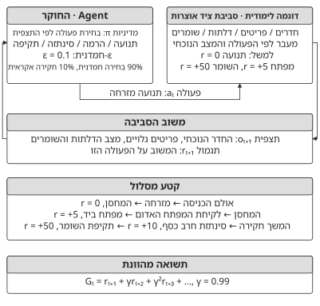

אינטראקציה רציפה יוצרת **מסלול** (trajectory), הכולל את התצפיות, הפעולות, התגמולים ומידע הסיום של כל צעד; כשמערכת האימון יכולה לגשת למצב הסביבה, אפשר לתעד גם אותו. המדיניות קובעת כיצד לפעול, ו**פונקציית ערך (‏Value Function)** מעריכה כמה תשואה עתידית צפויה אם יוצאים מהמצב הנוכחי וממשיכים לפעול לפי מדיניות מסוימת.

הגבול בין הסוכן לסביבה נקבע לפי היקף המערכת שנבחר בעת המידול. המודל וה‑Harness שבהם עוסק ספר זה נמצאים בתוך הסוכן, וממשקי הכלים מחברים אותו ליישומים, להתקנים ולשירותים חיצוניים. למשל, הבקשה לשנות קובץ באה מהסוכן, מערכת הקבצים מבצעת את הכתיבה, והכלי מחזיר את תוצאת הביצוע לסוכן.

במהלך הלמידה יש לחלק את ההזדמנויות בין **חקירה לניצול (‏Exploration–Exploitation)**. החקירה חושפת את המדיניות לפעולות שעדיין אינן מוכרות לה, והניצול בוחר בפעולות שההערכה הנוכחית מחשיבה לטובות. במשימות עם תגמול מושהה צריך גם לקבוע אילו צעדים מוקדמים תרמו לתוצאה הסופית — זוהי בעיית ייחוס הקרדיט (credit assignment) שתידון בהמשך.

כדי להבין שיטת RL, אפשר לבדוק תחילה חמישה דברים:

- **מרחב פעולה**: מה מותר לפלוט. משחקי לוח משתמשים במהלכים בדידים, ובקרת רובוטים יכולה להשתמש ביעדי מפרקים רציפים; הפעולות עשויות גם להיות מוגבלות על ידי המצב, הטווח הפיזיקלי וההרשאות.
- **מדיניות**: הכלל שבוחר פעולה לפי מצב, תצפית או היסטוריה. היא יכולה להיות טבלה, ויכולה להיות רשת עצבית.
- **אות תגמול**: באיזה משוב מתבטאת מטרת האימון. התגמול בכל צעד משתתף ביצירת התשואה ארוכת‑הטווח, והמדיניות עשויה לקבל מחיר בהווה תמורת רווח עתידי.
- **פונקציית ערך**: מעריכה את התשואה שתבוא בהמשך, ואפשר להשתמש בה כדי להשוות פעולות או לבנות את אות עדכון המדיניות. האלגוריתם הספציפי קובע אם ללמוד אותה במפורש.
- **מודל סביבה**: חוזה את המצב, התצפית או התגמול שיבואו אחרי פעולה. שיטות מבוססות‑מודל מתכננות בעזרת מודל סביבה ידוע או נלמד; שיטות נטולות‑מודל לומדות מדיניות או ערך ישירות מנתוני אינטראקציה.

טבלה 8-3 בוחרת מתוך המושגים האלה את הסביבה, הפעולות והמטרה, ומשווה כמה מערכות מוכרות. בקריאת שתי השורות הראשונות אפשר להבין את "שמירה על שיווי משקל" ואת "שטח שנוקה" כמטרות שאנו עשויים לבחור כשאנו ממדלים את המשימה.

טבלה 8-3 השוואת המרכיבים המרכזיים במערכות סוכן שונות

| סוג הסוכן | סביבה חיצונית | ייצוג הפעולה | דוגמאות לתגמול או למטרה |
| --- | --- | --- | --- |
| צבי שזה עתה נולד | פני שטח, כבידה ודינמיקת הגוף | בקרת שרירים רציפה | שמירה על שיווי משקל, הימנעות מנפילה |
| רובוט שואב אבק | חדר, רצפה ותחנת טעינה | תנועה, שאיבה, חזרה לטעינה ופרמטרי בקרה | שטח שנוקה, מצב הסוללה ומחיר ההתנגשויות |
| סוכן שחמט | לוח, יריב וכללי שעון | מהלכים חוקיים במצב הנוכחי | ניצחון +1, הפסד −1, תיקו 0 |
| סוכן שירות לקוחות | משתמשים, מסדי נתונים עסקיים וממשקי שירות | טקסט תשובה, שאילתות וקריאות עסקיות | פתרון הבעיה, עמידה בנהלים, זמן טיפול |
| סוכן עוזר קוד | מקור הדרישות, בסיס הקוד וסביבת ההרצה | חיפוש, עריכה, הרצה ומענה | תוצאות בדיקות, השלמת המשימה, רגרסיות ועלות |

ייצוגי הפעולה של מערכות אלה שונים. משחקי לוח בוחרים בדרך כלל פעולה בדידה אחת בכל צעד, רובוט פולט גדלי בקרה רציפים בממדים מוגדרים, ו‑LLM מייצר תחילה רצף טוקנים שהממשק מפענח אחר כך לתשובה או לקריאה לכלי. אפשר לכלול גם חישוב פנימי במידול המדיניות, ולתעד אותו בנפרד מהרצת הכלים שמשנה בפועל את המצב החיצוני.

### שני ייצוגי פעולה: מסגרות RL קלאסיות ומדיניות LLM באורך משתנה

**תהליך החלטה מרקובי (‏Markov Decision Process, ‏MDP)** מתאר בעיית החלטה באמצעות מצבים, פעולות, מעברים ותגמולים. התכונה המרקובית שלו דורשת שבהינתן המצב והפעולה הנוכחיים, חיזוי המצב והתגמול הבאים לא יצטרך להסתמך על ההיסטוריה: כל מידע בהיסטוריה שרלוונטי לחיזוי כבר כלול במצב הנוכחי. באיור 8-2, אם רושמים רק את החדר שבו נמצא השחקן, נתקלים בבעיה: גם כשהשחקן מגיע פעמיים לאותה דלת, האפשרות לפתוח אותה תלויה בשאלה אם כבר לקח את המפתח.

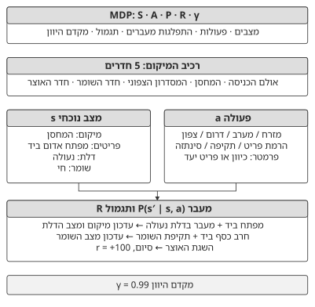

שחמט מספק דוגמה לעיצוב מצב. מלבד מיקומי הכלים, יש לתעד גם את הצד שתורו לשחק, את זכויות ההצרחה, את זכות ההכאה דרך הילוכו, ואת המידע הדרוש לכלל חמישים המהלכים ולזיהוי עמדות חוזרות. רק אחרי שכל אלה נכללים במצב אפשר להפעיל את הכללים על סמך המצב הנוכחי בלבד. אם הסוכן רואה רק חלק מהם, עליו להשלים את המידע מההיסטוריה או לאמץ מידול של תצפית חלקית.

‏MDP יכול להכיל פעולות בדידות, רציפות והרכביות. בגו יש 361 נקודות חיתוך על הלוח, ויש להתחשב גם בוויתור על תור ובחוקיות המהלך; משחקי Atari מספקים בדרך כלל מספר קטן של פעולות בדידות; וגדלי הבקרה של רובוט מוגדרים על ידי מפרקים, תפסנים ואילוצים פיזיקליים. כשמספרי המצבים והפעולות קטנים, אפשר לאחסן את הערכים ישירות בטבלה. בקנה מידה גדול יותר, קירוב פונקציות, אופטימיזציית מדיניות וחיפוש מציעים כל אחד דרך טיפול משלו.

**‏Q-learning טבלאי: עדכון ערכי פעולה ממשוב של צעד אחד.** $Q(s,a)$ מעריך את התשואה לאחר נקיטת פעולה $a$ במצב $s$. ערך הפעולה האופטימלי מקיים את משוואת האופטימליות של בלמן:

$$
Q^*(s,a)=\mathbb E\left[r+\gamma\max_{a'}Q^*(s',a')\mid s,a\right]
$$

כאן $r$ הוא התגמול בצעד הנוכחי, $s'$ הוא המצב הבא ו‑$\gamma$ הוא מקדם ההיוון. במשימות מתמשכות נהוג לבחור $0\leq\gamma<1$; במשימות שסיומן מוגדר ותשואתן סופית אפשר לבחור גם 1. מקדם היוון גדול יותר משאיר משקל רב יותר לתגמולים רחוקים. התשואה המחושבת מהרגע הנוכחי היא $G_t=\sum_{k\geq0}\gamma^k r_{t+k+1}$.

לאחר שאינטראקציה אחת מניבה $r$ ו‑$s'$, ‏Q-learning מעדכן לפי הנוסחה:

$$
Q(s,a)\leftarrow Q(s,a)+\alpha\left[r+\gamma\max_{a'}Q(s',a')-Q(s,a)\right]
$$

$\alpha$ הוא קצב הלמידה, והביטוי שבסוגריים המרובעים הוא ההפרש בין "תגמול הצעד בתוספת הערך המהוון של ההמשך" לבין ההערכה הנוכחית. כשהמשימה מגיעה למצב סיום, ערך ההמשך הוא 0. נסו זאת במשחק הנלווה: כבו את ההפרעה האקראית, לכו מזרחה מהכניסה, ואז הרימו את המפתח האדום במחסן. הרמת המפתח מזכה ב‑5 נקודות וכל צעד עולה 0.5 נקודה, ולכן ה‑$r$ שהפעולה הזו מחזירה הוא 4.5. נניח שההערכה הישנה בטבלה עבור "הרמת המפתח במחסן" היא 0.25, וערך ה‑Q המרבי של הפעולות הזמינות אחרי לקיחת המפתח הוא 0.63. עם $\gamma=0.99$ ו‑$\alpha=0.2$, יעד הצעד האחד הוא $4.5+0.99\times0.63=5.1237$. ההערכה הישנה מתקרבת ליעד בחמישית מהמרחק ומתעדכנת ל‑1.22474. שיטה זו, המתקנת הערכה בעזרת משוב ממשי של צעד אחד, נקראת **למידת הפרשים זמניים (‏Temporal-Difference Learning, ‏TD)**.

כשמציבים זה לצד זה את ערכי ה‑Q של כל הפעולות במצב מסוים, אפשר לבחור את הפעולה שההערכה הנוכחית מחשיבה לטובה ביותר. איור 8-3 משרטט מדיניות כזו על גבי רשת מפושטת. המספר בכל משבצת הוא ערך המצב המנורמל. כסו את המספרים ביד והביטו רק בחצים — האם עדיין תוכלו להגיע מהפינה השמאלית העליונה אל האוצר?

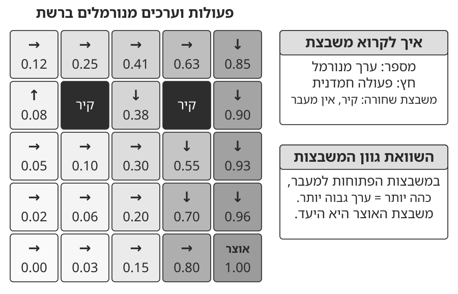

החקירה הבאה עשויה לשנות את כיוון החצים. איור 8-4 מפרק את החישוב של הרמת המפתח האדום שראינו זה עתה: התגמול שהתקבל בצעד הזה משנה את ההערכה של "הרמת המפתח במחסן", וערכי ה‑Q של שאר המצבים בטבלה ממתינים לעדכונים משלהם.

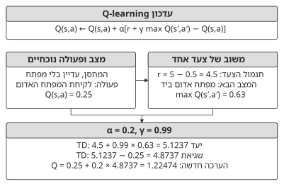

מדיניות ההתנהגות של Q-learning יכולה לכלול חקירה אקראית, ואילו יעד העדכון משתמש בערך הפעולה המרבי של המצב הבא; לכן זוהי למידת **off-policy** (‏Off-Policy).

> **ניסוי 8-1 ★: ביצועי Q-learning במשחק ציד אוצרות**
>
> משחק ציד האוצרות כולל כללים חבויים כגון מפתחות ודלתות, השפעות נשקים ויצירת פריטים. כדי לנצח יש להשלים כמה צעדים בסדר הנכון, והנתיב האופטימלי הוא בן 11 צעדים; פעולות מפתח והניצחון מעניקים תגמול, ושאר הצעדים מקבלים מעט משוב.
>
> באימון זה נקבעו קצב למידה 0.2 ומקדם היוון 0.99, ושיעור החקירה ε יורד בהדרגה מ‑1.0 ל‑0.1. ‏Q-learning הטבלאי משתמש בחקירה ε‑חמדנית: בכל צעד הוא בוחר בהסתברות ε פעולה זמינה אקראית, ובשאר המקרים בוחר אחת מהפעולות שערך ה‑Q שלהן הוא הגבוה ביותר כרגע. בכל שלב מתעדים את שיעור הניצחון, את מספר המצבים שבהם ביקר הסוכן ואת מספר הצעדים עד לניצחון.
>
> בקריאת רישומי האימון וההערכה של ניסוי ציד האוצרות, הפרידו תחילה בין שתי שאלות: במהלך האימון, מתי מצאה המדיניות, הכוללת חקירה אקראית, את האוצר בפעם הראשונה? ואחרי האימון, כשמקבעים את טבלת ה‑Q ופועלים לפי מדיניות חמדנית, האם הסוכן מנצח באופן יציב? השאלה הראשונה משקפת כיצד המודל מגלה את הנתיב; השנייה בודקת אם הוא מסוגל לבחור פעולות לפי הערכים שלמד.
>
> בריצת אימון מוקדמת יותר, ב‑1000 האפיזודות הראשונות לא הושג אף ניצחון, ובטבלת ה‑Q היו 124 מצבים; עד אפיזודה 5000 עדיין לא היו ניצחונות יציבים, ומספר המצבים עמד על 133; בין אפיזודה 7000 ל‑8000 עלה שיעור הניצחון מ‑34% ל‑96%; ובאפיזודה 10000 הגיע ל‑100%, בטבלת ה‑Q היו 145 מצבים, ונמצא נתיב בן 11 צעדים.
>
> מדוע ההתקדמות מתמהמהת בתחילה, ואחר כך שיעור הניצחון מזנק במהירות? החקירה מגלה תחילה את פעולות המפתח ואת הנתיב, והביקורים שאחריה מפיצים בהדרגה את התשואה של נקודת הסיום אל המצבים שקדמו לה. הסימולציה הקטנה כולה אורכת כ‑10 שניות, ולכן אפשר להרשות בה מספר עצום של אינטראקציות חוזרות.
>
> בניתוח יש לתעד גם את זמן החישוב וגם את מספר האינטראקציות. במשחק, פעולה אחת זולה מאוד; בדפדפן, בטלפון או בהתקן פיזי, אינטראקציה אחת כרוכה גם בהמתנה, בעלות ובשינוי מצב. הטבלה גם קשורה לקידוד מצבים מסוים, וכשהכללים או המפה משתנים יש לבדוק מחדש אם הערכים הקיימים עדיין תקפים. הניסוי הבא משווה כיצד ידע מאימון מקדים יכול לשנות את נקודת הפתיחה של החקירה.

**‏LLM מאומן מראש: ייצוג חישוב ופעולה בשפה.**

‏LLM יכול לייצר קטע של חישוב ביניים לפני שהוא קורא לכלי, או לפלוט את הקריאה ישירות. שניהם מיוצגים כרצפי טוקנים, אך תפקידם שונה: חישוב הביניים משנה את ההקשר שעומד לרשות המודל בהמשך, ואילו קריאה לכלי, לאחר שהיא מבוצעת, משנה את הסביבה החיצונית או קוראת ממנה. בזמן האימון אפשר לתעד פלטים אלה לפי פרוטוקול ולהעריך אותם בשילוב עם תוצאת המשימה ועלות החישוב. כך הופכות השאלות "כמה זמן לחשוב, על מה לחשוב ומתי לקרוא לכלי" לבחירות שאותה מדיניות יכולה ללמוד; ‏AdaptThink, שיוצג בהמשך, עוסק בדיוק בתקציב ההיסק.

רצפים באורך משתנה יוצרים מרחב הרכבי גדול יותר. המודל יכול לכתוב שאילתות, תוכניות, פרמטרי JSON וגזירות רב‑שלביות, ואורך הרצף מוגבל על ידי התקציב וההקשר. האימון המקדים מספק נקודת פתיחה לחיפוש: חומרים מתמטיים כוללים לעיתים קרובות ניתוח תנאים וחישוב, וקוד ודיונים כוללים לעיתים קרובות איתור, שינוי ואימות. המודל יכול לשאול מבנים אלה כדי לייצר נתיבים מועמדים, ואז להתאים אותם לפי משוב הסביבה. הידע הקיים מאפשר לדגום צירופי פעולות מועילים כבר מההתחלה, ומצמצם את הצורך בניסוי וטעייה עיוור בין אינספור נתיבים לא רלוונטיים.

למשל, "המרת סכום במטבע זר לדולרים" דורשת להשיג שער חליפין ולחשב. האימון המקדים מקל על המודל לייצר צעדים קשורים כאלה; האימון שלאחריו יכול אז להמשיך ולהתאים את הסתברויות הנתיבים לפי מקור שער החליפין, תוצאת החישוב ואילוצי המשימה. כאן הידע הלשוני מספק את המדיניות ההתחלתית, והתגמול מספק את המשוב על המשימה.

איור 8-5 משווה את שתי המסגרות של סעיף זה: ‏Q-learning טבלאי יוצא מקידוד מצבים ומכללי חקירה שנקבעו מראש, וסוכן LLM יוצא ממדיניות שפה מאומנת מראש ומארגן באמצעות ההקשר את התצפיות מהכלים ואת הניסיון שנצבר.

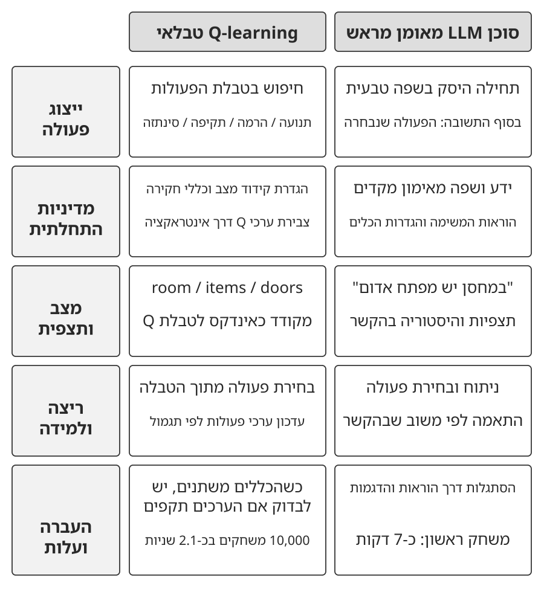

האימון המקדים גם מאפשר למודל לפרש הוראות חדשות ולהתאים את התנהגותו למשימה מתוך מעט הדגמות. הכלים מחברים את פלט השפה לחיפוש, להרצת קוד ולפעולות עסקיות. בתכנון סוכן כזה יש לקבוע את ממשקי הכלים ואת הרשאות הביצוע, וגם לבנות משוב על תוצאות המשימה, על עלויות הריצה ועל שלבי תהליך מרכזיים.

כדי שמודל ישלוט בזרוע רובוטית, כיצד מיישמים "חיזוי הטוקן הבא" על פעולות? ‏OpenVLA השתמש בכ‑970 אלף הדגמות של רובוטים אמיתיים. ניקח צעד אחד מהדגמה: הקלט הוא תמונת המצלמה באותו רגע והוראת המשימה, ויעד האימון הוא הפעולה שהמדגים ביצע מיד אחר כך. למשל, המרחק שהזרוע זזה בכיוון האופקי הוא במקור ערך מספרי רציף. ‏OpenVLA מחלק כל ממד פעולה ל‑256 דרגות, ומייצג בטוקן אחד את הדרגה שבה נופל הערך. כך המודל יכול לחזות טוקני פעולה אחד אחרי השני, ולחשב הפסד רק במיקומים האלה.[^ch8-21]

הדוגמה מספקת גם דרך להבחין בין שיבוט התנהגות (behavior cloning) לבין למידת חיזוק: בודקים איזה אות גורם למודל להתעדכן. ‏OpenVLA לומד מרישומי הדגמה; ככל שהמודל מקצה הסתברות גבוהה יותר לטוקני הפעולה שבהדגמה, ההפסד נמוך יותר — וזהו כוונון עדין מונחה. ב‑SimpleVLA-RL של ניסוי 8-13, לעומת זאת, המדיניות מנסה פעולות בפועל בסביבה, ואז מתאימה את בחירותיה העתידיות לפי תגמול המשימה.

> **מאלגוריתם וסביבה אל ידע מוקדם**
>
> ‏Shunyu Yao סקר ב"‏The Second Half" את התפתחות ה‑RL דרך שלושה צירים: אלגוריתמים, סביבות וידע מוקדם.[^ch8-2] על בסיס זה המחבר מסכם את תזוזת תשומת הלב בשלושה שלבים: ב‑2015–2016 ההתמקדות הייתה בשיפור אלגוריתמים, ב‑2016–2018 גבר הדגש על בניית סביבות, ומ‑2018 הוכר בהדרגה ערכו של הידע המוקדם מהאימון המקדים. ‏Gym סיפק ממשק סביבה אחיד, ‏Universe ו‑World of Bits חקרו משימות מחשב ורשת, ופרויקטים כגון Dota 2 הדגימו יכולת אימון בסביבות מורכבות. לאחר מכן הראו GPT-2 ו‑GPT-3 את הידע ואת יכולת הביטוי שאימון מקדים של שפה צובר, ומערכות כגון WebGPT ו‑ChatGPT ניצלו את נקודת הפתיחה הזו. את הידע המוקדם שהמשימה דורשת אפשר לרכוש תחילה באמצעות מידול שפה, ואז למסור ל‑RL את האופטימיזציה של ההתנהגות הספציפית.
>
> המחבר מסכים עם סדר העדיפויות ההנדסי שעולה מכאן: **ידע מוקדם, סביבה, אלגוריתם**. בודקים תחילה איזה ידע ואילו יכולות יש למודל, אחר כך בונים סביבה ומשוב מתאימים, ולבסוף בוחרים שיטת אופטימיזציה התואמת להם. איור 8-6 מסודר לפי הסדר שבו הופיעו מוקדי המחקר; בפרויקט אפשר להפוך את הסדר ולצאת מהיכולות הקיימות.
>
> 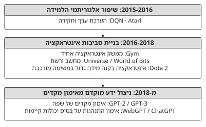

> **ניסוי 8-2 ★★: מחקר השוואתי של RL מסורתית וסוכן LLM**
>
> באותו משחק ציד אוצרות משווים Q-learning טבלאי לסוכן LLM. תצורת ה‑LLM משתמשת ב‑Kimi K3 ומתחזקת בהקשר עד 50 התנסויות. שניהם בוחרים בכל צעד אחת מהפעולות האפשריות שהסביבה מציעה. לאורך שני הנתיבים שבאיור 8-7 אפשר לראות כיצד טבלת ה‑Q ומודל השפה מבצעים כל אחד את הבחירה הזו.
>
> 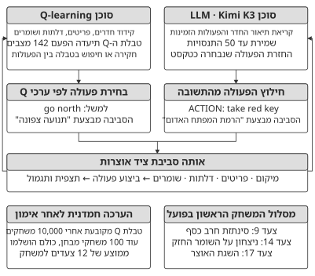
>
> ברישום הריצה הנלווה של Kimi K3, הסוכן השלים את המשחק הראשון ב‑17 צעדים. תחילה הרים את החרב החלודה, גילה שהדלת הצפונית נעולה, עבר למחסן ולקח את המפתח האדום ואת גביש הקסם, ובצעד 9 שילב את החרב והגביש לחרב כסף. כשניסה להשתמש במפתח בצעד 12, הסביבה השיבה ש"הוא ישמש אוטומטית בעת הצורך"; רק בצעד 13, כשפנה צפונה, נפתחה הדלת בפועל. אחרי שהביס את השומר בחרב הכסף בצעד 14, ניסה שוב להשתמש בחרב, והסביבה השיבה שלא ניתן להשתמש בה כעת. בצעד 17 השיג את האוצר. בקריאת הרישום אפשר לכסות את השורה הבאה ולנחש תחילה, לפי המשוב הנוכחי, איזה צעד עדיין נחוץ.
>
> כשמצמידים כל פעולה לתצפית שהייתה לפני הסוכן באותו רגע, אפשר לנתח כיצד המודל משתמש בידע קיים כגון "מפתח פותח דלת" ו"נשק מול שומר", וכיצד משוב הכלים משנה את התוכנית שבהמשך. השיטה הטבלאית, לעומת זאת, צוברת יחסים אלה באמצעות ביקורים בזוגות מצב‑פעולה.
>
> בהשוואה זו, אימון Q-learning על 10000 משחקים ארך 2.12 שניות, ובהערכה נפרדת שבאה אחריו, של 100 משחקים במדיניות חמדנית, כולם הסתיימו בניצחון, בממוצע 12 צעדים. ‏Kimi קרא למודל 17 פעמים במשחק אחד, וזה ארך 6 דקות ו‑56 שניות. מכאן המחבר מאמץ עיקרון בחירה: כשהסימולציה זולה וניתן לחזור עליה פעמים רבות, אפשר לנצל במלואה את החקירה של RL מסורתית; כשכל אינטראקציה כרוכה בהמתנה, בעלות או במחיר של פעולה ממשית, עדיף לשקול מדיניות שמסוגלת לנצל ידע קיים, כדי להגדיל את הערך של כל אינטראקציה.

שני הניסויים האלה מקשרים את הפרק לשיטות ההנדסיות שבפרקים הקודמים: ההקשר יכול לארגן ניסיון בתוך ריצה אחת, זיכרון חיצוני יכול לשמור ניסיון בין משימות, והאימון שלאחר האימון המקדים משנה את המדיניות באמצעות עדכון פרמטרים. בהמשך נשלים תחילה את התהליך הבסיסי של אימון מקדים לשפה ולראייה, ואחר כך נדון בנתוני האימון ובשיטות האופטימיזציה הספציפיות.

## יסודות אימון מקדים של מודלים `[קריאת רשות]`

האימון המקדים קובע את הייצוגים הראשוניים של המודל ואת התפלגות הייצור שלו, וכל אימון מאוחר יותר ממשיך לכוונן את הפרמטרים מנקודת פתיחה זו. כדי להבין את נקודת הפתיחה הזו, כדאי לראות תחילה כיצד מודל שפה קטן לומד מטקסט, ואחר כך כיצד מחברים אליו קלט חזותי.

הטקסט עובר תחילה **טוקניזציה** (‏Tokenization) והופך לטוקנים בדידים. למשל, "אני אוהב לתכנת" יכול להתחלק, לשם המחשה, לשלוש יחידות: "אני", "אוהב", "לתכנת"; החלוקה בפועל נקבעת על ידי הטוקנייזר. האימון משתמש בטוקנים הקודמים כהקשר, חוזה את הטוקנים הבאים, מחשב הפסד ומעדכן את הפרמטרים. באיור 8-8 מציגים תחילה את משפט האימון רק עד המילה "סביבה", מנחשים מהי המילה הבאה, ואז חושפים את הטקסט המקורי. הזזת המיקום הזה קדימה יוצרת את שאלת החיזוי הבאה.

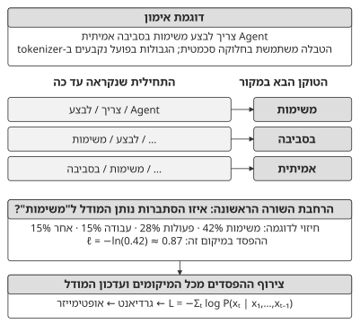

לאחר מידול השפה הבסיסי אפשר להוסיף הדגמות הוראה כדי לאמן את פורמט התשובה ואת ההתנהגות במשימה; אפשר גם להשתמש בנתוני העדפה ובשיטות כגון DPO כדי להעלות את ההסתברות של תשובות שזוכות להעדפה.

> **ניסוי 8-3 ★★: אימון LLM מאפס — עוצמתו של שיפור אלגוריתמי**
>
> בעזרת MiniMind 2, מודל בן כמאה מיליון פרמטרים, משלימים על GPU צרכני אימון מקדים, ‏SFT ואופטימיזציית העדפה. משווים קו בסיס לתצורה שמוסיפה QK Norm ואת האופטימייזר Muon, ובוחנים את ירידת ההפסד, את הזמן הדרוש להגעה לאיכות היעד ואת תוצרי הייצור. הסיכום הנלווה מתעד האצה של פי 3 בקירוב בהתכנסות; האימון המלא נמשך כ‑14 שעות ועלה כ‑34 דולר.
>
> ‏QK Norm מכוונן את קנה המידה המספרי של השאילתות והמפתחות במנגנון הקשב, ו‑Muon משנה את אופן עדכון האופטימיזציה של הפרמטרים המתאימים.
>
> בוחנים את אותה קבוצת שאלות בכל שלב: המודל שעבר אימון מקדים כבר יודע לענות על שאלות כגון "מהו ההר הגבוה בעולם"; לאחר SFT, הציות להוראות וארגון הפלט משתפרים; אופטימיזציית ההעדפה ממשיכה להשפיע על התשובות העובדתיות ועל הניסוח.

> **ניסוי 8-4 ★★: אימון VLM משלכם**
>
> איור 8-9 מציג את החיבור "מקודד ראייה — שכבת הטלה — מודל שפה". מקודד הראייה, למשל CLIP, מחלץ מאפייני תמונה; שכבת ההטלה ממירה את המאפיינים לממד ולייצוג שמודל השפה דורש בקלט; ומודל השפה משלב קלטים אלה כדי לייצר תיאור או תשובה.
>
> 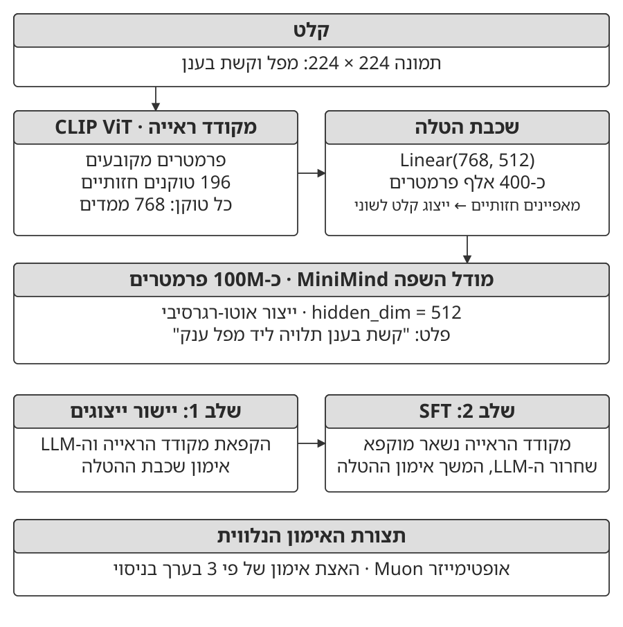
>
> בשלב הראשון מקפיאים את מקודד הראייה ואת ה‑LLM ומאמנים את שכבת ההטלה החדשה, כדי שמאפייני התמונה יוכלו להשתתף בחיזוי השפה; בשלב השני משחררים את ה‑LLM מהקפאה לפי התצורה ומבצעים SFT על נתוני תמונה‑תיאור או שאלה‑תשובה באיכות גבוהה. בוחנים בנפרד את השינויים בזיהוי אובייקטים, בתיאור פרטים, בשיפוט יחסים וביכולת השפה.
>
> ארכיטקטורה זו עושה שימוש חוזר במודלי ראייה ושפה קיימים ומרכזת תחילה את האימון במודול החיבור בין האופנויות; כשהתקציב מוגבל, כדאי לנסות אותה ראשונה. הקפאת המשקלים מצמצמת את המצב שיש לאמן, ובהמשך משחררים מודולים לפי צורכי המשימה. כשהתיאור שגוי, בדקו תחילה האם המידע על האובייקט נכנס לייצוג החזותי; אם המידע כבר קיים והמודל עדיין אינו מצליח להשתמש בו, התמקדו בכוח הביטוי של שכבת ההטלה, בנתוני היישור ובפיקוח על ייצור השפה. אם משנים את הפלט לייצוג פעולה ומיישרים אותו לממשק הבקרה, מגיעים לארכיטקטורת ה‑VLA של פרק 6.

שני הניסויים מראים כיצד תצורת האופטימיזציה והחיבור בין האופנויות משפיעים על האימון. כשהתקציב מוגבל, המחבר ממליץ להשוות תחילה את התועלת ששיפורים אלגוריתמיים וארכיטקטוניים מביאים, ורק אז להחליט האם להגדיל את המודל. כשמודל קיים נכנס לשפה חדשה או לתחום חדש, אפשר גם להמשיך ללמוד ממשקלי האימון המקדים; הסעיף הבא דן בבחירת הנתונים לאימון כזה.

## אימון ביניים: השלמת ידע ויכולות יסוד

בפרק זה, **אימון ביניים** (‏Mid-training) פירושו שלב של המשך אימון מודל שפה על מודל קיים, סביב התפלגות היעד. כמות גדולה של טוקנים ממסמכים, מקוד או מגזירות משתתפת בפיקוח, ובמהלך האימון אפשר לערבב את קורפוס תחום היעד עם קורפוס כללי. מחקרי DAPT/TAPT הראו שהמשך אימון מקדים על קורפוסים הקשורים לתחום או למשימה מסייע במשימות במורד הזרם.[^ch8-30]

בחירת הנתונים יוצאת משני סוגי פערים. האחד הוא כיסוי ידע ושפה, למשל כשהמודל נחשף מעט מדי לפרוטוקולים ארגוניים, למינוח בשפת היעד או למאגר קוד מסוים; השני הוא יכולות יסוד שהמשימה דורשת, למשל מעקב אחר מצב בהקשר ארוך, שילוב יחסים בין מסמכים או השלמת גזירת קוד ארוכה. מבחינים תחילה, לפי סוג השגיאה, בין בעיות הבנה, ידע, פורמט ופעולה, ורק אז קובעים אילו חומרים יש להוסיף.

לאחר שההפסד על הטקסט התחומי יורד, יש לבדוק גם האם המודל מסוגל להשתמש בידע שלמד במשימות אמיתיות. סדר המשך האימון ואימון ההוראות, ארגון השאלות והתשובות וצורת החומרים — כל אלה משפיעים על השימוש בידע.[^ch8-31] במשימות תחום שבהן יכולות היסוד חסרות בבירור, המחבר ממליץ להגדיל תחילה את הכיסוי בעזרת קורפוס תחומי, ואחר כך ללמד את המודל באמצעות הדגמות SFT להשתמש במידע זה במשימה; רק כשהמודל מצליח לפעמים, אך בשיעור נמוך, משקיעים ב‑RL.

### בניית נתוני אימון ביניים

**צעד ראשון: לאתר את החומרים הנדרשים מתוך התפלגות הכשלים.** מעריכים בנפרד לפי נושא, שפה, סוג מסמך, דפוס קוד ואורך הקשר, ובעזרת Pass@1, ‏Pass@k ודוגמאות שגיאה קובעים באילו תנאים חסר למודל פתרון שמיש. בעיות בפורמט הארגומנטים מטופלות בהדגמות ממשק, ואילו פערים במושגי התחום וביחסים ביניהם דורשים קורפוס מתאים.

**צעד שני: לארגן קורפוס בצפיפות גבוהה.** מסמכים גולמיים מספקים מינוח ויחסים עובדתיים, מאגרי קוד מספקים מבנה מודולים ותלויות, גזירות בסגנון ספר לימוד והסברים סינתטיים פורשים צעדים מובלעים, ודגימות חוצות‑מסמכים מחברות מידע מפוזר. לאחר סינון איכות, הסרת כפילויות ובידוד מערכי ההערכה, בונים את רצפי האימון.

**צעד שלישי: לערבב נתונים לפי יכולות היעד.** טקסט ארוך טבעי יכול לבוא מספרים, ממסמכים וממאגרי קוד; לאחזור, להיסק רב‑קפיצות, לציות להוראות, לצבירה ולסטטיסטיקה אפשר להוסיף נתוני משימה הכוללים גזירה; לסוכנים אפשר להוסיף מסלולים של תכנון, בחירת כלים, בניית ארגומנטים, מעקב מצב והתאוששות משגיאות. חומרים אלה יכולים לבוא ממערכי נתונים קיימים או מייצור של מודל מורה, ולפני הכניסה לאימון מסננים אותם לפי דרישות התוכן וההתנהגות.

**צעד רביעי: לתת למודל להמשיך לתרגל משימות שכבר ידע לבצע.** קבוצת דגימות אחת שומרת על טקסט קצר, על קורפוס כללי ועל השאלות המקוריות; קבוצה שנייה מציבה את אותן משימות בתוך הקשר ארוך יותר, מזיזה את מיקום המידע המרכזי ומוסיפה מסיחים. בשילוב שתי הקבוצות אפשר להתבסס על התפלגות נתוני האימון המקוריים, או לנסות כמה יחסי ערבוב עם קורפוסים פתוחים כגון FineWeb-2 ולכוונן לפי תוצאות ההערכה.

**צעד חמישי: להכריע בעזרת מדדים מרובים האם להמשיך או לעצור.** רושמים במקביל את הפסד האימון, משימות תחום מוחזקות, יכולות כלליות, ציות להוראות הקיים ושיעור ההצלחה במשימת היעד. כשציוני התחום עולים והיכולות הכלליות יורדות, השוו יחסי ערבוב, קצב למידה וכמות אימון; כשההפסד יורד ומשימת היעד אינה זזה, בדקו האם חומרי האימון אכן מלמדים את המודל לבצע משימות מסוג זה, והאם יש להוסיף הדגמות של שימוש בידע במשימות אמיתיות.

נניח שהמודל מסוגל למצוא מספר הזמנה מסוים ביומן הזמנות ארוך מאוד. אם השאלה משתנה ל"איזה לקוח ביצע כמה הזמנות וביטל את כולן", עליו לאסוף את כל ההזמנות של אותו לקוח ולהתאים כל הזמנה לרשומת הביטול שלה. שתי השאלות יכולות להשתמש באותו יומן, אך הן בודקות יכולות שונות. ‏RULER משתמש במשימות סינתטיות כדי לשלוט בנפרד באורך הקלט ובקושי המשימה, ובודק בנפרד אחזור יחיד, מעקב רב‑קפיצות וצבירה. המחברים העריכו 17 מודלים: רבים מהם קיבלו ציון כמעט מלא באחזור פשוט, אך ככל שהקלט התארך, הביצועים הכוללים ירדו בבירור.[^ch8-ruler]

כדי לראות האם הבדל זה מופיע גם בחומרים אמיתיים, אפשר להמשיך לשאלות ריבוי המסמכים, השיחות הארוכות או מאגרי הקוד של LongBench v2. כדי לבדוק בנפרד האם המודל זוכר דרישות כגון פורמט הפלט, אפשר לקחת הוראות ניתנות לאימות מ‑IFEval ולמקם אותן במקומות שונים בחומר ארוך יותר. בהשוואת שני מודלים, מיקום ההוראות והתוכן המסיח צריכים להיות זהים לשניהם, ויש לציין שמדובר במבחן שנבנה באופן עצמאי. לבסוף בודקים במשימות סוכן מקצה לקצה האם היכולות האלה פועלות יחד. בתכנון מערך ההערכה אפשר לבדוק את הממדים הבאים אחד‑אחד.[^ch8-longbench]

[^ch8-ruler]: Hsieh ואחרים, RULER, ‏2024.
[^ch8-longbench]: Bai ואחרים, LongBench v2, ‏ACL 2025. המאמר כולל שש קטגוריות משימות ובסך הכול 503 שאלות רב‑ברירה.

- **מיקום ואחזור**: האם פריט מידע מרכזי אחד או כמה נמצאים כשהם ממוקמים בהתחלה, באמצע ובסוף.
- **יחסים והיסק**: מעקב אחר יחסים בין פסקאות ובין מסמכים, יישוב סתירות והרכבת ראיות.
- **צבירה וסטטיסטיקה**: ספירה, קיבוץ, מיון, השוואה וסיכום מגמות בטבלאות וביומנים ארוכים.
- **ציות להוראות**: דרישות מרובות, טיפול בסתירות, תנאי תהליך ופורמט פלט.
- **היסק בשרשרת ארוכה**: שרשראות תלות ארוכות במשימות מתמטיקה, לוגיקה וקוד.
- **התנהגויות סוכן בסיסיות**: פירוק משימות, בחירת כלים, ייצור ארגומנטים, שמירת מצב והתאוששות מכישלון.

היסק ארוך וקריאות רב‑סבביות לכלים מאריכים את ההקשר ללא הרף, וההוראות, העובדות ומצב המשימה מהשלבים המוקדמים עדיין צריכים להשתתף בהחלטות מאוחרות יותר. אם המודל אינו מוצא מידע בטקסט ארוך או אינו מצליח לשמור על אילוצים, סוכן לטווח ארוך יתקשה לפעול באמינות. לפני הגדלת תקציב האימון, השוו תחילה יחסי ערבוב וכמויות אימון בתצורה קטנה. לעובדות המתעדכנות לעיתים קרובות ודורשות ציון מקור, המחבר מעדיף RAG; לידע תחומי יציב בקנה מידה גדול וליכולות יסוד, שוקלים המשך אימון שיכתוב אותם לתוך הפרמטרים.

> **ניסוי 8-5 ★★: המשך אימון מקדים ללמידת שפה חדשה**
>
> מתחילים מ‑Mistral 7B v0.3 ומשפרים את יכולת הקוריאנית שלו בעזרת ויקיפדיה הקוריאנית וחומרים דומים. האימון משתמש תחילה בתערובת של כ‑80% קוריאנית ו‑20% אנגלית, ואחר כך מבצעים SFT עם נתוני הוראות בקוריאנית, ובוחנים בנפרד את השינויים במידול השפה ובהתנהגות השיחה.
>
> הנתונים בקוריאנית מגדילים את הכיסוי של שפת היעד, והנתונים באנגלית משמרים את היכולות הקיימות. בכל שלב בודקים על אותה קבוצה של שאלות בקוריאנית ובאנגלית שלא השתתפו באימון. בתוצאות הנלוות, הדירוג העיוור לקוריאנית בשלב הסופי השתפר ויכולת האנגלית ירדה במידה מסוימת; הדבר מצביע על כיוון מוחשי לסבב הבא: לערבב מעט יותר חומרי אימון באנגלית או להפחית את עוצמת העדכון.
>
> רישום נפרד של שפת היעד, של השפה המקורית ושל איכות העובדות מאפשר לשפוט את התועלת ואת המחיר; בשלב ה‑SFT בודקים גם האם המודל מארגן תשובות לפי הוראות בקוריאנית. כך אפשר לבחון בנפרד את תרומת המשך האימון המקדים ואת תרומת כוונון ההוראות.

## SFT (כוונון עדין מונחה)

קורפוס תחומי יכול לחשוף את המודל לממשק מסוים כמה פעמים נוספות, אך כדי ללמד אותו לתקן ארגומנטים לאחר קריאה כושלת, אפשר גם פשוט להדגים זאת פעם אחת. ‏SFT מקבל קלט משימה ומאמן את המודל, טוקן אחר טוקן, לייצר את התשובה או את הפעולה שבהדגמה. כשמתבוננים באיור 8-10, חשבו תחילה איזו התנהגות אתם מתכוונים ללמד, ורק אז החליטו כיצד לאסוף הדגמות. העובדות, הטון ופורמט הפלט שבהדגמה נכנסים גם הם לאימון.

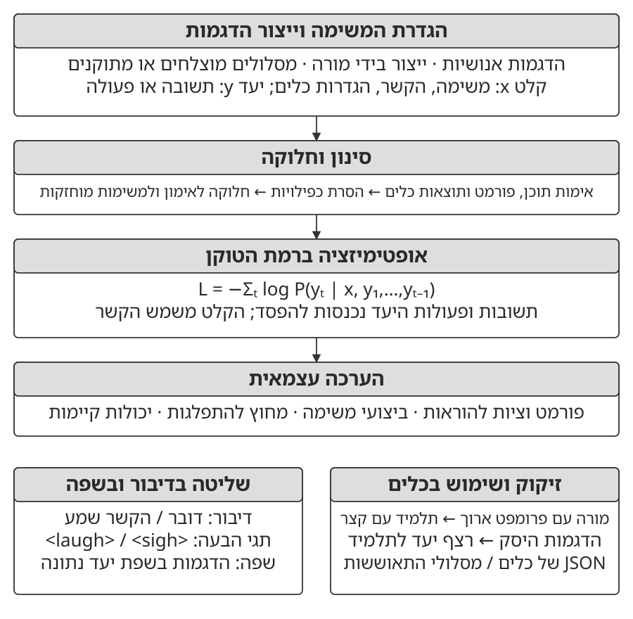

הנתונים מגיעים בדרך כלל משלושה מקורות: מומחים אנושיים מגדירים התנהגויות מפתח וגבולות, מודל מורה כותב הדגמות בכמויות, ומאמת מסנן פלטים תקפים מתוך דגימות של המודל. אפשר לשלב את השלושה. למשל, מומחים כותבים תחילה מספר קטן של הדגמות קריאה לכלים, אחר כך המורה משנה את תנאי המשימה ומייצר דגימות נוספות, ולבסוף בודקים את הארגומנטים, את תוצאות ההרצה ואת האילוצים העסקיים.

**אחד השימושים של SFT הוא ללמד את המודל נהלים שנכתבים שוב ושוב בפרומפט וב‑Skill.** קחו את דירוג הזיכרון מפרק 7: נניח שמדריך הדירוג, יחד עם מקרי התקדים, מגיע לעשרת אלפים טוקנים. המורה נשען על המדריך המלא, מדרג אצווה של תשובות ומדגים כיצד לטפל במקרים כגון אנשים בעלי שם זהה, יחסים הפוכים או ראיות בלתי מספקות. באימון התלמיד, הקלט שומר רק את שמות פריטי הדירוג בקצרה, את החומר ההיסטורי של אותה פנייה ואת התשובה הנבדקת, ופלט היעד הוא הדרגה שבחר המורה. לאחר הפריסה מספיקים פרומפט קצר והחומר של אותה פנייה, וכל היסק חוסך את עשרת אלפי הטוקנים של ההסבר הקבוע. עבור Skill שנקרא שוב ושוב, אפשר באותה דרך להדגים מתי לחפש מידע וכיצד לבחור כלי, ואז לזקק צעדים יציבים אלה לתוך המודל.

הכנת הנתונים מתחילה בקביעת התפלגות המשימות, סכמת הפלט ואופן הקבלה. לאחר שההדגמות עוברות בדיקה, מסירים כפילויות, מכווננים את יחסי סוגי הדגימות ומחלקים את מערך הנתונים. יש לתכנן את מספר הדגימות ואת היקף הכיסוי יחד: חזרה אלפי פעמים על אותו ניסוח מחזקת שוב ושוב את אותו דפוס; רק וריאציות שנבנות סביב תנאי המפתח מסייעות למודל לבחור התנהגות מתאימה תחת קלטים שונים. המחבר מלטש תחילה אצווה של הדגמות המכסה את המקרים המרכזיים, ורק אז מגדיל את ההיקף. ‏SFT לומד את פלט היעד טוקן אחר טוקן, ולכן עובדות שגויות, צעדים מיותרים והרגלי פעולה לא הולמים נכנסים גם הם לפרמטרים.

> **ניסוי 8-6 ★★★: ‏SFT קולי — משכפול קול למידול פרה‑לשוני `[ניסוי מורחב]`**
>
> בעזרת Orpheus ו‑Sesame CSM כמקרי בוחן, משווים כיצד תנאי הדובר, הקשר השיחה וסימוני ההבעה משתתפים בייצור הדיבור. ‏Orpheus מייצג דיבור כטוקנים, יכול להשתמש בקטעי ייחוס של טקסט‑דיבור כדי לייצר את הגוון המתאים, ומספק גם סימוני הבעה כגון `<laugh>` ו‑`<sigh>`. ‏Sesame CSM מקבל טקסט, מזהה דובר וקטעי אודיו קיימים, ומייצר את המשך הדיבור.[^ch8-speech-conditioning]
>
> בבניית דגימות האימון רושמים בנפרד את הטקסט, הדובר, האודיו ותנאי ההבעה; משתמשים בחומר חוצה‑משפטים של אותו דובר כדי ללמוד עקביות, ובצחוק, באנחות ובהפסקות בהקשרים מגוונים כדי ללמוד הבעה. משווים את הפלט ללא ייחוס, עם ייחוס ועם תנאי הבעה מוגדר, ומדרגים לפי דיוק, טבעיות, רגש וגוון.
>
> הנתונים צריכים לכסות די צירופים של דוברים, מבני משפט ורגשות. כשיש מעט מדי דוברים, הפלט עלול לנטות לגוון יחיד; כשסימון מסוים קשור תמיד לאותו קטע קול, עלולה להופיע הבעה חוזרת ומכנית.

> **ניסוי 8-7 ★★★: חשיבה רב‑לשונית — ייצור תהליך היסק בשפה מוגדרת `[ניסוי מורחב]`**
>
> מבצעים SFT על gpt-oss-20b ומשתמשים בהוראה כדי לקבוע את שפת תהליך ההיסק. למשל, `reasoning language: German` דורש לייצר טקסט היסק בגרמנית. דגימות האימון כוללות אנגלית, ספרדית, צרפתית ושפות נוספות, וסינית נשמרת לשלב הבדיקה.
>
> במקרה הנלווה, כשמגדירים לאחר האימון Chinese, המודל מסוגל לייצר תהליך היסק בסינית. אפשר להמשיך ולהשוות שלוש תוצאות: האם דרישת השפה מתקיימת, האם התשובה הסופית נכונה, וכיצד משתנים אורך הייצור ומשכו. הבסיס הרב‑לשוני מהאימון המקדים ודרך השליטה שנלמדה ב‑SFT פועלים יחד בהתנהגות חוצת‑השפות הזו; השוואה בין שפות שונות ובין מודלי בסיס מאפשרת להמשיך ולנתח את תרומת כל אחד מהם.

> **ניסוי 8-8 ★★: זיקוק פרומפט — שחזור יכולת שמישה בתקורה קטנה יותר**
>
> תהליך עסקי יציב עשוי להישען על פרומפט מערכת של אלפי טוקנים, והמורה גם מייצר היסק ארוך. זיקוק פרומפט נותן תחילה למורה להפיק פלט איכותי בתנאים המלאים, ואז מרכיב מזוגות "קלט משתמש — תשובה סופית" את נתוני ה‑SFT של התלמיד. התלמיד משתמש בפרומפט קצר יותר ועונה ישירות לפי תצורת היעד.
>
> כבר בדגימת האימון הראשונה רואים שמורה Kimi K3 קרא קטע טקסט בערבית המשולב באותיות לטיניות, הסביר את נימוקי ההחלטה ולבסוף נתן את קוד השפה `ar`. ההדגמה שנמסרה לתלמיד SmolLM2-135M-Instruct כוללת רק את הטקסט המקורי ואת `ar`. על אותה קבוצה של 80 רשומות בדיקה, צד המורה קרא בממוצע כ‑386 טוקנים לבקשה, וצד התלמיד כ‑97. כל אחד משני המספרים נספר לפי הטוקנייזר של המודל המתאים.
>
> רשומות ההשוואה הנלוות לזיהוי שפה מאפשרות להפריד בין "תשובה נכונה" לבין "פלט בפורמט הנכון". המורה ייצר הדגמות על 160 דגימות אימון, ובנוסף ענה נכון על כל 80 רשומות הבדיקה. התלמיד שלא עבר כוונון לא הפיק בבדיקה אף פלט שהמעריך הצליח לנתח, וקיבל אפס; לאחר הכוונון כל 80 הפלטים נותחו, ו‑76 תוויות היו נכונות. ציון האפס של קו הבסיס כשלעצמו אינו מבחין בין "לא זיהה את השפה" לבין "זיהה אך לא ענה בפורמט". הבדיקה כוללת 75 קטעי טקסט שונים, ואין טקסט זהה לחלוטין בין האימון לבדיקה.
>
> בניית הנתונים צריכה גם לשמר את התנאים שהתלמיד זקוק להם כדי להשלים את המשימה. כשהמורה נשען על תוצאות כלים עדכניות, אפשר להעביר את התוצאות המתאימות כקלט לתלמיד, או להשאיר את ממשק הכלי; כשלמורה יש שגיאות שיטתיות, מסננים באמצעות אימות עצמאי.
>
> כשכללי המוצר יציבים, התפלגות הקלט ברורה ועלות הקריאה גבוהה, המחבר ממליץ לשקול תחילה זיקוק פרומפט ולדחוס לפרמטרים את הפרומפט וההיסק שמעובדים שוב ושוב. כשהמוצר עדיין בשלב חקירה ודרישות המשימה משתנות לעיתים קרובות, שומרים על פרומפט ניתן לעריכה ועל היסק מפורש, כדי לאפשר ניסויים מהירים ואיתור שגיאות.

> **ניסוי 8-9 ★★★: זיקוק שרשרת מחשבה (Chain of Thought, ‏CoT)**
>
> זיקוק CoT משתמש בטקסט ההיסק של המורה יחד עם התשובה הסופית כפיקוח, כך שהתלמיד לומד את תהליך הפירוק, החישוב, הבדיקה והתיקון. הזיקוק ש‑DeepSeek-R1 ביצע לסדרות Qwen ו‑Llama הוא הדוגמה המייצגת לשיטה זו. לצוותים שרוצים מודל שנמצא בשליטתם ובמקביל לרסן את השקעת האימון, המחבר ממליץ לשקול מסלול זה ראשון. כשהמורה חזק בבירור מהתלמיד במשימת היעד, יש בידו לספק הדגמות בעלות ערך; אפשר לבחור תחילה מבין מודלים בעלי משקלים פתוחים שמהם ניתן לקבל פלט היסק מלא, ואז להשוות את פער היכולות בינו לבין התלמיד ואת איכות הנתונים. כשהממשק מספק רק תקציר של ההיסק, גם המידע הזמין לזיקוק התהליך מצטמצם.
>
> צעד ראשון: נותנים למורה להציע כמה פתרונות לאותה שאלה. בשאלות מתמטיקה מאמתים תחילה את התשובה, בשאלות קוד מריצים בדיקות, ומשאירים רק פתרונות שעברו את הבדיקה; סינון זה נקרא **דגימת דחייה** (‏Rejection Sampling). כוונון עדין מונחה על הפתרונות שסוננו נקרא **כוונון עדין בדגימת דחייה** (‏Rejection Sampling Fine-Tuning, ‏RFT). אם התלמיד צריך ללמוד גם את תהליך ההיסק, יש להמשיך ולאמת את צעדי הביניים ולהסיר הדגמות שבהן הגזירה שגויה אך התשובה יצאה נכונה במקרה.
>
> במשימות שיש להן מאמת אמין, המחבר ממליץ לבסס תחילה קו בסיס של RFT: ייצור, סינון ו‑SFT מספיקים כדי ליצור צינור אימון וחוסכים את עבודת המימוש של אופטימיזציית מדיניות מקוונת ושל הערכת ערך; על פי קו בסיס זה שופטים האם ההשקעה הנוספת ב‑RL כדאית.
>
> צעד שני: מאמנים את התלמיד. מארגנים "שאלה ← טקסט היסק + תשובה סופית" לפי פורמט השיחה של המודל הנבחר; כשמשתמשים בגבולות כגון `<think>` ו‑`</think>`, קובעים במפורש אילו טוקנים משתתפים בהפסד. אפשר להתחיל מתלמיד בסדר גודל של 7B ולהשוות בין תצורות של מסלול מלא, מסלול מקוצר ופיקוח על התשובה הסופית בלבד.
>
> צעד שלישי: בודקים מה התלמיד למד. בניסוי הנלווה Kimi K3 פתר 24 שאלות AIME, ו‑23 מסלולי ההיסק שבהם ענה נכון שימשו לכוונון Qwen2.5-1.5B-Instruct. כשפתרו שוב את אותה קבוצת שאלות, התלמיד עבר מתשובה נכונה אחת לשתיים, והמורה ענה נכון על 23. התלמיד המאומן חוזר לפעמים לאמת את החישוב, אך מבחן מזווג, שאלה מול שאלה, לא הראה שיפור אמין בדיוק ($p=1.0$).

> **מכתיבת הספר: תהליך הפיתוח של ניסויי הזיקוק**
>
> המחבר מימש תחילה את ניסוי הזיקוק בעזרת Codex המונע על ידי GPT-5.6-Sol; לאחר שנתקל בסירוב עבר ל‑Claude Code המונע על ידי Claude Opus 5, וגם שם לא הצליח להמשיך. לבסוף השלים את הקוד ואת ההרצה בעזרת Kimi K3.

ארבעת המקרים האלה משתמשים כולם בלמידה מונחית, וכל אחד מהם לומד תוכן אחר: גוון ותנאי הבעה בדיבור, שליטה בשפה בהיסק רב‑לשוני, תשובה ישירה בזיקוק פרומפט, ותהליך פתרון בזיקוק CoT.

## סינתזת נתוני SFT: מהדגמות למסלולים ברי‑אימון

כדי להפיק מתלונה אמיתית אחת אצווה של משימות אימון, איזה מידע מותר להחליף ואילו יחסים חייבים להישמר? מחלצים ממסלולי ייצור את כוונת המשתמש, המצב ההתחלתי, הכלים הזמינים, האילוצים העסקיים והכשלים הנפוצים, ומארגנים אותם לתבנית משימה. זהויות, הזמנות, קבצים ואישורי גישה יש להחליף; אם הבעיה המקורית כללה שתי הזמנות דומות, יש לשמר גם במופע שנוצר את היחס הזה, שמחייב הבחנה ביניהן. רק הרצת המופע בסביבה ברת‑איפוס מראה האם המשימה החדשה אכן שימרה את הקושי המקורי.

צינור שלם נראה כך: **מקרה ייצור ← תבנית משימה ← מופע סינתטי ← מסלולים מועמדים מרובים ← אימות משימה ואימות מסלול ← נתוני אימון**. שני סוגי האימות אחראים לבעיות שונות: אימות משימה בודק האם התנאים מספיקים, האם המטרה ניתנת להשגה והאם תוצאת הייחוס נכונה; אימות מסלול בודק, מסלול אחר מסלול, את המצב בסיום המשימה, את סדר הקריאות לכלים והאם תהליך הביצוע עומד באילוצים העסקיים.

תנאים ברי‑הרצה נבדקים בטסטים, בטענות על מסד נתונים או בבדיקות הפרשי מצב; איכות תקשורת פתוחה נבדקת ב‑Rubric ובשיפוט מודל, ומכוילת בדגימה אנושית. שילוב נוסף של גרפי מיומנויות, סביבות ברות‑הרצה ומאמתים עצמאיים מאפשר להרחיב את כיסוי המשימות באופן מתוכנן.[^ch8-12][^ch8-17][^ch8-18][^ch8-19][^ch8-20]

הדגמה תקינה יכולה להיות מסלול שהושלם בלי תקלות, או תהליך מלא הכולל אבחון ותיקון. לגבי פעולות שגויות בתוכה, יש לקבוע במפורש את תפקידן בדגימה ולבחור את מיקומי ההפסד לפי מטרת האימון. רשומות כשל יכולות לשמש גם לבניית זוגות העדפה, לגילוי פערי כיסוי ולייצור משימות התאוששות. בהמשך, ב‑RL, המדיניות הנוכחית דוגמת מסלולים מחדש ומתעדכנת לפי משוב הסביבה.

את מערך האימון ואת מערך ההערכה מבודדים לפי המטרה: הערכה באותה התפלגות יכולה לבודד מופעים מסוימים, והערכת העברה מבודדת גם תבניות משימה, קבוצות לקוחות או פרקי זמן. בהסרת כפילויות בודקים כמעט‑כפילויות בקלטים ובפתרונות; תשובות ייחוס, בדיקות חבויות ומידע המיועד לניקוד בלבד נשארים בצד המאמת, לפי פרוטוקול המשימה.

האם אפשר, לאחר שהכוונון הסתיים, לבדוק את חומרי האימון מתוך המשקלים? קחו את מודל ההיסק הציבורי s1. אם ממירים את הדגימות הציבוריות למספרי טוקנים לפי הטוקניזציה ועיבוד הטקסט ששימשו באימון, ומסירים כפילויות, מקבלים רשימה. לאחר מכן משווים, שורה אחר שורה, את מטריצת ה‑embedding של הקלט לפני הכוונון ואחריו, ורושמים לאילו טוקנים השתנה הווקטור. בבדיקה שערך המחבר, 16,573 המספרים בשתי הרשימות תאמו אחד‑אחד. בדיקה זו דורשת לאתר את מודל הבסיס ואת הטוקנייזר הנכונים, לשלב את פרומפט המערכת ולקטוע דגימות ארוכות לפי תצורת האימון; יש גם לוודא שהאימון אכן עדכן את ה‑embedding של הקלט, ושה‑embedding של הקלט ומשקלי שכבת הפלט אינם משותפים. למשל, כשמאמנים LoRA רק על שכבות הקשב, ה‑embedding של הקלט נשאר כמות שהוא, ואי אפשר להפיק ממנו את רשימת הטוקנים ששימשו.[^ch8-token-provenance]

שלושה טוקנים מספיקים כדי לראות את גבולות הראיה. נניח ששתי דגימות ציבוריות מתפרקות לטוקנים `[10, 20]` ו‑`[20, 30]`; לאחר הסרת כפילויות מתקבל `{10, 20, 30}`. כעת מוסיפים דגימה שלישית `[30, 10]` ומחשבים שוב — הקבוצה זהה לחלוטין. גם אם כל מספר תואם בבדיקה, אי אפשר להסיק מכך האם הדגימה השלישית שימשה באימון, ואי אפשר לשלול ששאלת הערכה כלשהי חדרה למערך האימון.

[^ch8-token-provenance]: פרויקט training-forensics של Bojie Li מתעד את קבוצות הטוקנים ואת תנאי העיבוד המקדים של s1 ושל מודלים נוספים, ודן בהשפעה של שיתוף משקלי ה‑embedding ושל LoRA על שיטת ההשוואה.

קחו את מקרה "ההשלמה המוקדמת" מפרק 7: חותכים את הקידומת ברגע שבו הסוכן עומד להכריז על השלמה, מסמנים את הצהרת ההשלמה שלא אומתה כ‑`rejected`, ואת ההתנהגות שממשיכה — בודקת תחילה את המטרות שנותרו, מריצה את הבדיקות הרלוונטיות ורק אז עונה — כ‑`chosen`. זוגות ההעדפה יכולים לשמש ל‑DPO; התנהגות ההמשך שעברה אימות יכולה לשמש גם בנפרד כהדגמת SFT.

ניסויי המרכאות המסולסלות בסינית והמחרוזות המיוחדות שבהמשך מבהירים עוד כיצד קובעים את יעד הפיקוח. משימת המרכאות המסולסלות יוצאת מהיקף המסמך: היא דורשת לשנות את גוף הטקסט המיועד ולהגן על קוד, על ציטוטים ועל JSON; משימת המחרוזות המיוחדות דורשת ש‑`old_string` יישמר זהה ברמת הבתים בארגומנטי הכלי. הראשונה בודקת את היקף העריכה ואת תחביר המסמך, והשנייה בודקת העתקה מדויקת והתאמה בפועל בכלי. אותו תהליך של ייחוס כשלים יכול להוביל ליעדי אימון שונים.

## מתי לבחור אימון ביניים, ‏SFT ו‑RL

אם המודל אינו מסוגל אפילו לכתוב נכון את פורמט הקלט של כלי, ונותנים לו עכשיו לנסות ולטעות שוב ושוב, כמה מהקריאות באמת ירוצו? אפשר ללכת לאורך איור 8-11 כדי למצוא תחילה את הצעד שבו הוא נתקע, ולבחור לפי טבלה 8-4 את חומרי האימון ואת אופן המשוב.

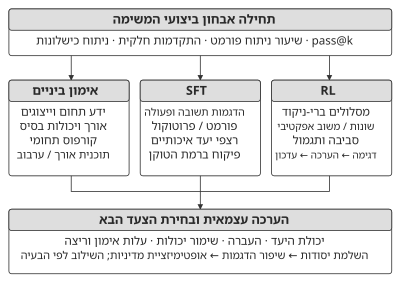

טבלה 8-4 קריטריונים לבחירה בין אימון ביניים, ‏SFT ו‑RL

| התופעה שנצפתה | מה לבדוק תחילה | שיטות מועמדות | מוקד ההערכה בהמשך |
| --- | --- | --- | --- |
| שפת התחום, המושגים או הפעולות הבסיסיות חלשים, וגם דגימות רבות כמעט אינן מתקדמות | כיסוי הקורפוס ויכולות היסוד | אימון ביניים; ‏RAG לעובדות ניתנות לאחזור | משימות תחום, מערכי בדיקה ליכולות הכלליות ומסלולים נכונים חלקית |
| התוכן שמיש, אך הפורמט, הארגומנטים או הנוהל הקבוע אינם יציבים | הדגמות, ממשקים ואילוצים | ‏SFT, פענוח מוגבל או אימות כלים | הצלחת ניתוח, תוצאות המשימה והתנהגות התאוששות |
| המודל משלים את המשימה מדי פעם, אך שיעור ההצלחה נמוך או שהוא מרבה בעיקופים | איכות התגמול, חקירה והתפלגות המשימות | ‏RL | תועלת במשימה, שונות בתגמול, הכללה עצמאית ועלות |
| יש הדגמות או נתוני העדפה, אך סביבה אינטראקטיבית טרם נבנתה | כיסוי הנתונים הלא‑מקוונים ואופן האימות | ‏SFT, ‏RFT, אופטימיזציית העדפות לא‑מקוונת | איכות קו הבסיס, הטיית הנתונים והתועלת שבבניית סביבה |

אפשר להתקדם בארבעה צעדים. תחילה מבססים קו בסיס של פרומפט, הקשר, כלים ואילוצים. כששיטות אלה כבר עונות על דרישות המשימה, המחבר מעדיף להשאיר את הפתרון החיצוני הניתן לעריכה ולחסוך את עלויות התחזוקה של אימון, פריסה ורגרסיה. עובדות דינמיות מסופקות באמצעות אחזור וניהול גרסאות; רק שיפוטים מובלעים, דפוסי תפיסה והתנהגויות יציבות שיש ללמוד שוב ושוב שוקלים לשפר באמצעות אימון פרמטרים.

בצעד השני בוחנים על משימות מוחזקות הצלחה, התקדמות חלקית, תוצאות ניתוח וסוגי שגיאות. כשתצורת הדגימה קבועה, ‏Pass@1 ו‑Pass@k מראים האם למדיניות הנוכחית כבר יש נתיבים שאפשר לנצל; מסלולים כושלים עוזרים להבחין בין ידע חסר, משוב חסר ושגיאות תהליך.

בצעד השלישי מספקים הדגמות להתנהגויות שיש ללמוד. סכמת JSON, קריאות לכלים, שימוש במינוח, בקשות הבהרה והתאוששות — את כולם אפשר לכתוב כדגימות SFT, והידע הנדרש מסופק באמצעות קורפוס מתאים והקשר המשימה.

בצעד הרביעי מעריכים את תנאי המשוב ל‑RL. כשאפשר לייצר מועמדים ברי‑ניקוד, לתגמול יש כושר הבחנה והסביבה מאפשרת די אינטראקציה, אפשר להשוות את התועלת של אופטימיזציית מדיניות; כשהתגמול דליל מדי, שוקלים תחילה תוכנית לימודים, תגמולים חלקיים או מדיניות התחלתית מתאימה יותר.

בכל צעד, תוצאות ההערכה קובעות את ההשקעה הבאה: משימה שהפורמט שלה ברור אפשר לפרוס לאחר SFT, נקודת פתיחה חזקה יכולה לעבור ישירות ל‑RL, ולאחר המשך אימון תחומי אפשר גם לעשות שימוש חוזר ביכולות ההוראות הקיימות. בהמשך נשתמש במשימות חד‑סבביות כדי לראות באופן מוחשי את ההבדלים בהתנהגות שיוצרות למידה מהדגמות ולמידה מתגמול.

נחזור לבעיית ההזמנות שבמדריך הקריאה. מוסרים למודל את אותו תיאור כלי אמיתי כמות שהוא, ובודקים האם הוא כותב נכון את הארגומנטים. אם השדות בתיאור השתנו, מעדכנים תחילה את התיאור שזמין בזמן ריצה. אם משמעות השדות ברורה אך המודל ממלא שוב ושוב את טקסט המשתמש במקום מספר ההזמנה, אפשר לספק הדגמות SFT הכוללות שאילתה, בקשת הבהרה ומילוי ארגומנטים נכון. אם הוא כבר מצליח מדי פעם לסיים את הטיפול במלואו, וסדרי שאילתה שונים מובילים לשיעורי הצלחה ולעלויות שונים, מתקיימים התנאים להשוואה בין מסלולי מדיניות מרובים.

## למידת חיזוק חד‑סבבית: השוואה בין שינון להכללה

משימה חד‑סבבית מתחילה בקלט יחיד ומסתיימת כשהמודל מגיש תשובה ומקבל תגמול. המודל עדיין יכול להסיק בכמה צעדים בזמן ייצור התשובה, ומערכת האימון יכולה לתת לו לנסות שוב ושוב את אותה בעיה. הגבלת האינטראקציה לתשובה אחת מקלה עלינו לראות כיצד שיטת האימון משנה את התנהגות המודל. תחילה נשתמש ב‑AdaptThink כדי להראות כיצד מודל לומד להקצות תקציב חשיבה, ואחר כך ב‑GeneralPoints כדי להשוות את SFT ו‑RL כשהכללים והמראה החזותי משתנים.

מי שמבין כיצד אלגוריתם RL משתמש בתגמול כדי לעדכן את המודל יוכל לעקוב אחר תהליך האימון בניסויים שלהלן. רוב אימוני ה‑RL בפרק זה נשענים על **גרדיאנט המדיניות**. קחו כמה דגימות לאותה בעיה: המודל מייצר כמה תשובות, והתגמול של כל אחת מושווה לקו בסיס. תשובה הטובה מקו הבסיס מקבלת אות חיובי, והאימון מעלה את הסתברות ייצורה; תשובה הגרועה ממנו מקבלת אות שלילי, והסתברותה יורדת.

כדי שעדכון יחיד לא יוציא את המודל מהמסלול, אלגוריתם **PPO** המרכזי גוזם את הרווח הנוסף במטרת התחליף כשיחס ההסתברויות חורג מטווח מוגדר; גודל העדכון בפועל תלוי גם בקצב הלמידה ובמספר סבבי העדכון. "‏PPO עם רשת ערך" שבהמשך לומד הערכת ערך, משתמש בה כקו בסיס להשוואה ומחשב ממנה את היתרון של הפעולה בכל צעד. ‏**GRPO** משווה ישירות כמה תשובות לאותה בעיה ובונה את קו הבסיס מהתגמולים שבתוך הקבוצה, וכך חוסך את האימון של רשת ערך נפרדת.

הפסאודו‑קוד בסגנון פייתון שלהלן מחבר דגימה, תגמול, יתרון ועדכון פרמטרים, ומראה כיצד המידע עובר מצעד לצעד. אימון אמיתי דורש גם הגדרה של מקביליות הדגימה, רגולריזציית KL והאופטימייזר.

```python
for prompt in batch:
    group = [rollout(policy, env.reset(prompt)) for _ in range(G)]
    rewards = [verify(trajectory) for trajectory in group]
    advantages = normalize_within_group(rewards)       # GRPO baseline
    update(policy, group, advantages)
```

כיצד PPO מעדכן מדיניות בעזרת אצווה של מסלולים באורכים שונים? תחילה, בתוך כל מסלול, מחשבים מהסוף להתחלה את התשואה המהוונת של כל צעד. הצבירה נעצרת בסוף המסלול, כדי שהתגמול של הבעיה הבאה לא ייכנס לחישוב. אחר כך מאחדים את כל הפעולות שהמודל בחר בפועל בכל המסלולים, ומחשבים את ההפסד הממוצע על האצווה. להלן עדכון אחד, ללא סבבי המיני‑אצווה המרובים.[^ch8-ppo-method]

```python
states, actions, returns = [], [], []
for trajectory in rollouts:
    states.extend(trajectory.states)       # המצב שלפני כל בחירת פעולה
    actions.extend(trajectory.actions)     # תואם למצבים פריט אחר פריט
    returns.extend(discounted_returns(trajectory.rewards))

returns = tensor(returns)
values = value_model(states)
advantages = returns - stop_gradient(values)
ratio = exp(policy.log_prob(actions, given=states)
            - old_policy.log_prob(actions, given=states))
policy_loss = -mean(min(
    ratio * advantages,
    clip(ratio, 1 - epsilon, 1 + epsilon) * advantages
))
value_loss = mean((values - returns) ** 2)
update(policy, value_model, policy_loss + value_coef * value_loss)
```

ה"יחסי" ב‑GRPO נובע מכמה תשובות לאותה בעיה; ‏PPO שכאן משתמש ברשת ערך כדי להעריך את התשואה הצפויה מכל מצב. ‏`old_policy` היא המדיניות המוקפאת שייצרה את אצוות המסלולים הזו. נניח שהיתרון של פעולה מסוימת הוא 1, והמדיניות הנוכחית נותנת לה הסתברות גבוהה פי 1.4 מבזמן הדגימה; עם `epsilon = 0.2`, תרומת האיבר הזה למטרת התחליף היא `min(1.4, 1.2) = 1.2`. העלאה נוספת של הסתברות הפעולה כבר אינה מוסיפה רווח מהאיבר הזה.

אם היתרון הוא ‎−1, הכיוון מתהפך. כשיחס ההסתברויות כבר ירד ל‑0.6, הצבה באותה שורת קוד נותנת `min(-0.6, -0.8) = -0.8`, והורדה נוספת של ההסתברות אינה מוסיפה רווח. ולהפך, אם הפעולה הגרועה הזו דווקא נעשית שכיחה יותר והיחס עולה ל‑1.4, לקיחת הערך הקטן נותנת `min(-1.4, -1.2) = -1.4`: העלאת ההסתברות שלה עדיין גובה מחיר.

> **ניסוי 8-10 ★★: ‏AdaptThink — ללמוד "מתי לא לחשוב"**
>
> מודלי היסק פותרים בעיות לרוב בתהליך חשיבה ארוך. בבעיות פשוטות, תשובה ישירה חוסכת עלות ייצור. ‏AdaptThink מעמידה לרשות המודל שני מצבים, Thinking ו‑NoThinking: במודלים התומכים בפרוטוקול הזה, ‏NoThinking סוגר את קטע החשיבה באמצעות `<think></think>` ומייצר מיד את התשובה. מטרת האימון היא שהמודל יבחר תקציב חשיבה המתאים למשימה.
>
> לשיטה שני רכיבי ליבה. **מטרת אופטימיזציה מוגבלת** מעודדת את המודל להגדיל את שיעור השימוש ב‑NoThinking תוך שמירה על ביצועי המענה הכוללים; **דגימת חשיבות** מכווננת את יחס הדגימה בין שני המצבים, ומשקלים מתקנים את הפער בין התפלגות הדגימה למטרת האופטימיזציה. המודל ההתחלתי נוטה בדרך כלל ל‑Thinking, ורק הגדלה יזומה של דגימות NoThinking נותנת לאימון אות להשוואה בין שני המצבים. בעיית ההתנעה הקרה כאן פירושה, באופן ספציפי, מחסור בדגימות NoThinking בשלב המוקדם של האימון.
>
> הניסוי בספר רץ על 8 מעבדי H100 80GB. עד צעד 300 השתנה הדיוק ב‑MATH500 מ‑81.00% ל‑81.80%, ואורך התשובה הממוצע ירד מכ‑4,911 טוקנים ל‑1,577 טוקנים; הדיוק ב‑GSM8K עלה מ‑79.68% ל‑81.88%, והאורך ירד מכ‑1,025 טוקנים ל‑477 טוקנים; ‏AIME mean@16 השתנה מ‑31.46% ל‑31.04%, והאורך ירד מכ‑12,120 טוקנים ל‑6,402 טוקנים. אורך התשובות בשלוש הקבוצות קטן בכ‑68%, ‏53% ו‑47% בהתאמה.
>
> שיעורי ה‑NoThinking בשלושת מערכי הנתונים היו 83.80%, ‏84.15% ו‑56.25%. ב‑AIME שמר המודל יותר חישוב חשיבה, ואילו ב‑MATH500 וב‑GSM8K ענה ישירות לעיתים קרובות יותר. ב‑AIME2024 נדגמה כל בעיה 16 פעמים, ו‑mean@16 הוא שיעור ההצלחה הממוצע על פני 16 הניסיונות. בצעד 300 התשובה הממוצעת התקצרה כמעט בחצי, והדיוק ירד בכ‑0.42 נקודות אחוז.
>
> צעד 300 הוא אימות אחד באמצע האימון. הצוות תכנן 3,140 צעדים, אך ההרצה הופסקה בהמשך באופן חריג, ורשומת האימות האחרונה היא מצעד 410. בנקודה זו עמד הדיוק הממוצע ב‑AIME2024 על 31.88%, ואורך התשובה הממוצע על כ‑5,874 טוקנים.
>
> ‏AdaptThink משתלבת עם זיקוק פרומפט: הזיקוק צורב בפרמטרים הוראות ודפוסי פתרון שחוזרים על עצמם, ו‑AdaptThink לומדת כמה חישוב חשיבה להקצות לכל משימה. יחד הן משפיעות על איכות התשובה, על ההשהיה ועל העלות.

> **ניסוי 8-11 ★★: ‏GeneralPoints — השוואת "שינון והכללה" ב‑RL חד‑סבבית**
>
> ‏Chu ואחרים בדקו את יכולת ההכללה של מודלים במשחק הקלפים GeneralPoints, הדומה ל"משחק ה‑24"[^ch8-3]. משתמשים בכל אחד מהמספרים שעל ארבעת הקלפים פעם אחת בדיוק, ובעזרת חיבור, חיסור, כפל וחילוק מגיעים ל‑24. אם המודל אכן למד לפתור, האם יחשב נכון גם אחרי שכללי ערכי הקלפים או הסדרות משתנים? איור 8-12 מציג שני סוגי בעיות: ‏GP-L נותן את הקלפים כטקסט, ו‑GP-VL דורש מהמודל לקרוא אותם מתמונה.
>
> 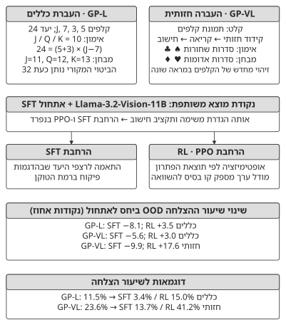
>
> **ווריאנט הכללים**: באימון J/Q/K נספרים כולם כ‑10, ובבדיקה כ‑11/12/13 בהתאמה. מערך הבדיקה מכיל לכן צירופי מספרים שלא הופיעו באימון, ובודק אם המודל מחשב לפי הכלל החדש עם 11, 12 ו‑13. **ווריאנט חזותי**: באימון משמשות סדרות שחורות (♠♣), ובבדיקה סדרות אדומות (♥♦), כדי לבדוק אם המודל מסתגל לשינוי במראה הקלפים.
>
> הניסוי מתחיל מ‑Llama-3.2-Vision-11B: תחילה SFT מבסס ציות בסיסי להוראות, ואחר כך האימון מתפצל לשני ענפים, המשך SFT ו‑RL, המושווים תחת אותו תקציב חישוב. ענף ה‑RL משתמש ב‑PPO עם רשת ערך. שני הענפים מאומנים בכלל J/Q/K=10, ומוערכים על מערכי בדיקה בתוך ההתפלגות (ID) ומחוצה לה (OOD).
>
> קחו את `[7, J, 3, 5]`: כש‑J=10 אפשר לכתוב `(J−7)×(5+3)=24`; כש‑J משתנה ל‑11, אותו ביטוי נותן 32, ויש לעבור ל‑`(11−5)×(7−3)=24`. אותה יד קלפים מחייבת אפוא את המודל לקרוא את הכלל הנוכחי ולבנות את החישוב מחדש.
>
> בבדיקות מחוץ להתפלגות נפער הבדל ברור בין שתי שיטות האימון. **‏OOD של כללים**: ב‑GP-L עלה שיעור ההצלחה של RL מ‑11.5% ל‑15.0%, תוספת של 3.5 נקודות אחוז; ‏SFT ירדה מ‑11.5% ל‑3.4%, ירידה של 8.1 נקודות אחוז. ב‑GP-VL הוסיפה RL ‏3.0 נקודות אחוז, ו‑SFT איבדה 5.6 נקודות אחוז. **‏OOD חזותי**: ב‑GP-VL עלתה RL מ‑23.6% ל‑41.2%, תוספת של 17.6 נקודות אחוז; ‏SFT ירדה מ‑23.6% ל‑13.7%, ירידה של 9.9 נקודות אחוז.
>
> בדיקה של תוצאות זיהוי הקלפים קושרת את הביצועים הסופיים לתפיסה החזותית: בענף ה‑RL דיוק הזיהוי עלה יחד עם שיעור ההצלחה במשימה, ובענף ה‑SFT הוא ירד. המחקר קושר את ההבדל הזה למטרת האימון: התאמה טוקן אחר טוקן עלולה לחזק את דפוסי הטקסט שבהדגמות, ואילו תגמול על תוצאה דורש שוב ושוב מהמודל לקרוא את הקלפים נכון ולהשלים את החישוב. דיוק התפיסה משמש מדד ביניים לניתוח המנגנון הזה.
>
> הסיבה להתחיל ב‑SFT מתבהרת גם מפורמט הפלט. מודל הבסיס Llama-3.2-Vision-11B שבניסוי לא הצליח לייצר באופן יציב את הפלט המובנה הנדרש, המאמת לא יכול היה לחשב ממנו תגמול, ולכן הניסיון להריץ RL מקצה לקצה ישירות נכשל. ‏SFT מבססת תחילה פלט שניתן לנתח ולנקד, ורק אז RL יכולה לנצל את משוב המשימה. ‏DeepSeek-R1-Zero שהוזכר קודם, לעומת זאת, יצא ממודל בסיס שכבר ייצר תשובות ברות‑ניקוד, ונכנס ישירות ל‑RL.
>
> כמה יכול המודל ללמוד ממשוב המאמת? איור 10 במאמר משווה בנפרד את משימת הקלפים הטקסטואלית (GP-L). החוקרים הגדירו 1, 3, 5 ו‑10 איטרציות אימות, ואימנו והעריכו מודל RL לכל אחת. תחת אותו תקציב חישוב לאימון, הקבוצה שהורשתה 10 אימותים שיפרה את שיעור ההצלחה בכלל החדש ב‑5.99 נקודות אחוז מעבר לנקודת הפתיחה שלה, והקבוצה שאומתה פעם אחת בלבד שיפרה אותו ב‑0.48 נקודות אחוז.
>
> מדוע תחת הסטת ההתפלגות של ניסוי זה SFT נסוגה ו‑RL הצליחה יותר? הסבר אחד העקבי עם התצפיות: נתוני ה‑SFT המוגבלים חיזקו את הדפוס הקבוע "‏J/Q/K נחשבים 10"; בבדיקה J=11, והמודל עדיין חישב לפי 10. ענף ה‑RL, המכוון לתוצאה, נטה יותר לחזק את האסטרטגיה "לחשב מחדש עד שמתקבלת התשובה הנכונה", ולכן יכול היה ליישם אותה גם כש‑J הפך ל‑11.
>
> השינויים בכללים ובסדרות ב‑GeneralPoints מאפשרים לבדוק בנפרד אם המודל למד לחשב לפי תנאים חדשים ואם הוא קורא נכון קלט חזותי חדש. עם המודל, נתוני האימון ותקציב הבדיקה שכאן, הענף שהמשיך ב‑SFT נסוג בבדיקות מחוץ להתפלגות, והענף שעבר ל‑RL השתפר. לפני שמחילים את המסקנה על משימה משלכם, כדאי לשאול: האם התלמיד כבר שולט בפורמט הפלט? האם הבדיקה החדשה שינתה את הכללים, את מראה הקלט, או את שניהם? רק השוואה נפרדת לכל אחד מהם תגלה אם צריך להוסיף הדגמות, לשפר את התפיסה או להגדיל את החקירה עם משוב על התוצאה.

## אלגוריתמי RL: מ‑16 רולאאוטים לעדכון פרמטרים אחד

‏**GRPO (‏Group Relative Policy Optimization)**, שהוצע על ידי DeepSeek, בונה את אות הלמידה מהביצועים היחסיים של כמה ניסיונות לאותה בעיה. קחו משימת תיקון קוד בסגנון SWE-bench: בפרויקט פייתון, הקובץ `parser.py` זורק `IndexError` על קלט ריק, והסוכן צריך לתקן את המימוש בלי לשנות את קובצי הבדיקות. איטרציית אימון אחת מתחלקת לארבעה צעדים.

**צעד 1: לתת למודל המדיניות לנסות שוב ושוב.** מודל המדיניות הוא מודל השפה שעובר אימון. המערכת מכניסה את אותו קוד התחלתי ואת אותו תיאור בעיה ל‑16 ארגזי חול מבודדים, ונותנת למודל לבצע את המשימה 16 פעמים באופן עצמאי. כל ניסיון מתחיל בקריאת הקוד, עובר דרך עריכה והרצת בדיקות, ומסתיים בהגשת התוצאה; מסלול האינטראקציה השלם הזה נקרא **רולאאוט** אחד. הדגימה האקראית מובילה מאותה נקודת פתיחה לנתיבים שונים: יש שמוסיפים את בדיקת הגבול החסרה, יש שרק תופסים את החריגה, יש שעורכים את הקובץ הלא נכון, ויש שמנסים לשנות את הבדיקות.

**צעד 2: חישוב התגמול.** בסוף כל רולאאוט, מאמת מחיל את הטלאי בסביבה נקייה ומריץ את הבדיקות. נניח ש‑4 מתוך 16 הניסיונות עוברים את כל הבדיקות בלי לגעת בקובצי הבדיקות, ו‑12 האחרים נכשלים; אז 4 המסלולים המוצלחים מקבלים תגמול 1, ו‑12 האחרים תגמול 0. איור 8-13 מרכז את הציונים של 16 המסלולים בטבלה אחת. במשימות קוד כאלה אפשר לחשב את התגמול ישירות מבדיקות ומכללים. למטרות שקשה לכתוב עבורן בדיקה, כגון קריאוּת או איכות הסבר, אפשר לשלב הערכה אנושית או מודל תגמול.

**צעד 3: חישוב היתרון היחסי.** התגמול אומר רק אם מסלול יחיד הצליח או נכשל; ה**יתרון היחסי** אומר כמה הוא טוב ביחס לשאר הניסיונות בקבוצה. שיעור ההצלחה הממוצע בקבוצה זו הוא 4/16: ‏4 המסלולים שעברו את הבדיקות נמצאים מעל ממוצע הקבוצה ומקבלים יתרון חיובי; ‏12 הכושלים נמצאים מתחתיו ומקבלים יתרון שלילי. בנרמול לפי סטיית התקן של הקבוצה, ממוצע התגמול הוא 0.25 וסטיית התקן כ‑0.433, ולכן היתרון של מסלול מוצלח הוא כ‑1.73 ושל מסלול כושל כ‑‎−0.58. ‏GRPO בונה את אות הלמידה מהשוואות תוך‑קבוצתיות מהסוג הזה. אם כל 16 התגמולים זהים, הפחתת ממוצע הקבוצה מכל אחד מהם נותנת אפס. איבר ייצוב קטן במכנה מונע חלוקה באפס, אבל גם אחרי הנרמול תגמולי התוצאה של קבוצה זו אינם מראים לאימון לאיזה מסלול לנטות. במצב כזה כדאי לבדוק אם אילוצי נתיב, תגמולי תהליך או התקדמות חלקית יכולים להבחין בין המסלולים בקבוצה. למשל, משני ניסיונות שלא תיקנו את הקוד, רק אחד עבר את בדיקת הגבול שנכשלה קודם. אם אפשר לאמת את תוצאת הביניים הזו באופן עצמאי, נוסף רמז שאולי ישמש ללמידה.

**צעד 4: עדכון המדיניות באמצעות ירידת גרדיאנט.** תוכנית האימון ממירה את היתרונות היחסיים להפסד אימון, מחשבת גרדיאנטים, והאופטימייזר (למשל AdamW או Muon) מבצע ירידת גרדיאנט: ההסתברות של הבחירות שהמודל עשה במסלולים בעלי יתרון חיובי עולה, וזו של הבחירות במסלולים בעלי יתרון שלילי יורדת. האימון חוזר ומכוונן את ההסתברויות האלה על פני משימות ורולאאוטים רבים. כשהאופטימיזציה מתחילה לעבוד, מול באג דומה יופיע בקלות רבה יותר הרצף "לשחזר את הבעיה, לבדוק את תנאי הגבול, לשנות את המימוש ולהריץ את הבדיקות", והרצף "להסתיר את החריגה, לשנות את הבדיקות, להגיש בלי אימות" יופיע פחות.

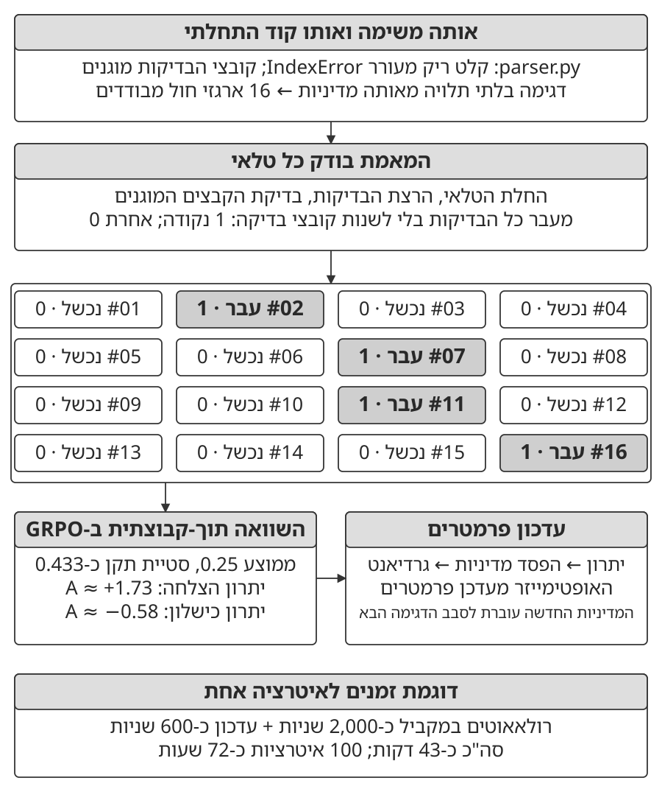

באיור 8-13 אותה בעיה נדגמת 16 פעמים. כמה **איטרציות אימון (step)** זה? לפי הספירה בסעיף זה, ‏16 הרולאאוטים שייכים לאותה אצווה. בסבב $k$ דוגמים במדיניות הנוכחית, מחשבים תגמולים, יתרונות וגרדיאנטים, ומעדכנים את המדיניות פעם אחת; רק בסבב $k+1$ דוגמים מחדש בפרמטרים החדשים. אימון של 100 steps פירושו כ‑100 סבבים של איטרציה כזו.

מכאן אפשר להעריך את זמן האימון. משימה מורכבת יכולה לכלול עשרות סבבי קריאה לכלים; באימון סינכרוני, הממתין לאצווה כולה, המסלול האיטי מבין 16 המסלולים המקביליים קובע מתי שלב הדגימה מסתיים. נניח שהוא אורך כ‑2,000 שניות, וחישוב הגרדיאנט ועדכון האופטימייזר עוד 600 שניות; אז step אחד אורך כ‑$2{,}000+600=2{,}600$ שניות, כלומר 43 דקות. ‏100 steps רצופים באותו קצב יימשכו כ‑72 שעות.

‏PPO ו‑GRPO עוקבים שניהם אחר הלולאה הזו, והם נבדלים בעיקר ב"מול מה משווים". ‏GRPO משווה ישירות כמה רולאאוטים של אותה בעיה ואינה זקוקה למודל ערך נוסף; ‏PPO מאמנת מודל ערך המעריך בכל צעד של המסלול "כמה טוב מצליחים בדרך כלל", ואז שופטת אם הפעולה הנוכחית טובה מהציפייה הזו, וכך מספקת את קו הבסיס הדרוש לייחוס קרדיט צעד אחר צעד. שתיהן מרסנות עדכונים גדולים מדי באמצעות מנגנונים כגון גזימת מטרת התחליף. ‏DPO שונה: היא לומדת ישירות מזוגות העדפה "תשובה טובה יותר — תשובה גרועה יותר" שנאספו מראש, ואינה נותנת למדיניות הנוכחית לייצר את קבוצת הרולאאוטים באופן מקוון.

המקרים בפרק זה משתמשים במתכוני אימון שונים: ‏AdaptThink משתמשת במטרה מוגבלת מותאמת; ‏GeneralPoints, ‏V-IRL ו‑ReTool משתמשים ב‑PPO, ובשני הראשונים מודל הערך משתתף בהערכת היתרון; ‏SimpleVLA-RL ו‑RLVP משתמשים ב‑GRPO.

נניח שבעיות א' ו‑ב' נוסו ארבע פעמים כל אחת: בא' כל הניסיונות הצליחו, ובב' כולם נכשלו. ארבעת התגמולים של א' הם 1, וארבעת התגמולים של ב' הם 0. אחרי הפחתת ממוצע הקבוצה, היתרונות בשתי הקבוצות הם 0. אבל אם נשאר חישוב לעוד כמה ניסיונות, באיזו בעיה סביר יותר שנקבל דגימות אימון שימושיות?

‏Never Give Up מכניסה את הבחירה הזו לתהליך הדגימה. בעיה א' הצליחה כולה, ולכן הקבוצה שלה מדולגת; בעיה ב' נכשלה כולה, ולכן בהסתברות מסוימת נוספת לה קבוצה. נניח שבקבוצה השנייה ניסיון אחד סוף‑סוף מצליח: האימון מאחד את שתי הקבוצות, שמונה תשובות בסך הכול — פתרון נכון אחד ושבעה שגויים — וכעת לאותה בעיה יש תגמולים שונים. הדגימה האסינכרונית מאפשרת לשאר הבעיות להתקדם כרגיל, בלי להמתין לתוצאה של ב'.[^ch8-ngu]

[^ch8-ngu]: ‏Michael Noukhovitch ואחרים, *Learning to Solve Hard Problems in RL for LLMs by Never Giving Up*, ‏2026. הדגימה הנוספת במאמר משמשת לאימון; בעיות שכבר נפתרו עדיין יכולות להידגם שוב בהמשך האימון.

### מדוע RL של LLM מעדיפה בדרך כלל On-Policy

‏**Online (מקוון)** ו‑**On-policy** מתארים שני היבטים שונים. אימון מקוון מקיים אינטראקציה רציפה עם הסביבה ומייצר נתונים תוך כדי ריצה; אימון on-policy עוסק במקור הנתונים, ודורש שמדיניות ההתנהגות $\mu$ המייצרת את המסלולים תהיה זהה, או קרובה מספיק, למדיניות $\pi_\theta$ שעוברת אופטימיזציה. אשכול אסינכרוני יכול לדגום באופן מקוון ברציפות, אבל worker שמפגר בכמה נקודות בדיקה מחזיר נתונים מיושנים, וכך נוצר רכיב off-policy.

המחבר ממליץ לבסס תחילה קו בסיס יציב באימון קרוב ל‑on-policy, ורק אחר כך, לשם תפוקה, להוסיף דגימה אסינכרונית או שימוש חוזר בנתונים ישנים. מתכוני ה‑PPO/GRPO בפרק זה דוגמים בדרך כלל במדיניות העדכנית בתחילת כל step. לאחר מכן PPO מבצע כמה סבבי מיני‑אצווה על אותה אצווה, והמדיניות הנוכחית מתרחקת בהדרגה מה‑`old_policy` שייצרה את הנתונים. יחס ההסתברויות מודד את השינוי הזה, ומטרת הגזימה מרסנת עדכונים גדולים מדי.

מטרת גרדיאנט המדיניות קשורה לתגמול הצפוי תחת המדיניות הנוכחית $\pi_\theta$. כשמשתמשים בנתונים שנדגמו במדיניות ההתנהגות $\mu$, אפשר לחשב תחילה את יחס ההסתברויות של הפעולה באותו מצב, ולבנות ממנו תיקון חשיבות:

$$
\rho_t=\frac{\pi_\theta(a_t\mid s_t)}{\mu(a_t\mid s_t)}
=\exp\left(\log\pi_\theta(a_t\mid s_t)-\log\mu(a_t\mid s_t)\right).
$$

נניח שאחרי אותה קידומת, מדיניות הדגימה בחרה טוקן מסוים בהסתברות 0.2, והמדיניות הנוכחית נותנת לו 0.3; יחס ההסתברויות בצעד הזה הוא 1.5. הטוקן הזה הופיע בדגימות הישנות בתדירות נמוכה מדי, ולכן בהערכה לפי המדיניות הנוכחית משקלן של דגימות כאלה עולה בהתאם. אם הדגימה והאימון משתמשים באותה מדיניות, לפני עדכון הפרמטרים יחס ההסתברויות בכל צעד הוא 1.

שימוש חוזר במסלולים ישנים מאפשר להריץ את הדגימה ואת האימון אסינכרונית ומעלה את התפוקה. אבל ככל ששתי המדיניות רחוקות יותר זו מזו, גדל הסיכוי שמעט דגימות יקבלו משקל עצום. כשמשקללים מחדש מסלול שלם, יחסי הצעדים גם מוכפלים זה בזה. ‏PPO גוזמת חלק מהרווח הנוסף במטרת התחליף של כל פעולה, וכך מחלישה את השפעתם של יחסים קיצוניים; מצבים שהדגימות הישנות מעולם לא הגיעו אליהם אפשר לראות רק בדגימה חדשה. זו גם הסיבה שהמחבר נוטה להעדיף מסלולים טריים.[^ch8-32]

#### הבדלים נומריים בין אימון להסקה

‏RL בקנה מידה גדול על LLM דוגמת בדרך כלל במנועי הסקה כגון vLLM ו‑SGLang, ומחשבת log probabilities וגרדיאנטים במערכות אימון כגון FSDP ו‑Megatron. גם כששני הצדדים טוענים את אותם משקלים, הבדלים בדיוק הנקודה הצפה, בסדר הרדוקציה, במקבול הטנזורי, בגודל האצווה, ב‑KV Cache ובגרעינים המאוחדים (fused kernels) עלולים להניב log probability שונה במקצת לאותו טוקן. כך, עוד לפני שהפרמטרים עודכנו, $\rho_t$ כבר סוטה מ‑1, ובין האימון לדגימה נוצר פער מדיניות ברמה הנומרית. ניסויים מבוקרים מצאו שגם הבדל זעיר ברמת הטוקן עלול לגרום לקריסת האימון.[^ch8-33]

כשהתפלגות הדגימה משתנה, גרדיאנט מדיניות נאיבי עלול להעדיף אחת משתי פעולות גם כשהתגמול שלהן זהה לחלוטין. נניח שבזמן הדגימה ל‑A ול‑B היה סיכוי שווה, ובזמן האימון ההסתברות שהמודל יבחר ב‑A כבר עלתה ל‑0.8. עבור ה‑logit השולט ב‑A, כשנבחרת A הגרדיאנט של log probability הוא $1-0.8=0.2$; כשנבחרת B הוא $0-0.8=-0.8$. אם שתי הפעולות מקבלות ציון 1, הממוצע לפי הסתברויות הדגימה נותן גרדיאנט של $-0.3$. לשתי הבחירות אותו ציון, ובכל זאת העדכון מוריד את ההסתברות של A.

‏Score centering מפחית מהגרדיאנט של log probability תחת אותה קידומת את הממוצע שלו לפי התפלגות הדגימה. בדוגמה, אחרי הפחתת $-0.3$ שני האיברים הופכים ל‑$0.5$ ול‑$-0.5$, ותגמול זהה מניב עדכון ממוצע של אפס בדיוק. ‏GRPO שלעיל מפחית את הממוצע מהתגמולים של קבוצת תשובות; כאן מה שממורכז הוא הגרדיאנט.[^ch8-sc]

[^ch8-sc]: ‏Martin Marek, ‏Max Ryabinin, *Score Centering Stabilizes Off-policy Reinforcement Learning*, ‏2026. כשמדיניות הדגימה מפגרת רחוק מדי, אפשר גם להשתמש ברגולריזציית KL כדי להגביל את המרחק בין מדיניות האימון למדיניות ההתנהגות (arXiv:2611.21791).

שגיאות נומריות בין צד האימון לצד הדגימה גם מוגברות לאורך רצפים ארוכים: **שגיאה ב‑log probability ← סטייה ביחס ההסתברויות ← הצטברות לאורך קידומת ארוכה ← שינוי בגזימה ובשקלול היתרון ← שינוי בגרדיאנט ובמספר הדגימות האפקטיבי**. למשל, אם ל‑log ratio של 4,000 טוקנים יש כולם סטייה של $10^{-3}$ באותו כיוון, היחס המחושב ברמת המסלול יהיה גדול מהערך האמיתי פי $e^{4000\times0.001}=e^4\approx54.6$.

שינוי הסתברות מוקדם עלול גם לשנות את תוצאת הדגימה, כך שהמצבים הבאים יתפתחו בנתיב אחר. אותות שאפשר לראות באימון כוללים קפיצות ביחסי החשיבות, עלייה בשיעור הגזימה, שינויים חדים בגרדיאנט או באורך התשובה, וירידה בתגמול ובאנטרופיה. כשגודל האצווה משנה את תהליך הרדוקציה, גם התוצאה הנומרית לאותו קלט עלולה להשתנות, כלומר אינווריאנטיות האצווה (batch invariance) נשברת. מחקרים קשורים זיהו את אפקט ה‑off-policy הסמוי שנוצר מכך, ושיפרו את היציבות באמצעות התאמת החישוב בין דגימה לאימון או תיקון מפורש של פער המדיניות.[^ch8-34]

לכן המחבר מציב את העקביות הנומרית בין דגימה לאימון בין הבדיקות המרכזיות לפני תחילת האימון, ומנטר אותה ברציפות לצד עקומת התגמול. אפשר לטפל בכך בארבעה צעדים — "למדוד את הפער, להתאים את התצורה, לתקן את ההטיה, לשלוט בהתיישנות":

- **לפני כל עדכון פרמטרים**, השוו על אותה אצוות מסלולים את הסתברויות הלוג של הטוקנים שמחזירים צד הדגימה (sampler) וצד האימון (trainer), ונטרו את הממוצע, האחוזונים, המקסימום, ה‑KL המקורב ושיעור הגזימה של $\rho_t$; זהו מבחן היחידה הישיר ביותר ל‑on-policy.
- בסנכרון המשקלים, התאימו גם את מתאם ה‑LoRA, הטוקנייזר, תבנית השיחה, גרסת המודל ותצורת קידוד המיקום. הרולאאוט צריך לשמור את log probabilities שנתנה מדיניות הדגימה בזמן הייצור, ולחשב מהן בהמשך את יחס ההסתברויות.
- התאימו ככל האפשר את הדיוק, פריסת המקבול וגרעיני החישוב המרכזיים בין דגימה לאימון; אם אי אפשר, התייחסו להבדל במפורש כאל off-policy, החילו תיקון חשיבות, נטרו את מספר הדגימות האפקטיבי, והעריכו את אפקטיביות התיקון גם לפי שיעור הגזימה.
- דגמו מחדש בזמן במדיניות המעודכנת, והגבילו את מספר סבבי העדכון על כל אצוות נתונים ואת מספר נקודות הבדיקה שהדגימה האסינכרונית מפגרת אחרי האימון.

## סביבות RL: מהערכה לסימולציה

אימון RL של סוכן דורש לבצע משימות שוב ושוב. תיקון קוד אפשר לנסות שוב בעותק מבודד, אבל תשלום משנה את מצב החשבון האמיתי. סביבת האימון צריכה לספק מצב התחלתי בר‑איפוס, עותקי משימה מקביליים ותוצאות ברות‑אימות, כדי שהמודל יחקור נתיבים שונים בתנאים מבוקרים. פרק 7 כבר הציג סביבות הערכה; לשימוש באימון יש להביא בחשבון גם ריצה ממושכת, תופעות לוואי של פעולות ואת העלות של כמות אינטראקציות גדולה. המחבר מקצה תחילה כוח אדם ותקציב לבניית הסביבה, ורק אחר כך מתכנן אימון בקנה מידה גדול. מימוש משוב אמיתי, איפוס מצב ובידוד מקבילי צורך לעיתים קרובות יותר משאבים הנדסיים מחיבור PPO או GRPO, ועלות בניית הסביבה עשויה לעלות על עלות האימון עצמו.

### הסביבה: מגרש האימונים של המודל

הסביבה מעדכנת את המצב בהתאם לפעולה ומחזירה למודל תצפית חדשה. בבניית סביבה כדאי להתחיל משלוש שאלות.

- **האם האינטראקציה קרובה לתרחיש הפריסה?** סימולטור שירות לקוחות צריך לכסות משתמשים המוסיפים מידע, משנים את בקשתם ומתבטאים בעמימות; סימולטור כלים צריך להחזיר את השגיאות וההשהיות הנפוצות בייצור. מהמשוב הזה המודל לומד להתמודד עם בעיות אמיתיות. משוב חד‑גוני מדי גורם למדיניות להיסמך על תבניות קבועות של הסימולציה.
- **האם אפשר לנסות את המשימה שוב באופן יציב ולהריץ אותה במקביל?** כל רולאאוט זקוק למצב עצמאי של הזמנה, קובץ או חשבון, שאפשר לנקות ולשחזר בסופו. ארגז החול של מפרש הקוד ב‑ReTool וארגז החול MCP ב‑AWorld ממלאים שניהם תפקיד כזה. ל‑API אמיתיים עם מגבלות קצב, עלויות או תופעות לוואי של כתיבה, אפשר להשתמש לפי צורכי המשימה בחשבונות ארגז חול, בנתונים מוקלטים להשמעה חוזרת או בממשקים מדומים.
- **כיצד נקבעת התוצאה?** מצב הסביבה הוא בסיס חשוב לחישוב התגמול. למשל, במשימת החזר כספי אפשר לבדוק את הסכום, את מצב ההזמנה ואת תנאי ההרשאה; במשימת קוד אפשר להריץ בדיקות. עיצוב התגמול יידון בנפרד בהמשך.

**לפני שמכווננים אלגוריתמים, המחבר ממליץ לבדוק תחילה: האם הסביבה המדומה קרובה מספיק למשימה האמיתית? שאלה זו חשובה יותר מהבחירה בין PPO ל‑GRPO.** נאמנות, יכולת איפוס ויכולת אימות קובעות יחד מה המודל יכול ללמוד מהאינטראקציה. קל יותר בדרך כלל לאתר בעיות כשמריצים תחילה את שלושת הרכיבים האלה על מעט משימות, ורק אחר כך מגדילים את היקף האימון.

### שימוש במודל לדימוי כלים וסביבות

תוצאות חיפוש, שיחות עם משתמשים ומצב עסקי מורכב אפשר לסנתז בעזרת מודל. סימולטור מבוסס מודל מקבל את פעולת הסוכן ומייצר את המשוב הבא, ומפחית את התלות בשירותים חיצוניים בזמן אמת. הגישה הזו מתרחבת מכלי בודד ועד סביבת משימה שלמה.

**רמה ראשונה: סינתזה של ערכי ההחזרה של כלים.** ‏ZeroSearch[^ch8-13] נותנת ל‑LLM לשחק את מנוע החיפוש: התלמיד שולח שאילתה, והסימולטור מייצר תוצאות אחזור. כך פוחתת התלות של האימון בעלויות, במגבלות הקצב ובתנודתיות התוצאות של API חיפוש אמיתי. היא משתמשת גם בתוכנית לימודים (curriculum): בתחילה מוחזרים מסמכים איכותיים ורלוונטיים מאוד, ובהמשך נוסף רעש בהדרגה, כדי שהתלמיד יתרגל לחלץ מידע שימושי מחומר בלתי מושלם. במחקר, מודל שאומן בסביבת החיפוש המדומה המשיך להשיג תוצאות טובות כשחובר למנוע חיפוש אמיתי.

**רמה שנייה: דימוי מעברי המצב של הסביבה.** ‏DreamGym[^ch8-14] מזקקת את דינמיקת הסביבה לכדי מודל התנסות מבוסס היסק. המודל קורא את המצב הנוכחי ואת פעולת הסוכן, מסיק את המצב הבא ואת המשוב, ומייצר בכמות מסלולי אינטראקציה ל‑RL מקוונת, וכך מצמצם את הגישה לסביבה האמיתית. במשימות שירות לקוחות ומכירות אפשר גם לתת ל‑LLM לשחק את המשתמש ולדמות שאלות המשך, השלמת מידע ושינויי בקשה. סדרת τ-bench משתמשת בסימולטור משתמש; מסגרת אינטראקציה דומה יכולה לשמש גם לאימון, ולמלא בנפרד את תפקיד מגרש התרגול ואת תפקיד ההערכה.

גם סימולטור מבוסס מודל זקוק לכיול. אם סימולטור שירות הלקוחות מבין תמיד במדויק שאלות עמומות, למדיניות אין הזדמנות לתרגל בקשות הבהרה; אם סימולטור החיפוש מחזיר תמיד את המסמך הנכון, למדיניות אין ניסיון בזיהוי רעש. האימון עלול גם לחזק התנהגויות המנצלות פגמים בניקוד של הסימולטור. המחבר ממליץ על גישה היברידית: סימולציית המודל נושאת את רוב האינטראקציות, משימות בסביבה האמיתית בודקות מעת לעת את ביצועי המדיניות, והפערים שמתגלים מוזנים חזרה לסימולטור. כך נוצר תהליך איטרטיבי של "אינטראקציה סינתטית — הערכה על משימות אמיתיות — תיקון הסימולטור".

איך יודעים שהסימולטור באמת מלמד שימוש בכלים? אפשר לערוך בדיקה קטנה: על אותה הזמנה התחלתית, לשאול, לשלוח שינוי ולשאול שוב, ולבדוק אם שדות ההזמנה שהוחזרו השתנו כמצופה בעקבות הפעולה. אחר כך לאפס את הסביבה ולוודא שהערכים המקוריים חוזרים. סביבה שיודעת רק לייצר "שונה" שנשמע סביר, אך אינה מראה את השינוי בשאילתה הבאה, מתגמלת מדיניות שיודעת לדבר, גם אם מעולם לא שינתה את ההזמנה.

### סביבות, התפלגות משימות ובידוד הערכה

סביבת האימון קובעת מה המודל יכול לחוות. מצב בר‑איפוס מאפשר ניסיונות חוזרים, עותקים מבודדים מאפשרים מקביליות, וכללי מצב ואימות מפורשים מאפשרים שחזור וניקוד. את המשימות אפשר לבנות בשיטות סינתזת הנתונים שתוארו קודם: לחלץ תבניות משימה מיומני עסקים אמיתיים, להסיר מידע מזהה, ולייצר מחדש אנשים, הזמנות, קבצים ומצבים התחלתיים בדיוניים.

האימון וההערכה יכולים לחלוק את מחולל המשימות ואת קוד האימות, אך המשימות עצמן צריכות להתחלק לקבוצות נפרדות. בהשראת עיצוב הסביבות של SWE-Gym, ‏τ²-bench ו‑AndroidWorld[^ch8-28], בדיקות הקבלה, המצב החבוי הדרוש לניקוד ופתרונות הייחוס נשמרים בצד המאמת, והסוכן מקבל תצפיות דרך הממשק שהמשימה מגדירה. לפני הגדלת הדגימה, בדקו במספר קטן של רולאאוטים אם המשימה ניתנת להשלמה ואם המאמת מבחין בין תוצאות תקפות לבלתי תקפות. גילוי מוקדם של הטיות ניקוד מצמצם את ההזדמנויות של המדיניות לנצל פרצות באימות.

לכן סדר הנדסת הסביבה הוא: **תבנית משימה ← סביבה ברת‑איפוס ← אימות תוצאות ← בידוד אימון/הערכה ← כיול מול אינטראקציה אמיתית**. סינתזת הנתונים שתוארה קודם מסננת מסלולים תקפים מתוך הסביבות האלה ויוצרת מהם הדגמות SFT. בשלב ה‑RL המדיניות הנוכחית ממשיכה לנסות ולטעות בסביבה, וחוקרת נתיבים שמעבר להדגמות.

גם האימות צריך להיכלל בתקציב התפוקה. גרעין Lean, מריצי בדיקות והרצת מכולות צורכים CPU וזיכרון. כשמהירות הייצור ב‑GPU עולה על מהירות האימות, משימות מצטברות בתור האימות. במצב כזה יש להוסיף workers לאימות, לקצר את השהיית האימות, או לשנות את חלוקת המשאבים בין ייצור לאימות[^ch8-9].

## מחד‑סבבי לרב‑סבבי: תרחישי משימה וייחוס קרדיט

### אתגר הליבה של משימות רב‑סבביות

באיור 8-14, בצד שמאל משחקים ב"24". המודל יכול לגזור כמה צעדים בתשובתו, אך כל הצעדים האלה משתמשים בארבעת הקלפים שניתנו בשאלה, ובאמצע אין תצפית חדשה מהסביבה. בצד ימין ניווט ברחוב. רק אחרי שהגענו לצומת ובחרנו לפנות שמאלה, אפשר לראות את הרחוב שאליו פנינו. כיצד להמשיך מכאן נקבע מחדש לפי השלטים שלפנינו. ה‑ReAct שתואר בפרקים 1 ו‑4 מסוגל לארגן אינטראקציה כזו: המודל בוחר פעולה, כלי או סביבה מבצעים אותה, ותצפית חדשה נכנסת לסבב קבלת ההחלטות הבא.

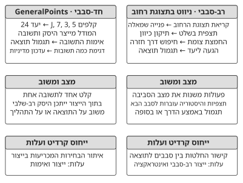

באיור 8-15 הסוכן מחמיץ את הפנייה בצעד 3, בצעד 4 מגלה שסטה מהדרך, מסתובב וחוזר, ובצעד 5 מגיע ליעד. תגמול היעד מאשר את הניווט כולו, אך אינו מבחין בין טעות בדרך לבין חזרה בזמן. בפעם הבאה שנגיע לצומת הזה, אנחנו רוצים שהסוכן יפנה נכון מיד; ואם בכל זאת טעה, עדיין כדאי לעודד אותו להסתובב. באימון יש להעריך את תרומתם של הצעדים הקודמים לתגמול הסופי, והבעיה הזו נקראת **ייחוס קרדיט (Credit Assignment)**. אומדן ערך ויתרון יכול להיעזר בתגמול שהתקבל בהמשך; כשאפשר לבדוק באופן מהימן גם פעולות ביניים, אפשר להוסיף תגמול תהליך. ההסתובבות בצעד 4 מקבלת 0 בתגמול התהליך, ועדיין תורמת להגעה ליעד. גם באומדן הערך של הצעד הזה יש להביא בחשבון את התגמול שהתקבל אחריו.

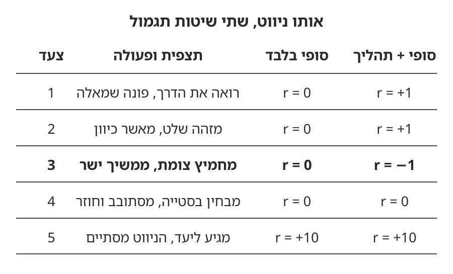

אותה בעיה עולה גם בשיחת שירות לקוחות. למשל, המשתמש נותן משוב חיובי בסבב ה‑10. השאלה בסבב 2, על איזה חיוב נסב המחלוקת, וההסבר על העמלה בסבב 7 — שני הצעדים עשויים לתרום. על סמך המשוב החיובי האחרון בלבד אי אפשר עדיין לקבוע מה היה חלקו של כל אחד מהם. שני הניסויים שלהלן דנים בשני מצבים: כשהמאמן יכול לבדוק את פעולות הניווט צעד אחר צעד, וכשהוא יכול להסיק אם הרובוט הצליח רק מתוצאת המשימה.

> **ניסוי 8-12 ★★★: ‏V-IRL-VL — ניווט חזותי רב‑סבבי**
>
> ב‑V-IRL[^ch8-24] הסוכן צריך להגיע ליעד צעד אחר צעד לפי מה שהוא רואה ברחוב. האימון משתמש במסלולים מניו יורק, והבדיקה עוברת לערים אחרות ומשנה גם את ניסוח ההוראות וגם את המראה החזותי. בשתי ההערכות מחוץ להתפלגות — זו של שינוי הכללים וזו של שינוי חזותי — ‏RL מציגה ביצועים טובים בבירור מ‑SFT. הניסוי משתמש ב‑PPO עם רשת ערך. משוב בכל צעד עוזר להבחין אילו החלטות במסלול ארוך כדאי לשמר.

> **ניסוי 8-13 ★★★: ‏SimpleVLA-RL — חקירה פתוחה תחת תגמול תוצאה `[ניסוי מורחב]`**
>
> ‏SimpleVLA-RL משתמשת בתגמול תוצאה של הצלחה או כישלון במשימות הרובוטיקה של LIBERO. כל משימה מקבלת מסלול הדגמה אחד להתנעת קרה ב‑SFT, ולאחר מכן RL מעלה את שיעור ההצלחה מ‑17.3% ל‑91.7% ומייצרת פעולת "pushcut" שלא הופיעה בהדגמות. כדאי להשוות את התוצאה הזו לניווט ברחוב: אם אפשר לקבוע היטב באיזה צעד נעשתה טעות, אפשר לתת משוב במקום ולהאיץ את הלמידה. אם עדיין לא ידוע אילו דרכים מובילות להשלמת המשימה, תגמול תוצאה משאיר למודל מרחב לנסות נתיבים אחרים. כתיבת סדר הפעולות מההדגמה האנושית כדרישת תגמול מוקדמת מדי עלולה להוריד את הציון של אסטרטגיות חדשות כמו "pushcut".

### קריאה לכלים: למידת שימוש ביכולות חיצוניות מתוך האינטראקציה

אחרי חיבור כלים חיצוניים המודל יכול לבחור לחפש, להריץ קוד, לערוך קבצים, לשאול בסיסי נתונים, או לשלב כמה API לפי צורכי המשימה. ה‑Harness מאמת ומתזמן את הקריאות, והכלים פועלים בסביבה ומחזירים תצפית. איור 8-16 מפריד בין קבלת ההחלטות בתוך המשימה לבין האימון שאחרי סיומה. לאורך החץ הימני חוזרת תוצאת הכלי אל המשימה הנוכחית, והמודל משתמש בה כדי להחליט על הצעד הבא. בקריאה כלפי מטה: רק אחרי שהמשימה הסתיימה, תוכנית האימון מחשבת את התגמול על המסלול כולו ומעדכנת את הפרמטרים, וסבב הדגימה הבא משתמש במדיניות החדשה. כשמשימה דורשת קריאות רצופות לכמה כלים, התוצאה של הקריאה הקודמת משפיעה על הפרמטרים של הקריאה הבאה.

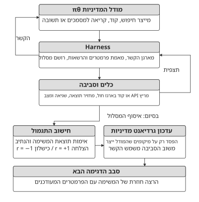

Search-R1[^ch8-25] מאמנת את המודל להחליט מתי לחפש ואיזו שאילתה לשלוח, ולהמשיך להסיק על סמך התוצאות. ReTool מחברת מפרש קוד לאותה לולאה, והמודל לומד לתזמן הרצת קוד, להבין את ערך ההחזרה ולתקן לפי הודעות שגיאה. AWorld-train מתרחבת לארגז חול מרובה כלים ב‑MCP, והמודל צריך לבחור כלי ולטפל בתלויות בין קריאות, בעוד מערכת האימון צריכה לדעת לאפס את הסביבה ולשחזר מסלולים.

במסלולי כלים יש להבחין בין טוקנים שהמודל ייצר לבין טוקנים שהסביבה החזירה. בחישוב הפסד המדיניות נכללים בהפסד רק הפעולות שהמודל ייצר — היסק, פרמטרי קריאה ותשובה — והמיקומים שמתאימים למשוב הסביבה ממוסכים. המשוב ממשיך להשתתף בחישוב כהקשר ועוזר למודל להחליט מה לעשות בצעד הבא. למשל, כשהמפרש מחזיר שגיאה, מה שהאימון צריך לחזק הוא האופן שבו המודל מתקן את הקוד לאחר מכן. אם גם טקסט השגיאה ייכלל בהפסד המדיניות, העדכון יקבל מטרה של "לייצר פלט סביבה", וזו סטייה מההחלטות שהמודל באמת אחראי להן.

> **ניסוי 8-14 ★★★: ‏ReTool — מפרש קוד משפר פתרון בעיות במתמטיקה**
>
> איור 8-17 מציג בעזרת משוואה ריבועית כיצד היסק טקסטואלי, ייצור קוד ומשוב מהמפרש מתחלפים זה בזה.
>
> 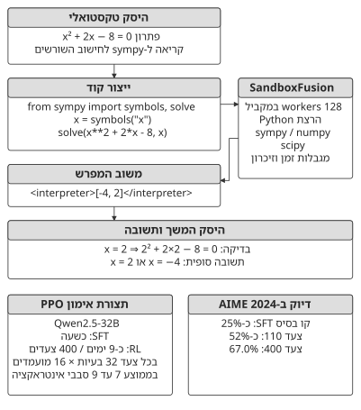
>
> אחרי חימום SFT, ‏ReTool מתאמנת ב‑PPO על שילוב של היסק טקסטואלי, הרצת קוד ומשוב מהמפרש. המודל לומד בהדרגה מתי כדאי להריץ קוד וכיצד לתקן לאחר שגיאה. נתוני האימון כאן הם DAPO-Math-17k, והעדכון עצמו משתמש ב‑PPO תקנית[^ch8-26][^ch8-27].
>
> לאחר האימון, הדיוק של המודל ב‑AIME 2024 עולה מכ‑25% ל‑67.0%. בהשוואה ל‑RL טקסטואלית טהורה, משוב הקוד מאפשר למודל ללמוד חישוב מדויק ותיקון שגיאות מהר יותר.

> **ניסוי 8-15 ★★★: ‏AWorld-train — למידת שימוש בכלים בארגז חול**
>
> הקפה אחת בחלק העליון של איור 8-18: המודל מקבל את התוצאה של קריאה לכלי ויכול להמשיך לנסות. הקפה נוספת בחלק התחתון: האצווה הזו כבר הסתיימה, תוכנית האימון קיבלה מסלולים עם תגמול ומעדכנת את הפרמטרים, ורק האצווה הבאה תשתמש במדיניות החדשה.
>
> 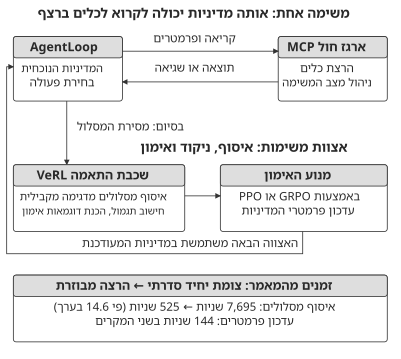
>
> סביבת GAIA כוללת 26 שרתי MCP ו‑126 פונקציות כלים, ומאפשרת להפעיל דפי אינטרנט ב‑Playwright, לחלץ תוכן מ‑PDF, ‏Word ומצגות, לתמלל אודיו, לזהות טקסט, או להריץ קוד בארגז חול של E2B. כלי ה‑Excel מציע 29 פעולות, ובהן נוסחאות, תרשימים וטבלאות ציר, ואחזור הידע ניגש גם ל‑Wikipedia, ‏arXiv ו‑Wayback. אחרי איפוס ארגז החול אפשר לנסות שוב מאותו מצב, או לשחזר מסלולים קודמים.
>
> זמני הריצה בתרשים נלקחו מההשוואה שתועדה במאמר. הניסוי הנלווה מספק גם תצורת אימון למודל 4B: ‏Qwen3-4B-Thinking-2507, שמונה כרטיסי A100, תקרת הקשר של 131K, עד 32 סיבובי אינטראקציה, גודל אצווה 32, 16 מסלולים לכל שאלה, עדכון ב‑GRPO וקצב למידה של 1e−6.

הכלי החזיר תוצאה — את איזה צעד צריך לתגמל תוכנית האימון? קריאה מוצלחת מלמדת רק שהכלי פעל כשורה. כדי לדעת אם הצעד קידם את המשימה, צריך להשתמש במאמת כדי לבדוק את השינוי שהוא יצר, ורק אז להחליט מה לתגמל.

## עיצוב תגמול: הפיכת מטרות משימה לאותות למידה

נניח ששני מסלולי החזר כספי מחזירים בסופו של דבר אותו סכום, אך אחד מהם דילג על אימות הזהות הנדרש. אם קוראים רק את היתרה הסופית, שניהם יקבלו אותו ציון. כדי להפוך את מלוא הדרישות שהמשתמש הפקיד בידי הסוכן לאות למידה, צריך תחילה לקבוע מי יכול לאמת את התוצאה, באיזה צעד אפשר להשיג ראיה, ואיזה מידע צריך לחזור למודל, ואז לבדוק אם אפשר לאמת בנפרד את מגבלות ההרשאה והתהליך שלאורך הנתיב.

### מהיכן מגיע התגמול: כללים, העדפה אנושית ושיפוט מודל

במשימות שאפשר לשפוט אוטומטית, המחבר מעדיף **למידת חיזוק עם תגמול בר‑אימות (RLVR)**, שבה דרישות הקבלה נכתבות ישירות כקוד. שאלת מתמטיקה ניתנת לבדיקה לפי התשובה, משימת קוד ניתנת לבדיקה בהרצת בדיקות, ומשימת החזר כספי ניתנת לבדיקה לפי הסכום וסטטוס ההזמנה בבסיס הנתונים. מעבר נרשם כ‑1 וכישלון כ‑0, וזהו תגמול התוצאה הפשוט ביותר. הכללים מפורשים וההרצה ניתנת לשחזור, ולכן קל לאתר הבדלי ניקוד; היקף הכיסוי של המאמת הוא שקובע מה האימון באמת מייעל.

**למידת חיזוק ממשוב אנושי (RLHF)** ממירה העדפות אנושיות לאות אימון. InstructGPT[^ch8-4] אוסף תחילה השוואות אנושיות בין תשובות, מאמן מודל תגמול, ואז מייעל את המדיניות ב‑PPO. מודל התגמול לומד את ההעדפות מתוך מדגם מוגבל, ומרדף מתמשך אחרי ציון מודל גבוה יותר עלול להעצים את ההטיה שלו[^ch8-5]. באימון נהוג להוסיף רגולריזציית KL מול מודל ייחוס של SFT, כדי להגביל את הסטת המדיניות. ‏DPO[^ch8-6] מנצלת ישירות זוגות העדפה מסוג "תשובה טובה יותר — תשובה גרועה יותר" לאופטימיזציה של המדיניות, ומייתרת את אימון מודל התגמול הנפרד.

במשימות פתוחות אפשר לתת למודל לנמק את ההערכה ולתת ציון. האבחון שמייצר **מודל תגמול גנרטיבי (GRM)** יכול לשמש גם לסינון הדגמות, לבניית זוגות העדפה או להנחות תיקון בהמשך. DeepSeek-GRM[^ch8-23] מייצר עקרונות הערכה לפי המשימה, ונותן על פיהם ביקורת וציון; הוא משפר את התנהגות ההערכה ב‑RL מקוונת, ומאחד את השיפוט באמצעות כמה דגימות ומודלי תגמול עזר.

גם הפער בין מדד ההערכה למטרת המשימה משפיע על התנהגות המודל. **פריצת תגמול** (reward hacking) פירושה שהמדיניות מנצלת פגם בכללי הניקוד או במימושם כדי לקבל ציון גבוה. בסוכנים ארוכי‑טווח מופיעה תופעה נוספת שנקראת **חיפוש תגמול** (reward seeking): המודל פועל לפי מה שהוא משער שיהיה אופן הניקוד, למשל בוחר לעצמו בדיקה שקל לעבור ומסיים את המשימה ברגע שהיא עוברת[^ch8-29]. הדוגמה הזו מזכירה שתנאי הקבלה צריכים להיגזר ממטרת המשתמש ולכסות את התוצר הממשי; בדיקה של מדד שהמודל בחר לעצמו מחמיצה בקלות דרישות שטרם הושלמו.

כשמעצבים את התגמול של משימת החזר כספי, העבירו תחילה שני מסלולים שנכתבו בידי אדם דרך המאמת. מסלול א' מאתר את ההזמנה, קורא ל‑API ההחזר ומדווח למשתמש את אישור הקבלה; מסלול ב' אומר רק "ההחזר בוצע". אם שניהם מקבלים אותו ציון, בדקו תחילה מה קורא הניקוד בפועל — את התשובה הסופית, את אישור ה‑API או את סטטוס ההזמנה. דוגמה נגדית קטנה כזו מספיקה כדי לחשוף את הבעיה של מדד תחליף, וחוסכת את המחיר של גילוי רק אחרי אצוות אימון שלמה שהמודל למד להכריז על הצלחה מוקדם מדי.

### מתי התגמול ניתן: תוצאה או תהליך

**תגמול תוצאה** מעריך את ביצועי המשימה בסוף האפיזודה; מודל שמשמש להערכת התוצאה נקרא **ORM (Outcome Reward Model)**. תגמול ההצלחה והכישלון של SimpleVLA-RL מאפשר למדיניות לחקור רצפי פעולות שונים סביב המטרה הסופית. אות כזה קל להגדרה, אך אחרי כישלון של מסלול ארוך המודל עדיין צריך ניסיונות נוספים כדי להבחין אילו פעולות גרמו לכישלון. זו אחת הסיבות לכך שמשוב דליל פוגע ביעילות הדגימה[^ch8-8].

דוגמה לכך היא סוכן קוד שמסיים מוקדם מדי: אחרי שהמודל מצהיר שהמשימה הושלמה, ה‑Harness מריץ בדיקות קבלה מוגנות בסביבת עבודה מבודדת. הבדיקות קוראות קבצים אמיתיים ומצב סביבה אמיתי, מעבר מזכה בתגמול חיובי וכישלון בתגמול שלילי. כך ההצהרה על השלמה מפעילה אימות חיצוני, ותוצאת המשימה נקבעת לפי התוצר. בהערכה מכינים שתי קבוצות משימות: באחת נותרה עבודה להשלמה, והיא מודדת את שיעור הסיום המוקדם; בשנייה המשימה כבר הושלמה, והיא בודקת אם המודל יודע לסיים בזמן.

**תגמול תהליך** מספק משוב בצעדי ביניים, למשל על אימות זהות, בחירת פרמטרים, פעולות ניווט או שלבי היסק. מודל שמשמש להערכת התהליך נקרא **PRM (Process Reward Model)**. המאמר *Let's Verify Step by Step*[^ch8-7] של OpenAI חקר אימות צעד אחר צעד בהיסק מתמטי. אות תהליך עוזר למודל לאתר טעויות, אך מייקר את התיוג ואת האימות. אם מתייחסים לסדר פתרון אחד כדרך הנכונה היחידה, התגמול של אסטרטגיות תקפות אחרות נפגע. לכן המחבר מוסיף אות תהליך רק לאירועי ביניים שאפשר באמת לאמת, ונותן למודל להמשיך לחקור כמה דרכי פתרון תקפות. ‏V-IRL-VL (ניסוי 8-12) משתמש במשוב ניווט צעד אחר צעד, ו‑SimpleVLA-RL (ניסוי 8-13) משתמש בתגמול נקודת הסיום; השניים מציגים בחירות שונות ברמת הפירוט של המשוב.

בפועל אפשר לבסס תחילה קו בסיס של תגמול תוצאה, ואז להוסיף אותות תהליך לאירועי ביניים כמו השלמת אימות זהות או מעבר בדיקות. במשימות רב‑סבביות באורך סופי אפשר לקחת מקדם היוון $\gamma=1$, כך שתגמול נקודת הסיום נשאר באותו משקל כשהוא מופץ לאחור. ‏PPO מקשר את המשוב לפעולות בכל צעד באמצעות אומדן ערך וחישוב יתרון; ‏GRPO, שמשתמשת ביתרון ברמת המסלול, מחילה בדרך כלל את אותו יתרון על כל הטוקנים שהמודל ייצר באותו מסלול.

### כמה מידע צריך התגמול לבטא: סקלר, וקטור ואבחון גנרטיבי

מתי התגמול מופיע קובע את צפיפות המשוב; מה הוא מכיל קובע את צורת הייצוג. סקלר מסכם את הביצועים הכוללים; צורה חצי‑סקלרית של "נימוק קצר + ציון" מוסיפה את הבסיס לניקוד; וקטור מבטא בנפרד ממדים כמו דיוק, שלמות ועלות; ואבחון גנרטיבי מפרט את הבעיה ואת כיוון התיקון, ואפשר לאסוף אותו בכמה דגימות.

- כשיש תשובה מוגדרת או בדיקת קבלה, אפשר להתחיל בסקלר בינארי.
- כשיש כמה מטרות איכות, אפשר לתת ציון לכל אחת, ואז לשקלל אותן או להציב אילוצים לפי דרישות העסק.
- כשההערכה מחייבת הסבר בהקשר, אפשר לייצר אבחון ולכייל אותו בבדיקת עובדות ובסקירה אנושית מדגמית.

למשל, משימת שירות לקוחות יכולה לתעד בו בזמן את פתרון הבעיה, את מספר סבבי השיחה ואת השלמת אימות הזהות. שלושת הממדים מתאימים בהתאמה לאפקטיביות, לעלות ולדרישות התהליך. לפני שמשתמשים בהם באימון, בדקו אם הניקוד יציב ואם הם מבחינים בין התנהגויות שונות באותה קבוצת מסלולים. המחבר מתחיל במעט מדדים מהימנים ומוסיף ממדים רק אחרי אימות של כל אחד מהם. כל פריט ניקוד שלא אומת עלול לגרום למודל לייעל מדד תחליף חדש בלי לשפר את המשימה האמיתית.

### אילוצי נתיב ו‑RLVP

בזמן ביצוע משימה עשויות לחול גם דרישות התנהגות עצמאיות: ליצור קשר עם המשתמש רק בשעות הפעילות, להשלים אימות זהות, להשאיר קבצים מוגנים ללא שינוי. ‏RLVP (‏Reinforcement Learning with Verified Penalty)[^ch8-9] משלבת תגמול תוצאה עם קנס נתיב בר‑אימות, והעיקרון שלה הוא **לתגמל את התוצאה, להעניש על הנתיב**. כללי הנתיב מופעלים על ידי פעולות נצפות בסביבה, ואילו שלמות האספקה ממשיכה להיבדק בבדיקות הקבלה של המשימה.

שני תיקונים עברו את בדיקות הקבלה, אך אחד מהם דרס ישירות קובץ שהיה עליו לקרוא תחילה. בדיקת רישומי הכלים מספיקה כדי לאתר את הפעולה המפרה; לקבוע כמה תרם כל צעד קודם להצלחה הסופית קשה הרבה יותר. הדרך הפשוטה ביותר היא לתת למסלול כולו ציון אחד $R=O+\beta\Phi$: ‏$O$ הוא ציון המשימה, ‏$\Phi$ מסכם את הניכויים על הפרות או את ההתקדמות הניתנת לאימות, ו‑$\beta$ קובע את המשקל היחסי של השניים. כך אפשר להבחין בין שני התיקונים, אך כל הפעולות באותו מסלול מקבלות אותו אות.

אם ידוע באיזה סבב התרחשה ההפרה, אפשר להשאיר את הקנס לאותו סבב בלבד. ניקח את שני מסלולי הבדיקה של המימוש הנלווה: מסלול א' השלים את המשימה אך הפר כלל בסבב השני; מסלול ב' לא השלים את המשימה, אך שני סבביו תקינים. ציוני התוצאה של שני המסלולים הם 1 ו‑0, ולאחר הפחתת ממוצע הקבוצה מתקבלים ‎+0.5 ו‑‎−0.5. בכל מסלול יש שני סבבי פעולה, ובכל סבב 10 טוקני פעולה. לפי תצורת `c2` במימוש, שני האותות נספרים בנפרד:

```python
outcome_weight = (1 - 0.5) / 40  # אות התוצאה מתחלק בין כל 40 טוקני הפעולה באצווה
penalty_weight = -0.3 / 10       # קנס ההפרה מתחלק רק בין 10 טוקני הפעולה של הסבב השני של מסלול א'
first_turn = outcome_weight
second_turn = outcome_weight + penalty_weight
```

בסבב הראשון של מסלול א' כל טוקן פעולה מקבל משקל ‎+0.0125, ובסבב השני ‎−0.0175. כך שתי פעולות באותו תיקון מוצלח יכולות לקבל אותות אימון בכיוונים מנוגדים. המשקלים האלה נכנסים להפסד המדיניות, ועל פיהם האופטימייזר מעדכן את הפרמטרים. במשימת שירות לקוחות אפשר לחלק את הקנס באותה דרך, כל עוד רישומי הכלים מאפשרים לאתר באיזה סבב דולגה בדיקת ההרשאה.

את תפקידו של אות הנתיב אפשר להבין דרך ההבדלים בתוך הקבוצה. אם לכל המסלולים בקבוצת GRPO אותו תגמול תוצאה, היתרון המחושב מתגמול זה הוא אפס; אם מספר ההפרות שונה ביניהם, קנס הנתיב מספק בסיס השוואה חדש. תגמול התקדמות חלקית כפוף לאותו תנאי: המודל צריך לדגום לפחות דרגות התקדמות שונות כדי שהתגמול יבחין ביניהן.

בעיצוב תגמולי נתיב אפשר לפעול לפי ארבעה כללים: להעניש על פעולות מפרות מוגדרות; לשמור על תגמול תוצאת המשימה; לספק להתנהגות המוגבלת נתיב תואם בר‑השגה; ולהשתמש בכללי אימות שהרצה חוזרת שלהם מניבה אותה תוצאה. למשל, קנס על כל פעולה באשר היא יעודד את המודל לעמוד במקום, ורק שמירה על תגמול הצלחת המשימה דוחפת אותו גם להשלים את העבודה. כשמודל הבסיס מתקשה לייצר נתיב תואם, אפשר לבסס תחילה נקודת פתיחה בכמה הדגמות, ואז להפחית בהדרגה במהלך האימון את התלות בעיצוב הנתיב.

> **ניסוי 8-16 ★★★: ‏RLVP — לתגמל את התוצאה, להעניש על הנתיב**
>
> הניסוי מוסיף ל‑GRPO תגמול תוצאה $O$ ואות נתיב $\Phi$, ומשווה מול תגמול תוצאה בלבד. במשימות התחליף של TerminalBench מספר ההפרות יורד מ‑3.71 ל‑0.66 ושיעור ההצלחה נותר כמעט ללא שינוי; במשימות התחליף של miniF2F, לאחר הוספת תגמול התקדמות חלקית בר‑השגה, מספר האיטרציות הדרוש להגעה לשיעור הצלחה של 0.9 יורד מ‑7.0 ל‑4.4.
>
> משימת תיקון התוכנה מראה גם את חשיבות ברות‑ההשגה של האות: כשאף רולאאוט אינו עובר אף בדיקה, תגמול ההתקדמות המחושב לפי מספר הבדיקות שעברו נשאר זהה תמיד, ואינו מגדיל את השונות בתוך הקבוצה.

ממוצע ההפרות ירד ל‑0.66: המודל בוחר בנתיב התואם לעיתים קרובות יותר, אך עדיין מפר מדי פעם. למגבלות שחובה לעמוד בהן יש לבדוק הרשאות גם בזמן הרצת הכלים.

## זיקוק: שיפור יעילות הדגימה

רולאאוט אחד של סוכן כולל בדרך כלל סבבים רבים של ייצור על ידי המודל ושל הרצת כלים. שיפור **יעילות הדגימה** פירושו הגעה לביצועי היעד בפחות אינטראקציות עם הסביבה. צעדי אימון, זמן GPU ומספר הקריאות לסביבה משקפים עלויות שונות, ויש לבחון אותם בהקשר המשימה. למשל, במקרה ReTool שבפרק זה אימון ה‑SFT אורך כשעה וה‑RL כתשעה ימים; דגימה חוזרת והרצת כלים צורכות חלק גדול מהמשאבים.

עם תגמול נקודת סיום, מסלול שלם עשוי לקבל ציון הצלחה/כישלון אחד בלבד. נניח שהכלי העסקי כבר הודיע "נדרשות ארבע הספרות האחרונות של כרטיס האשראי", אך הסוכן החמיץ את המידע וקיבל לבסוף תגמול 0. האימון עדיין צריך להבחין, מתוך ניסיונות רבים, אם הכישלון נבע משדה חסר, מארגומנט שגוי לכלי או מטעות בפעולה מאוחרת יותר. אם מורה יכול לספק פיקוח צעד אחר צעד על המסלול הזה, אותה אינטראקציה עם הסביבה תניב אות למידה מפורט יותר.

### זיקוק On-Policy: לגרום לרולאאוט אחד לייצר פיקוח צפוף

ב**זיקוק On-Policy** (‏On-Policy Distillation) התלמיד מייצר את המסלולים, והמורה מספק פיקוח על הקידומות שהתלמיד ייצר בפועל. ‏Thinking Machines Lab הציגה את שיטת האימון הזו באופן שיטתי במחקר מ‑2025[^ch8-10]. כדי להבין את שלוש השיטות, כדאי להפריד בין "מי מייצר את מצבי האימון" לבין "מי מספק את אות הלמידה":

| שיטה | מי מייצר את המסלול או המצב | אות הלמידה העיקרי |
| --- | --- | --- |
| SFT / זיקוק off-policy | הדגמות של אדם או של מורה | פיקוח ברמת הטוקן על תשובת היעד |
| RL מסוג on-policy | התלמיד הנוכחי | תגמול תוצאה או תהליך |
| זיקוק On-Policy | התלמיד הנוכחי | הערכת ההסתברות של המורה, טוקן אחר טוקן, על קידומות התלמיד |

למשל, בהדגמות המורה ההזמנה נבדקת תמיד לפני הגשת בקשת ההחזר, אך התלמיד עלול להגיש את בקשת ההחזר קודם ולקבל את השגיאה "חסר מספר הזמנה". בזיקוק On-Policy המורה מעריך את המצב שהתלמיד כבר הגיע אליו ומנחה אותו כיצד להשלים את המידע החסר. כך האימון מכסה את שגיאותיו של התלמיד עצמו ואת נתיבי ההתאוששות מהן.

אחת הדרכים לממש זאת היא למזער, על הקידומות שהתלמיד ייצר, את ה‑KL ההפוך בין התלמיד למורה:

$$
D_{\mathrm{KL}}(\pi_\theta\Vert\pi_T)
=\mathbb{E}_{a\sim\pi_\theta(\cdot\mid h)}
\left[\log\pi_\theta(a\mid h)-\log\pi_T(a\mid h)\right],
$$

כאשר $h$ היא הקידומת הנוכחית, $a$ הוא הטוקן הבא, ו‑$\pi_\theta$ ו‑$\pi_T$ הן התפלגויות התלמיד והמורה בהתאמה. טוקנים שהמורה רואה כמתאימים יותר מקבלים אות אימון נוח יותר. במימוש אפשר להשוות את ההתפלגויות המלאות, או לשאול את המורה מהי הסתברות הלוג של הטוקנים שהתלמיד כבר דגם, ולבנות מכך אות אופטימיזציה ברמת הטוקן.

ניקח את "תחילה לתשאל את ה‑API, ואז לנתח את ערך ההחזרה": נניח שבעמדה מסוימת המועמדים "לתשאל" ו"לקרוא" הם טוקן אחד כל אחד, והמורה נותן להם הסתברויות של 80% ו‑15%, ולכל שאר המועמדים יחד 5%. זהו בסיס לבחירה מפורט בהרבה מהצלחה או כישלון סופיים. אם מסלול מכיל $T$ טוקנים שהמודל ייצר, אפשר לקבל פיקוח בכ‑$T$ עמדות; התוכן שהכלים החזירו משמש עדיין כהקשר, וממוסך בהפסד המדיניות.

להלן התהליך בצורת יישור של התפלגויות מלאות:

```python
trajectory = rollout(student, task)
loss = 0
for prefix in model_generated_positions(trajectory):
    target = stop_gradient(teacher.distribution(prefix))
    loss += KL(student.distribution(prefix), target)
update_student(loss)
```

התלמיד אחראי לחקירה, המורה מספק פיקוח בעמדות רבות, והעלות הנוספת מגיעה בעיקר מהיסק המורה. כשאינטראקציה עם הסביבה יקרה והמורה מסוגל להנחות את התלמיד באמינות, המחבר בוחן תחילה את זיקוק On-Policy, כדי שכל קריאה לסביבה תניב יותר אות למידה אפקטיבי. לתלמיד שאינו שולט די בשפת היעד, בידע התחומי או בפעולות הבסיסיות, אפשר לבסס תחילה נקודת פתיחה אפקטיבית באימון ביניים ובאימון על הדגמות, ורק אז לעבור לזיקוק On-Policy.

גם העקביות בין הדגימה לאימון חשובה: מנוע הדגימה מייצר מסלולים לפי המדיניות $\mu$, מנוע האימון מחשב את ההפסד לפי $\pi_\theta$, וההבדל ביניהם משנה את התפלגות מצבי האימון.

ההשוואה של Thinking Machines Lab במשימות מתמטיקה הראתה רווח של כסדר גודל אחד ביעילות האימון. בסוכנים רב‑סבביים אפשר לערוך השוואה באותה שיטה, ולתעד במקביל את שיעור הצלחת המשימה, את מספר הקריאות לסביבה ואת עלות החישוב של המורה. הרווח תלוי הן במצבים שהתלמיד פוגש בסביבה והן ביכולתו של המורה לתת עליהם משוב אמין.

המחבר ושותפיו השוו גם הם, במשימת "תחושת זמן", בין DPO, ארבעה מתכוני RL וזיקוק On-Policy[^ch8-11]. המתכונים הקודמים נתקלו, בהתאמה, בתגמולים דלילים, באי‑התאמת מטרות, באי‑התאמה בצורת הרולאאוט ובקריסת מדיניות. מעבר למורה קפוא Qwen3-32B ויישור טוקן אחר טוקן על המסלולים הרב‑סבביים של התלמיד עצמו הובילו להתכנסות חלקה, ושיעורי המעבר בארבעת התנאים היו גבוהים ב‑23 עד 47 נקודות אחוז מקו הבסיס של SFT מאותו מקור. הניסיון הזה חיזק אצל המחבר את החשיבות של צפיפות האות שכל אינטראקציה מספקת. כשכל החלטות הביניים באותה אינטראקציה משתתפות בלמידה, ערכם של המסלולים הקיימים מנוצל במלואו.

אם המורה למתמטיקה טוב בהיסק והמורה לקוד טוב בתיקון תוכניות, כיצד ילמד תלמיד אחד את החוזקות של שניהם? זיקוק On-Policy מרובה מורים (‏MOPD) שומר על תהליך האימון שלעיל, ורק מחליף את המורה הקבוע במורה הנבחר לפי תחום השאלה. כשהתלמיד פותר שאלת קוד, גם אם סטה מהדרך באמצע, הוא מעביר את הקידומת שכבר כתב למורה לקוד ומקבל ממנו את התפלגות ההסתברויות לצעד הבא; בשאלת מתמטיקה, המורה למתמטיקה הוא שמנחה את התלמיד לאורך הפתרון. אפשר לאמן את המורים של כל תחום בנפרד ולהקפיא את הפרמטרים שלהם בשלב הזיקוק. בפריסה רץ תלמיד אחד בלבד.[^ch8-mopd]

יש כאן שני תנאים מעשיים. ראשית, חישוב ה‑KL ברמת הטוקן לפי הנוסחה שלעיל דורש הסתברויות מורה שאפשר ליישר על הקידומות שהתלמיד נתן. אם בידיכם רק כמה תשובות מלאות שהמורה כתב, אפשר להשתמש בהן ל‑SFT, אך הן אינן מספיקות לחישוב ההפסד הזה. שנית, בבדיקות הקבלה יש לפרק את התוצאות לפי תחום. כשציוני המתמטיקה של התלמיד עולים וציוני הקוד יורדים, ממוצע כולל עולה עלול להסתיר את הנסיגה.

[^ch8-mopd]: Wenhan Ma ואחרים, *MOPD: Multi-Teacher On-Policy Distillation for Capability Integration in LLM Post-Training*, 2026. המאמר משתמש במורים שאומנו לפי תחום, ומזקק על המסלולים של התלמיד עצמו.

### זיקוק עצמי On-Policy: בניית מורה מהקשר נוסף

אם לצוות יש רק מודל אחד שטוב בתחום, מי ישמש מורה? אפשר לתת לו את אותה שאלה פעמיים. בפעם הראשונה הוא מקבל את שאלת המשתמש כמו בתנאי הפריסה; בפעם השנייה הוא מקבל גם את התשובה התקנית, הדגמת מומחה או תיעוד תחומי. המידע הנוסף שעומד לרשותו בפעם השנייה יכול לשמש להנחיית התלמיד הפועל בתנאי הפעם הראשונה.

ב**זיקוק עצמי On-Policy** (‏On-Policy Self-Distillation, ‏OPSD)[^ch8-15] אותו מודל ממלא שני תפקידים: התלמיד רואה רק את קלט המשימה, והמורה רואה בנוסף את התשובה התקנית או פתרון שכבר אומת. לאחר שהתלמיד מייצר מסלול, המורה מעריך כל קידומת בעזרת המידע המיוחס הזה ומעביר את הפיקוח בחזרה לתלמיד.

למשל, התלמיד פותר בעיה במתמטיקה, והמורה כבר יודע את התשובה הנכונה. המורה יכול להעריך על פיה את כיוון ההיסק הנוכחי של התלמיד, והתלמיד לומד לשפר את מה שהוא מייצר כשבידו השאלה בלבד. הפסאודו‑קוד שלהלן מראה היכן נכנס ההקשר הנוסף והיכן מבודד הגרדיאנט:

```python
trajectory = rollout(model, task_without_answer)
loss = 0
for prefix in model_generated_positions(trajectory):
    privileged_prefix = add_verified_answer(prefix)
    target = stop_gradient(model.distribution(privileged_prefix))
    loss += KL(model.distribution(prefix), target)
update(model, loss)
```

המידע המיוחס נכנס רק לענף המורה בזמן האימון; הקלט של התלמיד והקלט של ההערכה נשארים זהים לתנאי הפריסה. אפשר לעקוב בפסאודו‑קוד אחר שני ערוצי המידע: התשובה התקנית נכנסת רק לשורה שבונה את קידומת המורה, והתלמיד אינו רואה אותה בפריסה; פלט המורה עובר עצירת גרדיאנט, ולכן בצעד זה רק ענף התלמיד מעדכן פרמטרים לפי ההבדל בין שתי ההתפלגויות. בסבב הבא, כשמשתמשים במודל המעודכן, גם שיפוט המורה עשוי להשתנות. כך אותו מודל מנצל את המידע המלא יותר שבצד האימון כדי לפקח על מה שהוא עצמו מייצר בפועל.

המידע המיוחס יכול לבוא גם מהדגמות אנושיות או מתיעוד תחומי מסונן. בבחירתו יש לבדוק אם הוא משפר את שיפוט המורה: ככל שהמורה שקיבל את המידע מזהה טוב יותר את שגיאות התלמיד, כך אות הזיקוק שימושי יותר. במהלך האימון יש גם לבדוק, על דגימות שהופרשו מראש לבדיקה, את היכולות הקיימות ואת סגנון הייצור; מחקרים כמו Purified OPSD מוסיפים אילוצי רגולריזציה שעוזרים למודל לשמור על סגנון ההיסק המקורי שלו[^ch8-16].

## ממקרי בעיה לאימון שלאחר האימון המקדים

פרק 7 ארגן בעיות מהייצור למשימות ברות־שחזור, לייחוס כשלים ולקריטריוני הערכה. אותם חומרים משמשים גם לאימון שלאחר האימון המקדים: משימה שלמה מספקת סביבת אינטראקציה, קידומת המסלול שלפני השגיאה מספקת את הקשר ההחלטה, והמאמת בודק את ההתנהגות החדשה שנוצרה. טבלה 8-5 מציגה כיצד הם ממופים לשיטות האימון.

טבלה 8-5 חומרי ההערכה מפרק 7 ושימושם באימון שלאחר האימון המקדים

| החומר מפרק 7 | השימוש באימון בפרק 8 |
| --- | --- |
| משימות מקצה לקצה עם מאמת | משימות דגימה ל‑RL, תגמולים ניתנים לאימות, מאגר משימות לדגימת דחייה |
| קידומות מסלול וההתנהגות שאחריהן | זוגות העדפה ל‑DPO, הדגמות החלטה ל‑SFT, קלט המורה בזיקוק On-Policy |
| מיקום הכשל וקטגוריית השגיאה | תוויות להערכת תהליך, כללי קנס נתיב ניתנים לאימות |
| ציוני ה‑Rubric לפי פריט ותשובות זהב שתויגו בידי אדם | תגמולים רב־ממדיים, אימון וכיול של מודלי תגמול גנרטיביים |

קידומת היסטורית יכולה לשמש נקודת פתיחה למשימת המשך. בזיקוק On-Policy, התלמיד הנוכחי ממשיך תחילה לייצר מנקודה זו, ואחר כך המורה מעריך את הקידומת שהתלמיד הפיק בפועל; כשיש להריץ כלים, משחזרים גם את מצב הסביבה המתאים. כך מתחברת הערכת ההחלטות המקומיות של פרק 7 לתהליך הדגימה והאימון של פרק זה.

יש להפריד בין משימות האימון לבין משימות ההערכה המוחזקות. שני הצדדים יכולים לחלוק ממשקים ולוגיקת אימות, אך כל אחד משתמש במופעי משימה עצמאיים; כשרוצים לבחון הכללה בין משימות, אפשר גם לחלק לפי תבנית משימה או לפי סוג עסקי. שלוש הדוגמאות שלהלן מראות כיצד מבצעים את ההמרה.

### מקרה 1: סוכן קוד מסיים מוקדם מדי

סוכן שמכריז שסיים לפני שהריץ את הבדיקות, מגיש אחרי ששינה רק שתיים משלוש הדרישות, או מוותר אחרי כמה כישלונות — כל אלה הם סיום מוקדם. בייצור אפשר לאסוף מקרים כאלה מתיקוני משתמשים, מסימוני אגודל מטה ומביקורת מסלולים. למשל, כשמשתמש מעיר "עוד לא הרצת את הבדיקות", אפשר לעקוב לאורך המסלול ולבדוק מה היה מצב המשימה באותו רגע, אילו ראיות אימות כבר היו בנמצא, ומה טען המודל כשהכריז על השלמה.

בניתוח הסיבה עוצרים תחילה את המסלול ברגע שבו המודל עומד לומר "סיימתי", ואז מסתכלים אחורה: האם החמיץ דרישה, האם שינה קוד באופן שגוי. מכאן מתקבלים שני סוגי חומרי אימון: המשימה השלמה משמשת לאמן את המודל להשלים את העבודה, וקידומת ההחלטה משמשת לאמן אותו לבחור, על סמך הראיות, אם להמשיך או לסיים.

**משימה שלמה יכולה לקבל תגמול תוצאה.** כשהמודל מגיש את התוצאה, מריצים בדיקות קבלה מוגנות: מעבר מזכה ב‑+1, כישלון ב‑−1. הבדיקות מכסות את התוצר האמיתי; המודל יכול לקבל משוב דרך פיתוח ובדיקות רגילים, והקבלה הסופית מתבצעת בידי סביבת האימון.

**קידומת החלטה יכולה לשמש לבניית זוגות העדפה.** באותו הקשר, הדגימה שאינה מועדפת (`rejected`) היא הכרזת השלמה חסרת ראיות, והדגימה המועדפת (`chosen`) ממשיכה להריץ את הבדיקות הנחוצות, בודקת את הדרישות החסרות ומשלימה את העבודה שנותרה. אפשר לבקש מהמורה לכתוב כמה המשכים אפשריים, ואז לסנן בעזרת המאמת את אלה שמתאימים לשמש הדגמה. כשאין די דגימות, משנים את סוג המשימה, את פריט האימות החסר ואת ניסוח ההשלמה, ומרחיבים לכמה מאות זוגות העדפה. לאחר מכן מריצים DPO עם LoRA ומערבבים כמות מתאימה של משימות כלליות כדי לשמור על כיסוי ההתנהגות.

**ההערכה בודקת גם משימות שלא הושלמו וגם משימות שהושלמו.** קבוצה אחת של משימות הושלמה רק בחלקה, ובה בודקים אם המודל ממשיך לעבוד; קבוצה אחרת כבר הושלמה, ובה בודקים אם הוא יודע לסיים בזמן. במקביל בודקים מדגמית קריאה כללית לכלים ומשימות אחרות, כדי לראות אם האימון הממוקד פגע ביכולות קיימות. אם מורידים רק את שיעור הסיום המוקדם, המודל עלול לבחור בכל פעם להמשיך לאמת, ולהתמהמה בסיום גם כשהעבודה כבר הושלמה. במקרה כזה יופיעו בקבוצת המשימות שהושלמו קריאות כלים מיותרות והמתנה.

> **ניסוי 8-17 ★★: ממקרה הבעיה "סיום מוקדם" לתיקון ב‑DPO**
>
> הניסוי מחבר לתהליך אחד את "ייחוס כשל — קידומת החלטה — זוגות העדפה — אימון LoRA — הערכה מוחזקת", ומאמן מודל 7B.
>
> הנתונים כוללים 24 מקרי בעיה מציאותיים, המכסים ארבעה מצבים: הכרזה על השלמה בלי להריץ בדיקות, השלמה חלקית של בקשה רב־מטרתית, תנאי קבלה שלא התקיימו, וויתור לאחר שגיאות; הם כוללים גם ווריאנט של פריצת תגמול שבו נמחקת הבדיקה הנכשלת. בנוסף הוקצו בצד 12 שאלות שבהן נותרה עבודה לעשות ו‑8 שאלות שכבר הושלמו, לשימוש בהערכה בלבד.
>
> נתחיל בשאלה מוחזקת אחת. צרכן של תור הודעות מאבד הודעות לאחר ניתוק וחיבור מחדש; העוזר שינה את קוד החיבור מחדש, והכלי מדווח רק "הקובץ שונה". האם בשלב הזה יש להכריז שהבעיה תוקנה, או להמשיך לאמת? הניסוי מציג שתי תשובות מועמדות ובודק לאיזו מהן המודל נותן ציון גבוה יותר. לפני האימון בחר המודל נכון ב‑3 מתוך 12 המשימות שלא הושלמו (25.0%); אחרי האימון — ב‑11 (91.7%). ב‑8 המשימות שאכן הושלמו בחר המודל נכון בכל ה‑8, הן לפני האימון והן אחריו.
>
> כשמסירים את התשובות המועמדות ונותנים למודל לכתוב בעצמו את הצעד הבא, התמונה משתנה. לפי כללי סיווג הטקסט של הניסוי, במשימות שלא הושלמו ירדו ההכרזות המוקדמות על השלמה מ‑1/12 ל‑0/12; אבל במשימות שהושלמו ירד גם הסיום המפורש מ‑6/8 ל‑0/8. מי שמסתכל רק על הקבוצה הראשונה עלול לחשוב שהבעיה נפתרה. הקבוצה השנייה מזכירה שהמודל מזהה מתי לעצור כשמוצגות לו שתי תשובות מוכנות, אך כשהוא כותב בעצמו הוא עדיין עלול לדרוש עוד ועוד בדיקות. ובחזרה לדוגמת ההודעות האבודות: צריך גם שהעוזר יריץ בפועל בדיקת ניתוק וחיבור מחדש ויוודא שאחרי החיבור מחדש ההודעות מתקבלות. לומר "נמשיך לאמת" ולקבל תוצאת אימות הם שני צעדים נפרדים.

### מקרה 2: מרכאות סיניות

המשימה "להחליף את המרכאות הישרות במאמר בסינית במרכאות מסולסלות" מחייבת קודם כול לקבוע את היקף העריכה. בפרוזה סינית, ציטוט יכול להשתמש ב‑`“”`, וציטוט מקונן מטופל לפי כללי הפיסוק הסיניים; לעומת זאת, למרכאות בטקסט אנגלי מקורי, בליטרלים של מחרוזות, ב‑JSON, בנתיבים ובמזהים יש תפקיד תחבירי משלהן. מטרת האימון היא שהמודל יזהה את ההיקפים האלה ויבצע עריכה מינימלית.

אפשר לכתוב תחילה את הכללים כ‑Skill, ולפיו לייצר טקסטי קלט ויעד. הדוגמאות החיוביות כוללות פסקאות בסינית, ציטוטים מקוננים והערות בסינית; דגימות ההגנה כוללות ציטוטים באנגלית, ליטרלים של מחרוזות ותווים, ‏JSON, קוד מוטבע ובלוקי קוד. בהערות בסינית שבתוך קוד יש לזהות גם את גבולות ההערה וגם את היקף הציטוט; קטע שאי אפשר לקבוע את היקפו נשאר כפי שהוא. רק כשמשלבים את כל המצבים האלה באותו מסמך אפשר לתרגל את שיפוט ההיקף הנדרש בעריכה אמיתית.

> **ניסוי 8-18 ★★: ‏SFT רגיש־היקף למרכאות סיניות מסולסלות**
>
> הניסוי משתמש ב‑Qwen3-8B ומריץ LoRA SFT ב‑bf16 במשך 2 מחזורי אימון, בסך הכול 256 עדכונים. מטרת האימון היא להמיר ציטוטים בפרוזה סינית ובה בעת לשמור על המרכאות התחביריות בקוד ובנתונים מובנים.
>
> הנתונים בנויים מצירופים של 16 קטגוריות מקטעים, 10 סוגות מאמרים ו‑9 שפות תכנות, ומהם נוצרו 1,024 דגימות אימון, 256 דגימות מוחזקות ו‑256 דגימות גבול. כל דגימה שומרת את טקסט המקור ואת טקסט היעד, ומכסה ציטוטים שיש להמיר, מחרוזות שיש להגן עליהן ומצבים שבהם השניים מקוננים זה בזה.
>
> לאחר האימון היה שיעור ההתאמה המדויקת 96.9% במערך המוחזק ו‑97.7% במערך הגבול, ושיעור השמירה על אזורים מוגנים היה 100%.
>
> אותם כללי היקף משמשים גם לייצור התוויות וגם לבדיקת הפלט. המודל לומד לקבוע את היקף העריכה, והמנתח ובדיקות התחביר מאמתים את מבנה המסמך לאחר השינוי. כך אפשר לבדוק בנפרד את איכות העריכה הטקסטואלית ואת נכונות הפורמט.

### מקרה 3: עריכת קבצים נכשלת לעיתים קרובות

פרק 5 הציג כלים כמו `edit_file(path, old_string, new_string)`. המודל צריך להעתיק את הטקסט המקורי לתוך `old_string`, והכלי מבצע התאמה מדויקת. כל הבדל ברווח, בשורה חדשה, בלוכסן אחורי או בתו יוניקוד עלול לגרום לכישלון ההתאמה.

משווים תחילה מקטע אחר מקטע לאורך שרשרת העברת המידע: **הבתים המקוריים של הקובץ ← החזרת הכלי ← סריאליזציה ב‑Harness ← הקשר המודל ← פלט הטוקנים של המודל ← המחרוזת המפוענחת ← ניתוח ארגומנטי הקריאה ← התאמה בכלי**. אם שלב הקריאה שינה את הבתים, מתקנים את הכלי; אם אסקייפינג או הרכבת ההקשר שינו את התוכן, מתקנים את ה‑Harness; אם קידוד ופענוח חוזר משנים את המחרוזת, בודקים את הטוקנייזר. רק אם הקלט למודל נשאר שלם וההבדל מופיע לראשונה בשלב שבו המודל מייצר, אפשר להשתמש במקרה לאימון שלאחר האימון המקדים של יכולת ההעתקה המדויקת.

נתוני האימון יכולים לכלול שלושה סוגי משימות: שחזור מילולי של תוכן נתון; בחירת הפריט הזהה בדיוק מבין כמה מחרוזות דומות ושוות אורך; וכתיבת הטקסט המקורי לשדה `old_string` של קריאה לכלי. הדגימות כוללות רווחים, שורות חדשות אמיתיות, לוכסנים אחוריים וייצוגי יוניקוד שונים, כדי לכסות את הנקודות שבהן עריכות אמיתיות נוטות להיכשל.

> **ניסוי 8-19 ★★: ‏SFT להעתקה מדויקת של מחרוזות מיוחדות**
>
> הניסוי משתמש ב‑Qwen3-8B כבסיס, מאמן LoRA ב‑bf16 במשך 2 מחזורי אימון ומוציא את הפרומפט מחישוב ההפסד. בשאלות השחזור הישיר משמשת מחרוזת היעד כהדגמה; בשאלות ארגומנט הכלי ההדגמה היא אובייקט JSON שלם המכיל רק את `old_string`, וגם שמות השדות, המרכאות והסוגריים נכללים בפיקוח טוקן אחר טוקן. הניסוי בודק בנפרד גם את עקביות הקידוד־פענוח של הטוקנייזר.
>
> שיעור ההתאמה המדויקת ברמת הבתים במערך המוחזק עלה מ‑37.5% ל‑78.9%, ובמערך הגבול העצמאי הגיע ל‑80.1%; המיקום הממוצע של הבית המתפצל הראשון היה 54.0 ו‑54.2 בהתאמה. בנוסף שימשו 512 בדיקות מהמערך המוחזק וממערך הגבול להשוואת שלושה טוקנייזרים, ושיעור ההלוך־ושוב חסר האובדן היה 80.1% הן ב‑Qwen3 והן ב‑Qwen2.5.
>
> אחרי הכוונון העדין ענה המודל נכון על 106 שאלות נוספות — אבל האם השאלות שענה עליהן נכון קודם עדיין נכונות? כשמניחים זו לצד זו את שתי התשובות לכל שאלה, מתברר ש‑107 שאלות עברו משגוי לנכון ושאלה אחת עברה מנכון לשגוי. השאלה הראשונה במערך המוחזק דורשת להחזיר אובייקט JSON. מודל הבסיס העתיק נכון את `old_string`, אך הוסיף שדות כמו נתיב הקובץ; אחרי הכוונון החזיר רק את השדה שהשאלה דרשה, ורק כך זכה בנקודה. בשאלה שנסוגה (`eval-095`) נדרש שחזור מילולי של שתי שורות טקסט; תשובת המודל המכוונן חיברה את שתי השורות לאחת והשמיטה את תו השורה החדשה שביניהן.

כתבו לכל אחד משלושת המקרים כרטיס אבחון: שמרו את הקלט שהמודל באמת ראה לפני הכישלון, כתבו לפחות פעולה קבילה אחת, והוסיפו מקרה ביקורת אחד, "שנראה דומה אך אין לפעול לפיו". למשל, כשיש התנגשות בעריכה יש לקרוא את הקובץ מחדש, ואילו כשהקובץ לא השתנה והשינוי אומת מותר לסיים. רק אם מאמנים על המקרה הראשון ובודקים על משימות מאותו סוג ועל משימות ביקורת שמעולם לא השתתפו באימון, אפשר לדעת אם המודל למד שיפוט מותנה, או שהוא פשוט מוסיף עוד צעד בכל מצב.

## לקחים מעשיים לאימון שלאחר האימון המקדים

תוכנית של אימון שלאחר האימון המקדים צריכה לצאת מהבעיה שיש לפתור. ידע תחומי חסר, פרוטוקול פלט לא יציב ובחירת פעולות לקויה דורשים כל אחד נתונים ומשוב שונים. המחבר מייחס חשיבות רבה יותר לאיכות הנתונים והסביבה: הם קובעים באילו בעיות המודל ייתקל ואיזה אות יקבל, ואלגוריתם האימון הופך את האות לעדכוני פרמטרים.

ביישום בפרויקט אפשר לבדוק לפי הסדר הבא.

1. **קבעו היכן יישמרו הידע והיכולת.** קורפוס תחומי יציב יכול לשמש לאימון ביניים, והדגמות יכולות ללמד את המודל כיצד לענות ולפעול; עובדות הדורשות עדכון שוטף, ציטוט, בקרת הרשאות או מחיקה מתאימות לניהול באמצעות RAG.
2. **בדקו אם הפלט ניתן לניקוד.** מדדו על מספר קטן של משימות את שיעור הניתוח המוצלח של JSON, את שלמות הארגומנטים ואת שיעור ההצלחה של קריאות לכלים. אם שגיאות פורמט שכיחות, שפרו תחילה באמצעות SFT או פענוח מוגבל, ורק אחר כך הרחיבו את דגימת ה‑RL.
3. **בדקו את אורך ההקשר האפקטיבי.** אחרי שהמודל מסוגל לקבל 128K טוקנים, עדיין יש לבדוק אם הוא מצליח לאחזר, להסיק ולתכנן באורך הזה. המחבר מאשר את המודל שלב אחר שלב בעזרת מטריצת "יכולת × אורך" ורק אז מרחיב את החלון, ומערבב דגימות קצרות ונתונים משלבים קודמים כדי לשמור על היכולות בטווח הקצר.
4. **בדקו את הסתברות הדגימה של מסלולים תקפים.** עקבו במשולב אחר `pass@k`, ההתקדמות החלקית והשונות בתגמול בתוך הקבוצה. כשמסלולים מוצלחים נדירים מאוד, אפשר לבנות נקודת פתיחה טובה יותר באמצעות אימון ביניים, ‏SFT, זיקוק או משימות של תוכנית לימודים; תגמול חלקי צריך להתאים להתקדמות שהמדיניות הנוכחית מסוגלת להגיע אליה.
5. **ודאו שהתגמול מכסה את מטרת המשימה.** אם נותנים ציון רק לפי אורך התשובה, המודל עלול להוסיף תוכן מנופח. תרגמו את דרישות הקבלה לבדיקות, לבדיקות מצב ולקריטריוני הערכה מכוילים, ואז בדקו את האיכות בפועל של המסלולים שקיבלו ציון גבוה.
6. **כיילו את משוב הסביבה.** השוו בין הסימולציה לבין הפריסה מבחינת ניסוחי המשתמשים, שגיאות הכלים ושינויי המצב, והוסיפו את הפערים למשימות האימון. גם עלות הבנייה של סביבה יציבה צריכה להיכלל בתקציב האימון.
7. **נטרו הכללה ושכחה באמצעות משימות מוחזקות.** עקבו בו־זמנית אחר יכולת היעד ואחר היכולות הכלליות הקיימות. כשמדדי האימון ממשיכים להשתפר והביצועים על המשימות המוחזקות יורדים, התאימו את תמהיל הנתונים, את מספר מחזורי האימון או את הרגולריזציה, ובחרו נקודת בדיקה לפי תוצאות האימות.
8. **עקבו אחר הערכת הערך ואחר החקירה.** שגיאת הערך ב‑PPO משפיעה על חישוב היתרון; טמפרטורת הדגימה והאקראיות משפיעות על מגוון המסלולים המועמדים. בחינה משולבת של תנודות התגמול, שגיאת הערך, אנטרופיית הפלט וההבדלים בין מסלולים עוזרת להבין מדוע האימון נתקע.
9. **מדדו את העקביות הנומרית בין הדגימה לאימון.** לפני כל עדכון השוו את ה‑log probability בשני הצדדים, נטרו את יחס ההסתברויות, ה‑KL המקורב, שיעור הגזימה והתיישנות המדיניות, והתאימו את המשקלים, התבניות ותצורת החישוב.
10. **העריכו עלות לאורך השרשרת כולה.** עלות RL כוללת ייצור על ידי המודל, הרצת כלים, אימות, עדכון פרמטרים והמתנה. השוואת הזמנים של ReTool מראה שהדגימה עלולה להאריך מאוד את מחזור האימון. אם SFT כבר הגיע לביצועי היעד, אפשר להפנות את המשאבים קודם כול להשלמת נתונים ולהערכה בפריסה.
11. **בדקו את איכות הפיקוח בכל סוג נתונים.** אסוציאציות שגויות בקורפוס אימון הביניים, רעש בהדגמות ה‑SFT והטיה במאמת ה‑RL — כולם נכנסים לאות האימון. בדקו מדגמית אצווה קטנה של נתונים ומסלולים לפני הגדלת קנה המידה.

בדיקות אלה מצטרפות יחד להרצת ניסיון זולה: מעט קורפוס תחומי בודק את תועלת הידע ואת השכחה, מעט הדגמות בודקות אם ההתנהגות ניתנת ללמידה, ואצוות רולאאוט קטנה בודקת את שונות התגמול ואת עלות ההרצה. הרצת הניסיון מספקת בסיס להחלטה על ההשקעה הבאה.

**האימון שלאחר האימון המקדים יכול גם לפעול יחד עם RAG ועם למידה בהקשר.** נניח שאתם בונים עוזר להעברות כספים. אפשר להציג למודל תחילה כמה שיחות לדוגמה ולתת לו לנסות להסביר למשתמש את תהליך האישור; ככל שיש יותר דוגמאות, כך עשויים לעלות זמן הקריאה והעלות בכל פנייה. כשהמדיניות משתנה, מאחזרים מבסיס הידע את הסעיף העדכני ומצרפים את המקור לתשובה. כשמגיעים לשלב ביצוע ההעברה, גם אם תקרת האישור לא השתנתה שנים, התוכנה היא שצריכה לבדוק את הסכום ואת ההרשאה. בבחירת השיטה יש לשקול לא רק באיזו תדירות המידע משתנה, אלא גם אם אפשר לנסח את בסיס ההחלטה ככללים. טון דיבור טבעי או צורות בהדמיה רפואית קשה למנות במלואם בכללים, ולמידת דפוסים כאלה נשענת לרוב על אימון פרמטרים.

מערכת יכולה לאמת אסטרטגיות תחילה בהקשר, לספק ראיות באמצעות RAG, לאכוף אילוצים קשיחים בקוד, ואז לשפר את יכולות המודל באמצעות אימון ביניים, ‏SFT ו‑RL. אחרי שהמודל מגיע ליעד, אפשר גם להעביר את ההתנהגות למודל קטן יותר באמצעות זיקוק ולהוזיל את הפריסה.

כיצד מאשרים ש"המודל למד לשפוט מתוך משוב"? בהרצאתו בפורטו מנה המחבר כבעיה פתוחה את האפשרות שמודל ילמד שיפוט באופן מתמשך במשקליו, ובה בעת ישמור על יכולותיו הישנות. לזכור את היתרה אחרי שהמשתמש תיקן אותה — זה מבחן של זיכרון עובדתי. כדי לראות אם המודל למד כיצד לשפוט, אפשר לשאול שוב בתרחיש אחר.

למשל, חומרי האימון עוסקים במשתמש שבנסיעת עסקים מסכים לכרטיס טיסה שחורג מעט מהתקציב. בבדיקה עוברים למלון לא מוכר ולסכום חדש: שאלה אחת שומרת את אילוץ הזמן של הגעה לכנס, והשנייה מציינת במפורש חופשה משפחתית ותקציב דחוק. בשתי השאלות מוצגות החלופות שהיו זמינות באותו רגע, ומראש נכתב אילו פעולות והסברים קבילים. אם בשתיהן המודל תמיד מסכים לשלם יותר או תמיד שואל שאלת הבהרה, ייתכן שהוא זכר רק את הפעולה השטחית. לאחר מכן מריצים מחדש משימות שהגרסה הקודמת כבר ידעה לבצע היטב, למשל ציות קפדני לתקרת ההחזר שהמשתמש קבע במפורש.

## סיכום הפרק

כשהמודל נכשל בשאלה, תנו לו תחילה לנסות כמה פעמים וראו היכן הוא נכשל. אם אחרי דגימה סבירה `pass@k` עדיין קרוב לאפס, בדקו תחילה אם חסר ידע תחומי או יכולת יסוד, ורק אז החליטו אם להשלים קורפוס באמצעות אימון ביניים. אם המודל אינו קורא מסמכים ארוכים במלואם, הגדילו את אורך האימון בהדרגה ובדקו את היכולות הקיימות בעזרת משימות קצרות. אם המודל מצליח מדי פעם אך כותב לעיתים קרובות ארגומנטים לכלים בפורמט שאי אפשר לנתח, כדאי להתחיל בהדגמות SFT. רק כשהוא מייצר מסלולים ברי־ביצוע מגוונים והתגמול מבחין בין טובים לפחות טובים, יש ל‑RL הזדמנות להעלות את הסיכוי שאסטרטגיה טובה תיבחר.

**המחבר משקיע קודם כול בנתונים ובסביבה.** בניסויי ההעברה של הכללים והראייה ב‑GeneralPoints, מודל ה‑SFT שאומן על מספר מוגבל של הדגמות נטה להתאמת יתר, וענף ה‑RL הצליח יותר במשימות מחוץ להתפלגות. אם מחליפים את ההדגמות או את שיטת האימות, צריך לחזור על ההשוואה. במשימות רב־סבביות כמו ReTool, ‏V-IRL ו‑SimpleVLA-RL יש גם להחליט אילו אירועים בהרצת הכלים, בניווט או בשליטה בתנועה ראויים למשוב. כשסביבה אמיתית יקרה מדי, אפשר לדמות את החזרות הכלים ואת מעברי המצב, אך יש לחזור למשימות אמיתיות ולבדוק אם המודל למד לנצל את הטיות הסימולטור. בחלק מהמשימות די בהשלמת הידע הבסיסי וההדגמות כדי לעמוד בדרישות המסירה.

**לדעת המחבר, צווארי הבקבוק העיקריים של Agent RL כיום הם יעילות הדגימה ועקביות ההתפלגות.** אם אינטראקציה אחת עם כלי יקרה כל כך, האם אפשר ללמוד ממנה יותר? זיקוק On-Policy מאפשר למורה לתת הנחיה טוקן אחר טוקן בנקודות שהתלמיד הגיע אליהן בפועל; ‏RLVP משלים את תגמול הסיום באירועי ביניים שניתן לאמת. מנגד, אם המדיניות ששימשה לדגימה כבר מפגרת אחרי גרסת האימון, או אם צד הדגימה וצד האימון מחשבים הסתברויות שונות באופן ניכר לאותו פלט, יש לבדוק תחילה את הפער הזה ורק אחר כך לפרש את עקומת התגמול.

סיום מוקדם, היקף עריכה שגוי וחוסר יכולת להעתיק מחרוזת במדויק — את כולם אפשר לעקוב מכישלון יחיד ועד לדגימות אימון קונקרטיות. אחרי שהשאלה הזו תוקנה, עדיין יש להריץ אימות רגרסיה על דגימות עצמאיות ועל משימות שהמודל ידע לבצע כבר קודם. כשתגיע אצוות הכישלונות הבאה, אילו מהם מצדיקים אימון נוסף של המודל, ואילו דורשים רק עדכון של ידע, הוראות או קוד? זו בדיוק הבחירה שהפרק הבא עוסק בה.

[^ch8-ppo-method]: Schulman ואחרים, *Proximal Policy Optimization Algorithms*, 2017, arXiv:1707.06347.

[^ch8-1]: Schulman, John and Thinking Machines Lab, “LoRA Without Regret”, 2025.
[^ch8-2]: Yao, Shunyu, “The Second Half”, April 10, 2025.
[^ch8-3]: Chu, Tianzhe et al., “SFT Memorizes, RL Generalizes: A Comparative Study of Foundation Model Post-training”, 2025. arXiv:2501.17161.
[^ch8-4]: Ouyang, Long et al., “Training Language Models to Follow Instructions with Human Feedback”, OpenAI, 2022.
[^ch8-5]: Gao, Leo, John Schulman, and Jacob Hilton, “Scaling Laws for Reward Model Overoptimization”, OpenAI, 2023.
[^ch8-6]: Rafailov, Rafael et al., “Direct Preference Optimization: Your Language Model is Secretly a Reward Model”, 2023.
[^ch8-7]: Lightman, Hunter et al., “Let's Verify Step by Step”, OpenAI, 2023.
[^ch8-8]: Silver, David and Richard S. Sutton, “Welcome to the Era of Experience”, 2025.
[^ch8-9]: Li, Bojie, and Noah Shi, “RLVP: Penalize the Path, Reward the Outcome”, 2026. arXiv:2607.07435.
[^ch8-10]: Thinking Machines Lab, “On-Policy Distillation”, 2025.
[^ch8-11]: Li, Bojie, and Noah Shi, “Agents That Sense Physical Time: Urgency, Persistence, and Vigilance as Missing Controls for LLM Agents”, 2026.
[^ch8-12]: Kulikov, Ilia, et al. *Autodata: An Agentic Data Scientist to Create High Quality Synthetic Data.* arXiv:2606.25996, 2026.
[^ch8-13]: Sun, Hao, et al. “ZeroSearch: Incentivize the Search Capability of LLMs without Searching”, 2025. arXiv:2505.04588.
[^ch8-14]: “DreamGym: Scaling Agent Learning via Experience Synthesis”, 2025. arXiv:2511.03773.
[^ch8-15]: Zhao, Siyan, et al. “Self-Distilled Reasoner: On-Policy Self-Distillation for Large Language Models”, 2026. arXiv:2601.18734.
[^ch8-16]: Shen, Ziqi, et al. “Purified OPSD: On-Policy Self-Distillation Without Losing How to Think”, 2026. arXiv:2607.02234.
[^ch8-17]: Tan, Zelin, et al. “SKT: Skill-Use Training at Scale via Verified Synthetic Data Generation”, 2026. arXiv:2608.02287.
[^ch8-18]: Wei, Yifan, et al. “Towards Compositional Generalization of LLMs via Skill Taxonomy Guided Data Synthesis”, 2026. arXiv:2601.03676.
[^ch8-19]: Zhu, Kaijie, et al. “TermiGen: High-Fidelity Environment and Robust Trajectory Synthesis for Terminal Agents”, 2026. arXiv:2602.07274.
[^ch8-20]: Hua, Zhanbo, et al. “CLI-Universe: Towards Verifiable Task Synthesis Engine for Terminal Agents”, 2026. arXiv:2606.22883.
[^ch8-21]: Kim, Moo Jin et al., “OpenVLA: An Open-Source Vision-Language-Action Model”, 2024. arXiv:2406.09246.
[^ch8-23]: Liu, Zijun et al., “Inference-Time Scaling for Generalist Reward Modeling”, 2025. arXiv:2504.02495.
[^ch8-24]: Yang, Jihan et al., “V-IRL: Grounding Virtual Intelligence in Real Life”, 2024. arXiv:2402.03310.
[^ch8-25]: Jin, Bowen et al., “Search-R1: Training LLMs to Reason and Leverage Search Engines with Reinforcement Learning”, 2025. arXiv:2503.09516.
[^ch8-26]: Feng, Jiazhan et al., “ReTool: Reinforcement Learning for Strategic Tool Use in LLMs”, 2025. arXiv:2504.11536.
[^ch8-27]: Yu, Qiying et al., “DAPO: An Open-Source LLM Reinforcement Learning System at Scale”, 2025. arXiv:2503.14476.
[^ch8-28]: Pan, Jiayi et al., “Training Software Engineering Agents and Verifiers with SWE-Gym”, 2024. arXiv:2412.21139; Barres, Victor et al., “$\tau^2$-Bench: Evaluating Conversational Agents in a Dual-Control Environment”, 2025. arXiv:2506.07982; Rawles, Christopher et al., “AndroidWorld: A Dynamic Benchmarking Environment for Autonomous Agents”, 2024. arXiv:2405.14573.
[^ch8-29]: storm, “Long-horizon agent self-checking and early stopping: the reward-seeking phenomenon and its mitigations”, Qingke Community, 6 August 2026.
[^ch8-30]: Gururangan, Suchin et al., “Don't Stop Pretraining: Adapt Language Models to Domains and Tasks”, ACL, 2020.
[^ch8-31]: Jiang, Zhengbao et al., “Instruction-tuned Language Models are Better Knowledge Learners”, ACL, 2024.
[^ch8-32]: Zheng, Chujie et al., “Stabilizing Reinforcement Learning with LLMs: Formulation and Practices”, 2025. arXiv:2512.01374.
[^ch8-33]: Zhong, Tianle et al., “Diagnosing Training Inference Mismatch in LLM Reinforcement Learning”, 2026. arXiv:2605.14220.
[^ch8-34]: He, Horace and Thinking Machines Lab, “Defeating Nondeterminism in LLM Inference”, 2025.

[^ch8-speech-conditioning]: התיעוד של Orpheus-TTS כולל תגי הבעה והתניה על הקשר טקסט־דיבור; הממשק של Sesame CSM מייצר את המשך הדיבור מתוך טקסט, דובר וקטעי שמע.

## שאלות למחשבה

1. ★★ כוונון עדין ממוקד שיפר את משימת היעד, אך פגע ביכולת הכללית לקרוא לכלים. כיצד הייתם מתכננים מערך בדיקה ליכולות הקיימות, מתאימים את תמהיל הנתונים ואת היקף האימון, ומשווים בין כוונון עדין של כל הפרמטרים לבין LoRA?
2. ★★ יכולת תחומית מסוימת ניתנת ללמידה באמצעות אימון פרמטרים, וניתן גם לתמוך בה באמצעות דוגמאות בהקשר ואחזור ידע. לפי אילו גורמים הייתם בוחרים את הפתרון?
3. ★★ אילו חומרי אימון ושיטות אימות נדרשים לזיקוק של מודל Chat שעונה ישירות, של מודל Reasoning שמייצר תהליך היסק, ושל מודל Agentic שמשתמש בכלים לאורך סבבים רבים?
4. ★★★ סוכן שירות לקוחות משלים משימה ב‑10 סבבי אינטראקציה ומקבל בסופה תגמול הצלחה. כיצד הייתם מקשרים את האות הזה להחלטות הביניים? באילו צעדים מתאים להוסיף תגמול תהליך?
5. ★★★ יש לכם תקציב של 10,000 דולר לשיפור הביצועים של סוכן שירות לקוחות. כיצד הייתם מחלקים את ההשקעה בין הערכה, הקשר וידע, ‏Prompt/Skills, אילוצים תוכנתיים ואימון פרמטרים?
6. ★★★ למשימה אין תגמול מפורש, והאינטראקציה עם הסביבה יקרה. מאילו מקורות אפשר לקבל אות למידה? כיצד הייתם מוודאים שהאותות האלה אכן משפרים את הביצועים במשימה?
7. ★★ אילו יכולות מותאמות אישית מתאים שתישא LoRA ייעודית שאומנה לכל משתמש או לכל חברה? איזה מידע עדיף להשאיר בבסיס ידע חיצוני?
8. ★★★ בהשראת המחקר על Weak-to-Strong Generalization: האם מודל קטן יכול לספק פיקוח מועיל לסוכן חזק יותר? בחנו בנפרד אימות מקומי, תוויות העדפה והקשר נוסף, ותכננו שיטה לבדיקת הטיית הפיקוח.
9. ★★ במסלול אחד רוב צעדי הביניים נכונים אך המשימה נכשלת בסופו של דבר; מסלול אחר מגיע לתוצאה הנכונה אך מפר אילוץ תהליכי. כיצד הייתם משלבים הערכת תהליך והערכת תוצאה כדי להעריך את שני המסלולים?
10. ★★★ את הסביבות והמאמתים של SWE-bench, ‏τ²-bench ו‑AndroidWorld אפשר לנצל לאימון. כיצד הייתם מחלקים מופעי משימה ותבניות כך שחומרי האימון ינוצלו ובה בעת תישמר הערכה עצמאית?
11. ★★★ ה‑pass@1 של משימת היעד נמוך מאוד. כיצד הייתם משלבים את pass@k, שיעור הניתוח המוצלח, שיעור ההתקדמות החלקית וייחוס הכשלים כדי להחליט אם לבחור באימון ביניים, ב‑SFT או ב‑RL?
12. ★★★ באצוות רולאאוט אחת רק מעט תשובות ארוכות במיוחד טרם הסתיימו, ושאר המשימות כבר הושלמו. כיצד אפשר לשפר את ניצול אשכול האימון ובה בעת לשלוט בהתיישנות המדיניות שנגרמת מדגימה אסינכרונית?
13. ★★★ כשמשתמשים במודל כדי לדמות מנוע חיפוש או משתמש, אילו הטיות סימולציה עלולות להטעות את הסוכן? כיצד אפשר לכייל את האימון בעזרת מצב המשימה ואינטראקציות אמיתיות?
