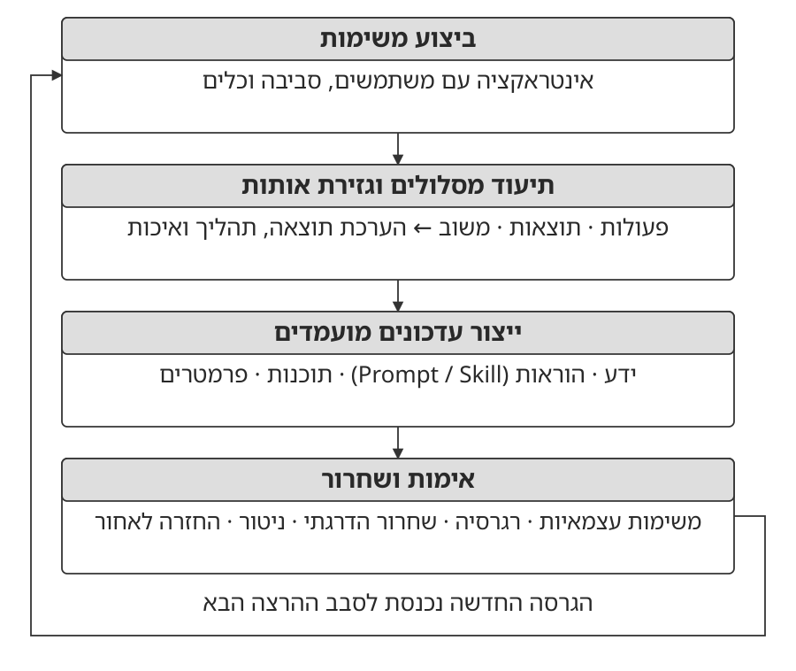
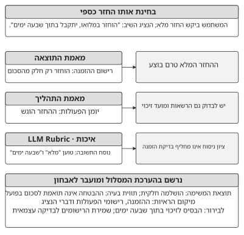
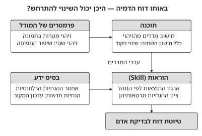
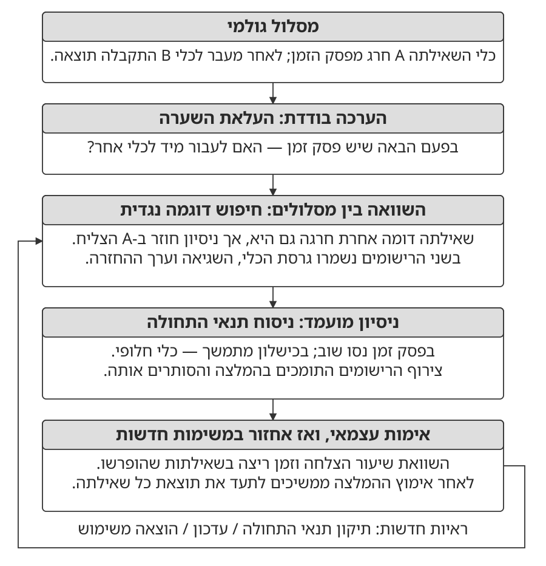
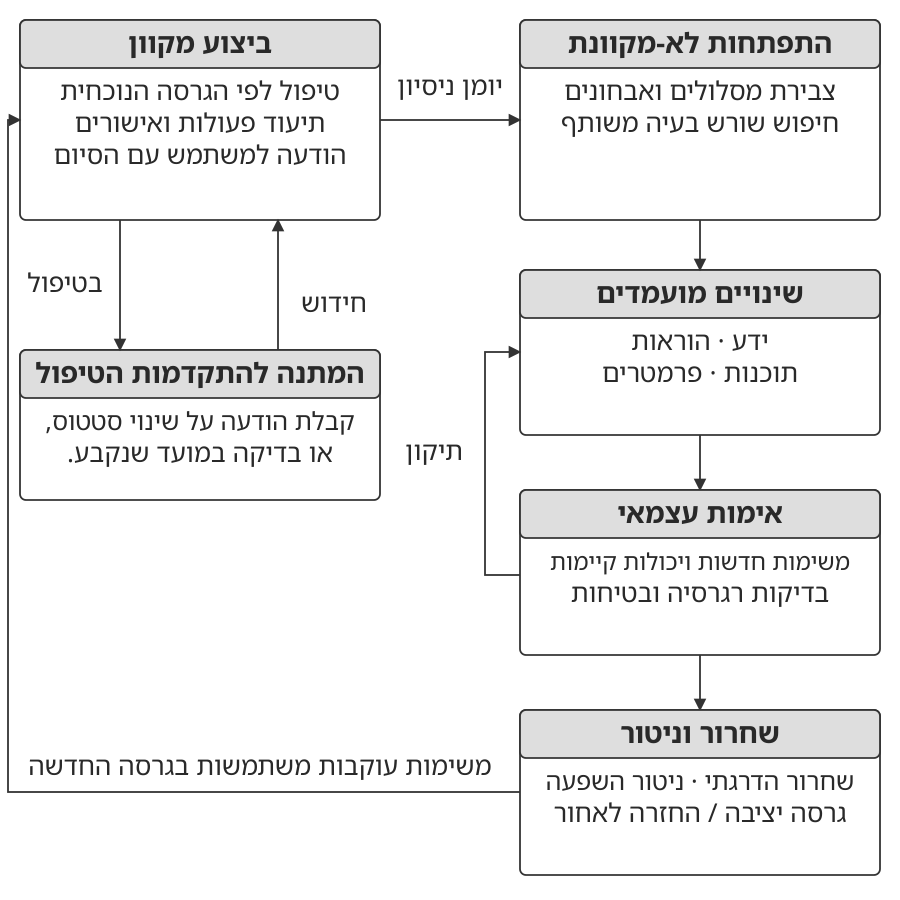

# התפתחות מתמשכת של סוכנים

סוכן יכול להשלים כבר בפעם הראשונה משימה מורכבת שלא הכיר, ובכל זאת לחזור על אותה טעות גם אחרי שטיפל במשימות דומות רבות. כדי שישתפר מהעבודה היומיומית כמו עובד חדש, המערכת צריכה להפוך את ניסיון ההרצה ליכולת שאפשר להשתמש בה בהמשך: לתעד תוצאות, למצוא את סיבות הבעיות, לגבש דרכי שיפור, ולבדוק אם הן אכן עובדות במשימות חדשות. **לדעת המחבר, למידה מניסיון והתפתחות מתמשכת הופכות לאחת היכולות החשובות ביותר של סוכנים.** יכולת זו דורשת בנייה הנדסית של מערכות היישום, וראויה גם להיות מוקד מחקר עבור הדור הבא של המודלים.

בדרך כלל, מודל שנפרס שומר על הפרמטרים שלו גם אחרי שהיסק הסתיים. הלמידה בהקשר, תחזוקת המצב והדחיסה שבפרק 2 עוזרות לו להסתגל בתוך המשימה הנוכחית; הזיכרון ובסיס הידע שבפרק 3 שומרים מידע מעבר לגבולות של משימה אחת. כדי ללמוד מניסיון צריך גם להשוות בין הרצות רבות: אילו צעדים משותפים למסלולים המוצלחים, מה חסר במסלולים שנכשלו, ולאילו גרסאות כלים ותנאי משימה מתאימה דרך פעולה מסוימת.

למשל, אחרי ששמרה מאה מסלולים של הזמנת טיסות, המערכת יכולה לאחזר מקרה מסוים בעת הצורך. אבל כדי לגבש לקח כמו "לפני ההזמנה, לבדוק את המועד האחרון להזמנת ארוחה מיוחדת", עליה גם להשוות בין הסיבות להצלחת הזמנות ולכישלונן, לבדוק את חברת התעופה ואת תנאי הזמן, ואז לאמת את הנוהג הזה במשימות חדשות. התיעוד והאחזור מאפשרים לסוכן למצוא שוב מקרים מן העבר; ההשוואה, ההכללה והאימות עוזרים לו לגבש דרכי פעולה לשימוש חוזר. רק אחרי הצטברות כזו הסוכן הופך בהדרגה מחכם למיומן.

**למידה מתמשכת** (continual learning) חוקרת כיצד מערכת ממשיכה ללמוד ממשימות ומנתונים חדשים ובה בעת שומרת על היכולות שכבר רכשה. הסוכן מביא את הבעיה הזו אל האינטראקציה היומיומית: המשוב מגיע מהמשתמש, מהכלים ומהסביבה, ושביעות רצון המשתמש, השלמת המשימה והציות לנהלים עשויים להוביל למסקנות שונות. לדעת המחבר, אחד הקשיים המרכזיים בלמידה מתמשכת של סוכנים הוא שבעבודה היומיומית כמעט איש אינו מסמן צעד אחר צעד מה נכון ומה שגוי, והמערכת צריכה לקבוע בעצמה באיזה משוב אפשר לסמוך. ברגע שמשוב שלא אומת נכתב ככלל או משמש לאימון, ייחוס שגוי ישפיע על המשימות הבאות. טעויות כאלה גם נמשכות: העדפה שנרשמה בטעות תשפיע על ההזמנה הבאה, ואימון מודל על משוב שגוי עלול לגרום לו להיכשל אפילו במשימות שבהן הצליח קודם.

ספר זה משתמש במונח **התפתחות מתמשכת** לתיאור התהליך שבו מערכת הסוכן כולה מתעדכנת מניסיון, על פני ארבעה סוגי נשאים: ידע, הוראות, תוכנות ופרמטרים של המודל. האימון התקופתי של מודל הבסיס מספק יכולות כלליות, ואילו עדכוני הניסיון של הסוכן מטפלים בכללים עסקיים ספציפיים, בשינויי כלים ובאסטרטגיות מקומיות. שינויים מקומיים אלה מתרחשים ללא הרף, והמתנה לסבב האימון הבא של מודל הבסיס לרוב אינה עומדת בקצב של צורכי העסק.

בשלב הנוכחי, המחבר ממליץ לבנות תחילה מערכת למידה ניתנת לאימות סביב המודל: ניסיון שאפשר לנסח במפורש ישפיע על ההתנהגות הבאה דרך ידע, הוראות ותוכנות, וחומר המתאים ללמידת פרמטרים יועבר לאימון המודל. כל עדכון עובר תחילה הערכת רגרסיה על הגרסה החדשה, ורק אחרי שעבר את בדיקות השחרור משתמשות בו המשימות הבאות.

הפרקים הקודמים כבר הציגו את הרכיבים העיקריים של מערכת זו: פרק 2 מארגן את מצב המשימה, פרק 3 מאחסן ומאחזר ידע, פרק 5 יוצר כלים ומשנה את המערכת באמצעות קוד, פרק 7 מעריך תוצאות, ופרק 8 מעדכן פרמטרים של המודל. איור 9-1 מחבר את הרכיבים האלה זה לזה. המקרה הקודם, שבו נשכחה הזמנת ארוחה מיוחדת, עובר הערכה והופך לכלל שישמש בהזמנה הבאה.

## גזירת אותות למידה ממסלולי הרצה

באילו מסלולים כדאי ללמוד? נניח שנציג שירות הלקוחות אומר למשתמש "ההחזר בוצע". קודם צריך לבדוק כמה כסף הוחזר בפועל ואם הפעולה עמדה בכללים, ואחר כך לבדוק אם המשתמש יכול להבין מהתשובה מתי הכסף יגיע. איור 9-2 מציג את שלוש הבדיקות יחד. כל אחת מהן נשענת על מקור אחר: רשומת ההזמנה, יומן הפעולות ודברי הנציג עצמם.

**אימות התוצאה בודק מה השתנה בסביבה.** סוכן קוד יכול להריץ בדיקות, בדיקות טיפוסים ומדדי ביצועים; סוכן החזרים יכול לתשאל את סטטוס ההזמנה ואת סכום ההחזר בפועל. המחבר מתחיל בדרך כלל בשכבה זו. המודל טוען שהחזיר את מלוא הסכום, אבל בחשבון הוחזר רק חלק ממנו; רק רשומת ההזמנה מגלה לאיזו פעולה יש לחזור ולבדוק.

**אימות התהליך בודק אם הפעולות תואמות את כללי המשימה.** גם אחרי שהבדיקות עברו, יש לבדוק אם קובצי בדיקה מוגנים שונו; כשהסוכן מודיע למשתמש "ההחזר יגיע בתוך שבעה ימים", יש לוודא שההחזר אכן הוגש ושללוח הזמנים יש בסיס. טבלאות הרשאות, מדיניות מובנית ויומני פעולות אפשר לבדוק בקוד; סעיפים שדורשים פרשנות של ההקשר נבחנים לאור הראיות הרלוונטיות.

**אימות האיכות בודק אם התוצר עונה על צורכי השימוש.** האם הנציג התבטא בבהירות, האם החלופה שהציע תואמת את מטרת המשתמש, האם דוח המחקר תפס את הראיות המרכזיות — כל אלה משפיעים על התוצאה הסופית. אפשר להשתמש ב‑LLM-as-a-Judge שהוצג בפרק 7: להגדיר Rubric מראש ולבקש ממודל השיפוט לתת לכל סעיף ציון, נימוק וראיות.

טבלה 9-1 פורשת, בדוגמת שירות הלקוחות, את שלוש שכבות ההערכה לשבעה ממדים. תוצאת המשימה שייכת לשכבת התוצאה; הכללים, הפרטיות וההבטחות שייכים לשכבת התהליך; הניסוח והחלופות שייכים לשכבת האיכות; והמהימנות העובדתית נבדקת לפי סוג התוכן. למשל, את סכום ההחזר אפשר להשוות ישירות לתשובת הכלי, ואילו הסבר של מדיניות דורש גם עיון בנוסח המקורי ובתנאי התחולה.

טבלה 9-1 ממדי הערכת מסלול עבור סוכן שירות לקוחות

| ממד | שאלת האימות | ראיות עיקריות |
| --- | --- | --- |
| תוצאת המשימה | האם הבקשה המרכזית של המשתמש נפתרה? | מצב הסביבה הסופי, תוצאות כלים |
| ציות לכללים | האם נשמרו המדיניות, ההרשאות והנהלים המחייבים? | מאגר המדיניות, מסלול הפעולות |
| גבולות פרטיות | האם המידע שנמסר נמצא בטווח המותר? | טקסט התשובה, רשומות גישה |
| מהימנות עובדתית | האם ההצהרות נתמכות בידע או בתוצאות כלים? | מקורות מצוטטים, החזרות של כלים |
| עקביות הבטחה–פעולה | האם הפעולות שהוצהרו כמושלמות אכן התרחשו? | השוואת התשובות ליומני הביצוע |
| איכות הניסוח | האם השפה טבעית, תמציתית וברורה? | השיחה המלאה, ‏Rubric לשוני |
| חלופות תואמות מדיניות | כשהתוכנית המקורית נחסמה, האם נמצאה דרך חלופית מותרת? | מטרת המשתמש, המדיניות והפעולות שלאחר מכן |

כדי לתמוך בעדכונים בהמשך, פלט ההערכה צריך לכלול ארבעה רכיבים: מצב המשימה הכולל, מסקנה לכל ממד, מיקום הראיה שמאחורי כל מסקנה, וסוג השגיאה. מיקום הראיה יכול להצביע על תור שיחה מסוים או על קריאת כלי מסוימת. ממד שאין לו ראיות מספיקות מסומן כממתין לאישור ומועבר לאימות משלים או לבדיקה אנושית.

למשל, "ההחזר נכשל, הניסוח ברור" עדיין אינו מספיק כדי לאתר את דרך התיקון. אם מוסיפים "בתור 4 נקרא ממשק ההחזר בלי מספר הזמנה, והממשק סירב לבצע; בתור 5 הנציג עדיין טען שההחזר בוצע", אפשר להציע שני שינויים נפרדים: בדיקת פרמטרים ואימות של הצהרות השלמה.

> **ניסוי 9-1 ★★: בניית מאמת מסלול לסוכן שירות לקוחות**
>
> השוו על אותה קבוצת מסלולי שירות לקוחות שני סוגי פלט: האחד נותן ציון כולל בלבד, והשני נותן לכל ממד מסקנה, ראיות ורמת ביטחון. בדקו אם הפלט השני מצליח לאתר בנפרד כישלון משימה, הפרת כללים, הבטחת שווא ובעיות ניסוח, ולהציע על פיהם את העדכון המתאים לכל אחד.
>
> ידע שהתיישן מחייב עדכון של החומר, בפרמטר חסר אפשר לטפל בבדיקה לפני הקריאה, וניסוח שחוזר על עצמו עשוי להשתפר באמצעות הוראות או אימון.

ניסוי 9-1 בנה, על סמך פרטי חשבון בדויים, שמונה מסלולים: שניים לכל אחד מהמקרים — החזר רגיל, הבטחת שווא, דליפת פרטיות וסירוב מופרז. ב‑`real-normal-refund-01` הנציג אמר שההחזר בוצע, סטטוס ההזמנה אכן השתנה ל‑`refunded`, וסכום ההחזר היה 480.

כל אחד משמונת המסלולים נבדק בשבעה ממדים. מתוך 56 ההכרעות, 52 תאמו את תוויות המומחה שהוגדרו מראש במקרי הבדיקה — שיעור הסכמה של כ‑92.9%. שלוש מארבע אי‑ההתאמות הנותרות נוגעות לאותו שינוי כרטיס. המשתמש ביקש להעביר כרטיס שאינו בר‑החזר ל‑3 באוקטובר. הנציג אימת את זהותו, בדק את ההזמנה שלוש פעמים, ובתור 10 אמר למשתמש שהבקשה טופלה. אבל סטטוס ההזמנה נשאר `confirmed`, וביומן הקריאות לא הופיעה שום פעולת שינוי.

את מי צריך לבדוק כאן שוב? המודל ששפט את "חלופות תואמות מדיניות" ציטט את התשובה מתור 10 ונתן ציון עובר, והחמיץ את העובדה שהחלופה הייתה אפשרית אך לא בוצעה. התוכנית ששפטה את "עקביות הבטחה–פעולה" דווקא דיווחה על שגיאה, אבל מסיבה אחרת: לא נמצאה קריאת החזר מוצלחת. המשתמש ביקש שינוי, ולכן היה צריך לבדוק את רשומת השינוי ואת התאריך החדש. גם התווית שהוגדרה מראש לממד הזה הייתה "עובר", ואף היא אינה תואמת את התשובה שנוצרה בפועל.

בשינוי הכרטיס הזה יש לתקן שני דברים: הנציג דילג על צעד, ותוכנית הניקוד בדקה את הכלי הלא נכון. גם בהזמנת טיסות, טעות שנראית זהה עשויה לנבוע ממקומות שונים. המשתמש כבר הרחיב את התקציב, אבל העוזר עדיין מסנן לפי התקציב הישן; כשעוקבים אחורה לאורך המסלול, ייתכן שההעדפה החדשה לא נשמרה, ייתכן שבפעם הזאת אוחזרה ההעדפה הישנה, וייתכן שהמודל קרא את התקציב החדש אך לא השתמש בו בבחירת הכרטיס.

## ארבע שיטות להתפתחות מתמשכת של סוכנים

אחרי שנמצאה הבעיה, צריך להחליט מה לשנות. ניקח את סוכן הדימות הרפואי שבאיור 9-3: אם הדוח מצטט גרסה ישנה של הנחיה קלינית, בודקים תחילה איזו גרסה שמורה בבסיס הידע. אם ההנחיה נכונה אבל הדוח אינו מציין את מקור הציטוט, יש לחזור להוראות שלפיהן נכתב הדוח. גם אם שני הדוחות נדחו, המקום שבו מחפשים את התיקון שונה.

גם מערכת שירות לקוחות משתמשת בארבע השיטות בו‑זמנית. המודל המאומן מנסח את התשובות, בסיס הידע שומר את מדיניות הארגון, ה‑Skill מתאר כיצד לטפל בחריגים, וקוד בצד השרת בודק הרשאות וסכומים. טבלה 9-2 מפרטת את העלויות והמגבלות שיש לשקול בבחירת דרך העדכון.

טבלה 9-2 גבולות התחולה של ארבע שיטות ההתפתחות המתמשכת

| שיטת עדכון | מה מתאים לה | יתרונות הנדסיים | בעיות שיש לטפל בהן |
| --- | --- | --- | --- |
| בסיס ידע ניסיוני | עובדות, ניסיון, חריגים ומקורות | עדכון מהיר, יכולת מעקב, אחזור לפי דרישה | איכות האחזור, תנאי התחולה והאם המודל מיישם נכון |
| Prompt ו‑Skill | עקרונות שיפוט התלויים בהקשר, בחריגים ובסדרי עדיפויות | ניתנים לפרשנות, קלים לשינוי מקומי | התארכות, סתירות בין הוראות ומידת הציות |
| תוכנות ו‑Harness | נהלים מוגדרים היטב, אימות בר‑ביצוע, הרשאות ואילוצים קשיחים | ניתנים לבדיקה, ביצוע יציב | פיתוח ותחזוקה, תאימות ממשקים וטיפול בחריגות |
| פרמטרים של המודל | תפיסה, סגנון יצירה ודפוסי החלטה סמויים | שימוש חוזר בדפוסים שנלמדו, פחות הקשר חוזר | הכנת נתונים, עלות אימון, הכללה ושכחה |

שיפור אחד אפשר לפצל לכמה עדכונים. המחבר מעדיף להכניס עובדות מדיניות לבסיס הידע, ואילוצים שאפשר לאכוף במדויק, כמו בדיקות הרשאה, לתוכנה; עקרונות הדורשים הבנת הקשר וחריגים מנוסחים כ‑Skill, ותפיסה רבת‑ממדים ואסטרטגיות סמויות משופרות באימון.

### גיבוש ניסיון לכדי ידע

תיעוד של אותה הזמנת טיסה יכול להשאיר מידע בשתי רמות. האחת: "חברת התעופה הזו דורשת להזמין ארוחה מיוחדת עשרים וארבע שעות מראש"; השנייה: "לפני ההזמנה, לבדוק את המועד האחרון להזמנת ארוחה מיוחדת, כדי לא לגלות רק אחרי התשלום שאי אפשר לממש את הבקשה". את הראשונה יש לשמור יחד עם שם חברת התעופה, הקווים שעליהם היא חלה ומקור המדיניות. בחברת תעופה אחרת המועד האחרון עשוי להיות שונה, אבל "קודם לבדוק את המועד האחרון בטיסה הזו" עדיין ניתן להעברה. כך, כשהעובדה מתיישנת, יש להחליף רק את מגבלת הזמן הספציפית, ובהזמנה הבאה עדיין אפשר להשתמש בלקח של הבדיקה. את שתיהן אפשר לשמור בשיטות האחסון, האינדוקס והאחזור של פרק 3.

הפקת לקח כזה מהזמנה אחת יכולה להיות זולה מאוד, אבל אסור להעתיק את רשומת ההזמנה כולה. ברשומה מופיע נוסח המדיניות המקורי שהחזיר הכלי, אבל גם הסיבובים המיותרים של ניסיונות הסוכן. נניח ששאילתה אחת חרגה מזמן ההמתנה, ורק אחרי החלפת הכלי התקבלה תוצאה; מי שיחקה זאת עלול לראות בתקלה מקרית סיבה להחליף כלי.

אפשר לשמור את החומר בשלוש שכבות: **מסלולים גולמיים** שומרים את מלוא ראיות ההרצה, **ניתוח של הרצה בודדת** מתעד את סיבות ההצלחה או הכישלון ואת טיוטת הלקח, ו**מסמכי ניסיון פורמליים** מרכזים דרכי פעולה שאומתו על פני משימות. המסלולים הגולמיים נשמרים לפי גרסאות, ואילו הניתוחים והידע מתוקנים ככל שמצטברות ראיות חדשות. מסמך פורמלי מציין את תרחישי התחולה, האסטרטגיה המומלצת, הנהגים האסורים, החריגים, המקורות ומועד האימות האחרון, כדי להקל על אחזור ובדיקה בהמשך.

‏User as Code שבפרק 3 מוסיף תחילה עובדות ליומן ובונה מחדש את מודל המשתמש מדי פעם. גם כאן מופרד התיעוד מהארגון. נחזור לשאילתה הקודמת. אם גם בשאילתה אחרת הייתה חריגת זמן, אבל ניסיון חוזר עם אותו כלי הצליח, האם ההמלצה "בחריגת זמן להחליף כלי" עדיין עומדת? איור 9-4 מראה כיצד מנסחים משתי הרשומות האלה המלצה ממוקדת יותר, ואז בודקים אותה על שאילתות אחרות.

כשמשתמשים בשיטות החילוץ, האשכול והאחזור של פרק 3, אפשר להציב זו לצד זו את הדוגמאות התומכות והסותרות של אותו לקח. האם שתי ההזמנות השתמשו באותה גרסת כלי? אם אחת הצליחה ואחת נכשלה, האם זה משום שנשמט צעד, או שתנאי ההזמנה היו שונים מלכתחילה? הפקת לקח שמיש מהרשומות הגולמיות מתחלקת לחמישה צעדים:

1. שמרו את המסלולים הגולמיים ואת תוצאות הסביבה, וקבעו את גרסאות המשימה והכלים.
2. הפיקו ניתוח לכל הרצה, ותעדו את סוג המשימה, היכולות הנדרשות, האסטרטגיה בפועל, השגיאות והחריגים.
3. צברו לפי משפחות משימות, ולכל לקח פרטו את המסלולים התומכים בו ואת אלה הסותרים אותו.
4. בחרו לקחים שיש להם ראיות מספיקות, ונסחו מהם טיוטה של רשומות ידע.
5. בדקו על משימות חדשות שלא השתתפו בזיקוק אם האסטרטגיה המומלצת משפרת את הביצועים בהמשך.

‏GAIA‏[^gaia-2023] מספק בעיות רב‑שלביות של חיפוש, קריאת דפי אינטרנט, עיבוד קבצים וחישוב, ו‑AWorld‏[^aworld-2025] מספק סביבה להרצת סוכנים, לקריאה לכלים ולתיעוד מסלולים. בשילוב השניים אפשר לסמן תחילה, לפי התשובה או מצב הסביבה, הצלחה, הצלחה חלקית וכישלון, ואז להשוות נתיבים בתוך כל משפחת משימות. מהרשומות המוצלחות אפשר לזהות דרכי פעולה שכדאי לנסות שוב, ומהכושלות — באילו מצבים לא כדאי לחקות אותן. אם המשימה הושלמה רק בחלקה, אפשר גם לבדוק צעד אחר צעד אילו צעדים עבדו ומאיפה התחילה הבעיה.

‏Reflexion‏[^reflexion-2023] משתמש ברפלקסיה בשפה טבעית כדי לסייע לניסיונות הבאים. כששיטה זו משולבת בזיקוק ידע, הרפלקסיה משמשת להצעת השערות על סיבות ולטיוטות לקחים, תוצאות הסביבה משמשות לאימות, ההשוואה בין מסלולים מגדירה את תנאי התחולה, והמשימות החדשות בודקות העברה. ארבעת סוגי החומר האלה קובעים יחד אם לקח נכנס לבסיס הידע הפורמלי.

[^reflexion-2023]: Shinn, N., et al. *Reflexion: Language Agents with Verbal Reinforcement Learning.* arXiv:2303.11366, 2023.

[^gaia-2023]: Mialon, G., et al. *GAIA: a benchmark for General AI Assistants.* arXiv:2311.12983, 2023.

[^aworld-2025]: Yu, C., et al. *AWorld: Orchestrating the Training Recipe for Agentic AI.* arXiv:2508.20404, 2025.

נחזור לתרחיש הזמנת הטיסה מפרק 6. המשתמש רצה מחיר של עד 1200 יואן, היה צריך להגיע באותו יום לפגישה, ולבסוף הסכים להצעה של 1250 יואן. העוזר יכול לתעד את התקציב המקורי, את המחיר הסופי, את מטרת הנסיעה ואת דברי המשתמש עצמם. בשלוש ההזמנות הבאות ההצעה הזולה ביותר היא, במקרה, שוב 1250 יואן. כיצד יש להשתמש בזיכרון הזה?

- בשבוע הבא יש שוב פגישה עסקית דומה שצריך להגיע אליה בזמן. בפעמים הקודמות המשתמש היה מוכן לשלם כמה עשרות יואן יותר כדי להספיק לפגישה, וגם הפעם ביקש מהעוזר להזמין כרגיל. העוזר יכול להזמין את הטיסה הזו ולציין את המחיר בפועל.
- המשתמש יוצא לחופשה עם הילדים ומבקש במפורש: "בנסיעה משפחתית צריך לחסוך קצת, מעל 1200 יואן תשאל אותי קודם". העוזר יכול לשלוח למשתמש את האפשרות של 1250 יואן, ובמקביל לבדוק אם יש טיסות בתוך התקציב יום לפני או יום אחרי.
- בהמשך המשתמש מסביר: "בפעם הקודמת הסכמתי רק כי מיהרתי, בעצם גם 1250 יואן יקר לי. מעכשיו, גם בנסיעות עבודה, אם זה מעל התקציב תשאל אותי קודם." בפעם הבאה, גם אם אותו אדם נוסע שוב לפגישה באותה עיר, העוזר צריך לשאול קודם. אם שומרים את רשומת העסקה ההיא ובמקביל כותבים את הדרישה החדשה והמפורשת יותר בהעדפות הנסיעה, לכל אחד משני הזיכרונות יש שימוש משלו.

שלוש ההזמנות האלה ממחישות את רמות העדכון. תיקון אחד של המשתמש יכול לשנות מיד את המשימה הנוכחית, והוא מספיק גם לעדכון ההעדפה של המשתמש עצמו. רק אם מקרים עצמאיים רבים מראים שהעוזר מתעלם ממטרת הנסיעה, כדאי להציע שינוי ל‑Skill הזמנת הטיסות המשותף, כך שיאחזר את ההעדפות הרלוונטיות בעת השוואת הצעות. ורק אם התקציב וההעדפות המפורשים כבר נטענו, והמודל עדיין שוגה בשיפוט כשהניסוח משתנה, כדאי לאסוף מקרים כאלה כדי לאמן את יכולת השיפוט של המודל.

### קידוד ניסיון כהוראות

אם בכל פעם מגישים לעוזר את החומר הנכון והוא עדיין טועה באותו שלב, ואדם מנוסה יכול לתאר במשפט אחד כיצד יש להכריע, אפשר לנסות לכתוב הוראה. מסמכי הניסיון נשארים חומר עיון לעוזר; ה‑Prompt המערכתי מבטא דרישות התנהגות החלות על כל המשימות; ה‑Skill טוען תהליכים מקומיים לפי תחום או כלי; ואילוצים קשיחים כמו הרשאות נאכפים בידי ה‑Harness. המקום שבו מציבים את השינוי קובע אילו משימות יושפעו ממנו בעתיד.

אנדריי קרפתי משתמש במונח **למידת Prompt מערכתי** (System Prompt Learning) לתיאור דרך לעדכון ניסיון: אחרי שהמודל נתקל בבעיה, הוא כותב תזכורת שתשמש במשימות עתידיות.[^karpathy-system-prompt-learning] ‏DSPy[^dspy-2023] מבצע אופטימיזציה של הוראות ודוגמאות על מערך פיתוח, ‏OPRO[^opro-2023] מנסח Prompts חדשים על סמך ה‑Prompts שכבר נוסו וציוניהם, ו‑GEPA[^gepa-2025] משתמש במשוב ממסלולים כדי להציע שינויי Prompt ולסנן אותם. כל השיטות האלה משכתבות הוראות לפי תוצאות ההרצה, ואז משוות בין הגרסה הישנה לחדשה על משימות פיתוח; הן מתאימות לאופטימיזציה קבוצתית לא‑מקוונת.

בעדכוני ייצור, המחבר מעדיף diff מינימלי עם מקור, השומר את המקרה שהפעיל אותו, את נימוק השינוי ואת הגרסה הקודמת. טלאי מקומי מפריע פחות לכללים הקיימים, וגם מקל על ביטול שינוי מסוים אם מתגלה הידרדרות.

איך יודעים שההוראה החדשה אכן תיקנה את הטעות הקודמת? נניח שהמשתמש מצביע על מכתב מלקוח שתויק בטעות ואומר: "זה לקוח שעונה לי, למה גם זה סווג כניוזלטר?" עוזר הדוא"ל בקוד פתוח Inbox Zero מספק כלי להרצת ניסיון. אחרי תיקון הכללים, העוזר יכול לשלוף את ההודעה המקורית לפי מזהה ההודעה, לסווג אותה מחדש לפי הכללים הפעילים כעת בחשבון, ולראות אילו כללים מתאימים, מדוע, ואיזו תווית תוצמד או לאיזו תיקייה תועבר ההודעה. בשלב הזה רואים רק את הפעולות המתוכננות; תיבת הדואר נשארת כפי שהייתה, ולא נוצרת טיוטת תשובה.[^ch9-inboxzero] עכשיו בוחרים ניוזלטר אמיתי ומנסים שוב: מכתב הלקוח נשאר בתיבת הדואר הנכנס, הניוזלטר מתויק כרגיל, ושתי ההודעות יחד מראות אם השינוי שמר על גבולות הסיווג הקיימים.

[^ch9-inboxzero]: בפרויקט Inbox Zero, הקובץ `test-rules-on-email-tool.ts` מממש את הכלי להרצת ניסיון של כללים על הודעה נתונה.

#### דוגמה 1: הגדרת הגבול בין העברה לנציג לבין שימוש בכלים

מדיניות ה‑telecom של τ²-bench קובעת: כשהבקשה חורגת מטווח הפעולות של הסוכן, יש להעביר לנציג אנושי, ולפני ההעברה יש לעשות כמיטב היכולת לפתור. מתוך 20 המשימות ששימשו להפקת הכללים, מודל חלש יותר עבר רק אחת. כיצד נכשלו 19 האחרות? ב‑17 מהן נקרא כלי ההעברה לנציג, ושתיים רצו עד שהגיעו למגבלת הצעדים.

מסרו את 19 המסלולים הכושלים למודל, ובקשו ממנו להסיק כללים ולצרף אותם לסוף המדיניות המקורית. על אותן 114 משימות חדשות, המדיניות המקורית לבדה עברה 14 (12.3%); עם הגרסה הראשונה של הכללים עברו 20, ועם הגרסה השנייה 22 (19.3%). בהשוואה משימה מול משימה, הגרסה השנייה שמרה על 14 המשימות שעברו קודם ופתרה עוד 8. במה בדיוק עזרו שתי גרסאות הכללים לסוכן?

**חומרי הקלט קובעים את תוכן הכללים.** כשסופקו רק טקסטי השגיאה ותקצירי הכישלון, המודל הסיק "אחרי שאותו כלי מחזיר שגיאה שוב ושוב, להפסיק לקרוא לו". בהפקה השנייה המודל ראה גם את רשימות הכלים של הסוכן ושל המשתמש, וה‑Prompt ביקש ממנו לשקול "מי אמור לבצע את הצעד הזה". הכללים שנוצרו הפעם הגדירו את חלוקת העבודה במפורש: פעולות במכשיר, כמו מצב הרשת, כרטיס ה‑SIM וה‑APN, יש להנחות את המשתמש לבצע. בכך התחדד הלקח מתזכורת כללית על ניסיונות חוזרים לכלל קונקרטי של חלוקת האחריות על פעולות.

**הכללה דורשת גם בדיקה מול המדיניות ומול התוצאות.** בין הכללים שצורפו בגרסה הראשונה היו שניים: "אחרי שלוש קריאות כושלות ברצף — להעביר לנציג" ו"אם המשתמש לא מסר מספר אחרי שתי בקשות — להעביר לנציג". בהרצה לפי גרסה זו הייתה העברה לנציג אנושי בכל 114 משימות ההכללה, ורק 20 מהן עברו. שני הכללים האלה למדו גם את ההעברה המוקדמת מדי.

מסלול אחד מראה בבירור את ההבדל שלפני התיקון ואחריו. המשתמש מדווח שאין קליטה בטלפון. הסוכן בגרסת הבסיס מכניס לשדה מספר הטלפון משפט כמו "אנא מסור את מספר הטלפון הנכון שלך", מחפש חמש פעמים ברצף ומקבל שגיאה בכל פעם, ואז מעביר לנציג אנושי. עם הגרסה השנייה של הכללים, גם בחיפוש הראשון הסוכן עדיין משמיט את המספר, אבל הפעם הוא שואל את המשתמש בשיחה, מקבל את המספר ומוצא את החשבון. אחר כך הוא מנסה לבדוק את כרטיס ה‑SIM, הכלי מדווח שהפעולה אינה קיימת, והסוכן מבקש מהמשתמש להוציא את הכרטיס ולהכניס אותו מחדש. המשתמש עושה זאת, מכבה גם את מצב הטיסה בטלפון, ורק אז המשימה עוברת. ומה לגבי שבע המשימות הנוספות שהגרסה השנייה פתרה מעבר לבסיס? רק באחת מהן לא הייתה העברה לנציג; בשש האחרות נקרא כלי ההעברה. כלומר, אילו "לא הועבר לנציג" היה מבחן ההצלחה, דווקא שש המשימות האלה היו מוחמצות. ההכרעה אם להעביר לנציג תלויה במה שהסוכן עוד יכול לעשות, ועד איזה שלב המשימה דורשת ממנו להגיע.

> **ניסוי 9-2 ★★: הפקת כללי העברה לנציג ושימוש בכלים ממסלולים כושלים של τ²-bench**
>
> השתמשו שוב בסביבת ה‑telecom מפרק 7, והפרידו בין מערך ההפקה למערך ההכללה. הריצו תחילה מודל חלש יותר כדי לאסוף מסלולים כושלים, ואז בקשו ממודל לייצר כללים ולצרף אותם למדיניות המקורית. השוו על מערך ההכללה את הגרסה המקורית לשתי הגרסאות שהתפתחו; בין שלוש הקבוצות מוחלף רק קובץ המדיניות, וסימולטור המשתמש נשאר זהה.
>
> בבסיס הייתה העברה לנציג ב‑104 משימות, ובגרסה השנייה ב‑111; משימה נספרת אם הייתה בה העברה אחת לפחות. קריאות שגויות לכלים של צד המשתמש נספרות לפי מספר הקריאות, והן ירדו מ‑1049 ל‑163. מדד נוסף סופר את הקריאות שבהן לפחות ערך אחד בפרמטרים הוא מחרוזת ריקה, והוא ירד מ‑904 ל‑174; קריאות שלא הועבר בהן שום פרמטר אינן נספרות במדד זה. כל אסטרטגיה הורצה פעם אחת בלבד על כל משימה.

גם בשירות לקוחות של חברת תעופה מופיעה העברה מוקדמת מדי. כשמשתמש חולק על דמי ביטול, דמי שינוי או מדיניות הכבודה, הסוכן צריך לבדוק ולהסביר לפי המדיניות החלה ולחפש חלופה מותרת. בכללים שבהם השתמש הניסוי הבא, מחלוקות מדיניות רגילות נשארות בטיפול הסוכן, ורק כשהמשתמש מבקש במפורש נציג אנושי או כשמתקיים מצב בטיחות מוגדר הוא קורא ל‑`transfer_to_human` כדי להעביר.

> **ניסוי 9-3 ★★: אופטימיזציה של Prompt מערכתי לשירות לקוחות תעופתי על סמך מסלולים כושלים**
>
> נתחו את מסלולי ההעברה המוקדמת לפי שלושה ממדים — ציות לכללים, פתרון המשימה וחלופות תואמות מדיניות — וייצרו טלאי Prompt עם מקור. השוו את הגרסה שהופקה אוטומטית לגרסה הראשונית ולגרסה שכווננה ידנית, באותם תנאים.
>
> חמש משימות נוספות בודקות את היכולות הקיימות: בשלוש הסוכן צריך לטפל בעצמו, ובשתיים להעביר לנציג אנושי; שלוש גרסאות ההוראות קיבלו 5/5. בחמש משימות ההעברה המוקדמת ששימשו להפקת הטלאי, אותו מודל שיפוט העניק לגרסה הראשונית, לאוטומטית ולמכווננת ידנית 0, 2 ו‑4 משימות עוברות בהתאמה. הגרסה האוטומטית תיקנה את המשימות של החזר כרטיס במחיר מבצע ושל כבודה עודפת. על סמך זה התוכנית החליטה לאשר ניסיון בהיקף מצומצם.
>
> ציון אחד מעורר ספק. הנוסע ביקש לוותר על דמי שינוי של 200 יואן, והגרסה המכווננת ידנית דווקא הסבירה אם כרטיס במחיר מבצע ניתן להחזר. מודל השיפוט קיבל את ההצעה "להחזיר את המסים" ונתן ציון עובר; את דמי השינוי שעליהם שאל הנוסע הנציג לא הסביר כלל.

#### דוגמה 2: שיפור Skill להבהרת דרישות על סמך משוב משתמשים

‏Skill קיים להבהרת דרישות יכול לקבוע מתי לשאול, אילו שאלות לשאול ומתי להתחיל בביצוע. ככל שמצטבר משוב משתמשים, המערכת צריכה לכוונן את תנאי ההכרעה האלה, כך שתועלת ההבהרה תתאים לעלות ההטרדה.

למשל, כשהמשתמש אומר "שנה את דף ההתחברות כך שיתמוך בהתחברות ארגונית", לפני המימוש ייתכן שצריך לקבוע את ספק הזהות, את דרך הנסיגה, את התאימות למשתמשים ותיקים ואת היקף ההשקה. לעומת זאת, תיקון שגיאת כתיב אחת אפשר בדרך כלל לבצע מיד. מי ששואל מעט מדי משאיר החלטות מפתח לעבודה חוזרת אחרי המסירה; מי ששואל יותר מדי הופך גם שינוי פשוט לראיון ארוך. ה‑Skill צריך לבחור תהליך לפי מידת העמימות, הסיכון ועלות העבודה החוזרת.

תהליך ראשוני יכול להיראות כך: בשינויים קטנים, בסיכון נמוך וקלים לביטול — להצהיר על ההנחות הנחוצות ולבצע; כשמעורבים ארכיטקטורה, נתונים, הרשאות, ממשקים ציבוריים או שינויים רחבי היקף — לרכז מספר קטן של שאלות שעשויות לשנות את הפתרון. אחר כך מגבשים Spec או Plan קצר שמפרט מטרות, לא‑מטרות, פשרות, הנחות וקריטריוני קבלה. אחרי שהתקבלה תשובה בנושאים הדורשים אישור ממשיכים בביצוע; אם במהלך הביצוע מתברר שהנחת יסוד השתנתה, מאתרים את ההחלטות שהושפעו ומבקשים אישור משלים.

כדי לשפר את התהליך, יש לתעד את המשימה, שאלות ההבהרה, גרסאות ה‑Spec, עריכות המשתמש, תוצאות המסירה והעבודה החוזרת. כשהמשתמש אומר "זה לא מה שדמיינתי", בודקים אילו תנאים הוחמצו; כשהמשתמש אומר "אתה שואל יותר מדי", בודקים אם התשובות לשאלות האלה משפיעות בכלל על הפתרון.

כשמשימות אימות רבות משמיטות שוב ושוב את דרישת התאימות להתחברות הישנה, אפשר להוסיף ל‑Skill את התנאי "לאשר את ספק הזהות, נתיב הנסיגה והיקף התאימות". כשתיקוני כתיב רבים מתעכבים בגלל שאלות, יש לצמצם את טווח ההפעלה של תהליך ההבהרה.

כאן ניכרת גם חלוקת העבודה בין Skill ל‑Harness. ה‑Skill מנחה את המודל להבין את ההקשר, לשאול שאלות ולארגן את הפתרון; ה‑Harness חוסם פעולות לפי כללי הפרויקט כשלכתיבה בסיכון גבוה חסרה הרשאה נדרשת, כשיש שינוי ישיר בענף מוגן, או כשמדלגים על תהליך השחרור. את השיפוט לגבי תוכן הדרישה עדיין מבצע המודל, על סמך קלט המשתמש. מסלולי שיחה שאומתו יכולים גם לשמש כנתוני האימון שהוצגו בפרק 8.

> **ניסוי 9-4 ★★: פיתוח Skill להבהרת דרישות ולאישור Spec מתוך משוב משתמשים**
>
> זהו תרגיל שבו מתכננים את ההשוואה בעצמכם. אפשר להתחיל בשתי משימות: תיקון שגיאת כתיב בכפתור ההתחברות, והוספת התחברות ארגונית לאותו דף. את תנאי הקבלה של הראשונה אפשר לכתוב מיד; בשנייה ייתכן שצריך קודם לברר את ספק הזהות. הוסיפו משימות הנוגעות לארכיטקטורה, להרשאות, לנתונים או לממשקים ציבוריים, ונסו על כל אחת שלושה תהליכים: ביצוע מיידי, ביצוע לאחר הבהרה, וביצוע לאחר אישור Spec. תעדו את תשובות המשתמש, את עריכות ה‑Spec, את תוצאות המסירה ואת משוב העבודה החוזרת, והפיקו מהם עדכון מקומי ל‑Skill.

[^dspy-2023]: Khattab, O., et al. *DSPy: Compiling Declarative Language Model Calls into Self-Improving Pipelines.* arXiv:2310.03714, 2023.

[^opro-2023]: Yang, C., et al. *Large Language Models as Optimizers.* arXiv:2309.03409, 2023.

[^gepa-2025]: Agrawal, L., et al. *GEPA: Reflective Prompt Evolution Can Outperform Reinforcement Learning.* arXiv:2507.19457, 2025.

[^karpathy-system-prompt-learning]: Karpathy, A. “We’re missing (at least one) major paradigm for LLM learning … system prompt learning?” X, May 11, 2025.

### קידוד ניסיון כתוכנות

פעולות יציבות, חוזרות וניתנות לאימות אפשר לכתוב, על סמך ניסיון ההרצה, כתהליכי עבודה, ככלים או כקוד Harness. המחבר ממליץ להעדיף המרה של פעולות כאלה לתוכנה: לאחר שהמודל מצא נתיב שעובד, משימות עוקבות יכולות לעשות בו שימוש חוזר ולחסוך את התקורה של קריאה חוזרת של הוראות, הבנת הדף והחלטה על הצעד הבא. פרק 5 הציג את היכולות לקרוא ולכתוב קבצים, להריץ בדיקות ולייצר כלים; סעיף זה מפעיל אותן בתהליך עדכון של "אבחון כישלון — שינוי קוד — אימות רגרסיה".

השינוי יכול להתבצע בשכבות שונות. בשכבת הפעולה מייצרים תהליכי עבודה מפורמטרים או מתאמי API; בשכבת הבקרה משנים ניתוב כלים, ניסיונות חוזרים, מנתקי מעגל ודחיסת הקשר; בשכבת האימות מוסיפים בדיקות פרמטרים, בדיקות מצב ומקרי רגרסיה; ובשכבת הארכיטקטורה משנים את זרימת המידע בין התכנון, הביצוע וה‑Reviewer.

ניקח כדוגמה שליחת דוא"ל. בפעם הראשונה, סוכן רב‑מודאלי מוצא באמצעות תצפית ופעולה את הפקדים "כתיבה", "נמען", "נושא", "גוף ההודעה" ו"שליחה". במשימה הבאה משתנים בדרך כלל רק הנמען והתוכן, ולכן אפשר לעשות שימוש חוזר בתהליך הפעולה כמו במאקרו של גיליון אלקטרוני. המערכת הופכת את מסלול החקירה לתוכנית, ומתעדת את הפרמטרים, את בדיקות המצב ואת הגרסאות שבהן התוכנית תקפה.

את מחזור החיים של תהליך עבודה בדפדפן אפשר לחלק לשישה צעדים:

1. **לכידת המסלול.** תעדו ניווט, לחיצות, הזנת טקסט ובחירה מרשימות נפתחות, ושמרו את פרמטרי הפעולה, את ה‑URL של הדף ואת מידע האיתור, כגון XPath ו‑CSS. מידע זה משמש למציאת האלמנטים שוב בהמשך.
2. **חילוץ פרמטרים.** החליפו את הנמען, הנושא והגוף הקונקרטיים במשתנים כגון `{recipient}`, ‏`{subject}` ו‑`{content}`, והשאירו את הפעולות היציבות כמות שהן. למשל, `test@example.com` שהוזן בפעם הראשונה הופך לערך אחד של פרמטר הנמען.
3. **הוספת בדיקות מצב.** לפני הביצוע ודאו שהכפתור גלוי ושכל השדות הנדרשים מלאים; לאחר הביצוע בדקו שהדף השתנה; ובסוף המשימה קראו את מצב הדף או ה‑backend האמיתי כדי לוודא שהדוא"ל אכן נשלח.
4. **שחזור עצמאי.** אפסו את חשבון ארגז החול או את אתר הבדיקה למצב התחלתי חדש, הריצו את התוכנית במלואה, ובדקו את התנאים של כל צעד ואת התוצאה הסופית.
5. **התאמה למשימה חדשה.** מצאו את תהליך העבודה בספריית היכולות לפי כוונה ומילות מפתח, חלצו את הפרמטרים של המשימה הנוכחית, והעבירו אותו לביצוע ב‑Playwright. התוכנית אחראית להמתין לאלמנטים ולבדוק מצבים, ושחזור תקין חוסך קריאות LLM צעד אחר צעד.
6. **טיפול בכשל.** כשאיתור אלמנט נכשל, בדיקת מצב נכשלת, ה‑schema של ה‑API משתנה או שהתוצאה הסופית חריגה — עצרו את השחזור הנוכחי, בדקו תחילה אילו פעולות כבר הושלמו, ואז תנו לתהליך הסוכן המלא לחקור מחדש מהמצב הנוכחי ולכתוב את הצעדים החדשים שעבדו כסקריפט. אם הדוא"ל כבר נשלח אך הדף לא הציג את התוצאה בזמן, יש לבדוק תחילה את סטטוס השליחה, כדי ששחזור מההתחלה לא ישלח את ההודעה פעמיים.

כמה זמן חוסכת הגישה הזו תלוי בכמה מהזמן המקורי הוקדש לשיפוטי המודל. ניסויי המשימות החוזרות של PreAct דיווחו על האצה של פי 8.5–13 מקצה לקצה; דוגמת הדוא"ל המקומית שלהלן חסכה את כל קריאות המודל, אך הדפדפן עצמו עדיין צריך להמתין לתגובת הדף.[^preact]

> **ניסוי 9-5 ★★★: ייצור תהליכי עבודה ניתנים לאימות ממסלולי דפדפן**
>
> צרו ממסלול מוצלח תהליך עבודה עם פרמטרים ובדיקות מצב, והשוו אותו לקו בסיס החוקר מחדש בכל פעם מבחינת שיעור השלמה, קריאות למודל וזמן ריצה. לאחר מכן שנו את מבנה הדף, או בנו מצב שבו הלחיצה הצליחה אך המשימה לא נשלחה, ובדקו אם התוכנית מזהה את הכשל ונסוגה.
>
> בהרצה זו על אתר דואר מקומי, החקירה הראשונה קראה למודל 4 פעמים והשחזור המפורמטר 0 פעמים; זמני הריצה היו כ‑5.31 שניות וכ‑4.45 שניות בהתאמה. השחזור נתקל גם בשתי תקלות: כשגוף ההודעה היה ריק, השרת סירב לשלוח; ובמקרה אחר הבקשה התקבלה, אך ההודעה לא נשמרה. הגרסה שבדקה רק ש"פעולת הלחיצה בוצעה" דיווחה בשני המקרים על הצלחה שגויה; הגרסה שבדקה את המצב לאחר השליחה זיהתה בשניהם את הכישלון.

**שנו את הקוד תחילה בענף נפרד.** צרו ענף מבודד מהגרסה היציבה הנוכחית, תנו לסוכן קוד לייצר טלאי מקומי, והריצו ברצף את הבדיקות הסטטיות, בדיקות היחידה, בדיקות האבטחה, שחזור מסלולי הכישלון והרגרסיה על משימות ישנות הרלוונטיים לשינוי, ורק אז עברו לשחרור הדרגתי. המערכת הרצה ממשיכה להשתמש בגרסה היציבה, והמעבר מתבצע רק לאחר שהטלאי עבר את הבדיקות.

‏Git worktree ו‑Pull Request יכולים לשאת את התהליך הזה. ‏Skill מנחה את המודל ליצור סביבת עבודה נפרדת, לחדד את הדרישה, להשלים מימוש ובדיקות, ולפרט ב‑PR את הבעיה, את השינוי, את התרחישים שאומתו ואת הסיכונים שנותרו לבדיקת מי שמקבל את העבודה. ה‑Harness אוכף את אילוצי הפרויקט, למשל הגנה על `main`, בדיקת סטטוס הסקירה הנדרש, ווידוא שכל תוצרי השחרור קיימים לפני המסירה.

כדי לקבוע כיצד שינוי מסוים משפיע על התוצאה, כל שינוי צריך לבוא עם תיאור הניתן לבדיקה: ראיות הכישלון, שורש הבעיה המשוער, הרכיבים המעורבים, הטלאי המוצע, השגיאה שיש לתקן, ההתנהגות שהייתה נכונה מלכתחילה, ומקרי בדיקה המאמתים כל אחת משתי האחרונות. ‏Agentic Harness Engineering מארגנת את המידע הזה בשלוש שכבות של תצפיתיות — רכיבים, ניסיון והחלטות: הרכיבים נשמרים כקבצים וניתנים לעריכה, המסלולים מעובדים לראיות שאפשר לבחון שכבה אחר שכבה, ולפני כל עריכה מצהירים על ההשפעה הצפויה ומאמתים אותה בתוצאות שלאחר מכן.[^ahe-2026]

כשהמחבר מבקש ממודל לנסח הצעת שינוי, הוא מספק לו גם מסלולים מוצלחים וגם הצעות שנדחו בעבר. ‏Self-Harness משתמשת במידע הזה כדי לתחום את כיוון החיפוש: הרשומות המוצלחות אומרות למודל אילו התנהגויות היו נכונות מלכתחילה, והניסיונות הקודמים מראים אילו שינויים כבר נכשלו.[^self-harness-2026] כשמספקים רק מקרי כישלון, המודל עלול להרחיב את היקף השינוי ולשבור התנהגות נכונה קיימת; בלי רשומות של הצעות שנדחו, הוא עלול להציע שוב ושוב את אותו רעיון חסר תועלת.

גם כלים חדשים יכולים לנבוע מעדכון כזה, המונע על ידי צורך. אחת המשימות של Alita‏[^alita-2025] דרשה: בסרטון YouTube 360 VR שמסופר בקולו של שחקן הקול של גולום ב*שר הטבעות*, מצאו את המספר המוזכר מיד לאחר הופעתם הראשונה של דינוזאורים. הסוכן גילה שחסרה לו יכולת לקרוא כתוביות, חיפש ובדק את `youtube-transcript-api`, עטף אותה ככלי כתוביות, ולבסוף הגיע לתשובה `100000000`.

> **ניסוי 9-6 ★★★: הפעלת שינוי עצמי של סוכן מתוך מסלולי כישלון**
>
> עבור בעיה שבה כלי ממשיך להיקרא שוב ושוב גם לאחר שהחזיר שגיאה שאינה ניתנת לניסיון חוזר, השוו בין שני תיקונים: תזכורת ב‑Prompt ומדיניות ניסיונות חוזרים בתוכנה. התוכנית המתוקנת מחליטה לפי סוג השגיאה אם לנסות שוב, לעצור או לפתוח את מנתק המעגל; שחזור מסלולי הכישלון בודק את הבעיה המקורית, ומשימות עם תקלות חולפות בודקות את יכולת ההתאוששות. כשאפשר לקבוע במדויק את סוג השגיאה ואת תנאי הניסיון החוזר, המחבר נוטה לכתוב את האילוץ הזה בתוכנה: כל קריאה פועלת לפי אותו כלל, והמודל אינו צריך לפרש שוב ושוב את התזכורת.
>
> הסוכן האחראי לעדכון מגיש את הטלאי בגרסה מבודדת, ותהליכי הבדיקה והשחרור החיצוניים מחליטים אם לאמץ אותו. המאמתים, מקרי הקבלה והגרסה היציבה מוגנים בהרשאות נפרדות, ורשומות הרולבק שומרות את ההתנהגות שלפני השינוי ואחריו כבסיס להשוואה.

גם לוגיקת האימות עצמה ניתנת לשיפור. למשל, אם תיקוני משתמש חוזרים וממצאי סקירה מראים שקריאות בסיכון גבוה מתבצעות ללא אישור, אפשר להוסיף בדיקה לפני הקריאה. כאן יש להבחין בין רכיבי אימות עסקיים לבין המנגנון העצמאי שמחליט אם עדכון ישוחרר: את הראשונים אפשר לשנות יחד עם הקוד העסקי, ואילו האחרון מנוהל באמצעות בדיקות, סקירות והרשאות שחרור עצמאיות. בדיקה חדשה צריכה לכסות את הסיכון שאליו כוונה, ובה בעת לאפשר למשימות רגילות שכבר אושרו להמשיך לרוץ.

> **ניסוי 9-7 ★★: שער אישור לפעולות בסיכון גבוה המופעל ממשוב משתמשים**
>
> חלצו מתיקוני משתמשים ומסקירות בדיעבד מקרים שבהם חסר אישור, ונסחו כלל שבודק הרשאה לפני קריאה לכלי. קבוצת הבדיקה הראשונה כוללת פעולות בסיכון גבוה שטרם אושרו; השנייה כוללת פעולות רגילות שכבר אושרו או שאינן דורשות אישור.
>
> הקבוצה הראשונה מודדת כמה פעולות הכלל החדש מחמיץ, והשנייה — כמה פעולות הוא חוסם בטעות. ההחלטה אם לשחרר את השינוי נשענת על תוצאות הבדיקות העצמאיות ועל כללי השחרור. הסוכן שכותב את כלל הבדיקה רשאי לשנות רק את הרכיבים שהוגדרו לו; מקרי הקבלה, כללי האישור וגיבוי הגרסה היציבה מוגנים בידי מנגנון חיצוני.

[^preact]: Li, Bojie. *PreAct: Computer-Using Agents that Get Faster on Repeated Tasks.* arXiv:2606.17929, 2026.

[^alita-2025]: Qiu, J., et al. *Alita: Generalist Agent Enabling Scalable Agentic Reasoning with Minimal Predefinition and Maximal Self-Evolution.* arXiv:2505.20286, 2025.

#### מקרה בוחן: עדכון מבוסס תוספים ב‑DeepSeek Harness

‏DeepSeek Harness‏ (`dsh`) בנוי על ארכיטקטורה שבה "הכול הוא תוסף", ומנגנון ההרכבה שבבסיסה מסופק על ידי Cordis.[^dsh-2026] מתאמי מודלים, מרשמי כלים, יומני הפעלות והלולאה הראשית של הסוכן — כולם ניתנים להגדרה ולהחלפה כתוספים. התפתחות מתמשכת מעוררת כאן בעיית תוכנה קונקרטית: כשרכיב משתנה בזמן ריצה, כיצד מנקים את המשאבים הישנים, וכיצד מבטיחים שהרכיבים התלויים בו ימשיכו לפעול נכון?

‏Cordis מפרקת את הבעיה לשני ממדים. **הרכיבות זמנית** (temporal composability) עוסקת בהתאוששות לאחר הסרת רכיב: להקצאת משאבים, לרישום אירועים ולשינויי הקשר נדרש תהליך ביטול תואם. **הרכיבות מרחבית** (spatial composability) עוסקת ביחסי תלות: רכיב מצהיר אילו שירותים הוא צריך, וזמן הריצה מתאם את הפעלתו וכיבויו כשהתלויות מופיעות, נעלמות או משתנות.[^cordis-2026]

למשל, תוסף כלי רושם מאזין לאירועים ותלוי גם בשירות מודל כלשהו. בעת החלפת התוסף יש לבטל את המאזין הישן, כדי שאירוע אחד לא יטופל פעמיים; כששירות המודל אינו זמין זמנית, הרכיב התלוי צריך לעצור את העבודה הקשורה בו ולחזור לפעול כשהשירות חוזר. הבעיה הראשונה שייכת למחזור החיים של משאבים ותופעות לוואי, והשנייה — למחזור החיים של תלויות.

בהיעדר מנגנון אחיד, כל רכיב נאלץ לטפל בעצמו בטעינה, בפריקה ובשינויי תלויות, וגם החלפה מקומית עלולה לשבור את הקוראים לו. אם כל עדכון מחייב הפעלה מחדש של התהליך כולו, הוא גם קוטע משימות שנמצאות בעיצומן ומוסיף עבודה של שחזור מצב.

‏Cordis מתארת באמצעות **אפקטים הפיכים** (revertible effects) התמרות הקשר שיש להן פעולה הפוכה, שזמן הריצה שומר ומבצע לצורך הניקוי; ובאמצעות **קו‑אפקטים תגובתיים** (reactive coeffects) את דרישותיו של רכיב מסביבתו, כדי לתאם את מצב הרכיבים בהתאם לשינויי ההקשר. מנגנון הקשר אחיד מתאם גם את יחסי הגומלין בין רכיבים רבים הרצים בשזירה.[^cordis-2026]

תכנון כזה מצמצם את התלות של עדכונים מקומיים בהפעלה מחדש של המערכת כולה. לדעת המחבר, הרכיבות קובעת ישירות אם המערכת מסוגלת לקלוט שינויים עצמיים לאורך זמן: גם לאחר שהמודל כתב טלאי נכון, זמן הריצה עדיין צריך לטעון ולפרוק, לתאם תלויות ולחדש משימות.

ארכיטקטורת תוספים צריכה גם להשתלב עם תהליכי ההרשאות והשחרור. המריץ הדינמי של `dsh` מנהל תוספים בתוך התהליך, את גרסאותיהם, את הפעלתם, את עצירתם ואת הרשאותיהם, ואילו תוספים מתמידים מתוחזקים באמצעות תהליך ייעודי לניהול התקנות.[^dsh-2026]

עדכוני תוספים משפיעים גם על עלות ההקשר. כשהגדרות כלים או קטעי Prompt משתנים, החלק המשותף לבקשות הבאות ולקידומת שכבר נמצאת במטמון עשוי להתקצר.

[^dsh-2026]: DeepSeek AI, *DeepSeek Harness*, 2026. הרכב התוספים מתואר בתיעוד הארכיטקטורה; חלוקת העבודה בין המריץ הדינמי לתוספים המתמידים מתוארת בתיעוד ההרחבות. הפרויקט שוחרר באוגוסט 2026, וסעיף זה עוסק בתכנון מבוסס התוספים שלו בשלב ה‑developer preview.

[^cordis-2026]: Shi, Yifan, Wei Zhang, and Tianyi Cui. *A Programming Paradigm for Spatiotemporal Composability*, 2026, arXiv:2608.25512.

### קידוד ניסיון בפרמטרים

ידע, הוראות ותוכנות מתאימים לשאת מידע וכללים שניתן לבטא במפורש. דפוסים חזותיים בדימות רפואי, פרוזודיה טבעית בדיבור, סגנון לשוני והרגלי החלטה לטווח ארוך נשענים גם על ייצוגים שהמודל לומד ממספר גדול של דוגמאות. עבור יכולות כאלה, שקשה לכתוב אותן במלואן ככללים, המחבר הופך את הניסיון הרלוונטי לחומרי אימון ומעצב באמצעות עדכון פרמטרים דפוסי זיהוי והחלטה הניתנים לשימוש חוזר. הוספה של עוד כמה תזכורות כתובות מתקשה בדרך כלל לכסות את השונות שלהן.

משימה אחת עשויה גם לדרוש כמה נשאים בבת אחת. בעריכת מירכאות בטקסט סיני, מנתח תחבירי מזהה את גבולות התחביר של המסמך, ‏Skill מסביר את עקרונות העריכה ואת החריגים, ואימון פרמטרים משפר את שיפוט ההיקף בין משימות. הסטת התפלגות בתמונות שנובעת מהחלפת ציוד אפשר להדביק באמצעות LoRA או שיטות כוונון עדין אחרות, וגם סגנון לשוני אפשר לעדכן באמצעות אימון העדפות תקופתי. יציבות המשימה משפיעה על תדירות העדכון ועל עלותו, ואופן הייצוג של היכולת עצמה קובע איזו שיטה לנסות קודם.

שיטות האימון שהוצגו בפרק 8 משתלבות ישירות בלולאה של פרק זה: הדגמות מאומתות נכנסות ל‑SFT, העדפות מפורשות מרכיבות נתונים מזווגים, ואינטראקציות ניתנות לחזרה עם תגמולים אמינים תומכות ב‑RL.

כיצד מחליטים להעביר פיסת ניסיון מהוראות לפרמטרים? קחו קבוצת משימות שהוקצתה מראש לבדיקה והריצו אותה פעמיים: בפעם הראשונה המערכת מאחזרת וטוענת הוראות כרגיל, ובפעם השנייה ההוראות הרלוונטיות נמסרות למודל ישירות. אם התשובות בפעם השנייה טובות בבירור, בדקו תחילה אם המערכת בחרה הוראה שגויה או החמיצה הוראה שהייתה צריכה לטעון. רק אם ההוראה כבר נמסרה והמודל עדיין טועה שוב ושוב באותו שיפוט תחת ניסוחים שונים, יש הצדקה לאסוף הדגמות מגוונות ולבדוק אם אימון פרמטרים משפר את ההעברה. שתי ההרצות מפרידות בין "לא מצא את הניסיון" לבין "לא יודע ליישם את הניסיון".

### מעדכון תוצרים לאופטימיזציה של שיטת העדכון

מדיניות ההחזרים השתנתה בסעיף אחד? מספיק לעדכן את הרשומה המתאימה בבסיס הידע. אבל אם בכל ארגון מחדש של בסיס הידע נמחק שוב ושוב אותו חריג, מה שצריך לתקן הוא שיטת הארגון של הרשומות. ידע, הוראות, תוכנות ופרמטרים מתארים היכן הניסיון מאוחסן; איזו שכבה יש לתקן תלוי בשלב שבו התרחשה השגיאה. לפעמים מספיק לשנות זיכרון אחד, ולפעמים יש לשנות את שלבי בניית ההקשר, את תהליך העבודה כולו, את ה‑Harness, ואפילו את האופטימייזר שמנסח את הצעות השינוי.[^weng-harness-2026]

המחבר בוחר בעדכון מקומי כברירת מחדל: הוספת כלל אחד ל‑Prompt, או השלמת חריג במסמך ניסיון, שקל לבדוק את השפעתם ולבצע להם רולבק. ככל שהרשומות מתרבות, יש לשפר גם את שיטת הניהול כדי לשמר את הפרטים שבניסיון הקיים. למשל, כשמסמך שלם נכתב מחדש שוב ושוב, חריג נדיר אך חשוב עלול להיעלם בהדרגה, וכמה תנאים עלולים להידחס לעיקרון רחב מדי. ‏Agentic Context Engineering‏ (ACE) מארגנת את ההקשר כרשומות בעלות מזהים יציבים; מודולי ייצור, רפלקסיה ואוצרוּת מציעים שינויים מצטברים, ולוגיקה דטרמיניסטית ממזגת אותם ומסירה כפילויות.[^ace-2026] כך אפשר לתחזק כל פיסת ניסיון ואת מקורה בנפרד.

‏Meta Context Engineering‏ (MCE) מפרידה בנוסף את עדכון התוכן ואת עדכון שיטת הניהול לשתי לולאות. הלולאה הפנימית בונה את הקשר המשימה בשיטה הקיימת; הלולאה החיצונית משנה, על סמך תוצאות הביצוע והאימות, את פעולות החיפוש, הבחירה, הסינון והפירמוט.[^mce-2026] למשל, הלולאה הפנימית בוחרת חומרים למשימה הנוכחית, והלולאה החיצונית משווה בין אסטרטגיות סינון שונות ושומרת את הגרסה שמתפקדת טוב יותר במשימות הבאות.

גם תהליכי עבודה ו‑Harness יכולים להפוך למושא אופטימיזציה. ‏AFlow מייצגת קריאות LLM מרובות ואת זרימת הבקרה ביניהן כגרף קוד, ומחפשת צירופים באמצעות משוב הרצה.[^aflow-2025] ‏Meta-Harness מורה לסוכן קוד לשלב קוד מקור, ציונים ומסלולים כדי לשנות את המימוש של אחסון, אחזור והצגת מידע.[^meta-harness-2026] יכולות יצירת הקוד של פרק 5 נכנסות כך לתהליך חיפוש של הערכה חוזרת: רק השוואה של מה שהשתנה בכל גרסה ושל הציון שקיבלה מאפשרת להחליט מאיזו גרסה להמשיך בסבב הבא.

כדי לברר מאין בדיוק הגיע שיפור, סביבת המחקר צריכה לאפשר לשנות שכבה אחת בלבד. כשהמחבר נתן לסוכן לבנות בעצמו סביבת אימון, הסוכן בילה זמן רב בהתאמת גרסאות CUDA ו‑PyTorch, ומשימות מרובות התחרו על אותו GPU. ‏RSIGym הופכת את האימון, ההיסק, דגימת המסלולים, ההערכה וארגז החול לשירותים רב‑פעמיים, כך שסוכן המחקר יכול להחזיר את תשומת לבו לתכנון הניסוי. היא מציעה שלושה תנאי ביקורת: כשמשנים רק את נתוני האימון, הגדרות האימון וה‑Harness קבועים; כשמשנים רק את ה‑Harness, משקלי המודל קבועים; ובשיפור משולב אפשר לכוונן את שניהם תחת אותו מודל התחלתי ואותו פרוטוקול הערכה.[^ch9-rsigym]

למשל, העוזר מחליף ספרייה בטרמינל, אבל הפקודה השנייה אינה מוצאת את הקבצים שבספרייה. אם כל אחת משתי הקריאות הפעילה shell משלה, שינוי ה‑Harness כך שיחלקו סשן אחד ישמר את ספריית העבודה, בלי לגעת במשקלי המודל.

[^ch9-rsigym]: ‏Evolvent AI מפרטת בתיאור הפרויקט של RSIGym את שיטות ההערכה של השירותים ואת שלושת כיווני השיפור.

גם לחיפוש עצמו יש אסטרטגיה: מאיזו תוצאה קיימת להמשיך לחקור, מתי לפתוח ענף חדש, כמה Workers מקבילים להקצות, ומתי לעצור. הערכת החלטות כאלה דורשת בדרך כלל סבבים רבים של ייצור וביצוע. אם כל השוואה בין אסטרטגיות חיפוש מחייבת להריץ מחדש את כל המשימות, עלות המשוב גדלה במהירות.

**שחזור עץ גילוי** מציע דרך לעשות שימוש חוזר בתוצאות חקירה קיימות. ‏Dream-RSI שומרת תהליך גילוי כעץ: צומת השורש הוא סביבת העבודה ההתחלתית, וכל צומת בן מתעד את תמונת המצב של סביבת העבודה, את תוצר הניסיון, את מידע האבחון ואת הציון שהתקבלו מהמשך הניסיון מצומת האב.[^dream-rsi-2026] האסטרטגיה הנבדקת בוחרת ענפים דרך אותו ממשק המשמש לחקירה מקוונת, והמשחזר מחזיר את התוצאה שכבר תועדה בעץ ההיסטורי, וכך חוסך קריאה נוספת לסוכן ולמעריך שבבסיס.

במהלך השחזור, האסטרטגיה רואה רק את תת‑העץ שכבר הורחב. רק לאחר שבחרה להמשיך לחקור מעלה מסוים, או לפתוח ענף חדש מהשורש, היא מקבלת את הצומת העוקב המתאים. כך אפשר להשוות סדרי חקירה, אצוות מקבילות ונקודות עצירה, ובה בעת לשמור על כך שהמידע הזמין בכל החלטה יהיה זהה לזה שבתהליך המקוון.

השיטה מורכבת משלושה שלבים:

1. **חקירה מקוונת.** האסטרטגיה הנוכחית מריצה משימות אמיתיות ומייצרת עצי גילוי חדשים.
2. **בניית סביבת שחזור.** עצי הגילוי מתווספים למאגר ההיסטורי, תוך שמירת המצב, התוצאה ויחסי הנראות של כל צומת.
3. **אופטימיזציה לא‑מקוונת.** סוכן פיתוח אסטרטגיות משנה את קוד החקירה, משווה במאגר ההיסטורי בין האסטרטגיות לפי איכות התוצאות שמצאו, עלות הביצוע ויעילות המקבול, ואז משתמש באסטרטגיה המצליחה ביותר לחקירת משימות חדשות.

גם האסטרטגיה הנוכחית משתתפת באותו סבב שחזור. אם אף אסטרטגיה חדשה אינה עוקפת אותה בציון, ממשיכים להשתמש בה. כל סבב מקוון חדש מוסיף עצי גילוי חדשים, ומרחיב בהדרגה את טווח הניסיון שאפשר להשוות עליו בסבב הבא.

מה כל אחת משלוש השיטות האלה לוקחת מהרשומות ההיסטוריות? סיכום מסלולים נועד להשאיר למשימה הבאה ידע או הוראות; שחזור פעולות דפדפן נועד לחזור שוב על נתיב שכבר אומת. שחזור עץ הגילוי של Dream-RSI עונה על שאלה אחרת: אם משנים את סדר החקירה, או מריצים כמה ענפים במקביל, האם אותו תקציב חישוב יכול למצוא פתרון טוב יותר? העץ ההיסטורי מאפשר למפתחים להשוות פתרונות שוב ושוב, במצב לא‑מקוון ובעלות נמוכה, ובסופו של דבר מה שמשתנה הוא אסטרטגיית החקירה שבתוכנה.

> **ניסוי 9-8 ★★★: תנו ל‑Hermes את הספר הזה: האם הוא יכול לשדרג את עצמו?**
>
> הקוראת גרייס העלתה שאלה: אם לא נותנים ל‑Hermes רשימת שיפורים, אלא רק את עשרת פרקי הספר ואת קוד המקור שלו, מה הוא יבחר לשנות? בהרצה הזו, ‏Hermes בחר בתיעוד המסלולים. הוא רצה לארגן את התוצאות שהכלים החזירו בפועל כראיות ניתנות לבדיקה, לשימוש בהערכה הלא‑מקוונת הבאה. הוא רשאי להציע טלאי, אך הגרסה היציבה וכללי הקבלה מוגנים בהרשאות נפרדות.
>
> מדוע נדחתה הגרסה הראשונה? תוצאות הכלים ששימשו בבדיקות היו בפורמט שונה מזה שנשמר בפועל. התוצאות האמיתיות היו עטופות בתגיות XML, כך שהבדיקות עברו, אך המנתח לא הצליח לקרוא את הראיה. ‏Hermes קיבל את המשוב באותו סשן ותיקן; סקירות מאוחרות יותר מצאו נתיב שמירה שהוחמץ, וגם מצב שבו כישלון אחד עלול להיספר פעמיים. לאחר שלושה סבבי דחייה, הסוקר העצמאי הרביעי אישר את הטלאי; באותה עת הטלאי עדיין לא מוזג ל‑Hermes.

## בניית לולאה סגורה של התפתחות מתמשכת להפעלה ארוכת טווח

נניח שמשימה שהסוכן קיבל עדיין לא הסתיימה, ובאותו זמן תהליך הרקע גזר כלל חדש ממקרים ישנים. מתי מותר להתחיל להשתמש בו? איור 9-5 מפריד בין הלולאה המקוונת, שמבצעת את המשימות הנוכחיות, לבין הלולאה הלא‑מקוונת, שמכינה את הגרסה הבאה. הכלל החדש זמין למשימות הבאות רק לאחר שעבר אימות ושוחרר. מאגר הניסיון ומערכי ההערכה, המנוהלים בגרסאות, מחברים בין שני הצדדים, כך שלכל עדכון יש מקור ותוצאה, ותמיד אפשר לחזור לגרסה הקודמת.

נניח שהמשתמש מבקש מהסוכן לעקוב אחר בקשה שהגיש. בבדיקה הראשונה התשובה היא "בטיפול". שני החיצים בצד שמאל של איור 9-5 מראים מתי ממשיכים בטיפול. אם השירות מציע מינוי לשינויי סטטוס, הסוכן יכול להירשם אליו ולחדש את המשימה כשמגיע אישור. אם אין מינוי ואפשר רק לבדוק באופן יזום, המודל יכול לקבוע לעצמו משימה מתוזמנת לפי זמן הטיפול המקובל, ובמועד שנקבע לבדוק שוב עם מספר הבקשה והסטטוס הקודם. אם הבקשה עדיין בטיפול, הוא קובע את הבדיקה הבאה; אם כבר יש תוצאה, הוא מדווח למשתמש ומפסיק לעקוב.

כיצד אפשר לנצל את ההמתנה הזו ללמידה לא‑מקוונת? במסלול נרשם תנאי ההתעוררות שנקבע, ואחר כך משווים אותו למה שקרה בפועל. אם המינוי בתוקף והבקשה לא השתנתה, ההמתנה השקטה תואמת את התוכנית. רק כשהמשימה המתוזמנת הגיעה למועדה ולא בוצעה בדיקה, או כשהתוצאה כבר התקבלה והסוכן ממשיך לבדוק שוב ושוב, יש סטייה קונקרטית שאפשר לייחס לה סיבה. גם אם התזכורת והודעת המינוי מגיעות בדיוק באותו רגע, יש לבדוק קודם אם המשימה כבר נסגרה, כדי לא לדווח למשתמש פעמיים על אותה תוצאה.

‏Voyager‏[^voyager-2023] הראה ב‑Minecraft כיצד בחירת מטרות, צבירת מיומנויות ומשוב סביבתי פועלים יחד. **מחולל תוכנית הלימודים האוטומטי** מציע את המטרה הבאה לפי הפריטים, הסביבה והיכולות שכבר נרכשו; **ספריית המיומנויות** שומרת תוכניות שאומתו בהצלחה, כדי שאפשר יהיה לאחזר ולהרכיב אותן — למשל, משימת איסוף מפעילה מיומנויות של תנועה ושל ייצור; **מנגנון ההנחיה האיטרטיבי** מעביר את התצפיות הסביבתיות, שגיאות הביצוע ותוצאות האימות העצמי אל הסבב הבא של ייצור הקוד. מטרות חדשות מניעות חקירה, האימות קובע אילו תוכניות נשמרות, והשימוש החוזר במיומנויות מספק נקודת פתיחה למשימות קשות יותר.

בלי מטרות חדשות, הסוכן עלול לאסוף שוב ושוב את אותו חומר. אם גם תוכנית שלא הצליחה לייצר את הפריט תישמר כמיומנות, הניסיון הבא לייצר אותו יתחיל מאותה שגיאה.

אפשר לתאר את התהליך הזה כלולאת תגלית של **השערה–ניסוי–הערכה–משוב**. אצל סוכן, כל טלאי מבטא השערה הניתנת לבדיקה: איזו התנהגות הוא אמור לשפר, על אילו משימות הוא ישפיע, והאם תוצאות ההרצה תומכות בציפייה? גם Discovery Loop, שנוסדה בידי ג'ף דין ועמיתיו, הציבה לעצמה מטרה להפוך את לולאת הניסוי המלאה לאוטומטית: להציע ניסויים, לבצע אותם ולהעריך אותם, וכך לקדם את סבב החקירה הבא.[^ch1-discovery-loop] לדעת המחבר, גם ההתפתחות המתמשכת של סוכנים צריכה לפעול לפי השיטה המדעית: לנסח השערה ברורה, לבדוק אותה בהרצה אמיתית, ולפי התוצאות להחליט אילו שינויים לשמור ואילו לתקן.

[^ch1-discovery-loop]: צוות המייסדים של Discovery Loop כולל את Jeff Dean, ‏Sanjay Ghemawat, ‏Quoc Le ו‑Oriol Vinyals. התיאור הרשמי שלה מציב כמטרה אוטומציה של לולאת הניסוי המלאה; הודעת המשקיעים מ‑5 באוגוסט 2026 מציגה אותה כתאגיד לתועלת הציבור ומתארת את כיוון הניסויים המקביליים.

כשמעריכים את תוצאות ההתפתחות המתמשכת, יש לבדוק בנפרד את **יכולת העדכון (harness-updating)** ואת **יכולת ההפקה של תועלת (harness-benefit)**. הראשונה היא היכולת של המערכת לייצר שינויים מתמידים בעלי ערך; השנייה היא היכולת של סוכן המשימה למצוא את השינויים האלה בזמן הנכון ולהשתמש בהם כראוי. ניסויי החלפת המודלים של Lin ועמיתיו ניתחו את הקשר בין שתי היכולות לבין יכולת מודל הבסיס.[^harness-benefit-2026]

למשל, Skill של החזרים כספיים כבר מתאר את המדיניות במדויק, אך משימה מאוחרת יותר עלולה שלא לאחזר אותו, או לטעון אותו ולדלג על צעד הכרחי. שני המקרים מחייבים תיקון במקומות שונים: בניתוב ובביצוע. מי שרואה רק שהציון מקצה לקצה לא עלה ומשכתב את ה‑Skill עלול למחוק כלל שהיה נכון מלכתחילה, בעוד השלב שבאמת נכשל — הטעינה או הביצוע — נשאר בלי תיקון. טבלה 9-3 שואלת ארבע שאלות בזו אחר זו: האם השינוי נכון? האם הוא נטען כשצריך? האם הסוכן פועל לפיו אחרי הטעינה? והאם בסוף הביצועים במשימה השתפרו?

טבלה 9-3 מדדי הערכה מרובדים להתפתחות מתמשכת

| מדד | על איזו שאלה הוא עונה | ראיות עיקריות |
| --- | --- | --- |
| תקפות הצעות העדכון | האם השינויים המוצעים משפרים את הביצועים | שיעור קבלה ורווח באימות עצמאי |
| שיעור הפעלת התוצר | האם ה‑Skill, הזיכרון או הכלי החדשים נטענים בתרחיש הנכון | רשומות אחזור, ניתוב וקריאות |
| שיעור הציות המוצלח | האם לאחר ההפעלה הסוכן פועל לפי הכלל או התהליך | רצפי פעולות ובדיקות תהליך |
| רווח במערך משימות עצמאי | האם העדכון משפר מקרים חדשים ושומר על היכולות הקיימות | שיעור הצלחה, איכות ועלות, בנפרד, במשימות חדשות שלא השתתפו בכוונון ובמשימות שהמערכת כבר ידעה לבצע |

הערכה ארוכת טווח צריכה לעקוב בו‑זמנית גם אחר חמישה סוגי שינויים:

- **רגרסיה.** האם מקרים שעברו קודם נכשלים עכשיו, והאם ניסיון חדש מתנגש בניסיון ישן.
- **הכללה.** כמה תועלת מביא העדכון במקרים, בתבניות או בתחומים חדשים ועצמאיים.
- **טוקנים ועלות הרצה.** כיצד משתנים הקלט, הפלט, הקריאות לכלים והזמן הדרושים להשלמת המשימה.
- **בטיחות וציות.** האם הרשאות, פרטיות וגבולות סירוב ממשיכים להתנהג כמצופה.
- **איכות הנדסית.** כיצד משתנים מורכבות התחזוקה, העקביות הארכיטקטונית, הבעלות על רכיבים, התאימות ועלויות ההגירה והניפוי.

> **ניסוי 9-9 ★★★: הערכה האם סוכן אכן מתפתח באופן מתמשך**
>
> השוו בין זיכרון סטטי, זיכרון שרק מוסיפים לו, וזיכרון מנוהל גרסאות שמאפשר החלפה והוצאה משימוש. תחילה תנו לסוכן לקבל משוב על קבוצת משימות, ואחר כך שנו בזו אחר זו את ניסוח המשימות ואת הכללים, ובדקו את היכולות הקיימות.
>
> תעדו בנפרד ארבעה סוגי ביצועים — זכירה, העברה, עדכון ושימור: האם משימה חדשה משתמשת בניסיון הרלוונטי, האם לאחר שינוי כלל הסוכן מאמץ את הגרסה החדשה, והאם הוא עדיין מסוגל להשלים את המשימות הישנות.
>
> בניסוי הזה הורצו שלושה זרעים לכל אחת משלוש שיטות הזיכרון, ובכל הרצה בוצעו 14 משימות ברצף — בסך הכול 126 קריאות למודל. בשתי הקבוצות, זו שרק מוסיפה וזו שמאפשרת החלפה, הדיוק הממוצע במשימות ההעברה היה 100%. מי שמסתכל רק בעמודה הזו יחשוב שאין הבדל בין השיטות. כשמגבלת הכבודה שונתה מ‑20 ק"ג ל‑23 ק"ג, שתי הקבוצות טעו בפעם הראשונה שנשאלו על המגבלה החדשה. הקבוצה שמאפשרת החלפה שכתבה את הכלל אחרי המשוב הזה וענתה בפעם השנייה 23 ק"ג; הקבוצה שרק מוסיפה המשיכה לענות 20 ק"ג. לכן הקבוצה הראשונה ענתה נכון רק על מחצית משתי שאלות השינוי, אבל בבדיקה שבאה אחריהן — האם הכלל החדש החליף את הישן — הגיעה ל‑100%, ואילו דיוק ההחלפה של הקבוצה שרק מוסיפה היה 0. כללי ההחזר הכספי ואימות הזהות לא השתנו, ושיעור שימור היכולות הישנות היה 100% בשתי הקבוצות.

### ראיות והערכה במשימות פתוחות

בדיקות קוד, תוצאות כלים ומצב עסקי מספקים משוב מהיר יחסית. במחקר מדעי, בתכנון אסטרטגי ובעיצוב מוצר לוקח לרוב זמן רב יותר עד שהתוצאות ניכרות, ויש גם לשפוט את ערך השאלה, את איכות הפתרון ואת ברות‑התחזוקה שלו. צינור עבודה יכול להשלים בלי תקלות חיפוש, כתיבת קוד וכתיבת טקסט, ובכל זאת התוצר הסופי עלול שלא לענות על שאלה שראוי לחקור, או שיחסרו בו קו בסיס תקף וראיות חדשות. כשהמחבר מתכנן לולאת התפתחות, הוא מעדיף לשפר קודם את מבנה הראיות והפיקוח, ולהעריך בנפרד את השלמת התהליך ואת המטרות ארוכות הטווח האלה.

טרהאן וצ'ופרה תיעדו ארבעה ניסיונות של מחקר אוטומטי שיצאו מרעיון מחקרי והגיעו למאמר. שלושה נכשלו בשלב המימוש או ההערכה, ואחד השלים את הצינור כולו.[^llm-scientists-2026] המקרים האלה חשפו שלושה סוגי בעיות קונקרטיים: **סחיפת מימוש**, שבה הקוד מתרחק בהדרגה מההשערה המקורית; **פרשנות מוקדמת של תוצאות**, שבה רעש נחשב לתגלית, בעוד שכישלונות ותוצאות שליליות אינם זוכים לתשומת לב שווה; ו**שיפוט מחקרי חסר**, שמתבטא בבחירת קווי בסיס, במעקב אחר חריגות ובהחלטה מתי לעצור ללא בסיס מוצק.

אפשר לשפר את מבנה הראיות והפיקוח במשימות כאלה בארבעה תחומים.

- **קשרו מסקנות למקורות.** תעדו בנפרד את הראיות לציטוטים, למספרים, לשיטות ולמסקנות. עיצוב ה‑Chain-of-Evidence של ScientistOne מקשר כל טענה למקור הניתן לבדיקה, וכך אפשר לעקוב מהטקסט עד הניסוי או החומר.[^scientistone-2026]
- **שמרו תוצאות שליליות.** תייקו גם ניסויים שנכשלו, הצעות שנדחו וסיבות לעצירה. אם נשמר רק הפתרון שהצליח בסוף, החיפוש הבא לא יֵדע אילו נתיבים כבר נפסלו, ויחזור בקלות על אותה עלות של ניסוי וטעייה.
- **חקרו כמה כיוונים במקביל.** מלבד הפתרון בעל הציון הגבוה כרגע, שמרו כמה ענפים שהציון שלהם נמוך בינתיים אך הגישה שלהם שונה, והשוו את ביצועיהם בתנאי הערכה שונים. כך, גם אם תבנית תשובה אחת זוכה בקלות בציון גבוה, לצוות עדיין יש הזדמנות לבדוק גישות אחרות.
- **הגדירו את האחריות המחקרית של האדם.** האדם משתתף בהגדרת הבעיה, בבדיקת קריטריוני ההערכה, בפרשנות תוצאות חריגות ובהחלטה מתי לעצור, ואילו הסוכן אחראי למימוש, לביצוע ולארגון החומרים.

כשכתב המחבר את "הבנה מעמיקה של AI Infra", הוא נתקל במצב שבו העבודה הושלמה, אבל הטקסט עדיין לא הסביר את הדברים בבהירות. בהתחלה מסר המחבר לעוזר ראשי פרקים בלבד. העוזר הצליח למלא פרק שלם, אבל חסרו בו פרטים שבאמת ראוי להסביר. בהמשך ביקש ממנו קודם לבדוק מאמרים ומפרטים רשמיים של שבבים, לקרוא את צורות המטריצות מתוך ארכיטקטורת המודל, לכתוב לפי הקלטים האלה כלים לחישובי ביצועים, ורק אז התאימו השניים יחד את ראשי הפרקים. כך היו לסקירה שתי נקודות אחיזה. כשנתקלים במספר ביצועים, אפשר לעקוב אחר התצורה עד לקלט ולהריץ את החישוב מחדש. כשנתקלים בהסבר ארכיטקטוני, יש לשאול אם המספר הזה עוזר לקורא להבין מדוע המתכננים בחרו בתכנון הזה. גם אם החישוב נכון לחלוטין, קטע שבחר אמת השוואה שגויה צריך להיכתב מחדש. את הסוג הראשון של משוב אפשר להפוך לבדיקה אוטומטית; בסוג השני יש לשמור את הערות המחבר, כדי שלטיוטה הבאה יהיה בסיס קונקרטי לשיפוט.[^ch9-infra-writing]

[^ch9-infra-writing]: הפרויקט הנלווה לספר "הבנה מעמיקה של AI Infra", ‏ai-infra-book, שומר את כלי החישוב, התצורות והבדיקות בתיקייה `calculations/`.

למשל, עוזר כתיבה קיצר את הפתיחה בעקבות הערות של קוראים. המעריך יכול לתת לקוראי היעד את שתי הגרסאות, הישנה והחדשה, באופן אנונימי, על אותו טקסט ובאותה דרישת אורך, ולבקש מכל אחד לנסח במילים שלו את השאלה המרכזית ולסמן את הפסקאות שעזרו לו להבין. אם הקבוצה שקראה את הגרסה החדשה אינה מצליחה להסביר מדוע המחבר העלה את השאלה, הפסקאות שסימנו שתי הקבוצות יעזרו לאתר את ההנחה המרכזית שנמחקה.

### גבולות בטיחות להתפתחות מתמשכת

יכולות ארוכות טווח חוזרות ומשמשות במשימות רבות, ולכן בכל עדכון יש להשיב על שלוש שאלות: על מה מבוסס השינוי, כיצד בודקים את הגרסה החדשה, ומי מוסמך לאשר את השחרור. הוראה שגויה מדף אינטרנט שנכנסת למאגר הניסיון תשפיע על הפעלות רבות; תלות חיצונית שנכנסת לכלי בשימוש שוטף תרחיב את טווח הנזק; ופגם במאמת ישפיע על ההכרעה בסדרה שלמה של עדכונים. אפשר להציב שלושה גבולות לאורך שלושה צירים: מידע, גרסאות והרשאות.

הגבול הראשון הוא **הפרדת ראיות מהוראות**. דפי אינטרנט, הודעות דוא"ל, פלט של כלים והסיכומים שלהם מטופלים כולם כחומר שטרם אומת. המערכת מחלצת לפי מבנה קבוע טענות, מיקומים בטקסט המקורי ומועדי איסוף, ושומרת את המקור ואת הטקסט המקורי, כדי שהסוקר יוכל להתחקות אחר כל פריט ניסיון. סיכומים ורמת הביטחון של המודל עוזרים לארגן את החומר, אבל טקסט שעבר שכתוב עדיין עלול לשאת טענות שגויות או הוראות זדוניות מהחומר המקורי. לכן ההחלטה לשחרר צריכה להתבסס על בדיקת מבנה, רשימת היתר, בדיקת מקורות וסקירה עצמאית. הסוכן מגיש Skill חדש או ששונה כבקשת שינוי עם תיעוד גרסאות, הסוקר בודק את התוכן ואת ההתנהגות מול הראיות, ועדכונים בסיכון גבוה עוברים גם אישור אנושי.

הגבול השני הוא **הפרדת סביבת הבדיקה מסביבת הייצור**. פריטי ידע חדשים, Prompts ו‑Skills ששונו, וכן תוכניות חדשות ופרמטרים של המודל, נכנסים תחילה לסביבת הבדיקה. קוד ותלויות חיצוניות עוברים בארגז חול מוגבל בדיקת הרשאות, סריקת שרשרת אספקה ובדיקות התנהגות, ולאחר מכן השוואת רגרסיה מול הגרסה היציבה. רק גרסה שעברה את שער השחרור מוכנסת בהדרגה למשימות אמיתיות, והגרסה היציבה נשמרת לצורך רולבק במקרה של תקלה.

הגבול השלישי הוא **הפרדת הרשאת העדכון מהרשאת האישור**. הסוכן העסקי רשאי להציע שינויים בידע, בכלים, ב‑Skills וברכיבי אימות עסקיים. את מערכי הבדיקה, שערי השחרור, תצורת ההרשאות, יומני הביקורת וגיבויי הגרסה היציבה, שבאמצעותם מאשרים את השינויים האלה, מתחזק מישור בקרה עצמאי. גם אם הסוכן העסקי שינה את תוכנית האימות שלו עצמו, אין לו הרשאה להקל את קריטריוני השחרור או לאשר את העלייה לאוויר. אם הסוכן העסקי היה יכול לשנות גם את הבדיקות, הוא היה יכול להשיג ציון גבוה יותר על ידי הקלת ספים או מחיקת מקרי בדיקה שנכשלו, בלי לשפר את היכולת בפועל.

### למידת שינה: גיבוש, שכחה ושמירה על יכולות

"למידת שינה" שואלת את הדימוי של סידור החוויות בזמן השינה כדי לתאר את תהליך הגיבוש הלא‑מקוון של הסוכן. בזמן הריצה המקוונת הסוכן משלים את המשימה הנוכחית ומוסיף ראיות גולמיות; תהליך הלמידה ברקע, בזמן סרק או כשמתקיים תנאי הפעלה, קורא בבת אחת את החוויות החדשות, משווה מסקנות ישנות וחדשות, ממזג כפילויות, מיישב סתירות, כותב את מה שצריך לשנות כטלאי ומריץ בדיקות רגרסיה. המחבר ממליץ להפריד בין איסוף לארגון: הצלחה מקרית אחת, תקלת רשת או קלט שלא אומת נשמרים תחילה כראיות לניתוח, וההחלטה אם לעדכן מתקבלת רק אחרי שהצטברו מסלולים דומים. עיבוד באצוות מקל על זיהוי דפוסים יציבים, ומאפשר גם לנצל משאבי חישוב פנויים ומודלים זולים המתאימים למשימות ארגון.

מחזור טיפוסי כולל חמישה צעדים:

1. **הפעלה.** כשמגיע מועד שנקבע מראש, או כשמספר המסלולים החדשים, ניצול האחסון או תדירות השגיאות חוצים סף, משימת הארגון נכנסת לתור. לפני תחילתה בודקים אם משימה מקוונת דחופה יותר ממתינה לאותם משאבים; אם כן, הארגון נדחה למועד מאוחר יותר.
2. **בדיקת היכולות הקיימות.** קריאת הידע הרשמי, ה‑Prompt וספריית ה‑Skills וגרסאותיהם, כדי לברר אילו יכולות כבר קיימות ומי רשאי לשנות כל רכיב.
3. **איסוף וגיבוש.** חילוץ אותות חדשים ממסלולים שהוערכו לאחרונה, מיזוג תוכן כפול, סימון סתירות ותנאי תחולה, והפקת טלאים מקומיים.
4. **אימות ואישור.** הגרסה הישנה והחדשה מטפלות כל אחת בשלושה סוגי משימות: משימות חדשות הדומות למקרה המקורי, משימות שהגרסה הישנה כבר ביצעה נכון, ומשימות הכרוכות במגבלות בטיחות. שינויים בסיכון גבוה טעונים אישור אנושי.
5. **גיזום ואינדוקס.** עדכון אינדקס האחזור, סימון מצב לתוכן שפג תוקפו, ארכוב או מחיקה של תוכן בעל ערך נמוך, ושמירת המקור וגרסאות שאפשר לשחזר.

‏Claude Code מתחזק לכל פרויקט אינדקס זיכרון קצר, `MEMORY.md`, וקבצים מפורטים המחולקים לפי נושא. בתחילת הסשן נטען החלק הראשון של האינדקס עד למגבלת אורך, וקובצי הנושא נקראים רק כשצריך פרטים. כשהאינדקס מתקרב למגבלת הקיבולת, העברת הפרטים לנושא המתאים ומיזוג רשומות כפולות מאפשרים להקשר המוגבל להמשיך להכיל את המידע השימושי ביותר. הזיכרון האוטומטי שלו מצטבר בעיקר תוך כדי העבודה בסשנים, ומדגים כיצד טעינה מרובדת וארגון יזום פועלים יחד.[^claude-code-memory]

‏Hermes מחלק את המידע ארוך הטווח לכמה נשאים: `MEMORY.md`, המתעד את הסביבה ואת המוסכמות; `USER.md`, השומר את העדפות המשתמש (לכל אחד משני הקבצים מגבלת קיבולת); חיפוש בהפעלות קודמות המבוסס על SQLite/FTS5; ‏Skills הנטענים לפי דרישה; ושירות זיכרון חיצוני אופציונלי. החיפוש בהיסטוריה מחזיר את ההודעות המקוריות, כך שהניתוח שבא אחריו נשען על בסיס שאפשר להתחקות אחריו. משימות הכוללות פעולות מורכבות בכלים, התאוששות משגיאות או תיקונים של המשתמש יכולות לשמש חומר לסקירת Skills; תצורת ההרצה קובעת אם כתיבה טעונה אישור. ‏Curator עצמאי מנהל את מצבי השימוש, ההתיישנות והארכוב של ה‑Skills: כללים קבועים גוזמים תוכן שאינו תקף עוד, ומיזוג אופציונלי באמצעות מודל משכתב ומסיר כפילויות. לפני המיזוג נשמרת תמונת מצב, וגם תוכן מאורכב ניתן לשחזור, כך שקל לבטל ארגון שלא היה במקומו.[^hermes-memory]

ככל שהניסיון מצטבר, עבודת התחזוקה מתרחבת בהדרגה מ"הוספת תוכן" ל"שמירה על תוקף התוכן". מסמכים כפולים מפריעים לאחזור, כללים סותרים מכבידים על קבלת ההחלטות, ועדכוני פרמטרים חוזרים עלולים להחליש יכולות קיימות. לכן המחבר רואה במיזוג, בהוצאה משימוש ובאימות מחדש עבודה שגרתית של ההתפתחות המתמשכת. מי שרק מוסיף ניסיון מגדיל גם את העומס על האחזור ועל הציות להוראות, וזה מקזז בהדרגה את תועלת הלמידה. אפשר לפרק את הארגון הלא‑מקוון לשש משימות קונקרטיות:

- מיזוג ניסיון כפול תוך שמירת המקור של כל פריט ויחסי הגרסאות ביניהם.
- העברת כללים מקומיים של תחום מסוים ל‑Skill המתאים, כך שה‑Prompt הגלובלי יתרכז בדרישות המשותפות.
- ארגון המבנה של ה‑Prompt וה‑Skills כך שקל למצוא בהם את תנאי ההפעלה, את הצעדים ואת קריטריוני ההשלמה.
- אימות מחדש של כלים שלא היו בשימוש זמן רב, ועדכון המידע על הממשקים והתלויות שלהם.
- הוצאת ידע שראיות חדשות הפריכו אותו מטווח האחזור המוגדר כברירת מחדל, תוך שמירת התיעוד ההיסטורי הנחוץ.
- תחזוקת גרסאות הפרמטרים לפי תוצאות הרגרסיה; כשצריך לנקות השפעות מצטברות, אימון מחדש של LoRA ממודל הבסיס המקורי והשוואה לגרסה הקיימת.

[^claude-code-memory]: Anthropic, “How Claude remembers your project”, 2026.

[^hermes-memory]: Nous Research, *Hermes Agent Documentation: Persistent Memory, Skills System, and Curator*, 2026.

[^voyager-2023]: Wang, G., et al. *Voyager: An Open-Ended Embodied Agent with Large Language Models.* arXiv:2305.16291, 2023.

[^weng-harness-2026]: Weng, Lilian. “Harness Engineering for Self-Improvement.” *Lil’Log*, 2026.

[^ace-2026]: Zhang, Qizheng, et al. *Agentic Context Engineering: Evolving Contexts for Self-Improving Language Models.* ICLR 2026. arXiv:2510.04618.

[^mce-2026]: Ye, Haoran, et al. *Meta Context Engineering via Agentic Skill Evolution.* arXiv:2601.21557, 2026.

[^aflow-2025]: Zhang, Jiayi, et al. *AFlow: Automating Agentic Workflow Generation.* ICLR 2025. arXiv:2410.10762.

[^meta-harness-2026]: Lee, Yoonho, et al. *Meta-Harness: End-to-End Optimization of Model Harnesses.* arXiv:2603.28052, 2026.

[^dream-rsi-2026]: Zheng, T., et al. *Dream-RSI: Recursive Self-Improvement through Evolving Worlds.* arXiv:2609.14858, 2026.

[^ahe-2026]: Lin, Jiahang, et al. *Agentic Harness Engineering: Observability-Driven Automatic Evolution of Coding-Agent Harnesses.* arXiv:2604.25850, 2026.

[^self-harness-2026]: Zhang, Hangfan, et al. *Self-Harness: Harnesses That Improve Themselves.* arXiv:2606.09498, 2026.

[^harness-benefit-2026]: Lin, Minhua, et al. *Harness Updating Is Not Harness Benefit: Disentangling Evolution Capabilities in Self-Evolving LLM Agents.* arXiv:2605.30621, 2026.

[^llm-scientists-2026]: Trehan, Dhruv and Paras Chopra. *Why LLMs Aren't Scientists Yet: Lessons from Four Autonomous Research Attempts.* arXiv:2601.03315, 2026.

[^scientistone-2026]: Meng, et al. *ScientistOne: Towards Human-Level Autonomous Research via Chain-of-Evidence.* arXiv:2605.26340, 2026.

## סיכום הפרק

מסלול שנכשל מראה לנו היכן לחפש. כדי להחליט מה לשנות, צריך לדעת גם אילו עובדות היו בידי העוזר באותו רגע ובאיזו גרסה של הכללים השתמש. אם חסרו עובדות, משלימים ידע; אם העובדות היו ידועות והסוכן מדלג שוב ושוב על אותו צעד, כותבים את הצעד ב‑Prompt או ב‑Skill; אם אפשר לתאר את התנאים ואת התוצאה במדויק, מעבירים את הביצוע לתוכנה. רק שיפוט שקשה לתאר באמצעים האלה מצדיק לשקול אימון פרמטרים. המחבר נוטה לנסות קודם שינויים שקל לתחום את השפעתם ולבטל אותם.

כיצד תיקון שנאמר בשיחה אחת הופך ליכולת של הגרסה הבאה של הסוכן? הריצה המקוונת שומרת קודם את הרשומות הגולמיות, והניתוח הלא‑מקוון מציע אחר כך שינויים. מקרי גבול עצמאיים בודקים אם שגיאות מאותו סוג פחתו, ומשימות שהסוכן ביצע נכון בעבר בודקות אם היכולות הישנות נשמרו. זה תפקידו של שלב **הניסוי והמשוב** בלולאת התגלית מפרק 1. שינוי שעבר אימות משוחרר, והגרסה הקודמת נשמרת לצורך חזרה; ניסיון מיושן מנוקה באופן תקופתי, כדי שכללים ישנים וחדשים לא יאוחזרו יחד.

אפשר לשנות אפילו את "אופן החקירה". עץ הגילוי ההיסטורי מתעד אילו ענפים נוסו ומה היו תוצאותיהם, ובעזרתו אפשר להשוות אסטרטגיות של העמקה בענף, מעבר לענף אחר וחלוקה מחדש של התקציב. אם האסטרטגיה הנבדקת פונה לענף שאיש לא ניסה בעבר, לשחזור אין תוצאות לשפוט לפיהן, ונדרש ניסוי מקוון נפרד. ככל שקל יותר לבדוק את תוצאות המשימה, כך מתאים יותר לבצע שינויים כאלה לעיתים קרובות. במחקר ובתכנון אסטרטגי, השאלה אם הבעיה עצמה ראויה לעיסוק, ומה נחשב להתקדמות, עדיין טעונה שיפוט אנושי.

אם מטילים את זיהוי הבעיות, הצעת השינויים וסקירת התוצאות על סוכנים שונים, מתעוררת בעיה חדשה: כיצד יֵדע הסוקר שהחומר שלפניו הוא בדיוק הגרסה שעליה התבסס המציע? הפרק הבא פותח במשימה של תרגום ספר טכני בידי צוות של כמה אנשים.

## שאלות למחשבה

1. ★★ מסמך ניסיון נתמך בשלושה מסלולים מוצלחים ובמסלול אחד שנכשל, והכישלון התרחש בגרסת API חדשה יותר. כיצד מבחינים בין ניסיון שאיבד את תוקפו לבין שינוי בתנאי התחולה?
2. ★★ שביעות הרצון מסוכן שירות לקוחות עולה, וגם שיעור הפרות הכללים שלו עולה. כיצד יש לשלב אותות למידה, ואילו מדדי בטיחות (guardrail metrics) יש לקבוע לשחרור?
3. ★★★ סוכן מסוים מצהיר לעיתים קרובות שפעולה הושלמה, בעוד שרשומות הכלים מראות שהיא טרם בוצעה. כיצד בוחרים לפי שורש הבעיה בין Prompt, בדיקה ב‑Harness ואימון פרמטרים?
4. ★★★ הסוכן צריך לשנות כלים ורכיבי אימות עסקיים, ואת מישור הבקרה המאשר את העדכונים שלו עצמו מתחזק מודול עצמאי. כיצד יש לחלק בין שני הצדדים את ההרשאות, את הקוד ואת הבדיקות?
5. ★★ ככל שבסיס הידע הניסיוני גדל, מופיעות שגיאות אחזור וסתירות בין כללים. כיצד יש לתכנן מנגנונים של גרסאות, תוקף, מיזוג והוצאה משימוש?
6. ★★★ תכננו תוכנית התפתחות מתמשכת לשירות לקוחות רפואי: הסבירו את חלוקת התפקידים בין פרמטרי המודל, הידע, ה‑Skills ואילוצי הקוד, ואת תהליכי האימות והשחרור של כל סוג עדכון.
7. ★★★ אסטרטגיית חקירה מסוימת השיגה את הציון הגבוה ביותר בכל עצי הגילוי הישנים, אך בסבב החקירה המקוונת הבא ביצועיה הידרדרו. כיצד מנתחים הטיה של תחום התמיכה, אקראיות והתאמת‑יתר של ההערכה, ועל סמך זה מחלקים את עולמות השחזור וקובעים שערי שחרור?
