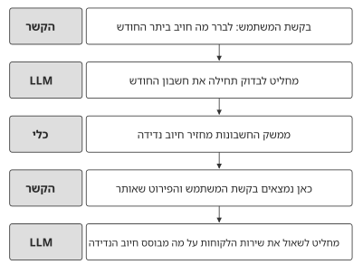
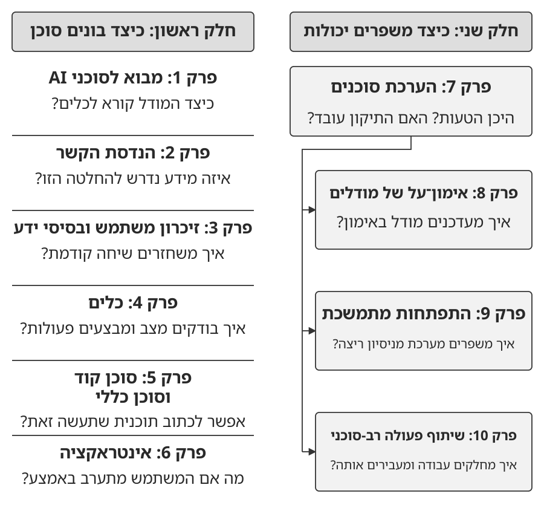

# הקדמה {.unnumbered}

מאוגוסט 2025 ועד תחילת 2026 העברתי ב‑Turing קורס וידאו מקוון בשם "מחנה האימונים לסוכני AI". הקורס עסק בבניית סוכני AI (Agent) בשיטות הנדסיות שאפשר להסביר, לאמת ולעשות בהן שימוש חוזר. הוא מתחיל בהרצת סוכן, ולאחר מכן מנתח מדוע הסוכן בנוי בארכיטקטורה הזו: איזו בעיה פותרת כל החלטת עיצוב, מה מחירה ולאילו משימות היא מתאימה. ספר זה נכתב על בסיס הערות ההרצאה והניסויים הנלווים לקורס.

> **כיצד נוצר הספר: תרגול בשיתוף פעולה בין אדם למכונה**
>
> בהכנת כל שיעור הכתבתי תחילה את המתווה לסוכן הקול של Pine, ונתתי לו לאסוף חומרים ולנסח טיוטה ראשונה. שיתוף פעולה מבוסס הכתבה כזה נקרא **whisper coding**. אחרי השיעור, בכל מקום שבו התלמידים נתקעו או שתוצאת ניסוי הפתיעה אותם, חזרתי ובדקתי מחדש את הדוגמה ואת הטיעון הרלוונטיים.

מאז 2025 אני רואה שינוי חשוב: מרכז הכובד של מחקר ה‑AI ושל התעשייה מתרחב משיפור יכולות מודל היסוד אל הפעלת סוכנים שמבצעים משימות אמיתיות. בעקבות זאת, אימון מודלים ויישומם נקשרים זה בזה הדוק יותר. מודלי היסק כמו DeepSeek-R1 הראו כיצד למידת חיזוק משפרת יכולות במתמטיקה, בתכנות ובהיסק.[^preface-r1] למידת חיזוק סוכנית (Agentic Reinforcement Learning) מכניסה לאימון קריאות לכלים ואינטראקציה עם הסביבה, וכך המודל לומד לתכנת וגם להפעיל ממשקים גרפיים. משימות מהסוג השני נקראות לרוב Computer Use: המודל מסיק את מצב העמוד מצילום מסך, ואז משלים את הפעולה בלחיצה, בהקלדה או בגלילה. מוצרים כמו Manus,‏ Claude Code ו‑OpenClaw מאפשרים למשתמשים להאציל משימות ישירות, והם גם מדגימים כיצד "יצירת קוד + מערכת קבצים" משמשת בסיס לסוכן כללי.

בספטמבר 2026 השיקה Meta את Muse. באותה תקופה צצו מוצרי סוכן אישיים בסין ובעולם כפטריות אחרי הגשם. רבות מהבעיות שהספר דן בהן פגשנו, אני והצוות שלי, עוד קודם לכן, כשבנינו את Pine. אני מכהן כמדען הראשי של Pine AI, ויחד עם עמיתיי פיתחתי את הסוכן האישי הזה, שמטפל בעניינים בשם הצרכן. כבר בתחילת ינואר 2025 פעל Pine בארצות הברית: משתמשים יכולים לבקש ממנו להתקשר לעסקים, לנהל משא ומתן על חשבונות, לבקש החזר כספי או לבטל מנויים.

כשנציג מסכים בטלפון לוותר על חיוב, מה ש‑Pine יכול לומר למשתמש באותו רגע הוא "הנציג הסכים"; כדי לומר "הכסף הוחזר" צריך לחכות שההחזר יופיע בחשבון. כדי לטפל בעניינים כאלה, עלינו לגרום למודל לזכור מה המשתמש אישר, לדעת מה לבדוק בשלב הבא ולהבחין עד איזה שלב התקדם הטיפול. כשהתעשייה התחילה מאוחר יותר לדבר על Skill,‏ Harness והנדסת לולאה (Loop), לא מעט מהשיטות שעלו בדיון היו בדיוק מה שגיששנו אליו בשיחות הטלפון ההן.

- **Skill.** טענו את הפרומפט הרלוונטי רק כשהמשימה נזקקה לו. כשמספר הכלים גדל, נתנו למודל לקרוא לכלים דרך שורת הפקודה, כך שלא היה צורך לפרט בכל בקשה את ההגדרות של כל הכלים.
- **Harness.** כתבנו לשורת המצב את סביבת הביצוע, את השעה הנוכחית ואת מצב העבודה של המשתמש, כדי שהמודל ייעזר בהם בקבלת החלטות. לעיתים המודל ממציא תוצאות, קורא לכלי הלא נכון או מדלג על הוראות, ופעולות מסוכנות עלולות אף לחרוג ממה שהמשתמש אישר. לכן הוספנו אילוצים לתהליך הביצוע; מאוחר יותר ראינו גישה דומה גם ב‑Claude Code.
- **הנדסת לולאה.** לעיתים המודל מכריז שסיים כשהעבודה גמורה רק למחצה. נתנו לסוכן אחד לבצע את המשימה ולסוכן אחר לבדוק את החשבון או את ההזמנה, וכל דבר שנמצא שלא בוצע הוחזר להשלמה. זוהי חלוקת התפקידים בין מציע לסוקר (proposer-reviewer).

צוותי מודלים וסוכנים אחרים, שהתמודדו עם בעיות דומות, הגיעו באופן עצמאי לשיטות דומות. הדבר חיזק את שכנועי שרבים מהקשיים שהצוות שלנו נתקל בהם הם בעיות משותפות לכל מערכת סוכנים שיוצאת לשימוש מעשי. מלבד "מחנה האימונים לסוכני AI", לימדתי בשנים 2024–2026 ברציפות קורס מעשי בסוכנים באוניברסיטה של האקדמיה הסינית למדעים. השאלות של התלמידים בשני הקורסים עזרו לי לזהות אילו לקחים עדיין דורשים הסבר ברור יותר. הספר מתפרסם כקוד פתוח, מתוך תקווה שחוקרים ומהנדסים נוספים ישתמשו בשיטות האלה, יבחנו אותן וישפרו אותן.

**הפרקטיקה קודמת, השם מגיע אחר כך**. לצוותי פיתוח יש לכך משמעות נוספת: כשמונח הופך לקונצנזוס בתעשייה, הצוותים המובילים כבר חקרו את הבעיה זמן רב. כדי לצבור יתרון הנדסי משלכם, עליכם לגלות בעיות מוקדם מתוך עסק אמיתי ולנסות לפתור אותן. לשם כך, לדעתי, נדרשים שני תנאים מרכזיים.

**ראשית, בחרו עסק אמיתי שמציב דרישות גבוהות דיין ליכולות הסוכן, והמשיכו לקבל ממנו משוב.** משימה אחת של Pine יכולה להימשך שעות ואף שבועות ולחייב תקשורת עם כמה צדדים: שיחות טלפון ארוכות, מילוי טפסים מורכבים וסבבים רבים של דוא"ל — ובמקביל להקפיד על מספרים מדויקים ועל פעולות מבוקרות, ולשמור על האינטרסים של המשתמש. תרחישים כאלה חושפים שוב ושוב את הפער בין יכולות המודל לדרישות העסק, ודוחפים את הצוות לשפר את ה‑Harness. אם עיקר הערך של מוצר הוא כיסוי חולשה של דור מודלים מסוים, שדרוג המודל הבא עלול לייתר את הערך הזה, וקשה יהיה לצוות לצבור יתרון מתמשך.

**שנית, בנו מנגנון הערכה (Evaluation) שיטתי.** אחרי שינוי במערכת, הצלחה אחת במשא ומתן על חשבון יכולה לנבוע מכך שהעוזר שאל את השאלות הנכונות, אבל גם מכך שהנציג שנפל בחלקו היה במקרה מוסמך להעניק הנחה. השוואה חוזרת בין הגרסה הישנה לחדשה על אותה קבוצת מקרים מראה אם ההבדל יציב. פרק 7 מסביר בפירוט כיצד לקבוע קריטריוני הצלחה, לבנות סביבת הערכה, לנתח כשלים ולבדוק שינויים.

ב‑Pine למדנו מההנחות בחשבונות שיטה אחת: לשלוח את הסוקר לבדוק את הסכום עצמו בחשבון. כשמיישמים את אותה שיטה בשינוי כרטיס טיסה, צריך לבדוק אם הכרטיס החדש אכן הונפק. הראיה הקונקרטית משתנה מעסק לעסק, אבל מאחוריה עומד עיקרון משותף: כדי לקבוע אם משימה הושלמה, בודקים איזו תוצאה הותירה הפעולה בעולם החיצוני. **עקרונות טובים שורדים מעבר למחזורי האיטרציה של המודלים**.

## שליחות הספר {.unnumbered}

נניח שמישהו מוסר לעוזר חשבון טלפון נייד ומבקש ממנו לפנות לחברת הסלולר ולנהל משא ומתן על הנחה. לפני שהוא מתחיל, העוזר צריך לברר איזה חיוב שנוי במחלוקת; במהלך השיחה עליו להקשיב להסברים ולברר את התנאים; ובסיום עליו לומר למשתמש מה בדיוק הסכים הנציג. בכל צעד העוזר צריך לענות על שלוש שאלות: מה הוא יודע ברגע זה? אילו פעולות הוא יכול לבצע? על סמך מה הוא בוחר את הצעד הבא? הספר יוצא משלוש השאלות האלה ומציג את המבנה של סוכנים, את שיטות בנייתם ואת גבולות יכולתם. נוסחת הליבה היא **סוכן = LLM + הקשר + כלים**: ה‑LLM אחראי על הבנה, תכנון וקבלת החלטות; ההקשר נושא את המידע הנדרש להחלטה הנוכחית; והכלים מחברים את הסוכן לסביבה החיצונית, כדי לקבל תצפיות או לבצע פעולות.

במטפורה אינטואיטיבית, ה‑LLM הוא "המוח", ההקשר הוא "שדה הראייה של ההחלטה הנוכחית", והכלים הם "החושים והגפיים". שדה הראייה כולל מידע סביבתי, היסטוריית שיחה, זיכרון וידע, וגם הוראות מערכת, הגדרות כלים ומצב המשימה. חיפוש, קריאה וצילום מסך מביאים מידע; לחיצה, כתיבה וקריאה לממשקים עסקיים משנות את המצב החיצוני. איור 0-1 מפרק שאילתת חשבון אחת לשלביה. בהחלטה הראשונה המודל יודע רק שהמשתמש מפקפק בחיוב; בשנייה הוא כבר יכול להצביע על הסכום שעליו יש לשאול.



קוראים המכירים למידת חיזוק (Reinforcement Learning,‏ RL) יכולים להבין את חלוקת התפקידים הזו גם במונחים של מדיניות, תצפיות ופעולות. ה‑LLM בוחר את הצעד הבא על סמך ההקשר, ולכן תפקיד ההחלטה שלו קרוב למדיניות (Policy); ההקשר נושא את התצפיות ואת ההיסטוריה הקונקרטיות שההחלטה הזו משתמשת בהן; והכלים מספקים את ממשקי התצפית והפעולה. מרחב התצפית (Observation Space) מתאר אילו תצפיות אפשר לקבל, ומרחב הפעולה (Action Space) מתאר אילו פעולות מותר לבצע; יחד הם תוחמים את היקף האינטראקציה של הסוכן עם הסביבה.[^preface-spaces] פרק 1 יפתח מושגים אלה דרך דוגמאות של קריאה לכלים, ויציג את חלוקת העבודה בין Model ל‑Harness במימוש בסביבת ייצור.

> **הרחבה למחשבה: מחיים לישויות מעוצבות**
>
> מעבר לפרקטיקה ההנדסית, סוכנים מעוררים גם שאלות על התפתחותן של מערכות אינטליגנטיות. ריצ'רד סאטון (Richard Sutton), חתן פרס טיורינג וחלוץ למידת החיזוק, מסכם את התפתחות היקום בארבעה שלבים: אבק, כוכבים, חיים ו"ישויות מעוצבות" (designed entities).[^preface-sutton] יצורים ביולוגיים מתפתחים באמצעות מוטציה אקראית וברירה טבעית, ואילו ישויות מעוצבות יכולות להיבנות ולהשתפר באופן מכוון בידי מערכות אינטליגנטיות קיימות.
>
> סוכן יכול לייצר קוד, לבנות סוכן חדש, ואז לנתח את התנהגותו בזמן ריצה, להציע שינויים ולאמת את התוצאות — וכך להגיע בהדרגה לאתחול עצמי (bootstrap) ולהתפתחות מתמשכת. זה דומה למתכנת שכותב מתכנת אחר, וזה ממשיך בתורו לבנות מערכות חדשות. האפשרות הזו, להבין את עצמך ולשפר את עצמך, היא מהשאלות שעניינו אותי במיוחד בכתיבת שני הפרקים על יצירת קוד ועל התפתחות מתמשכת.

## מבנה הספר {.unnumbered}

איור 0-2 מציג את הקשרים בין הפרקים. אם המשתמש משנה את דעתו באמצע שיחת הטלפון והעוזר ממשיך לפעול לפי הדרישה הישנה, אפשר להתחיל מפרק 6 בעמודה השמאלית ולראות כיצד העוזר מטפל בהתערבות של המשתמש. אחרי התיקון, איך יודעים שהעוזר יקלוט דרישות חדשות גם בשיחות אחרות? לשם כך נדרשות שיטות ההערכה של פרק 7 בעמודה הימנית. שלושת החצים שיוצאים מפרק 7 מראים שאחרי שמתקבלות תוצאות ההערכה, אפשר לבחור דרך שיפור שונה לפי סיבת הכשל.



- **פרק 1 (צעדים ראשונים עם סוכני AI)** מציג, דרך דוגמאות של מוצרים ושל קריאה לכלים, את רכיבי הליבה, את לולאת הריצה, את ה‑Harness ואת דפוסי התזמור, ובונה את המסגרת המושגית להבנת הספר כולו.
- **פרק 2 (הנדסת הקשר)** הוא הפרק החשוב ביותר בספר, והוא דן בארגון המידע שהמודל זקוק לו ברגע הנתון. הפרק מתקדם מעיצוב פרומפטים ומטעינה לפי דרישה אל ניהול ההיסטוריה, ומסביר בעזרת ה‑KV Cache כיצד שיטות אלה משפיעות על איכות התשובות ועל עלות הריצה.
- **פרק 3 (זיכרון משתמש ובסיס ידע)** דן בשמירה ובשליפה של מידע החוצה סשנים. הפרק מתקדם מזיכרון משתמש אל RAG, אינדקסים מובנים ועדכון ידע, ומקנה לקורא שיטות לאחזור ידע מתמיד ולתחזוקתו.
- **פרק 4 (כלים)** דן באופן שבו סוכן מקבל תצפיות, מבצע פעולות ומבקש שיתוף פעולה. דרך סיווג כלים, עיצוב ממשקים, MCP וניהול ביצוע, הקורא לומד כיצד לחבר יכולות חיצוניות למערכת.
- **פרק 5 (סוכן קוד וסוכן לשימוש כללי)** מציע קו ארכיטקטוני מרכזי לסוכן כללי: סוכן קוד (Coding Agent) כליבת הביצוע ומערכת הקבצים כמרחב העבודה. הפרק פותח בתהליך הפיתוח, ואז מראה, דרך מקרי בוחן ממולטימדיה וממערכות עסקיות, כיצד סוכן כותב תוכניות כדי לפתור בעיות, ומשם ממשיך ליצירת כלים ולבניית סוכנים חדשים.
- **פרק 6 (אינטראקציה: הרחבת מרחבי התצפית והפעולה)** דן באופני האינטראקציה של הסוכן לאורך שני צירים: מודאליות ותזמון. דרך אירועים אסינכרוניים, קול, Computer Use ורובוטים, הקורא לומד על תצפית מתמשכת, על נתיבים מהירים ואיטיים ועל בקרת ביצוע.
- **פרק 7 (הערכת סוכנים)** עונה על השאלה כיצד לשפוט את ביצועי המערכת ואת השפעתו של שינוי בודד. תחילה נקבעים קריטריוני הצלחה, סביבה ומערך נתונים; אחר כך הפרק עוסק במאמתים, בציינון ובניתוח סטטיסטי; ולבסוף הוא מראה כיצד ניתוח סיבות הכשל מצביע על כיוון השיפור.
- **פרק 8 (אימון־על של מודלים)** דן בעדכון יכולות המודל באמצעות נתונים וסביבות, וטוען שיש להשקיע קודם כול באיכות הנתונים ובסביבת האימון. דרך כוונון עדין מפוקח, למידת חיזוק ועיצוב תגמולים, הפרק מסביר מדוע למידה מהדגמות וחקירה מובילות להכללה שונה, ומדוע שינוי האלגוריתם לבדו מניב לרוב תועלת מוגבלת.
- **פרק 9 (התפתחות מתמשכת של סוכנים)** דן בניצול ניסיון הריצה לשיפור הגרסאות הבאות של הסוכן. הפרק משווה ארבעה סוגי עדכונים — ידע, הוראות, תוכניות ופרמטרים — ומנהל את השינויים ארוכי הטווח בתהליכי אימות, שחרור ושחזור.
- **פרק 10 (שיתוף פעולה רב‑סוכני)** דן בשאלה מתי חברים מרובים מוסיפים ערך, וכיצד לחלק ביניהם עבודה, לתקשר ולתאם. תחילה הפרק מסביר כיצד מוקצים ההקשר והשליטה, אחר כך מציג מנגנוני שיתוף פעולה דרך מקרי בוחן ומנתח סיבות כשל, ולבסוף דן בצורות האפשריות של חברת סוכנים וכלכלת סוכנים.

## כיצד לקרוא ספר זה {.unnumbered}

- **בניית מוצר סוכן מאפס**: מומלץ לקרוא את הספר כולו. בעזרת פרקים 1 עד 6 בנו עוזר שמסוגל לבצע משימות, ואז בדקו בעזרת פרק 7 באילו משימות הוא נוטה לטעות. שלושת הפרקים האחרונים דנים בשיפור המודל, המערכת או חלוקת העבודה בין החברים על סמך הכשלים האלה.
- **קודם כול תמונה כוללת**: קראו את פרקים 1, 2, 4 ו‑7 לפי הסדר. עקבו אחר קריאה אחת לכלי: תחילה הכירו את לולאת הריצה של הסוכן, אחר כך ראו איזה מידע המודל מקבל ומה הכלי עושה בפועל, ולבסוף השתמשו בהערכה כדי לקבוע אם התוצאה עונה על דרישות המשתמש. כשפרק 2 מגיע ל‑KV Cache, בקריאה ראשונה מספיק לשלוט בשלוש המסקנות שבפתיחה, ולחזור לעקרונות שבבסיס אחרי שעשיתם את הניסויים.
- **התמקדות באימון מודלים**: הבינו תחילה בעזרת פרקים 1 ו‑2 כיצד סוכן פועל, ואז קראו את פרק 8 לצד שיטות ההערכה של פרק 7. כך תוכלו לקשר בין יעדי האימון לביצועים במשימות אמיתיות.
- **תחזוקת סוכן שכבר פועל בייצור**: בחרו קבוצת משימות אמיתיות והעריכו אותן לפי פרק 7. למשל, אם העוזר מסר למשתמש מחיר ישן, בדקו קודם איזו גרסה של הצעת המחיר הוא קיבל. אם הידע או התהליך התיישנו, קראו את פרק 9 כשהכשל הזה לנגד עיניכם; אם הצעת המחיר והכלים סופקו במלואם, והמודל ממשיך לבחור שוב ושוב באפשרות הלא נכונה גם אחרי תיקון התהליך, קראו את פרק 8 ושקלו אם כדאי להכין נתוני אימון.

בכל פרק יש ניסויים ושאלות למחשבה. הניסויים ממוספרים בתבנית "ניסוי X-Y", כאשר X הוא מספר הפרק ו‑Y הוא המספר הסידורי בתוך הפרק. הכוכבים מציינים רמת קושי: ★ מתאים למתחילים, ★★ דורש ניסיון הנדסי מסוים, ★★★ כרוך בשאלות פתוחות או בעיצוב מערכות מורכבות. לרוב הניסויים יש קוד בר‑הרצה, המרוכז במאגר קוד פתוח:

> **מאגר הקוד הנלווה**: `bojieli/ai-agent-book`

אם זו הפעם הראשונה שאתם עושים ניסוי, אפשר להתחיל ב"ניסוי 1-1: התפקיד המכריע של ההקשר". אם אתם משתמשים ב‑Git, הריצו בטרמינל:

```bash
git clone https://github.com/bojieli/ai-agent-book.git
cd ai-agent-book
```

אפשר גם לבחור בעמוד המאגר **Code → Download ZIP** ולחלץ את הקובץ, ותתקבל אותה תיקייה. באינדקס הניסויים של פרק 1 (`chapter1/README.md`) מצאו את מספר 1-1, ופתחו את `chapter1/context/README.md`. מכאן והלאה, בכל פעם שתפגשו "ניסוי X-Y", תמצאו את הפרויקט ואת הוראות ההרצה בקובץ `chapterX/README.md` שבמאגר. "מדריכי השחזור" מפרטים פרויקטים חיצוניים ואת הדרך להשיג אותם, ופקודות ההתקנה וההסברים על מבנה התיקיות מרוכזים בקובצי ה‑README.

## ידע מוקדם נדרש {.unnumbered}

הספר מיועד לקוראים בעלי יכולת תכנות בסיסית, המעוניינים להבין סוכנים ולבנות אותם. לביצוע הניסויים תזדקקו ליסודות הבאים.

**נדרש: יסוד לקריאת הספר כולו**

- **תכנות ב‑Python**: היכרות עם התחביר, עם מבני נתונים נפוצים ועם כלי ניהול חבילות כמו pip, ויכולת לקרוא ולשנות את קוד הניסויים. רוב הניסויים בספר מבוססים על Python.
- **ניסיון בשימוש ב‑LLM**: שימוש ב‑ChatGPT,‏ Claude או מוצרים דומים, והיכרות עם התהליך הבסיסי של ניסוח בקשה, קריאת התשובה ושאלות המשך.
- **ידע כללי בהנדסת תוכנה**: היכרות עם שורת הפקודה, Git,‏ JSON ו‑REST API, כדי להריץ פרויקטים, לבדוק שינויים ולקרוא נתוני ממשק.

בעבודה על הניסויים אני ממליץ בחום לבחור באחד הכלים Claude Code,‏ Codex,‏ Cursor או TRAE. בקשו ממנו לעזור לכם לנפות שגיאות בקטע קוד, וראו אילו קבצים הוא קרא ולאילו כלים קרא. כשתגיעו בהמשך ללולאת הריצה ולניהול ההקשר, תהיה לכם חוויה אישית להשוות אליה.

**מומלץ: ידע משלים לפי פרקים**

- **יסודות למידת מכונה (פרק 8)**: אימון ואינפרנס, פונקציות הפסד, ירידת גרדיאנט והתאמת יתר מסייעים להבין את תהליך עדכון המודל.
- **מתמטיקה בסיסית (פרקים 2, 3, 7, 8)**: וקטורים ומטריצות מסייעים להבין embeddings וקשב, והסתברות וסטטיסטיקה מסייעות להבין מדדי הערכה ותגמול צפוי. הספר מתמקד בהסברים אינטואיטיביים ובשימושים מעשיים.
- **יסודות פיתוח ווב (פרק 6)**: HTTP,‏ WebSocket וחלוקת העבודה בין צד לקוח לצד שרת מסייעים להבין ארכיטקטורת אירועים אסינכרונית ותקשורת קולית בזמן אמת.
- **יסודות Transformer (פרקים 2, 8)**: היכרות עם מנגנון הקשב ועם מבנה המודל מסייעת להבין את חישוב ההקשר ואת אימון־העל. קוראים המעוניינים בלימוד שיטתי יכולים לקרוא את *Hands-On Large Language Models* מאת Jay Alammar ו‑Maarten Grootendorst (במהדורה הסינית: 图解大模型, בתרגום Li Bojie, הוצאת Turing). הספר מסביר בעזרת איורים את ה‑Transformer, אימון מקדים וכוונון עדין, ומשלים את נקודת המבט ההנדסית של ספר זה.

מלבד אימון־העל בפרק 8, שאר הפרקים דורשים מעט מתמטיקה ולמידת מכונה, ומי שיש לו ניסיון תכנות בסיסי יכול להתחיל לקרוא.

## תודות {.unnumbered}

תודה לעורכות Meng Ge ו‑Liu Meiying מ‑Turing על עריכת הספר ועל המאמץ שהשקיעו בארגון "מחנה האימונים לסוכני AI"; ותודה לפרופסור Liu Junming על שפתח את הקורס המעשי בסוכנים באוניברסיטה של האקדמיה הסינית למדעים. תודה לתלמידים בשני הקורסים: השאלות, המשוב על הניסויים וההצעות שלכם עזרו לי לשפר את ההסברים שוב ושוב, והעמיקו את הבנתי במושגים האלה.

תודה לכל עמיתיי ב‑Pine AI. האתגרים של עסק אמיתי והדיונים בצוות הם המקור לרבות מהשיטות ומהדוגמאות בספר. הפרקטיקה והתובנות שלכם אפשרו לחדד את ההבנות האלה שוב ושוב.

תודה לחבריי בתעשיית ה‑AI. בשיחה אחר שיחה העליתם בכנות הערות, שיתפתם ניסיון ושיקולי דעת שונים, ועזרתם לי להבין לעומק מודלים וסוכנים.

יותר מכול, תודה למשפחתי, ובמיוחד לאשתי, Meng Jiaying. היא תמכה בי לאורך כל כתיבת הספר, והציעה הערות רבות ויקרות ערך לכתב היד.

[^preface-r1]: DeepSeek-AI, *DeepSeek-R1: Incentivizing Reasoning Capability in LLMs via Reinforcement Learning*, 2025.
[^preface-spaces]: הסעיף "Spaces" בתיעוד של Gymnasium.
[^preface-sutton]: ריאיון של Dwarkesh Patel עם Richard Sutton,‏ 2025-09-26, החלק "Succession to AI".
