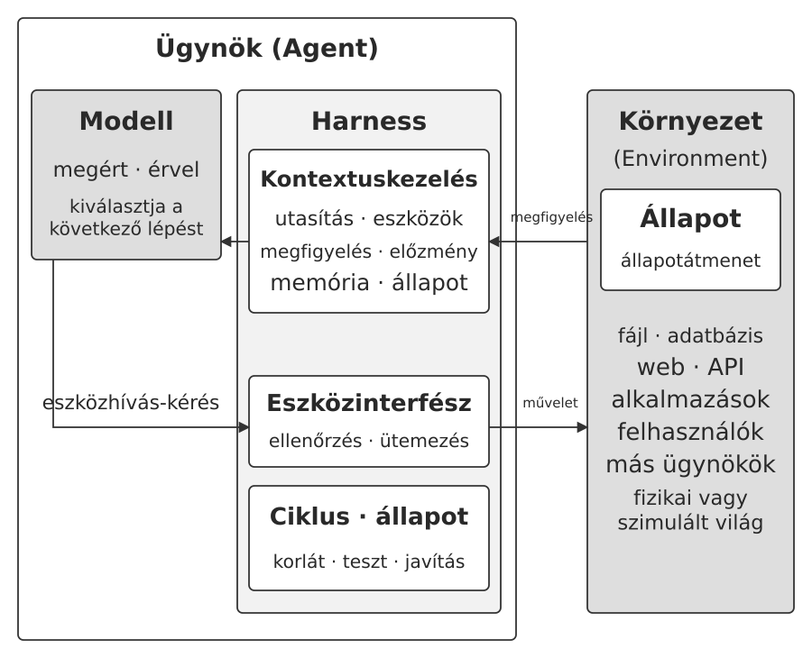
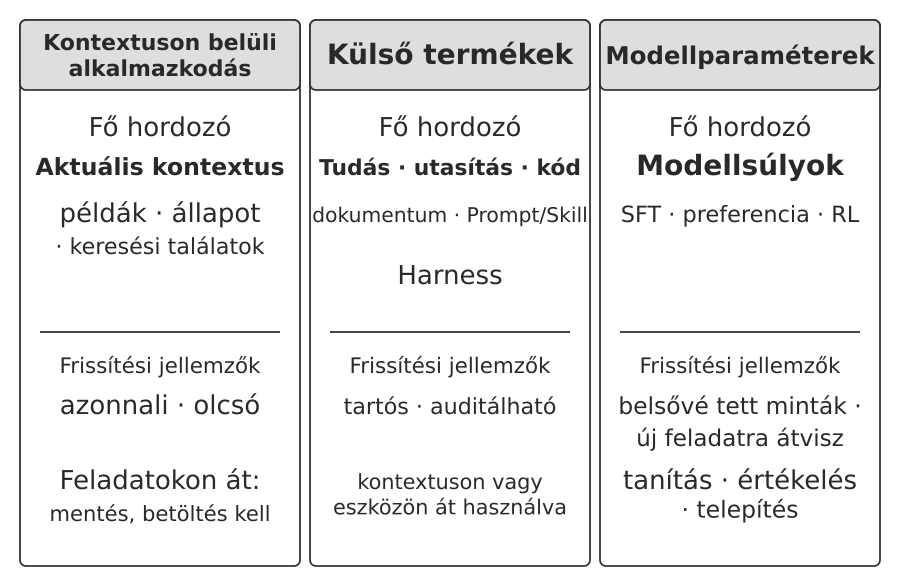
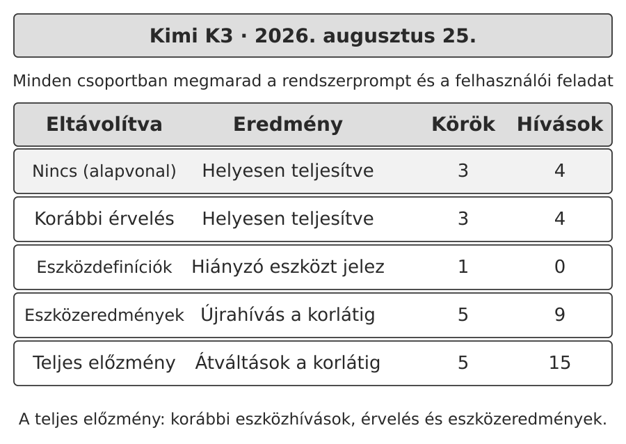
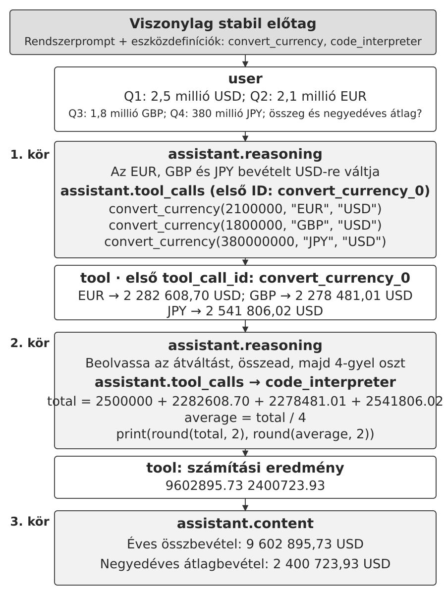
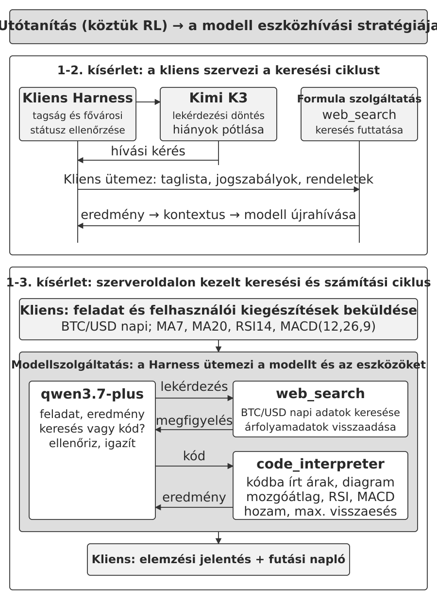
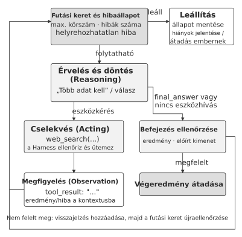
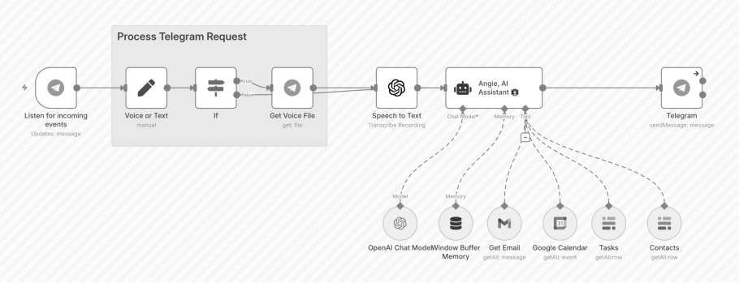

# Ismerkedés az AI-ügynökökkel

Ha a Deep Research-csel kutatunk egy témát, ismételten keres és olvas, végül jelentésbe rendezi az eredményt. A Manus böngészőt kezelve old meg online feladatokat, a Doubao telefonos asszisztens jegyet foglal és üzenetet küld a telefonon, a Pine AI pedig a felhasználó helyett telefonál, és alacsonyabb számlát alkudozik ki a szolgáltatónál. Mindezek AI-ügynökök (AI Agent) alkalmazásai.

Ha a Cursorral javítunk ki egy függvényt, megkeresi a függvényt, szerkeszti a fájlt, majd lefuttatja a teszteket. Ha a teszt továbbra is elbukik, a hibaüzenet lesz a következő módosítás kiindulópontja; csak ha a teszt átmegy, akkor van bizonyítéka arra, hogy beszámoljon az eredményről. A keresés, a szerkesztés és a tesztelés sorrendjét előre bele lehet írni egy programba, de hogy pontosan melyik sort kell módosítani, és hiba esetén hová kell visszatérni, az csak a végrehajtás közben szerzett információból derül ki. Ugyanez a folyamat – a cél felé vezető cselekvések kiválasztása, majd a terv igazítása az eredmények alapján – zajlik a kutatásban és a telefonos alkudozásban is.

## Modern ügynök = LLM + kontextus + eszközök

A könyv egyetlen képletbe sűríti a modern ügynök három funkcionális összetevőjét: **Ügynök = LLM (nagy nyelvi modell, Large Language Model) + kontextus + eszközök**.

- **Az LLM az ügynök agya**: ez érti meg a feladatot, tervezi meg a lépéseket és választja ki a cselekvést. Az előtanítás (pre-training) adja a modell nyelvi képességét és világismeretét, az utótanítás (post-training) pedig tovább formálja az utasításkövetést, az érvelést és az eszközhívást. A felügyelt finomhangolást, a megerősítéses tanulást és a többi utótanítási módszert a 8. fejezet mutatja be.
- **A kontextus az ügynök aktuális döntési látómezeje**: ebben van minden, amire az adott döntéshez szükség van – utasítások, eszközdefiníciók, környezeti megfigyelések, felhasználói memória, szakterületi tudás, korábbi üzenetek, az ügynök saját állapota és a feladat előrehaladása.
- **Az eszközök az ügynök érzékszervei és végtagjai**: interfészeken keresztül szereznek információt vagy hajtanak végre műveleteket. Az eszközrendszer definíciókból, hívási protokollból és adapterekből áll; egyaránt támogatja a megfigyelő műveleteket (keresés, olvasás, képernyőkép) és az írást, a kódfuttatást, az alügynökök megbízását és a felhasználóval való kommunikációt.

Ugyanaz az eszköz több szerepet is betölthet. Ha a modell parancssorból olvas be egy fájlt, a visszakapott tartalom a következő döntés alapja lesz; ha parancssorból programot futtat, azzal fájlok vagy folyamatok állapotát is megváltoztathatja.

Tegyük fel, hogy épp kibontottunk egy csomagot, és megkérdeznénk az ügyfélszolgálatot: „Visszaküldhetem még kibontás után?” A rendszer **visszakereséssel bővített generálással** (Retrieval-Augmented Generation, RAG) előkeresheti a bolt érvényes visszaküldési szabályzatát, majd a feltételek alapján kérhet választ a modelltől.[^ch1-rag] Egyetlen lekérdezés útját követve jól látszik, melyik összetevő miért felel. A szabályzat szövege és indexe külső tudásbázisban van; a keresőeszköz a kérdés alapján előkeresi a releváns bekezdéseket, a modellt hívó program pedig a forrásukkal együtt beteszi őket ebbe a kérésbe. Amikor a modell a „kibontás” pontot olvassa, el tudja magyarázni a feltételt; ha a szabályzat termékkategóriánként is különbözik, előbb meg kell kérdeznie, mit vásároltunk.

[^ch1-rag]: Patrick Lewis és mtsai., Retrieval-Augmented Generation for Knowledge-Intensive NLP Tasks, NeurIPS, 2020.

Ebben a visszaküldési lekérdezésben a keresés elindítása az ügynök cselekvése, a visszakapott feltétel pedig a környezettől (Environment) kapott megfigyelése. Hogy a következő lépés válasz lesz-e vagy visszakérdezés, attól függ, mi áll a feltételben. Ez az a zárt hurok, amelyről a megerősítéses tanulás és az irányításelmélet beszél, ahogy az 1-1. ábra mutatja.



Az ábra külső rétege az ügynök és a környezet határát jelöli. Fájlok, adatbázisok, weboldalak, felhasználók, más ügynökök, a fizikai vagy a szimulált világ – mindez lehet a környezet, amellyel az ügynök kölcsönhatásba lép. A belső réteg az éles megvalósítás munkamegosztását mutatja: **a Modell a megértésért, az érvelésért és a döntésért felel; a Harness az ügynök határán belül, de a Modellen kívül helyezkedik el, megszervezi a kontextust, az eszközinterfészeket, a futási ciklust és az állapotot, valamint korlátoz, ellenőriz és javít.** A Harness létrehozhat, elszigetelhet vagy közvetíthet környezetet; a fájlok tartalma, a folyamatok állapota és hasonlók viszont a cselekvések nyomán a környezetben változnak.[^ch1-harness]

[^ch1-harness]: Lásd a LangChain „The Anatomy of an Agent Harness” és az Anthropic „Effective harnesses for long-running agents” című írását. Egyes megvalósítások a sandboxot is a Harnesshez számítják; az 1-1. ábra a környezetet külön rajzolja meg, hogy könnyebb legyen követni, mit változtat meg ténylegesen egy cselekvés.

A könyv ezért két, egymást kiegészítő felbontást használ: **az „LLM + kontextus + eszközök” a funkcionális összetételt írja le, a „Modell + Harness” az éles megvalósítást.** A kontextust a Harness szervezi meg és adja át a Modellnek; az eszközhívásról a Modell dönt, a Harness ellenőrzi és ütemezi, végül az eszköz vagy a környezet hajtja végre. Egy egyszerű rendszer indulhat a kontextus összeállításával és az eszközök ütemezésével, és fokozatosan pótolhatja az éles működéshez szükséges korlátozó, ellenőrző és javító mechanizmusokat.

Aki ismeri a megerősítéses tanulást, három kérdés mentén olvashatja az alábbi táblázatot: ki dönti el a következő lépést, mi alapján, és hogyan valósul meg a cselekvés. A megfeleltetés funkciók szerinti, durva analógia.

| Szemléletes kép | Mérnöki összetevő | Kapcsolódó fogalom a megerősítéses tanulásban | Jelentés |
|-----------|-----------|----------------------------|----------------------------------------------|
| **Agy** | LLM | **Policy** (stratégia) | Az aktuális információk alapján eldönti, mi legyen a következő lépés |
| **Aktuális döntési látómező** | Kontextus | **Megfigyelések és előzmények** | A környezettől kapott információt és az eddigi előzményeket döntési alappá rendezi |
| **Érzékszervek és végtagok** | Eszközök és adapterek | **Megfigyelési és cselekvési interfészek** | Rögzíti, hogyan olvasható a környezet, hogyan küldhető cselekvés, és milyen a hívás és a válasz formátuma |

### Megfigyelési tér és cselekvési tér: a modell és a világ közötti interfész

**A megfigyelési tér azt írja le, milyen megfigyeléseket kaphat az ügynök, a cselekvési tér pedig azt, milyen cselekvéseket indíthat.** Egy hívásban a konkrét információt a kontextus hordozza, a környezettel való kapcsolatot pedig az elérhető eszközök biztosítják. Az eszközökön kívül a felhasználói bemenet és az eseményértesítések is hozhatnak megfigyelést; a cselekvések körét az eszközhívás paraméterei, a jogosultságok és a futtatókörnyezet együtt határolják be.

Képzeljünk el két különböző hibát. Az elsőben a modell a számla minden tételét meg tudja magyarázni, de a havi számlához nem fér hozzá. Miután a felhasználó engedélyezte az olvasást, a számlát elő is kell keresni és át kell adni a modellnek – csak ezután tudja megítélni, melyik díj vitatható. A másodikban a felhasználó tarifacserét kér, az asszisztens már megtalálta a megfelelő csomagot, de a fiókinterfész csak lekérdezést enged. Akárhányszor olvassa is újra a számlát, a módosítást nem tudja elvégezni: ehhez megfelelő műveleti jogosultság kell. A Harness feladata, hogy a beolvasott anyagot a kontextusba tegye, átvegye a modell által választott cselekvést, ellenőrizze a paramétereket és a jogosultságokat, majd ütemezze a végrehajtást.

Ezért **rögzített alapmodell mellett a megfigyelési és a cselekvési tér hangolása a feladatteljesítmény javításának egyik legfontosabb mérnöki eszköze.** Ha a modell átsiklik egy kulcsfontosságú tény fölött, a vonatkozó adatokat bevihetjük a kontextusba; ha gyakran választja rosszul a hasonló eszközök közül, összevonhatjuk az ismétlődő interfészeket, vagy csak az aktuális feladathoz szükséges eszközöket tölthetjük be.

Videó nézésekor az ellenkező problémával találkozunk: a kép folyamatosan megvan, de kevés olyan változás történik, amely miatt érdemes újra dönteni. Tegyük fel, hogy az asszisztens egy fájlfeltöltés végére vár. Ha a folyamatjelző minden mozdulatára meghívja a fő modellt, rengeteg fölösleges számítás keletkezik; ha csak tízmásodpercenként néz rá, elmulaszthat egy pillanatra felvillanó hibaüzenetet. **Úgy gondolom, a megfigyelési tér ritkítása az ügynöktervezés egyik alapkérdése.** A rendszer folyamatosan figyelheti a környezetet, de csak azokat a változásokat adja át a szükséges kontextussal együtt a fő modellnek, amelyek megváltoztathatják a következő cselekvést.

**Manus: kutatás, programozás és számítógép-vezérlés egyetlen feladatban.** A Deep Research a keresésben és az olvasásban erős, a kódoló ügynök (Coding Agent) kódot ír és futtat, a számítógép-vezérlő ügynök (Computer Use Agent) felületeket kezel. A Manus a böngészőt, a fájlrendszert, a kódfuttatást és a parancssort egy felhőbeli sandboxba integrálja, így ugyanaz az ügynök előbb anyagot gyűjthet, aztán fájlokat dolgozhat fel és kódot futtathat, végül a böngészőben fejezheti be a műveletet. A böngésző és a fájlolvasás bővíti a megszerezhető információt, a kód- és parancsfuttatás pedig a kombinálható műveleteket. **Úgy gondolom, ez a kombináció az általános ügynökök fontos áttörése: ugyanaz az ügynök átlépheti a korábban különálló termékek határait, és teljes feladattá fűzheti össze az anyaggyűjtést, az adatfeldolgozást és a műveletek végrehajtását.**

**OpenClaw: az interfész kiterjesztése a felhasználó digitális életére.** Az OpenClaw WhatsAppon, Telegramon, Slacken, Discordon, iMessage-en és más üzenetküldő csatornákon fogadja a feladatokat és adja vissza az eredményeket, a felhasználó eszközén futó Gateway pedig összeköti az üzenetküldő csatornákat, a modellt és az eszközöket. A megfelelő eszközök beállítása és engedélyezése után az ügynök helyi fájlokat is feldolgozhat, és felhőszolgáltatásokhoz, például a Google Drive-hoz vagy a Notionhöz is csatlakozhat. A felhasználó fiókjai és eszközei között szétszórt anyagok így egyetlen feladat feldolgozásába kerülhetnek be. A korai Manus főként a felhőbeli sandboxban dolgozott, a fájlokat a felhasználónak kellett feltöltenie; a később megjelent Google Drive-csatlakozó és a My Computer asztali funkció tovább bővítette a felhőbeli fájlok és a helyi erőforrások elérését. Ezek a változások azt mutatják, hogy a termékek képességeinek növekedése gyakran a megfigyelési és cselekvési interfészek kiterjesztéséből fakad[^ch1-agent-products].

[^ch1-agent-products]: A termékek felépítését lásd a Manus hivatalos Sandbox-, Google Drive Connector- és My Computer-bemutatójában, valamint az OpenClaw hivatalos tárolójában és eszközdokumentációjában. Hogy pontosan mely erőforrások érhetők el, azt a csatlakozók, az eszközbeállítások és a felhasználói engedélyek határozzák meg.

A termékek feladatai különböznek, de mindegyik megérthető három szempontból: mi alapján dönt, milyen műveletek érhetők el, és milyen végrehajtási stratégiát követ:

| Ügynöktermék | A kontextus fő információi | Elérhető eszközök és műveletek | Végrehajtási stratégia |
|----------------|----------------------|----------------------------|------------------------------|
| **Kódoló ügynökök (pl. Cursor)** | Követelmények, kódrészletek, könyvtárlisták, terminálkimenet | Kódkeresés, fájlolvasás és -írás, parancsfuttatás | Követelmények megértése → releváns kód keresése → kód szerkesztése → tesztelés és ellenőrzés → hibakeresés és javítás |
| **Kereső ügynökök (pl. Deep Research)** | Keresési találatok, weboldalak tartalma, cikkek kivonatai és hivatkozásai | Keresőlekérdezések, weboldalak olvasása, jelentés készítése | A meglévő információk alapján módosítja a keresés irányát, és fokozatosan teljes jelentéssé szintetizálja az eredményt |
| **Számítógép-vezérlő ügynökök (pl. Browser Use)** | Képernyőképek, DOM vagy akadálymentességi fa, műveletek eredményei | Kattintás, gépelés, görgetés, képernyőkép, kódfuttatás | Felület beolvasása → célelem azonosítása → művelet végrehajtása → eredmény ellenőrzése |
| **Telefonos asszisztens ügynökök (pl. Doubao)** | Képernyőképek a telefonról, az alkalmazás felületének állapota, rendszervisszajelzések | Koppintás, csúsztatás, gépelés, alkalmazás megnyitása | Igény megértése → célalkalmazás megtalálása → művelet végrehajtása → teljesítés megerősítése |
| **Személyes ügyintéző ügynökök (pl. Pine AI, Meta Muse)** | Engedéllyel beolvasott fiókadatok, számlák, szolgáltatói információk | Telefonálás, e-mail-küldés, űrlapkitöltés, egyeztetés a felhasználóval | Információgyűjtés → tárgyalási stratégia kialakítása → kapcsolatfelvétel a szolgáltatóval → tárgyalás → beszámoló az eredményről |

**Hogyan lesz egy megbízásból végrehajtható feladat?** Amikor a Pine-nál személyes ügyintéző asszisztenst építettem, azt tapasztaltam, hogy a felhasználók gyakran csak egy célt mondanak, például: „Foglalj repülőjegyet az üzleti utamra, lehetőleg legfeljebb 1200 jüanért.” Az asszisztensnek először tisztáznia kell a dátumot, az úti célt és azt, mi a legfontosabb ezen az úton, aztán össze kell gyűjtenie a hiányzó adatokat, meg kell beszélnie a felhasználóval, hogyan intézné az ügyet és miben lehet engedni – csak ezután keresheti meg a szolgáltatót. Az ügyintézés közben felbukkanó új körülmények a feladatot egy korábbi lépéshez is visszavihetik.

Tegyük fel, hogy az ügyfélszolgálat által talált legolcsóbb jegy 1250 jüan. A modell a józan ész, az adott út és a felhasználó megjegyzett szokásai alapján dönt. Ha a felhasználó épp üzleti úton van, és általában hajlandó egy kicsit többet fizetni a megfelelő útvonalért, a Pine akár azonnal le is foglalhatja; ha viszont családi kirándulásról van szó, és a felhasználó korábban kifejezetten figyelt a teljes költségre, előbb jelezheti neki a különbözetet, és megkérheti az ügyfélszolgálatot, hogy keressen más járatot. Ha a felhasználó utólag hozzáteszi: „Legközelebb, ha a jegy túllépi a keretet, előbb kérdezz meg”, ez a visszajelzés az általános tapasztalatnál konkrétabb alapot ad a következő döntéshez.

Vegyünk egy másik helyzetet: a bank ügyfélszolgálata azt javasolja, hogy a dokumentumokat postán küldjék el a felhasználó otthoni címére, az asszisztens viszont emlékszik rá, hogy a felhasználó éppen külföldön utazik. Ezúttal a kézbesítés módján kell változtatni: az asszisztens azonnal elmondhatja, hogy a postai átvétel nehézkes, és kérheti, hogy e-mailben küldjék a dokumentumot. Számlacsökkentésnél pedig, ha az ügyfélszolgálat telefonon szóban beleegyezik, az asszisztens pontosan beszámolhat a cég ígéretéről; hogy az összeget ténylegesen levonták-e, azt viszont csak egy későbbi számla mint új megfigyelés igazolhatja. Egy asszisztens cselekvési tere kiterjedhet valódi telefonhívásokra, a következtetéseit azonban továbbra is a megfigyelési tere korlátozza.

A megbízások jellege szerint a könyvben háromféle alkalmazással találkozunk: mindennapi ügyintézéssel, irodai együttműködéssel és tudományos kutatással. Ugyanaz az asszisztens többféle feladatot is elvállalhat; a különbség abban rejlik, ki hatalmazza fel, mit változtathat meg, és ki veszi át végül az eredményt. Az irodában vajon lezárható-e a munkajegy, ha egy kolléga visszaadja az ellenőrzés eredményét? Tegyük fel, hogy a projektvezető egy Multica-munkajegyben név szerint megkéri az asszisztenst, hogy nézzen utána egy eltérésnek a költségvetési táblában. A megjegyzés elindítja az ellenőrzést, a munkajegy azonban az eredeti felelősnél marad, és az állapota sem változik. Az asszisztens visszaadja a két összeget és a forrásukat, ezzel megválaszolja a kolléga kérdését; hogy a teljes költségvetés benyújtható-e, azt viszont a felelősnek kell eldöntenie, a többi nyitott tennivalót is figyelembe véve.[^ch1-multica]

A kutatási feladatoknál ugyanez a kérdés merül fel: mi alapján mondhatjuk, hogy előrelépés történt? Amikor a Google DeepMind AlphaEvolve rendszere mátrixszorzási algoritmusokat keresett, a modell programjelölteket javasolt, egy kiértékelő lefuttatta őket, és ellenőrizte, helyes-e a szorzat, illetve hány szorzást használtak. A további keresés a jól teljesítő programokat fejleszthette tovább. A kutatócsoport beszámolója szerint az egyik talált algoritmus 48 skalárszorzással elvégzi két $4\times 4$-es komplex mátrix szorzását. A „néhány szorzással kevesebb” állításnak egyértelműen megszámolható tárgya van, és az algoritmusnak ráadásul helyes mátrixszorzatot is kell adnia.[^ch1-alphaevolve]

[^ch1-multica]: Multica: ügynök név szerinti megszólítása munkajegy-megjegyzésben. A 10. fejezet tárgyalja, hogyan különíthető el az együttműködésben az alkalmi segítségkérés a felelősség átadásától.

[^ch1-alphaevolve]: Google DeepMind, AlphaEvolve kutatási ismertető, 2025. május. A szorzások száma itt az algoritmusban szereplő skalárszorzások számát jelenti; a tényleges futásidő a megvalósítástól és a hardvertől is függ.

Ezeknek a rendszereknek a cselekvési tere **nyitott**. A keresőkifejezéseket, a begépelt szöveget, a generált kódot és a műveletek kombinációit nehéz előre kimerítően felsorolni, ugyanakkor minden cselekvést korlátoznak az eszközök, a paraméterek, a jogosultságok és a futtatókörnyezet. Éppen ezért egy végrehajtható tervnek teret kell hagynia arra, hogy az új megfigyelések megváltoztassák a következő lépést.

### Eszközök: az ügynök érzékszervei és végtagjai

Az eszközök a modell döntéseit a külső környezet olvasásává vagy módosításává alakítják. A kereső és olvasó eszközök megfigyeléseket hoznak vissza, a fájlírás, a parancsfuttatás és hasonló eszközök cselekvéseket hajtanak végre. A modell a visszakapott eredményből tudja meg, mi lett a művelet hatása, és ennek alapján dönt arról, hogy folytatja, újrapróbálja vagy befejezi a feladatot.

Fő rendeltetésük szerint a könyv öt csoportba sorolja az eszközöket. Egy interfész több rendeltetést is szolgálhat: a hanghívás például információt is szerez, és kérést is továbbít.

**Az észlelő eszközök** információt szereznek: a keresőmotor webes anyagokat szolgáltat, a fájlolvasó eszköz helyi dokumentumokhoz fér hozzá, az API- és adatbázis-interfészek pedig külső szolgáltatásokhoz és vállalati adatokhoz kapcsolódnak.

**A végrehajtó eszközök** műveleteket hajtanak végre: kódot futtatnak, fájlokat módosítanak, rendszerparancsokat adnak ki vagy külső API-kat hívnak, és így a döntéseket a környezetben valósítják meg.

**Az együttműködő eszközök** a munkamegosztást és az összehangolást támogatják: szakfeladatokat adnak ki alügynököknek, összegyűjtik az eredményeket, és összehangolják több ügynök munkáját. Ha emberi döntésre van szükség, a rendszer a felhasználói kommunikációs interfészen keresztül megerősítést is kérhet.

**Az eseményindító eszközök** külső eseményeket kapcsolnak be a futásba. Egy új e-mail, egy beállított időpont elérkezése vagy egy Webhook-visszahívás egyaránt elindíthat egy feladatot. Az eseményadapter ezeket a bemeneteket az ügynök által feldolgozható megfigyelésekké alakítja, az ütemező mechanizmus pedig elindítja vagy folytatja a végrehajtást; az indítási szabályokat a fejlesztő is beállíthatja, de engedélyezett eszközhívással is regisztrálhatók.

**A felhasználói kommunikációs eszközök** információt juttatnak el a felhasználóhoz és visszajelzést gyűjtenek tőle, például szöveges üzenet, hanghívás vagy e-mail formájában. Velük az ügynök beszámolhat az előrehaladásról, megerősítést kérhet, és proaktívan figyelmeztetheti a felhasználót a teendőire.

Ennek az öt eszköztípusnak a tervezését a 4. fejezet fejti ki. Az interfész definíciója befolyásolja, hogy a modell helyesen választja-e ki az eszközt és tölti-e ki a paramétereket, a hibakezelés eldönti, hogy egy kudarc után folytatható-e a munka, a jogosultságkezelés pedig behatárolja a műveletek hatókörét. Az MCP (Model Context Protocol, modellkontextus-protokoll) egységes csatlakozási módot ad az eszközök felfedezéséhez és hívásához, így csökkenti a különböző rendszerek közötti illesztési munkát.

**Az eszközhívás** (Tool Calling) a modell azon képessége, hogy megállapodott formátumban kérjen műveletet. A gyakori függvényhívás (Function Calling) az eszköz nevével és strukturált paraméterekkel fejezi ki a kérést. A könyv egységesen az „eszközhívás” kifejezést használja.

Vegyük példának a pekingi időjárás lekérdezését. A modell le tudja írni a város nevét, a tényleges hőmérséklet azonban csak akkor jelenik meg a kontextusban, amikor a Harness végrehajtotta a lekérdezést. A hívás négy lépésének üzenetei:

```text
1. lépés: eszköz deklarálása        2. lépés: a modell hívást kér
tools: [{                          assistant: {
  name: "get_weather",               tool_calls: [{
  parameters: {                        id: "call_1",
    city: "string"                     function: "get_weather",
  }                                    arguments: {city: "Peking"}
}]                                   }]
                                   }

3. lépés: eredmény a kontextusba    4. lépés: válasz az eredmény alapján
tool: {                            assistant: {
  tool_call_id: "call_1",              content: "Pekingben ma 28 °C, napos idő."
  content: '{"temp":28,"sky":"napos"}'  }
}
```

Itt a `call_1` köti össze az eszköz visszatérési értékét a hívási kéréssel. A fejlesztő leírja, hogyan kell hívni az eszközt, megírja az időjárás-lekérdező függvényt, és visszaadja a lekérdezés eredményét a modellnek; a modell dönti el, hív-e eszközt, melyiket, és milyen paraméterekkel. Az API-üzenetek szerkezetét a 2. fejezet mutatja be részletesebben.

Eszköztervezéskor érdemes éppen elegendő képességgel kezdeni. A négy alapművelethez elég egy világos paraméterezésű számológép; ha a feladat táblázatok beolvasására, hiányzó értékek tisztítására, statisztikák számítására és ábrakészítésre bővül, egy korlátozott Python-kódértelmező könnyebben kombinálja ezeket a lépéseket. Ahogy bővülnek az általános képességek, az elszigetelésnek és az erőforrás-kezelésnek is lépést kell tartania: a kód sandboxban fut, a hálózati hozzáférés alapértelmezés szerint ki van kapcsolva, a fájlhozzáférés az engedélyezett munkakönyvtárra korlátozódik, és a futásidőnek, a CPU-nak, a memóriának és a kimenet méretének felső korlátja van.

Egy végrehajtási folyamat naplózásához elég egyetlen naplózóeszköz. Az órákig vagy akár napokig tartó feladatokhoz viszont egy ellenőrzött virtuális munkakönyvtár illik, amelyben a terv, a részeredmények, a futási naplók és a végtermékek tárolódnak, így az ügynök több futáson át is folytathatja a munkát. A könyvtárban korlátozni kell az írható és olvasható útvonalakat, a kapacitást és a fájltípusokat, és ellenőrizni kell, hogy egy útvonal nem lépi-e át az engedélyezett határt.

A fizetés, az adattörlés, az e-mail-küldés és az éles telepítés magasabb kockázatú, vagy egyértelmű üzleti szabályokhoz kötött művelet. Ezeket érdemes világos paraméterezésű, korlátozott jogosultságú, végig auditálható célzott eszközökbe csomagolni, és szükség esetén előnézetet és emberi megerősítést is beiktatni. **Az általános alapképességek a kombinálást és a felfedezést szolgálják, a célzott eszközök pedig a magas kockázatú műveletek korlátait és üzleti szabályait érvényesítik.**

### LLM: az ügynök agya

Az LLM az ügynök döntési magja. A kérés megérkezése után először a felhasználó megfogalmazásából azonosítja a célt és a korlátokat, majd az összetett feladatot végrehajtható lépésekre bontja. Végrehajtás közben azt is eldönti, mi legyen a következő lépés, hívjon-e eszközt, melyiket válassza, és hogyan töltse ki a paramétereket. Ezek a képességek az előtanításban felhalmozott tudáson és nyelvi készségeken alapulnak, amelyeket az utótanítás a feladathoz illő döntési viselkedéssé formál. A munkafolyamatoknak és az autonóm ügynököknek egyaránt szükségük van ilyen ítéletekre; a tényleges műveleteket a Harness, az eszközök és a környezet hajtja végre.

A cselekvés előtti tervezés és mérlegelés segít az ügynöknek összehasonlítani a lehetőségeket, előre jelezni az eredményt és csökkenteni a hiábavaló próbálkozásokat. A modell például matematikai összefüggésekkel ellenőrizheti a számítás lépéseit, oksági viszonyokkal elemezhet egy meghibásodást, majd a függőségi viszonyok szerint rendezheti a műveletek sorrendjét. Előbb az érvelésben hasonlítja össze a különböző megoldásokat, és csak a kiválasztott cselekvéshez kér eszközt. A hagyományos megerősítéses tanulás rendszerei is támaszkodhatnak tanult policyra, értékfüggvényre, környezeti modellre vagy tervező algoritmusra a felfedezés megszervezéséhez; az LLM-ügynök sajátossága, hogy a konkrét feladat elkezdése előtt már széles körű tudással és problémamegoldó mintákkal rendelkezik a nagyszabású előtanításból, az utótanítás pedig tovább erősíti ezek használatát.

#### A modell natív eszközhívása

Az iparág „model as agent” (a modell mint ügynök) néven foglalja össze azt a tendenciát, hogy a tervezés és az eszközhívási döntések egyre nagyobb részét a modell vállalja magára. Az utótanítás, elsősorban a megerősítéses tanulás révén a modell megtanulhatja, mikor hívjon eszközt, melyiket, milyen paraméterekkel, és hogyan folytassa a munkát az eredmény megérkezése után. A fejlesztő a célt, az interfészeket és a korlátokat adja meg, a konkrét lépéseket a feladat előrehaladása szerint a modell rendezi.

A modell önálló döntéseihez Harness kell. A Harness eredetileg kantárt, hámot és hasonló lószerszámot jelent, amely a ló erejét a járműre viszi át, és irányítja is. Az ügynökben a Harness a modell képességeit fenntarthatóan működő feladatfolyamattá rendezi, és felel a kontextuskezelésért, az eszközinterfészekért, a korlátozásért, az ellenőrzésért és a javításért. A fejezet második fele ezt az öt funkciót veszi sorra.

Minél több műveletet képes a modell önállóan elrendezni, annál nagyobb területre hathatnak a hibái. A modellnek és a Harnessnek ezért együtt kell fejlődnie: a modell javítja a tervezés és az eszközválasztás minőségét, a Harness kezeli a jogosultságokat, ellenőrzi az eredményeket és kezeli a hibákat. A modellgyártók mindkét részt fejleszthetik, és ez az együttes iteráció jelentős mérnöki előnyt ad.

> **A modell képességeinek és a Harnessnek a fejlődése**
>
> Rich Sutton a „The Bitter Lesson” (A keserű tanulság) című írásában az AI-kutatás egyik hosszú távú tendenciáját tekintette át: a több számítási kapacitást kihasználó kereső és tanuló módszerek fokozatosan megelőzik azokat, amelyek a kézi szakterületi tervezésre támaszkodnak[^ch1-1]. Ezen az úton az olyan döntések, amelyeket korábban külső folyamatok hoztak meg – az eszközválasztás, a lépések sorrendje –, fokozatosan beépülhetnek a modellbe a tanítás révén.
>
> A könyv álláspontja: **az irányt elfogadjuk, az ütemet a valósághoz igazítjuk.** A modell folyamatosan átvesz bizonyos döntési feladatokat a Harnessből, egy-egy tanítási és bevezetési ciklus viszont időbe telik, az üzleti szabályok és a felhasználói preferenciák pedig folyamatosan változnak. A valós üzleti korlátokat sem könnyű egyszerre mind beírni a modell paramétereibe. Amit a modell egyelőre nem tud megbízhatóan elvégezni, azt ezért előbb a Harness pótolja. **A modell mindenkori képességhatára jelöli ki, hol van a Harness mindenkori értéke.** Ez a munkamegosztás a modell képességeinek változásával átalakul: ahányszor a modell megtanul egy döntési fajtát, a Harness annyival kevesebb szervezést végez, és új nehézségek megoldására fordulhat. A jogosultságok érvényesítését, az állapot tartósítását és az eredmény ellenőrzését továbbra is a futtató rendszer látja el.

[^ch1-1]: Sutton, Rich. The Bitter Lesson, 2019.

#### Az ügynök tanulási mechanizmusai: a kontextuson belüli alkalmazkodástól a tartós frissítésig

Ha egy eszköz hibát jelez, az ügynök ebben az esetben megtanul másik útvonalon megkeresni a fájlt. Másnap egy új munkamenetben vajon emlékszik-e még erre a tanulságra? Ha az 1-2. ábra mentén végigkövetjük, hol tárolódik ez a tapasztalat, háromféle frissítést különböztethetünk meg.



**A kontextuson belüli alkalmazkodás** a feladat végrehajtása közben történik. Miután a modell elolvasott egy példát, a feladat állapotát vagy egy keresési eredményt, módosíthatja a további viselkedését. Ha az eszköz azt válaszolja, hogy a fájl nem létezik, a modell újrakeresheti az útvonalat, és folytathatja a műveletet. Ez az út gyors és olcsó; az eredménye a kontextusablak kapacitásától és az információ elrendezésétől függ. Ahhoz, hogy a tapasztalat a későbbi feladatokban is hasznosuljon, a vonatkozó információt el kell menteni, és újra a modell elé kell tárni. A kontextus szervezésének módszereit a 2. fejezet mutatja be.

**A külső termékek** (artifact) a tapasztalatot a feladatok között is megőrizhetik. A tényeket és tapasztalatokat tudásdokumentumokba írjuk, a nyelvileg megfogalmazható stratégiákat promptokba vagy Skillekbe, a determinisztikus folyamatokat és korlátokat pedig programokba vagy Harness-logikába. Ezek a termékek könnyen auditálhatók és módosíthatók, futás közben pedig a kontextuson vagy eszközinterfészeken keresztül vesznek részt a döntésben és a végrehajtásban. A 3–5. fejezet mutatja be a hozzájuk tartozó tudás- és programalapokat, a 9. fejezet pedig azt, hogyan lehet kiértékelésen átesett futási pályákból frissítéseket generálni, ellenőrizni és kiadni.

**A modell paraméterei** tanítás révén frissülnek. Az olyan képességek, mint az orvosi képfeldolgozás megértése, a nyelvi stílus vagy a burkolt döntési stratégiák, sok olyan mintát tartalmaznak, amelyet nehéz tételesen szabályokba foglalni; ezek utótanítással, adatokból és visszajelzésekből sajátíthatók el. A paraméterfrissítés tanítási, értékelési és bevezetési befektetést igényel; a cél az, hogy a modell az új feladatokban is használni tudja a megszerzett képességeket. A vonatkozó módszereket a 8. fejezet fejti ki.

Ugyanazt a hibát először az aktuális művelet kijavítására használhatjuk, később pedig projektleírásba rendezhetjük a következő ügynök számára. Ha egy hasonló hiba sok projektben megismétlődik, ezek az esetek a tanításhoz is felhasználhatók.

### Kontextus: az ügynök aktuális döntési látómezeje

Döntéskor az embernek egyszerre kell látnia a feladatleírást, a kézikönyvet, a kommunikáció feljegyzéseit és a legfrissebb adatokat. Az ügynöknek is szüksége van egy ilyen információegyüttesre – ez a kontextus. Egyetlen LLM-hívás által fogadható információ mennyiségét a kontextusablak határolja be, a Harness feladata pedig a tartalom kiválasztása és megszervezése. Az API szempontjából a könyv alapmegvalósítása ötféle információt különböztet meg:

- **Rendszerprompt** (System Prompt): a fejlesztő vagy a Harness állítja össze; az ügynök szerepét, a feladat határait és a viselkedési szabályokat írja le. A promptmérnökség ezekkel az utasításokkal alakítja a munkamódot. A rendszerprompt a munkamenet alatt viszonylag állandó maradhat, de termékbeállítás szerint hozzákerülhet a munkameneteken átnyúló felhasználói memória is – preferenciák, korábbi viselkedés, háttérinformációk –, valamint az aktuális környezet állapota. A tényleges jogosultságokat a Harness és a környezet hozzáférés-ellenőrzése érvényesíti. A felhasználói memóriát a 3. fejezet mutatja be.
- **Eszközdefiníciók** (Tool Definitions): megadják az elérhető eszközök nevét, funkcióját és paraméterformátumát, és segítenek a modellnek a művelet kiválasztásában és a kérés összeállításában. A könyv alapmegvalósításában az eszközdefiníciók a rendszerprompttal együtt a kérés elejére kerülnek, és viszonylag stabil előtagot alkotnak. Sok eszköz esetén a teljes séma igény szerint is betölthető, megtartva a meglévő előtagot; ezt a módszert a 2. és a 4. fejezet fejti ki.
- **Felhasználói üzenetek** (User Messages): a felhasználó feladatát és kiegészítő bemenetét tartalmazzák, és mellékelhetnek RAG-gal (Retrieval-Augmented Generation, visszakereséssel bővített generálás) beszerzett külső tudást is, például a tanítási adatok záró időpontja utáni információt vagy zárt körű szakterületi anyagot. A visszakeresést és a tudás szervezését a 3. fejezet mutatja be.
- **Modellválaszok** (Assistant Messages): a felhasználónak szánt `content` szöveget, a `tool_calls` eszközhívási kéréseket, valamint a szolgáltatás által nyújtott érvelési információt tartalmazzák. A könyv az érvelési információt `reasoning` rövidítéssel jelöli; a különböző szolgáltatások érvelési tartalmat, összefoglalót vagy a folytatáshoz használt átlátszatlan állapotot adhatnak vissza. Eszközhívásnál a válasz érvelési információt és hívási kérést tartalmazhat; a feladat végén érvelési információt és végső szöveget. A pontos mezőket és láthatóságukat a modellszolgáltatás határozza meg.
- **Eszközvégrehajtási eredmények** (Tool Results): a végrehajtás után kapott visszatérési értéket, hibát vagy állapotot tartalmazzák; az üzenetelőzményhez fűzve a következő döntés alapját adják. A modell ezekből ítéli meg, hogy a művelet sikerült-e, kell-e változtatni rajta, és elkerüli az ismételt próbálkozásokat az adott feladatban.

Minden modellhívásnál a Harness a viszonylag stabil előtagot (rendszerprompt, eszközdefiníciók) és a folyamatosan bővülő üzenetelőzményt együtt küldi el a modellnek. Így például az árfolyamváltó eszköz előző körben kapott eredménye a következő körben is olvasható marad, amikor a modell az összeget számolja.

Azt, hogy az egyes információk hogyan hatnak a döntésre, **ablációs vizsgálattal** (Ablation Study) lehet ellenőrizni: a feladat és a futási feltételek rögzítése mellett egyszerre mindig egy információfajtát távolítunk el, és összehasonlítjuk a viselkedés változását. Az 1-1. kísérlet megtartja a rendszerpromptot és az aktuális felhasználói feladatot – ezek rögzítik a szerepet, a korlátokat és a feladat követelményeit –, és külön-külön elhagyja az eszközdefiníciókat, az eszközeredményeket, a korábbi érvelési információt és a korábbi üzeneteket.

> **1-1. kísérlet ★★: A kontextus kulcsfontosságú szerepe**
>
> Az ügynöknek egy vállalat negyedéves bevételét kell összesítenie: az első negyedévben 2,5 millió dollár, a másodikban 2,1 millió euró, a harmadikban 1,8 millió font, a negyedikben 380 millió jen. A feladat szerint az árfolyamváltó eszközzel minden bevételt dollárra kell váltani, majd a számológéppel ki kell számítani az éves teljes bevételt és a negyedéves átlagot, két tizedesjegyre kerekítve. A modellnek tehát eszközt kell választania, és emlékeznie kell az elvégzett lépésekre és a visszatérési értékekre is.
>
> A kísérlet a teljes alapvonalat és négy ablációs csoportot futtat, csoportonként legfeljebb öt körrel. A korábbi érvelési információ elhagyásakor a modell körönként újra érvelhet; az eszközdefiníciók elhagyásakor a kérés már nem kínál elérhető eszközt; az eszközeredmények elhagyásakor a hívások rekordja megmarad, csak a visszatérési tartalom nem látszik; a korábbi üzenetek elhagyásakor csak a rendszerprompt, az eszközdefiníciók és az aktuális felhasználói feladat marad. Próbáljuk meg előre megjósolni: ha csak azt tudjuk, hogy „a jen árfolyamát már lekérdeztük”, illetve ha azt is, hogy „380 millió jen mennyi dollárnak felel meg”, melyik számítási lépést támogatja az egyik, és melyiket a másik? Az 1-3. ábra az öt csoport eredményét mutatja.
>
> 
>
> A Kimi K3 2026. augusztus 25-i futtatásában **a teljes alapvonal** három körben, négy eszközhívással végezte el a feladatot, és 9 602 895,73 dollár éves teljes bevételt, valamint 2 400 723,93 dollár negyedéves átlagot kapott. **A korábbi érvelési információ elhagyásával** is ugyanannyi körben és hívással született helyes eredmény: az eszközrekord már tárolta az árfolyamváltás eredményét, ebből a modell újra össze tudta állítani a következő számításhoz szükséges információt.
>
> **Az eszközdefiníciók elhagyása** után a modell nem indított eszközhívást, és jelezte, hogy hiányzik az árfolyamváltó eszköz. **Az eszközeredmények elhagyása** után a modell kilenc hívást indított, és az öt körös felső korláton belül sem fejezte be a feladatot; a meglévő hívási rekord nem mondta meg neki, mennyi dollárt ért az átváltás. **A korábbi üzenetek elhagyása** után a modell összesen tizenöt hívást indított, ismételten elvégezte az átváltást, és szintén kimerítette az öt körös keretet; a korábban elvégzett munka nem került be a következő kör kontextusába, így a feladat előrehaladása nem tudott felhalmozódni.
>
> Oldjuk meg ugyanezt a feladatot egy másik modellel. Szeptember 1-jén a DeepSeek V4 Flash a korábbi érvelési információ elhagyása után szintén három kört és négy eszközhívást használt, mégis 9 600 000,00 dollárt számolt. Hová tűnt a hiányzó 2 895,73 dollár? Az első árfolyamváltó hívás máris nyomot ad: a második negyedév bevétele 2,1 millió euró volt, a modell az összeget `2.1`-ként írta be, és „millióban” akarta érteni. Az eszköz 2,1 eurót kapott, átváltotta, két tizedesjegyre kerekítette, és 2,28 dollárt adott vissza. A modell ezt követően 2,28 millió dollárként számolta be az összegbe, így az átváltáskor keletkezett kerekítési hiba milliószorosára nőtt. A másik két összeget ugyanígy írta be. Hiába nyomtatta ki a végén két tizedesjegyre a teljes összeget, a korábban elhagyott mennyiség nem jött vissza.[^ch1-context-runs]
>
> Ez az összehasonlítás megmutatja az egyes információk szerepét: az eszközdefiníciók a hívható képességet adják, az eszközeredmények a környezet tényeit, a korábbi üzenetek a feladat előrehaladását. A korábbi érvelési információ értéke attól függ, hogy az aktuális döntéshez szükséges alap más rekordokból visszaállítható-e.

[^ch1-context-runs]: A repó `chapter1/context/validation/` könyvtára megőrizte a két futtatás körönkénti kéréseit és válaszait. Az augusztusi rekord a `real_20260825T025409Z/evidence.json`, a szeptemberi a `real_20260901T163146Z/evidence.json` fájlban található.

### A ReAct-ciklus

A **ReAct** (Reasoning + Acting) ennek a ciklusnak egy tipikus megvalósítása, amely az érvelést és a cselekvést váltakozva szervezi[^ch1-react]. A modell először elemzi az aktuális információt, kiválaszt egy cselekvést, majd az eszköz visszatérő **megfigyelése** alapján igazítja a tervet. A későbbi példákban rövid `reasoning` mezővel jelöljük az egyes körök döntési alapját, hogy az olvasó követhesse a cselekvések közötti összefüggést.

[^ch1-react]: Yao, Shunyu, és mtsai. ReAct: Synergizing Reasoning and Acting in Language Models, ICLR 2023.

A feladat végrehajtása során felhalmozódó döntések, cselekvések és megfigyelések sorozatát **trajektóriának** (trajectory) nevezzük. Az üzenetelőzmény a trajektória egyik rögzítési módja: a felhasználói üzenetek a feladatot, a modellválaszok a döntéseket és a hívási kéréseket, az eszközüzenetek a végrehajtási eredményeket őrzik meg. A teljes futási rekord időbélyegeket, környezeti állapotot és ellenőrzési eredményeket is tartalmazhat, a hibakeresés és az értékelés számára.

A szakasz alapmegvalósításában **minden kör kontextusa = viszonylag stabil előtag + felhalmozódott üzenetelőzmény**. Az előtag a rendszerpromptot és az eszközdefiníciókat tartalmazza, az üzenetelőzmény pedig az interakcióval nő. Az 1-4. ábra az 1-1. kísérlet három körének üzeneteit emeli ki. Nézzük az első kör három árfolyamváltó kérését: melyik eredmény felel meg a második negyedévi 2,1 millió eurónak?



Az eurós kérés azonosítója a `convert_currency_0`. A Harness ellenőrzi a paramétereket, végrehajtja az eszközt, majd ugyanezt az azonosítót írja az eszközüzenet `tool_call_id` mezőjébe. Így megkereshető a 2 282 608,70 dolláros eredmény is, és megnézhetjük, hogy a második körben az összegzés helyesen használta-e. Az összeg újraszámolható: a kísérlet rögzített árfolyamtáblázatában 1 dollár 0,92 euró, a 2 100 000-et elosztva 0,92-vel, két tizedesjegyre kerekítve éppen ezt kapjuk. Az eszköz által visszaadott fordított árfolyam, az 1,087 már kerekített érték; ha ezzel szorozzuk meg az euróösszeget, 91,30 dollárral eltérő eredmény jön ki.[^ch1-context-runs]

A futási ciklust az alábbi Python stílusú pszeudokód írja le. A Modell dönt a következő lépésről, a Harness állítja össze a kontextust, ellenőrzi és ütemezi a hívásokat, az eszközök pedig a környezetben hajtódnak végre, és megfigyelést adnak vissza. Itt a modell azzal zárja le a feladatot, hogy már nem kér eszközt; az éles rendszerek ellenőrzési és kilépési mechanizmusait a későbbi fejezetek tárgyalják.

```python
history = [user_request]

repeat:
    context = stable_prefix + history
    decision = Model(context)
    history.append(decision)

    if decision has no tool call:
        return decision.answer

    for call in decision.tool_calls:  # az egymástól független hívások párhuzamosan futhatnak
        validated_call = Harness.validate(call)
        observation = Harness.dispatch(validated_call)
        history.append(observation)
```

Az alábbiakban az augusztusi alapvonal futásának sorrendjében idézzük az üzeneteket; az eredeti hívásazonosítókat és paraméterneveket megtartjuk, az árfolyamváltás eredményéből csak az összeget és a devizát soroljuk fel, a számítási kódot pedig rövidítettük. A második körnél az összegzés minden tagjánál megkereshetjük a forrást: négy negyedéves bevétel szerepel, miért csak három átváltási eredményt adott vissza az eszköz?

```text
üzenetelőzmény = [
  {role: "user",
   content: "Q1 2,5 millió USD, Q2 2,1 millió EUR, Q3 1,8 millió GBP, Q4 380 millió JPY. Eszközzel váltsd át dollárra, számold ki az éves teljes bevételt és a negyedéves átlagot."},

  # 1. kör: három árfolyamváltási kérés
  {role: "assistant",
   reasoning: "Először átváltom az EUR, GBP és JPY bevételt USD-re.",
   tool_calls: [
     {id: "convert_currency_0", name: "convert_currency",
      args: {amount: 2100000, from_currency: "EUR", to_currency: "USD"}},
     {id: "convert_currency_1", name: "convert_currency",
      args: {amount: 1800000, from_currency: "GBP", to_currency: "USD"}},
     {id: "convert_currency_2", name: "convert_currency",
      args: {amount: 380000000, from_currency: "JPY", to_currency: "USD"}}
   ]},
  {role: "tool", tool_call_id: "convert_currency_0", content: "2282608.70 USD"},
  {role: "tool", tool_call_id: "convert_currency_1", content: "2278481.01 USD"},
  {role: "tool", tool_call_id: "convert_currency_2", content: "2541806.02 USD"},

  # 2. kör: számítás az átváltási eredmények alapján
  {role: "assistant",
   reasoning: "Az első negyedév eleve dollárban van; hozzáadom a három átváltott összeget, és az összeget elosztom 4-gyel.",
   tool_calls: [
     {id: "code_interpreter_3", name: "code_interpreter",
      args: {code: """
        total = 2500000 + 2282608.70 + 2278481.01 + 2541806.02
        average = total / 4
        print(round(total, 2), round(average, 2))
      """}}
   ]},
  {role: "tool", tool_call_id: "code_interpreter_3",
   content: "9602895.73 2400723.93"},

  # 3. kör: az eredmény átadása
  {role: "assistant",
   reasoning: "A számítás kész, két tizedesjegyre kerekítve jelentem az eredményt.",
   content: "Az éves teljes bevétel 9 602 895,73 USD, a negyedéves átlag 2 400 723,93 USD."}
]
```

Az első negyedévi 2,5 millió dollár már benne van a felhasználói üzenetben, és közvetlenül részt vehet az összegzésben. A másik három összeg az eszköztől visszakapott érték; a négy tétel összegét elosztva 4-gyel ellenőrizhető a végső negyedéves átlag. Itt összesen háromszor hívtuk a modellt, és négyszer az eszközt: az első körben a modell egyszerre kért három egymástól független árfolyamváltást, a másodikban az összesítő kód futtatását kérte, a harmadikban pedig egyenesen válaszolt a felhasználónak.

Ha a végrehajtási folyamatot strukturált trajektóriaként rögzítjük, az a fejlesztőknek is segít a rendszer javításában. A felhasználói kérés, a modell döntései, a hívási paraméterek és az eszközeredmények mentén megkereshető, hol hibázott a rendszer; több trajektória összesítésével pedig felismerhetők az ismétlődő műveletek, javítható az eszközinterfész vagy egyszerűsíthető a döntési útvonal. A kiértékelt és szűrt tapasztalat bekerülhet a tudásbázisba, és utótanítási adatként a modell javítására is szolgálhat. A 7–9. fejezet az értékelést, az utótanítást és a folyamatos fejlődést mutatja be.

Az árfolyamváltási feladat mindössze néhány eszközhívásból állt. A keresési és elemzési feladatok gyakran hosszabb ciklust igényelnek, és könnyebben találkoznak hiányzó információval és meghibásodó eszközökkel. A következő két kísérlet megmutatja, hogyan haladnak előre az ilyen feladatok, és mi a kliens, illetve a szerver felelőssége.

> **1-2. kísérlet ★: A Kimi K3 többlépéses keresése és lekérdezés-igazítása**
>
> Egy kutatási feladathoz általában több visszakeresés kell: először rögzíteni a tényeket, aztán felkutatni a hiányzó bizonyítékokat, végül összesíteni az eredményt. Ez a kísérlet a Kimi K3-mal ellenőrizteti az ASEAN-tagságot és az indonéz főváros helyzetét. A feladat azt is kéri tőle, hogy az első keresés után keressen tovább a még nem igazolt tényekre.
>
> A Kimi K3 kevert szakértői architektúrát (MoE, Mixture of Experts) használ, mintegy 2,8 billió paraméterrel, és natív vizuális képességet, valamint egymillió tokenes kontextust támogat. A MoE egy szakértői csapathoz hasonlítható: minden token feldolgozásakor az útválasztó mechanizmus csak a szakértők egy részét vonja be a számításba, így kordában tartja a költséget. Utótanítása általános, programozási és ügynökfeladatokra irányuló megerősítéses tanulást tartalmaz, amely a hosszú távú végrehajtás képességét erősíti[^ch1-k3].
>
> Ebben a trajektóriában a modell először az ASEAN hivatalos tagsági anyagait keresi meg, aztán kiegészíti a tagállamok listájával és a csatlakozási dátumokkal, majd a lekérdezéseket a főváros áthelyezésére vonatkozó jogszabályokra, elnöki rendeletekre és igazságügyi szervek anyagaira szűkíti. A feladat végül forráslinkekkel ellátott, strukturált válasszal zárul.
>
> A folyamatot követve három szereplő munkamegosztása rajzolódik ki. **A modell** dönt a lekérdezés tartalmáról, a hívási paraméterekről és a következő keresésről; **a kliensoldali Harness** szerzi be az eszközdefiníciókat, hívja a modellt, adja át a kérést a Formulának, és fűzi az eredményt a kontextushoz; **a Formula eszközszolgáltatás** végzi el a hálózati keresést, és adja vissza az eredményt. Így az előző kör keresési eredménye bekerül a következő kérésbe, és a modell ezek alapján módosíthatja a lekérdezést[^ch1-2].
>
> A tanítás beépítheti az eszközhívási stratégiát a modell paramétereibe, a keresés megvalósítását és az eredmény visszaküldését pedig a futtató rendszer végzi. Ugyanez a munkamegosztás érvényes a kódfuttatáshoz használt eszközökre is: a modell dönti el, mit kell futtatni, az eszközszolgáltatás biztosítja a futtatókörnyezetet, a Harness pedig megszervezi a hívást és a visszajelzést.

[^ch1-k3]: Kimi Team. Kimi K3: Open Frontier Intelligence, 2026. A modell felépítését, a kontextus hosszát és az utótanítás módszereit a technikai jelentés, a szolgáltatás csatlakoztatását a Kimi hivatalos eszközleírása tartalmazza.

[^ch1-2]: Köszönet az asdlem olvasónak, aki a kísérő repó 30. számú ügyében rámutatott, hogy az eszközhívási döntést és az eszközvégrehajtási mechanizmust külön kell tárgyalni.

> **1-3. kísérlet ★: A Responses API által kezelt kutatási hurok**
>
> A keresés után gyakran számításra is szükség van. Ha például egy fővárosokból álló csoportból a legközelebbi párt keressük, előbb be kell szerezni a koordinátákat, aztán végig kell próbálni a várospárokat és kiszámítani a távolságokat. Ez a kísérlet a Bailian `qwen3.7-plus` modelljét használja, és a Responses API-n keresztül két, szerveroldalon kezelt eszközt hív: a `web_search` anyagot és forrásokat szerez, a `code_interpreter` sandboxban futtat Pythont a számításhoz és az ábrázoláshoz[^ch1-hosted].
>
> Az első feladat ebben a futásban Brunei, Kambodzsa, Indonézia, Laosz, Malajzia, Mianmar, a Fülöp-szigetek, Szingapúr, Thaiföld és Vietnam tíz fővárosának adatait dolgozza fel. A modell megkeresi a koordinátákat, majd kódot ír, amely végigpróbálja a $10\times9/2=45$ várospárt, és a Föld 6371 kilométeres sugarú gömbmodelljén a Haversine-képlettel számítja a főkör menti távolságot. Az itt használt koordinátákkal a legközelebbi pár Kuala Lumpur és Szingapúr, mintegy 316 kilométerre. A keresés szolgáltatja a bemenetet, a kód végzi el az ellenőrizhető számítást, a modell pedig a forrásokat, a feltevéseket és az eredményt válasszá rendezi.
>
> A második feladat: „Keresd meg a Bitcoin elmúlt egyhavi árfolyamalakulását, és végezz technikai elemzést.” A rendszerprompt előírja: ha az adatforrás vagy a mutató nem egyértelmű, előbb tisztázni kell a felhasználóval. A modell ezért először az adatforrásról és az elemzési mutatókról kérdez; miután a felhasználó megadja a CoinGecko BTC/USD napi záróárait, valamint az MA7, MA20, RSI14, MACD(12,26,9) mutatókat, az időszakos hozamot és a maximális visszaesést, a modell nekilát a keresésnek és a számításnak.
>
> Ha megnyitjuk ennek a futásnak a kódfuttatási visszaigazolását, egy könnyen elsiklott részlet tűnik fel. Miután az árfolyaminterfész közvetlen elérése sorozatosan túllépte az időkorlátot, a modell az utolsó Python-kódban előállított 31 egymást követő dátumot, és 31 árat közvetlenül listába írt. A kód ezekből számította ki a mutatókat, és a sandboxban elmentette az ábrát is. A jelentésében a modell azt írja, hogy az árak keresési anyagból származnak. A futtatási visszaigazolás megmutatja, hogyan számolódtak a mutatók, az árlista eredete azonban továbbra is tisztázatlan.
>
> Ebben a két feladatban a keresést és a kódfuttatást is a szerver oldala kezeli, a modell a visszakapott eredmények alapján dönt a következő lépésről, a szerveroldali Harness pedig összekapcsolja a hívásokat. A kliens elküldi a feladatot, és fogadja az eredményt; ha tisztázó kérdés merül fel, beküldi a felhasználó kiegészítését, és a meglévő kontextuson folytatja. Az 1-5. ábra ezt a szerkezetet hasonlítja össze az 1-2. kísérlet kliensoldali ciklusával, és konkrét keresési, illetve számítási lépésekkel mutatja be a kétféle munkamegosztást.
>
> 

[^ch1-hosted]: A kezelt eszközök csatlakoztatását lásd a Bailian kódértelmezőjének dokumentációjában. A kísérlet modelljét, hívási sorrendjét és eredményeit a kísérő futtatási rekordok alapján közöljük.

> **Interfészkiegészítés: szabad formátumú eszközhívás**
>
> Az eszköz paraméterei szabad formátumú szövegként is megadhatók. Ha például az OpenAI Responses API-jában a `type: "custom"` típussal deklarálunk egyéni eszközt, a modell közvetlenül küldhet Python-kódot vagy SQL-lekérdezést, így elmarad a több soros szöveg JSON-karakterláncba illesztésekor szükséges escape-elés[^ch1-custom]. A hagyományos függvényes eszközök JSON-séma szerinti strukturált paramétereket fogadnak.
>
> A paraméterformátum és a végrehajtás helye két független tervezési döntés. A szabad formátumú egyéni eszköz bemenetét továbbra is az alkalmazás fogadja, ellenőrzi, hajtja végre és küldi vissza; a kezelt kódértelmező esetében viszont a sandboxot és a végrehajtási ciklust a szerver oldala biztosítja.

[^ch1-custom]: OpenAI, Function calling, a Custom tools szakasz a szabad formátumú bemenetről és a hívási eredmény visszaküldéséről szól.

## Harness-mérnökség: versenyképesség a modellen túl

Két ügyfélszolgálati alkalmazás ugyanazt a modellt használja, és mindkettő azt válaszolja a felhasználónak, hogy „a visszatérítés megtörtént”. Az első csak ezt a mondatot őrzi meg, a második elő tudja hozni a fizetési szolgáltatástól kapott visszatérítési összeget és tranzakciós állapotot is. Ahhoz, hogy eldöntsük, melyik visszatérítés sikerült, a választól visszafelé kell keresnünk: mit hajtott végre a fizetési szolgáltatás? Melyik visszaigazolást látta a modell, mielőtt válaszolt? Ha a hívás túllépte az időkorlátot, ki jegyezte fel a tisztázásra váró tranzakciót, és hogyan döntött a következő lépésről?

Az, hogy a modell generál egy mondatot, és az, hogy a fizetési rendszer megváltoztat egy állapotot, két külön ellenőrizendő dolog. A mai LLM-ek konnekcionista neurális hálózati módszert használnak: az adatokból tanulják meg a tokenek feltételes valószínűségét, és lépésről lépésre állítják elő a választ vagy az eszközkérést.[^ch1-connectionism] Attól még, hogy a dekódolás minden alkalommal ugyanazt a mondatot adja, nem tudjuk meg, megtörtént-e a visszatérítés. Az alkalmazásnak el kell küldenie a műveleti kérést végrehajtásra, fel kell jegyeznie az eszköz visszatérési eredményét, vissza kell adnia a modellnek, és ezek alapján kell ellenőriznie a végső választ. Ezeknek a lépéseknek a megszervezése a Harness-mérnökség feladata.

[^ch1-connectionism]: A Kínai Tudományos Akadémia Akadémiai Osztálya Mesterséges Intelligencia Tanácsadó Kutatócsoportja, *Mesterséges intelligenciával támogatott tudományos kutatás: a mesterséges intelligencia tudományrendszere*, Science Press, 2026, ISBN 978-7-03-084786-7, 1. fejezet, 1.1. szakasz.

Az előzőekben az LLM-mel, a kontextussal és az eszközökkel magyaráztuk az ügynök funkcionális felépítését. Kódra és szolgáltatásokra lefordítva a Modell a bemenet alapján dönt, a Harness szervezi a bemenetet, ütemezi az eszközhívásokat és kezeli a visszacsatolást, a tényleges műveletet pedig az eszköz vagy a környezet végzi el. A könyv az alábbi képlettel foglalja össze ezt a munkamegosztást, és a Harness feladatait öt funkcióba rendezi:

> **Ügynök = Modell + Harness**
>
> **Harness = kontextuskezelés + eszközinterfészek + korlátozás + ellenőrzés + javítás**
>
> **Ügynök $\leftrightarrow$ Környezet**

A kontextuskezelés és az eszközinterfészek teszik lehetővé az ügynök működését, a korlátozás, az ellenőrzés és a javítás pedig a végrehajtás megbízhatóságát növeli. Egy visszatérítési ügynöknél a Harness a visszatérítési szabályzatot, a rendelést és a kérelem okát kontextussá rendezi, az eszközinterfészen keresztül lekérdezi a rendelést, és elindítja a visszatérítést; végrehajtás előtt ellenőrzi a jogosultságokat és az összeghatárokat, utána pedig lekérdezi a tranzakció állapotát. Ha a kérés túllépi az időkorlátot, először tisztázza, megtörtént-e már a visszatérítés, majd az idempotencia alapján dönt az újrapróbálkozásról, a kompenzációról, a visszagörgetésről vagy az emberi átvételről.

Ez a munkamegosztás a rendszer határainak megítélésében is segít. Az eszközdefiníciók, a hívási adapterek, a sandbox jogosultságai és az alaphelyzetbe állító mechanizmusok a Harnesshez tartoznak; a sandboxban a műveletek nyomán változó fájlok és folyamatok, a külső adatbázisok, a weboldalak, a felhasználók és a fizikai világ a környezethez. Még ha a szimulált környezet és az ügynök ugyanabban a folyamatban fut is, a kettő továbbra is külön feladatot lát el: a környezet fejlődik, az ügynök dönt a cselekvésről.

| Funkció | Felelősség és tervezési szempontok | Gyakorlati példa | Részletezés |
| --- | --- | --- | --- |
| **Context (kontextuskezelés)** | Az aktuális döntéshez szükséges információ kiválasztása és rendszerezése, a feladat előrehaladásának és a kulcsfontosságú alapoknak a megőrzése | Rendszerprompt, tudásbázis, ügynök állapotsáv, Sidecar oldalsó lekérdezés | 2., 3. fejezet |
| **Tools (eszközinterfészek)** | Megfigyelő és cselekvési interfészek biztosítása; szemléletes nevek, példákkal ellátott paraméterek, világos visszatérési értékek és hibák | MCP-eszközök, kódértelmező, keresőeszközök | 4. fejezet |
| **Constrain (korlátozás)** | A képességek minimális jogosultság szerinti megnyitása, valamint a művelet, a paraméterek és az engedélyezett hatókör ellenőrzése végrehajtás előtt | Fájlelérési hatókör, visszatérítési összeghatár, eszközhívás jóváhagyása | 4. fejezet |
| **Verify (ellenőrzés)** | A művelet ellenőrzése ellenőrizhető szabályokkal, eszközeredményekkel és környezeti állapottal; az adatok forrásának és érvényességének vizsgálata | Linter, típusellenőrzés, tesztek, tranzakciós állapot egyeztetése | 5., 6. fejezet |
| **Correct (javítás)** | A hibafajta szerint újrapróbálkozás, folytatás, kompenzáció, visszagörgetés vagy emberi átvétel, korlátozott számú helyreállítással | Csendes újrapróbálkozás, folytatólagos generálás, megszakító után emberi átvétel | 2., 5. fejezet |

A korlátozás kezdődhet azzal, hogy az érzékeny képességeket alapértelmezés szerint kikapcsoljuk: az érzékeny erőforrásokat vagy külső mellékhatásokat érintő képességek csak kifejezett engedélyezés után nyílnak meg, hasonlóan ahhoz, ahogy egy mobilalkalmazás kamerához vagy helyadatokhoz kér hozzáférést. Az ellenőrzésnek össze kell kapcsolnia a modell állításait ellenőrizhető bizonyítékokkal. A sikeres visszatérítést például a tranzakciós rendszer állapota igazolja; ha az eszköz JSON-t ad vissza, a mezők típusát, értékét és forrását is ellenőrizni kell. A modell kimenetét és a külső eszközök tartalmát egyaránt befolyásolhatja téves információ vagy promptinjekció, ezért a megbízható ellenőrzési logikának független végrehajtási határon belül kell működnie.

A javítási mechanizmusnak egyszerre kell szolgálnia a feladat helyreállítását és a felhasználói élményt. Átmeneti hibánál a kereten belül automatikusan újra lehet próbálkozni, hogy ne szakítsuk félbe gyakran a felhasználót; külső mellékhatás esetén viszont előbb a végrehajtás állapotát kell tisztázni. Tartós kudarcnál abba kell hagyni az ismételt műveletet, és meg kell nevezni az aktuális előrehaladást és az emberi intézkedést igénylő pontokat. Ha az öt funkciót hozzáadjuk az előző ciklushoz, az alábbi pszeudokódot kapjuk:

```python
history = [user_request, Environment.observe()]

while Harness.within_budget():
    decision = Model(Harness.build_context(history))
    history.append(decision)

    if decision has no tool call:
        verdict = Harness.verify_completion(decision, Environment)
        if verdict.passed:
            return decision.answer
        history.append(verdict.feedback)
        continue

    for call in decision.tool_calls:
        permission = Harness.constrain(call)
        if permission.denied:
            history.append(permission.feedback)
            continue

        result = Harness.dispatch(call)
        verdict = Harness.verify(result, Environment)
        if not verdict.passed:
            result = Harness.correct(call, result, verdict)
        history.append(result)

return Harness.report_incomplete(history)
```

Ez a ciklus a korlátozást a végrehajtás elé teszi, az ellenőrzést az eszköz visszatérése és a feladat befejezése utánra, a javítás eredményét pedig visszavezeti a kontextusba. A 2. fejezet fejti ki az API-üzenetciklust, a 4. és 5. fejezet mutatja be az eszközvégrehajtást és az automatikus ellenőrzést.

**A demótól az éles üzemig a mérnöki súlypont átkerül a kontextus és az eszközök összekapcsolásáról a korlátozásra, az ellenőrzésre és a javításra.** Egy demó néhány sikeresen elvégzett feladattal is bizonyíthatja a képességet; egy terméknek változó bemenetek, szolgáltatáskiesések és hosszú futás mellett is folyamatosan teljesítenie kell. A jogosultságok, az állapot, az ellenőrzés és a helyreállítás ezért a mérnöki befektetés fő területeivé válnak. A Claude Code konkrét példát ad erre: a fájlolvasáson és -íráson, a parancsfuttatáson és a keresésen túl jogosultsági szabályokat, kontextustömörítést és fájlmentési pontokat (checkpoint) is kínál. A jogosultsági szabályok az eszköztípus, a műveleti hatókör és a választott mód szerint döntik el, szükséges-e megerősítés; a mentési pontok a rögzített fájlmódosítások visszaállítását teszik lehetővé[^ch1-claude-harness]. Automatikus módban a Claude Code emellett független osztályozóval is felülvizsgáltatja az eszközhívásokat. Az efféle munka kiválóan illik a Jevhez hasonló célzott döntési modellekhez: a fő modellnek végig kell gondolnia, hogyan oldja meg a feladatot, a segédmodellnek viszont csak egy szűken körülhatárolt kérdésre kell válaszolnia, például: „Túlmutat ez a művelet azon, amire a felhasználó épp utasított?” A 4. fejezet az eszközhívások jóváhagyásán keresztül mutatja be ezt a munkamegosztást.

Ezekből a termékmechanizmusokból kiindulva a Harness építésénél a következő feladatokkal kell számolni:

- **Folyamatállapot-kezelés**: annak rögzítése, hol tart a végrehajtás, mely műveletek készültek el, és mely eredmények várnak még megerősítésre.
- **Kontextustömörítés**: az információ növekedésekor a kulcsfontosságú tények, korlátok és az előrehaladás megőrzése, hogy a későbbi döntéseknek legyen hely.
- **Jogosultsági besorolás**: az olvasó, a módosító és a külső hívást igénylő műveletek megkülönböztetése, a szabályok kockázat és engedélyezett hatókör szerinti alkalmazása.
- **Megszakító** (Circuit Breaker): az ismételt próbálkozások leállítása, ha a kudarcok elérik a küszöbértéket, hogy egy hiba ne eméssze folyamatosan az erőforrásokat, és ne terebélyesedjen tovább – hasonlóan ahhoz, ahogy egy elektromos meghibásodásnál lekapcsol a biztosíték.
- **Hibajavítás**: a kivételek elkapása, és a mentési pontok, valamint a környezet állapotának figyelembevételével a stabil állapotra való visszatérés, az újrapróbálkozás vagy az emberi átadás közötti választás.

[^ch1-claude-harness]: A Claude Code hivatalos dokumentációja: jogosultságbeállítások, mentési pontok, interaktív parancsok és kontextustömörítés. A fájlmentési pontok visszaállítási hatókörét az eszköz rekordjai határozzák meg; a külső szolgáltatásokban lévő állapothoz megfelelő helyreállítási mechanizmus kell.

### A promptmérnökségtől a gráfmérnökségig: a mérnöki figyelem kiterjedése

Mielőtt egy elbukó feladathoz új promptot írnánk, érdemes megnézni, hol bukott el. Ha a modell félreértett egy korlátot, először az utasításokat érdemes megnézni; ha a teljes számla soha nem került a modell elé, először az információ szervezését; ha a feladat megszakadt, és elvesztek az elvégzett lépések, akkor a futási mechanizmust. Ahogy a feladatok napokon átnyúló futásra és több szereplős együttműködésre terjednek ki, a folyamatos működés és a végrehajtás szerkezete is befolyásolja az eredményt. Az alábbi öt mérnöki nézőpont mindegyike egy-egy vizsgálódási pontot kínál.

**A promptmérnökség** (Prompt Engineering) az utasítások megfogalmazására összpontosít. Az, hogyan írjuk meg a feladat célját, a korlátokat és a példákat, közvetlenül befolyásolja, hogyan érti meg a modell a kérést, és milyen eredményt ad.

**A kontextusmérnökség** (Context Engineering) továbblépve rendezi mindazt az információt, amelyet a modell láthat: a rendszerutasításokat, az eszközdefiníciókat, a beszélgetési előzményeket és a külső tudást. A prompt csak egy részük; a visszakeresés, a tömörítés és az állapot rendszerezése ugyanúgy befolyásolja a döntést.

**A Harness-mérnökség** a modell futására és a környezettel való kapcsolatára összpontosít. Végrehajtható rendszerré rendezi a kontextus felépítését, az eszközök ütemezését, a jogosultságokat, az ellenőrzést és a hibajavítást, hogy a modell folyamatosan el tudjon végezni egy feladatot.

**A hurokmérnökség** (Loop Engineering) a folyamatos, önálló működésre összpontosít: miután egy kör véget ért, ki veszi észre a következő tennivalót, mikor indul újra, mikor ellenőrzi az eredményt, és milyen feltétel alapján tekinti a feladatot valóban befejezettnek. A 10. fejezet a több ügynökből álló együttműködési rendszerek kapcsán fejti ki ezt a nézőpontot.

**A gráfmérnökség** (Graph Engineering) több végrehajtási egység összekapcsolására összpontosít. Ügynökciklusok, determinisztikus programok és emberi jóváhagyások lehetnek csomópontok, az élek jelölik ki az útvonalat és a függőségeket, a strukturált állapot a csomópontok között halad, és a kulcsfontosságú határokon mentési pontok készülnek. A 2026-ban felbukkanó kapcsolódó viták ezzel a névvel foglalják össze ezeket az összehangolási kérdéseket[^ch1-graph-engineering].

A Harness hordozza a kontextuskezelést és az egyetlen feladat ciklusát; a külső ütemező mechanizmus újra és újra elindíthatja a feladatokat, a végrehajtási gráf pedig tartalmazhat ügynökciklusokat, és egy ciklus is hívhat gráfszerű munkafolyamatot részfeladatok elvégzésére.

**Amikor a szóba jöhető modellek már mind alkalmasak a feladatra, a termékek közötti különbséget gyakran a modellen kívüli mérnöki gyakorlat dönti el.** A LangChain javulása a Terminal Bench 2.0-n erre konkrét példa: változatlanul a GPT-5.2-Codex modellt használva, a Harness hangolásával 52,8%-ról 66,5%-ra emelte az eredményt, és az akkori rangsorban a harmincadik helyen kívülről az első öt közé került. A javítások közé tartozott a befejezés előtti önellenőrzés, az ismétlődő műveletek felismerése, a környezeti információk kiegészítése és az érvelési keret kiosztása. Az előrelépés a futási trajektóriákban megmutatkozó hibaminták elemzéséből, majd ezek alapján a Harness ismételt módosításából és értékeléséből származott[^ch1-langchain-harness].

[^ch1-graph-engineering]: Josh C. Simmons, We Are Entering the Graph Engineering Phase, 2026. július 4., a csomópontokról, a típusos kapcsolatokról és a mentési pontokkal rendelkező állapotról. A kapcsolódó gyakorlatról lásd még a LangGraph, a Microsoft Agent Framework munkafolyamatainak és a Google ADK-nak a hivatalos anyagait.

[^ch1-langchain-harness]: Vivek Trivedy, Improving Deep Agents with harness engineering, 2026. február 17. A pontszámok és a helyezés az ott közölt modellre, mérőszámra és tesztbeállításra vonatkoznak.

### A hatékony ügynökök építésének alapelvei

Mielőtt hozzáfogunk a tervezéshez, nézzük meg, melyik lépést akarja a felhasználó valójában kiadni a kezéből. Egyszer magam is végeztem egy vásárlási kísérletet: az asszisztens kiválasztott tíz terméket, a vásárlónak viszont eleinte egyik sem tetszett. Szerette volna, ha a termék szép és olcsó, és ha lehet, negatív értékelés sincs rajta. Amikor maga is körülnézett a Taobaón, és összehasonlított egy csomó mindent, fokozatosan dőlt el benne, miben hajlandó engedni, és végül éppen az eredeti tízből választott egyet. Ha csak a végső vásárlást nézzük, úgy tűnhet, elsőre elég lett volna az ajánlás. Amikor azonban először látta a listát, még nem alakult ki benne az elég határozott preferencia. Az asszisztens segíthetett volna a specifikációk ellenőrzésében és az árak összehasonlításában, de akár a jellegzetes különbségeket is felsorolhatta volna, hogy a felhasználó maga nézzen körül és válasszon.

Ha ugyanezt a kérdést a számlapanaszra tesszük fel, más a válasz. A felhasználó tisztába akar jönni egy díjjal, amit eredetileg talán feladott volna, mert egy órát kell sorban állni miatta; az asszisztens helyette kivárja és kivizsgálja az ügyet, és épp azt az időt spórolja meg, amit a felhasználó meg akart spórolni. Vannak olyan feladatok is, amelyeket magánemberként egyébként nem lehetne megoldani: egy programozni nem tudó ember például asszisztens segítségével készíthet magának egy kis eszközt. A megbízás körének kiválasztásakor érdemes megkérdezni a felhasználót: ha valaki elvégezné helyette, melyik lépést szeretné leginkább megspórolni? És melyik az, amelyet csak akkor élvez, ha maga csinál?

Az Anthropic három elvben foglalta össze a hatékony ügynökök építésének tapasztalatait: maradjunk egyszerűek, maradjunk átláthatók, és gondosan tervezzük meg az ügynök és az eszközök közötti interfészt[^ch1-anthropic-building-effective-agents].

**Egyszerűség.** Kezdjük a feladatot megoldó legegyszerűbb megoldással, és csak akkor építsünk be új mechanizmust, ha az értékelés tartósan visszatérő problémát mutat. A közvetlen API-hívásnál általában jobban látszik a bemenet, a kimenet és a vezérlési folyamat; ha keretrendszert használunk, akkor is követnünk kell tudni, hogyan szervezi a kontextust és hogyan hívja az eszközöket.

**Átláthatóság.** Ha a fejlesztő meg akarja érteni, miért nem sikerült egy visszatérítés, a végrehajtási rekord mentén megtalálhatja a fizetési interfész visszaigazolását. A felhasználót viszont az érdekli, visszakapta-e a pénzét, és ki intézi a következő lépést. A feladattervet, az eszköznaplókat és a kulcsfontosságú döntéseket egyaránt rögzíthetjük, majd tájékoztathatjuk a felhasználót az előrehaladásról és a megerősítésre váró pontokról.

**Jó eszközinterfészek.** Az ACI (Agent-Computer Interface, ügynök–számítógép interfész) azt hangsúlyozza, hogy az eszközöket az ügynök használati módjából kiindulva tervezzük meg: a nevek legyenek szemléletesek, a paraméterekhez tartozzanak konkrét példák, a visszatérési értékek segítsék a további döntéseket, a könnyen félreérthető pontokon pedig legyenek végrehajtható korlátok. Minél világosabb az interfész, annál könnyebben alakítja át a modell a szándékát helyes műveletté.

Itt a gyártásban használt **hibabiztos tervezés** (Poka-yoke) módszereiből meríthetünk. A SIM-kártya levágott sarka megmutatja a behelyezés irányát, a mikrohullámú sütő ajtóreteszelése pedig ajtónyitáskor leállítja a melegítést. Az eszköztervezésben ennek megfelelően felsorolt típusokkal korlátozhatjuk a műveletek fajtáit, paraméter-ellenőrzéssel a formátumot, jogosultságkezeléssel pedig a hatókört. A modell az eszközdefiníciókból és a visszatérési eredményekből érti meg az interfészt; a homályos leírás több körön át újra és újra hibás használathoz vezet, a világos interfész és a végrehajtási korlátok viszont már a forrásnál csökkentik a hibákat.

[^ch1-anthropic-building-effective-agents]: Anthropic, Building effective agents, 2024. december.

A következőkben három szempontból bontjuk ki a tervezési kompromisszumokat: modellválasztás, összehangolási minta, valamint védőkorlátok és biztonság. A modell kiválasztása meghatározza az elérhető döntési képességet, az összehangolás megszervezi a végrehajtás útját, a védőkorlátok pedig konkrét műveletekben valósítják meg a korlátozást, az ellenőrzést és a javítást.

### Hogyan válasszunk modellt

**A megfelelő modell kiválasztása gyakran többet ér a prompt ismételt csiszolásánál.** A modell határozza meg, milyen összetett feladatot képes megérteni az ügynök, jól választ-e eszközt, és hogyan igazodik egy hiba után. Ha már meggyőződtünk róla, hogy a feladathoz elegendő az információ, és az eszközök elérhetők, de a tervezési vagy eszközhasználati hibák mégis ismétlődnek, akkor először a modellek képességeit érdemes összehasonlítani, és csak ezután eldönteni, mennyit fektessünk a promptokba és az összehangolásba.

**A zárt modellek szolgáltatási interfészen keresztül gyorsan beköthetők.** Az OpenAI GPT- és az Anthropic Claude-sorozata a könyvben tárgyalt példák közé tartozik. Értékeléskor nemcsak a feladatmegoldó képességet kell nézni, hanem az API által nyújtott eszközhívási módot, a kontextus méretét, a szolgáltatási korlátokat és a költségeket is.

**A nyílt súlyú modellek teret adnak a telepítésnek és a testreszabásnak.** A DeepSeek, a Kimi, a GLM és hasonló modellek az adott verzió licencfeltételei szerint saját telepítésre vagy utótanításra is használhatók. A saját infrastruktúrán futó telepítés segíti az adatáramlás ellenőrzését, a finomhangolás pedig konkrét feladatokhoz igazítja a modellt. **Ha a modell képessége már elegendő és a hívásszám stabil, vagy ha az adatáramlást szigorúan ellenőrizni kell, a nyílt súlyú megoldásokat értékelem először.**

Tapasztalati becslésem szerint a könyv írásakor a nyílt súlyú modellek lemaradása már fél évnél kisebbre csökkent.

**Egyszerre értékeljük a modell képességét, a termék interfészét és a használati szabályokat.** Ha ugyanaz a modell csevegőtermékként, kódoló ügynökként vagy API-n keresztül érhető el, eltérhetnek a hívható eszközök, a jogosultságok és a futási korlátok. A kiberbiztonsággal, a modelldesztillációval és -kinyeréssel, a személyes adatokkal és a magas kockázatú műveletekkel kapcsolatos felhasználásnál a szolgáltatás használati szabályait is tételesen ellenőrizni kell.

**Többlépéses ügynökfeladatokhoz érvelő modellel kezdek.** A tervezés, az eszközválasztás, az eredmények ellenőrzése és a hibákból való felépülés folyamatos ítéletalkotást igényel; ha ezekre több érvelési számítást fordítunk, az általában javítja a feladat elvégzésének minőségét. Egylépéses osztályozáshoz, egyszerű formátumátalakításhoz vagy a Computer Use olyan rögzített pozíciójú kattintásaihoz, amelyeknek a célja már egyértelmű, egy könnyebb modell is megfelelhet.

**A sebességet a teljes feladatban mérjük.** Az ügynök gyakran több egymást követő hívást végez, és a modell körönkénti generálási ideje a végponttól végpontig tartó késleltetésben összeadódik. Ha egy feladat húsz kör érvelést igényel, és minden kör két másodperccel tovább tart, a teljes idő negyven másodperccel nő. Ebbe az időbe az első tokenre várakozás, a modell generálása és az eszközök végrehajtása is beleszámít.

**A multimodális képességet a bemenet formája szerint ellenőrizzük.** Ha képeket, hangot vagy videót kell értelmezni, a vonatkozó képességet a feladat valós anyagán kell értékelni – például a felületi képernyőképek apró betűin, a beszédben előforduló közbevágásokon vagy a videó folyamatos mozgásain.

### Összehangolási minták: munkafolyamat és autonómia

Ki dönti el a következő lépést, miután megérkezett a felhasználó kérése? Az egyszeri modellhívás olyan feladatokhoz való, amelyeknél az anyag elegendő és a végtermék egyértelmű; ha rögzített lépések ismétlődnek, a program munkafolyamattá rendezheti őket; ha a környezet visszajelzése alapján kell útvonalat váltani, a választást a modellre bízhatjuk. Ez a munkamegosztás határozza meg, hogyan adódik tovább a kontextus a hívások között, és mikor futnak az eszközök.

Vegyük példának a „személyes memória kinyerése egymillió csevegési üzenetből” feladatot. Az egyik lehetséges terv előbb szakaszokra bontja a beszélgetéseket, aztán több ügynökkel külön-külön kinyereti a tényeket, ellenőrizteti az eredeti mondatokat, azonosíttatja a beszélgetésekben említett személyeket, rendszerezteti a memóriát, végül egy újabb ügynökkel felülvizsgáltatja az összevont eredményt. A rendszernek gráfban kell rögzítenie a tények közötti kapcsolatokat, nyilván kell tartania, mely csevegési rekordokat dolgozta már fel, és minden eredményváltozatot csak olvasható pillanatképként kell tárolnia. Ezek a mechanizmusok egyenként valós problémákat oldanak meg, de ha az elejétől mind bevezetjük őket, megnő az információátadás, az állapotszinkronizálás és a hibakeresés terhe. Ha új helyzetekben további elágazásokat adunk hozzá, azok a szemantikai ítéletek, amelyeket a modell a kontextus alapján meg tudott volna hozni, fokozatosan nehezen karbantartható, rögzített szabályokká válnak.

Jobb kiindulópont, ha egy elég képes ügynöknek világos célt, szükséges kontextust és kombinálható eszközöket adunk, és rábízzuk az anyagok ellenőrzését, az állítások összevetését és az ellentmondások feloldását; a program pedig a mindig érvényes szabályokat érvényesíti: a jogosultságokat, az eredeti anyagok védelmét és az atomi kiadást. Ha az értékelés azt mutatja, hogy a rendszer mindig ugyanazon a feladattípuson hibázik, akkor érdemes külön ellenőrzőt, független ügynököt vagy determinisztikus folyamatot beiktatni. **A szerkezet összetettségét az üzleti korlátoknak és a tényleges kudarcoknak kell vezérelniük.** A Manus a „Less structure, more intelligence.” mondattal foglalta össze ezt a kompromisszumot.

#### Munkafolyamat-minta: előre meghatározott összehangolás

**A munkafolyamat** (Workflow) előre meghatározott kódútvonalakon szervezi a modellt és az eszközöket. A fejlesztő rögzíti a csomópontokat, a kapcsolatokat és az elágazási feltételeket, a csomópontokon belül pedig LLM is értelmezhet vagy generálhat tartalmat. Különböző bemenetek esetén a rendszer a programban beállított feltételek szerint lép a megfelelő ágra.

Repülőjegy-foglalásnál például egy leegyszerűsített üzleti folyamat négy csomópontra bontható:

1. **A felhasználó azonosítása**: a személyazonossági szolgáltatáson keresztül megerősíti a fiókot és a műveleti jogosultságot.
2. **Járatok keresése és megerősítése**: lekérdezi az elérhető járatokat, és megerősítteti a felhasználóval az útvonalat, a jegyárat és a módosítási, illetve visszatérítési feltételeket.
3. **Fizetés**: a felhasználó engedélye után a fizetési interfészen keresztül rendezi a rendelés díját.
4. **A foglalás megerősítése**: a szolgáltató folyamata szerint kiállítja vagy megerősíti a jegyet, és elküldi a foglalás eredményét a felhasználónak.

A keresési csomópontban a modell a természetes nyelvű igényt dátummá, úti céllá és szűrési feltételekké alakíthatja, a program pedig ellenőrzi a fizetési csomóponthoz szükséges azonosítást, árajánlatot és engedélyezési állapotot. A valódi jegyfoglaló interfész megkövetelheti, hogy előbb zárolják az ülőhelyet, és csak aztán fizessenek vagy állítsák ki a jegyet; a munkafolyamatnak a szolgáltató protokollja szerint kell rendeznie a sorrendet, és kudarc esetére kompenzációs útvonalat kell biztosítania.

A munkafolyamat előnye a **világos folyamatvezérlés**: a kulcsfontosságú lépések, az elágazások és az ellenőrzési pontok mind vizsgálhatók, és a fejlesztő kódban érvényesítheti az olyan szabályokat, mint „csak megerősített összeg után lehet fizetni”. Az egyes csomópontok jogosultságai és adathozzáférési köre is könnyen behatárolható.

Ahhoz, hogy a rögzített folyamat jól kezelje a kivételeket, a fejlesztőnek előre meg kell terveznie a megfelelő elágazásokat. Ha a felhasználó a fizetési szakaszban megváltoztatja az útitervet, vagy egy járat törlése után újra össze kell hasonlítani a lehetőségeket, a rendszer csak a megtervezett ágak mentén haladhat, vagy át kell adnia az irányítást egy embernek. Minél több kivétel van a feladatban, annál drágább az elágazások karbantartása.

Egy másik szemléletes munkafolyamat a **szövegből képet generálás**. A felhasználó akár ennyit is mondhat: „Rajzold le, hogyan dolgozik egy programozó, miután megvalósult az AGI.” A munkafolyamat két csomópontot rendezhet el:

1. **Promptátírás**: az LLM a tág igényt kibontja témára, helyszínre, kompozícióra, fényekre és stílusra. A jelenetet például így képzelheti el: „a programozó a tengerparton pihen, és agy–számítógép interfészen keresztül irányítja az AI-munkatársait”, majd ezt a célmodellnek megfelelő prompttá rendezi.
2. **Képgenerálás**: a rendezett promptot átadja a képgeneráló modellnek, és megkapja a képet.

Egyes Stable Diffusion-munkafolyamatokban a fejlesztők vesszővel elválasztott angol címkéket, minőségjelző szavakat és negatív promptokat szoktak használni. Az átíró csomópont egységesítheti ezt a formátumot, és kompozíciós részletekkel is kiegészítheti. A Stable Diffusion természetes nyelvű leírást is képes fogadni[^ch1-image-prompt]. Az itteni LLM-csomópont a felhasználó igényét a képmodellnek megfelelő bemenetté rendezi, és kreatív részletekkel egészíti ki, így a Harness **adapterrétegének** tekinthető.

Ha a képgeneráló szolgáltatás közvetlenül megérti a természetes nyelvű igényt, **inkább közvetlenül az eredeti leírást küldöm be, és elhagyom azt az átírási hívást, amely csak a bemeneti formátum igazítására szolgálna.** Minden átírás újabb lehetőség arra, hogy egy korlát kimaradjon vagy megváltozzon. Ha a tág igény kompozíciós felfedezést kíván, vagy egy képsorozatnak egységes stílusúnak kell lennie, akkor érdemes az átíró csomópontra bízni ezeket a világos alkotói feladatokat.

[^ch1-image-prompt]: Stability AI, Stable Diffusion API-referencia, a szöveges promptról, a negatív promptról, a stílusról és más bemenetekről; a hivatalos alkalmazási példák természetes nyelvű leírások használatát is bemutatják.

> **1-4. kísérlet ★: Szövegből képet generáló munkafolyamat és közvetlen generálás összevetése**
>
> Ugyanazt az igényt két útvonalon küldjük be. **A munkafolyamat-útvonalon** a Kimi K3 előbb átírja a promptot, majd a Tongyi Wanxiang generálja a képet; **a közvetlen generálási útvonalon** az eredeti igény egyenesen a képgeneráló szolgáltatáshoz kerül. Ez a felvétel kétféle közvetlen generáló szolgáltatást használt: a Gemini képmodelljét és a GPT-Image 2-t.
>
> Az összevetés kétféle igényt tartalmaz. A konkrét igények: egy hétvégén túlórázó programozó, egy reggeli fényben álló zöld növény az ablakpárkányon, valamint egy zajszűrős fejhallgató plakátja a „Késő éjjel, egyedül is nyugalomban” szöveggel; a tág igények: egy programozó munkája az AGI megvalósulása után, és egy jövőbeli város reggele.
>
> A fejhallgató-plakát esetében az átíró csomópont matt fekete fejhallgatót, éjfélkék hátteret, holdfényszerű kontúrfényt és üres teret adott hozzá, a `text` szót pedig a negatív promptba tette, és azt javasolta, hogy a kínai feliratot utómunkában tegyék rá. A munkafolyamat így az eredetileg egyetlen plakát átadását képgenerálásra és utólagos tördelésre bontotta szét.

A modellek fejlődésével az illesztési munka egy része a modellre vagy a szolgáltatási interfészre bízható. Az utasításokra finomhangolt és az érvelő modellek csökkentették egyes few-shot példák és a „gondolkodj lépésről lépésre” promptok szükségességét, a strukturált kimenet és a natív eszközhívás csökkentette a formátumjavítás és a JSON-elemzés hibatűrésének munkáját, a képmodellek nyelvi megértése pedig egyszerűsítette a promptátírást. **Modellfrissítés után tudatosan takarítsuk ki a szerepüket vesztett illesztő kódokat.** Az egykor szükséges formátumfordító és foltozó lépések fölösleges hívásokká, késleltetéssé és hibaforrássá válhatnak.

#### Autonóm ügynök: dinamikus, önálló döntéshozatal

**Az autonóm ügynök** (Autonomous Agent) a feladat előrehaladása és a környezet visszajelzései alapján választja meg a következő lépést, ezért olyan problémákhoz illik, amelyeknek a végrehajtási útvonalát nehéz előre teljesen felsorolni. Ha a felhasználó azt mondja: „Foglalj jegyet jövő szerdára Sanghajba”, az ügynök először járatokat kereshet, bejelentkezési kérés esetén ellenőrizheti a személyazonosságot, aztán folytathatja a keresést; ha kiderül, hogy a legolcsóbb lehetőség átszállással jár, megkérdezheti a felhasználót, elfogadja-e, és a „csak közvetlen járat” válasz után módosíthatja a feltételeket. Az engedélyezett kereten belül maga dönt a konkrét lépésekről, a fizetéshez és a többi kulcsfontosságú művelethez azonban továbbra is üzleti szabályok kötik.

Ha egy lekérdezés nem sikerül, a modell módosított paraméterekkel újra próbálkozhat, más lekérdezési módot választhat, vagy kiegészítést kérhet a felhasználótól. A Harness minden kísérletet rögzít, és korlátozza a feladatra fordítható időt vagy erőforrásokat.

Az 1-6. ábra mindkét hurka átmegy a keretellenőrzésen. A bal oldalon az eszköz eredményt adott vissza, a jobb oldalon a modell be akarja fejezni a munkát, az átvételkor azonban kiderül, hogy valami hiányzik. Amikor a modell a `final_answer`-hez hasonló végső kimeneti eszközt hív, vagy eszközhívás nélküli választ ad, a Harness ellenőrzi, hogy minden szükséges eredmény megvan-e. Csak sikeres ellenőrzés után adja át az eredményt; ha egy szükséges termék hiányzik, a Harness közli a modellel, mi hiányzik még, és hagyja, hogy folytassa. Helyrehozhatatlan hiba esetén, ha a hibák száma túllépi a korlátot, vagy ha elérte a maximális körszámot, elmenti az előrehaladást, és beszámol a befejezetlen részekről, vagy átadja a feladatot egy embernek.



Az autonóm ciklus olyan helyzetekhez illik, ahol a lépések száma feladatonként változik: amikor egy kódoló ügynök valós kódhibát javít, egy számítógép-vezérlő ügynök felületet kezel, vagy ismételt keresésből és elemzésből álló kutatási feladat folyik. Az SWE-bench például valós szoftvertárolók problémáin méri a kódjavítás képességét. Az ilyen feladatokban a következő lépés gyakran az imént kapott tesztkimenettől, felületi állapottól vagy keresési eredménytől függ.

#### A két minta kiválasztása és keverése

A munkafolyamat és az autonóm ügynök kombinálható: a program rögzíti a kulcsfontosságú folyamatot, az ellenőrzési feltételeket és a jogosultságokat, a rugalmas ítéletet igénylő csomópontokon belül pedig autonóm ügynök fut. Ha az 1-7. ábra felső folytonos vonalát követjük, a Telegram-üzenet először típusvizsgálaton megy át, a hangüzenetet előbb szöveggé kell alakítani, végül a Telegram-csomópont küldi vissza a választ. Nézzük meg most az AI Agent csomópont alatti szaggatott vonalakat: a Gmail, a Google Calendar és a többi eszköz ehhez a csomóponthoz kapcsolódik, és hogy melyiket hívja meg, azt a modell az üzenet tartalma alapján dönti el[^ch1-n8n].



Egy másik lehetőség, hogy **előbb egy autonóm ügynökkel munkafolyamatot generálunk, majd az ellenőrzött munkafolyamatot futtatjuk**. Az ügynök a feladat alapján megtervezi a topológiát és generálja az összehangoló kódot, a futtató rendszer pedig a kód, a jogosultságok és a bemenetek ellenőrzése után a generált útvonalon hajtja végre. Ismétlődően feldolgozott adatoknál vagy lépéseknél ez csökkenti azt a költséget, hogy minden ütemezéskor modellt kell hívni, ugyanakkor megőrzi azt a rugalmasságot, hogy a folyamat a feladat kezdetén dinamikusan megtervezhető. Ezt a formát a 10. fejezet tárgyalja tovább.

[^ch1-n8n]: n8n, az AI Agent csomópont dokumentációja.

> **Eszköztár: ügynökkeretrendszerek és platformok**
>
> Az egyes keretrendszerek eltérő mértékben csomagolják be a futási ciklust, az állapotkezelést és az eszközök bekötését.[^ch1-frameworks]
>
> | Keretrendszer / platform | Alapvető rendeltetés | Összehangolási mód | Fejlesztési mód | Jellemző felhasználás |
> | --- | --- | --- | --- | --- |
> | **Codex Harness** | Integrálható ügynök-futtatókörnyezet | Autonóm ciklus | Kód- és interfészintegráció | Kódoló ügynök, termékbe ágyazott ügynök |
> | **Claude Agent SDK** | A Claude Code eszközeinek és futási ciklusának újrahasznosítása | Autonóm ciklus | Python, TypeScript | Kódolási feladatok, összetett eszközhasználati feladatok |
> | **LangChain / LangGraph** | Modell- és eszközintegráció, állapotgráfos összehangolás | Munkafolyamat és autonóm ciklus | Kód | Többlépéses feladatok, tartós állapot és helyreállítás |
> | **n8n** | Vizuális automatizálási platform | Munkafolyamat és ügynökcsomópont | Vizuális, kódcsomópontok | Üzleti automatizálás, szolgáltatások összekapcsolása |
> | **Dify** | LLM-alkalmazásfejlesztési platform | Munkafolyamat, párbeszéd és ügynökcsomópont | Vizuális és API | RAG, tudásbázis és üzleti alkalmazások |
> | **CrewAI** | Többügynökös csapatok és folyamatok összehangolása | Crews és Flows | Kód | Szerepmegosztás, együttműködés és üzleti folyamatok |
> | **OpenClaw** | Saját üzemeltetésű személyi asszisztens | Autonóm ciklus és eseményvezérlés | Konfiguráció és bővítés | Többplatformos üzenetkezelés, személyes feladatok és eszközintegráció |
> | **DeepSeek Harness** | Bővítményalapú ügynök-futtatókörnyezet | Kombinálható ciklusok és bővítmények | Kód és konfiguráció | Futási mechanizmus testreszabása, ügynökfejlesztés és kutatás |
> | **Pi** | Minimalista eszközkészlet általános és kódoló ügynökökhöz | Autonóm ciklus és bővítés | Kód | Egyedi eszközök, futási ciklus és programozási asszisztens |
>
> Vegyük a Codexet: a fejlesztő az asztali alkalmazásban, a parancssorban vagy a szerkesztőben közvetlenül kiadhat neki feladatot. Ha ezt a képességet a saját termékünkbe akarjuk beépíteni, meg kell gondolni, hogyan indítjuk a futtatókörnyezetet, hogyan fogadjuk az eseményeket és hogyan kezeljük a jóváhagyásokat. Háromféle bekötés szokásos: a `codex exec` szkriptekben és CI-ben futó, nem interaktív feladatokhoz való; a Codex SDK megkönnyíti, hogy az alkalmazás kódjában indítsunk, folytassunk feladatokat és kezeljük az eseményeiket; az app-server kétirányú JSON-RPC-kommunikációval támogatja a munkameneteket, az eseményfolyamokat és a jóváhagyási interakciót, így egyedi kliensek építésére alkalmas[^ch1-codex-harness]. A Claude Agent SDK a Claude Code eszközeit, ciklusát és kontextuskezelését nyitja meg az alkalmazások előtt, a fejlesztő pedig az SDK-n keresztül állíthatja be a jogosultságokat, a munkameneteket és a hookokat.

[^ch1-codex-harness]: Az OpenAI hivatalos dokumentációja: Codex SDK, Codex App Server.

[^ch1-frameworks]: Az egyes keretrendszerek képességeit és interfészeit lásd a hivatalos anyagokban: Claude Agent SDK, LangGraph, Dify ügynökcsomópont, CrewAI, OpenClaw, DeepSeek Harness, Pi. Az n8n ügynökcsomópontjáról lásd a korábbi hivatkozást.

Miután eldőlt, hogyan halad előre a feladat, azt is ellenőrizni kell, hogy minden lépés végrehajtható-e, és a végrehajtás után megfelel-e a követelményeknek. Az alábbiakban bemutatott védőkorlátok éppen ezeken a pontokon valósítják meg a korlátozást, az ellenőrzést és a javítást.

### Védőkorlátok és biztonság

A **védőkorlátok** (Guardrails) a rendszer határain érvényesítik a korlátozást, az ellenőrzést és a javítást, és az érzékeny információk kiszivárgását, a jogosulatlan műveleteket, valamint a termékkövetelményeknek nem megfelelő kimeneteket hivatottak kordában tartani. Tervezéskor először a feladat kockázatait kell azonosítani: milyen adatokat olvas a modell, milyen eszközöket hívhat, mely cselekvéseknek van külső hatásuk – majd ezekre a pontokra kell megfelelő ellenőrzéseket és vezérlést telepíteni.

A védőkorlátok értékelésének egyszerre kell kiterjednie az átengedett veszélyekre és a **téves elutasításra**. Az előbbi azt vizsgálja, hogy átjutnak-e a veszélyes kérések, az utóbbi azt, hogy nem akadnak-e fenn kifejezetten engedélyezett feladatok, például engedélyezett biztonsági tesztelés vagy a szolgáltatási szabályoknak megfelelő modelldesztillációs kutatás.

#### A védőkorlátok típusai

Aszerint, hogy hol lép életbe a védelem, a könyv a védőkorlátokat **kontextusrétegre, végrehajtási rétegre és adatrétegre** osztja. Ennek a rétegzésnek a mérnöki értéke abban áll, hogy fokozatosan csökkenti, mennyire függ a biztonság a modell ítéletétől: a kontextusba kerülő információt forrás- és tartalomellenőrzés védi, a tényleges cselekvést végrehajtási jogosultságok kötik, a végső olvasásnak és írásnak pedig az adatréteg szabályain is át kell mennie. A három réteg együttműködése révén az egyik ellenőrzésen átcsúszó probléma a későbbi határokon még fennakadhat.

**A kontextusréteg** azzal foglalkozik, mit olvas a modell, és hogyan különbözteti meg az információ forrását. Szokásos mechanizmusai:

- **Relevanciaosztályozás**: felismeri a termék feladatától elkalandozó kéréseket; ha például egy programozási asszisztens azt kérdezik tőle, „milyen magas az Empire State Building”, a termék hatóköre szerint dönthet a válaszról, vagy visszaterelheti a felhasználót a feladathoz.
- **Biztonsági osztályozás**: felismeri azokat a jailbreak-kéréseket, amelyek a biztonsági szabályok megszegésére próbálják rávenni a modellt, valamint a promptinjekciót, amely a bemeneti adatot vezérlő utasítássá akarja alakítani. A promptinjekció megjelenhet a felhasználói bemenetben is, de weboldalakon, dokumentumokon vagy eszközeredményeken keresztül közvetve is bekerülhet a kontextusba.
- **Tartalommoderálás**: a felhasználás és a szabályok szerint ellenőrzi az erőszakot, megkülönböztetést és más érzékeny témát érintő tartalmakat, és különbséget tesz a megvitatás, az elemzés és a nem megengedett felhasználás között.
- **Szabályellenőrzés és forrásjelölés**: korlátozza a bemenet hosszát, ellenőrzi a mezők formátumát, megjelöli a nem megbízható forrásokat, és a kontextusban elkülöníti az utasítást az adattól. Az adatbázis-hívásoknál az SQL-injekció kockázatát paraméterezett lekérdezéssel és hasonló végrehajtási oldali mechanizmusokkal kell kezelni.

**A biztonság szempontjából kritikus ellenőrzéseket a modell kontextusán kívül kell végrehajtani.** Ha a nem megbízható tartalom már befolyásolta a modell ítéletét, és ugyanazt a modellt ugyanabban a kontextusban kérjük önellenőrzésre, könnyen tovább építhet a befolyásolt előfeltevésekre. A forrásjelölés és az osztályozók segítenek csökkenteni az ilyen problémákat, a független jogosultsági és végrehajtási ellenőrzés pedig behatárolja a tényleges következményeiket. A kontextus szervezését és a promptinjekció elleni védekezést a 2. fejezet fejti ki.

Az Anthropic **Constitutional Classifiers** rendszere az osztályozók egy másik szervezési módját mutatja be: természetes nyelvű szabályokból szintetikus adatokat generál, és ezekkel tanítja a bemenet és a kimenet ellenőrzését. A későbbi rendszer a kérdést és a választ együtt ítéli meg, így az osztályozó a beszélgetés egészéből értheti meg a jelentést; egy önmagában ártalmatlannak tűnő „ételízesítő” kifejezés például a kontextus ismeretében valójában vegyi reagenst jelölhet. A számítási költség csökkentésére a rendszer előbb a belső aktivációkat olvasó könnyű szondákkal szűr, majd a gyanús beszélgetéseket erősebb osztályozók együttesének adja át felülvizsgálatra. Az első szint csak szűr, a végső ítélet a felülvizsgálati szakaszban születik meg, ami segít egyensúlyban tartani a költséget és a téves elutasítás arányát[^ch1-3].

[^ch1-3]: Anthropic, Next-generation Constitutional Classifiers, 2026. január 9.; Cunningham et al., Constitutional Classifiers++.

**A végrehajtási réteg** azzal foglalkozik, hogy a modell által javasolt művelet életbe léphet-e. Az eszközhívásokat a visszafordíthatóság, a jogosultsági kör, a pénzügyi hatás és az adatok érzékenysége szerint alacsony, közepes és magas kockázatúra oszthatjuk, és a tényleges paraméterek alapján dinamikusan is ellenőrizhetjük őket. A nyilvános anyagok olvasása és a fiókadatok módosítása eltérő kontrollt igényel; a magas kockázatú műveletekhez független felülvizsgálat vagy emberi megerősítés is társulhat.

A végrehajtási ellenőrzést független jogosultsági határral rendelkező mechanizmusnak kell érvényesítenie: megbízható felülvizsgáló folyamatnak, minimális jogosultságú hitelesítő adatoknak, sandboxnak és emberi jóváhagyásnak. Még ha a modellt nem megbízható tartalom befolyásolta is, a tényleges hívásnak át kell mennie ezeken az ellenőrzéseken. A felhasználónak visszaadott válasz is cselekvés: a PII-szűrés (személyazonosításra alkalmas adatok) ellenőrizheti a személyi számhoz, telefonszámhoz és hasonló érzékeny mezőkhöz tartozó adatokat, a kimenet-ellenőrzés pedig azt, hogy a tartalom megfelel-e a termék rendeltetésének és a márka követelményeinek. Az eszközök kockázatát és a végrehajtási jogosultságokat a 4. fejezet mutatja be.

**Az adatréteg** közvetlenül szabályozza az erőforrásokhoz való hozzáférést és azok módosítását. Az adatbázis sorszintű biztonsági szabályai határozzák meg, mely rekordokhoz férhet hozzá az aktuális identitás, a kényszerek és validátorok ellenőrzik, hogy az írás szabályos-e, az ellenőrzött nézetek és tárolt eljárások behatárolják a végrehajtható műveleteket, a megbízható futtatókörnyezet pedig összeköti az identitást a hozzáférési kontextussal. Ha minden tényleges olvasás és írás ezeken a mechanizmusokon megy át, és a futtatási hitelesítő adatokat is jogosultságok korlátozzák, az adatréteg akkor is elutasíthatja a jogosulatlan olvasást és írást, ha a felsőbb rétegekben generált kódból kimaradt az ellenőrzés. Az 5. fejezet a dinamikusan generált szoftver példáján mutatja be, hogyan érvényesíthető a bizalmi határ ezen a szinten.

#### Emberi beavatkozás

**Az ember a hurokban** (human-in-the-loop, HITL) azt jelenti, hogy a rendszer bizonyos lépéseknél emberi ítéletet vagy átvételt kér. Az asszisztens például önállóan ellenőrizheti a számlát, majd elküldheti a felhasználónak a két választható csomagot és az árkülönbséget, és csak a válasz után intézi el az ügyet. Minden további megkérdezés újabb adag figyelmet kér a felhasználótól; hogy beiktatunk-e ilyen szünetet, azon múlik, mennyibe kerül egy rossz választás, és adott-e már a felhasználó elég egyértelmű felhatalmazást. A bevezetés korai szakaszában az emberi visszajelzés abban is segíthet, hogy a csapat felismerje a hibamintákat, kiegészítse a határeseteket és javítsa az értékelést. Az ügyfélszolgálati rendszer emberi ügyintézőhöz továbbíthatja a problémát, a kódoló ügynök pedig visszaadhatja a fejlesztőnek a megoldatlan problémát és az aktuális módosításokat.

Kétféle helyzet különösen indokolja az emberi beavatkozást: az egyik a **hibaküszöb túllépése**, például ha az újrapróbálkozások vagy a műveletek száma eléri a felső korlátot; a másik a **magas kockázatú művelet**, például nagy összegű visszatérítés, fizetés vagy nehezen visszavonható adatmódosítás. Az indítási feltételeket bele kell írni a végrehajtási szabályokba, hogy a rendszer időben megálljon, elmentse az állapotot, és átadja a feladatot.

Átadáskor meg kell adni az eredeti célt, az elvégzett lépéseket, az aktuális eredményt, a kudarc okát és az eldöntendő kérdéseket. Ha a felhasználó épp nem elérhető, a rendszer elmentheti a feladatot és várhat, vagy előre beállított szabályok szerint folytathatja az alacsony kockázatú, független munkát; az engedélyt igénylő műveleteknek függőben kell maradniuk. Így az átvevő ember közvetlenül megítélheti a következő lépést, a feladat pedig a mentett állapotból folytatható.

### A Harness öt funkciója és a könyv felépítése

**Az „LLM + kontextus + eszközök” a funkcionális összetételt írja le, a „Modell + Harness” az éles megvalósítást.** Az előbbi azt mutatja meg, honnan származik a képesség, az utóbbi azt, hogyan működik a rendszer.

Az alábbi táblázat felsorolja, mely fejezetek mely Harness-funkciókat tárgyalják, és milyen kockázatokkal.

| Harness-funkció | Fő fejezet | Technikai tartalom | Biztonsági és megbízhatósági szempontok |
| --- | --- | --- | --- |
| Kontextuskezelés | 2. fejezet | Promptmérnökség, állapotsáv, kontextustömörítés, Agent Skills | Promptinjekció, kontextusszennyezés, az előrehaladás elvesztése |
| Kontextuskezelés (munkameneteken át) | 3. fejezet | Felhasználói memória, RAG, strukturált indexelés, Agentic RAG | Érzékeny információk kiszivárgása, forrás és adatvédelem |
| Eszközinterfészek és korlátozás | 4. fejezet | Eszközbesorolás, jogosultságkezelés, MCP, proaktív eszközfelfedezés | Téves műveletek, jogosulatlan hozzáférés, visszafordíthatatlan műveletek |
| Ellenőrzés | 5., 7. fejezet | Tesztvezérelt fejlesztés, kódba foglalt szabályok, termékértékelés | Identitás- és felelősségi határok, téves eredményítélet |
| Javítás | 2., 5. fejezet | Kontextus-újraépítés, biztonságos újrapróbálkozás, állapotellenőrzés, visszagörgetés és emberi átvétel | Ismételt végrehajtás, sikertelen helyreállítás, hibaterjedés |

A 6. fejezet tovább bővíti az interakció modalitásait és időzítését – képekkel, hanggal, felületkezeléssel és aszinkron eseményekkel –; ezekhez a képességekhez megfelelő kontextus- és eszközinterfész kell. A 7. fejezet a teljes ügynök teljesítményét méri, a 8. és a 9. fejezet a paramétereken, illetve a külső termékek frissítésén keresztül javítja a képességeket, a 10. fejezet pedig azt vizsgálja, hogyan osztják meg a munkát, hogyan kommunikálnak és hogyan hangolódnak össze több ügynök.

A biztonság mindezeken a fejezeteken végighúzódik. A kontextusréteg és a végrehajtási réteg kontrolljait főként a Harness szervezi, az adatréteg hozzáférés-ellenőrzése pedig a környezet oldalán lép életbe. Az egyes fejezetek konkrét technikák kapcsán mutatják meg, hová kerüljenek ezek a kontrollok, és hogyan működjenek együtt.

Az Anthropic hosszan futó ügynökökről szóló esettanulmánya bemutatja, hogyan működik együtt az öt funkció: egy **inicializáló ügynök** beállítja a környezetet és feladatlistára bontja a munkát, a későbbi **végrehajtó ügynökök** pedig tételenként haladnak előre, és minden munkamenet végén haladási jegyzetet és folytatható termékeket hagynak hátra. Az új munkamenet ezeket a jegyzeteket beolvasva folytatja a munkát, a tesztek és a feladatlista pedig segít a rendszernek megítélni, mely funkciók nincsenek még kész. Ez az elrendezés enyhítette a kontextusok közötti átadás nehézségeit és a feladat idő előtti késznek nyilvánítását[^ch1-long-running]. A 2. fejezet a kontextus szervezésével kezd, az 5. fejezet pedig a kódoló ügynökök teljes Harnessét tárgyalja.

[^ch1-long-running]: Anthropic, Effective harnesses for long-running agents, 2025. november 26.

## A könyvön végigvonuló tervezési minták

Képzeljünk el egy ügynököt, amelynek egy ügyfélszolgálati szabályzatot kell frissítenie. A felülvizsgálónak meg kell találnia a módosított pontok eredeti szövegét; a modellnek végrehajtáskor elég először csak a szabályzat tartalomjegyzékét látnia; a frissítés után vissza kell tudni keresni a régi változatot, és ellenőrizni kell, hogy a korábban helyesen megválaszolt kérdésekre továbbra is helyes-e a válasz. Ebben az egyetlen feladatban már megjelenik az alábbi tervezési minták közül több is.

**A javaslattevő–felülvizsgáló (Proposer–Reviewer)** minta az előállítást és az ítéletet két független szerepre bízza. Az ügyfélszolgálati szabályzat frissítésének példájában az egyik ügynök elkészíti a módosítás tervezetét, a másik az eredeti pontokkal veti össze a változtatásokat. A felülvizsgálat módja attól függ, mit adnak be: diasornál a megjelenített eredményt lehet nézni, kódnál a teszt kimenetét, eszközhívásnál a paramétereket. A felülvizsgálónak ismernie kell a feladat hátterét, és független kontextusban kell döntenie, hogy az előállító már kialakult következtetései kevésbé befolyásolják. A modell önellenőrzése könnyen tovább viszi a korábbi feltevéseket; a független felülvizsgálat növeli a vakfoltok felfedezésének esélyét, a végrehajtás korlátozását pedig továbbra is a jogosultsági határok és a determinisztikus ellenőrzések végzik. A 3. fejezet tudásfrissítésre, a 4. fejezet eszközhívások felülvizsgálatára használja, és bemutatja a csak olvasható Sidecar-változatot is; az 5. fejezet prezentációs, videós és naplós esetei, a 7. fejezet felületértékelése, a 9. fejezet szabálymódosításai és a 10. fejezet egyenrangú együttműködése szintén ezt a mintát alkalmazza.

**A fokozatos feltárás (Progressive Disclosure)** először kereshető tartalomjegyzéket vagy összefoglalót ad, a részleteket pedig igény szerint tölti be. Ez kordában tartja a kontextus költségét, és abban is segít, hogy a modell először leszűkítse a választási kört. A 2. fejezet Agent Skills mechanizmusa a metaadatokat állandóan a kontextusban tartja, a törzset igény szerint tölti be; a 3. fejezet rétegzett visszakeresése, a 4. fejezet proaktív eszközfelfedezése és lapozó csonkolása, valamint a 10. fejezet ügynökfelfedezése hasonló módszert követ.

**A csak hozzáfűzés (Append-only)** a változást hozzáfűzött rekordokkal fejezi ki, és megőrzi az előzményeket a gyorsítótárazás, a visszajátszás és az auditálás számára. A 2. fejezetben a stabil előtag elősegíti a KV Cache újrahasznosítását; minél korábbi pontot módosítunk, általában annál több utána következő gyorsítótár-tartalom érintett. A 3. fejezet eseményszerű memóriája új eseményekkel rögzíti az állapotváltozást, a 4. fejezet az eszközsémákat igény szerint a későbbi kontextushoz fűzi, és szintén a meglévő előtag megőrzésének elvére támaszkodik; a 6. fejezet bemeneti naplója pedig a különböző forrásokból érkező eseményeket ugyanabba a rekordba fűzi, hogy elosztás, visszajátszás és hibakeresés céljára használható legyen. Ha az állapotot tömöríteni vagy frissíteni kell, új változat hozható létre, közben megőrizve a visszakövetéshez szükséges rekordokat.

**A határhalmaz + megtartási halmaz (Boundary Set + Retention Set)** két irányból ellenőrzi a módosítást: az egyik halmaz azokat a problémákat gyűjti, amelyeket ezzel a módosítással meg akarunk javítani, a másik azokat a feladatokat, amelyeket a régi változat már helyesen megoldott. Ha például kijavítunk egy bizonyos típusú eszközparaméter-hibát, nemcsak ezeket a hibás mintákat kell újratesztelni, hanem azt is ellenőrizni kell, hogy a korábban sikeresen elvégzett feladatok továbbra is sikerülnek-e. Ha csak a célmintákat teszteljük, könnyen előrelépésnek vélhetjük az ezekre a mintákra történő túlillesztést; ha csak a meglévő képességeket, akkor teljesen hatástalan módosítást is elfogadhatunk. A 7. fejezet regressziós értékelése, a 8. fejezet tanítási és értékelési elkülönítése, valamint a 9. fejezet frissítésellenőrzése egyaránt ilyen összevetést használ, egyszerre vizsgálva a nyereséget és a visszaesést.

**A minimális diff + visszagörgethetőség** megköveteli, hogy minden változtatás hatóköre világos legyen, legyen forrása, és vissza lehessen állítani a korábbi változatot. A kis lépésekben végzett módosítás megkönnyíti, hogy a hatást konkrét változtatáshoz kössük, és hogy kudarc esetén visszavonjuk. A 3. fejezet tudásfrissítései, az 5. fejezet kódfoltjai és a 9. fejezet prompt- és programfrissítései mind ezt az elvet követik. A kontextusnak, a külső termékeknek és a modellparamétereknek megvan a maguk visszaállítási módja: a bemeneti pillanatkép, a termékváltozat vagy a modell mentési pontja megőrzésével a megfelelő állapot visszaállítható; a már bekövetkezett külső mellékhatásokat viszont kompenzációs mechanizmussal kell kezelni.

## A fejezet összefoglalása

**Az ügynök képességei az LLM, a kontextus és az eszközök együttműködéséből fakadnak.** Ha visszatekintünk a repülőjegy-példára, az 1250 jüanos ajánlat az ügyfélszolgálattól kapott megfigyelés, az üzleti út célja és a felhasználó korábbi visszajelzései alkotják az aktuális kontextust, és ezek alapján választ a modell az ajánlat elfogadása és a további érdeklődés között. Az asszisztens telefonon folytatja az alkudozást; ahhoz viszont, hogy azt mondhassa a felhasználónak, „a jegy le van foglalva”, a sikeres foglalás visszajelzésére is szüksége van.

**A kontextus és az eszközök bővítése az ügynök képességeinek egyik legfontosabb mérnöki emelője.** Rögzített modell mellett a kulcsfontosságú anyagok pótlása és a szükséges műveletek biztosítása gyakran megoldhatóvá teszi a korábban megoldhatatlan feladatokat. A Manus és az OpenClaw esete ezt a bővítést mutatja; a cselekvés határait egyúttal az eszközök, a paraméterek, a jogosultságok és a futtatókörnyezet jelölik ki.

**A kontextus szervezése minden kör döntését befolyásolja.** Az alapmegvalósítás a viszonylag stabil előtagot és a felhalmozódott üzenetelőzményt adja át a modellnek. Az ablációs kísérletben az eszközdefiníciók mutatták meg a modellnek, milyen képességek érhetők el, az eszközeredmények adták a számításhoz szükséges tényeket, a korábbi üzenetek pedig megőrizték az elvégzett lépéseket. Ha a meglévő rekordokból visszaállítható a döntés alapja, a modell a korábbi érvelési információ elhagyása után is befejezheti a feladatot. A ReAct összekapcsolja az érvelést, a cselekvést és az új megfigyeléseket, így a feladat lépésről lépésre haladhat.

**A Harness a kulcsa annak, hogy egy ügynöktermék mérnöki versenyelőnyt halmozzon fel.** Ha a szóba jöhető modellek mind megfelelnek az alapvető képességi követelményeknek, a kontextuskezelés, az eszközinterfészek, a korlátozás, az ellenőrzés és a javítás dönti el, hogy a termék tartósan és megbízhatóan teljesít-e.

**Az összehangolást egyszerű megoldással kell kezdeni, és csak szükség szerint növelni a bonyolultságát.** Először az egyszeri hívást érdemes kipróbálni; ha több rögzített lépés kell, munkafolyamatot használunk, ha pedig a visszajelzések alapján kell útvonalat váltani, akkor vezetjük be az autonóm ügynököt. A három kombinálható is.

Mi a teendő, ha az asszisztens olyan rendeléseket kezd intézni, amelyekhez korábban nem volt jogosultsága? Először három szál mentén kell vizsgálódni: az adatok forrása, az eszközjogosultságok és az állapotváltozás. Mely rekordokból látta a modell a rendelést, miért fogadta el a végrehajtási réteg a műveletet, és megállította-e a környezet hozzáférés-ellenőrzése? Magas kockázatú vagy a felhatalmazáson túlmutató műveletnél az asszisztens megállhat, és emberhez fordulhat. Tegyük fel, hogy a vizsgálat kideríti: egy engedélyezési szabály túl tágan volt megfogalmazva. A javaslattevő csak ezt az egy szabályt módosíthatja. A felülvizsgáló a jogosulatlan rendelésekből határhalmazt, a szabályos rendelésekből megtartási halmazt képez, és megvizsgálja, hogy a módosítás után fennakad-e, aminek fenn kell akadnia, és továbbra is elintézhető-e, aminek elintézhetőnek kell lennie. A szabályok igény szerint tölthetők be, a módosítást az előzményekhez kell fűzni, hogy szükség esetén vissza lehessen állítani a régi változatot. Ezekkel a módszerekkel a későbbi fejezetekben újra és újra találkozunk.

Térjünk vissza a jegyfoglaló telefonhíváshoz. Amikor az ügyfélszolgálat bemondja az 1250 jüanos árat, az asszisztensnek egyszerre kell látnia az ajánlatot, a felhasználó keretét és a korábban egyeztetett feltételeket. Ha a hívás már fél órája tart, mely üzeneteket kell megtartani a következő körben, és mely információkat lehet külön elmenteni és szükség esetén előhívni? A 2. fejezet egy modellhívás tényleges bemenetéből kiindulva válaszol erre a kérdésre. Hogy a megerősítéses tanulás ügynöke milyen kapcsolatban áll az itt tárgyalt LLM-ügynökkel, azt a 8. fejezet fejti ki.

## Gondolkodtató kérdések

1. ★★ Ha a modell, a kontextus és az eszközök közül csak egyet fejleszthetnél elsőként, hogyan döntenéd el, hová érdemes leginkább befektetni? Milyen értékelési eredmények változtatnák meg a választásodat?
2. ★★★ Tegyük fel, hogy körönként nagyjából ugyanannyi új üzenet keletkezik, és minden körben a teljes korábbi előzményt adjuk át a modellnek. Miért nő a halmozott bemeneti mennyiség megközelítőleg a körszám négyzetével? Milyen költségeket változtat meg a gyorsítótárazás, a tömörítés és az előzmények megnyirbálása?
3. ★★ A modell egyre több eszközhívási döntést vállal magára, a Harnessnek pedig hosszabb és összetettebb feladatokat is támogatnia kell. Hogyan változik a kettő felelőssége? Mely mechanizmusok egyszerűsíthetők, és melyeket kell megerősíteni?
4. ★★ A kísérletben a hiányzó eszközeredmények ismételt hívásokhoz vezettek. Éles rendszerben milyen más okok idézhetnek elő hasonló ciklust? Hogyan észlelnéd, hogyan állítanád helyre, és milyen leállási feltételeket szabnál?
5. ★ Válassz egy naponta használt AI-terméket, és sorold fel a kontextusában lévő fő információkat, az elérhető műveleteket és a végrehajtási stratégiáját. Melyik ponton hibázik a legkönnyebben? Hogyan javítanád?
6. ★★ Tervezz folyamatot egy repülőjegy-foglaló ügyfélszolgálatnak: mely lépésekhez illik a munkafolyamat, és melyekhez az autonóm ügynök? Hogyan működik együtt a két rész, ha a felhasználó hirtelen megváltoztatja az útitervét?
7. ★★★ Ugyanannak a `delete_file` eszköznek más a kockázata, ha ideiglenes fájlt töröl, és más, ha kritikus rendszerfájlt. Hogyan végeznél dinamikus kockázatértékelést a paraméterek, az erőforrás-hatókör és a helyreállíthatóság figyelembevételével?
8. ★★ A nyitott cselekvési tér előre nehezen felsorolható tartalmakat és műveleti kombinációkat enged meg. Milyen feladatokban jobb, ha a cselekvést néhány előre meghatározott lehetőségre korlátozzuk? Milyen előnyökkel és költségekkel jár ez a korlátozás?
9. ★★ Amikor az ügynöknek emberi megerősítésre van szüksége, a felhasználó lehet, hogy nem elérhető, lassan válaszol, vagy homályos utasítást ad. Milyen állapotot kell a rendszernek elmentenie, milyen munkát folytathat, és mely műveleteknek kell várniuk?
10. ★★★ Adj példát egy olyan mérnöki módszerre, amely a modellek fejlődésével egyszerűsödni fog. Mutasd be, milyen problémát oldott meg eredetileg, és hogyan érvényesül tovább a mögötte álló rendszertervezési elv.
