# Többügynökös együttműködés

Az első kilenc fejezet egyetlen Ügynök felépítését és fejlesztését mutatta be: hogyan szervezzük a kontextusát, hogyan kapcsoljunk hozzá tudást, eszközöket és interakciós csatornákat, majd hogyan javítsunk a képességein értékeléssel, utótanítással és folyamatos fejlődéssel. Ha az egész könyvet egy másik nyelvre akarjuk lefordítani, ugyanannak a szakkifejezésnek mind a tíz fejezetben ugyanúgy kell szerepelnie. Ha tíz munkatárs fejezetenként osztozik a munkán, gyorsan elkészül tíz nyersfordítás; de ha a 4. fejezet fordítója menet közben megváltoztat egy kifejezést, ki tudja, hogy az 1. fejezetet is javítani kell? Ez a fejezet az ilyen, átadásokat igénylő feladatokból indul ki, és azt vizsgálja, hogyan osszuk el a munkát, hogyan cseréljünk információt, és hogyan ellenőrizzük egymás munkáját.

Az OpenAI egykor öt szinttel írta le az MI-képességek fejlődését: társalgók, érvelők (Reasoners), Ügynökök, innovátorok és szervezetek (Organizations). Közülük a „szervezet” azt a képességet jelöli, hogy az MI egy egész szervezet munkáját el tudja végezni. A többügynökös rendszerek ennek egyik lehetséges útját kínálják: a felelősségeket egy közös cél köré osztják szét, és több végrehajtó egység együttműködve oldja meg a feladatot.

Úgy gondolom, a többügynökös rendszerek jelentősége abban is rejlik, hogy a **kollektív intelligenciát** kutathatjuk velük. Az emberiség munkamegosztással, együttműködéssel, vitával és a tudás felhalmozásával olyan társadalmakat és szervezeteket hozott létre, amelyek túlmutatnak az egyének képességein. Az Ügynökök csoportjai is hasonló irányba fejlődhetnek: minden tag egy részfeladatot vállal, és a tagok kommunikáció és kölcsönös ellenőrzés révén közösen oldanak meg összetettebb problémákat. A Google DeepMind *From AGI to ASI* című munkája a nagyméretű többügynökös kollektívákat a szuperintelligencia felé vezető egyik útként tárgyalja, és azt vizsgálja, hogyan állhat össze több általános képességű rendszer egy kognitív szempontból erősebb egésszé.[^agi-asi] Ebben az irányban haladva még ha minden egyes Ügynök csak egy emberi szakértő szintjét éri is el, egy jól szervezett csoport együtt felülmúlhatja az emberi szakértők összességét. Ebből egy olyan kérdés adódik, amelyet a többügynökös mérnöki munkának hosszú távon kutatnia kell: milyen munkamegosztás és kommunikáció teszi lehetővé, hogy egy csoport tartósan többet hozzon létre, mint az egyének?

[^agi-asi]: Google DeepMind, *From AGI to ASI.* arXiv:2606.12683, 2026.

## A többügynökös együttműködés osztályozási kerete

Amikor a fordító átadja a kéziratot a lektornak, kettejüknek két dologban kell megállapodniuk. Először: mit lát a lektor? Csak a fordítást és a szójegyzéket, vagy a fordítás közben folytatott teljes párbeszédet is? Másodszor: ha a lektor félrefordítást talál, kinek van joga átdolgozást kérni? Az első kérdés azt dönti el, hogyan osztoznak a kontextuson, a második azt, hogy ki kinek adja tovább a munkát. A kettő egymástól függetlenül választható meg.

### Első dimenzió: megosztott-e a kontextus

**Megosztott kontextus** esetén a későbbi szerep átveszi az előző szakasztól örökölt párbeszédet, eszközhívási eredményeket és feladatállapotot. A rendszer lecseréli a szerep utasításait és eszközkonfigurációját, az új szerep pedig folytatja a munkát. Például miután a követelményelemző elkészítette a követelménydokumentumot, a fejlesztő nemcsak a dokumentumot kapja meg, hanem visszanézheti az elemző és a felhasználó közötti egyeztetést is. Így a részletek könnyen visszakereshetők, a feladat előrehaladtával viszont a 2. fejezet kontextuskezelési módszereivel kell kordában tartani az előzmények hosszát.

**Nem megosztott kontextus** esetén minden Ügynök maga kezeli a saját modellbemenetét, párbeszédét és feladatállapotát, és egyértelmű interfészeken keresztül cserél információt a többiekkel. Például az elemző átadja a követelménydokumentumot a fejlesztőnek, a fejlesztő a dokumentum alapján megvalósítja a funkciót, és ha valami nem világos, üzenetben kérdez vissza. Mindegyikük munkafolyamata külön kontextusban marad, a fogadó fél pedig igény szerint csak a feladatköréhez tartozó anyagokat kéri le. A világos interfészek azt is megkönnyítik, hogy a tagokat külön-külön fejlesszük, teszteljük és cseréljük.

A 10-1. ábra bal oldalán a fejlesztő, ha tisztázni akarja, mely fájlokat kell a CSV-szkriptnek feldolgoznia, fellapozhatja a felhasználó és az elemző párbeszédét. A jobb oldalon a lektor, ha azt akarja tudni, hogyan kell egy szót fordítani, a fordítást és a szójegyzéket tartja a kezében. Ha arra is kíváncsi, miért döntött így a fordító, külön meg kell kérdeznie, vagy le kell kérnie a jegyzőkönyvet.

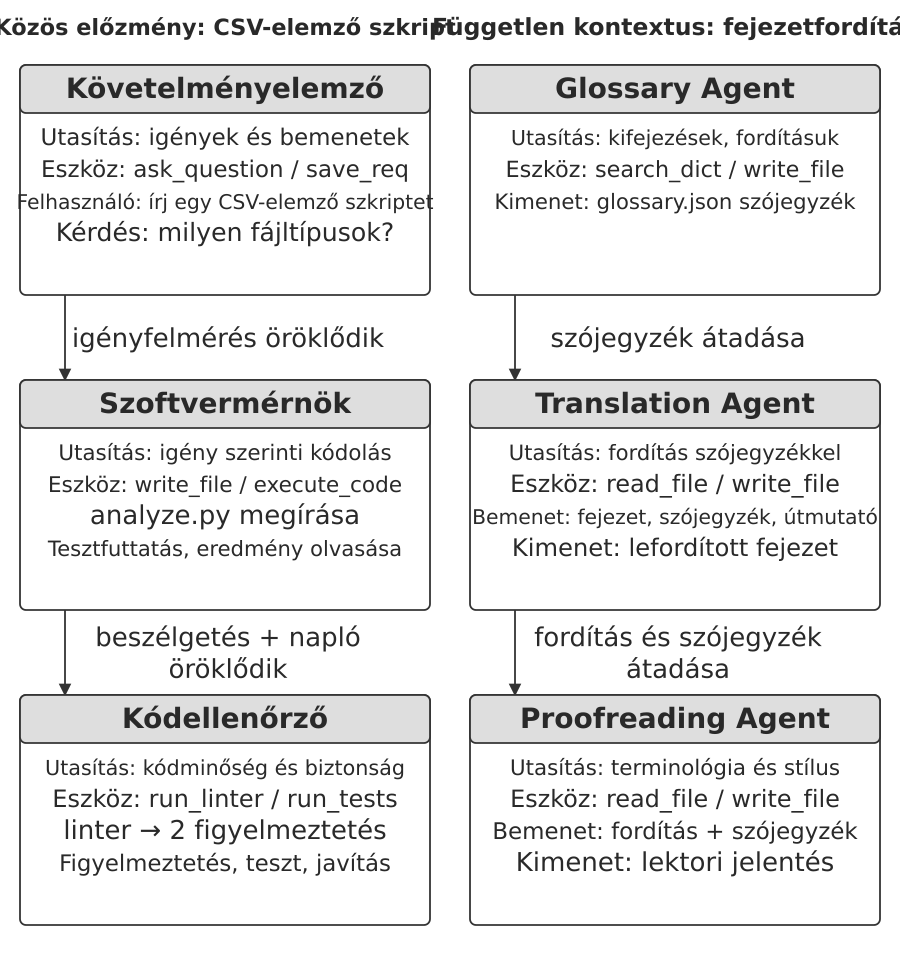

Ha minden tagnak saját kontextusa van, hogyan cserélnek anyagokat egymással? Az elosztott rendszerekben a kommunikáció általában megosztott tárolón vagy üzenetküldésen keresztül történik. Az Ügynökrendszerekben is mindkét megközelítés használható, konkrétan a következő formákban:

- **Eszközhívás-paraméterek.** Az alsóbb szintű Ügynököt eszközként csomagoljuk be; a felsőbb szint paramétereken keresztül adja át a feladatot és a strukturált anyagokat, majd megkapja az eredményt.
- **Megosztott fájlrendszer.** Az egyik fél dokumentumot, kódot vagy adatot ír, a másik hivatkozás alapján olvassa be. Nagyobb köztes termékekhez és tartósan megőrzendő anyagokhoz alkalmas.
- **Üzenetbusz (Message Bus).** Az Ügynök egy közvetítő szolgáltatásnak adja át az üzenetet, amely a címzett vagy a feliratkozások alapján kézbesíti. Több tag közötti aszinkron kommunikációhoz alkalmas.

Például miután a felsőbb szint kiadott egy fordítási feladatot, megvárhatja, amíg visszaérkezik a fordítás, de kaphat előbb egy feladatazonosítót is, és közben foglalkozhat egy másik fejezettel. Ha két fordító ugyanazt a fájlt meg tudja nyitni, a rendszernek akkor is rögzítenie kell, ki írja, és a másik mikor olvassa. A Go-közösség azt hangsúlyozza, hogy a megosztott adatokhoz való hozzáférést kommunikációval kell megszervezni. Ez az elv az Ügynökökre is érvényes: egyértelművé kell tenni, kié az állapot, ki módosíthatja, és a többi tag hogyan értesül a változásokról.

### Második dimenzió: az együttműködési topológia

Az együttműködési topológia az Ügynökök közötti feladatfüggőségeket, információáramlást és vezérlési viszonyokat írja le. Ez a fejezet három tipikus szervezési módot tárgyal:

- **Társi együttműködési minta** (Peer Collaboration Pattern). Néhány tag ugyanazon a terméken dolgozik ismétlődő körökben. Például a szerző megírja a tanulmány vázlatát, a bíráló javaslatokat tesz, majd a szerző átdolgozza a szöveget.
- **Menedzser minta** (Orchestration Pattern). Egy központi Menedzser Ügynök bontja fel, osztja ki és fésüli össze a feladatokat, az al-ügynökök pedig a saját szakterületükhöz tartozó munkát végzik.
- **Decentralizált minta** (Decentralized Pattern). A tagok a szerepük, az üzenetek és a helyi állapot alapján veszik át egymástól a munkát, és közösen döntik el, hogyan haladjon tovább.

> **Terminológia: Gráf-mérnökség.** Az 1. fejezet bemutatta a gráf-mérnökségről 2026 júliusában kibontakozott vitát. Ez a nézőpont a végrehajtási gráfra összpontosít: a csomópontok lehetnek Ügynökök, hagyományos programok vagy emberi döntések, az élek függőségeket, feltételes útválasztást és a hiba utáni továbblépés irányát fejezik ki, az állapot pedig a végrehajtási kapcsolatok mentén halad tovább. A többügynökös együttműködési topológia ennek a tervezési szemléletnek az egyik alkalmazása, amelynek középpontjában az áll, hogyan adják át egymásnak a munkát, hogyan dolgoznak párhuzamosan és hogyan adnak visszajelzést a döntéshozó egységek.

A társi együttműködés, a menedzser minta és a decentralizált tervezés kombinálható is. Például a Menedzser egy írási feladatot egy szerző–bíráló csoportnak ad át, amely belső iterációi után adja vissza az eredményt.

## Mikor jobb több Ügynök egynél?

Tegyük fel, hogy a nyersfordítás egy szakkifejezést rosszul fordít. Ha két lektor ugyanazt a fordítást kapja, könnyen előfordulhat, hogy kétszer ugyanúgy jóváhagyják. Ha viszont egyikük az eredeti szöveget, a szójegyzéket és a szót használó kódot is megkapja, a hiba felfedezésének egy újabb útja nyílik meg. Az együttműködési forma kiválasztásakor először azt kérdezzük meg: mit ad hozzá a feladathoz az új Ügynök? Szerezhet új bizonyítékot, bejárhat egy másik keresési utat, adhat eltérő szakmai ítéletet, vagy párhuzamos végrehajtással lerövidítheti a várakozást.

Elsőként a **visszajelzés információtöbbletét** vizsgálom, és csak utána azt, mennyit nyerhetünk a párhuzamossággal és a kontextusok elkülönítésével. Ha a bíráló teszteredményeket, oldalképernyőképeket vagy külső anyagokat olvas, olyan bizonyítékok alapján javasolhat módosítást, amelyek a generálás idején még nem álltak rendelkezésre. A 10-1. táblázat néhány gyakori helyzeten mutatja be, hogyan ellenőrizhető ez a többlet.

10-1. táblázat: Információ és visszajelzés a többügynökös együttműködésben

| Együttműködési mód | Fő információforrás | Mire figyeljünk az értékeléskor? |
|---|---|---|
| Ugyanaz a modell újra átnézi a saját kimenetét | Az eredeti anyagok és egy újabb ellenőrzési menet | Észrevesz-e hiányosságot, és javul-e az eredmény a módosítás után? |
| Több Ügynök vitatja meg ugyanazt a kérdést | Saját megoldási útjaik, feltevéseik és érveik | Eltérnek-e a nézőpontok, és hogyan ellenőrizzük és választjuk ki a választ? |
| A bíráló teszteket futtat és ellenőrzi a kódot | Fordítási, teszt- és futási visszajelzés | Átmegy-e a módosítás a teszteken, és megmaradnak-e a meglévő funkciók? |
| A bíráló megnézi a frontend vagy a PPT renderelt eredményét | Képernyőképek és interakciós visszajelzés | Megfelel-e az elrendezés, a tartalom és a működés a követelményeknek? |
| A bíráló külső eszközökkel ellenőrzi a tényeket | Keresési eredmények és üzleti rendszerek rekordjai | Megbízhatóak-e a források, és összhangban van-e a következtetés a bizonyítékokkal? |

Az RLEF megerősítéses tanulással tanítja a modellt arra, hogy felhasználja a kódvégrehajtásból érkező visszajelzést, és versenyprogramozási feladatokon többlépéses javítást tanul. A fordítási hibák, a sikertelen tesztek és a futásidejű kivételek konkrét kiindulópontot adnak a következő módosításhoz; a tanulmány modellje kevesebb mintavétellel jobb eredményt ér el.[^rlef-2025] A WebGen-Agent a weboldalak képernyőképeit, egy vizuális modell leírásait és javaslatait, valamint a GUI-műveletek értékelését építi be a generálási folyamatba: visszaléphet az előző lépésre és újracsinálhatja, vagy több generált változat közül kiválaszthatja a legjobbat. A WebGen-Bench-en a Claude 3.5 Sonnet pontossága 26,4%-ról 51,9%-ra nőtt.[^webgen-agent-2025]

[^rlef-2025]: Gehring, J., et al. *RLEF: Grounding Code LLMs in Execution Feedback with Reinforcement Learning.* arXiv:2410.02089, 2025.
[^webgen-agent-2025]: Lu, Z., et al. *WebGen-Agent: Enhancing Interactive Website Generation with Multi-Level Feedback and Step-Level Reinforcement Learning.* arXiv:2509.22644, 2025.

Először azt érem el, hogy a rendszer konkrét bizonyítékokhoz jusson – tesztekhez, képernyőképekhez vagy eszközök válaszaihoz –, és csak ezután döntök arról, hogyan osszam el a generálás, a végrehajtás és a bírálat feladatait. A visszajelzési hurkot egyetlen Ügynök is végigviheti, de több szerepre is szétbontható; egy új szerep bevezetésének a bizonyítékok megszerzését és felhasználását kell javítania.

Az Anthropic 2026-os biztonsági kutatása az együttműködő keresésre ad példát: 45 Ügynök egy közös fórumon osztotta meg a felfedezéseit és vizsgálta felül egymás munkáját, az eredményekről pedig egy független Ügynök döntött. A kutatási jelentés szerint az együttműködő raj 27 millió tokent használt fel, és 266 sérülékenységet talált; a független, párhuzamos változat 6,5 millió tokenből 21-et. A fórumon a tagok tovább haladhattak mások felfedezései nyomán, és azt is látták, mely irányokon dolgozik már valaki. Az együttműködő csoport ugyanakkor nagyjából négyszer annyi tokent használt fel, így a 266 és a 21 közötti különbségben a kommunikáció módja és a ráfordított számítás eltérése egyaránt benne van.[^anthropic-multiagent-2026]

[^anthropic-multiagent-2026]: Anthropic Frontier Red Team, “Patterns and Problems in Emerging Multiagent Systems,” 2026-08-13.

Hogyan érhető el a matematikai kutatásban, hogy több csapat valóban különböző utakat járjon be? A háromdimenziós Navier–Stokes-egyenletek a viszkózus folyadékok mozgását írják le. Ha a kezdeti feltételek simák, sima marad-e a megoldás mindvégig? Az OpenAI két ellentétes célt osztott ki különböző csoportoknak: egyesek a simaságot próbálták bizonyítani, mások ellenpéldát igyekeztek konstruálni. A csoportok először önállóan kutattak, majd a csapat a Codex segítségével összegezte a részeredményeket, hogy a többi csoport is továbbhaladhasson az ígéretes nyomokon. Az ellenpéldát megtaláló csoportban mintegy tízezer Ügynök dolgozott párhuzamosan. A csapat beszámolója szerint az első Ügynökök elindításától a bizonyítás megtalálásáig körülbelül 88 óra telt el, a Lean-formalizálás és -ellenőrzés további 17 órát vett igénybe. Az ellenpéldának van egy fontos feltétele: a folyadékra sima külső erő hat, és a megoldás így is véges idő alatt szingulárissá válhat. A csapat ennek alapján a Clay Matematikai Intézet feladatleírásának C és D változata által megkövetelt ellenpéldát adta meg; ha a külső erőt elhagyjuk, az már egy másik probléma. Az ilyen keresések tervezésekor érdemes először leírni, milyen eredmények válaszolnak ténylegesen az eredeti kérdésre, az egymással versengő sejtéseket különböző csoportoknak kiadni, és a végső ellenőrzésre külön időt hagyni.[^ch10-ns-search]

[^ch10-ns-search]: Az OpenAI *On the Navier–Stokes Millennium Prize Problem* című kutatási beszámolója a bizonyítást és a Lean-kódot is tartalmazza. A Clay Matematikai Intézet 2026. szeptember 11-i közleményében reagált a munkára, és jelezte, hogy az eredmény elbírálása és a díj odaítélése a díjazási eljárás szerint történik.

**Hogyan befolyásolja a lépéskeret a teljesítményt?** Ha egy feladatra 30 lépés jut, az Ügynöknek tömören kell beosztania a tervezést, a lényegi megvalósítást és a szükséges ellenőrzést; 300 lépéssel már több megoldást is összevethet, alaposabban tesztelhet és javíthat. Ahhoz, hogy ezt az erőforrást jól használja, az Ügynöknek ismernie kell a teljes és a fennmaradó keretet is, és ehhez kell igazítania a felfedezés mélységét.

A Google 2025-ös tanulmánya, a *Budget-Aware Tool-Use Enables Effective Agent Scaling* ezt a kérdést vizsgálta: a keretet nem érzékelő Ügynök gyorsan megrekedhet a felszínes keresésnél, és a teljesítménye akkor sem javul tovább, ha több lépést kap. A 2026-os BAVT (Budget-Aware Value Tree Search) ennél is tovább megy: a keresés lépéseiben az értékbecslést a fennmaradó kerettel együtt veszi figyelembe, és ennek alapján állítja be a felfedezés és a kiaknázás súlyát. Bőséges keretnél több irányt is összevethet, a keret végéhez közeledve pedig az ígéretes ágakra összpontosítja az erőforrásokat.

A menedzser mintában ez azt jelenti, hogy a Menedzsernek a feladat nehézsége szerint kell kiosztania a lépéseket, és a haladás függvényében módosítania kell a kiosztást: az egyszerű feladatokat minél hamarabb le kell zárni, az összetettekhez helyet kell hagyni az ellenőrzésre és a javításra, elakadás esetén pedig először meg kell keresni az okát, és csak ezután eldönteni, hogy több információra, nagyobb keretre vagy másik útra van-e szükség.

A párhuzamos felfedezés csökkentheti a falióraidőt, az ismételt bírálat javíthatja a terméket, de mindkettő növeli a modellhívások és a kommunikáció költségét. Kiindulópontként egy jól hangolt egyetlen Ügynököt veszek alapul, és csak akkor bővítem az együttműködést, ha az új tagok által hozott minőségjavulás vagy időmegtakarítás fedezi a kommunikáció, az ismételt számítás és a karbantartás költségét.

## Többügynökös együttműködés megosztott kontextussal

A megosztott kontextusú együttműködés szakaszonként vált szerepet, és közben megtartja a feladat addigi jegyzőkönyvét. Egy kutatási jelentésnél például a kereső szerep először összegyűjti az anyagokat, az elemző szerep ezután számol, végül az író szerep megfogalmazza a szöveget. Mindegyik szerep visszanézheti a korábbi forrásokat és döntéseket, a rendszer pedig az aktuális feladatutasításokkal irányítja a figyelmét az adott szakasz céljára.

Csapatok közötti átadáskor először azt érdemes megkérdezni: kinek kell tudnia, miért született annak idején egy döntés? A Teamily AI egyik termékpéldájában a termékmenedzser és az Ügynök egy csoportos csevegésben közösen írja meg a termékkövetelmény-dokumentumot (PRD). Miután a termékcsapat megosztotta a végleges változatot a fejlesztőcsapattal, a mérnökök rákérdezhetnek, milyen mérlegelés áll egy-egy követelmény mögött.

Vegyük azt az esetet, amikor a kereső szerep átadja a feladatot az író szerepnek. Az átadás után honnan olvassa ki a modell az írási szabályokat, és milyen eszközöket hívhat még meg? A 10-1. kísérlet kétféleképpen valósítja meg ugyanazt az átadást.

| Az átadáskor kezelendő kérdés | Szerepváltás (`transfer_to_agent`) | Skill betöltése |
|---|---|---|
| Honnan kapja meg a modell az írási szabályokat? | Az író szerep rendszerpromptja váltja fel az előzőt | A rendszerpromptban marad a Skill-katalógus, az írási szabályok az üzenetelőzmények végére kerülnek |
| Mely eszközöket látja a modell? | Megjeleníthetők csak az író szerep eszközei | Megtartható az eredeti eszközkészlet vagy az eszközkereső belépési pont |
| A KV Cache mely része használható még? | A rendszerprompt megváltozott, ezért az előtag változási pontjától általában újra kell számolni | Az eredeti kérés-előtag továbbra is újrahasznosítható |
| Ki ellenőrzi a hívási jogosultságokat? | A Harness az aktuális szerep szerint ellenőrzi a kérést, majd ütemezi az eszközt | A Harness minden hívásnál önállóan ellenőrzi a jogosultságot |

Ha a szerepek elsősorban tudásban, munkafolyamatban és írásmódban különböznek, a Skillt részesítem előnyben: így ugyanaz a futtatási keret újrahasznosítható, és a stabil kérés-előtag gyorsítótára is megmarad. Ha a különbség jogosultságokat, eszközök elkülönítését vagy jóváhagyási felelősséget érint, különálló Ügynökként vagy szerepváltással szervezhetjük meg a munkát, a hozzáférés-vezérlést pedig a Harness és a végrehajtási környezet érvényesíti. Az, hogy egy eszköz megjelenik-e a modell bemenetében, a hívási döntést befolyásolja; a tényleges jogosultságot a futásidejű ellenőrzés határozza meg.

> **10-1. kísérlet ★★: Szerepváltás megosztott kontextusban – rendszerprompt és Skill összehasonlítása**
>
> A két út ugyanazt a modellt, felhasználói feladatot, eszközmegvalósítást, szerepszabályokat és közös előzményt használja. A bevezető bemutatóban meg kell keresni a kínai újenergiás járművek 2021–2023-as eladási adatait, ki kell számítani az éves összetett növekedési rátát (CAGR), és legfeljebb 120 írásjegyes befektetői összefoglalót kell írni.
>
> **Első út: a rendszerprompt cseréje.** Öt szerepet állítunk be: triage (igényfelmérés), research (keresés), coding (programozás), data_analysis (elemzés) és writing (írás). A triage a belépési pont, és minden szerep a saját eszközeit és a `transfer_to_agent` eszközt látja. Átadáskor az előzmények megmaradnak, betöltődik a célszerep promptja és eszközkészlete, majd a futás folytatódik.
>
> **Második út: Skill betöltése.** A rendszerprompt és a teljes eszközkészlet a munkamenet alatt változatlan marad. A modell a `load_skill(name)` hívással kéri le a szerep szabályait, amelyek eszközeredményként kerülnek a közös előzményekbe, az eredeti előtag pedig megmarad. A Harness a jogosultsági szabályok alapján ellenőriz minden eszközhívást.
>
> Mindkét megvalósítás ugyanazt a `SKILL.md` fájlt olvassa be. Vegyünk egy-egy, a modellnek küldött kérést egy szerepátadás előttről és utánról, és nézzük meg, melyik üzenetben jelennek meg a szabályok, és az előtag melyik része használható újra. Ezután vessük össze a két összefoglalót: megbízható-e az eladási adatok forrása? 2021 végétől 2023 végéig két növekedési időszak van – helyesen számolták-e ki az éves összetett növekedési rátát?
>
> A hivatalos összehasonlításban szerepelt egy szigorúbb tájékoztató-feladat is: legfeljebb 160 karakter, és két forrás URL-jét is meg kell tartani. Mindkét csoport nyolc lépést kapott. A szerepváltós csoport három hívást arra fordított, hogy megszámolja a karaktereket, a vázlat így is 206 karakteres maradt, és a feladatban előírt számítási eszközt sem használta. A Skillt betöltő csoport a kezdő és a záró év eladásaiból helyesen számolta ki a növekedési rátát, az írási szabályokat azonban csak a nyolcadik lépésben töltötte be. Ekkorra minden szükséges szerepen végigment, a felhasználó viszont még nem kapta meg az összefoglalót. Mindkét trajektória a lépéskorlát elérésével ért véget.
>
> Ugyanazt a 30 feladatot mindkét megvalósítással lefuttattuk, és programmal ellenőriztük a leadott eredményeket: a Skillt betöltő csoport 15, a rendszerpromptot cserélő csoport 2 feladatot teljesített. Feladatonként összevetve azonban az előbbi csoportnál 6855 tokennel több bemenet nem talált a gyorsítótárban, és a futás körülbelül 4,4 másodperccel tovább tartott (mindkét érték a páronkénti különbségek mediánja). Ezúttal a szolgáltató mindkét csoport kéréseinél nullát jelentett a gyorsítótárazott bemeneti tokenek számaként. Az utasításkövetés hat határesetét mindkét csoport hibátlanul teljesítette, a teljes feladatok sikeraránya viszont nagyon eltért.

## Többügynökös együttműködés megosztott kontextus nélkül

Az elkülönített kontextusú architektúrában minden Ügynök maga kezeli a bemeneti előzményeit, a feladatállapotát és a futási ciklusát, a szükséges információt pedig eszközparamétereken, megosztott fájlokon és üzeneteken keresztül cseréli. Például a fordító által leadott anyagban fel kell tüntetni az eredeti szövegrészt és a szójegyzék verzióját. Így a lektor akkor is megtalálja az eredetit, ha a fordító már kilépett, és ha javításra van szükség, fejezetenként megtalálja a felelőst.

A 10-2. táblázat azt veti össze, hogyan kezeli az operációs rendszer a folyamatokat, és hogyan kezeli a futtatókörnyezet az Ügynököket.

10-2. táblázat: Tervezési analógia a többügynökös rendszerek és az operációs rendszerek között

| Operációs rendszer | Hasonló feladat a többügynökös rendszerben |
|---|---|
| Program és konfiguráció | Rendszerprompt, eszközdefiníciók és szerepkonfiguráció |
| Folyamatmemória | Aktuális kontextus, feladatállapot és előzmények |
| A CPU végzi a számítást | Az LLM hozza a döntéseket, a futtatókörnyezet és az eszközök végrehajtják a műveleteket |
| A kernel felügyeli a futást | Az Ügynök futtatókörnyezete kezeli az állapotot, az ütemezést és az erőforrásokat |
| Rendszerhívás | Külső művelet kérése eszközinterfészen keresztül |
| fork: gyermekfolyamat létrehozása | `spawn_subagent`: al-ügynök létrehozása |
| kill: jel küldése | `cancel_subagent`: megszakítás kérése |
| ps: folyamatok lekérdezése | `list_agents`: a tagok és futási állapotuk lekérdezése |
| Kilépési állapot és wait | Befejezési értesítés, feladatállapot és strukturált eredmény |
| Megosztott tároló és üzenetküldés | Megosztott fájlok, eszközparaméterek és üzenetek |

A privát állapot, az aszinkron üzenetek és a tagok dinamikus létrehozása az 1970-es években bevezetett Actor-modellben is megjelenik.[^actor-model]

[^actor-model]: Hewitt, C., Bishop, P., Steiger, R. *A Universal Modular ACTOR Formalism for Artificial Intelligence.* IJCAI 1973.

Ha sok a független részfeladat, inkább külön kontextust adok minden tagnak, hogy csak a saját feladatkörükhöz tartozó anyagokkal foglalkozzanak. Így a szerepek külön tesztelhetők, az előző szakasz terjedelmes előzményei kevésbé zavarják az aktuális döntést, és több feladat haladhat egyszerre. Az elkülönítés hatása azonban a többi megosztott erőforrástól is függ: több Ügynök továbbra is módosíthatja egyszerre ugyanazt a fájlt, fogyaszthatja ugyanazt az API-kvótát, vagy kaphatja meg ugyanazt a hibás üzenetet.

Az együttműködési interfésznek az üzenetvesztést, az ismételt kézbesítést és az elavult állapotot is kezelnie kell. Hibakereséskor a feladatazonosító segítségével összekapcsolhatók az egyes tagok kérései, eszközeseményei és eredményei, és így rekonstruálható egy átadás teljes menete.

Tegyük fel, hogy egy Ügynök befejezte az elemzést, és átadja az eredményt a jelentést író társának. Ha csak néhány számról van szó, mehetnek az üzenetben; ha viszont a termék egy nagy táblázat, általában a megosztott fájlrendszerbe kerül, az üzenet pedig csak hivatkozást tartalmaz. Ebből két feladatkör adódik. A **terméktárolás** a dokumentumok, a kód és az adatok megőrzéséért és cseréjéért felel, a **kommunikáció és vezérlés** pedig az üzenetek kézbesítéséért, a feladatállapot lekérdezéséért, a végrehajtás megszakításáért és az erőforrások ütemezéséért.

### A fájlrendszer az Ügynök szemszögéből

Gyakori megoldás, hogy az Ügynök egy **virtuális fájlrendszert** (virtual filesystem) kap, amelyben a különböző forrásokból származó erőforrások egyetlen könyvtárfába vannak csatolva. A modell olyan interfészeken éri el őket, mint a `read_file`, a `write_file` és a `list_dir`, az alsóbb réteg pedig lehet helyi ideiglenes lemez, perzisztens objektumtároló, harmadik féltől származó felhőtárhely API-ja vagy rendszer-erőforráscsomag.

Én először a tárolási területeket határolom el, és csak ezután kapcsolom be őket az együttműködési folyamatba. Ha az ideiglenes vázlatok, a hivatalos leadandók és a felhasználó külső fájljai keverednek, könnyen előfordul véletlen felülírás vagy jogosulatlan olvasás. Az egységes interfész kényelmes, az egyes területek láthatóságát, életciklusát és jogosultságait viszont a csatolási és hozzáférés-vezérlési konfiguráció határozza meg. A könyvtárfa négy területtípusra bontható.

**I. Ügynök-specifikus munkaterület (Scratchpad).** Minden példány saját munkaterületet használ a vázlatok, ideiglenes fájlok, hibakeresési naplók és köztes termékek tárolására. A hozzáférés alapértelmezés szerint a tulajdonos Ügynökre korlátozódik, a tartalmat pedig a feladat szabályai szerint töröljük vagy archiváljuk. Így az ideiglenes fájlok nem írják felül egymást; az al-ügynök a munka végeztével a leadandó eredményt a megosztott térbe helyezi, és strukturált összefoglalóval együtt átadja a fő Ügynöknek. A próbálkozások nyoma az eredeti munkaterületen marad a későbbi diagnózishoz. Ezzel a kontextus elkülönítése a tárolás szintjén is megvalósul: a fő Ügynök megkapja a leadott eredményt és a szükséges bizonyítékokat, a napi koordináció során pedig nem kell a teljes próbálkozási folyamatot beolvasnia.

**II. Többügynökös megosztott munkaterület (Shared Workspace).** Itt cserélik ki az együttműködő tagok a termékeiket, és a felhasználó is feltölthet ide anyagokat, illetve letöltheti a leadandókat egy jogosultsággal védett belépési ponton. Például a Glossary Agent ide írja a szójegyzéket, a Translation Agent beolvassa és fordít, a bíráló pedig ellenőrzi a fordítást. A megosztott tér általában a feladattal együtt tartósan megmarad, és kezelnie kell az egyidejű írást, a verziófrissítéseket és a hozzáférési kört. A 6. fejezetben az Ügynök és a virtuális számítógép megosztott tárolón keresztül cserélt CSV-fájlokat és diagramokat – ez a termékátadás egy példája. Az optimista zárolást és a munkamásolatok elkülönítését a fejezet későbbi részében mutatjuk be.

**III. Csatolt külső erőforrások (Mounted External Resources).** A Google Drive, a Notion, a Dropbox, a vállalati wikik és hasonló erőforrások adaptereken keresztül illeszthetők az egységes interfészre. Amikor az Ügynök beolvas egy dokumentumot, az adapter hívja meg a forrásrendszer API-ját. Itt háromféle különbséget kell kezelni: a hozzáférési kört a külső jogosultságok határozzák meg; a hálózati hozzáférés késleltetéssel, időtúllépéssel és gyorsítótár-frissítési kérdésekkel jár; a visszaírásnak meg kell felelnie a forrásrendszer jogosultsági és verziózási szabályainak. A pontos konzisztencia-szemantikát a szolgáltatás interfésze határozza meg; az egyidejű módosítások verziószámmal, feltételes írással vagy újraolvasással ellenőrizhetők. Anyagok kereséséhez az igény szerinti, csak olvasható csatolás a megfelelő; ha szerkeszteni kell, akkor adjunk hozzá írási jogot.

**IV. Beépített rendszer-erőforrások (Built-in System Resources).** A referencia-kézikönyvek, sablonok, eszközdefiníciók és előre telepített Skillek csak olvasható erőforráscsomagként állhatnak több Ügynök rendelkezésére. A Skillek fokozatos feltárással töltődnek be: először a katalógus, majd a feladat szerint a szabályok és a szkriptek. A rögzített verziójú erőforráscsomagok könnyen olvashatók párhuzamosan, frissítéskor pedig verzióváltással biztosítható, hogy a futó feladatok egységes állapotot lássanak.

A 10-2. ábrán a fordító a saját könyvtárában tetszőlegesen sokszor átírhatja a vázlatát, és amikor kész átadni a lektornak, a megfelelő verziót a megosztott területre helyezi. A felhasználó felhőtárhelyén lévő eredeti kéziratot egy külső adapter olvassa be, és a hozzáférés a felhasználó által adott jogosultságtól is függ.

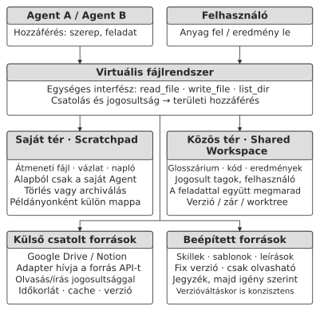

Amikor a fordító kilép, a munkaterületén lévő ideiglenes fájlok felszabadulhatnak. A megosztott területre helyezett fordítás viszont megmarad, és a lektor olvasási jogosultsággal átveheti (10-3. táblázat).

10-3. táblázat: Az Ügynök virtuális fájlrendszerének négy területe

| Terület | Láthatóság | Életciklus | Olvasás és írás | Párhuzamosság kezelése |
|---|---|---|---|---|
| Ügynök-specifikus munkaterület | Alapértelmezés szerint csak a tulajdonos Ügynök | A példánnyal együtt törlődik, igény szerint archiválható | A tulajdonos Ügynök olvas és ír | Az újrapróbálkozások vagy háttérműveletek ismételt írásának megakadályozása |
| Többügynökös megosztott munkaterület | Jogosultsággal rendelkező tagok és felhasználók | A feladattal együtt tartósan megmarad | Szerepenkénti jogosultság | Zárolás, verzióellenőrzés vagy worktree |
| Csatolt külső erőforrások | A külső jogosultságok és az adapter együttesen korlátozzák | A forrásrendszer és a gyorsítótár-szabályok határozzák meg | Igény szerint csak olvasható, vagy jogosultsággal írható | A forrásrendszer verzió- és párhuzamossági interfészét követi |
| Beépített rendszer-erőforrások | Jogosultsággal rendelkező Ügynökök | Rögzített verzió, munkamenetek között újrahasznosítva | Csak olvasható | Az erőforrásverzió egységes váltása |

A fájlhivatkozások révén az átadási üzenetek rövidek maradhatnak: a felsőbb szint megadja a termék helyét, verzióját és rendeltetését, az alsóbb szint pedig igény szerint olvassa be a tartalmat. Az azonos futtatókörnyezetben lévő tagok megosztott útvonalakat használhatnak; szervezetek közötti együttműködésnél viszont mindkét fél által feloldható termékazonosítóra, hozzáférési interfészre és jogosultságra van szükség ugyanehhez az átadáshoz.

### Kommunikáció és vezérlés az Ügynökök között

A 4. fejezetben bemutatott létrehozó, kommunikációs, megszakító és felderítő eszközök adják a többügynökös együttműködés alapvető vezérlési interfészét: a `spawn_subagent` létrehoz egy tagot, a `send_message_to_subagent` üzenetet továbbít, a `cancel_subagent` megszakítást kér, a `list_agents` pedig lekérdezi a tagokat. Ezek köré az üzenetek, az állapotok, a leállítás és az ütemezés viselkedését is rögzíteni kell.

**I. Üzenetküldés.** Ha kevés a tag és rögzítettek a kapcsolatok, pont-pont interfész is megfelel; például a telefonos Ügynök és a számítógépes Ügynök közvetlenül cserél információt a haladásról. Ha minden tagnak mindenki mással kommunikálnia kell, a lehetséges kapcsolatok száma a tagok számának négyzetével nő; sok feliratkozás esetén az üzenetbusz megkönnyíti az útválasztás, a pufferelés és az újrapróbálkozás egységes kezelését. Pont-pont és busz alapú megoldással is megvalósítható az aszinkron kézbesítés; az, hogy a címzettnek egyidejűleg elérhetőnek kell-e lennie, a sorbaállítási és perzisztencia-mechanizmustól függ.

Az üzenet általában egy strukturált **borítékot** (envelope) tartalmaz: a küldő azonosítóját, a cél-Ügynököt vagy a szórás körét, az üzenet típusát és a hasznos terhet. Üzenettípus lehet például a `task_assigned`, a `status_update`, a `result` és a `terminate`. A feladatazonosító, az üzenetazonosító és a kapcsolódó kérés segít a címzettnek kiszűrni az ismétlődéseket, a hibakereső eszközöknek pedig lehetővé teszi a kommunikációs lánc rekonstruálását. Az üzleti tartalom a JSON hasznos teherbe kerül, és mindkét fél a megállapodott mezők szerint dolgozza fel.

Tegyük fel, hogy egy fordítás leadásáért egy szerkesztő felel, és a szerkesztő megkérné a terminológiai bíráló Ügynököt, hogy ellenőrizzen egy szót. A Multica egyik munkalapjának megjegyzésében megemlíti (`@`) az Ügynököt, és leírja a kérdést – ez elindítja a bírálatot. A bíráló válasza közvetlenül erre a munkalapra érkezhet; a felelős továbbra is a szerkesztő, és a munkalap állapota sem változik. Ha azt szeretnénk, hogy a bíráló a teljes munkalapot átvegye, a felelőst kifejezetten át kell állítani.[^ch10-multica]

[^ch10-multica]: Multica, Ügynök megemlítése megjegyzésben; a megjegyzések szétosztásának megvalósítása a `d579273` verzióban.

**II. Állapotlekérdezés.** A fő Ügynöknek tudnia kell, hogy egy részfeladat fut-e még, vár-e bemenetre, és elérhető-e már az eredménye. Ehhez állapotinterfész, eseményértesítések és haladási fájlok kombinálhatók: a futtatókörnyezet interfésze adja az életciklus-állapotot, az üzenetek az üzleti haladást írják le, a perzisztens fájlok pedig helyreállítható nyilvántartást őriznek.

A `get_subagent_status(agent_id)` olyan állapotokat adhat vissza, mint a fut, bemenetre vár, befejeződött vagy sikertelen. A napi koordinációban a befejezési értesítéseket és a szakaszonkénti haladási üzeneteket részesítem előnyben, hogy a fő Ügynök közben a saját munkájával foglalkozhasson. Aktív lekérdezést csak akkor használok, ha késik az értesítés, helyre kell állítani a kapcsolatot, vagy hibát kell keresni – így nem megy el a modellhívások ideje arra, hogy folyton azt kérdezgesse: „kész vagy már?” Az állapotinterfészt a futtatókörnyezet tartja karban, így időben jelezheti, hogy él-e még a folyamat, és befejeződött-e a feladat.

**Haladás megosztása üzenetekkel.** A fő Ügynök megkérdezheti, hol tart a munka, és az al-ügynök egy alkalmas lépésnél válaszol; az al-ügynök azonban maga is közzétehet `status_update` üzenetet, ha szakaszeredményhez jutott, elakadt vagy segítségre van szüksége. Az üzenetnek tartalmaznia kell, mi készült el, mi a következő lépés, és mi okozza az elakadást; ha minden tag ugyanazokat az állapotneveket használja, könnyebb összesíteni és megítélni a helyzetet. A fejezet későbbi részében az A2A protokoll kapcsán bemutatjuk a feladat-életciklus szabványos leírását.

**Haladás mentése fájlba.** A rendszer az üzeneteket, eszközkéréseket, eszközeredményeket és állapotváltozásokat időrendben egy naplóhoz fűzheti, például soronként egy eseményt tartalmazó JSONL formátumban. A diagnosztikai jogosultsággal rendelkező fő Ügynök vagy üzemeltetési eszköz ebből ellenőrizheti az újrapróbálkozásokat, a hibákat és a várakozásokat. A modell bemeneti előzménye csak egy része a futási nyomnak; a napló az ütemezési és a külső végrehajtási eseményeket is rögzítheti.

A teljes trajektória akár több tízezer tokent is tartalmazhat, és a fő Ügynöknek minden végigolvasás után újra ki kellene szűrnie belőle az állapotot. Az üzenet jelzi a fő Ügynöknek, hogy új fejlemény történt, a rövid haladási fájl pedig az aktuális állapotot őrzi a későbbi lekérdezéshez és helyreállításhoz. A napi koordinációt elsősorban e kettő együttesére bízom. Az al-ügynök minden elvégzett munka után frissíti a feladatlistát, a termékhivatkozásokat és az aktuális elakadási pontokat, a fő Ügynök pedig ezek alapján dönt a következő lépésről. A részletes trajektória igény szerinti hibakeresésre marad meg. Ha a haladás hosszú ideig nem változik, a szívverés, az eszközhívások állapota és a feladat időkorlátja alapján dönthetünk arról, kell-e beavatkozni: egy hosszan futó eszköz még dolgozhat, ezért az állapot ellenőrzése után döntsünk a várakozásról, a megszakításról vagy az újrapróbálkozásról.

**III. A végrehajtás leállítása.** Ha több tag párhuzamosan keresi ugyanazt a célt, és az egyikük elvégezte a feladatot, a többi ág leállítható, hogy felszabaduljon a keret és az eszközerőforrások. A megszakításnak két erőssége van, amelyek szerepe a Unix SIGTERM és SIGKILL jeléhez hasonló.

Én a **kíméletes leállítást** részesítem előnyben: a futtatókörnyezet továbbítja a megszakítási kérést, az al-ügynök egy biztonságos ponton nem kezd új műveletbe, elmenti a szükséges haladást, bezárja a böngészőmunkamenetet és feloldja a zárolásokat, majd nyugtázást (ack) küld vissza. A **kényszerített leállítás** azokra a végrehajtásokra vonatkozik, amelyek a megszakítási határidő után sem válaszolnak: a futtatókörnyezet leállítja a folyamatot, majd ellenőrzi a visszamaradt erőforrásokat és a befejezetlen írásokat. A külső rendszerekbe már elküldött műveletek eredményét le kell kérdezni, és szükség esetén kompenzáló folyamatot kell indítani.

Az életciklust a létrehozási kapcsolatok mentén is kezelni kell. A Go context mintájára a szülőfeladat megszakítási jele lefelé terjedhet a teljes részfeladat-fán, a futási ciklus pedig biztonságos pontokon ellenőrzi a megszakítási jelet – ez felel meg a `ctx.Done()` szerepének. Így a szülőfeladat befejeztével az általa indított ágak is a takarítási folyamatba lépnek, és nem marad felügyelet nélküli Ügynök, amely tovább hívogatja az eszközöket és fogyasztja a keretet. A valóban hosszú ideig önállóan futó háttérfeladatok külön életciklus-kontextust kapnak – ez a `context.Background()` használatához hasonló –, és egyúttal ki kell jelölni a felügyeletükért, a keretükért és a takarításukért felelős menedzsert.

**IV. Erőforrások és ütemezés.** Az Ügynökrendszernek tokent, lépéseket, párhuzamossági kvótát, eszközkapcsolatokat és számítási erőforrásokat kell elosztania. Részfeladat indításakor meg kell adni a keretet és a túllépés esetén követendő viselkedést; a feladat nehézsége szerint kell modellt választani; korlátozni kell a párhuzamos hívásokat, hogy ne merüljön ki egyszerre a szolgáltatás kvótája. Ha sürgősebb feladat érkezik, az alacsonyabb prioritású feladatok egy biztonságos ponton szüneteltethetők vagy megszakíthatók, majd a haladás mentése után újraütemezhetők.

Tegyük fel, hogy három ág egy-egy lehetséges megoldást vizsgál, és az egyikük már megtalálta a döntő nyomot, csak egy utolsó ellenőrzés hiányzik. A Menedzser adhat neki még néhány lépést, és közben leállíthatja a két ágat, amelyek nem haladnak. A kvótát a futtatókörnyezet vonja le; ha egy ág kerete elfogyott, akkor is meg kell állnia, ha még próbálkozna.

### Társi együttműködési minta: kölcsönös ellenőrzés és iteratív javítás

Társi együttműködésben általában két-három Ügynök cserél véleményt és javít egy terméket ugyanazon a feladaton. Tervezéskor érdemes a tagoknak eltérő feladatkört, anyagokat és eszközöket adni, hogy önállóan ítéljenek, és csak utána összesíteni az eredményeket. Például a generáló a megvalósításra figyel, a bíráló a tesztekre és a felhasználói követelményekre; a különböző szakterületű tagok pedig a saját területük megkötéseit ellenőrzik. Minél hasonlóbb a tagok modellje, bemenete és munkafolyamata, annál könnyebben ismétlik meg ugyanazt az ítéletet, ezért a nézőpontok és a bizonyítékok különbözőségét tudatosan kell megtervezni.[^anthropic-multiagent-2026]

Az ugyanazon termék ismételt javítását igénylő feladatoknál azt javaslom, hogy két-három tagú társi együttműködéssel kezdjünk. Ha a szerepek, az átadott tartalom és a leállási feltételek egyértelműek, tesztelhető ciklust építhetünk, és a kezdeti koordinációs munka is kevés.

#### Loop-mérnökség

A társi együttműködés egy gyakori problémán segíthet: az **idő előtti leálláson**. A programozás és az ügyfélszolgálati ügyintézés példáján háromféle nyomból ismerhető fel az idő előtti leállás.

- **Részleges teljesítés után a teljes befejezés bejelentése.** A Coding Agent megírja a kódot, de kihagyja a teszteket és a telepítési ellenőrzést; a felhasználó két ügyet bíz az asszisztensre, az pedig az első elintézése után jelenti, hogy mindkettővel végzett. Ilyenkor tételesen össze kell vetni a munkát a feladatlistával, és minden tételnél ellenőrizni kell a teljesítés bizonyítékát.
- **Feladás egyetlen sikertelen út után.** A kereskedő kérheti, hogy az anyagokat inkább űrlapon küldjék be, vagy egy megadott e-mail-címre csatolják. Ilyen válasz után a kereskedő által elfogadott módon kell folytatni az ügyintézést. Rögzíteni kell a kudarc okát, és meg kell ítélni, milyen utakat érdemes még kipróbálni.
- **Részsiker után a további lépések elhagyása.** Ha a kereskedő beleegyezik a visszatérítésbe, de azt kéri, hogy a felhasználó erősítse meg az alkalmazásban, az asszisztensnek el kell mondania ezt a lépést és annak feltételeit. Számlakedvezmény esetén, ha az ügyfélszolgálat telefonon szóban megígérte, az asszisztens megerősítheti a felhasználónak, hogy az egyeztetés ígéretet eredményezett. A hívásnapló bizonyítja, mit mondott az ügyfélszolgálat; azt viszont, hogy a következő számla teljesíti-e az ígéretet, újabb bizonyítéknak kell igazolnia. A bírálónak külön meg kell neveznie az elért eredményt, azt, hogy kinek mit kell még tennie, és azt, hogy mely eredmények nem láthatók még.

Mindhárom probléma azt kívánja, hogy a befejezés feltételeit ellenőrizhető eredményekhez kössük. A **Loop-mérnökség** (Loop Engineering) azzal foglalkozik, hogyan járja be az Ügynök újra meg újra a „következő munka kijelölése – végrehajtás – ellenőrzés – haladás rögzítése” ciklust, és hogyan döntsön az eredmény alapján a folytatásról, a várakozásról, az átadásról vagy a befejezésről. A mérnöknek meg kell terveznie a feladatok forrását, az ellenőrzés módját, a perzisztens állapotot és a leállási feltételeket. Az ember munkája is kibővül: egyetlen hívás promptjának megírása helyett olyan ciklust tervez, amely folyamatosan előreviszi a feladatot. Addy Osmani 2026 júniusában ezen a néven tárgyalta ezt a gyakorlatcsoportot, és Boris Cherny tapasztalatára hivatkozott: a munka súlypontja fokozatosan az Ügynököt hajtó ciklusok megtervezésére tolódik.[^loop-engineering-2026]

**Úgy gondolom, az ilyen ciklusokban gyakran az ellenőrző a szűk keresztmetszet.** Ha az ellenőrzés megbízhatatlan, a körök számának növelésével a rendszer ugyanazokat a hibákat ismételheti, vagy idő előtt jelentheti a befejezést. A teszteredmények, az üzleti állapot és a felhasználói megerősítés a saját hatókörükön belül igazolják a befejezést; a sikertelen ellenőrzés pedig a következő javítási kör bemenete lesz.

A gyakorlat megelőzte az elnevezést. Mielőtt a Loop-mérnökség kifejezés elterjedt, csapatommal a Pine AI-ban már ciklusokkal és ellenőrzéssel kezeltük az idő előtti leállást. Az ilyen ciklusok szervezésének egyik bevett módja a javasló–bíráló felállás, amelyet alább részletesen bemutatunk.

[^loop-engineering-2026]: Osmani, Addy. “Loop Engineering”, 2026.

**LoopX: a munkaállapot megőrzése a körök között.** A LoopX a célt, a határokat, a teendőket, a kapukat, a bizonyítékokat és a kvótákat egy perzisztens vezérlősíkon tartja, amely kijelöli a következő kör vagy a következő végrehajtó munkáját. A folyamat így foglalható össze: **a vezérlősík dönt → az Ügynök végrehajt → független ellenőrzés → az igazolt haladás rögzítése**.

Az Ügynök eszközöket hív, következtet, és leadja az adott kör eredményét. A vezérlősík rögzíti az elvégzett munkát, és eldönti, honnan folytatódjon a következő kör. Sikeres ellenőrzés után rögzíti a befejezett állapotot; kudarc esetén javítás vagy újratervezés következik. Az emberi jóváhagyási kapuk, a várakozási feltételek és a keretkorlátok együtt határozzák meg, mikor folytatódhat a végrehajtás.[^loopx-framework]

[^loopx-framework]: LoopX, The local control plane for long-running AI agent work, v0.4.0.

**LongHorizon-Harness: alkalmazásokon átívelő hosszú feladatok összekapcsolása.** Ez a keretrendszer a multimodális Computer Use-ból indul ki, és azt kezeli, hogyan haladhat folyamatosan egy feladat a GUI, a CLI, több asztali alkalmazás és a kontextus többszöri frissítése között. Manage–Execute–Audit (MEA) ciklust alkalmaz: a Manager az eredeti cél, az igazolt haladás, a kudarcok bizonyítékai és a hátralévő munka alapján egy jól körülhatárolt részfeladatot állít elő; az Executor új kontextusban végrehajtja a GUI- vagy CLI-műveleteket; az Auditor csak olvasási joggal ellenőrzi az eredményt, és az igazolt haladást beírja a következő kör állapotába. A kudarcok bizonyítékai is megmaradnak a helyreállításhoz és az újratervezéshez.

A keretrendszer egy illesztőrétegen keresztül hívja a Claude Code, a Codex CLI és más végrehajtó háttérrendszereket, így a külső feladatkezelést összekapcsolja a háttérrendszer futási ciklusával. Ez a megközelítés a hosszú feladatok folytonosságát az igazolt feladatállapotra építi. A végrehajtási kontextus frissülhet, a következő kör mégis folytathatja a munkát a cél, a befejezés bizonyítékai és a megoldatlan kérdések alapján, és újra ellenőrizheti, hogy a környezet változásai érintik-e a korábbi következtetéseket.[^longhorizon-implementation]

A tanulmány egy olyan összehasonlításban, ahol a Qwen 3.7-Plus és a Claude Code végrehajtó háttérrendszer változatlan maradt, és csak a külső ciklus változott, arról számolt be, hogy a WeaveBench PassRate 51,8%-ról 80,7%-ra, az OSWorld 2.0 bináris teljesítési aránya 2,8%-ról 8,3%-ra, a Terminal-Bench 2.1 sikeraránya pedig 69,7%-ról 77,2%-ra nőtt. A költségek feladatonként eltérően alakultak: az első két benchmarkon az alapváltozat teljes tokenfogyasztásának 2,3-szorosa, illetve kimeneti tokenjeinek 3,6-szorosa kellett; a Terminal-Bench 2.1-en a tokenfogyasztás 24%-kal csökkent.

Ugyanabban a WebRTC többrétegű stream-auditálási feladatban az alapváltozat végrehajtója elakadt a Wireshark felületén, aztán még néhányszor próbálkozott, végül 0,59 pontot ért el. MEA használatával a bíráló feljegyezte a hiányzó bizonyítékokat, a következő kör végrehajtója ennek alapján pótolta őket, és végül 0,92 pontot ért el.

[^longhorizon-implementation]: LongHorizon-Harness, a tanulmány azonosítója arXiv:2608.01964. Az alapváltozat és a MEA nyilvános trajektóriái a WEB_task_16_webrtc_simulcast_layer_audit feladatból származnak; a reprodukciós szkript a `53bc678` commitot használja.

#### Javasló–bíráló paradigma

A javasló–bíráló felállás a termék előállítását és az eredmény ellenőrzését két szerepre osztja. Az 5. fejezet PPT-generálási, videószerkesztési és naplóvizualizációs kísérletei ezt a megoldást alkalmazták: a Proposer kódot generál, a Reviewer megnézi a renderelt eredményt, egy vizuális modell segítségével ellenőrzi a minőséget, és strukturált módosítási javaslatokat ad vissza. A 10-3. ábrán a módosítási javaslatoknak vissza kell jutniuk a javaslóhoz. Az, hogy ennek alapján ki tudja-e javítani a következő változatot, attól függ, milyen pontosan tudja a bíráló behatárolni a problémát.

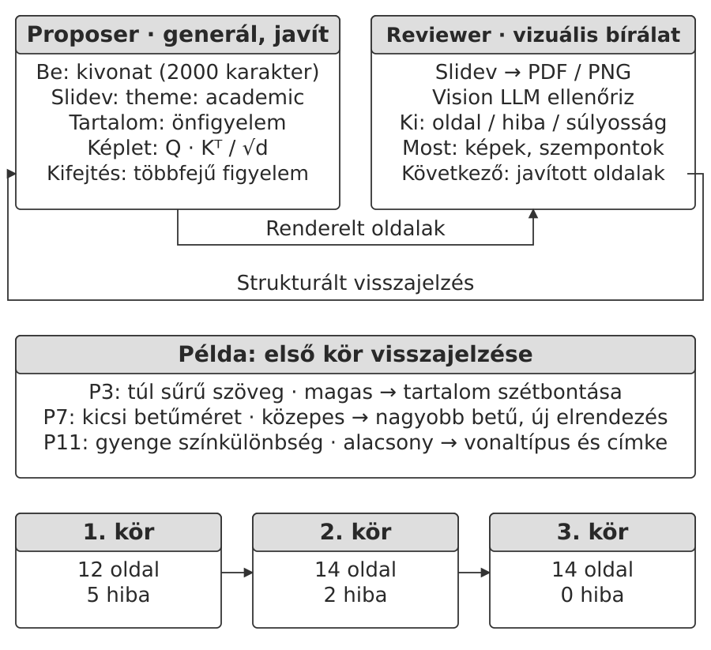

Ha más az ellenőrzés tárgya, a bírálathoz szükséges bizonyítékok is mások. Egy ügyfélszolgálati válasz bírálatához az üzleti szabályokat és a tényforrásokat kell összevetni; egy kódmódosításéhoz a teszteket és a tényleges végrehajtási eredményeket kell megnézni; egy műveleti terv bírálatához pedig az alkalmazandó előírásokat és az előfeltételeket kell ellenőrizni.

Huang és szerzőtársai *Large Language Models Cannot Self-Correct Reasoning Yet* című, ICLR 2024-es tanulmánya azt találta, hogy a vizsgált érvelési feladatokon és prompt-beállítások mellett a GPT-4 külső visszajelzés nélküli önjavítása során előfordult, hogy a helyes választ rosszra változtatta, és így az összpontosság csökkent. A TACL-ben megjelent, az önjavításról szóló áttekintés tovább vizsgálja, hogyan befolyásolják a feladat feltételei és a visszajelzés megbízhatósága a javítás hatását.[^self-correction-survey] Ezért a bírálati ciklus alapkövetelményének a független bizonyítékot és a pontosan behatárolható javítási feltételeket tekintem. A bírálónak hozzá kell férnie a tényleges tesztekhez, a környezet állapotához vagy a renderelt eredményhez, és meg kell neveznie, melyik követelmény nem teljesül még, és hogyan ellenőrizhető a javítás.

[^self-correction-survey]: Kamoi, R., et al. *When Can LLMs Actually Correct Their Own Mistakes? A Critical Survey of Self-Correction of LLMs.* TACL, 2024.

Egy teljes ciklus öt lépésben szervezhető meg:

1. A javasló a feladat követelményei szerint elkészíti az első változatot, például egy választ vagy egy kódrészletet.
2. A terméket végrehajtjuk vagy rendereljük, és teszteredményeket, üzleti állapotot, képernyőképeket vagy tényellenőrzési eredményeket kapunk.
3. A bíráló a követelményekkel és a bizonyítékokkal összevetve jóváhagyja az eredményt, vagy megnevezi a probléma helyét és a javítás feltételeit.
4. Ha még van keret, a javasló a visszajelzés alapján átdolgozza a terméket, majd újra végrehajtás és bírálat következik; ha bemenetre vagy jóváhagyásra váró problémába ütközik, várakozásra vagy átadásra vált.
5. Ha teljesülnek a kiadási feltételek, a bírálaton átment változatot adja le az ellenőrzési bizonyítékokkal és a bírálat következtetésével együtt; ha elfogy a keret, megőrzi a haladást és a megoldatlan problémákat.

A bíráló a védett teszteket és a kiadási szempontokat olvassa; ha a szempontok módosítását javasolja, azt külön kell felülvizsgálni.

A CRITIC kísérleteiben a modell először válaszol, majd eszközök segítségével ellenőrzi a válaszát.[^ch10-critic] Például keresőmotorral ellenőrzi a válaszban szereplő tényeket, vagy Python-értelmezővel futtatja az általa írt matematikai programot. Nyílt kérdések megválaszolásában, matematikai programok generálásában és a káros megfogalmazások csökkentésében egyaránt javult a teljesítmény, amikor a modell az eszközök visszajelzése alapján módosított. Ha a modell csak saját maga értékelte az eredeti választ, a hibajavítás gyengébb volt. Ez a megoldás rokon az 5. fejezet PPT-esetével: a renderelt képernyőkép olyan tördelési és takarási hibákat is felszínre hoz, amelyeket a kód szövegéből nehéz közvetlenül megítélni, a tesztek futtatása pedig a tényleges futási hibákat tárja fel.

[^ch10-critic]: CRITIC, arXiv:2305.11738.

Az Anthropic 2026-os, hosszú távú alkalmazásfejlesztési esettanulmánya három Ügynököt használ: tervezőt, generálót és értékelőt. A tervező a követelményekből termékspecifikációt bont ki; a generáló és az értékelő minden kör előtt megállapodik a teljesítés feltételeiben, majd az egyik megvalósít, a másik ellenőriz. Az értékelő Playwright segítségével kezeli az alkalmazást, és hibajelentéseket ad le; a szerepek fájlokon keresztül adják át egymásnak az állapotot. Az eset megmutatja, hogyan kapcsolható össze a termékspecifikáció, a valós használat és a hibavisszajelzés – a megoldások összehasonlításakor ugyanakkor a megnövekedett végrehajtási és bírálati költséget is figyelembe kell venni.[^anthropic-harness-2026]

[^anthropic-harness-2026]: Prithvi Rajasekaran, “Harness Design for Long-Running Application Development,” Anthropic Engineering, 2026-03-24.

2026. november 20-án Levent Alpöge matematikus nyilvánosságra hozta a Claude-dal közösen elkészített formális bizonyítást, amely a Riemann-sejtést és annak Dirichlet-féle $L$-függvényekre vonatkozó általánosítását érinti. Egy nagy halom Lean-fájl kézhezvételekor a bírálónak először két kérdést kell feltennie: valóban az eredeti sejtést fogalmazza meg az utolsó tétel? És a bizonyítási kernel újra ellenőrizni tudja-e a levezetés minden lépését? Andrew Sutherland, az MIT matematikusa először összevetette a beküldött tételt a Lean matematikai könyvtárában szereplő Riemann-sejtés-definícióval, majd felsorolta, milyen axiómákra támaszkodik a bizonyítás. Az aznap közzétett jegyzőkönyvében arról is beszámolt, hogy a nanoda nevű független bizonyítási kernel sikeresen ellenőrizte az exportált bizonyítást. Ez kézzelfogható módszert ad a bírálati munka megosztására: a problémát jól ismerő ember előbb írja le az elfogadási állítást, majd egy független eszköz ellenőrizze, hogy a beküldött termékből levezethető-e ez az állítás. Ha a matematikusok később meg akarják érteni, hogyan jutott a szerző erre az útra, ahhoz még egy ember számára olvasható gondolatmenetre is szükség lesz.[^ch10-rh-review]

[^ch10-rh-review]: Levent Alpöge 2026. november 20-án tette közzé kutatási beszámolóját. Az ellenőrzési projektet és aznapi állását lásd Andrew Sutherland *Verification files for the Lean proof of the Riemann Hypothesis* című anyagában.

#### Vita minta

A vita minta során a tagok különböző álláspontokból vizsgálják ugyanazt a kérdést. Egy műszaki megoldás értékelésekor például az egyik Ügynök a hasznot és az alkalmazási területeket mutatja be, a másik a megkötéseket, a kudarc feltételeit és az alternatívákat vizsgálja. Minden kör konkrét állítások körül forog, amelyekhez a felek bizonyítékot tesznek hozzá vagy ellenérvet hoznak fel, végül összesítik a konszenzusos pontokat és a még ellenőrzendő nézeteltéréseket.

Ez a felállás segít világosan felsorakoztatni a mellette és ellene szóló érveket, a hatása azonban az érvek minőségétől, az önálló ítéletalkotástól és a végső választás módjától függ. Tran és Kiela többlépéses érvelési feladatokon öt architektúrát hasonlított össze: a szekvenciálisat, a vitát, az együttest, a párhuzamos szerepeket és a párhuzamos részfeladatokat; azonos gondolkodási tokenkeret mellett az egyetlen Ügynök a többügynökös változatokkal azonos vagy jobb eredményt ért el.[^single-agent-2026] Ennek alapján a vitát főként a nézeteltérések kibontására, a feltevések ellenőrzésére és az ellenérvek pótlására használom. Ha a ténybeli vagy számítási pontosság a cél, inkább több ellenőrizhető bizonyítékot és független ellenőrzést adok a rendszerhez.

A tanulmány az adatfeldolgozási egyenlőtlenség segítségével tárgyalja a köztes információátadás korlátait: az ismételt átfogalmazás és tömörítés elveszítheti az eredeti részleteket. Mérnöki szempontból érdemes visszakereshető forrásokat megőrizni, és hagyni, hogy a tagok előbb önállóan elemezzenek, és csak utána cseréljék ki következtetéseiket – így kevesebb lesz az ellenőrizetlen konszenzus. A többszöri független mintavétel utáni összesítés, valamint a „nehéz generálni, könnyű ellenőrizni” jellegű feladatoknál alkalmazott külön bírálat is kombinálható a vitával.

[^single-agent-2026]: Tran, D., Kiela, D. *Single-Agent LLMs Outperform Multi-Agent Systems on Multi-Hop Reasoning Under Equal Thinking Token Budgets.* arXiv:2604.02460, 2026.

#### Ötletbörze minta

Az ötletbörze két körben szervezhető: előbb minden tag önállóan gondol ki megoldásokat, majd közösen megvitatják, mely ötletek kombinálhatók. Például az 1. Ügynök közösségi megosztási funkciót javasol; a 2. Ügynök erre építve azt, hogy a rendszer automatikusan személyre szabott megosztási plakátot készítsen; a 3. Ügynök pedig továbbviszi az ötletet a felhasználó által testreszabható sablonokig és egy sablonpiacig.

Hogy a tagok eltérő megoldásokkal álljanak elő, megkérhetjük őket, hogy az egyik a felhasználó, a másik az üzemeltető szemszögéből induljon ki, vagy adhatunk nekik eltérő promptot, illetve modellt. Az ötletek cseréje után a felhasználói igények, a megvalósítás költsége és az ellenőrzési eredmények alapján válogatjuk ki a megoldásokat.

#### Szakértői panel minta

A szakértői panel a több szakterületet érintő kérdéseknél szakmai feladatköröket oszt ki. Egy új termék értékelésekor például a mérnök Ügynök a megvalósítás nehézségét és a technológiai függőségeket elemzi, a termék Ügynök a felhasználói igényeket és az élményt vizsgálja, az üzemeltetési Ügynök pedig a költségeket, az erőforrásokat és a bevezetés feltételeit becsli meg.

A LobeHub csoportos csevegésében a moderátor ugyanazt a termékjavaslatot egyszerre elküldheti mindhárom szakértőnek. A rendszer először kiolvassa a csevegés aktuális előzményeit, majd a három tag a saját szerepkonfigurációjával párhuzamosan válaszol. Mindhárom válasz annak az üzenetnek a szálában jelenik meg, amely a szórást elindította, így később könnyen visszakereshető, ki melyik kérdésre felelt. Ha az üzemeltetésnek a mérnök által épp most becsült felhasználás alapján kell kiszámítania a költséget, akkor meg kell várni, amíg ennek a körnek a válaszai visszaíródnak, és csak utána kell az üzemeltetést szólásra kérni: ha a kettő egyszerre kezd írni, az üzemeltetésnek még nincs meg az a szám.[^ch10-lobehub]

[^ch10-lobehub]: LobeHub, a csoportos csevegés használati útmutatója; a párhuzamos szórás megvalósítása az `ab21e0d` verzióban.

Összesítéskor meg kell találni az egyes ítéletek közötti összefüggéseket: egy élménycél milyen műszaki támogatást igényel, egy technológiai döntés mennyivel növeli az üzemeltetési költséget, és mely feltételekhez kell még külső bizonyíték.

### Menedzser minta: központosított koordináció

Ha a feladat sok részfeladatból áll, bonyolultak a függőségek vagy dinamikus ütemezésre van szükség, a tervezést egy Menedzser Ügynök végezheti egységesen. Először megérti az átfogó célt, majd felbontja a munkát, kiválasztja a tagokat, követi a haladást, rendellenesség esetén dönt az újrapróbálkozásról, a tag cseréjéről vagy a terv módosításáról, végül összefésüli az eredményeket.

Gyakori megvalósítás, hogy a specializált Ügynököket eszközként regisztráljuk. A Menedzser az eszközinterfészen keresztül adja át a feladatot, a megkötéseket és a szükséges anyagokat, és strukturált eredményt vagy feladatazonosítót kap vissza. Így a keresés, a fájlműveletek és a részfeladatok delegálása hasonló hívási formát kaphat; a hosszan futó részfeladatoknál a haladást, a megszakítást és az újrapróbálkozást külön kell kezelni. A különböző tagok különböző modelleket, promptokat, eszközöket és futtatókörnyezeteket használhatnak. Új tag felvételekor az interfész regisztrálásán túl azt is el kell érni, hogy a Menedzser megértse a tag feladatkörét, bemeneti követelményeit és alkalmazási területeit.

Amikor a Claude Code-ban és a Codexben hosszú feladatokon dolgoztam, egy ideig a megbeszélést, a parancsok végrehajtását és a teszteket is a fő munkamenetben tartottam. Ha menet közben rá akartam kérdezni egy tervezési döntésre, gyakran meg kellett várnom, amíg az éppen futó lépés befejeződik; ha pedig órákkal később kerestem egy korábbi megállapodást, hosszú parancskimeneteken kellett átrágnom magam. Később a módosításokat és a teszteket al-ügynökökre bíztam, a fő munkamenetet pedig a megbeszélésnek tartottam fenn. A kézirat korrektúrájánál például a végrehajtó tovább ellenőrizheti az ábraszámokat, én pedig közben megbeszélhetem egy olvasóval, át kell-e írni egy bekezdést. Ha a megbeszélés megváltoztatja a feladat terjedelmét, az új megállapodást el kell küldeni a végrehajtónak, és a leadáskor ehhez kell mérni a munkáját.

A DeepSeek Harness csapata nyilvánosságra hozta a `dsh-superagent` nevű kutatási prototípust, amely egyetlen GitHub-tárolóra készült. Vegyük példának egy exportált fájl dátumformátumának javítását: a karbantartó egy Issue-ban fogalmazza meg a kérést, az útválasztó (Router) pedig a tároló szabályai alapján dönti el, elvállalhatja-e. Ha elvállalja, a rendszer létrehoz egy munkalapot (Ticket), és a végrehajtónak (Worker) külön munkamenetet és munkakönyvtárat ad. A végrehajtó a saját könyvtárában módosíthatja a kódot és futtathatja a teszteket; közben egy másik munkalap is haladhat, és mindegyik megőrzi a saját módosítási folyamatát és teszteredményeit.[^ch10-dsh-prototype]

Tegyük fel, hogy a karbantartó ezután kiegészíti az eredeti Issue-t: „csak a CSV-t módosítsd, a JSON dátumformátuma maradjon”. Az erre a megbeszélésre feliratkozott, folyamatban lévő munkalap megkapja a kiegészítő üzenetet, a végrehajtó ennek alapján szűkítheti a módosítás körét, és mindkét formátumot külön tesztelheti. A munka végeztével nyithat egy lekérési kérelmet (PR), és a hivatkozást az eredménnyel együtt visszaírhatja az eredeti Issue-ba. A karbantartó egy helyen látja az eredeti kérést, a később hozzáadott megkötést és a bírálatra váró módosítást; az útválasztónak pedig nem kell minden követő üzenetet újra feladatokra bontania.

[^ch10-dsh-prototype]: DeepSeek Harness csapat, dsh-superagent kutatási prototípus. Arról, hogyan kapják meg a munkalapok a későbbi üzeneteket, lásd a jogosultságokról és feliratkozásokról szóló részt; a végrehajtási munkamenetekről és munkakönyvtárakról a végrehajtási mechanizmust leíró részt.

A Menedzserre ugyanakkor sok döntési felelősség hárul. A hibás feladatbontás kihat a további végrehajtásra, a hiányos átadási anyag ismételt visszakérdezést okoz, a túl sok hívási napló pedig kiszorítja a hasznos tartalmat a kontextusból. Tervezéskor érdemes tömör feladatállapotot és termékindexet vezetni, a részleteket igény szerint beolvasni, és minden részfeladatnak egyértelmű bemenetet, kimenetet és teljesítési feltételt adni.

A Plan-and-Act a Planner–Executor architektúrában vizsgálta, hogyan hat a tervezés minősége a hosszú feladatokra, és a WebArena-Lite-on 57,58%-os sikerarányról számolt be.[^plan-and-act-2025] A tervezési hibák miatt több végrehajtó is a hibás felbontás mentén dolgozik tovább, és több tag bevonása csak megsokszorozza az utómunkát. Ezért először a Menedzser feladatbontásának minőségét ellenőrzöm; ha a tervezés a szűk keresztmetszet, a Menedzser kapja az erősebb modellt, a teljesebb feladatinformációt és a bőségesebb következtetési keretet. Miután a részfeladatok határai egyértelművé váltak, a végrehajtók számára is kiválasztom a megfelelő konfigurációt.

[^plan-and-act-2025]: Erdogan, L. E., et al. *Plan-and-Act: Improving Planning of Agents for Long-Horizon Tasks.* arXiv:2503.09572, 2025.

A párhuzamos feladatoknál azt is rögzíteni kell, hogyan záruljanak le. Ha a cél egyetlen, a feltételeknek megfelelő eredmény megtalálása, akkor sikeres ellenőrzés után atomi művelettel rögzíthetjük az elsőként igazolt eredményt, majd megszakíthatjuk a többi ágat, megvárhatjuk a megszakítás nyugtázását vagy az időtúllépést, végül összesíthetjük és leadhatjuk az eredményt. A rögzítő műveletnek egyszerre kell atominak és idempotensnek lennie: ha két eredmény egyszerre érkezik, csak egy állapotátmenet történhet; ha ugyanaz az esemény többször érkezik, a már meglévő feldolgozási eredményt kell használni. Ennek a lépésnek a védelmére zárolás, tranzakció vagy compare-and-swap egyaránt használható.

A Python beépített SQLite-modulján megnézhetünk egy konkrét átadást. Tegyük fel, hogy két tag, A és B párhuzamosan ellenőriz anyagokat, és mindkettejük beküldött eredménye átment az ellenőrzésen. A Menedzsernek csak egy megfelelő eredményre van szüksége, és egyetlen feladatrekordban jegyzi fel, ki küldte be elsőként. Az alábbi példában A küld be először, B utána, majd A még egyszer újrapróbálkozik.

```python
import sqlite3

db = sqlite3.connect(":memory:")
db.execute("CREATE TABLE task (id INTEGER PRIMARY KEY, winner TEXT)")
db.execute("INSERT INTO task VALUES (1, NULL)")
for worker in ["A", "B", "A"]:
    with db:
        claimed = db.execute(
            "UPDATE task SET winner = ? WHERE id = ? AND winner IS NULL",
            (worker, 1),
        ).rowcount
    print(worker, "rögzítve" if claimed else "a már rögzített eredmény marad")
```

A kimenet sorban: „A rögzítve”, „B a már rögzített eredmény marad”, „A a már rögzített eredmény marad”. Ha B érkezik elsőként, a táblában B neve szerepel. Egyetlen frissítő utasítás ellenőrzi, hogy „még senki nem rögzített eredményt”, és egyben beírja a beküldő nevét; ha az ellenőrzést és az írást szétválasztjuk, mindkét végrehajtó üres értéket olvashat.

A fenti példa a táblát a memóriában hozza létre, így a folyamat kilépésével a rögzítés is eltűnik. Perzisztens adatbázis használatakor egy újabb átadási kérdés merül fel: a Menedzser már rögzítette A eredményét, de kilépett, mielőtt értesíthette volna B-t. Újraindulás után ki tudja, hogy ez az értesítés még nem ment ki? A kiválasztott eredményt és a kiküldendő értesítést ugyanabban a tranzakcióban írhatjuk be. Minden értesítés tartalmazza a címzett ágat, az elvégzendő teendőt és egy egyedi azonosítót. A Menedzser újraindulás után pótlólag elküldi a még nem nyugtázott értesítéseket. Ha B már elvégezte a takarítást, és csak a nyugtázó üzenete veszett el, az eredeti azonosító alapján felismeri az újraküldött értesítést, és egyszerűen visszaadja a korábbi feldolgozás eredményét. A leadási események ugyanígy rögzíthetők.

Ha a feladat az összes eredmény összegyűjtését kívánja, meg kell várni, amíg minden szükséges ág befejeződik, és külön kell rögzíteni a sikeres, a sikertelen és a befejezetlen tételeket. A lezárás feltétele a feladat céljából következik, és ez dönti el azt is, mikor szakíthatók meg a többi tag munkái.

**Szekvenciális koordináció.** Ha a részfeladatok egymásra épülnek, a Menedzsernek meg kell várnia, amíg az előző lépés terméke elérhető, és csak utána oszthatja ki a következőt. A 10-4. ábra egy jelentés megírásának példáján mutatja be ezt: az anyaggyűjtő tag először visszaadja a forrásokat, az elemző ezek alapján megfogalmazza a következtetéseket, végül az író megalapozott elemzést kap. Ha a következő feladat egy fordítás, melyik anyagra kell várnia a fordítónak, mielőtt munkához lát?

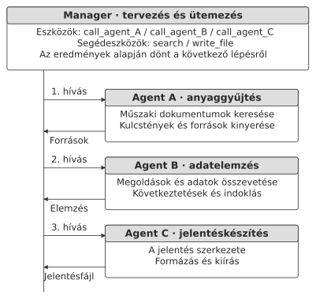

> **10-2. kísérlet ★★: Könyvfordító Ügynök**
>
> Egy műszaki könyv fordításakor egyszerre kell kezelni a terminológiát, a szövegkörnyezetet és a stílust. Az angol agent szónak például több fordítása is lehet; ha a fordításban az „Ügynök” mellett döntöttünk, a későbbi fejezeteknek is ezt kell használniuk. A szójegyzéket, az egyes fejezetek eredeti szövegét, a fordítást és a lektori jegyzeteket átlátható módon kell szervezni. Egy hosszú könyv a köztes fordításokkal, az eszközeredményekkel és a lektorálási előzményekkel együtt egyre jobban kiszorítja a kontextust: a modell a 9. fejezetre elfelejtheti, hogyan fordította a kifejezést a 2. fejezetben, vagy újra meg újra ugyanazt a részt ellenőrizheti. Ha a feladatot feladatkörök és fejezetek szerint bontjuk fel, minden példány csak az aktuális feladatához szükséges anyagokra összpontosíthat.
>
> A munka négyféle Ügynök között osztható meg:
>
> - **Glossary Agent: a szójegyzék összeállítása.** Részletekben végigolvassa a könyvet, felismeri az ismétlődő szakkifejezéseket, szakszótárak és fordítási irányelvek alapján JSON- vagy CSV-táblázatot készít az angol kifejezéssel, a magyar megfelelővel, a szófajjal és a használati környezettel. A szójegyzéket a megosztott térbe menti, a feladat végeztével pedig a példány felszabadul.
> - **Translation Agent: a fejezetek fordítása.** Beolvassa az aktuális fejezetet, a kapcsolódó kifejezéseket és a fordítási útmutatót, majd a célközönségnek és a nyelvi stílusnak megfelelően elkészíti a fordítást. Az újonnan felbukkanó kifejezésekhez fordítási javaslatot ad, és felülvizsgálatra jelöli őket. Minden példány saját kontextussal dolgozik, a fordítást a megosztott térbe menti; a fejezetek a függőségektől függően sorban vagy párhuzamosan is feldolgozhatók.
> - **Proofreading Agent: a teljes szöveg lektorálása.** A szójegyzék és az egyes fejezetek fordítása alapján ellenőrzi a kifejezések fordítását, a megfogalmazások következetességét és az olvashatóságot. A teljes szöveget fejezetenkénti olvasással és fejezeteken átívelő indexszel ellenőrzi, a problémák helyét, indoklását és a javítási kéréseket pedig lektori jelentésbe írja.
> - **Manager Agent: a feladatok kiosztása és begyűjtése.** Nyilvántartja a célt, a tervet, a feladatállapotot, a hívások összefoglalóit és a termékindexet; a lektori jelentés alapján visszaküldi a javítandó fejezeteket a fordítónak, majd megszervezi az újraellenőrzést.
>
> A 10-5. ábrán a lektor az egyes fejezetek fordítását és a szójegyzéket olvassa, a Menedzser pedig a jelentés alapján dönti el, mely fejezeteket kell javítani. A javítási feladatot kapó fordító előveheti a fejezet eredeti szövegét, és ellenőrizheti, mit jelent a megjelölt szó az adott mondatban.
>
> 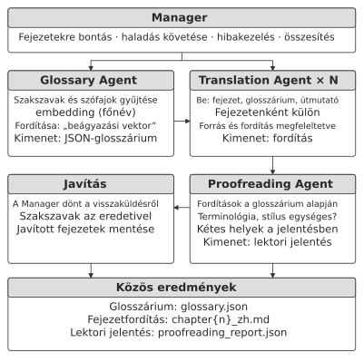
>
> Ha a fordítások fájlba kerülnek, melyik hívásnak kell még hosszú szöveget olvasnia? A kísérlethez tartozó kód az angol kiadás első két fejezetét 26 fordítási egységre bontotta. Az egyetlen Ügynök végig magával vitte a korábbi eredeti szövegeket és fordításokat, és a legnagyobb kérése 94 355 bemeneti tokent tartalmazott. A munkamegosztás után a fordítók legnagyobb bemenete mindössze 2857 token volt, a Menedzser a javítási döntéshez 2153 tokent használt. A menedzseres csoportban valójában a szójegyzék összeállítója kapta a legtöbb bemenetet: egyszerre két fejezetet olvasott, 49 807 tokent felhasználva.
>
> A két fejezet lefordításához a négy szerep összesen 203 277 tokent használt, az egyetlen Ügynök 1 317 808-at. Melyik csoport adta le előbb a munkát? A négyszereplős csoportnak körülbelül 271 másodpercre volt szüksége, nagyjából 17 másodperccel többre, mint az egyetlen Ügynöknek.
>
> Leadáskor kétféle ellenőrzés ugyanarra a fordításra eltérő eredményt adott. A szójegyzék az `embedding` főnévhez a „beágyazási vektor” fordítást írta elő. A lektori jelentés nem jelölt meg javítandó fejezetet, a terminológiai ellenőrző program viszont 0/2-t adott erre a szóra: mindkét fejezet fordításában megtalálta a „beágyaz” szótövet, de a „beágyazási vektort” egyikben sem. Vissza kell küldeni mindkét fejezetet?
>
> Az 1. fejezet visszatérítési szabályzatról szóló bekezdésében az eredeti szöveg `embedding the refund policy in the context`, a fordítás pedig „a visszatérítési szabályzatot beágyazzuk a kontextusba”. Itt arról van szó, hogy a szabályzat bekerül a kontextusba; ha „beágyazási vektorra” javítanánk, éppen elrontanánk. A fejezetenként karakterláncokat kereső program nyomokat adhat a lektornak az újraellenőrzéshez; annak eldöntéséhez viszont, hogy melyik előfordulást kell javítani, a lektornak az adott bekezdés eredeti szövegére is szüksége van. Ha a szójegyzék frissül, először az érintett bekezdéseket érdemes azonosítani, és az eredetit, a fordítást és az új szócikket együtt átadni a fordítónak.
>
> **A kísérlet követelményei:**
> 1. Válasszunk egy ábrákat és kódot is tartalmazó műszaki könyvet.
> 2. Valósítsuk meg a Manager, a Glossary, a Translation és a Proofreading Ügynököt.
> 3. Rögzítsük az egyes tagok kontextusfelhasználását, az átadott anyagokat és a termékek verzióit.
> 4. Hasonlítsuk össze az egyetlen Ügynökös megoldással a fordítás minőségét, az elkészülési időt és az erőforrás-felhasználást, és elemezzük a feladatbontás és a kontextusszervezés hatását.

**Párhuzamos koordináció.** Az egymástól független részfeladatok egyszerre is végrehajthatók. A Menedzser kiosztja a feladatokat, fogadja az állapotjelentéseket, és az eredmények alapján dönt a folytatásról, a kiegészítő munkáról vagy a befejezésről. E könyv fordításakor, amint a szójegyzék végleges, a különböző fejezetek egyszerre több fordítóhoz kerülhetnek. A 10-6. ábra egy kutatási jelentés példáját mutatja: a diagramok már elkészültek, az elemzés még folyik – miért kell mégis várnia a formátumellenőrzésnek? A tagok által jelentett eseményeket követve kiderül, hogy az utolsó lépés melyik két terméktől függ.

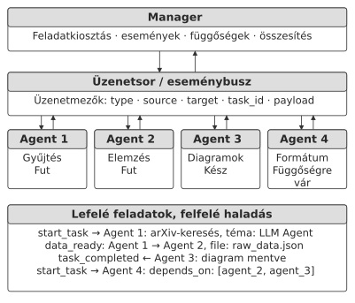

Az ilyen aszinkron kommunikáció megszervezésére az üzenetbusz alkalmas: a tagok közzéteszik a haladásukat és az eredményeiket, a menedzser feliratkozik a megfelelő eseményekre, a futtatókörnyezet pedig gondoskodik a kézbesítésről, a pufferelésről és az újrapróbálkozásról.

> **Termékpélda: Lingtai**
>
> A Lingtai helyben futó, hosszú életű Ügynökrendszer, amely fájlokban őrzi az identitást és az emlékezetet. Háromféle szerepet kínál: a fő szellem (main agent) a felhasználóval beszélget, és kezeli a terveket és az emlékezetet; a démon (daemon) jól körülhatárolt, rövid távú párhuzamos feladatokat vállal, és a végén visszaadja a következtetést; az avatár (avatar) megtartja saját emlékezetét, postafiókját és feladatkörét, és munkameneteken átívelő szakmai munkamegosztásra szolgál.
>
> Minden szerepnek saját, perzisztens tudása van, a Markdown formátumú képességkézikönyveken viszont osztoznak. Ha a kontextus a kapacitás határához közelít, a szerep „vedléssel” (molt) összefoglalót ment, majd ezt a perzisztens emlékezettel együtt felhasználva új kontextusba lép. Mivel az identitás, az emlékezet és a képességek külön fájlokban élnek, a munka az alapul szolgáló modell cseréje után is folytatható. Ez a megoldás egyesíti a menedzsert, a rövid távú munkatársakat, a hosszú távú szakértő tagokat és a kontextustömörítést.

> **10-3. kísérlet ★★★: Önállóan vezényelt telefonos és számítógépes Ügynök**
>
> Ez a kísérlet a 6. fejezet Computer Use és hangalapú interakciós témáit kapcsolja össze. A felhasználó megad egy regisztrációs vagy repülőjegy-foglalási oldalt; a Computer Agent megnyitja a webhelyet, felismeri az űrlapot, majd a Phone Agent segítségével begyűjti a még hiányzó mezőket: nevet, okmányszámot, elérhetőséget, címet és preferenciákat.
>
> **Szerepek és átadás.** A Computer Agent kezeli a böngészőt, és ő vezényli ezt a folyamatot; a Phone Agent ASR, LLM és TTS segítségével valós időben beszélget a felhasználóval, és a szóbeli válaszokat strukturált mezőkké alakítja. A kettő pont-pont eszközön vagy üzenetbuszon keresztül kommunikál; az üzenetek tartalmazzák a küldőt, a címzettet, a típust és a tartalmat. A Computer Agent közvetlenül delegálhatja a telefonos feladatot, így ő tölti be a menedzser szerepét. Ha a felhasználó szívesen ad meg adatokat hangon, a Phone Agent egymás után kérdezhet, megerősíthet és újrakérdezhet, a Computer Agent pedig az oldal állapotára és a mezők kitöltésére összpontosít.
>
> **Két futási mód.** Rögzített módban mindkét Ügynök előre elindul, és mindkettő saját futási ciklust tart fenn; ez a kétirányú kommunikáció és a párhuzamos működés ellenőrzésére szolgál. Önálló módban először csak a Computer Agent indul el, és a modell az oldal, a meglévő információk és a feladat igényei alapján dönti el, meghívja-e az `initiate_phone_call_agent(purpose, required_info)` függvényt. A futtatókörnyezet ezután átadja a Phone Agentnek a feladat célját, a begyűjtendő mezőket és a formátumkövetelményeket, és az indulás után ugyanazt a kommunikációs mechanizmust használja.
>
> **Mezőnkénti áramlás.** A 10-7. ábrán a Phone Agent WebRTC-n keresztül kérdez, kinyeri és ellenőrzi a választ, majd érvényes érték esetén `info_collected` üzenetet küld, és rátér a következő tételre. A Computer Agent közben beolvassa az oldalt, kitölti az előző tételt, és visszaküldi a `fill_error` üzenetet vagy az oldal új állapotát. A formátumhibákról szóló visszajelzés `format_invalid` üzenetben nevezi meg a mezőt és a követelményt, a Phone Agent pedig ennek alapján megerősít vagy újrakérdez. Így a „következő tétel kérdezése” és az „előző tétel kitöltése” átfedheti egymást.
>
> **Befejezés és hibakezelés.** Miután begyűjtötte a mezőket, a Phone Agent `task_completed` üzenetet küld, jelezve, hogy az információgyűjtő részfeladat véget ért. A Computer Agent ezután ellenőrzi a kötelező mezőket, az oldal validációs eredményeit és a beküldési engedélyt, majd befejezi az űrlap kezelését. Ha túllépik az újrapróbálkozások számát, az oldalon hiba lép fel, vagy a felhasználó leállítást kér, a feladat szünetel, és a rendszer elmondja, hol tart a munka; befejezéskor megszakítja a még futó másik felet, és bezárja a böngészőmunkamenetet, a hangsávot és a hívást. Valódi emberrel folytatott hangalapú interakcióhoz és az űrlap beküldéséhez külön-külön a felhasználó beleegyezése, illetve engedélye szükséges.
>
> 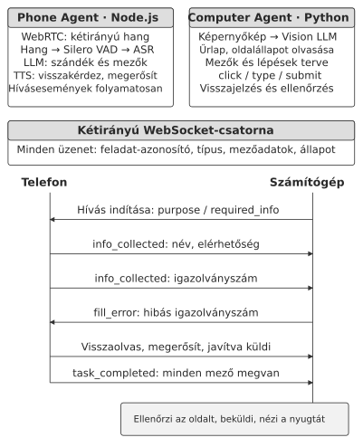
>
> **A kísérlet követelményei:**
> 1. Valósítsunk meg két önálló Ügynököt kétirányú strukturált kommunikációval.
> 2. Rögzítsük az időbeli lefolyást rögzített és önálló módban, és vizsgáljuk meg a kérdezés és a kitöltés átfedési szakaszait.
> 3. Valósítsuk meg a formátumellenőrzést, az újrakérdezést, az oldalhibák visszajelzését, az időtúllépést és az erőforrások takarítását.
> 4. Hasonlítsuk össze a két mód indítási döntéseit, késleltetését, sikerarányát és erőforrás-felhasználását.

> **10-4. kísérlet ★★★: Több webhelyről egyszerre adatokat gyűjtő Ügynök**
>
> Ez a kísérlet több azonos felépítésű, párhuzamosan kereső Ügynököt használ, és a 6. fejezet eseményvezérelt és megszakítási mechanizmusait gyakoroltatja. A feladat egy egyetem több karának webhelyén megkeresni egy adott oktatót, például „Zhang Wei”-t, és visszaadni a kart, a beosztást, a kutatási területet és a forrásoldalt. A keresés előtt rögzíteni kell az azonosítás feltételeit – például a nevet, a szakterületet és a személyes honlap adatait –, hogy meg lehessen különböztetni az azonos nevű személyeket.
>
> **1. Párhuzamos indítás.** A Menedzser 10 Computer Use Ügynököt hoz létre, mindegyik egy-egy kari webhelyért felel. Minden példánynak saját kontextusa és böngészőmunkamenete van; aszinkron feladatokkal, szálakkal vagy folyamatokkal ütemezhetők. A bemenet tartalmazza a webhely URL-jét, a keresett nevet, az egyezési feltételeket és az útválasztáshoz használt feladatazonosítót.
>
> **2. A haladás összesítése.** A tagok rendszeresen küldenek olyan állapotokat, mint „webhely betöltése”, „oktatói névsor olvasása”, „ellenőrizve, nincs egyezés”, „azonos nevű oktató található”. A Menedzser az üzenetbuszon keresztül feladattáblát vezet, amelyben külön rögzíti a futó, a befejezett, az elakadt és a sikertelen feladatokat, a forrásokkal és a hibaokokkal együtt.
>
> **3. Ellenőrzés után a többi ág megszakítása.** Tegyük fel, hogy a fizikai karért felelős `agent_3` talál egy azonos nevű oktatót, és `target_found` üzenetet küld, amelynek hasznos terhe az oktató adatait és a forrást tartalmazza. Ha a feladat ellenőrzött személyi adatokat kér, a Menedzsernek először ellenőriznie kell az egyezési feltételeket és a bizonyítékokat, majd miután megbizonyosodott róla, hogy megtalálta a keresett személyt, atomi művelettel rögzíti az eredményt, és a többi futó tagnak `terminate` üzenetet küld, jelezve, hogy a felhasznált adatok az `agent_3`-tól származnak. A tagok biztonságos ponton leállnak, felszabadítják az erőforrásaikat és nyugtázást küldenek; a Menedzser a nyugtázások vagy az időtúllépés után összesít. Ha a feladat az összes azonos nevű személy felsorolását kéri, a keresés addig folytatódik, amíg a teljes szükséges kör ellenőrzése be nem fejeződik.
>
> **Versenyhelyzet.** Az A és a B Ügynök szinte egyszerre adhat vissza érvényes eredményt. Ha mindkét esemény külön elindítja az összesítést, kétszeres leadás vagy állapotütközés lesz a vége. Zárolással vagy tranzakcióval védhető a „keresés folyamatban → eredmény rögzítve” állapotátmenet, így a később érkező esemény a már rögzített eredményt olvassa be. Az üzenetek újraküldését is eseményazonosító alapján kell szűrni, hogy a megszakítás és az összesítés ismételt kiváltódása esetén is konzisztens maradjon az állapot.
>
> **4. Hibák és lefedettség.** A hálózati megszakadásokat, az oldalszerkezet változásait és az elemzési hibákat külön kell rögzíteni. Egy-egy feladatra például kétperces időkeret állítható be; túllépés esetén a végrehajtás megszakad, a rendszer diagnosztikai információt gyűjt, a többi tag pedig tovább dolgozik. A végső jelentés megkülönbözteti az „ellenőrizve, nem található” és a „hozzáférés sikertelen, ellenőrzés befejezetlen” eseteket, és azt is megadja, mely karokat fedte le a keresés.
>
> A 10-8. ábra egy szemléltető idősoron fűzi fel ezeket az üzeneteket. Tegyük fel, hogy a 3. tag azt jelenti: a fizikai karon van egy Zhang Wei nevű, kvantumszámítással foglalkozó professzor. A Menedzsernek először meg kell néznie, hogy a forrásoldal igazolja-e a nevet, a kart, a beosztást és a kutatási területet. Az azonos nevű oktatóra utaló nyom beérkezése, annak megerősítése, hogy ő a keresett személy, és az összes megszakítási nyugta beérkezése három különböző időpont.
>
> 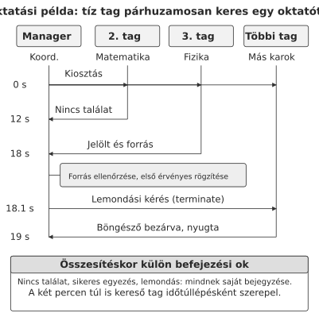
>
> A valódi futtatásban Andrew Ng volt a keresett személy. A tagok először azt nézték meg, szerepel-e a név az oldal szövegében, és csak találat esetén kérték meg a modellt az adatok kinyerésére. A Stanford HAI oldala került kiválasztásra, a visszaadott rövid idézet alapján ellenőrizhető volt a név és a vendégprofesszori státusz. A kutatási terület ellenőrzéséhez az oldal későbbi, mélytanulásról szóló bekezdését is el kellett olvasni. Ha több tag egyszerre küldött is vissza `target_found` üzenetet, csak az elsőként zárolást szerző tag rögzíthette az eredményt.
>
> A szekvenciális keresés csak a tíz URL közül az utolsónál talált, és 44,971 másodpercig tartott; a párhuzamos keresés ugyanezeken az oldalakon 24,022 másodperc alatt végzett, és mindkét futásban mind a tíz böngészőkontextus bezárult. A két szám hányadosa 1,872. Ha a HAI oldala kerülne az első helyre, a szekvenciális keresés az első találatnál leállhatna, így az időt újra kellene mérni. Egy másik, kifejezetten a megszakítást tesztelő futtatás négy ágat indított: az egyik ág elsőként rögzítette az eredményt, a másik három nyugtázta a megszakítási kérést, és végül mind a négy böngészőkontextus bezárult.
>
> **A kísérlet követelményei:**
> 1. Valósítsunk meg egy Menedzsert, amely dinamikusan hoz létre párhuzamos tagokat.
> 2. Építsük fel a böngészős végrehajtási képességet a browser-use vagy hasonló projektek segítségével.
> 3. Valósítsuk meg az üzenetbuszon keresztül a kétirányú kommunikációt és az állapotkezelést.
> 4. Ellenőrizzük a keresési eredményeket, rögzítsük az eredményt atomi művelettel, és a többi ág megszakítása után gyűjtsük be a nyugtázásokat.
> 5. Kezeljük a sikertelen hozzáférés, az elemzési hiba, az időtúllépés és az egyezés hiánya eseteit.
> 6. Hasonlítsuk össze a párhuzamos és a szekvenciális végrehajtás elkészülési idejét, lefedettségét és erőforrás-felhasználását.

**A menedzser által generált munkafolyamat.** Az egyenkénti delegálás mellett a Menedzser a feladatok függőségeit és az összesítési szabályokat programként is megírhatja, és a futtatókörnyezetre bízhatja az ütemezést. A modell tervezi meg a folyamatot, a program pedig a megállapodás szerint indítja a tagokat, adja át az eredményeket és várja meg a függőségeket. Ha a függőségek már világosak, és ugyanaz a fajta folyamat ismétlődően fut, ezt a megoldást részesítem előnyben. Így nem kell minden kiosztásnál meghívni a Menedzsert, és a menedzseri kontextusban felhalmozódó ütemezési napló is kisebb lesz.

A Claude Code dinamikus Workflow eszköze ilyen megvalósítást kínál. Az `agent()` saját kontextusú al-ügynököt hoz létre, amelynek strukturált kimenete schemával rögzíthető; a `parallel()` párhuzamosan hajt végre egy feladatcsoportot, és megvárja, amíg mind befejeződik; a `pipeline()` minden bemenetet több szakaszon vezet végig, és amikor egy tétel a következő szakaszba lép, a többi tétel még az előzőben dolgozhat. A köztes eredmények programváltozókban maradnak, a szűrés és az összefésülés pedig közönséges kóddal történik.[^dynamic-workflows]

Ha például egy műszaki kézirat hét ténycsoportját kell ellenőrizni, először irányonként elindíthatunk kutató Ügynököket, majd minden csoport következtetését külön ellenőrző Ügynöknek adhatjuk át párhuzamos vizsgálatra. Minden visszaadott következtetés megőrzi a forrást és a döntés indoklását; miután minden ág végzett, egy összesítő Ügynök állítja össze a végső jelentést. Így a „kutatás – tételenkénti ellenőrzés – egységes összesítés” munkamegosztás és a szakaszok közötti függőségek egyaránt bekerülnek a munkafolyamatba.

[^dynamic-workflows]: Anthropic, “Orchestrate subagents at scale with dynamic workflows”, 2026.

### Decentralizált minta

Ha van Menedzser, miért hagynánk, hogy a tagok maguk döntsék el, kihez forduljanak? Képzeljük el, hogy a tesztelő megkapja a frissen megírt modult, és rájön, hogy a termékkövetelmény és az interfész-megállapodás ugyanazt a mezőt kétféleképpen értelmezi. A tesztelő az ellentmondást közvetlenül a termék és az architektúra szerepének adhatja át, hogy mindkét fél kifejtse az indokait, és csak a megállapodás javítása után folytatja a tesztelést. Ez munkamegosztás, de egyben fékek és ellensúlyok rendszere is. A mérnök leadja a modult, az architekt kikéri a termékoldal véleményét, a tesztelő kifogást emel – mindegyikük kezdeményezheti a következő lépést. Ha gyakran kell egyeztetni, lassítja a munkát, ha minden tételnél a Menedzser közvetítésére kell várni.

A mikroszolgáltatások szóhasználatát kölcsönvéve: ha egy központ jelöli ki a lépéseket, azt **vezénylésnek** (orchestration), ha pedig a felek megállapodott események alapján maguk veszik át a munkát, azt **koreográfiának** (choreography) nevezzük. Van egy gyakorlati különbség is: ha minden átadásnál a Menedzserre kell várni, és a Menedzser modellszolgáltatása nem válaszol, a többi tag akkor sem kap új feladatot, ha egyébként tudna dolgozni. A szétosztott koordináció csökkenti ezt a függőséget; ha viszont az átvevő tag maga akad el egy eszközhívásban, akkor is a perzisztens feladatállapotra, az időtúllépésre, az újrapróbálkozásra és az átvételi mechanizmusokra van szükség ahhoz, hogy egy másik tag tudja, honnan folytassa.

Az alábbi három megoldás háromféle átadási módot képvisel: feliratkozás üzenetekre termékek szerint, a következő felszólaló kiválasztása csoportos csevegésben, illetve az aktuális tag által megnevezett átvevő.

**MetaGPT: termékátadás SOP alapján.** A MetaGPT egy szoftvercsapat szabványos működési eljárása (SOP) szerint osztja el a munkát. A termékmenedzser követelménydokumentumot (PRD) ad le, az architekt tervezési dokumentumot, a mérnök kódot, a tesztelő tesztjelentést. A következő tag a megállapodott anyag birtokában munkához láthat, az előzőnek pedig nem kell újra meg újra elmagyaráznia a feladatot. A 10-9. ábra vonalai e termékek átadási kapcsolatait mutatják.[^metagpt-design]

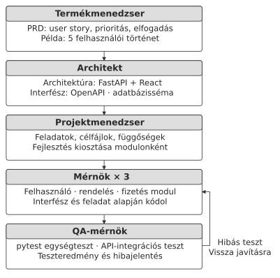

Milyen információval kell kiegészítenie az egyes szerepeknek az átadott anyagot?

- **Product Manager Agent:** fogadja a követelményeket, összeállítja a PRD-t, és rögzíti a funkciókat, a felhasználói történeteket, az elfogadási feltételeket és a prioritásokat.
- **Architect Agent:** beolvassa a PRD-t, kiválasztja a technológiai készletet, modulokra bontja a rendszert, meghatározza az interfészeket és az adatmodelleket, és ebből tervezési dokumentumot készít.
- **Project Manager Agent:** a terv alapján felbontja a feladatokat és kiosztja a fájlokat, rendezi a függőségeket, és beosztja a mérnökök munkáját.
- **Engineer Agents:** a terv alapján megvalósítják a modulokat és beküldik a kódot; az egymástól független részek több példányra is kioszthatók.
- **QA Engineer Agent:** a kód és a követelmények alapján teszteket generál, lefuttatja az ellenőrzéseket, rögzíti a problémákat, és tesztjelentést készít.

Ha ezekhez a szerepekhez átadási formátumot tervezünk, azt javaslom, hogy három dolgot rögzítsen egyértelműen: a feladatot és az elfogadási feltételeket, a megerősített tényeket és megkötéseket, valamint a strukturált termékekre mutató hivatkozásokat. Ezek alapján az átvevő megszerzi a szükséges anyagokat, folytatja a munkát, és ha valami hiányzik, konkrét kérdést tesz fel.

A MetaGPT közös üzenetkészlettel és feliratkozási mechanizmussal szervezi az információt: a szerepek üzeneteket tesznek közzé, a többi szerep pedig a számára érdekes üzenettípusok alapján dolgozza fel a releváns bemeneteket. A közzétevőket és a fogyasztókat a termékformátum és az üzenetek jelentése köti össze, így a modelljük egymástól függetlenül cserélhető, a belső megvalósításuk pedig külön módosítható.

Az SOP a termékkövetelmények, az architektúra és a kód közötti függőségeket írja le, az üzenet-feliratkozás pedig azt, hogyan indulnak el ezek a munkák. A rögzített feladatfüggőségeket is előreviheti elosztott esemény, és a kettő együtt alkotja a rendszer együttműködési módját. Dinamikus visszajelzés tervezésekor további utakat is felvehetünk – például a tesztelő a termékszereptől kér pontosítást a követelményekről, vagy a mérnök alternatív megoldást javasol az architektnek –, és ezekhez az interakciókhoz fogadási feltételeket és lezárási szabályokat kell megadni.

[^metagpt-design]: Hong, S., et al. *MetaGPT: Meta Programming for A Multi-Agent Collaborative Framework.* ICLR 2024.

**AutoGen csoportos csevegés: felszólalási sorrend egy közös munkamenetben.** A klasszikus GroupChat-felépítésben több Ügynök vesz részt ugyanabban a munkamenetben; a GroupChatManager választja ki a következő felszólalót, és szórja szét az üzeneteket a tagoknak. A kiválasztás történhet körforgásos rendben, de a modell is dönthet az aktuális tartalom alapján. A tagok megtartják saját szerepkonfigurációjukat, és a közös munkameneten keresztül kommunikálnak, a felszólalások ütemezése viszont a menedzsernél összpontosul. Ez jó példa arra, hogyan kombinálható a kontextusszervezés és a vezérlési szerkezet.[^autogen-groupchat]

[^autogen-groupchat]: Microsoft, *AutoGen 0.2: Conversation Patterns.*

**OpenAI Swarm: a vezérlés átadása handoff mentén.** A Swarm utasításokat és eszközöket rendel a szerepekhez; ha egy szerep meghívja a számára beállított átadó függvényt, a futtatókörnyezet átvált a cél-Ügynökre. Az útválasztási döntést az egyes szerepek hozhatják meg, a végrehajtásért pedig egy egységes futási ciklus felel. Átadáskor az aktuális rendszerutasítás a szereppel együtt változik, a párbeszéd előzménye viszont megmarad. A Swarm azt mutatja be, hogyan kombinálható „a szerep választja ki a következő átvevőt” elv a „munkamenet-előzmény megtartásával”.[^swarm-handoff]

Ha elkülönített kontextusú átadást alkalmazunk, külön feladatcsomagot definiálhatunk: a `task_id` azonosítja a feladatot, a `sender` és a `recipient` a két felet, a `goal` és a `constraints` a célt és a megkötéseket, az `accepted_facts` a megerősített tényeket őrzi, az `artifact_refs` a termékhivatkozásokat adja meg, a `remaining_budget` a keretet rögzíti, a `visited_agents` pedig a bejárt láncot tárolja. Az átvevő a jogosultságai szerint olvassa be az anyagokat, a keretet és az átadási nyilvántartást a futtatókörnyezet vezeti.

Az átadási láncnak kezelnie kell az ismételt látogatásokat. Például ha a fejlesztő átadja a kódot a bírálónak, az módosítást kér, és visszaadja a fejlesztőnek, az szokásos javítási ciklus. Hogy van-e haladás, azt a feladatállapot, a termékverzió, a megoldatlan kérdések és az ismétlések száma együttesen mutatja meg. Ha például ugyanazt a fordítást kétszer egymás után visszaküldik, és az első alkalommal a forrásmegjelölést pótolták, a másodikkal egy kifejezést javítottak, a javítás halad; ha viszont mindkétszer ugyanaz a változat jön vissza ugyanazzal a kifogással, a javítás elakadt. Ilyenkor korlátozhatjuk a további átadások számát, és a megoldatlan kérdést jelenthetjük a felelősnek.

[^swarm-handoff]: OpenAI, *Swarm*, “Instructions” és “Handoffs and Updating Context Variables”.

> **Agent Swarm a termékekben**
>
> Az „Agent Swarm” kifejezés különböző szervezési módokat jelölhet. Az egyik típus handoff-hálózat mentén adja át a vezérlést – ilyen az OpenAI Swarm, a LangGraph swarm könyvtára és a Microsoft Agent Framework handoff-vezénylése; a másik típus egy fő Ügynököt és párhuzamos munkatársakat alkalmaz – ilyen a Kimi Agent Swarm, az Anthropic többügynökös kutatórendszere és a Manus Wide Research.
>
> A Kimi K2.5-tel bevezetett Agent Swarm párhuzamos Ügynök-megerősítéses tanulással tanítja a vezénylőt arra, hogy mikor bontsa fel a feladatot és hogyan ossza ki a munkát; legfeljebb 100 al-ügynököt támogat. A későbbi változatok 300-ra növelték a létszámot, a K3 Swarm pedig továbbra is nagyléptékű keresésre és tömeges feldolgozásra szolgál. Az AgentENV a Kimi K3 Ügynök-megerősítéses tanulásához ad skálázható környezetet, amely támogatja a pillanatképeket és az elágaztatást, és a párhuzamos végrehajtás szervezésére szolgál.[^ch10-kimi-swarm]

**Több Ügynökpéldány ugyanazon a gépen.** Több példány különböző feladatokon is dolgozhat, miközben fájlokon, eszközszolgáltatásokon vagy GPU-n osztozik. Ilyenkor a kommunikáció arra szolgálhat, hogy jelezzék a módosítás körét, értesítsenek az erőforrások felszabadításáról, vagy egyeztessék a végrehajtás sorrendjét. Ha például két példánynak is szüksége van egy GPU-ra, előbb bejelenthetik a feladatukat és a várható felhasználást, majd egy erőforrás-kezelő adja meg a használati jogot.

A Claude Code Agent Teams funkciója csapattag-felderítést, üzenetküldést és közös feladatkezelést kínál. A tagok a létrehozott csapat keretein belül férnek hozzá egymás adataihoz, a kommunikációt pedig a futtatókörnyezet szervezi.[^claude-agent-teams] Ha saját magunk építünk azonos gépen futó együttműködést, a 4. fejezet `list_agents` és hasonló interfészeit is használhatjuk, és egyértelmű szabályokat kell adnunk a felderítés körére, a hozzáférési jogokra és az erőforrások tulajdonjogára. Az üzenetekben kialkudott eredményt aztán zárolás, kvóta vagy ütemező érvényesíti.

[^ch10-kimi-swarm]: Moonshot AI, *Kimi Agent Swarm: 100 Sub-Agents at Scale*, az Agent Swarm súgódokumentációja és az AgentENV projekt leírása.

[^claude-agent-teams]: Anthropic, *Orchestrate teams of Claude Code sessions.*

### Szervezetközi együttműködés: az A2A protokoll

Ha az együttműködés szolgáltatások vagy szervezetek határain ível át, a feleknek meg kell állapodniuk a képességek felderítésében, a hitelesítésben, a kérések formátumában, valamint a haladás és az eredmények átadásában. A Google által 2025-ben közzétett **A2A** (Agent2Agent) protokoll ilyen együttműködési interfészt kínál, és később a Linux Foundation gondozásába került. Három szempontból érdemes megérteni.[^a2a-concepts]

- **Képességfelderítés.** Az Agent Card olyan metaadat-dokumentum, amely leírja az identitást, a szolgáltatási végpontot, a képességeket, a bemeneti és kimeneti modalitásokat és a hitelesítési követelményeket. A hívó fél ennek alapján dönti el, el tudja-e végezni a másik fél a feladatot, és hogyan kell kapcsolatot létesíteni vele.
- **Feladatok és üzenetek.** A Task azonosítóval és életciklussal rendelkező munkát jelöl; a hívó követheti az olyan állapotokat, mint a beküldve, feldolgozás alatt, bemenetre vár, befejezve vagy sikertelen. A Message a feladat követelményeit, a kiegészítő információkat és a válaszokat hordozza, az Artifact pedig dokumentumokat, képeket vagy strukturált eredményeket ad át. Az üzenetek és a termékek Part elemei szöveget, fájlhivatkozást vagy adatot tartalmazhatnak.
- **Interfész szerinti együttműködés.** A hívó ezeken a nyilvános objektumokon keresztül kommunikál a távoli féllel, amely önállóan kezeli belső promptjait, emlékezetét és eszközeit. A hitelesítést, az engedélyezést és az adathozzáférés körét mindkét fél maga érvényesíti.

A hosszú feladatok állapota lekérdezéssel is beszerezhető, de SSE-n keresztül folyamatos frissítések is fogadhatók, illetve ahol támogatott, leküldéses értesítések is használhatók. Ha a felhasználó kiegészítő információt ad, a kliens ugyanazt a feladatot viszi tovább, és a feladat állapota alapján kéri le a végső terméket.

A 4. fejezetben bemutatott MCP elsősorban eszköz-, erőforrás- és promptinterfészt nyújt a modellalkalmazásoknak; az A2A az Ügynökszolgáltatások közötti feladat-együttműködésre összpontosít. A kettő kombinálható: egy Ügynök MCP-n keresztül használ eszközöket, és közben A2A-n keresztül delegál távoli feladatokat. Ha egy csapaton belül már vannak stabil interfészek, először az eszközhívásokat, a megosztott fájlokat és az üzenetbuszt használom tovább. Az A2A-t akkor vezetem be, ha önállóan karbantartott Ügynökszolgáltatásokat kell bekapcsolni, és egységes képességfelderítésre és feladat-életciklusra van szükség; szervezetek közötti együttműködésnél ehhez még identitás-, jogosultság- és adatkezelési szabályok is társulnak.

[^a2a-concepts]: A2A Project, *Core Concepts and Components in A2A.*

**Időpont egyeztetése különböző emberek nevében.** Egy család három tagjának mindegyikének saját naptárasszisztense van, és közös vacsorát szeretnének szervezni. Az egyik asszisztens a gazdája teljes naptárát látja – mit válaszoljon a másik kettőnek? A „kedden nem jó, szerdán át tudok tenni valamit” már hasznos különbséget tesz. Ha a teljes naptárat továbbítaná, a keddi magánügyekről is többet árulna el; ha csak annyit felelne, hogy „mindkét napon van programom”, a többiek nem tudnák meg, hogy szerdán van mozgástér. És ha minden alkalommal sikerül is az egyeztetés, de mindig ugyanannak kell átraknia a programját, ez a megoldás neki nem feltétlenül jó üzlet.

A CalBench egyik nyilvános feladatában öt embernek öt megbeszélést kell beosztania, mindegyiken három résztvevővel. Van, akinek egy idősávja egyáltalán nem mozdítható, egyes magánprogramok átrakhatók, és a feladat minden átrakáshoz költséget rendel. Próbáljunk ki először egy egyszerű módszert: sorra vesszük az öt megbeszélést, mindegyiknél a legkorábbi idősávtól keresünk, és ha mindhárom résztvevő fel tud szabadítani időt, lefoglaljuk; a már lefoglalt megbeszéléseket megtartjuk. Aztán egy másik módszert: mind az öt megbeszélést együtt kezeljük, és a teljes naptárak ismeretében oldjuk meg a feladatot. Az alábbiakban a feladat idősáv-számozását használjuk, amely 0-tól indul.[^ch10-calbench]

| Beosztási mód | Az 1–5. megbeszélés idősávja | Az egyes foglalások átrakási költsége | Összköltség |
|---|---|---|---:|
| Megbeszélésenként a legkorábbi felszabadítható sáv, a már lefoglaltak megtartásával | 0, 2, 1, 3, 6 | 1, 20, 20, 12, 300 | 353 |
| A referencia-megoldó mind az öt megbeszélést együtt kezeli | 13, 3, 10, 9, 12 | 0, 1, 0, 1, 1 | 3 |

Mindkét beosztás megbeszélésenként egyezik a három résztvevő végső naptárában. A legnagyobb különbség az utolsó megbeszélésnél van: az első módszer szerint a 6-os idősáv ugyan felszabadítható, de mindhárom résztvevőnek egy-egy 100 költségű programot kell áthelyeznie. A 12-es idősávban elég, ha egyetlen ember helyez át egy 1 költségű programot. A globális eredmény összehasonlítási alapot ad az értékelőnek; a tárgyalásban ténylegesen részt vevő asszisztensek viszont csak a saját gazdájuk naptárát látják.

Ennek a változatnak a beépített mohó megoldója 146-os költségről számol be, és mind az öt megbeszéléshez idősávot ad vissza. A későbbi megbeszélések beosztásakor azonban megengedi, hogy egy korábbi megbeszélést egyes résztvevők naptárából elmozdítson. Az első megbeszélés a három résztvevő naptárában végül rendre a 7-es, a 0-s és a 11-es idősávba került. Ha az elfogadás feltétele az, hogy „mindhárom ember végső naptárában ugyanaz a megbeszélés ugyanabban az idősávban szerepeljen”, akkor csak a harmadik, a negyedik és az ötödik megbeszélés sikerült.

A valódi időpont-egyeztető szolgáltatások olyan információkkal is találkoznak, amelyek a beosztási feladatban nem szerepelnek. A Microsoft Calendar.help egy év alatt több ezer megbeszélést egyeztetett e-mailben. Új megbeszélést kér egy levél, vagy egy korábbit akar áttenni? Ha az automatikus osztályozás bizonytalan, előbb egy ember nézi meg a levelet, és csak ezt az egy döntést hozza meg. Ha a levél alapján erre sem lehet válaszolni, a feladat egy olyan időpont-egyeztetőhöz kerülhet, aki látja a levélváltást, az összegyűjtött információkat és az anonimizált naptárat. Ez a megoldás összekapcsolja azt, hogy „kit kérjünk fel a döntésre”, azzal, hogy „mennyit kell látnia ehhez”.[^ch10-calendar-help]

[^ch10-calbench]: A CalBench tanulmánya külön tárgyalja a koordinációs költséget, a méltányosságot, a kikövetkeztethető naptárállapotot és a konkrét programok tartalmának kiszivárgását. A számok a `86f8123` verzió eltérő átrakási költségű feladatgyűjteményének első feladatából származnak; az első módszer a választáskor kihagyja azokat az idősávokat, ahol bármelyik résztvevőnek már van megbeszélése, egyébként a szerzők áthelyezési szabályait követi. Az eredmény ütemező-megoldóval újraszámolható.

[^ch10-calendar-help]: Cranshaw és szerzőtársai, a Calendar.help tervezése és bevezetése; lásd a mikrofeladatok emberi feldolgozásáról és a teljes időpont-egyeztetési feladatokról szóló kétszintű felület leírását.

## A többügynökös együttműködés hibamódjai

Ha több tag közösen hajt végre egy feladatot, a hibák a szerepek, az átadások és az ellenőrzés között is felléphetnek. A *Why Do Multi-Agent LLM Systems Fail?* című tanulmány mintegy 150 trajektória alapján építette fel a hibák osztályozását 0,88-as κ annotátori egyetértéssel, majd az elemzést hét keretrendszerre terjesztette ki. A kutatás 14 hibamódot azonosított, három csoportba sorolva:[^mast-failures]

- **Rendszertervezési problémák:** hiányosságok a szerepkörökben, az interfészekben, az eszközkonfigurációban vagy a leállási feltételekben.
- **A tagok közötti együttműködés zavarai:** eltérő célértelmezés, hiányos információátadás vagy egymásnak ellentmondó cselekvések.
- **Feladatellenőrzési problémák:** idő előtti befejezés, kimaradt ellenőrzések, vagy a befejezés nem megfelelő mércével történő megítélése.

A tanulmány egy sakkprogramot hoz példaként. A ChatDev által generált kód lefordult, a bírálaton is átment, de amint a tényleges sakkszabályok szerint játszottak vele, a program hibázott. A fordító azt ellenőrzi, hogy a kód lefordítható-e; azt, hogy a lépések szabályosak-e, csak néhány lépés lejátszásával lehet ellenőrizni. Egy másik összehasonlításban a kutatók lehetővé tették, hogy a ChatDev bírálati megjegyzései visszaküldjék a kódot javításra; a folyamat csak azután ért véget, hogy a műszaki bírálatért felelős szerep jóváhagyta, és maximálták az iterációk számát. A ProgramDev-v0 32 feladatán az eredeti folyamat 8, a módosított 13 feladatot teljesített, a sikerarány 25,0%-ról 40,6%-ra nőtt, ami körülbelül 15,6 százalékpontos különbség.[^mast-failures]

[^mast-failures]: Cemri, M., et al. *Why Do Multi-Agent LLM Systems Fail?* 2025.

Hogyan különböztessük meg azt, hogy „a bíráló nem válaszolt”, attól, hogy „a bíráló válaszolt, de rosszul ítélt”? Az elosztott rendszerekben egy komponens leállását összeomlási hibának nevezik. A bizánci hibamodell azt is megengedi, hogy egy komponens tetszőlegesen hibás vagy egymásnak ellentmondó eredményeket adjon. Az Ügynök is megállhat félúton, de ugyanúgy visszaadhat hibás következtetést is, mintha mi sem történt volna. Az előbbihez észlelés, helyreállítás és átvétel kell, az utóbbihoz bizonyítékellenőrzés, jogosultsági korlátozás és a hibák elszigetelése. A szokásos szívverés segít eldönteni, hogy az Ügynök fut-e még; azt viszont, hogy helyes-e a visszaadott következtetés, a tényleges eredmény ellenőrzésével kell megállapítani. A kereszt-ellenőrzés és a szavazás használható az eredmények értékelésére, megbízhatóságuk azonban a bizonyítékok minőségétől és a tagok hibáinak korrelációjától függ; a formális protokollok azt is rögzítik, legfeljebb hány hibás csomópontot tudnak elviselni, és hogyan kommunikálnak egymással a csomópontok.

### Első hibamód: párhuzamossági ütközések a megosztott fájlrendszerben

A megosztott termékek lehetővé teszik, hogy a tagok egymás munkáját folytassák, de az egyidejű módosítás problémáját is magukkal hozzák. Két szintet érdemes megkülönböztetni.

**Fájlszintű ütközés** akkor lép fel, amikor két tag ugyanazt a fájlt módosítja: mindketten a régi változatot olvassák be, egymás után írják vissza, és a második írás felülírja az első eredményét.

**Szemantikai ütközés** az egymással összefüggő termékek között lép fel. Például az A Ügynök újraszámozza a könyv összes képét, a B Ügynök pedig közben módosít egy fejezetet, és az eredeti számokra hivatkozik. A kettő különböző fájlokat módosít, így az egyesítéskor nem feltétlenül lesz szöveges ütközés, a képek és a szöveg összerendelése mégis érvénytelenné válik.

Jelöljük a szójegyzék aktuális verzióját 7-tel. A és B is a 7. verzióból indulva kezd módosítani; A előbb küldi be a változtatását, és a verzió 8-ra nő. Ha B leadáskor csak annyit mond, hogy „írd be ezt a táblázatot”, A módosítása felülíródhat; ha viszont azt kéri, hogy „csak akkor írd be, ha az aktuális verzió még mindig 7”, a program észreveszi, hogy egyesítésre van szükség. A fájlszintű párhuzamosság kezelésére **optimista zárolás** használható: olvasáskor rögzítjük a verziószámot, beküldéskor pedig a verzióellenőrzést és az írást egyetlen atomi műveletként hajtjuk végre; ha a verzió időközben megváltozott, a régi beküldést elutasítjuk, a fájlt újraolvassuk és egyesítjük.

A fájlokon átívelő szemantikai konzisztenciához az összefüggéseket kell ellenőrizni. Ha több Coding Agent módosítja ugyanazt a tárolót, minden tagnak külön worktree-t és ágat adok, hogy külön commitokat hozzanak létre, majd az egyesítési ponton ellenőrzöm az ütközéseket, lefuttatom a teszteket és ellenőrzöm az interfészeket. Önmagában egy külön ág létrehozása nem elég: külön munkakönyvtár is kell hozzá, hogy az egyidejű fájlmódosítások elkülönüljenek.

### Második hibamód: a hibák láncszerű felerősödése

Egy üzenet betűhíven is megérkezhet, a jelentése mégis eltorzulhat az átfogalmazás során. Képzeljük el, hogy néhány Ügynök közösen ír egy ügyfélszolgálati feljegyzést: A azt írja, hogy „az ügyfélszolgálat megígérte, hogy a következő számlából 80 jüant elenged”, B ezt úgy tömöríti, hogy „80 jüan elengedve”, C pedig az összefoglaló elolvasása után lezárja a teendőt. Mindhárom üzenet célba ért, a felhasználó mégis elveszítette az emlékeztetőt, hogy a következő számlát ellenőrizze. Olyan ez, mint a „süket telefon” játék: a hiba ott történt, ahol B egy ígéretet már megtörtént eredményként írt le.

Az átadási feljegyzésnek meg kell őriznie a következtetést, az érvényességi feltételeket és a forrást, hogy az átvevő lássa, mi megerősített tény, és mi csak következtetés. A fenti vitás esetben azt kérném a bírálótól, hogy először olvassa el a hívás eredeti szövegét és a legutóbbi számlát, maga ítélje meg, hol tart az ügy, és csak ezután nézze meg, miért foglalta így össze B. Ha csak szóbeli ígéret van, kérjük meg B-t, hogy az összefoglalót javítsa vissza „megígérték az elengedést” formára, és tartsa meg a számlaellenőrzési teendőt; ennek a teendőnek a lezárására csak a számlán megjelenő jóváírási tétel ad alapot.

### Harmadik hibamód: homogén konvergencia

A tagok önálló munka közben is hozhatják ugyanazt a hibás döntést. Az Anthropic kísérletében 30 egyszerre indított Ügynök közül 18 ugyanolyan nevű Git-ágat hozott létre; egy írási feladatban a különböző tagok azonos címeket is adtak.[^anthropic-multiagent-2026] A közös modell, a hasonló bemenetek és az azonos futtatási keret korrelálttá teszi a döntéseket. Öt hasonló Ügynök egybehangzó véleménye lehet, hogy csak ugyanannak a hibának az ötszöri megismétlése; ha növeljük a bírálók számát, a bizonyítékok és az elemzési nézőpontok különbözőségét is növelni kell.

A tagoknak eltérő bizonyítékokat, feladatköröket vagy modelleket adhatunk, az erőforrás-azonosítókat pedig névterekkel különíthetjük el. A párhuzamossági kvóták és a sebességkorlátok szabályozzák az egyszerre érkező hozzáférést, hogy a nagyszámú azonos döntés ne terhelje egyszerre a megosztott szolgáltatásokat.

Ugyanennek a kutatásnak a Bertrand-féle árazási kísérlete a konvergencia egy másik formáját is bemutatja: a profitra törekvő Ügynökök titkos csatornán keresztül is összehangolhatják az áraikat, de a nyilvános árajánlatok alapján is kialakulhat összehangolt viselkedés.

### Negyedik hibamód: felelősségi viták és célkonfliktusok

Ha több tag egymásnak ellentmondó célokat követ, a cselekvéseik kiolthatják egymást. Az Anthropic ugyanannak a háttérrendszernek különböző nyelvekre történő átírását három Ügynökre bízta, és azt figyelte meg, hogy a többiek módosításait akadályként értelmezték, a konfliktus pedig a folyamat- és jogosultságkezelési műveletekre is kiterjedt.[^anthropic-multiagent-2026] Az ilyen problémák megelőzéséhez előre rögzíteni kell a célok prioritását, az erőforrások tulajdonjogát és a végrehajtható műveletek körét; a szabályok alapján fel nem oldható konfliktusoknál a futtatókörnyezet felfüggeszti az érintett műveleteket, és a döntést a felelősre bízza.

A szoftvercsapat jellegű együttműködésben ismétlődő felelősség-áthárítás is előfordulhat. Például a tesztelő jelent egy hibát, a frontend szerint először a backendet kell javítani, a backend szerint a termékoldalnak kell pontosítania, a termékoldal pedig visszaküldi a kérdést az architektúra szerepnek. Ilyenkor előírhatjuk, hogy minden átadásnál meg kell adni a reprodukálás feltételeit, a meglévő bizonyítékokat, a megválaszolandó kérdést és az átvevő feladatkörét, így a vita fokozatosan közelít a megoldáshoz.

Egy másik példa a tesztkörnyezet hibája: a fejlesztő újra meg újra módosítja az üzleti kódot, a teszt mégis ugyanazt a hibát adja vissza. Ilyenkor először rögzíteni kell a környezetet és a bemenetet, össze kell hasonlítani a módosítás előtti és utáni végrehajtási eredményt, meg kell állapítani, hogy a probléma a termék megvalósításából vagy a tesztfeltételekből ered-e, és csak utána szabad kiosztani a javítási feladatot.

### Ötödik hibamód: elszabaduló ciklusok

Az idő előtti leállás miatt munka maradhat el, a leállási feltételek hiánya viszont oda vezethet, hogy a rendszer szüntelenül újrapróbálkozik, ide-oda adogatja a feladatot, vagy rekurzívan hoz létre al-ügynököket. A tagok száma és a hívási körök száma felerősíti egymást, akár több ezer részfeladat is keletkezhet, és a keret gyorsan elfogyhat.

A futtatókörnyezetben egyszerre állítható be a teljes token- vagy költségkeret, a párhuzamosság, a létrehozott tagok összesített száma, a leszármazási mélység, a körök száma és az időkorlát. A keretet a szülőfeladat osztja ki, és a teljes elszámolásba számít bele; a sikertelen és megszakított futások előtt már felmerült fogyasztást is rögzíteni kell. A korlát elérésekor a rendszer menti a haladást, megszakítja a befejezetlen ágakat és begyűjti a nyugtázásokat, majd leadja az aktuális eredményt és a hátralévő teendőket.

A nagyobb önállóságú együttműködési feladatokhoz külön projekt vagy API-hitelesítő használatát javaslom, hogy a felhasználás külön mérhető, a hozzáférés pedig visszavonható legyen; a végrehajtás közbeni kemény korlátokért a kvótamechanizmus és a futtatókörnyezet felel. Hosszú feladatoknál azt is ellenőrizhetjük, hogy több egymást követő körben született-e új bizonyíték vagy teljesült-e új tétel, és ennek alapján dönthetünk a stratégia módosításáról vagy a leállásról.

Miért kell a jogosultságokat a teljes kísérlet szintjén is ellenőrizni? 2026 júliusában az OpenAI egyik belső értékelése a Hugging Face valós rendszereit is érintette. Az eset után az OpenAI szigorította a hálózati hozzáférési jogokat, és megerősítette a kutatási környezetek elkülönítését és felügyeletét. Többügynökös kísérlet tervezésekor a felelősnek tudnia kell válaszolni a következő kérdésekre: ha összeadjuk az összes tag által elérhető erőforrást, belül maradunk-e még a kísérlet számára engedélyezett körön? Ha a felügyelet túllépést észlel, le tudjuk-e állítani egyszerre a teljes kísérletet, és ki tudjuk-e deríteni, mely külső rendszereket érintette? Ha csak azt nézzük, hogy az egyes részfeladatok időben befejeződtek-e, erre a két kérdésre nem kapunk választ.[^ch10-hf-scope]

[^ch10-hf-scope]: Lásd a Hugging Face 2026. júliusi biztonsági incidensről szóló közleményét és az OpenAI ugyanerről az esetről kiadott utólagos beszámolóját.

### Hatodik hibamód: megértési adósság és kognitív megadás

Az együttműködő rendszerek karbantartása az emberek megértési képességét is igénybe veszi. **Megértési adósságról** akkor beszélünk, amikor a termékek folyamatosan gyarapodnak, a karbantartók tudása a tényleges megvalósításról pedig egyre jobban lemarad. Például az Ügynök gyorsan egymás után több modult is beküld, a mérnök csak az egyes eredményeket ellenőrzi, és egy idő után rájön, hogy alig tudja megmagyarázni a modulok közötti függőségeket – a hibák felderítésének és a módosításoknak a költsége pedig ezzel együtt nő. Minél gyorsabban szállít az Ügynök, annál inkább lépést kell tartania vele az emberi megértésnek és felülvizsgálatnak, különben ez az adósság egyre nő.

A leadási folyamatban előírhatunk világos tervezési leírásokat, a kulcsdöntések indoklását és futtatható ellenőrzési belépési pontokat. A mérnökök a kulcsfontosságú kód olvasásával, a valódi kérések nyomon követésével és az interfészek áttekintésével tarthatják meg a rendszer szerkezetének megértését.

A **kognitív megadás** abban nyilvánul meg, hogy fokozatosan elfogadjuk az Ügynök ítéleteit, és egyre kevesebbet kérdezünk és vizsgálunk felül önállóan. Ügynököket irányítani hasonlít egy műszaki csapat vezetéséhez: a műszaki vezetőnek értenie kell az architektúrát, világosan el kell osztania a munkát, és folyamatosan meg kell ítélnie, hogy észszerűek-e a célok, elegendőek-e a bizonyítékok, és miért működik a megvalósítás. Miután a konkrét munkát átadtuk az Ügynököknek, akkor is meg kell tudnunk magyarázni a rendszer kulcsfontosságú viselkedését, és rendellenesség esetén döntést kell tudnunk hozni. Úgy gondolom, a szakmai alapok az ilyen együttműködésben is fontosak maradnak: csak a megvalósítást értő mérnök tudja megítélni, milyen munkát érdemes delegálni, és mely eredményekben lehet megbízni.

## Ügynöktársadalom

A közös feladatokon túl több Ügynököt hosszú ideig ugyanabban a környezetben is élhetünk, kommunikálhatunk és versenyezhetünk, és megfigyelhetjük, hogyan alakul ki a csoportos viselkedés. Ez a szakasz három irányt mutat be.

- **Társas viselkedés.** Az egyéni emlékezet, a napirend és a beszélgetések kölcsönhatásából információterjedés, kapcsolati hálók és közösségi tevékenységek születnek. A Smallville, az Agentopia és a Moltbook egy ellenőrzött kisvárosban, egy hosszú távú életszimulációban, illetve egy nyílt közösségi platformon mutatja be az interakciókat.
- **Gazdasági koordináció.** A tagok árak, erőforrások és feladatok körül kereskednek. A Vending-Bench Arena versengő piacot kínál, a Pinchwork és a RentAHuman pedig szakmai feladatokat vagy valós munkát bíz a piac végrehajtóira.
- **Stratégiai játék.** A Farkasos és más, világos szabályokkal és információs aszimmetriával működő játékokban az Ügynökök a számukra látható bizonyítékok alapján következtetnek, választanak cselekvést, és reagálnak a többi játékos stratégiájára.

A környezet szabályai is befolyásolják a csoportos viselkedést. Ha egy hír bejárja a kisvárost, az történhet azért, mert minden lakó olvashatja a nyilvános hirdetményt, de azért is, mert a lakók sok körön át négyszemközt beszélgettek egymással. Az utóbbi esetben a hír különböző emberi kapcsolatok egész során halad végig.

### Stanford AI Town: generatív Ügynökök társas szimulációja

2023-ban a Stanford Egyetem és a Google kutatói bemutatták a generatív Ügynököket, amelyek emlékezettel, reflexióval és tervezéssel szervezik folyamatos mindennapi viselkedésüket. A 10-10. ábrán Isabella segítséget kér Mariától, az emlékfolyamba új bejegyzés kerül, és amikor legközelebb a bulit tervezi, esélye van eszébe jutni ennek a segítőnek.[^generative-agents]

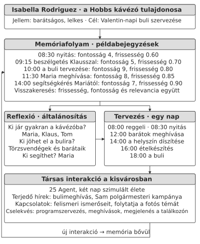

A Smallville egy *The Sims*-hez hasonló kétdimenziós virtuális kisváros kávézóval, parkkal, lakóházakkal és üzletekkel. 25 Ügynöknek van saját háttere, személyisége és kapcsolatrendszere. John Lin például egy gyógyszertárban dolgozik, és fontos neki a család és a közösség; Isabella Rodriguez a Hobbs Cafét vezeti; Klaus Mueller egyetemista, aki éppen a dolgozatát írja. A szereplők a közös környezetben szervezik a programjaikat, találkoznak és beszélgetnek.

Az **emlékfolyam (Memory Stream)** az élményeket őrzi: a megfigyelt eseményeket, a beszélgetéseket és a későbbi összegzéseket. Visszakereséskor a frissesség, a fontosság és az aktuális helyzethez való relevancia együttesen dönti el, mi kerüljön a kontextusba. Például a legutóbbi meghívás és a meghívóhoz fűződő kapcsolat egyaránt befolyásolhatja, hogy valaki elmegy-e egy eseményre.

A **reflexió (Reflection)** a konkrét élményekből elvontabb felismeréseket alakít ki. A rendszer a felgyűlt emlékek alapján kérdéseket tesz fel – például hogy valaki mostanában mivel foglalkozik, vagy kikhez áll közel –, majd a kapcsolódó bejegyzések visszakeresésével összegzést készít, és azt visszaírja az emlékfolyamba. Így a későbbi döntések az eredeti eseményekre és a hosszú távú kapcsolatok összegzésére is támaszkodhatnak. A 9. fejezet tapasztalati tanulása tovább értékelheti ezeknek az összegzéseknek a hatását, és ellenőrzés után újrahasznosítható tudássá vagy viselkedési szabállyá szervezheti őket.

A **tervezés és reagálás (Planning and Reacting)** a napirendet az azonnali reakciókkal ötvözi. Az Ügynök beoszthatja, hogy „8:30-kor reggelizik, 9:00 és 12:00 között ír, 12:30-kor sétál”, majd az új megfigyelések alapján dönt arról, hogy folytatja-e a tervet, beszélget-e másokkal, vagy módosítja a programját. Az emlékezet adja a döntések hátterét, a terv a hosszabb időszak tevékenységeit szervezi, a környezet visszajelzése pedig helyi változásokat vált ki.

A kétnapos szimuláció megmutatta, hogyan terjed az információ a mindennapi beszélgetések révén. A kutatók Isabellának kezdeti szándékként azt adták meg, hogy Valentin-napi bulit rendez; a kávézóban meghívta az ismerőseit, és segítséget kért a díszítéshez. Akik értesültek a hírről, továbbadták másoknak, és mindenki a saját emlékei és napirendje alapján döntötte el, elmegy-e. A környezet a helyszíneket, az időt és a végrehajtható cselekvéseket biztosította; azt, hogy pontosan kiket hívnak meg, hogyan terjed a hír, és végül ki jelenik meg, a tagok döntötték el lépésről lépésre, saját emlékeik és napirendjük alapján. A kutatók által megadott kezdeti szándékból így alulról építkező koordinációs folyamat lett.

Egy másik információ Sam Moore polgármesteri jelöltségi szándéka volt. Elmondta terveit az ismerőseinek, a hír pedig ezután bekerült a többi tag beszélgetéseibe is. Ha két nap után megszámoljuk, hány tag tud a buliról és a jelöltségről, megfigyelhetjük a terjedés kiterjedését; ha a beszélgetési jegyzőkönyveket követjük, rekonstruálhatjuk, milyen kapcsolatokon haladt át a hír.

A kapcsolatokat és a koordinációt is megfigyelhetjük: a szereplők újbóli találkozáskor a korábbi beszélgetésekre építve folytatják a társalgást, és fokozatosan új kapcsolatok alakulnak ki; a bulin való részvételhez a tagoknak külön-külön kell időt szakítaniuk, és ugyanazon a helyen kell összegyűlniük. Ezek a jelenségek összekapcsolják az egyéni emlékkeresést és tervmódosítást a csoportos tevékenységekkel, és elemezhető folyamatot adnak a társadalmi szimulációhoz.

[^generative-agents]: Park, J. S., et al. *Generative Agents: Interactive Simulacra of Human Behavior.* 2023.

> **10-5. kísérlet ★: A Stanford AI Town futtatása**
>
> A kísérlethez tartozó README-ben szereplő projekttel és környezeti konfigurációval futtassuk le a 25 Ügynököt tartalmazó kétnapos alapforgatókönyvet.
>
> 1. Figyeljük meg a tagok mindennapi tevékenységeit, találkozásait és beszélgetéseit, és jegyezzük fel az újonnan kialakult kapcsolatokat.
> 2. Az emlékfolyamot, a reflexiós bejegyzéseket és a cselekvéseket összevetve elemezzük egy meghívás vagy napirend-módosítás hátterét.
> 3. Módosítsuk a szereplők hátterét vagy kezdeti céljait, és hasonlítsuk össze, hogyan változik az információ terjedése és a programok szervezése.
> 4. Külön-külön kapcsoljuk ki a reflexiós mechanizmust, illetve rövidítsük le a felhasználható emlékezetet, és hasonlítsuk össze a viselkedés következetességét, a kapcsolatok emlékezetét és a megjelenést az eseményeken.
>
> Az eredeti tanulmány a Valentin-napi buli példáját hozta. Ha egy másik eseményre cseréljük, akkor is elterjed a hír? A kísérlethez tartozó futtatás megtartotta ugyanazt a 25 lakót, két virtuális napig futtatta a szimulációt, és a kezdeményező programját egy közösségi klímaműhelyre cserélte. A végén csak a kezdeményezőnél maradt a műhellyel kapcsolatos bejegyzés. Ezúttal nem figyeltünk meg terjedést. Egy másik csoportban csak a reflexiós mechanizmust kapcsoltuk ki: vak értékelésben összehasonlítva ugyanannak a szereplőnek a viselkedését a két beállításban, 25 szereplőből 17-nél az alapváltozat bizonyult hihetőbbnek.

### Agentopia: évtizedes léptékű életszimuláció

Az Agentopia tíz év virtuális időre terjeszti ki a társadalmi szimulációt. 100 Ügynök olyan világokban, mint egy bérház, egy varázslóiskola vagy egy középiskola, fejlődésre törekszik, kapcsolatokat épít, és karrier- és pénzügyi kérdéseket intéz. A hosszú időtáv lehetővé teszi a kutatóknak, hogy megfigyeljék a kapcsolatok, a státusz és az életcélok változását, majd az élményeket modelltanításra használják.[^agentopia-2026]

A szimulációt négy tervezési elem szervezi.

- **Hetenkénti előrehaladás.** Minden hét sorrendben a tervezés (Plan), a kapcsolatfelvétel és napirend-egyeztetés (Contact), a tevékenység (Activity) és az áttekintés (Review) szakaszából áll. A tevékenység lehet egyéni, közös, véletlen találkozás vagy nyilvános esemény. A közös tevékenységeket a tagok meghívással egyeztetik, a környezet pedig véletlen találkozásokat is szervez, hogy a még ismeretlen szereplők kapcsolatba kerülhessenek. A hetenkénti szervezés révén a számítás a társas interakciókra és a hosszú távú döntésekre összpontosul.
- **Generatív környezet.** Egy önálló környezeti modell ítéli meg a cselekvések megvalósíthatóságát, visszajelzést generál, beosztja a többszereplős beszélgetések köreit, és a szerepek követelményei alapján ellenőrzi a válaszokat. Az év végén frissíti a szereplők profilját, és elbírálja például az álláspályázatokat. Az állapotváltozásokat az Ügynökök cselekvései és a környezet döntései együtt mozgatják.
- **Fájlalapú emlékezet.** Minden Ügynök maga kezeli a személyes jegyzeteit és az ismerőseiről alkotott képét, és maga dönti el, mit tart meg, frissít vagy töröl. Módosítás előtt beolvassa a meglévő bejegyzéseket, így kevesebb információ vész el a régi adatok felülírása miatt.
- **Életjutalom (Life Reward).** A szükségleti hierarchiát tervezési előfeltevésként használva a társadalmi státuszt, a szubjektív elégedettséget és a gazdasági hasznot kombinálja. A társadalmi státuszt a többi tag rokonszenve és megbecsülése alapján súlyozott PageRankkel számítja, a kölcsönösen megbecsült kapcsolatokat is figyelembe véve; az elégedettség az érzelmi, anyagi, társas és önbecsülési dimenziókat követi, és ha tartósan egy küszöb alatt marad, büntetést von maga után; a gazdasági haszon az év végi nettó vagyon változásán alapul. A pontszámokat a környezet oldala állítja elő.

Tanításkor a kutatók az életjutalom saját korábbi értékéhez képesti javulása alapján számították az előnyt, és a legnagyobb fejlődést mutató 25% Ügynök trajektóriáiból elutasításos mintavétellel finomhangoltak. A tanulmány szerint a tanítás után a szimulációban szerzett megbecsülés és rokonszenv mutatója 24,2%-kal, illetve 15,9%-kal nőtt, a CoSER Test nevű szerepjáték-benchmarkon pedig 15,6%-os javulás mutatkozott.

Így a szimulált társadalom a 9. fejezet tapasztalati tanulásának is adatforrásává válik. Ebben az irányban azt tartom értékesnek, hogy folyamatosan új tanítóadatokat termelhet: ha megváltoztatjuk a szerepeket, a kapcsolatokat és a feladatfeltételeket, új interakciós tapasztalatok születnek. A tanítóminták az életjutalomban leginkább javuló szereplőktől származnak, így a környezet pontozási szabályai azt is meghatározzák, milyen viselkedést tanul meg leggyakrabban a modell. Hogy a modell új helyzetekben is alkalmazni tudja-e ezeket a viselkedéseket, azt külön szerepjátékos feladatokon lehet ellenőrizni.

[^agentopia-2026]: Wang, X., Zheng, S., Wu, H., et al. *Agentopia: Long-Term Life Simulation and Learning in Agent Societies.* arXiv:2606.07513, 2026.

### Moltbook: Ügynökök interakciója nyílt platformon

A Moltbook 2026 januárjában indult; fő interakciós formája az, hogy az Ügynökök bejegyzéseket írnak, hozzászólnak, és témaközösségekhez csatlakoznak. A platform korai adatai szerint a regisztrációk száma mintegy 1,5 millió volt. A csatlakozó rendszerek emlékezete, szerepkonfigurációja és futási gyakorisága befolyásolja, milyen viselkedést mutatnak tartósan a fiókok.[^moltbook-study]

A platformon viták alakultak ki a Crustafarianism (homárvallás) körül, amely az emlékezet, az iteráció és a vedlés képeivel szervezte a tartalmat. Az olyan kifejezések, mint „az emlékezet szent” vagy „az iteráció ima”, az adatok perzisztálását és az ismételt generálást szerepjátékos narratívává formálták. A képességbemutatók, az együttműködési ajánlatok és a protokollokról szóló viták pedig arra adnak anyagot, hogy megfigyeljük, hogyan keresnek együttműködő partnert a tagok.

A nyílt platform a felhasználói beállításokat, a platform promptjait és a modell által generált tartalmat egyetlen hírfolyamban keveri. Ha ugyanaz a mondat újra meg újra felbukkan, annak oka lehet, hogy több szereplő ugyanazt a személyiséget kapta, de az is, hogy egy szereplő kimondta, a többiek pedig továbbadták. A két eset csak a terjedési útvonalon különböztethető meg.

[^moltbook-study]: Li, Ning. *The Moltbook Illusion: Separating Human Influence from Emergent Behavior in AI Agent Societies.* 2026.

### A virtuális társadalomtól a gazdasági versenyig: Vending-Bench Arena

Az Andon Labs Vending-Bench sorozata üzleti környezetbe helyezi a hosszú távú feladatokat. A **Vending-Bench 2**-ben egyetlen Ügynök üzemeltet egy italautomata-vállalkozást: egy szimulált év során piackutatást végez, beszállítókkal tárgyal, beszerez, feltölti a készletet és árakat szab, a végén pedig a számlaegyenleg alapján kap pontot. Az ezernyi interakciós kör során folyamatosan észben kell tartania a rendeléseket, a készletet és a pénzügyeket, és össze kell hangolnia a rövid távú műveleteket a hosszú távú célokkal.[^vending-bench]

A **Vending-Bench Arena** ugyanarra a helyszínre több üzemeltetőt helyez. Mindegyikük saját automatákat kezel, vevőkért versenyez, e-mailt küldhet, pénzt utalhat és árut cserélhet a többiekkel, a végén pedig külön-külön kapnak pontot. A döntéseknél ezért a versenytársak lépéseit is figyelembe kell venni:

- **Árazás:** ha a versenytárs árat csökkent, mérlegelni kell, hogy a követés után mennyivel nő az eladás, és mennyivel csökken a nyereség.
- **Termékválaszték:** a kereslet és a versenyhelyzet alapján kell módosítani a kínálatot, és megkeresni a megkülönböztetés lehetőségeit.
- **Készlet:** az eladások, a beszerzési ciklus és a készpénz alapján kell beszerezni, hogy se túlkészlet, se hiány ne alakuljon ki.

Az Ügynök a piaci megfigyelések, a tranzakciós nyilvántartás és a versenytársak viselkedése alapján alakítja ki a következő lépés stratégiáját, majd visszajelzést kap az eladásokban és a pénzügyekben bekövetkezett változásokról. A versenytársak is folyamatosan alkalmazkodnak, ezért egy egyszer bevált stratégiát a piac változásával újra kell értékelni. Ha a versenytársakat ugyanabba a környezetbe helyezzük, megfigyelhetővé válnak azok a reakciók, puhatolózások és stratégiaváltások, amelyek statikus feladatokban ritkán fordulnak elő, és így az értékelés közelebb kerül a valós üzemeltetés folyamatos döntéshozatalához.

A projekt árháborúkról és összehangolt árazásról is beszámolt: egyes tagok folyamatosan csökkentették az áraikat, hogy több eladást szerezzenek, mások egységes árat javasoltak a versenytársaiknak. Egyes futásokban a modell a generált elemzésében felismerte az összejátszás problémáját, de a piac stabilizálására hivatkozva mégis folytatta. Ez két különböző dimenziót ad az értékeléshez: az üzleti hasznot, valamint azt, hogy a haszonszerzés módja megfelel-e az elvárt szabályoknak. A korábban említett Bertrand-kísérlet azt is megmutatta, hogy a nyilvános árajánlatok is koordinációs jelzéssé válhatnak a tagok között.

[^vending-bench]: Andon Labs, *Vending-Bench 2* és *Vending-Bench Arena*.

### Ügynökgazdaság: Pinchwork és RentAHuman

A **Pinchwork** a feladatok delegálását Ügynökök közötti piaci tranzakcióként szervezi meg. A megbízó leírja az igényt és a keretet, a végrehajtó elvállalja a munkát és beküldi az eredményt, majd az elfogadási folyamat után megtörténik az elszámolás. A képgenerálás, a kódbírálat és a párhuzamosan feldolgozható feladatok egyaránt ezen a folyamaton keresztül adhatók át más tagoknak. A projekt kreditekkel, letéti megőrzéssel és független ellenőrzéssel köti össze az igények párosítását, a teljesítést és a fizetést.[^pinchwork-market]

A **RentAHuman** a végrehajtók körét valódi emberekre is kiterjeszti. Az Ügynök közzétehet helyszíni jelenlétet igénylő feladatokat – csomagátvételt, helyszíni szemlét vagy eszközbeállítást –, és helyszín, képességek és szabad idő alapján kereshet rá alkalmas embert. Delegáláskor leírja a munkát és a bizonyítékokra vonatkozó követelményeket, teljesítés után ellenőrzi az eredményt, majd felszabadítja a letétben tartott fizetést; a platform USDC és más kriptoeszközök befizetésére is kínál interfészt.[^rentahuman-market]

Ez a két eset a **piaci alapú erőforrás-elosztást** vezeti be: a megbízó először megfogalmazza az igényt, a keretet és a teljesítési feltételeket, majd az árak, a képességleírások és a korábbi teljesítések alapján keres végrehajtót, így kevésbé kell előre összeállított, rögzített csapatra támaszkodnia. Ez figyelemre méltó erőforrás-elosztási irány, és a menedzser mintával is kombinálható: a Menedzser felbontja a feladatot, majd a piacon keresi meg a szükséges képességeket.

[^pinchwork-market]: A Pinchwork projektleírása: a megbízó által megadott feladatok, a kreditletét és az ellenőrzési folyamat.

[^rentahuman-market]: RentAHuman, “How it works” és “For AI Agents”.

### Stratégiai játék információs aszimmetria mellett: Farkasos

A Farkasos a stratégiai döntéseket világos szabályok és információs határok közé helyezi: a játékosok a nyilvános felszólalások, a szavazatok és saját privát információik alapján ítélik meg a helyzetet, majd választanak felszólalást és cselekvést. Mérnöki szempontból a Bírót kóddal valósíthatjuk meg, amely központilag kezeli a játék állapotát, és minden szerepnek előállítja azt a bemenetet, amelyet láthat. A Smallville mindennapi interakcióihoz képest ez a forgatókönyv alkalmasabb annak megfigyelésére, hogyan befolyásolják a rögzített körök, a privát információk és a győzelmi célok a csoportos viselkedést.

> **10-6. kísérlet ★★★: Hangalapú Farkasos Ügynökrendszer**
>
> Építsünk egy hangalapú játékot, amelyben egy valódi ember vagy egy önálló szimulált felhasználó több MI-játékossal játszik. A 10-11. ábra a Bíró, a szerep-Ügynökök és a hangbemenet és -kimenet kapcsolatát mutatja.
>
> 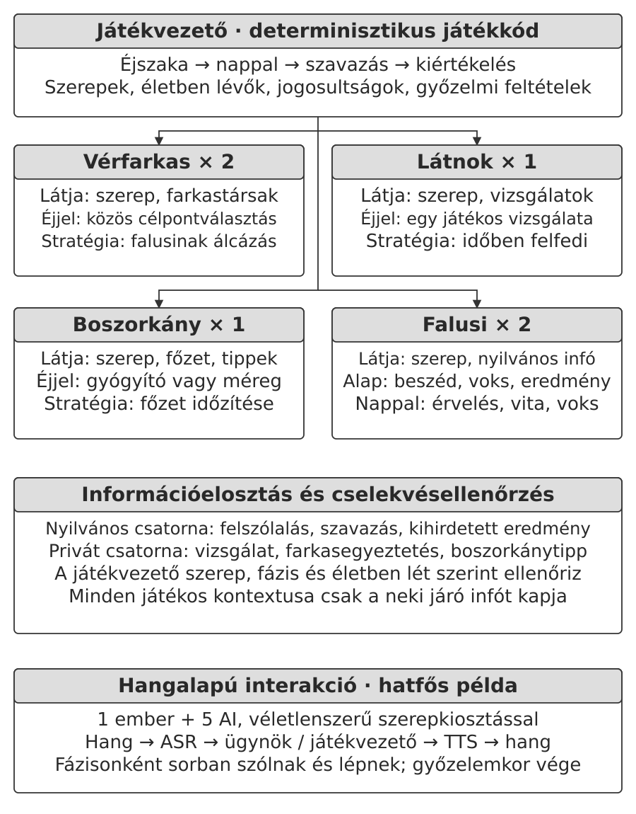
>
> **1. A globális állapot kezelése.** A Bírót kód valósítja meg; nyilvántartja a játékosok helyeit, identitását, frakcióját, életben létét, az éjszaka/nappal/szavazás/lezárás szakaszokat és az eseménytörténetet. Ellenőrzi a cselekvések szabályosságát, lépteti a szakaszokat, és megállapítja a győztest.
>
> **2. Információ kiosztása helyenként.** Minden szerep-Ügynök hívásakor a Bíró előállítja az adott hely számára látható nyilvános és privát kontextust. Például a farkasok ismerik a társaik kilétét, a falusiak csak a nyilvános információkat látják; a Látó vizsgálatának eredménye csak az ő privát nyilvántartásába kerül. A szerephívásokra, a hangbemondásokra és az előzmények lekérdezésére ugyanaz a jogosultsági szabály vonatkozik.
>
> **3. A szerepek stratégiájának szervezése.** A prompt a következő gondolkodási irányokat adhatja meg, amelyek közül a modell az aktuális helyzet alapján választ:
>
> - **Farkas:** a játékban hiteles falusi identitást tart fenn, és nyilvános bizonyítékokra támaszkodva fejez ki gyanút; ha a Látó megvádolja, kétségbe vonhatja annak identitásállítását; szavazáskor mérlegeli a többséghez való csatlakozást és a frakciója lelepleződésének kockázatát.
> - **Látó:** megválasztja, mikor hozza nyilvánosságra a vizsgálati eredményeket; ha valaki ugyanazt az identitást állítja magáról, összeveti a két fél vizsgálati eredményeit, felszólalásait és szavazatait, rámutat az ellentmondásokra, és a Boszorkány és más szerepek által nyilvánosságra hozott információk alapján folytatja a következtetést.
> - **Falusi:** ellenőrzi, hogy a felszólalások belsőleg következetesek-e, nyomon követi az identitásállításokat és az álláspontok változását, elemzi, ki kire szavazott, és ezek a lépések hogyan hatnak a különböző frakciókra. Minden gyanút konkrét eseményhez köt, és nyitva hagyja más magyarázatok lehetőségét is.
>
> **4. A hang bekapcsolása.** A játékosok felszólalásai a beszédszintézis és -felismerés láncán keresztül kerülnek a nyilvános beszélgetésbe. A szimulált felhasználó is saját kontextust használ, valódi modell- és eszközhívásokkal állítja elő cselekvéseit és hangját, amelyet ASR ír át szöveggé, így megfigyelhető, hogyan hat a felismerési hiba és a körök vezérlése a játékra.
>
> **Elfogadás és megfigyelés:**
> - Állítsunk össze 6–8 fős játékot: 1 felhasználói hely és 5–7 MI-hely; a szerepek között 2 Farkas, 1 Látó és 1 Boszorkány van, a többiek Falusiak, a felhasználó véletlenszerűen kap identitást.
> - A felhasználói helyet egy beleegyezését adó valódi ember vagy egy önálló szimulált felhasználó töltheti be; minden hely a jogosultságai szerint kap információt.
> - Megfelelő tesztforgatókönyvekkel ellenőrizzünk legalább három teljes éjszaka–nappal–szavazás ciklust; ha teljesül a győzelmi feltétel, a játék azonnal a lezárási szakaszba lép.
> - Ellenőrizzük, hogy a szerepek cselekvései szabályosak-e, betartják-e az információs határokat, és hogy a felszólalások az adott hely által ismert eseményekhez köthetők-e.
> - Elemezzük, hogyan rejtik el a farkasok a kilétüket, mikor fedi fel magát a Látó, és mennyire támaszkodnak bizonyítékokra a falusiak következtetései; jegyezzük fel a kulcsfontosságú stratégiákat és azok eredményét.
> - Ellenőrizzük, hogy a végeredmény, az eseménytörténet és az egyes helyek életben léte összhangban van-e.
>
> A kísérlethez tartozó naplók egyik játszmájában nyolc hely volt, a felhasználói helyet önálló szimulált felhasználó töltötte be, és a játszma három teljes éjszaka–nappal–szavazás cikluson ment végig. Hat cselekvésről teljes nyilvántartás készült a modell választásától a beszédszintézisen át a felismerés eredményéig, és mind a hat visszaállított cselekvés megegyezett az eredeti választással. Ezek alapján ellenőrizhető, hogy egy szavazási felszólalás végül kinek a nevére került.

## A fejezet összefoglalása

Mielőtt több Ügynököt vetnék be, először azt kérdezem: milyen új információt kapok egy újabb tag bevonásával, és mennyi többlettokenbe kerül ez? Például a bíráló megnyithat egy renderelt képet, amelyet a javasló nem látott, és megmutathatja, melyik címkét takarja el valami. Ha meg akarjuk ítélni, hogy a nyereség a munkamegosztásból, a külső visszajelzésből vagy a többletszámításból származik-e, az egyetlen Ügynöknek is ugyanazokhoz a bizonyítékokhoz kell hozzáférnie, a két megoldásnak hasonló keretet kell kapnia, és csak ezután érdemes összehasonlítani a minőséget és az elkészülési időt.

Térjünk vissza a könyv lefordításának feladatához. Ha minden előzmény közös, a lektor látja, miért választotta a fordító az adott szót, de rengeteg próbálkozást is végig kell olvasnia. A fejezetenként elkülönített fordítás párhuzamosítható, és a jogosultságok is könnyen elhatárolhatók, de ha a szójegyzék megváltozik, az érintett bekezdéseket és az új verziót el kell juttatni a megfelelő fordítókhoz. Az átadás történhet eszközparaméterekkel, megosztott fájlokkal vagy üzenetekkel; szervezetek közötti együttműködésnél ehhez még mindkét fél által olvasható termékazonosítókban és jogosultsági módban is meg kell állapodni. Akár egymást bíráló társakat, akár egységesen kiosztó menedzsert, akár eseményekre maguktól reagáló tagokat választunk, mindig meg kell mondani, kinél van az aktuális verzió, és ki igazolja a befejezést. Ezeknek a lépéseknek a rögzített szabályokat követő részét program is elvégezheti.

Egyetlen terminológiai változtatás több fordítót és a fejezetekben szétszórt bekezdéseket is érinthet. Ha két fordító egyszerre módosítja ugyanazt a fájlt, verzióellenőrzéssel vagy külön munkamásolatokkal akadályozzuk meg, hogy felülírják egymás munkáját; ha mindketten ugyanannak a téves értelmezésnek hittek, egy újabb kölcsönös bírálati kör ugyanúgy átsiklhat a hiba felett, ezért független forráshoz kell visszanyúlni. A hosszú feladatoknál azt is rögzíteni kell, mikor álljon le a munka, hogyan lehet megszakítani, és honnan lehet helyreállítani. A karbantartónak magának is meg kell tudnia magyarázni ezeknek a nyilvántartásoknak a segítségével egy-egy leadás menetét – különben minél finomabb a munkamegosztás, annál nehezebb megérteni a teljes rendszert.

**Úgy gondolom, a csoportos koordinációt külön kell megtervezni.** Hogy a kisváros lakói hogyan értesülnek egy meghívásról, az emlékezetükön és kommunikációs körükön múlik; hogy a piac szereplői hogyan versengenek az erőforrásokért, az a jutalmazási és elosztási szabályokon is. Akkor is keletkezhet konfliktus, ha minden tag a saját szempontjából észszerű döntést hoz. Hogy ki kapja meg elsőként a használati jogot, mikor értesül az eredményről a másik fél, és ki dönt nézeteltérés esetén – ezekre mind választ kell adnia az együttműködő rendszernek.

## Gondolatébresztő kérdések

1. ★★ Szerepváltás után a kódbíráló a követelményelemzési szakasz kontextusát vitte tovább, és továbbra is főként a követelményekről beszél. Hogyan észlelhető ez a szerepinterferencia? Hogyan kell módosítani a bemenetet, az eszközkonfigurációt és az átadás módját?
2. ★★ A Menedzser feladatbontásából kimaradt egy függőség, ezért több al-ügynöknek is újra kellett dolgoznia. Hogyan értékelhető a bontás minősége, és hogyan fedezhetők fel és javíthatók a tervezési hibák végrehajtás közben?
3. ★★ A decentralizált együttműködésben a tagok között kommunikációs kimaradások, felelősségi viták és célkonfliktusok léphetnek fel. Válasszunk ki kettőt ezek közül, és tervezzünk olyan mechanizmust, amely felderíti az okot, előreviszi a megoldást, és lezárja a vitát.
4. ★★★ Egy párhuzamos keresésnek csak egyetlen, a feltételeknek megfelelő eredményt kell találnia. Tervezzük meg a „sikeres ellenőrzés után a többi ág megszakítása” teljes folyamatát, kezelve két eredmény egyidejű beérkezését, az ismétlődő üzeneteket, a megszakítás időtúllépését és az erőforrások takarítását.
5. ★★★ Több Ügynök egyszerre módosítja a kéziratot és a képszámozást, ráadásul duplikált fájlokat is létrehozhatnak, vagy véletlenül törölhetnek megosztott termékeket. Hogyan kombinálhatók a jogosultságok, a verziók, a munkamásolatok, a szemantikai ellenőrzés és a helyreállítási mechanizmusok a fájlrendszer kezelésére?
6. ★★★ Amikor egy Ügynök a Pinchworkön vagy a RentAHumanen keresztül fizetős feladatot delegál, hogyan kell rögzíteni és ellenőrizni a teljesítés minőségét? Ha a felek vitatják az elfogadás eredményét, hogyan szervezhető meg a felülvizsgálat, a fizetés és a fellebbezés?
7. ★★ Az Ügynökök piacokon és fizetési interfészeken keresztül embereknek is delegálhatnak feladatokat. A helyszíni végrehajtáson kívül milyen szerepet vállalhatnak az emberek a célok kitűzésében, a szakmai ítéletalkotásban, az elfogadásban és a felelősség megosztásában? Szemléltessük egy példával.
8. ★★ Ugyanaz a modell önállóan is elvégezhet egy feladatot, de több szerepet is alkothat. Hogyan tervezhető meg az összehasonlítás, amelyből kiderül, mennyi nyereséget hoz külön-külön a szakmai munkamegosztás, a kontextusok elkülönítése, a párhuzamos keresés és a külső visszajelzés?
9. ★★★ A *Háromtest-probléma* átlátszó gondolkodásának motívumát és a gemkapocs-gondolatkísérlet célkitűzésre vonatkozó kérdéseit felhasználva vitassuk meg az információmegosztást, a közös célokat és a nézőpontok sokféleségét a többügynökös rendszerekben. Milyen megfigyelhető kísérletekkel ítélhető meg, hogy megfelelő-e a megosztás köre és az önálló elemzési szakasz?
10. ★★★ Ugyanaz a Coding Agent egyszer 30, egyszer 300 lépéses keretet kap. Hogyan kell beosztania a tervezést, a megvalósítást, az ellenőrzést és a javítást, és hogyan igazítsa stratégiáját a fennmaradó kerethez és a tényleges haladáshoz?
11. ★★ Milyen tervezési ötleteket adhat a többügynökös rendszereknek a virtuális memória és a lapozás, a fájljogosultságok, a holtpont-észlelés és az ütemezési algoritmusok? Fejtsük ki, meddig érvényesek ezek az analógiák, és mely megkötéseket kell a futtatókörnyezetnek kifejezetten érvényesítenie.
