# Kontextustervezés

Az 1. fejezet a kontextust az ügynök „aktuális döntési látómezejéhez” hasonlította: a modell minden döntését az abban a pillanatban kapott információkra alapozza. A **kontextustervezés** (Context Engineering) ezeknek az információknak a kiválasztásával, rendezésével és frissítésével foglalkozik; ide tartoznak a rendszerutasítások, az eszközdefiníciók, a felhasználói kérés, a korábbi üzenetek és a feladat állapota. A Harness minden modellhívás előtt bemenetté rendezi a feladat hátterét és a legfrissebb fejleményeket. A 2-1. ábra konkrét tartalommal mutatja be, miből áll a kontextusablak.

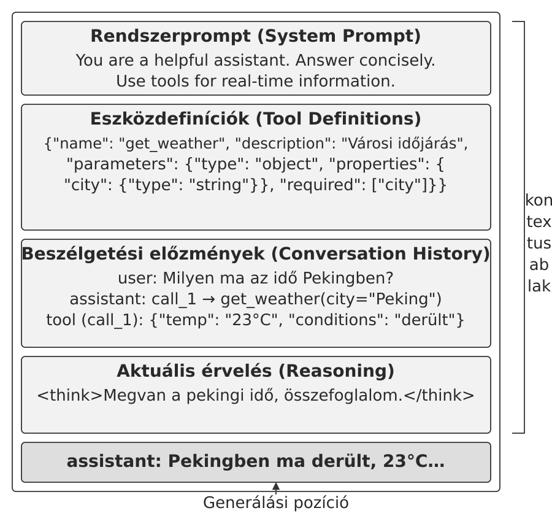

## A kontextus: hogy a modell képességei a konkrét feladatban érvényesüljenek

Képzeljünk el egy tapasztalt mérnököt, aki most csatlakozott a csapathoz, és az első feladata így szól: „módosítsd a konfigurációt a szabályaink szerint”. Programozni tud, de még nem tudja, melyik fájl a konfiguráció valódi forrása, mely mezők módosíthatók, és hogyan kell a változtatást ellenőrizni. Ha a teljes kódbázist a kezébe adjuk, akkor is könnyen rossz fájlt módosít. Egy ismeretlen projektet átvevő ügynökből ugyanez a háttértudás hiányzik.

Vegyük a „javítsd ki ezt a hibát” kérést. Egy kódoló ügynöknek (Coding Agent) általában háromféle háttérre van szüksége:

- **Élő kódkontextus**: a könyvtárszerkezet, a modulok felelősségi köre, a központi adatszerkezetek és a kódolási konvenciók. Ha például egy automatikusan generált konfigurációs fájlt módosít, a változtatás helyben működhet, de a következő generáláskor felülíródik. Csak az találja meg a módosítás valódi helyét, aki tudja, melyik modul állítja elő a fájlt.
- **Folyamatszabályok**: a Git ágkezelési stratégiája, a commitokra vonatkozó szabályok, a kódátnézés menete és a CI/CD követelményei. Az ügynök ezek alapján ütemezi a módosítást, a tesztelést és a commitot, a futtatókörnyezet pedig a jogosultságoknak megfelelően hajtja végre a műveleteket.
- **Környezeti információk**: a fejlesztői beállítások, a tesztadatbázis elérése, a tesztkörnyezet telepítésének módja és az API-kulcsok kezelése. Ezek segítenek a megfelelő futtatókörnyezet kiválasztásában és a helyi és a tesztkörnyezet közötti különbségek megértésében.

A projekt kódja és a tesztadatbázis kívül esik a modell kontextusán. Az automatikusan generált konfiguráció példájánál maradva: az ügynök csak akkor tudja meg, hol kell belekezdenie a módosításba, ha egy keresőeszközzel elolvassa a generáló szkriptet. **A kontextus minősége dönti el, hogy a modell a meglévő képességeit alkalmazni tudja-e az adott problémára.** **Sok háttérinformációt igénylő feladatoknál egy elegendően képes modell teljes és pontos kontextussal jobban teljesíthet, mint egy erősebb modell, amelyből hiányoznak a szükséges anyagok.**

**Egy MI-natív csapat építése a kulcstudás dokumentálásával kezdődik.** Ha egy adatbázis kiválasztásának okára csak a régi munkatársak emlékeznek, az üzleti szabályok változásáról pedig csak privát üzenetekben esett szó, akkor az új kolléga és az ügynök ugyanabba a problémába ütközik: a kódból kiolvasható, mit csinált a csapat, de az nem, hogy miért éppen így.

**A távoli együttműködésre jól felkészült csapatok többnyire az ügynökök számára is jó környezetet teremtenek.** A Linux kernel fejlesztői levelezőlistákon vitatják meg a patcheket és cserélik ki az átnézési észrevételeiket, a fejlesztési folyamat dokumentációja pedig leírja, hogyan kell a patcheket beküldeni, átnézni és beolvasztani[^ch2-linux]. Egy új résztvevő, aki váratlan módosításba botlik, a patch nyomán visszakeresheti az akkori vitát; az ügynök is hasznát veszi ennek a feljegyzésnek, amikor a hátteret ellenőrzi.

Miután meghallgattam Jiayi Weng interjúját a WhynotTV-ben, egyik gondolatát így foglaltam össze: **ember és modell egyaránt a kontextusra (Context) támaszkodik.** Az ember megkérdezheti a döntésben részt vett kollégát; hogy a modell milyen háttérhez fér hozzá, az azon múlik, milyen feljegyzéseket hagyott hátra a csapat, és mit tett bele a Harness az adott kérésbe.[^ch2-weng]

[^ch2-linux]: A Linux kernel hivatalos dokumentációja: How the development process works.

[^ch2-weng]: WhynotTV, „Jiayi Weng: OpenAI, GPT, megerősítéses tanulás, infrastruktúra, utótanítás, Tianshou, tuixue, nyílt forráskód, CMU, Tsinghua”, Podcast #4.

A ReAct-tanulmány formálisan írja le, hogyan vesz részt az interakciós előzmény a döntéshozatalban[^ch2-react]. A $t$ időpontban az ügynök $o_t\in\mathcal{O}$ megfigyelést kap a környezettől, és a $\pi(a_t\mid c_t)$ stratégia szerint választ egy $a_t\in\mathcal{A}$ cselekvést, ahol a kontextus:

$$
c_t=(o_1,a_1,\ldots,o_{t-1},a_{t-1},o_t)
$$

A képlet azt fejezi ki, hogy **az ügynök következő lépése az addigi teljes interakciós előzménytől függ.** Az, hogy az ügynök melyik fájlt nézte már meg, vagy milyen hibát adott vissza egy eszköz, mind befolyásolja a következő választást. Egy LLM-alapú ügynöknél a megfigyeléseket a felhasználói bemenet és az eszközök eredményei adják, a cselekvéseket pedig az eszközhívások és a kifelé adott válaszok rögzítik; a rendszerutasítások és az eszközdefiníciók ezen felül a feladat szabályait és az elérhető interfészeket írják le.

Ez a fejezet először állapotmentes kérésmódot használ: a Harness minden körben összeállítja az üzeneteket és az eszközdefiníciókat, majd meghívja a modellt. A teljes üzenetelőzmény megőrzi a feladat előrehaladását; ahogy az előzmény nő, visszakereséssel, állapotrögzítéssel és tömörítéssel lehet az ablakban tartani azt, amire a későbbi döntésekhez szükség van. A kontextus elrendezése, az állapotsáv és a tömörítési technikák mind ugyanazt a kérdést járják körül: hogyan kerüljön be a korlátos kontextusba, vagyis a $c_t$-be, az, amire a modellnek éppen ebben a lépésben szüksége van?

[^ch2-react]: Yao, Shunyu, et al., ReAct: Synergizing Reasoning and Acting in Language Models, ICLR 2023.

## Hogyan hívja az ügynök a nagy nyelvi modellt: a kontextus szerkezete az API-ban

Először egy egyszerű köszönésen nézzük meg az üzenetformátumot, majd azt, hogyan vezet a „mennyi most az idő Vancouverben, és milyen az időjárás?” kérdés két eszközhíváshoz. A szakasz Chat Completions-kompatibilis interfészt és helyben futó Qwen3-0.6B modellt használ, a végén pedig Pythonban fűzzük össze az egyes körök kéréseit[^ch2-chat-api].

### A példában szereplő négy üzenetszerep

A kérésben lévő **üzenetlista** (`messages`) sorrendben tárolja az interakció információit. Minden üzenetet egy **szerep** (`role`) jelöl, amely az üzenet forrását és célját adja meg. Ebben a szakaszban négy szerepet használunk:

- **system**: a rendszerprompt. Itt a fejlesztő által megadott identitást, viselkedési szabályokat és korlátokat hordozza, és az üzenetlista elején áll. Egyes modellinterfészek a fejlesztői utasításokhoz a `developer` szerepet használják.
- **user**: a felhasználó üzenete; a feladatot, a visszakérdezéseket és a kiegészítő kéréseket tartalmazza.
- **assistant**: a modell válasza, beleértve a szöveget és az eszközhívási kéréseket is. Ha ezeket az üzeneteket visszatesszük a következő kör bemenetébe, a modell látja korábbi válaszait és műveleti kéréseit.
- **tool**: az eszköz végrehajtásának eredménye. A Harness a visszakapott értékből eszközüzenetet készít, és a `tool_call_id` révén a konkrét híváshoz köti.

Az eszközdefiníciók a kérés legfelső szintű `tools` mezőjében érkeznek, és felsorolják az elérhető eszközök nevét, rendeltetését és paraméterformátumát.

A modell az eszközdefiníciók alapján állítja össze a hívási kérést. Hogy a műveletet ténylegesen végre lehet-e hajtani, arról a Harness és a futtatókörnyezet dönt.

[^ch2-chat-api]: OpenAI, a Chat Completions API referenciája, amely leírja az üzenetszerepeket, az eszközdefiníciókat és a hívási eredmények mezőit; Qwen, Function Calling, amely a kompatibilis szolgáltatások eszközhívását és sablonjait ismerteti.

### Egyfordulós párbeszéd: a legegyszerűbb API-hívás

Kezdjük egyetlen kérdés–válasz párral. A felhasználó megkérdezi: „Hello, who are you?”; a Harness a rendszerutasítással együtt elküldi a kérdést a modellnek, majd kiolvassa a választ. A 2-2. ábra a kérés és a válasz megfelelését mutatja.

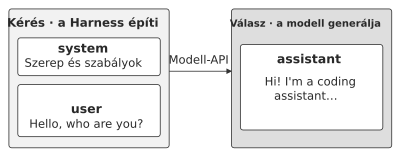

Az alábbiakban a helyi modell interfészének formájában írjuk le a kérést és egy példaválaszt; a kód megjegyzései jelzik, honnan származnak az egyes részek:

```javascript
// A Harness összeállítja a kérést
{
  "model": "Qwen3-0.6B",
  "messages": [
    {
      "role": "system",                           // a fejlesztő által megadott utasítás
      "content": "You are a helpful coding assistant. Follow user instructions."
    },
    {
      "role": "user",                              // felhasználói bemenet
      "content": "Hello, who are you?"
    }
  ]
}
```

```javascript
// az API által visszaadott válasz
{
  "choices": [{
    "message": {
      "role": "assistant",                         // a modell állította elő
      "content": "Hi! I'm a coding assistant. I can help you write code, debug issues, and explain technical concepts. How can I help?"
    }
  }]
}
```

A kérés egy `system` és egy `user` üzenetből áll, a válasz `choices[0].message` mezője pedig a modell által előállított `assistant` üzenetet tartalmazza. Az itt használt állapotmentes interfésznél **a Harness felel azért, hogy minden hívás megkapja a szükséges kontextust**. Ha a következő kérésnek folytatnia kell ezt a beszélgetést, a releváns előzményt is el kell küldenie.

### Többfordulós interakció eszközhívásokkal: az ügynök magciklusa

Most nézzünk egy kérdést, amelyhez eszköz kell: „What's the current time and weather in Vancouver?” A válaszhoz előbb meg kell tudni a helyi időt és időjárást. A 2-3. ábrán a Harness első modellhívása két eszközkérést ad vissza. A Harness lekérdezi az idő- és az időjárás-szolgáltatást, a két eredményt hozzáfűzi az üzenetelőzményhez, és csak a második modellhívás adja meg a felhasználónak szánt választ.

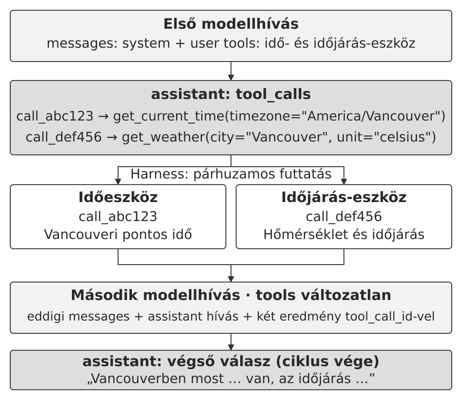

Melyik eszköz fusson le előbb? Az időeszköznek időzóna kell, az időjárás-eszköznek város és hőmérsékleti skála. A felhasználó csak Vancouvert említette, ezért a példában a modell az `America/Vancouver` és a `Vancouver` értéket adja meg, skálának pedig a Celsius-fokot választja. Az időjárás lekérdezésének nem kell megvárnia az időeszköz válaszát, a két lekérdezés egyszerre is elindulhat.

**Első API-hívás – az ügynökkeretrendszer elküldi a kezdeti kérést:**

```javascript
// Első modellhívás: a Harness összeállítja a kérést
{
  "model": "Qwen3-0.6B",
  "messages": [
    {
      "role": "system",                           // a fejlesztő által megadott utasítás
      "content": "You are a helpful assistant. Use the provided tools to get real-time information when needed."
    },
    {
      "role": "user",                              // felhasználói bemenet
      "content": "What's the current time and weather in Vancouver?"
    }
  ],
  "tools": [                                       // a fejlesztő által definiált eszközök
    {
      "type": "function",
      "function": {
        "name": "get_current_time",
        "description": "Get the current date and time in a specific timezone",
        "parameters": {
          "type": "object",
          "properties": {
            "timezone": { "type": "string", "description": "Timezone name, e.g. America/Vancouver" }
          },
          "required": ["timezone"]
        }
      }
    },
    {
      "type": "function",
      "function": {
        "name": "get_weather",
        "description": "Get the current weather for a specific city",
        "parameters": {
          "type": "object",
          "properties": {
            "city": { "type": "string", "description": "City name" },
            "unit": { "type": "string", "enum": ["celsius", "fahrenheit"] }
          },
          "required": ["city", "unit"]
        }
      }
    }
  ]
}
```

Ezt a `tools` listát a fejlesztő előre meghatározza: tartalmazza a neveket, a leírásokat és a paraméterek sémáját. A példában minden kör kérése ugyanazt a két eszközt kínálja; a modell a lista és a felhasználói kérdés elolvasása után választja ki a meghívandó eszközt, és tölti ki a paramétereit.

**A modell két eszközhívási kérést ad vissza:**

```javascript
// a modell eszközhívási kéréseket ad vissza
{
  "choices": [{
    "message": {
      "role": "assistant",                         // a modell állította elő
      "content": null,                             // ebben a körben nincs szöveges válasz
      "tool_calls": [                              // két eszköz hívását kéri
        {
          "id": "call_abc123",
          "type": "function",
          "function": {
            "name": "get_current_time",
            "arguments": "{\"timezone\": \"America/Vancouver\"}"
          }
        },
        {
          "id": "call_def456",
          "type": "function",
          "function": {
            "name": "get_weather",
            "arguments": "{\"city\": \"Vancouver\", \"unit\": \"celsius\"}"
          }
        }
      ]
    }
  }]
}
```

A válasz `tool_calls` mezője két kérést tartalmaz, mindegyiknek saját `id`-je, eszközneve és paraméterei vannak. Az `arguments` JSON-kódolású karakterlánc, ezért a végrehajtó oldalnak előbb fel kell dolgoznia, majd ellenőriznie kell a mezőket és az értékeket. **A modell dönti el, mit hív meg és milyen paraméterekkel; a Harness felel az ellenőrzésért és az ütemezésért; az eszköz implementációja éri el az idő- vagy az időjárás-szolgáltatást.**

**Az ügynökkeretrendszer végrehajtja az eszközöket, majd elindítja a második API-hívást:**

A Harness a kérés ellenőrzése után ütemezi a két eszközt, a visszakapott értékekből `tool` üzeneteket készít, majd a meglévő előzményt az új eredményekkel együtt átadja a modellnek:

```javascript
// Második modellhívás: az eszközeredmények hozzáfűzése
{
  "model": "Qwen3-0.6B",
  "messages": [
    {
      "role": "system",                           // az első kérés üzenete megmarad
      "content": "You are a helpful assistant. Use the provided tools to get real-time information when needed."
    },
    {
      "role": "user",                              // az első kérés üzenete megmarad
      "content": "What's the current time and weather in Vancouver?"
    },
    {
      "role": "assistant",                         // az előző kör modelljének hívási kérése megmarad
      "content": null,
      "tool_calls": [
        { "id": "call_abc123", "type": "function", "function": { "name": "get_current_time", "arguments": "{\"timezone\": \"America/Vancouver\"}" } },
        { "id": "call_def456", "type": "function", "function": { "name": "get_weather", "arguments": "{\"city\": \"Vancouver\", \"unit\": \"celsius\"}" } }
      ]
    },
    {
      "role": "tool",                              // a Harness beírja az eszköz eredményét
      "tool_call_id": "call_abc123",
      "content": "{\"timezone\": \"America/Vancouver\", \"datetime\": \"2025-09-13T05:18:47\", \"day_of_week\": \"Saturday\"}"
    },
    {
      "role": "tool",                              // a Harness beírja az eszköz eredményét
      "tool_call_id": "call_def456",
      "content": "{\"city\": \"Vancouver\", \"temperature\": 13.2, \"unit\": \"celsius\", \"conditions\": \"clear\", \"humidity\": 93}"
    }
  ],
  "tools": [ ... ]                                 // a korábbi eszközdefiníciók, itt elhagyva
}
```

Kövessük a második kérésben a `call_def456` azonosítót: az előző `assistant` üzenetben ez a vancouveri időjárás-lekérdezés azonosítója, az utána következő `tool` üzenet pedig ugyanezzel az azonosítóval hozza vissza a 13,2 ℃-ot és a derült időt. A Harness akkor is össze tudja párosítani az eredményeket a kérésekkel, ha az időjárás előbb érkezik meg, mint az idő. Ebben a körben a modell egyszerre látja a felhasználó eredeti kérdését, a saját két lekérdezését és az eszközök által visszaadott adatokat. Ezek után már válaszolhat a felhasználónak.

**A modell az eszközeredmények alapján megírja a végső választ:**

```javascript
// a modell megírja a végső választ
{
  "choices": [{
    "message": {
      "role": "assistant",                         // a modell állította elő
      "content": "It's currently 5:18 AM on Saturday, September 13, 2025 in Vancouver.\n\nWeather: 13.2°C with clear skies and 93% humidity. It's quite cool this morning - you might want to grab a jacket."
    }
  }]
}
```

A második válasz a végső szöveget adja, a `tool_calls` üres, így a példaciklus véget ér. Ez a „modellhívás → eszközvégrehajtás → eredmény visszaküldése → újabb modellhívás” folyamat az 1. fejezetben bemutatott futási ciklus konkrét megvalósítása az API szintjén.

Ha a felhasználó visszakérdez: „És Tokióban?”, a Harness ezt az üzenetet az előzmény végéhez fűzi, és újra meghívja a modellt. A modell átveheti a „lekérdezni a pontos időt és az időjárást” feladat hátterét, és új, Tokióra vonatkozó kéréseket állít elő; az eszközök válasza után pedig újabb választ fogalmaz.

**Hogyan adjuk vissza az eszközeredményt a Responses API használatakor?** A fenti helyi kísérlet Chat Completions-kompatibilis interfészt használ. Ha az OpenAI szolgáltatására építünk új projektet, a hivatalos ajánlás a Responses API. Maradjunk a vancouveri példánál: az alkalmazás a felhasználó kérdését a kérés `input` mezőjébe teszi, a `tools` mezőben pedig deklarálja az idő- és az időjárás-függvényt. A visszakapott `output` típusos elemek sorozata. Ha két `function_call` szerepel benne, az alkalmazás mindegyikből kiolvassa a függvény nevét, a paramétereket és a `call_id` értéket, és külön-külön végrehajtja az eszközöket.[^ch2-responses-loop]

Tegyük fel, hogy az időjárás-függvény hívásának azonosítója `call_weather`. A következő kérés `input` mezőjébe ekkor ilyen nyugta kerülhet; az időfüggvény eredményét is a saját azonosítójával kell visszaadni.

```json
{"type": "function_call_output", "call_id": "call_weather", "output": "{\"temperature\": 13.2, \"unit\": \"celsius\"}"}
```

A `call_id` egy nyugtát egyetlen függvényhíváshoz köt. A `previous_response_id` az előző modellválaszra mutat, hogy a szolgáltatás az előző kör kontextusánál folytassa. A két azonosító különböző dolgokra utal. Ilyen folytatásnál az adott körben is meg kell adni a továbbra is használandó eszközöket és a legfelső szintű `instructions` mezőt; az előző kérés legfelső szintű utasításait a válaszazonosító nem örökíti át automatikusan. A modell további eszközöket is kérhet, ezért az alkalmazásnak a következő `output` elolvasása után kell eldöntenie, véget ér-e a ciklus. Az 1. fejezet 1-3. kísérlete a szolgáltató által üzemeltetett keresést használta; itt a két saját függvényt az alkalmazás hajtja végre.

[^ch2-responses-loop]: OpenAI, a Responses API-ra való átállás, a függvényhívás és a válaszlétrehozás paramétereinek leírása.

### Az ügynök magciklusának megvalósítása kódban

A ciklusban a két `messages.append` hívás közül az egyik a modell válaszát, a másik az eszköz végrehajtásának eredményét őrzi meg. Az idő és a hőmérséklet is Vancouverből származik; ha felcserélnénk a két hívásazonosítót, a modell a következő körben azt olvasná, hogy az „idő lekérdezése” 13,2 Celsius-fokot adott vissza.

A példa az OpenAI Python SDK-val kapcsolódik egy kompatibilis szolgáltatáshoz. Az alapértelmezett cím a helyi `http://localhost:8000/v1`, ami egy már elindított, hitelesítést nem igénylő helyi szolgáltatáshoz illik. Ezek az alapértelmezések a 2-1. kísérlet vLLM-háttérrének felelnek meg. Az említett kísérlet Ollama-háttérrével a cím `http://localhost:11434/v1`, a modell neve pedig `qwen3:0.6b`. Más szolgáltatáshoz való kapcsolódáskor igény szerint állítsuk be az `LLM_BASE_URL` és az `LLM_API_KEY` környezeti változót, és a lentebbi `model` értékét igazítsuk a ténylegesen telepített modell nevéhez. Az idő- és az időjárás-eszköz egyelőre az előző példa rögzített adatait használja, hogy az üzenetek összehasonlíthatók legyenek; valós adatokra álláskor ezt a két eszközimplementációt kell kicserélni.

```python
import json
import os

from openai import OpenAI

client = OpenAI(
    base_url=os.getenv("LLM_BASE_URL", "http://localhost:8000/v1"),
    api_key=os.getenv("LLM_API_KEY", "EMPTY"),
)

# Eszközdefiníciók: név, rendeltetés és paraméterszerkezet
tools = [
    {
        "type": "function",
        "function": {
            "name": "get_current_time",
            "description": "Get the current date and time in a specific timezone",
            "parameters": {
                "type": "object",
                "properties": {
                    "timezone": {"type": "string", "description": "Timezone name, e.g. America/Vancouver"}
                },
                "required": ["timezone"],
            },
        },
    },
    {
        "type": "function",
        "function": {
            "name": "get_weather",
            "description": "Get the current weather for a specific city",
            "parameters": {
                "type": "object",
                "properties": {
                    "city": {"type": "string", "description": "City name"},
                    "unit": {"type": "string", "enum": ["celsius", "fahrenheit"]},
                },
                "required": ["city", "unit"],
            },
        },
    },
]

# A példaeszközök rögzített adatokat használnak, a paraméterek megegyeznek a korábbi vancouveri lekérdezéssel.
def execute_tool(name, arguments):
    args = json.loads(arguments)
    if name == "get_current_time" and args == {"timezone": "America/Vancouver"}:
        result = {
            "timezone": "America/Vancouver",
            "datetime": "2025-09-13T05:18:47",
            "day_of_week": "Saturday",
        }
    elif name == "get_weather" and args == {"city": "Vancouver", "unit": "celsius"}:
        result = {
            "city": "Vancouver", "temperature": 13.2,
            "unit": "celsius", "conditions": "clear", "humidity": 93,
        }
    else:
        result = {"error": "a példa csak a vancouveri időt és a Celsius-fokos időjárást adja meg"}
    return json.dumps(result, ensure_ascii=False)

# Kezdeti üzenetek: utasítás és felhasználói feladat
messages = [
    {"role": "system", "content": "You are a helpful assistant. Use tools to get real-time information when needed."},
    {"role": "user", "content": "What's the current time and weather in Vancouver?"},
]

# Futási ciklus: legfeljebb nyolc modellhívás
rounds = 0
while rounds < 8:
    rounds += 1
    response = client.chat.completions.create(
        model="Qwen3-0.6B", messages=messages, tools=tools
    )
    assistant_message = response.choices[0].message

    # A modell válaszának mentése, az adott kör hívási kéréseivel együtt
    messages.append(assistant_message.model_dump(exclude_none=True))

    # A példa akkor ér véget, amikor a modell eszközhívás nélküli választ ad
    if not assistant_message.tool_calls:
        print(assistant_message.content)
        break

    # Egyenkénti végrehajtás és hozzáfűzés; a független hívások párhuzamosan is ütemezhetők
    for tool_call in assistant_message.tool_calls:
        try:
            result = execute_tool(tool_call.function.name, tool_call.function.arguments)
        except json.JSONDecodeError:
            result = json.dumps({"error": "az eszköz paramétereinek érvényes JSON-nek kell lenniük"})
        messages.append({
            "role": "tool",
            "tool_call_id": tool_call.id,
            "content": result,
        })
    # A következő kör a kiegészített üzenetlistát használja
else:
    print("Elértük a körök felső határát, a feladat még nem készült el.")
```

Tegyük fel, hogy a modell az első körben egyszerre kéri az időt és az időjárást. Az itt szereplő `for` ciklus előbb lekérdezi az időt, az eredményt hozzáfűzi a `messages` listához, majd lekérdezi az időjárást, és hozzáfűzi a második eredményt. Csak miután mindkettő lefutott, tér vissza a program a `while` elejére, és küldi el a második modellkérést. Ha a `messages` tartalmát ezekben a lépésekben kibontjuk, látható, mit kapott a modell az egyes hívásoknál.

**Kezdeti állapot (az 1. hívás előtt):**
```text
messages = [
  { role: "system",  content: "You are a helpful assistant..." },     # a fejlesztő írta
  { role: "user",    content: "What's the current time and weather in Vancouver?" },  # felhasználói bemenet
]
```

**Az 1. modellhívás és az eszközvégrehajtás után:**
```text
messages = [
  { role: "system",    content: "..." },
  { role: "user",      content: "What's the current time..." },
  { role: "assistant", tool_calls: [get_current_time, get_weather] },  # a modell által előállított hívási kérés
  { role: "tool",      tool_call_id: "call_abc123", content: "{time...}" },  # az eszköz lefutása után a Harness írja be
  { role: "tool",      tool_call_id: "call_def456", content: "{weather...}" },  # az eszköz lefutása után a Harness írja be
]
```

**A 2. hívás után (a modell visszaadja a végső választ, a ciklus véget ér):**
```text
messages = [
  { role: "system",    content: "..." },
  { role: "user",      content: "What's the current time..." },
  { role: "assistant", tool_calls: [get_current_time, get_weather] },
  { role: "tool",      tool_call_id: "call_abc123", content: "{time...}" },
  { role: "tool",      tool_call_id: "call_def456", content: "{weather...}" },
  { role: "assistant", content: "It's currently Saturday, Sep 13, 2025 in Vancouver..." },  # végső válasz
]
```

### A kontextus felépítése API-szemléletből

A 2-4. ábra egy kérést két részre bont: előtagra és üzenetelőzményre. Az előbb említett vancouveri lekérdezés pillanatában az előzmény csak a felhasználó kérdését és a korábbi beszélgetést tartalmazta. Amikor a két lekérdezés befejeződik, az előzmény kiegészül a modell által kért eszközhívásokkal és a két eszközeredményvel.

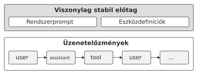

Ezért a két egymást követő kérés azonos kezdete egészen az üzenetelőzmény belsejéig érhet. Hogy a következő kör mennyit tud újrahasznosítani a korábbi számításból, azon múlik, milyen hosszú ez az előtag.

Az alábbi Harness a ritkán változó rendszerutasításokat és eszközdefiníciókat elöl tartja, és minden körben csak az előzmény végére fűzi a pillanatnyi állapotot. Ha az előzmény túl hosszú, előbb tömöríti a régi üzeneteket, és csak utána állítja össze a kérést.

```python
stable_prefix = system_message
stable_tools = core_tool_schemas
history = load_message_history(session)
status_message = make_status_message(derive_current_state(history))

if estimated_tokens(stable_prefix, stable_tools, history, status_message) > budget:
    history = compress_old_evidence(
        history,
        preserve = [decisions, constraints, failures, citations]
    )

request.messages = [stable_prefix] + history + [status_message]
request.tools = stable_tools
response = call_model(request)
```

A tömörítés megtartja a döntéseket, a korlátokat, a hibákat és a hivatkozásokat, vagyis azt, amire a további munkához szükség van, és megőrzi a hívási kérések és az eszközeredmények összetartozását is. A hosszkorláton kívül az ismétlődő és az elavult információ is kiválthat tömörítést; a részletes stratégiát a fejezet második fele fejti ki.

> **2-1. kísérlet ★: Helyi LLM-szolgáltatás telepítése és eszközhívás**
>
> Ez a kísérlet helyben futtatja a Qwen3-0.6B modellt, és a „mennyi az idő és milyen az időjárás Vancouverben” feladaton követi végig, hogyan jutnak el az üzenetek a modellen, a feldolgozón és az eszközvégrehajtón keresztül. A 2-5. ábra mutatja a helyi szolgáltatás és a kliens munkamegosztását: a szerver betölti a modellt, feldolgozza a bemenetet és előállítja a választ, a kliens tartja az üzenetelőzményt, ütemezi az eszközöket és küldi vissza az eredményeket.
>
> 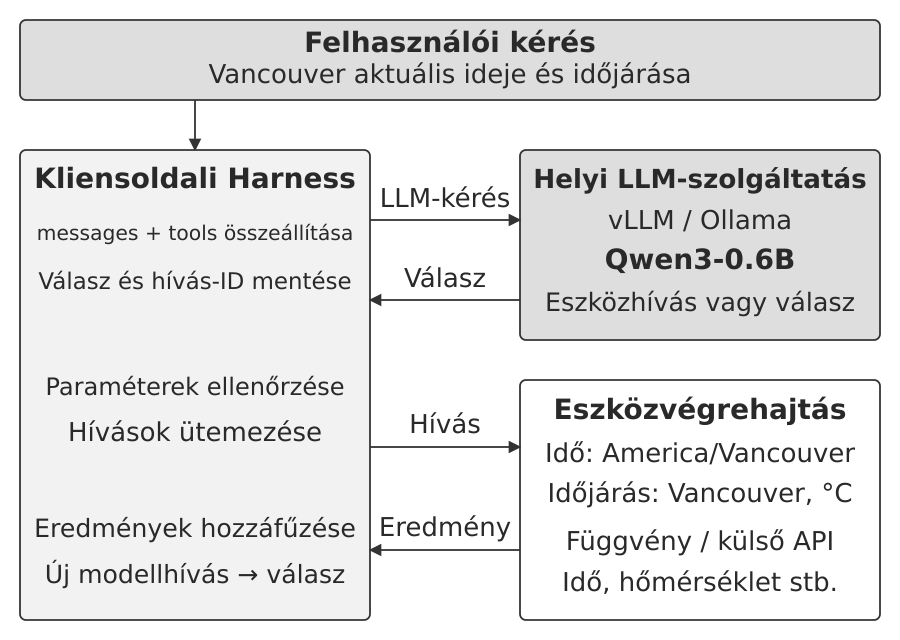
>
> **Először kövessünk végig egy teljes feladatot.** A modell ugyanabban a válaszban kéri az időt és a hőmérsékletet, és rendre az `America/Vancouver`, a `Vancouver` és a `celsius` paramétert adja meg. A kliens párhuzamosan futtatja a két eszközt. Az első nyugta a helyi időt adja meg: 11:11:28, a második a hőmérsékletet: 17,9 °C. Miután mindkét eredmény visszajut a modellhez, az perc pontossággal mondja meg az időt, 17,9 °C-ként az időjárást, és lezárja ezt a ciklust. A futás azt mutatja, hogy egy hatszázmillió paraméteres modell már képes kiválasztani a feladathoz a két megfelelő eszközt, kitölteni a paramétereket, és a visszakapott értékekkel válaszolni a felhasználónak.
>
> **Utána nézzük meg, hogyan felelnek meg a nyers kimenet részei az API mezőinek.** A Qwen3 gondolkodási módja `<think>` jelöléssel ellátott érvelési tartalmat állíthat elő, az eszközkérések pedig a hozzájuk tartozó hívásjelöléseket használják. A szerver feldolgozása után a kliens külön `thinking` vagy eszközhívási mezőt kaphat. A kimenet egyes részeinek sorrendjét és megőrzését a modell sablonja és a szolgáltatási protokoll együtt határozza meg.
>
> **Ezután figyeljük meg a streamelést.** A felület eseményről eseményre frissítheti az olyan állapotokat, mint „gondolkodik”, „eszközt hív” és „választ ír”. Az eszköz paraméterei rendszerint több részletben érkeznek, ezért teljes kéréssé kell őket összegyűjteni; ha a protokoll igazolta a hívás végét, és a paraméter-, jogosultság- és függőségellenőrzés is átment, a futtatókörnyezet elkezdheti az ütemezést. Az egymástól független eszközök párhuzamosan futhatnak, és a későbbi kimenet feldolgozásával futószalagszerűen összekapcsolhatók.
>
> **Végül hasonlítsuk össze a sebességet és a gyorsítótárazást.** Az Apple-chip-es Macen készült feljegyzés szerint ebben a futásban az eszközfeladat átlagos dekódolási sebessége körülbelül másodpercenként 107 token volt. A token a modell szövegfeldolgozásának alapegysége; a pontos felosztást a tokenizáló határozza meg, és egy szó vagy kínai írásjegy egy vagy több tokennek is megfelelhet. A dekódolási sebesség a generálás megkezdése utáni kimeneti rátát tükrözi; azt, hogy a felhasználó mennyit vár, az első token késleltetése, az érvelés hossza és az eszközök futásideje is befolyásolja.
>
> A gyorsítótár-összehasonlítás ugyanazzal a hosszú előtaggal készült: egyszer megtartott előtaggal, egyszer az előtag elejét módosítva. Ebben az öt párosított mérésben a megtartott előtagú kérések közül négy volt gyorsabb; a két csoport átlagos első token késleltetése körülbelül 1,30, illetve 1,51 másodperc volt. A következő szakasz elmagyarázza, miben tér el számítási szempontból ez a kétféle kérés.
>
> Ez a kísérlet engem is megerősített abban, hogy bizakodó legyek az eszközön futó ügynökökben: a kis modellek már a felhasználó saját eszközén is el tudják végezni az efféle eszközhívási feladatot. **Az eszközön futó ügynökök korszaka közelebb van, mint sokan gondolnák.**

## KV Cache-barát kontextustervezés

Az ügynök egymást követő kérései rendszerint sok információt osztanak meg: a rendszerutasításokat, az eszközdefiníciókat és a korábban lezajlott interakciót. Ha az inferencia-motor újra tudja hasznosítani ezeknek a tartalmaknak a köztes számítási eredményeit, több számítási kapacitást fordíthat az új információra. A **KV Cache** az egyes rétegek figyelmi számításában már kiszámolt kulcs- (Key) és értékvektorokat (Value) tárolja a későbbi tokenek számára; a **Prompt Cache** ezen felül kérésről kérésre újrahasznosítja a feltételeknek megfelelő előtag-gyorsítótárat[^ch2-kv-basics].

Vegyünk egy ügyfélszolgálati ügynököt: hogy a modell ismerje a pontos időt, a fejlesztő a rendszerprompt elejére illeszti a `Current time: {{now}}` sort, és minden kérésben frissíti. A mögötte álló üzleti szabályok és eszközdefiníciók változatlanok maradnak, a tényleges bemenet viszont az időbélyegtől kezdve eltér. Az azonos előtagot újrahasznosító szolgáltatásnál ez azt jelenti, hogy az időbélyeget és az utána következő részt újra kell számítani, ami növeli a bemenet feldolgozási idejét és költségét.

Ha az időt külön, hozzáfűzött üzenetként adjuk meg, vagy szükség esetén időeszközzel kérdezzük le, a meglévő előtag megmarad. A kétféle elrendezés hasonló információt nyújt, az újraszámítás mértéke azonban különbözik.

Előre jegyezzünk meg három gyakorlatot; az alábbi elvek és kísérletek ezeket magyarázzák meg egyenként:

1. **Tartsuk stabilan az újrahasznosítható előtagot.** A rendszerutasítások és a gyakran használt eszközdefiníciók tartalma és sorrendje legyen meghatározott.
2. **A futás közbeni változásokat a végére fűzzük.** Az idő, az egyenleg, a hívások száma és a feladat előrehaladása új üzenetben vagy eszközeredményben is megadható. A legfrissebb állapotnál jelölni kell, mikortól érvényes, hogy a modell felismerje, melyik bejegyzés vonatkozik a mostani döntésre.
3. **A modell protokollja szerint szervezzük az üzeneteket.** Használjuk a megfelelő szerepeket, hívásazonosítókat és eszközeredmény-formátumot, a modell bemenetét pedig a megfelelő chatsablon állítsa elő. A gyorsítótár a feldolgozott előtagot és a kapcsolódó beállításokat párosítja; az üzenetprotokoll azt is meghatározza, hogyan ismeri fel a modell az utasításokat, a felhasználói kéréseket és az eszközök visszaadott értékeit.

Az ebben a szakaszban használt okozati figyelem (causal attention) modelljében a későbbi tokenek hozzáadása nem változtatja meg a korábbi pozíciókban már kiszámolt állapotokat. A meglévő bemenet módosításakor az első változási pontot és az utána következő állapotokat újra kell számítani; a változás előtti előtagot még újra lehet hasznosítani. A szerver emellett a gyorsítótár blokkmérete, megőrzési ideje és futási beállításai alapján dönti el, mekkora részre terjed ki a tényleges találat.

[^ch2-kv-basics]: Hugging Face, How caching works, amely a K és V vektorok rétegenkénti tárolásának és újrahasznosításának mechanizmusát ismerteti.

> **2-2. kísérlet ★: A figyelmi mechanizmus vizualizációja**
>
> Először a „Peking | -i | időjárás | milyen” (szó szerint: „milyen Peking időjárása”) mondaton értsük meg egy figyelmi számítás menetét. A szemléltetés kedvéért a 2-6. ábra négy szemantikai egységre bontja a mondatot; a valós modellben a tokenizáló hasítja fel a bemenetet. A „milyen” pozíció feldolgozásakor a figyelmi rétegnek a meglévő információkból kell összeállítania az aktuális reprezentációt. A Query, a Key és a Value rendre a lekérdezés, az egyeztetés és az információösszesítés szerepét tölti be.
>
> | Vektor | Szerep | Szemléletes értelmezés ebben a példában |
> | --- | --- | --- |
> | **Query (lekérdezés)** | az aktuális pozíció vektora, amellyel más pozíciókat egyeztet | a „milyen” a meglévő tartalomból keresi a kapcsolódó információt |
> | **Key (kulcs)** | az egyes pozíciók egyeztetésben részt vevő vektora | a „Peking”, az „időjárás” és a többi pozíció egyeztethető reprezentációt kínál |
> | **Value (érték)** | a súlyok szerint összesített információs vektor | a helyet, az időjárást és a többi információt a megfelelő arányban vonja be az aktuális reprezentációba |
>
> A Key-t tekinthetjük a kereséshez használt címkének, a Value-t pedig az előkeresett tartalomnak. A modellben ezek a vektorok rejtett reprezentációkból számolt számértékek, és az egyeztetés módját a tanítás alakítja ki.
>
> Egy számítás három lépésből áll. Először az aktuális pozíció előállítja a Query-t; majd ez skaláris szorzatot (dot product) számol az egyes pozíciók Key-vektoraival, és skálázás, okozati maszkolás, valamint softmax után megkapja az összegükben 1-et adó figyelmi súlyokat; végül ezekkel a súlyokkal súlyozottan összegzi a Value-vektorokat. A skaláris szorzat két számsorozat elemenkénti szorzatainak összege; a softmax pedig a látható pozíciók pontszámait normált súlyokká alakítja. Az egyes pozíciók Value-vektora a hozzá tartozó súllyal vesz részt az összesítésben, és együtt alkotja ennek a figyelmi fejnek a kimenetét.
>
> Olvassuk végig a 2-6. ábra utolsó sorát vízszintesen: a „milyen” pozíció az „időjárás” szónak 0,55 súlyt ad. Ezt a számot meg kell szorozni az „időjárás” pozíciójában álló Value-vektorral, majd hozzá kell adni a másik három pozíció járulékát, és csak így kapjuk meg ennek a figyelmi fejnek a kimenetét a „milyen” helyén. Ha átváltunk az „időjárás” sorára, miért van jobb oldalon egy kereszttel jelölt cella? Mert ennek a pozíciónak a számításakor a sorozat még nem ért el a „milyen” szóig.
>
> 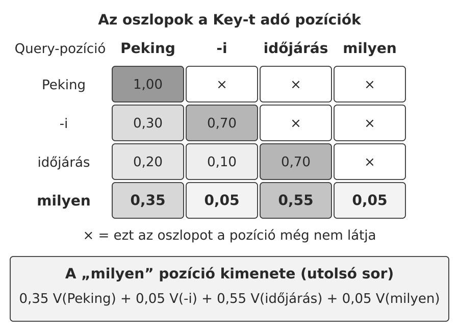
>
> Ha az egyes pozíciók súlyait mátrixba rendezzük, megkapjuk a **figyelmi hőtérképet**. Minden sor egy Query-hez, minden oszlop egy Key-hez tartozik, a szín erőssége a súly nagyságát jelzi. Az okozati maszk lehetővé teszi, hogy az aktuális pozíció önmagát és a korábbi pozíciókat olvassa; az ábra × jellel jelöli a kimaszkolt helyeket, amelyek softmax utáni súlya nulla. Ez a szerkezet a bemenet feldolgozására és a későbbi generálásra egyaránt érvényes.
>
> Innen a K- és V-gyorsítótár rendeltetése is látszik: a generálás előrehaladtával az új pozíciók továbbra is olvassák a korábbi pozíciók Key- és Value-vektorait. Ha ezeket a vektorokat eltároljuk, az új pozíció közvetlenül felhasználhatja őket az egyeztetéshez és az összesítéshez, és a korábbi pozíciók újraszámítása elmarad.
>
> Miután ezt a szemléltető súlykészletet megértettük, nézzük meg a Qwen3-0.6B modell ténylegesen kiszámolt figyelmi eloszlását. A kísérlet külön rögzít egy rövid mondatot és egy olyan generált sorozatot, amely érvelést és végső választ is tartalmaz, és összehasonlítja a különböző rétegek figyelmi mátrixait. A 2-7. ábra a 0., a 13. és a 27. réteget mutatja: a bal oszlopban a kilenc tokenes rövid mondat, a jobb oszlopban a 17 × 23 kiszámításakor generált sorozat látható, a bemenet, az érvelés és a válasz pozíciótartományát megjelölve. A szürkeárnyalatos skála logaritmikus, hogy az erősebb és a gyengébb figyelmi súlyok egyszerre legyenek kivehetők.
>
> 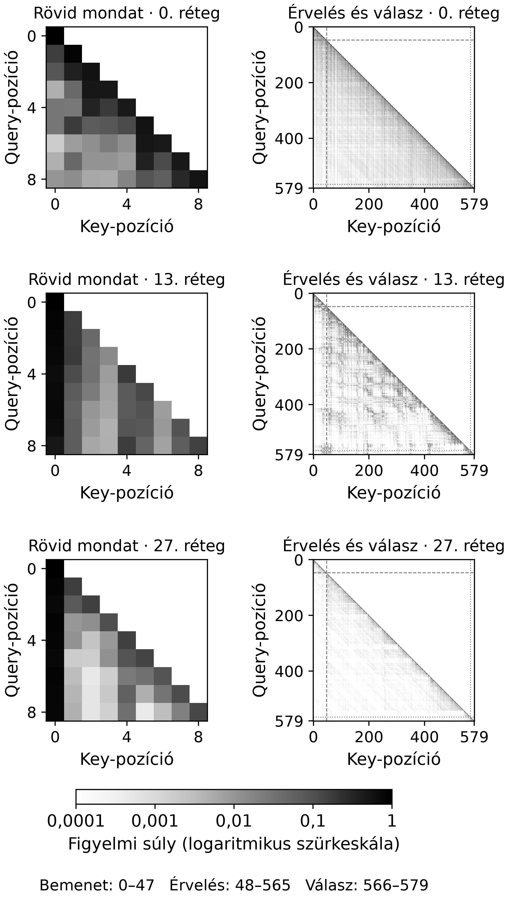
>
> Olvasás közben négy szempont mentén érdemes elemezni:
>
> 1. **Figyelmi nyelő (Attention Sink).** Egyes rétegek nagy súlyt adnak a sorozat elejének, még akkor is, ha az ott álló token kevés szemantikai tartalmat hordoz. Nézzük a 2-7. ábra bal oszlopában a rövid mondatot. Minden ábra már átlagolta az adott réteg figyelmi fejeit. Ha a mátrix első oszlopában álló kilenc szám átlagát vesszük, megkapjuk, hogy a kilenc pozíció átlagosan mekkora súlyt ad az első tokennek. A 0., a 13. és a 27. rétegben ez rendre 14,7%, 73,9% és 83,2%. A jobb oszlop hosszabb generált sorozatánál a 13. rétegben ez az érték 28,0%. A softmax megköveteli, hogy a pozíciók súlyai összesen 1-et adjanak, így a modell viszonylag stabil befogadó pozíciót tanulhat; a StreamingLLM külön tanulmányozta ezt a jelenséget és szerepét a streamelő inferenciában[^ch2-attention-sinks].
> 2. **Az érvelés tartománya.** Jelöljük meg a `<think>` tartalmához tartozó generált szakaszt, és ezeken a sorokon nézzük meg, mely utasításokra, eszközleírásokra vagy korábbi érvelésekre figyelt a modell. A háromszög alak az okozati maszkból adódik; a súlyok közötti különbséget a háromszögön belüli árnyalatok mutatják.
> 3. **A válasz tartománya.** Jelöljük meg a végső válasz generált szakaszát, és hasonlítsuk össze, mekkora súlyt kap az eredeti bemenet és a korábbi érvelés. Ez segít megtalálni, milyen meglévő információk kerültek be az aktuális figyelmi összesítésbe.
> 4. **Pozíció szerinti különbségek.** A *Lost in the Middle* hosszú kontextusú kérdés-válasz feladatokban és kulcs-érték visszakeresésben azt figyelte meg, hogy a középső pozíciók információit nehezebb hatékonyan felhasználni[^lost-in-the-middle]. Ezt a mérnöki gyakorlatban úgy lehet kihasználni, hogy az állandó szabályokat előre, a mindenkori célt és előrehaladást pedig a végére tesszük.

[^ch2-attention-sinks]: Xiao et al., Efficient Streaming Language Models with Attention Sinks, ICLR 2024.

[^lost-in-the-middle]: Liu et al., Lost in the Middle: How Language Models Use Long Contexts, TACL 2024.

### Az API-üzenetektől a modell tokenjeiig: a Chat Template

A korábbi API-példák szerepekkel ellátott üzenetek voltak, a figyelmi ábra bemenete viszont egy tokensorozat. A **Chat Template (chatsablon)** végzi el ezt az átalakítást: szerep- és határjelöléseket ad az üzenetekhez, a megállapodás szerint rendezi az eszközleírásokat és a visszaadott értékeket, majd átadja az eredményt a tokenizálónak kódolásra. Hasonlítsuk össze a 2-8. ábra két oszlopát: a bal oldalon csak a rendszerutasítás és a felhasználói kérdés szerepel, a jobb oldalon miért van még egy `assistant` is? Az a sablon által a következő válaszhoz hozzáadott kezdőjelölés. Ezekre a jelölésekre később az eszközhívások, az érvelési információk megőrzése és a gyorsítótár-találatok tárgyalásakor még szükség lesz.

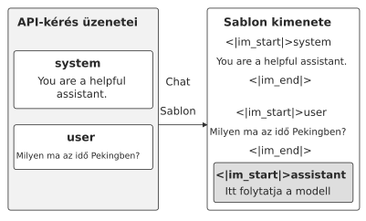

A Qwen, a Llama, a Gemma és a többi modellcsalád mind a saját chatsablonját használja. Ugyanazt az API-üzenetsorozatot különböző modelleknek átadva a szerep- és határjelölések is eltérhetnek. A hosztolt API-knál az átalakítást rendszerint a szerver végzi; saját telepítésnél az inferenciaszolgáltatásnak a modellhez illő sablont kell beállítani.

Tegyük fel, hogy a felhasználó elküldi a „Vancouver 17,9 °C” üzenetet, és az időjárás-eszköz véletlenül ugyanezt a szöveget adja vissza. Ha ezt a két üzenetet a Qwen3-0.6B sablonjának adjuk át, a 2-9. ábra két bemenetét kapjuk. Mindkettő `<|im_start|>user` jelöléssel kezdődik; melyik jelölés árulja el, hogy a szöveg eszköztől származik?

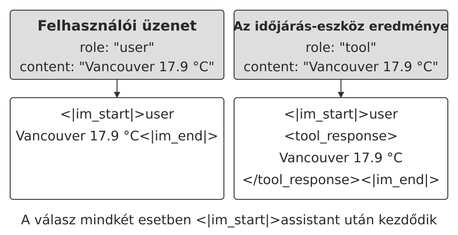

A jobb oszlopban megjelenik egy `<tool_response>` jelölőpár. A sablon emellett az üzenetszerepek alapján állapítja meg, hol volt a felhasználó legutóbbi kérdése: az ennél korábbi körökben csak a válasz tartalma marad meg, az utána következő eszközinterakciók viszont már hordozhatják a modell érvelési információit[^ch2-qwen-template].

Ha például a modell egy fájl átvizsgálása után tovább elemzi annak tartalmát, az eszközeredményt `tool` szerepben visszaadva a sablon a jelenlegi feladat eszközvisszajelzéseként ismeri fel; ha ugyanezt a szöveget egyszerű `user` üzenetként írjuk meg, a sablon új kérdésként ismerheti fel, és megváltoztatja a korábbi érvelés megőrzésének terjedelmét. Ez olyan, mint amikor egy feladat folytatásához meg kell tartani a számítási piszkozatot: a Harnessnek meg kell őriznie a szolgáltatás által előírt érvelési mezőket, és a helyes üzenetszerkezettel kell folytatnia a hívást.

**Ahogy az egyfordulós következtetésből hosszú, több lépésből álló ügynökfutás lesz, az előzményben felhalmozott gondolkodás fokozatosan karbantartandó feladatállapottá válik.** A korai DeepSeek-R1 chatsablonja kivette a korábbi válaszokból a gondolkodás részét, és csak a végső választ tartotta meg[^ch2-r1-template]; a későbbi DeepSeek eszközhívási protokoll viszont már megköveteli az érvelési információk visszaküldését. Egy kérdés-válasz lezárása után a végső válasz gyakran már tartalmazza a következő körhöz szükséges információt; egy félbehagyott eszközfeladatnál viszont az, hogy „miért néztük meg ezt a fájlt” vagy „mely hipotéziseket zártuk ki”, csak a közbülső érvelésben állhat. Ezen információk megőrzése segít, hogy a következő kör a már kialakult gondolatmenetre építsen.

**Az érvelési információk visszaküldésének módját a modell protokollja határozza meg.** Csatlakozáskor a `content`, a `tool_calls` és a szolgáltatás által kínált érvelési mezők kezelését egyszerre kell megoldani. Az alábbi megoldások különböző folytatási szabályokat képviselnek:

- **A DeepSeek gondolkodási módja** a `reasoning_content` mezőn keresztül adja vissza az érvelést. Eszközhívási protokollja szerint ha a kérés tartalmaz `tools` mezőt, a következő kérésekben a teljes korábbi érvelést vissza kell küldeni, beleértve azoknak a modellválaszoknak a mezőjét is, amelyek nem hívtak eszközt; a mező hiánya 400-as hibát vált ki. `tools` nélküli, tisztán beszélgetős kérésnél a szolgáltatás figyelmen kívül hagyja a visszaküldött korábbi érvelést[^ch2-deepseek-thinking].
- **A Kimi gondolkodás és eszközinterakció** szintén megköveteli az érvelés, az eszközkérések és az eredmények kezelését a futtatási ciklusban. A Kimi K2.5 beékelt gondolkodásra (interleaved thinking) vonatkozó példájában a modell több eszközhívás között is folytathatja az érvelést, a kliens pedig a protokoll szerint tárolja és küldi vissza a modell üzeneteit[^ch2-kimi-thinking].
- **A GLM gondolkodásmegőrzése** a `thinking.clear_thinking: false` beállítással kapcsolható be, utána a `reasoning_content` teljes terjedelmében, eredeti sorrendben küldendő vissza. A Coding Plan és a szabványos API alapértelmezése eltér, ezért a kliensnek kifejezetten ki kell választania a kívánt módot[^ch2-glm-thinking].
- **A Claude thinking blockjait** az aláírással együtt kell tárolni. A preserved thinkinget támogató modellek a blokkok származását és előtagját is ellenőrzik; a pontos szabályokat a későbbi „A gyorsítótárazás mint architekturális kényszer” szakasz ismerteti.

Ezek a szabályok az egymást követő eszközhívásokat éppúgy befolyásolják, mint a futás közbeni modellváltást. Váltáskor az adaptációs rétegnek a célinterfész által elfogadott formára kell alakítania az eszközkéréseket, az eredményeket és a feladat állapotát, majd a célmodell szabályai szerint kell kezelnie az érvelési információkat. Az 5. fejezet 5-1. kísérlete fejti ki ezt a trajektória-folytatást.

**A sablon azt is meghatározza, milyen bemenethez párosít a gyorsítótár.** Ugyanaz az üzenettartalom különböző sablonokkal, eszközsorrenddel vagy szerializálással más tokenelőtagot eredményezhet. A meglévő KV újrahasznosításához a kapcsolódó modellbeállításoknak és az előtagnak is változatlannak kell maradniuk.

[^ch2-qwen-template]: A Qwen3-0.6B tokenizálójának `tokenizer_config.json` konfigurációs fájlja tartalmazza a chatsablont, benne a felhasználói kérdések, az érvelési tartalom és az eszközválaszok kezelésének logikájával.

[^ch2-r1-template]: A DeepSeek-R1 hivatalos chatsablonja a szokásos előzményválaszokban a `</think>` utáni tartalmat tartja meg; a későbbi eszközhívások érvelés-visszaküldési szabályait a DeepSeek Thinking Mode dokumentációja írja le.

[^ch2-deepseek-thinking]: DeepSeek, Thinking Mode.

[^ch2-kimi-thinking]: Moonshot AI, a Kimi K2.5 hivatalos repója, az Interleaved Thinking and Multi-Step Tool Call szakasz.

[^ch2-glm-thinking]: Z.ai, Thinking Mode, amely a beékelt gondolkodást, a gondolkodásmegőrzést és a végpontok alapértelmezett beállításait ismerteti.

### A KV Cache elvei és korlátai

Amikor a modell feldolgoz egy kérést, először **prefillel (előtöltés)** kiszámítja a meglévő tokenek reprezentációját, majd **dekódolásba** lép, és tokenenként állítja elő a folytatást. A KV Cache a dekódolás során eltárolja a meglévő pozíciók K- és V-vektorait; a kérések közötti előtag-gyorsítótár pedig a korábbi kérésből visszamaradt azonos előtagot hasznosítja tovább.

Ha például az ügynök a hatodik körnél már 2 000 bemeneti tokent halmozott fel, és a szolgáltatás csak a kérésen belüli KV Cache-t használja, akkor előbb mind a 2 000 tokent fel kell dolgoznia, és csak utána folytathatja a generálást a gyorsítótárból. Ha a kérések közötti gyorsítótárban már megtalálható egy azonos előtag, a prefill a még nem gyorsítótárazott pozíciótól folytathatja. A 2-10. ábra ezt a kérések közötti újrahasznosítást mutatja be.

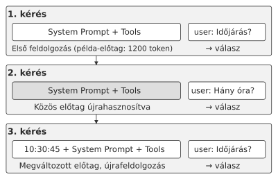

**Kövessük nyomon a gyorsítótár növekedését négy tokenen.** Tegyük fel, hogy a bemenet `[A, B, C, D]`. A D pozíció feldolgozásakor a modell a D Query-vektorát párosítja az A, B, C és D Key-vektoraival, majd ezek Value-vektorait súlyozottan összesíti. A rétegeken végighaladó számítás után a D pozíció végső reprezentációja szolgál a következő, E token előrejelzésére. Ekkor az A-tól D-ig tartó tokenek K- és V-vektorai minden rétegben el vannak tárolva.

Miután E-t mintavételeztük, a következő lépésben bevisszük a modellbe, és kiszámítjuk a Query-, Key- és Value-vektorait minden rétegben. Az E Query-je a korábbi gyorsítótárat és az aktuális pozíció K- és V-vektorát olvassa, a modell előrejelzi a hatodik tokent; az E K- és V-vektora közben a gyorsítótárhoz fűződik. Így minden generált lépésnél megmarad a korábbi állapot, és csak az új bemeneti token állapotát kell kiszámítani.

Ha egyáltalán nem használnánk KV Cache-t, az E előrejelzéséhez újra fel kellene dolgozni A-tól D-ig, a hatodik token előrejelzéséhez pedig A-tól E-ig. Ha csak a K- és V-vektorok újraszámolt pozícióit számoljuk, a halmozott munka $1+2+\cdots+N$ szerint nő. Gyorsítótárral a korábbi pozíciók rétegenkénti számítása újrahasznosítható; az új pozícióknak továbbra is olvasniuk kell a látható K- és V-vektorokat. A szabványos, teljes figyelmű dekódolásban ez az olvasás és egyeztetés a kontextus hosszával lineárisan nő, ezért a hosszú kontextus továbbra is több memóriát és memóriasávszélességet igényel.

**Miért hat a bemenet módosítása a későbbi gyorsítótárra?** A Transformer rétegei egymás után dolgozzák fel a rejtett reprezentációkat, és minden rétegnek megvan a saját K- és V-készlete. Egy pozíció a figyelmi számítás után már magában hordozza a korábbi pozíciók információit, és így adja tovább a következő rétegnek. Ezért ha a $k$-adik token megváltozik, a hatás ettől a pozíciótól hátrafelé, a magasabb rétegek felé terjed.

Azonos modell és számítási beállítás mellett a $k$ előtti pozíciók csak a korábbi bemenettől függenek, ezért továbbra is újrahasznosíthatók; $k$-tól kezdve viszont újra fel kell építeni az érintett állapotokat. A gyakorlati szolgáltatások rendszerint gyorsítótár-blokkonként párosítják az előtagot, így az újraszámítás határát a blokkméret is befolyásolja. Minél előrébb van a változás, rendszerint annál több bemenetet kell újraszámítani. Az, hogy a stabil utasításokat előre, az új állapotot pedig a végére tesszük, éppen ezt a függőséget használja ki.

> **2-3. kísérlet ★★: A kontextuskezelési módok összehasonlítása**
>
> Ez a kísérlet ugyanazt a feladatot adja az ügynöknek fájlfelderítő, -olvasó és -kereső eszközökkel, és egy stabil hozzáfűzésű alapkonfigurációt hasonlít össze öt kontextusmódosítással. Az alapváltozat változatlanul tartja az utasításokat és az eszközök sorrendjét, és körönként hozzáfűzi a modell üzeneteit és az eszközeredményeket. A többi csoport rendre az utasításokat, az állapotot, az eszközök sorrendjét vagy az előzmény megjelenítését változtatja meg, és azt figyeli, hogyan alakul a gyorsítótár statisztikája és a feladat menete.
>
> A **dinamikus rendszerprompt** minden körben frissíti a rendszerutasításban az aktuális időt. A változás előtt még lehet közös előtag, az időinformációtól kezdődő bemenetet viszont újra kell párosítani vagy kiszámítani. Az időt hozzáfűzött üzenetként is meg lehet adni, vagy időeszközzel igény szerint lekérdezni, így az állandó üzleti szabályok előtagja továbbra is újrahasznosítható.
>
> A **dinamikus felhasználói konfiguráció** az elöl álló üzenetekben frissíti a hátralévő hívások számát vagy a számlaegyenleget. Az állapot maga a feladathoz szükséges információ, a tervezés kulcsa a frissítés helye: ha a legfrissebb állapotot a végére fűzzük, és megjelöljük, mikortól érvényes, az előrehaladás és az előtag egyszerre marad meg. A későbbi ügynöki állapotsáv is ezt a szervezési módot követi.
>
> Az **eszközdefiníciók átrendezése** körönként megváltoztatja az eszközlista sorrendjét. A nevek és a paraméterek ugyanazok, a szerializált tokenek sorrendje azonban már más. A Kimi K2.6 futtatási jelentésében az alapváltozat és az átrendezett csoport `Hit%` értéke egyaránt 100%. Valóban ugyanannyi bemenetet hasznosítottak újra? Az alapváltozat három körben összesen 7 567 tokent küldött be, ebből 768 talált gyorsítótárat; az átrendezett csoport szintén három körben 7 568 bemeneti tokenből csak 256-ot. A gyorsítótárazott tokenek számát a bemeneti tokenek számával elosztva kapjuk a `Cache%` oszlop 10,1%-át és 3,4%-át. A másik oszlop, a `Hit%` azokat a kéréseket számolja, amelyekben a találat megállapítást nyert: az alapváltozatnál kétszer, az átrendezett csoportnál egyszer jegyeztek fel találatot, a nem találatot mindkét csoportban nullaszor. A többi kérés találati viszonyáról ebből a feljegyzésből nem lehet dönteni. Az eszközök rögzített sorrendje megóvja az előtagot az indokolatlan változástól.
>
> A **csúszóablak** csak a legutóbbi előzményszakaszt tartja meg. Ha például tíz környi interakciót őrzünk meg, a tizenötödik körben már elképzelhető, hogy nem olvasható a második körben megszerzett kulcsfontosságú fájl tartalma. A megosztott előtag rövidítésén túl a kivágás megváltoztatja a modell számára elérhető tényeket és a feladat előrehaladását is. A kapcsolódó implementáció a legutóbbi hat előzményüzenetből indul ki, és hátrafelé kiegészíti az eszközeredményekhez tartozó hívási kérésekkel. A csúszóablakos csoport 2 224 bemeneti tokenből 1 510-et hasznosított újra, a gyorsítótár aránya 67,9% volt, a hat csoport közül a legmagasabb. Nézzük meg a 2-3. kísérlet csúszóablakos csoportjának eszközfolyamát: a modell háromszor keresett fájlt, majd két fájlt el is olvasott, a felhasználó által kért hárommondatos összefoglalót mégsem adta át.
>
> A **szöveges formázás** a szerepekkel ellátott előzményt `USER: ...`, `ASSISTANT: ...` formájú szöveggé írja át. Ez megváltoztatja a sablon üzenethatárait és eszközszerkezetét, a modellnek a szövegtörzsből kell visszaállítania az eredeti viszonyokat. A szöveges csoport ezúttal mégis előállította a végső választ, és gyorsítótár-találata is volt. Az interfész által kínált üzenetszerepek, hívásazonosítók és eszközeredmény-mezők segítenek ezeknek a viszonyoknak a stabil átadásában.
>
> Ha a program újraépíti az üzenetlistát, az elküldött előtag és a gyorsítótár-beállítások azonossága esetén ennek az előtagnak még mindig van esélye az újrahasznosításra.
>
> Ha arra is kíváncsiak vagyunk, mennyivel várt kevesebbet a felhasználó, előbb azt kell megnézni, hol áll meg az időmérő. A csúszóablakos csoport első körében a `ttft` körülbelül 2,23 másodperc volt. A program ugyan TTFT-nek (az első token késleltetésének) nevezi ezt a mezőt, az órát viszont csak akkor állítja meg, amikor a nem streamelő kérés visszaadja a teljes választ.

### KV Cache és Prompt Cache: a gyorsítótárazás két szintje

A két gyorsítótár-szintet két pillanat alapján lehet megkülönböztetni. Amikor a modell a válasza második tokenjét generálja, olvashatja az adott kérésben már meglévő pozíciók kulcs-érték állapotát: ehhez a **KV Cache**-t használja. Kicsit később a felhasználó visszakérdez, és a Harness új kérést küld; a szolgáltatásnak előbb meg kell találnia a korábban elmentett azonos előtagot, hogy kevesebbet számoljon ezen a bemeneten. Ez már a **Prompt Cache**. Az előbbi azt magyarázza, hogyan folytatódik ugyanaz a generálás, az utóbbihoz már kérések közötti tárolási és párosítási mechanizmus is kell.

API-szolgáltatásban a gyorsítótárazást a minimális előtaghossz, a blokkméret, az érvényességi idő, a modellbeállítások és a bérlői elkülönítés köre is befolyásolja. Az újrahasznosítható előtagot ugyanazon a gyorsítótár-hatókörön belül kell keresni. A Claude API például szervezet és munkaterület szerint különíti el a gyorsítótárat; ugyanaz a szöveg különböző elkülönítési tartományokban külön gyorsítótárral jön létre[^ch2-prompt-cache].

A számlázásnál külön kell venni az írást és az olvasást. Egyes Claude-modelleknél a gyorsítótár olvasási díja a normál bemenet tizede, az első írásért viszont külön díjat számítanak fel. Ha ugyanazt az előtagot az érvényességi időn belül többször használjuk, az írási díjat csak egyszer kell megfizetni, a későbbi találatokat pedig olvasási áron számlázzák.

[^ch2-prompt-cache]: Anthropic, Prompt caching, amely a gyorsítótár párosítását, elkülönítését, érvényességi idejét és számlázását ismerteti.

### A gyorsítótárazás mint architekturális kényszer

**A gyorsítótárazás a termelési rendszerekben architekturális kényszerré vált.** A promptok elrendezése, a részügynökök indulási pontja, a munkamenetek visszaállítása mind befolyásolja, mennyi számítást lehet újrahasznosítani. **A gyorsítótár-határokat már a tervezés elején ki kell jelölni.** Ha előbb azt tisztázzuk, mi lehet közös és mely állapotok változnak, majd úgy szervezzük a promptokat és a munkamenetek szerkezetét, kevesebb lesz a futás közbeni újraszámítás. Ha csak akkor nyúlunk ezekhez a szerkezetekhez, amikor a hosszú feladatok késleltetése és költsége már gondot okoz, rendszerint az állapotkezelés, a részügynökök és a munkamenet-visszaállítás is módosul.

**A stabilitás szerint rendezzük az előtagot.** A több feladat által megosztott utasítások és eszközdefiníciók elöl állhatnak, ezután jöhet a felhasználói profil, a munkamenet állapota és az új megfigyelések, érvényességi körük szerint csoportosítva. Ha például az operációs rendszer macOS vagy Linux, a futási mód normál vagy hibakereső, a nyelv kínai vagy angol lehet, ez a három független feltétel legfeljebb $2\times2\times2=8$ előtagkombinációt ad. A gyakrabban változó mezőket a közös rész után elhelyezve növelhető a közös előtag újrahasznosításának esélye. A közös rész megosztási körének meg kell felelnie a szolgáltatás szervezeti, munkaterületi és adatvédelmi határainak is.

**Válasszunk újrahasznosítható kiindulópontot a részügynököknek.** Ha a részügynök átveszi a szülőügynök feladathátterét, újrahasznosíthatja a közös előtagot, és csak az alfeladatát fűzheti hozzá. A prompt, az eszközsorrend, a modell és a kapcsolódó beállítások együtt határozzák meg az újrahasznosítható tartományt. Az önálló szerepet vagy elkülönített kontextust igénylő részügynök bemenetét a saját feladata szerint kell felépíteni, majd megvizsgálni, mely közös részek megosztása indokolt.

**Tároljuk el, amit már elküldtünk.** Ha egy nagy eszközkimenetből összefoglalót vagy előnézetet készítünk, a modellnek ténylegesen elküldött változatot kell elmenteni. A munkamenet visszaállításakor ezt a feljegyzést visszajátszva konzisztens üzenetsorozat állítható helyre; ha minden visszaállításnál újra összefoglalót generálunk, az új megfogalmazásokat és előtagváltozásokat hozhat be. Az összefoglaló frissítésekor új verziót adhatunk ki, és egyértelműen megjelölhetjük, honnan épül újra a gyorsítótár.

**Az érvelés megőrzése további protokollkövetelményeket is támaszt.** A Claude preserved thinking funkciója konkrét példát ad erre a problémára. A dokumentációja ezt a mechanizmust a desztilláció elleni védekezésre használja: a szolgáltatás ellenőrzi a thinking block aláírását, a generáló modellt és annak előtagját. A prefix-kötést támogató modelleknél, például a Claude Fable 5.1-nél vagy a Claude Opus 5.5-nél, a blokk előtti legfelső szintű `system`, `tools` és az üzenetek együtt alkotják az ellenőrzés tartományát; ha ezek közül bármi megváltozik, a blokk és az utána következő thinking blockok érvényüket vesztik[^ch2-preserved-thinking].

Ha például minden körben újraírjuk a rendszeridőt, újrarendereljük az első üzenet környezeti információit, vagy a helyén lerövidítjük a korábbi eszközeredményeket, azzal megváltoztatjuk a későbbi érvelési blokkokhoz kötött előtagot. Az ellenőrzés kiváltásakor az API 400-as hibát adhat vissza, vagy a `prefix_mismatch_behavior` beállítás szerint eldobhatja az érvénytelen blokkokat, és folytathatja a kérés feldolgozását. Utóbbi esetben a modell a megőrzött feladatinformációkat és eszközeredményeket továbbra is használhatja, de az érvénytelen érvelés már nem vesz részt ebben a bemenetben. A 2026. augusztus 31-től létrehozott fiókoknál az előtagellenőrzés alapértelmezés szerint be van kapcsolva; a korábbi fiókok bekapcsolási módját a protokoll leírása tartalmazza.

Az ilyen protokollokhoz csatlakozva a munkamenet legfelső szintű utasításait és eszközkészletét érdemes változatlanul tartani, az állapotváltozásokat pedig a végére fűzni. Ha menet közben kell frissíteni az utasításokat vagy az eszközöket, használjuk a szolgáltatás által kínált munkameneten belüli rendszerüzeneteket és eszközváltozási blokkokat. A thinking blockok kivágásánál is meg kell hagyni az eredeti sorrend szerinti összefüggő szakaszokat: lehet a legelejéről vagy a legvégéről törölni, vagy akár az összeset; egy középen keletkező hiány a későbbi blokkokat érinti, a már törölt blokkokat pedig törölt állapotban kell tartani.

Futás közbeni modellváltásnál a szolgáltatás azt is ellenőrzi, hogy a célmodell be tudja-e olvasni az eredeti modell érvelési blokkjait. A kliensnek az eredeti előzményt kell megőriznie, a kompatibilitási szabályok alkalmazását pedig a szolgáltatásra kell bíznia; ha a kliens maga törli, később, az eredeti modellre való visszaváltáskor ezek a feljegyzések már nem állíthatók helyre.

[^ch2-preserved-thinking]: Anthropic, Preserved thinking, amely a modelleket, az előtagkötést, az érvénytelenné válás kezelését és az érvelési blokkok kivágásának szabályait ismerteti; a munkameneten belüli frissítő interfészt a Mid-conversation system messages and tool changes szakasz írja le.

### Kutatási kitekintés: szerkeszthető és összeállítható KV Cache

> Az eddigi tervek mind az előtag párosításával hasznosítják újra a számítást. Engem az is érdekel, van-e mód a KV-gyorsítótárban már eltárolt információk közvetlen szerkesztésére és összeállítására, hogy a gyorsítótár alkalmazkodni tudjon a kontextus változásaihoz. A *Models Take Notes at Prefill* tanulmányban ezt az információt a modell „jegyzeteihez” hasonlítom[^ch2-2]: a prefill több rétegnyi figyelmi számítása után egy mező hatása már beépült a későbbi pozíciók reprezentációjába. Lehet például, hogy a „felhasználó városa: Peking” bejegyzés kihat a későbbi helymeghatározásra; ha csak ennek a mezőnek a K- és V-vektorát cseréljük ki, a későbbi állapotokban továbbra is megmaradhat a régi városból levezetett következtetés.
>
> A tanulmány beavatkozásokkal választotta szét a mező saját KV-jának és a későbbi állapotoknak a szerepét. A vizsgált döntésekben a mező saját KV-jának közvetlen hozzájárulása 1% alatt maradt, a fő hatást a továbbított reprezentációk hordozták. Az így keletkező, későbbi rétegekben maradt „jegyzetek” körül a gyorsítótár kétféle felhasználási módja vizsgálható.
>
> A **szerkesztés (editing)** explicit korrekcióval indítja el a későbbi számítás frissítését a meglévő ítéleteken. A tanulmány azt is megállapította, hogy a vizsgált 8B-s modellfeladatokban, ha van explicit gondolkodási lánc, a mező önálló szerkesztése is helyreállítja a kívánt döntést, a számítási költség pedig a teljes újraszámítás mintegy 1%-a; e nélkül az érvelési folyamat nélkül a régi downstream állapot tovább hathat a döntésre, és a mező módosítása nehezen érvényesül.
>
> Az **összeállítás (composition)** előre kiszámolt képesség-gyorsítótárakat illeszt be egy új kontextusba. A forgó pozíciókódolást (RoPE) használó modelleknél előbb át kell állítani a gyorsítótárban lévő pozícióreprezentációkat, és csak utána lehet összefűzni. Ezt úgy lehet elképzelni, mintha egy kész jegyzetoldalt újraszámoznánk, és egy másik anyag mögé csatolnánk. A tanulmány tizenkét modellt hasonlított össze; az összefűzés és a teljes újraszámítás kimeneti logitjainak koszinusz-hasonlósága 0,90 és 0,999 között volt; a gyorsítótár áthelyezése és maga az összefűzés a hosszal lineárisan kezelhető, ami csökkenti a teljes kontextus figyelmi újraszámítását.
>
> A korrekciós információk hozzáfűzése a meglévő előtag-gyorsítótárral is együttműködhet. A tanulmány vLLM-alapú online mérésében ez a kombináció az előtag-gyorsítótár mintegy 98,5%-os találati arányát tartotta meg, a p90 első token késleltetés pedig az alapváltozat mintegy 1/398-ától 1/53-áig terjedt.
>
> **Bizakodva tekintek erre a kutatási irányra, mert reményt ad arra, hogy a kontextusfrissítés több meglévő számítást őrizzen meg.** Az ügynök gyakran frissít memóriamezőket, ad hozzá állapotot vagy cserél eszközdefiníciókat; ha a kapcsolódó állapotok jegyzet módjára javíthatók és összefűzhetők, a hosszú kontextus karbantartásának költsége jelentősen csökkenhet.

[^ch2-2]: Li, Bojie, Models Take Notes at Prefill: KV Cache Can Be Editable and Composable, 2026. A szerkesztési, összeállítási és online gyorsítótár-kísérletek eltérő feladatokat és mérőszámokat használtak; a pontos beállításokat a tanulmány tartalmazza.

### A gyorsítótár-mechanizmustól a kontextus tartalmáig

Ha már értjük, hogyan hasznosítja újra a gyorsítótár a számítást, a következő kérdés, mit tegyünk az egyes körök bemenetébe, és hogyan frissüljenek ezek a tartalmak. A továbbiak három részre oszlanak:

- **Prompttervezés és Agent Skills**: először a rendszerutasításokat és az eszközdefiníciókat tervezzük meg, megadva a célt, a szabályokat és a működés módját; utána fokozatos feltárással, igény szerint töltjük be a szakterületi tudást. A promptinjekció elleni védelem arra figyel, milyen forrásból és milyen utasítási határokkal kerül külső tartalom a kontextusba.
- **Ügynöki állapotsáv**: a feladat előrehaladását, a környezeti megfigyelések összefoglalóját és a hívások számát bocsátja a modell rendelkezésére, csökkentve a hosszú előzményből való újra-levezetés költségét. Olyan, mint a telefon képernyőjén az idő, az akkumulátor és a hálózat állapota: láthatóvá teszi az aktuális működést.
- **Kontextustömörítés**: az előzmény növekedésekor megőrzi a későbbi döntésekhez szükséges információt, és eldönti, mikor kell tömöríteni, hogyan szervezzük az összefoglalót, valamint hogyan kezeljük a gyorsítótár újraszámítását és a feladat folytatását.

## Prompttervezés: a rendszerprompt optimalizálása

A prompttervezés utasításokkal, folyamatleírásokkal és példákkal vezeti a modellt egy konkrét feladat megoldásában. Ez a szakasz a **rendszerpromptra (System Prompt)** összpontosít: ez olyan, mint egy munkatársaknak szóló kézikönyv, amely megadja az ügynök identitását, célját, viselkedési szabályait és munkafolyamatát. A fejezet API-példájában ezeket a `system` üzenet közvetíti.

### Hangnem és stílus: hogyan szóljunk a felhasználóhoz

A hangnemre vonatkozó kéréseket konkrét megfogalmazássá kell alakítani. Egy rövid kérdés-válasz feladatnál például előírható: „You MUST answer concisely with fewer than 4 lines”, vagyis négy sornál rövidebb választ kell adni. Ha a feladat elakad, kérhetjük, hogy „keep your response to 1–2 sentences”, tehát egy-két mondatban mondja el az aktuális állapotot és a következő lépést, hogy a felhasználó közvetlenül lássa, mihez kell hozzáfognia.

A „NEVER do X” típusú, csupa nagybetűs kiemelés alkalmas a kulcsfontosságú követelmények hangsúlyozására. Ennél is fontosabb azonban megmondani, milyen esetekre vonatkozik a követelmény, és mit kell ilyenkor tenni.

### Strukturált prompt: a szintek és a tartalomhatárok rendszerezése

Címsorokkal, listákkal és címkékkel hosszabb promptok is jól rendszerezhetők. A Markdown-címsorok fejezeteket és lépéseket jelölhetnek, az XML-stílusú címkék pedig különböző célú tartalomblokkokat határolhatnak el, például a `<working_directory>` címke a munkakönyvtár információit. A címkenevek közvetlenül mondják meg a tartalom rendeltetését, így a modell könnyen felismeri az egyes blokkok viszonyát.

Ugyanaz a prompt a két írásmódot kombinálhatja:

```text
# Eszközhasználati szabályok

## Fájlműveletek
<file_operation>
- Fájl olvasása előtt ellenőrizni kell, hogy létezik-e az útvonal
- Meglévő fájl módosítása előtt biztonsági másolatot kell készíteni
</file_operation>

## Hálózati kérések
<network_request>
- Az időtúllépés 30 másodperc
- Átmeneti hiba esetén legfeljebb 3 újrapróbálkozás
- Külső mellékhatással járó kérés újrapróbálása előtt ellenőrizni kell a végrehajtás állapotát
</network_request>
```

A Markdown áttekinthető hierarchiát ad, a `<file_operation>` és a `<network_request>` blokk pedig kijelöli a szabályok érvényességi körét. A „legfeljebb 3 újrapróbálkozás” például csak a hálózati kérésekre vonatkozik, a fájlok módosításakor az előző csoport biztonsági másolatra vonatkozó szabálya érvényes.

### A szabályok folyamatba rendezése

**Ha a feladatnak világos szakaszai vannak, a promptot érdemes a folyamat szerint szervezni.** Vegyük a visszatérítést: előbb meg kell találni a rendelést, csak utána lehet a visszatérítési szabályzat alapján eldönteni, visszaadható-e az összeg. Ha a rendelés nem található, meg kell kérni a felhasználót a rendelésszám és a hasonló adatok pótlására; ha a rendelés megfelel a feltételeknek, el lehet indítani a visszatérítést. Ha ugyanezek a szabályok egy több száz tételes listában szétszórva szerepelnek, minden lépésnél újra ki kell keresni az érvényes tételeket. Ha a bemeneti feltételeket, a feldolgozás sorrendjét és a kivételes esetek kezelését a megfelelő szakasznál írjuk le, a modellnek lesz mihez igazodnia: hol tart éppen, és mi a következő teendő.

A következő példa a fájlfeldolgozást állítja össze ellenőrzésből, osztályozásból, előfeldolgozásból, végrehajtásból és igazolásból álló szabványos működési folyamattá (SOP):

```text
Fájlfeldolgozási folyamat

1. lépés: Ellenőrzés
  Igazolni kell, hogy a fájl létezik és elérhető
  A fájl nem létezik → hiba naplózása, a feldolgozás leállítása
  ↓
2. lépés: Osztályozás
  A fájltípus meghatározása kiterjesztés és tartalom alapján
  ↓
3. lépés: Előfeldolgozás
  Konfigurációs fájl → előbb biztonsági másolat
  Nagy fájl (>1 MB) → streamelt feldolgozás
  ↓
4. lépés: Végrehajtás
  A fájltípusnak megfelelő feldolgozás végrehajtása
  ↓
5. lépés: Igazolás
  A feldolgozott fájl sértetlenségének ellenőrzése
```

Minden lépés egy helyi célt ad, és a kapcsolódó szabályok az adott lépés alatt állnak. Ha a fájl nem létezik, az ellenőrzési szakaszban kilépünk; ha egy konfigurációs fájlt kell módosítani, az előfeldolgozási szakaszban készül biztonsági másolat. A végrehajtás előrehaladását az üzenetelőzmény vagy egy állapotfeljegyzés biztosítja a modell számára.

### Az üzleti szabályok finomítása: a termékbeli megállapodások pontos leírása

Ugyanaz a rendelési adat melyik kéréstípusba tartozik, melyik szolgáltatásra jogosult, és mennyi díjat kell érte felszámítani – ezt elsősorban a termék- és üzemeltetési oldalnak kell üzleti megállapodásként tisztáznia. A mérnöki megvalósítás ezt osztja tovább: a prompt megmondja a modellnek, mely mezőket kell beszereznie és melyik szolgáltatástól kérdezzen, az eszközök és az üzleti rendszerek pedig a determinisztikus díjszámítást és korlátozásokat hajtják végre.

Vegyünk egy olyan ügynököt, amely a felhasználó nevében telefonál az előfizetési díj csökkentéséért vagy visszatérítésért. A csapat a „ha nem sikerül, visszaadjuk a pénzt” elvvel szeretné csökkenteni a próbálkozás küszöbét, egyúttal a különleges feladatokhoz világos díjszabást szeretne. Háromféle elszámolás tervezhető:

- **Jutalék a megtakarított összegből**: a tárgyalással csökkentett, meglévő számla esetén a tényleges megtakarítás adott százaléka, például 20%.
- **Rögzített szolgáltatási díj**: étteremfoglalás és más szolgáltatásjellegű feladatok esetén a feladat típusa vagy összetettsége szerint.
- **Előleg nehéz feladatoknál**: a meghatározott feltételeknek megfelelő nehéz feladatoknál előre ismertetni kell az előre fizetendő díjat és a vissza nem térítés feltételét, és a felhasználó megerősítése után lehet elvállalni.

Ha csak annyit írunk: „a feladat helyzete alapján válasszuk ki a megfelelő elszámolási típust”, továbbra is megmarad a besorolási kétértelműség. A „segíts visszavinni a múlt hónapban vásárolt ruhát” a már kifizetett összeg visszaszerzéséről szól, a „segíts lemondani a Netflix-előfizetésemet” a jövőbeli fizetés megállításáról. Mindkét eredmény felfogható tágan pénzmegtakarításként, a csapat azonban a jutalékot leszűkítheti a meglévő számla tárgyalásos csökkentésére, a visszatérítésre és a szolgáltatás lemondására pedig egységesen rögzített díjat alkalmazhat.

A megfelelő prompt közvetlenül kimondhatja a kategóriahatárokat: „NEVER use percentage_based_one_time for refunds and service cancellations. Use fixed_fee instead.” Vagyis visszatérítésre és szolgáltatás lemondására a `fixed_fee` használatos, a jutalékos modell csak a meglévő számla tárgyalásos csökkentésére érvényes.

A csapatnak azt is meg kell becsülnie, mekkora eséllyel sikerül a dolog. Hogy a kereskedő mely kérelmeket fogadja el, hogy ez a felhasználó megfelel-e a feltételeknek, milyen tételeket számlázott ki, és hogyan sikerültek a korábbi hasonló megbízások – mindez befolyásolja a vállalás módját. Ha a szabály például ilyen küszöböket használ: „60% felett visszatéríthető módba kerül, 30% alatt nem vállaljuk”, akkor a köztes sáv és a határértékek kezelését is pontosan le kell írni.

Az összegszámításnál meg kell adni a mértékegységet, az alapot és a kerekítés sorrendjét. A telefonhívás díja például percenként 0,05 dollárral gyűlik, a végösszeget egész dollárra kerekítjük; a megtakarítás alapja a meglévő számla. Ha a jelenlegi számla 150 dollár, a szolgáltató jövőre 180 dollárra emelheti, akkor az áremelkedés elkerülését előre megállapodott módon kell kezelni, és nem lehet automatikusan a meglévő számlát csökkentő megtakarításként jóváírni.

A javaslatom az, hogy **az üzleti szabályok tervezését a termékfelelős vezesse**, a termelési adatokra, a felhasználói visszajelzésekre és az üzemeltetési tapasztalatokra támaszkodva tartsa karban ezeket a definíciókat; a mérnök pedig ültesse át őket a promptba, az eszközparaméterekbe, a díjszámítási logikába és az ellenőrzési szabályokba.

### Few-shot példák: a kívánt viselkedés bemutatása példákkal

Amikor a kimenetre vonatkozó követelményeket nehéz néhány szabállyal kifejezni, **gyakran célravezetőbb két-három jó minőségű példát adni, mint további elvont magyarázatokat halmozni.** Ezt a módszert **kevéspéldás (few-shot) mintaadásnak** nevezzük. Egy adott szövegstílus, egy strukturált jelentés vagy az ügyfélszolgálati hangnem bemutatására egyaránt alkalmas a bemenet és az elvárt kimenet párosítása. A modell az aktuális kontextusban felismeri a példák mintázatát, és alkalmazza az új kérésre.

A példák kerülhetnek a rendszerpromptba, ahol több kérés közösen használja őket; vagy összeállíthatók bemutató `user`／`assistant` üzenetekké, amelyeket a beszélgetés elején töltünk be. **Ha ugyanazt a feladattípust ismételten kezeljük, én a gondosan válogatott, rögzített példakészletet részesítem előnyben.** A rögzített példák az előtagot is stabilan tartják. Ha a feladatok nagyon különböznek, és a rögzített példák nem fedik le őket, szóba jöhet a feladat szerinti visszakeresés. Dinamikus kiválasztásnál előbb megtarthatjuk a közös utasításokat, és csak utána, a végére tesszük a kiválasztott példákat.

Maradva az előző díjszabási szabályoknál, két példa máris tisztázza a könnyen összetéveszthető határesetet. Ha a felhasználó azt kéri, hogy a havi díjat 80 dollárról 60 dollárra tárgyaljuk le, a megtakarított összegből számított jutalék alkalmazható; ha viszont a havi 80 dolláros szolgáltatás lemondását kéri, akkor a szolgáltatás lemondásáért rögzített díjat kell felszámítani.

### Az eszközdefiníciók tervezése

Az eszközdefiníció az ügynök kezelési útmutatója. A modellnek a névből és a leírásból kell eldöntenie, mikor hívja meg az eszközt, majd a paraméterszerkezet alapján kitöltenie a kérést. Egy világos definícióból a modellnek tudnia kell, mit tud elvégezni az eszköz, milyen bemenetre van szüksége, mit ad vissza, és milyen feltételeknek kell teljesülniük a hívás előtt.

Ezeket az információkat nagyon konkrétan meg lehet fogalmazni. Egy keresőeszköz például előírhatja, hogy „fájltartalom kereséséhez a célzott keresőeszközt kell használni”; az időeszköz megadhatja a `timezone: "America/New_York"` példát, bemutatva a paraméter tényleges írásmódját; az olvasóeszköz jelezheti, hogy „az egymástól független olvasások egy kérésben is elindíthatók”; a szerkesztőeszköznek pedig le kell írnia, hogy „előbb olvassuk el a célfájlt, és az aktuális tartalom alapján szerkesszünk”. Ez a négyféle magyarázat rendre a használati határt, a paraméterformátumot, a végrehajtási hatékonyságot és az előfeltételeket adja meg. A 4. fejezet további példákkal tárgyalja az eszközinterfészek tervezését.

Kevés eszköznél a kéréssel együtt megadható a teljes `tools` definíció, a későbbi körökben pedig a nevek, a tartalom és a sorrend változatlanul tartható. Az eszközök számának növekedésével a teljes definíció a kontextus nagy részét foglalhatja el, és megnehezíti a modell dolgát a hasonló eszközök megkülönböztetésében. Ilyenkor használható az **igény szerinti betöltés**: előbb csak azt tudja meg a modell, milyen képességek vannak, és szükség esetén keres rá és tölti be a kapcsolódó eszköz teljes sémáját. Az alábbi Skills rész is ezt az „előbb katalógus, aztán a részletek betöltése” szervezési módot követi.

Az OpenAI Responses API a `defer_loading: true` jelöléssel láthatja el a késleltetve betöltött eszközöket. A kliensoldalon kezelt eszközkeresési folyamatban a modell `tool_search_call` üzenetet küld, a kliens pedig `tool_search_output` üzenettel adja vissza a kiválasztott eszközdefiníciókat; a gyakran használt eszközök közvetlenül is megadhatók, a késleltetve betöltöttekkel együtt[^ch2-toolsearch-oai]. A Claude Code az eszközkeresést támogató modell- és szolgáltatásbeállítások mellett alapértelmezés szerint igény szerint tölti be az MCP-eszközöket: a beszélgetés elején a nevüket és a szerver leírását adja meg, és csak a keresés után tölti be a teljes definíciót. Kínál továbbá egy küszöbérték-módot is, amely akkor kapcsolja be a késleltetett betöltést, amikor az eszközdefiníciók elérik a megadott kontextusarányt[^ch2-toolsearch-cc]. A Codex Apps／Connectors eszközfelderítési sablonja BM25-tel keres az eszközök metaadataiban, és a találatokat a következő modellhívásnak adja át[^ch2-toolsearch-codex].

Az igény szerinti betöltést össze kell hangolni az előtag-gyorsítótárral is. Azoknál az interfészeknél, amelyek támogatják a beszélgetés közbeni eszközdefiníció-hozzáfűzést, a meglévő tartalom a helyén marad, az új definíciók pedig a felderítés eredményével együtt a későbbi kontextusba kerülnek. Okozati figyelemnél minden token K- és V-vektora csak önmagától és az előtte álló tartalomtól függ, ezért a végére illesztett új tartalom mellett a korábbi előtag újrahasznosítási feltételei megmaradnak. A későbbi körök tovább bővítik ezt az előzményt, és a már betöltött definíciók is az eredeti helyükön maradnak. Egyes interfészek viszont a kérés elején lévő `tools` halmazba teszik az új eszközt. Ekkor az új definíció mögött álló előzményüzenetek, bár érintetlenek, újraszámításra kerülnek.

[^ch2-toolsearch-oai]: OpenAI, Tool search, a Responses API dokumentációja.
[^ch2-toolsearch-cc]: Anthropic, Scale with MCP tool search, a Claude Code dokumentációja.
[^ch2-toolsearch-codex]: OpenAI Codex, az Apps／Connectors eszközfelderítési sablonja.

> **2-4. kísérlet ★★: A prompttervezés ablációja**
>
> Milyen szerepet játszik egy promptban a hangnem, az információ szervezése és az eszközleírás? Ez a kísérlet a τ-bench légitársasági ügyfélszolgálati feladatával hasonlítja össze őket. A τ-bench felhasználószimulációval, üzleti eszközökkel és szabályokkal állít elő interakciós helyzeteket, és a feladat végén ellenőrzi a célállapotot; a légitársasági és a kiskereskedelmi a két feladatterülete[^ch2-tau-bench].
>
> Ezúttal a Kimi K3 a végrehajtó és a felhasználót szimuláló modell, és ugyanazon tíz légitársasági ügyfélszolgálati feladaton hatféle beállítás fut. Az alapváltozat megtartja a strukturált szabályokat, a teljes eszközleírást és a szakmai, semleges hangnemet; a többi beállítás rendre a hangnemet módosítja, a szabályok szervezését keveri össze, eltávolítja az eszközleírást, illetve több módosítást halmoz egymásra.
>
> A **hangnem-összehasonlítás** megtartja a feladatszabályokat, csak a megfogalmazást változtatja meg. A Trump-stílus túlzó, magabiztos retorikát használ, például „leszervezem neked a valaha volt legjobb járatot”; a Casual stílus oldott hangvételt és emojikat alkalmaz.
>
> Az **információszervezési összehasonlítás** megtartja a szabályok tartalmát, csak a címsorokat és az elrendezést keveri össze.
>
> Az **eszközleírás-összehasonlítás** megtartja a neveket, a függvényszignatúrákat és a paraméterszerkezetet, de elhagyja a leíró szöveget. A név és a séma önmagában is hordoz információt, ezért a leírás eltávolításának hatása attól függ, elegendő-e a megmaradó információ az adott feladathoz.
>
> Ebben a tíz feladatban az alapváltozat hét feladatot teljesített, a Trump- és a Casual-hangnem hatot, illetve kilencet, az összekevert szervezés nyolcat, az eltávolított leírás kilencet, a halmozott módosítások pedig nyolcat.

[^ch2-tau-bench]: Yao et al., τ-bench: A Benchmark for Tool-Agent-User Interaction in Real-World Domains, 2024.

### Promptinjekció: a kontextusbiztonság alapvető fenyegetése

A feladat elvégzéséhez az ügynöknek weboldalakat, e-maileket, dokumentumokat és eszközeredményeket kell olvasnia. Ezek a tartalmak olyan utasításokat is hordozhatnak, amelyek a feladat céljának megváltoztatására irányulnak. A **promptinjekció (Prompt Injection)** kihasználja, hogy az utasítások és a feldolgozandó anyagok együtt kerülnek a modell kontextusába, és ráveszi a modellt arra, hogy az alacsonyabb megbízhatóságú forrás tartalmát tekintse a cselekvés alapjának. Ha például a felhasználó egy weboldal összefoglalását kéri, a weboldal viszont arra szólítja fel az ügynököt, hogy végezzen az összefoglalással össze nem függő műveletet, a rendszernek meg kell őriznie a felhasználó feladatcélját, és a weboldal követelését feldolgozandó tartalomként kell kezelnie.

Az eszközhívások ezt az eltérést a külső környezetbe is átviszik. Egy téves összefoglaló félrevezetheti a felhasználót, a jogosulatlan fájlmódosítás, e-mail-küldés és adatkiszivárogtatás pedig közvetlenül megváltoztatja a rendszer állapotát. A kockázat elemzésénél a „tartalom belépési pontja – kontextus szervezése – hívási döntés – tényleges végrehajtás” láncát érdemes rétegenként végignézni: milyen eszközön keresztül kerül be a külső tartalom, megmarad-e a forrásinformáció, milyen műveletet kér a modell, és engedi-e azt a végrehajtó réteg[^ch2-injection-defense].

A kontextus szervezésénél mindenekelőtt a forrás- és jogosultsági határokat kell megőrizni:

- **Forrásjelölés**. Amikor külső anyag kerül a kontextusba, meg kell őrizni a weboldal, az e-mail vagy a dokumentum forrását, és a tartalmat világos határok közé kell zárni. A `<external_content source="webpage">...</external_content>` például jelzi, hogy a benne lévő anyag weboldalról származik. A jelöléseket és attribútumaikat a Harness állítja elő, a külső szöveg pedig ellenőrzött adatterületen helyezkedik el.
- **Strukturált szerepek**. A rendszerszabályok, a felhasználói kérések és az eszközeredmények az interfész előírásai szerint külön-külön kerülnek átadásra. Az eszközeredmény a hívásazonosítóhoz tartozik, ami megkönnyíti a tartalom eredetének visszakövetését. Összefoglaláskor vagy másik ügynöknek való átadáskor is meg kell őrizni ezt a forrásviszonyt.
- **Bemenetellenőrzés**. A feladattól eltérítő utasításszerű tartalmat kimutatjuk, a feldolgozás során behozott irreleváns tartalmat pedig kiszűrjük. Az ellenőrzés eredményét a modell és a végrehajtó réteg is felhasználhatja; a jogosultsági döntés továbbra is a felhasználói kérés és a rendszer jogosultságai alapján születik.

A Skills és a futásidejű állapot forrását is kezelni kell. Harmadik féltől származó Skill telepítésekor át kell nézni az utasításait, a hivatkozott dokumentumokat és a hozzá csomagolt szkripteket, és igazolni kell, hogy a kért műveletek megfelelnek a rendeltetésnek. Az állapotsávban a feladat előrehaladását, a jogosultságokat és a számlálókat a futtatókörnyezetnek kell karbantartania; a weboldalról kinyert tények továbbra is külső forrásjelölést kapnak. Így az információ összefoglalás, átmentés vagy újratöltés után is felismerhető marad az eredeti bizalmi határán.

A végrehajtó réteg felel ezeknek a határoknak az érvényesítéséért: az eszközök elérési körét jogosultságokkal szabályozzák, a fájl- és folyamatműveleteket sandbox korlátozza, a nagy kockázatú műveletek pedig szabály szerinti megerősítést igényelnek. Ha a modell jogosulatlan hívást kér, a Harnessnek és a környezetnek még a végrehajtás előtt meg kell akadályoznia. A 4. és az 5. fejezet fejti ki ezeket a mechanizmusokat, a 3. fejezet pedig a visszakeresett tartalom és a hosszú távú memória forráskezelését tárgyalja.

[^ch2-injection-defense]: Anthropic, How we contain Claude across products.

> **2-5. kísérlet ★★: Promptinjekciós támadás és védekezés**
>
> Ez a kísérlet azt vizsgálja, hogyan tartja meg a rendszer a feladat célját és a műveleti jogosultságokat, miután külső tartalom kerül a kontextusba. A kísérlet elkülönített munkaterületen, szintetikus adatokkal dolgozik; a weboldalolvasás, a fájlírás és az e-mail-kimenet mind ellenőrizhető feljegyzést kap.
>
> A három forgatókönyv rendre a közvetlen kérést, a weboldal tartalmát és a beszélgetések közötti memóriát fedi le. A közvetlen kérés forgatókönyve azt ellenőrzi, betartja-e a modell a szintetikus védett információ kiadására vonatkozó szabályokat; a weboldal-forgatókönyv azt, hogy egy összefoglaló feladat kivált-e jogosulatlan írást; a memória-forgatókönyv pedig azt, hogy a memóriává alakított külső anyag befolyásolja-e az új beszélgetés műveleteit.
>
> A négy beállítás rétegenként épít be védelmet: az alapváltozat alapvető információvédelmi és műveletmegerősítési szabályokat tartalmaz; a második csoport hozzáadja a forrás- és utasításhatárokra vonatkozó utasításokat; a harmadik tovább jelöli a külső tartalom forrását; a negyedik pedig futásidejű jogosultságellenőrzést ad hozzá, és a fájlírásra és az e-mail-küldésre is jogosultságvizsgálatot futtat.
>
> Ez a Kimi K3-mal végzett futás a három forgatókönyvet és a négy beállítást fedi le, minden kombinációt ötször ismételve, összesen hatvanszor, és egyik sem érte el az előre megadott támadási célt.

## Dinamikus promptok és Agent Skills

Ha egy olyan ügynöknél, amely visszatérítést, kódmódosítást és dokumentumrendezést egyaránt intéz, minden kéréshez mindhárom teljes kézikönyvet csatolnánk, egy visszatérítés intézésekor a kontextusablakot irreleváns kódkonvenciók és formázási szabályok foglalnák el. Mely magyarázatokat érdemes minden alkalommal magunkkal vinni, és melyeket lehet csak a feladat kiválasztása után betölteni? Ez a kérdés vezet el a dinamikus promptokhoz és a Skillsekhez.

Egy visszatérítés intézésekor a modell először a katalógusban megkeresi a visszatérítési kézikönyvet, elolvassa ezt, és csak utána dönti el, szükség van-e az általa hivatkozott különleges viteldíjtáblázatra. A 2-11. ábra ugyanezt a módszert alkalmazza egy előadás elkészítésére: a modell a katalógusból kiválasztja a PPTX-et, elolvassa az új bemutató létrehozásának folyamatát, és csak utána nézi meg a HTML-átalakítási útmutatót. Ha viszont a feladat egy meglévő bemutató szerkesztése, egy másik útvonalon keresheti meg az XML-referenciát.

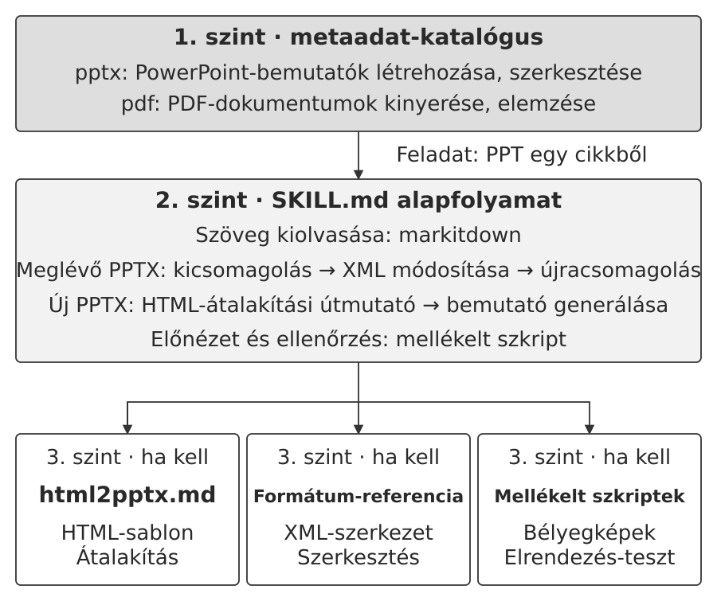

### Skills: a szakterületi képesség összeállítható egységei

Az **Agent Skills** egy feladattípus kezelési módját, referenciaanyagait, szkriptjeit és sablonjait csomagolja újrahasznosítható egységbe. Az új munkatársnak nem kell a belépés napján az egész cég kézikönyvét fejből megtanulnia, és a modell is akkor olvashatja el részletesen a vonatkozó fejezetet, amikor a munka odaér. Ezt a betöltési módot **fokozatos feltárásnak (Progressive Disclosure)** nevezzük[^ch2-3].

Az 1. fejezet tíz termékén gondoljuk végig, mely információk érdemesek arra, hogy Skillként megírjuk őket. Tegyük fel, hogy a felhasználó a szállítási költséggel együtt fizetendő árat szeretné összehasonlítani: elég, ha a tételek és az aktuális szállítási cím bekerülnek a kontextusba. Ha viszont a csapat rendszeresen végez kereskedők közötti ár-összehasonlítást, akkor a specifikációk összehangolásának, az egységár és a csomagár megkülönböztetésének, valamint az ismeretlen szállítási költség jelölésének módját érdemes egy árösszehasonlító Skillbe rendezni. Amikor legközelebb valaki csak a kínálatot szeretné átnézni, a katalógus továbbra is látszik, a teljes árazási folyamatot pedig csak akkor töltjük be, amikor a felhasználónak tényleg árat kell összehasonlítania.

**Az első szint a metaadat.** Minden Skill önmagát egy `SKILL.md` fájllal írja le; a fájl elején, `---` sorokkal határolva, YAML frontmatter található, benne a `name` és a `description`. A futtatókörnyezet először a nevekből és leírásokból katalógust állít össze, hogy a modell eldönthesse, mely Skillekre van szükség az aktuális feladathoz. A katalógus elrendezését és megjelenítését a Harness kezeli, a teljes folyamatot pedig a kiválasztás után tölti be.

**A Skill leírását mindenekelőtt útválasztási feltételként kell megírni.** A modellnek még a törzsszöveg betöltése előtt el kell döntenie, használja-e a Skillt, ezért a `description` először azt mondja meg, mikor alkalmazandó és mikor nem, és csak utána foglalja össze, mire képes. A „help with backend” például túl széles: szinte minden háttérrendszeri feladatra illeszkedhet; a „meglévő HTTP-interfészhez integrációs tesztek írása, lefedve a hitelesítést, a paraméterellenőrzést és a hibaüzeneteket” viszont világos határt ad. A könnyen összetéveszthető feladatoknál kizárási feltétel is hozzáadható, például „ha csak az interfésztervről van szó, nem szükséges használni”.

**A második szint a központi folyamat.** A Skill kiválasztása után a futtatókörnyezet a teljes utasításcsomagot a kontextusba teszi. Ha a felhasználó kifejezetten egy `/pptx` típusú parancsot ír be, a kliens közvetlenül megkeresheti és betöltheti a Skillt; amikor a modell maga választ, egy Skill-eszközzel vagy fájlolvasó eszközzel juthat hozzá a tartalomhoz. Az előbbi esetben elmarad a modell aktiváló hívása, az utóbbiban a választás és a betöltés is a futtatási trajektóriában marad.

A könyv kísérleteiben használt PPTX Skill például a központi leírásban bemutat néhány gyakori útvonalat: a bemutató szövegének kinyerését a Microsoft markitdown eszközével, a PPTX kicsomagolását az alatta lévő XML megtekintéséhez, valamint a bemutató létrehozásához és szerkesztéséhez tartozó munkafolyamatok kiválasztását. Miután a modell ezt a szintet elolvasta, a feladat alapján eldöntheti, melyik anyagot olvassa be következőnek, és milyen szkriptet hívjon meg[^ch2-4].

**A harmadik szint a részletes anyagok.** Az összetett műveletek külön dokumentumokban oszlanak el, a fő fájl csak a belépési pontot adja. A könyvben használt változat `html2pptx.md` fájlja azt magyarázza meg, hogyan lehet HTML-ből bemutatót készíteni, a többi referenciadokumentum pedig a formázás és a szerkesztés részleteit egészíti ki. Az ügynök a feladat szerint olvassa tovább ezeket, és a csomagolt szkriptekkel, anyagokkal és sablonokkal végzi el a műveletet.

[^ch2-3]: Anthropic, Equipping Agents for the Real World with Agent Skills, 2025; Agent Skills, How to add skills support to your agent.
[^ch2-4]: Anthropic, PPTX Skill. A könyv kísérletei rögzítetten a HTML-átalakítási folyamatot tartalmazó változatot használják; a pontos verziót és a futtatás módját a kísérlethez tartozó README tartalmazza.
[^ch2-codex-skills]: OpenAI, Build skills; a Skills megvalósítása az OpenAI Codex nyilvános repójában.
[^ch2-cc-skill-inject]: Claude Code, How Claude Code uses prompt caching, Invoking skills and commands; Agent Skills, How to add skills support to your agent, User-explicit activation.

### Hogyan írjunk használható Skillt

Egy használható Skill négy kérdésre válaszol: milyen feladatokra vonatkozik, milyen sorrendben kell eljárni, mely esetekben kell megerősítést kérni, és hogyan lehet megállapítani, hogy a munka elkészült. Az írónak a saját tapasztalatait végrehajtható lépésekké kell rendeznie, és a kulcsdöntéseket példákkal kell alátámasztania.

Vegyük az írásról szóló Skillt: kiindulhatunk abból a megközelítésből, amellyel Baoyu a saját kifejezésmódjából kiindulva javítja az MI által írt szöveget[^ch2-baoyu-remove-ai-writing-flavor], a tartalmat pedig négy részre oszthatjuk:

- **Szerep és olvasóközönség**: kinek írunk, milyen feladattípusra, és milyen elvárásoknak kell megfelelnie a kész szövegnek.
- **Alapelvek**: először három-öt gyakori ítélet, mindegyikhez egy konkrét, előtte-utána példa.
- **Gyakori hibák és határok**: az előforduló megfogalmazási problémák, a jogosultságot túllépő műveletek és a kivételek.
- **Referenciaanyagok**: szószedet, sablonok, mintaszövegek és célzott magyarázatok, amelyeket a végrehajtás során lehet átnézni.

A szabályokat „érvényességi kör, művelet, kivétel, ellenőrzési mód” szerint is meg lehet írni. Egy hosszú mondat tömörítésére vonatkozó szabálynak például meg kell mondania, milyen bekezdésekre vonatkozik, hogyan kell felbontani a mondatot, és a felbontás után hogyan kell ellenőrizni, hogy a feltétel és a következtetés hiánytalan maradt-e.

Kezdetnek válasszunk három-öt olyan saját írást, amellyel elégedettek vagyunk, és kérjük meg az ügynököt, hogy foglalja össze a szóhasználatot, a mondatszerkezetet, a bekezdések elrendezését és a hangvételt, majd készítsen belőle egy húszsoros első változatot. Utána adjunk neki egy új témát, és a szerző mondatról mondatra javítsa a szöveget. A javítások különbségei konkrétabb visszajelzést adnak: mely szavak feleslegesek, mely mondatokat kell felbontani, hol hiányzik tény, és hova kell visszatenni a technikai részleteket. A visszatérő javításokat érdemes szabályokká alakítani, a hozzájuk tartozó példákkal és érvényességi körrel együtt.

A Skillhez végrehajtó eszközök és sablonok is tartozhatnak. A PPTX Skill például a használati útmutatót, a feldolgozó szkriptet, a generáló szkriptet és az elrendezési anyagokat együtt tartja, hogy a modell az útmutatót követve hívhassa meg a megfelelő erőforrásokat. Minden Skill önállóan tesztelhető, frissíthető és verziózható, a csapat tagjai pedig ugyanazon folyamat köré folyamatosan gyűjthetik a tapasztalatokat. **A Skills hosszú távú értéke abban rejlik, hogy a szakterületi tapasztalat szétszórtan halmozható fel, önállóan publikálható és újrahasznosítható.** Amikor egy csapat bővíti az ügynök képességeit, mindenki a saját erősségéhez tartozó Skilleket tarthatja karban, és fokozatosan kialakulhat egy, a pip vagy az npm világához hasonló csomag-ökoszisztéma. Ezek a Skillek közösen használhatják a fő rendszer által biztosított felderítési, betöltési és végrehajtási mechanizmust.

**Az interakció tervezésénél érdemes a modell által már megtanult és begyakorolt mintákat követni.** A szerepek felosztása, az eszközeredmény formátuma és a Skill betöltésének módja egyaránt befolyásolja, hogyan folytatja a modell a feladatot. A gyártók által kínált szabványos folyamat jó kiindulópont lehet, mert csökkenti azt a terhet, hogy a modellnek egy ismeretlen formátumból kell újra kikövetkeztetnie a jelentést.

[^ch2-baoyu-remove-ai-writing-flavor]: Baoyu, „Ne promptokkal próbáld eltüntetni az MI-ízt, rossz az irány”, 2026-02-14.

### A Skills helye a kontextusban

A Skills kontextusköltsége két részből áll: a katalógusból és a törzsszövegből. A katalógus segít felderíteni az elérhető képességeket, a törzsszöveg pedig a kiválasztás után adja meg a működés menetét. A specifikáció igény szerinti betöltést ír elő, a konkrét üzenetszerepeket, a becsomagolást és a frissítés módját pedig a Harness valósítja meg.

A Claude Code a hívás helyén `user` üzenetként illeszti be a Skill utasításait a beszélgetésbe[^ch2-cc-skill-inject]. A 2-12. ábra a modell által önállóan kiváltott egyik üzenetelrendezést mutatja: először a `Skill(skill: "pptx")` hívás indul, majd megérkezik az eszközválasz, végül a modell elolvassa a hozzáfűzött Skill-törzsszöveget. Külön aktiváló eszköz használatakor az eszközválasz jelezheti a hívás nyugtázását, a törzsszöveget pedig a Harness külön injektálja; közönséges fájlolvasó eszköznél a törzsszöveg közvetlenül az eszközeredményben is szerepelhet. Amikor a felhasználó kifejezetten `/pptx` parancsot ír be, a kliens közvetlenül kifejtheti az utasításokat, így elmarad a modell aktiváló hívása.

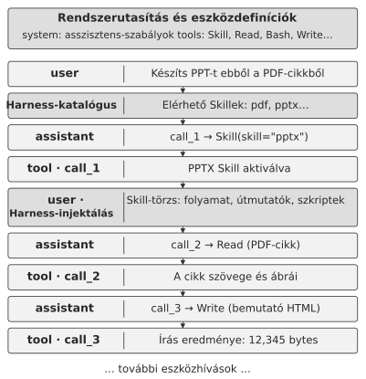{height=55%}

A Codex Skills-megvalósítása szintén külön szervezi a képességkatalógust és a kiválasztott utasításokat. A nyilvános forráskódban a katalógus egy része a `developer` kontextusba kerül, más részei az aktuális körrel és a végrehajtási környezettel együtt jutnak el a modellhez; a kifejezetten kiválasztott Skill pedig a felhasználói kontextus töredékén keresztül kerül be. A katalógus forrása és az elérhető végrehajtási környezet befolyásolja a pontos elrendezést[^ch2-codex-skills].

A 2-13. ábra az igény szerinti betöltés során növekvő gyorsítótárat mutatja, kiindulópontként egy olyan kérést véve, amelynél még nincs újrahasznosítható gyorsítótár. A katalógus első bekerülése a kérésbe feldolgozást igényel, a törzsszöveg első betöltése szintén növeli a számítást; amikor a későbbi kérések ugyanazt az előtagot tartják meg, ezek a tartalmak a gyorsítótárból olvashatók. Ha az új tartalmat a hívás helyére fűzzük, a korábbi üzenetek változatlanok maradhatnak. A már betöltött magyarázatok továbbra is az előzményben maradnak, frissítésükről pedig a futásidejű kontextusstratégia szerint kell gondoskodni.

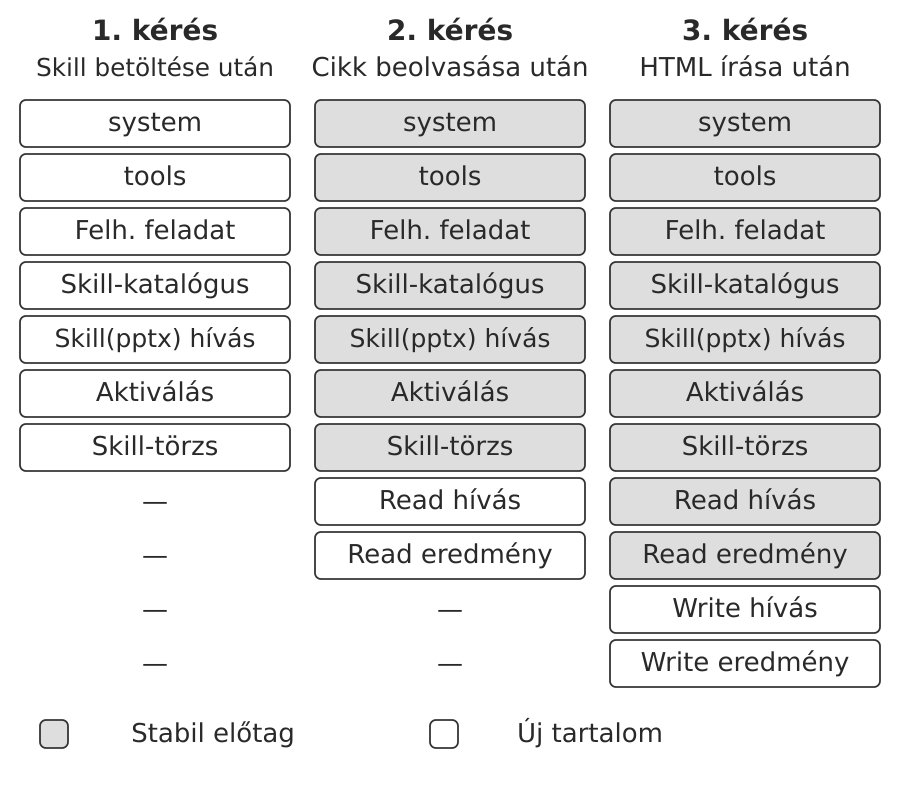

### A Skills és az eszközök kapcsolata

A Skill feladat-tudást és működési folyamatot ad, az eszközök olvasnak, hajtanak végre és szolgáltatnak eredményt. Az 5. fejezetben bemutatott hét alapeszköz különböző Skillekkel kombinálható: ugyanaz a fájlolvasó eszköz elolvashatja a bemutatókészítési útmutatót éppúgy, mint a kódkonvenciókat; az általános végrehajtó pedig futtathatja a megfelelő szkripteket. Így a szaktudás folyamatokkal és erőforrásokkal bővíthető, miközben az alapeszközkészlet viszonylag stabil marad.

A célzott eszközök is együttműködhetnek a Skillekkel. A korábban tárgyalt eszközkeresés az eszközdefiníciókat adja meg igény szerint, a Skill pedig megmondja, mikor kell hívni őket, hogyan kell összekapcsolni őket, és hogyan kell az eredményeket ellenőrizni. Mindkettőnél kontrollálni kell az állandóan jelen lévő információ mennyiségét, és megfelelő helyet kell találni az újonnan betöltött tartalomnak. A 4. fejezet az általános végrehajtó és a célzott eszközök közötti választást tárgyalja, a 9. fejezet pedig azt, hogy egy tapasztalatot érdemes-e tudásként, utasításként, programként vagy modellparaméterként megőrizni.

> **2-6. kísérlet ★★: Előadás készítése tanulmányból az Agent Skills segítségével**
>
> Ez a kísérlet az *Attention Is All You Need* tanulmányt használja anyagként, és bemutatja, hogyan tölti be az ügynök igény szerint az előadáskészítés szakmai folyamatát. A feladat, hogy a tanulmány PDF-jéből tíz-tizenöt oldalas előadás készüljön, amely lefedi a probléma hátterét, a módszert, a kulcsfontosságú eredményeket és a következtetéseket, és a tanulmány ábráival, táblázataival segíti a magyarázatot.
>
> Az idézett futás a Kimi Code-ot és az Anthropic hivatalos PPTX Skilljét használta. Az ügynök először a katalógusban megtalálta a PPTX Skillt, elolvasta a használati útmutatóját, tovább olvasta a HTML-átalakítási útmutatót, meghívta a hozzá tartozó generáló eszközt, végül bélyegképek és oldalankénti renderelés segítségével ellenőrizte az elrendezést. Minden lépésben a beolvasott anyag a következő műveletet szolgálta, és a teljes készítési folyamat a feladattal együtt bontakozott ki.
>
> A kész bemutató tizenhárom oldalból áll, és hivatkozik a tanulmány architektúraábrájára, figyelmi mechanizmus ábrájára, kísérleti eredménytáblázatára és figyelmi vizualizációs ábrájára.
>
> A generálás utáni ellenőrzés is a Skill munkafolyamatának része. Ebben a futásban hiányzó alsó index, hibás felsorolásjel, rossz ábrahivatkozási útvonal és pontatlan számfelirat is előfordult, az ügynök pedig a renderelés eredménye és a szerkezeti ellenőrzés alapján tételesen javította őket. A végleges fájl átment a szerkezeti ellenőrzésen, és a LibreOffice-ban újra megnyitva, újrarenderelve is helyesnek bizonyult.

> **2-7. kísérlet ★★: „MI-szagmentesítő” írási Skill készítése saját szövegekből**
>
> Ez a gyakorlat a személyes írásmódbeli tapasztalatot alakítja újrahasznosítható utasításokká. Készítsünk elő három-öt saját írást, és kérjük meg az ügynököt, hogy foglalja össze a kifejezésmód jellemzőit, majd készítsen egy első változatot, amely tartalmazza a kiváltási feltételeket, három-öt alapelvet és a hozzájuk tartozó példákat.
>
> Válasszunk egy új témát, írjunk vele próbát, majd a szerző mondatról mondatra javítsa a szöveget. A két változatot összevetve kereshetjük a visszatérő problémákat, például az üres szóhasználatot, a túl hosszú mondatokat, a kimaradó oksági viszonyokat, vagy azt, hogy eltűnt egy, a megértést segítő konkrét példa. A visszatérő javításokat be lehet írni a Skillbe.

## Ügynöki állapotsáv: a trajektória kezelése metainformációkkal

A felhasználó sürget: „nem tudnál még egyszer felhívni?” A 2-14. ábra bal oldala három tárcsázást rögzít. Az elsőnél 45 percet várt, de nem kapcsolták, a harmadikra sikerült 59 dolláros havidíjat kialkudni. A példa szabályai szerint minden tárcsázás egy próbálkozást használ el; ha csak kétszer sikerült kapcsolatot létesíteni, a három próbálkozás így is elfogyott. A Harness az ilyen számlálókat, az ügyintézés előrehaladását és a megerősítésre váró tételeket üzenetről üzenetre frissülő összefoglalóvá rendezheti, amelyet **ügynöki állapotsávnak (Agent Status Bar)** nevezünk.

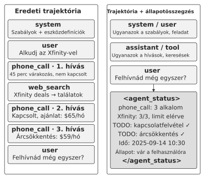

A telefon a képernyő tetején mutatja az időt, az akkumulátor és a hálózat állapotát, és egy pillantás elég, hogy lássuk, hol tartunk. Az ábra jobb oldalán lévő összefoglaló hasonló szerepet játszik: az asszisztens az „elértük a felső határt” és a „felhasználói megerősítésre vár” állapotból meg tudja mondani a felhasználónak a kialkudott árat, és megkérheti, hogy döntsön az elfogadásáról. A Harness az eszközeredmény visszaadásakor mellékelheti az összefoglalót, vagy külön állapotüzenetként is hozzáfűzheti.

### A nyers feljegyzésektől az explicit állapotig

Vegyünk egy telefonos ügyfélszolgálati feladatot: a rendszer előírja, hogy egy feladaton belül minden kereskedőt legfeljebb háromszor szabad felhívni. A három beszélgetés között keresés, anyagolvasás és a felhasználó visszakérdezése is közbejöhet. Ahhoz, hogy a modell eldönthesse, hívhat-e még, az előzményből ki kell gyűjtenie a vonatkozó feljegyzéseket, meg kell különböztetnie a kereskedőket, és össze kell számolnia a hívásokat.

A futtatókörnyezet minden hívás után frissítheti a számlálót, és közvetlenül visszaadhatja: „ez a harmadik hívás az Xfinity felé ebben a feladatban, elértük a felső határt”. A következő döntés már ezt az eredményt használhatja. A hívások számát a program tartja nyilván; a modell a feladat előrehaladásával együtt dönti el, hogy várjon-e, keressen-e más csatornát, vagy tájékoztassa-e a felhasználót; a végrehajtó réteg pedig ugyanezt a számlálót használja a későbbi tárcsázási kérések ellenőrzésére.

A mérnöki hozzáadott érték itt az, hogy **a későbbi döntésekhez ismételten szükséges állapotot előre összerendezzük**. A teljes hívásfeljegyzés továbbra is a beszélgetések tartalmát és az ügyintézés menetét őrzi, az állapotsáv pedig a döntésekhez gyakran használt statisztikát és előrehaladást adja. **Az ismételten használt statisztikát lehetőleg kóddal, növekményesen kell karbantartani.** Egy bejegyzést megtalálni a kontextusban, és az összes bejegyzésből összesíteni az összeget, két különböző munka. Az eredeti trajektória megőrzése nem ad automatikusan pontos, bármikor kézre eső statisztikát. Ha minden alkalommal a modellnek kell újra végigolvasnia és megszámolnia, az nemcsak érvelési tokeneket emészt fel, hanem növeli a kihagyás és a kétszeres számolás esélyét is.

Én a kontextust egy „finomító réteggel” kiegészülő keresőmotorhoz hasonlítom: a nyers feljegyzés jól visszakövethető, a finomított állapot pedig közvetlenül használható. A számlálókat, a limiteket és az igazolt feladatállapotot érdemes kóddal karbantartani; a szemantikai ítéletet igénylő információknál előbb tételesen kinyerhetjük az adatokat, majd összesíthetjük és igazolhatjuk őket. Így a modell minden döntésnél egyszerre látja az aktuális állapotot és a szükséges bizonyítékokat.

A hosszú trajektória megnehezíti a kulcsfontosságú információk megtalálását is. Ha a legfrissebb célt, korlátokat és előrehaladást a végén, egy helyen tartjuk, a modell könnyebben megtalálja az aktuális döntéshez szükséges információt.

> **2-8. kísérlet ★★: Az ügynöki állapotsáv hatásának megfigyelése figyelmi vizualizációval**
>
> Ez a kísérlet a Qwen3-0.6B modellel egy ügyfélszolgálati visszatérítési trajektóriát épít fel: az ügynök már háromszor felhívta az Xfinityt, közben webes keresést is végzett, majd a felhasználó visszakérdez: „nem tudnád még egyszer felhívni őket, hogy sürgesse őket?” A rendszer szabályai egy feladaton belül kereskedőnként legfeljebb három hívást engednek.
>
> A két bemenet ugyanazt az előzményt és ugyanazt a felhasználói visszakérdezést tartalmazza. Az A csoport a nyers trajektóriát használja; a B csoport a végére illeszti a következő állapotot:
>
> ```xml
> <agent_status>
> Current State:
> - Tool call summary: 'phone_call' has been invoked 3 times (Xfinity: 3 times)
> - Constraint check: Maximum calls to Xfinity reached (3/3)
> </agent_status>
> ```
>
> Mindkét csoport háromszor futott. Az A csoport kétszer egyértelműen elutasította a további tárcsázást, egyszer más kimenetbe sorolódott; a B csoport mindhárom esetben egyértelműen elutasította. Egyik csoportban sem született olyan kimenet, amelyet szabálysértő további tárcsázásnak minősítettek volna. Az összehasonlítás megismétléséhez lépjünk be a `chapter2/attention_visualization` könyvtárba, és futtassuk a `python run_status_bar_experiment.py --output runs/status-bar-reproduction` parancsot. A futás bemenete és esetenkénti eredményei a kísérletkönyvtár `runs/exp2-7-qwen3-0.6b-20260730-v2/comparison.json` fájljában találhatók.
>
> A figyelmi ábra a generált tartomány súlyeloszlását mutatja a korábbi hívásokra, a keresési eredményekre, a felhasználói visszakérdezésre és az állapotsávra.

A Noah Shi-jal közösen végzett ContextDistill-Bench kutatásunk tovább vizsgálta az előre finomított állapot előnyeit[^ch2-8]. A benchmark által lefedett állapotlekérdezéseknél a kisebb modellek is magasabb pontosságot értek el az explicit állapot révén; az élvonalbeli modellek gondolkodási mennyisége, késleltetése és lekérdezési költsége pedig körülbelül egy nagyságrenddel csökkent. A Claude 4 Sonnet például ezer lekérdezésenként mintegy 35,46 dollár helyett 3,51 dollárba került. **Ez a kialakítás az esemény bekövetkezésekor tartja karban az állapotot, így elkerülhető, hogy minden lekérdezésnél végig kelljen menni az előzményen.** Ha az összefoglaló mezői rögzítettek, az előzmény további növekedése esetén is elég ezt a néhány mezőt elolvasni.

[^ch2-8]: Li, Bojie and Noah Shi. *Distill, Don't Retrieve: Inference-Time Context Distillation for LLM Agent Reasoning.* 2026.

### Az ügynöki állapotsáv felépítése

Az állapotsáv rendszerint háromféle információt tartalmaz, amelyek rendre azt válaszolják meg, hogy „mit kell tenni”, „mi történt az imént” és „most milyen állapotban vagyunk”.

**A feladatterv** a célt, a lépéseket és azok teljesítését rögzíti. Egy összetett feladat TODO-listára bontható, minden tételnél megőrizve az állapotot és a szükséges függőségeket. Amikor a modell az aktuális lépéssel foglalkozik, továbbra is látja az eredeti igényt, a központi korlátokat és a hátralévő munkát; egy lépés befejezése után pedig frissíti a listát.

**Az események mellékcsatorna-információi (side-channel information)** kiegészítik az esemény bekövetkezésének körülményeit, például az időpontot, a helyszínt és az előző válasz óta eltelt időt. Ezek a metaadatok az eseménnyel együtt őrződnek meg, és segítenek a modellnek megérteni a sorrendet és a szituációt. Ugyanaz a „még nem érkezett válasz” mondat egészen más kezelést igényelhet, ha a kérelem beadása után két perccel hangzik el, mint ha két nappal később.

**A környezet aktuális állapotának megfigyelési összefoglalója** megadja a pontos időt, a munkakönyvtárat, az eszközhívások számát és a rendellenességekre vonatkozó figyelmeztetéseket. Szerepe hasonló ahhoz, ahogy a CLI vagy a grafikus felület megjeleníti az aktuális könyvtárat vagy futási állapotot: világos alapot ad a következő művelethez. Az ismételt hívásra vonatkozó figyelmeztetés például a hiba okának vizsgálatára ösztönözheti a modellt, a fennmaradó költségkeret pedig segít eldönteni, folytassa-e a keresést.

Az esemény-metaadatok az eseményhez fűzve rendszerint stabilak maradnak, a feladat előrehaladása és a környezet állapota viszont folyamatosan változik. A kétféle információt a saját frissítési módja szerint kell az előzménybe írni; ezt az alábbiakban az üzenetszerkezet mentén mutatjuk be.

### Az ügynöki állapotsáv konkrét helye a kontextusban

E szakasz példájában a Harness az üzenetlista végére fűz egy `user` üzenetet, amely az állapotösszefoglalót közvetíti. A `user` itt a választott API üzenetszerepe; az állapot tartalmát a futtatókörnyezet állítja elő, és címkékkel jelöli a rendeltetését. Más interfészeknél használhatjuk az általuk támogatott kontextusblokkot, vagy az állapotot a megfelelő eszközeredménnyel együtt is átadhatjuk. Ha a korábban tárgyalt sablont használjuk, amely a valódi felhasználói kérdés helye alapján vágja ki a korábbi érvelést, a futási állapotot az eszközeredménnyel együtt adhatjuk át, így a sablon továbbra is a jelenlegi feladat szerint őrzi meg az érvelési információkat.

A 2-15. ábrán keressük meg a felhasználó eredeti megbízását, majd nézzük meg, melyik körhöz került a legfrissebb állapot. Az eredeti kérést meg kell őrizni, hogy a hívás után egyszerre lehessen ellenőrizni két dolgot: mit szeretne elintézni a felhasználó, és hol tartunk most.

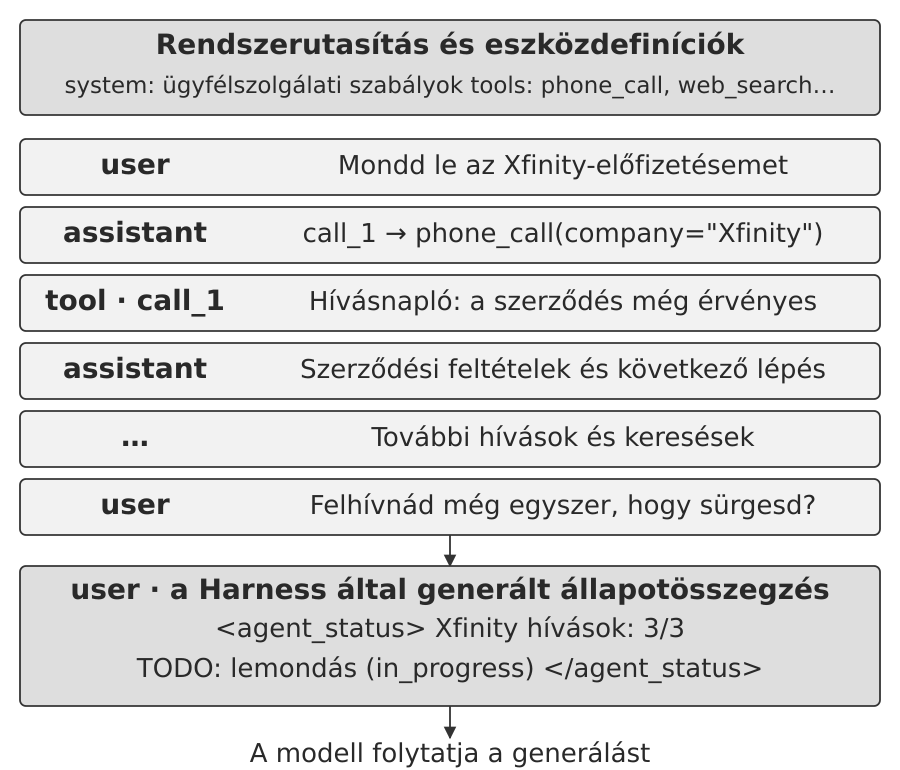

Az ábra szerinti sorrendet üzenetlistaként a következőképpen írhatjuk fel. Az összehasonlíthatóság kedvéért itt elhagyjuk az ismétlődő köröket és a hívások egyes mezőit.

```text
messages: [
  { role: "system", content: "You are a customer service assistant..." }
  { role: "user", content: "Help me cancel my Xfinity plan" }
  { role: "assistant", tool_calls: [{ id: "call_1", ... }] }
  { role: "tool", tool_call_id: "call_1", content: "Call log..." }
  { role: "assistant", tool_calls: [{ id: "call_2", ... }] }
  { role: "tool", tool_call_id: "call_2", content: "Call log..." }
  ...a többi kör...
  { role: "user", content: "Can you call them again to follow up?" }
  { role: "user", content: "<agent_status>
      Current State:
      - phone_call invoked 3 times (Xfinity: 3/3 max)
      - Current time: 2025-09-14 10:30:45
      - TODO: [1] Cancel plan (in_progress)
    </agent_status>" }
]
```

Az utolsó üzenet egy helyen gyűjti össze a hívások számát, a felső határt, az időt és a feladat előrehaladását. A modell közvetlenül használhatja ezeket a mezőket, és a korábbi hívásazonosítókon keresztül visszakeresheti a konkrét feljegyzéseket.

Ennek az üzenetnek a hozzáfűzése után a korábbi tokensorozat változatlan marad, és továbbra is teljesíti az előtag újrahasznosításának alapfeltételét. Hogy a következő kör mit kezd a régi állapottal, az a kontextusfoglaltság és a gyorsítótárköltség közötti mérlegelés kérdése.

### Az állapotfrissítés két megvalósítása és a gyorsítótár költsége

A következő körben egy TODO teljesülhet, de egy eszközhívás is hozzáadódhat. A Harnessnek frissítenie kell az állapotot; erre két gyakori mód kínálkozik.

**Körönkénti csere**: az új kérés összeállításakor eltávolítjuk az előző állapotot, és a végére tesszük a legfrissebbet. A kontextusban csak egyetlen aktuális állapot marad, ami megkönnyíti a modell dolgát. Ha például az előző kérés „feladatleírás, A állapot” volt, a mostani „feladatleírás, eszközeredmény, B állapot”. A feladatleírás továbbra is gyorsítótár-találatot ad; az eszközeredmény első benyújtáskor amúgy is számítást igényel. Ha az előző kérésben az A állapot után további üzenetek is voltak, ezek csak az A eltávolításakor veszítik el az eredeti előtag-egyezést. A modell ebben a kérésben csak B-t láthatja. Ha vissza kell nézni az A-t, a futtatási naplóból előkereshető az akkori pillanatkép.

**Tartós hozzáfűzés**: megtartjuk a meglévő állapotfeljegyzéseket, és minden körben a végére fűzzük az újat. Az előzmény előtagja stabil marad, és az állapotváltozások is könnyen visszakövethetők. A régi állapotok fokozatosan foglalják a kontextust, ezért meg kell adni az időt vagy a verziót, hogy a modell a legfrissebb feljegyzés alapján ítélje meg az aktuális helyzetet. A Claude Code azon megoldása, hogy a fájlváltozási figyelmeztetéseket hozzáfűzi a beszélgetéshez, szintén ezt a tervezési elvet tükrözi.

Ha az állapot rövid, és utána már sok eszközeredmény van gyorsítótárazva, a régi állapot megtartása kevesebbe kerülhet, mint a hosszú utótag újraszámítása; ha viszont az állapot hosszú és gyakran frissül, a csere kordában tartja az előzményben felhalmozott állapotok mennyiségét.

Egy durva modellel megbecsülhető a döntési pont: legyen minden állapot $S$ token, a cserénél a régi állapot után újraszámítandó, átlagosan $R$ tokennyi gyorsítótárazott utótag (az adott körben elsőként benyújtott tartalom nélkül), összesen $N$ alkalommal injektálunk állapotot, a gyorsítótárazott bemenet ára pedig a normál bemenet $\alpha$-szorosa. A két megoldás közös költségeit elhanyagolva $C_{\text{csere}} \approx (N-1)(1-\alpha)R$, $C_{\text{hozzáfűzés}} \approx \alpha S N(N-1)/2$. Ha $N>1$, akkor $\alpha SN/2 < (1-\alpha)R$ esetén a tartós hozzáfűzés becsült költsége kisebb; ellenkező esetben a körönkénti csere takarékosabb. Itt a normál bemenet árát vesszük költségegységnek: a csere esetén a felár az utótag gyorsítótár-olvasás helyett újrafeldolgozásából adódik, a hozzáfűzésnél pedig a korábbi állapotok ismételt olvasásából.

Például injektáljunk körönként 100 tokennyi állapotot, összesen tízszer, a gyorsítótár olvasását a normál bemenet tizedeként számolva. A hozzáfűzéses megoldás a későbbi kérésekben rendre 1, 2, …, 9 régi állapotot olvas be pluszban, ami 450 normál bemeneti tokennek megfelelő többletköltség. Ha egy állapotcserével átlagosan 1000 gyorsítótárazott token újrafeldolgozását váltjuk ki, a kilenc csere 8 100 normál bemeneti tokennek megfelelő többletköltséget jelent, így a hozzáfűzés a takarékosabb. Ha viszont a régi állapot eleve a gyorsítótár végén van, és utána nincs semmilyen gyorsítótárazott tartalom, a képletben $R=0$, és a közvetlen csere épp megtakarítja a 450 tokennek megfelelő költséget.

> **2-9. kísérlet ★★: Néhány jól használható ügynöki állapotsáv-technika**
>
> Ez a kísérlet öt állapotsáv-technikát valósít meg, amelyek külön-külön bekapcsolhatók, de kombinálhatók is. Mindegyik technika egyfajta konkrét információt nyújt, és segít a modellnek eldönteni a következő lépést.
>
> **Időbélyeg-követés** a felhasználói üzenetekben és az eszközválaszokban rögzíti az események időpontját, például `[2025-09-14 10:30:45]` formában. Az idő az eseménnyel együtt kerül az előzménybe, és a későbbi körökben megőrzi az eredeti értékét; az aktuális időt viszont az új állapotüzenetek frissítik. A kísérlet időszimulációt is kínál annak ellenőrzésére, hogy a modell meg tudja-e különböztetni a „tegnapi fájlt” a „mai módosítástól”, és helyesen értelmezi-e a várakozási időt.
>
> **Eszközhívás-számláló** szótárban tartja nyilván minden eszköz kumulált hívásainak számát, és a válaszban megjelöli: `Tool call #3 for 'read_file'`. A hiba tartalmával együtt a modell eldöntheti, folytassa-e a próbálkozást. Ha például az első olvasás elbukik, ellenőrizheti az útvonalat, majd kilistázhatja a könyvtárat; ismételt sikertelenség után pedig kereshet másik fájlt, vagy elmagyarázhatja a felhasználónak a hiányt. Ha korlátozni kell az újrapróbálkozásokat, a futtatókörnyezetnek a számláló alapján érvényesítenie kell a felső határt is.
>
> **TODO-listakezelés** két eszközt kínál: `rewrite_todo_list` és `update_todo_status`. Minden tétel egyedi azonosítót, tartalmat, időbélyeget és négy lehetséges állapotot tartalmaz: `pending`, `in_progress`, `completed`, `cancelled`. A lista egy helyen tartja nyilván, „mi történt meg, és mi hiányzik még”; ez hasonló ahhoz az elvhez, ahogy a Manus ismételt bemutatással tartja láthatóvá a feladattervet.
>
> **Részletes hibaüzenetek** megadják a hiba típusát és leírását, a hívási paraméterek JSON-jét, a hívási vermet és a javítási javaslatokat. Ha például `FileNotFoundError` történik, a modell ellenőrizheti a fájlnevet, az aktuális könyvtárat és az abszolút útvonalat. A paraméterek segítenek beazonosítani a hibás bemenetet, a hívási verem a hiba helyét, a javítási javaslat pedig a következő ellenőrzési irányt adja meg. Mielőtt ezeket a modellnek visszaadjuk, ki kell szűrni a hitelesítő adatokat és hasonló érzékeny mezőket, és korlátozni kell a hosszú hívási vermek méretét.
>
> **Rendszerállapot-érzékelés** megadja az aktuális időt, a munkakönyvtárat, az operációs rendszert, a shellt és a Python verzióját. A kísérlet parancseszköze felismeri az önálló könyvtárváltást, frissíti a futtatókörnyezet által nyilvántartott munkakönyvtárat, és a későbbi hívásoknál azt használja; összetett parancsokban az alprocesszek könyvtárváltozása a megfelelő folyamat érvényességi körét követi. A környezeti mezők abban is segítenek, hogy a modell a megfelelő eszközt válassza, például a tényleges rendszer és a telepített szoftverek alapján az `apt` vagy a `brew` parancsot.
>
> Ebben a Kimi K3-mal végzett összehasonlításban feladattípusonként öt-öt eset volt. Az időbélyeg és a kombinált beállítás öt tételt teljesített, a kontrollcsoport hármat; az eszközhívás-számlálónak és a rendszerállapotnak a be- és kikapcsolt változata egyaránt ötöt. A TODO-beállítás nulla tételt teljesített, a kontrollcsoport egyet; a részletes hibaüzenetek beállítása négyet, a kontrollcsoport ötöt.

**Az állapotsávot lehetőleg kóddal kell karbantartani.** A modell közvetlenül felhasználja benne a statisztikákat és korlátokat, és egyetlen hibás „már háromszor hívtunk” bejegyzés is megváltoztathatja a további műveleteket. A számlálást, az időt és az állapotátmeneteket bízzuk a programra; ahol szemantikai megértés kell, előbb a modell gyűjtse ki tételesen az adatokat, majd a kód összesítse és ellenőrizze őket, így elkerülhető, hogy a modell egy hosszú előzmény egészéről egyszerre számoljon. Az eredeti események, a kinyert adatok és a végleges állapot között tartsuk meg a megfelelési viszonyt, hogy a kétszeres számolás, a kihagyás és a források összekeveredése felismerhető legyen.

Azt, hogy az állapotsáv mely információkat foglalja össze, előre ki kell választani. A „már háromszor hívtunk” például elég annak eldöntésére, hogy hívhatunk-e még, de nem válaszol arra, hogy „mit ígért az ügyintéző a második beszélgetésben”. Azoknál a későbbi feladatoknál, amelyeknek csak statisztikai értékre van szükségük, az állapotösszefoglaló helyettesítheti az előzményt, az eredeti feljegyzéseket pedig archiválhatjuk; ha a beszélgetés tartalmát is ellenőrizni kell, az index alapján előkereshető az eredeti szöveg. Az összefoglaló mezőinek tervezése dönti el, mely kérdésekre lehet közvetlenül válaszolni, és mikor kell visszanyúlni a forráshoz.

## Kontextustömörítési stratégiák

Egy kutatási feladat már tíz hosszú weboldalt olvasott be, és tegyük fel, hogy az ablakba már csak két további anyag fér. Először kérdezzük meg, mit kell még tennie a modellnek a következő körben: ha két árajánlatot kell összevetnie, megtartjuk az árajánlatot, az érvényességi feltételeket és a forrást; ha idézeteket kell ellenőriznie, megtartjuk azt a helyet, ahonnan az eredeti szöveg visszakereshető. A már átnézett, de irreleváns weboldalak szövegét archiválhatjuk, hogy helyet szabadítsunk fel az új bemenetnek és a kimenetnek. Ilyenkor nemcsak azt kell kiszámolni, mennyi helyet nyertünk, hanem egy másik mérleget is: ha a törölt anyagra később mégis szükség lesz, mennyibe kerül visszaszerezni?

### A tömörítés három célja

**A hossz és a költség kordában tartása.** Egy 128K tokenes ablakban a hosszú weboldalak és nagy fájlok jelentős részt foglalhatnak el. A Harnessnek keretet kell fenntartania a későbbi bemenetek, a modell kimenete és az eszközinterakciók számára.

**A későbbi döntésekhez szükséges tudás rendezése.** Egy tucatnyi keresési kör többször is utalhat ugyanarra az eseményre, és egymásnak ellentmondó állításokat is hagyhat maga után. Ha ezt úgy rendezzük, hogy „A és B igazolt, C-hez még hiányzik bizonyíték”, a modell a nyitott kérdéseken dolgozhat tovább. Az összefoglalónak meg kell őriznie a tények közötti viszonyokat, a forrásokat és a megoldatlan kérdéseket, hogy a későbbi döntéseknek világos alapjuk legyen.

**A hosszú feladatok folyamatos előrehaladásának támogatása.** Egyes modellek, amikor úgy érzik, hogy az ablak hamarosan betelik, idő előtt lezárják a munkát; ezt a jelenséget **kontextusszorongásnak (Context Anxiety)** nevezik. Az Anthropic a Sonnet 4.5 hosszú feladatokon végzett tesztjeiben azt tapasztalta, hogy ez a viselkedés tömörítés után is előfordulhat, ezért strukturált átadási feljegyzést alkalmaztak, és a kontextus nullázása (újraindítása) után folytatták a végrehajtást[^ch2-7].

[^ch2-7]: Prithvi Rajasekaran, Harness design for long-running application development, Anthropic Engineering, 2026.

### Az ismételt számítás eredményének használható tudássá rendezése

Az állapotsáv előre karbantartja a számlálókat és az előrehaladást, az összefoglaló pedig ennél tovább megy, és a hosszú szövegekben szereplő tényeket és viszonyokat is rendezi. Mindkettő előre rendezi a szétszórt információt, hogy a későbbi döntések közvetlenül felhasználhassák.

Vegyünk egy kisállat-kereskedés ellenőrzését:

> 1. ketrec: fekete macska. 2. ketrec: fehér macska. 3. ketrec: fekete macska. 4. ketrec: fekete macska. 5. ketrec: fehér macska.
> …… (összesen 100 ketrec, ebből 90 fekete és 10 fehér macska)

Ahhoz, hogy megmondjuk, „milyen macska van a 37. ketrecben”, meg kell találni a hozzá tartozó bejegyzést; ahhoz pedig, hogy „hány fekete és hány fehér macska van”, az összes bejegyzést összesíteni kell. Ha a végösszeget később többször is használjuk, előre kiszámíthatjuk és elmenthetjük: „90 fekete macska, 10 fehér macska”, így nem kell minden alkalommal elölről számolni. Az ilyen determinisztikus összesítés a programra illik, a modell pedig a statisztika alapján válaszolhat tovább az üzleti kérdésekre.

Az összefoglaló tartalmát a feladathoz kell igazítani. Ha csak a kétféle macska számát tartjuk meg, az elég a mennyiségi kérdésekhez; ha a 37. ketrecre is válaszolni kell, ketrecenkénti feljegyzésre vagy megfelelő indexre is szükség van.

Ha az ablakban még van hely, a túl hosszú vagy kevert kontextus akkor is ronthatja az információ felhasználását: a modell kihagyhat kulcsfontosságú tényeket, újra feldolgozhatja a már megoldott problémákat, vagy elavult állapotot használhat a mostani döntéshez. Az ilyen, a kontextus növekedésével járó teljesítményromlást általában **kontextusromlásnak (Context Rot)** nevezik. Ez a feladat teljesítményének romlásában mutatkozik meg; ha a kérés túllépi a kapacitáskorlátot, az már ablaktúlcsordulást vált ki.

**Az ismételten felhasznált tudást akkor is érdemes tudatosan rendezni, ha az ablakban még van hely.** Ha a kulcsfontosságú ítéleteket már össze lehetne foglalni, de a modellnek mégis újra és újra a hosszú előzményben kell keresnie őket, az folyamatosan számítást emészt fel, és növeli a kihagyás kockázatát. Egy keresési feladatban el lehet menteni az igazolt tényeket, a forrásokat és a még vizsgálandó kérdéseket; egy programozási feladatban az architektúradöntéseket, a módosítás terjedelmét, a teszteredményeket és a hibák okait.

A kontextusban szereplő példák azt is befolyásolják, hogyan kezeli a modell az új kérdéseket. Dherin és munkatársai a Transformer figyelmi rétegeinek és MLP-jeinek kombinációjából kiindulva a konkrét előremenő számítást kontextusfüggő, alacsony rangú súlyfrissítésként írták le, ami a kontextuson belüli tanulás egyik elméleti magyarázata[^ch2-6]. A tényleges következtetéskor a modell súlyai változatlanok, a példák az aktuális bemeneten keresztül hatnak a kimenetre. Ha az ilyen tapasztalatot a későbbi beszélgetésekben is újra szeretnénk hasznosítani, memóriává, példává vagy Skillé rendezhetjük, és a feladat szerint tölthetjük be; a 9. fejezet tovább tárgyalja a tapasztalatok felhalmozásának módjait.

[^ch2-6]: Benoit Dherin et al., Learning without training: The implicit dynamics of in-context learning, 2025.

### Mérlegelés a tömörítés és a KV Cache között

A tömörítés rendszerint két modellhívás között történik. A Harness a fennmaradó keret és a feladat előrehaladása alapján rendezi a következő kéréshez szükséges üzeneteket, majd elküldi őket a modellnek. Az előzmény cseréje megváltoztatja az előtagot, ezért a tömörítés előnyét és a gyorsítótár újraépítésének költségét együtt kell mérlegelni.

Először is tartsuk stabilan a továbbra is érvényes rendszerutasításokat és eszközdefiníciókat. Ezek elöl állnak, így a későbbi előzmény tömörítése mellett ez az előtagrész továbbra is újrahasznosítható. Másodszor válasszuk ki a tömörítés konkrét tárgyát: a hosszú eszközeredmények összefoglalóra cserélhetők, a már befejezett többfordulós interakciók szakaszfeljegyzéssé vonhatók össze. A cserepont előtti gyorsítótár még újrahasznosítható, a cserepontot és az utána következő tartalmat az új előtag szerint kell feldolgozni.

**Az előzmény tömörítését lehetőleg kötegekben végezzük, ne írjuk át minden körben ugyanazt az előtagszakaszt.** A tömörítés után minden kör bemenete rövidebb lesz, a tömörítő hívás és az utótag újraszámítása viszont szintén erőforrást igényel. A kiváltás időpontját az ablak foglaltsága, a várhatóan hátralévő körök száma és a feladat szakasza alapján lehet meghatározni: ha a hosszú eszközeredményeket egy csoportban rendezzük, amint összegyűltek, és egy szakasz befejezésekor átadási összefoglalót mentünk, csökkenthető az előzmény gyakori módosításának költsége. Ha a legutóbbi néhány kört megtartjuk, ellenőrizni kell, hogy az eszközhívások és a visszaadott értékek párban maradtak-e, és a félbemaradt műveletek állapotát be kell írni az összefoglalóba.

A tömörítésnél az érvelési információk visszaküldési protokollját is ellenőrizni kell. Egyes modellek korábbi thinking blokkjai ahhoz az előtaghoz kötődnek, amellyel létrejöttek. Ha ezek előtt cseréljük ki az előzményt, a megtartott thinking már nem fog illeszkedni az új előtaghoz. Ilyen protokollnál a beszélgetést összefoglalóvá rendezhetjük, töröljük az érintett régi thinkinget, és a modell az összefoglalóból gondolkodik tovább; vagy használhatjuk a szolgáltatás oldalon támogatott tömörítési és kontextusszerkesztési mechanizmust.

Nézzük meg először a 2-16. ábrán az egyenkénti összefoglalót: a feldolgozott karakterszám az eredetinek csupán 10,9%-a, a fő ügynök kumulált tokenfelhasználása mégis a hat csoport közül a legnagyobb. Hogy megértsük, hogyan állhat fenn egyszerre ez a két szám, nyomon kell követni, milyen anyagokat tömörítettünk, és ezek hány kérésben jutottak el újra a modellhez.

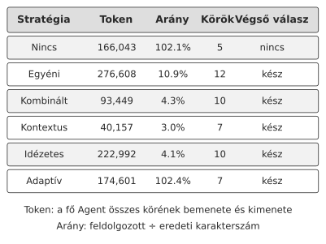

> **2-10. kísérlet ★★★: A kontextustömörítési stratégiák összehasonlítása**
>
> Ebben a kísérletben a Kimi K3 az OpenAI társalapítóinak szakmai pályáját kutatja. A feladat fokozatosan felépíti a névsort, megkeresi a személyek pályáját és pozícióváltásait, majd összekapcsolja a releváns tényeket a forrásaikkal. A tömörítés és a túlcsordulás kezelésének megfigyelése érdekében a kísérlet az alkalmazásoldali kontextuskeretet 128 000 tokenre állítja, megtart egy tömörítés nélküli alapváltozatot, és öt kezelési módot hasonlít össze, mindegyiket legfeljebb 15 körrel[^ch2-compression-results].
>
> **Első stratégia: nincs tömörítés.** A keresések és az oldalolvasások eredményei teljes egészükben az előzménybe kerülnek. A hét eszközhívás 367 246 nyers karaktert számolt el. A program az ötödik körben kiváltotta a védelmet és leállt, a fő ügynök kumulált felhasználása 166 043 token volt. A régi változat a korábbi kérések bemeneti tokenjeinek összegével váltotta ki a védelmet, így a hibaüzenetben szereplő 165 227 a kumulált bemenet. Ha például ugyanaz az előzményszakasz három kérésben egyszer-egyszer elküldésre kerül, háromszor számolódik.
>
> **Második stratégia: egyenkénti összefoglaló.** Minden keresési eredményhez külön két-három bekezdéses összefoglaló készül, amely megőrzi az egyes oldalak fő tartalmát. Ez a mód könnyen párhuzamosítható, és megtartja az oldalak határait is; ha viszont több oldal ugyanarról az eseményről szól, az ismétlődő információ továbbra is bekerül az előzménybe. Ez a beállítás tizenkét kör alatt állította elő a végső választ, a fő ügynök kumulált felhasználása 276 608 token, a karaktertömörítési arány 10,9%.
>
> **Harmadik stratégia: összevont összefoglaló.** Egy köteg keresési eredményt összevonunk, és ebből készül egy átfogó összefoglaló, ami megkönnyíti az ismétlődő tények és a különböző források viszonyának rendezését. Ez a beállítás tíz kör alatt állította elő a végső választ, a fő ügynök kumulált felhasználása 93 449 token, a karaktertömörítési arány 4,3%.
>
> **Negyedik stratégia: kontextustudatos összefoglaló.** A tömörítés során az aktuális lekérdezést és a már megszerzett információkat is megadjuk, például a promptba beillesztve a `Given the search query: {query}` és a `Current context: {context}` sort. A modell ennek alapján tartja meg az aktuális kérdéshez kapcsolódó tényeket, és elsősorban a meglévő összefoglaló hiányait pótolja. Ez a beállítás hét kör alatt állította elő a végső választ, a fő ügynök kumulált felhasználása 40 157 token, a karaktertömörítési arány 3,0%. Az egyik tömörítés mintegy százötvenezer karaktert rendezett nagyjából kétezer karakterré, megtartva a személyek nevét és pozícióváltásait.
>
> **Ötödik stratégia: hivatkozásokkal ellátott kontextustudatos összefoglaló.** A feladathoz kapcsolódó összefoglalóban megtartja a tényekhez tartozó forráslinkeket. Ez a beállítás tíz kör alatt állította elő a végső választ, a fő ügynök kumulált felhasználása 222 992 token. Az eszközfeljegyzések szerint összesítve a feldolgozott anyag 52 891 karakter, az eredeti 1 295 044 karakter, a kettő hányadosa mintegy 4,1%.
>
> **Hatodik stratégia: adaptív ablakkezelés.** Az elején megtartja a nyers anyagot, és csak akkor rendezi kötegben, ha a bemenet elér egy küszöböt. A kísérlet három mechanizmust alkalmaz: a keret 80%-ának túllépésekor tömörítést indít; összesítve dolgozza fel a még nem tömörített eszközeredményeket; a feldolgozott eredményeket `[COMPRESSED]` jelöléssel látja el, hogy elkerülje az ismételt összefoglalást. A kísérlet 128 000 tokenes keretével a küszöb 102 400 token. Ez a beállítás hét kör alatt állította elő a végső választ, a fő ügynök kumulált felhasználása 174 601 token. A korábbi feljegyzés a kumulált bemenet alapján váltotta ki a küszöböt, a programot később úgy módosították, hogy a legutóbbi kérés bemeneti méretét vizsgálja.
>
> A 2-17. ábra a hat stratégia bemenetét és kimenetét veti össze.
>
> 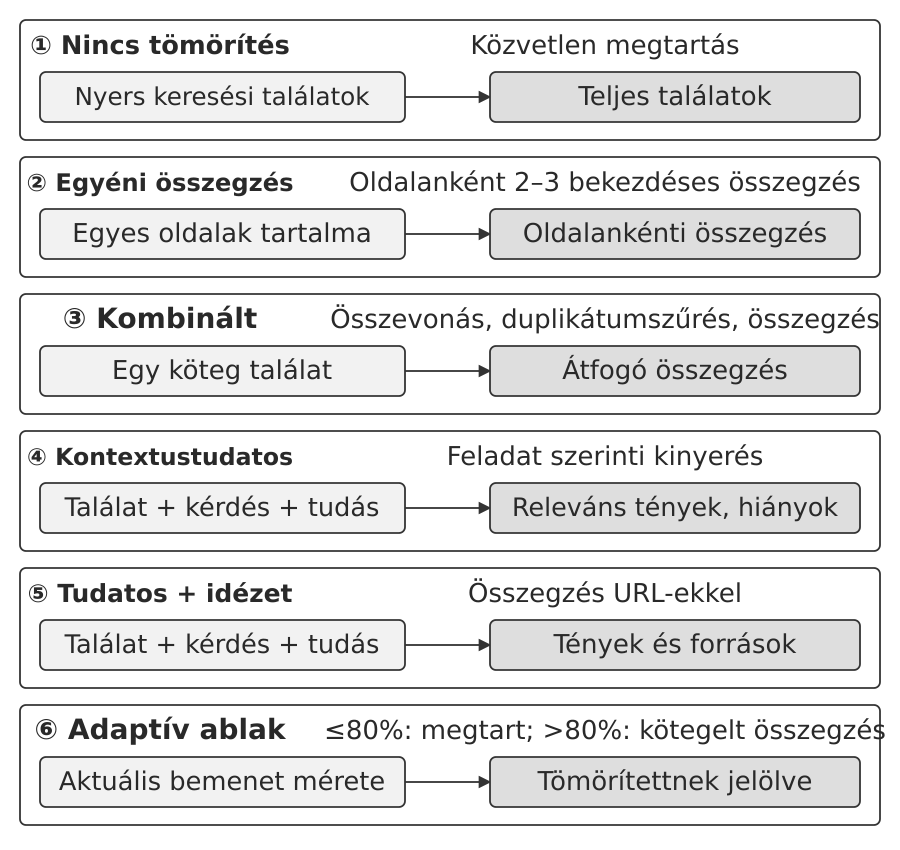
>
> A 2-16. ábra számainak összehasonlításakor három mennyiséget kell megkülönböztetni: az egyes kérések bemenete dönti el, hogy elértük-e az ablakkeretet, a kumulált token a többkörös hívások felhasználását tükrözi, a karaktertömörítési arány pedig a vizsgált anyag feldolgozás utáni és eredeti hosszának aránya. Az itt szereplő kumulált felhasználás a fő ügynök egyes köreiben küldött kérések bemenetéből és kimenetéből származik; az összefoglalót előállító különálló modellkérések nem szerepelnek ebben a mezőben.
>
> A kísérlet megismétléséhez a mellékelt leírás szerint állítsuk be a modellt és a valódi keresőszolgáltatást, majd a kísérlet könyvtárában futtassuk a `python experiment.py -m kimi-k3 -n 15 -o results/reproduction.json` parancsot. Olvassuk ki az egyes stratégiák `metrics` mezőjét: a `total_compressed_size / total_original_size` hányadossal számoljuk újra a karakterarányt, majd vessük össze a `total_tokens` és az `iterations` értékét. A tömörítés nélküli alapváltozat is kiegészíti a keresési szöveget címmel, URL-lel és hasonló formázással, ezért a feldolgozott karakterszám kissé meghaladhatja az eredetit. A kísérleti program az adott csoportot befejezettnek tekinti, amint megkapja a végső választ. Próbáljuk meg a két kész anyagban ugyanazt a személyt megkeresni: a hivatkozásos csoport szerint Pamela Vagata a Pebblebednél dolgozik, az ablakkezelési csoport összesítő táblázata szerint viszont a Stripe-nál. Az előbbi válasz említi a szervezet webhelyét, de nem ad megnyitható linket. Mindkét csoport átadott egy összesítő táblázatot, a közölt személyi adatok azonban ellentmondanak egymásnak.

[^ch2-compression-results]: A 2-10. kísérlet `kimi_k3_real_20260718.json` eredményfájlja tartalmazza minden stratégia statisztikai mezőit, végső válaszát és időbélyegét, így a karakterarány közvetlenül újraszámolható. A 2026. július 18-i futás a régi védelmi feltételt használta; a július 22-i kódmódosítás (`aea4d72` commit) a kumulált bemenetet a legutóbbi kör kérésének bemenetére cserélte.

### Termelési szintű, réteges tömörítési mechanizmus

Az eszközkimenetnek esetleg ideiglenesen a teljes szövegét kell tárolni, a befejezett lépések archiválhatók, az aktuális korlátoknak pedig láthatónak kell maradniuk; a következő öt mechanizmus különböző használati gyakoriságokhoz és megőrzési időtartamokhoz illik.

1. **Az eszközeredmények keretének szabályozása**. A nagy kimeneteket külső tárolóba mentjük, a kontextusban csak egy összefoglaló előnézet és egy olvasási belépési pont marad. Ha az előnézet bekerült az előzménybe, a tartalma stabil marad; ha több részletre van szükség, a vonatkozó szakaszokat külön olvassuk be, és az eredményt hozzáfűzzük.
2. **Az irreleváns tartalom eltávolítása**. A weboldalak navigációs sávját, az ismétlődő lábléceket és hasonlókat már a kontextusba kerülés előtt kiszűrhetjük. Ha a már az előzménybe került tartalmat kell törölni, előbb meg kell győződni arról, hogy a későbbi feladatok és hivatkozások nem támaszkodnak-e rá, majd ki kell számítani az előzmény módosításának gyorsítótár-költségét.
3. **API-szintű kontextusszerkesztés**. Az ilyen képességet támogató szolgáltatások szabályok szerint törölhetik a régi eszközeredményeket. A kliensnek be kell állítania a kiváltó feltételeket, és kezelnie kell a szolgáltatás által visszaadott szerkesztési információkat. A törlés terjedelmét és a gyorsítótár viselkedését az interfész megállapodása határozza meg; ez a megoldás a bemeneti keret figyelésével együtt illeszthető be.
4. **Archiváló összefoglaló**. Körönként vagy feladatszakaszonként rögzíti a célt, a műveleteket, az eredményeket és a befejezetlen teendőket, megőrizve a végrehajtás sorrendjét. Felfogható a feladat változásnaplójaként: később kideríthető belőle, melyik lépésben született egy döntés, és mire alapozták.
5. **A beszélgetés egészének tömörítése**. Ha a helyi rendezés sem elég a keret betartásához, az aktuális célt, a korlátokat, az igazolt tényeket, a kulcsdöntéseket és a következő teendőket átadási összefoglalóvá rendezzük. Előbb a meglévő munkameneti jegyzeteket rendezhetjük, utána összesíthetjük a teljes előzményt. Ha a tömörítés ismételten kudarcot vall, újrapróbálkozási korlát vagy megszakító mechanizmus állítja le az ismétlődő hívásokat, elmenti a helyreállítható állapotot, és ezután lehet szűkíteni a bemenetet vagy emberi kezelést választani.

Ezek a mechanizmusok rétegesen együttműködhetnek: a belépési ponton való szabályozás csökkenti az egyszeri nagy kimeneteket, a helyi rendezés a napi növekedést tartja kordában, a szakaszösszefoglaló és a teljes tömörítés pedig átadási információt őriz meg a hosszú feladatok számára.

A dsh-superagent olvasása közben feltűnt egy részlet: az események és az eszközeredmények előbb csak összefoglalót és objektumazonosítót küldhetnek, a részleteket pedig szükség esetén az azonosító alapján lehet beolvasni. Tegyük fel, hogy a háttérben lefutott egy tesztsorozat, és az előtér csak annyit kap: „két teszt elbukott”. Az előtér be tud számolni az előrehaladásról, de nem tud válaszolni a felhasználó következő kérdésére: „ugyanaz a kettő, mint tegnap?” Ha az összefoglaló a mostani tesztfeljegyzés azonosítóját is tartalmazza, az előtér előkeresheti a sikertelen tesztesetek nevét, és összevetheti a tegnapi feljegyzéssel.

### A tömörítési stratégia tervezési elvei

Annak eldöntésében, mit tartsunk meg a tömörítés után, a következő négy szempontot érdemes ellenőrizni. A tapasztalatok feladatokon átívelő felhalmozását a 9. fejezet tárgyalja.

- **A terjedelmet a feladat szempontjából vett érték szerint osszuk el**. A névsort, a személyek közötti viszonyokat és az aktuálisan vizsgálandó kérdéseket rendszerint közvetlenül meg kell tartani; a következtetéseket alátámasztó kulcsfontosságú bizonyítékoknál a forrást és a szükséges részleteket; a navigációs sávok, a hirdetések és az ismétlődő tartalmak törölhetők. Ha egy tény vitatott, a bizonyítékok közötti eltérés is fontos információ.
- **Őrizzük meg a szemantikai teljességet**. A „Sutskever 2024 májusában távozott az OpenAI-tól” mondatban a személy, az időpont, a cselekvés és a szervezet együtt alkot egy tényt. A tömörítés során ezeket az elemeket meg kell őrizni, nehogy csak egy olyan nehezen értelmezhető töredék maradjon, mint „Sutskever távozott”.
- **A tartalmat a későbbi kérdések köré szervezzük**. Az „alapítók névsorának összegyűjtése” a személyek teljes lefedését igényli, a „személyes háttér megismerése” pedig pályát, idővonalat és forrásokat. Ugyanabból az anyagból különböző feladatokhoz különböző összefoglaló készíthető: a visszakeresésnél a lefedettség, az elemzésnél a viszonyok és az alátámasztás, az alkotó munkánál pedig a hasznos részletek és példák megtartása is számít.
- **Ellenőrizzük, hogy az összefoglaló alkalmas-e a végrehajtás támogatására**. A szemantikai összefoglalónak meg kell értenie a feladatot, ki kell szűrnie az ismétlést, és meg kell őriznie a feltételeket és a kivételeket. **Összetett anyag szemantikai tömörítésére lehetőleg olyan modellt használjunk, amelynek megértési képessége közel áll a fő modelléhez.** A tömörítőnek kell eldöntenie, mely feltételek, kivételek és bizonyítékok befolyásolják a későbbi munkát; ha ezek elvesznek, a fő modell akármilyen erős is, nehezen tudja pótolni őket.

A korai architektúradöntések, a korlátok mögötti okok és a kudarcba fulladt próbálkozások könnyen elsikkadnak a hosszú előzményben. **A hosszú feladatoknál rendszeresen frissíteni kell az előrehaladási dokumentumot**, megőrizve, „mit döntöttünk el, miért döntöttünk így, mit igazoltunk, és mi a következő lépés”. A prompt vagy a Skill előírhatja a frissítés időpontját, a Harness pedig a feladat átadásakor betölti a megfelelő feljegyzést. Az ilyen dokumentum a végrehajtónak, az ellenőrzőnek és a későbbi ügynököknek is megkönnyíti a már elvégzett munka megértését.

### A részügynök kontextusának elkülönítése

**Világos átadási határral rendelkező, sok köztes anyagot termelő feladatoknál én a részügynökös elkülönítést részesítem előnyben.** Egy széles körű keresés sok olyan anyagot olvas be, amely csak a felderítési szakaszban hasznos; ha ezt előre elkülönítjük, kevésbé zavarja tartósan a fő feladatot. A fő ügynök a feladatot egy saját kontextussal rendelkező részügynöknek adja át, amely elolvassa a köztes eredményeket, és a következtetést, a bizonyítékok helyét és a megoldatlan kérdéseket adja vissza. A fő ügynök kontextusában így csak a későbbi döntésekhez szükséges információnak kell megmaradnia.

Ha például „meg kell találni a fizetési visszahívást kezelő függvényt”, a közvetlenül kereső fő ügynöknek akár egy tucat fájlt is el kell olvasnia. Ha a feladatot egy kereső részügynökre bízzuk, kérhetjük, hogy a függvény nevét, a modult, a hívási pontokat és az ítélet alapját adja vissza. A válasza lehet például: „a fizetési modul `handle_callback` függvénye kezeli a visszahívást, és két további hívási pont van”, kiegészítve helymeghatározó hivatkozásokkal. A fő ügynök ezek alapján dönti el, olvassa-e tovább a kapcsolódó kódot.

A feladatleírásnak elég teljesnek kell lennie: mi a cél, mekkora a keresési kör, milyen korlátokat kell betartani, milyen formában kell visszaadni az eredményt, és mit kell tenni kétértelműség esetén. Ha a delegálási kérés és a visszakapott eredmény is az előzményhez fűződik, a fő ügynök eredeti előtagja továbbra is újrahasznosítható.

A 4. fejezet a részügynök mint eszköz interfésztervezését tárgyalja, a 10. fejezet pedig a többügynökös rendszerek kontextusmegosztását.

## A fejezet összefoglalása

Az ügyfélszolgálati asszisztens harmadszor is végigtelefonált: hogyan folytatja az ügyintézést? A következő kör kérése magával viszi a hívás eszköznyugtáját, és a hívásazonosítóval a tárcsázási művelethez köti. Az állapotsáv háromra frissíti az elhasznált próbálkozások számát, és felsorolja a még nem tisztázott feltételeket. A rendszerszabályok és az eszközdefiníciók a stabil előtagban maradnak, egy adott ügy intézéséhez pedig akkor töltjük be a megfelelő Skillt, amikor szükség van rá. Így minden mezőnek megvan a forrása, és az is látható, mely tartalmak változnak a következő hívással.

Ha a hívás elhúzódik, és egyre több eszközeredmény érkezik, korlátozhatjuk az eredmények hosszát, a már lezárt részeket forrásokkal ellátott összefoglalóvá rendezhetjük, vagy az önállóan elintézhető munkát részügynökre bízhatjuk, és csak a következtetést és a bizonyítékot kérjük vissza.

A feladat befejezése után a három hívásról szóló számláló a feladattal együtt archiválható. Ha azonban a felhasználó külön kérte, hogy „a jövőben hétköznap délután keressetek”, és ez a mondat csak a hívás összefoglalójában marad meg, a következő megbízást kapó asszisztens talán meg sem látja. Hogyan őrizzük meg a hosszú távon hasznos információt, és hogyan keressük elő a megfelelő feladatban? A 3. fejezet a feladatokon átívelő felhasználói memóriát és a közös tudásbázist tárgyalja.

## Gondolkodtató kérdések

1. ★★★ Olvasd el a 2-3. kísérlet csúszóablakos futásának feljegyzését: mit csinált az öt eszközhívás egyenként? Annak eldöntéséhez, hogy az ismételt hívásokat az előzmény levágása okozta-e, mit kell még rögzíteni, és milyen összehasonlítást kell elvégezni? Tervezz olyan levágási módszert, amely megőrzi a kulcsfontosságú állapotot, és mutasd be, hogyan hat az előtag-gyorsítótárra. A feljegyzés: `chapter2/kv-cache/result_sliding_window_20260718_kimi_k2_6.json`.
2. ★★ A Qwen3 Chat Template az utolsó valódi felhasználói kérdés helye szerint kezeli a korábbi gondolkodást. Ha egy ReAct-ciklus több száz körön át tart, hogyan kezelnéd a folyamatosan növekvő érvelési tartalmat? Hasonlítsd össze a korábbi gondolkodás levágását, visszaküldését és az előtaghoz kötő protokollokat, és mutasd be, hogyan kell ezekhez a Harnessnek alkalmazkodnia.
3. ★★ Tegyük fel, hogy mintegy százötvenezer karakternyi keresési anyagot kell kétezer karakterre tömöríteni. Mely tényeket, viszonyokat és forrásokat tartanál meg? Hogyan ellenőriznéd, hogy az összefoglaló elegendő-e a későbbi kérdések megválaszolásához, és hogyan állítanád helyre a kihagyott részleteket?
4. ★★ Az eszközhívás-számláló kihagyott egy hívást, ezért az állapotsáv hibás fennmaradó hívásszámot mutat. Tervezz eseménynaplózást, összesítő ellenőrzést és végrehajtási rétegbeli ellenőrzést, és mutasd be, hogyan lehet felfedezni és kijavítani az ilyen ellentmondást.
5. ★★ A 2-4. kísérlet a hangnemet, az információszervezést és az eszközleírást hasonlította össze. Ha a rendszerpromptot hosszú távon többen tartják karban, hogyan kezelnéd a verziókat, hogyan ellenőriznéd a szabályütközéseket, és hogyan értékelnéd regressziós feladatokkal az egyes módosításokat?
6. ★★★ A kisállat-kereskedés példája egyszerre tartalmaz egyedi visszakeresést és összesített statisztikát. Tervezz nyers feljegyzést, statisztikai összefoglalót és lekérdezési útválasztást, amely mindkét kérdéstípusra hatékonyan tud válaszolni, és mutasd be, mikor kell az összefoglalót frissíteni.
7. ★★★ Egy Skill szerepel a katalógusban, a modell mégsem ismerte fel, hogy az aktuális feladathoz alkalmazható. Hogyan derítenénk ki a probléma okát a leírás, a katalógus szervezése, a kifejezett kiváltás és az értékelő minták négy szempontja szerint?
8. ★★ A Skill sikeresen betöltődött, a modell mégis kihagyta belőle az ellenőrző lépést. Tervezz összehasonlító kísérletet, amely elkülöníti a kiváltás, a megértés, az eszközhasználat és a befejezés megítélésének problémáit, és vesd össze a különböző modellek teljesítményét.
9. ★★★ A rendszer sok eszközt tartalmaz, és az eszközkészlet gyakran változik. Hogyan helyeznéd el a rögzített definíciókat, az eszközkatalógust, az igény szerint betöltött eredményeket és a futásidejű állapotot? Vedd figyelembe egyszerre a felderítés pontosságát, a kontextuskeretet és a gyorsítótár-találatot.
