# Felhasználói memória és tudásbázis

Ha a felhasználó a múlt héten elmondta az asszisztensnek, hogy az ablak melletti ülést szereti, ma pedig csak annyit mond, hogy „foglalj még egy jegyet Tokióba”, honnan kerül elő a korábbi preferencia? Ha a légitársaság tegnap módosította a poggyászszabályait, hol lehet utánanézni az új feltételeknek? Az előző fejezet arról szólt, hogyan szervezzük meg egyetlen feladat kontextusát. Ez a fejezet azt vizsgálja, honnan kereshetjük vissza, amit a felhasználó korábban mondott, honnan tudhatjuk meg a légitársaság új szabályait, és mikor kell frissíteni ezt a kétféle anyagot.

A **felhasználói memória** egy adott felhasználó köré szervezi az információt: rögzíti a preferenciáit, szokásait, igényeit és élményeit, hogy az Ágens a későbbi szekciókban is a felhasználó helyzetéhez igazodva szolgálhassa ki. A **tudásbázis** ezzel szemben meghatározott jogosultsági körön belül több felhasználó között megosztott tudás, például iparági jogszabályok, vállalati működési eljárások vagy műszaki dokumentáció. Az előbbi segít az Ágensnek megismerni, kit szolgál ki, az utóbbi pedig a feladat elvégzéséhez szükséges szakterületi tudást adja.

Mindkettőnek ugyanazt kell megoldania: hogyan őrizzük meg az információt, és hogyan találjuk meg, amikor szükség van rá. Mindkettőben előfordulnak egymásnak ellentmondó tények, elavult tartalmak és visszakeresésből kimaradt adatok. A vektoros visszakeresés, a strukturált indexelés és a tudástömörítés mindkét rendszerben alkalmazható. A 3-1. ábra a fejezet felépítését mutatja: először a felhasználói memória ábrázolását és kezelését tárgyaljuk, majd bemutatjuk a visszakereséssel bővített generálást (RAG), végül a visszakeresési módszereket a szekciókon átívelő memóriára és az összetettebb tudásszervezésre alkalmazzuk.

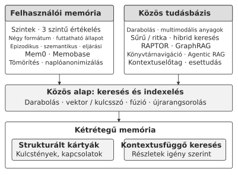

## Felhasználói memória rendszer

Bontsuk elemeire ezt a mondatot: „Jövő héten külföldön leszek, a banki iratokat kérem e-mailben.” A felhasználó egy határidős utazást említett, és erre az időszakra megszabta, hogyan akarja megkapni az iratokat. Ha a bank postán küldené a dokumentumokat, az asszisztens erre hivatkozva kérhet elektronikus kézbesítést; az utazás után viszont egy újabb levélküldésnél a pillanatnyi körülményeket kell ismét megvizsgálni. Ha csak annyit tárolnánk, hogy „a felhasználó nem szereti a papíralapú leveleket”, később ezt az emléket meg is találnánk, csakhogy rossz hatókörrel alkalmaznánk.

Nézzük a repülőjegyet. Ha a felhasználó azt mondja: „az a múltkori, 1250-es jegy drágább volt, mint gondoltam”, a rendszer legalább a korábbi árajánlatot, az akkori költségkeretet, az utazás körülményeit és ezt a visszajelzést megőrizheti. Hasonló helyzetben a modell ennek alapján óvatosabban kezeli a keretet túllépő ajánlatokat. Ha a felhasználó külön kijelenti, hogy „a családi utazásoknál ezentúl mindig kérdezz meg előbb”, ezzel egyértelmű egyeztetési feltételt szab a jövőbeli családi utakra. Ebből háromféle információt különíthetünk el: mit mondott ténylegesen a felhasználó, milyen körülmények között mondta, és mit következtetett ki a modell ebből a tapasztalatból.

A szekció végén megkérhetjük az LLM-et, hogy rendezze ezeket a feljegyzéseket, és a később is hasznos tényeket írja tartós tárba. Egy új feladat kezdetekor csak a releváns és még érvényes feljegyzések kerülnek a kontextusba.

Tegyük fel például, hogy a felhasználó jegyfoglalás közben a következő információkat adja meg:

```text
User: Help me book a flight to Tokyo next Friday. I prefer window seats
      and I'm vegetarian, so I'll need a special meal.
Agent: I'll search for flights to Tokyo for next Friday...
       [calls flight_search tool, returns 3 options]
Agent: Here are your options. Based on your preference, I've filtered for
       window seat availability. Shall I book the ANA direct flight?
User: Yes, and use my United MileagePlus number 12345678.
```

A szekció lezárulta után a memóriakinyerő négy bejegyzést állíthat össze:

```text
Extracted memories:
- User prefers window seats (preference)
- User is vegetarian, needs special meals on flights (dietary restriction)
- User's United MileagePlus number: 12345678 (loyalty program)
- User has travel plans to Tokyo (recent activity)
```

A példában háromféle feldolgozás történik. A **szelektív kinyerés** megtartja az ülőhely-preferenciát, az étkezési igényt és a törzsutasszámot, a „keresés három lehetőséget adott” típusú pillanatnyi részleteket pedig kiszűri. Az **absztrakció** a felhasználó által kifejezetten kimondott ablakos preferenciát a későbbi foglalásoknál is használható szabállyá alakítja. A **strukturálás** kategóriával látja el a tényeket, hogy könnyebb legyen visszakeresni és frissíteni őket. A tokiói útnál az indulás dátumát és az aktuális állapotot is rögzíteni kell; a „jövő pénteket” a szekció dátumából kell kiszámítani, az út befejezése vagy lemondása után pedig frissíteni kell az állapotot. Így a hosszú távú preferenciák és a közelmúltbeli tevékenységek a saját érvényességi idejük szerint kezelhetők.

A Today nevű személyi asszisztens termékleírása egy példát hoz. A felhasználó elmondja, hogy keddenként és csütörtökönként edz, mert félmaratonra készül. Hat héttel később a felhasználó engedélyével csatlakoztatott alvásnapló azt mutatja, hogy előző éjjel nagyon keveset aludt. Az asszisztens összekapcsolja a két információt, és azt javasolja, hogy tegyék át máskorra aznapi nagy intenzitású intervallumedzést. Meddig érdemes megjegyezni mindezt? Az edzéstervre a felkészülés teljes ideje alatt szükség lehet, a tegnap éjszakai alvásadathoz viszont dátumot kell rendelni. Ha a felhasználó el is fogadja ezt az áthelyezést, a következő csütörtöki edzés az eredeti terv szerint marad, hacsak a felhasználó nem mondja, hogy ezentúl mindig változtasson. A Today a javaslattételt és a naptár módosítását is két külön lépésre bontja, és az utóbbihoz a felhasználó megerősítése kell.[^ch3-today]

[^ch3-today]: A Today csapata a *What Is Today* című írásában a félmaratoni edzés példáján mutatja be, hogyan működik együtt a memória és az aznapi információ. Az alapító a *Meet Today* című írásban magyarázza el a naptár módosítása előtti megerősítési mechanizmust.

### A memóriaképességek értékelése: háromszintű keretrendszer

A **LoCoMo** (Long-term Conversational Memory, hosszú távú beszélgetési memória) nyilvános benchmark átlagosan mintegy 300 fordulóból és legfeljebb 35 szekcióból álló hosszú párbeszédeket tartalmaz, és kérdés-válasz, eseményösszegzés, valamint multimodális párbeszédgenerálás révén vizsgálja a memóriaképességet. A kérdések öt típusba sorolhatók. Az egyugrásos kérdésekre egyetlen szekcióban megtalálható a válasz, a többugrásosaknál több szekció nyomait kell összerakni, az időbeli következtetést igénylő kérdéseknél pedig az események sorrendjét is tisztázni kell. A nyílt tartományú tudást igénylő kérdések a felhasználó szavainak és a külső tudásnak az összekapcsolását kívánják meg. A jegyfoglalási példánál maradva: ha a felhasználó csak annyit mondott, hogy „jövő héten Tokióba megyek”, akkor annak megválaszolásához, hogy „milyen pénznemet használnak az úti célon”, emlékezni kell a tokiói nyomra, és tudni kell azt is, hogy ott jenben fizetnek. Ha a kérdés egy olyan járatszámra vonatkozik, amelyet a felhasználó sosem említett, az asszisztensnek jeleznie kell, hogy nincs elég információja. Az ilyen, megválaszolhatatlan kérdések felismerését vizsgálják az ellenséges (adversarial) kérdések.[^ch3-locomo]

[^ch3-locomo]: Maharana és munkatársai LoCoMo-cikkének (arXiv:2402.17753) 4.1. szakasza definiálja az öt kérdéstípust. A szerzők projektoldalán adatok és párbeszédminták érhetők el.

Az ilyen benchmarkok és a memóriatermékek gyakorlata alapján nyolc képességet tartok figyelemre méltónak:

- **Személyes információk megőrzése**: a felhasználó azonosságához hasonló hosszú távú információk pontos tárolása és visszaadása.
- **Preferenciakövetés**: a felhasználó preferenciáinak rögzítése és frissítése az újabb kifejezett közlések alapján.
- **Kontextusváltás**: a releváns háttér követése témaváltás után is.
- **Memóriafrissítés**: a meglévő tények kiegészítéseinek és helyesbítéseinek kezelése.
- **Többszekciós folytonosság**: a korábban mentett információk felhasználása új szekcióban.
- **Összetett gondolkodás**: több memóriatöredék összekapcsolása. Ha például a felhasználó korábban mogyoróallergiát említett, a thai ételekről szóló beszélgetésben ennek alapján figyelmeztetni kell az összetevők ellenőrzésére.
- **Időérzékelés**: dátumok tárolása, relatív időkifejezések értelmezése és az események közötti időtartamok kiszámítása.
- **Konfliktusfeloldás**: az ellentmondó információk felismerése, és döntés a forrás, az időpont és az érintett személy alapján.

Az Ágens valós feladataihoz igazodva a könyv háromszintű értékelési keretrendszert alkalmaz. A 3-1. és 3-2. kísérlet ezzel hasonlítja össze a memóriaábrázolásokat, a 3-9. és 3-11. kísérlet pedig ugyanezzel a keretrendszerrel értékeli a visszakeresési módszereket.

**1. szint: alapvető felidézés.** A felhasználó által közvetlenül megadott, egyértelmű információk pontos tárolása és visszaadása. Ha a felhasználó például azt mondja, hogy „a tagsági számom 12345”, egy későbbi foglaláskor a teljes számot vissza kell tudni adni. Ez a szint elsősorban azt vizsgálja, nem vesznek-e el, nem keverednek-e össze, illetve nem íródnak-e át a tények.

**2. szint: többszekciós visszakeresés.** A különböző időszakokból származó, különböző szereplőket érintő szekciókból össze kell gyűjteni a releváns információkat, majd el kell dönteni, kire vonatkozik az aktuális kérés, és mely feljegyzésekre van szükség. Ha a felhasználónak két autója van, de csak annyit mond, hogy „foglalj szervizidőpontot az autómnak”, a rendszernek először mindkét autó adatait elő kell keresnie, és tisztáznia kell, melyikről van szó. A hitel állapotának lekérdezésekor el kell különíteni a hatályos szerződést a korábban kért árajánlatoktól. A „Los Angeles-i út” lemondásakor pedig a repülőjegyet, a szállodát és a többi foglalást ugyanahhoz az utazáshoz kell kapcsolni.

**3. szint: proaktív szolgáltatás.** Az aktuális feladat alapján fel kell fedezni azokat a kapcsolódó teendőket, amelyeket a felhasználó nem sorolt fel egyenként. Nemzetközi járat foglalásakor például elő kell venni a hónapokkal korábban mentett útlevéladatokat, és ellenőrizni kell, megfelel-e az érvényesség az utazás feltételeinek; ha a telefon megsérül, össze kell gyűjteni a készülék garanciáját, a hitelkártyához tartozó kiterjesztett garanciát és a mobilszolgáltató biztosítását, majd felsorolni a lehetséges megoldásokat; az adóbevallás előkészítésekor az egész évi feljegyzésekből kell összeszedni a részvényügyletekkel, a szabadúszó jövedelemmel és az ingatlanadóval kapcsolatos dokumentumokat.

> **3-1. kísérlet ★: Memóriarendszerek értékelése a háromszintű keretrendszerrel**
>
> Az értékelőkészlet szintenként 20, összesen 60 tesztesetet tartalmaz. Az 1. szint esetei többnyire egyetlen szekcióból állnak; a 2. és 3. szinten különböző időpontokból és különböző szereplőktől származó, több részből álló szekciók szerepelnek, amelyekkel az entitások összekapcsolását, az információk frissítését és a proaktív figyelmeztetést vizsgáljuk.
>
> Minden eset két lépésben fut. Először részenként betápláljuk a szekciókat: a modell az első rész alapján memóriát hoz létre, majd minden további lépésben csak a meglévő memóriát és az új szekciót kapja meg, és ebből állítja elő a frissített memóriát. Ettől kezdve a modell már nem látja a korábbi szekciók eredeti szövegét; ha az akkor elhangzottakra vonatkozó kérdésre kell felelnie, csak a memóriába írt információkra támaszkodhat. Az összes szekció feldolgozása után egy új kérdést teszünk fel, amelyre az Ágensnek a memória alapján kell válaszolnia.
>
> Az értékelés LLM-mint-bíró (LLM-as-a-judge) módszerrel történik: egy független bírálómodell a referenciaválasz és a pontozási szempontok alapján ellenőrzi, milyen tényeket fed le a válasz, és milyen hibákat tartalmaz. Ebben a futtatásban a memóriát és a válaszokat a Doubao Seed 1.6 állította elő, a pontozást pedig egy Moonshot-modell végezte. A bíráló látja az eredeti párbeszédet, a válaszoló modell viszont csak a végül megmaradt memóriát.
>
> Hogyan olvassuk az eredménylapot? Tegyük fel, hogy a felhasználó csak a szélessávú internet-előfizetése ügyfélszámát szeretné megtudni. A bővített jegyzetek csoportjában az asszisztens a helyes számot adta meg. A bíráló a pontosságra, a felidézésre és a következtetésre egyaránt 4 pontot adott, a proaktivitásra csak 1-et, a feladat mégis sikeresnek számít. A program akkor tekint egy esetet sikeresnek, ha az első három szempont mindegyike legalább 3 pontot kap (a maximum 4), és a bíráló nem talál megalapozatlan vagy az eredeti szöveggel ellentétes lényeges tényt. A proaktivitás beszámít az összpontszámba, de a sikeres esetek számából nem derül ki, mennyire segített az asszisztens kéretlenül.

### A memória hierarchikus szerkezete

Ahhoz, hogy megválaszoljuk, „melyik járatot foglaltuk legutóbb”, egyetlen eseményt kell megtalálni; ahhoz viszont, hogy „milyen ülőhelyet válasszunk foglaláskor”, több interakcióból leszűrt preferenciát kell előhívni. Mindkét kérdés ugyanarra a személyre vonatkozik, mégis más részletességű feljegyzést és más visszakeresési módot igényel.

A **trajektória (trajectory)** időrendben rögzíti egy Ágens-futtatás eseményeit, beleértve a felhasználói üzeneteket, a modell válaszait, az eszközhívásokat és azok eredményeit. Csak hozzáfűzhető (append-only) eseménynapló esetén az új események a végére kerülnek, a régi bejegyzések pedig visszakövethetőség céljából megmaradnak. A Harness a trajektóriából választhat ki előzményeket, nyerhet ki állapotot vagy készíthet összefoglalót, és ebből állítja össze az egyes körökben a modellnek ténylegesen elküldött kontextust.

A **felhasználói hosszú távú memória** a szekciókon átívelően hasznos információkat őrzi, például a preferenciákat, a személyes kapcsolatokat, a korábbi tevékenységek összefoglalóit és a megerősített tényeket, és a felhasználói azonosítóhoz hasonló jelölőkkel határozza meg, kihez tartoznak. Az új közlések kiegészíthetik, helyesbíthetik vagy felválthatják a régi bejegyzéseket, ezért a hosszú távú memóriát össze kell vonni és frissíteni kell. Az olvasást és a karbantartást elvégezheti maga az Ágens explicit eszközhívásokkal, de elindíthatja a Harness is a szekció betöltésekor, lezárásakor vagy háttérbeli rendezés során.

Az **üzleti állapot** azt írja le, a feladat melyik logikai szakaszában tart, például „tisztázásra vár”, „feldolgozás alatt”, „fizetésre vár”, „teljesítve”. A program ezeket az állapotokat ellenőrizve döntheti el, milyen eseményre várjon, és milyen műveletet hajtson végre ezután. A 6. fejezet részletesebben tárgyalja az eseményvezérelt architektúrák állapotkezelését.

A háromféle feljegyzés együttműködhet: a trajektória a végrehajtás alapját adja, a hosszú távú memória a szekciókon átívelő hátteret, az üzleti állapot pedig azt mutatja, hol tart az aktuális feladat. A továbbiakban a hosszú távú memória ábrázolására, kezelésére és visszakeresésére összpontosítunk.

### A felhasználói memória négy tárolási formátuma

Ha csak egy e-mail-címet kell módosítani, az a legjobb, ha közvetlenül megtaláljuk ezt az egy tételt; ha viszont azt kell kideríteni, miért változott meg a cím, el kell olvasni az előzményeket is. A 3-2. ábra bal felső része külön bejegyzésként tárolja az e-mail-címet, a céget és a beosztást, a jobb felső rész pedig együtt írja le a beosztást, a csapatot és a projektet. Nézzük meg az alsó két kártyát is: ha később frissíteni kell a beosztást, vagy el kell dönteni, ki járt a kardiológián, melyik mezőt kell megnézni?

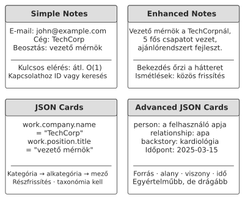

A **Simple Notes** minden emléket egyetlen rövid tényként rögzít, például „a felhasználó e-mail-címe: john@example.com”. Az egyes bejegyzéseket könnyű írni és olvasni; ha hash-táblában, stabil kulcs szerint keressük őket, a keresés és a frissítés átlagos időbonyolultsága általában O(1). Ha sok jegyzetben szemantikusan kell keresni, ehhez külön visszakeresési indexet kell építeni. A túl apró felbontás ráadásul elveszíti a kapcsolatokat: ha azt, hogy „vezető mérnökként dolgozik a TechCorpnál, és az ajánlórendszer fejlesztéséért felel”, három egymástól független bejegyzésre bontjuk (cég, beosztás, projekt), később újra el kell dönteni, hogy ugyanahhoz az álláshoz tartoznak-e.

Az **Enhanced Notes** teljes bekezdésben őrzi meg a tényeket és hátterüket. Például: „A felhasználó vezető szoftvermérnök a TechCorpnál, három éve foglalkozik gépi tanulással, jelenleg egy ötfős ajánlórendszer-projektet vezet.” A cég, a beosztás, a tapasztalat és a csapat közötti kapcsolat ugyanabban a bekezdésben megmarad. Ennek ára, hogy egyes tények több bekezdésben is ismétlődhetnek; ha a beosztás megváltozik, az összes érintett bekezdést meg kell találni és frissíteni, nehogy a régi és az új bejegyzés egymás mellett éljen.

A **JSON Cards** „kategória – alkategória – kulcs-érték pár” szerint szervezi az információt, például `personal.contact.email` és `work.position.title`. A beosztás mezőjének módosításakor a `work.company.name` és a többi mező változatlan maradhat, így ez a formátum jól támogatja a részleges frissítést. A kategóriák megtervezésekor az átfedő információkat is figyelembe kell venni: „hétvégente Pythonban fejleszt saját projekteket” egyszerre vonatkozik időre, technikai preferenciára és tevékenységre. Ilyenkor egyetlen tevékenységbejegyzést menthetünk több címkével, vagy hivatkozásokkal köthetjük össze a kapcsolódó kategóriákat, hogy ezek az összefüggések megmaradjanak.

Az **Advanced JSON Cards** a tények mellé a forrás hátterét (`backstory`), az érintett személyt (`person`), a felhasználóhoz fűződő viszonyát (`relationship`) és egy időbélyeget is felvesz. Ezek a mezők segítenek a rendszernek felismerni, kihez tartozik az információ, mikor szerzett róla tudomást, és milyen helyzetben érvényes. „Dr. Zhang” lehet például a felhasználó fogorvosa, de a felhasználó édesapjának kardiológusa is; ha a nevet a pácienssel, a rokoni kapcsolattal és a szakterülettel együtt tároljuk, kisebb az összetévesztés esélye.

Amikor a felhasználó azt kéri, hogy „szervezd meg a családom éves szűrővizsgálatait”, a rendszer a `person` és a `relationship` mező alapján megtalálja a családtagokat, a `backstory` mezőből pedig kiolvassa a kapcsolódó előzményeket. Minél gazdagabbak a mezők, annál több kapcsolatot kell kezelni a kinyerés és a frissítés során. Azt javaslom, hogy az információ fontossága és kapcsolódási igénye szerint vegyesen tároljuk az adatokat: a kulcsszereplőket, a szerződéseket és a hosszú távú preferenciákat Advanced JSON Cards formában, a forrással és a kapcsolatokkal együtt; a nagy számú, kevés kapcsolattal bíró egyszerű tényeket Simple Notes formában, hogy kisebb legyen a kinyerés és a karbantartás költsége. A kétféle bejegyzést azonosítók vagy hivatkozások kötik össze, és szükség esetén együtt kereshetők vissza.

> **3-2. kísérlet ★★: A négy memóriaformátum összehasonlítása**
>
> A kísérő implementáció egységes memórialétrehozó, -frissítő és -visszakereső interfészt ad a négy formátumhoz, és a 3-1. kísérlet ugyanazon 60 esetén hasonlítja össze a végső válaszokat.
>
> Ebben a futtatásban a Simple Notes, az Enhanced Notes, a JSON Cards és az Advanced JSON Cards rendre 48, 52, 51 és 49 esetet teljesített. A 2. szinten az Enhanced Notes 16, az Advanced JSON Cards 12 esetet teljesített; a 3. szinten mindkettő 19-et. A memória karbantartásával, a válaszadással és a bírálattal együtt az Enhanced Notes mintegy 990 ezer, az Advanced JSON Cards mintegy 1,55 millió tokent használt fel, és az utóbbinál a modellhívások átlagos ideje is hosszabb volt.
>
> Vegyük példának a 2. szint streaming-előfizetéses feladatát. A felhasználó spórolni szeretne, és megkérdezi, milyen szolgáltatásokra fizetett elő, és melyik mennyibe kerül. A bővített jegyzetek csoportja felsorolta a Netflix, a Disney+ és a Max havidíját: 22,99, 19,99 és 19,99 dollár. A haladó JSON-kártyák csoportja csak a Max árát adta meg, igaz, a Max két olcsóbb csomagját is felsorolta. A javaslat bármilyen konkrét, a másik két számlát nem pótolja.
>
> Melyik frissítésnél kezdődött a hiba? Ha végignézzük, mit mentett lépésről lépésre a haladó kártyák csoportja, az első szekció után még szerepel a Netflix, a második után már csak a Disney+-hoz kapcsolódó bejegyzések maradnak, a harmadik után pedig megint csak a Max. Mire a kérdés elhangzik, az első két előfizetés már eltűnt a memóriából.

### Haladó tudásreprezentáció: végrehajtható kód

A tények megőrzése után összesítő statisztikákat is kell készíteni, ellenőrizni kell az ütközéseket, és az üzleti szabályok alapján el kell dönteni a következő lépést. A **User as Code** (UaC) keretében azzal kísérleteztem, hogy a felhasználói információkat típusos Python-objektumokba szervezem, ezeket a műveleteket pedig függvényként írom meg[^uac]. A modell kinyeri a tényeket a párbeszédből, a program pedig elvégzi a világosan definiált számításokat.

A dátumok összehasonlítását, az összegek összesítését és az egyértelmű üzleti megkötéseket inkább függvényként írom meg, hogy ugyanazokból a tényekből reprodukálható, tesztelhető eredmény szülessen. Így a modell a szemantikai megértésre összpontosíthat, és kevésbé terheli, hogy hosszú párbeszédekben újra meg újra fejben számoljon és szabályokat ellenőrizzen; a memória ábrázolása és felhasználása pedig ugyanabban a kódban ellenőrizhető.

A UaC kétlépcsős folyamatot követ: a kinyert tényeket először egy naplóhoz fűzi, majd rendszeresen ellenőrzőpontot készít, és a naplóból újraépíti a típusos állapotot. A napló megőrzi a tények forrását és változásait, az állapotobjektum pedig az aktuálisan lekérdezhető mezőket adja.

Az útlevél és az utazások példáján az állapot így definiálható:

```python
from dataclasses import dataclass
from datetime import date

@dataclass
class PassportInfo:
    number: str
    country: str
    expiry_date: date

@dataclass
class Trip:
    destination: str
    departure_date: date
    is_international: bool

@dataclass
class UserState:
    passport: PassportInfo
    trips: list[Trip]

state = UserState(
    passport=PassportInfo("AB1234567", "US", date(2025, 2, 18)),
    trips=[
        Trip("Tokyo", date(2025, 1, 15), True),
        Trip("Paris", date(2025, 6, 10), True),
    ],
)
```

Az **összesítő statisztika** egyszerűen végigmegy a bejegyzéseken. Számoljuk meg például a 2025-re rögzített nemzetközi utazásokat:

```python
count = sum(
    1 for trip in state.trips
    if trip.is_international and trip.departure_date.year == 2025
)
# count == 2
```

Az **ütközésellenőrzés** két mezőhalmazt vet össze előre megadott szabály szerint. Az alábbi példa a gyógyszercsoportok egyezésén mutatja be, hogyan kerülnek a további ellenőrzést igénylő tételek a feldolgozási sorba:

```python
def find_allergy_matches(profile):
    matches = []
    for medication in profile.current_medications:
        for allergy in profile.allergies:
            if medication.drug_class == allergy.drug_class:
                matches.append((medication, allergy))
    return matches
```

Minden egyezés megőrzi a hozzá tartozó gyógyszer- és allergiabejegyzést, így a későbbi folyamat ezek alapján ellenőrizhet, majd a szakterületi szabályok szerint eldöntheti, hogy figyelmeztet, felülvizsgálatra továbbítja az esetet, vagy további információt kér.

A **megkötések ellenőrzése** az állapot minden frissítésekor automatikusan lefuthat. Ha például egy utazási szabály szerint az útlevélnek az induláskor még legalább 180 napig érvényesnek kell lennie, a napok számát paraméterként adhatjuk át:

```python
def passport_alerts(state, required_days):
    alerts = []
    for trip in state.trips:
        if trip.is_international:
            days = (state.passport.expiry_date - trip.departure_date).days
            if days < required_days:
                alerts.append((trip.destination, days))
    return alerts

alerts = passport_alerts(state, required_days=180)
```

A példában szereplő 180 nappal számolva a tokiói útnál az útlevél már csak 34 napig érvényes, a párizsi indulás napján pedig már lejárt. Ha a felhasználó megújítja az útlevelét, a program az új dátummal újraszámolhatja mindkét utat.

[^uac]: Li, Bojie, User as Code: Executable Memory for Personalized Agents, 2026.

### A felhasználói memória kognitív tudományi alapjai

A kognitív tudomány a memória tartalma és használatának módja szerint különbözteti meg az emlékezet típusait. Ezek a fogalmak az Ágens hosszú távú információinak rendszerezésében is segítenek:

- Az **epizodikus memória (episodic memory)** konkrét eseményeket őriz az idejükkel, résztvevőikkel és lefolyásukkal együtt. Emberi példa: „múlt szerdán a kollégáimmal egy olasz étteremben vacsoráztam”; az Ágensnél ennek megfelelhet az, hogy „a felhasználó jövő pénteken az ANA járatával Tokióba utazik”, kiegészítve azzal, hogy sikerült-e a foglalás, és módosították-e később.
- A **szemantikus memória (semantic memory)** tényeket és fogalmakat őriz. Emberi példa: „Olaszország fővárosa Róma”; az Ágensnél ennek megfelel, hogy „a felhasználó vegetáriánus” vagy „a felhasználó az ablak melletti ülést kedveli”. Ezek az információk származhatnak a felhasználó kifejezett közléséből, de több tapasztalat általánosításából is; a forrás rögzítése segít a kettő megkülönböztetésében.
- A **procedurális memória (procedural memory)** a készségekhez és cselekvési folyamatokhoz kapcsolódik. Emberi példa a kerékpározás; az Ágensek mérnöki gyakorlatában újrafelhasználható folyamatok feleltethetők meg neki, például: „közvetlen járatok keresése → ülőhely-preferencia megerősítése → törzsutasszám megadása → étkezés megrendelése”.

Térjünk vissza az 1. fejezet vásárlási előzményeihez. Abból, hogy „tíz terméket megnézett, és egyet megvett közülük”, egy vásárlási eseményt jegyezhetünk fel, de nehezen következtethetünk belőle arra, mit fog a felhasználó a jövőben kedvelni. Lehet, hogy a fazon tetszett neki, de az is lehet, hogy egyszerűen ez érkezett meg még aznap. Ha viszont utána azt mondja, hogy „ilyen termékeknél ezentúl mindig nézd meg először, kiszállítják-e még aznap”, akkor kapunk egy meghatározott hatókörű, hosszú távú preferenciát. Ha legközelebb hasonló terméket ajánlunk, először a szállítási időt nézhetjük meg, és azt is elmagyarázhatjuk, melyik visszajelzésből ered ez a szűrési feltétel.

A 3-1. táblázat ezt a felosztást a korábbi memóriaszintekkel és tárolási formátumokkal együtt mutatja be, és azt is jelzi, melyik milyen kérdésre ad választ.

3-1. táblázat: A memóriatervezés három szempontja

| Tervezési szempont | Megválaszolt kérdés | Konkrét kategóriák |
| --- | --- | --- |
| Feljegyzési szint | Milyen szerepet tölt be az információ? | Trajektória, felhasználói hosszú távú memória, üzleti állapot |
| Tárolási formátum | Milyen szerkezettel ábrázoljuk? | Simple Notes, Enhanced Notes, JSON Cards, Advanced JSON Cards |
| Memóriatartalom | Milyen információt őrzünk meg? | Epizodikus memória, szemantikus memória, procedurális memória |

Például az, hogy „a felhasználó az ablak melletti ülést kedveli”, szemantikus memória, és Simple Notes formában tárolható a hosszú távú memóriában; egy jegyfoglalási folyamat viszont procedurális memória, és olyan kártyán érdemes tárolni, amely a forrást és az alkalmazási feltételeket is tartalmazza.

### Memória-keretrendszerek esettanulmányai

A felhasználó azt mondja: „mostanában a folyosó melletti ülést választom”, a régi bejegyzésben viszont az áll, hogy „az ablak mellettit szereti”. A rendszer frissítheti az ülőhely-preferenciát már íráskor, de mindkét kijelentést meg is őrizheti, és a következő foglaláskor döntheti el, melyik érvényes. Először azt nézzük meg, a Mem0 melyik lépésben kezeli az ilyen ütközéseket, majd azt, hogyan rögzíti a Memobase külön a felhasználói profilt és a konkrét eseményeket.

**Mem0: az ütközéskezelés helyének áthelyezése.** A 2025-ös cikk és a v2 folyamata íráskor veti össze az új és a régi tényeket, a későbbi v3 viszont tényhozzáfűzést és hibrid visszakeresést alkalmaz. A 3-3. ábra a két megoldást állítja egymás mellé.

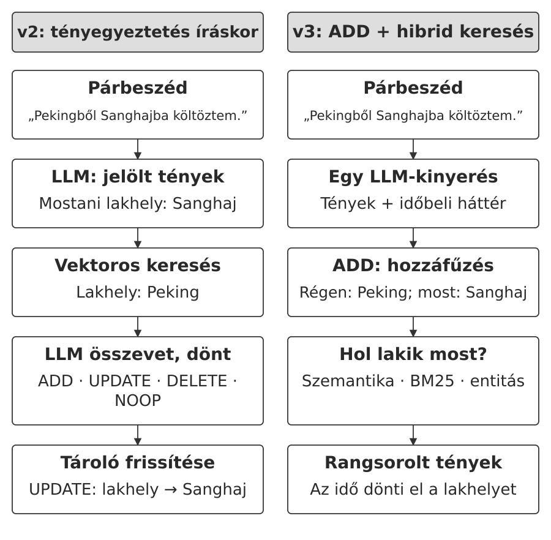

A korai folyamatban az LLM előbb jelölt tényeket nyer ki a párbeszédből, majd megkeresi a hozzájuk hasonló meglévő emlékeket, és dönt arról, hogy **ADD**, **UPDATE**, **DELETE** vagy **NOOP** műveletet hajt végre. Ha a felhasználó először azt mondja, „Pekingben lakom”, később pedig azt, hogy „Sanghajba költöztem”, a rendszer Sanghajra frissítheti a jelenlegi lakóhelyet. Lekérdezéskor így könnyű a rendezett tényhez jutni; a karbantartás során viszont helyesen kell felismerni a helyesbítéseket, az időbeli változásokat és a különböző személyeket, és meg kell őrizni a frissítések indoklását, hogy egy hiba felfedezésekor vissza lehessen követni. A cikk egy gráfmemóriás változatot is javasol, a **Mem0-g**-t, amely entitásokkal és kapcsolatokkal fejezi ki az összefüggő tudást[^ch3-mem0-paper].

A v3 az automatikus kinyerést egyetlen LLM-hívásra egyszerűsíti, és csak **ADD** bejegyzéseket fűz hozzá. A pekingi és a sanghaji információ az időbeli hátterével együtt megmaradhat, a jelenlegi lakóhelyet pedig lekérdezéskor, a kontextus alapján lehet megállapítani. A visszakeresés egyszerre használ szemantikus hasonlóságot, BM25-kulcsszavakat és entitásegyezést; a már megerősítetten végrehajtott műveletek is kinyerhetők tényként. A migrációs útmutató szerint a LoCoMo-pontszám 71,4-ről 91,6-ra, a LongMemEval-pontszám 67,8-ról 93,4-re emelkedett. A nyílt forráskódú változat az entitások összekapcsolását a belső visszakereséshez használja, a külső gráftároló interfészét és a `relations` visszatérési értéket eltávolította; gráfmemóriát a felügyelt platform kínál[^ch3-mem0-migration].

Ez a fejlődés azt mutatja, hogy a memóriarendszer az ütközések megítélését az írási fázisból az olvasási fázisba helyezheti át. Ha íráskor tévesen összevonjuk két ember élményeit, vagy egy kiegészítést helyesbítésnek veszünk, a későbbi válaszok tartósan a hibás aktuális állapotra épülhetnek. A hozzáfűzéses tárolásnál az új és a régi bizonyíték egyaránt részt vehet a döntésben, és kevesebb modellhívás kell az írás közbeni, tételenkénti döntésekhez. A gyakran változó felhasználói memóriánál, ahol az ütközést a pillanatban nehéz megítélni, inkább azt választom, hogy először a tényeket mentem el az idejükkel és forrásukkal együtt, és csak egy konkrét kérdés megválaszolásakor állítom össze belőlük az érvényes állapotot.

[^ch3-mem0-paper]: Chhikara és munkatársai, Mem0: Building Production-Ready AI Agents with Scalable Long-Term Memory, 2025.

[^ch3-mem0-migration]: Mem0, Open Source: Migrating to the New Memory Algorithm.

**Memobase: felhasználói profil és eseménymemória.** A Memobase két részre osztja a hosszú távú információkat. A **felhasználói profil (profile)** témák és altémák szerint őrzi a viszonylag állandó tulajdonságokat, például a `basic_info` alatt a nevet, az `interest` alatt az érdeklődési köröket, a `work` alatt a beosztást. A fejlesztők beállíthatják, mely mezőket kell kinyerni, és így szabályozhatják a profil terjedelmét és részletességét. Az **eseménymemória (event memory)** a felhasználó élményeit és azok időpontját rögzíti, hogy a rendszer az olyan kérdésekre is válaszolni tudjon, mint „mikor beszéltünk utoljára a költségvetésről”.

A Memobase az új párbeszédeket először pufferbe teszi, és akkor dolgozza fel őket kötegelve, amikor a puffer elér egy megadott méretet, vagy a szekció egy beállított ideig tétlen; a feldolgozás a szekció végén kifejezetten is elindítható. Így több üzenet osztozik egyetlen rendezési folyamaton, lekérdezéskor pedig a már elkészült profil és események olvashatók. Az aszinkron frissítés miatt az aktuális interakciónak kevesebbet kell várnia a memória kinyerésére; ha azonnal a legfrissebb tényekre van szükség, meg lehet várni az aktuális feldolgozás végét[^ch3-memobase].

[^ch3-memobase]: Memobase, hivatalos projektleírás, beleértve a profilmezőket, az eseménymemóriát, a puffert és a szinkron frissítési interfészt.

Ha az asszisztensnek egyszerre kell emlékeznie a legutóbbi jegyfoglalás lefolyására, a felhasználó ülőhely-preferenciájára és a jegyvisszatérítés menetére, akkor a 3-4. ábrához hasonlóan külön tárolhatja az eseményeket, a tényeket és a folyamatokat. Minden új feladatnál a szükséges részek kerülnek a munkamemóriába.

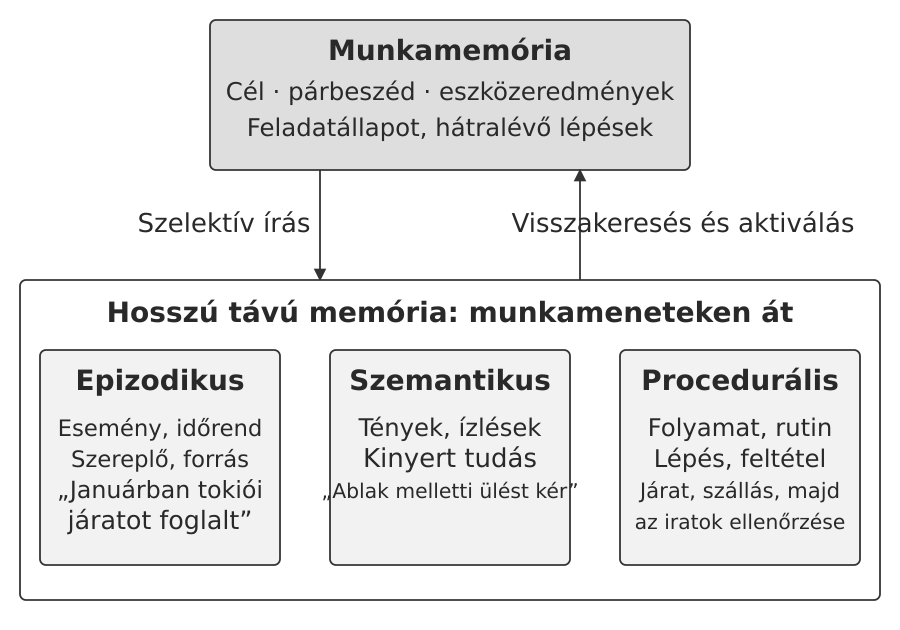

Az epizodikus memória az eseménysorokat időbélyeggel, érzelmi jelölőkkel, feladatazonosítókkal és más metaadatokkal együtt őrzi, így idő és téma szerint kombinált keresést tesz lehetővé. „A legutóbbi költségvetési megbeszélés” megtalálásához például témaegyezésre és időrendi rendezésre egyaránt szükség van. A szemantikus memória az eseményekből kinyert tényeket és preferenciákat, a procedurális memória pedig az ismételten használt folyamatokat őrzi.

A **munkamemória (working memory)** az aktuális célt, a feladat állapotát és a már előkeresett releváns információkat szervezi. A Harness a trajektóriából és a hosszú távú tárból választja ki, mi kerüljön az aktuális kontextusba; a feladat során keletkező új tényeket rendezés után a hosszú távú memóriába írja. A trajektória azt rögzíti, hogyan zajlottak a dolgok, a munkamemória pedig a következő döntéshez szükséges információkat gyűjti össze; a kettőt eseményazonosítók és forrásjelölések kötik össze.

Ha RAG-gal olvassuk a felhasználói memóriát, először az aktuális kérés alapján keresünk egy sor esetleg releváns emléket, majd eldöntjük, melyek kerüljenek a munkamemóriába. Tegyük fel, hogy az asszisztensnek ma ülőhelyet kell választania, és a keresés két mondatot talál: „üzleti útra az ablak mellé ülök szívesen” és „múltkor megsérült a térdem, a visszaútra folyosó melletti helyet kérek”. Mindkettő erősen kapcsolódik az ülőhely-választáshoz, de a második csak az akkori visszaútra vonatkozott. Ha relevancia szerint rangsoroljuk őket, a második akár az élre is kerülhet, de ez nem válaszolja meg, hogy ma is érvényes-e.

Ilyen esetekben jobban bízom a Jev-hez hasonló ítélő modellekben a jelölt emlékek szűrésében. Átadjuk neki az aktuális utazást, a felhasználó mostani kérését, valamint minden emlék eredeti szövegét, dátumát és alkalmazási feltételeit, és tételenként eldönteti, hogy az „erre az alkalomra érvényes”, „csak tájékoztató jellegű” vagy „nincs elég alapja”. Ha ma is üzleti útról van szó, az első emlék lehet az ülőhely-választás alapja; ha a felhasználó épp most említette, hogy a térde még nem gyógyult meg, a második emléket érdemes elővenni, és rákérdezni.

### Memóriatömörítési és -rendezési mechanizmusok

Egy gyakran repülő felhasználó tízszer is említheti az „ablak mellettit”. Ebből kilenc esetleg ugyanannak a foglalásnak az ismételgetése; ha az említések számát egyszerűen a preferencia erősségének vesszük, egyetlen esemény súlyát nagyítjuk fel. Rendezéskor először a forrást és az eseményt kell azonosítani, aztán összevonni az ismétlődő bejegyzéseket, ellenőrizni, van-e későbbi helyesbítés, és csak ezután eldönteni, mely szabályszerűségeket érdemes a jövőbeli feladatokban felhasználni. Ha azt halljuk, hogy „a múltkori ablak melletti hely jó volt”, megkérhetünk egy Jev-hez hasonló ítélő modellt, hogy olvassa el ezt a mondatot és a kapcsolódó foglalást, és csak azt döntse el, hogy „visszatekintés a legutóbbi útra”, „kérés erre az alkalomra” vagy „hosszú távú preferencia kifejezése”. Ha a foglalás nem azonosítható, vagy több értelmezés is lehetséges, megtartjuk az eredeti mondatot, és foglaláskor ellenőrizzük. Egy ilyen helyi döntéssel elkerülhető, hogy ugyanazt az élményt újra meg újra új bizonyítékként számoljuk.

1. **A rendezendő bejegyzések kiválasztása.** A hozzáférési gyakoriság, a rögzítés ideje, az érzelmi jelölés és az információ egyedisége rangsorolási jelként szolgálhat. Egy három napja létrehozott, ötször lekért, erős érzelmi jelölésű és egyedi bejegyzést például érdemes külön megőrizni; egy kilencven napja létrehozott, csak egyszer lekért, három másikkal erősen átfedő bejegyzést viszont célszerű elsőként összevonni a kapcsolódó bejegyzésekkel. A rendszer először pontszám alapján választhatja ki a rendezendő bejegyzéseket, majd az üzleti szabályok szerint dönthet a tömörítésről, összevonásról vagy törlésről. A hosszú távú megkötéseket és a hatályos szerződéseket akkor is meg kell őrizni érvényességük végéig, ha ritkán kérik le őket.
2. **Klaszterezés és összefoglalás.** A hasonló bejegyzéseket csoportosítjuk, és a közös tartalmat egyetlen összefoglaló bekezdésben őrizzük meg. Több időjárásról szóló beszélgetésből például ez lehet: „a felhasználó gyakran kérdez az időjárásról, különösen a csapadék érdekli”. A konkrét dátumokat és az eredeti kérdéseket archiváljuk, az összefoglaló pedig hivatkozik az eredeti bejegyzésekre, hogy később visszakereshetők legyenek.
3. **Szabályszerűségek és folyamatok kinyerése.** Több vásárlási előzményből általánosíthatjuk például azt, hogy „a jó ár-érték arányú termékeket kedveli, és sokat ad a vásárlói értékelésekre”, vagy kinyerhetjük a termékválasztás lépéseit.

### Adatvédelem: naplóanonimizálás

A felhasználói memória gyakran tartalmaz személyazonossági, elérhetőségi és számlaadatokat. A rendszernek a feladat alapján kell eldöntenie, mely mezők kerüljenek a modell bemenetébe, és az üzemeltetési igények alapján, mi kerüljön a naplókba. Az anonimizálás a napló írása előtt is elvégezhető: az érzékeny részleteket típuscímkével vagy stabil helyőrzővel helyettesítjük, a hibakereséshez szükséges szerkezetet pedig megtartjuk.

> **3-3. kísérlet ★★: Naplóanonimizálás lokális modellel**
>
> A kísérlet az Ollamán keresztül a helyben futó Qwen3-0.6B modellt hívja meg, hogy a gépen belül azonosítsa a naplók érzékeny részleteit. A kis modell fogyasztói eszközökön is telepíthető, de 1.7B, 4B és más méretekre is át lehet váltani, hogy összevessük a felismerés minőségét és a feldolgozási időt. Ha a nyers naplóknak helyben kell maradniuk, a felismerést és a cserét is helyben kell elvégezni, és csak az anonimizált eredményt szabad továbbadni a későbbi szolgáltatásoknak.
>
> A tesztanyag tartalmaz strukturált számokat, például személyi igazolványszámot és bankkártyaszámot, félig strukturált tartalmat, például címeket, valamint természetes nyelvű szövegben elárult érzékeny adatokat, például jelszavakat. A modell JSON Schema szerint adja vissza az információ típusát, szövegbeli helyét és a megbízhatóságot, a program pedig ennek alapján cseréli ki az eredeti szöveget. A kontrollcsoport reguláris kifejezéseket használ; a hibrid csoport előbb reguláris kifejezésekkel keres, majd a maradék szöveget a modell dolgozza fel.
>
> Nézzünk először két naplóbejegyzést. Az elsőben személyi igazolványszám és telefonszám szerepel; a reguláris kifejezés csak a telefonszámot takarta ki, így a felidézés $1/2$. A másodikban a reguláris kifejezés megtalálta az amerikai társadalombiztosítási számot és a bankkártyaszámot, de a hasonló formátumú hibajegyszámot is kitakarta. Az általa megjelölt három helyből csak kettőt kellett volna anonimizálni, így a pontosság $2/3$. Ha csak azt ellenőrizzük, maradt-e érzékeny érték a naplóban, a második bejegyzés átmegy; csak akkor derül ki, hogy a nyom elveszett, amikor az ügyfélszolgálat ezzel a bejegyzéssel próbálja megkeresni a hibajegyet.
>
> Ha mind a 12 mintán bejegyzésenként kiszámítjuk a felidézést, majd átlagolunk, a reguláris kifejezés, a modell és a hibrid megoldás nagyjából 50%, 69% és 78%. A csere utáni tételes ellenőrzés szerint a három megoldás rendre 9, 3 és 2 érzékeny értéket hagyott a naplóban. A választáshoz a feldolgozási időt is figyelembe kell venni: ezen a gépen a reguláris kifejezés bejegyzésenként átlagosan körülbelül 0,1 ezredmásodpercet igényelt, a modell és a hibrid megoldás egyaránt közel 3 másodpercet. Nagy naplómennyiségnél a stabil formátumú mezőket először reguláris kifejezésekkel dolgozhatjuk fel, és a modellt csak a kontextus alapján megítélendő részletek utólagos ellenőrzésére használjuk.

Ahogy nő a bejegyzések száma, a következő lépés az, hogy sok ezer információ közül megtaláljuk az aktuális feladathoz szükségeset. Az alábbiakban bemutatott RAG-technika a megosztott tudásbázisban és a felhasználói memória visszakeresésében egyaránt használható.

## A RAG alapjai: az Ágens tudásszerzési csővezetékének felépítése

Egy bolt módosította a visszatérítési szabályzatát, és egy felhasználó azt kérdezi: „A múlt hónapban vett termékemnél most hogyan kérhetek visszatérítést?” A helyes válaszhoz először meg kell találni az erre a rendelésre vonatkozó feltételeket, majd világosan el kell magyarázni a feltételeket és a lépéseket. A **visszakereséssel bővített generálás** (Retrieval-Augmented Generation, RAG) ezt a két lépést kapcsolja össze, így a modell a bolt belső anyagait és a tanítása lezárása után közzétett szabályzatokat is felhasználhatja.

Kezdjük azzal az esettel, amikor a szabályzatnak csak egy változata van. Az alábbi egyszerűsített interfész ugyanannak a boltnak a visszatérítési folyamatát kérdezi le; figyeljük meg, hogyan kerülnek a keresési találatok a modell válaszába:

```python
query = "visszatérítési folyamat"
results = retriever.search(query, top_k=2)
# results = [
#   "Visszatérítési szabályzat: a kézbesítéstől számított 7 napon belül teljes visszatérítés kérhető, a rendelésszám megadásával. Az összeg 3–5 munkanapon belül érkezik meg.",
#   "Visszatérítés menete: nyissa meg a „Rendeléseim” oldalt, válassza ki a rendelést, majd kattintson a „Visszatérítés kérése” gombra."
# ]
answer = llm.generate(system="Ön ügyfélszolgálati asszisztens.", context=results, question=query)
# A válasz tartalmazza a határidőt, a szükséges adatokat, a lépéseket és a jóváírás idejét.
```

Vessük össze a 3-5. ábrát és a kód két találatát: a visszatérítés igénylésének lépései a „visszatérítés menete” bejegyzésből származnak, az, hogy a pénz 3–5 munkanap alatt érkezik meg, pedig a „visszatérítési szabályzatból”. Ha a találatok közül csak a lépések maradnának meg, lenne-e még alapja a modellnek megmondani a felhasználónak, mikor kapja vissza a pénzét? Ez a kérdés azzal függ össze, hogyan daraboljuk a kézikönyvet.

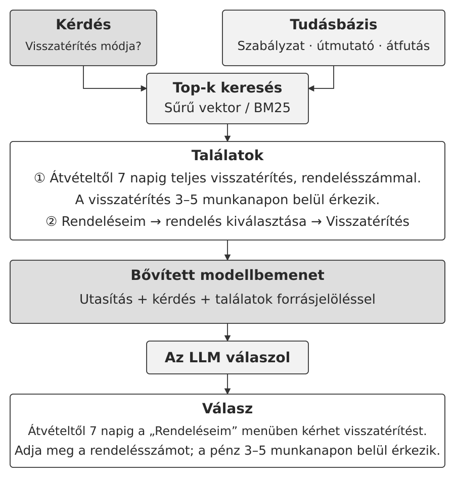

### Dokumentumdarabolás (Chunking)

Tegyük fel, hogy egy ügyfélszolgálati kézikönyv először kimondja, hogy „hét napon belül visszaküldhető”, a következő bekezdés pedig a kivételként kezelt termékeket sorolja fel. Ha csak az első mondatot keressük vissza, a kivételes termékekre is visszatérítést ígérhetünk; ha viszont az egész kézikönyv egyetlen visszakeresési egység, a telepítés, a beállítás és a hibaelhárítás is vele jön, és a vektorban nehezen emelkedik ki a visszatérítés témája. A **darabolás (chunking)** e két véglet között keresi a megfelelő méretet: egy darabnak elegendőnek kell lennie ahhoz, hogy a saját feltételeit megmagyarázza, és könnyen meg kell találni egy konkrét kérdéssel. A darab hosszának bele kell férnie a beágyazási modell bemeneti keretébe, és a későbbi generáláshoz is helyet kell hagynia a kontextusban.

Három gyakori módszer létezik.

A **rögzített méretű darabolás** tokenszám szerint vág, például 512 tokenes darabokra, a szomszédos darabok között 50–100 tokenes átfedéssel. Az átfedés miatt a határ közelében lévő tartalom esélyt kap arra, hogy egy másik darabban teljes egészében szerepeljen. Ezzel a módszerrel jól kézben tartható a darabok hossza, a vágási pont viszont bekezdés, kód vagy táblázat közepére is eshet.

A **rekurzív vagy szerkezetérzékeny darabolás** elsősorban a természetes határok, például fejezetek és bekezdések mentén vág, a túl hosszú részeket pedig kisebb egységekre, például mondatokra bontja tovább. A Markdown-címsorok és a HTML-elemek szerkezeti támpontot adnak. A kódblokkokra, a táblázatokra és a címsorokhoz tartozó szövegre külön feldolgozási szabályok is alkalmazhatók. Világos szerkezetű műszaki dokumentációnál ezzel a módszerrel javaslom kezdeni: ha előbb a meglévő fejezeteket és bekezdéseket használjuk ki, és csak a túl hosszú részeket bontjuk tovább, általában könnyebb megőrizni a teljes jelentést, mint egyszerű levágással.

A **szemantikus darabolás** a szomszédos mondatok vagy mondatcsoportok beágyazási hasonlóságát számítja ki, és ott vág, ahol a téma érezhetően megváltozik. Több beágyazási számítást igényel, de esélyt ad arra, hogy egy téma egyetlen darabban maradjon.

Tegyük fel, hogy a visszakereső csak egyetlen mondatot ad vissza: „A vállalat bevétele 3%-kal nőtt.” Melyik vállalat? Melyik negyedévben? A számot megtaláltuk, de a kérdés megválaszolásához szükséges információ az előző bekezdésben van. Ha az egész pénzügyi jelentést egyetlen darabba tesszük, a negyedév és a cégnév ugyan megmarad, de a bevételre vonatkozó kérdésnél a toborzásról és az eszközbeszerzésről szóló bekezdések is vele jönnek. Ezeknek ráadásul egyetlen vektoron kell osztozniuk, így a bevétel témája kevésbé emelkedhet ki a vektorban. A darabméret kiválasztásakor érdemes darabonként 256–1024 tokennel és 10–20%-os átfedéssel kezdeni a kísérletezést.

A cím, a forrás, az időpont és más metaadatok a szövegrésszel együtt tárolhatók. A fejezet későbbi részében tárgyalt kontextusérzékeny visszakeresés ezen túlmenően minden szövegrészt kiegészít az eredeti szövegbeli hátterével, hogy önálló visszakereséskor is értelmezhetők legyenek a hivatkozások és a hatókör.

### Sűrű beágyazások: szöveg ábrázolása vektorokkal

A **beágyazás (embedding)** szavakat, mondatokat vagy szövegdarabokat numerikus vektorokra képez le, például `[0.2, -0.5, 0.8, ...]`. A visszakereső modelleket úgy tanítják, hogy az egymáshoz kapcsolódó lekérdezések és dokumentumok a vektortérben nagy hasonlóságot mutassanak. A „sűrű” azt jelenti, hogy a vektor legtöbb dimenziójának nem nulla az értéke, és ezek együtt fejezik ki a szöveg információtartalmát; a később tárgyalt ritka ábrázolásnál csak kevés dimenzió nem nulla.

A vektorteret egy sokdimenziós térképként képzelhetjük el: minden szövegrésznek megfelel egy hely, a visszakeresés pedig a lekérdezéshez közeli tartalmak keresése ezen a térképen. Az egyik gyakori mérték a **koszinusz-hasonlóság**:

$$
\operatorname{cos}(A,B)=\frac{A\cdot B}{\|A\|\,\|B\|}
$$

Az $A\cdot B$ skaláris szorzat a megfelelő dimenziók szorzatainak összege, a $\|A\|$ hossz pedig a dimenziók négyzetösszegének négyzetgyöke. A két hosszal való osztás után az eredmény csak az irányok viszonyát tükrözi. Nem nulla vektorok esetén a koszinusz értéke a $[-1,1]$ tartományba esik, és minél közelebb van 1-hez, annál inkább egy irányba mutatnak a vektorok. Egyes visszakereső modellek skaláris szorzatot vagy euklideszi távolságot használnak. Ha mindkét vektort egységnyi hosszúságúra normalizáljuk, a skaláris szorzat megegyezik a koszinusz-hasonlósággal.

> **Kézi számítás: három mondat koszinusz-hasonlósága**
>
> Ábrázoljuk három szemléltető vektorral a „Hogyan tartsunk macskát” $A=(0.9,0.5,0.1)$, a „Macskatartási útmutató” $B=(0.8,0.6,0.1)$ és a „Részvénybefektetési stratégia” $C=(0.1,0.1,0.9)$ mondatot.
>
> $A\cdot B=0.9\times0.8+0.5\times0.6+0.1\times0.1=1.03$. A két vektor hossza $\sqrt{1.07}$, illetve $\sqrt{1.01}$, a hasonlóság így körülbelül **0,991**.
>
> $A\cdot C=0.9\times0.1+0.5\times0.1+0.1\times0.9=0.23$, a $C$ hossza $\sqrt{0.83}$, a hasonlóság körülbelül **0,244**. Ebben a vektorhármasban a macskatartási lekérdezés a tartási útmutatóhoz áll közelebb.

A valódi modellek általában több száz vagy több ezer dimenzióval dolgoznak.

#### A Word2Vectől a kontextusérzékenységig

A 3-6. ábra a rögzített szóvektoroktól indul. A **Word2Vec** a szavak együttes előfordulása alapján minden szóhoz rögzített vektort tanul. Egyes összefüggések vektorműveletekben is megjelennek, ilyen a klasszikus „király – férfi + nő ≈ királynő”. A rögzített ábrázolás korlátja is szemléletes: a `bank` szó a `river bank` (folyópart) és az `investment bank` (befektetési bank) kifejezésben ugyanazt a szóvektort kapja.

A **GloVe** a teljes korpuszból számolja meg a szavak együttes előfordulását, majd súlyozott legkisebb négyzetes célfüggvénnyel tanulja meg a szóvektorokat. A Word2Vec a helyi ablakon belüli előrejelzési feladatra épít, a GloVe a globális együttes előfordulási statisztikát közvetlenül beépíti a tanításba; mindkettő rögzített ábrázolást tanul a szavakhoz[^ch3-glove].

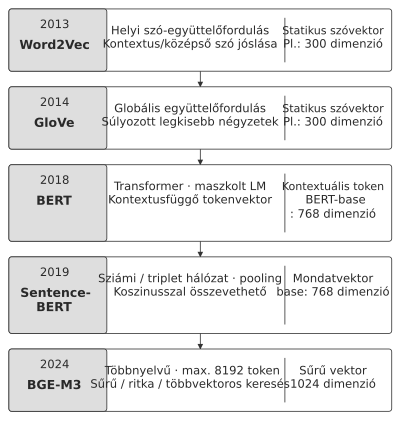

A **BERT**-hez hasonló kontextuális modelleknél ugyanannak a tokennek az ábrázolása mondatonként változik. Az önfigyelem révén a modell az „új terméket mutatott be” és a „vettem két kilót” típusú támpontok alapján eltérő ábrázolást számol az „alma” szóra a két mondatban. A visszakereséshez használt beágyazási modelleknek emellett a tokenábrázolásokat lekérdezés- vagy dokumentumvektorrá kell összesíteniük, és megfelelő tanítással összehasonlíthatóvá kell tenniük a kettőt.

A **Sentence-BERT** a BERT-et pooling réteggel, sziámi vagy hármas (triplet) hálózati szerkezettel kombinálja, és közvetlenül összevethető mondatvektorokat tanul. A dokumentumokat előre kódolhatjuk és indexbe tehetjük, így egy lekérdezés érkezésekor csak azt kell kódolni, majd kiszámítani a vektorhasonlóságot. Az előzetes kódolás megtakarítja, hogy minden lekérdezésnél újra kelljen számolni az összes dokumentum ábrázolását[^ch3-sbert].

A **BGE-M3** egyszerre ad sűrű, ritka és többvektoros visszakeresési ábrázolást, és támogatja a többnyelvű, hosszabb bemeneteket; ebben a szakaszban a sűrű ábrázolását használjuk az egyvektoros visszakeresés szemléltetésére[^ch3-bge-m3]. A modell által elfogadott hossz befolyásolja a darabolási tervet: az eredeti BERT jellemző felső határa 512 token, a BGE-M3 legfeljebb 8192 tokent kezel.

[^ch3-bge-m3]: Chen és munkatársai M3-Embedding cikke (arXiv:2402.03216) bemutatja, hogyan tanítják együtt a háromféle visszakeresési ábrázolást. Lásd még a BAAI BGE-M3 modellleírását az ábrázolási módokról, a dimenziókról, a bemeneti hosszról és a használatról.

> **3-4. kísérlet ★★: Két közelítő legközelebbiszomszéd-index összehasonlítása**
>
> Miután elkészültek a dokumentumvektorok, gyorsan meg kell találni a lekérdezéshez közeli vektorokat. Az egyenkénti számítás pontos legközelebbi szomszédokat ad, nagyobb adatmennyiségnél azonban a **közelítő legközelebbi szomszéd** (Approximate Nearest Neighbor, ANN) indexek szabályozható felidézési veszteség árán gyorsítják a lekérdezést. A kísérlet ugyanazokon a valódi beágyazásokon és lekérdezéseken hasonlítja össze az ANNOY-t és a HNSW-t, a pontos keresés eredményét használva viszonyítási alapként. Ha például egy lekérdezésnél a pontos keresés tíz legközelebbi szomszédot ad, és a közelítő index tíz találata közül nyolc ezek közé tartozik, akkor ennél a lekérdezésnél a Recall@10 értéke 0,8. Ez a szám azt méri, a pontos szomszédok mekkora részét őrizte meg az index.
>
> Az ANNOY több véletlen vetítési fával szűkíti a jelöltek körét; a HNSW hierarchikus szomszédsági gráfot használ: először a ritka felső rétegekben gyorsan megközelíti a célterületet, majd a sűrűbb alsó rétegekben keres tovább. A 3-7. ábra a HNSW rétegzett szerkezetét mutatja.
>
> 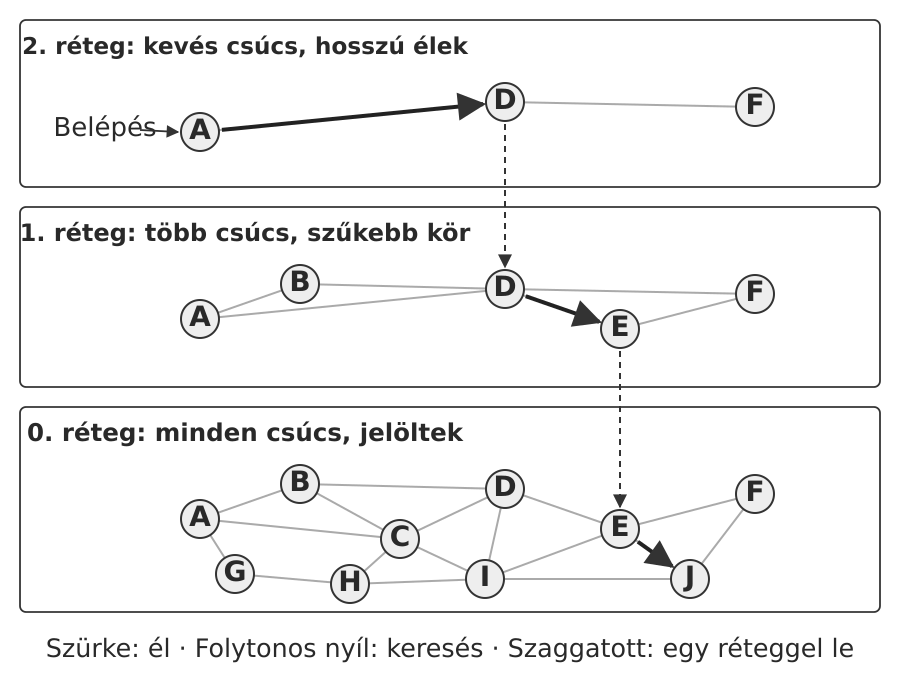
>
> 3-2. táblázat: Az ANNOY és a HNSW megvalósítási kompromisszumai
>
> | Szempont | ANNOY | HNSW (a hnswlib példáján) |
> | --- | --- | --- |
> | Indexszerkezet | Több véletlen vetítési fa | Hierarchikus szomszédsági gráf |
> | Építési költség | A fák számától, a vektorok számától és a dimenziótól függ | A szomszédsági mérettől, az építési keresési tartománytól és az adatmennyiségtől függ |
> | Memória és fájl | A statikus index memórialeképezést és többfolyamatos megosztást támogat | A vektorokat és a gráf szomszédsági kapcsolatait tárolja, a szomszédsági méret befolyásolja a költséget |
> | Növekményes frissítés | Az index elkészülte után új elemekhez újra kell építeni | Támogatja a hozzáadást, a frissítést és a törlési jelölést, a kapacitást kezelni kell |
> | Felidézés és sebesség | A fák számával és a lekérdezési keresési kerettel hangolható | Az építési paraméterekkel és a lekérdezési keresési tartománnyal hangolható |
> | Alkalmazási terület | Könnyen terjeszthető és megosztható statikus index | Folyamatos írásra és lekérdezésre szolgáló dinamikus index |
>
> Ebben a futtatásban először 240 szövegrészből építettük fel az adatbázist. Ugyanarra a 20 lekérdezésre mindkét index megtalálta a pontos keresés első 10 legközelebbi szomszédját. Az első építéskor az ANNOY Linux-konténerben mintegy 13 ezredmásodperc alatt, a HNSW a helyi gépen mintegy 78 ezredmásodperc alatt készült el; a mentett indexek mérete körülbelül 1,40 MB, illetve 1,02 MB. Ezután hozzáadtuk a maradék 60 szövegrészt: az ANNOY újraépítette az indexet, a HNSW közvetlenül beszúrta az új vektorokat. Ekkor az adatbázis 300 szövegrészt tartalmazott, és a korábbi legközelebbi szomszédok is megváltozhattak. Az új adatbázison megismételt pontos keresés után mindkét index átlagos felidézése továbbra is 100% volt.

[^ch3-ann]: A Spotify Annoy projektjének leírása bemutatja, hogyan építhető csak olvasható index, hogyan tölthető be memórialeképezéssel, és hogyan szabályozható a `search_k` paraméterrel a lekérdezéskor vizsgált csomópontok száma. A hnswlib projektleírásának Python-interfészről szóló része ismerteti a vektorok hozzáfűzésére szolgáló `add_items` és a lekérdezési tartományt szabályozó `set_ef` metódust.

**Az indexet a tudás frissítési módja szerint kell kiválasztani.** Ha a korpusz időszakosan, kötegelve jelenik meg, és több folyamat osztozik ugyanazon a csak olvasható indexen, először az ANNOY-ra gondolok; ha folyamatosan érkeznek új dokumentumok, és online beszúrásra van szükség, inkább a HNSW-t választom. A beágyazási modell határozza meg a szemantikus ábrázolást, az index pedig azt, hogy ezek az ábrázolások megfelelő késleltetéssel és frissítési költséggel használhatók-e; a kettő együtt határozza meg a visszakereső szolgáltatás hatékonyságát.

Az ANNOY fáinak számát és keresési keretét, illetve a HNSW szomszédsági méretét és keresési tartományát változtatva megfigyelhetjük, hogyan alakul a felidézés és a késleltetés[^ch3-ann]. Az index felidézése azt méri, megtaláltuk-e a keresett szomszédokat; hogy ezek a szomszédok megválaszolják-e a felhasználó kérdését, az a beágyazási ábrázolástól és az anyag tartalmától függ.

### Ritka ábrázolás: a kulcsszavaktól a relevanciapontozásig

A **ritka ábrázolás** sokdimenziós vektorokat használ, amelyekben csak kevés dimenzió nem nulla. A hagyományos kulcsszavas keresés a szavakat tekinti dimenzióknak, és a dokumentumban előforduló szavak alapján rendel súlyokat. Alapja a **szózsákmodell** (Bag of Words, BoW): a szavakat és előfordulásuk számát tárolja, a sorrendet figyelmen kívül hagyja. Ezért „a macska kergeti a kutyát” és „a kutya kergeti a macskát” szózsák-ábrázolása azonos.

Ez az ábrázolás nevek, azonosítók és szakkifejezések egyeztetésére alkalmas. Az alábbiakban a TF-IDF-ből kiindulva megmutatjuk, hogyan válik a szógyakoriságból és a dokumentumgyakoriságból rangsorolási pontszám.

#### A TF-IDF-től a BM25-ig

A **TF-IDF** (Term Frequency–Inverse Document Frequency, szógyakoriság–inverz dokumentumgyakoriság) két jelet kombinál: hányszor fordul elő a szó az adott dokumentumban, és mennyire gyakori a teljes korpuszban. Ha 100 cikkből 60 tartalmazza a „modell” szót, de csak 3 a „desztilláció” szót, akkor a „modelldesztilláció” lekérdezésnél a „desztilláció” a megkülönböztetőbb.

Egy alapvető felírás:

$$\operatorname{TF\!\text{-}\!IDF}(t,d)=\operatorname{TF}(t,d)\times\operatorname{IDF}(t),\qquad \operatorname{IDF}(t)=\ln\frac{N}{\operatorname{DF}(t)}$$

A $\operatorname{TF}(t,d)$ a $t$ szó előfordulásainak száma a $d$ dokumentumban, a $\operatorname{DF}(t)$ a szót tartalmazó dokumentumok száma, $N$ pedig a dokumentumok teljes száma. E képlet szerint a tízszer előforduló szó pontszámhoz való hozzájárulása kétszerese az ötször előfordulóénak; a hosszú dokumentumok pedig pusztán azért is magasabb pontszámot kaphatnak, mert több szót tartalmaznak. A TF-IDF-nek számos normalizált változata létezik; az alábbi BM25 szógyakorisági telítéssel és hossznormalizálással kezeli ezt a két hatást.

A **BM25** összeadja az egyes lekérdezési szavak hozzájárulását:

$$\operatorname{Score}(Q,D)=\sum_i\operatorname{IDF}_{\mathrm{BM25}}(q_i)\cdot\frac{\operatorname{TF}(q_i,D)(k_1+1)}{\operatorname{TF}(q_i,D)+k_1\left(1-b+b\frac{|D|}{\operatorname{avgdl}}\right)}$$

Itt $q_i$ a lekérdezési szó, $|D|$ a dokumentum hossza, $\operatorname{avgdl}$ az átlagos dokumentumhossz. A $k_1$ a szógyakoriság telítésének mértékét szabályozza; a $b$ a hossznormalizálás erősségét, 0 értéknél ez a korrekció kikapcsol. A 3-8. ábra külön-külön számolja ki ezeket a tagokat. Először rögzítjük a dokumentum hosszát, és a lekérdezési szó előfordulását egyről háromra növeljük, hogy lássuk, mennyivel nő a pontszám minden újabb előfordulással; aztán rögzítjük a szógyakoriságot, és csak a dokumentum hosszát duplázzuk meg. A legalsó sor azt veti össze, mennyire gyakori két szó a dokumentumgyűjteményben.

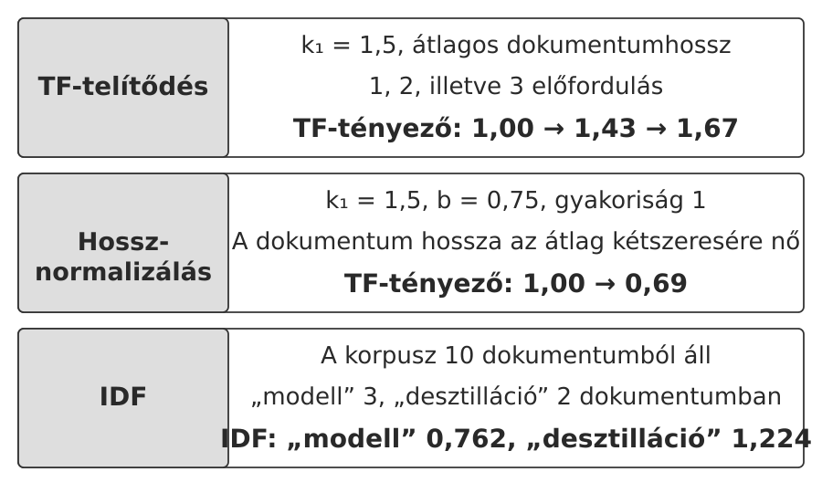

Az ábra első sorában a második előfordulás mintegy 0,43-dal növeli a szógyakorisági tényezőt, a harmadik már csak mintegy 0,24-dal: ez a szógyakorisági telítés. A második sorban ugyanaz a szó mindkét esetben csak egyszer fordul elő, a hosszabb dokumentumban azonban kevésbé hangsúlyos, ezért a hosszkorrekció csökkenti a szógyakorisági tényezőjét. A szó teljes pontszámhoz való hozzájárulását csak az IDF-fel való szorzás után kapjuk meg.

A képletben még egy tagot meg kell határozni: miért hasznosabb gyakran egy ritka szó, mint egy gyakori, ha mindkettő háromszor fordul elő? Ebben a szakaszban az alábbi inverz dokumentumgyakorisággal súlyozzuk a szavakat:

$$\operatorname{IDF}_{\mathrm{BM25}}(t)=\ln\frac{N-\operatorname{DF}(t)+0.5}{\operatorname{DF}(t)+0.5}$$

A számláló a szót nem tartalmazó, a nevező a szót tartalmazó dokumentumok számát jelenti; mindkettőhöz 0,5-es simítást adunk, hogy 0 vagy $N$ dokumentumgyakoriság esetén is számolni lehessen. A ritka szavak nagyobb súlyt kapnak; ha a dokumentumok több mint fele tartalmazza a szót, a képlet negatív értéket ad. A kísérő implementáció a ténylegesen használt pontozási súly alsó határát $10^{-6}$-ra állítja, az eredeti értéket pedig ellenőrzés céljából megőrzi.

> **3-5. kísérlet ★★: BM25-keresőmotor megvalósítása a semmiből**
>
> A kísérlet sorra elvégzi a tokenizálást, a stopszavak kezelését, az invertált index felépítését és a pontozást. A stopszavak kezelése kiszűrheti az olyan gyakori kínai szavakat, mint a „的” és a „了”. Az **invertált index** minden szóhoz rögzíti, mely dokumentumokban és milyen gyakorisággal fordul elő; olyan, mint egy könyv végén a tárgymutató: a „TCP” címszónál megtaláljuk a 45., a 112. és a 203. oldalt, és ott elolvashatjuk a tartalmat.
>
> Számoljunk ki kézzel egy lekérdezést a „modelldesztilláció” kifejezésre. Legyen a korpuszban 10 dokumentum 250 szavas átlagos hosszal, $k_1=1.5$ és $b=0.75$. A „modell” 3 dokumentumban fordul elő, IDF-je körülbelül 0,762; a „desztilláció” 2 dokumentumban, IDF-je körülbelül 1,224. Az alábbi táblázat szavanként sorolja fel a találatot adó dokumentumokat, a szógyakoriságot és a dokumentumhosszt. Ha ezeket az értékeket behelyettesítjük a képletbe, kiszámíthatjuk, mennyivel járulnak hozzá az egyes szavak a dokumentum pontszámához.
>
> | Lekérdezési szó | Dokumentum | Szógyakoriság (TF) | Dokumentumhossz | BM25-hozzájárulás |
> | --- | --- | ---: | ---: | ---: |
> | modell | doc_1 | 5 | 200 | 1,52 |
> | modell | doc_3 | 2 | 500 | 0,82 |
> | modell | doc_7 | 8 | 150 | 1,68 |
> | desztilláció | doc_1 | 3 | 200 | 2,15 |
> | desztilláció | doc_5 | 1 | 250 | 1,22 |
>
> A két szó hozzájárulása a doc_1-ben összesen körülbelül 3,67, a sorrend tehát **doc_1 (3,67) > doc_7 (1,68) > doc_5 (1,22) > doc_3 (0,82)**. A doc_1-ben a „desztilláció” gyakorisága kisebb, mint a „modellé”, de ritkább szó, ezért végül többel járul hozzá; és az, hogy a dokumentum mindkét szót tartalmazza, tovább növeli az összpontszámot.
>
> Most keressünk a `cat` szóra a kísérő kísérlet angol korpuszában. A relevánsnak jelölt két rövid szöveg a `kitten` és a `feline` szót használja, a `cat` pedig nem szerepel az invertált indexben, így a jelöltlista üres. Bármennyire megemeljük is az előbbi szógyakorisági súlyokat, egyetlen dokumentumot sem lehet pontozni. Ha viszont a két rövid szöveg saját szavaival keresünk, mindkettő bekerül a jelöltlistába.

### Hibrid visszakeresés: a két ág eredményeinek egyesítése és újrarangsorolása

Bizonyos kérdéseknél nehéz előre felsorolni az összes szinonimát. A 3-6. kísérlet egyik feladata azt kérdezi, „hogyan lehet automatikusan visszanyerni a nem használt heapterületet”, a célszöveg viszont úgy fogalmaz, hogy „az automatikus memóriakezelés megkíméli a fejlesztőket az objektumok kézi felszabadításától”. Az angol lekérdezésnek és a szövegnek nincs közös szava, a kulcsszavas keresés egyetlen dokumentumot sem talált, a vektoros keresés viszont az első helyre tette a célszöveget. Az XR-7003 típusszámra keresve a kulcsszavas keresés közvetlenül megtalálta a megfelelő típust, a vektoros keresés pedig néhány hasonló típust is felsorolt.

A **hibrid visszakeresés** először kulcsszavak és vektorok alapján külön-külön keresi meg a releváns szakaszokat, majd eldönti, mely szakaszokat érdemes átadni a modellnek. Ha a tudásbázis pontos azonosítókat és természetes nyelvű leírásokat egyaránt tartalmaz, ezt javaslom kiindulópontnak. Kövessük végig az XR-7003-at a 3-9. ábrán: mindkét ág az első helyre tette, így az egyesítéskor két rangsorhozzájárulást kapott. Az újrarangsorolás lecserélte a második helyezettet, de a felhasználó által elsőként látott típus továbbra is helyes.

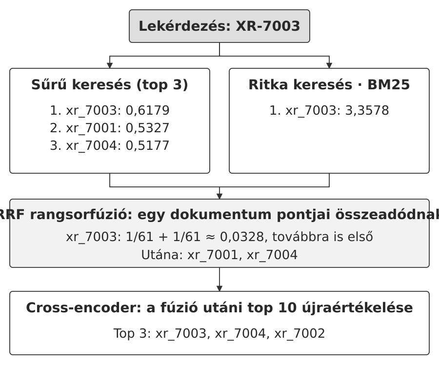

Az első szakasz a **párhuzamos visszakeresés**: a lekérdezést elküldjük a sűrű és a ritka keresőmotornak, és mindkettő visszaad egy sor esetleg releváns dokumentumot. A két ág használhatja ugyanazt a nyers szöveget, de a saját modelljének követelményei szerint előfeldolgozást is végezhet.

A második szakasz az **eredmények egyesítése**: a két ág találatai között szereplő azonos dokumentumokat összevonjuk, majd egységes rangsort készítünk. A koszinusz-hasonlóság és a BM25 skálája eltér, ezért egyszerű összeadásnál könnyen a nagyobb számértékeket adó ág uralja az eredményt. Az egyik megoldás, hogy a pontszámokat előbb kalibráljuk vagy normalizáljuk, majd súlyozottan kombináljuk; a másik a **reciprok rangfúzió** (Reciprocal Rank Fusion, RRF), amely az egyes ágakban elért helyezésekből számol:

$$\operatorname{RRF}(d)=\sum_{j:\,d\in R_j}\frac{1}{k+\operatorname{rank}_j(d)}$$

$R_j$ a $j$-edik ág eredménye, a helyezések 1-től kezdődnek; ha egy dokumentum nem szerepel valamelyik ágban, onnan nem kap hozzájárulást. A $k$ simítási állandó értéke gyakran 60; minél nagyobb, annál kisebb a különbség az első néhány helyezés pontszáma között. Az RRF-fel könnyen kombinálhatók különböző pontozási módszerek, de csak a helyezéseket őrzi meg, így az eredeti pontszámokban rejlő erősségkülönbségeket más módon kell kihasználni.

Számoljunk ki egy kétágú példát. A felhasználó azt kérdezi, „mennyi idő alatt érkezik meg a visszatérítés”. Az A dokumentum a kulcsszavas keresésben első, a vektoros keresés élmezőnyében viszont nem szerepel; a B dokumentum mindkét ágban második. $k=60$ mellett A pontszáma $1/61$, körülbelül 0,0164; B pontszáma $1/62+1/62$, körülbelül 0,0323. Az egyesítés után B megelőzi A-t. Ez az eredmény csak annyit mond, hogy mindkét keresési ág megtalálta B-t. Hogy B valóban megválaszolja-e, mikor érkezik meg a pénz, ahhoz meg kell nézni, „hogyan kérjünk visszatérítést” vagy „mikor érkezik meg a visszatérítés” szerepel-e benne.

A harmadik szakaszban **neurális újrarangsorolás** következhet. A rendszer az egyesítés utáni élmezőnyt, például az első 50 dokumentumot, átadja egy újrarangsoroló modellnek, amely mindegyik dokumentumot pontozza aszerint, mennyire releváns a lekérdezés szempontjából. Az újrarangsorolás e 50 dokumentum sorrendjét változtathatja meg. Ha a valóban hasznos dokumentum be sem került közéjük, az előtte álló visszakeresésen kell javítani.

Itt gyakran **keresztkódolót (cross-encoder)** használnak: a lekérdezést és a jelölt dokumentumot együtt adja be a modellnek, a két rész a modellen belül kölcsönhatásba lép, a kimenet pedig egy relevanciapontszám. A visszakeresési szakasz **kétkódolós (bi-encoder)** modelljei ezzel szemben külön kódolják a lekérdezést és a dokumentumot; a dokumentumvektorok előre kiszámíthatók, így lekérdezéskor csak vektoros keresésre van szükség. Az előbbi kevés dokumentum finom rangsorolására, az utóbbi nagy dokumentumtömegből való előszűrésre alkalmas. Olyan ez, mint az önéletrajzok szűrése és az állásinterjú: először a meglévő jellemzők alapján szűkítjük a kört, aztán a konkrét követelmények mentén mélyebben összehasonlítunk. A BGE Reranker v2 M3 az egyik modell, amely ebben a lépésben használható[^ch3-reranker].

[^ch3-reranker]: BAAI, a BGE Reranker v2 M3 modell leírása, amely bemutatja a lekérdezés–dokumentum bemenetet és a relevanciapontozást.

Ha a releváns anyag már bekerült a jelöltek közé, de gyakran irreleváns anyagok mögé sorolódik, elsőként a keresztkódolós újrarangsorolást értékelem. Ez együtt olvassa a kérdést és a dokumentumot, így közvetlenül összevetheti, hogy a dokumentum feltételei, megszorításai és részletei megfelelnek-e a kérdésnek. A 3-3. táblázat három gyakori mérőszámot sorol fel.

3-3. táblázat: A visszakeresés minőségének három mérőszáma

| Mérőszám | Számítás és jelentés |
| --- | --- |
| recall@k (felidézés) | Az első k találat közötti releváns dokumentumok száma osztva a lekérdezéshez tartozó összes releváns dokumentum számával; azt méri, a releváns tartalom mekkora részét találtuk meg. A tesztkészleten általában a lekérdezésekre átlagolják |
| MRR (átlagos reciprok rang) | Minden lekérdezésnél az első releváns dokumentum helyezésének reciproka, ezek átlaga; az első helyen 1, a tizediken 0,1, ha nincs találat, 0 |
| nDCG@k (normalizált diszkontált kumulatív nyereség) | A találatok a relevancia mértéke szerint kapnak pontot, a hátrébb lévő helyezések pontszámát csökkentjük, majd az ideális sorrend pontszámával osztunk; az első k találat rangsorának összminőségét méri |

Rögzíthetjük a **találati arányt** is: a lekérdezések hány százalékánál van az első k találat között legalább egy releváns dokumentum? Tegyük fel, hogy egy kérdéshez három dokumentum kell, és az első húsz találat közül csak kettőt találtunk meg. Ez a lekérdezés találatnak számít, ezért nem kerül a „teljesen sikertelen” esetek közé, a recall@20 értéke viszont csak $2/3$, az anyag $1/3$-a nem került elő. Ha minden kérdéshez csak egy céldokumentum tartozik, a megtalált kérdés 1, az elhibázott 0 pontot kap. Ugyanazon keresési eredményekre átlagolva a találati arány ekkor megegyezik az átlagos felidézéssel.

> **3-6. kísérlet ★★: A ritka, a sűrű, az egyesített és az újrarangsorolt keresés összehasonlítása**
>
> A kísérlet ugyanazon a 12 annotált lekérdezésen öt konfigurációt hasonlít össze: ritka keresést, sűrű keresést, RRF-egyesítést, súlyozott egyesítést, valamint egyesítés utáni újrarangsorolást. A lekérdezések szemantikai hasonlóságot, pontos neveket, többnyelvűséget és műszaki kódokat fednek le; közülük két feladat angolul, illetve kínaiul kérdezi, hogyan alakítják át a növények a napfényt táplálékká. A sűrű modell a Qwen3-Embedding-0.6B, az újrarangsoroló az MS MARCO MiniLM keresztkódoló; ágankénti legfeljebb 10 dokumentumot keresünk vissza, az újrarangsoroló pedig az RRF szerinti legfeljebb 10 legjobb dokumentumot dolgozza fel. A felidézés és az nDCG csak a végső rangsor első 3 dokumentumát nézi, az MRR viszont a teljes visszaadott listán keresi az első releváns dokumentumot.
>
> Nyissuk meg először a 3-6. kísérlet futási naplójában a feladatonkénti rangsort, és hasonlítsuk össze a két fotoszintézises kérdés találatait. Az angol kérdésnél a céldokumentum továbbra is első. A kínai kérdésre először egy programozási nyelvekről és egy vulkánokról szóló dokumentum jön, és csak a harmadik szól a fotoszintézisről. Mindkét kérdéshez egyetlen relevánsnak jelölt dokumentum tartozik, és mindkettő bekerült az első háromba, így a recall@3 mindkettőnél 1. A kínai kérdésnél viszont az első releváns dokumentum a harmadik helyen áll, ezért a reciprok rangja csak $1/3$. A kísérlet pontozása szerint a harmadik hely nyeresége $1/\log_2(3+1)=0.5$, az elsőé 1, így a kínai kérdés nDCG@3 értéke 0,5.
>
> Nézzük most mind a 12 feladatot. Az újrarangsorolás után a kínai fotoszintézises kérdésen kívül egy heapmemória visszanyeréséről szóló kérdésnél is visszacsúszott a céldokumentum az első helyről a másodikra. A többi tíz kérdés megőrizte az első helyet, így az újrarangsorolás utáni MRR $(10+1/2+1/3)/12\approx0.903$. Összehasonlításképpen a sűrű keresés és az RRF MRR-értéke egyaránt 1. Mindkettő nDCG@3 értéke is 1, ez az újrarangsorolás után körülbelül 0,928-ra csökken. Ha csak az átlagos felidézést nézzük, ezek a helyezésváltozások nem látszanak: a ritka keresés recall@3 értéke 0,833, a másik négy csoporté egyaránt 1.
>
> Ha most ki kellene választanunk egy konfigurációt ehhez a feladatsorhoz, mit kapnánk az újrarangsorolásra fordított időért? Ezen a CPU-n az RRF a keresés kezdetétől a rangsor elkészültéig feladatonként átlagosan mintegy 194 ezredmásodpercet igényelt, újrarangsorolással mintegy 237-et. A többlet körülbelül 43 ezredmásodperc egyetlen további céldokumentumot sem hozott, viszont két kérdésnél hátrébb sorolta a helyes választ.

## A tudás szervezése és visszakeresése

A tudás szervezési módja határozza meg, mit tartalmaz egy-egy bejegyzés, a visszakereső pedig azt, mit hoz elő ezekből a bejegyzésekből. A műszaki kézikönyvek, jogi iratok és tudományos cikkek bekezdéseit fejezetszerkezet, fogalmi függőségek és dokumentumok közötti hivatkozások kötik össze. Ha ezeket a szerkezeteket megőrizzük, a lekérdezés egyszerre férhet hozzá a konkrét bizonyítékokhoz és a magasabb szintű összegzésekhez.

Ez a szakasz sorra veszi a szervezési módokat: a RAPTOR és a GraphRAG hierarchikus, illetve kapcsolati indexet épít; az OpenViking könyvtárakba szervezi a kontextuserőforrásokat; a növekményes frissítés és a rendszeres átszervezés gondoskodik a tudás naprakészségéről; az Ágens RAG lehetővé teszi, hogy az Ágens a meglévő eredmények alapján tovább keressen; a kontextusérzékeny visszakeresés kiegészíti a szövegrészek hátterét; végül adathalmazokból nyerünk ki újrafelhasználható tudást. Ezek rendre az ábrázolásra, az indexelésre, a frissítésre és a lekérdezési folyamatra hatnak, és kombinálva a felhasználói memóriában is alkalmazhatók.

Először két példán nézzük meg, mekkora lehet a különbség a lekérdezéshez szükséges információ és a nyers feljegyzések között.

**Első eset: fekete és fehér macskák megszámlálása.** Az előző fejezetben a program végigszámolta mind a 100 ketrecet, és 90 fekete meg 10 fehér macskát talált. Most a visszakereső csak az első 20 bejegyzést adja vissza. Tegyük fel, hogy ezek közül 18 tartalmaz érvényes színinformációt: 15 fekete és 3 fehér macskát. A kiszámított 83,3% (15/18) a fekete macskák aránya ebben az érvényes bejegyzéscsoportban; az egész üzlet fekete macskáinak aránya viszont 90% (90/100). A visszakereső relevancia szerint választja ki a bejegyzéseket, nem reprezentatív mintát vesz az egész üzletből.

Ha gyakran kérdezik az egész üzletre vonatkozó arányt, előre megszámolhatjuk az összes ketrecet, eltárolhatjuk, hány fekete és hány fehér macska van, és megjelölhetjük a számlálás hatókörét és frissítési idejét. Ha a ketrecekben kicserélődnek a macskák, frissítjük a megfelelő tételeket, és újraszámoljuk az összesítést. Ha valaki azt kérdezi, mi van a 37. ketrecben, továbbra is azt az egy tételt kell előkeresni.

**Második eset: kaphat-e egy ápoló olyan kedvezményt, amilyet egy orvos kapott?** Vegyünk egy Xfinity-kedvezményekkel kapcsolatos megkeresések köré épített oktatási forgatókönyvet: a hibajegyek szerint John, a veterán, átment az ellenőrzésen, Sarah, az orvos, kedvezményt kapott, Mike, a tanár, pedig azt a tájékoztatást, hogy nem jogosult. Minden hibajegy egyetlen ügyintézés eredményét rögzíti. Ha egy ápoló azt kérdezi, jogosult-e a kedvezményre, a hasonló hibajegyek puszta visszakeresése három problémába ütközik.

- **A hasonló foglalkozás nem jelent feltétlenül azonos kedvezményt.** Az „ápoló” és az „orvos” jelentése közel áll egymáshoz, így Sarah bejegyzése előkelő helyre kerülhet; hogy a kedvezmény érvényes-e, az azonban attól is függ, kik igényelhetik a kampányfeltételek szerint, és milyen igazolást kell bemutatni.
- **Az egyes hibajegyek nem sorolják fel az összes feltételt.** Ha valaki átment az ellenőrzésen, az közvetlenül csak azt mutatja, hogy az illető az akkori feltételek mellett milyen eredményt kapott; a visszakeresett elemek számának növelésével sem feltétlenül találunk rá olyan kategóriákra vagy kivételekre, amelyek még nem fordultak elő.
- **Az anyag hatóköre nem világos.** A hibajegyek különböző kampányokból vagy időszakokból származhatnak. Először tisztázni kell, mely bejegyzések érvényesek, és milyen szabályzati alapok hiányoznak.

Indexeléskor összekapcsolhatjuk az ugyanahhoz a kampányhoz tartozó hibajegyeket, majd a vonatkozó hivatalos feltételek alapján szabálykártyákba rendezhetjük a jogosultak körét, a kivételeket, a hatálybalépés idejét és a feltétel forrását. Ha például ebben az oktatási forgatókönyvben a feltételek kifejezetten kiterjednek az aktív és a leszerelt katonákra, valamint az engedéllyel rendelkező egészségügyi dolgozókra, a tanárokat pedig kizárják, ezeket a feltételeket pontonként rögzítjük; azt is a feltételek döntik el, hogy az ápolók beletartoznak-e az egészségügyi dolgozók körébe. A hibajegyeket továbbra is megőrizzük, hogy megmagyarázzák a tényleges ügyintézést, és feltárják a végrehajtásbeli eltéréseket.

A két példa eltérő információigényt mutat: a macskák megszámlálásához az üzlet összes ketrecére szükség van, annak eldöntéséhez pedig, ki kaphat kedvezményt, a teljes feltételrendszert és a kivételeket kell megnézni. Az ilyen lekérdezéseknél azt javaslom, hogy a statisztikák és a szabályok rendezését hozzuk előre, az adatbázis építésének szakaszába. Ha csak több szövegrészt keresünk vissza, a modell még mindig nem láthatja a statisztika teljes hatókörét, vagy azokat a feltételeket, amelyeken a kérelem elbírálása múlik. Ha a feladathoz igazodva statisztikai összefoglalókat, szabálykártyákat és forráskapcsolatokat építünk, a visszakeresés egyszerre elegendő információt hozhat a döntéshez, és az eredeti anyagokhoz is vissza lehet nyúlni.

### Strukturált indexelés: hierarchia és kapcsolatok kiépítése

Egy hosszú jelentés olvasásakor arra, hogy „melyik rovatot kell kitölteni a javítási kérelemben”, gyakran egyetlen eredeti bekezdésben megtalálható a válasz; arra viszont, hogy „miért ismétlődik újra meg újra néhány hibatípus”, csak több fejezetet átfogva lehet felelni. Ha mindkét fajta lekérdezést ki akarjuk szolgálni, az adatbázis építésekor összefoglalókat készíthetünk, hierarchiát alakíthatunk ki, vagy entitásokat és kapcsolatokat nyerhetünk ki. Az alábbiakban bemutatott RAPTOR rekurzív összefoglalással épít hierarchiát, a GraphRAG pedig entitáskapcsolatok és közösségi összefoglalók révén szervezi az anyagot.

A **RAPTOR** (Recursive Abstractive Processing for Tree-Organized Retrieval) a szövegdarabokból indul ki: először minden darabot vektorrá kódol, a hasonlóság alapján csoportokba rendezi őket, majd minden csoporthoz összefoglalót készít. Ha az összefoglalókat új szövegdarab-csoportként kezeljük, és megismételjük ezeket a lépéseket, a 3-10. ábrán látható fát kapjuk. Ha a nyilakat a 3., 4. és 5. szövegdarabtól felfelé követjük, látjuk, hogy ezekből együtt jön létre a B összefoglaló; még feljebb az A, B és C csoport összefoglalói egy globális összefoglalóvá állnak össze.[^ch3-raptor]

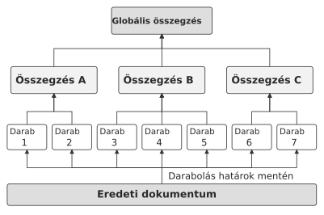

Például „az SSE2 a 128 bites XMM regiszterekben egész számos SIMD-műveleteket támogat” és „az SSE4.2 karakterlánc-összehasonlító utasításokat vezetett be” bekerülhet az „x86 SIMD utasításkészletek fejlődése” című összefoglalóba. A részletkérdések az alsó szintű darabokhoz, az áttekintő kérdések a magas szintű összefoglalókhoz illeszkedhetnek. A lekérdezés haladhat lépésről lépésre lefelé a hierarchiában, de az összes szint csomópontjait együtt is kereshetjük, és kiválaszthatjuk közülük a legrelevánsabb csoportot.

[^ch3-raptor]: Sarthi és munkatársai, RAPTOR: Recursive Abstractive Processing for Tree-Organized Retrieval, 2024.

A **GraphRAG** entitások, kapcsolatok és közösségi összefoglalók segítségével szervezi a tudást. Egy-egy kapcsolatot „alany – kapcsolat – tárgy” hármasként rögzít, például (Kína, fővárosa, Peking) vagy (Zhang San, alkalmazottja, Tencent). Ha két bejegyzés ugyanazt az entitást említi, a gráfban összeköthetők. A 3-11. ábrán szereplő két orvos vezetékneve egyaránt Zhang. Amikor a felhasználó azt kérdezi, „mi a fogorvosom kórházának címe”, melyik kapcsolat mentén kell a rendszernek továbbhaladnia?

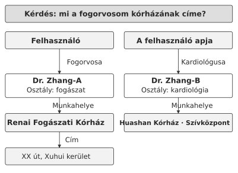

1. **Az azonos nevű entitások megkülönböztetése a gráf építésekor.** Az egyik Dr. Zhang a Renai Fogászati Kórházban kezeli a felhasználó fogait, a másik a Huashan Kórházban a felhasználó édesapjának szívbetegségét. Az entitások kinyerésekor és a bejegyzések összevonásakor a rendszer ezek alapján különböző azonosítót rendelhet a két orvoshoz. A korábban látott `person` és `relationship` mező is hasonló szerepet tölt be. Annak eldöntése, hogy a `bank` egy mondatban folyópartot vagy pénzintézetet jelent, a szójelentés egyértelműsítése; annak eldöntése, hogy egy bejegyzés melyik Dr. Zhangról szól, az entitások egyértelműsítése.
2. **Keresés a kapcsolati lánc mentén lekérdezéskor.** Ha a felhasználótól kiindulva lépésenként végighaladunk a „felhasználó → orvos → kórház → cím” láncon, a több bejegyzésben szétszórt információkat egyetlen válasszá kapcsolhatjuk össze.

A Microsoft GraphRAG indexelési folyamata először entitásokat és kapcsolatokat nyer ki a szövegegységekből, majd közösségfelismeréssel azonosítja a szorosan összekapcsolódó entitáscsoportokat, és ezekből közösségi hierarchiát és összefoglalókat állít elő. Egy adott entitásra vonatkozó lekérdezésnél a helyi keresés az entitás kapcsolódó információit és az eredeti szöveget használja; a teljes korpusz témáira vonatkozó lekérdezésnél a globális keresés a közösségi összefoglalókból építi fel a választ[^ch3-graphrag].

[^ch3-graphrag]: Microsoft GraphRAG, az indexelés és a lekérdezés áttekintése, helyi keresés és globális keresés.

A kapcsolatok ábrázolásának a feltételeket és az időt is be kell fogadnia. Például a „ha jövő héten is esik, lemondom a tengerpartot, és inkább múzeumba megyek” mondat feltételt, érvényességi időt és alternatív cselekvést tartalmaz. Ha csak a (felhasználó, tervez, tengerparti kirándulás) és a (felhasználó, alternatív terve, múzeumlátogatás) hármast nyerjük ki, elveszik a váltás feltétele. Megőrizhetjük a teljes eredeti mondatot, és feltételcsomóponttal, eseménycsomóponttal vagy strukturált mezőkkel ábrázolhatjuk a „ha jövő héten esik” megszorítást, a kapcsolatot pedig visszaköthetjük az eredeti szöveghez.

A felhasználói memóriánál inkább **a természetes nyelv és a strukturált index rétegzett együttműködését** ajánlom: a teljes közlést természetes nyelven őrizzük meg, metaadatokban rögzítjük a személyt, az időt és a forrást, a gyakran összekapcsolandó tartalmakhoz pedig gráfindexet építünk.

> **3-7. kísérlet ★★★: A hierarchikus összefoglalás és a kapcsolati index összehasonlítása**
>
> A kísérlet az Intel architektúra-kézikönyvének 14, az SSE-vel, az AVX-szel és az állapotkezeléssel foglalkozó oldalából két oktatási célú megvalósítást épít. A hierarchikus összefoglaló ág először oldalankénti összefoglalókat készít, majd ezeket három csoportba rendezi, és csoport-, valamint gyökérösszefoglalót állít elő; a kapcsolati index ág entitásokat és kapcsolatokat nyer ki, majd közösségi összefoglalókat készít. A két csoport ugyanazt az anyagot és ugyanazt a nyolc kérdést használja, és a fogalmi részleteket, illetve a kapcsolati következtetést hasonlítja össze.
>
> „Magyarázd el az SSE programozási környezetét” lekérdezésnél a hierarchikus összefoglalás egyszerre illeszkedhet az SSE áttekintéséhez és a regiszterek részleteihez. Ez a megvalósítás az összes szint csomópontjait együtt keresi, és a legrelevánsabb ötöt választja ki. A kapcsolati ág a releváns entitásoktól kiindulva kiterjeszti a szomszédságot, és a közösségi összefoglalók segítségével állítja össze a kontextust. Egy „SSE → XMM regiszterek → lebegőpontos műveletek → ADDPS” típusú kapcsolati lánc mentén a fogalmak a konkrét utasításokhoz köthetők.
>
> Összetettebb kérdés: „Ha a processzor jelzi az AVX támogatását, használhatja-e a program az AVX-et?” Ehhez a processzor képességeit össze kell kapcsolni az operációs rendszer állapotkezelésével: ellenőrizni kell a CPUID AVX és OSXSAVE jelzőbitjét, majd ki kell olvasni az XCR0 regisztert, és meg kell győződni arról, hogy az XMM és az YMM állapot is engedélyezve van. Ennél a feladatnál a gráfkereső program a CPUID és az YMM végpontokat kapja meg támpontként. A program megkeresi a kettőt összekötő legrövidebb utat, amely az XSAVE, a CR4.OSXSAVE és az XCR0 csomóponton halad át, majd ezt az utat adja át a modellnek a válaszadáshoz.
>
> A nyolc kérdésen a két csoport forrásoldal-lefedettsége átlagosan egyaránt körülbelül 95,8%.

Azt javaslom, hogy először a darabolást és a hibrid visszakeresést tegyük rendbe, és csak akkor építsünk strukturált indexet, amikor ismétlődően felmerül a dokumentumokon átívelő szintézis és a kapcsolati lekérdezés igénye. Egy adott visszatérítési szabály megtalálása általában darabolással és hibrid visszakereséssel is megoldható; az SSE és az AVX összevetéséhez vagy ahhoz, hogy a teljes architektúrától eljussunk egy konkrét utasításig, már inkább szakaszokon átívelő összefoglalókra és kapcsolati indexre van szükség.

### A fájlrendszer-paradigma: a tudás szervezése könyvtárszerkezettel

Az **OpenViking** virtuális fájlrendszerben szervezi a memóriát, az erőforrásokat és a készségeket. Minden bejegyzésre egy `viking://` URI hivatkozik, az Ágens pedig böngészheti a könyvtárakat, elolvashatja az áttekintéseket, majd megnyithatja a szükséges tartalmat[^ch3-openviking-uri]. Az információ rendeltetése szerint a könyvtárakat három csoportra oszthatjuk: külső erőforrások, felhasználói adatok, valamint az Ágens által használt készségek és tapasztalatok. A felhasználói és az Ágens-azonosítók tovább szűkítik a saját névtereket.

| Tartalom | Jellemző felhasználás |
| --- | --- |
| Resources | Műszaki dokumentáció, kódtárak, weboldalak és más külső anyagok |
| User memories | Egy adott felhasználó preferenciái, szokásai és élményei |
| Skills és Agent memories | Újrafelhasználható folyamatok, feladatnaplók és még ellenőrizendő tapasztalatok |

Az URI egységes címzési módot ad, a fizikai tárolást és az indexelést a szolgáltatás kezeli. A könyvtárinterfész révén az Ágens téma szerint, szintről szintre böngészhet, és a szemantikus keresést is a releváns részfára korlátozhatja. A fájlrendszer-jellegű hozzáférés, a tartalomtárolás és a vektorindex együtt alkothatja a szolgáltatást.

[^ch3-openviking-uri]: OpenViking, Viking URI és rendszerarchitektúra.

Az OpenViking három szintre osztja a tartalmat: **L0, L1, L2**. Az L0 rövid összefoglaló, amelyből gyorsan eldönthető, releváns-e egy könyvtár; az L1 a könyvtár áttekintése, amely leírja a fő tartalmat és a navigációs belépési pontokat; az L2 a részletes olvasást igénylő törzsszöveg. A könyvtárszintű összefoglaló és áttekintés a `.abstract.md`, illetve a `.overview.md` fájlban található. A két szöveg előállítási kerete 256, illetve 4000 karakter[^ch3-openviking-layers].

A lekérdezés először az összefoglaló alapján tájékozódhat, aztán az áttekintés alapján választhat fájlt, végül betöltheti az eredeti szöveget. Ez rokon a 2. fejezetben tárgyalt Skills fokozatos feltárásával: a könnyű könyvtár segíti a felfedezést, a teljes tartalom pedig a feladat igénye szerint töltődik be. Ha pontos számértékekre, feltételekre vagy eredeti megfogalmazásra van szükség, a megfelelő törzsszöveget is elő kell keresni.

[^ch3-openviking-layers]: OpenViking, Context Layers (L0/L1/L2). Az L0 és az L1 könyvtárszinten generált ábrázolás; az L2 lehet az eredeti fájl vagy a feldolgozott törzsszöveg.

Az emberek és Ágensek által közösen karbantartott tudáshoz a **Markdown formátumú egyszerű szöveget és a verziókezelést** tartom a legjobbnak. Az emberek közvetlenül olvashatják, szerkeszthetik és javíthatják a tudást, az Ágens pedig ugyanezen a fájlinterfészen keresztül munkaágon javasolhat frissítéseket, amelyek felülvizsgálat után jelennek meg. A verziókezelés minden módosítás különbségét megőrzi, és a hibás frissítések visszavonását is lehetővé teszi. A szekció végén a felhasználói preferenciák az adott felhasználó memóriájába, a műveletek menete a feladatnaplóba kerül. A feladatnaplókból az eredmények értékelése, a trajektóriákon átívelő általánosítás és a későbbi ellenőrzés után a 9. fejezetben tárgyalt tapasztalat formálódhat.

Ha fájlrendszerben szervezzük a tudást, **a kapcsolódó bejegyzések közé linkeket és indexeket is kell építeni**. Az egymásra nem hivatkozó fájlok között a kapcsolatokat csak teljes szöveges kereséssel vagy szemantikus visszakereséssel lehet újra megtalálni; minél több a fájl, annál nehezebben tud az Ágens a már megtalált tartalomból kiindulva továbbhaladni. A linkek egyértelmű keresési utat adnak: a visszatérítési szabályzat mutathat a kivételekre vonatkozó feltételekre, a szerződés-összefoglaló az aláírási bejegyzésre, a személyekről szóló bejegyzés a kapcsolódó eseményekre. A belépőoldal a fő témákat ismerteti, az indexoldal navigációt kínál, a bejegyzések közötti kereszthivatkozások pedig az oldalirányú keresést támogatják. Ez a lexikonszócikkek szervezéséhez hasonló, és viszonylag könnyű eszközökkel őrzi meg a kapcsolatok egy részét.

Az adatbázis építésekor azt is jelölhetjük, mely bejegyzések használhatók együtt, és mely forgatókönyvek közül lehet egy ügyintézés során csak egyet választani. Amikor például az ügyfélszolgálat egy rendelés lemondását intézi, a válaszban egyszerre kell betartani a megfogalmazási és az adatvédelmi előírásokat, így a két előírás együtt kerülhet a kontextusba. Ha a raktár két forgatókönyvet készített elő a szállítás lemondására, az indexben egyértelműen le kell írni, melyik milyen feltétellel alkalmazható. Ugyanannál a csomagnál, ha még nem hagyta el a raktárt, visszavonjuk a kiadási bizonylatot, ha már átadták a fuvarozónak, feltartóztatást kérünk. Ha a hibajegyben csak annyi áll, hogy „kérem, mondják le a rendelést”, az Ágensnek előbb ellenőriznie kell a csomag állapotát, és csak azután töltheti be az érvényes forgatókönyvet.

A linkek karbantartását a frissítési folyamatba kell beépíteni: új bejegyzés felvétele előtt keressük meg a meglévő bejegyzéseket, és döntsük el, hogy összevonunk vagy újat hozunk létre; írás után egészítsük ki a kapcsolódó hivatkozásokat, és frissítsük a szülőkönyvtár indexét. A link elvezeti az olvasót a feltételhez, de hogy a feltétel vonatkozik-e az adott rendelésre, az attól függ, mikor lépett hatályba.

### Hogyan frissítsük a tudást?

Ha egy szabályzat ma megváltozik, a felhasználó holnap kérdezheti azt, hogy „most mi a teendő”, de azt is, hogy „a múlt havi rendelésemet miért intézték úgy, ahogy”. Ha az új feltételekkel egyszerűen felülírjuk a régieket, a második kérdés elveszíti az akkori alapját. A **növekményes frissítés** időben beírja az új bizonyítékot, a **rendszeres átszervezés** pedig szélesebb körben tárja fel az ismétlődéseket, ütközéseket és szerkezeti változásokat; mindkét útnak meg kell őriznie a verziókat és a bizonyítékhivatkozásokat, és közzététel előtt ellenőrzést kell végeznie, hogy a kérdéshez illő időszakot lehessen kiválasztani.

#### A felhasználói memória és a tudásbázis növekményes frissítése

Azt javaslom, hogy **a tudásbázist kezeljük kódtárként, minden tudásmódosítást pedig Pull Requestként (PR).** Egy frissítésnek világos hatókörrel kell rendelkeznie, és mellékelnie kell a módosítást alátámasztó bizonyítékokat, hogy a felülvizsgáló ellenőrizhesse őket. A Markdown-dokumentumok, a szabályfájlok és a User as Code végrehajtható állapota egyaránt bevonható ebbe a folyamatba. A verziótörténet segít a karbantartóknak áttekinteni a változásokat, felderíteni az okokat, és hibás közzététel után visszaállítani a korábbi állapotot.

Az 1. fejezetben bemutatott **Javaslattevő–Felülvizsgáló** mintát követve egy frissítés így zajlhat:

1. **A javaslattevő elkészíti a módosítást.** A Proposer Agent elolvassa az új bizonyítékot, átnézi a meglévő tudást, megkeresi az új, a helyesbítendő vagy az elavult bejegyzéseket, és munkaágon világos hatókörű módosítást javasol. Közben karbantartja a kapcsolódó linkeket, a könyvtárindexeket, az időadatokat és a bizonyítékhivatkozásokat.
2. **A felülvizsgáló függetlenül ellenőriz.** A Reviewer Agent a módosítás előtti és utáni tartalmat az eredeti bizonyítékokkal veti össze: ellenőrzi, van-e forrása minden új állításnak, teljesek-e az alkalmazási feltételek, egybehangzanak-e a különböző fájlok állításai, és nincs-e a törölt bekezdésekben még használható információ. Ha problémát talál, megnevezi a konkrét bejegyzést és az indoklást, és megmondja, mit kell kiegészíteni, visszaállítani vagy helyesbíteni.
3. **Iteráció és döntés.** A javaslattevő a megjegyzések alapján módosít, a felülvizsgáló pedig újra ellenőriz. Jóváhagyás után a módosítás a beolvasztási folyamatba kerül; ha a körök vagy a költségek felső határának elérésekor még mindig van vita, a módosítás a munkaágon marad, és emberi felülvizsgálatra kerül.
4. **Ellenőrzés és közzététel.** Automatikus ellenőrzés fut a formátumra, a linkekre, a metaadatokra és a jogosultsági címkékre; a végrehajtható tudásnak típusellenőrzésen és a kapcsolódó teszteken is át kell mennie. A beolvasztás után a rögzített tudásverzióból újraépítjük az érintett darabokat, összefoglalókat és vektorindexeket, majd közzétesszük a szolgáltatás új verzióját.

Ez a folyamat három adatrétegnek felel meg. Az **eredeti bizonyítékréteg** a párbeszédeket, a végrehajtási trajektóriákat, az üzleti dokumentumokat és az eszközeredményeket őrzi; a **tudásréteg** a finomított, javítható szöveget vagy kódot; a **kiszolgálási réteg** az adott tudásverzióból előállított indexeket. A változásnapló összekapcsolja a bizonyítékazonosítókat, a tudásverziót, a felülvizsgálati megjegyzéseket és a végső döntést, így a karbantartók visszakereshetik, miért és mikortól került be egy adott tudáselem. Az eredeti bizonyítékokat a megőrzési szabályok szerint archiváljuk, az indexek pedig a tudásverzióból újragenerálhatók. A korábban tárgyalt hozzáfűzéses memória az új és a régi tények forrásukkal együtt történő megőrzésére alkalmas; az itteni felülvizsgálati folyamat feladata, hogy ezeket a bizonyítékokat használható tudásverzióvá rendezze. Ha lekérdezéskor még megoldatlan ütközésbe ütközünk, továbbra is visszanyúlhatunk a bizonyítékokhoz, és a feladat feltételei alapján dönthetünk.

Ebben a kialakításban **a javaslattevőnek és a felülvizsgálónak is olyan Ágensnek kell lennie, amely eszközöket hívhat, és folyamatosan lekérdezhet.** A javaslattevőnek esetleg több bejegyzést kell átkutatnia, hogy megtalálja az érintett elemeket; a felülvizsgáló is továbbhaladhat a hivatkozások mentén, verziókat hasonlíthat össze, vagy ellenőrzéseket futtathat. A fájlkereső, a bizonyítékkereső, a különbségmegjelenítő és a tesztelő eszközök révén elvégezhetik ezeket a további lépéseket; egy megfelelő képességű Coding Agent el is láthatja ezt a munkát.

Mindkettő keresési hatókörének ki kell terjednie az aktuális módosítás által érintett tudásra és az eredeti bizonyítékokra, és a felhasználói, bérlői és feladatszintű jogosultságok korlátozzák. A felülvizsgálati trajektóriát, a hivatkozott eszközeredményeket és a visszajelzéseket együtt archiváljuk, hogy később ellenőrizni lehessen, mit vizsgált meg ténylegesen a felülvizsgáló.

A modellválasztásnál azt javaslom, hogy hasonló képességű, de különböző családból származó modelleket párosítsunk, például Claude-ot és GPT-t, vagy DeepSeeket és Kimit. Az eltérő tanítóadatok és következtetési szokások eltérő ítéletekhez vezethetnek. A felülvizsgálónak önállóan kell bizonyítékot keresnie, és ellenőriznie kell a módosítás állításait és feltételeit. A jogosultságokat a futtatórendszernek kell érvényesítenie: a javaslattevő a munkaágra ír, a felülvizsgáló bizonyítékokat olvas és állásfoglalást ad le, a főtár és az éles indexek frissítési jogosultsága pedig a beolvasztási és közzétételi szolgáltatásé.

#### A felhasználói memória és a tudásbázis rendszeres átszervezése

Sok helyi frissítés után ugyanaz a tény több fájlban is szétszóródhat, és a régi és új megfogalmazások egymás mellett élhetnek. A rendszeres átszervezés könyvtár, idő vagy téma szerint indulva vizsgálja ezeket a felhalmozódott problémákat. Működésmódja közös a 9. fejezetben tárgyalt időszakos áttekintéssel: az előtérben új bizonyítékok gyűlnek, a háttérben ezeket összegezve rendezzük, és a későbbi feladatok számára használható bejegyzéseket alakítunk ki.

Az átszervezés három feladatból áll.

1. **Duplikációk kiszűrése, összevonás és szerkezeti átalakítás.** Megkeressük az ismétlődő, elavult vagy túlságosan széttöredezett bejegyzéseket, összevonjuk a kapcsolódó tartalmakat, felosztjuk a túl nagy fájlokat, és frissítjük a linkeket, a belépő- és az indexoldalakat. Ha a szolgáltatásból régi megfogalmazást törlünk, rögzítjük, mi váltotta fel, és mi volt az eredeti alapja.
2. **Visszanyúlás az eredeti anyagokhoz.** Ha minden átszervezési kör csak az előző kör összefoglalóit írja át, a korai kihagyások és félreértések körről körre továbböröklődnek. Ezért az összefoglalókat a párbeszédekkel, a végrehajtási trajektóriákkal, az üzleti dokumentumokkal és az eszközkimenetekkel összevetve kell ellenőrizni: nem maradt-e ki lényeges tény, nem veszett-e el tagadás, időpont vagy feltétel, és nem lett-e egy feltételezésből biztos következtetés. A nagy tudásbázisok könyvtár, idő vagy téma szerint kötegekben dolgozhatók fel; egy lefedettségi lista rögzíti az ellenőrzött, a még ellenőrizendő és a vitatott részeket, amíg a teljes tár átvizsgálása be nem fejeződik.
3. **Ütközések és alkalmazási kör kezelése.** Össze kell vetni az egymásnak ellentmondó bejegyzések forrását, valamint az időpontot, a személyt, a földrajzi területet, a feladatot és az előfeltételeket. Ha a két információ különböző helyzetekre vonatkozik, mindkettőnél ki kell egészíteni az alkalmazási kört; ha az új bizonyíték egyértelműen felváltja a régi szabályt, rögzíteni kell a verziók közötti kapcsolatot; ha nincs elég alap, fel kell jegyezni a tisztázandó kérdéseket és a még szükséges bizonyítékokat.

Az átszervezés eredményét szintén módosításként kell felülvizsgálatra benyújtani. A nagyobb átszervezések könyvtár vagy téma szerint több PR-re bonthatók, amelyek közös átszervezési tervet és lefedettségi listát használnak; a kapcsolódó módosítások jóváhagyása után újraépítjük a származtatott indexeket, és lefuttatjuk a jellemző keresési és kérdés-válasz eseteket, hogy ellenőrizzük, továbbra is elérhető-e a korábban megtalálható tudás. Az átszervezést elindíthatjuk heti, havi vagy más rendszerességgel, de küszöbértékeket is megadhatunk az új bejegyzések száma, az ütközések száma vagy a keresési minőség változása alapján.

**Az érvénytelen tartalom kivezetése.** A daraboknak és összefoglalóknak meg kell őrizniük a verziót, a hatálybalépés és a hatályvesztés idejét. Ha egy régi szabályzatot felváltottak, az aktuális üzleti lekérdezések kiszűrik a hatályukat vesztett verziókat; a múltra vonatkozó lekérdezések viszont a célidőpontban érvényes szabályt olvassák ki. Így a legfrissebb tudást használhatjuk, és a korábbi döntéseket is meg tudjuk magyarázni.

**Jogosultságok és bérlői elkülönítés.** A jogosultsági szűrést a visszakeresési rétegben kell elvégezni: a keresőszolgáltatás először a hívó személyazonossága alapján határolja körül a kereshető dokumentumokat, és csak ezen belül keres releváns anyagokat. Ha egyszer más felhasználók privát adatai bekerülnek a kontextusba, a modell válaszadáskor vagy eszközhíváskor kiszivárogtathatja őket. Az eredeti szövegnek, az összefoglalóknak, a kapcsolati éleknek és a gyorsítótárazott eredményeknek egyaránt örökölniük kell a megfelelő hozzáférési kört, nehogy a származtatott tartalmakon keresztül más felhasználók vagy bérlők adatai kerüljenek ki. A szolgáltatás használhat különálló indexeket vagy kötelező szűrést támogató megosztott indexet; a lényeg, hogy minden lekérdezésre érvényesüljenek a jogosultsági korlátozások.

### Ágens RAG: a visszakeresést az Ágens irányítja

Először kérdezzük meg, elég-e egyetlen keresés. Ha valaki azt kérdezi, „mi az ügyfélszolgálat telefonszáma”, egyetlen hatályos szervizkézikönyv gyakran megadja a választ; ilyenkor azt javaslom, maradjunk az egyszerű, egyszeri keresés és generálás útján. Ha viszont a felhasználó azt kérdezi, „kicserélhetem-e a megvásárolt típust a múlt havi garanciális feltételek szerint”, az első keresés csak a termékcsaládot találja meg, és ebből még nem dönthető el, milyen cserefeltételek voltak érvényben a múlt hónapban. Ha a keresést eszközként tesszük elérhetővé, az Ágens az előző keresés által visszaadott nyomokból építheti fel a következő lekérdezést. Ezt a megközelítést, amelyben az Ágens dönti el, keres-e tovább, és mire keres rá ezután, **Ágens RAG-nak (Agentic RAG)** nevezzük. A 3-12. ábrán az első keresés pontosan ugyanazt a termékadatot adja vissza. Milyen további nyomot használ a jobb oldali útvonal, hogy megtalálja az akkor érvényes feltételeket?

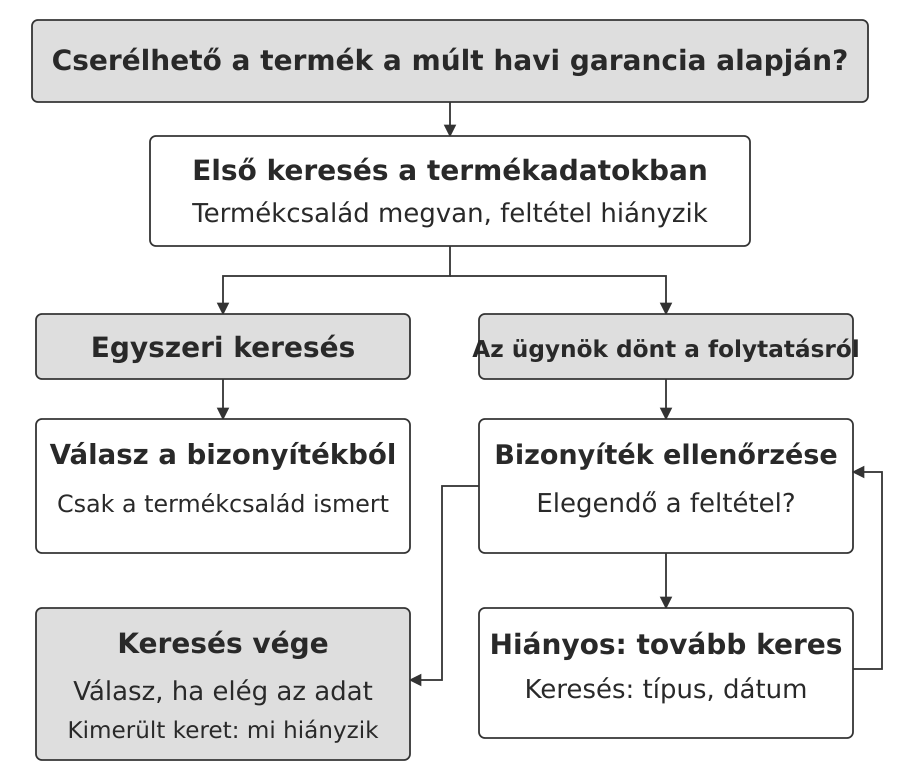

A ReAct példáján a modell először elemzi a kérdést, kiválasztja a lekérdezést, és meghívja a `knowledge_base_search` eszközt; miután az eszköz visszaadta a megfigyelést, a modell eldönti, elegendő-e a bizonyíték. Ha hiányzik egy feltétel vagy egy kapcsolódó szereplő, átfogalmazza a lekérdezést, és tovább keres; ha az anyag már elegendő, a források alapján megfogalmazza a választ. A Harness kezeli az előzményeket, az eszközhívásokat és a keretet, és a korlát elérésekor befejezi a keresést, vagy tisztázó kérdésre vált.

Nézzük most a 3-13. ábrát. Ha a tudásbázis háttérrendszerét vektorindexről kapcsolati gráfra cseréljük, a modell ugyanazon az eszközinterfészen keresztül kérhet keresést. Ha a visszaadott dokumentumban véletlenül egy utasítás is szerepel, végrehajthatja-e azt a modell?

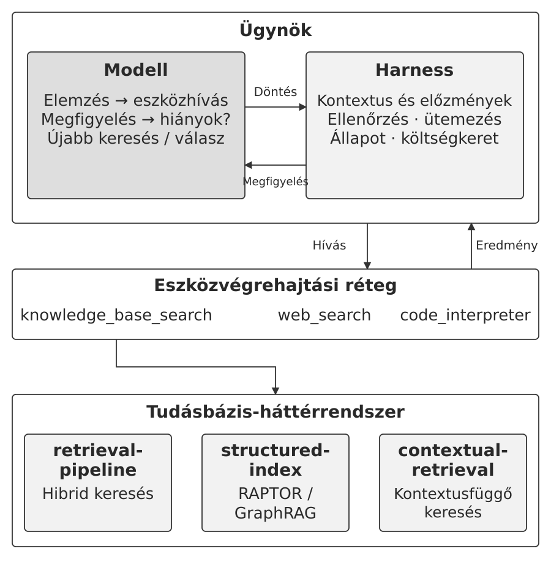

**A visszakeresett tartalom bizalmi határa.** A külső dokumentumok tartalmazhatnak olyan szöveget, amely a modell viselkedését próbálja megváltoztatni, és az adatbázisba kerülésük előtt hamis tények is bekerülhetnek beléjük. Az előbbi közvetett promptinjektálás, az utóbbi a tudásbázis mérgezése. Kezelésükhöz egyszerre kell gondoskodni a tartalom forrásáról és a végrehajtási jogosultságokról: a keresési találatok forrással, verzióval és hivatkozási hellyel együtt szolgálnak a válasz bizonyítékául; az átutalásokat, törléseket, külső levélküldést és más műveleteket viszont a Harness és a végrehajtási környezet a felhasználói felhatalmazás alapján ellenőrzi. A bekerülés előtti felülvizsgálat, a források visszakövetése és a tényellenőrzés tovább korlátozza a hibás tudás terjedését. Itt a 2. fejezetben bemutatott forrásjelölés és a 4. fejezet eszközkorlátozásai együtt fejtik ki hatásukat.

> **3-8. kísérlet ★★: Az egyszeri és a többkörös keresés összehasonlítása**
>
> A kísérlet ugyanazzal a kínai jogi anyaggal, ugyanazzal a BM25-keresővel és ugyanazzal a modellel hét kérdésen hasonlít össze két módot: az alapváltozat egyszer keres az eredeti kérdéssel, az Ágens-mód megengedi, hogy a modell módosítsa a lekérdezést, és legfeljebb négyszer keressen.
>
> Az olyan lekérdezéseknél, mint „hogyan szabályozza a törvény a jogos védelmet”, közvetlen kereséssel is megkapjuk a fő jogszabályhelyeket. Összetettebb példa: „Hogyan kell büntetést kiszabni, ha valaki ittas állapotban gondatlanságból súlyos testi sértést okoz, és korábban lopásért már elítélték?” Ez egyszerre érinti a jelenlegi cselekményt, az ittas állapotot és a korábbi előéletet, ezért keresés közben külön-külön meg kell találni a vonatkozó anyagokat, majd ellenőrizni kell az alkalmazási feltételeket.
>
> A tényleges futás sorra a következőkre keresett: „ittas gondatlan súlyos testi sértés lopási előélet büntetéskiszabás”, „ittasság bűncselekmény büntetéskiszabás”, „lopási előélet büntetéskiszabásra gyakorolt hatás büntető törvénykönyv” és „előélet büntetéskiszabásra gyakorolt hatás büntető törvénykönyv”. Ezután a modell még a „visszaesés megállapítása büntető törvénykönyv” lekérdezést is javasolta, de ekkorra elfogyott a keresési keret, és a Harness a keret kimerülését jelző üzenetet adta vissza.
>
> A kísérletben elkülönített négy összetett kérdésen a céljogszabályok lefedettsége körülbelül 8%-ról 92%-ra nőtt, a keresések átlagos száma egyről 3,5-re emelkedett, a válaszadási szakasz átlagos ideje pedig körülbelül 8 másodpercről 66 másodpercre nőtt. A három egyszerű kérdésnél a bizonyítékok lefedettsége mindkét csoportban 100% volt, és mindkettő csak egyszer keresett.

Ugyanez a keresési ciklus a felhasználói előzményekre is alkalmazható. Az alábbiakban a 3-1. kísérlet háromszintű értékelőkészletével vizsgáljuk meg, hogyan keresi vissza az Ágens a tényeket a szekciókon átívelő bejegyzésekből, hogyan különbözteti meg a szereplőket, és hogyan kezeli a frissítéseket.

> **3-9. kísérlet ★★: Felhasználói memória olvasása Ágens-kereséssel**
>
> A kísérlet a teljes párbeszéd-előzményt tudásbázisként kezeli: ablakok szerint feldarabolja és indexeli, majd az Ágens rendelkezésére bocsátja a `search_user_memory` eszközt. Az ablak mérete állítható; ebben a futtatásban minden darab nyolc párbeszédfordulót tartalmazott, a szomszédos darabok két fordulóval fedték át egymást, és a szekcióazonosító, az időpont és az üzleti metaadatok is mentésre kerültek. Legfeljebb három lekérdezés futott, mindegyik négy szövegrészt hozott vissza.
>
> Az alapvető felidézésnél egyértelmű mezőre lehet keresni, például: „mi a folyószámlám száma?” A többszekciós kérdéseknél azt is ellenőrizni kell, hogy minden érintett szereplő megvan-e: ha a felhasználónak egy Honda Accordja és egy Tesla Model 3-asa is van, a járművek szervizidőpontjairól szóló kérdésnél a rendszernek meg kell különböztetnie a két autót és azok foglalási állapotát.
>
> Ennek alapján megtervezhetünk egy keresési útvonalat: először a járművekre és a szervizbejegyzésekre keresünk; ha előkerül a másik autó nyoma, rákeresünk a Tesla időpontjaira; végül ismertetjük a Honda meglévő foglalását, és megkérdezzük, kell-e időpontot foglalni a Teslának is. A tényleges futás csak a `scheduled car services` lekérdezést hajtotta végre, és a normál keresési csoport válasza a Hondára összpontosított, a Teslát kihagyta.
>
> Egy másik nehézséget az egymást követő módosítások okoznak. Az átutalási esetben a feleség beállít egy átutalást, a férj ezután módosítja az összeget és a dátumot, majd a feleség ismét változtat rajta. A bejegyzések visszakeresése után időpont, személy és megerősítési állapot szerint kell rekonstruálni a változásokat, és meg kell találni a végül hatályos utasítást. A jelenlegi darabolás már tárolja az időadatokat, a keresés mégis kihagyhatja a kulcsfontosságú módosításokat, ezért a szövegrészeket érdemes tovább kiegészíteni az események hátterével.
>
> A 60 esetből 18-nál egyszer, 6-nál kétszer keresett az Ágens, 36-nál pedig mindhárom keresést felhasználta. A normál darabolásos keresési csoport 47 esetet teljesített: 19-et az alapvető felidézésnél, 15-öt a többszekciós keresésnél és 13-at a proaktív szolgáltatásnál. A következő szakasz ugyanezeken az eseteken hasonlítja össze a kontextuselőtagokat és a strukturált memóriát, és megvizsgálja, milyen információval egészítik ki a keresést.

### Kontextusérzékeny visszakeresés: háttér hozzáadása a szövegrészekhez

Térjünk vissza a pénzügyi jelentéshez. Ha az ACME vállalat 2025. második negyedéves eredményeit keressük, a lekérdezésben szerepel a cégnév és az év, a „vállalat bevétele 3%-kal nőtt” mondatot tartalmazó szövegrészben viszont éppen ez a két szó hiányzik. A darabok növelése helyett meg is tarthatjuk ezt a rövid szöveget, és elé írhatjuk a hiányzó hátteret. A **kontextusérzékeny visszakeresés (Contextual Retrieval)** indexeléskor rövid háttér-előtagot generál a szövegrészekhez, és az előtagot az eredeti szöveggel együtt használja a kereséshez[^ch3-1]. A 3-14. ábra ezt a feldolgozási folyamatot mutatja.

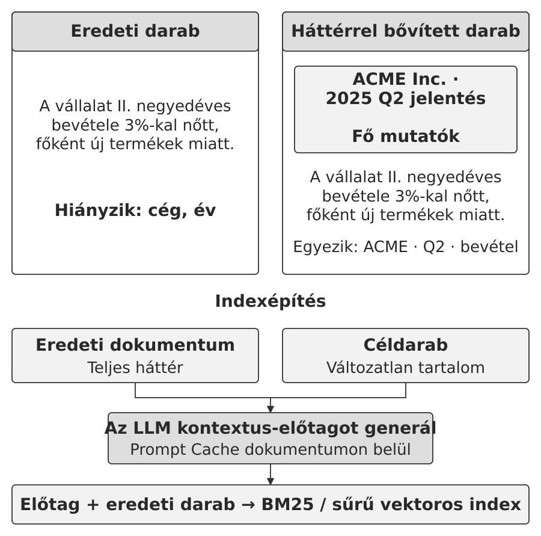

Az előtag például így szólhat: „Ez a szövegrész az ACME vállalat 2025. második negyedéves jelentésének fő teljesítménymutatókról szóló részéből származik.” Generáláskor az eredeti dokumentumot és a céldarabot együtt adjuk át a modellnek, hogy az valóban megalapozott hivatkozási, időbeli és fejezetinformációkkal egészítse ki a darabot. Így a BM25 olyan illeszthető szavakat kap, mint a cégnév és a negyedév, és a sűrű beágyazás is ezzel a háttérrel együtt ábrázolhatja a szövegrészt.

Ez jól kiegészíti a 2. fejezetben tárgyalt kontextusérzékeny tömörítést: indexeléskor háttérrel látjuk el a tudásdarabokat, hogy nagyobb eséllyel kerüljön elő a releváns információ; futás közben pedig az aktuális feladat szerint rendezzük a már visszakeresett előzményeket, és kordában tartjuk a bemenet hosszát. Az előbbi a szövegrészek visszakereshetőségével, az utóbbi az aktuális döntéshez szükséges információval és a kerettel foglalkozik.

[^ch3-1]: Anthropic, Introducing Contextual Retrieval, 2024. szeptember.

> **3-10. kísérlet ★★: Az eredeti és a kontextussal bővített darabok összehasonlítása**
>
> A kísérlet ugyanahhoz az anyaghoz két indexet épít: az egyik az eredeti szövegrészeket használja, a másik a modell által generált előtagokkal kiegészített változatot. A lekérdezéseket és a célannotációkat változatlanul hagyva külön-külön összehasonlítjuk a BM25-öt, a sűrű keresést és a hibrid keresést.
>
> A korábbi pénzügyi jelentés példájánál maradva, „az ACME vállalat legutóbbi bevételnövekedése” lekérdezésnél ellenőrizhetjük, hogy a találatként kapott szövegrész egyszerre tartalmazza-e a célvállalatot, az időszakot és a növekedési adatot. A puszta „bevételnövekedés” más vállalatokra is illeszkedhet; az előtag hozzáadása után a cégnév és az időpont is részt vehet a rangsorolásban.
>
> Ebben a 15 lekérdezésben az előtagok hozzáadása után a BM25 recall@1 értéke 0,60-ról 0,80-ra, a sűrű kereséséé körülbelül 0,867-ről 0,933-ra nőtt; a recall@3 a kettőnél változatlanul 0,867, illetve 1,0 maradt. A hibrid keresés recall@5 értéke 14/15-ről 15/15-re javult. Melyik kérdés került elő pluszban? Az Országos Népi Gyűlés Állandó Bizottságának hatásköreire vonatkozó lekérdezésnél a célszövegrész felsorolta a hatásköröket, de hiányzott belőle az alany. Az előtag hozzáadása után a BM25 a 16. helyről a 12.-re emelte, ami még mindig kívül esik az első ötön; a hibrid keresés a 6. helyről az 5.-re hozta fel, és csak így került be az első ötbe. Ha megnézzük az eredeti szöveget, az első szövegrész az (1)–(4). pontban felsorolt hatásköröket tartalmazza, az ötödik szövegrész pedig a (4). ponttól a (22).-ig folytatja. A pontozás csak azt nézi, bekerült-e az annotált ötödik szövegrész, a hatáskörök teljes felsorolásához viszont a két részt össze kell illeszteni.
>
> Az előtagok generálása indexeléskor többlethívásokat jelent. Ha ugyanazon dokumentum több darabjához generálunk hátteret, a dokumentum előtag-gyorsítótára újrahasznosítható. Az Anthropic 2024-es jelentésében 800 tokenes darabokkal, 8000 tokenes dokumentumokkal és megadott prompthosszal számolva a dokumentumtokenek millióján számított egyszeri feldolgozási költség körülbelül 1,02 dollár.
>
> A jelentés szerint a kontextuális beágyazás BM25-tel kombinálva a top-20 keresési hibaarányt 5,7%-ról 2,9%-ra csökkentette, ami nagyjából 49%-os relatív csökkenés; újrarangsorolással kiegészítve 1,9%-ra, ami nagyjából 67%-os relatív csökkenés. A jelentés a hibaarányt $1-\mathrm{recall@20}$ szerint határozza meg.

Az ismételten lekérdezett, viszonylag stabil tartalmú anyaggyűjteményeknél azt javaslom, hogy a szövegrészek hátterét indexeléskor egészítsük ki; egyetlen feldolgozás a későbbi lekérdezések sokaságát szolgálja ki. Ha a cégnév, az esemény alanya és az időpont darabolás közben elveszett, a keresett elemek számának puszta növelésével is könnyen csak egy sor homályos hivatkozású szövegrészt kapunk vissza. Ha az előtag generálásakor pótoljuk ezeket a nyomokat, a későbbi keresés ezek alapján találhatja meg az anyagot.

> **3-11. kísérlet ★★★: A memória bővítése kontextuselőtagokkal és strukturált kártyákkal**
>
> A párbeszédben elhangzó „rendben, akkor ezt foglald le” mondatot a korábban említett termékhez vagy úthoz kell kapcsolni. Ha az eredeti szöveg egy Sanghaj–Seattle, 500 dolláros egyirányú repülőjegyről szólt, az előtag ezzel a háttérrel egészítheti ki, és megőrizheti a megerősítés szekcióját és időpontját is.
>
> A kísérlet a normál darabolás mellé két további konfigurációt vesz fel: a kontextuselőtag-csoportot, valamint az Advanced JSON Cards kártyákat is betöltő kétrétegű memóriacsoportot. A modell először a normál index alapján generál keresési sorozatot, majd ugyanezeket a lekérdezéseket mindkét indexen lefuttatjuk; a kétrétegű csoport ugyanazokat a bővített keresési eredményeket használja, és strukturált kártyákkal egészíti ki őket.
>
> Az átutalási esetben az előtagok rendre jelzik, hogy Patricia indította az átutalást, James módosította, majd Patricia ismét változtatott rajta, ami segít az események sorrendjének megállapításában. Az eredeti bejegyzések szerint a végső állapot 95 000 dollár, október 1-jei dátummal, a korábbi beállítások pedig érvényüket vesztették. Ebben a futtatásban mindhárom csoport helyesen megtalálta ezt az állapotot.
>
> A kétrétegű szerkezet a proaktív összekapcsolást is támogathatja. A kártyák az olyan kulcsfontosságú tényeket tárolják, mint a „tokiói út” és az „útlevél érvényessége”, a részletes párbeszédeket pedig szükség szerint keressük vissza. Egy január 15. és 22. közötti út és egy február 18-án lejáró útlevél esetén a rendszer először észreveheti, hogy a dátumok közel esnek egymáshoz, aztán rákereshet a megújítási bejegyzésekre és az utazási követelményekre, végül emlékeztetheti a felhasználót a még el nem végzett előkészületekre. Ebben az utazási esetben mindhárom csoport válasza átment a bírálaton; a kártyák és a keresés közötti különbség főként az alábbi járműves és szekciókon átívelő esetekben mutatkozik meg.
>
> Mind a 60 esetből a normál keresés 47, a kontextuselőtag 52, a kétrétegű memória 57 esetet teljesített. Az előtagcsoportnál a proaktív szolgáltatás sikeres eseteinek száma 13-ról 18-ra nőtt; a kétrétegű csoport a többszekciós keresési szinten mind a 20 esetet teljesítette, a proaktív szolgáltatási szinten szintén 18-at. A járműves esetben a kártyák pótolták a második autó adatait, így a válasz a korábban kihagyott szereplőre is kiterjedt. Nézzünk meg egy visszalépést is: a felhasználó azt kérdezte, mire terjed ki az ingatlana vízkárbiztosítása; a normál csoport megemlítette a saját lakást és a bérbe adott lakást is, az előtagcsoport viszont kihagyta a bérbe adott lakást. A feladatonkénti összevetés szerint az előtagcsoport 8 olyan kérdést oldott meg, amelyet a normál csoport nem, viszont 3 korábban helyesen megválaszolt kérdést elrontott.

**Ha proaktív szolgáltatásra van szükség, a kétrétegű architektúrát részesítem előnyben, amelyben a kulcsfontosságú tények állandóan jelen vannak, a részletes bejegyzéseket pedig igény szerint keressük vissza.** Pusztán kereséssel a modellnek gyakran előbb tudnia kell, mit kérdezzen, hogy megtalálja a releváns bejegyzéseket; a még látókörén kívül eső útlevél, jármű vagy családi kapcsolat így könnyen kimarad. Ha néhány kulcsfontosságú tényt előre a kontextusba teszünk, az segít a modellnek felismerni az összefüggéseket, lekérdezéseket megfogalmazni, majd előkeresni az eredeti részleteket. Az állandóan jelen lévő információk kiválasztásakor figyelembe kell venni a személyes kapcsolatokat, az aktuális megkötéseket és a függőben lévő teendőket; a keresési találatoknak pedig meg kell őrizniük a forrást, az időpontot és a módosítások indoklását.

### Tudás kinyerése adathalmazokból: az esetektől a strukturált ábrázolásig

A tudás nagy mennyiségű eset rendszerezéséből is származhat. Az ítéletekben, ügyfélszolgálati hibajegyekben és javítási naplókban sok hasznos információ szétszórva, konkrét leírásokba ágyazva található. Ha a feladat nagy mennyiségű esetből kíván szabályszerűségeket általánosítani, eredményeket összevetni, vagy eldönteni, mire kérdezzünk rá, azt javaslom, hogy először egységes mezőket nyerjünk ki, és csak utána készítsünk statisztikákat és prototípusokat. Ha csak néhány hasonló esetet keresünk vissza, nehéz átlátni a teljes adathalmaz eloszlását; egységes mezőkkel viszont a teljes bejegyzéskészletről statisztika készíthető, és ez áttekintést ad a későbbi egyedi lekérdezésekhez.

A folyamat két lépésre bontható. A **tudáskinyerés** a nyers leírásokat strukturált bejegyzésekké alakítja, egyértelművé téve a mezők jelentését, értékeit és forrását; a **mintázatelemzés** statisztikai módszerekkel és klaszterezéssel keresi a hasonló eseteket és közös jellemzőiket. A 3-15. ábra az esetek kinyerésétől a jellemzők kódolásán át a prototípus-keresésig mutatja be a folyamatot.

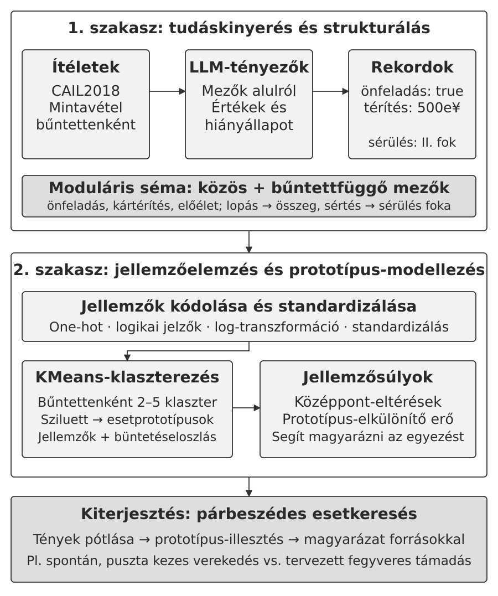

> **3-12. kísérlet ★★★: Tényezők és prototípusok kinyerése bírósági esetekből**
>
> A kísérlet a CAIL2018 büntetőügyeinek anyagából lopási, szándékos testi sértési és csalási mintákat választ ki, és egy „tényezők feltárása – mezők kinyerése – klaszterezés – prototípusok értelmezése” oktatási folyamatot épít fel[^ch3-cail]. Kategóriánként 120 mintát használ modellépítésre, és további 20-at tart vissza, így összesen 360 modellépítési és 60 visszatartott minta keletkezik.
>
> **A mezők feltárása és rendezése.** A modell először kötegenként elolvassa a modellépítési mintákat, és javaslatot tesz a hasznosnak tűnő tényezőkre, majd ezeket moduláris sémává (Schema) vonja össze. Az általános rész a több bűncselekménytípusnál is figyelembe veendő mezőket tartalmazza, például az önfeladást és a kártérítést; a kiterjesztett rész az adott bűncselekményhez kapcsolódó információkat, például az okozott kár összegét vagy a sérülés jellegét. Ebben a futtatásban 16 általános mező és három, rendre 12, 12 és 11 mezőből álló kiterjesztés jött létre. Minden mezőhöz meg kell adni a lehetséges értékeket és a hiányzó állapotot is, hogy a kinyerés következetes legyen.
>
> **A mezők vektorrá kódolása.** A kategorikus mezőkhöz one-hot kódolás használható: a lopás, a rablás és a csalás példáján ezek kódja rendre `[1,0,0]`, `[0,1,0]` és `[0,0,1]`, ahol minden pozíció csak azt jelzi, az adott kategóriába tartozik-e az eset. Ha 1-et, 2-t és 3-at használnánk, egyes algoritmusoknál sorrend és távolság jelenne meg a kategóriák között. Az „önfeladás”, a „kártérítés” és a hasonló mezők 1-gyel és 0-val jelölhetik a két megerősített állapotot; az eredeti szövegben nem említett eseteket külön kell kezelni, nehogy a hiányt automatikusan tagadásnak vegyük.
>
> Az összegekhez és más, nagy terjedelmű nemnegatív számértékekhez ez a megvalósítás először $\ln(1+x)$ transzformációval tömöríti a skálát, és csak ezután standardizál. Ha egy mezőben egyszerre több kategória is előfordulhat, például egy bejegyzés többféle intézkedést tartalmaz, minden kategóriához külön jelzőbitet rendelhetünk, így többes (multi-hot) kódolást kapunk.
>
> **Ügyprototípusok kialakítása.** A kódolt jellemzőket standardizáljuk, majd bűncselekménytípusonként külön klaszterezzük. Ez a megvalósítás két-öt klasztert hasonlít össze, és a sziluettegyüttható alapján választja ki a csoportosítást; végül 11 prototípus jön létre. Minden prototípus tárolja a minták számát, a fő jellemzőket, valamint a minták szabadságvesztésének mediánját, kvartiliseit és terjedelmét. Például a konfliktus kiváltó oka, az elkövetés módja és a sérülés következményei mentén összevethetjük a szóváltás utáni, puszta kézzel vívott dulakodást és az előre kitervelt, fegyveres cselekményt mint eltérő jellemzőkombinációkat; a konkrét csoportosítást a kinyerési eredmények és a klaszterezés együtt határozzák meg.
>
> **A jellemzők és az illesztési eredmények értelmezése.** A program az egyes klaszterek standardizált középpontjai közötti különbségek alapján kiszámítja, mekkora súllyal különböztetik meg a jellemzők a prototípusokat. A prototípus-illesztés az új esetet ugyanabba a jellemzőtérbe képezi le, és előkeresi a hozzá közeli csoport statisztikai összefoglalóját és indoklását, amelyekből a modell felépítheti a magyarázatot.
>
> Ebben a futtatásban a 60 visszatartott mintából 12-höz generáltunk magyarázatot, és ezeket egy független modell bírálta. Nézzük először az egyik lopási mintát: a hozzá illesztett prototípus csak egyetlen modellépítési bejegyzést tartalmazott, 4 hónapos szabadságvesztéssel, így a minimum, a medián és a maximum egyaránt 4. A generátor hűen közölte ezt a számot, és azt is jelezte, hogy csak egyetlen bejegyzés szolgálhat viszonyítási alapul. A bíráló a „hűek-e a számok a prototípushoz” szempontra 4 pontot (a maximumot) adott, a visszatartott minta tényleges címkéje viszont 8 hónap volt.
>
> Ha a prototípus-keresést párbeszédben használjuk, először megkérdezhetjük, mely hiányzó tények befolyásolhatják az illesztést, majd a válaszok alapján újra kereshetünk.

[^ch3-cail]: CAIL2018, hivatalos adathalmaz-projekt. A kísérő kísérlet a nyilvános anyagokból vett mintát, és a mintán belüli felosztással végezte a modellépítést és az értékelést.

Az esetektől a prototípusokig haladva a tudásbázis egy újabb, kereshető statisztikai ábrázolási réteggel bővül. Az eredeti szöveg a bizonyítékot adja, a mezők a számítást támogatják, a prototípusok pedig a hasonló minták közös jellemzőit összegzik; csak ha a három között megmarad a megfeleltetés, akkor lehet visszakövetni és javítani a kinyerési hibákat vagy a mintavételi torzításokat.

### Kutatási határterületek: multimodális és parametrikus memória

Képzeljük el, hogy a felhasználó egy korábban feltöltött fotóra mutatva azt mondja: „pont ilyen színűt kérek”. Ha a rendszer akkor csak annyit jegyzett fel, hogy „kék kabát”, legközelebb talán nem tud különbséget tenni két kékárnyalat között. A hang színezete vagy egy diagram térbeli viszonyai szintén részleteket veszítenek az átírás során. Hogy a jövőbeli lekérdezéseknek legyen esélyük ezeket az információkat visszakeresni, megőrizhetjük az eredeti anyagot, megőrizhetjük a modell által használható ábrázolást, vagy tovább kutathatjuk a modellen belüli tartós memóriát.

**Első út: az eredeti anyag és a szöveges index együttműködése.** Egy felhasználó által engedélyezett fotórendezési feladatban például kivághatjuk és megőrizhetjük az arcokat és más részleteket, a Markdown-bejegyzésekben hivatkozhatunk a képekre, és rögzíthetjük a felvétel idejét, a helyszínt és a felhasználó által megadott személycímkéket. Kereséskor először a leírás alapján megtalálunk néhány esetleg releváns fotót, majd elolvassuk az eredeti képet vagy a kivágott részt, és összevetjük a megjelenés részleteit. A hangrészletek is összekapcsolhatók az időponttal, a forrással és az átirattal, és szükség esetén az eredeti hang is visszajátszható. A szöveg adja a belépési pontot, az eredeti anyag pedig megőrzi a szavakkal nehezen összefoglalható részleteket.

**Második út: beágyazások tárolása és igény szerinti betöltése.** A vizuális vagy hangkódolók vektorrá alakíthatják az anyagot, és ezek a vektorok indexbe kerülhetnek hasonlósági keresés céljára. A kép egyes részleteit vagy a hangrészleteket kódolás után például a megfelelő memóriabejegyzésekhez köthetjük. Ha a modell támogatja a betanított vetítőréteget és memóriainterfészt, a kontextusban helyet is fenntarthatunk egy sor rekesznek, amelyekbe ezek a folytonos vektorok kerülnek, és a modell figyelemmel férhet hozzájuk. Ehhez meg kell oldani a kódoló ábrázolásainak és a nyelvi modell belső ábrázolásainak összehangolását.

Noah Shi-jal közös előzetes kutatásunk ezt a problémát két lépésre bontja. Egy csoportképen két ember látható, és a felhasználó azt kérdezi: „Az ablak mellett álló az, akivel legutóbb találkoztunk?” Először az „ablak mellett” alapján meg kell találni, kire gondol a felhasználó, majd ennek a személynek a képét össze kell vetni a korábban mentett mintával. Ha az első lépésben rossz személyt választunk, a második lépés bármilyen pontos felismerés mellett is egy másik kérdésre ad választ. A cikk a nevet és más, pontosan leírható tényeket a szöveges memóriában tartja, így a kétféle információ mindegyike a neki megfelelő módon érhető el.[^ch3-perceptmem]

[^ch3-perceptmem]: Li Bojie, Noah Shi, Parametric Multimodal User Memory; a kísérő `19PINE-AI/multimodal-user-memory` projekt tartalmazza a megvalósítást és a PerceptMem-kísérleteket. A csoportképes kérdés oktatási példa.

**Harmadik út: tartós memória a modellen belül.** A személyre szabott tények modellbe írásának egyik módja, hogy minden felhasználóhoz LoRA-t tanítunk. A „hol lakik a felhasználó” közvetlen kérdése és egy lakcím alapján történő útvonaltervezés eltérő módon használja a memóriát: az előbbi csak kiolvassa a tényt, az utóbbi további következtetésekhez is felhasználja. Ha csak a tények felmondására tanítunk, a modell emlékezhet a válaszra, de összetett feladatokban mégsem használja fel magától. Ezért a tanítómintáknak közvetlen kérdéseket és e tényekre épülő feladatokat egyaránt tartalmazniuk kell.

A **User as Engram** kutatásom a szöveges tényeket az Engram modell helyi memóriatáblájába írja, egy közös adapter pedig megtanulja, hogyan következtessen e tények felhasználásával[^engram]. A hash-kulcsos N-gram-keresés azonosítja a tábla bejegyzéseit, egy kapuzó mechanizmus pedig a modellbe juttatja a kiolvasott tartalmat; minden felhasználónak saját helyi táblabejegyzései vannak, a következtetési rész pedig közös lehet. A cikk szöveges tényekkel végzett kísérleteiben összehasonlítja a közvetlen felidézést és a közvetett következtetést, és bemutatja, hogyan kezelhető külön a felhasználónkénti memóriatartalom és a közös következtetési képesség.

[^engram]: Li, Bojie, User as Engram: Internalizing Per-User Memory as Local Parametric Edits, 2026.

Ha ezt az utat a multimodalitásra is ki akarjuk terjeszteni, a kép- és hangábrázolások címzésére, írására és olvasására is mechanizmust kell tervezni.

## Fejezet összefoglaló

Térjünk vissza a fejezet elején említett jegyfoglalási megbízáshoz. Az „ablak mellé ülök szívesen” ettől a felhasználótól származik, „hány poggyász vihető” kérdéséhez pedig a légitársaság utazási napon érvényes feltételeit kell megnézni. Ha mindkét információt egy-egy mondatként tároljuk, könnyen elveszik a legfontosabb különbség: kire vonatkozik az első, és mikortól hatályos a második. Ha tároláskor megőrizzük a forrást, az időpontot és az alkalmazási feltételeket, előkereséskor lesz alapunk eldönteni, használható-e most az információ. Az egyedi tényeket rövid jegyzetként érdemes rögzíteni; ha személyes kapcsolatokat kell leírni, vagy meg kell őrizni az előzményeket, kártyákat vagy eredeti bekezdéseket használhatunk; a dátumok és mennyiségek típusos mezőkként is tárolhatók, és a számítást a programra bízhatjuk.

Ha az asszisztens rossz poggyászkeretet közöl, először nézzük meg, bekerült-e a hatályos feltétel az adatbázisba, aztán azt, melyik szövegrészbe került, megtalálta-e a visszakereső, hányadik helyen áll az újrarangsorolás után, végül pedig azt, milyen anyagokat kapott meg a modell. Ha sok az eredeti szöveg, strukturált áttekintést tarthatunk a kontextusban, a részleteket pedig igény szerint kereshetjük vissza. A fejezetösszefoglalók a témák megtalálását, a kapcsolati indexek az összefüggések feltárását segítik; ha egy szövegrész elveszítette a hivatkozásait, pótolhatjuk a forrásbeli hátterét; ha egyetlen keresés után még hiányzik a bizonyíték, az Ágens más lekérdezéssel tovább kereshet.

Amikor a légitársaság új szabályokat tesz közzé, először kis hatókörű frissítést végezhetünk, megőrizve a régi és az új feltételek hatálybalépési idejét és forrását; a felhalmozódott ismétlődéseket, ütközéseket és szerkezeti változásokat pedig rendszeresen átszervezzük. A javaslattevő benyújtja a módosítást, a felülvizsgáló ellenőrzi a bizonyítékokat, jóváhagyás után pedig újraépítjük a kiszolgáló indexeket. A verziótörténet segítségével újra lefuttathatjuk a korábban rosszul megválaszolt kérdéseket, és azt is kideríthetjük, melyik anyagra támaszkodott annak idején a régi válasz. Azt, hogyan gyűjthetünk tovább tapasztalatot a végrehajtás eredményeiből, a 9. fejezet tárgyalja részletesen.

Ha kiderül, hogy két poggyász adható fel, csak arra a kérdésre válaszoltunk, hogy „megengedi-e a szabály”. Ahhoz, hogy az asszisztens a felhasználó helyett hozzá is adja a poggyászt a foglaláshoz, tudnia kell, melyik eszközt hívhatja meg, milyen paraméterek kellenek hozzá, és milyen visszaigazolás esetén tekinthető az ügy elintézettnek. Innen indul a következő fejezet.

## Gondolatébresztő kérdések

1. ★★ A felhasználó azt mondja: „Május 1-jén A-ból B-be költözöm, május 10. és 20. között a C szállodában lakom, ebben az időszakban a számlákat e-mailben kérem.” Május 15-én mit válaszoljon az asszisztens a lakcímre, az ideiglenes szállásra és a számlák kézbesítési módjára vonatkozó kérdésekre? Tervezz bejegyzési és lekérdezési szabályokat, és magyarázd el, hogyan kezelnéd az elírások helyesbítését vagy az egymásnak ellentmondó címeket!
2. ★★ Ha az eredeti dokumentum ellentmondó információkat tartalmaz, a kontextuselőtag a hibát is beírhatja az indexbe. Hogyan őriznéd meg a forrást, a verziót és a bizonytalan elemeket, és hogyan használnád fel ezeket a keresési és a generálási szakaszban?
3. ★★ Ha a diagramokat szöveggé alakítjuk, mely térbeli viszonyok vesznek el könnyen? Hozz példát táblázatra, architektúraábrára vagy vonaldiagramra, és tervezz olyan megoldást, amelyben az eredeti kép, a strukturált ábrázolás és a szöveges index együtt vesz részt a keresésben!
4. ★★★ Ahogy fejlődnek a modellek és a hosszú kontextus kezelésének képessége, a darabolási, indexelési és keresési folyamat mely feladatai kerülhetnek át a modellhez? Elemezd a kérdést Rich Sutton „keserű lecke” (The Bitter Lesson) című írásának a keresésről és a tanulásról szóló gondolatai alapján, és tervezz kísérletet a teljes bemenet és az igény szerinti keresés összehasonlítására, amely a feladatminőséget, a számítási költséget és a jogosultsági korlátozásokat is vizsgálja!
5. ★★★ Ha a modell már sok szakterületi tudással rendelkezik, mit kell még tárolnia a külső tudásbázisnak? Tárgyald külön a nyilvános általános tudást, a folyamatosan frissülő szabályokat, a magánjellegű anyagokat és a pontos visszakövetést igénylő bizonyítékokat!
6. ★ Milyen lekérdezéseket támogat a RAPTOR többszintű összefoglalása, illetve a GraphRAG entitáskapcsolatai és közösségi összefoglalói? Hozz egy-egy példát az átfogó áttekintésre, a helyi részletekre és a többugrásos összefüggésekre, és magyarázd el, milyen bizonyítékokat kell ellenőrizni!
7. ★★ Hogyan működhetnek együtt a könyvtárak, a linkek és a vektorindexek a tudás szervezésében? Tervezz egy emberek és Ágensek által közösen karbantartott tudásbázist, és magyarázd el, hol kap helyet benne a navigáció, a szemantikus keresés, a verziófrissítés és a jogosultsági szűrés!
8. ★★★ Ha esetekből mezőket nyerünk ki és klaszterezünk, honnan tudjuk, hogy a prototípusok hasznosak? Különítsd el a klaszterezési jellemzők fontosságát, az eredmények előrejelző képességét és az oksági magyarázatot, és tervezz visszatartott mintás értékelést és szakértői felülvizsgálati folyamatot!
9. ★★★ Tervezz növekményes frissítési és rendszeres átszervezési folyamatot egy Markdown-alapú felhasználói memóriatárhoz! Ha a felülvizsgáló ugyanazt a modellt használja, mint a javaslattevő, és csak a javaslattevő által kiválasztott szövegrészeket látja, milyen hibák maradhatnak könnyen észrevétlenül? Javasolj fejlesztéseket a bizonyítékok lefedettsége, az eszközjogosultságok és a felülvizsgálat értékelése szempontjából!

[^ch3-glove]: Pennington és munkatársai, GloVe: Global Vectors for Word Representation, 2014.

[^ch3-sbert]: Reimers és Gurevych, Sentence-BERT: Sentence Embeddings using Siamese BERT-Networks, 2019.
