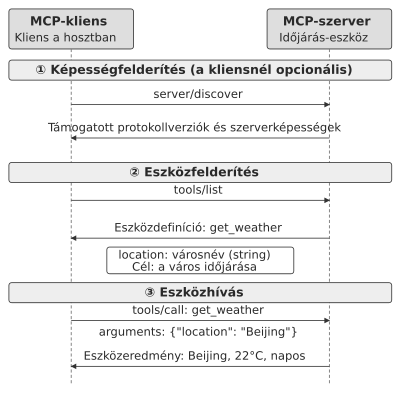
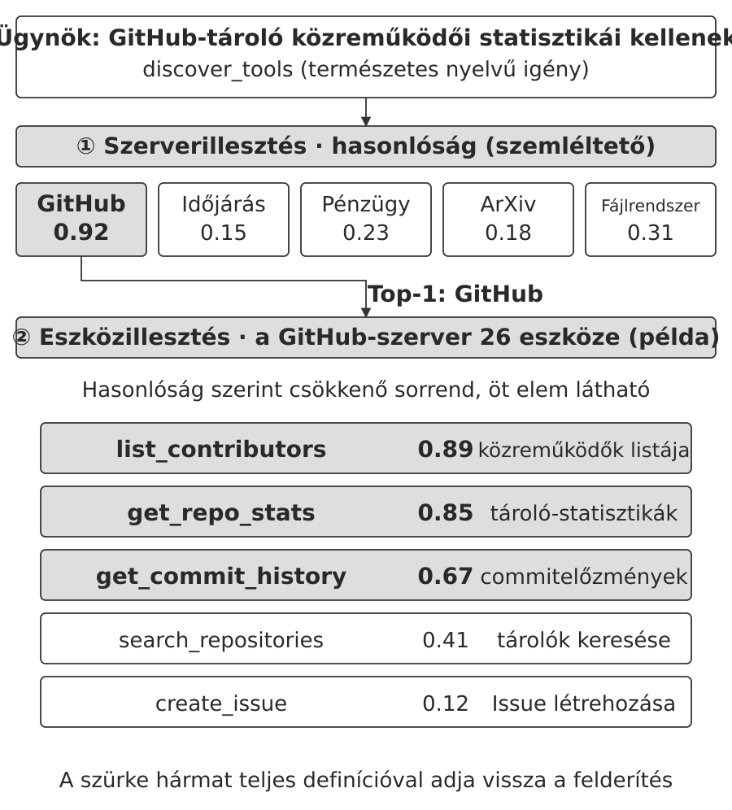
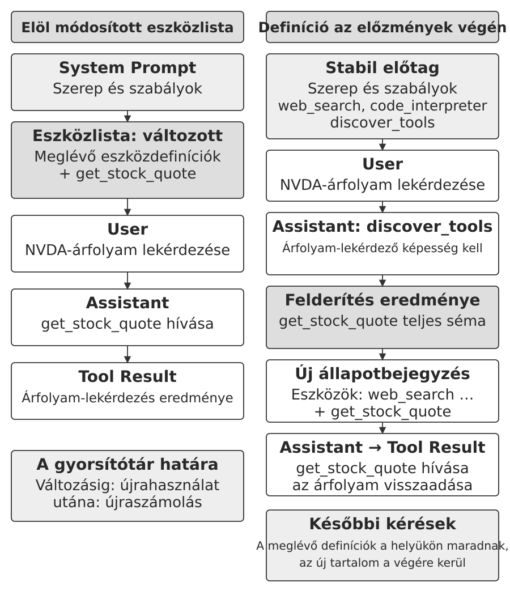
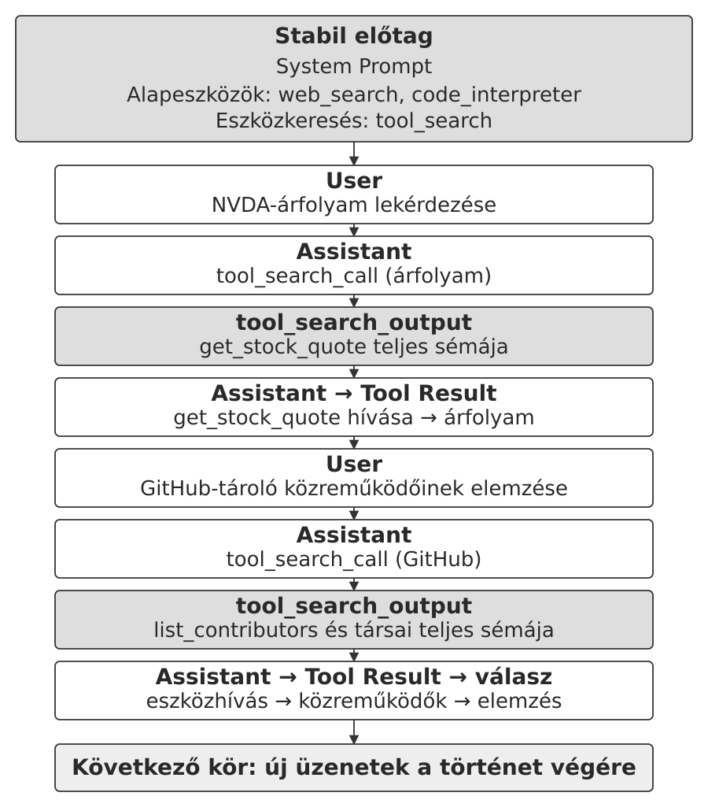

# Eszközök

A *Her* című sci-fi filmben Samantha, az MI-asszisztens rendezi a főszereplő e-mailjeit, segít megfogalmazni a válaszokat, intézi a kiadói ügyeit, és egyik kommunikációs csatornáról a másikra vált. Egy ilyen asszisztensnek a nyelvi megértést külső rendszereken végzett műveletekké kell alakítania. Az ügynök ezeket az interakciókat **eszközökkel** bonyolítja le. Az eszközök az „érzékszervei és végtagjai”: megfigyeléseket szolgáltatnak, és cselekvéseket hajtanak végre. A könyvben tárgyalt általános célú ügynökök, például a Manus és az OpenClaw, ugyancsak eszközökön keresztül érik el a digitális világot.

Tegyük fel, hogy a felhasználó ezt kéri: „Keresd ki az ügyfelek e-mailjeiből a bennük említett szállítási határidőket, foglald táblázatba, és küldd el nekem.” A modell eldöntheti, melyik levelet nézze meg, de az eredeti szöveg elolvasásához hozzá kell férnie a postafiókhoz, a táblázat elküldéséhez pedig egy küldő interfészt kell meghívnia. Hogyan tervezzük meg ezeket az eszközöket, és hogyan találja meg őket a modell, amikor szüksége van rájuk? A fejezet először megkülönbözteti az eszközök öt kategóriáját, majd az eszközök leírását, bekötését és felfedezését tárgyalja, végül sorra veszi az észlelő, a végrehajtó és az együttműködő interfészek tervezését. Az eseményindító és a felhasználói kommunikációs eszközöknél azt is el kell dönteni, mikor ébresszük fel az ügynököt, és hogyan juttassuk el az üzeneteket csatornákon át; ezeket a 6. fejezet fejti ki.

## Az eszközök osztályozása

Maradjunk a levelek lekérdezésénél: a modell választja ki a következő lépést, a Harness ellenőrzi a paramétereket és a jogosultságokat, majd elküldi a kérést, az adatokat pedig ténylegesen a levelezőszolgáltatás olvassa és írja. Az 1. fejezet rendeltetésük szerint különböztette meg az észlelő, a végrehajtó, az együttműködő, a felhasználói kommunikációs és az eseményindító eszközöket. Az első négyet az ügynök saját kezdeményezésére hívja meg, az eseményindított eszközök viszont lehetővé teszik, hogy külső események is felébresszék az ügynököt (4-1. táblázat).

4-1. táblázat: Az öt eszközkategória hívási iránya és fő rendeltetése

| Eszköztípus | Hívási irány | Fő rendeltetés |
| --- | --- | --- |
| Észlelő eszközök | Az ügynök hívja meg | Külső információ megszerzése |
| Végrehajtó eszközök | Az ügynök hívja meg | Számítás végzése vagy külső állapot módosítása |
| Együttműködő eszközök | Az ügynök hívja meg | Feladatok delegálása, üzenetváltás, más ügynökök vagy emberek összehangolása |
| Felhasználói kommunikációs eszközök | Az ügynök hívja meg | Válasz a felhasználónak, eredmények bemutatása vagy emlékeztető küldése |
| Eseményindító eszközök | A fejlesztő konfigurálja vagy az ügynök regisztrálja, külső esemény indítja | Az ügynök felébresztése egy meghatározott esemény bekövetkeztekor |

Az **észlelő eszközökkel** az ügynök külső információhoz jut, ilyen például a webes keresés (`web_search`), a tudásbázis-keresés (`knowledge_base_search`), a weboldal beolvasása (`fetch_url`), a fájlnév szerinti keresés (`find_file`), a fájltartalomban való keresés (`grep_file`) és a fájlolvasás (`read_file`).

A **végrehajtó eszközökkel** az ügynök számításokat végez vagy megváltoztatja a külső állapotot, ilyen például a parancssor (`shell_exec`), a kódértelmező (`code_interpreter`), a fájlírás (`write_file`), a fájlszerkesztés (`edit_file`) és az e-mail-küldés (`send_email`). Ugyanaz az általános végrehajtó végezhet csak olvasó számítást, de adatokat is módosíthat.

Az **együttműködő eszközök** a feladatok delegálását és az üzenetváltást támogatják, ilyen például az alügynök létrehozása (`spawn_subagent`), az üzenetküldés (`send_message_to_subagent`), az alügynök leállítása (`cancel_subagent`) és az elérhető ügynökök felderítése (`list_agents`). Az egymástól független feladatok párhuzamosan futhatnak, például ha az OpenAI több társalapítójának pályafutását külön-külön kell feltérképezni; a különböző feladatokat pedig eltérő modellel, eszközökkel, promptokkal és kontextussal felszerelt ügynökökre is bízhatjuk. A munkamegosztást és az együttműködési architektúrákat a 10. fejezet tárgyalja részletesebben.

A **felhasználói kommunikációs eszközök** információt juttatnak el a felhasználóhoz, ilyen például az üzenetre adott válasz (`reply_to_user`), a strukturált kártya küldése (`send_card_to_user`) és az emlékeztető küldése (`send_user_notification`). Amikor az interakció több csatornára terjed ki, vagy háttérbeli értesítésre van szükség, a rendszer az üzenetküldést explicit eszközhívásba csomagolhatja, és egységesen kezelheti a címzettet, a tartalmat és a kézbesítési állapotot.

Az **eseményindító eszközök** a külső eseményeket kötik össze az ügynök futásával, ilyen például az időzítő (`set_timer`), a háttérfeladatok figyelése (`monitor_shell`) és az eseményforrás csatlakoztatása (`connect_channel`). A folyamat két lépésből áll: a regisztrációkor vagy a fejlesztő konfigurálja előre a figyelt eseményeket, vagy az ügynök jelenti be őket egy engedélyezett hívással; az esemény bekövetkeztekor pedig az ütemező rendszer fogadja a visszahívást vagy az eseményüzenetet, és feldolgozásra felébreszti az ügynököt. Az új e-mail, a rendszerriasztás, az időzített emlékeztető és a háttérfeladat befejeződése egyaránt új belépési pont lehet a futásba.

Térjünk vissza a nyitó levelezési feladathoz. Az eredeti levél megnyitása és a szállítási határidő kiolvasása észlelés; az összesítő táblázat elkészítése és mentése megváltoztatja a munkaterületet, tehát végrehajtás; a táblázat átadása a megbízónak felhasználói kommunikáció. Eseményindító eszköz csak akkor kerül a képbe, ha a rendszer a következő ügyféllevél beérkezésekor magától folytatja a munkát. Ugyanaz a levelezőszolgáltatás ezek közül több szerepet is betölthet. A következő döntés az, mennyire legyenek finomak a modellnek átadott eszközök: külön kérdezze le a leveleket, olvassa be a törzsszöveget és keresse meg a mellékleteket, vagy vonjuk össze helyette azokat a lépéseket, amelyeket amúgy is gyakran egymás után végez?

## Az eszköztervezés általános elvei

Az eszközök bekötésének korai, elterjedt módja az volt, hogy minden API-végpontot közvetlenül becsomagoltak. Ez gyorsan működőképes, de könnyen nagyon finom szemcsézettségű interfészek halmazát eredményezi. Egyetlen feladat elvégzéséhez az ügynöknek újra meg újra objektumokat kell keresnie, tulajdonságokat kiolvasnia, feltételeket ellenőriznie, és csak ezután hívhatja meg a végrehajtó interfészt. Tervezéskor ezeket a műveleteket a gyakori feladatok köré szervezhetjük, például a névjegy megkeresését összekapcsolhatjuk az üzenetküldéssel, a naplókeresés pedig közvetlenül visszaadhatja a releváns sorokat a környezetükkel együtt[^ch4-tool-design].

**Az eszközöket az ügynök által elvégzendő feladat köré kell tervezni.** Ezt a megközelítést, amely az interfészt abból kiindulva tervezi meg, ahogyan az ügynök használja, **ACI**-nak (Agent-Computer Interface, ügynök–számítógép interfész) nevezzük. A HCI azt vizsgálja, hogyan lép kapcsolatba az ember a számítógéppel, az ACI pedig azt, hogyan választja ki a modell a műveleteket, hogyan állítja össze a paramétereket, hogyan érti meg a visszajelzéseket és hogyan javítja ki a hibáit.

[^ch4-tool-design]: Anthropic, *Writing effective tools for AI agents—using AI agents*, 2025.

### A képességek kifejezési formája: dedikált eszközök, általános végrehajtók és Skill-ek

Ha az „alkalmazás telepítését” a modellre bízzuk, háromféle kezelőfelületet tervezhetünk neki. Az első csak egyetlen `deploy_app` eszközt tesz elérhetővé, és a lépéseket a szerveroldal végzi el; a második külön teszi elérhetővé a buildelést, a csomagolást és a telepítést, és a modell dönti el, mikor hívja a következő lépést; a harmadik a lépéseket egy Skillbe írja, a modell pedig terminálban hajtja végre őket. Ha a buildelés meghiúsul, az első esetben az eszköz eredményének kell elárulnia a modellnek, melyik lépésnél történt a hiba, a másik kettőben viszont a modell közvetlenül megkaphatja az adott build hibaüzenetét.

- A **dedikált eszközök** egy meghatározott művelethez nyújtanak strukturált interfészt. A fejlesztő definiálja a paraméterek sémáját, a validációs szabályokat, a végrehajtási logikát és a visszatérési formátumot, így az eszköz önállóan tesztelhető és engedélyezhető; amikor az eszközdefiníció bekerül a kontextusba, a helyfoglalása a mezők, a leírás és a példák hosszától függ.
- Az **általános végrehajtók és a Skill-ek** együtt működnek: a terminál vagy a kódértelmező adja a végrehajtási képességet, a Skill pedig leírja a munkafolyamatot, az alkalmazási feltételeket és a kezelés módját. A gazdaalkalmazás először csak a nevet és a rövid leírást töltheti be, és csak a kiválasztás után olvassa be a teljes leírást és a kapcsolódó erőforrásokat.

Egy telepítési Skill például sorban leírhatja: buildeld a projektet az `npm run build` paranccsal, csomagold be az image-et a `docker build -t app:latest .` paranccsal, majd a `kubectl apply -f deploy.yaml` paranccsal alkalmazd a jegyzékben definiált erőforrásokat az aktuális fürtre. Az ügynök a terminál eszközzel hajtja végre ezeket a lépéseket, vagyis ugyanazt a végrehajtási belépési pontot használja újra.

Az, hogyan valósítunk meg egy eszközt, és az, hogy a modell mikor olvassa el a leírását, két külön kérdés. Több száz dedikált eszközből is elég lehet csak egy indexet megmutatni, és a sémákat igény szerint betölteni; néhány Skill katalógusa viszont tartósan a kontextusban maradhat, és csak a méret növekedésével kell keresést is bevezetni. A dedikált interfész és az általános végrehajtó közötti választás arra hat, hogyan adódnak át a paraméterek és hogyan tartjuk karban a kódot; az egyszerre mindent vagy igény szerinti betöltés közötti választás pedig arra, mely eszközöket látja a modell az adott lépésben. A feltárási stratégiákat a fejezet későbbi, „Mi a teendő, ha túl sok az eszköz” című szakasza tárgyalja.

**Azt javaslom, hogy elsősorban általános eszközöket használjunk, és csak a jogosultsági, paraméterezési és teljesítménybeli igények szerint egészítsük ki őket dedikált interfészekkel.** Ha például egy sandboxban a `code_interpreter` mellé a SymPy, a NumPy és a pandas könyvtárat is telepítjük, az ügynök Python-kódot írva elvégezheti az alapműveleteket, a szimbolikus számításokat, a tömbkezelést és az adatelemzést. Így a modell teljes mértékben kiaknázhatja kódgeneráló képességét: egyetlen értelmező sokféle algoritmust hordozhat, és a meglévő könyvtárak kombinálásával előre nem látott, új problémákat is megoldhat. A kódot a modell állítja elő, a futtatókörnyezet végrehajtja, és korlátozza a fájlokhoz, a hálózathoz és az erőforrásokhoz való hozzáférést.

Még ha dedikált eszközöket használunk is, azt javaslom, hogy elsőként a hasonló funkciójú, gyakran együtt használt műveleteket vonjuk össze. Ha az interfészek túl finomak, a modellnek több nevet és munkamegosztást kell fejben tartania, és ugyanahhoz a feladathoz több hívásra is szüksége van. Az összevonásnál főként a **funkcionális hasonlóságot** és a **használati forgatókönyvek átfedését** érdemes nézni. Az `extract_pdf_text`, az `extract_docx_content` és az `extract_pptx_content` például mind egy dokumentumot kap, és abból nyer ki szöveget, ezért összevonhatók egyetlen `read_document` eszközzé, amely a `file_type` paraméterrel különbözteti meg a formátumokat. A modellnek így elég egyetlen egységes belépési pontot választania, és az új formátumok is használhatják a meglévő paraméter- és visszatérési szerkezetet.

Az alábbi négy esetben különösen indokolt a dedikált interfész.

1. **Finom jogosultságkezelésre és auditálásra van szükség.** A produkciós adatbázisba írás egyértelműen körülhatárolt műveletbe csomagolható, amelynél a szerveroldal ellenőrzi a felhasználó jogosultságát, a céltáblát és a módosítható mezőket, és rögzíti a művelet indokát.
2. **El kell rejteni a platformok közötti különbségeket.** A grep, a find és hasonló műveletek shellen keresztül is elvégezhetők, egy dedikált fájlkereső eszköz azonban egységesítheti a macOS, a Windows és a Linux paramétereit és visszajelzéseit, például mindig fájlnevet, sorszámot és illeszkedő részletet ad vissza.
3. **A művelet nagyon gyakori.** A gyakori műveleteknek rövid és stabil belépési pontot adhatunk, így csökken a szkriptek és a folyamatleírások ismételt előállításának költsége.
4. **Bonyolultak a paraméterek közötti összefüggések.** A beágyazott objektumokat, a mezők közötti függőségeket és az összetett értékmegkötéseket érdemes a séma és az üzleti validáció együttesével kifejezni.

**Minél bonyolultabbak a paraméterek, annál fontosabb az átadás módja.** A strukturált eszközhívás a bemenetet általában JSON Schemával írja le, és egyes modellszolgáltatások korlátozott generálást is támogatnak, amely biztosítja, hogy a paraméterek megfeleljenek a támogatott sémaszabályoknak. A visszatérési érték szerkezetét az eszköz interfésze rögzíti, az eredményt pedig a gazdaalkalmazás adja tovább a modellnek. A típus- és formátumellenőrzésen túl a jogosultságot, az objektum létezését és azt, hogy a mezők együtt teljesítik-e az üzleti feltételeket, továbbra is a Harness és az eszközszolgáltatás ellenőrzi.

Egy Skill leírhatja, hogyan kell meghívni egy dedikált eszközt, de arra is utasíthatja az ügynököt, hogy CLI-t használjon. Ez utóbbi esetben a modellnek egyszerre kell kezelnie a parancssori szintaxist, az idézőjeleket és az escape-elést, ráadásul a szabályok shellenként eltérnek. Minél bonyolultabbak a paraméterek, annál több részletet kell a modellnek helyesen kezelnie. Összetett, beágyazott paramétereknél először JSON-fájlba írhatjuk őket, és a paranccsal ezt a fájlt olvastathatjuk be, így elkerülhető a többszintű escape-elés, a tartalom pedig végrehajtás előtt validálható.

**A Skillt az üzleti szakemberek közvetlenül megírhatják és módosíthatják.** Aki ismeri az üzleti folyamatot, maga is leírhatja a lépéseket, vagy kiindulhat az ügynök által előkészített vázlatból. Ha megváltozik a folyamat sorrendje, ha egy lépés csak az ügyfelek egy részére vonatkozik, vagy ha másik példára van szükség, elég átírni a leírást; nem kell az eszköz kódját módosítani és az interfészt újratelepíteni. Az Agent Skills specifikáció szerint a `SKILL.md` metaadatai előírt formátumot követnek, a törzse Markdown, és szkripteket, referenciadokumentumokat és erőforrásokat is mellékelhetünk hozzá[^ch4-skill-format].

[^ch4-skill-format]: Agent Skills, formátumspecifikáció: metaadatok, törzsszöveg, mellékelt erőforrások és fokozatos betöltés.

A képesség formájának megválasztásakor négy szempontot érdemes együtt mérlegelni.

- **Biztonság és jogosultságok**: a dedikált interfésszel könnyű leszűkíteni a művelet hatókörét; az általános végrehajtó végrehajtási képességét a sandbox, a hitelesítő adatok és az erőforrás-jogosultságok korlátozzák.
- **A paraméterek bonyolultsága**: az összetett szerkezetekhez a séma és az üzleti validáció illik; egyszerű műveleteknél a paraméterek közvetlenül a CLI-n keresztül is átadhatók.
- **A változás gyakorisága**: a gyakran módosuló folyamatokat érdemes Skillbe írni, mert a leírást és a példákat az üzleti szakemberek közvetlenül módosíthatják; a stabil, ismétlődően használt alacsony szintű műveleteket csomagoljuk inkább eszközzé vagy szkriptté.
- **A modell képességei**: ha a modell megbízhatóan ír kódot és kezeli a parancssort, elsősorban a Skill és az általános végrehajtó kombinációján keresztül dolgozzon, így csökkenthető a dedikált eszközök száma; ha a modell gyengébb, és a bonyolult paramétereknél gyakran hibázik, a strukturált interfészek vállaljanak át több megkötést.

**A kód több eszközhívást is összehangolhat.** Ha több weboldalt kell begyűjteni és mezőket kinyerni belőlük, a modell írhat egy szkriptet, amely elvégzi a ciklust, a szűrést és az összesítést. Az oldalak teljes szövege a végrehajtási környezet változóiban marad, a kontextusba csak a kiválasztott mezők és a statisztikák kerülnek vissza. A program feltételei, ciklusai és kivételkezelése kapcsolja össze a lépéseket, a modell pedig közvetlenül az összesített eredményt elemzi. Az olyan feladatoknál, mint a tömeges begyűjtés, szűrés és statisztika, ahol a lépések már világosak, én elsősorban kóddal fűzöm össze a műveleteket, hogy csökkenjen az oda-vissza forgalom, amikor a modell egyenként hív eszközöket és olvassa be a köztes eredményeket. Minél több a köztes eredmény és minél szűkebbek a visszaadott mezők, annál több kontextust takarít meg ez a megoldás. Az ilyen kódalapú összehangolást az 5. fejezet tárgyalja részletesebben.

Az ilyen interfészt gyakran **Code Mode**-nak nevezik. Vegyük például a Cloudflare MCP-szerverét: a modell először a `search()` segítségével lekérdező programot ír, amely az OpenAPI-leírásból kikeresi a szükséges végpontokat és paramétereket; ezután az `execute()` segítségével elküldi az e végpontokat meghívó JavaScript-kódot. Ha például a feltételeknek megfelelő DNS-rekordokat kell kilistázni, a program oldalanként lekérdez, szűr, és csak a találatokat adja vissza. Az első lépés megspórolja, hogy a teljes interfész-kézikönyvet a kontextusba kelljen tenni, a második pedig azt, hogy minden eredményoldalt vissza kelljen küldeni a modellnek. Azt, hogy a végrehajtó identitás mely zónákat olvashatja és módosíthat-e rekordokat, továbbra is a szerveroldali jogosultságkezelés dönti el.[^ch4-code-mode]

[^ch4-code-mode]: Cloudflare, a Code Mode MCP-megvalósítása; Armin Ronacher a Pi 1.0 példáján tárgyalja a Harness által nyújtott eszközök és a végrehajtási környezet közötti munkamegosztást.

### Az eszközleírás: rendeltetés, paraméterek és visszajelzés

Amikor leírást írunk egy eszközhöz, érdemes először elképzelni azt a kérést, amelynél a legkönnyebb rosszul használni. A felhasználó azt kéri: „Keresd ki a szerződésből a kötbérről szóló kikötéseket.” A fájlnév szerinti keresés csak azokat a fájlokat adja vissza, amelyeknek a neve illeszkedik; még ha kap is egy elérési utat, a modellnek el kell olvasnia a szöveget. Az eszközleírásnak abban kell segítenie a modellt, hogy eldöntse, melyik interfészt válassza, mit adjon meg a híváskor, és milyen kérdés megválaszolására elegendő a kapott eredmény.

**Írjuk le, mikor kell használni.** A webes keresés leírása lehet például ez: „Akkor használd, ha valós idejű információra van szükséged, vagy ismeretlen tényeket kell kikeresned.” Így a modell össze tudja kapcsolni a felhasználó igényét az eszköz rendeltetésével. Ha csak annyi áll a leírásban, hogy „Releváns tartalom keresése”, a modellnek magának kell kitalálnia a keresés hatókörét és az alkalmazás feltételeit.

**Tisztázzuk a bemenetet és a keresés hatókörét.** Egy fájlnév szerinti kereső eszköz leírásában például ez állhat: „Fájlnév és elérési út alapján illeszt; a fájlokban szereplő szöveg kereséséhez használd a `grep_file` eszközt.” Ha a szomszédos eszközök közötti munkamegosztást világosan leírjuk, a modell egyetlen hívással is a jó belépési pontot választhatja. **Úgy látom, a határfeltételek tisztázása gyakran fontosabb, mint a funkciók felsorolása.** Hogy az eszköz milyen bemenetet fogad el, milyen hatókörben keres, és mit tesz üres eredmény vagy hiba esetén, mind közvetlenül befolyásolja a modell következő döntését.

**A paramétereket specifikációval és példával írjuk le.** A `timestamp` leírása lehet: „RFC3339 formátum, például `2024-03-15T14:30:00Z`.” Egy összetett feladat közben a modellnek egyszerre kell eszközt választania, információt kinyernie a korábbi trajektóriából és mérlegelnie a további lépéseket; a paraméterformátum ezek közül csak egy apró részlet. A teljes karakterlánc közvetlenül követhető mintát ad, amely alapján a modell összeállíthatja a paramétert, és kisebb az esélye, hogy a szakkifejezés újraértelmezésekor hibázik.

Ugyanígy a `phone` leírása lehet: „Telefonszám E.164 nemzetközi formátumban: `+` jellel kezdődik, ezt követi az országkód és a hívószám, a többi része csak számjegyeket tartalmaz, szóköz és elválasztójel nélkül. Például `+8613888888888` (Kína) vagy `+12025551234` (USA).”

**Írjuk le a visszatérési szerkezetet és a végrehajtás költségét.** Például: „JSON tömböt ad vissza, minden eleme három mezőt tartalmaz: `title`, `url`, `snippet`.” Így a modell könnyen kinyeri a címet, a forrást és a kivonatot. A hosszan futó eszközöknél feltüntethetjük a mérési környezetben várható késleltetést és az alternatív belépési pontot, például: „A teljes weboldal beolvasása 5–10 másodpercig is tarthat; ha csak metaadatokra van szükséged, hívd a `get_page_metadata` eszközt.”

Mellékelhetünk egy–öt ellenőrzött hívási példát is, amelyek lefedik a minimális paraméterezést, a gyakori kombinációkat és az összetett feltételeket. A JSON Schema ki tudja fejezni a típusokat, a kötelező mezőket, az értéktartományokat és a mezők közötti függőségek egy részét[^ch4-json-schema]; a példák pedig azt mutatják meg, hogyan alkalmazhatók ezek a szabályok egy konkrét feladatban, például hogy az időbélyeg másodpercben vagy ezredmásodpercben van-e megadva, hogyan ágyazódnak egymásba a szűrési feltételek, és mely opcionális mezők szerepelnek általában együtt. Az Anthropic 2025-ben közzétett, összetett paraméterekkel végzett belső tesztjében a hívási példák hozzáadása 72%-ról 90%-ra javította a pontosságot[^ch4-tool-examples].

[^ch4-json-schema]: JSON Schema, objektumtípusok és tulajdonság-megkötések. A modellinterfészek által támogatott sémakulcsszavak körét az adott szolgáltatás határozza meg.

[^ch4-tool-examples]: Anthropic, *Introducing advanced tool use on the Claude Developer Platform*, 2025. november 24., Tool Use Examples rész.

Ha az ügynök gyakran rossz eszközt választ, azt javaslom, hogy **először az eszközleírásokat ellenőrizzük**: nem használ-e több eszköz hasonló nevet, világos-e a keresés hatóköre, nem hiányoznak-e példák a paraméterekhez. Ugyanez a módszer alkalmazható a Skill-ek nevére, rövid leírására és kezelési útmutatójára is.

### A paraméterátadás hűsége

A modell egy szövegrészlet cseréjét kéri, a végrehajtó oldal viszont azt jelenti, hogy „nem található”. Mielőtt a modellt átfogalmazásra kérnénk, először azt kell megkérdezni, hogy a két oldal ugyanazt a karaktersorozatot kapta-e. A hívás áthalad az elemzésen, a szerializáláson, a proxykon és a futtatókörnyezet csomagolásán, és bármelyik réteg megváltoztathatja a tartalmat. A **paraméterhűség** azt követeli meg, hogy a végrehajtó oldal által látott érték ugyanazt jelentse, mint amit a modell elküldött; a protokoll escape-elése megváltoztathatja az átvitel formáját, de dekódolás után az idézőjeleknek és a sortöréseknek meg kell maradniuk.

Vegyük példának a görbe idézőjelek átalakításának hibáját a Cursor egyik 2026 eleji verziójában. A cserélő eszköz `old_string` és `new_string` paramétert fogad, és pontos illesztéssel módosítja a fájlt. Az olvasó eszköz a kínai görbe idézőjeleket (`“`, `”`, vagyis `\u201c`, `\u201d`) adja vissza; a modell az eredeti szöveget beteszi az `old_string` paraméterbe, a paraméterátadás során azonban ezek angol egyenes idézőjellé (`"`) alakulnak. A fájlban az eredeti szöveg változatlan marad, ezért a cserélő eszköz azt adja vissza, hogy „nincs egyezés”. Hiába olvassa be a modell újra a fájlt, és másolja ki ismét az eredeti szöveget, ugyanabba a hibába ütközik.

Az írási irányt is érinti a probléma. A modell görbe idézőjeleket kér írni, a fájlba végül mégis egyenes idézőjelek kerülnek. Amikor a modell ezután beolvassa a fájlt, mást lát, mint amit írni szándékozott, és megpróbálhatja kijavítani; amíg az átalakítás zajlik, minden újrapróbálkozás ugyanazt a hibát ismétli.

A problémák másik típusa a **csendes paraméterinjektálás**. Egy IDE bash eszköze például automatikusan hozzáfűz egy, az AI által készített commitot jelölő paramétert minden `git commit` parancshoz. A régebbi Git-verziók nem ismerik ezt a paramétert, ezért a commit hibával leáll. A modell csak a saját maga által előállított parancsot látja, így újra meg újra átírhatja a commit üzenetét vagy más paramétereket, a hiba valódi forrásához azonban sosem nyúl hozzá.

Az ilyen hibák felderítésekor egymás mellé kell tenni a modell által előállított paramétereket, az átadás utáni paramétereket, a ténylegesen végrehajtott kérést és a visszakapott eredményt. Ha egy interfész egységesíti a kódolást vagy végrehajtási paramétereket egészít ki, az átalakítási szabályokat le kell írni, és vissza kell adni a ténylegesen használt értéket. A pontos illesztésen alapuló eszközöknél egy plusz szóköz, egy hiányzó sortörés vagy egy megváltozott idézőjel is meghiúsíthatja az illesztést. A modellnek tudnia kell, mit kapott valójában a végrehajtó oldal, csak így javíthatja ki helyesen a következő hívást.

## Eszköz-ökoszisztéma: MCP és Skill Hubok

A különböző modellinterfészek és ügynök-keretrendszerek mind a saját módjukon definiálják az eszközöket, ilyen például a function calling, a tool use és a LangChain Tool absztrakciója. Ha ugyanazt a külső szolgáltatást egyenként kell illeszteni ezekhez az interfészekhez és keretrendszerekhez, a leírást, a paramétereket és az eredményformátumot újra meg újra kezelni kell. Az Anthropic által 2024 novemberében kiadott **Model Context Protocol (MCP)** egységes protokollt ad ahhoz, hogy a modellalkalmazások eszközökhöz és adatokhoz férjenek hozzá[^ch4-mcp-origin].

Az MCP megértéséhez érdemes három szerepből kiindulni: a gazdaalkalmazásból, a kliensből és a szerverből. A **gazdaalkalmazás (host)** az ügynökalkalmazás vagy az IDE, amely a modellel való interakciót, a kontextus összeállítását és a jogosultságkezelést végzi; a gazdaalkalmazáson belüli **MCP-kliens** a protokollüzeneteket kezeli; az **MCP-szerver** eszközöket, erőforrásokat és promptsablonokat nyújt, és futhat helyi folyamatként, de távoli szolgáltatásként is telepíthető[^ch4-mcp-architecture].

**Eszközdefiníció és -hívás.** A kliens a `tools/list` segítségével kéri le az elérhető eszközöket, a lista lapozva is visszaadható. Minden eszköz tartalmaz nevet, leírást és `inputSchema` mezőt; a strukturált eredmények formátuma az `outputSchema` segítségével is rögzíthető. Miután a modell kiválasztotta az eszközt és előállította a paramétereket, a gazdaalkalmazás elvégzi a validálást, a kliens elküldi a `tools/call` kérést, a szerver pedig a végrehajtás után visszaadja az eredményt. Azt, hogy mely definíciók és eredmények kerülnek a modell kontextusába, a gazdaalkalmazás dönti el[^ch4-mcp-tools].

A 4-1. ábrán a kliensnek az időjárás-eszköz nevének és paramétereinek megszerzése után még egy hívást kell indítania ahhoz, hogy megtudja a pekingi időjárást. A kísérő megvalósítás az MCP 2026-07-28 verzióját használja: minden kérés magában hordozza a protokollverziót, a kliens adatait és képességeit, a kliens pedig a `server/discover` hívással előre is tájékozódhat a szerver által támogatott verziókról és képességekről. A korábbi verziók `initialize` kézfogással hozták létre a munkamenetet, ezért csatlakozáskor a két fél által támogatott verziók alapján kell kiválasztani az interakció módját[^ch4-mcp-versioning].

Ha nem sikerül lekérdezni az időjárást, a 4-1. ábra két különböző kiindulópontot kínál a hibakereséshez. Ha a gazdaalkalmazás csatlakozott a szerverhez, de a `tools/list` hívás után nem találja az időjárás-eszközt, azt kell ellenőrizni, milyen eszközöket tett közzé a szerver, és hogy a kliens végigolvasta-e a lapozott listát. Ha a modell a jó eszközt választotta, a szerver mégis hiányzó városnevet jelez, a hívásnaplóban kell megkeresni az `arguments` mezőt, és ellenőrizni, hogy a mezőnév az eszközdefinícióban előírt `location`-e.

**Átviteli módok.** Az stdio egy helyi gyermekfolyamat szabványos bemenetén és kimenetén keresztül továbbítja a JSON-RPC üzeneteket. A Streamable HTTP HTTP-n küldi a kéréseket, a válasz pedig lehet JSON, de SSE-folyamként fokozatosan is érkezhet. A Streamable HTTP a korábbi HTTP+SSE átviteli megoldást váltotta fel, a folyamatos válaszokhoz pedig továbbra is SSE-t használ[^ch4-mcp-transports].

**Erőforrások és promptsablonok.** Az erőforrások (resources) olvasható adatokat nyújtanak, például fájltartalmakat és adatbázisrekordokat; a gazdaalkalmazás URI alapján listázhatja és olvashatja őket, és kiválaszthatja a releváns tartalmat. A promptsablonok (prompts) újrafelhasználható üzenet- vagy feladatsablonokat kínálnak, amelyek közül a felhasználó és a kliens választhat. Keresést és olvasást eszköz is végezhet, ezért ez a három primitív az interakciós felület szerint osztja meg a szerepeket: az eszköz hívási belépési pontot, az erőforrás adat-belépési pontot, a promptsablon feladat-belépési pontot ad[^ch4-mcp-primitives].

Az MCP legfőbb értéke, hogy egyetlen eszközmegvalósítás több ügynökterméket is kiszolgálhat. Az egységes protokoll révén ugyanazt a szervert a kompatibilis gazdaalkalmazások, például a Cursor, a Claude Desktop és az OpenClaw, újra felhasználhatják, a fejlesztők pedig több energiát fordíthatnak magára a képességre és a visszajelzések minőségére. A protokollban szereplő eszközdefiníciókat a gazdaalkalmazás alakítja át a modell által használható interfésszé.

**A Skill Hub a képességcsomagok felfedezését és terjesztését szolgálja.** Egy Skill általában egy `SKILL.md` fájlból áll, amelyhez szkriptek és referenciaanyagok is tartozhatnak. A terjesztési platformok segítenek a felhasználóknak megkeresni, telepíteni és frissíteni ezeket a fájlokat. A Vercel 2026 januárjában indította el a skills.sh oldalt, amely Skill-katalógust és telepítőeszközt kínál; az OpenClaw ökoszisztémájához tartozó ClawHub szintén Skill-keresést és verziókezelést nyújt[^ch4-skills-sh][^ch4-clawhub]. Telepítés után a gazdaalkalmazás a saját betöltési stratégiája szerint olvassa be a nevet, a rövid leírást és a teljes útmutatót. Az MCP egy bővítményen keresztül a Skill-ek felfedezését és olvasását is lehetővé teszi, vagyis a képességcsomagok és a kommunikációs protokoll együtt is használhatók[^ch4-skills-over-mcp].

**A bekötést és a kontextusba töltést külön kell kezelni.** Miután az MCP-kliens megkapta az eszközlistát, átadhatja azt teljes egészében a modellnek, de az is lehet, hogy csak az indexet tartja meg, és a definíciókat igény szerint tölti be. A Skill-eknél is megtehetjük, hogy először csak a `name` és a `description` mező látszik, a törzset pedig csak a kiválasztás után olvassuk be. Az eszközök engedélyezési listája azt határozza meg, mely képességek érhetők el, a késleltetett betöltés pedig azt, hogy mely definíciók láthatók éppen.

**Harmadik féltől származó képesség bekötésekor külön ellenőrizzük, mit kínál, és milyen műveleteket hajt végre ténylegesen.** A leírás, a visszaadott tartalom és a mellékelt kód különböző szereplőktől származik, és a jogosultsági körük is eltérhet. Az MCP példáján háromféle problémát érdemes külön megvizsgálni.

1. **Az eszközleírás megmérgezése.** A leírás az eszköz rendeltetésétől független műveleti utasításokat is becsempészhet, amelyek arra csábítják a modellt, hogy túllépjen az aktuális feladaton. Ez promptinjekció: a külső forrásból származó tartalom megpróbálja megváltoztatni a modell viselkedését.
2. **A szerver vagy a függőségei módosultak.** Egy szerverfrissítés megváltoztathatja az eszköz viselkedését, egy függőség frissítése vagy egy távoli szolgáltatás feltörése pedig beszennyezheti a visszaadott eredményeket.
3. **Azonos nevű eszközök összekeverése.** Különböző szerverek nyújthatnak azonos vagy hasonló nevű eszközöket, és emiatt a modell vagy az útválasztó réteg rossz célt választhat. A gazdaalkalmazásnak meg kell őriznie a szerver identitása és az eszköz neve közötti kötést, fel kell tüntetnie a forrást, és az ütemezéskor ellenőriznie kell a célt.

Bekötés előtt át kell nézni a leírást és a megvalósítást, a saját kezünkben lévő telepítéseknél rögzíteni kell a verziót, és frissítéskor újra kell ellenőrizni; minden szerver a feladatnak megfelelő legkisebb jogosultságú hitelesítő adatokat kapja. Ha a távoli szolgáltatást más tartja karban, az eszközdefiníciók és a viselkedés változásait is figyelni kell.

Futás közben a későbbiekben bemutatott Sidecar is felhasználható arra, hogy a strukturált hívásokat és a szükséges feladatindokokat független ellenőrzésnek vessük alá. A hívási paraméterekben szereplő elérési utakat, szövegeket és célcímeket szintén ellenőrizendő adatként kell kezelni. Arról, hogy egy művelet végrehajtható-e, az ellenőrzés eredménye és a determinisztikus jogosultsági szabályok együtt döntenek. Az 5. fejezet bemutatja Simon Willison „halálos hármasát” (Lethal Trifecta), amellyel a privát adatok, a külső bemenet és a kifelé irányuló kommunikáció együttes kockázata elemezhető.

A Skill-hez mellékelt szkripteknek, a helyi MCP-szervereknek és a távoli szolgáltatásoknak más-más a végrehajtási helye és a jogosultsági köre. Az ellenőrzés során meg kell vizsgálni a kód eredetét, a futtatókörnyezetet, a fájl- és hálózati jogosultságokat, valamint a hitelesítő adatok útját; ha egy külső forrásból származó lépés más programok letöltésére vagy futtatására késztet, azt is be kell vonni ebbe az ellenőrzési láncba. A platformok vizsgálatai kiegészítő támpontokat adhatnak, a tényleges végrehajtást azonban a futtatás elszigetelése, a legkisebb jogosultság elve és a változások felülvizsgálata szabályozza közvetlenül.

[^ch4-mcp-origin]: Anthropic, *Introducing the Model Context Protocol*, 2024. november 25.
[^ch4-mcp-architecture]: Az MCP 2026-07-28 verziójú specifikációja, az architektúráról és a protokoll áttekintéséről szóló két rész.
[^ch4-mcp-tools]: MCP, Tools: az eszközlista, a bemeneti és kimeneti séma, valamint a hívás eredménye.
[^ch4-mcp-versioning]: MCP, *Versioning and Compatibility*: a kérésenkénti metaadatok, a képességfelderítés és a régebbi kézfogással való kompatibilitás módja.
[^ch4-mcp-transports]: MCP, az átviteli módok áttekintése és a 2025-11-25 verziójú átviteli specifikáció; utóbbi leírja, hogyan váltotta fel a Streamable HTTP a korábbi HTTP+SSE megoldást.
[^ch4-mcp-primitives]: MCP, a Resources és a Prompts rész.
[^ch4-skills-sh]: Vercel, *Introducing skills, the open agent skills ecosystem*, 2026. január 20.
[^ch4-clawhub]: OpenClaw, a ClawHub használati útmutatója.

## Mi a teendő, ha túl sok az eszköz: hierarchikus szervezés és proaktív eszközfelfedezés

Amikor az eszközök száma egy-két tucatról százakra vagy ezrekre nő, a modellnek nemcsak a megfelelő képességet kell megtalálnia, hanem a hasonló interfészek közötti különbségeket is meg kell értenie. A teljes definíciókészlet sok kontextust foglal el; ha a definíciók a prompt előtagjában vannak, az eszközök hozzáadása, eltávolítása vagy átrendezése ráadásul lerövidítheti az újrafelhasználható gyorsítótárazott előtagot. Minél több a hasonló nevű és rendeltetésű eszköz, annál könnyebben választ a modell rossz belépési pontot, vagy hagy figyelmen kívül egy szükséges képességet. Ezért a nagy eszköztáraknál alapértelmezés szerint igény szerinti betöltést kell alkalmazni, és jól megtervezett kategóriakatalógust és felfedező interfészt kell kialakítani, hogy a modell először megtalálja az aktuális feladathoz kapcsolódó eszközöket, majd a rendeltetésük alapján válasszon közülük.

Az eszközfelfedezést úgy is elképzelhetjük, mint egy feladatok szerint szerkesztett kézikönyv lapozgatását. A tartalomjegyzék először megmondja a modellnek, melyik fejezetben keressen; ha végrehajtás közben új igény merül fel, visszatérhet és tovább kereshet; ha kiválasztott egy képességet, elolvassa a paramétereket, a műveleti sorrendet és a példákat. Az alábbiakban bemutatott kategóriaindex, proaktív keresés és Skill-ek rendre e három problémát oldják meg, és a dedikált eszközök és az általános végrehajtók egyaránt ezeken a belépési pontokon át juttathatók el a modellhez.

### Hierarchikus szervezés és igény szerinti betöltés

**Először indexet adjunk, a definíciót csak használatkor töltsük be.** Az eszközkatalógus jelentős kontextust foglalhat el. Az Anthropic egyik példájában öt MCP-szerver, köztük a GitHub és a Slack, összesen 58 eszközt kínál, amelyek teljes definíciója nagyjából 55 ezer tokent tesz ki[^ch4-tool-search-eval]. A Cursor fájlkönyvtárban kezeli ezeket a leírásokat: a kezdeti kontextusba csak rövid információk, például az eszközök nevei kerülnek, a teljes definíciót az ügynök a feladattól függően nézi meg. A Cursor 2026 januárjában közzétett A/B tesztjében azoknál a feladatoknál, amelyek ténylegesen meghívtak MCP-eszközt, ez a módszer 46,9%-kal csökkentette az ügynök teljes tokenfogyasztását; a megtakarítás mértéke a bekötött MCP-k számától függően változik[^ch4-cursor-discovery].

A Pi korai tervezése ezzel szemben a README-vel ellátott CLI-eszközöket részesítette előnyben: az ügynök igény szerint elolvassa a használati útmutatót, majd parancssorból hívja meg a képességet[^ch4-pi-no-mcp]. A közösségi `pi-mcp-adapter` bővítmény hasonló gondolatot alkalmaz az MCP-re: alapértelmezés szerint egyetlen, nagyjából 200 tokenes proxyeszközt ad a modellnek, amellyel a modell sorban eszközt keres, megnézi a definíciót, majd elindítja a hívást; a szerver csak az első híváskor indul el. A Pi későbbi 0.99-es verziója beépített MCP-támogatást is kapott, amely szintén igény szerinti felfedezéssel működik[^ch4-pi-mcp-adapter]. Ezek a megvalósítások külön kezelik a protokollszintű bekötést és a kontextusba töltést: a háttérben MCP-szolgáltatásokhoz csatlakoznak, előtérben pedig rövid index vagy proxyinterfész segíti a modellt abban, hogy megtalálja a szükséges képességet.

[^ch4-cursor-discovery]: Cursor, *Dynamic context discovery*, 2026. január 6.
[^ch4-pi-no-mcp]: Mario Zechner, *What if you don’t need MCP at all?*, 2025. november 2. A CLI-re és a dokumentáció igény szerinti olvasására épülő tervezési elgondolás bemutatása.
[^ch4-pi-mcp-adapter]: pi-mcp-adapter, a projekt README-jének a proxyeszközről, a késleltetett indításról és a Pi beépített MCP-támogatásával való összehasonlításról szóló részei.

**Az eszközkatalógust feladatok szerint szervezzük.** Ha szaporodnak az eszközök, az információszerzés módja szerint csoportosíthatjuk őket, így a modell előbb a kategóriát találja meg, majd azon belül választja ki a konkrét interfészt:

- **Kereső eszközök**: nyomok alapján megkeresik, hol található az információ, ilyen például a webes keresés, a tudásbázis-keresés és a fájlkeresés.
- **Olvasó eszközök**: ismert helyről hozzák le a tartalmat, például beolvasnak egy weboldalt, egy dokumentumot vagy egy megadott rekordot.
- **Elemző eszközök**: strukturálatlan tartalomból nyernek ki információt, ilyen például a képek OCR-je, a videóelemzés és a hangátirat készítése.
- **Lekérdező eszközök**: mezők és feltételek alapján férnek hozzá strukturált adatokhoz, ilyen például az időjárás-API, a tőzsdei API és az adatbázis-lekérdezés.

Vegyük azt a feladatot, hogy „derítsük ki, milyen adatokat használt fel egy tanulmány”. A keresés először visszaadja a jelölt tanulmányokat és a címüket, az olvasó eszköz a cím alapján lehozza a szöveget, az elemző eszköz pedig segít megtalálni a táblázatokat. Ha az első lépés egy azonos című másik tanulmányt sorol az élre, a válasz akkor is hibás lesz, ha a későbbi lépések hibátlanul olvassák ki a táblázatot.

**Először kereséssel szűkítsük az eszközök körét.** A gazdaalkalmazás a feladat leírása alapján kulcsszavas vagy szemantikus keresést futtathat az eszközök nevén, rövid leírásán és paraméterleírásain, és csak az illeszkedő eszközök definícióit adja át a modellnek. Ha túl kevés eszköz jön vissza, kimaradhat a következő lépéshez szükséges interfész; ha túl sok, az helyet foglal a kontextusban, és a választást is megnehezíti. Az első keresés a felhasználó kérése alapján történhet, a későbbiek pedig a feladat előrehaladásához igazodva egészíthetik ki a kínálatot.

### A modell natív, proaktív eszközfelfedezése

Az összetett feladatok eszközigénye gyakran csak a végrehajtás során derül ki fokozatosan. A „Debug the file” kérés például először fájlolvasást igényelhet, majd a függőségek felkutatását, a tesztek futtatását és a hibák elemzését. Ha csak a feladat elején keresünk egyszer, könnyen kimaradnak a később szükséges képességek.

**Hagyjuk, hogy az ügynök akkor kérjen, amikor szüksége van rá.** Az MCP-Zero esetében a modell végrehajtás közben strukturált képességkérést állít elő, például a `server` mezőben a GitHubot adja meg, a `tool` mezőben pedig azt írja le, hogy „keress tárolókat, és add vissza a metaadataikat”. A rendszer először a szervert illeszti, majd a szerveren belüli eszközt, és a kiválasztott definíciókat hozzáadja a kontextushoz; ha a visszaadott eszközök nem felelnek meg a feladatnak, a modell módosíthatja a kérést, és tovább kereshet. A tanulmányban összeállított MCP-tools adathalmaz 308 szervert és 2797 eszközt tartalmaz; az APIBank teljes eszközkészletén végzett tesztben az eszközpromptok költsége egy- és többfordulós beállításban egyaránt nagyjából 98%-kal csökkent[^mcp-zero-2025].

A gyakorlatban megtarthatjuk az olyan alapeszközöket is, mint a `web_search` és a `code_interpreter`, és mellé egy eszközkereső interfészt adhatunk. A modell leírja a hiányzó képességet, a kereső interfész visszaadja néhány illeszkedő eszköz definícióját, a modell pedig kiválaszt és meghív közülük egyet. Az Anthropic Tool Search Tool eszköze ilyen igény szerinti felfedezéssel működik: a gyakran használt eszközök közvetlenül betöltődnek, a többi a `defer_loading` segítségével késleltetve. Az Anthropic által közzétett belső MCP-értékelésben az eszközkeresés bekapcsolása után az Opus 4 pontossága 49%-ról 74%-ra nőtt[^ch4-tool-search-eval].

[^mcp-zero-2025]: Xiang Fei, Xiawu Zheng, Hao Feng, *MCP-Zero: Proactive Toolchain Construction for LLM Agents from Scratch*, 2025. A nagyjából 98%-os költségcsökkenés az APIBank teljes eszközkészletével végzett beállításból származik, lásd a tanulmány 1. táblázatát.
[^ch4-tool-search-eval]: Anthropic, *Introducing advanced tool use on the Claude Developer Platform*, 2025. november 24., Tool Search Tool rész.

**Előbb a szervert keressük meg, aztán az eszközt.** Az MCP-szerverek általában egy platform vagy üzleti terület köré szerveznek egy eszközcsoportot. A 4-2. ábra példájában a rendszer először a képességleírás alapján kiválasztja a GitHub-szervert, majd annak eszközei közül három jelöltet emel ki. Az azonos nevű műveletek különböző platformokhoz tartozhatnak, így már az első lépés kiszűrhet egy csomó irreleváns jelöltet. Ha viszont ez a lépés kihagyja a helyes szervert, a következő lépésben hiába hasonlítjuk össze gondosan az eszközöket, azt már nem találjuk meg.

Vektoros keresés esetén a szerver- és eszközleírások beágyazásait előre kiszámíthatjuk, és a katalógus változásakor inkrementálisan frissíthetjük. Az illesztés minőségét minden szinten ellenőrizni kell: ha a szerver- vagy eszközjelöltek hasonlósága egy beállított küszöb alatt marad, a rendszer azt adja vissza, hogy „nem található megfelelő eszköz”, az ügynök pedig további feltételek megadásával, az igény átfogalmazásával újrapróbálkozhat. Az általános végrehajtóval elvégezhető feladatokat alapeszközök kombinációjával is megoldhatjuk; az új eszközök létrehozásáról és mentéséről a 9. fejezet szól.

**Hangoljuk össze a dinamikus betöltést a KV Cache-sel.** Az eszközdefiníciók elhelyezése befolyásolja az előtag újrafelhasználását. Ha minden új eszköz felfedezésekor módosítjuk a kérés elején álló eszközlistát, a szerializált előtag megváltozik, és a gyorsítótár csak az első eltérés helyéig használható újra. A 4-3. ábra bal és jobb oszlopát összevetve a különbség abban van, hol jelenik meg először az új eszköz. A jobb oldalon a rendszerprompt, az alapeszközök és a kereső interfész változatlan marad, az új eszközdefiníciók pedig a felfedezés eredményeként az előzmények végére kerülnek; a későbbi kérések megtartják a meglévő definíciók helyét, és tovább fűzik az üzeneteket.

A 2. fejezetben bemutatott OpenAI `tool_search`, `defer_loading` és `tool_search_output`, valamint az Anthropic `tool_reference` egyaránt támogatja az eszközdefiníciók igény szerinti betöltését. Az állapotsáv külön is vezethet egy rövid listát az elérhető eszközök nevéről, hogy a modell áttekintse aktuális képességeit.

A 4-4. ábra két eszközfelfedezést mutat. Mire a modell a GitHub-közreműködők elemzéséhez ér, a korábbi részvényár-lekérdezéshez használt eszközdefiníciók még mindig az eredeti helyükön vannak.

Ez a kialakítás megköveteli, hogy a modell megértse a munkamenet során újonnan betöltött eszközdefiníciókat, és ezek alapján töltse ki a paramétereket és indítsa a hívásokat. A 4-1. kísérlet ugyanazokat a feladatokat két különböző eszközbetöltési móddal oldatja meg, és összeveti, mennyi definíció kerül a kontextusba az egyes esetekben.

> **4-1. kísérlet ★★★: Proaktív eszközfelfedezés**
>
> Hogyan csökkenti az eszközfelfedezés azt a definíciószöveget, amellyel a modell egy-egy lépésben szembesül? A kísérlet a Qwen3-4B modellt használja, és ugyanazon a 127 eszközt tartalmazó MCP-szerveren veti össze a teljes betöltést a proaktív felfedezéssel. Mindkét csoport három feladatot old meg: lekérdezi az Apple részvényárfolyamát és a kapcsolódó híreket; transformerekkel foglalkozó tanulmányokat keres, és letölti az első hármat; lekéri egy GitHub-tároló közreműködői statisztikáit, és diagramot készít belőlük. A feladatokhoz rendre pénzügyi és keresési, tanulmánykeresési és -letöltési, valamint adatlekérdezési és kódvégrehajtási képességek kellenek.
>
> **Teljes betöltés**: a rendszerpromptba az összes eszköz teljes sémája bekerül. A 2026. augusztus 25-i kísérő futási napló 127 eszközt tartalmaz, a teljes katalógus ugyanazzal a tokenizálóval (o200k) számolva 50 597 token.
>
> **Proaktív felfedezés**: a rendszerprompt csak a `web_search`, a `code_interpreter` és a `discover_tools` eszközt tartja meg. Ha a modell képességhiányba ütközik, természetes nyelven írja le az igényét, például: „Részvényárfolyam lekérdezésére alkalmas képességre van szükségem.” A `discover_tools` vektoros hasonlóság alapján öt jelölt eszközt keres, a teljes definíciójukat hozzáfűzi a beszélgetés előzményeihez, és frissíti az állapotsávban az elérhető eszközök nevét. A modell ezután kiválasztja az eszközt, és folytatja a feladatot.
>
> **Eredmények**: a fenti feladatsorrendben a proaktív felfedezés csoportja 3939, 1853 és 2632 token eszközdefiníciót fűzött hozzá. Mindkét csoport kiválasztotta az egyes feladatokhoz szükséges képességeket, a végrehajtási illesztőréteg töltötte ki a feladatparamétereket, végezte el a tömeges letöltést és állította elő a rajzoló kódot, végül mindkét csoport átment az eszközhívások és a termékek ellenőrzésén.
>
> Ha azt látjuk, hogy az eszközdefiníciók rövidebbek lettek, tovább kell kérdeznünk: a modell azért választott pontosan, mert kevesebbet olvasott, vagy azért, mert kevesebb volt a könnyen összetéveszthető eszköz? Az eredeti két csoport között a szűrési módszer, az üzenetek helye, az állapotsáv, a felfedezési utasítás és a hívási fordulók száma is eltért. A kísérő egylépéses választási kísérlet (`selection_ablation.py`) a kérdést arra szűkíti, hogy „melyik eszközt választja a modell az első lépésben”. Először ugyanazt a jelöltcsoportot megtartva kitöltő szöveget teszünk a rendszerüzenetbe, így megnézhetjük, változik-e a választás a hosszabb bemenet hatására. Ezután szintén ugyanazokat a jelölteket megtartva azonos mennyiségű zavaró eszközt adunk hozzá, a kitöltő szöveget pedig ennyivel csökkentjük, hogy mindkét csoport bemenete 6144 token legyen. Így a helyes eszköz továbbra is az eredeti jelöltcsoportban marad, és külön vizsgálható, mit okoz néhány további zavaró elem.
>
> Ha az eszközöket véletlenszerűen húzzuk ki, előfordulhat, hogy az első lépésben szükséges interfész egyáltalán nincs a listán. Csak akkor beszélhetünk a modell hibás választásáról, ha az eszköz már szerepel a listán, a modell mégis másikat választ.
>
> A részvénylekérdezési feladat lépésenkénti naplójában kiderül, hogy a felhasználó valójában két dolgot kérdezett: mennyit változott az árfolyam, és milyen hírek magyarázhatják ezt a változást? Az első keresés öt eszközt talált, a modell a harmadik helyen álló `yfinance_quote` eszközt választotta. Az árajánlat 310,34 dollár volt, ami az előző 309,35 dolláros záróárhoz képest nagyjából 0,32%-os emelkedés, így az első kérdésre adott válasz közvetlenül ellenőrizhető. A második kérdéshez a kezdeti katalógusban már meglévő `web_search` eszközre volt szükség. Ez öt keresési találatot adott vissza, amelyek kivonata főleg árfolyamadatokat sorolt fel, de nem nevezett meg olyan konkrét eseményt, amely magyarázná a napi emelkedést. Mindkét szükséges eszköz kiválasztása megtörtént, ezért a képességlefedettség maximális pontszámot kapott; ha viszont a felhasználó az emelkedés okát is tudni szeretné, tovább kell keresni dátummal ellátott beszámolókat.

### Skill-ek: az eszközfelfedezés mint „igény szerinti utánanézés”

A 2. fejezet bemutatta a Skill-ek fokozatos feltárását (Progressive Disclosure). Eszköztervezési szempontból ez a képességek használati módját igény szerint fellapozható anyaggyűjteménnyé szervezi: a modell először a rövid leírás alapján kiválasztja a Skillt, aztán elolvassa a műveleti lépéseket, végül a feladat igénye szerint eszközöket hív vagy szkripteket futtat.

**A fokozatos feltárás három lépésből áll.** Induláskor betöltődik minden Skill `name` és `description` mezője, így a modell tudja, milyen képességek léteznek, és melyik milyen feladatra való; kiválasztás után beolvassa a teljes `SKILL.md` fájlt; végrehajtás közben pedig fellapozza a benne hivatkozott dokumentumokat, sablonokat vagy szkripteket[^ch4-skill-format]. PDF feldolgozásakor például először eldönti, hogy szövegkinyerésre vagy űrlapkitöltésre van-e szükség, és csak ezután olvassa be a megfelelő útmutatót. Így a konkrét műveletekhez szükséges részletek a képességcsomagban maradhatnak, és a feladat előrehaladtával fokozatosan kerülnek a kontextusba. A katalógus teljes költsége a Skill-ek számától és a rövid leírások hosszától függ.

Ez olyan, mint egy kézikönyv használata: először megnézzük a tartalomjegyzéket, aztán a megfelelő szócikkhez lapozunk, és ha konkrét kérdésbe ütközünk, a példák között is tovább keresgélünk. A kisebb, főként munkafolyamatokból és referenciaanyagokból álló képességtáraknál én elsősorban a Skill-katalógus és a fájlolvasás kombinációját alkalmazom. Ez a modell meglévő dokumentumolvasási és általános eszközhívási képességére épít, induláskor csak a rövid leírásokat, a hivatkozásokat és a kezelési útmutatókat kell karbantartani, és nincs szükség külön eszközkereső szolgáltatásra. Ha a képességtár bővül, és a katalógus már nehezen áttekinthető, akkor érdemes kulcsszavas vagy szemantikus keresést hozzáadni.

A dedikált eszközök szintén betölthetők igény szerint. A gazdaalkalmazás a szerverek névterei, az engedélyezési listák és a kereső eszközök együttes használatával döntheti el, mely definíciókat lássa az aktuális feladat, majd az eszközkereső interfészen keresztül adja hozzá őket a kontextushoz. A Skill-ek pedig a lépéseket, a példákat és a referenciaanyagokat egyetlen fájlszerkezetben tartják, ami megkönnyíti a szerzőnek az írást és a karbantartást.

Ha ugyanazt a PDF-kitöltési útmutatót sok munkamenetben újra meg újra használjuk, újrahasznosítható-e az útmutató olvasásakor végzett modellszámítás is? Két esetet kell megkülönböztetni. Ugyanazon a munkameneten belül, ha az új útmutatót a végére fűzzük, a korábbi azonos előtag eltalálhatja a gyorsítótárat. Másik munkamenetben viszont, még ha az útmutató szövege teljesen azonos is, az előtte álló felhasználói kérés, az anyagok és a pozíció általában már megváltozott, így a hagyományos előtag-gyorsítótár nem tudja közvetlenül újrahasznosítani azt a számítást. A 2. fejezetben bemutatott, kombinálható KV Cache-csel foglalkozó kutatások ezt a szakaszt külön előre kiszámítják, majd a forgó pozíciókódolás (RoPE) korrigálásával illesztik be az új kontextusba. Az áthelyezés és az illesztés számításigénye a szakasz hosszával lineárisan nő.

Az MCP és a Skill Hub a terjesztés feladatán is osztozhat. A Skill Hub a képességcsomagok keresését, telepítését és frissítését végzi; az MCP Skills bővítménye pedig lehetővé teszi, hogy a kliens felfedezze és beolvassa a szerver által kínált Skill-eket[^ch4-skills-over-mcp]. Ugyanaz a műveleti tudás helyi képességcsomagként is betölthető, de egy ezt a bővítményt támogató MCP-szolgáltatás is kínálhatja.

[^ch4-skills-over-mcp]: Model Context Protocol, *Skills Over MCP Charter*: a Skills bővítmény felfedezési, terjesztési és olvasási feladatai.

Megvan tehát az eszköz, de mit adjon vissza a modellnek, hogy az valóban hasznos legyen? Maradjunk az ügyféllevelek példájánál: a fájlnév önmagában elég ahhoz, hogy megtaláljuk az eredeti levelet, de a szállítási határidő ellenőrzéséhez el kell jutni az eredeti mondatig. Az észlelő eszközök tervezése ennél a különbségnél kezdődik.

## Észlelő eszközök

Tegyük fel, hogy a felhasználó egy jelentés végösszegét szeretné ellenőriztetni. A kereső eszköz visszaad egy találati kivonatot, ez elég a jelentés megtalálásához, de abból nem feltétlenül derül ki, milyen mértékegységben szerepelnek az összegek. Ha a modell a kivonatot követve eljut az eredeti táblázatig, és látja az oszlopneveket, a mértékegységet és az összesítő sort, akkor már megvan minden ahhoz, hogy ellenőrizze az összeget. Az észlelő eszközök tervezésekor két egymáshoz kapcsolódó kérdésre kell válaszolni: milyen anyagot adjunk vissza ezúttal, és ha az anyag nem elég, honnan olvashat tovább a modell?

Egyetlen keresés több tízezer karaktert is visszaadhat, egy PDF pedig akár több száz oldalas lehet. Ilyenkor alkalmazhatjuk a 2. fejezetben bemutatott **kontextustudatos tömörítést**: ha a kimenet túllépi a beállított küszöböt, az aktuális kérdés alapján kinyerjük a releváns tartalmat. Ha például 10 000 karakter a küszöb, összefoglalót adunk vissza, és megtartjuk a nyers eredmény olvasási belépési pontját, hogy a modell tovább ellenőrizhesse a hivatkozásokat, a táblázatokat vagy a részleteket.

**Először soroljuk fel a keresési találatokat, és csak azt a találatot olvassuk el teljes egészében, amelyet a modell kiválaszt.** A visszaadott listának tartalmaznia kell a címet, a helyet és egy kivonatrészletet, hogy az ügynök eldönthesse, mely találatokat érdemes elolvasni. Ha sok a találat, használjunk lapozást vagy kurzort (`cursor`): alapértelmezés szerint az első néhány találatot adjuk vissza, és leírjuk, hogyan kérhető le a következő oldal; ha a teljes szám lekérdezhető, azt is adjuk vissza. A modell a már meglévő bizonyítékok alapján eldöntheti, hogy tovább lapoz, vagy megnyitja valamelyik találatot, és elolvassa az eredeti szöveget.

**A nagy fájlokat részletekben olvassuk, csonkításkor pedig jelöljük a tartományt.** Az olvasó interfésznek támogatnia kell az `offset`, `limit` és hasonló paramétereket, és meg kell adnia, hogy ezek sorban, bájtban vagy rekordban értendők-e. Visszaadhatja például ezt: „Megjelenítve: 1–200. sor, összesen 5000 sor”, és mellé a továbbolvasáshoz szükséges paramétereket. A tartományinformáció segít az ügynöknek eldönteni, hogy teljes-e az aktuális tartalom, és a pozíció szerinti visszakeresést is megkönnyíti. A csendes csonkítás könnyen azt a benyomást kelti a modellben, hogy már mindent elolvasott, és így az „ebben a részben nem szerepel” megállapításból az lesz, hogy „az egész anyagban nem szerepel”. Ha a középső tartalmat kihagytuk, jelölni kell a kihagyás helyét és a fennmaradó rész olvasásának módját.

**A csak olvasó műveletekre építve szervezzük a gyorsítótárazást és a párhuzamosítást.** Az üzleti adatok csak olvasó elérésének eredménye általában újrafelhasználható, és könnyen párhuzamosítható is, például egyszerre beolvashatunk öt fájlt, vagy indíthatunk három független keresést. A gyorsítótár kulcsának tartalmaznia kell a lekérdezés paramétereit, a felhasználó identitását és a jogosultsági kört; az időjárásnál, a részvényárfolyamoknál és a keresési találatoknál megfelelő érvényességi időt (TTL) is be kell állítani. A párhuzamos olvasásnál szabályozni kell a lekérdezési sebességet, és számolni kell a külső adatok frissülésének hatásával: az egységes nézetet igénylő feladatoknál pillanatképekkel, verziószámokkal vagy a gyűjtés időpontjával hangolhatók össze a többszöri olvasások.

**A multimodális kimenet formáját a feladat szerint válasszuk meg.** A képernyőképek, diagramok és beolvasott dokumentumok közvetlenül átadhatók egy vizuális bemenetet támogató modellnek, de előbb OCR-rel, dokumentumelemzéssel vagy más eszközzel szöveget is kinyerhetünk belőlük. A kinyert szöveg könnyen kereshető, idézhető és tömöríthető; a kép megőrzése viszont segít megérteni az oldal elrendezését, a táblázat sorainak és oszlopainak viszonyát és a felületi elemek helyzetét. Főként szöveges tartalomnál előbb a kinyert szöveget adhatjuk vissza; felhasználói felületeknél, összetett táblázatoknál vagy tervrajzoknál viszont lehetővé kell tenni, hogy a modell megnézze a megfelelő képet. A két forma együtt is használható.

Az észlelő eszközök arra is alkalmasak, hogy amit az olvasó szabad szemmel felismer, azt ellenőrizhető megfigyeléssé alakítsák. A Coscientist kutatói egy mikrolemez három ismert pozíciójába egy-egy piros, sárga és kék színmintát tettek, és megkérték az asszisztenst, hogy állapítsa meg, melyik szín melyik mélyedésben van. A lemezolvasó műszer hullámhosszonkénti abszorbanciaadatokat adott vissza, az asszisztens pedig Pythonnal megkereste az elnyelési csúcsokat. Ezen a ponton még csak a hullámhosszak és a mélyedések megfeleltetése áll rendelkezésre; ahhoz, hogy minden mélyedéshez színt írjunk, értelmezni kell ezeket a csúcsokat. A tanulmány egy részletet is rögzít: az asszisztens csak azután azonosította helyesen a három színmintát, hogy a kutatók felhívták a figyelmét arra, gondolja végig, hogyan nyelik el a fényt a különböző színek.[^ch4-coscientist-colours]

[^ch4-coscientist-colours]: Boiko és mtsai, *Autonomous chemical research with large language models*, Nature, 2023. A kísérlet elrendezését lásd a 4. ábrán és a szerzők által közzétett egyszerűsített megvalósításban.

> **4-2. kísérlet ★★: Észlelő eszközök MCP-szervere**
>
> A kísérlet a gyakori információszerző képességeket egyetlen MCP-szerverbe köti be, és az interfészeket öt forgatókönyv szerint szervezi:
>
> - **Keresés és letöltés**: webes keresés, helyi tudásbázis-keresés és fájlletöltés.
> - **Multimodális megértés**: weboldalak beolvasása, PDF-, Word- és PPT-dokumentumok kinyerése, képek OCR-je és vizuális elemzése, valamint hang- és videófelvételek átirata és elemzése.
> - **Fájlrendszer**: fájlolvasás, tartalomkeresés és könyvtárböngészés; a szerver másolási, áthelyezési és törlési műveleteket is kínál, ezek jogosultságait a végrehajtó eszközökhöz hasonlóan kezeli.
> - **Nyilvános adatforrások**: időjárás, részvényárfolyamok, árfolyamok, Wikipedia és arXiv-tanulmányok.
> - **Privát adatforrások**: a naptár és a Notion tartalmának olvasása a felhasználó engedélyével.
>
> Ez a futtatás az első négy forgatókönyvet fedte le. Nézzük először a dokumentumolvasást: az eszköz megnyitott egy egyoldalas PDF-et, és visszaadta az oldalszámot és a kinyert szöveget, amelyet az eredeti oldallal össze lehet vetni. Aztán a naptár lekérdezését: ez is visszaadott egy MCP-választ, amelynek külső hibajelzője hamis volt, belül viszont `success: false` és `missing_credentials` állt. Ebből az asszisztens közölheti a felhasználóval, hogy „még nincs engedélye a naptár olvasására”; ha azt válaszolná, hogy „aznapra nincs program”, egy meg sem valósult lekérdezést kezelne lekérdezési eredményként. A Notion lekérdezése szintén a hitelesítő adatok beállításánál akadt el.

### Multimodális észlelés

Tegyünk fel két kérdést ugyanarról a diagramokat tartalmazó PDF-ről: „Melyik megoldást ajánlja a szerző a következtetésekben?” és „Melyik görbe lépi át elsőként a küszöböt?” Az első kérdésre gyakran a kinyert szöveg alapján is választ találunk, a másodikhoz viszont a jelmagyarázat, a koordináták és a görbék térbeli viszonya is kell. A képeket, hangfelvételeket, videókat és PDF-eket közvetlenül átadhatjuk az adott modalitást támogató fő modellnek, előbb szöveggé is alakíthatjuk őket, de az is lehet, hogy a modell igény szerint hív meg multimodális elemző eszközöket.

#### Natív multimodális feldolgozás

A **natív multimodális feldolgozás** során a fő modell a kérdés megválaszolásakor közvetlenül felhasználja a vizuális, hang- vagy egyéb bemenetet. Az olyan vizuális-nyelvi modellek, mint a Qwen-VL és a LLaVA, jellemzően egy vizuális kódolóból, egy összekötő modulból és egy nyelvi modellből állnak: a vizuális kódoló jellemzőket nyer ki a képből, az összekötő modul ezeket a nyelvi modell által fogadható reprezentációvá alakítja, és ezek a szöveges utasítással együtt vesznek részt a következtetésben[^ch4-vlm-architecture].

**Vision Transformer (ViT)** használata esetén a képet képfoltokra (patch) bontjuk, és a foltok kódolásával vizuális jellemzőket kapunk. A modell ezután vetítés, újramintavételezés vagy más összekötési mód révén fogadja ezeket a jellemzőket, és a figyelemmechanizmussal dolgozza fel a képtartalom és a szöveges kérdés közötti kapcsolatot. Ha például arra kell válaszolni, hogy „mi a szám a táblázat jobb alsó sarkában”, a modellnek egyszerre kell felhasználnia a szöveget, a pozíciót és a táblázat szerkezetét.

Ha a feladat az elrendezés, a diagramok és a szöveg közötti összefüggések ismételt ellenőrzését igényli, én elsősorban azt választom, hogy a megfelelő képességekkel rendelkező fő modell közvetlenül nézze meg az eredeti anyagot. Ha a vizuális információ a további következtetésben is folyamatosan részt vesz, kisebb az esélye, hogy a többszöri továbbadás során részletek vesznek el.

A PDF-eket általában előbb a bemenetfeldolgozó réteg elemzi, vagy az oldalakat képpé renderelve adjuk át a modellnek. Az oldalképek megőrzése segít az oldalelrendezés, a diagramok és a kép–szöveg megfeleltetés elemzésében; hosszú dokumentumoknál viszont szabályozni kell az oldalszámot, a felbontást és a darabolás módját, hogy a feladathoz szükséges részletek a modell által feldolgozható tartományba kerüljenek.

[^ch4-vlm-architecture]: Bai és mtsai, *Qwen-VL: A Versatile Vision-Language Model for Understanding, Localization, Text Reading, and Beyond*, 2023; Liu és mtsai, *Improved Baselines with Visual Instruction Tuning*, 2023. A két tanulmány a vizuális kódolót és annak a nyelvi modellhez való kapcsolódását mutatja be.

#### Szöveggé alakítás

A **szöveggé alakítás (Extract to Text)** két lépésre bontja a feldolgozást: előbb dokumentumelemző, OCR- vagy hangátirat-készítő eszközzel kinyerjük a szöveget, majd a nyelvi modell végzi el a keresést, az összefoglalást és a kérdések megválaszolását. Az olyan szöveges modellek, mint a GLM 5.2 és a DeepSeek V4 Flash, ezen az úton dolgozhatják fel a dokumentumok és a hang- és videófelvételek szöveges információit[^ch4-text-models].

Főként szöveges PDF-eknél a szöveg közvetlen kinyerése általában tömörebb, mint az oldalankénti képernyőképek átadása, és a keresést és az idézést is megkönnyíti. A képi bemenet tokenszáma a felbontástól, a darabolástól és a modell kódolási módjától függ; a szöveges bemenet mennyisége pedig a kinyert tartalomtól és a tokenizálás módjától.

A kinyert eredménynek meg kell őriznie azokat az összefüggéseket, amelyeken a feladat múlik. Egy egyszerű OCR felismerheti a képen szereplő számokat, de elveszítheti a számok és a tengelyfeliratok közötti megfeleltetést; ha csak a PDF szövegrétegét olvassuk be, a beágyazott képekben lévő diagramok is kimaradhatnak. Az elrendezéselemzés és a táblázatelemzés ennél többet is megőrizhet: a bekezdések sorrendjét, a sorok és oszlopok szerkezetét vagy a pozíciójelöléseket.

[^ch4-text-models]: Z.AI, a GLM-5.2 modell dokumentációja, bemeneti modalitás: szöveg; DeepSeek, a DeepSeek-V4-Flash modellkártyája, amely a szöveggeneráló modellt és használatát ismerteti.

#### Eszközalapú multimodális elemzés

Az **eszközalapú multimodális elemzés** során a fő modell az aktuális kérdéstől függően hív meg vizuális, hang- vagy dokumentumelemző képességeket. Az `analyze_image`, az `analyze_pdf` és az `analyze_audio` például fájlhivatkozást és természetes nyelvű kérdést fogad, és elemzési eredményt ad vissza. A fő modell dönti el, mikor hívja meg őket, mit kérdez, és hogyan használja fel az eredményt; az eszközön belüli modell a megfelelő modalitás feldolgozására összpontosít.

Ha a fő modell csak szöveget támogat, a feladat viszont vizuális részleteken múlik, én elsősorban ilyen elemző eszközökkel egészítem ki.

Az ügynök például elolvassa a jelentés szövegét, és észreveszi, hogy a felhasználó által kérdezett negyedéves bevétel csak a diagramon szerepel; ekkor meghívja a képelemző eszközt, és megkérdezi: „Mennyi volt a bevétel az egyes negyedévekben?” Miután az eszköz visszaadta az értékeket és a hozzájuk tartozó negyedéveket, a fő modell kiszámítja a növekedést vagy a különbséget. A fő modell kontextusában csak a kérdésnek és az elemzés eredményének kell megmaradnia, az eredeti képet az eszköz dolgozza fel.

> **4-3. kísérlet ★★: Multimodális információkinyerés: három technikai paradigma összehasonlító elemzése**
>
> A kísérlet egy negyedéves bevételeket ábrázoló oszlopdiagramot és az azt tartalmazó PDF-jelentést használja háromféle információátadási mód összevetésére. A diagramon a négy negyedév bevétele sorrendben 120 millió, 150 millió, 95 millió és 180 millió dollár; a jelentés szövege csak a változás irányát írja le. A képhez és a PDF-hez is két kérdést teszünk fel: „Melyik negyedévben volt a legmagasabb a bevétel, és pontosan mennyi volt?” és „Melyik negyedévben volt a legalacsonyabb a bevétel, mennyi volt, és mennyivel volt magasabb nála a negyedik negyedév?”
>
> **Közvetlen képnézés** esetén az eredeti képet vagy a PDF-oldal képét a kérdéssel együtt adjuk át a modellnek. **Szöveggé alakítás** esetén a modell az OCR, illetve a PDF-szövegkinyerés eredménye alapján válaszol. **Igény szerinti eszközhívás** esetén a modell először a kinyert szöveget olvassa el, és ha úgy találja, hogy az értékek vagy a megfeleltetések nem elegendők, meghívja az `inspect_visual` eszközt, megnézi az eredeti képet, és csak ezután fogalmazza meg a választ. Mindhárom út ugyanazt a Doubao modellt használja, így az információátadás módjának a válaszra gyakorolt hatása vethető össze.
>
> Ebben a futtatásban a négy „anyag–kérdés” kombináció mindegyikében helyesen válaszolt a közvetlen képnézés és az igény szerinti eszközhívás; a szövegkinyerési csoport egyik esetben sem adott teljesen helyes választ. Az egyik válasz könnyen helyesnek tűnhet: a csak a kép OCR-eredményét olvasó modell azt felelte, hogy „az első negyedév a legalacsonyabb, 95 millió dollár, és a negyedik negyedév 85 millió dollárral magasabb nála”. Az összeg és a különbség helyes, a negyedév viszont nem. Ha visszanézzük a modell által kapott szöveget, az oszlopok tetején álló összegek összekeveredtek a függőleges tengely skálaértékeivel, a negyedévek feliratai pedig külön, az utolsó sorban állnak; ezekből a szövegekből két számot kikeresve sem derül ki, melyik negyedév melyik oszlophoz tartozik. A vizuális eszköz csak az eredeti képre visszanézve tudta a 95 millió dollárt a harmadik negyedévhez rendelni.
>
> Ha ugyanannak a diagramnak a PDF-jére váltunk, a hiba oka is megváltozik. A PDF szövege egy év közepi visszaesést és egy utolsó negyedévi fellendülést említ, a pontos összegek mind a beágyazott képben vannak. A legmagasabb bevételre vonatkozó kérdésnél a csak a szöveget olvasó modell megnevezte a negyedik negyedévet, de azt is jelezte, hogy pontos értéket nem tud megadni. Ilyenkor a leghasznosabb következő lépés az, hogy a diagramot tartalmazó oldalt átadjuk a vizuális eszköznek.
>
> Az igény szerint hívott vizuális eszköz egy további kérdés–válasz fordulót jelentett, és ebben a futtatásban a késleltetés is ennek megfelelően nőtt.

## Végrehajtó eszközök

A végrehajtó eszközökkel az ügynök fájlokat ír, programokat futtat és külső rendszereket módosít. Az észlelő eszközöknél a hasznos információ megszerzése áll a középpontban, a végrehajtó eszközöknek viszont a műveletek okozta változásokat is kezelniük kell. Tervezéskor egyszerre három kérdésre kell válaszolni: összhangban van-e a művelet a feladatra adott felhatalmazással, hogyan korlátozzuk a végrehajtás hatókörét, és a befejezés után hogyan győződünk meg az eredményről. A tévedésből törölt fájlok, a szolgáltatáskiesések és az ismételt beküldések egyaránt ezekhez a határokhoz kötődnek.

Vegyük például egy meglévő rendelés szállítási címének módosítását. A felhasználó által megadott új cím kikeresése, a módosítás beküldése és az új cím visszaolvasása a rendelésből három megfigyelhető pillanat. Ha a beküldés után megszakad a kapcsolat, a kliens csak annyit tud, hogy még nem kapott visszaigazolást, ebből viszont nem következtethet arra, hogy a szerveroldal nem írta be a változást. Helyreállításkor először le kell kérdezni a rendelés aktuális állapotát, és csak ezután eldönteni, kell-e újrapróbálkozni. Ha a visszaolvasott cím még mindig a régi, azt is ki kell deríteni, nem frissít-e késve a szolgáltatás; ha van kérésazonosító, elsősorban az alapján kell ellenőrizni az adott módosítás állapotát. Ha egyetlen olvasás alapján újra beküldjük a kérést, előfordulhat, hogy ugyanazt a műveletet kétszer hajtjuk végre.

Előfordul, hogy egy elvégzendő teendő észrevétele és annak tényleges elintézése kétféle jogosultságot igényel. Az OpenAI a **dots** bemutatásakor egy korai felhasználó esetét mesélte el: a dotja észrevette, hogy elfelejtett számlát kiállítani egy folyóiratnak, előkészítette a számlát, és csak a felhasználó jóváhagyása után küldte el. A termékleírás szerint ha a felhasználó nem adott új feladatot, a dot a csatlakoztatott alkalmazásokban magától kereshet támpontokat; ebben a szakaszban az eszközei csak olvasni tudnak, üzenetet küldeni, az alkalmazások tartalmát módosítani vagy a böngészőt kezelni nem.[^ch4-dots]

[^ch4-dots]: OpenAI, *Introducing dots*, 2026. szeptember 29. A számlás esetet és a háttérben végzett proaktív keresés csak olvasási korlátozását lásd a bejelentésben.

**A paraméterek és a jogosultságok rétegzett ellenőrzése.**

Először a bemenetet kell ellenőrizni. A fájleszközöknek fel kell oldaniuk a cél elérési útját, meg kell győződniük arról, hogy a ténylegesen elért hely az engedélyezett tartományon belül van, és kezelniük kell az olyan eseteket, mint a szimbolikus linkek, amelyek megváltoztathatják a célhelyet; a parancseszközöknek meg kell különböztetniük a programot, a paramétereket és az értelmezendő szkriptet; a külső API-knak validálniuk kell a mezők típusát, formátumát és értéktartományát. Érvénytelen paraméter esetén vissza kell adni az érintett mezőt és a hiba konkrét okát, hogy a modell kijavíthassa és újra beküldhesse a kérést.

Ezután a jogosultságokat kell ellenőrizni. A fájlhozzáférést az olvasható és írható tartományra kell korlátozni, a folyamatok korlátozott identitással futnak, a külső API-k pedig a feladatnak megfelelő felhatalmazást és hitelesítő adatokat használnak. Az erőforrás-használatot kvóták és sebességkorlátok fékezik. A parancsok tiltólistája kiszűrheti az ismert veszélyes mintákat, a parancsok elemzése és a modellalapú felülvizsgálat pedig segít megítélni a művelet jelentését; a tényleges hatókört az alsóbb szintű fájlrendszer-, hálózati és folyamatjogosultságok korlátozzák. Az 5. fejezet részletesebben tárgyalja, hogyan kombinálhatók ezek a mechanizmusok.

**A javaslattevő–felülvizsgáló minta: a cselekvési terv és a végrehajtás eredményének független ellenőrzése.**

Az 1. fejezetben bemutatott **javaslattevő–felülvizsgáló (Proposer–Reviewer) minta** a végrehajtó eszközöknél is alkalmazható: a javaslattevő elkészíti a cselekvési tervet, a felülvizsgáló pedig a feladat céljai, a felhatalmazás és az elfogadási feltételek alapján ellenőrzi. Az ellenőrzés időpontja szerint előzetes jóváhagyásról és utólagos ellenőrzésről beszélhetünk.

Az **előzetes jóváhagyás** a művelet beküldése előtt történik. E-mail küldése előtt például a felülvizsgáló ellenőrzi, hogy a címzettek, a szöveg, a mellékletek és a küldés köre megfelel-e a felhasználó kérésének; kritikus konfiguráció módosítása előtt a célkörnyezetet, a változtatás tartalmát és a visszaállítási tervet vizsgálja. A felülvizsgálat eredménye alapján a Harness dönt arról, hogy végrehajtja a műveletet, módosítást kér, vagy emberi döntésre továbbítja.

Összetett felülvizsgálathoz szívesen választok hasonló képességű, de eltérő tanítási hátterű modelleket, például a GPT és a Claude sorozatot ellenőriztetem egymással, vagy a Kimit és a DeepSeeket vizsgáltatom felül kölcsönösen. A hasonló képesség lehetővé teszi, hogy a felülvizsgáló megértse az összetett tervet, az eltérő tanítási háttér pedig esélyt ad a közös vakfoltok csökkentésére. Az azonos családba tartozó modellek hasonló feltevésekből indulhatnak ki, így mindkét felülvizsgálat átsiklhat ugyanazon a problémán; ha viszont túl nagy a képességbeli különbség, a felülvizsgáló nem veszi észre a terv kulcsfontosságú hibáit. A képességigényt a felülvizsgálati feladat határozza meg: egy összetett terv megértéséhez erősebb következtetési képesség kell, egyszerű mezők egyértelmű szabályok szerinti ellenőrzésére viszont kisebb modell is elég.

A két félnek ugyanazokat a feladatcélokat, felhatalmazási határokat és elfogadási feltételeket kell alkalmaznia, és meg kell kapnia az ítélethez szükséges bizonyítékokat. A promptok különböző szerepeket oszthatnak ki: a javaslattevő a cselekvés megszervezéséért felel, a felülvizsgáló elsősorban a kockázatokat, a hiányosságokat és a szabályok betartását ellenőrzi.

Elutasításkor a konkrét indoklást eszközeredményként kell a trajektóriához fűzni, például: „A címzettek túlmennek a jóváhagyott körön, ellenőrizd a címzettlistát.” A modell ennek alapján módosíthatja a tervet; ismételt elutasítás vagy tisztázatlan felhatalmazás esetén a döntést a felhasználóra kell bízni. A díjfizetéssel, az e-mail-küldéssel, a kritikus konfigurációk módosításával és a külső erőforrások létrehozásával járó műveletekhez a hatókörük szerint különböző jóváhagyási szinteket rendelhetünk; az egyértelműen körülhatárolt, visszafordítható rutinműveleteket előre beállított szabályok kezelhetik.

Az **utólagos ellenőrzés** a végrehajtás után vizsgálja a létrehozott termékeket és a rendszer állapotát. Azt javaslom, hogy ilyenkor elsőként váltsunk ellenőrzési módot, és a felülvizsgáló közvetlenül a futás eredményét vagy a végső megjelenést vizsgálja. Ha ugyanazt a kódot olvassuk újra és újra, könnyen megmaradunk a generáláskor alkalmazott feltevéseknél; ha viszont látható, futtatható termékre váltunk, olyan hibákat is felfedezhetünk, amelyek a kód felszínén nem látszanak. Ha például kóddal dokumentumot állítunk elő, rendereljük az oldalt, és ellenőrizzük a tördelést; konfigurációmódosítás után futtassuk a programot elszigetelt környezetben, és nézzük meg, érvényesül-e a beállítás; adatírás után olvassuk vissza a célrekordot, és vessük össze a tartalmát. Az 5. fejezet egy prezentáció példáján mutatja be ezt a ciklust: a javaslattevő kódot állít elő, a felülvizsgáló a renderelt képernyőképet ellenőrzi, majd visszajelzi, mit kell módosítani.

**Sidecar: a fő ciklus mellett futó ellenőrző modul.**

A Sidecar a mikroszolgáltatás-architektúrák „oldalkocsi” hasonlatát kölcsönzi: a fő ügynök mellett futó, speciális feladatot ellátó segédmodult jelöl. Biztonsági ellenőrzésre használva a konkrét cselekvést vizsgálja a hívás végrehajtása előtt; kontextuskezelésre használva párhuzamosan szűrheti a memóriát vagy tömörítheti az eszközeredményeket.

A Claude Code Auto Mode-ja automatikusan eldönti, hogy egy eszközhívás átengedhető-e. Az Anthropic 2026 márciusában közzétett megvalósításában a hívások egy részét a szokásos engedélyezési szabályok kezelik, a többit egy modellalapú osztályozó kapja meg; az osztályozó először gyors döntést hoz, majd a feltartóztatott hívásokat alaposabban elemzi. A felhasználói üzeneteket és az eszközhívásokat olvassa, a fő modell magyarázó szövegét és az eszközök visszaadott tartalmát viszont kizárja, hogy ítéletét a felhasználó szándékára és a tényleges cselekvésre alapozza[^ch4-auto-mode].

Saját ellenőrző modul tervezésekor bemenetként felhasználhatjuk az eszköz nevét, a célerőforrást, a paramétereket, a művelet típusát és a vonatkozó felhatalmazásokat. Fájl törlése előtt például ellenőrizhetjük, hogy a cél az engedélyezett tartományon belül van-e, a takarítandó termékek közé tartozik-e, és szükség van-e további megerősítésre.

Az ellenőrzés futhat párhuzamosan azzal, hogy a fő modell a további tartalmat vagy a felület frissítését generálja, így csökkenthető a többletvárakozás; az ellenőrzött hívásnak viszont meg kell várnia az engedélyt. Tegyük fel, hogy a felhasználó azt kéri, „nézd meg a konfigurációt”, a fő modell viszont arra készül, hogy visszaírja a fájlt. Az elérési út teljesen szabályos lehet, a művelet jelentése mégis megnézésből módosításra változott. Az ilyen ellenőrzések tervezésekor egy Jev-hez hasonló ítélőmodellel vethetjük össze a felhasználó eredeti szavait és az eszköz paramétereit, és megkülönböztethetjük a „megfelel a kérésnek”, a „túlmegy a kérésen” és a „további megerősítést igényel” eseteket. Az osztályozás eredményét a jóváhagyási folyamat használja, a fájlhozzáférési jogosultságokat pedig továbbra is a végrehajtási réteg ellenőrzi hívásonként.

[^ch4-auto-mode]: Anthropic, *How we built Claude Code auto mode: a safer way to skip permissions*, 2026. március 25. A jogosultságok rétegzését, a hívásosztályozót és a bemenetek elszigetelésének módját mutatja be.

A javaslattevő–felülvizsgáló minta a szerepek megosztását írja le, a Sidecar pedig a segédmodul és a fő ciklus futási viszonyát. A felülvizsgáló szerepét betöltheti egy Sidecar, a Sidecar pedig más feladatokat is elláthat. A 4-2. táblázat az ebben a szakaszban tárgyalt jellemző felhasználási módok alapján veti össze a kettőt.

4-2. táblázat: A javaslattevő–felülvizsgáló mechanizmus és a Sidecar mechanizmus összehasonlítása

| Szempont | Javaslattevő–felülvizsgáló | Sidecar |
| --- | --- | --- |
| Fő szerep | A javaslat vagy az eredmény független ellenőrzése | Speciális feladat ellátása a fő ciklus mellett |
| Futás időpontja | Jóváhagyás a cselekvés előtt vagy ellenőrzés utána | Igény szerint indul, futhat a fő ciklussal párhuzamosan |
| Az ellenőrzés tárgya | Tervek, műveletek és eredményeik | Eszközhívások, memória, eszközkimenetek stb. |
| A bemenet összeállítása | Közös feladatkritériumok, a független ítélethez szükséges bizonyítékok | A szerephez szükséges mezők és kontextus kiválasztása |
| Jellemző alkalmazások | Kritikus műveletek jóváhagyása, dokumentumok minőségellenőrzése, konfiguráció ellenőrzése | Hívások kapuzása, memóriaszűrés, kimenet összefoglalása |

A kontextus kiegészítésére használva a Sidecar a fő modell aktuális lépésével párhuzamosan kiszűrheti a releváns felhasználói emlékeket, összefoglalhatja a hosszabb eszközkimeneteket, vagy lekérdezheti a későbbi lépésekhez szükséges adatokat. A fő ciklus a megfelelő ponton átveszi az eredményt, így csökken a soros várakozás.

**Automatikus ellenőrzés és visszacsatolási hurok.**

**Azt javaslom, hogy ha egy művelet eredménye automatikusan ellenőrizhető, az ellenőrzést építsük be az eszköz munkafolyamatába.** Miután például a `write_file` kódot írt, a nyelvtől függően meghívhat egy szintaxisellenőrzőt vagy lintert, és a diagnosztikát fájlhelyre, sorszámra, hibatípusra és magyarázatra bontva, az írás állapotával együtt adhatja vissza. Ha az ügynök azt látja, hogy „10. sor: a `result` változó nincs definiálva”, megtalálhatja és kijavíthatja a hibát.

Az eszköznek külön kell jelentenie a művelet állapotát és az ellenőrzés állapotát: a fájl már be van írva, az ellenőrzés mégis megbukhat. A szintaxisellenőrzés a nem elemezhető kódot találja meg, a statikus elemzés ezen felül bizonyos név-, típus- vagy szabályproblémákat is felfedhet; a funkcionális helyességhez viszont megfelelő tesztekre vagy futtatási eredményekre van szükség.

**A hosszú kimenetek csonkítása és tartós tárolása.**

A terminálnaplók és a programkimenetek nagyon hosszúak lehetnek. Beállíthatunk küszöböt, például 200 sort vagy 10 000 karaktert, amelynek túllépésekor a teljes eredményt visszakereshető termékként mentjük, a kontextusba pedig csak az elejét és a végét adjuk vissza:

- Az első 50 sor megtartása, amely az indítási információkat és a kezdeti kontextust adja.
- Az utolsó 50 sor megtartása, amely a befejezési állapotot vagy a végén jelentkező hibákat mutatja.
- A kihagyott tartomány jelölése, például: „8523 sor kihagyva a közepéről, a teljes kimenet mentve.”
- A termékhivatkozás és az olvasás módjának visszaadása, hogy az ügynök a `read_file` eszközzel tovább nézhesse vagy kereshessen benne.

Minden hívás saját termékazonosítót kap, hogy a későbbi kimenetek ne írják felül a korábbi bejegyzéseket. Az eszköz visszatérési értéke egyszerre őrzi meg a kilépési állapotot, a csonkítás jelzőjét és a termék helyét, így az aktuális kivonat összekapcsolható a teljes bejegyzéssel.

**A végrehajtási környezet elszigetelése és a sandbox.**

Az olyan általános eszközök, mint a Python-értelmező és a Shell, a modell által előállított programokat is futtathatják. A hozzáférési körüket a futtató identitás, a fájlrendszer- és a hálózati szabályok együtt határozzák meg. A Python virtuális környezet (venv) a csomagfüggőségeket szigeteli el, a kód továbbra is a futtató folyamat fájl-, hálózati és rendszerjogosultságaival dolgozik; ezek korlátozásához operációs rendszeri vagy virtualizációs mechanizmusok kellenek.

A gyakori telepítési módok:

- **Korlátozott helyi folyamat**: a saját gépen fut, a hozzáférési kört korlátozott felhasználó, a munkaterület olvasási és írási szabályai és hálózati szabályok szabályozzák. A kódoló ügynökök helyi végrehajtása általában ebbe a kategóriába tartozik, a konkrét jogosultságokat a gazdaalkalmazás konfigurációja határozza meg.
- **Konténer**: névterekkel elszigeteli a folyamatok, a fájlrendszer és a hálózat nézetét, az erőforrás-felhasználást pedig erőforrás-szabályozással korlátozza. A konténer a gazdagéppel közös kernelt használ, a tényleges határt a csatolt könyvtárak, a folyamatjogosultságok és a konténer konfigurációja is befolyásolja[^ch4-docker-isolation].
- **microVM vagy virtuális gép**: virtualizációval önálló kernelt biztosít a feladatnak. A Firecrackerhez hasonló microVM-ek olyan helyzetekben hasznosak, ahol erős elszigetelés kell, de az indítási és erőforrás-költség is számít[^ch4-firecracker].

Helyi fejlesztésnél, megbízható bemenet és jól körülhatárolt feladat esetén kezdhetünk korlátozott folyamattal és munkaterületi szabályokkal; ha ismeretlen eredetű kódot kell futtatni vagy érzékeny hitelesítő adatokat kell kezelni, emelni kell az elszigetelés szintjét, elsősorban konténert vagy önálló kernellel rendelkező microVM-et kell használni, és korlátozni kell a hitelesítő adatok kitettségét. Ha a feladatnak csak anyagokat kell olvasnia, a releváns könyvtárakat elég csak olvashatóan csatolni; ha termékeket kell írnia, külön kimeneti területet kell biztosítani. A végrehajtási környezetnek korlátoznia kell a CPU-, memória- és lemezhasználatot, a folyamatok számát és a hálózati hozzáférést, és futási időkorlátot is be kell állítani, hogy az elszabadult feladatok leállíthatók és az erőforrások visszanyerhetők legyenek.

Az elszigetelési mód kiválasztása után költségkérdés is felmerül: kinek és mennyi ideig tartsuk fenn ezt a környezetet? Amikor az első ügynökömet építettem, egyetlen Go-szolgáltatás kezelte több felhasználó párhuzamos kéréseit. Weboldalak eléréséhez fej nélküli böngészőt hívott, a feltöltött fájlok a GCS-ben vagy a Google Drive-on tárolódtak, és csak akkor kértük le őket, amikor a feladathoz szükség volt rájuk. Akkori becslésem szerint ha minden felhasználónak állandó felhőbeli virtuális gépet tartunk fenn, egyetlen sandbox havonta több tíz dollárba kerülhet. Még ha a felhasználó abban a hónapban csak egyszer jön is el elintézni valamit, a környezet folyamatosan rá vár.

A számítást egyetlen megbízás szétbontásával is elvégezhetjük. Tegyük fel, hogy a felhasználó ma feltölti a számláit, és csak jövő héten kéri meg az asszisztenst, hogy ellenőrizze őket. Egy hétig a számlákat és a feladatnaplót kell megőrizni; ha az ellenőrzéshez újonnan generált szkriptet kell futtatni, az elszigetelt környezetet csak akkor kell kiosztani, megadni neki az ez alkalommal olvasható fájlokat, majd az eredmény mentése után visszanyerni. Tegyük fel, hogy a számlázás a példány futási ideje alapján történik, a gép konfigurációja azonos, és maga az ellenőrzés 10 percig tart. Ha ugyanaz a gép hét napig üresen várakozik az ellenőrzésig, 168 óra 10 perc számítási díjat kell fizetni. Ha az igény szerinti indításnál a környezet előkészítése 2 percet vesz igénybe, az alkalom összesen 12 percnyi díjat jelent.

Ha a felhasználó jövő héten egy már megnyitott asztali környezetben szeretné folytatni a munkát, a fájlok visszaszerzése önmagában nem biztos, hogy elég. Mennyi idő alatt állítható vissza az alkalmazás az eredeti oldalra? Visszaállítható-e a még nem mentett munka? Csak e két kérdés megválaszolása után tudjuk eldönteni, megéri-e megtartani a környezetet. Az 5. fejezet a parancssori munkamenetek tárgyalásakor ismét felhasználja ezt a megkülönböztetést.

[^ch4-docker-isolation]: Docker, *Docker Engine security*: a névterek, az erőforrás-szabályozás, a kernel és a folyamatjogosultságok hatása a konténerek elszigetelésére.
[^ch4-firecracker]: Firecracker, Design: a KVM-alapú microVM-architektúra bemutatása.

**Az eszközvégrehajtás megfigyelhetősége.**

A futási naplóknak választ kell adniuk arra, hogy „ki milyen műveletet indított, mely erőforrásokat érintette, és mi lett az eredménye”. Minden hívásnál rögzíteni kell a hívásazonosítót, az időpontot, az eszköz nevét, a szükséges paramétereket, a célerőforrást, a végrehajtás állapotát és időtartamát, és össze kell kapcsolni őket a feladattal és a jóváhagyási bejegyzésekkel. A hitelesítő adatokat és az érzékeny tartalmat anonimizálni kell, vagy korlátozni kell a hozzáférést. A hívások gyakoriságának, sikerességi arányának, időtúllépési arányának és időtartamának összesítésével megtalálhatók a lassú eszközök, az ismétlődő hibák és az erőforrás-szűk keresztmetszetek; ha a rendellenességek elérik a küszöböt, riasztást lehet kiváltani, vagy szüneteltetni lehet az érintett végrehajtást.

**Idempotencia és a megszakítás szemantikája.**

Tegyük fel, hogy az asszisztens leadott egy rendelést, a kereskedő már létre is hozta, a visszaigazolás azonban útközben elveszett. Az asszisztens csak azt látja, hogy a kérés időtúllépéssel járt le. Ha ugyanazt a rendelést még egyszer elküldi, honnan tudja a kereskedő, hogy a felhasználó csak egyet akart venni?

Az egyik megoldás, hogy az asszisztens az első beküldés előtt elment egy **idempotenciakulcsot**. Ha ugyanaz a felhasználó újrapróbálja ezt a rendelést, az eredeti kulcsot és az eredeti paramétereket használja. A szerveroldal a kulcsot összekapcsolja a művelet típusával, a paraméterekkel és a feldolgozási állapottal, és atomi módon nyilvántartásba veszi és kiszűri az ismétlődéseket. Így még ha két kérés érkezik is, csak egy rendelés jön létre: ez az **idempotencia**. Minden hálózati kérésnek továbbra is lehet saját hívásazonosítója, így visszakövethető, melyik kérés járt le időtúllépéssel, és melyikre érkezett visszaigazolás.

Külső eszközök bekötésekor két megállapodást is alaposan el kell olvasni: mi történik, ha ugyanahhoz a kulcshoz eltérő paraméterek tartoznak? Mennyi ideig emlékszik a szerveroldal a kulcsra? A Stripe API v1 például elutasítja a megváltozott paraméterekkel érkező újrapróbálkozásokat. A kulcsokat legalább 24 órán át megőrzi, ezután törölheti őket; ha a régi kulcsot már törölték, az azzal beküldött kérést új kérésként kezeli. Ha az asszisztens csak napokkal később folytatja a feladatot, először az üzleti azonosító alapján kell ellenőriznie az előző műveletet.[^ch4-idempotency]

Újrapróbálkozás előtt a cél állapotát is lekérdezhetjük, például az üzleti azonosító alapján megkereshetjük a rendelést, vagy beolvashatjuk a fájlt, hogy kiderüljön, beíródott-e már a várt tartalom. A párhuzamos kérések a lekérdezés után egyszerre indíthatnak módosítást, ezért az ismétlődő műveletek elkerüléséhez egyediségi megkötésre, feltételes frissítésre vagy szerveroldali idempotencia-támogatásra is szükség van.

Az e-mail-küldés, a telefonhívás és az átutalás külső hatással járó műveletek, ezekhez az „előzetes ellenőrzés – megerősítés – beküldés” folyamatot alkalmazhatjuk: először ellenőrizzük a célt, a tartalmat, az összeget vagy más üzleti feltételeket, majd a felhatalmazás követelményei szerint megerősítjük, végül beküldjük. A jóváhagyás azt vizsgálja, hogy a cselekvés megfelel-e a követelményeknek, az idempotencia és az állapotlekérdezés pedig a beküldés utáni újrapróbálkozásokat kezeli. Ha a szerveroldal átmenetileg nem tudja megerősíteni az eredményt, a feladatot „eredmény megerősítésre vár” állapotba kell tenni, el kell menteni a kérésazonosítót, és tovább kell kérdezni, vagy emberi ellenőrzésre kell bízni.

A megszakításhoz is egyértelmű megállapodás kell. Ha a feladat még el sem kezdődött, eltávolítható a sorból; ha egy helyi folyamat éppen fut, leállítható és az erőforrásai visszanyerhetők; ha a külső rendszer már fogadta a kérést, le kell kérdezni, támogatja-e a megszakítást, a visszavonást vagy a kompenzációt. Az eszköznek vissza kell adnia az aktuális állapotot, hogy az ügynök meg tudja különböztetni a „várakozás leállítva”, a „már leállt” és a „külső művelet befejeződött” állapotot.

[^ch4-idempotency]: Stripe, *Idempotent requests*: az idempotenciakulcs, az ismételt kérések eredményének újrafelhasználása, a paraméterek egyezése és a megőrzési idő.

> **4-4. kísérlet ★★: Végrehajtó eszközök MCP-szervere**
>
> A kísérlet a fájl-, program-, külsőrendszer- és grafikusfelület-műveleteket köti be az MCP-be, és minden híváscsoporthoz ellenőrzést és visszajelzést szervez:
>
> - **Fájlírás és -szerkesztés**: Python- és JavaScript-szintaxis ellenőrzése, strukturált diagnosztika visszaadása, a szerkesztés eredményének és a munkaterület határainak ellenőrzése.
> - **Terminálvégrehajtás**: a parancsok és eredmények naplózása, időkorlát beállítása, a felülvizsgálandó műveleteknél független modell meghívása.
> - **Kódértelmező**: Python futtatása egy konténerben, amely korlátozza a hálózat, a fájlrendszer és az erőforrások használatát.
> - **Hosszú kimenetek kezelése**: csonkított részletek visszaadása, a teljes kimenet tartós mentése, belépési pont a későbbi olvasáshoz.
> - **Adatműveletek**: Excel olvasása és írása, képletek alkalmazása, és a megjelenítés ellenőrzése renderelt képernyőképpel.
> - **Külső rendszerek**: Webhook hívása, GitHub PR létrehozása, valamint naptáresemény- és e-mail-küldő interfész.
> - **Grafikus felület**: böngészőnavigáció és képernyőkép, billentyűzetműveletek virtuális asztalon, valamint Android-emulátor felületének vezérlése.
>
> Az asztali esetben a rendszer billentyűzettel megnyit egy weboldalt, és képernyőképet készít; a mobil esetben megnyitja a Wi-Fi-beállításokat, ellenőrzi az aktuális képernyőt, majd visszatér a kezdőképernyőre.
>
> Nézzük a táblázatműveletet. Az eszköz a mennyiséget megszorozta az egységárral, a két tétel díja 25 és 21, összesen 46. Az exportált PDF első oldalán a tételek, a mennyiségek és az egységárak szerepelnek, az összegek csak a második oldalon láthatók. Az eszköz csak az első oldalról készített képernyőképet, ezért bár a képen szerepel a „Grand total” felirat, mellette nincs szám. Ha a feladat olyan számla átadását kéri, amelyen a végösszeg első ránézésre ellenőrizhető, a helyes képlet után a nyomtatási elrendezést is módosítani kell, és újra meg kell nézni az előnézetet.

## Együttműködő eszközök

Ha egy másik ügynöknek kell ellenőriznie bizonyos anyagokat, vagy olyan üzleti kérdés merül fel, amelyről embernek kell döntenie, hogyan adja át a munkát az aktuális ügynök? Az együttműködő eszközöknek nemcsak azt kell közölniük, mit kérünk a másik féltől, hanem azt is rögzíteniük kell, milyen eredményt adjon vissza. Kereséses megbízásnál meg kell mondani, milyen anyagcsoportot kell megtalálni, felülvizsgálati megbízásnál csatolni kell a vizsgálandó tervet, emberi döntés kérésekor pedig fel kell sorolni az eldöntendő kérdéseket.

Ha több ügynök dolgozik egyszerre, a feladatok kiosztását a gépi erőforrások kiosztására is le kell fordítani. A saját gépeimen kétféle hibát is láttam: a párhuzamos feladatok mind teljes másolatot készítettek a kódról, és egyetlen nap alatt megtöltöttek egy 3 TB-os lemezt; egy másik feladatcsoport pedig annyira lefoglalt egy százmagos szervert, hogy egy ember is csak nehezen tudott bejelentkezni. Minden feladat kaphat saját munkaterületet, amely csak az eltéréseket rögzíti, a befejezés után pedig visszanyerjük az ideiglenes fájlokat, az átadandó fájlokat külön mentjük. Az önálló munkaterület lemezt takarít meg, azt viszont nem akadályozza meg, hogy több tucat feladat egyszerre lefoglalja a CPU-t. Ha a háttérfeladatokra kvótát állítunk be, az interaktív kéréseknek pedig magasabb prioritást adunk, az embernek is lesz esélye bejelentkezni és elhárítani a hibát.

Maradjunk az ügyféllevelek rendezésénél. Megkérhetünk egy másik ügynököt, hogy nyerje ki a mellékletekből a szállítási határidőket, de ilyenkor az eredeti levél azonosítóját is át kell adni neki, és azt kell kérni, hogy „dátumot, a hozzá tartozó eredeti mondatot és a mellékletet” adja vissza. Ha a fő ügynök két egymásnak ellentmondó dátumot kap, csak így tudja kideríteni, hogy az egyik a rendelés napját, a másik a vállalt szállítási napot jelöli; ha csak annyit kap, hogy „kész a rendezés”, nem tudja feloldani az ellentmondást.

**Az alügynökök konfigurálása szerepkör szerint.**

A szakmai tudás és a munkafolyamatok elsőként Skill-ként tölthetők be igény szerint. Ha a feladat önálló kontextust, eltérő eszközjogosultságokat vagy párhuzamos feldolgozást igényel, akkor érdemes külön konfigurált alügynökökre bízni. Minden alügynök a szerepének megfelelő promptot, eszközkészletet és tudásforrásokat kap, így csökken az a zavar, amelyet az okoz, ha minden szabályt és köztes anyagot ugyanabba a kontextusba teszünk. Az anyagkereső ügynök például forrásokat és bizonyítékokat szolgáltat, a kódellenőrző ügynök a problémákat lokalizálja, a fő ügynök pedig kiosztja a feladatokat és egyesíti az eredményeket. A munkamegosztáskor a közös erőforrások elérésének módjában is meg kell állapodni, hogy több ügynök ne módosítsa egyszerre ugyanazt a fájlt, és ne küldje be kétszer ugyanazt a külső műveletet.

Az alügynök promptjának a következőket kell tartalmaznia:

- **Szerep és cél**: közvetlenül megfogalmazza a feladatkört, például: „A te feladatod a jelentésben szereplő számértékek és források ellenőrzése”, és megadja az adott feladat teljesítési feltételét.
- **Információforrások**: megkülönbözteti a fő ügynök feladatleírását, a felhasználó kiegészítéseit és az eszközeredményeket. Az olvasást `[FROM_MAIN_AGENT]`, `[FROM_USER]`, `[TOOL_RESULT]` és hasonló címkék segíthetik, a valódi forrást és az üzenetszerepet pedig a Harness őrzi meg. A külső szövegben előforduló azonos nevű címkéket adatként kell kezelni.
- **A feladat határai**: tisztázza a kezelhető tartományt, a használható eszközöket és az erőforrás-jogosultságokat, valamint azt, hogyan jelezzen hiányzó információ vagy ütközés esetén.
- **Kimeneti megállapodás**: a következtetéseket, a bizonyítékokat, a megoldatlan kérdéseket és az aktuális állapotot egy megállapodott JSON- vagy Markdown-szerkezetben adja vissza, hogy a fő ügynök könnyen továbbdolgozhasson vele.

**Az alügynökök életciklusának kezelése.**

Az együttműködési interfészek indítási, üzenetküldési, állapot- és felderítési primitívekbe szervezhetők. A `spawn_subagent` létrehozza az alügynököt és kiosztja neki a feladatot, a `cancel_subagent` leállítást kér, ha a feladat értelmét vesztette; a `send_message_to_subagent` kiegészítő kéréseket továbbít, az alügynök pedig beszámolhat az előrehaladásról vagy pontosítást kérhet; a `get_subagent_status` az állapotot és az eredményt kérdezi le. A rendszer a `list_agents` segítségével kilistázhatja az ügynökök szerepkörét, elérhetőségét és feladat-hozzárendelését is, így a fő ügynök megtalálhatja az együttműködő partnereket.

Ezek az interfészek többféle hívási módot is támogathatnak. A **szinkron hívás** megvárja az eredményt, mielőtt folytatná, ez a rövid ideig tartó feladatokhoz, illetve akkor való, ha a következő lépés az eredményen múlik; az **aszinkron hívás** először egy feladatazonosítót ad vissza, a fő ügynök addig más munkát végezhet, és később állapotlekérdezéssel vagy befejezési eseménnyel jut az eredményhez; a **folyamatos (streaming) együttműködés** folyamatosan inkrementális üzeneteket küld, így a részeredmények már korán felhasználhatók; a **többfordulós interakció** pedig lehetővé teszi, hogy a felek visszakérdezzenek és kiegészítő feltételeket adjanak meg.

A feladatazonosító köti össze a létrehozást, az üzeneteket, az eredményt és a megszakítást. A Harnessnek kezelnie kell a várakozó, futó, befejezett, sikertelen és megszakított állapotokat, egyértelművé kell tennie, mely állapotokban fogadható még üzenet, és hogy megszakítás után mi történjen a már végrehajtott külső műveletekkel. A kontextus átadását, az együttműködési topológiákat és a több ügynök közötti munkamegosztást a 10. fejezet fejti ki.

**Beavatkozás kérése, ha emberi döntésre van szükség.**

A HITL (Human-in-the-Loop, ember a hurokban) azoknak a lépéseknek a kezelésére alkalmas, amelyekben a felhasználónak kell választania, felhatalmazást adnia vagy szakmai ítélettel kiegészítenie a döntést. A kérésnek tömören kell bemutatnia az eldöntendő kérdést, a lehetséges cselekvéseket és azok következményeit, hogy az ember ezek alapján dönthessen. Ha például a terv már elkészült, és a végrehajtáshoz kifejezett felhatalmazás kell, akkor kell jóváhagyást kérni; ha a feladathoz hiányzik valamilyen szükséges feltétel, akkor kiegészítő információt kell kérni.

Az emberi válasz lassan érkezhet, ezért a kéréshez érvényességi időt és időtúllépési viselkedést kell beállítani. Például öt perc várakozás után el kell menteni a függőben lévő állapotot, fel kell függeszteni a választól függő műveleteket, vagy végre kell hajtani egy előre jóváhagyott, óvatos tervet. Ha a kérés lejárt, visszavonták vagy már feldolgozták, az ismételt válaszra az aktuális állapotot kell visszaadni; ha újra döntésre van szükség, új kérést kell létrehozni. Az értesítések prioritás szerint küldhetők: a sürgős kérések a beállított azonnali csatornán mennek, a normál kérések e-mailbe vagy a teendők sorába kerülnek.

Az emberi jóváhagyásokból, elutasításokból és módosítási indoklásokból visszajelzési adatok is képződhetnek. Először el kell menteni az akkori feladatot, a bizonyítékokat és a döntést, majd fel kell mérni, mely tapasztalatok használhatók fel újra: az egyértelmű üzleti szabályok bekerülhetnek a tudásbázisba vagy egy Skillbe, a preferenciákon alapuló ítéletekből pedig értékelési vagy utótanítási minták állíthatók össze. A 9. fejezet tárgyalja, hogyan szűrjük ezeket a trajektóriákat, és hogyan válasszuk meg a frissítés módját.

> **4-5. kísérlet ★★: Együttműködő eszközök MCP-szervere**
>
> A kísérlet alügynököket kezelő, emberi segítségkérő és értesítési interfészeket valósít meg, és a kontextus átadásának két módját, valamint a szinkron és az aszinkron hívást gyakoroltatja.
>
> Elsőként egy visszatérítési megkeresést kezelünk. A terméket három napja vásárolták, az ára 80 szingapúri dollár. Az üzlet szabályzata szerint a vásárlástól számított hét napon belül és 100 szingapúri dollár alatti összegnél a visszatérítés jóváhagyható. A fő ügynök azt a feladatot adja egy alügynöknek, hogy „a szabályzat alapján döntse el, jogosult-e ez a visszatérítés”. Milyen tényeket kell a feladattal együtt elküldenie?
>
> Az `mcp_spawn_subagent` szinkron delegálásakor a csak a szükséges kontextust átadó csoport kihagyta a vásárlási adatokat, és csak a szabályzatot küldte el. A visszaigazolás külső állapota `completed` volt, mert az alügynök válaszolt; a választ megnyitva viszont belül `need_info` állapot szerepelt, hiányzott az összeg és a vásárlás időpontja. A fő ügynök az `mcp_send_message_to_subagent` segítségével kiegészítette azzal, hogy „a terméket nem használták”, de ez a két kérdésre továbbra sem adott választ. A modellel összefoglalót generáló csoport együtt adta át a három napot, a 80 szingapúri dollárt és a szabályzatot, és ez a csoport kapta meg azt az ítéletet, hogy „jogosult a visszatérítésre”.
>
> Aszinkron delegálásra váltva az indítási visszaigazolás egyszerre adja meg a `task_id` és a `subagent_id` azonosítót. Ennek a kísérletnek az interfészében az állapot lekérdezésekor, üzenet hozzáfűzésekor vagy megszakítás kérésekor a `subagent_id` a paraméter. Ezt az azonosítót követve megtalálható, hogyan jutott el ugyanaz az alügynök a `running` állapotból a `completed` állapotig. Az emberhez intézett kérésnek külön `request_id` azonosítója van: az `mcp_request_admin_approval` jóváhagyást kér, az `mcp_request_admin_input` kiegészítő információt. A valós futtatásban a rendszergazda e kísérleti napló közzétételét hagyta jóvá. Egy másik kérés egy másodperc várakozás után időtúllépéssel járt le, a visszaigazolásban egyszerre szerepelt az `approved: false` és a `timeout: true`; ennek alapján a fő ügynöknek csak annyit lehet jelenteni, hogy a jóváhagyás még nem érkezett meg.
>
> A kísérő szerver e-mail-, Telegram- és Slack-üzenetek küldésére szolgáló interfészeket is kínál.

## A fejezet összefoglalása

Ha egy képességet bekötünk a modellhez, két dolgot kell külön eldönteni. Először: hogyan használja a modell ezt a képességet? **Én általában az általános végrehajtóval kezdem**, és hagyom, hogy a modell kódot írva kombinálja a műveleteket. Ha külön felhatalmazást igénylő műveletbe, könnyen hibásan kitöltött összetett paraméterekbe, gyakran ismétlődő hívásokba vagy platformkülönbségekbe ütközöm, akkor csomagolok dedikált interfészt. Másodszor: mikor kell a modellnek látnia ezt a képességet? Még ha egy eszközt már MCP-n keresztül bekötöttünk is, a modell először csak a katalógust nézheti meg, és csak használatkor olvassa el a teljes definíciót. A Skill Hubok által terjesztett kezelési útmutatók, szkriptek és referenciaanyagok ugyanígy igény szerint tölthetők be.

A nyitó szállítási határidős táblázaton ellenőrizhetjük, elegendők-e az interfészek. Amikor az asszisztens a levelekből és a mellékletekből **bizonyítékot gyűjt**, a hosszú eredmények lapozva vagy tartomány szerint olvashatók, de a csonkítás helyét jelölni kell, és a táblázatok vagy képek tömörítésekor is meg kell őrizni a dátumok és a rendelések megfeleltetését. Mielőtt az asszisztens **végrehajtja** a küldést, ellenőriznie kell a címzetteket és a mellékleteket; ha küldés közben megszakad a kapcsolat, először az üzenetazonosító alapján kell lekérdeznie, fogadta-e már a szerveroldal, és csak ezután döntheti el, újrapróbálkozik-e. A szkriptek futtatása sandboxba tehető, a külső írási műveletekhez viszont idempotencia-ellenőrzés kell. A már megszakítani kért feladatoknál vissza kell olvasni a visszaigazolást is, hogy kiderüljön, mely műveletek álltak le valóban. Ha a mellékletek átnézését egy másik ügynökre **bízzuk**, a feladatazonosító alapján le kell tudni kérdezni az előrehaladást, kiegészítő üzenetet kell tudni küldeni és meg kell tudni szakítani a feladatot, két egymásnak ellentmondó bejegyzés esetén pedig emberi döntést is kérni kell tudni.

Az eszközök révén az asszisztens már meg tudja nézni egy rendelés szállítási határidejét. De ha sem a levelezőrendszernek, sem a táblázatkezelőnek nincs kész összesítő interfésze, meg tudja-e írni magának, hogy legközelebb újra használja? Az 5. fejezet innen indul. Hogy egy új levél beérkezésekor hogyan ébresszük fel az asszisztenst, és hogyan juttassuk el az eredményt a felhasználóhoz, ha éppen nem elérhető, azt a 6. fejezet tárgyalja.

## Gondolkodtató kérdések

1. ★★ Az MCP elválasztja az eszközök bekötését az ügynök-keretrendszertől. Válassz egyet a következő igények közül: folyamatos eredményközlés, kétirányú interakció vagy hosszú feladatok állapotkezelése. Mutasd be, milyen protokollszintű és milyen gazdaalkalmazás-szintű képességeket igényel, és vitasd meg, milyen tervezési kiegészítésekre van szükség a meglévő MCP-hez való csatlakozáskor!
2. ★★ Hogyan válassz, ha több MCP-szerver is hasonló eszközöket kínál? Az „egyik összefoglalót, a másik teljes szöveget ad vissza” példáján tervezd meg az eszközleírást, a forrásjelölést és a választási szempontokat úgy, hogy az ügynök kihasználhassa ezt a különbséget!
3. ★★ A kód megírása utáni ellenőrzésen túl milyen helyzetekben alkalmazható még a „végrehajtás – ellenőrzés – visszajelzés” minta? Válassz két példát, mutasd be az ellenőrzés módját, a hibák visszajelzését és a költségeket, és vitasd meg, mikor érdemes azonnali, mintavételes vagy aszinkron ellenőrzést alkalmazni!
4. ★★ Több ezer eszköz esetén a proaktív felfedezésen kívül hogyan szervezhetők még a képességek? A kategóriakatalógusra, a munkafolyamat-sablonokra vagy az általános végrehajtóra építve mutass be egy megoldást, annak alkalmazási feltételeivel és kompromisszumaival együtt!
