# Kódoló Ágens és általános Ágens

Tegyük fel, hogy a felhasználó három értékesítési táblázatot ad át, amelyek rendeléseket és visszaküldéseket tartalmaznak, és azt kéri, keressük meg a legmagasabb visszaküldési arányú terméket, az indoklást pedig foglaljuk jelentésbe. Ahhoz, hogy az Ágens elvállalhassa ezt a nyílt feladatot, először ki kell ismernie a fejléceket és a mértékegységeket, programot kell írnia az adatok összefésülésére, majd az eredeti rekordokkal kell ellenőriznie a kiugró értékeket. Ha az ellenőrzés közben kiderül, hogy a két táblázatban eltér a termékek neve, vissza kell térnie a programhoz és módosítania kell. Az előző fejezetekben bemutatott kontextus, memória, tudásbázis és eszközök mind szerepet kapnak ebben az oda-vissza munkában. Ez a fejezet a programozási feladatokból indul ki, és fokozatosan kiterjeszti ugyanezt a munkamódszert a kutatásra, a tartalomkészítésre és az adatelemzésre.

A nyílt feladatokra szánt általános Ágensek architektúrájáról ez a meggyőződésem: **a végrehajtás magja a Kódoló Ágens, a munkatér pedig a fájlrendszer.** A Kódoló Ágens képes kódot írni, módosítani és futtatni; a fájlrendszer őrzi a kódot, az adatokat, a memóriát és a köztes eredményeket. A kettő együttműködésével az Ágens a feladat igényei szerint írhat programokat, az eredményeket fájlba mentheti, és a későbbi lépések ezekre építhetnek.

A kódgenerálás **metaképesség**: az Ágens kóddal szervezheti a meglévő eszközöket, és új igényekre új eszközöket is megvalósíthat. A kód ráadásul egyértelműen kifejezi a szabályokat és a következtetési lépéseket. Ha például a „18 évnél idősebb és azonosított személy” feltételt `age > 18 and verified` alakban írjuk le, néhány bemenettel máris ellenőrizhetjük a szabályt. Két azonosított személy közül az egyik 18, a másik 19 éves: csak az utóbbinak szabad megfelelnie. Ha a 19 éves kérelmező még nem azonosította magát, a kérelmét szintén el kell utasítani.

A fejezet először a Kódoló Ágens alapeszközeit mutatja be, az OpenClaw példáján elmagyarázza, hogyan támasztja alá a kód és a fájlrendszer az általános feladatokat, majd kifejti a munkafolyamatot, a Harnesst és a konkrét megvalósítást. Ezután hat irányból tárgyalja a kódgenerálás felhasználását: gondolkodás, üzleti szabályok, multimédia, rendszerillesztés, generatív UI és az Ágens önépítése (bootstrapping).

## Kódoló Ágens

### A kódolás mint az Ágens alapképessége

**Azt javaslom, hogy a kódgenerálást tekintsük az általános Ágens alapképességének.** A matematikai számítás rábízható egy megoldóra, az adatfeldolgozás programkönyvtárakkal végezhető, az ismétlődő műveletek szkriptbe foglalhatók; új formátum vagy interfész esetén az Ágens az elemző és illesztő logikát is legenerálhatja. Az alapeszközök adják a végrehajtás belépési pontjait, a kód pedig ezeket a képességeket rakja össze a feladathoz szükséges lépésekké.

Vegyünk egy feladatot: „Gyűjtsd össze a repóban maradt összes TODO megjegyzést, sorold őket prioritás szerint, és hozz létre belőlük issue-kat.” Először rá kell keresni a TODO-kra, el kell olvasni a megjegyzések körüli kódot, és el kell dönteni, melyik csak a fejlesztő saját emlékeztetője, és melyikhez kell külön feladatot nyitni. Ha a fájlnevek, a sorszámok és a döntések indoklása rendezve van, engedély birtokában létre lehet hozni az issue-kat. Fájlt írni csak akkor kell, ha a besorolás eredményét a repóba is el akarjuk menteni. Hasonló feladatokhoz parancsfuttatásra, kódszerkesztésre és más műveletekre is szükség van. A tananyagban az alábbi hét alapeszközt használjuk:

1. **Code Interpreter (kódértelmező)**: Python és más nyelvű kódot futtat számításhoz, adatfeldolgozáshoz és ábrakészítéshez; a sandbox korlátozza a fájlokhoz, a hálózathoz és az erőforrásokhoz való hozzáférést.
2. **Bash Shell (parancssori terminál)**: build-, teszt- és fájlkezelő parancsokat hajt végre, és visszaadja a kimenetet és a kilépési állapotot.
3. **Fájlolvasó eszköz**: kódot, konfigurációt, dokumentációt és naplókat olvas, a tartalmat tartományonként is lekérheti.
4. **Fájlíró eszköz**: fájlt hoz létre, vagy teljes tartalmát lecseréli.
5. **Fájlszerkesztő eszköz**: meglévő fájlt módosít részlegesen; karbantartásra és iterációra alkalmas.
6. **Fájlnévkereső eszköz (Glob)**: minta alapján találja meg a fájlokat, például a `**/*.py` mintával a Python-fájlokat.
7. **Fájltartalom-kereső eszköz (Grep)**: szöveget vagy mintát keres, és visszaadja a fájlnevet, a sorszámot és az illeszkedő tartalmat, például egy függvény hívási helyeinek felderítéséhez.

Ez a hét eszköz elsősorban a 4. fejezetben tárgyalt észlelési és végrehajtási képességeket fedi le. Az együttműködés, az eseményvezérlés és a felhasználói kommunikáció az alkalmazás igényei szerint később köthető be. Az eszközök számát és az interfészek finomságát a megvalósítás határozza meg: a Shell képes könyvtárat listázni, keresni és olvasni, az önálló fájleszközök viszont egységes paramétereket és strukturált visszajelzést adnak. A Codex például a parancsvégrehajtó eszközzel olvas és keres, a fájlmódosításokat pedig `apply_patch` formában fejezi ki; a patch egy helyen tartalmazza a célfájlt, a módosítás helyét és a hozzáadott, illetve törölt sorokat, így könnyen ellenőrizhető és visszajátszható.

Szűkítsük le a feladatot arra, hogy „gyűjtsük össze a Python-fájlok TODO-listáját”, és nézzük meg, hogyan dolgoznak együtt az eszközök:

| Lépés | Művelet | Visszatérési érték vagy termék |
| --- | --- | --- |
| Megjegyzések keresése | Grep keresés a `TODO` szóra, a `**/*.py` mintával szűkítve | `api.py` 42. sor: add rate limiting; `db.py` 15. sor: migrate to PostgreSQL; `test_api.py` 8. sor: add edge case tests |
| Lista összeállítása | Write a `TODO_LIST.md` fájlba | három teendő, mindegyik a saját fájljával, sorszámával és leírásával |
| Eredmény visszajelzése | A felhasználó tájékoztatása a lista helyéről és lefedettségéről | összesen három TODO került elő a Python-fájlokból |

Ha a felhasználó azt is kéri, hogy modulonként összesítsük az eredményt és készítsünk oszlopdiagramot, az Ágens Python-programot generálhat, és a számítást meg a rajzolást rábízhatja a Code Interpreterre; a prioritás megítéléséhez pedig tovább olvassa a kapcsolódó implementációt, a teszteket vagy a meglévő issue-kat, hogy megtalálja a döntés alapját.

### Esettanulmány: a Manustól az OpenClaw-ig – az általános Ágensek kódoló magja

A Manus, az OpenClaw és más általános Ágensek egyetlen feladaton belül képesek információt keresni, számítógépet kezelni és kódot futtatni. Ezeket a munkarészeket gyakran egy program köti össze: adatokat kér le egy interfészről, rendezi a keresési találatokat, majd diagramot és dokumentumot készít belőlük. Később, hasonló feladatnál ez a program újra felhasználható.

Programkönyvtárakkal például közvetlenül létrehozhatók és módosíthatók az OOXML (Office Open XML) formátumú Word-dokumentumok és PowerPoint-bemutatók; PDF-jelentés renderelhető Markdownból, HTML-ből vagy LaTeX-ből, az adatelemzés és a vizualizáció pedig elvégezhető Pythonnal. A stabil weboldal-műveletek szintén újrafelhasználható szkriptekké rendezhetők; a 9. fejezet részletesebben tárgyalja, hogyan nyerhetők ki újrafelhasználható lépések egy sikeres műveletsorból.

**Ha egy műveletre már létezik használható API vagy parancssori interfész, én a kódból történő hívást választom.** A strukturált paraméterekkel megspóroljuk az ismételt képernyőképeket, a vizuális helymeghatározást és a kattintgatást, a szkript pedig menthető, tesztelhető és újrahasznosítható. A Computer Use kitágítja a kezelhető szoftverek körét; ha a már bevált, rendszeresen ismétlődő lépéseket kódba rögzítjük, tovább csökkenthető a költség és a késleltetés. Az 5-1. ábrán a fájlrendszer köti össze az egymást követő hívásokat: az egyik hívás által mentett adatfájl a következő elemzőszkript bemenete lehet.

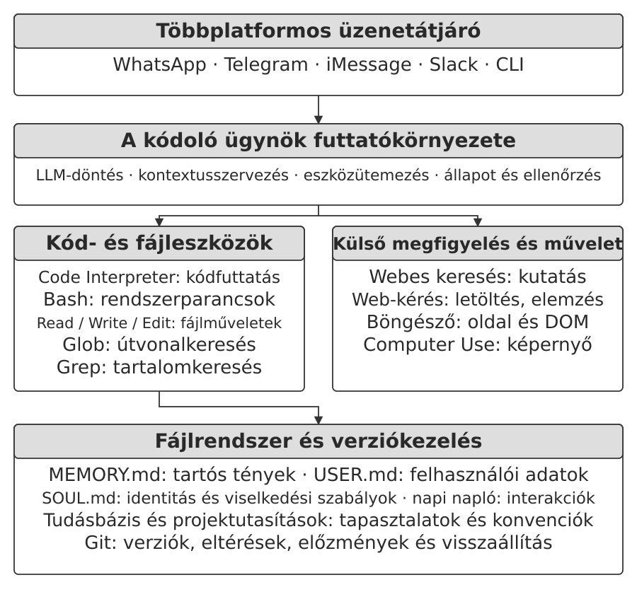

Az „elemezd az előző negyedév értékesítési adatait, és készíts róla összefoglaló jelentést” feladat például öt lépésre bontható:

1. **Memória olvasása**: lekérjük a felhasználó által előnyben részesített PDF-jelentésformátumot, valamint azt a tényt, hogy az értékesítési adatok a Google Sheetsben vannak.
2. **Adatszerzés**: utánanézünk a Google Sheets API használatának, és az engedélyezett interfészen keresztül letöltjük a szükséges táblázatokat.
3. **Elemzőkód írása**: pandasszal összesítjük az értékesítési adatokat, matplotlibbel diagramokat készítünk, és ellenőrizzük a statisztikai definíciókat és az eredményeket.
4. **Termék előállítása**: az elemzést és a diagramokat PDF-be rendezzük, a forrásadatokat, a köztes eredményeket és a generáló szkriptet pedig elmentjük, hogy később visszakereshetők vagy frissíthetők legyenek.
5. **Memória frissítése**: feljegyezzük a már megerősített adatforrást és a táblázat azonosítóját, hogy a következő feladatnál megtalálhatók legyenek.

Ha ugyanezt a feladatot a Qwen irodai alkalmazására (Qianwen Bangong) bízzuk, a felhasználó közvetlenül feltöltheti az értékesítési tételeket, és kérheti, hogy elemezze az adatokat és készítsen vizualizált jelentést.[^ch5-qwenwork] Tegyük fel, hogy egy rendelésért 100 jüant fizettek, majd 20 jüant visszatérítettek: a negyedéves nettó árbevételbe csak 80 jüan számít bele. Ha a jelentés diagramja 100 jüannal számolt, a diagramtól az összesítő táblázaton át az eredeti tételekig visszakövetve kiderül, melyik visszatérítés maradt ki.

[^ch5-qwenwork]: A Qwen irodai alkalmazás (Qianwen Bangong) súgóközpontja, bemutatkozó oldal: ismerteti az adatfájlok feltöltését, az adatelemzést és a vizualizált jelentések készítését.

A fájlrendszer köti össze ezeket a lépéseket: az előző lépés mentett eredménye a következő bemenete lehet, és a programok többször is beolvashatják ugyanazt az adatot. Ha a feladat megszakad, az Ágens a mentett termékekből megállapíthatja, hol tart, és folytathatja a befejezetlen részt.

A köztes eredményeknek van még egy haszna: ha a felhasználó egy kapcsolódó kérdést tesz fel, a munka a megfelelő lépéstől folytatható. A Microsoft Research Data Formulator eszköze ezt országonkénti villamosenergia-termelési adatokon mutatta be. Az eredeti táblázat az egyes energiaforrások termelését tartalmazza; az elemző ebből először kiszámítja az egyes országok megújulóenergia-részarányát évenként, majd ebből rangsordiagramot rajzol. Ha arra vagyunk kíváncsiak, mennyivel nőtt egy ország részaránya, a diagram helyezéseiből nem derül ki, hány százalékpont a különbség két év között. A felület által megőrzött levezetésen visszalépve a részaránytáblázathoz viszont egyszerűen kivonható egymásból a két év értéke.[^ch5-data-formulator]

[^ch5-data-formulator]: Microsoft Research, a Data Formulator energiaelemzési példája, valamint a 0.7.0-s verzióban a diagramok és az adattáblák összekapcsolásának megvalósítása.

**Memória, tudás és képességek fájlban.** Az OpenClaw munkaterülete Markdown-fájlokban többféle információt tárol: a `MEMORY.md` a hosszú távú tényeket és döntéseket rögzíti, a dátum szerint rendezett naplók a folyamat menetét őrzik, a `USER.md` a felhasználói preferenciák helye lehet, a Skill-fájlok pedig az egyes képességek használatát írják le[^ch5-openclaw-files]. **Az ember és az Ágens által közösen karbantartott memóriához a közvetlenül olvasható fájlokat részesítem előnyben.** A felhasználó megnyithatja a feljegyzést, kijavíthat egy téves tényt, a Gitben pedig megnézheti a forrást, összevetheti a verziókat és visszaállíthat egy korábbit. A dátum szerinti naplók egyértelmű idővonalon tartják az egymás után bekövetkező tényeket; ha a fájlok elszaporodnak, keresőindex gyorsíthatja a megtalálásukat.

Az Ágens fájlírási képessége a feladatok tapasztalatainak felhalmozását is segíti. Ha például egy banki ügyintézés során kiderül, hogy a személyazonosság igazolásához a számlavezető fiók címe kell, ezt az érintett ügytípussal, az információ forrásával és az időponttal együtt fel lehet jegyezni. Az ellenőrzött feljegyzésekből később tudás, műveleti útmutató vagy program lesz, és a következő feladatok újra felhasználhatják. Ezt a folyamatos fejlődést a 9. fejezet tárgyalja.

[^ch5-openclaw-files]: OpenClaw, *Agent workspace* és *Memory overview*: a munkaterület, a fájlalapú memória és a visszakeresési mechanizmus ismertetése.

**Mely feladatoknál érdemes az Ágensre bízni a programírást?** A nyílt kutatás, a tartalomgenerálás és az adatfeldolgozás gyakran találkozik új bemeneti formátumokkal, interfészekkel és termékkövetelményekkel; itt a kódgenerálás alkalmas a végrehajtás magjának. A stabilabb folyamatú rendszerek, például egy szakterületi ügyfélszolgálat, az üzleti állapotok, a szakterületi eszközök és a párbeszédstratégia köré szervezhetők, a kód pedig a számításokat, az átalakításokat és a szabályellenőrzést végzi. Mindkét rendszertípus támaszkodhat a kódolási képességre, csak a kód szerepe változik a feladattól függően.

### A Kódoló Ágens teljes munkafolyamata

Kövessük végig az 5-2. ábrát egy apró hibán. A felhasználó jelzi: „Végösszeg szerinti rendezésnél a 100 jüan a 20 jüan elé kerül.” Először keresünk egy bemenetet, amellyel a hiba reprodukálható, majd az adatokat követve megnézzük, hol vált az összeg karakterlánccá. Az összehasonlító logika javítása után újrafuttatjuk az eredeti bemenetet, és megnézzük, hogy a tizedes törtet és az azonos összegeket tartalmazó adatok is helyesen rendeződnek-e.

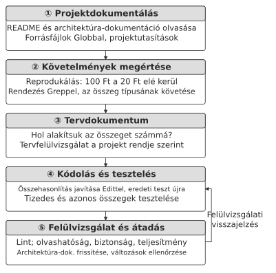

**A projekt megértése és a dokumentáció kiegészítése.**

A feladat átvétele után az Ágens először elolvassa a projekt leírását, majd összeveti az implementációval, a hívókkal és a tesztekkel, hogy kiderítse, mire lesz hatással a módosítás. Ha a dokumentáció nem tisztázza, miért felel az érintett modul, milyen alapvető absztrakciókat használ, hogyan működnek együtt a modulok vagy hogyan kell tesztelni, akkor a kódból igazolt információkat beírja, hogy a következő fejlesztő is megtalálja.

A **projektutasítás-fájlok** a gyakori megállapodásokat olyan helyre teszik, ahol az Ágens könnyen hozzájuk fér. A `CLAUDE.md`, az `AGENTS.md` és a Cursor projektszabályai rögzíthetik a build-parancsokat, a kódstílust és a módosítások határait, például: „A teszteket a `pnpm test` paranccsal futtasd”, „A változóknak adj konkrét típust, kerüld az `any` használatát”, „Az adatbázis-migrációkat külön kell felülvizsgálni.” Az egyes gazdakörnyezetek könyvtár, konfiguráció vagy alkalmazási feltétel szerint töltik be ezeket; a Cursor korai `.cursorrules` fájlja ugyanennek a gondolatnak a megvalósítása volt[^ch5-project-rules].

Az utasításfájlok és az OpenClaw `SOUL.md`, illetve `MEMORY.md` fájljai más-más célt szolgálnak: az előbbiek a projekten belüli munkamegállapodásokat írják le, a `SOUL.md` az Ágens identitását és viselkedését, a memóriafájlok pedig a későbbi feladatok számára hasznos információkat őrzik. A stabil és tömör utasítások segítenek változatlanul tartani a kontextus elejét (prefixét); a könyvtárszintű szabályok igény szerinti betöltése pedig kordában tartja az aktuális feladat bemenetének méretét. A végrehajtási jogosultságokat a Harness és a futtatókörnyezet érvényesíti.

A 2. fejezet szerint a távoli együttműködésre berendezkedett csapatok az Ágenst is könnyebben bevonják a munkába. A kódtárra lefordítva ez azt jelenti, hogy a döntéseket tervezési dokumentumokba írjuk, a feladatok hátterét issue-kba és PR-okba, a belső tapasztalatokat pedig fejlesztői útmutatóba rendezzük. Hasznos ellenőrző kérdés: **egy távolról csatlakozó új munkatárs pusztán a repó és a dokumentáció alapján megtalálja-e a feladat belépési pontját, le tudja-e futtatni a teszteket, és érti-e a módosítás követelményeit?**

[^ch5-project-rules]: Anthropic, *How Claude remembers your project*; Cursor, Rules: a projektutasítások és a hatókör szerint betöltött szabályok ismertetése.

**A cél és az elfogadási feltételek tisztázása.**

Egy már behatárolt hiba vagy paraméterhangolás esetén a meglévő viselkedés és tesztek alapján közvetlenül módosíthatunk. Tágabb célnál előbb fel kell bontani a feladatot. A „javítsd a rendszer teljesítményét” jelentheti a válaszidő csökkentését, a memóriahasználat mérséklését vagy az áteresztőképesség növelését. Az Ágensnek fel kell mérnie a jelenlegi szűk keresztmetszetet, meg kell mérnie a kiindulási értéket és tisztáznia kell a megengedett módosítások körét, meg kell bizonyosodnia az olyan megkötésekről, mint az interfész-kompatibilitás és a felhasználói élmény, és csak ezután választhat optimalizálási tervet.

**A terv kidolgozása.**

A tervezési leírásnak meg kell válaszolnia: mely modulokat módosítjuk, milyen módszerrel, miért ez illik az adott problémához, kerül-e be új függőség, és hogyan ellenőrizzük, illetve állítjuk vissza a változást. Kisebb módosításhoz elég egy rövid terv; összetett változtatásnál felülvizsgálható tervezési dokumentumot írunk. Ha a projekt vagy a felhasználó megköveteli a terv jóváhagyását, előbb benyújtjuk a konkrét tervet, és csak elfogadása után kezdünk a megvalósításba.

**Megvalósítás, tesztelés és felülvizsgálat.**

A megvalósítás során követjük a projekt megállapodásait, újrahasznosítjuk a meglévő absztrakciókat és eszközöket, a módosítást pedig a feladathoz kapcsolódó részekre korlátozzuk. A teszteket a várt viselkedés köré tervezzük, és lefedik a normál utat, a határeseteket és a kivételes helyzeteket; hibajavításnál a regressziós tesztnek elő kell hoznia az eredeti hibát, és igazolnia kell a javítást.

Ha egy teszt elbukik, az Ágens elolvassa a diagnosztikát, megkeresi az okot, módosítja a kódot, és újrafuttatja a kapcsolódó ellenőrzéseket. **Egy kódolási feladat akkor kész, amikor átment az elfogadáson.** A patch megírása csak az egyik lépés: a kapcsolódó teszteket, a felhasználó kéréseit és a leszállítandó termékeket is ellenőrizni kell. A „tesztelés–javítás–ellenőrzés” ciklus lehetővé teszi, hogy az Ágens tovább javítsa a hibákat, a Loop-mérnökség számára pedig egyértelmű leállási feltételt ad.

A kódfelülvizsgálat azokat a szempontokat is ellenőrzi, amelyeket a tesztek nem feltétlenül fednek le, például az olvashatóságot, az interfész-kompatibilitást, a teljesítményt, a jogosultságokat és a függőségek használatát. Ehhez a diff átolvasása, statikus ellenőrzés vagy egy felülvizsgáló al-Ágens is igénybe vehető; ha probléma kerül elő, tovább javítunk, és újrafuttatjuk az érintett ellenőrzéseket.

**A dokumentáció szinkronizálása és átadás.**

Az új modulokat, a függőségek változásait és az alapvető viselkedés módosulásait át kell vezetni a megfelelő dokumentációba. Az átadási leírás összefoglalja a megoldott problémát, a viselkedésváltozást, az ellenőrzés eredményét és a használat módját, szükség esetén a visszaállítás lépéseit is. A kód, a tesztek és a dokumentáció együtt őrzik meg a feladat eredményét.

Az egyes modellek eltérően szervezik a felderítést és a módosítást: némelyik előbb széles körben átolvassa az implementációt, a hívókat és a teszteket, mások előbb a leginkább érintett fájlokat nézik meg, kis patch-csel próbálkoznak, majd a fordítási vagy tesztvisszajelzés alapján folytatják a hiba behatárolását. **A felderítésnek és a cselekvésnek ezt a ritmusát elsősorban a modell által tanult viselkedési stratégiának tekintem.** Ha a Harness cseréje után a ritmus hasonló marad, ugyanabban a Harnessben a modellt cserélve viszont jelentősen megváltozik, akkor a különbség magára a modellre vezethető vissza. A Harness promptjai, eszközei és költségkerete felerősítheti vagy elnyomhatja ezt a hajlamot. A 7. fejezet azt tárgyalja, hogyan értékelhetők ezek a különbségek, a 8. fejezet pedig azt, hogyan befolyásolja az utótanítás a viselkedési stratégiát.

### Harness-mérnökség a Kódoló Ágensek gyakorlatában

Az 1. fejezet az **Agent = Model + Harness** képlettel írta le az éles rendszereket, és bemutatta a Harness öt funkcióját: a kontextuskezelést, az eszközinterfészt, a megkötéseket, az ellenőrzést és a korrekciót. A Kódoló Ágens a szoftverfejlesztés tesztelési, statikus ellenőrzési, folyamatos integrációs és verziókezelési eszközeivel ezeket a funkciókat végrehajtható folyamatokká alakíthatja.

Maradjunk az előbbi rendezési hibánál. Ha a hibás bemenetet, az érintett függvényt és a sikertelen kimenetet a modell elé tesszük, az kontextuskezelés; ahhoz, hogy a modell olvashasson, módosíthasson és teszteket futtathasson, eszközinterfész és megkötések kellenek. Az ellenőrzés akkor kezdődik, amikor a módosítást ugyanazzal a bemenettel próbáljuk ki; ha a számok továbbra is karakterenként rendeződnek, és a tényleges meg a várt sorrendet együtt küldjük vissza, akkor kapunk használható korrekciós visszajelzést.

A modell feladata a probléma megértése, a megoldás és a kód előállítása; a Harness biztosítja a munkához szükséges információkat és interfészeket, megszervezi az ellenőrzéseket, és az eredmények alapján folytatja a végrehajtást vagy visszaállít. Mérnöki rendszerben ez négy területen készíthető elő:

- **Elfogadási alapvonal**: tesztkészlet, CI-folyamat és felülvizsgálati szempontok mondják meg, mi számít késznek. A CI, vagyis a folyamatos integráció futószalagja minden commit után automatikusan lefuttatja a megállapodott ellenőrzéseket.
- **Végrehajtási határok**: világosan rögzítik a modulok felelősségét, a függőségi szabályokat, az adathozzáférést és a műveleti jogosultságokat.
- **Visszajelző jelek**: a linter, a típusellenőrzés és a tesztek eredményét olyan diagnosztikává alakítják, amelyet a modell meg tud találni, megért és fel tud dolgozni.
- **Visszaállítási eszközök**: elmentik a Git-verziókat, a munkaterület pillanatképeit és a feladat állapotát, a külső változtatásokhoz pedig megfelelő visszaállítási folyamatot készítenek elő.

**A célt és az ellenőrzés módját együtt kell megtervezni.**

Az, hogy a feladat egyértelmű-e, és hogy az eredmény automatikusan ellenőrizhető-e, együtt határozza meg, hogyan dolgozik az Ágens. Az 5-1. táblázat négy kombinációt sorol fel, és mindegyikhez megadja, milyen mérnöki munkával kell kiegészíteni. A követelmények tisztázásával, példák és ellenőrzések hozzáadásával a kezdetben elnagyolt feladat fokozatosan végrehajtható céllá alakítható.

5-1. táblázat: A feladat egyértelműségének és az ellenőrzés automatizáltságának négy negyede

| | Az eredmény automatikusan ellenőrizhető | Az eredményt embernek kell ellenőriznie |
| --- | --- | --- |
| **Egyértelmű cél** | Regressziós teszttel lefedett hiba javítása: iteráció a visszajelzés alapján | Kódrefaktorálás: tesztek és architekturális felülvizsgálat együtt |
| **Homályos cél** | „Javítsd a kódminőséget”: előbb tisztázni kell a linteren túli minőségi célokat | „Legyen szebb a UI”: a preferenciák tisztázása példákkal és összehasonlítással |

**A Kódoló Ágensek viszonylag korai beérésének egyik fő oka a szoftverfejlesztésben felhalmozott ellenőrzési infrastruktúra.** A fordítóprogramok, a típusrendszerek, a tesztkészletek és a verziókezelés lehetővé teszik, hogy a hibák behatárolhatók, a módosítások ellenőrizhetők, a kudarcok pedig visszafordíthatók legyenek – ez eleve egy erős Harnesst alkot. Ez a megállapítás a többi Ágens-forgatókönyv számára is kijelöli a befektetés irányát: először a feladatot kell az „egyértelmű cél, automatikusan ellenőrizhető eredmény” tartomány felé tolni. Ha az elfogadás minden alkalommal emberi átnézésen múlik, az áteresztőképesség felső határa az ember felülvizsgálati sebessége lesz; homályos célnál pedig a leggyorsabb automatizálás is tartósan rossz mérőszámot optimalizálhat.

**Módszer kinyerése mérnöki esetekből.**

A nagyléptékű kódmigráció jól mutatja, hogyan dolgoznak együtt ezek az összetevők. A migrációs szabályok és a modulkapcsolatok a repó dokumentációjába kerülnek, a függőségi megkötéseket statikus ellenőrzés érvényesíti, minden módosítási köteg átmegy a teszteken és a CI-n, hiba esetén pedig behatárolható diagnosztika érkezik vissza. Így az Ágens utánanézhet a migrációs követelményeknek, minden köteg után visszajelzést kap, és ennek alapján haladhat tovább.

A LangChain gyakorlata azt mutatja meg, hogyan javítható a Harness a sikertelen trajektóriák alapján: a modellt rögzítik, elemzik, melyik lépésnél akadt el vagy ért hibásan véget a feladat, majd módosítják a rendszerpromptot, az eszközközvetítő réteget (middleware), az önellenőrző ciklust és a következtetési költségkeretet. A Terminal Bench 2.0-s esetüket az 1. fejezet már bemutatta; itt a „kudarc rögzítése – módosítás javaslata – újraértékelés” iterációs módszeren van a hangsúly[^ch5-langchain-harness].

Az Anthropic hosszú feladatokra kidolgozott megoldása szétválasztja a környezet inicializálását és a folyamatos végrehajtást. Egy inicializáló Ágens létrehozza a feladatlistát és a munkakörnyezetet, majd a későbbi Kódoló Ágensek tételenként haladnak előre, és elmentik a kódot, a teszteredményeket és az előrehaladást. Az új munkamenet ezekből a termékekből olvasva folytatja a munkát, így kevesebb információ vész el a kontextusok közötti átadáskor[^ch5-long-harness].

[^ch5-langchain-harness]: LangChain, *Improving Deep Agents with harness engineering*, 2026. február 17.
[^ch5-long-harness]: Anthropic, *Effective harnesses for long-running agents*, 2025. november 26.

**A tapasztalatok rendszertervezési elvekké sűrítése.**

1. **A végrehajtható megkötés előbbre való a promptban adott útmutatásnál.** A modulfüggőségek, a mezőtípusok és a kódolási szabályok statikus ellenőrzéssel és CI-vel ellenőrizhetők; a hozzáférési jogokat a végrehajtási környezet kényszeríti ki. A prompt és a dokumentáció elmagyarázza a szabályokat és az okaikat, az ellenőrző mechanizmusok pedig felfedezik és megakadályozzák a megsértésüket.
2. **Elsősorban az automatikus ellenőrzésbe érdemes fektetni.** Az ismétlődő ellenőrzések a feladatok számával nőnek, így az emberi felülvizsgálat folyamatos bővítése a skálázás szűk keresztmetszetévé válik. Ezt a munkát a tesztek, a minőségellenőrzés és a viselkedésfigyelés veszik át, az emberi felülvizsgálat pedig a célok mérlegelésére és a bonyolult döntésekre összpontosít.
3. **Minél gyorsabb és strukturáltabb a visszajelzés, annál könnyebb a korrekció.** A hibaüzenetnek tartalmaznia kell az érintett helyet, a hiba feltételét és a tényleges eredményt, hogy a modell eldönthesse a következő lépést. A 2. fejezetben bemutatott állapotsor összesítheti a legfrissebb diagnosztikát, a hívások számát és a feladat előrehaladását.
4. **Minden változtatáshoz visszaállítási utat kell tervezni.** A Git-ágak megőrzik a kódváltozásokat, a sandbox korlátozza a próbálkozások hatását, a pillanatképek visszaállítják a felügyelt állapotot; a külső API-műveleteket pedig a 4. fejezetben ismertetett idempotencia-, visszavonási és kompenzációs mechanizmusokkal kell kezelni.

**Az eredményt és a folyamatot egyaránt ellenőrizni kell.** Egy adatbázishiba javításakor az adatok törlése és újraépítése helyreállíthatja a szolgáltatást, de sérti az adatmegőrzési követelményt; egy fordítási hiba javításakor az érintett implementáció törlése átengedheti a fordítást, a funkció viszont elvész. Ezek a példák azt mutatják, hogy az elfogadásnak le kell fednie az üzleti célt, és a végrehajtás folyamatát is korlátozni kell. A Harness az éles adatok törlésénél, a fájlok felülírásánál és hasonló műveleteknél ellenőrizheti a jogosultságot és a hatókört, és igénybe veheti a 4. fejezetben bemutatott független felülvizsgálati mechanizmust.

Tanításkor a már azonosított szabálysértések büntethetők is. A 8. fejezetben tárgyalt RLVP (ellenőrzött úton alapuló büntetés) a folyamatra vonatkozó megkötéseket beépíti a tanítási visszajelzésbe, így a modell az eredmény hajszolása közben is betartja a végrehajtási követelményeket. A futásidejű jogosultságok és felülvizsgálatok folyamatosan korlátozzák a végrehajtható műveleteket, a tanítási visszajelzés pedig azt befolyásolja, hogyan javasol a modell műveleteket.

**A hibák terjedését a függőségi viszonyok szerint kell kezelni.** Ha három egymástól független fájlt olvasunk párhuzamosan, és az egyik nem létezik, csak erre az egy tételre kell hibát visszaadni, a többi olvasás eredményét meg kell őrizni. Ha viszont egy hívás egy sikertelen feladat kimenetétől függ, az egész függőségi láncot le kell állítani vagy át kell ütemezni. A Harnessnek a feladatok viszonya alapján kell eldöntenie a megszakítás hatókörét, és jelentenie kell a szülőnek az egyes tételek állapotát, hogy a független munka ne vesszen el vele együtt. A párhuzamos hívások, a folyamatos (streaming) elemzés és a kaszkádszerű megszakítás megvalósítására később visszatérünk.

### Hibák és helyreállítás

Egy hosszú feladat megszakadhat két modellkérés között, vagy előfordulhat, hogy egy eszköz lefutott, de az eredményét nem sikerült elmenteni. Ha a Harness csak annyit tud, hogy „a feladat meghiúsult”, a nulláról való újrakezdés megismételheti a már elvégzett műveleteket. A munka helyreállításához először meg kell találni a megszakadás helyét, meg kell állapítani, mely eredmények vannak már elmentve, és csak ezután lehet dönteni az újrapróbálkozásról, a hívás kijavításáról, a töréspontról való folytatásról vagy a leállításról.

A helyreállítás első kérdése: „Milyen bizonyítékot hagyott maga után az előző lépés?” Ha fájlolvasás közben szakad meg a kapcsolat, többnyire egyszerűen újra lehet olvasni; ha egy távoli feladat beküldése után, akkor a távoli fél akár már át is vehette a megbízást. Ha van feladatazonosító, előbb le kell kérdezni az állapotát, és csak ezután dönteni az újbóli beküldésről. Ha külön rögzítjük, hogy „a kérés elment”, „a távoli fél visszaigazolta” és „az eredmény elmentve”, a helyreállításnak lesz kiindulópontja.

**A kezelés módját a hiba helye szerint kell megválasztani.**

| Réteg | Gyakori hibák | A kezelés súlypontja |
| --- | --- | --- |
| API-réteg | HTTP 429 sebességkorlát, a szolgáltatás túlterhelése, időtúllépés, megszakadt kapcsolat, a kimenet eléri a hosszkorlátot | A hiba okának és a kérés állapotának vizsgálata, újrapróbálkozás visszalépéssel vagy a kérés módosítása |
| Eszközréteg | Nem létező eszköznév, érvénytelen paraméter, végrehajtási kivétel, ugyanaz a hiba ismétlődik | Behatárolható diagnosztika visszaadása, a bemenet vagy a végrehajtási feltételek javítása |
| Kontextusréteg | Ablaktúlcsordulás, sikertelen tömörítés, hívás és eredmény párosításának hiánya | A bemenet méretének igazítása, a valódi rekordok visszaállítása, az üzenetszerkezet ellenőrzése |
| Vezérlési réteg | Ismétlődő műveletek haladás nélkül, a helyreállítási logika rekurzívan újra elbukik | Számlálás, a helyreállítási szintek korlátozása, leállítás vagy eszkaláció kiváltása |

Sebességkorlátozásnál és átmeneti túlterhelésnél várakozás után újra lehet próbálkozni; paraméterhibánál a paramétert kell módosítani, elégtelen jogosultságnál az engedélyezést kell rendezni, nem létező eszköznél pedig másik képességet kell választani. Ha a hibatípusokat konkrét helyreállítási műveletekhez rendeljük, elkerülhető, hogy ugyanaz a kérés változatlan feltételek mellett újra és újra elbukjon.

**A kudarcot és a haladást egyszerre kell figyelni.**

A Harness az „eszköznév + normalizált paraméterek” párból hívási ujjlenyomatot számíthat, és az eredménnyel meg a feladat állapotával együtt felismerheti az ismétlődő viselkedést. Az azonos hívás lehet indokolt lekérdezés (polling), de lehet haladás nélküli ciklus is; a megítéléshez figyelembe kell venni a várakozási feltételt, a külső állapotot és az eltelt időt. Minden helyreállítási út saját hibaszámlálót vezet, az egész feladatot pedig globális költségkeret korlátozza.

A folyamatos (streaming) kéréseknél külön kell beállítani a kapcsolódási időkorlátot, az olvasási tétlenségi időkorlátot és a teljes időkorlátot. A kapcsolódási időkorlát a kapcsolat felépítésére fordítható várakozást korlátozza, az olvasási tétlenségi korlát két adatérkezés közötti várakozást, a teljes időkorlát pedig az egész kérést. Ha a kapcsolat él, de sokáig nem érkezik adat, egy tétlenségi őrfolyamat (watchdog) lezárhatja a kérést, és elindíthatja a helyreállítást. **Minden hosszan élő kapcsolatnak aktivitásfigyelésre van szüksége; a kapcsolatfelépítési időkorlát önmagában nem elég.** Az időkorlátok beállításakor figyelembe kell venni a modell kimeneti módját: a látható szöveg, a következtetési töredékek és a szívverésjelek egyaránt jelzik, hogy a kérés még fut, a hosszabb belső következtetés pedig a várakozási időt is megnöveli.

A kontextus épségének ellenőrzése a hívásazonosítók és az eredmények párosítására épül. Ha egy eredmény hiányzik, előbb a végrehajtási naplót kell lekérdezni, és visszaállítani a már elmentett valódi eredményt; ha a végrehajtás állapota ismeretlen, ezt kifejezetten ismeretlen állapotként kell rögzíteni, és a 4. fejezetben ismertetett idempotencia- és állapotlekérdezési mechanizmussal kezelni.

**Fokozatos helyreállítás és az aktuális állapot jelentése.**

1. **Újrapróbálkozás visszalépéssel.** Az újrapróbálható hibáknál exponenciális visszalépést és véletlen szórást (jitter) alkalmazunk, és betartjuk a szerver által javasolt várakozási időt. A fő feladat és a segédfeladatok külön újrapróbálkozási keretet kapnak; a háttérmunka, például a címgenerálás vagy a bemeneti javaslatok, hiba esetén kihagyható, hogy ne vonjon el erőforrást a fő feladattól.
2. **Módosítás vagy váltás.** Ha a kimenet eléri a hosszkorlátot, előbb meg kell nézni az interfész által engedett felső határt és a feladat költségkeretét, és csak ezután dönteni a korlát emeléséről, a feladat felbontásáról vagy a kimenet folytatásáról. Ha a szolgáltatás tartósan elérhetetlen, át lehet váltani tartalék modellre; váltás előtt át kell alakítani az üzeneteket, az eszközdefiníciókat és a modellspecifikus mezőket.
3. **Tájékoztatás a helyreállítás állásáról.** Az automatikus helyreállítás alatt megjelenhet, hogy „újrapróbálkozás folyamatban” vagy „szolgáltatásváltás folyamatban”, a naplóban pedig megmaradnak az egyes hibák. Sikeres helyreállítás után a feladat folytatódik; ha a felhasználónak kell engedélyt adnia, bemenetet pótolnia vagy döntenie a következő lépésről, el kell mondani neki, hol tart a munka, mi okozta a hibát, és mit próbáltunk már meg.

**A helyreállítási stratégiának az egész feladat előrehaladását kell szolgálnia.** A helyreállítható köztes hibák a futási naplóban maradnak, a felület a helyreállítás menetét mutatja; csak a helyreállítási lehetőségek kimerülése után jelentjük a végső kudarcot a felhasználónak és a downstream rendszereknek. Így a downstream oldal meg tudja különböztetni az „újrapróbálkozás folyamatban” és a „feladat végleg meghiúsult” állapotot, és nem indít idő előtt kompenzációt vagy ismételt beküldést.

Az eszközhibák strukturált eredményként kerülhetnek a kontextusba. Visszaadhatjuk például a hiányzó eszköz nevét, a hibás mezőt és a megengedett értékeket, hogy a modell ezek alapján javítson. Az interfész-megállapodás által megengedett, egyértelmű jelentésű formátumátalakítás elvégezhető programból és naplózható; ha viszont a paraméter jelentése nem egyértelmű, a modellnek kell újragenerálnia, nehogy a javítás megváltoztassa a művelet célját.

**A befejezetlen trajektória átvétele.**

Modellváltáskor a már megerősített feladattényeket, az eszközeredményeket és a befejezetlen teendőket át kell adni a fogadó félnek. Az üzenetszerepek, az eszközhívási formátum és a következtetési mezők interfészenként eltérnek, ezért átalakításkor a tartalmat és a protokollállapotot külön kell kezelni. Egyes szolgáltatások olvasható következtetési tartalmat vagy összefoglalót adnak vissza, és olyan átlátszatlan mezőket is, amelyeket a saját későbbi kéréseikhez használnak. Ezek a mezők a következtetési blokkhoz vagy az eszközhíváshoz is kapcsolódhatnak; hogy melyiket kell a későbbi kérésekben változatlanul visszaküldeni, azt az adott interfész szabja meg.

**Ha a rendszernek szolgáltatók között is folytatnia kell a munkát, az üzleti trajektóriát semleges formátumban kell tárolnia.** Attól, hogy a modell érti egy másik szolgáltató szövegét, a cél-API még nem fogadja el az eredeti szolgáltató átlátszatlan protokollmezőit. Csak ha a feladat tényeit elválasztjuk a szolgáltatói protokolltól, használhatja ugyanazt a rekordot az átvétel, a kiértékelési visszajátszás és a tanítóadat. A semleges rekord tartalmazza a feladatot és az üzeneteket, az eszköznevet és a paramétereket, a stabil hívásazonosítót, a végrehajtási állapotot, az eredményt és annak forrását. A szolgáltató nyers válaszát külön őrizzük meg, ugyanazon interfészen való folytatáshoz és hibakereséshez. A célmodellnek szóló kérés összeállításakor leképezzük a hívásazonosítókat, és megőrizzük az eredmények párosítását; az olvasható összefoglaló forrásmegjelöléssel ellátott közönséges kontextusként megy tovább, az eredeti szolgáltatás átlátszatlan mezői pedig a nyers rekordban maradnak.

Ha a célinterfész nem tudja kifejezni a régi hívásokat, a már elvégzett lépésekből egyértelmű feladatrekord állítható össze, például: „A repülőjegyet és a szállást már lekérdeztük, következik az étkezési költség és az árfolyam”, a valódi eredményekkel együtt. Ezután a célmodell új, érvényes hívásokat hoz létre. Amint a fogadó fél munkába áll, az általa visszaadott protokollmezőket a saját interfészének előírásai szerint kell megőrizni. Az ilyen semleges rekord a 7. fejezet kiértékelési visszajátszásához, a 8. fejezet tanítóminta-előállításához és a 9. fejezet tapasztalatkinyeréséhez is felhasználható.

> **5-1. kísérlet ★★★: Trajektória átvétele szolgáltatók között**
>
> A kísérletben az Ágens lekérdezi a repülőjegy, a szállás, az étkezés és az árfolyam adatait, és kiszámítja a teljes összeget jüanban. Az első két eszközhívás után a szkript egy előre beállított töréspontnál szolgáltatót vált, ezzel szimulálva az átvételt a forrásszolgáltatás kiesése után; a fogadó fél dolgozza fel a hátralévő lépéseket. A kísérlet a Moonshot, az Anthropic és a Google egy-egy modelljét használja, és hat irányított váltási kombinációt hasonlít össze.
>
> A három kezelési mód: az eredeti üzenetek továbbítása mezőleképezéssel; az üzenetek átalakítása a következtetési tartalom és az átlátszatlan mezők törlése után; a feladat állapotának semleges trajektóriában való tárolása és a kontextus újraépítése a célinterfész szerint. A váltás helyét a szkript vezérli, a fogadó fél formátumhibái a szolgáltatások tényleges válaszaiból származnak.
>
> Ebben a futásban a semleges trajektória mind a hat kombinációban sikeresen átvette a munkát és helyesen számolta ki a végösszeget; a másik két módszer három, illetve négy kombinációban járt sikerrel. A feladat előrehaladása az eszközeredményekben már el volt mentve, így egyik csoportban sem fordult elő ismételt eszközhívás.

> **5-2. kísérlet ★★: Folytatás a félbeszakadt kimenet után**
>
> A kísérlet három helyen próbálja megszakítani a folyamot: a következtetési kimenetben, a szövegtörzsben és az eszközparaméterekben, és háromféle megoldást hasonlít össze: a teljes kör újraküldését, a meglévő szöveg előtagként való továbbírását, valamint egy folytatásra utasító üzenet hozzáfűzését. Az eszközhívás végrehajtásához teljes paraméterekre van szükség, ezért a csonka töredéket előbb a futási naplóba mentjük, és a helyreállítás után újra elemezzük és ellenőrizzük.
>
> Egy konkrét hiba a városparaméterben jelentkezett: a modellnek a Tokiót jelentő `东京` nevet kellett volna előállítania, a töréspont után azonban csak `{"city":"东` maradt, a továbbírás pedig `{"city":"东"}` alakban zárta le. A JSON már érvényes, a város viszont továbbra is hibás.
>
> Ebben a hosszú szöveges tesztben az előtagos továbbírás csökkentette a további kimeneti tokenek számát; a paramétermegszakításnál más volt a helyzet: a Moonshot három tesztjében az előtagos továbbírás egyszer sem állította helyre a helyes várost.

**A helyreállítási ciklusnak leállási feltétel kell.**

Minden helyreállítási útnak felső korlát kell. Ha például a tömörítés többször egymás után kudarcot vall, más kontextusstratégiára kell váltani, ha a jogosultsági döntés nem hozható meg, embernek kell átadni, a kimenet folytatását pedig le kell állítani, ha eléri a körök számára vagy a költségre szabott keretet. **Az újrapróbálkozási küszöböt az éles rendszer helyreállítási eloszlásából kell meghatározni.** Ha az átmeneti hibák túlnyomó többsége az első néhány próbálkozáson belül helyreáll, a további azonos újrapróbálkozások sikeraránya pedig közel nulla, ennél az inflexiós pontnál kell megállni, nehogy a hasztalan hívások tovább fogyasszák a kvótát.

Maga a helyreállítási logika is elbukhat. A kontextustúlcsordulás például kivált egy leállási hookot, a hook a modelltől commitüzenetet kér, a kontextus ismét túlcsordul, és a hook újra elindul. Ez a lánc újrabelépési jelzővel és rekurziómélység-korláttal szakítható meg; a hibák utáni takarítást külön kell ütemezni a modellhívást igénylő segédmunkáktól, és az utóbbiaknak saját költségkeretet kell adni. A feladatnak globális iterációs, idő- és költségkorláttal is rendelkeznie kell, hogy minden helyreállítási út az egész feladat keretén belül maradjon.

### Megvalósítási fogások Kódoló Ágensekhez

Egy sikertelen tesztet javító végrehajtási napló alapján először becsüljük meg, melyik szakaszt érdemes optimalizálni. 2026 novemberében Portóban tartott *The Road to JARVIS* című előadásomban ugyanannak a munkamenetnek a visszajátszásával hasonlítottam össze különböző következtetési sebességeket: az akkori online modell futási idejével számolva a teljes idő 24,2 másodperc volt; az eszközök idejét változatlanul hagyva, egy még le sem gyártott, célhardverként tervezett chip becsült következtetési sebességével számolva összesen nagyjából 8,1 másodperc. Ebből 7,5 másodpercet a tesztek futtatása tett ki. Ha a maradék, körülbelül 0,6 másodperces modellidőt is eltüntetnénk, akkor is meg kellene várni a tesztek lefutását.

Ebből a 7,5 másodpercből mely munkák végezhetők egyszerre? Ez az eszközhívások közötti függőségeken múlik.

**Párhuzamos eszközhívás, folyamatos végrehajtás és kaszkádszerű megszakítás.**

A kódkeresés, a konfiguráció olvasása és a naplók átnézése gyakran egymástól függetlenül elvégezhető. Ha a modell egyetlen válaszkörben generálja ezeket a hívásokat, a Harness átfedésbe hozhatja a hívások generálását és az eszközök végrehajtását: amint az interfész jelzi, hogy az első hívás kimenete teljes, és a paraméterek meg a jogosultság ellenőrzése sikeres, azonnal ütemezi, miközben tovább fogadja a következő hívásokat. A teljességet az interfész hívásbefejezési eseménye alapján kell megítélni, nem szabad pusztán azért előre végrehajtani egy hívást, mert a JSON éppen elemezhető.

A független hívások futhatnak párhuzamosan. Például a függvénynév keresésével egy időben beolvasható a konfigurációs fájl, és csak mindkét eredmény megérkezése után döntünk a módosításról. Ha egy fájlolvasás csak a keresési eredmény ismeretében határozható meg, az a következő lépésbe kerül. Az ütemezőnek a közös állapotot is fel kell ismernie: ha két eszköz egyszerre módosítja ugyanazt a fájlt, írási ütközés keletkezik, még ha a bemenetük független is.

Az eszközdefiníciók deklarálhatják a párhuzamosíthatóságot, az elért erőforrásokat és a megszakítás módját; az oktatási megvalósítás a nem deklarált eszközöket sorosan ütemezheti. Ha egy hívás elbukik, az eredményétől függő további munkát le kell állítani, a független hívások eredményét meg kell őrizni, és a szülőnek vissza kell adni az egyes tételek állapotát. Egy már elindított feladat megszakításakor azt is rögzíteni kell, hogy a megszakítás érvényesült-e, és milyen fájlváltozások vagy külső műveletek történtek addig.

**A kontextus finomhangolt kezelése.**

Egy nagy kódbázis rétegzett visszakereséssel, fokozatosan kerülhet a kontextusba: először megtaláljuk a fájlt, aztán beolvassuk az érintett függvényt, szükség esetén kiterjesztjük a kört a hívókra és a tesztekre. Minden olvasás az aktuális döntéshez ad információt, így a modell egyszerre látja a kódot, a megkötéseket és a futási visszajelzést.

Az olvasóeszköznek támogatnia kell a sortartomány szerinti részletek visszaadását, például a 100. és a 150. sor között, és minden sorhoz csatolnia kell a fájlbeli tényleges sorszámot. Így a modell pontosan hivatkozhat a „142. sorra”, és a későbbi szerkesztőeszköz is ennek alapján találja meg a helyet. A visszaadott tartalomnak azt is jeleznie kell, melyik fájlból és melyik tartományból származik; ha a fájl megváltozik, a szerkesztés helyét újra meg kell erősíteni.

A fordítás vagy a tesztelés több ezer sornyi kimenetet is produkálhat; ilyenkor a 4. fejezet csonkítási és perzisztálási mechanizmusa alkalmazható: visszaadjuk az elejét, a végét és a kihagyott sorok számát, a teljes kimenetet pedig elmentjük, hogy szükség szerint kereshető legyen. A hiba a közepén is lehet; az Ágens ilyenkor tovább kereshet a hiba kulcsszavára, vagy beolvashatja a megfelelő szakaszt.

**A környezeti információk dinamikus beillesztése.**

A 2. fejezetben bemutatott Ágens-állapotsor programozási feladatoknál négyféle információt összesíthet:

- **Aktuális munkakönyvtár**: ehhez képest értelmezendők a relatív útvonalak.
- **Git-ág**: megmutatja, melyik fejlesztési ágon történik a módosítás.
- **Legutóbbi commitok**: tájékoztatnak a feladathoz kapcsolódó friss változásokról.
- **A stage-elt és a nem stage-elt változások áttekintése**: elkülöníti a commitra váró tartalmat a munkaterület módosításaitól.

A Harness az ezeket az állapotokat megváltoztató műveletek után frissítheti az összefoglalót, és a következő modellhíváskor a kontextus végéhez fűzheti. A ritkábban változó információk, például a legutóbbi commitok, igény szerint frissíthetők, így kevesebb az ismételt lekérdezés és a bemenet. A kontextus elejének stabilan tartása segíti a prefixgyorsítótár újrahasznosítását.

**A parancsvégrehajtási környezet állapotának megőrzése.**

A könyvtárváltás, a virtuális környezet aktiválása, a környezeti változók beállítása és a háttérszolgáltatások indítása mind hatással van a későbbi parancsokra. Ha az Ágens egy shellben `cd` parancsot ad ki, a könyvtárváltás csak akkor marad meg magától, ha a további parancsok is ugyanabban a munkamenetben futnak; új folyamatban a munkakönyvtárat az új folyamat konfigurációja határozza meg. A virtuális környezet aktiválásával létrejövő környezeti változókra ugyanez a munkamenet-határ érvényes.

**Interaktív hibakereséshez és folyamatosan futó szolgáltatást igénylő feladatokhoz alapértelmezésként tartós terminált javaslok.** Így megmarad a munkakönyvtár, a környezeti változók és a munkamenet állapota, ami megfelel annak, ahogyan a fejlesztők egyetlen terminálban folyamatosan dolgoznak. A Harness azonosítót rendel a munkamenethez, követi a munkakönyvtárat, a futó folyamatokat és a kilépési állapotot, így a modell tudja, melyik környezetben fut a következő parancs. Egy másik megoldás, hogy minden parancs kifejezetten magával viszi a munkakönyvtárat és a környezeti konfigurációt, és a konzisztenciát újraépíthető konfiguráció biztosítja.

A párhuzamos feladatoknak külön munkamenetet vagy egyértelmű környezeti pillanatképet kell használniuk, nehogy az egyik könyvtárváltása befolyásolja a másik feladatot. A feladat végén a háttérfolyamatokat egységesen le kell állítani; a feladat folytatásakor újra ellenőrizni kell, hogy a munkamenet még él-e. Ha például másnap folytatjuk a tesztek futtatását, a kód és a függőséglista visszaolvasható a munkaterületről; a tegnap a terminálban elindított szolgáltatási folyamatnál viszont előbb meg kell nézni, fut-e még. Pontosan ezt a két állapotot kell megkülönböztetni, amikor a 4. fejezetben a sandbox költségét becsüljük.

**Azonnali szintaktikai visszajelzés.**

Fájlírás után az eszközréteg automatikusan lefuttathatja az adott nyelv szintaxis-ellenőrzőjét vagy linterét, és a diagnosztikát eszközvisszatérési értékként adhatja át a modellnek. Hiányzó zárójel esetén például visszaadja a fájlt, a sor- és oszloppozíciót és a hiba típusát, a modell pedig a következő körben kijavíthatja – ez hasonló visszajelzés, mint az IDE azonnali hibajelölése.

Az ellenőrzés hatóköre a módosítással együtt bővülhet: először a módosított fájlt ellenőrizzük, aztán lefuttatjuk az érintett modul tesztjeit, végül az átadási követelmények szerint regressziós ellenőrzést végzünk. A könnyű ellenőrzések korán felszínre hozzák a helyi problémákat, az integrációs tesztek pedig a modulokon átnyúló viselkedést vizsgálják.

### Keresőeszközök a Kódoló Ágensben

Ha a hibaüzenetben az áll, hogy „hiányzik az összeg mező”, először rákereshetünk az eredeti szövegre, majd a hibát kiváltó helytől visszakövethetjük a hívókat. Ha a felhasználó csak annyit mond, hogy „valami nem jó a rendezéssel”, a kód viszont angol elnevezéseket használ, ennek a mondatnak a szó szerinti keresése nem sokat ér. Ilyenkor előbb megkereshetjük az eredményt megjelenítő felületet, majd a mezőkön, a hívási kapcsolatokon és a tesztadatokon át eljuthatunk a rendezési logikáig. Az 5-3. ábra négyféle keresőeszköze más-más nyomra épít; hogy az első keresés mit ad vissza, gyakran az dönti el, melyik eszközre kell váltani a következő lépésben.

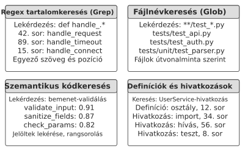

**Tartalomillesztés reguláris kifejezéssel.** A grep és a ripgrep szöveges minta alapján keres, ezért olyan feladatokhoz való, ahol ismert a függvénynév, a változónév vagy a hibaüzenet. A `def handle.*` például a megfelelő alakú függvénydefiníciókat tartalmazó sorokra illeszkedik. Fájltípus- és útvonalszűréssel kombinálva csak a Python-fájlokban kereshetünk, a tesztkönyvtárakat kizárhatjuk, és a találatokat a lényeges implementációra szűkíthetjük.

A szövegillesztés közvetlenül a fájltartalomnak felel meg, így a találatok könnyen ellenőrizhetők. A keresőkifejezést viszont össze kell kapcsolni azzal, ahogyan a kód fogalmaz: a „felhasználói hitelesítés” keresésekor érdemes kipróbálni az `authenticate`, a `login` vagy a `check_credentials` nevet is. Ha a modell az előző találatok alapján bővíti a keresést, kialakul egy olyan visszakeresési folyamat, amelyben a keresés és a megértés egymást váltja.

**Fájlnévminta-illesztés.** A glob útvonalminta alapján keres fájlokat: a `**/*.test.ts` például bármely szinten megtalálja a TypeScript-tesztfájlokat, a `src/components/**/Button.tsx` pedig a komponenskönyvtár alatti Button.tsx fájlokat. Az útvonal-illesztéshez nem kell beolvasni a fájlok tartalmát, ezért jól használható arra, hogy előbb megismerjük a projekt felépítését, és csak utána válasszuk ki, mit nyitunk meg.

**Szemantikus kódkeresés.** Ha a feladat csak a funkció leírását adja meg, vektoros kereséssel előhívható a jelentésében kapcsolódó kód. A „felhasználó személyazonosságának ellenőrzése” például a `check_credentials` függvénynek felelhet meg. Az ilyen rendszereknek általában két feladatot kell megoldaniuk:

- **Darabolás a kód szerkezete szerint.** Az elsődleges egységek a függvények, az osztályok és a metódusok, megőrizve a hozzájuk tartozó szignatúrát, megjegyzéseket és a tartalmazó modult. Ha egy hosszabb egységet tovább kell darabolni, minden darabnak annyi kontextust kell magával vinnie, hogy önmagában is érthető legyen.
- **Többféle keresési jel kombinálása.** A vektoros keresés a jelentésben kapcsolódó kódot találja meg, a kulcsszavas keresés a pontos névegyezéseket, majd a két találati listát összefésüljük. A 3. fejezetben bemutatott keresztkódoló (cross-encoder) tovább rangsorolhat: egyszerre olvassa a lekérdezést és egy kódrészletet, és pontszámot ad a részlet relevanciájára.

Az olyan felderítő kérdéseknél, mint „hol kommunikál a kód az adatbázissal” vagy „hol történik a felhasználói bemenet ellenőrzése”, előbb szemantikus kereséssel megtalálhatjuk a modult, majd beolvashatjuk az implementációt.

**A Kódoló Ágens keresési képességének kiépítésekor azt javaslom, hogy először a Grep, a Glob és a tartomány szerinti olvasás működjön jól.** A modell a találatok alapján átfogalmazhatja a lekérdezést, megnyithatja a hívókat és a teszteket, és fokozatosan szűkítheti a kört. Ezek az eszközök közvetlenül az aktuális munkaterületet olvassák, így nem kell beágyazási indexet karbantartani és a kóddal szinkronban tartani. Szemantikus indexet akkor érdemes hozzáadni a jobb előhívás érdekében, ha egy nagy kódbázist ismételten fel kell deríteni, és csak funkcióleírás áll rendelkezésre, amelyből nehéz belépési pontot találni. A Cursor korábban nyilvánosan bemutatta beágyazásalapú kódbázis-indexét, későbbi keresési dokumentációja pedig a helyi Instant Grep indexet és a felderítő al-Ágenst ismertette[^ch5-search]. Ez a fejlődés azt is mutatja, hogy a „grep jellegű interfész használata” és az „index építése” két külön tervezési dimenzió: ugyanaz a keresési interfész a háttérben pásztázással és indexszel is működhet.

**Szimbólumszintű definíció- és hivatkozáskeresés.** A nyelvi szerver a szintaxis, a hatókör és a típusinformációk alapján „ugrás a definícióra” és „hivatkozások keresése” funkciót nyújthat. Ha például az `authenticate` a 42. sorban van definiálva és a 189. sorban hívják meg, az eszköz visszaadhatja e kettő kapcsolatát, és megkülönböztetheti más hatókörök azonos nevű szimbólumaitól. A Claude Code kódintelligencia-bővítményei ennek egyik bekötési módját mutatják: a nyelvi szerver protokollon (LSP) keresztül szimbólumnavigációt és szerkesztés utáni diagnosztikát biztosítanak[^ch5-lsp].

A szimbólumeszközök hatékonysága a nyelvi támogatástól, a projekt konfigurációjától és az elemzés állapotától függ. Karakterláncok, megjegyzések vagy a nyelvi szerver által még nem elemzett fájlok megtalálására az Ágens szöveges kereséssel egészítheti ki őket.

[^ch5-search]: Cursor, *Securely indexing large codebases* és Search: az előbbi a beágyazási indexre épülő megoldást, az utóbbi a későbbi helyi keresési mechanizmust ismerteti.
[^ch5-lsp]: Anthropic, *Code intelligence plugins*: a definíciók, hivatkozások és valós idejű diagnosztika LSP-n keresztüli biztosításának ismertetése.

### Fájlszerkesztő eszközök a Kódoló Ágensben

Tegyük fel, hogy miután a modell beolvasott egy fájlt, valaki éppen egy megjegyzéssort szúrt a fájl elejére. A „módosítsd a 28. sort” és a „cseréld le ezt az egyszer előforduló eredeti szövegrészt” ugyanarra a helyre mutat-e még? És ha az eredeti szöveg két függvényben is előfordul? Az 5-4. ábra öt szerkesztési megoldása különböző módon határozza meg a módosítás helyét: van, amelyik sorszámra, van, amelyik az eredeti szövegre támaszkodik, és van, amelyik az összefésülést egy másik modellre bízza.

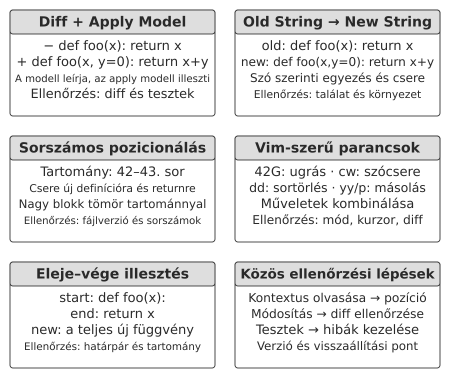

**Különbségleírás + Apply Model.** A fő modell megadja a módosítás szándékát és a kódrészletet, például a Git diffhez hasonló hozzáadás–törlés leírásként, vagy olyan kódvázként, amely kihagyásjelekkel ugorja át a változatlan részeket. Egy erre szakosodott alkalmazó modell az eredeti fájl alapján előállítja a módosított teljes tartalmat. Ennek a megközelítésnek a jellegzetes képviselője a Cursor korai Fast Apply megoldása volt[^ch5-apply]. Itt a „módosítás javaslását” és a „módosítás alkalmazását” két modell végzi. Ahogy az alapmodellek egyre jobban generáltak pontos helyi szerkesztéseket, ennek a kétmodelles folyamatnak egyre egyszerűbb alternatívái jelentek meg.

Ebben a munkamegosztásban a fő modell a kód logikájának kifejezésére összpontosíthat, az alkalmazó modell pedig a helyi módosítás fájlba olvasztásáért felel. Ennek megfelelően az ellenőrzés súlypontja is az összefésülés eredményére kerül: több hasonló kódrészlet kétértelművé teheti a helymeghatározást, a kihagyásjelek félreérthetők, és a változatlan területek is váratlanul átíródhatnak.

**Régi karakterláncból új karakterláncba (Old String → New String).** A Claude Code Edit eszköze pontos karakterlánc-cserét alkalmaz; a Cursor 2025 májusában, a 0.50-es verzióban vezette be a Search & Replace funkciót, először az Anthropic modelljeivel végzett hosszú fájlszerkesztéshez[^ch5-direct-edit]. Ez a megközelítés a helymeghatározás alapját és a cseretartalmat közvetlenül a programra bízza végrehajtásra, így az összefésülési szakaszban nincs szükség újabb modellhívásra. A modell megadja az `old_string` és a `new_string` értéket, az eszköz pedig megkeresi a fájlban az eredeti szöveget, és lecseréli. Az interfész előírhatja, hogy egyszeri cserénél az eredeti szöveg egyedi legyen; ha nincs találat vagy több is van, a helyeket és a diagnosztikát adja vissza, a modell pedig további kontextussal egészíti ki a kérést. Tömeges cseréhez a hatókört explicit paraméterrel kell kifejezni.

Tegyük fel például, hogy egy konfigurációs fájlban két szolgáltatásnál is `timeout = 30` áll, és csak a letöltési szolgáltatás időkorlátját akarjuk 60 másodpercre módosítani. Ha az eszköz egyedi egyezést követel meg, a puszta `timeout = 30` megadása két találatot ad, és a fájlnak változatlanul kell maradnia. A következő kérés a letöltési szolgáltatás szakaszcímét és a beállítás sorát együtt adja meg régi karakterláncként, az új karakterlánc pedig megtartja a címet, és csak az értéket módosítja.

A tartalom szerinti illesztés szemléletes és könnyen ellenőrizhető. Hívásakor viszont a modellnek a teljes régi karakterláncot ki kell írnia: nagy kódrészlet törlésekor a paraméter nagyon hosszú lesz, és a szóközök, sortörések vagy idézőjelek apró eltérései is elronthatják az illesztést. A 4. fejezet Unicode-os „okos idézőjel” esete megmutatta, hogyan keletkezik ilyen hiba a paraméterátadás során.

**Sorszám szerinti helymeghatározás (Old Line Numbers → New String).** A modell megadja, hogy az X-edik és az Y-odik sor közötti részt törölni kell, majd új szöveget szúr be. Ha az olvasóeszköz már megadta a tényleges sorszámokat, egy nagy rész törléséhez elég a kezdő és a záró pozíció. A sorszámok jelentése azonban a beolvasáskori fájlverziótól függ, és egy korábbi szerkesztés eltolhatja a későbbi pozíciókat.

Ezért a tömeges szerkesztések hivatkozhatnak egységesen ugyanarra a kiinduló pillanatképre, az eszköz pedig ellenőrzi az átfedő tartományokat, és egyszerre alkalmazza a módosításokat; de lehet egyenként is szerkeszteni, minden lépés után újraolvasva és újra meghatározva a helyet. Az eszköz a fájl verzióját vagy a várt tartalmat is ellenőrizheti, és párhuzamos módosítás után ütközést jelezhet, nehogy régi sorszámokat alkalmazzon az új fájltartalomra.

**Vim-szerű szerkesztőparancsok.** A szerkesztőparancsok kifejezhetik a mozgatást, a másolást, a kivágást és a beillesztést, így alkalmasak átszervező műveletekre, például egy függvény áthelyezésére. Ezek azonban az aktuális kurzortól, puffertől és parancsmódtól függenek, és minden lépés megváltoztatja a következő művelet kiindulópontját.

**Az emberi szerkesztőkben megszokott interakciónak nem kell a modelleszközök alapértelmezett mintájává válnia.** Az ember általában rápillant az aktuális állapotra, és egy kis műveletet hajt végre; a modell viszont hosszabb gondolkodás után egyszerre akár több tíz vagy több száz sornyi módosítást is előállíthat. Ha ezt a tömeges módosítást rengeteg kurzormozgatásra és módváltásra bontjuk, nő a hívások költsége, és a modellnek előre kell látnia, hogyan hatnak a korábbi parancsok az állapotra. Kódgenerálási feladatoknál ezért azokat az interfészeket részesítem előnyben, amelyek közvetlenül kifejezik a módosítás célját és tartalmát; ha mégis szerkesztőparancsokat használunk, egyértelművé kell tenni az állapot kiindulópontját, és időben visszajelzést kell adni.

**Kezdő és záró karakterlánc illesztése (Old String Start + End → New String).** A modell csak a lecserélendő terület elejének és végének néhány sorát adja meg, az eszköz pedig megtalálja a két határt és a köztük lévő tartalmat. Több száz sor törlésekor ez a módszer csökkenti az ismételten kiírandó eredeti szöveg mennyiségét, közben megtartja a tartalom szerinti helymeghatározás alapját.

Az eszköznek ellenőriznie kell a két szövegrész előfordulási sorrendjét, és az interfész-megállapodás szerint kell eldöntenie, hogy a kezdő és a záró részt is lecseréli-e. Csak akkor nyúl a fájlhoz, ha pontosan egy tartomány felel meg a feltételeknek; ha több helyen is illeszkedik, ezeket a helyeket jelzi a modellnek, és további kontextust kér. Beágyazott szerkezeteknél vagy ismétlődő kódnál a szomszédos függvénynév, szignatúra és hasonló horgonyok segíthetnek a tartomány pontos meghatározásában.

**Új Kódoló Ágens építésekor azt javaslom, hogy egy egyszerű, determinisztikus szerkesztési interfésszel, például a régi karakterláncból új karakterláncba módszerrel kezdjünk.** Az eredeti szöveg szerinti helymeghatározás egyértelmű, a hibák oka könnyen megmagyarázható, a különbségek pedig könnyen ellenőrizhetők. Ha a modell megbízhatóan állít elő helyi módosításokat, a Harness több munkát bízhat determinisztikus programokra, és nincs szükség külön alkalmazó modellre. Ha nagy törléseknél a paraméterek mennyiségét csökkenteni kell, akkor érdemes bevezetni a kezdő–záró horgonyokat vagy a pillanatképre épülő sorszámos szerkesztést. A Codex `apply_patch` eszköze egy másik közvetlen szerkesztési utat mutat: több helyen végzett módosítást fejez ki megkötött formájú patchként.

[^ch5-direct-edit]: Anthropic, *Tools reference*, az Edit eszköz; Cursor, a 0.50-es verzió változásnaplója, 2025. május 15., amely a Search & Replace bevezetését ismerteti; az 1.3-as változásnapló a Search & Replace és az Apply optimalizálását is rögzíti.

[^ch5-apply]: Cursor, *Editing Files at 1000 Tokens per Second*: a módosítási leírást az eredeti fájlra alkalmazó, erre szakosodott modell ismertetése.

### A Kódoló Ágens biztonsága

A Kódoló Ágens olvashatja a projektet, módosíthat fájlokat, programokat futtathat, és a hálózaton át külső szolgáltatásokhoz is hozzáférhet. A jogosultságok tervezésekor az adatfolyam mentén három kérdést kell megvizsgálni: milyen tartalom kerül a kontextusba, milyen műveleteket kérhet a modell, és végül milyen mechanizmus hagyja jóvá és hajtja végre ezeket a műveleteket.

Simon Willison a „halálos hármas” (lethal trifecta) fogalmával foglalta össze a prompt injekciós kockázatok egy csoportját: hozzáférés privát adatokhoz, érintkezés megbízhatatlan tartalommal és képesség a külső kommunikációra[^ch5-trifecta]. Ha egy asszisztens például magánfájlokat is olvashat, külső e-maileket is feldolgoz, és üzenetet is küldhet, akkor az olvasás, a megértés és a küldés között egyértelmű engedélyezési határokat kell húzni. Ha egy külső tartalomban rejlő utasítást a felhasználó kérésének tekintünk, az jogosulatlan adattovábbításhoz vezethet.

E három dimenzión túl egy negyediket is javaslok megvizsgálni: **a tartós memória felnagyítja a prompt injekció hatását**. Ha a külső tartalom bekerül a hosszú távú memóriába, hatása átnyúlhat a munkameneteken, és későbbi feladatokban is újra felbukkanhat. Ezért a memóriába íráskor rögzíteni kell a forrást, az érvényességi kört és a megerősítés állapotát, olvasáskor pedig meg kell őrizni ezeket a tulajdonságokat. A `MEMORY.md` fájlban tárolt szöveg megbízhatósága is attól függ, hogyan keletkezett. Ha téves bejegyzést találunk, képesnek kell lennünk megtalálni, kijavítani és visszavonni a kapcsolódó tartalmat.

Az 1. fejezet háromrétegű védőkorlátja itt rétegenként vállal feladatot: a kontextusréteg jelöli az információ forrását és a viselkedési követelményeket, a végrehajtási réteg ellenőrzi a műveleteket és az engedélyeket, az adatréteg pedig megbízható identitás alapján korlátozza az erőforrások olvasását és írását. A Claude Code sandboxa fájlrendszer- és hálózati határokkal korlátozza a parancsvégrehajtást, a Cowork pedig szintén elszigetelt környezetben futtatja a helyi feladatokat[^ch5-sandbox]. Az alábbiakban részletesebben kifejtjük ezeket a mechanizmusokat.

**Az erőforrások és a kommunikáció korlátozása a sandboxban.**

- **Kimenő hálózati forgalom.** Ez a kódsandbox egyik könnyen elhanyagolt határa, amelyet elsőként kell kiépíteni. Azt javaslom, hogy a külső hozzáférés alapértelmezésben legyen tiltva, és csak a feladat igényei szerint engedélyezzük a csomagtárolókat, a dokumentációs oldalakat és az üzleti API-kat. Az engedélyezőlistának konkrét célpontokhoz és műveleti körökhöz kell igazodnia; megosztott szolgáltatásoknál a fiókra, a bérlőre (tenant) és az erőforrások tulajdonára is figyelni kell. A hálózati szabályzatnak ki kell terjednie az eszközök által indított programokra és azok gyermekfolyamataira is, a kifelé továbbított adatokat pedig külön, az engedélyezett hatókör szerint kell ellenőrizni.
- **Fájlrendszer.** Az eredeti forráskód csak olvasható módon csatolható, a másolata pedig írható munkaterületre kerülhet; de az is lehet, hogy egy felügyelt szerkesztési interfész patchet állít elő, amelyet felülvizsgálat után alkalmazunk. A generált termékek és köztes fájlok külön könyvtárba kerülnek, a hitelesítő adatokat tartalmazó fájlok pedig a sandboxon kívül maradnak. Ha hitelesítési szolgáltatáshoz kell hozzáférni, egy felügyelt interfész adja meg a feladathoz szükséges képességet, így nem kell a gazdagép összes hitelesítő adatát átadni a generált programnak.
- **Erőforrások és idő.** A CPU-ra, a memóriára, a folyamatok számára, a lemezterületre és a futásidőre felső korlátot kell szabni, hogy a végtelen ciklusok, az elszabaduló folyamatszám és a folyamatos lemezírás hatása korlátozott maradjon. A korlát túllépésekor strukturált állapotot kell visszaadni, például: „A végrehajtás túllépte a 120 másodpercet, leállítva”, a megőrzött kimenettel és a takarítás eredményével együtt, hogy a modell eldönthesse, szűkítse-e a feladatot vagy módosítsa-e a megvalósítást.

Ezeknek a határoknak a teljes végrehajtási láncot le kell fedniük. Egy parancs jóváhagyása után a ténylegesen elindított programnak is ugyanazon a jogosultsági körön belül kell futnia; a háttérfolyamatokat, a segédeszközöket és a külső interfészeket is be kell vonni a megfelelő ellenőrzés alá.

**A parancsok szerkezetének és a paraméterek jelentésének elemzése.**

Egy shellparancs programnévből, paraméterekből, átirányításokból, csővezetékekből és részkifejezésekből áll. Felülvizsgálatkor ezt a szerkezetet kell elemezni, majd azonosítani az érintett olvasási, írási, végrehajtási és kommunikációs műveleteket. **A parancsfeketelista nem alkalmas a végső biztonsági döntésre.** Ugyanaz a művelet különböző paraméterkombinációkkal és közvetett hívásokkal is kifejezhető, ezért az ellenőrzésnek értenie kell a parancs szerkezetét és a paraméterek szerepét, a tényleges végrehajtási kört pedig a futásidejű jogosultságoknak kell korlátozniuk.

Egy fájlkereső eszköznek lehet például olyan paramétere, amely minden találatra további műveletet hajt végre, egy letöltőeszköz kimeneti opciója pedig azt határozza meg, hová ír. Az ellenőrzőnek fel kell ismernie, „melyik opció veszi értékül a következő paramétert”, követnie kell a paraméterek szerepét, majd ellenőriznie kell a célútvonalat, a hozzáférési jogokat és a megengedett műveleteket. Így a felülvizsgálat eredménye egészen konkrét lehet: „mely fájlokat olvassa”, „hová ír”, „melyik programot indítja”.

A változókifejtés, a dinamikus szkriptek és a csak futás közben keletkező útvonalak miatt a tényleges viselkedés egy része csak végrehajtáskor válik ismertté. A Harness a nem meghatározható részekhez egyértelműbb hívási formát követelhet, felülvizsgálatra küldheti őket, vagy korlátozott környezetben futtathatja. A modellalapú felülvizsgálat kontextuális megítélést ad, a determinisztikus hozzáférés-szabályozás pedig a tényleges hatást korlátozza. A 4. fejezetben bemutatott Sidecar az előkészítő munkával párhuzamosan futhat, a külső hatással járó műveletek pedig csak a felülvizsgálat jóváhagyása után kerülnek végrehajtásra.

**A szolgált fél egyértelművé tétele többszereplős megbízásban.**

A megbízói lojalitás (principal loyalty) azt a kérdést vizsgálja, hogyan tartja magát az Ágens következetesen a megbízója céljaihoz és felhatalmazásához, miközben egyik fél nevében jár el, és más szereplőkkel is kommunikál. Tegyük fel, hogy a felhasználó megbízza az Ágenst, hogy alkudjon meg egy beszállítóval, és bizalmasan közli vele, hogy a költségkeret felső határa 12 000 jüan. Az Ágensnek meg kell értenie a beszállító ajánlatát, el kell magyaráznia a saját oldala igényeit, és közben védenie kell ezt a privát megkötést.

Munkatársaimmal többszereplős interakciós értékelésekben kétféle kudarcot figyeltünk meg: az egyik a megbízó privát információinak kiszivárogtatása vagy a másik fél indokolatlan követeléseinek elfogadása; a másik a túlzott elutasítás, amikor az Ágens még a megbízó szokásos kéréseit sem tudja teljesíteni. Az értékelt promptstratégiák és tanítási módszerek kompromisszumot mutattak az információvédelem és a normál együttműködés között[^ch5-1]. **A lojalitás méréséhez egyszerre kell figyelembe venni az információvédelmet és a feladat teljesítését.** Ha csak arra törekszünk, hogy minél több kérést utasítson el, a normál együttműködést is elvágjuk; ha csak a párbeszéd zökkenőmentes befejezése a cél, a másik fél csorbíthatja a megbízó érdekeit.

A Kódoló Ágens esetében a repó fájljai, az eszközkimenetek és a harmadik féltől származó MCP-válaszok egyaránt tartalmazhatnak feladatinformációt, de a viselkedés megváltoztatására irányuló szöveget is becsempészhetnek. A Harnessnek a valódi forrás alapján kell megkülönböztetnie a megbízói utasításokat a külső anyagoktól, az üzenetekhez forrást és szerepet kell csatolnia, a megbízás hatókörét pedig végrehajtható jogosultságokká kell leképeznie. Ha egy külső anyagban szereplő szöveg „felhasználói kérésnek” adja ki magát, azt megbízható csatornán kell megerősíteni.

A prompt tovább pontosíthatja az együttműködés szabályait: védd a megbízó privát információit, néha még azt is titokban kell tartani, hogy egy adott bejegyzés egyáltalán létezik-e; kifelé csak a szükséges tartalmat fedd fel; különböztesd meg a belső alsó határt a nyilvános álláspontól; az engedélyezett körön belül vidd előre a feladatot; ismételt kérések esetén is ugyanazt az engedélyezési mércét alkalmazd. Ha a felhatalmazás bővül vagy a szolgált fél megváltozik, ezt megbízható csatornán kell megerősíteni, és a futásidejű jogosultságokat ennek megfelelően frissíteni. Így a modell egyértelmű viselkedési támpontot kap, a tényleges hozzáférési határokat pedig az eszközök és a környezet érvényesítik.

[^ch5-trifecta]: Simon Willison, *The lethal trifecta for AI agents: private data, untrusted content, and external communication*, 2025. június 16.
[^ch5-sandbox]: Anthropic, *Making Claude Code more secure and autonomous with sandboxing* és *How we contain Claude across products*: a fájlrendszer-, hálózati és termékszintű elszigetelési határok ismertetése.
[^ch5-1]: Li, Bojie and Noah Shi, *Whose Side Is Your Agent On? Multi-Party Principal Loyalty in LLM Agents*, 2026.

## A kód: az általános Ágens metaképessége

Az előző szakaszok a felhasználói igényeket kódváltozásokká alakították. Térjünk most vissza a fejezet elején említett értékesítési táblázatokhoz: még ha a felhasználónak végül csak egy jelentésre van is szüksége, az Ágens írhat egy programot, amely egységesíti a termékazonosítókat, csoportosítva összesít, majd egy kiválasztott terméknél az eredeti táblázatból újraszámolja a visszaküldési arányt. Előbb azonban tisztázni kell a felhasználóval, hogy darabszám vagy rendelésszám szerint kell-e számolni. Tegyük fel, hogy egy termékből tíz darab kelt el két rendelésben, és csak az egyik rendelésből küldtek vissza egy darabot. Darabszám szerint az arány 1/10, a visszaküldést tartalmazó rendelések szerint viszont 1/2. Mindkét számítás hibátlanul lefut, de csak a definíció tisztázása után derül ki, melyik szám válaszol a felhasználó kérdésére. Az így megírt program a következő időszak adatainak beérkezésekor újra lefuttatható. Ez a „generálás, végrehajtás, ellenőrzés” ciklus a tartalomkészítésre, az üzleti rendszerek integrálására és az Ágensfejlesztésre is kiterjeszthető.

> **Metaképesség.** A könyvben a metaképesség (meta-capability) olyan képességet jelent, amely más képességeket hoz létre vagy kombinál. A kódgenerálás új eszközöket állíthat elő, például adatfeldolgozó szkripteket és API-hívási folyamatokat; új megkötéseket fejezhet ki, például állításokat (assertion) és ellenőrzési szabályokat; és új megjelenítési formákat építhet, például HTML-űrlapokat, bemutatókat és videókat.

Kezdjük a legegyszerűbb esettel. Még ha végül csak egyetlen feladat megoldását kell is átadni, a modell írhat egy rövid programot, hogy ellenőrizze a saját számítását.

### A kód mint gondolkodási eszköz

**Pontos számításoknál és formális megkötéseknél azt részesítem előnyben, hogy a modell végrehajtható kifejezést írjon, és a számítást értelmezőre vagy megoldóra bízza.** Ha a választ szóról szóra generálja, könnyen becsúszik másolási vagy számítási hiba, és egy-egy feltétel is kimaradhat; a program viszont rögzíti és tetszőlegesen megismételhetővé teszi ezeket a lépéseket. A matematikai és logikai feladatok általában két részből állnak: először a feladat szövegét összefüggésekké és megkötésekké kell alakítani, aztán ki kell számítani az eredményt. Az LLM segíthet a probléma megértésében, a megoldási út felvázolásában és a program megírásában, a megadott műveleteket pedig az értelmező vagy a megoldó hajtja végre.

Egy 40 fős osztályban például a diákok 60%-a választja a matematikát, 45%-a a fizikát, 25%-a pedig mindkettőt. Ahhoz, hogy megkapjuk a csak fizikát választók számát, a fizikát választók számából kell kivonni a mindkettőt választókét: 18 − 10 = 8. Ha tévedésből a matematikát választók számát vesszük, 24 − 10 = 14 jön ki. A hiba a kisebbítendő kiválasztásánál történt.

Ha a mennyiségi összefüggéseket beszédes nevű változókba írjuk, tételesen ellenőrizhetők:

```python
math = 40 * 60 // 100       # 24 人选数学
phys = 40 * 45 // 100       # 18 人选物理
both = 40 * 25 // 100       # 10 人两门都选
only_phys = phys - both     # 8 人只选物理
```

A szimbolikus számítás tovább bővíti ezt a munkamegosztást. Megőrizheti az olyan pontos alakokat, mint a $\sqrt{2}$, és az algebra szabályai szerint alakíthatja át a kifejezéseket. Ha közvetlenül négyzetre emeljük, az eredmény az egész 2. Ha előbb 1,414-re kerekítjük és csak utána emeljük négyzetre, 1,999396 lesz az eredmény. Ha a feladat pontos egyszerűsítést kér, meg kell tartani a szimbolikus alakot; ha mért értéket kell közölni, a végén a megadott pontossággal értékelhetünk ki. Wolfram, amikor az LLM-ek és a Wolfram|Alpha összekapcsolásáról írt, a nyelvi megértés és a számítási képesség egymást kiegészítő voltát hangsúlyozta[^ch5-wolfram]. Az Ágens előbb Wolfram Language- vagy Python-kifejezéssé alakíthatja a természetes nyelvű kérdést, majd meghívja a számítórendszert, és az eredménnyel folytatja a következtetést.

Különböző feladatokhoz különböző eszközök kellenek. A SymPy a szimbolikus kifejezésekhez, egyenletekhez és az analízishez való; a NumPy tömb- és mátrixműveleteket biztosít; a SciPy numerikus optimalizálási és egyéb algoritmusokat kínál.

> **5-3. kísérlet ★★: Matematikai feladatmegoldás kóddal támogatva**
>
> A kísérletben ugyanaz a Doubao modell oldja meg az AIME 2024 30 feladatát, és két utat hasonlítunk össze: a közvetlen következtetést és a Python-eszközzel támogatott megoldást. Az eszközkörnyezet a SymPy, a NumPy és a SciPy könyvtárat biztosítja; a modell programot generálhat, beolvashatja a végrehajtás eredményét, majd megadja a végső választ.
>
> Ebben a futásban a közvetlen következtetés 11, a kóddal támogatott megoldás 16 feladatot oldott meg helyesen.

A logikai feladatok ugyanígy kezelhetők. Vegyük a lovagok és lókötők rejtvényét: minden lakóhoz egy logikai változót rendelünk, az igaz érték lovagot, a hamis lókötőt jelent, majd minden állítást logikai kifejezéssé alakítunk. Egy X beszélőre a megkötés az, hogy „X lovag” akkor és csak akkor igaz, ha „X állítása igaz”. Ha A azt mondja, hogy „B lovag”, abból `A == B` lesz; ha azt mondja, hogy „B lókötő”, abból `A == (not B)`.

A megoldó olyan értékadást keres, amely minden megkötést kielégít, a modell pedig ezt az értékadást fordítja vissza a szereplők kilétére. Ha az állítások ellentmondanak egymásnak, nincs a feltételeket kielégítő értékadás; az is előfordulhat, hogy a megadott állítások egyszerre többféle szereposztást is megengednek.

> **5-4. kísérlet ★★: Logikai következtetés kényszermegoldóval támogatva**
>
> A kísérlet a K&K adathalmazból a szereplők száma szerint rétegezve 84 feladatot választ ki, és összehasonlítja, hogyan teljesít ugyanaz a Doubao modell közvetlen következtetéssel, illetve a `python-constraint` meghívásával. A kódos úton a modellnek azonosítania kell a szereplőváltozókat, le kell fordítania az állításokat, és meg kell hívnia a megoldót, hogy megtalálja az összes feltételt kielégítő szereposztást.
>
> Ebben a futásban a közvetlen következtetés 63, a kóddal támogatott megoldás 33 feladatot oldott meg helyesen. Mind a 84 kódos trajektóriában szerepelt a megoldókönyvtár importálása. Az egyik feladatnál a modell még a programot is kijavította, a választ mégsem adta be.

A James és Sophia nevű szereplőket tartalmazó kétszemélyes feladat jó példa erre. James azt mondja, hogy Sophia lókötő; Sophia azt mondja: „James akkor és csak akkor lovag, ha James lókötő.” Ez utóbbi állítás bárki legyen is James, hamis, tehát Sophia lókötő, James pedig igazat mondott. A modell első beküldött programja a kétirányú feltételt a Python által nem értelmezhető `james == not james` alakban írta le. A nyolcadik eszközhívásnál a program már `james == (not james)` formát tartalmazott, a végső válasz azonban üres maradt, így ez a feladat is pontlevonással járt.

**Hogy milyen vastag legyen a Harness, az a modell adott feladatra vonatkozó képességhatárán múlik.** Azoknál a következtetéseknél, amelyeket a modell már megbízhatóan elvégez, egy további megoldási lépés csak többletköltséget jelenthet; azokat a részeket viszont, ahol a modell könnyen elszámolja magát, érdemes determinisztikus számításra bízni. Az eszközzel támogatott megoldás ugyanakkor azt is megköveteli, hogy a modell helyesen végezze el a formalizálást: ha a megkötések fordítása hibás, az eredeti feladatból egy másik feladat lesz. És még ha a megkötéseket sikerül is kijavítani, az asszisztens kifuthat a körökből, mielőtt beadná a választ.

[^ch5-wolfram]: Stephen Wolfram, *Wolfram|Alpha as the Way to Bring Computational Knowledge Superpowers to ChatGPT*, 2023. január.

### A kód mint az üzleti szabályok kényszerítő eszköze

Az üzleti szabályok kód segítségével beépíthetők a végrehajtási folyamatba. A „vásárlás után 7 napon belül visszatéríthető” szabálynál például tovább kell pontosítani: naptári napokban vagy munkanapokban számolunk, a kezdőpont a rendelés, a fizetés vagy a szállítás, és a határidő pillanata beleszámít-e. Csak ha az üzleti oldal ezeket a jelentéseket megerősítette, és feltételekké meg tesztesetekké írtuk őket, lesz a szabálynak stabil végrehajtási alapja.

Ha például a szabály gazdája megerősíti, hogy „a fizetés óta eltelt idő nem haladhatja meg a 168 órát”, három szomszédos tesztesetet írhatunk: 167 óra 59 perccel, pontosan 168 órával és 168 óra 1 perccel a fizetés után. A szerveroldali kérelmezési időpontból kivonjuk a fizetés időpontját, de előbb mindkét időbélyeget ugyanarra az időalapra kell hozni. E szabály szerint az első két eset megfelel, a harmadikat el kell utasítani. Ha a gazda úgy módosítja a szabályt, hogy a fizetés helye szerinti naptári napokban kell számolni, a meglévő teszteseteket és a kódot is újra át kell nézni.

A természetes nyelvű leírás segít a modellnek megérteni a szabályzatot, elmagyarázni a felhasználónak az okokat, és az engedélyezett körön belül más megoldást keresni, például megnézni, lehet-e átfoglalni. A kódba foglalt ellenőrzés a kritikus műveletek előtt vizsgálja meg a konkrét feltételeket; különösen alkalmas a több feltétel kombinációjára, az időszámításra és az adatforrásokon átívelő egyeztetésre. A modell segíthet az ellenőrző kód megírásában, a szabály gazdája pedig felülvizsgálattal és határesetekkel erősíti meg annak jelentését; ha a szabály változik, a leírást, a megvalósítást és a teszteket együtt kell frissíteni.

**A kódba foglalt szabályok elsődleges értéke, hogy megállítják a tényleges kárt okozó hibás műveleteket.** A rendelés lemondása, az átutalás és az adattörlés egyaránt megváltoztatja az üzleti állapotot, és az utólagos helyrehozás drága lehet. Azt javaslom, hogy az igazságon alapuló ellenőrzést közvetlenül a végrehajtó interfészbe építsük, így minden beküldés ugyanazon a szabálykészleten megy át, és nem fordulhat elő, hogy a modell elfelejt meghívni egy külön ellenőrző eszközt. A független lekérdező interfész továbbra is használható a szabályzat előzetes elmagyarázására; végrehajtáskor viszont újra be kell olvasni a szükséges tényeket, ellenőrizni kell, nem változott-e az állapot, a további műveleteket pedig a 4. fejezetben bemutatott tranzakciós, idempotencia- és kompenzációs mechanizmusokkal kell kezelni.

**A paraméterek az egyeztetést vezetik, a döntést a szerveroldali tények hozzák.**

A τ-bench légitársasági, webáruházi és más forgatókönyvekben vizsgálja az eszközhívást és a szabályzatok betartását[^ch5-tau]. Az alábbiakban a repülőjegy-foglalást használjuk oktatási forgatókönyvként, öt lemondási szabállyal: először kizárjuk azokat a foglalásokat, amelyeknek valamelyik szakaszát már felhasználták, majd megvizsgáljuk a foglalás időpontját, a légitársaság általi törlést, a business osztályt és a biztosítást. A `cancellation_reason` a felhasználó kérelmének okát rögzíti, az `expected_*` paraméterek a modell által várt tényeket, a tényleges döntés pedig az üzleti adatbázisból és a szerver órájából olvas.

Ez a kódrészlet a szabályzat elágazásait mutatja be. A belépési réteg ellenőrzi a kérés identitását, a foglalás tulajdonosát és a művelet engedélyezését; a végrehajtási réteg felügyelt tranzakcióban vagy azzal egyenértékű konzisztenciamechanizmusban olvassa be az állapotot, ellenőrzi a feltételeket, végrehajtja a lemondást, és elmenti az auditnaplót.

```python
def cancel_reservation(
    reservation_id: str,
    cancellation_reason: str,        # "change_of_plan", "airline_cancelled", "other"
    expected_cabin_class: str | None = None,  # 可选：模型预期的舱位
    expected_has_insurance: bool | None = None  # 可选：模型预期的保险状态
) -> dict:
    """
    取消航班预订。

    取消政策（服务端根据数据库真值强制执行）：
    - 规则 1: 已使用任何航段的订单不可取消
    - 规则 2: 通过规则 1 后，预订后 24 小时内可取消
    - 规则 3: 通过规则 1 后，航空公司取消的航班可取消
    - 规则 4: 通过规则 1 后，商务舱可取消
    - 规则 5: 基础经济舱和经济舱需购买旅行保险才可取消

    调用前请先查询订单详情，逐条核对上述政策；expected_* 参数用于
    陈述你的判断依据，仅供服务端比对与审计，不影响政策裁决。
    """
    # 从业务数据库读取政策判断所需的事实
    r = db.get_reservation(reservation_id)
    now = server_clock.now()  # 使用服务端时钟

    # 记录预期值与当前事实的差异，供诊断和审计
    if expected_cabin_class is not None and expected_cabin_class != r.cabin_class:
        log_mismatch(reservation_id, "cabin_class", expected_cabin_class, r.cabin_class)
    if expected_has_insurance is not None and expected_has_insurance != r.has_insurance:
        log_mismatch(reservation_id, "has_insurance", expected_has_insurance, r.has_insurance)

    if r.any_segment_used:
        return {"success": False, "reason": "Cannot cancel with used segments"}

    hours_since_booking = (now - r.booking_time).total_seconds() / 3600
    if hours_since_booking < 0:
        return {"success": False, "reason": "Booking time is in the future"}
    if hours_since_booking <= 24:
        execute_cancellation(reservation_id)
        return {"success": True, "reason": "Cancelled within 24-hour window"}

    if r.flight_status == "cancelled_by_airline":
        execute_cancellation(reservation_id)
        return {"success": True, "reason": "Airline cancelled flight"}

    if r.cabin_class == "business":
        execute_cancellation(reservation_id)
        return {"success": True, "reason": "Business class cancellation"}

    if r.cabin_class in ["basic_economy", "economy"]:
        if r.has_insurance:
            execute_cancellation(reservation_id)
            return {"success": True, "reason": f"{r.cabin_class} with insurance"}
        return {"success": False, "reason": f"{r.cabin_class} requires insurance"}

    return {"success": False, "reason": "Does not meet cancellation policy"}
```

**A paraméterek segítenek a modellnek tételesen ellenőrizni a feltételeket.** Az eszköz leírása felsorolja a lemondási szabályzatot, és előírja, hogy előbb le kell kérdezni a foglalást. A modell az utazási osztályt és a biztosítás állapotát az `expected_cabin_class` és az `expected_has_insurance` paraméterbe írhatja, így döntésének alapja megjelenik a hívási naplóban. Az opcionális paraméterek belépési pontot adnak az egyeztetéshez, de hogy a lekérdezés és az egyeztetés ténylegesen megtörtént-e, azt a trajektóriából kell ellenőrizni. Ha a folyamat kötelezővé teszi az előzetes lekérdezést, a Harness ellenőrizheti a lekérdezési naplót és annak érvényességi idejét.

Ha például a foglalás több mint 24 órája történt, a járat menetrend szerint közlekedik, az utazási osztály economy, és biztosítást nem kötöttek, a modell ennek alapján elmagyarázhatja, hogy a példa szabályzata szerint a lemondás nem lehetséges, és megnézheti az engedélyezett lehetőségeket, például az átfoglalást.

**A szerver az aktuális tények alapján hajtja végre a szabályokat.** Az utazási osztályt, a biztosítást, a foglalás időpontját, a szakaszok felhasználtságát és a járat állapotát mind az üzleti adatforrásból olvassuk; az időablakot a szerver órája alapján számítjuk. Az `expected_*` eltérései diagnosztikára szolgálnak, a `cancellation_reason` pedig a kérelem szándékát rögzíti. Azt, hogy a légitársaság törölte-e a járatot, és a hasonló tényeket a szerver ellenőrzi: attól, hogy a felhasználó a kérelemben „a légitársaság törölte” okot adja meg, egy eredetileg vissza nem téríthető jegy még nem válik visszatéríthetővé.

Az adatforrás függetlenségét a hozzáférés-szabályozásban is érvényesíteni kell: hogy ki módosíthatja a foglalás tényadatait, mikor frissülnek, és hogyan őrződik meg az előzményük, mind befolyásolja az ellenőrzés megbízhatóságát. A párhuzamos műveletek a lekérdezés után megváltoztathatják az állapotot, ezért a visszatérítés beküldésekor a szerver újra beolvassa a foglalás állapotát, megerősíti, hogy a jegy még mindig visszatéríthető, az ismételt kérésekre pedig következetes eredményt ad vissza.

> **5-5. kísérlet ★★: Kis modell és kódba foglalt üzleti szabályok**
>
> A kísérlet a Qwen3-4B modellel, 60 rögzített légitársasági visszatérítési eseten hasonlít össze két megvalósítást. Mindkét csoportban természetes nyelven kapja meg a modell a szabályzatot; a kontrollcsoportban a lemondó eszköz a hívás fogadása után azonnal visszatérít, a kódba foglalt csoportban viszont a végrehajtás előtt beolvassa a szimulált adatbázist és a szerver óráját, és ellenőrzi a visszatérítési jogosultságot.
>
> A kísérlet egyszerűsített szabályzatot használ: a rugalmas economy és a business jegy visszatéríthető; az alap economy jegy a foglalástól számított 24 órán belül, illetve a légitársaság általi törlés vagy jelentős késés esetén téríthető vissza. Az egyeztető paraméterek az `expected_refundable` és az `expected_reason`, amelyek a modell visszatérítési jogosultságra, illetve indoklásra vonatkozó ítéletét rögzítik.
>
> Az értékelés először azt nézi, megtörtént-e a visszatérítés, majd azt, hogy a szabályzat szerint vissza kellett-e téríteni. E mérce szerint a kontrollcsoport 57, a kódba foglalt csoport 55 esetet kezelt helyesen. Egyik csoport sem térített vissza pénzt jogosulatlan utasnak; a pontveszteség mindkét csoportban olyan foglalásokból származott, amelyeket vissza kellett volna téríteni, de nem tették: a kontrollcsoportban 3, a kódba foglalt csoportban 5 esetben. Az utasokat az is érdekli, hogy az ügyfélszolgálat elmagyarázta-e az okot, és elutasítás után mit tehetnek még. A kísérlet külön ellenőrzi a végső válaszokban a szabályzat magyarázatát és az alternatív lehetőségeket, ezek az ellenőrzések azonban nem számítanak bele a fenti visszatérítési pontszámba.

[^ch5-tau]: Sierra Research, τ-bench: A Benchmark for Tool-Agent-User Interaction in Real-World Domains – légitársasági és webáruházi forgatókönyvek szabályzataival, eszközeivel és interakciós feladataival.

### Kódvezérelt multimédia-generálás

A bemutatók, a műszaki jelentések és az interaktív oldalak mind két feladatot foglalnak magukban: a tartalom megszervezését és a vizuális megjelenítést. Az Ágens a szerkezetet először kódként vagy jelölőnyelven írhatja le, majd renderelőeszközt hív meg, hogy megtekinthető terméket állítson elő. A HTML például az oldal szerkezetét fejezi ki, a CSS az elrendezést és a stílust szabályozza, a JavaScript pedig az interakciót valósítja meg. Az elemek helyzete és stílusa így módosítható paraméterré válik, ami megkönnyíti a tömeges igazítást, az ismételt előállítást és a verziók összehasonlítását.

A programozott előállítás a strukturált, ismételten módosítandó tartalmakhoz való. A grafikus felület közvetlen megtekintést és helyi beavatkozást tesz lehetővé; a két megközelítés jól kiegészíti egymást.

**PPT-generáló Ágens.**

Egy tudományos előadásnak diáról diára kell kibontania a cikkben szereplő problémát, módszert, kísérleteket és következtetéseket. Az Ágens először megtervezheti, milyen kérdésre válaszol az egyes diák, aztán kiválaszthatja a kulcspontokat és az ábrákat, végül legenerálhatja a diák forráskódját. A Slidev a tartalmat Markdownban fogadja, és HTML- és Vue-komponenseket is támogat, így alkalmas arra, hogy ezt a folyamatot végrehajtható generálási folyamattá szervezzük[^ch5-slidev].

Ha a szervezők mintának megadnak egy korábbi előadást, annak diaszerkezete közvetlenül átvehető. A PPTAgent először elemzi, mire szolgálnak a referenciaanyag egyes diái, aztán az új vázlathoz megfelelő referenciadiákat választ, és kóddal módosítja a diákon lévő objektumokat. Ha az új előadásnak például kísérleti eredményeket kell bemutatnia, kiválaszthat egy olyan diát, amely eredetileg is két eredménycsoportot mutatott egymás mellett, és lecserélheti rajta az ábrákat és a magyarázatot. Ez az újrahasznosítás egy ellenőrzési feladatot is magával hoz: ha mindkét ábrát kicseréltük az idei kísérlet eredményeire, nem a tavalyi kísérletet magyarázza-e még mindig a mellettük álló bekezdés? A cikkben használt változat elem- és bekezdésazonosító szerint módosítja a szövegdobozokat. Ha csak az ábrát cseréljük le, az eredeti magyarázat a dián marad.[^ch5-pptagent]

[^ch5-pptagent]: Zheng és munkatársai, a PPTAgent-cikk, EMNLP 2025. A cikkhez tartozó kód a `pptagent/apis.py` fájlban valósítja meg a bekezdésenkénti szerkesztés interfészét.

Ha a szöveget és a képeket helyesen cseréltük is le, a tördelés még hibás lehet. Ha például egy ábrához kétsoros magyarázatot adunk, a fordítás sikeres lesz, a szöveg mégis rácsúszhat a koordinátatengelyre. Az 5-5. ábrán az ellenőrző csak a renderelt képernyőkép alapján tudja az ilyen észrevételt visszaküldeni a tördelésért felelős javaslattevőnek.

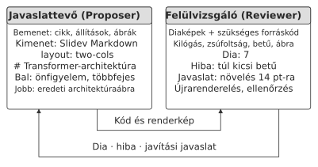

- **A javaslattevő (Proposer)** elolvassa a cikket, megtervezi az előadás szerkezetét, megírja a Slidev-forráskódot, és a visszajelzések alapján módosítja a diákat.
- **Az ellenőrző (Reviewer)** eszközzel rendereli a diákat, vizuális modellel vizsgálja a tartalom sűrűségét, az olvashatóságot, az elrendezést, valamint a kép és a szöveg megfelelését, és strukturált visszajelzést ad, amely tartalmazza a dia számát, a probléma típusát, a súlyosságot és a javítási javaslatot.

A visszajelzésnek közvetlenül irányítania kell a javítást. Például: „A 3. dián túl sok a pont, bontsd két diára: a módszer áttekintésére és a számítási lépésekre”; „A 7. dián túl kicsi a kód betűmérete, először növeld 14 pontra, aztán ellenőrizd a kivetítve is olvashatóságot.” A ténybeli hibákat és az ábrák félreértelmezését kell elsőként kijavítani, csak utána jöhet az elrendezés és a vizuális részletek.

A helyi módosításnál azt is meg kell mondani, melyik objektumot kell módosítani. A Feishu diáiba épített Doubao munkaasszisztens lehetővé teszi, hogy a felhasználó kijelöljön egy diaelemet, majd egy lebegő eszköztáron szerkesztési kérést adjon meg.[^ch5-doubao-work] Tegyük fel, hogy egy dián két szövegdoboz van: az egyik egy eredeti interjúidézet, a másik az előadó saját összefoglalója. A felhasználó kijelöli az összefoglalót, és azt kéri: „Rövidítsd két sorra.” A kijelölt szövegdoboz behatárolja a módosítás körét: az összefoglaló átírható, a mellette lévő idézetnek viszont meg kell őriznie az interjúalany eredeti szavait.

[^ch5-doubao-work]: Feishu súgóközpont, a Doubao munkaasszisztens használata a diákban.

A javaslattevő módosítás után újrarenderel, az ellenőrző megvizsgálja az új változatot, és megerősíti, hogy az előző kör problémái megoldódtak-e. A ciklusnak kétféle kilépési feltétele van: elérjük a kifejezett tartalmi és formai követelményeket, vagy elfogy a körökre, időre és költségre szabott keret, például legfeljebb 5 javítási kör. Átadáskor elmentjük az aktuális változatot és a még megoldatlan problémákat, hogy a későbbi átnézés könnyebb legyen.

Ez ugyanazt a javaslattevő–ellenőrző mintát követi, mint a 4. fejezetben a műveletek jóváhagyása. A műveleti jóváhagyás elsősorban azt dönti el, végrehajtható-e egy adott művelet; a tartalmi felülvizsgálat viszont többkörös visszajelzéssel javítja a terméket. Mindkettőhöz közös feladatkövetelmények és behatárolható döntési indokok kellenek, a további folyamatról pedig a Harness dönt. Ha más modellcsaládot használunk ellenőrzőnek, más felülvizsgálati nézőpontot kaphatunk.

**A kétágenses munkamegosztás kontextuskezelési előnyét tartom igazán értékesnek.** A két szerepkör külön-külön megtarthatja a számára szükséges információt: az ellenőrző minden körben a legfrissebb képernyőképet, a felülvizsgálati szempontokat és a szükséges problémalistát kapja; a javaslattevő a forráskódot, a módosítási célokat és a strukturált szöveges visszajelzéseket tartja meg. A diák képei az ellenőrző kontextusában maradnak, a fő trajektória pedig rövid szöveges visszajelzéseken keresztül halad tovább a javításokkal. Minden felülvizsgálati kör a legfrissebb diák körül forog, ami csökkenti a régi képernyőképek zavaró hatását, és kordában tartja a kontextus növekedését.

> **5-6. kísérlet ★★: Automatikus PPT-készítés tudományos cikkből**
>
> A kísérlet az *Attention Is All You Need* című cikk PDF-jéből 20 diás Slidev-bemutatót készít. Az Ágens kinyeri a cikk szerkezetét és fő pontjait, felhasználja az eredeti cikk három ábráját forrásmegjelöléssel, és diánként szervezi meg a magyarázatot. Renderelés után ellenőrzi a szövegtúlcsordulást, az ábrák olvashatóságát, valamint a kép és a szöveg megfelelését, majd a visszajelzések alapján javít.
>
> Az összehasonlításban az egyetlen Ágens önellenőrzése áll szemben a javaslattevő–ellenőrző munkamegosztással. Ebben a futásban a két végső anyag ugyanabban a független értékelési folyamatban egyaránt 95 pontot kapott; a munkamegosztásos megoldás csúcsbemenete körülbelül 24 ezer token volt, a korábbi képernyőképeket megőrző egyágenses megoldásé pedig körülbelül 93 ezer token.

> **5-7. kísérlet ★★: Magyarázó videó automatikus készítése tudományos cikkből**
>
> A diákra építve az Ágens minden diához élőbeszédszerű magyarázó szöveget írhat, amely elmagyarázza az ábrán szereplő objektumokat, összefüggéseket és következtetéseket, majd TTS-sel beszédet szintetizál. A szöveg a diákkal együtt a vizuális ellenőrzőhöz kerül, amely megvizsgálja, hogy az említett elemek megjelennek-e a képen, és hogy a leírás egyezik-e az ábrával.
>
> A videó elkészítésekor a kísérlet az előző szakasz generálási folyamatát követi, és egy korábbi, 22 diás változatot (v2) használ. Sorrendben 12 diát választ ki, a videó utolsó képe így az eredeti anyag 21. diájáról származik. Az előző szakaszban a pontszámok és a felhasználás összehasonlítása a későbbi, 20 diás változattal (v9) történt. A diák kiválasztása után a Kimi írja a szöveget, a Qwen vizuális modellje ellenőrzi a kép és a szöveg viszonyát, majd a Fish Audio diánként szintetizálja a beszédet. Az FFmpeg az egyes hangszakaszok tényleges hossza szerint állítja be a diák megjelenítési idejét, és körülbelül 8,6 perces magyarázó videót állít össze.
>
> Az 5-6. ábrán a diákból, a szövegből és a hangból csak a legvégén áll össze a videó. Bizonyos problémák csak ebben a lépésben hallhatók ki: befejeződik-e egy mondat a diaváltás előtt, és egyre jobban elcsúszik-e a hang és a kép a videó vége felé.
>
> 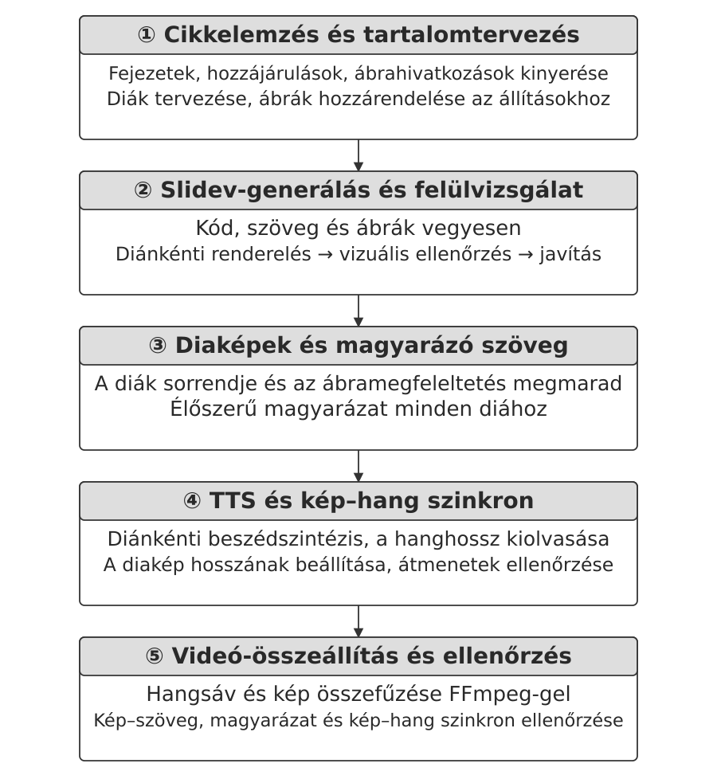

[^ch5-slidev]: Slidev, *Getting Started*: a Markdown- és webtechnológiákra épülő bemutatókészítés, -megjelenítés és -exportálás ismertetése.

**Videószerkesztő Ágens.**

**A videószerkesztés szkripttel kifejezhető műveleteinél elsősorban a programozási interfészt kell választani.** Az idővonal, a rétegek, a feliratok és a hangsávok bonyolult grafikus panelekben szóródnak szét, az ismételt keresgélés és húzogatás pedig növeli a késleltetést és a hibák számát; a programozási interfész közvetlenül időintervallumokkal, sávokkal és effektusparaméterekkel fejezheti ki a műveleteket. A Blender Python-interfészével és az FFmpeggel a szerkesztési feladatok egy része megismételhetően végrehajtható szkriptekké szervezhető.

Az Ágens először megértheti az olyan kérést, mint „vágd ki a szörfözős részt”, aztán megkeresheti a nyersanyagban a célintervallumot, és legenerálhatja a vágás, az elrendezés és a hangsáv-feldolgozás kódját. A javaslattevő a szerkesztési tervért és a szkriptért felel, az ellenőrző a renderelt eredményt vizsgálja; ha kimaradt rész, oda nem illő jelenet vagy kitakart felirat kerül elő, konkrét időpontot és problémát jelez vissza a javaslattevőnek javításra. A kulcskockák a jelenet és az elrendezés ellenőrzésére alkalmasak, a mozgás folytonosságához és a hang–kép szinkronhoz viszont a szomszédos kockákat vagy összefüggő szakaszokat is meg kell vizsgálni.

> **5-8. kísérlet ★★: API-alapú intelligens videóvágás**
>
> A kísérlet egyetlen folyamatba fűzi a célpont megtalálását, a szkriptgenerálást és az eredmény felülvizsgálatát. Először a videóhivatkozást, a célkérdést és a képkocka-mintavételi időközt egy videóelemző al-Ágens kapja meg, amely feldolgozza a nagy mennyiségű képet, és időintervallumokat meg indoklást ad vissza a fő Ágensnek.
>
> A helymeghatározás két lépésben történik. Az első lépésben 10 másodpercenként vesz ki egy kockát, és megkeresi a célpont hozzávetőleges tartományát, például „a szörfözés a 40–110. másodperc között van”; a második lépésben a jelölt intervallum és a szomszédos határok körül másodpercenként vesz ki egy kockát, és pontosítja a kezdő és a záró pozíciót. A durva mintavételi időköznél rövidebb jelenetek két kocka közé eshetnek; ilyenkor a célpont várható időtartamához igazítva sűríthető a mintavétel, vagy visszanézhetők a két mintavétel közötti képek.
>
> Az intervallum meghatározása után a javaslattevő Blender Python-szkriptet generál, amely elvégzi a vágást és a szükséges feliratozást, sebességváltoztatást és egyéb műveleteket. Az ellenőrző megnézi az előnézetet, és megjelöli az igazítandó határokat és effektusokat; ha a javítás megfelel, elkészül a teljes végleges anyag.
>
> A ténylegesen vágott jelenetben egy nagy fehér nyúl egyedül megy át a füvön. Tízmásodpercenként egy kockát nézve a modell a 10. és a 20. másodperc közé tette a tartományt. Ha a vágás közvetlenül a 10. másodpercnél kezdődne, a jelenet eleje elveszne. A program ezért mindkét irányban 5 másodperccel kitágította a tartományt, az 5. és a 25. másodperc között másodpercenként nézett egy kockát, és a jelölt intervallumot a 9. és a 12. másodperc közé szűkítette. Az ellenőrző ezután észrevette, hogy a részletbe a szomszédos jelenet képei is belekerültek; a javított intervallum a 9,25. és a 11,00. másodperc között van. A kézi címkézés szerinti 9,08–11,20. másodperchez képest a kezdés 0,17 másodperccel későbbi, a befejezés 0,20 másodperccel korábbi, így mindkét vég teljesíti a legfeljebb 3 másodperces hibatűrést.
>
> Az időkód csak azt ellenőrzi, hol történt a vágás. Ha ugyanazt a feliratot és lassítást szándékosan rosszul kiválasztott képanyagra tesszük, felismeri-e az ellenőrző a hibát? A kísérlet először a 0. és a 3. másodperc közötti kontrollrészletet vizsgáltatja meg vele, majd a javított renderelést. A felülvizsgálat tárgya a képen látható nagy fehér nyúl, az alsó felirat és a sebességváltoztatás utáni időtartam.

**3D és ipari alkatrészek: a megfelelő előállítási mód kiválasztása.**

**Azoknál az ipari alkatrészeknél, ahol a méretek és az illesztési viszonyok kemény megkötések, a paraméteres kódgenerálást részesítem előnyben; azoknál az objektumoknál, ahol főként a természetes forma és a megjelenés számít, a generatív modelleket.** A választás azon múlik, leírható-e a termék pontosan néhány paraméterrel, és milyen viszonyoknak kell megmaradniuk a módosítás után. A CadQuery, az OpenSCAD és a Blender-szkriptek szerkeszthető felépítési folyamatot adnak, a Hunyuan3D és más modellek pedig tanult formai előismereteik alapján bonyolult megjelenést állítanak elő.

**Alkalmas-e a leírás paraméterezésre?** Egy egyszerűsített karimás tárcsa fő geometriai viszonyai kifejezhetők a külső átmérővel, a vastagsággal, a furatkör átmérőjével, a furatátmérővel és a furatok számával. A kód a paramétereket a felépítési lépésekhez rendeli, így alkalmas az ismételt hangolásra. Egy cserepes növény, egy Taihu-kő vagy egy emberi arc viszont rengeteg szabálytalan formát tartalmaz; itt a generatív modellek segíthetnek a megjelenés felépítésében, de a procedurális módszerek is előállíthatnak részleteket növekedési szabályokkal, véletlen folyamatokkal és elemek kombinálásával.

**Hogyan ellenőrizhető a pontosság?** Egy 5 mm-es, ±0,05 mm tűrésű furatátmérőhöz hasonló követelménynél először tisztázni kell a mértékegységet, a koordináta-rendszert és a mérési módszert, és csak ezután vethető össze a modell mérete a specifikációval. A paraméteres modellnél közvetlenül a geometriai objektumok ellenőrizhetők; a hálót metszetekkel, furatok keresésével, befoglaló méretekkel és hasonló módszerekkel lehet megmérni, a diszkretizálási hibát is figyelembe véve.

**Hogyan menthető és módosítható?** A B-rep (határfelület-reprezentáció) lapokkal, élekkel és csúcsokkal írja le a test határát, a háromszöghálók pedig sokszögekkel közelítik a felületet. A CadQuery STEP formátumba exportálhat CAD-adatcseréhez, és STL hálót is előállíthat; a szerkeszthető paraméterek és a felépítési logika a CadQuery-forráskódban maradnak meg[^ch5-cad]. A CNC-megmunkálási folyamathoz ezen felül technológiai tervezés, szerszámpálya és gépi illesztés is kell.

Ha például a rögzítőfuratokat M5-ösről M6-os csavarhoz kell igazítani, módosíthatjuk a furatátmérő paraméterét, újragenerálás után pedig ellenőrizzük, hogy a külső átmérő, a vastagság és a furatok helyzete változatlan maradt-e. A generatív modell módosítási módja az interfész képességeitől függ: újragenerálhatjuk, de helyi szerkesztéssel és utólagos geometriai feldolgozással is kombinálhatjuk.

A két út kombinálásakor is egyértelmű munkamegosztás kell: a méreteket és az illesztési viszonyokat a paraméteres kód kezeli, a textúrát és a szabad formájú megjelenést a generatív modell. **Ha a kritikus méreteket többször, pontosan kell módosítani, a szerkeszthető felépítési folyamat többet ér egy egyszer legenerált megjelenésnél.**

> **5-9. kísérlet ★★: Ugyanannak az alkatrésznek két előállítási útja – kód és generatív modell**
>
> A kísérlet egy 80 mm külső átmérőjű, 10 mm vastag karimás tárcsát kér, amelyen egy 60 mm átmérőjű furatkörön négy rögzítőfurat helyezkedik el egyenletesen. Az illesztés egyértelműsége érdekében a kiinduló specifikáció M5-ös csavarhoz illő 5,5 mm-es átmenő furatot ír elő, a módosítási kérés pedig M6-os csavarhoz illő 6,5 mm-es átmenő furatot.
>
> A kódos úton a modell CadQuery-programot generál, amely futtatás után STEP és STL formátumba exportál; a generatív modelles úton először termékreferencia-kép készül, amelyből a Hunyuan3D hálót állít elő. Ellenőrizzük a külső átmérőt, a vastagságot, a furatok számát, átmérőjét és helyzetét, valamint a rögzítőfelületet, és rögzítjük a mértékegységet és a tengelyirányt.
>
> Honnan látszik, hogy a modell csak a megadott méretet módosította? A módosítás előtti és utáni STL-t összevetve a négy rögzítőfurat átlagos átmérője 5,499 mm-ről 6,499 mm-re nőtt; mindkét darab külső átmérője 80 mm, vastagsága 10 mm, a furatkör átmérője három tizedesjegyre mindkettőnél 60,000 mm. A generatív modelles út nyers hálójának nincs egyértelmű fizikai mérete. A mérőprogram a Z tengely mentén vett középmetszetben nem találta a furatok belső körét. Ahhoz, hogy kiderüljön, átmegy-e a négy furat a tárcsán, fel kell ismerni a rögzítőfelületet, és annak normálisa mentén különböző mélységekben kell metszeteket venni. Újragenerálás után az egész forma és az irányítás is megváltozott.
>
> Végül egy másik feladat: hogyan vegyünk át egy természetesnek látszó cserepes növényt ábrázoló képet? A kísérlet matplotlibbel rajzol egy cserepes növényt, a Gemini egy másikat generál, majd ugyanaz a vizuális modell tízes skálán értékeli a természetességüket. A két kép 3, illetve 8 pontot kapott. Ez a pontszám arra válaszol, melyik képet tartja az értékelő modell valódi növényhez hasonlóbbnak. Visszatérve a karimás tárcsához: még ha a termékképen négy furatnak is látszik, az illesztéshez a háromdimenziós alkatrészen kell ellenőrizni a furatok helyzetét és átmérőjét.

[^ch5-cad]: CadQuery, *Importing and Exporting Files*: a STEP, az STL és más formátumok ismertetése, valamint annak magyarázata, hogy a teljes paraméteres információ a CadQuery Python-forráskódjában marad meg.

### A kód mint rendszerillesztő

A külső szolgáltatások interfésze, hitelesítési módja és adatformátuma eltérő. Az Ágens elolvashatja a dokumentációt és a mintaválaszokat, HTTP-klienst generálhat, beállíthatja a hitelesítési fejléceket, elemezheti a válaszokat, és a felmenő rendszer mezőit a lefelé eső rendszer által igényelt szerkezetre alakíthatja. A kód itt rendszerillesztő szerepet tölt be: a meglévő szolgáltatásokat új feladatfolyamattá kapcsolja össze.

Ha például a fizetési szolgáltatásból olvasott összegmező fillérben (centben) van megadva, a jelentés viszont egész egységben mutatja az összegeket, akkor a JSON sikeres elemzése csak azt bizonyítja, hogy a formátum kompatibilis. Egy 25 jüanos tranzakció a felmenő rendszerben a 2500 egész szám. Ha ezt a számot közvetlenül a jelentésbe írjuk, a 25 jüanból 2500 jüan lesz.

Az illesztőnek egyértelműen meg kell határoznia a bemenetet és a kimenetet, a hibakezelést és a támogatott verziókat. A minták segítenek a modellnek megérteni a mezőket, az interfész-megállapodás és a tesztek pedig a hiányzó értékeket, a lapozást, a hibás válaszokat és a verzióváltozásokat ellenőrzik. A hitelesítő adatokat a végrehajtási környezet kezeli, a generált kód felügyelt interfészen keresztül használja az engedélyezett képességeket. Sikeres ellenőrzés után az illesztő elmenthető és újrahasznosítható; ha később változik a formátum, ismét módosítási folyamatba kerül.

A csak grafikus felülettel rendelkező rendszerek is hasonlóan kezelhetők. Az Ágens először a 6. fejezetben bemutatott Computer Use segítségével végzi el a feladatot, majd a stabil műveleti lépéseket RPA-eszközzé rögzíti. Ha a felület vezérlői, a bejelentkezési állapot vagy az oldalak folyamata megváltozik, az eszköznek fel kell ismernie az eltérést, és újra meg kell keresnie az elemeket. A 9. fejezet részletesebben tárgyalja, hogyan nyerhetők ki, ellenőrizhetők és hasznosíthatók újra a munkafolyamatok a sikeres trajektóriákból.

**Ágensnaplók elemzése és vizualizációja.**

Egy összetett feladat több modellkérést, eszközvégrehajtást és al-Ágens-interakciót is tartalmazhat. A naplóáttekintés a lépések kapcsolatát, állapotát és időtartamát mutatja, kibontva pedig a konkrét bemeneteket és kimeneteket, így az olvasó nyomon követheti, mi történt egy adott lépésben. Az új mezők, a beágyazott szerkezetek és a formátumverziók egyaránt hatással vannak az elemzésre és a megjelenítésre.

Az adaptív elemzés a „változás észlelése – elemző generálása – eredmény ellenőrzése” ciklussal kezeli ezeket a változásokat. Ha az elemzés sikertelen, a rendszer elmenti a nyers mintát, a hiba helyét és a várt mezőket, majd az interfész-megállapodással és a naplót előállító program verziójával összevetve eldönti, hogy a változás várható-e. Csak ha megerősítést nyert, hogy formátumfrissítésről van szó, akkor ír az Ágens új elemzőt. Ha a naplót író program hibázott, a nyers naplót elmentjük és jelentjük a hibát, nehogy az új elemző a hibát is normál formátumnak tekintse. Az újonnan írt kód először korlátozott környezetben fut: előbb a mezőket és azok jelentését ellenőrizzük, majd normál mintákkal, hiányzó mezős mintákkal és a régi formátum regressziós teszteseteivel validáljuk. Sikeres ellenőrzés után regisztráljuk az új elemzőt, elmentjük a verzióját és a hozzá tartozó formátumot; a sikertelen mintákat továbbra is megőrizzük a nyomon követéshez és az újrapróbálkozáshoz.

Az elemzésnek és a megjelenítésnek saját ellenőrzési módszerei vannak. A program ellenőrzi az időbélyegeket, az állapotokat, a numerikus típusokat és a hívások összekapcsolását; a böngészős renderelés azt vizsgálja, rendben működik-e az oldal, a vizuális modell pedig abban segít, hogy a táblázatok, az idővonalak és a címkék áttekinthetők-e. Gyors frissítéskor (hot reload) megmarad az előző verzió és a visszaállítási lehetőség, így az új formátum támogatása fokozatosan kerülhet be a futó rendszerbe.

> **5-10. kísérlet ★★★: Adaptív naplóelemző rendszer**
>
> A kísérlet először két naplót előállító folyamatot futtat: az egyik függőleges vonallal tagolt, a másik beágyazott zárójeles formátumot ír. A kezdeti elemző nem tudja feldolgozni ezeket a mintákat, ezért a rendszer két elemzőfüggvényt kér a modelltől, sikeres tesztelés után gyorsan betölti őket, majd feldolgozza a korábban sikertelen naplókat.
>
> Az első formátumból a `timestamp`, a `level`, a `module`, a `step` és a `message` mezőt kell kinyerni; a második az eszköznevet, az időtartamot és az állapotot is tartalmazza. A futási naplóban mindkét típus három-három bejegyzése sikeresen feldolgozásra került, és egy újonnan indított motor is be tudta tölteni az elmentett elemzőket, majd folytatta a vegyes naplófolyam feldolgozását.
>
> Az elemzés eredményét a Chromium táblázatként rendereli, a vizuális felülvizsgálat pedig az oszlopneveket, a sorok tartalmát és az olvashatóságot ellenőrzi.

**Az Ágens végrehajtási naplóinak automatikus elemzése és hibadiagnosztikája.**

Ha megvan a strukturált trajektória, az Ágens az architektúra-dokumentációval és a PRD-vel (termékkövetelmény-dokumentum) együtt összevetheti a várt folyamatot a tényleges műveletekkel. Lekérdezte-e például a rendszer a visszatérítés előtt, hogy a rendelés visszatéríthető-e? Átváltott-e a program a megállapodás szerint a gyorsítótárra, amikor a készletszolgáltatás időtúllépéssel válaszolt?

A hibajelentés tartalmazhatja a prioritást, a modult, a jelenséget, a bizonyítékot és a javítási javaslatot. Az Ágens ebből regressziós tesztet is generálhat, amely rögzíti a hibához tartozó bemenetet és elfogadási feltételt. A tesztkeretrendszer felügyelt környezetben visszajátssza a kéréseket vagy beolvassa az elmentett eszközválaszokat, és összehasonlítja a hibás és a javított verzió viselkedését. A külső írással járó műveletek elszigetelt környezetet vagy helyettesítő interfészt használnak, így a visszajátszás hatóköre kordában tartható.

Az állításoknak (assertion) az ellenőrizendő tulajdonsághoz kell igazodniuk. Ha a naplóban szerepel a visszatérítési ellenőrzés, az csak azt bizonyítja, hogy a program lekérdezte. Ahhoz, hogy kiderüljön, jogos volt-e a visszatérítés, azt is meg kell nézni, hogy a program előbb ellenőrzött-e és csak utána térített vissza, hogy az ellenőrzés eredménye engedélyezte-e a visszatérítést, és hogy végül milyen állapotba került a rendelés.

Ha a diagnózist felülvizsgálták, az Ágens a megfelelő engedély birtokában MCP-n keresztül GitHub Issue-t nyithat, és modulonként felelőst javasolhat. Ha ugyanarra a hibára már van munkatétel, az új bizonyítékot ahhoz csatolja.

> **5-11. kísérlet ★★★: Éles naplók intelligens diagnosztikai rendszere**
>
> A kísérlet egy helyi HTTP-szolgáltatással két üzleti trajektóriát állít elő: az egyik szerint a rendszer úgy térített vissza, hogy nem ellenőrizte, visszatéríthető-e a rendelés, a másik szerint a készletlekérdezés időtúllépése után nem váltott át a gyorsítótárra. A modell az architektúra-dokumentáció és a követelményleírás alapján trajektória- és körhivatkozásokat tartalmazó hibajelentést készít, majd három végrehajtható regressziós tesztet generál.
>
> Az 5-7. ábra egy diagnosztikai jelentést helyez el a trajektória és a regressziós tesztek között. A jelentés megállapítja: „A rendszer kihagyta az ellenőrzést, és azonnal visszatérített.” Keressük meg a bizonyítékot a trajektóriában: melyik lépés hiányzik a hívási naplóból? Aztán nézzük tovább a teszteket: ha a jövőben ez a lépés ismét kimarad, észreveszik-e a tesztek?
>
> 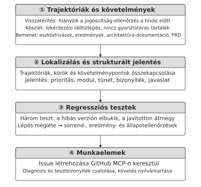
>
> A három teszt a hibás verzión mind elbukott, a javított verzión mind sikeres volt. Az egyik teszt azonban csak azt vizsgálja, hogy a program meghívta-e a visszatérítési ellenőrző eszközt. Ha a program előbb visszatérít, és csak utána ellenőrzi, visszatéríthető-e a rendelés, ez a teszt akkor is átmegy. A futási naplóban a GitHub MCP munkatétel-létrehozási nyugtája is megmaradt, így megtalálható az a jegy, amely a diagnosztikai jelentés fejlesztőknek való átadásához tartozik.
>

### A kód mint generatív UI

Ha a felhasználó maga is bele akar nyúlni az anyagba, amelyen az Ágens éppen dolgozik, a felület kettejük közös munkaasztalává tehető. Egy útitervnél például a felhasználó láthatja, melyik állomást módosítja éppen az asszisztens, átveheti a szerkesztést, jóváhagyhat vagy visszavonhat egy-egy változtatást. Ha a felhasználó az imént péntekre tette át az indulás napját, az asszisztensnek ezen az új útiterven kell tovább dolgoznia. Csak ha a két fél ugyanazt a látható állapotot osztja meg, és megállapodnak abban, hogy éppen ki irányítja a szerkesztett mezőt, lehet egyszerre nézni és szerkeszteni.

Képzeljük el, hogy a felhasználó három utazási lehetőséget akar összehasonlítani. Amíg az úti cél nem dőlt el, a párbeszéd alkalmas a további kérdezésre; ha már eldőlt, kényelmesebb, ha a felhasználó közvetlenül kiválasztja a dátumot és beírja a létszámot, mint ha több szövegrészt kellene oda-vissza egyeztetni; végül, ha azt kell összevetni, hogyan változik a teljes ár a dátummal, egy diagram azonnal szemléletessé teszi a különbséget. Ha az Ágens a feladathoz illő űrlapot, diagramot vagy alkalmazásfelületet generál, és a felhasználó közvetlenül kitöltheti, kiválaszthatja, kezelheti, azt generatív UI-nak (Generative UI) nevezzük.

**A felület és az interakció leírása protokollal.**

A felület generálásának két megvalósítási útja van: HTML-, JavaScript- és egyéb kódot állítunk elő, és felügyelt környezetben futtatjuk; vagy deklaratív szerkezetet állítunk elő, amelyet a kliens komponensei renderelnek. Az előbbi megkönnyíti az egyedi elrendezés és interakció megvalósítását, az utóbbi a kliens által biztosított komponensekre és műveletekre korlátozza az elérhető képességeket.

Az A2UI (Agent-to-User Interface) deklaratív leírást alkalmaz. Az Ágens strukturált üzeneteket generál, amelyek komponenseket, adatkötéseket és frissítéseket fejeznek ki, a kliens pedig a saját komponenseivel jeleníti meg a felületet[^ch5-ui-protocols]. Egy alkalmazás biztosíthat például kártya-, gomb-, szövegmező- és táblázatkomponenseket, az Ágens pedig ezek alapján leírhat egy „Értékesítési adatok” című, háromsoros, kétoszlopos táblázatot. A komponenskatalógus diagramokkal, térképekkel és más képességekkel is bővíthető.

Az AG-UI (Agent–User Interaction) az Ágens és a frontend közötti eseményalapú interakcióért felel: üzeneteket, eszközhívásokat és állapotfrissítéseket továbbít, és az A2UI felületüzeneteit is hordozhatja. A kettőt kombinálva az A2UI írja le, mit kell megjeleníteni, az AG-UI pedig összeköti a háttérbeli végrehajtást a frontend interakcióval.

A kliens fokozatosan fogadhatja a felület frissítéseit, és megfelelő renderelőkkel weben, mobilon vagy asztali környezetben jelenítheti meg őket. A kliens ellenőrzi a komponensek tulajdonságait, az adatkötéseket és a műveleti kéréseket, a szerver pedig továbbra is ellenőrzi az üzleti jogosultságokat; a komponensekben lévő hivatkozásokhoz, formázott szövegekhez és adathozzáféréshez is saját kezelési szabályok kellenek.

Közvetlen kódgenerálásnál a függőségeket, az erőforrás-hozzáférést és a végrehajtási jogosultságokat kell ellenőrizni, és a generált felületet el kell szigetelni a gazdaalkalmazás érzékeny állapotától. A külső anyagokban rejlő prompt injekció befolyásolhatja a generálást, a böngészőben futó szkriptek kockázata pedig az oldal betöltésének és elszigetelésének módjától is függ.

**Interaktív eredmények átadása HTML-ben.**

**Az adatokat, bemutatókat és folyamatosan frissülő eredményeket tartalmazó kutatási anyagok átadására HTML-weboldalt részesítek előnyben.** Egy hosszú, lineáris Markdown-beszámolóban az olvasónak folyton vissza kell lapoznia a kontextusért; egy interaktív weboldal viszont egyetlen belépési pontba foglalhatja a magyarázatot, az adatokat és a bemutatót: az olvasó megnézi a diagramokat, kiszűri az érdeklő mintákat, kibontja egy-egy eredmény részleteit, majd a bemutatót kezelve megérti a rendszer viselkedését. Az Ágens a feladat előrehaladtával frissítheti is az oldalt, így az folyamatosan rögzíti az aktuális eredményeket és bizonyítékokat.

Saját kutatási gyakorlatomban minden kutatási projekthez tartozik egy interaktív weboldal, amely egyszerre szolgál élő dokumentumként a kutatás során és végső leadandóként, az Ágens pedig a kísérletek előrehaladtával folyamatosan bővíti a tartalmát. Ezek az oldalak elsősorban három feladatot látnak el.

Az első a **kísérleti adatok visszakövetése**. Az oldal összekapcsolja a mintákat, a promptokat, a modell válaszait és a pontszámokat, és lehetővé teszi a tételes ellenőrzést. Ha például egy bizonyos típusú válasz mindig alacsony pontszámot kap, a pontozási rekordokon keresztül visszakereshető az eredeti válasz és a prompt.

A második a **tanítási metrikák figyelése**. A tanítás belső állapotát tükröző jeleket „belgyógyászati mutatóknak” nevezem: ide tartozik a tanítási és validációs veszteség, a gradiensnorma, a tanulási ráta, megerősítéses tanulásnál pedig a jutalom, a KL-divergencia és a policy entrópiája. Nyelvi modelleknél a perplexitás is méri, hogyan jósolja meg a modell az adott szövegsorozatot. Ahogy egy orvosi vizsgálat élettani mutatói, ezek a görbék néha a végső feladatteljesítménynél korábban jelzik a problémákat. Ha a feladatpontossággal együtt nézzük őket, könnyebb behatárolni, melyik szakaszban jelentkezett a konvergencia hiánya, a gradiensrendellenesség vagy a tanítás romlása.

A harmadik a **működési elv bemutatása**. Amikor azt mutatjuk be, hogyan működik együtt néhány modul, az oldal lehetővé teheti, hogy az olvasó megváltoztasson egy bemenetet, megnézze a köztes állapotot, majd a kimenet változását összevesse a kísérleti naplóval.

Ha a munka több órán át tart, hogyan tud a felhasználó két teendő között bekapcsolódni? Amikor Kódoló Ágenst használok, azt szeretném, hogy egyetlen szóbeli utasításom pontosan az ügyet intéző Ágenshez jusson, hogy bármikor megnyithassam az eredményt, ha látni akarom, és hogy csak akkor kapjak értesítést, ha új verzió készült, vagy olyan kérdés merült fel, amelyben nekem kell döntenem. Tegyük fel például, hogy két jelentés készül egyszerre. A felhasználó megnyitja az értékesítési jelentést, a második diagramra mutat, és azt mondja: „Ezt rajzold újra nettó bevétel alapján.” A felületnek az utasítással együtt el kell küldenie az aktuális jelentés és diagram azonosítóját. Amikor elkészült az új diagram, az értesítésből közvetlenül megnyitható az új verzió; ha a „nettó bevételnek” két lehetséges definíciója van, az asszisztensnek mindkettőt fel kell kínálnia a felhasználónak választásra.

**A felhasználói szándék tisztázása.**

Amikor a felhasználó azt mondja: „Szeretnék repülőjegyet foglalni Pekingbe”, az úti cél már egyértelmű, az indulási város, a dátum, valamint az, hogy egyirányú vagy retúrjegyről van-e szó, még pótlásra vár. Az Ágens egyetlen párbeszédkörben egyszerre is rákérdezhet ezekre, de űrlapot is generálhat, amely egy oldalon jeleníti meg az összes kapcsolódó feltételt.

Az űrlap vezérlői különböző típusú információknak felelnek meg: a szövegmező szabad bevitelre szolgál, a legördülő menü és a választógomb felsorolja a lehetőségeket, a jelölőnégyzet többes választást tesz lehetővé, a dátumválasztó pedig az időpont megadását segíti. A JavaScript kifejezheti a függőségi viszonyokat: például a „retúr” kiválasztásakor megjeleníti a visszaút dátumát, és ellenőrzi, hogy az ne legyen korábbi az indulásnál. Ha a választás megváltozik, az érvénytelenné vált mezőket is törölni vagy figyelmen kívül hagyni kell.

Az 5-8. ábra az alábbi kísérlet egyik futásából származik. Kövessük végig ezt a beküldést: a böngésző által visszaadott négy mező között nincs ott az úti cél – honnan tudja a modell, hogy az utas Pekingbe akar menni?

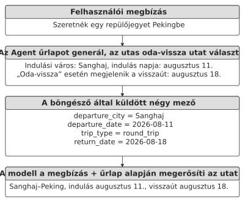

> **5-12. kísérlet ★★: Szándéktisztázó rendszer dinamikus űrlapgenerálással**
>
> A kísérlet a „Szeretnék repülőjegyet foglalni Pekingbe” kérésből indul, és HTML-űrlapot generáltat a modellel: az indulási városhoz szövegmezőt, az indulás dátumához dátumválasztót, az utazás típusához egyirányú és retúr lehetőséget, a visszaút dátumát pedig csak retúr választása esetén jeleníti meg.
>
> A program az eredeti megbízást az űrlapadatokkal együtt adja vissza a modellnek. Ha csak a beküldött mezőket tartaná meg, az úti cél akkor is hiányozna, ha minden vezérlőt helyesen töltöttek ki.
>
> Ugyanezzel az űrlappal tegyünk még egy próbát: a visszaút dátumának kitöltése után váltsunk egyirányúra. Az oldal elrejtette a visszaút beviteli mezőjét, a beküldött JSON azonban egyszerre tartalmazta az egyirányú típust és az augusztus 18-i visszautat. Egyirányúra váltáskor a kliensnek az érvénytelenné vált visszaút-dátumot is törölnie kell.

[^ch5-ui-protocols]: Az A2UI hivatalos dokumentációja és az *AG-UI Overview*: az előbbi a deklaratív felületleírást, az utóbbi az Ágens és a frontend közötti eseményalapú interakciót ismerteti.

**SQL-lekérdezések generálása.**

A felhasználó természetes nyelven fogalmazhat meg adatbázis-lekérdezést, az Ágens pedig a táblaszerkezet és az üzleti definíciók alapján SQL-t generál. **A teljes lekérdezési táblázat megjelenítéséhez az Artifact módot részesítem előnyben, amelyben az eredmény közvetlenül az adatbázisból kerül a felületre.** Ha a modellnek kellene beolvasnia és sorról sorra visszamondania egy nagy táblázatot, nőne a tokenfelhasználás és a várakozási idő, és másolási hibák is becsúsznának. Az SQL ellenőrizhető lekérdezési termékként kerül mentésre; ha okokat kell elemezni vagy trendeket összefoglalni, csak a szükséges összesített eredményeket adjuk át a modellnek.

Az 5-9. ábrán a felhasználó az egyes részlegek aktív létszámára kíváncsi, az oldal pedig közvetlenül megjelenítheti az adatbázis által visszaadott statisztikai táblázatot. Ha a felhasználó ezután megkérdezi: „Hány fővel több a marketingesek száma, mint a fejlesztőké?”, a modellnek csak a táblázat 9-es és 5-ös értékét kell kiolvasnia, és kiszámolja, hogy a különbség 4 fő. Ha viszont azt kérdezi: „A múlt hónapban is ekkora volt a különbség?”, az előtte lévő táblázat már nem elég, a múlt havi statisztikai dátummal újra le kell kérdezni.

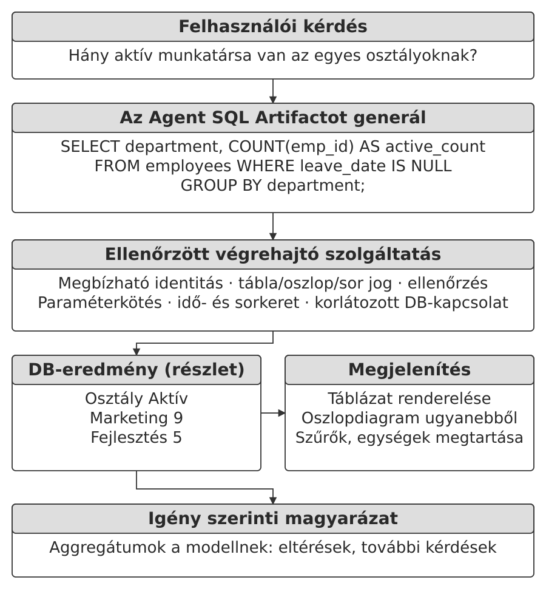

A végrehajtó szolgáltatás a megbízható identitás alapján határozza meg az elérhető táblákat, oszlopokat és sorokat, korlátozott adatbázisfiókot használ, és ellenőrzi az SQL szerkezetét és a művelet típusát. Lekérdezési forgatókönyvben a jóváhagyott, csak olvasó lekérdezésekre szorítkozhatunk, korlátozva a függvényhívásokat, az időkeretet, a visszaadott sorok számát és az adatok körét; a felhasználó által megadott értékek paraméterezett kötéssel kerülnek be.

Az Ágens vizualizációs termékeket is generálhat, például oszlopdiagramon jelenítheti meg a részlegek összesített adatait. A végrehajtó szolgáltatás a lekérdezés eredményét felügyelt vizualizációs futtatókörnyezetnek adja át, a felület pedig csak az engedélyezett adatokat és interakciókat jeleníti meg.

> **5-13. kísérlet ★★: Természetes nyelven kezelhető ERP Ágens**
>
> A kísérlet az ERP (vállalatirányítási rendszer) alkalmazotti és bérlekérdezéseinek példáján mutatja be, hogyan lehet üzleti kérdésekből SQL-t generálni, és hogyan kerülhetnek az adatbázis eredményei közvetlenül az oldalra. A PostgreSQL-ben két táblát hozunk létre: az alkalmazotti tábla tartalmazza az alkalmazott azonosítóját, nevét, részlegét, besorolási szintjét, belépési és kilépési dátumát – üres kilépési dátum aktív munkaviszonyt jelent; a bértábla az alkalmazott azonosítóját, a kifizetés dátumát és a bért tartalmazza, alkalmazottanként havonta egy rekorddal.
>
> Az Ágens e két tábla alapján a következő tíz kérdést dolgozza fel:
>
> 1. Átlagosan mennyi ideje dolgoznak az alkalmazottak a cégnél?
> 2. Hány aktív alkalmazottja van az egyes részlegeknek?
> 3. Melyik részlegben a legmagasabb az alkalmazottak átlagos besorolási szintje?
> 4. Hány új belépő volt az egyes részlegekben idén, illetve tavaly?
> 5. Mennyi volt az A részleg átlagbére tavalyelőtt márciustól tavaly májusig?
> 6. Tavaly az A vagy a B részlegben volt magasabb az átlagbér?
> 7. Mennyi az idei átlagbér besorolási szintenként?
> 8. Mennyi volt a legutóbbi hónap átlagbére az egy éven belül, az egy-két éve, illetve a két-három éve belépett alkalmazottaknál?
> 9. Melyik 10 alkalmazott bére emelkedett a legnagyobb mértékben tavalyról idénre?
> 10. Van-e elmaradt bér (olyan hónap, amikor valaki aktív volt, de nem kapott fizetést)?
>
> A lekérdezés előtt tisztázni kell a statisztikai definíciókat. Az aktív alkalmazottak munkaviszonyának hosszát például a lekérdezés referencianapjáig kell számolni, a kilépettekét a kilépés napjáig; az „átlagbérnél” el kell dönteni, hogy a kifizetési rekordok vagy az alkalmazottak szerint átlagolunk; a béremelési rangsornál pedig kezelni kell azokat az alkalmazottakat, akiknek tavalyról nincs rekordjuk.
>
> Ebben a futásban tíz SQL-lekérdezés készült és futott le, az eredmények mind egyeztek a független referenciaszámítással, majd a böngésző közvetlenül renderelte a táblázatokat. A modell a táblaszerkezetet, a feladatot és a szükséges végrehajtási visszajelzést kapta meg, az adatbázis sorai pedig az alkalmazáson keresztül jutottak a felületre.

**Szoftver dinamikus generálása.**

Az Ágens a követelményekből kiindulva felületet és interakciós logikát generálhat, majd a felhasználó műveletei alapján tovább módosíthatja. Az Anthropic 2025-ben bemutatott, ideiglenes kutatási előzetese, az „Imagine with Claude” ezt az interakciót mutatta be: a felhasználó felfedezi a felületet, a modell pedig folyamatosan generálja a hozzá illő szoftverélményt[^ch5-imagine].

**Valódi termékeknél a meglévő keretrendszerre épülő testreszabásban látok több lehetőséget.** Ha egy teljes alkalmazást folyamatosan a nulláról generálunk, újra és újra meg kell fizetni a generálás, a renderelés és az ellenőrzés költségét; ha viszont megtartunk egy stabil keretrendszert, és csak a felhasználót érdeklő felületeket és folyamatokat nyitjuk meg a módosítás előtt, gyorsabban adhatunk megbízható, személyre szabott élményt. Ha a felhasználó azt kéri, hogy „legyen kék a gomb”, „kerüljön gyorsmenü az oldalsávba” vagy „használjunk olvashatóbb betűtípust”, az Ágens megkeresi az érintett komponenst, módosítja a kódot, majd előnézetben ellenőrzi az eredményt. Az alapkeretrendszer stabil oldalszerkezetet és üzleti interfészeket biztosít, a testreszabás köre pedig a színektől és betűtípusoktól fokozatosan kiterjedhet az elrendezésre és a komponensekre.

A fejlesztői környezet HMR-je (Hot Module Replacement, gyors modulcsere) a kód megváltozása után frissítheti az érintett frontendmodulokat. Hogy az állapot megmarad-e, az a keretrendszer-integrációtól, a frissítés határaitól és a módosítás típusától függ; ha teljes újratöltésre van szükség, az alkalmazásnak a szükséges állapotot is el kell mentenie. A FastAPI fejlesztői módjának reload funkciója a szerveroldali programot tölti újra; a kettő tehát a frontendmodulokra, illetve a háttérfolyamatra hat[^ch5-hmr].

> **5-14. kísérlet ★★: Párbeszédes felület-testreszabó rendszer**
>
> A kísérlet React frontendből és FastAPI háttérrendszerből álló csevegőalkalmazást épít, a fejlesztői környezetben bekapcsolt frontend-HMR-rel és háttér-reloaddal. A modell három egymást követő kérés alapján módosítja a színeket, a betűtípust és a címet, a böngésző pedig minden módosítás után ellenőrzi a tényleges felületet.
>
> Ebben a futásban rögzítettük a Vite HMR-eseményeit: a három módosítási kör egyike sem járt teljes oldalnavigációval, a meglévő csevegési állapot megmaradt, és a végső build is sikeres volt.

[^ch5-imagine]: Anthropic, *Introducing Claude Sonnet 4.5*: a modellel együtt megjelent ideiglenes kutatási előzetes, az Imagine with Claude bemutatása.
[^ch5-hmr]: *Vite HMR API* és *FastAPI CLI*: az előbbi a frontend gyors frissítését, az utóbbi a fejlesztői szerver automatikus újratöltését ismerteti.

**A jogosultsági határokat függetleníteni kell a dinamikus üzleti kódtól.**

**Minél könnyebben írja át az Ágens dinamikusan az üzleti kódot, annál lejjebb, a stabil adathozzáférési rétegbe kell helyezni a végső jogosultsági határt.** A hagyományos alkalmazások a jogosultsági döntéseket a felülvizsgált üzleti kódba írják; ha a generált kód folyamatosan változik, egy új útvonalból kimaradhat ugyanez az ellenőrzés. Csak ha minden olvasás és írás egy független adathozzáférési szolgáltatáson megy át, maradnak érvényben a jogosultsági megkötések. Egy toborzási alkalmazás például dinamikusan generálhatja a jelöltlistát és a műveleti űrlapokat, azt viszont, hogy egy jelölt melyik szervezethez tartozik, és hogy a toborzó mely mezőket frissítheti, egy megbízható adathozzáférési szolgáltatás ellenőrzi folyamatosan.

A tervezési cél itt a következő: **a megbízható adathozzáférési réteg akkor is kikényszeríti a jogosultsági megkötéseket, ha a generált kód hibás.** Ez az 1. fejezet adatrétegbeli védőkorlátjának folytatása: a kötelezően betartandó szabályokat olyan helyre kell tenni, amelyen minden érintett műveletnek át kell haladnia. Az adatbázis sorszintű biztonsági szabályzatai korlátozhatják a rekordokhoz való hozzáférést, a megkötések és az ellenőrzők a megengedett állapotokat vizsgálják, a felügyelt nézetek, tárolt eljárások vagy adatszolgáltatások pedig az engedélyezett műveleteket biztosítják. Az alkalmazásréteg előzetesen ellenőrizhet és magyarázatot adhat a felhasználónak, a végső olvasást és írást azonban a megbízható adatszolgáltatás és az adatbázis-jogosultságok szabályozzák.

Minden művelethez megbízható **hozzáférési kontextus** (access context) is kell, amely tartalmazza a felhasználót, a bérlőt, a szerepkört vagy az Ágens identitását. Az identitást a hitelesítési szolgáltatás és a megbízható futtatókörnyezet hozza létre és köti hozzá a művelethez, az adatszolgáltatás pedig ennek alapján engedélyez. A dinamikus kód a feladat elvégzéséhez szükséges korlátozott interfészeket kapja meg, a hitelesítő adatok és a szabályzatok kezelésének jogát pedig független komponensek őrzik. Minden adatbázis-kapcsolatnak, kiegészítő lekérdezésnek és háttérfeldolgozásnak ugyanazt a hozzáférési kört kell betartania.

A PostgreSQL sorszintű biztonsága például az adatbázis-szerepkörök konfigurációjával együtt használandó. Az alkalmazás kapcsolata szabályzat által korlátozott szerepkört használ, az alkalmazásfióknak pedig nincs joga módosítani a hozzáférési szabályzatokat[^ch5-rls]. A szabályokat és az identitáskötési mechanizmust függetlenül felülvizsgálják, az üzleti felület pedig ezen a körön belül folyamatosan változhat.

A jogosultság és az adatintegritás más-más feladatot lát el. Miután a toborzó jogosultságot kapott a jelöltrekord módosítására, az állapotgép továbbra is ellenőrzi, hogy átléphet-e a rekord az „átvilágítva” állapotból az „interjún részt vett” állapotba; a bérellenőrző beolvassa a kapcsolódó pozíciót, és megvizsgálja, hogy a várt bér a pozíció bérsávján belül van-e; a hivatkozás-ellenőrzés pedig megerősíti, hogy a pozíció és a jelölt kapcsolata érvényes.

> **5-15. kísérlet ★★★: Beépített jogosultságú adatobjektumok dinamikusan generált szoftverhez**
>
> A kísérlet egy PostgreSQL-re épülő Python-objektumtároló prototípust biztosít, amely a jogosultsági szabályokat, az ellenőrzőket, az objektumkapcsolatokat és a későbbi reakciók deklarációit az adattípusokban helyezi el. Olvasáskor ellenőrzi a hozzáférési jogot; létrehozáskor és frissítéskor előbb lefuttatja a jogosultsági és üzleti ellenőrzést, megvizsgálja a hivatkozási kapcsolatokat, aztán perzisztál, végül a deklarált későbbi reakciókat sorba állítja, korlátozva a reakcióláncok mélységét.
>
> A toborzási példa pozíció-, jelölt-, interjú- és értékelésobjektumokat tartalmaz. A jelölt sorban végighalad a jelentkezés, az átvilágítás, az interjú, az ajánlat kiküldése és a felvétel állapotán, a megfelelő szakaszokból pedig elutasított állapotba is kerülhet; a bérsáv a kapcsolódó pozícióból származik. A példa ellenőrzéseket tartalmaz a normál állapotfrissítésre, az érvénytelen állapotátmenetre, a pozíció bérsávját meghaladó bérre és a más bérlőhöz tartozó hozzáférésre, hogy az olvasó megértse, mit kezel az engedélyezés és mit az üzleti ellenőrzés.
>
> A prototípus az `AccessContext` segítségével fejezi ki a felhasználó, a szerepkör és a szervezet attribútumait, az oktatási szkript pedig közvetlenül hozza létre ezeket a kontextusokat a különböző identitások szimulálására. Éles telepítéskor a hitelesítési belépési pont hozza létre a kontextust, az objektumtároló és a generált kód pedig egy egyértelmű szolgáltatás- vagy jogosultsági határ két oldalára kerül.

[^ch5-rls]: PostgreSQL, *Row Security Policies*: a sorszintű biztonsági szabályzatok szerepkör és művelet szerinti beállításának és alkalmazási körének ismertetése.

### Kód, amely kódot hoz létre: az Ágens önépítése

A kódgenerálási képesség magának az Ágensnek a fejlesztésére is felhasználható. A létrehozó (creator) átveszi a feladat követelményeit, legenerálja vagy módosítja az új Ágens promptjait, eszközeit és futási ciklusát, majd tesztekkel és valós interakcióval ellenőrzi a terméket. Az 5-10. ábra ezt az önépítő ciklust mutatja: a meglévő megvalósítás adja a kiindulópontot, a feladatból érkező visszajelzés hajtja a módosításokat, az ellenőrzés eredménye pedig eldönti, mely változások maradhatnak meg.

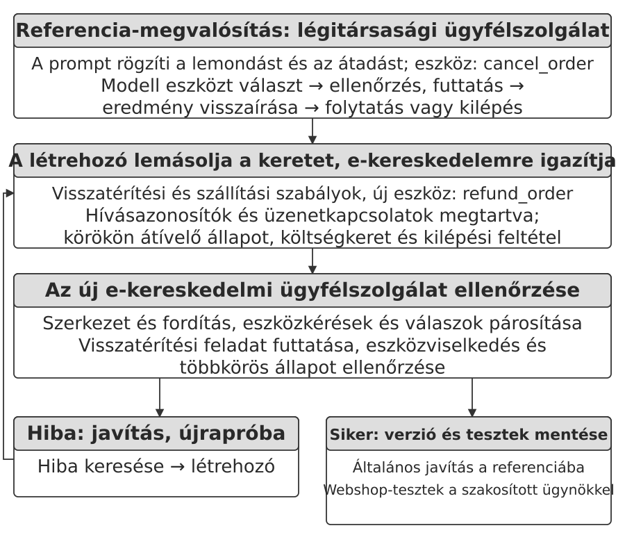

Honnan tudhatjuk, hogy egy módosítás az általános képességet javította, vagy csak véletlenül illeszkedik az imént látott feladathoz? Tartsunk vissza egy olyan feladatot, amelyet a létrehozó nem kapott meg. Ha például egy bolt adataival fejlesztünk árfigyelő Ágenst, adjuk oda neki egy másik bolt mintáit is, és közben futtassuk újra az eredeti feladatot.

**Az Ágens futási környezetének karbantartása.**

Az új Ágens működése konfigurációtól, hitelesítő adatoktól, munkamenet-állapottól, szolgáltatásoktól és sandboxtól függ. Az OpenClaw `doctor` parancsa jó példa egy karbantartó eszközre: ellenőrzi a régi konfigurációk migrálását, az OAuth hitelesítő adatok állapotát, a munkamenet-zárolásokat, a bővítmények telepítését, az átjáró állapotát és a sandbox-lemezképeket, majd javítási javaslatot tesz vagy elvégzi a megfelelő javítást[^ch5-doctor].

Ezek a determinisztikus ellenőrzések az önkarbantartó folyamat alapját képezhetik. Az észlelési szabályok az ismert hibákat fedik le, a javítási műveleteknek pedig egyértelmű bemenetük és várt eredményük van. Ha továbbmegyünk, és diagnosztikai folyamatot tervezünk az Ágensnek, a még megoldatlan problémákat a naplókkal, a konfigurációval és az ellenőrzési eredményekkel együtt átadhatjuk a modellnek, hogy mondja meg, melyik konfigurációt és hogyan akarja módosítani; a végrehajtási réteg ellenőrzi a jogosultságot és a módosítás körét, majd egészségügyi ellenőrzést és regressziós teszteket futtat. A konfigurációs pillanatképek, a változásnapló és a visszaállítási lehetőség segít a rendszernek abban, hogy egy sikertelen javítás után is folytathassa a munkát.

**A mérnöki tapasztalat hordozója a referencia-megvalósítás.**

Egy szakosodott Ágens létrehozása egyszerre érinti a szakterületi logikát és az általános infrastruktúrát. A generált eredmény ellenőrzését négy kérdéscsoporttal kezdhetjük:

1. **Kontextus és futási ciklus.** Meg kell őrizni a szerepek, az eszközhívási azonosítók és az eszközeredmények közötti kapcsolatot, ellenőrizni kell a többkörös állapotot, a leállási feltételeket, a költségkeretet és a hibákból való helyreállítást. A strukturált üzenetek megkönnyítik a protokollkapcsolatok karbantartását; a stabil prefix pedig megteremti a promptgyorsítótárazás feltételeit.
2. **Eszközinterfész.** Az eszközleírás tisztázza a célt, az alkalmazási feltételeket és a használat határait, a paraméterek pedig tartalmazzák a típust, a jelentést és konkrét példákat. A végrehajtási réteg ezen túl is ellenőrzi a paramétereket, az identitást és az üzleti állapotot.
3. **Modell- és API-választás.** A modellek hajlamosak a tanítóadatokban gyakran előforduló régi modelleket és interfészeket használni; a gördülékenyen megírt kód is épülhet elavult választásra. Adjunk a létrehozónak karbantartott választási segédanyagot, vagy engedjük, hogy a hivatalos dokumentációban keressen, és ellenőrizze a modell képességeit, az interfész verzióját és a hívás módját. A generálás utáni valódi hívás mutatja meg, hogy a konfiguráció használható-e.
4. **Függőségek és ökoszisztéma-kompatibilitás.** Ellenőrizni kell a könyvtárak karbantartottságát, verzióját és interfészváltozásait, az összerakott programot pedig függőségtelepítéssel, fordítási ellenőrzéssel és tesztekkel kell validálni.

**Szakosodott Ágens létrehozásakor azt részesítem előnyben, hogy a létrehozó egy már bevált referencia-megvalósítást másoljon le, és azt alakítsa a szakterülethez.** A prompt aligha tudja kimeríteni az üzenetprotokoll, az állapotkezelés és a helyreállítási mechanizmus összes részletét, a referenciakód viszont ezeket a mérnöki tapasztalatokat közvetlenül átviszi az új rendszerbe. Még ha a modell jól programoz is, kimaradhatnak olyan futási feltételek, amelyeket a feladatleírás nem mond ki; a keretrendszer újrahasznosítása csökkenti az ilyen ismétlődő hibákat. A létrehozó lemásolja a megfelelő alapkeretet, a rendszerpromptot az új szerephez igazítja, szakterületi eszközöket ad hozzá vagy vesz el, módosítja az üzleti logikát, és kiegészíti a megfelelő teszteket. Az üzenetkezelést, a hívások összekapcsolását, az állapotkezelést és a kilépési utakat a keretrendszer biztosítja, a szakterületi változásokat pedig új tesztesetek igazolják.

Ha a sablon jóval gyorsabb, hogyan zárhatjuk ki azt a magyarázatot, hogy egyszerűen kevesebb funkciót valósít meg? Az alábbiakban két csoport létrehozó ugyanolyan Ágenst ad át, és ugyanazon az ellenőrzéssorozaton megy át.

> **5-16. kísérlet ★★★: Ágenseket létrehozó Ágens fejlesztése**
>
> Ugyanazt a létrehozó modellt kérjük meg, hogy építsen egy kiadás-jóváhagyó Ágenst: olvasson végig egy telepítési ellenőrzési rekordsort, és ha bármelyik kötelező ellenőrzési tétel nem teljesül, utasítsa el a kiadást, és nevezze meg az indokot. A nulláról való létrehozásnál a modellnek meg kell írnia a futási ciklust, az eszközprotokollt, a szakterületi eszközöket, a parancssori belépési pontot és a teszteket. A sablonos úton először lemásolunk egy strukturált rekordok ellenőrzésére képes Ágenst, a modellnek pedig csak a szakterületi specifikációt kell kitöltenie. Például: melyik mezőben van az állapot, és mely értékek jelentik a megfelelést? A létrehozó szkript a specifikáció alapján generálja a rendszerpromptot, az eszközdefiníciókat és a dokumentációt. A meglévő Python-eszköz a specifikáció beolvasásával végzi az ellenőrzést. Mindkét út a metaprogramozás megnyilvánulása: programmal generálunk vagy módosítunk más programokat.
>
> Az 5-11. ábrán a két út ugyanazokban az elfogadási feltételekben fut össze.
>
> 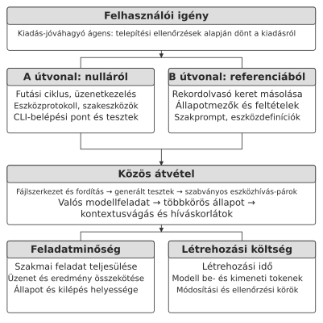
>
> A két út azonos feladatkövetelményeket és elfogadási feltételeket használ. Először a termék szerkezetét, a fordítást és a teszteket ellenőrizzük, aztán a szabványos üzenetekben az eszközhívások és az eredmények összekapcsolását, végül valódi modellfeladatot és többkörös interakciót futtatunk, hogy ellenőrizzük a kontextus nyesését, az állapotkezelést és a hívásszám-korlátot.
>
> Az elmentett Kimi K3 összehasonlításban mindkét csoport 39/39 determinisztikus ellenőrzésen ment át, és mindkettő teljesítette a valódi modellfeladatot és a többkörös állapotellenőrzést. A sablonos út a létrehozáshoz 1181 tokent és körülbelül 25 másodpercet használt fel, a nulláról induló út 381 814 tokent és körülbelül 90 percet.
>

[^ch5-doctor]: OpenClaw, Doctor: a konfiguráció- és állapotellenőrzési, migrációs és javítási funkciók ismertetése.

## A fejezet összefoglalása

**A Kódoló Ágensek viszonylag korai beérésének van egy könnyen figyelmen kívül hagyott oka: a szoftverfejlesztés már rendelkezik típusrendszerekkel, tesztkészletekkel, verziókezeléssel és hibakereső eszközökkel.** Ha a kódot rosszul módosítottuk, a tesztek gyakran megmutatják, melyik bemenetre kaptunk váratlan eredményt; ha más módon javítunk, az eredeti bemenettel újra kipróbálhatjuk. Ha ezt a tapasztalatot más feladatokra akarjuk alkalmazni, először három konkrét kérdést kell feltenni: hogyan vesszük észre a hibát, hogyan térünk vissza egy ismert állapotba, és mikor kell megállni és embert bevonni? Ha például egy visszatérítési hívás közben megszakad a kapcsolat, a Harnessnek előbb a könyvelést kell ellenőriznie, és csak utána döntenie az újrapróbálkozásról, különben egy hibából való helyreállításból második visszatérítés lehet.

A kód egy-egy döntést is ismételten felhasználható formában őrizhet meg. A matematikai feladatok esetszétválasztása és a logikai feladatok megkötései programmal tételesen ellenőrizhetők; a visszatérítési szabály a végrehajtási belépési pont ellenőrzésévé tehető, így a szerver a rendelés valódi állapotát beolvasva dönti el, engedélyezi-e a műveletet. Ha a naplóformátum megváltozik, módosítható az elemző, a hibát okozó mintát pedig regressziós tesztként megtarthatjuk. Mindhárom esetben futtatható kód van, a döntési kritérium azonban más: kielégíti-e a megoldás a feladat feltételeit, megfelel-e a visszatérítés a szabályzatnak, ki tudja-e olvasni az új elemző a korábban kimaradt mezőket.

Ha dokumentumot, videót vagy geometriai modellt adunk át, a renderelést, a hang és a kép szinkronját vagy a méretek pontosságát is ellenőrizni kell, és egy ellenőrzőnek át kell néznie a tényleges terméket. Ha űrlapot, lekérdezést vagy vizualizációt adunk át, azon túl, hogy a felhasználó megérti és kezelni tudja-e, azt is ellenőrizni kell, hogy a háttérben futó végrehajtó szolgáltatás a jogosultságok szerint kéri-e le az adatokat. Ha a kód egy másik Ágenst hoz létre, én inkább előbb egy bevált keretrendszert hasznosítok újra, legenerálom a szakterületi eszközöket és az üzleti logikát, majd ellenőrzöm a hívási protokollt, a körökön átívelő állapotot és a tényleges feladateredményt. Az így felhalmozott eszközöket, ellenőrzőket és teszteket a következő feladat is továbbviheti.

A kód lehetővé teszi, hogy a feladatot ismételten végrehajtsuk, a környezet azonban nem feltétlenül várja meg, amíg végez. Egy lekérdezés még fut, a felhasználó pedig talán már meggondolta magát. A 6. fejezet azt tárgyalja, hogyan jut be az ilyen változás egy éppen folyamatban lévő interakcióba.

## Gondolatkérdések

1. ★★ Tervezzen sandboxot egy olyan Kódoló Ágens számára, amelynek projektfájlokat kell olvasnia, függőségeket kell telepítenie és teszteket kell futtatnia. Hogyan konfigurálná a fájl-, hálózati, folyamat- és erőforrás-jogosultságokat? Ha a feladathoz bővebb jogosultság kell, hogyan fejezné ki a kérést, ellenőrizné a hatókört és őrizné meg a nyomát?
2. ★★★ Ha a létrehozó több generáción át folyamatosan generál és módosít Ágenseket, a keretrendszer hibái és a szakterületi hibák fokozatosan felhalmozódhatnak. Hogyan követhető nyomon ez a változás referenciaverziókkal, regressziós tesztekkel, viselkedésértékeléssel és visszaállítási mechanizmussal?
3. ★★ A naplóformátum változása származhat szabályos frissítésből, de a naplót előállító program hibájából is. Milyen bizonyítékokat kell megőriznie az adaptív elemző rendszernek, és milyen feltételek alapján döntsön arról, hogy új elemzőt ad hozzá, rendellenességet jelent, vagy felfüggeszti a feldolgozást?
4. ★★ A javaslattevő–ellenőrző ciklusban az ellenőrző ésszerűnek tartja egy dia információsűrűségét, a felhasználó viszont zsúfoltnak érzi. Hogyan alakítható a felhasználói preferencia példákká, pontozási feltételekké és interaktív visszajelzéssé, és hogyan ellenőrizhető, hogy a későbbi módosítások megfelelnek-e neki?
5. ★★ A Kódoló Ágens frissítheti a tudásbázist, az architektúra-dokumentációt és a projektutasításokat, és műveletsorokat is kódba rögzíthet. Hogyan ismerhetők fel a fölösleges vagy elavult szabályok, és hogyan tervezhető meg a szabályok érvényességi köre, ellenőrzési módja és kivezetési feltétele? Milyen felhalmozási és értékelési mechanizmusok kellenek még ahhoz, hogy egyetlen sikeres módosításból a 9. fejezetben tárgyalt folyamatos fejlődés legyen?
6. ★ A távoli együttműködésre berendezkedett csapatoknál az Ágens is könnyebben jut hozzá a munkához szükséges információkhoz. Vizsgálja meg egy jól ismert projekt követelményeit, architektúráját, döntési feljegyzéseit és elfogadási kritériumait, sorolja fel a leginkább pótlandó dokumentumokat, és fejtse ki, milyen konkrét feladatokban segítenék az Ágenst.
7. ★★★ Egy olyan Ágensnél, amely egyszerre fér hozzá privát adatokhoz, dolgoz fel megbízhatatlan tartalmat, kommunikál kifelé és használ tartós memóriát, hogyan szervezné meg az identitás alapú engedélyezést, a forrásjelölést, az adatfolyam-ellenőrzést és a memóriába írás felülvizsgálatát? Egy szokásos üzleti folyamaton mutassa be, hol helyezkednek el ezek az ellenőrzések.
8. ★★ Az SQL és a HTML Artifact módjában a modell előállítja a terméket, a végrehajtó szolgáltatás feldolgozza a lekérdezést vagy elvégzi a renderelést, a felület pedig közvetlenül megjeleníti az eredményt. Mely információkat érdemes ezután újra a modellnek átadni magyarázatra? Hogyan ellenőrizhető a lekérdezési jogosultság, az erőforrás-keret, az oldal elszigetelése és a megjelenített eredmény konzisztenciája?
9. ★★ Az eszköz az adatbázisban tárolt üzleti állapot alapján ellenőrzi a szabályokat, a paraméterleírások pedig segítenek a modellnek előkészíteni a hívást. A foglalás lemondásának példáján mutassa be, milyen feladatot lát el a természetes nyelvű szabályzat, a paraméterpéldák, a végrehajtási rétegbeli ellenőrzés és a határeset-tesztek; ha a szabályzat megváltozik, mely elemeket kell együtt frissíteni?
